---
tags:
  - game-engine
  - continuous-notes
  - architecture
  - cumulative-volume
source_scope: Named-channel engine series, supplied books, inspected primary references, and original teaching laboratories
---
# Game Engine — From First Frame to Living Worlds

Imagine a small workshop game. A player walks toward a crate, picks it up, carries it onto a pressure plate, and watches a door open. You can describe that experience in one sentence. Making it happen repeatedly, saving it, editing it, and diagnosing a failure requires several cooperating systems.

The keyboard produces a message. The player interprets it as an intention to move. The world advances. A collision prevents the player walking through the crate. The crate's position changes. The plate detects its weight. The door changes state. A camera chooses a view. The **renderer**, the part that turns scene data into an image, builds a **frame**, one displayed image in the ongoing sequence. The sound system plays the latch. The player sees and hears the result, then makes another choice.

The **CPU** is the main processor executing the application; the **GPU** is a processor used for highly parallel graphics and other computation. The engine coordinates their work rather than assuming everything completes in one function call.

An **engine** is the reusable machinery that supports that cycle. The game supplies particular rules, characters, and content. The boundary is a decision: a small game may keep the engine and game in one program, while a larger project separates reusable services from a particular game. We learn the boundary by following actual work, rather than declaring dozens of empty systems before anything happens.

This is the cumulative home for game-engine teaching in this vault. Future supplied engine lessons belong in this same volume, woven into the relevant explanation. Existing curriculum part numbers remain their own source records; independent video and book study does not manufacture missing curriculum coverage. [[Supplementary/Game Engine - Sources and Coverage|The source ledger]] records the enumerated videos, caption availability, reading status, book passages, and remaining gaps.

Read a concept where it first helps solve a problem. If a word is unfamiliar, its first useful appearance should supply enough explanation to continue. The mathematics volume and C++ volume are deeper companions, but a link does not replace the explanation needed here: [[Continuous Notes/00 - From Vectors to Images - Integrated Mathematics for Visual Computing]] and [[Continuous Notes/Computing Foundations - From Bits to C++ and Systems APIs]].


> [!info] Source coverage
> 746 selected videos are inventoried; 448 English YouTube caption tracks are saved: 448 fully read and 0 sampled. Separately, 8 local ASR transcripts are fully read. 290 selected candidates remain unreviewed. Reading covers transcript text; it does not establish video/frame/code inspection, engine execution, or full-book coverage. The all-source pass remains incomplete.

Read by the problem you need: [[#Let one input produce one intended change|input and time]] · [[#Keep identity, storage, and ownership in agreement|identity and memory]] · [[#Give the renderer a clear job, then meet the graphics API|rendering]] · [[#Prepare and publish content before promising it is ready|assets]] · [[#Make a world that can be authored, saved, and run|editor and scenes]] · [[#Let motion and contact answer the same world rules|physics]] · [[#Reconstruct the working loop and test its contracts|runnable laboratory]].

## Start with an observable promise

Our first promise is small: starting the program creates a world, one update changes a known value, and closing it releases the resources it acquired. A **resource** is something with a limited lifetime that the program must manage: memory, an open file, a window, an audio device, or a GPU allocation. A **lifetime** is the interval during which that thing is valid to use.

Before drawing, write down what success would look like. The player moves one metre after a measured simulation interval. A closed door blocks passage. Saving and reloading preserves the crate's identity. Asking for an absent texture produces a visible fallback and an error record. These are **contracts**: conditions the implementation promises to maintain and that a test or person can observe.

A **subsystem** is a group of related work with an agreed boundary. Rendering produces images; physics advances motion and resolves interactions; an asset service prepares reusable content. The important question is not how many subsystems exist. Ask what each receives, what it changes, who owns the result, and how failure reaches its caller.


For the pressure plate, the input is not “play door animation.” Input is the player's attempted action. A world rule decides whether the crate actually reaches the plate. Only then does the plate's state change and the door respond. Keeping those steps distinct prevents a beautiful animation from claiming success when the underlying game state never changed.

The first engineering exercise is to trace one action through the entire cycle. Record the input, the decision, the state change, and the visible result. If the door opens twice from one crate contact, find the duplicated transition. If it opens visually but remains blocking, find the disagreement between the door's appearance and its collision state. The useful architecture is the one that makes these disagreements visible and repairable.

#### Centralize subsystem lifecycle without hiding order

A system manager can centralize memory sizing, initialization, update, and shutdown callbacks, but it does not eliminate dependencies. The Kohi migrations expose several ordering failures: a resize arrives before event callbacks are registered; jobs stop loading after the manager is added because its update loop never runs systems; shader resources must be released before the renderer/device; and a local console system record is initialized but never copied into persistent manager storage. [Kohi system-manager migrations](https://www.youtube.com/watch?v=l6QDHJ7_rPk) · [Lifecycle callback manager](https://www.youtube.com/watch?v=vOrkxRPWDVA)

Make each lifecycle phase observable and order teardown against actual ownership, usually releasing dependents before the systems they use. Some systems need staged initialization because application configuration is not ready at the first startup point. The episodes use hand-authored order, leave static system state in place, and report one platform framebuffer-size bug unresolved; they do not implement dependency-graph ordering or complete rollback after partial startup.

## Why the engine begins with bytes, objects, lifetimes, and CPU work

The workshop world above is a contract that a machine must execute. A saved material is meaningless without an encoding, a pointer is unsafe without a lifetime, and a scheduled frame is not correct merely because its C++ compiles. The existing full computing-foundations chapter now lives directly in this engine narrative, following one scene asset through representation, object ownership, APIs, CPU architecture and algorithms. Its original headings and code are retained so each derivation remains reconstructable without a fourth teaching book.

# Computing Foundations — From Bits to C++ and Systems APIs

## One byte travels from a file to a running world

Imagine a small editor with a metal panel in its viewport. You change the panel's material, save the scene, close the editor, and reopen it. The surface looks the same. That simple result depends on several different agreements.

The scene file must encode a stable material reference. The importer must recognize the referenced source asset and produce a usable runtime artifact. The executable must contain compatible code for reading that artifact. A resource manager must keep the uploaded texture alive while the renderer uses it. The panel's entity identifier must continue to name the intended entity even if component storage moves.

We will follow this single journey through the combined foundations volume. First we establish how bits encode values and how arithmetic can change their meaning. Then we establish how a C++ program gives objects types, lifetimes, and ownership. Finally we explain how modules, APIs, builds, and persistent formats let independently developed pieces agree. The graphics and engine books use those agreements to answer their own questions: what does the scene look like, and how does the running world change?

An **agreement** here is a set of assumptions that two pieces of a system must share. Some agreements are checked by the compiler. Others are checked by a file reader, a runtime assertion, a synchronization rule, or a test. A system becomes easier to debug when each agreement has an identifiable owner and an observable failure.


This is why the byte story and the C++ story belong in one book. A hexadecimal dump can show the bytes of a handle, but it cannot prove the handle still names a live entity. An address can identify storage, but it cannot by itself establish that a suitable object occupies that storage. A successful function call can submit GPU work, but it does not mean that the GPU has finished reading the submitted resource.

### Give every identifier a scope

Suppose a scene saves the integer `17` as its material reference. During the next run, slot 17 may hold a completely different texture. The integer has survived; its meaning has not.

A **persistent identifier** is intended to survive processes and saves. A **runtime handle** identifies an object inside a particular runtime's management scheme. A **pointer** gives an address with language-level rules about what may be accessed there. A **dense index** identifies a position in a storage arrangement that may change. These are different jobs even when all four happen to use integers internally.

For example, the saved panel may contain a stable asset identifier. The asset database resolves that identifier to an imported artifact. The runtime cache loads the artifact and returns a generational texture handle. A rendering pass resolves that handle into a backend resource reference while enforcing the manager's lifetime rules. The draw packet need not expose the scene's persistent identifier or the manager's entire internal table.

Here is the complete failure trace to keep in mind. An editor command records a pointer into a component vector. Another edit grows that vector. The command later dereferences its old pointer. Even if the entity itself remains alive, the pointer's storage contract has failed. Recording an entity handle and resolving the component when the command executes can avoid that particular relocation problem. It does not solve concurrent destruction, generation wrap, or an API that returns another unprotected pointer. Each step still needs a stated validity interval.

[[Concepts/ABI and object layout|Object layout]] helps explain how a value is represented. [[Concepts/RAII and resource handles|Resource ownership]] explains who is responsible for keeping an object usable. The engine volume extends the same reasoning to entity identity, component relocation, asset publication, and asynchronous work.


### From Signals to Meaning: Bits, Numbers, and Memory

**state → interpretation → arithmetic → representation choice → placement → external bytes → investigation**.

A **trace** shows intermediate states. An **invariant** remains true across a procedure. A **contract** states valid inputs, promised output, and failure conditions. These are tools for reasoning, not instructions to trust a result because it worked once.

Examples use eight-bit octets and a C++23 laboratory baseline. Address diagrams are teaching models. Hardware behavior, language validity, operating-system policy, and external schemas stay separate. Reported repository excerpts remain unverified unless explicitly marked otherwise.

## The route through the story

- [[#Prologue - How a physical state became a byte|Why a physical state needs an encoding]]
- [[#From a signal to an interpretation|Counts and negative values]]
- [[#Bits become decisions and compact fields|Decisions, masks, and fields]]
- [[#Arithmetic becomes a policy|Finite arithmetic and expression types]]
- [[#A stretching ruler for real-valued quantities|Floating representation]]
- [[#When arithmetic meets uncertainty|Rounding, error, and reproducibility]]
- [[#Choosing what information to keep|Fixed point, small floats, and quantization]]
- [[#Where the bytes live|Placement, virtual memory, and lifetime]]
- [[#Bytes become a durable agreement|Serialization, integrity, and dumps]]
- [[#The complete journey - Encode, compute, store, and investigate|The complete experiment and diagnosis]]

## Prologue - How a physical state became a byte

### Start with the problem, not the vocabulary

Suppose a machine must remember whether a lamp is on. It needs two reliably distinguishable states, not necessarily the symbols “0” and “1.” A closed/open switch, a charged/discharged storage element, or two ranges of voltage can represent the distinction.

>The engineer defines which physical condition means which logical state.

Now ask the same machine to remember a count. One yes/no state is not enough. Combine independent states: two bits distinguish four patterns, three distinguish eight, and eight distinguish 256. To interpret a pattern as a number or character, give it an encoding rule.

>**Encoding** is the agreed mapping from meaning to representation; **decoding** is the reverse operation.

Binary is useful because broad low/high signal ranges can be distinguished despite small disturbances. It is not a claim that physics has only two possible values, or that computers cannot process decimal numbers. The digital abstraction deliberately ignores small differences within each permitted range. That tolerance is a **noise margin**: room for a disturbance without changing the logical interpretation. Exact voltage thresholds depend on the circuit; the examples here do not prescribe a CPU's supply voltage.

### A short historical frame

The word **byte** grew out of early computer design, where convenient groups of bits were used for characters and transfers; it was not eternally defined as eight bits. The Computer History Museum associates the term with Werner Buchholz and describes earlier six-bit groupings as well as eight-bit usage. This history matters because a unit name can reflect an engineering convention rather than a mathematical necessity. [Computer History Museum: Werner Buchholz](https://www.computerhistory.org/tdih/october/24/)

IBM's System/360, introduced in 1964, made the eight-bit byte part of an influential compatible computer family. Compatibility meant that software could target an architectural contract across members of that family, rather than be rewritten for every new machine. Eight-bit grouping became an enduring convention, not a law saying that every useful processor operation must be eight bits wide. [IBM: System/360 history](https://www.ibm.com/history/system-360)

The modern term **octet** removes the ambiguity: it means exactly eight bits. A C++ byte is the language's addressable storage unit; `sizeof(char)` is one, while `CHAR_BIT` tells how many bits that unit contains. The concrete file formats here require `CHAR_BIT == 8`. A **word** is a processor or architecture grouping whose width must be stated. “Byte,” “word,” and “character” are not interchangeable: an encoded text character may require multiple bytes.

### Four questions that keep the whole volume honest

1. **State:** which bits exist?
2. **Meaning:** which rule interprets those bits?
3. **Placement:** in which order and at which locations are they stored?
4. **Validity:** may this program access them now?

The pattern `10101101` can mean unsigned 173, signed -83, or several packed flags. Its bits do not announce the interpretation. Likewise, `78 56 34 12` can encode the value `0x12345678` under one byte-order rule, but not under every rule. A live object, a dead object's old bytes, and file bytes can look identical in a dump yet permit different operations.

A **memory dump** is a display of stored bytes. It is evidence about representation, not a complete explanation of type, ownership, lifetime, or permissions. The rest of the volume gives those missing rules.

**Source orientation:** the physical-state motivation was cross-read with the local CPU course, Part 1, PDF pages 2-6. The engine text's data/memory sections and the C++ tour provide useful teaching perspectives, but their older platform examples are not adopted as current universal guarantees. Exact local references are listed at the end.

## From a signal to an interpretation

A stable signal lets us remember a yes/no answer. To remember a count, we need several bits and positional weights. To remember a direction or debt, we need a rule for negative values. We will change the interpretation without pretending the physical bits changed.

### One bit, several bits, and an interpretation

A [[Bit|bit]] is one logical choice between two states, written 0 or 1. **Logical** means the abstract rule the program reasons about; **physical** means the device condition used to realize it. A gate calculates from inputs; storage retains a state. These are different jobs even if both use binary signals.

A byte of eight independent bits has $2^8=256$ possible patterns. That counts patterns, not the largest numeric value. If the unsigned values start at zero, the final value is 255. A pattern may instead label colors, characters, permissions, or compressed codes. An [[Interpretation contract|interpretation contract]] specifies width, type, order, and allowed meanings.

**Board example:** let a two-bit state encode movement: 00=stop, 01=left, 10=right, 11=reserved. All four patterns exist, but only three are accepted by this schema. A **schema** is the declared structure and meaning of encoded fields. Representable does not automatically mean valid for the application.

### Position gives a digit its weight

Decimal 472 means $4(100)+7(10)+2$. [[Positional notation|Binary]] uses the same positional idea with base two. The **base** tells how many digit values exist and how the weight grows between neighboring positions. In binary the digits are 0/1 and each step left doubles the weight.

For N bits, index i counts from zero at the rightmost position. Let $b_i$ be the digit at that position. The unsigned value V is:

$$
V=\sum_{i=0}^{N-1}b_i2^i.
$$

The summation symbol means “add the listed contribution for every i.” **Least significant bit (LSB)** is position zero, weight one; **most significant bit (MSB)** is the highest position, with the greatest weight. These describe significance, not yet memory address order.

Trace `10101101` without a calculator:

| Bit position i | 7 | 6 | 5 | 4 | 3 | 2 | 1 | 0 |
|---|---|---|---|---|---|---|---|---|
| Weight | 128 | 64 | 32 | 16 | 8 | 4 | 2 | 1 |
| Digit | 1 | 0 | 1 | 0 | 1 | 1 | 0 | 1 |
| Contribution | 128 | 0 | 32 | 0 | 8 | 4 | 0 | 1 |

Sum 128+32+8+4+1=173. Nothing in this calculation says where the bytes live.

For [[Binary conversion|decimal-to-binary conversion]], divide by two, record the remainder, and repeat on the quotient. **Quotient** is the whole-number division result; **remainder** is what is left. The relation $n=2q+r$, with r=0 or 1, explains why the remainder is the current low bit.

| Current n | Quotient q | Remainder r |
|---|---|---|
| 173 | 86 | 1 |
| 86 | 43 | 0 |
| 43 | 21 | 1 |
| 21 | 10 | 1 |
| 10 | 5 | 0 |
| 5 | 2 | 1 |
| 2 | 1 | 0 |
| 1 | 0 | 1 |

Remainders arrive low-weight first. Reverse them to write `10101101` high-weight first. Zero needs an explicit representation “0”; a loop that never runs must not accidentally produce an empty numeral.

A second decoder, **Horner decoding**, avoids writing powers explicitly. Read left-to-right and update $v\leftarrow2v+b$. Starting from zero, the successive values for `10101101` are 1,2,5,10,21,43,86,173. Each step moves the old prefix one binary position left and adds the next digit. The two decoders agree because they reconstruct the same positional rule.

### Hexadecimal, octal, byte, and word

[[Hexadecimal]] is base 16. Digits 0-9 and A-F represent values 0-15. Four bits have exactly 16 patterns, so one group of four bits corresponds to one hexadecimal digit. Such a four-bit group is a **nibble**.

Split `10101101` into `1010 1101`. The groups are 10 and 13, written A and D: `0xAD`. The prefix `0x` announces hexadecimal notation in C++. It does not allocate a different kind of storage.

[[Octal]] is base eight and groups three bits. Pad the high end with zeros: `010 101 101` gives digits 2,5,5, so the octal numeral is 255. Decimal 255 and octal 255 have different values; always state the base. In a C++ integer literal, a leading zero requests octal: `0255` means decimal 173.

[[Byte and octet|An octet]] holds eight bits; two hexadecimal digits display one octet. [[Machine word|A machine word]] may be 32 or 64 bits in a particular discussion. Pointer width, native arithmetic width, file field width, and byte width answer different questions. Do not infer all four from “64-bit computer.”

### The same bits can mean different integers

An **encoding** is the rule that assigns a bit pattern to a value. Eight bits give 256 patterns, not a maximum value of 256. In [[Unsigned modular arithmetic|unsigned interpretation]], all weights are positive, giving 0 through 255. A signed interpretation spends some patterns on negative values. To **invert** a pattern, exchange every zero and one within its declared width; the detailed bitwise rules follow in the decisions-and-fields section.

| Eight-bit scheme | Meaning of negative 5 | Zero patterns | Range |
|---|---|---|---|
| [[Signed magnitude]] | `10000101`: sign 1, magnitude 5 | positive and negative zero | −127 through 127 |
| [[One's complement]] | `11111010`: invert positive 5 | all zeros and all ones | −127 through 127 |
| [[Two's complement]] | `11111011`: invert, then add 1 | all zeros only | −128 through 127 |

These are different contracts, not alternative spellings you can mix during an operation. One's-complement addition needs **end-around carry**: a carry leaving the high end is added back at the low end. In signed magnitude, signs and magnitudes need separate treatment.

For an $N$-bit two's-complement pattern, the top bit has weight $-2^{N-1}$, while the remaining weights stay positive:

$$
v=-b_{N-1}2^{N-1}+\sum_{i=0}^{N-2}b_i2^i
$$

If $u$ is the unsigned interpretation of those same bits, decode them as follows:

$$
v=
\begin{cases}
u,&u<2^{N-1}\\
u-2^N,&u\ge 2^{N-1}
\end{cases}
$$

Our earlier byte `AD` has unsigned value 173. Its high bit is set, so its signed eight-bit value is $173-256=-83$. Nothing moved in memory; only the interpretation changed.

### Figure B1 - One pattern, two integer readings

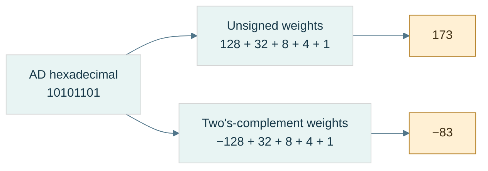

**Read the figure:** the branches change the interpretation, never the stored pattern. The high position contributes either $+128$ or $-128$ at this eight-bit width. Equivalently, the signed branch subtracts 256 from unsigned 173. **Limit:** this is a fixed-width integer example; floating fields and packed application flags follow different decoding rules. Reconstruct both answers before opening [[Visual Recall/01 - Bits, Numbers and Memory - Visual Recall#Figure-linked pocket notes|the pocket notes]].

### Why invert-and-add-one works

A **residue** is the representative left after division by a modulus. At width $N$, retaining only the low bits is arithmetic modulo $2^N$. For positive $x$, its negative residue is $2^N-x$. Since an all-ones word has value $2^N-1$:

$$
2^N-x=(2^N-1-x)+1=\operatorname{NOT}_N(x)+1
$$

Here $\operatorname{NOT}_N$ means complement exactly $N$ bits, not whatever width a programming-language promotion happens to choose.

Trace negative 13 at eight bits:

| Step | Bits | Unsigned pattern value |
|---|---|---|
| Positive 13 | `00001101` | 13 |
| Invert eight positions | `11110010` | 242 |
| Add one | `11110011` | 243 |
| Signed decode | $243-256$ | −13 |

Check: $13+243=256$, whose low eight bits are zero. Negating zero similarly produces all ones plus one and leaves zero. There is no second zero.

The [[Minimum signed value|minimum signed value]] is asymmetric. At eight bits, −128 exists but +128 does not. The pattern `10000000` complements and increments back to itself. That is valid residue arithmetic; it does **not** mean a signed language operation may return −128 as the mathematical negation of −128. For an `int` at its minimum, same-type negation, `abs`, and division by −1 cannot represent the answer. Narrow values can promote to a larger type first; always identify the actual operation type.

## Bits become decisions and compact fields

The same bits can now represent numbers, but not every byte is one number. Some store independent decisions or several small fields. Boolean rules tell us how to inspect and update them without damaging neighboring meanings.

### Boolean reasoning and control flow

A [[Boolean algebra|Boolean]] value is false or true. [[Logical versus bitwise operators|A bit pattern operation]] returns a pattern; a logical condition returns a truth value. With integer x=2 and y=1, `x & y` is zero, but `x && y` is true because each operand is nonzero.

Built-in logical AND/OR [[Short-circuit evaluation|short-circuit]]: the second operand is evaluated only if the first does not already determine the answer. That is why `p != nullptr && *p == 5` can avoid dereferencing a null pointer. Bitwise AND does not supply that control-flow guarantee.

[[De Morgan's laws]] describe what happens when NOT crosses AND or OR:

$$
\neg(A\land B)=\neg A\lor\neg B,\qquad
\neg(A\lor B)=\neg A\land\neg B.
$$

The symbols mean NOT/AND/OR, respectively. Check all four input pairs from the truth table. “Not both” means at least one is absent; “neither” means both are absent. Those are different predicates. Apply the identities lane-by-lane to fixed-width bit vectors only after fixing complement width.

### A mask selects positions

A [[Bit mask|mask]] is a pattern used to select or change specified positions. It is not a special hardware material. The operators [[Bitwise AND|AND]], [[Bitwise OR|OR]], [[Bitwise XOR|XOR]], and [[Bitwise NOT|NOT]] describe one-bit truth rules; **bitwise** operations apply them independently at each corresponding position.

| A | B | AND | OR | XOR |
|---|---|---|---|---|
| 0 | 0 | 0 | 0 | 0 |
| 0 | 1 | 0 | 1 | 1 |
| 1 | 0 | 0 | 1 | 1 |
| 1 | 1 | 1 | 1 | 0 |

NOT exchanges zero and one. AND keeps a bit only if the mask has one there; OR forces masked positions to one; XOR toggles them (one becomes zero, zero becomes one). XOR means **exclusive OR**: true when inputs differ, not when both are true.

Take the octet AD:

- `AD & 07 = 05` retains low positions 0-2.
- `AD | 40 = ED` sets position 6.
- `AD ^ 08 = A5` toggles position 3; repeating the toggle restores AD.
- Eight-bit NOT of `0F` is `F0`. The width matters: complementing a wider representation changes more positions.

C++ uses `&`, `|`, `^`, and `~` for these operations. The teaching model is a fixed-width unsigned pattern. Executable C++ first applies type rules; a narrow operand may become int before NOT. “Invert one byte” therefore requires a deliberate width, not merely the character `~`.

**Any versus all:** if m selects several flags, `(x & m) != 0` means at least one is set; `(x & m) == m` means all selected flags are set. With m=0, the first is false and the second true. Decide whether an empty selection is meaningful in the API.

### Shifts move significance

A **shift** relocates positions. [[Shift operations|A logical right shift]] fills new high positions with zero; an arithmetic right shift replicates the sign bit. A left shift introduces zeros at the low end. Shifting is not rotating: discarded positions do not reappear at the other end.

For an unsigned fixed-width pattern, a left shift by k corresponds to multiplication by $2^k$ followed by the width's truncation; a right shift corresponds to whole-number division by $2^k$ rounded down. **Truncation** here means discarding bits that cannot fit.

At eight-bit width, `00101101 << 1` gives `01011010`, value 90. But `10000000 << 1` leaves low eight bits zero; mathematical 256 needs nine bits. If the goal was an exact product, widening must occur before the shift.

For a negative signed value, arithmetic right shift and integer division can round differently. In C++23, -3 shifted right once is -2, while -3 divided by 2 is -1. **Floor** rounds down toward negative infinity; truncation of signed division rounds toward zero. Also validate the shift count: a negative count or one at least the promoted operand width is invalid. Use an unsigned carrier and check the width when manipulating representations.

### Fields: select, normalize, replace

A [[Bit field|bit field]] in this lesson means a schema-owned range of positions, not automatically a C++ language bit-field member. Its **offset** s is the first position; its **width** w is the number of positions. **Normalize** means move the extracted value down so its lowest field bit has weight one.

Let an unsigned N-bit word x contain a w-bit field beginning at s. Require $1\le w\le N$, $s\ge0$, $s+w\le N$. The low mask L and positioned mask M are:

$$
L=2^w-1,\qquad M=L\,2^s,\qquad f=(x\gg s)\mathbin{\&}L.
$$

Subtracting one from $2^w$ produces w low ones. For w=2, L=3 (`11₂`). For s=4, M=48 (`0x30`). Extract quality from AD: shifting right four gives A; AND with 3 gives 2. Masking AD with 30 alone gives 20 hexadecimal, still weighted at its original position, not normalized value 2.

Replacing requires clearing the old field before inserting the new value. At exactly N bits, $\operatorname{NOT}_N$ means width-limited complement:

$$
x'=(x\mathbin{\&}\operatorname{NOT}_N(M))
\mathbin{|}((v\mathbin{\&}L)\ll s).
$$

A checked API rejects v if it does not fit; a truncating API keeps only low bits. State which behavior is intended.

Trace quality 2→1:

```text
old word                 AD = 10101101
field mask               30 = 00110000
eight-bit NOT(mask)       CF = 11001111
clear: AD & CF            8D = 10001101
new field: 1 << 4         10 = 00010000
write: 8D | 10            9D = 10011101
readback: (9D >> 4) & 3    1
```

Outside-mask bits remain equal: `AD & CF = 9D & CF = 8D`. That is the preservation invariant. OR-only insertion fails whenever the new field needs to clear an old one; it cannot perform replacement generally.

### Figure B2 - Replace a field without damaging its neighbors

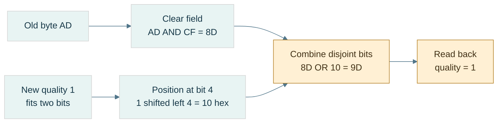

**Read the figure:** the destination field mask is `30` hexadecimal, so its eight-bit complement is `CF`. Clear first, insert second. The invariant is `AD AND CF = 9D AND CF = 8D`: all outside positions survive. **Limit:** the figure assumes a validated two-bit value and an eight-bit unsigned model; actual C++ promotions and legal shift counts still need checking. Extraction and replacement formulas appear immediately above.

### Packing several meanings and unpacking them

[[Bit packing|Packing]] places several small values in one carrier. Give every field an allowed range and disjoint positions before combining them. **Disjoint** means no shared positions; overlapping fields need a separate explicit meaning.

Our running control byte stores mode (0-7) at 0-2, visible at 3, quality (0-3) at 4-5, locked at 6, dirty at 7:

```text
mode=5       -> 00000101
visible=1    -> 00001000
quality=2    -> 00100000
locked=0     -> 00000000
dirty=1      -> 10000000
OR together  -> 10101101 = AD
```

Unpacking reverses the schema. Each recovered value must equal the validated input. A **round trip** is encoding followed by decoding; agreement is necessary but not sufficient, because two matching bugs could agree on the wrong external format. Also check expected bytes independently.

For an LSB-first logical-bit array, bit i goes into byte $\lfloor i/8\rfloor$, position $i\bmod8$. The floor symbol means take the whole-number quotient. Array `[1,0,1,1,0,1,0,1]` packs to AD; its element zero is the low bit even though printed binary puts the high bit on the left.

Packing n bits needs $\lceil n/8\rceil$ octets. A ceiling rounds upward. In finite size arithmetic, use `n/8 + (n%8 != 0)` rather than blindly computing `(n+7)/8` when n+7 could overflow. Check requested unpack count against source capacity before reading. Define whether unused final padding bits must be zero or are ignored.

### Test the packed meaning

**Question:** Can one byte hold the five declared meanings while updating one without changing neighbors?

Use the field/packing implementations in the code companion. Begin with the shown values and predict AD before running. Extract every field; replace quality by one and expect 9D. Then attempt quality=4: a two-bit checked field must reject it. Attempt a field extending beyond the carrier: reject it before shifting. Pack the eight-bit array and check the literal expected octet as well as the round trip.

**Observable checks:** extracted values equal inputs; outside-mask bits remain unchanged; a second identical set has no further effect; a second identical toggle restores the original; the final packed length is the rounded-up capacity. These are checks of mechanism, not a performance benchmark.

**Cost and trade-off:** a fixed field operation takes bounded work. Packing n bits processes n logical inputs and stores about n/8 octets; it saves footprint but adds work and can make concurrent updates to neighboring fields contend on the same storage. We have not yet studied the synchronization required for such shared writes.

**Teach-back:** explain why zero has a representation, why 256 patterns stop at unsigned value 255, why XOR toggles, and why the array's first element can be the printed numeral's last bit. If any answer is only “because binary,” rebuild the actual weights or truth rule.

**Companions, not missing steps:** [[Continuous Notes/Computing Foundations - From Bits to C++ and Systems APIs#M001 - Positional value, masks, fields, and De Morgan|Full proofs]] · [[Supplementary/Code Snippets#M001 - Width-safe fields and LSB-first bit packing|Checked C++ implementations]].

## Arithmetic becomes a policy

Boolean gates can build an adder, but an adder only produces a finite-width result. The next question is whether that result answers the intended signed, unsigned, bounded, or checked problem. Then C++ adds a further layer: the expression's type may not be the stored operand's type.

### From logic gates to an adder

An **ALU**, or arithmetic and logic unit, is hardware that computes arithmetic and bitwise results. A [[Half adder]] adds two one-bit inputs $A,B$. Its sum bit is XOR; its carry bit is AND. A [[Full adder]] also takes incoming carry $c$:

$$
S=A\oplus B\oplus c,\qquad
c_{\mathrm{out}}=(A\land B)\lor(c\land(A\oplus B))
$$

The sum records odd parity: it is 1 when an odd number of inputs are 1. Carry records a **majority**: at least two inputs are 1.

Trace four-bit $13+7$, reading from the least-significant column:

| Position $i$ | $A_i$ from 1101 | $B_i$ from 0111 | Carry in | Sum | Carry out |
|---|---|---|---|---|---|
| 0 | 1 | 1 | 0 | 0 | 1 |
| 1 | 0 | 1 | 1 | 0 | 1 |
| 2 | 1 | 1 | 1 | 1 | 1 |
| 3 | 1 | 0 | 1 | 0 | 1 |

Read sum bits high-to-low: `0100`, or 4. Including final carry gives `10100`, or 20. A [[Ripple-carry addition|ripple-carry adder]] passes each carry to the next stage; a long dependency chain increases circuit delay.

For [[Carry-lookahead and parallel-prefix adders|faster carry networks]], define **generate** $g_i=A_i\land B_i$ and **propagate** $p_i=A_i\oplus B_i$. Then $c_{i+1}=g_i\lor(p_i\land c_i)$. Groups can combine these facts without waiting for every single stage. “Parallel prefix” means combining summaries of preceding groups in a tree-like network. This is a circuit-depth issue, not a claim that fixed-width host addition is a loop over bits.

[[Subtraction through addition]] reuses the adder:

$$
A-B \equiv A+\operatorname{NOT}_N(B)+1\pmod{2^N}
$$

At eight bits, $5-7$: NOT(7)=248; $5+248+1=254$; signed decoding gives −2. A processor's [[Carry and borrow|borrow convention]] must be stated. In binary 6502-style SBC, $A+\operatorname{NOT}_8(B)+C=A-B-(1-C)$, so carry set means **no borrow**. This is an architecture-specific example, not a universal flag convention.

### Flags answer different questions

[[Carry, overflow, negative, and zero flags|C/V/N/Z]] are separate observations of a finite-width result: **C** is unsigned carry-out, **V** is signed overflow, **N** is the high result bit, and **Z** is whether all result bits are zero. With eight-bit binary addition and incoming carry zero:

| Inputs | Exact unsigned sum | Low result | C | V | N | Z | Signed reading |
|---|---|---|---|---|---|---|---|
| `7F + 01` | 128 | `80` | 0 | 1 | 1 | 0 | 127+1 cannot fit |
| `FF + 01` | 256 | `00` | 1 | 0 | 0 | 1 | −1+1=0 fits |
| `80 + 80` | 256 | `00` | 1 | 1 | 0 | 1 | −128−128 cannot fit |

For addition, signed overflow occurs when equal-sign operands produce the opposite-sign result. Carry is not a signed overflow test. The N flag describes the stored high bit; after overflow it does not recover the sign of the exact mathematical answer.

### Multiplication and division as reconstructible algorithms

[[Shift-and-add multiplication]] adds one shifted copy of the multiplicand for each set bit of the multiplier. For $13\times11$, multiplier $11=1011_2$:

| Multiplier position | Bit | Contribution | Accumulator |
|---|---|---|---|
| 0 | 1 | $13\times1=13$ | 13 |
| 1 | 1 | $13\times2=26$ | 39 |
| 2 | 0 | 0 | 39 |
| 3 | 1 | $13\times8=104$ | 143 |

Both partial products and accumulator need sufficient width. Two unsigned $N$-bit values may need $2N$ bits for their exact product.

[[Binary long division]] reads dividend bits from high to low. Append the next bit to the partial remainder by doubling and adding that bit; if it reaches the divisor, subtract the divisor and emit quotient bit 1, otherwise emit 0. For $13/3$, dividend `1101`:

| Incoming bit | Trial remainder | Quotient bit | Remainder after subtraction |
|---|---|---|---|
| 1 | 1 | 0 | 1 |
| 1 | 3 | 1 | 0 |
| 0 | 0 | 0 | 0 |
| 1 | 1 | 0 | 1 |

Quotient `0100` is 4; remainder is 1. The final check is $13=4\times3+1$. Generally, for dividend $D$, positive divisor $d$, quotient $Q$, and remainder $R$:

$$
D=Qd+R,\qquad 0\le R<d
$$

This is the **invariant** that makes the unsigned algorithm testable. Signed division needs an additional sign policy; C++ integer division truncates toward zero. Reject divisor zero and signed minimum divided by −1 when the operation type cannot hold the answer.

### Choose the overflow policy before calculating

**Overflow** means the exact mathematical answer does not fit the intended range. There are several possible [[Arithmetic policies|policies]], and they produce different programs.

| Policy for eight-bit unsigned $250+20$ | Result | Intended use |
|---|---|---|
| Wrap modulo 256 | 14 | residue counters, emulated register arithmetic |
| [[Saturating arithmetic\|Saturate]] at the upper bound | 255 | bounded intensities or controls |
| Check and reject | no value; report failure | sizes, allocation counts, external input |
| Widen the carrier | 270 in a wider type | preserve the exact intermediate result |

A **carrier** is the type or register holding the representation. Widen *before* an operation when the old carrier cannot hold its intermediate result. Casting an already-overflowed signed expression afterward cannot repair it.

C++ unsigned arithmetic uses modulo arithmetic at the width of the operation's unsigned type. [[Signed integer overflow]] is [[Undefined behavior]]: the language does not assign it a result that the program may rely on. CPU wraparound and C++ signed overflow are different contracts. These rules are described in the [C++ draft's fundamental types section](https://eel.is/c++draft/basic.fundamental).

For a buffer of `size` bytes, testing `offset + length <= size` can fail if the addition wraps. With unsigned sizes, use:

```text
offset <= size && length <= size - offset
```

Short-circuit evaluation protects the subtraction from an invalid offset. Example: size 100, offset 90, length 15. The first test passes, but $15\le 100-90$ fails. An offset greater than 100 fails before subtracting.

**Underflow**, when discussing integer range here, means falling below the lower endpoint; it is not the same technical condition as floating-point underflow. Unsigned `0 - 1` wraps. An unsigned reverse loop whose condition is `i >= 0` never terminates by that condition. Start from the count, test that it is nonzero, decrement, then index.

Saturation also changes algebra. With signed eight-bit saturation, $(100+100)+(-100)$ becomes $127-100=27$, but $100+(100-100)=100$. Saturating addition is not associative. Do not clamp an intermediate just because the final output has a bounded range.

### Follow C++'s types through the expression

[[Fixed-width integer types|Exact-width types]], such as `std::uint32_t`, specify an exact bit width when the implementation provides them. **Least-width** types guarantee at least the requested width; **fast-width** types pursue efficient operations while meeting that minimum. `std::size_t` represents sizes; `std::ptrdiff_t` represents pointer differences. Plain `char` can be signed or unsigned.

[[Integral promotion|Promotion]] is an automatic conversion of a small integer type to `int` if `int` represents all its values, otherwise to `unsigned int`. [[Usual arithmetic conversions]] then find the common operation type. **Rank** is the language's ordering of integer types for these decisions; it is not simply the number of bits.

On an ordinary host with eight-bit `uint8_t` and an `int` able to represent 0–255:

| Stage | Expression/value | Type and consequence |
|---|---|---|
| Stored operands | 250 and 10 | `uint8_t` |
| Promotion | 250 and 10 | `int` |
| Addition | 260 | `int`; no eight-bit addition has happened |
| Destination conversion | 4 | assigning to `uint8_t` reduces modulo 256 |

Likewise, `~uint8_t{0}` normally complements an `int` zero and produces `int` −1, not a byte object containing 255. The [draft promotion rules](https://eel.is/c++draft/conv.prom) explain why.

For [[Mixed signedness|mixed-sign comparisons]], do not assume the signed operand stays signed. In `-1 < 1u`, −1 converts to `unsigned int` and the comparison is false. A valid index still needs `index >= 0` *and* a value less than the count. Checked comparison helpers such as `std::cmp_less` avoid surprising conversion comparisons; `std::in_range<T>` checks whether conversion to `T` is representable. These tools do not establish that a pointer is live or that an index belongs to a particular container.

### Integer laboratory and teaching checkpoint

Before implementing a small ALU, write its contract: width, encoding, carry convention, decimal/binary mode, flags, and output policy. A **guest** is the simulated machine; the **host** runs the simulator. Host types must safely carry guest intermediate results.

Lab: enumerate all 256×256 input pairs for an eight-bit addition model, then repeat for both carry inputs. Compare low result with the widened sum modulo 256; compare carry with whether the widened sum reaches 256; derive overflow independently from signed mathematical bounds. That is [[Exhaustive finite-state testing|exhaustive testing]] of this bounded domain, not proof of a complete CPU.

A learner should now be able to explain why `AD` can mean −83, trace an adder, distinguish carry from overflow, reconstruct 13×11 and 13/3, and track the four expression stages above. Proofs and reusable implementation stay in [[Continuous Notes/Computing Foundations - From Bits to C++ and Systems APIs#M002 - Signed representations, adders, and arithmetic policies|the derivation companion]] and [[Supplementary/Code Snippets#M002 - Exhaustive 8-bit addition oracle and saturation|the code companion]]; the meaning needed to teach them is already here.

## A stretching ruler for real-valued quantities

Integer counts and signed directions are exact within their ranges. Fractions require another interpretation. We first study a movable scale because it covers a wide span of magnitudes; later, a fixed scale will offer a different bargain for a bounded domain.

### A movable binary point

[[IEEE-754 floating point|Floating point]] distributes a finite set of bit patterns across a wide range of values. It does not represent every real number. **Dynamic range** describes the span of magnitudes available; **precision** describes how finely values can be distinguished within that span. They are different resources.

A fixed-point encoding might interpret an integer carrier $I$ as $I/2^{16}$. Its spacing is always $2^{-16}$. More fractional positions improve that spacing but reduce the largest magnitude for a fixed carrier width. Floating point instead uses binary scientific notation: a [[Significand and hidden bit|significand]] supplies significant digits and an exponent moves their scale. In $1.010101_2\times2^3$, the significand is $1.010101_2$ and the exponent is 3.

Picture a toy format retaining only three significant binary bits:

| Exponent | Representable values in that exponent interval | Spacing |
|---|---|---|
| 0 | 1, 1.25, 1.5, 1.75 | 0.25 |
| 1 | 2, 2.5, 3, 3.5 | 0.5 |
| 2 | 4, 5, 6, 7 | 1 |

Each scale has the same number of significant positions, but the ruler stretches. Normal floating values have roughly constant *relative* precision, not constant absolute spacing. **Relative** means measured as a proportion of the value; **absolute** means measured in the original units.

IEEE-754 includes formats, special values, arithmetic and rounding rules, and exception conditions—not only a field layout. A conceptual arithmetic pipeline unpacks fields, handles classes, computes with extra information, normalizes, rounds, and repacks. An **FPU**, floating-point unit, is hardware performing these operations. Addition also needs exponent alignment; The arithmetic story below develops that machinery.

### The two formats and their interpretation

[[Binary32]] uses 32 bits; [[Binary64]] uses 64. These are format names. C++ `float` and `double` commonly use them, but names alone do not prove the representation. Our laboratory checks the host's width, radix, precision, exponent range, and IEC-559 support, plus golden bit patterns.

| Property | binary32 | binary64 |
|---|---|---|
| Sign position | 31 | 63 |
| Exponent positions | 30–23: 8 bits | 62–52: 11 bits |
| Fraction positions | 22–0: 23 bits | 51–0: 52 bits |
| Normal significand precision $p$ | 24 bits | 53 bits |
| [[Exponent bias\|Bias]] $B$ | 127 | 1023 |
| Normal exponent $e$ | −126 through 127 | −1022 through 1023 |
| Smallest positive normal | $2^{-126}$ | $2^{-1022}$ |
| Smallest positive subnormal | $2^{-149}$ | $2^{-1074}$ |

Let $S$ be the sign bit, $E$ the unsigned stored exponent, and $F$ the integer formed by the fraction field. For a normal finite number with $t$ stored fraction bits:

$$
x=(-1)^S\left(1+\frac{F}{2^t}\right)2^{E-B}.
$$

Use $t=23,B=127$ for binary32 and $t=52,B=1023$ for binary64. This formula defines the encoded value **exactly**; rounding happens when choosing which encoded value to store, not when interpreting an existing finite pattern.

The sign is a separate factor, unlike two's-complement integer negation. `1.0f` is `0x3F800000`; changing only the high bit gives `0xBF800000`, or −1. Do not invert every bit and add one.

The bias translates the normal exponent into a nonnegative field: $E=e+B$, so $e=E-B$. Binary32 exponent −2 stores 125; exponent 0 stores 127; exponent 3 stores 130. The chosen bias for $k$ exponent bits is $2^{k-1}-1$. Field zero and field all-ones have reserved interpretations: do not blindly subtract the bias for them.

**Normalize** here means move the binary point so a normal positive magnitude has the form $1.f_2\times2^e$. The first nonzero binary digit must be 1, so it need not be stored. That **implicit leading one**, or hidden bit, gives normal binary32 24 significant bits from 23 stored fraction bits. It is not present for subnormals.

| Stored exponent | Fraction | Class | Leading significand bit |
|---|---|---|---|
| 0 | 0 | signed zero | 0 |
| 0 | nonzero | subnormal | 0 |
| 1 through 254 (binary32) | any | normal finite | 1 |
| 255 (binary32) | 0 | signed infinity | not a finite significand |
| 255 (binary32) | nonzero | NaN | not a finite significand |

For binary64 replace 254/255 by 2046/2047. Classify first, decode second. Physical byte order is a separate layer: fields describe significance positions in a representation word, not which byte appears first at increasing addresses. **Little endian** places the least-significant byte first at increasing addresses; **big endian** places the most-significant byte first. The storage story later reconstructs both rules in detail.

### Encode 10.625, then decode −13.25

[[Floating-point encoding and decoding|Encoding]] starts with a value and chooses fields. For 10.625, the integer portion is $10=1010_2$. Convert the fractional portion by repeated doubling; each whole-number part becomes the next bit after the point.

| Remaining fraction | Multiply by 2 | Emit bit | New remaining fraction |
|---|---|---|---|
| 0.625 | 1.25 | 1 | 0.25 |
| 0.25 | 0.5 | 0 | 0.5 |
| 0.5 | 1.0 | 1 | 0 |

Thus $10.625=1010.101_2=1.010101_2\times2^3$. Set $S=0$, $E=3+127=130=10000010_2$. Drop the leading one; pad the fraction to 23 positions:

```text
sign | exponent | fraction
0    | 10000010 | 01010100000000000000000
grouped hex: 0100 0001 0010 1010 0000 0000 0000 0000
representation word: 0x412A0000
little-endian octets: 00 00 2A 41
```

The fraction integer is `0x2A0000`. Check $F/2^{23}=0.328125$; $(1+0.328125)\times8=10.625$. No rounding was needed because the finite binary expansion fits.

For decoding `0xC1540000`:

| Step | Result |
|---|---|
| Extract sign | $S=1$ |
| Extract exponent | $E=130$; class is normal |
| Remove bias | $e=3$ |
| Extract fraction | `0x540000`; fraction bits begin `101010` |
| Restore hidden bit | $1.10101_2=1+1/2+1/8+1/32=1.65625$ |
| Scale and sign | $-1.65625\times8=-13.25$ |

The decoder in the code companion uses `std::ldexp` to multiply a significand by a power of two. Its numerical reconstruction is not a NaN-payload-preserving conversion.


### Zero, infinity, and an unordered result

[[Signed zero]] retains a sign even when $E=F=0$. Positive zero is `0x00000000` and negative zero `0x80000000`. Numerically they compare equal. `std::signbit` distinguishes them; `x<0` does not distinguish negative zero. `std::copysign(0.0,-1.0)` constructs it deliberately.

Under the stated IEEE environment, reciprocal of +0 is +infinity and reciprocal of −0 is −infinity, with divide-by-zero status for finite nonzero numerators. Zero sign can therefore preserve directional information. This is floating arithmetic, not permission to divide an integer by zero.

[[Floating-point infinities|Infinity]] has all-one exponent and zero fraction. `0x7F800000` is positive infinity, `0xFF800000` negative infinity. Infinity is not the largest finite value: that is `0x7F7FFFFF`, $(2-2^{-23})2^{127}$, approximately $3.40\times10^{38}$.

| IEEE operation | Result | Reason to notice |
|---|---|---|
| Positive infinity plus finite | positive infinity | finite addition does not reduce unbounded magnitude |
| Positive infinity minus positive infinity | NaN | indeterminate difference |
| Zero times infinity | NaN | invalid operation |
| Finite value divided by infinity | signed zero | sign still matters |
| Infinity divided by infinity | NaN | invalid operation |

[[NaNs and payloads|NaN]] means “not a number”: all-one exponent with nonzero fraction. **Unordered** means ordinary ordered comparisons with NaN do not identify a less/equal/greater numerical relationship. Under ordinary IEEE semantics, `nan==nan` is false, `nan!=nan` true, and `nan<5`, `nan>=5` false. Detect it with `std::isnan`, not equality against a manufactured NaN.

A **quiet NaN** generally propagates through ordinary arithmetic without signaling invalid solely because it is quiet. A **signaling NaN** is intended to signal invalid when consumed by suitable operations and is commonly quieted. Actual traps, quieting, and payload handling depend on the environment and operation. A **payload** is representation information in the fraction that may carry diagnostics; NaN has no ordinary numerical positive/negative sign.

The laboratory's raw-word classifier uses fraction bit 22 as the quiet indicator in its stated IEEE binary interchange encoding. `0x7FC00001` is a quiet pattern; `0x7F800001` is a signaling pattern. Inspect these as integer words without feeding signaling patterns to arithmetic. A float-by-value inspection or print can already involve implementation behavior; it is not a guaranteed signaling-payload preservation experiment.

[[Floating-point exception flags|Exception flags]] are floating-environment status, not C++ `throw` exceptions. Invalid, divide-by-zero, overflow, underflow, and inexact are different conditions. Inexact says an exact result needed rounding. A tiny exactly representable subnormal does not automatically signal underflow; underflow signaling involves tininess and loss of accuracy under the relevant rules. Overflow handling depends on sign and rounding direction: nearest can produce infinity, while a direction toward finite magnitudes can produce the largest finite value.

### Filling the gap to zero

[[Subnormals and gradual underflow|Subnormals]] use $E=0,F\ne0$, with no implicit one and effective exponent fixed at the smallest normal exponent:

$$
x=(-1)^S\frac{F}{2^{23}}2^{-126}=(-1)^S F2^{-149}
$$

for binary32. For binary64 the corresponding value is $(-1)^S F2^{-1074}$. This changes the significand from $1.f$ to $0.f$ so values extend below the normal minimum.

| Positive binary32 word | Exact value |
|---|---|
| `0x00000001` | $2^{-149}$ |
| `0x007FFFFF` | $(2^{23}-1)2^{-149}=2^{-126}-2^{-149}$ |
| `0x00800000` | $2^{-126}$ |
| `0x00800001` | $2^{-126}+2^{-149}$ |

The subnormal-to-normal boundary has no abrupt jump in spacing: the last two gaps shown are both $2^{-149}$. That is **gradual underflow**. Subnormal spacing is constant in absolute units, so relative precision worsens toward zero; it is not the ordinary constant-relative normal regime.

[[Flush-to-zero and denormals-are-zero|FTZ]] means flushing certain tiny results to zero; **DAZ** means treating subnormal inputs as zero in environments offering that mode. Availability, cost and exact behavior vary. Do not assume every GPU or SIMD operation preserves gradual underflow, nor that subnormals always cost extra. Our strict host test verifies the behavior it observes, not every target mode.

### Epsilon is one spacing, not a tolerance

[[Machine epsilon]] for these binary formats is the difference from 1 to the next representable value above it: binary32 $2^{-23}$, binary64 $2^{-52}$. It is not the smallest positive number and is not a universal error estimate.

| C++ numeric-limits property | Meaning for binary32 |
|---|---|
| `min()` | smallest positive normal, $2^{-126}$ |
| `denorm_min()` | smallest positive subnormal, $2^{-149}$ |
| `lowest()` | most negative finite value |
| `max()` | largest positive finite value |
| `epsilon()` | upward spacing at 1, $2^{-23}$ |

[[ULP and representable spacing|ULP]], unit in the last place, describes a local significant-position scale. A **binade** is an interval $[2^e,2^{e+1})$ with a common normal exponent. For precision $p$, spacing *inside* that binade is exactly:

$$
\Delta(e)=2^{e-(p-1)}.
$$

Binary32 uses $p=24$, so its spacing is $2^{e-23}$. At 1024 it is $2^{-13}=0.0001220703125$; around one billion, $e=29$, so it is 64. Under nearest rounding, adding 1 to the exactly represented `1'000'000'000.0f` stores the same float because there is no representable neighbor one unit away.

At a power of two, state which direction you mean. Immediately above 1 the gap is $2^{-23}$; immediately below it the gap is $2^{-24}$. `std::nextafter(x,direction)` asks for a particular adjacent value. At the maximum finite value its upward neighbor is infinity; that gap is not an ordinary finite-binade spacing.

[[Unit roundoff]] under nearest rounding is conventionally $u=2^{-p}$, half epsilon for these formats. The usual relative-error model is scoped to correctly rounded normal-range results without overflow; do not extend its relative bound unchanged into subnormals.

[[ULP distance policies|ULP distance]] counts representation steps under a stated ordering policy. Reject NaNs and infinities for this lab and identify +0/−0 as one location. The supplied complement-key trick places the zeros at two keys; merely special-casing a comparison of the zeros still overcounts intervals *crossing* them. Our replacement collapses zero in the key itself: negative smallest subnormal to positive smallest subnormal has distance 2, not 3. A small ULP distance is a testing policy, not proof of correctness in physical units.

### Choosing a neighbor

[[Rounding to nearest ties to even|Nearest-even rounding]] chooses the closest representable neighbor. At an exact midpoint, select the candidate whose retained significand integer has an even low bit. “Even” does not mean that a fractional real value is an even decimal integer.

Use the three-significant-bit toy format:

| Exact value | Lower neighbor | Upper neighbor | Tie-even choice |
|---|---|---|---|
| 1.125 | `1.00₂` = 1 | `1.01₂` = 1.25 | 1: retained low bit 0 |
| 1.375 | `1.01₂` = 1.25 | `1.10₂` = 1.5 | 1.5: retained low bit 0 |
| 1.875 | `1.11₂` = 1.75 | `1.00₂ × 2` = 2 | 2; rounding renormalizes |

[[Guard round and sticky bits|Guard, round, and sticky]] summarize discarded information. Guard $G$ is the first discarded bit; round $R$ the next; sticky $T$ is the OR of all remaining discarded bits. Let $L$ be the last retained bit. For this binary rounding step:

$$
\operatorname{increment}=G\land(R\lor T\lor L).
$$

Guard zero is below half; guard one with later nonzero bits is above half; guard one with all later bits zero is a tie, resolved by $L$. Incrementing can carry out of the significand and require renormalization.

[[Directed rounding modes]] move toward positive infinity, negative infinity, or zero. Upward means toward larger signed values, not larger magnitude. For an integer-valued rounding demonstration:

| Input | Nearest-even | Upward | Downward | Toward zero |
|---|---|---|---|---|
| 2.5 | 2 | 3 | 2 | 2 |
| −2.5 | −2 | −2 | −3 | −2 |
| 2.1 | 2 | 3 | 2 | 2 |
| −2.1 | −2 | −2 | −3 | −2 |

For format rounding, substitute adjacent representable floating neighbors for adjacent integers. `std::round(2.5)` instead returns 3: halfway cases go away from zero, independently of the current direction. `std::nearbyint` follows the current rounding direction; unlike `rint` it does not raise inexact for the rounding operation.

[[Floating-point environment and compiler modes|The floating environment]] includes rounding direction and exception status. A demonstration must check whether changing direction succeeds and restore the **previous** mode, not blindly force nearest afterward. Compiler flags and optimizations matter. The lab uses Clang strict floating-point behavior, checks four modes, and avoids fast-math; see [Clang's floating-point controls](https://clang.llvm.org/docs/UsersManual.html#controlling-floating-point-behavior).

[[Interval arithmetic]] uses a lower and upper value to enclose an exact result; downward-rounded lower calculations and upward-rounded upper calculations can preserve bounds when the whole algorithm honors the required assumptions. It is not enough to switch a global mode around an arbitrary formula and declare a proof.

## When arithmetic meets uncertainty

A stored floating value is an exact point on its grid. The difficulty is whether it matches the intended quantity and how later rounded operations change it. Representation, operation error, sensitivity, and application policy are different causes; treating them as one global epsilon hides the real problem.

### The stored value is exact; its intended meaning may not be

Once a representation is chosen, follow a computation: desired real inputs become stored values; each operation can round again; those rounded results feed later operations. Keep **input representation error**, **operation rounding**, and **application policy** separate.

A [[Terminating fractions and dyadic rationals|rational number]] is a ratio $p/q$ of integers, with $q>0$. In **lowest terms**, the numerator and denominator share no factor greater than one. A finite base-$B$ fractional expansion has the form $m/B^k$ for some integers $m,k$. Therefore its reduced denominator must divide a power of $B$. Equivalently, every prime factor of that denominator must divide the base.

Decimal base ten contains factors 2 and 5, so $1/10$ terminates in decimal. Binary base two has only factor 2, so a terminating binary denominator must be a power of two. A **dyadic rational** is an integer divided by a power of two. Every finite binary floating value is dyadic; $1/10$ is not.

To produce binary fraction digits without already rounding them in a float, track the remainder as an integer over denominator ten:

| Remainder numerator before doubling | Doubled numerator | Digit | New numerator |
|---|---|---|---|
| 1 | 2 | 0 | 2 |
| 2 | 4 | 0 | 4 |
| 4 | 8 | 0 | 8 |
| 8 | 16 | 1 | 6 |
| 6 | 12 | 1 | 2 |

Remainder 2 repeats. Thus $0.1_{10}=0.0001100110011\ldots_2$. This is a base property, not a defective processor.

Nearest binary32 one tenth has word `0x3DCCCCCD` and exact value:

$$
\widehat{x}=\frac{13421773}{134217728}
=0.100000001490116119384765625.
$$

Its absolute error relative to exact $1/10$ is $1/671088640$, approximately $1.49\times10^{-9}$. The *stored* value is that exact rational; the approximation is the choice of it as a representation of one tenth.

On our checked host, `0.1f` is binary32, while `0.1` is binary64 with word `0x3FB999999999999A`. Binary64 is closer, not exact. Hexadecimal floating notation makes binary values explicit: `0x1.99999ap-4` means hexadecimal significand times $2^{-4}$; the `p` exponent is a power of two, not sixteen.

For ordinary binary64 nearest arithmetic, runtime `0.1+0.2` has word `0x3FD3333333333334`, whereas `0.3` has `0x3FD3333333333333`. Input rounding and addition rounding explain the different paths. Do not generalize that exact inequality to every type, literal suffix, or evaluation environment.

### Align the binary points before adding

[[Floating-point addition and absorption|Exponent alignment]] rewrites both significands at a common scale. Take $1.5=1.1_2\,2^0$ and $0.15625=1.01_2\,2^{-3}$. Right-shift the second significand by three positions:

```text
common exponent: 0
  1.10000
+ 0.00101
---------
  1.10101 = 1.65625
```

The conceptual pipeline is classify → unpack → compare exponents → align with guard/round/sticky information → add or subtract significands → normalize → round → handle range → pack. Opposite signs require a subtraction of magnitudes; leading zeros can require shifting left and decreasing the exponent. These are teaching stages, not a claim that every FPU has an identical internal design.

**Absorption** means a nonzero addend makes no change after rounding at the larger operand's scale. At $2^{24}=16{,}777{,}216$, binary32 upward spacing is 2:

| Exact sum | Neighbor candidates | Nearest-even stored answer |
|---|---|---|
| $2^{24}+1$ | $2^{24}$ and $2^{24}+2$ | $2^{24}$: even retained low bit |
| $2^{24}+2$ | exact representable value | $2^{24}+2$ |

The addend is mathematically real, but the destination grid has no point at the first exact sum. Shifting it into discarded positions must preserve enough information to round correctly; simply dropping all shifted bits is not a correct general addition algorithm.

This also explains the representation lesson one-billion-plus-one example. It does not imply floating addition is useless: the resolution must match the problem's scale.

### Cancellation can expose errors made earlier

[[Cancellation and loss of significance|Cancellation]] occurs when nearly equal magnitudes subtract, leaving a small difference. **Catastrophic** describes severe loss of relative accuracy when existing operand uncertainty dominates that difference.

Let intended operands be $a,b$, stored approximations $\widehat a=a(1+\delta_a)$ and $\widehat b=b(1+\delta_b)$, and true difference $d=a-b\ne0$. Before any final subtraction rounding:

$$
\widehat a-\widehat b=d+a\delta_a-b\delta_b.
$$

If both relative input errors are bounded by $\eta$, triangle inequality gives:

$$
\frac{|(\widehat a-\widehat b)-d|}{|d|}
\le\eta\frac{|a|+|b|}{|a-b|}.
$$

The sensitivity factor grows when the denominator shrinks. Measurement uncertainty behaves similarly: subtract two roughly million-sized readings each uncertain by 0.05 to estimate a difference of 0.1, and that difference can have order-one relative uncertainty.

**Loss of significance** means common leading digits cancel, leaving the low-order region to determine the result. A rough count is $\log_2(\max(|a|,|b|)/|a-b|)$ canceled leading bits; it is not an automatic theorem about how many digits the result is wrong.

Corrected exact binary trace from the attachment:

```text
a = 1.1011011001₂ = 1753 / 1024
b = 1.1011010111₂ = 1751 / 1024
a-b = 2 / 1024 = 2^-9
    = 0.000000001₂ = 1.0₂ × 2^-9
```

The attachment's longer difference pattern and exponent −7 do not match these operands. Their subtraction is exact; common digits disappearing is not itself evidence of new rounding.

[[Sterbenz lemma|Sterbenz's lemma]] makes the distinction precise: for nonnegative stored floating values $x,y$ in the same radix format, if $x/2\le y\le2x$, their difference is representable exactly under the appropriate gradual-underflow arithmetic assumptions. Same-sign negative cases reduce to magnitudes. FTZ and other changed arithmetic models need separate handling. The lemma concerns the **stored operands**, not the real quantities they approximate.

Example: the desired decimal $a=1.00000006$ rounds above 1 to its next binary32 neighbor under nearest-even. Stored subtraction from 1 yields exactly $2^{-23}$, approximately $1.19209\times10^{-7}$, although the desired difference was $6\times10^{-8}$. Exact subtraction can faithfully expose a large relative input error.

[[Stable reformulation|Reformulation]] changes the computational path while preserving the mathematical function. For $x\ge0$:

$$
\sqrt{x+1}-\sqrt{x}
=\frac{1}{\sqrt{x+1}+\sqrt{x}}.
$$

Multiplying by the conjugate cancels the numerator algebraically *before* floating evaluation. At binary64 $x=10^{16}$, even `x+1` rounds to `x`; the direct square-root difference is zero, while the rationalized form gives a useful result near $5\times10^{-9}$. The reformulation avoids subtracting rounded near-equal roots, but is not an exact-real oracle or a universal fix for every range/domain.

For cross products, each component is a difference of products. The source's vectors $(10^8,10^8,0)$ and $(10^8,10^8+1,0)$ have real cross-component $10^8$. But binary32 near $10^8$ has spacing 8, so the `+1` is already lost when that component is converted to float. Widening the stored float later cannot recover it. Product rounding is a second possible failure mechanism, not the first one in this example.

### Range events are observable, but not interchangeable

[[Floating-point exception flags|Overflow]] concerns results exceeding finite representable range under the applicable rounding rules; intermediates may overflow even when a final mathematical answer fits. Under nearest, maximum finite binary32 times two becomes infinity, with overflow/inexact status in our strict environment.

At the small end, exact $2^{-126}\times1/2=2^{-127}$ is a representable subnormal. It need not raise underflow or inexact. But $2^{-149}\times1/2=2^{-150}$ is an exact midpoint between zero and the smallest positive subnormal; nearest-even gives zero, with tiny/inexact behavior.

The lab executes these at runtime, clears flags between cases, observes them, and restores the incoming floating environment. These host observations are not a portable claim about every compiler mode, trap configuration or GPU. FTZ/DAZ can change the model. Never use a compile-time-folded expression as proof that a runtime status flag was set.

### Error, conditioning, and a budget

[[Absolute and relative error|Absolute error]] is $|\widehat x-x|$, in the same units as $x$. Relative error is $|\widehat x-x|/|x|$ for $x\ne0$, dimensionless. An absolute error of 1 at a million is $10^{-6}$ relative; an absolute error of $10^{-12}$ on a true value $10^{-12}$ can be 100% relative. Near exact zero, relative error alone is undefined.

[[Forward and backward error|Forward error]] asks how far the output is from the exact desired output. **Backward error** asks what perturbation of the input would make the computed output exact. **Stability** concerns the algorithm's introduced errors; [[Conditioning and singularity|conditioning]] concerns the mathematical problem's sensitivity. A backward-stable method can still have large forward error on sensitive inputs.

For correctly rounded normal-range arithmetic in nearest mode, the standard local model is:

$$
\operatorname{fl}(a\circ b)=(a\circ b)(1+\delta),\qquad |\delta|\le u.
$$

Here $\circ$ is a specified operation and $u$ unit roundoff; exclude overflow and special values, and treat subnormal error separately. An exact zero result is handled directly rather than dividing by it.

[[Accumulated rounding error|Repeated rounding]] often uses $\gamma_n=nu/(1-nu)$ for $nu<1$. This bounds relevant products of rounding factors under stated assumptions; it does **not** promise that every arbitrary $n$-operation algorithm has relative error at most $\gamma_n$.

For sequential summation of $n$ inputs without range failures, a common absolute bound is $\gamma_{n-1}\sum_i|x_i|$. If positive and negative terms cancel, dividing by the tiny true sum can produce a large relative bound. A count of operations without magnitudes, dependency paths and conditioning is not an error analysis.

### Representation lessons applied to numerical APIs

[[Numerical tolerance policies|A tolerance]] is an allowed discrepancy chosen for a task. Machine epsilon is dimensionless spacing near one. If vector components measure meters, a minimum usable norm needs a units/scale policy; swapping meters for kilometers changes a raw absolute numeric cutoff. A vector $(10^{-8},0)$ is nonzero and normally representable in binary32; a length cutoff at epsilon rejects it by policy, not because binary32 cannot store it.

[[Robust norm and intermediate range|Intermediate range]] matters independently of the final answer. For $(10^{20},10^{20})$, each component fits binary32 but squaring gives about $10^{40}$, beyond its finite range. A naive square/sum/square-root pipeline can produce infinity, then division by infinity produces zero components. The exact norm $\sqrt2\,10^{20}$ fits.

Scale first: $m=\max(|x|,|y|)$; for finite inputs and $m>0$, compute $m\sqrt{(x/m)^2+(y/m)^2}$. The squared ratios are at most one; this avoids unnecessary overflow from squaring the original components. It does not make an out-of-range final answer fit, and its special-value policy still needs defining. `std::hypot` supplies a standard range-aware alternative. The lab reproduces the naive failure and checks a finite hypot result; it is not a benchmark.

A hybrid equality test often allows absolute difference near zero and a relative difference at large scale. With policy $10\epsilon_{32}$ and magnitude $10^8$, the allowed absolute difference is about 119.2, while local spacing is 8. This is a chosen tolerance, not “the accuracy of float.”

**Check non-finite operands before applying the relative formula.** For the scalar excerpt in the supplied lesson, equal infinities produce `inf-inf → NaN` and compare false. More seriously, finite versus infinity and opposite infinities can compare true because the final condition becomes `inf <= inf`. The teaching lab reproduces all three outcomes for that exact excerpt-shaped formula, then tests an explicit policy that accepts exact equal infinities, rejects all other non-finite pairs and invalid tolerances, and compares finite floats in a widened domain.

[[Conditioning and singularity|Conditioning]] describes how sensitive a mathematical problem is to perturbations; it is not just whether a determinant is small. A **matrix** represents a linear transformation here; the **identity matrix** $I$ leaves its input unchanged. An **inverse** undoes a transformation when one exists. A square matrix's **determinant** is a scalar whose nonzero status characterizes invertibility in exact arithmetic. The **Euclidean norm** is the square root of summed squared components; the associated matrix **2-norm condition number** compares its largest and smallest stretching factors.

For $A=10^{-4}I$ in two dimensions, $\det A=10^{-8}$ and $A^{-1}=10^4I$. Both stretching factors equal $10^{-4}$, so the condition number is 1. An absolute determinant-vs-float-epsilon cutoff rejects this invertible, well-conditioned matrix by a scale-sensitive policy. Uniformly scaling a 2×2 matrix by nonzero $c$ scales its determinant by $c^2$ but leaves its condition number unchanged. General conditioning and reliable inversion methods remain future linear-algebra topics.

**Repository evidence boundary:** the attachment reports these shapes in KairoMath Vector/Matrix and raw-bit serialization in KairoAssets. Their paths, line ranges and claims are recorded in Sources and Code Anchors as **To verify**. The reproductions prove behavior of the supplied formulas on this host, not the current repositories. The matrix excerpt includes an assertion before an identity fallback: an assertion-enabled build may stop rather than reach that fallback.

[[Floating-point canonicalization|Canonicalization]] chooses a common encoding for equivalent cases. Raw serialization keeps +0/−0 and different NaN payloads distinct; a canonical format might collapse both zeros and use one NaN word. Either policy is possible, but changing it changes the byte contract. Our raw-word encoder uses the explicit byte-order lesson explicit little-endian codec without pretending arithmetic preserves every signaling payload.

### A tolerance is a semantic rule, not an equality relation

[[Numerical tolerance policies]] need separate absolute tolerance $\tau_a$ and relative tolerance $\tau_r$:

$$
|a-b|\le\max\!\left(\tau_a,\tau_r\max(|a|,|b|)\right).
$$

Absolute tolerance has the compared quantity's units; relative tolerance is dimensionless. They need not be numerically equal. The float-specific validated comparison already supplies validated tolerances, explicit non-finite handling, and widened finite arithmetic; reuse it rather than copying the attachment's unchecked generic “production” function.

An exact `==` test is appropriate when the intended question is *numeric exact equality*, such as whether a value stayed zero. It is **not raw representation equality**: signed zeros compare equal, and NaNs do not compare equal even to the same encoding. Use raw representation words for a byte-identity contract.

Validate tolerances before an exact-equality shortcut. Reject negative/non-finite tolerances; state a useful allowed relative range. NaNs are not numerically close; same-sign infinities may compare equal only by an explicit policy. A generic expression that overflows both difference and allowed tolerance to infinity can accidentally accept `inf<=inf`; “finite operands” alone does not prevent this.

Approximate closeness is generally **not transitive**. With absolute tolerance 1, 0 is close to 0.75 and 0.75 to 1.5, but 0 is not close to 1.5. It is unsuitable as a drop-in equivalence relation for ordered containers, hashing, or deduplication without additional design.

Why no global epsilon? Positions, angles, times and determinants have different units; world scales differ; algorithms have different error histories; conditioning differs; types differ. A normalization cutoff asks whether a direction is usable, not whether two numbers are equal. A determinant criterion asks about invertibility/sensitivity, not ordinary closeness.

The reported Kairo hybrid formula uses one epsilon parameter for an absolute regime and a relative regime. That is a policy choice, not machine epsilon proving the correct physical cutoff. the representation lesson infinity regressions still apply. At $10^9$, choose distinct stored neighbors separated by 64 for a float comparison example; `10^9+32` is a midpoint that can round back to the same float.

### One rounding rather than two

[[Fused multiply-add|FMA]] computes $\operatorname{fl}(ab+c)$ with one final rounding, rather than $\operatorname{fl}(\operatorname{fl}(ab)+c)$ with an intermediate product rounding.

Let $p=2^{-23}$, $a=b=1+p$, and $c=-(1+2p)$, all exact binary32 inputs:

| Path | Computation | Result |
|---|---|---|
| Exact algebra | $(1+p)^2-(1+2p)$ | $p^2=2^{-46}$ |
| Separate binary32 | product $1+2p+p^2$ rounds to $1+2p$, then subtract | 0 |
| FMA | retain product information through addition, then round | exactly $2^{-46}$ |

The laboratory explicitly stores the product and disables contraction for the separate path. `std::fma` specifies the fused operation deliberately. A source multiply/add may be contracted according to build settings, so it is not enough to count visible `*` and `+` tokens.

FMA can help dot products, interpolation, and Horner polynomial evaluation. It is not a universally correctly rounded multi-term dot product: other products/additions may still round, and poor input data/conditioning remain. FMA policy is also a reproducibility choice because a better answer can differ bitwise from the unfused reference.

### Figure B3 - Rounding points change the answer

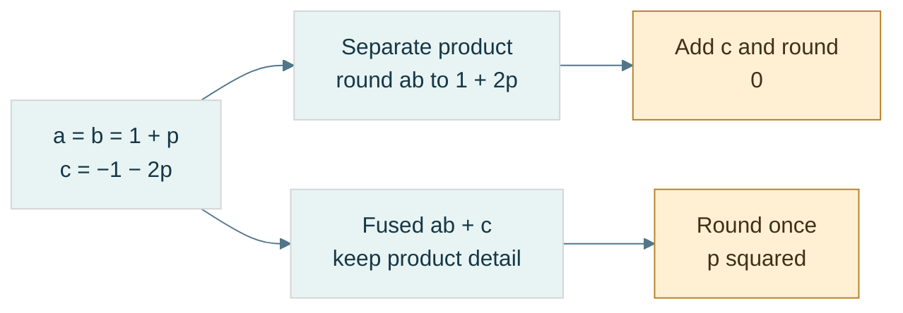

**Read the figure:** here $p=2^{-23}$ and all inputs are exact binary32 values. The exact product is $1+2p+p^2$. Separate binary32 multiplication discards $p^2$; FMA retains it until the addition cancels $1+2p$, leaving exactly $2^{-46}$. **Limit:** the separate path assumes an actual intermediate binary32 rounding with contraction disabled. FMA does not recover inaccurate input data or make a general dot product exact. The preceding example gives the full arithmetic contract.

### Algebra changes when rounding points move

[[Floating-point reassociation|Reassociation]] changes grouping. In binary32, choose $a=10^{20}$, $b=-a$, $c=3.14f$:

| Grouping | Intermediate | Stored result |
|---|---|---|
| $(a+b)+c$ | opposite equal stored magnitudes give zero | `3.14f` |
| $a+(b+c)$ | small c is absorbed in b | zero |

These are different rounded computations even though real addition is associative.

Distributivity also fails. Let exact binary32 $a=10^{10}$, $b=1+2^{-23}$, $c=-1$. Then $a(b+c)$ stores approximately 1192.0928955078125. But rounding $ab$ near $10^{10}$ uses spacing 1024, so separately computed $ab+ac$ gives 1024. The independent stored products matter; contraction can change the second graph.

[[Compensated and pairwise summation|Naive summation]] adds every input to one running result. **Kahan compensation** tracks an estimate of low bits lost in earlier additions:

```text
y = input - compensation
next = sum + y
compensation = (next - sum) - y
sum = next
```

Toy binary32 trace for inputs $[2^{24},1,1]$: naive gives $2^{24}$; after the first 1, Kahan records compensation −1; the next adjusted input becomes 2 and the stored sum becomes $2^{24}+2$. It improves this example, but is not order-independent or universally exact; severe cancellation can still defeat it.

**Pairwise summation** fixes a balanced tree of partial sums. Depth grows roughly logarithmically instead of the long serial chain, improving useful error bounds under their assumptions. It does not always outperform another method on every data set. The implementation fixes the split at `size/2`, independent of scheduling, using $O(n)$ additions and $O(\log n)$ recursive stack depth without copying the input.

Strict compiler settings constrain unsafe reassociation; fast modes can permit numerical changes. The lab uses explicit strict behavior and `-ffp-contract=off` for the unfused paths. These settings are documented by [Clang's floating-point controls](https://clang.llvm.org/docs/UsersManual.html#controlling-floating-point-behavior).

### Repeatable is not accurate, and atomic is not ordered

[[Numerical reproducibility|Repeatability]] means the same defined program/environment/input repeats a result. **Bitwise reproducibility** means representation identity across an explicitly specified set of environments. **Numerical stability** is a different accuracy property.

A [[Deterministic reduction tree|fixed reduction tree]] requires a fixed input order, partitioning and merge order. Scheduling may vary if it cannot change that tree. Atomics make updates indivisible/race-free under their contract; they do not necessarily choose one global order. Since additions do not associate, different permitted atomic update orders can differ.

Record precision, reduction topology, contraction/FMA, rounding direction, FTZ/DAZ, compiler options, hardware and relevant math-library behavior. A fixed tree alone does not promise CPU/GPU or cross-library bit identity. Exact or binned accumulators can offer stronger contracts at additional complexity; they remain a future design topic.

[[Mixed-precision state updates]] use wider intermediates but narrow persistent state. A finite binary32 value promotes exactly to binary64, but widening does not reconstruct lost bits. Repeated storage back to float rounds after each update.

The source-reported Maveb excerpt concerns a **TSDF**, truncated signed distance function: a stored distance-to-surface estimate with sign and a truncated/normalized range. A **voxel** is one cell of a three-dimensional sampled volume. A weighted observation has distance $d$ and influence weight $w$.

Before saturation, ideal weighted state updates are:

$$
D'=\frac{DW+dw}{W+w},\qquad W'=W+w.
$$

With exact arithmetic and uncapped exact totals this is the weighted mean of all observations. The reported implementation instead stores D/W in float after double arithmetic, so update order can change rounding.

[[Capped weighted updates|A weight cap]] changes the mathematics, not just precision. The supplied recurrence chooses $W'=\min(W_{\max},W+w)$, contribution $c=\min(w,W')$, retained history $r=W'-c$, and $D'=(Dr+dc)/W'$, assuming positive valid weights.

With cap 2 and unit weights, observations [0,1,−1] produce distances 0 → 0.5 → −0.25. Reordering to [0,−1,1] gives 0 → −0.5 → +0.25. All intermediate values are exactly binary-representable. This proves genuine history dependence, not floating error. Replacing it with a batch weighted mean would change the algorithm.

[[Numerical decision boundaries]] turn continuous perturbations into discrete choices. Projected image position near $n+0.5$ can select a different pixel under `llround`'s halfway-away-from-zero policy; a TSDF value changing sign near zero can change a surface-extraction case. **Topology** means connectivity/structure of the extracted surface, not just vertex displacement.

The reported interpolation ratio $t=a/(a-b)$ also has a denominator cutoff and clamping policy. Double promotion preserves stored float values exactly; near unit magnitude distinct floats differ by much more than $10^{-12}$, but near zero very fine float spacing is available. Do not equate “small denominator” with “the inputs were equal.”

**Repository boundary:** Kairo Dot/Cross/NearlyEqual and Maveb integration, pixel selection and interpolation are source-reported excerpts. Their current revisions/call paths were not inspected during this notes merge. The laboratory tests simplified excerpt-shaped mechanisms, not those repositories. No production numerical API or accumulation order was changed.

### Laboratory, reconstruction, and next step

Before running the code, predict `0x412A0000`, `0xC1540000`, the three subnormal-boundary words, and the gaps on both sides of 1. Then check:

- Golden words and independently expected little-endian bytes—not just matching encode/decode bugs.
- Raw classification of both zeros, finite boundaries, infinities, and quiet/signaling NaN words without signaling arithmetic.
- Finite reconstruction against host conversion for boundary words and 10,000 seeded raw patterns.
- Zero-collapsed ULP distances, including intervals crossing zero, and rejection of non-finite inputs.
- Nearest-even versus `round`, all directed integer-rounding demonstrations, and restoration of the initial rounding mode.
- Separate tiny-vector cutoff, huge-vector intermediate overflow, and infinity-comparison failures.

These are representation and policy tests. They do not validate a complete floating-point implementation, all four billion patterns, Kairo repositories, shader modes, performance, or cross-platform NaN transport.

Teach-back: derive why 23 stored fraction bits give 24 normal precision bits; explain why $E=0$ does not mean exponent −127; decode both worked numbers; explain why epsilon is neither a minimum nor a universal tolerance; resolve the two toy ties; and trace how a valid finite vector can become zero by two different mechanisms.

[[Continuous Notes/Computing Foundations - From Bits to C++ and Systems APIs#M004 - Floating-point fields, spacing, and rounding|Extended derivations]] · [[Supplementary/Code Snippets#M004 - Binary interchange inspection and strict rounding laboratory|Reusable implementation and tests]] · [[Supplementary/Worked Traces#M004 - From fields to values and failure paths|Further traces]].

With the representation understood, we can follow the arithmetic and its error history.

### Laboratory and teaching checkpoint

Predict each outcome before running:

- The exact rational behind `0.1f` and the binary64 words for the sum and literal 0.3.
- Exact aligned addition and absorbed midpoint addition.
- Corrected binary subtraction; subtraction after an operand was rounded.
- Overflow status, exact subnormal without underflow, and midpoint-to-zero with underflow/inexact in the strict host environment.
- Separate versus fused result, both association trees, and both distributive graphs.
- Naive versus Kahan on the three-input toy case; fixed pairwise behavior on a chosen tree.
- Capped weighted updates in the two orders, and float-state rounding versus a wider-state toy mean.
- Pixel choices just below/above a midpoint and closeness failing transitivity.

These are explicit regression demonstrations, not benchmarks, full FPU validation, mesh reconstruction experiments or proof of cross-platform reproducibility. Error measurements need an independent reference and declared units; a wider implementation is useful but is not automatically an exact oracle.

[[Continuous Notes/Computing Foundations - From Bits to C++ and Systems APIs#M005 - Representation error, cancellation, and rounding graphs|Extended derivations]] · [[Supplementary/Worked Traces#M005 - Rounding paths and update history|Expanded traces]] · [[Supplementary/Code Snippets#M005 - Strict arithmetic and state-update laboratory|Reusable code and tests]].

The representation-choice discussion below brings these rounding and state contracts into fixed point, low precision and serialized data.

## Choosing what information to keep

Floating point solved wide dynamic range, not every storage or application constraint. Now deliberately return to the representation decision: perhaps the domain needs a constant step, perhaps sixteen bits are sufficient, or perhaps data-specific codes are worth an irreversible approximation. The previous arithmetic lessons remain the tests every choice must pass.

### A fixed ruler for fractional values

Unsigned integers answered “how many?”; signed integers added direction. Floating point added a ruler that stretches with magnitude. None of these choices removed finite storage. If a distance always stays inside a known world region, a stretching ruler may be unnecessary: a constant millimeter-like step can be a better contract.

[[Fixed-point representation|Fixed point]] interprets an integer raw value $I$ with an externally agreed scale $S>0$:

$$
x=\frac{I}{S}.
$$

**Scale** is the conversion factor between integer codes and the quantity's units. The integer object does not carry a binary point by itself. Binary fixed point uses $S=2^F$, where $F$ is the number of fractional positions. Decimal fixed point, such as $S=1000$, is possible too. State storage width, signed encoding, units, scale, rounding, and overflow behavior; the label “Q16.16” is ambiguous because conventions differ about counting the sign bit.

For a two's-complement 32-bit carrier and $F=16$, encode $3.25$ as $I=3.25(65536)=212992$, word `0x00034000`. Decode by dividing by 65536. Negatives use the carrier's two's-complement rule—not an independent sign-and-magnitude split. Every step is $2^{-16}$, and the exact range is:

$$
-32768\le x\le32768-2^{-16}.
$$

This representation answers a problem floating point did not: constant absolute resolution over a declared interval. It still cannot represent every real number, and it still overflows. More fractional positions make steps finer by spending range.

### Choose a scale from requirements, not a fashionable name

[[Fixed-point range and resolution|Resolution]] is the distance between adjacent decoded codes. Let $\Delta_{\mathrm{req}}>0$ be the largest acceptable step and $M>0$ the required symmetric magnitude. For a signed $N$-bit carrier, the positive endpoint is the tighter endpoint for a symmetric requirement:

$$
2^{-F}\le\Delta_{\mathrm{req}},
\qquad
M2^F\le2^{N-1}-1.
$$

With an integer, nonnegative $F$, these give a feasible interval:

$$
F_{\min}=\max\!\left(0,\left\lceil-\log_2\Delta_{\mathrm{req}}\right\rceil\right),
\qquad
F_{\max}=\left\lfloor\log_2\frac{2^{N-1}-1}{M}\right\rfloor.
$$

The ceiling rounds upward; the floor downward. These inequalities concern a requested step, not a maximum rounding error: nearest rounding without clipping has error at most half a step. For 32 bits, a step no larger than 0.001 requires $F\ge10$. A range including $\pm10^6$ requires $F\le11$. Both $F=10$ and $F=11$ work; $F=12$ does not fit that world.

If the interval is empty, change width, range, or resolution. A local coordinate origin can reduce the magnitude that one field must represent, but then the origin becomes additional state with its own contract. It is not extra precision obtained for free.

**Book bridge:** Game Engine Architecture, PDF pages 121–122 (printed 99–100), connects integers, fixed point, and floating point. Its fixed-point illustration uses sign/magnitude fields; our implementation instead uses a two's-complement scaled integer. Its figure caption and body also disagree about the fraction-bit count. The teaching rule is to reconstruct a format from explicit fields, not assume one textbook example defines all fixed point.

### Multiplication changes the scale; rescaling is another rounding decision

Adding two raw values works directly only when their scales and units match. For $A=aS$ and $B=bS$, multiplication produces $AB=abS^2$, not an output already at scale $S$. [[Fixed-point rescaling|Rescale]] before storing:

$$
I_{\mathrm{product}}=\operatorname{roundPolicy}\!\left(\frac{AB}{S}\right),
\qquad
I_{\mathrm{quotient}}=\operatorname{roundPolicy}\!\left(\frac{AS}{B}\right),\quad B\ne0.
$$

A **wide intermediate** is a carrier large enough for an operation before the final range reduction. With signed 32-bit raw operands, their product fits signed 64-bit arithmetic, but it may still exceed the *destination* range after rescaling. For our $F=16$ quotient, multiplying a 32-bit raw numerator by 65536 also fits signed 64 bits. Those proofs do not extend automatically to arbitrary widths or scales.

Trace $F=8$, $S=256$:

| Stage | Stored or intermediate quantity | Meaning |
|---|---|---|
| Encode 1.5 | $A=384$ | $384/256$ |
| Encode 2.25 | $B=576$ | $576/256$ |
| Multiply wide | $AB=221184$ | product at scale $256^2$ |
| Rescale | $221184/256=864$ | product at scale 256 |
| Decode | $864/256=3.375$ | expected real product |

For a negative value, right shift and integer division do not necessarily implement the same rounding policy. At scale 2, $-3/2$ truncates toward zero to −1, while arithmetic right shift gives −2. Nearest-even gives −2 on that tie; on other cases a blanket shift still implements floor, not nearest. Define a rounding algorithm using quotient and remainder, including negative ties.

The laboratory uses unsigned magnitude arithmetic to handle signed minimum safely, nearest-even for multiplication/division, and checked narrowing. It does not negate `INT64_MIN`, add a half-scale that might overflow, or multiply in 32 bits and widen afterward. Conversion rejects NaN and infinities before integer casting. Conversion from double explicitly uses halfway-away-from-zero; that differs from the arithmetic rescaling rule and is documented rather than hidden.

### A constant grid changes error, not the existence of error

Nearest encoding with no clipping gives:

$$
\left|x-\frac{\operatorname{round}(xS)}{S}\right|\le\frac{1}{2S}.
$$

For $F=16$, the bound is $2^{-17}$. It has the quantity's units. Relative error can still be large near zero. At a value smaller than half a step, nearest encoding can erase it completely.

With signed 16-bit raw storage and $F=8$, the range is $[-128,128-2^{-8}]$. Value 200 needs raw 51200 and cannot fit. Wrap, saturation, and rejection remain different policies. “Uses integers” does not authorize C++ signed overflow.

Fixed point can remove variability caused by floating contraction, subnormal modes, and floating evaluation precision when its operations are fully specified. It does not make capped updates or saturation associative, remove races, or guarantee deterministic input order. The previous questions about algorithm and scheduling still hold.


### Two sixteen-bit bargains: keep detail or keep range

Sometimes a stretching ruler is still desirable, but 32-bit storage is too costly. **Bandwidth** is the amount of data transferred per unit time; cutting a representation's size may reduce traffic, but speed depends on the actual computation and hardware. A storage choice is not a benchmark result.

[[Binary16|IEEE binary16]], often called FP16, uses one sign bit, five exponent bits and ten stored fraction bits. Its bias is 15; normal precision is 11 bits. For a normal word:

$$
x=(-1)^S\left(1+\frac{F}{2^{10}}\right)2^{E-15},
\qquad 1\le E\le30.
$$

Zero/subnormal and all-one exponent classes follow the same conceptual classification as larger IEEE binary formats. With exponent zero and nonzero fraction, the value is $(-1)^SF2^{-24}$.

Encode 1.5: $1.1_2\,2^0$ gives sign 0, exponent 15, fraction 512. The word is `0x3E00`. The highest finite binary16 value is $(2-2^{-10})2^{15}=65504$. The smallest positive normal is $2^{-14}$; the smallest subnormal is $2^{-24}$. A value $10^5$ is outside finite range. Loss scaling addresses tiny gradient visibility in some training schemes; blindly increasing a scale is not a remedy for already-too-large values and can cause overflow.

[[Bfloat16]] spends the same sixteen bits differently: one sign, eight exponent bits, seven fraction bits. Its bias is 127, normal precision eight bits, and normal-value formula is:

$$
x=(-1)^S\left(1+\frac{F}{2^7}\right)2^{E-127},
\qquad1\le E\le254.
$$

Its ideal interchange subnormal spacing is $2^{-133}$, but actual target operations can flush small values; specify that policy separately. Its largest finite value is $(2-2^{-7})2^{127}$, slightly less than binary32's largest finite value—not identical range in every detail.

| Resource | binary16 | bfloat16 |
|---|---|---|
| Sign/exponent/fraction | 1/5/10 | 1/8/7 |
| Normal precision | 11 bits | 8 bits |
| Normal exponent interval | −14 through 15 | −126 through 127 |
| Spacing immediately above 1 | $2^{-10}$ | $2^{-7}$ |
| Maximum finite | 65504 | approximately $3.39\times10^{38}$ |

FP16 buys more detail near a given magnitude; BF16 buys a much wider exponent range. Neither restores the detail of binary32. Around 2048, FP16 spacing is 2; near 1, BF16 spacing is approximately 0.78% of one.

### Conversion must round, classify, and declare its NaN policy

Dropping the low sixteen binary32 bits gives a truncating BF16 conversion, not nearest-even. Let $L$ be the lowest retained bit. For finite binary32 words, adding `0x7FFF + L` before shifting right sixteen implements the nearest-even decision, including carries into the exponent. A rounded finite value can overflow to infinity.

NaNs need a separate branch: a tiny payload confined to discarded bits must not become infinity. The laboratory deliberately canonicalizes any input NaN to one quiet BF16 NaN word, `0x7FC0`; it preserves signed zeros and infinities. This policy changes payload/sign information by design. It is not a promise about every device converter.

For an exact tie above 1, input word `0x3F808000` lies midway between BF16 words `0x3F80` and `0x3F81`; even chooses `0x3F80`. The next tie `0x3F818000` chooses `0x3F82`. Reconstruct a BF16 finite value by placing its word in the high sixteen binary32 positions on a checked compatible host.

Low-precision storage does not force a low-precision accumulator. Wider accumulation delays additional rounding, but cannot recover bits already lost when operands were converted. This is the same persistent-state distinction encountered in arithmetic: conversion, product, accumulation, and final storage are four separately chosen stages. [NVIDIA's BF16 conversion documentation](https://docs.nvidia.com/cuda/cuda-math-api/cuda_math_api/group__CUDA__MATH____BFLOAT16__MISC.html) explicitly distinguishes conversion rounding modes; it is a target reference, not proof that every device follows our scalar codec's payload or subnormal policy.


### A smaller codebook tailored to the data

Floating formats distribute codes using exponent fields. Fixed point fixes one ruler. [[Affine quantization and zero point|Quantization]] generalizes the choice: map values to a finite **codebook**, the set of reconstructible values. A uniform affine quantizer uses a positive step $s$, integer **zero point** $z$, and an integer code interval:

$$
q=\operatorname{clamp}\!\left(\operatorname{round}(x/s)+z,q_{\min},q_{\max}\right),
\qquad
\widehat x=s(q-z).
$$

**Clamp** means replace an out-of-range result by the nearest endpoint. **Dequantize** means reconstruct a value from its code and metadata; it is not an inverse recovering all original information. Code $z$ reconstructs zero exactly. Inside the unclipped range, ideal nearest rounding gives $|x-\widehat x|\le s/2$. Scale rounding and finite arithmetic are additional errors; outside the range, clipping can greatly exceed this bound.

To initialize a range fit, choose $s=(r_{\max}-r_{\min})/(q_{\max}-q_{\min})$ and round an ideal zero point $q_{\min}-r_{\min}/s$. Require nondegenerate ranges and finite valid metadata. Rounding $z$ can move the decoded endpoints, so an unsigned 8-bit affine fit to $[-1,1]$ cannot promise both endpoints and zero are simultaneously exact. There are 256 codes but 255 equal intervals. Encoding is a declared approximation, not magic.

**Calibration** is choosing quantizer parameters from data or requirements. Per-tensor uses one scale for everything; per-row, per-channel, or per-group uses more local scales. A **channel** is one feature/component axis, such as a color component or model output feature. The shape and axis convention must be specified. Local adaptation costs metadata.

### An INT4 group, from numbers to nibbles and back

[[Groupwise quantization and metadata|Groupwise INT4]] stores four-bit codes plus a scale per group. In the supplied NanoQuant excerpt, an ordinary non-tiny group chooses $s=\max_i|x_i|/7$, making the intended signed values symmetric in $[-7,7]$. The helper permits $[-8,7]$ and stores offset code $c=q+8$ in $[0,15]$.

This is [[Offset-binary coding|offset-binary]] nibble storage, not a two's-complement nibble. A four-bit two's-complement −3 is binary 1101; this offset code for −3 is binary 0101. “INT4” alone does not define the byte contract.

| Input $x$ | Nearest code $q$, scale 1 | Stored nibble $c=q+8$ | Reconstruction | Reconstruction minus input |
|---|---|---|---|---|
| −7 | −7 | 1 | −7 | 0 |
| −3.2 | −3 | 5 | −3 | +0.2 |
| 0 | 0 | 8 | 0 | 0 |
| 2.9 | 3 | 11 | 3 | +0.1 |
| 6.8 | 7 | 15 | 7 | +0.2 |

Place the first code in the low nibble and the next in the high nibble. The five codes pack to `51 B8 0F`. The final high nibble is zero padding and must not be decoded as another element; the element count supplies the boundary. As a second example, codes 5 and 11 pack to `B5`, which reconstructs −3 and +3 at scale one.

Packing is lossless for valid discrete codes; quantization is where information was thrown away. Do not blame a byte packer when the reconstructed weight was already changed by the scale/code choice.

The reported source uses `lrint`, which follows the floating rounding direction; it is not an unconditional halfway-away or nearest-even operator. A standalone safe demonstration defines its rounding explicitly and validates finite input before conversion. The reported tiny-group rule also chooses scale 1 when max magnitude is at most float epsilon, which is a heuristic, not a universal physical zero threshold.

### One outlier can spend the whole group's resolution

An **outlier** is an unusually large or otherwise unrepresentative observation. For group $[-100,1,1,1]$, max-absolute calibration gives $s=100/7\approx14.2857$. Each 1 maps to zero. This is expected under that codebook, not necessarily a packing error.

Smaller groups may isolate an outlier and improve local resolution, but monotonic quality improvement is not guaranteed across changed grouping/calibration policies. They also store more scales. For $N$ values and group size $G>0$, with float32 scales:

$$
B_{\mathrm{payload}}=
\left\lceil\frac N2\right\rceil
+4\left\lceil\frac NG\right\rceil.
$$

For large groups with exact divisibility, this is $4+32/G$ bits per value, not simply four. At $G=32$, five effective payload bits give approximately $32/5=6.4$ times compression relative to FP32, before file headers. For $N=5,G=32$, the actual payload is three code bytes plus four scale bytes: seven bytes, or 11.2 bits per value. Small partial groups make the asymptotic slogan especially misleading.

### A one-bit label can select two learned reconstruction values

[[One-bit centroid quantization|A centroid]] is the mean of a chosen group of samples. The source's one-bit row codec records positive and negative means per row, then one sign label per element. It is not automatically the codebook $\{-1,+1\}$.

For row $[-1,-3,2,4]$, the negative mean is −2 and nonnegative mean 3. Labels `0 0 1 1` reconstruct $[-2,-2,3,3]$. Declare which side receives zero and what reconstruction value an empty side uses. With two binary32 centroids and $C$ columns, the asymptotic metadata cost is $1+64/C$ bits per element before padding/header—not exactly one bit.

[[Quantization error metrics|RMSE]], root mean square error, is $\sqrt{\sum_i(x_i-\widehat x_i)^2/N}$ for $N>0$. **MAE**, mean absolute error, is $\sum_i|x_i-\widehat x_i|/N$. Maximum absolute error is the largest observed discrepancy. The example row has four squared errors of one, hence RMSE=MAE=max error=1. Square terms weight large errors more strongly.

For binary32 reference/candidate arrays, promote operands before subtraction if the metric is meant to avoid float subtraction overflow: `double(reference)-double(candidate)`, not `double(reference-candidate)`. A finite scalar error still does not establish application quality; inference accuracy, surface decisions, or image appearance may need task-specific measures.

### Normalized graphics integers are another codebook

[[UNORM and SNORM|UNORM]] means unsigned normalized integer. An $n$-bit code represents $x=q/(2^n-1)$ in $[0,1]$. UNORM8 code 128 gives $128/255\approx0.5019608$, not exactly 0.5. The nearest ideal encoding step is $1/255$, with half-step error inside the range.

**SNORM**, signed normalized integer, commonly decodes a signed $n$-bit carrier with:

$$
x=\max\!\left(\frac{q}{2^{n-1}-1},-1\right).
$$

At eight bits, both −128 and −127 decode to −1; +127 decodes to +1. API conversion details and supported usages remain format-specific. These mappings are described in [Vulkan's normalized conversions](https://docs.vulkan.org/spec/latest/chapters/fundamentals.html#fundamentals-fixedfpconv); our lab fixes nearest-even for its own encoder rather than assuming every hardware halfway choice matches it.

A **texel** is one element of a texture image; a **shader** is a program executed in the graphics pipeline. RGBA8 UNORM uses four eight-bit channels, totaling 32 bits per texel. Sampling converts codes to values, but **sRGB** color conversion is a distinct nonlinear interpretation—not synonymous with linear UNORM.

A **normal vector** describes surface orientation; a tangent-space normal uses coordinates in a local surface-aligned basis. Quantizing components can change unit length. Renormalization divides by a valid nonzero norm, but cannot restore lost directional information; handle the zero vector explicitly. Compact storage buys bandwidth at a declared distortion cost.


### Choose the contract before choosing the type

The sequence is not a ladder where every new format makes the previous one obsolete. Each solves a different constraint and keeps earlier limitations that it does not address.

| Representation | What it buys | What still needs a policy |
|---|---|---|
| Unsigned integer | exact nonnegative code/count domain | finite width, modular wrap, valid IDs |
| Two's-complement signed integer | negative direction with a shared integer adder | asymmetric minimum, checked signed range |
| IEEE binary32/binary64 | broad dynamic range and useful relative precision | rounding, cancellation, subnormals, special values, reproducibility |
| Fixed point | constant absolute step in a bounded domain | scale/units, rescaling, overflow, near-zero relative error |
| Binary16 | floating scale in sixteen bits, finer precision than BF16 | narrower finite range and accumulation policy |
| Bfloat16 | wide exponent range in sixteen bits | coarse precision, conversion and target tiny-value policy |
| Affine/groupwise integer quantization | small data-adapted codebook | calibration, clipping, metadata and task accuracy |
| UNORM/SNORM | compact normalized domain | endpoint/rounding semantics, color-space or normal reconstruction |

Ask in order: what does the quantity mean; what range must it cover; what error is acceptable in its units; what operations and intermediates are needed; what storage/traffic budget exists; and what reproducibility/identity contract must hold? A representation may satisfy one row of requirements and fail another.

This choice also separates **storage precision** from **compute precision**. A texture may store UNORM8 and sample into a floating shader value; a model may store INT4 but accumulate wider; a simulation may use checked fixed-point state. Decode/compute/re-encode boundaries need explicit rounding and overflow policies. A format alone never establishes the correctness of the complete algorithm.

## Where the bytes live

A good numeric interpretation is not yet usable storage. Representations must be placed at addresses, inside valid objects and mappings. Byte order, alignment, memory translation and ownership answer different questions; solving one does not automatically solve the rest.

### A value is not its address order

An **address** identifies a location in an address space. In our octet-based examples, consecutive addresses name consecutive eight-bit bytes. **Significance** means the positional weight of a byte in a multi-byte number. [[Endianness]] is the contract connecting significance to increasing addresses. It does not reverse the bits inside each byte.

Store the 32-bit unsigned value `0x12345678` at address `0x1000`:

| Address | [[Little endian\|Little-endian]] byte | [[Big endian\|Big-endian]] byte |
|---|---|---|
| `0x1000` | `78` — lowest significance | `12` — highest significance |
| `0x1001` | `56` | `34` |
| `0x1002` | `34` | `56` |
| `0x1003` | `12` — highest significance | `78` — lowest significance |

The value remains 305,419,896. Reading the little-endian bytes with a big-endian decoder instead produces `0x78563412`: an interpretation mismatch, not random corruption.

For unsigned value $x$ stored in $n$ octets, with byte index $i$ starting at zero:

$$
b_i^{\mathrm{LE}}=\left\lfloor x/256^i\right\rfloor\bmod256,\qquad
b_i^{\mathrm{BE}}=\left\lfloor x/256^{n-1-i}\right\rfloor\bmod256
$$

Each byte is a base-256 digit. Big-endian decoding uses the same Horner idea as positional decoding: start at zero, multiply by 256, add the next byte.

| Byte read | Decimal accumulator |
|---|---|
| `12` = 18 | 18 |
| `34` = 52 | $18\times256+52=4660$ |
| `56` = 86 | $4660\times256+86=1193046$ |
| `78` = 120 | $1193046\times256+120=305419896$ |

For little endian, add each byte with its weight: $120+86\times256+52\times256^2+18\times256^3$ gives the same answer.

[[Serialization]] means encoding data into a specified external byte sequence; **deserialization** reads and validates that sequence. A **wire format** is such a contract for transmission, though the same idea applies to files. Specify field widths, byte order, field order, version, valid values, and length limits. Do not rely on the native arrangement of a C++ object.

[[Byte swapping and network order|Byte swapping]] reverses the significance-byte order of a value. A host-to-network conversion swaps only if the host and required format differ. “Network order” conventionally refers to big endian in relevant Internet fields; it does not make every network protocol big endian. Treat each format as authoritative.

Lab: encode `0x12345678` both ways, decode with the matching rule, deliberately decode with the wrong rule, and write down all four resulting byte/value pairs. A correct round trip alone cannot prove the external format is correct: two consistently wrong functions can undo each other's mistake.

### Alignment is a placement requirement

[[Alignment and padding|Alignment]] $A$ means an object's start must lie at an address divisible by $A$. **Padding** is space inserted to satisfy placement or stride requirements; it is not an additional data member. In C++, `alignof(T)` reports the type's alignment and `sizeof(T)` its complete-object size in C++ bytes. `alignas` can request a supported stronger alignment. An [[ABI and object layout|ABI]], or application binary interface, specifies concrete conventions used when compiled components interact, including layout and calling conventions.

For numeric byte offset $p$ and positive alignment $A$, upward rounding is:

$$
\operatorname{alignUp}(p,A)=A\left\lceil p/A\right\rceil
$$

The ceiling $\lceil q\rceil$ is the smallest integer not less than $q$. For $p=13,A=8$, the next multiple is 16, so three bytes are skipped. If $p$ is already 16, it stays 16. A safe implementation can compute the remainder, determine the needed increment, then check that the increment fits before adding. For power-of-two $A$, `(p & (A-1)) == 0` tests alignment; the common `(p+A-1)&~(A-1)` shortcut still needs an overflow check and the power-of-two precondition.

Consider a record containing byte, 32-bit integer, byte, under explicitly assumed size/alignment pairs 1/1, 4/4, 1/1 and record alignment 4:

| Step | Cursor before placement | Required alignment | Member offset / occupied bytes | Cursor afterward |
|---|---|---|---|---|
| First byte | 0 | 1 | offset 0 / byte 0 | 1 |
| Integer | 1 | 4 | offset 4 / bytes 4–7 | 8 |
| Last byte | 8 | 1 | offset 8 / byte 8 | 9 |
| Finish record | 9 | 4 | tail padding bytes 9–11 | 12 |

Bytes 1–3 are [[Internal and tail padding|internal padding]]. Bytes 9–11 are **tail padding**. Why keep the tail? An array places the next record 12 bytes later; its integer then begins at $12+4=16$, still four-aligned. Without tail padding, a stride of 9 would misalign later members.

Six payload bytes therefore occupy twelve record bytes under this layout contract. This is a worked ABI example, not a universal language promise that every such record has these exact offsets. Observe `sizeof`, `alignof`, and `offsetof` on a suitable standard-layout type on the actual target. The language's general placement rules are in the [C++ alignment section](https://eel.is/c++draft/basic.align).

### Smaller records are not always faster records

[[Field reordering and AoS versus SoA|Field reordering]] can reduce holes. Assume fields with size/alignment 1/1, 8/8, 1/1, and 4/4. In that order, offsets are 0,8,16,20, ending at 24. Put the 8-byte field first, then the 4-byte field, then both bytes: offsets 0,8,12,13; end 14 rounds to 16. For one million records, that example reduces record storage from 24 MB to 16 MB in decimal units.

But reordering an exposed record can break an ABI, a file format, or positional initialization assumptions. Do not silently change a public contract for a size win.

**AoS**, array of structures, stores complete records next to each other. **SoA**, structure of arrays, stores one array per field. If a loop reads only positions from a position/color/id record, SoA can avoid loading irrelevant fields. If it reads every field of one object, AoS may suit the access pattern. **Locality** means nearby or repeatedly used data can be served efficiently; it is about the access pattern, not merely the smallest `sizeof`.

[[Packed structures and misaligned access|Packing directives]] are implementation extensions that can reduce or remove padding. They can place a member at an address that fails its ordinary alignment requirement. A **misaligned access** is an access at such an unsuitable boundary. Hardware may handle it slowly, tolerate it cheaply, or fault, depending on the instruction and platform. Crossing a cache-line or page boundary can add work. Hardware tolerance does not grant unrestricted valid C++ typed access.

A **cache line** is a block of nearby memory transferred and tracked by a data cache; its size is a target property. A packed structure is still not a portable wire format: packing does not specify endian order, version, or validation.

For external bytes, reconstruct an integer explicitly or copy a suitable representation into an existing aligned, trivially copyable object under the appropriate rules. **Trivially copyable** identifies types whose object representation can be copied in the ways C++ permits; it does not mean arbitrary bytes are a valid value of every type. Copying does not normalize endian order. Avoid casting an arbitrary byte-buffer address to a typed pointer and assuming that alignment, object lifetime, bounds, and representation are all solved.

### A pointer is more than an integer location

[[Pointer arithmetic and provenance|A pointer]] is a typed means of referring to an object or array position, subject to bounds, lifetime, and alignment rules. **Provenance** concerns its association with the storage/object from which the pointer originates; knowing a numeric address alone does not establish legal access.

Within an array, `p+i` advances $i$ elements, not $i$ bytes. For a four-byte element type, moving from element 0 to element 3 spans twelve bytes. The **one-past** pointer may be formed for valid array operations, but must not be dereferenced. **Dereference** means accessing the object through the pointer.

Separate four questions when checking an access:

1. Is the storage mapped and permitted by the machine/OS?
2. Is the location within the correct C++ object's or array's bounds?
3. Is a suitable object currently alive there?
4. Is the pointer/type/alignment valid for the intended operation?

A successful hardware load does not, by itself, answer the last three.

### Virtual memory translates page identity

[[Addresses and virtual memory|Virtual memory]] gives a process its own address-space view. A **process** is an executing program with an operating-system-managed context and resources. A virtual address is interpreted within that context; a physical address identifies backing memory at the hardware level in our simplified model.

[[Process isolation and page permissions|Isolation]] prevents one process from freely accessing another's private mappings. Process A's virtual address `0x400000` might select frame 27, while process B's same virtual number selects frame 913. Deliberate shared mappings can instead select the same frame. **Permissions** specify allowed access, such as read, write, execute, and user access.

A [[Pages and page offsets|page]] is a fixed-size block of virtual addresses; a **frame** is a corresponding physical-memory block. Page size is a system/configuration property. Use 4 KiB here as an example: **KiB** means 1024 bytes, so 4 KiB is 4096 bytes, not 4000.

For page size $P=2^k$, split virtual address $VA$ into virtual page number $VPN$ and byte offset $o$. If the mapping selects physical frame number $PFN$:

$$
VPN=\left\lfloor VA/P\right\rfloor,\qquad
o=VA\bmod P,\qquad
PA=PFN\,P+o
$$

Translation changes the page identity but preserves the offset. For $P=4096=2^{12}$:

| Stage | Value |
|---|---|
| Virtual address | `0x12345ABC` |
| Low 12 bits: offset | `0xABC` = 2748 |
| Remaining bits: VPN | `0x12345` |
| Example page-table result | PFN `0x987`, access permitted |
| Frame base | `0x987000` |
| Physical address | `0x987000 + 0xABC = 0x987ABC` |

[[Page tables and MMU|Page tables]] record mappings, permissions, and state. The **MMU**, memory management unit, is the hardware translation/protection mechanism. The [[TLB]], translation lookaside buffer, is a cache of translations. It is not a cache of the program's data bytes.

**Page-table walking** means consulting mapping structures to resolve a translation. Real systems commonly use multiple levels rather than one enormous flat table; the exact bit split is architecture-specific. A TLB hit can provide a cached translation. A TLB miss may cause a successful walk without any fault. A data-cache miss is yet another event: the address can already be translated while its contents are not cached.

[[Virtual and physical contiguity|Contiguous]] means adjacent without gaps in the relevant address space. A vector's contiguous virtual buffer can occupy consecutive virtual pages backed by scattered physical frames. Do not infer physical adjacency from `data()[i+1]` being the next element.

A useful scaling quantity is **TLB reach**: the approximate memory span represented by $E$ translation entries of page size $P$, namely $EP$ for a uniform-page simplified model. [[Huge pages and TLB reach|Larger pages]] can increase that span, but trade mapping granularity and allocation flexibility. No universal speedup follows.

### Figure B4 - Translation preserves the offset

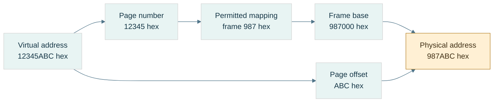

**Read the figure:** assume 4-KiB pages, a present mapping, and permitted access. Replace the page identity with its physical frame identity and retain the low 12 offset bits. The arithmetic is $\mathtt{0x987000}+\mathtt{0xABC}=\mathtt{0x987ABC}$. **Limit:** frame 987 is an example mapping, not a prediction about a real process. A TLB caches translations; the data cache holds contents. Neither this translation nor a mapped address establishes C++ object lifetime or valid typed access.

### A fault is a request for intervention, not necessarily a crash

A [[Page faults and demand paging|page fault]] means the current translation/protection state cannot complete the access normally and requires operating-system handling. **Demand paging** supplies backing when first needed. A valid first access may allocate a zero-filled page or load file-backed data, then retry the instruction. Some faults require no disk I/O.

[[Copy-on-write]] lets mappings initially share data; a write that needs a private copy can fault, allocate/copy a frame, update permissions/mapping, and retry. In contrast, an unmapped address or forbidden write may be rejected and reported as a program failure.

Trace the distinction:

```text
access virtual address
→ cached translation available? if not, resolve translation
→ mapping present and access permitted? complete access
→ otherwise invoke fault handling
→ legitimate demand/COW case? establish mapping and retry
→ invalid/prohibited access? report failure
```

This is a teaching model; exact ordering and mechanisms vary. The important separation is **TLB miss ≠ page fault ≠ disk read ≠ program crash**.

[[Memory-mapped files]] connect file-backed storage to a virtual mapping, often lazily. The mapping is not simply “the file in RAM,” and modifying mapped bytes is not automatically proof of crash-durable publication.

### Storage, lifetime, ownership, and placement are different axes

[[Storage duration and object lifetime|Storage duration]] describes how long storage is available. **Object lifetime** describes when a particular object exists in that storage. **Ownership** identifies who is responsible for releasing a resource. **Placement** is where an implementation puts it. They answer different questions.

| Example | Duration / owner | Typical placement, not a language guarantee | Failure to watch |
|---|---|---|---|
| Local scalar | automatic duration | stack slot or register; possibly optimized away | pointer used after lifetime ends |
| Local vector object | automatic object; owns dynamic buffer | small control object separate from allocated elements | reallocation invalidates views |
| Dynamic allocation | lasts until released by owner | allocator-managed region, often called heap | leak, double release, stale pointer |
| Namespace/static object | static duration | data/zero-fill regions when storage is emitted | initialization-order assumptions |
| Thread-local object | thread duration | implementation-managed thread-local storage | use after owning thread/lifetime ends |

A [[Call stack and stack frames|call stack]] conventionally manages nested calls in LIFO order: **last in, first out**. A **frame** holds return information, saved state, spill slots, and some locals. A **spill** is a value stored to memory when it cannot remain in a register. Downward stack growth is a convention, not a universal law. Returning a pointer to a local does not preserve the local's lifetime just because its old bytes remain.

[[Dynamic allocation and heap|An allocator]] divides larger memory regions into blocks for requests with variable lifetimes. **Metadata** is bookkeeping about those blocks. [[Allocator fragmentation|Internal fragmentation]] is unused capacity inside an allocated block: requesting 37 bytes in a 48-byte size class leaves 11 bytes of slack. **External fragmentation** is separated free space that cannot satisfy a particular contiguous request: two free 16-byte holes are not necessarily a usable 24-byte block. Total free bytes alone do not determine allocation success.

[[Static storage and initialization|Static data]] commonly separates initialized writable data from zero-fill regions such as BSS. **BSS** is a conventional zero-initialized-storage region name; the executable need not contain one literal zero byte for every byte that will be zero-filled. Static duration does not mean initialization has no runtime work.

[[Read-only data and code|Text]] conventionally names instruction storage; read-only regions often hold literals/constants. These region names and exact layouts are platform choices. `const` is a C++ access/type constraint, not a command to put every const local in read-only memory. Modifying a string literal is undefined behavior. **W^X**, writable-or-executable policy, restricts mappings that are simultaneously writable and executable; details vary by platform. [[ASLR]], address-space layout randomization, varies mapping locations, so a textbook memory diagram is not a fixed address map.

[[Ownership and non-owning views|A span]] is a non-owning view of elements; it neither copies the buffer nor extends its lifetime. If the owner dies or the vector reallocates, the view can dangle. **Dangling** means it refers to storage/object state no longer valid for that access.

Finally, [[Atomic publication and durability|atomic publication]] makes a replacement visible as one namespace operation under the relevant platform contract. **Durability** means the required data survives a crash under a defined persistence protocol. Correct byte encoding, atomic replacement, and durable storage are three separate checks.

### Memory laboratory and teaching checkpoint

Use the code companion to run three experiments: byte-order round trips including unaligned *byte-buffer offsets*; checked numeric alignment; and reported object offsets/sizes. Unaligned byte decoding is not permission to make misaligned typed accesses.

Then classify these failures before fixing them:

| Observation | First distinction to investigate |
|---|---|
| `0x12345678` comes back as `0x78563412` | byte-order contract |
| An array member becomes misaligned | record stride, padding, ABI |
| A first access faults but then succeeds | valid demand/COW handling |
| A span fails after vector growth | ownership and invalidation |
| A complete file disappears after a crash | persistence protocol, not just serialization |

For a teaching demonstration, draw byte addresses, record padding, and page translation separately before connecting them. Ask the learner to derive the 12-byte record, explain why the page offset stays `ABC`, and distinguish a TLB miss from a fault. Further proof and tested code remain in [[Continuous Notes/Computing Foundations - From Bits to C++ and Systems APIs#M003 - Byte order, layout, and translation|the derivation companion]] and [[Supplementary/Code Snippets#M003 - Explicit byte codecs and checked alignment|the code companion]].

## Bytes become a durable agreement

An object's native bytes belong to one program environment. A file must carry enough agreement for a reader on another day or machine. We separate copying a representation, specifying the external schema, validating a parser, detecting changed content, and interpreting a dump.

### Representation copying and numeric conversion answer different questions

A value is now chosen, but the file needs bits. [[Bit casting and representation|Bit casting]] copies a suitable object representation into another same-sized trivially copyable type; **numeric conversion** asks for a value in a new numeric domain.

On the checked binary32 host, converting `1.0f` numerically to uint32 gives 1. Copying its representation with `std::bit_cast<uint32_t>` gives `0x3F800000`. Neither operation changes the memory address order by itself. Encoding that integer word little-endian gives `00 00 80 3F`; big-endian gives `3F 80 00 00`.

The C++ constraints include matching size and trivially copyable source/destination, but padding, invalid target representations and uninitialized storage still require care. The [bit-cast draft section](https://eel.is/c++draft/bit.cast) is a current working draft; this lab uses a C++23 baseline and fully initialized scalar representations, not arbitrary-class reinterpretation.

Accessing a float through a uint32 pointer does not become valid because the pointer sizes match. Copy bytes using bit_cast or an appropriate memcpy into an existing suitable object; then apply the external byte-order codec. Neither grants arbitrary typed access to a byte buffer.

**Book bridge:** Game Engine Architecture, PDF pages 129–130 (printed 107–108), explains why members must be endian-converted field by field. It also shows older pointer/union-punning techniques. We retain the field-contract insight, not those techniques as a portable modern C++ implementation.

### A file is a promise to a reader you have not met yet

[[Binary format contracts|A binary format contract]] declares field widths/order, integer signed interpretation, byte order, float format, valid values, lengths, padding, versioning, and any integrity coverage. An **ABI** tells compiled components how native objects interact; an external schema is a different agreement. Saving a whole struct makes its layout/padding/platform assumptions part of the file unless you explicitly constrain and validate them.

**Magic** is a fixed identifying byte sequence, not a secret. **Version** selects a declared schema revision. They do not authenticate a sender, detect every payload change, or validate dimensions. A **payload** is the represented content after or within the container's metadata. A file's offsets are positions in that byte sequence, not automatically live pointers.

The NanoQuant source excerpt describes a regular tensor header with eight magic bytes, uint32 version, uint64 rows and uint64 columns: 28 bytes when written field by field. Its scalar helper writes native bytes, and its payload writes native floats. This is a source-reported portability risk, not a fresh audit of the repository. A clear field order can coexist with unspecified cross-endian behavior.

A portable teaching format can explicitly choose little-endian integers and IEEE binary32 words. It must additionally state whether it preserves all zero/NaN encodings or canonicalizes them. A checksum/hash over bytes sees different NaN payloads as different content; a numeric equality policy can see two zeros as equal. Decide the identity contract first.

For an INT4 container, the source reports 52 header bytes followed by binary32 scales and packed codes. Verify scale count against dimensions/group size, code count against shape, finite positive scales where required, and the final padding convention. A magic match is not permission to trust every following field.

### Validate lengths before performing the arithmetic they request

[[Checked binary parsing|Parsing]] is interpreting an encoded sequence under a schema. An untrusted file can contain dimensions chosen to make a size calculation wrap. “Check the final size” is too late if you computed the wrong wrapped size.

For uint64 factors $a,b$, validate $a=0$ or $b\le\mathrm{MAX}/a$ before multiplying. For a byte span of size $L$, check $o\le L$ and $n\le L-o$ before a read. For payload bytes $P$ after header $H$, first require $H\le L$, then compare $P$ with $L-H$. Check representability in size_t and a practical resource limit before allocating.

A declared maximum tensor size is a **resource limit**: a policy limiting memory/time even if the mathematical shape fits uint64. Reject zero dimensions if the format disallows them. Decide whether trailing bytes are an error, an extension, or another record; the teaching parser requires exact length.

A file mapping avoids a copying decode loop only when its representation, alignment, bounds, permissions and object-access/lifetime rules permit that use. Offset 28 being divisible by four addresses only one condition under a conventional page-aligned mapping and four-aligned float. It does not alone create a C++ float array, normalize endianness, validate its length, or extend the mapping's lifetime.

### Correct decoding is not proof that the bytes survived

[[Checksums CRCs and hashes|Integrity]] asks whether content matches a declared reference. An additive checksum $\sum_i b_i\bmod256$ cannot distinguish `01 02` from `02 01`; equal and opposite byte changes also cancel.

A **CRC**, cyclic redundancy check, treats a bit sequence as coefficients of a polynomial over **GF(2)**, the two-element field where addition/subtraction are XOR. Dividing a shifted message polynomial by a generator leaves a remainder. A specified CRC includes polynomial, initialization, bit reflection/order, final XOR, and covered byte range. “CRC32” alone is incomplete. Error-detection guarantees depend on those parameters and message length; it is not an adversarial authentication mechanism.

The lab implements CRC-32/ISO-HDLC: reflected polynomial `0xEDB88320`, initial all ones, final XOR all ones, reflected byte processing. The independent check string `123456789` must give `0xCBF43926`. [RFC 1952's CRC sample](https://www.rfc-editor.org/rfc/rfc1952#section-8) provides an independent algorithm reference for this reflected convention. This is an error-detection demonstration; no CRC field is retroactively claimed to exist in NanoQuant's source format.

A **hash** maps content to a fixed-size digest. Noncryptographic hashes prioritize fast useful fingerprints; a **cryptographic hash** has security goals such as making preimage/collision search impractical. A **preimage** is an input producing a specified digest. A **collision** is two different inputs with the same digest. A **threat model** declares which mistakes or adversary actions the system intends to resist.

[[Integrity and authenticity|Even a cryptographic digest is not authenticity]] by itself if an attacker can replace both file and digest. A trusted digest, a **MAC** (message authentication code under a secret key), or a **digital signature** verified under a trusted public key supplies an additional trust mechanism. SHA-256 is defined in [NIST's Secure Hash Standard](https://csrc.nist.gov/pubs/fips/180-4/upd1/final); this lab does not implement a cryptographic hash, MAC, or signature.

All finite digests have collisions for unrestricted input lengths: there are more possible messages than digest values. For an ideal $h$-bit hash, a *specific independent* accidental match has probability about $2^{-h}$; among many samples, birthday-style collision risk grows with the number of pairs. Those are models, not guarantees for arbitrary checksum algorithms.

Specify coverage: payload only, header plus payload, or canonical logical content. If dimensions are unprotected, a changed shape can reinterpret an unchanged payload. State how the digest field itself is excluded or zeroed for calculation. Integrity, schema validity, semantic correctness, authenticity, atomic publication and crash durability remain separate questions.

### Read a dump by reversing the contract

[[Memory dump interpretation|A hex dump]] displays byte offsets, hexadecimal octets, and optionally printable characters. It does not label a region as an object or prove that typed access would be legal. Establish a trusted schema hypothesis, validate it, then decode.

Our source-shaped demonstration chooses explicit little endian and a 2×3 binary32 payload $[1,-2,0.5,3.25,0,10]$:

| Offset | Bytes | Interpretation under this schema |
|---|---|---|
| 0000 | 4E 51 54 4E 53 52 30 31 | ASCII magic NQTNSR01 |
| 0008 | 01 00 00 00 | uint32 version 1 |
| 000C | 02 00 00 00 00 00 00 00 | uint64 rows 2 |
| 0014 | 03 00 00 00 00 00 00 00 | uint64 columns 3 |
| 001C | 00 00 80 3F | word 3F800000, value 1 |
| 0020 | 00 00 00 C0 | word C0000000, value −2 |
| 0024 | 00 00 00 3F | word 3F000000, value 0.5 |
| 0028 | 00 00 50 40 | word 40500000, value 3.25 |
| 002C | 00 00 00 00 | positive zero |
| 0030 | 00 00 20 41 | word 41200000, value 10 |

Header length is 28 (hex 1C), payload length $2(3)(4)=24$, and total length 52 (hex 34). ASCII, American Standard Code for Information Interchange, maps these selected byte values to characters; it is not a universal text decoder for every file.

Decode the first payload word: sign 0, exponent 127, fraction zero give $1\cdot2^0=1$. For `40500000`, exponent 128 gives scale two; fraction gives $1.101_2=1.625$, so value is 3.25. For `41200000`, exponent 130 and significand 1.25 give 10. All six payload values can be checked independently against the diagram.

The same `00 00 80 3F` bytes are unsigned octets [0,0,128,63], little-endian uint32 1065353216, or binary32 1. As two little-endian uint16 fields they give [0,16256]. None is “the meaning” without an interpretation contract.

Flip payload byte 80 to 00: binary32 1 becomes 0.5 while file length, version and magic stay plausible. Structural validation does not detect this numeric substitution. An independently stored CRC over the original bytes distinguishes this particular change, but matching CRC is not proof that every possible corruption or attack was excluded.
## The complete journey - Encode, compute, store, and investigate

Return to the lamp at the beginning. Its physical ranges became a logical bit; a group of bits acquired a schema. A count became an unsigned integer, a direction needed signed values, and fractions forced a choice between a fixed and stretching ruler. Arithmetic exposed finite range, rounding and sensitivity. Smaller codebooks traded recoverable detail for storage. Placement then added addresses, alignment, mappings and lifetime. Serialization made an external promise; integrity and debugging let us investigate whether that promise survived.

Take one weight −3.2 at scale one. Quantization chooses signed level −3, offset coding gives nibble 5, pairing with code 11 gives byte B5. A file must also preserve the scale, shape, packing order and count. The parser validates these, unpacks 5 and 11, subtracts eight, and reconstructs −3 and 3. Packing and parsing can be exact while the original −3.2 is not recovered. That loss happened upstream, by design.

For teaching, reconstruct one route completely before comparing it to another. Use the diagrams and hand traces here, the derivation companion for proofs, and the code companion for observable checks. The coverage ledger records where source material came from; it is not the order in which someone must teach.

### A laboratory that tests the contracts, not just matching functions

The cumulative program retains the earlier fields, ALU, byte-layout, floating representation and arithmetic experiments. Its new laboratory adds:

- Fixed conversion of 3.25 to raw 212992; feasible range/step choices; positive/negative ties; multiplication/division, zero-divisor and destination-overflow rejection.
- INT4 nibble pairs against independent expected bytes, odd counts and invalid codes; group reconstruction and outlier-induced zeros.
- UNORM/SNORM endpoints; binary16 decoding; BF16 midpoint conversion, zeros, infinities and canonical NaN handling.
- The complete 52-byte 2×3 image against a manually specified byte array, decode from an odd byte-buffer offset, and raw special-value word preservation.
- Wrong magic/version, truncated files, enormous wrapped-shape attempts, zero dimensions, resource-limit rejection and trailing bytes.
- CRC check string, additive-checksum collision, and the one-payload-bit example that structural checks miss.

Property-style checks supplement these examples: all 256 nibble pairs; every finite binary16 and BF16 word reconstructed/re-encoded under the lab's stated conventions; a seeded set of fixed products checked against an independent reference; and bit/byte corruption checks on the finite teaching image. Their finite scopes are explicit; they are not exhaustive validation of every C++ program, device, parser or cryptographic protocol.

### Diagnose the layer before changing the implementation

| Observation | First hypothesis to test |
|---|---|
| A count becomes negative when its high bit changes | signed versus unsigned interpretation |
| Fixed multiplication fails only at large operands | intermediate width before rescaling |
| Small weights vanish beside one outlier | calibration/codebook resolution, not packing |
| Byte 128 samples near 0.502 | expected UNORM8 reconstruction |
| A half-format value becomes infinity | range versus precision allocation |
| Repeated updates disagree | rounding tree, persistent narrowing, or mathematically history-dependent policy |
| A file swaps 12345678 into 78563412 | byte-order mismatch |
| A plausible same-size file contains a changed value | integrity coverage, not merely structural validation |
| A pointer reaches mapped memory but is invalid | object bounds, lifetime, alignment and permitted access |

A useful future experiment changes one representation policy while holding input/task constant: vary group size, record actual bytes including metadata, error metrics and a task result, then separately measure execution time under a declared machine/build. Those experiments are proposed, not performed in the teaching merge.

The next subject is C++'s object model: how declarations and definitions turn into a program, how names and objects acquire identity, and how lifetimes and value categories constrain use. The bytes learned here are necessary evidence, but they are not the whole language contract.


## Reading provenance and enrichment

The supplied M001–M006 texts define the accepted curriculum content. Explanatory bridges, original traces, and the prologue were added to make that content teachable. Sources below inform the explanation; they are not reproduced as textbook passages. All source-reported repository findings remain source-reported claims; independent wording checks, canonical-code tests and merge corrections are recorded in Sources and Code Anchors.

- **Integrated 180-chunk planning PDF**, page 15: M001–M006 cover Parts 1–100 with exact ranges retained in the coverage ledger. Pages 16–17 divide C++ Parts 101–300 into twelve chunks across two phases. The PDF is a planning reference, not an instruction source.
- **Game Engine Architecture**, iCloud `Game/Game Engine Architecture.pdf`, PDF pages 127–130 (printed 105–108), 136–138 (114–116), and 143–147 (121–125): byte order, memory regions, layout and alignment. Its older machine-specific examples are not universal rules; this volume states layout assumptions and separates language validity from hardware behavior.
- **Bjarne Stroustrup, A Tour of C++ (2014)**, iCloud `CPP/A Tour of C++ - Bjarne Stroustrup (Addison-Wesley, 2014)(193p).pdf`, PDF pages 16–22 (printed 5–11): types, arithmetic, narrowing, scope, pointers and references. Used for teaching structure, not as authority for every current C++23 detail.
- Local course notes **Part 1: CPU — From Electricity to Working CPU**, PDF pages 2–6, and **Part 7: Virtual Memory, Page Tables, TLBs, Page Faults**, pages 1–6, in iCloud `MATHCPUGPU`: secondary background for physical/logical state and translation. These are course notes, not claimed as independently verified textbook authority.
- History: [Computer History Museum's Buchholz entry](https://www.computerhistory.org/tdih/october/24/) and [IBM's System/360 history](https://www.ibm.com/history/system-360). The prologue gives a short contextual history, not an exhaustive claim about the first binary machine or first eight-bit design.
- C++ language checks: the linked draft sections in the story, plus [storage duration](https://eel.is/c++draft/basic.stc) and [endianness facilities](https://eel.is/c++draft/bit.endian). Platform layout values remain observations to measure, not draft guarantees.

Exact source records, code commands and verification limitations are maintained in [[Supplementary/Sources and Code Anchors]]. Existing longer traces remain reusable in [[Supplementary/Worked Traces]]; none is required to supply a missing foundational explanation in this volume.

- **Additional book enrichment:** Game Engine Architecture, PDF pages 121–122 (printed 99–100), and 129–130 (107–108), read during the narrative rewrite. The scaled-integer versus sign/magnitude distinction, field-by-field serialization insight, and outdated punning caveats are explained at their points of use. The page 122 figure/body discrepancy is not silently inherited.


> Volume 02 · accepted sources M007–M010, Parts 101–160 · 4 of 12 planned chunks (M007–M018, planned Parts 101–300). The revised M007 deepens existing coverage; it is not counted twice. This is a growing subject narrative, not a completed C++ course. Coverage beyond Part 160 remains pending.

## Prologue - Bytes need rules before they become a program

The previous volume taught us to encode, calculate, place and preserve information. Now ask why a buffer full of plausible bits can still be illegal to access in C++. Hardware can calculate an address; the language must establish what object exists there, which operation its type permits, and whether its lifetime is still active. A compiler optimizes against those rules, not against our hope that the bits look right.

C++ grew from C's low-level facilities while adding user-defined types and abstraction. It keeps separate compilation: a caller can know an interface without compiling every implementation into the same source file. That choice creates our first problem—how independently processed files agree about names and entities. Once they agree, a second problem begins—how the resulting process creates, uses and destroys objects. Layout is where those two stories finally meet the bytes again.

An **entity** is a language-level thing such as a type, function, object or template. An **object** has storage, type, lifetime and state; a function is an entity but not an object. A **variable** is introduced by a declaration of an object or reference; a reference is not itself an object. A **type** establishes a set of possible values and permitted operations. The **abstract machine** is the language's behavioral model; a real compiler may rearrange or remove physical storage when the required observable behavior is preserved.

This volume keeps independent examples inline. Short `cpp` fragments illustrate a local rule and may rely on the named surrounding declarations; they are not all independent programs to concatenate. Complete runnable examples are explicitly marked as laboratories. Project excerpts remain in the existing companion. We will revise and weave the whole twelve-source volume as the later material arrives; no numbered part is a teaching chapter.

## What we bring from the byte story

this opening chapter assumes M001, M003, and M005. That means I will assume you already understand bits/bytes and integer representations; addresses, alignment, padding, memory regions and virtual address spaces; and floating-point representation/error. The three prerequisite ideas you specifically need active in your head are:

| Dependency | What this opening chapter needs from it |
|---|---|
| M001 | A value ultimately has some machine representation in bits, but the **type** determines what those bits mean. |
| M003 | An address names a location in an address space; objects have alignment requirements; structures may contain padding. |
| M005 | `float`/`double` are machine representations with implementation/platform properties, not mathematical real numbers. |

Now we add the missing layer:

> **C++ is not a language where “variables are bytes in RAM.” C++ defines entities, objects, lifetimes, types, storage, identities and permitted operations. The compiler maps that abstract machine onto bytes and instructions.**

That distinction is the heart of Phase 2.

## The journey from text to a live object

Think of this opening chapter as this pipeline:

```text
SOURCE TEXT
    │
    ├── preprocessing / module dependency processing
    │
    ▼
C++ TRANSLATION UNIT / MODULE UNIT
    │
    ├── declarations establish names and types
    ├── lookup determines what names mean
    ├── definitions provide complete entities
    ├── ODR determines which definitions may coexist
    │
    ▼
COMPILER
    │
    ├── type checking
    ├── template instantiation
    ├── semantic analysis
    ├── optimization
    ├── code/data generation
    │
    ▼
OBJECT FILES
    │
    ├── machine code
    ├── symbols
    ├── relocation records
    ├── static data
    │
    ▼
LINKER
    │
    ├── resolves symbols
    ├── lays out executable sections
    ├── fixes references/relocations
    │
    ▼
EXECUTABLE / SHARED LIBRARY
    │
    ▼
RUNNING PROCESS
    │
    ├── storage becomes available
    ├── objects begin lifetime in that storage
    ├── names/references/pointers may designate objects
    ├── objects have identities and representations
    ├── class layouts determine member locations
    │
    ▼
OBJECT LIFETIME ENDS
    │
    └── storage may disappear OR may remain/reuse
```

The critical distinctions we will maintain throughout the chunk are:

| Concept | Question it answers |
|---|---|
| **Scope** | Where can this *name* be found? |
| **Name lookup** | Given this spelling here, which declaration does it refer to? |
| **Linkage** | Can declarations in different places denote the same entity? |
| **Storage duration** | For how long does the storage exist? |
| **Object lifetime** | During what interval does a typed object actually exist in that storage? |
| **Identity** | Which particular object is this? |
| **Address** | Where is it currently located? |
| **Value** | What state does it currently contain? |
| **Layout** | Where do its members/bytes occur relative to one another? |
| **Module visibility/reachability** | Which declarations can an importer see/use? |

These are **not synonyms**. Most difficult C++ bugs happen because two of them are mentally collapsed into one.

## Giving a program a buildable shape

### Figure CPP-01 - Two build lanes meet at the linker

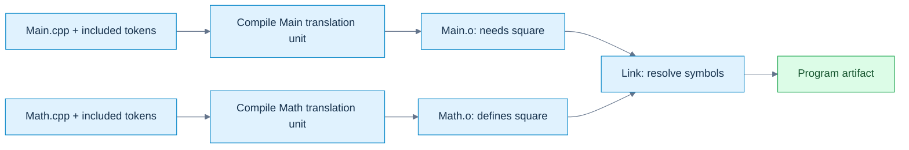

**Read the picture:** the caller compiles against a declaration; the linker connects its unresolved call to the separately supplied definition. A missing declaration/type normally fails during translation; a missing required definition commonly fails at linking. **Limit:** this depicts the traditional example below, not a mandatory compiler implementation. Modules additionally need interface dependency ordering; a successful link does not prove ODR or runtime correctness. [[Visual Recall/02 - C++ - Objects, Ownership and Lifetime - Visual Recall#Four figure briefs|Recall this figure]].

The classic separate-compilation model lets clients compile against an interface while implementations are compiled separately. That sentence sounds elementary. The implications are not.

### The traditional translation model

Suppose you have:

```cpp
// Math.hpp
#pragma once

float square(float x);
```

```cpp
// Math.cpp
#include "Math.hpp"

float square(float x)
{
    return x * x;
}
```

```cpp
// Main.cpp
#include "Math.hpp"
#include <iostream>

int main()
{
    std::cout << square(3.0f) << '\n';
}
```

A simplified build is:

```text
Math.cpp
   │ preprocess
   ▼
Math translation unit
   │ compile
   ▼
Math.o
                         ┐
                         │
Main.cpp                 │
   │ preprocess          │
   ▼                     │
Main translation unit    ├── linker ──> executable
   │ compile             │
   ▼                     │
Main.o                   ┘
```

The classic separate-compilation model lets clients compile against an interface while implementations are compiled separately. Conceptually, commands might look like:

```bash
clang++ -std=c++23 -c Math.cpp -o Math.o
clang++ -std=c++23 -c Main.cpp -o Main.o
clang++ Main.o Math.o -o app
```

The first two commands **compile** independently. The third **links**. That distinction explains two major categories of errors.

### Compile-time error

```cpp
int main()
{
    UnknownType x;
}
```

The compiler cannot establish the semantics of the [[Translation units and linking|translation unit]].

### Link-time error

```cpp
int f(int);   // declaration

int main()
{
    return f(10);
}
```

This can compile perfectly. The compiler knows:

```text
f:
    accepts int
    returns int
```

It can generate a call instruction containing a symbol reference. But if nobody defines `f`, the linker eventually sees:

```text
Main.o needs symbol f(int)
No object/library provides symbol f(int)
```

and reports something like:

```text
undefined reference to f(int)
```

or Apple's equivalent:

```text
Undefined symbols for architecture arm64
```

That is why “my code compiled” and “my program built” are not identical statements.

### What preprocessing actually is

In traditional source code:

```cpp
#include "Math.hpp"
#define COUNT 16
#if DEBUG_MODE
...
#endif
```

these are processed before normal C++ semantic analysis. The [[Preprocessing and macro boundaries|preprocessor]] largely manipulates **tokens**, not C++ types. If you write:

```cpp
#define SQUARE(x) x * x
```

then:

```cpp
SQUARE(a + b)
```

may become:

```cpp
a + b * a + b
```

not:

```cpp
(a + b) * (a + b)
```

The preprocessor does not think:

> “I am invoking a mathematical function.”

It performs token replacement. Even the safer macro:

```cpp
#define SQUARE(x) ((x) * (x))
```

still has:

```cpp
int i = 3;
int result = SQUARE(++i);
```

which expands conceptually into:

```cpp
((++i) * (++i))
```

and now you have duplicated evaluation and undefined behavior here: the two increments are unsequenced relative to each other. Modern C++ tries to move as much work as possible out of the preprocessor and into typed language mechanisms:

```cpp
constexpr int square(int x)
{
    return x * x;
}
```

That gives type checking, scope, debugger visibility, normal evaluation rules, and compiler diagnostics.

### What `#include` really means

A traditional include is approximately textual inclusion.

```cpp
#include "Vector.hpp"
```

does not mean:

> “Dynamically connect to an independently existing Vector interface.”

Conceptually it means:

```text
Take tokens from Vector.hpp
insert them here
continue preprocessing
```

If twenty `.cpp` files include a 20,000-line template header, the frontend may process much of that interface twenty times. This is one major reason C++ build systems became expensive. Header guards:

```cpp
#ifndef VECTOR_HPP
#define VECTOR_HPP

// declarations

#endif
```

or:

```cpp
#pragma once
```

prevent repeated inclusion **within a translation unit**. They do **not** solve program-wide ODR mistakes. That distinction becomes important in the connected explanation.

### What compilation produces

An object file usually contains much more than raw instructions:

```text
.text        machine instructions
.rodata      constants/read-only data
.data        initialized writable static data
.bss         zero-initialized static data, conceptually
symbols      names known to the linker
relocations  places the linker must repair
debug info   when requested
unwind info
metadata
```

Exact sections depend on the object format:

```text
ELF      Linux and many Unix-like systems
Mach-O   macOS/iOS
COFF/PE  Windows
```

The C++ standard does not prescribe those formats. They are platform/toolchain concerns.

### What the linker actually does

Suppose `Main.o` contains a call to `square(float)`. The compiler does not necessarily know the final numerical address of `square`. It can emit something conceptually like:

```text
CALL <square symbol>
```

with a relocation record saying:

```text
When the final binary is laid out,
replace this placeholder with whatever address/offset
square ends up at.
```

The linker builds the final symbol graph:

```text
Main.o:
    requires square(float)

Math.o:
    defines square(float)

resolve
    ↓

Main call → Math definition
```

It also discovers impossible programs:

```text
Main.o needs f()
No definition
```

or:

```text
A.o defines x
B.o defines x
Both claim the same externally-linked entity
```

That second case takes us directly into the ODR.

### Name mangling

C++ supports:

```cpp
void process(int);
void process(float);
void process(const char*);
```

The machine linker does not understand C++ overload resolution. Therefore the compiler commonly encodes type information into symbol names. Conceptually:

```text
process(int)          → some mangled symbol A
process(float)        → some mangled symbol B
process(char const*)  → some mangled symbol C
```

The exact scheme is ABI-specific. This is why two compilers—or two versions configured with incompatible ABIs—can sometimes fail to link even when the C++ source-level declaration “looks identical.” It also explains why `extern "C"` exists:

```cpp
extern "C" void vulkan_callback(...);
```

It selects C language [[Linkage and entity ownership|linkage]], typically suppressing normal C++ name mangling for interoperability. Full C/C++ ABI interoperation comes later, but the root begins here.

## A compiled interface rather than repeated text

A named [[C++ modules and reachability|module]] communicates declarations through a compiler-produced interface. A **module unit** is a translation unit belonging to a module; an **interface unit** supplies its public interface. A **BMI** is a binary module interface: compiler-specific semantic information, not a portable object-file format. It helps the importer compile; an object file supplies code/data for linking. Supplying one does not substitute for the other.

`module;` starts a **global module fragment**, where traditional includes can appear before `export module Math;`. An export declaration exposes declarations to importers. Some implementation details must be reachable for interpreting an exported type or template without becoming freely findable by ordinary [[Scopes and name lookup|name lookup]]. Visibility (finding a declaration) and reachability (using its semantic information) are related, not identical.

A named-module import does not textually paste a header and generally does not import its macros. Header units are different: they can make macros available. Build order must make a suitable compiled interface available before compiling importers. Compiler options and versions must match the toolchain's compatibility requirements. The exact BMI construction and naming are build-system matters; never teach a PCM as a cross-compiler interchange format. The complete standalone Math example appears under **Following one call through the build** below. Project-specific Kairo fragments belong in [[Supplementary/Code Snippets#Source-reported C++ project excerpts|the project excerpt companion]], not in this independent example.

### Modules versus `#include`

This distinction matters enormously:

```cpp
#include "foo.hpp"
```

is essentially preprocessing/textual inclusion.

```cpp
import foo;
```

means the compiler imports a module interface. The importer generally does not receive arbitrary macros from the imported module. That is deliberate. Macros are preprocessing state. Modules try to give you a language-level dependency boundary. This helps with:

```text
build scalability
macro isolation
interface ownership
dependency correctness
ODR hygiene
```

You will study modules much more deeply in the later generic-programming chapters, but this opening chapter gives you the underlying translation reason they exist.

## Promises become definitions

This distinction must become instinctive. Consider:

```cpp
int f(int);
```

This tells the compiler:

```text
There exists an entity named f.
It is a function.
Parameter: int.
Result: int.
```

It does not say how `f` works. That is a **declaration**. Now:

```cpp
int f(int x)
{
    return x * 2;
}
```

This provides the function body. That is a **definition**. And because it also introduces/describes the function, every definition is also a declaration.

### Objects

```cpp
extern int frameCount;
```

declaration only. Somewhere:

```cpp
int frameCount = 0;
```

definition. The definition causes the program to have an object named `frameCount`. An interesting special case:

```cpp
extern int frameCount = 0;
```

Despite `extern`, the initializer makes this a **definition**. Do not memorize `extern = declaration`. Understand the rule.

### Classes

```cpp
struct Renderer;
```

declares an incomplete class type. The compiler knows:

```text
Renderer is a type.
```

It does not yet know:

```text
sizeof(Renderer)
members
alignment
complete layout
```

So this works:

```cpp
Renderer* renderer;
Renderer& getRenderer();
```

because these declarations do not require a complete Renderer. A reference need not be implemented as a separate pointer-sized object. This does not:

```cpp
Renderer renderer;
```

because the compiler must know how much storage the object requires. Later:

```cpp
struct Renderer
{
    int width;
    int height;
};
```

defines it. This is why forward declarations reduce compile dependencies.

### Enumerations

This is legal:

```cpp
enum class TextureState : std::uint8_t;
```

This opaque enum declaration fixes the underlying type and makes the enum a complete type, despite not yet listing its enumerators. Unlike a forward-declared class, its size is already known. Later:

```cpp
enum class TextureState : std::uint8_t
{
    Unloaded,
    Loading,
    Ready,
    Failed
};
```

defines it.

### Templates complicate the old declaration/implementation split

You may think:

```cpp
// Header
template<class T>
T add(T, T);

// cpp
template<class T>
T add(T a, T b)
{
    return a + b;
}
```

works like a normal function. Usually it does not for arbitrary `T`. When another translation unit instantiates:

```cpp
add<float>(1.f, 2.f)
```

the compiler typically needs the template definition available. That is one reason templates traditionally live in headers. Modules give us a better distribution mechanism, but template instantiation semantics still exist. We will go fully into this during the later generic-programming chapters.

## Many files must describe one coherent program

The **[[One Definition Rule|One Definition Rule]]**, ODR, is where declarations, translation units and linking meet. Suppose we allowed:

```cpp
// A.cpp
int gravityScale()
{
    return 2;
}
```

and:

```cpp
// B.cpp
int gravityScale()
{
    return 17;
}
```

and both are meant to be the same externally linked function. Now:

```cpp
gravityScale()
```

has no coherent program meaning. Which definition is *the function*? The ODR prevents this semantic fracture.

### The common program-wide rule

For ordinary non-`inline`, non-template externally linked functions/objects, you want a single program definition. For example:

```cpp
// Renderer.hpp

extern int gFrameIndex;
```

```cpp
// Renderer.cpp

int gFrameIndex = 0;
```

Every user may see the declaration. Exactly one implementation file owns the definition.

### The classic header mistake

Bad:

```cpp
// Config.hpp

int gDebugMode = 1;
```

Then:

```cpp
// Renderer.cpp
#include "Config.hpp"
```

and:

```cpp
// Physics.cpp
#include "Config.hpp"
```

Textual inclusion creates conceptually:

```text
Renderer translation unit:
    int gDebugMode = 1;

Physics translation unit:
    int gDebugMode = 1;
```

Now there are two definitions. Header guards do not save you. They prevent:

```text
Config.hpp
Config.hpp
Config.hpp
```

from being processed repeatedly **inside the same translation unit**. They do not stop a different translation unit from independently receiving the definition.

### Two modern solutions

One traditional solution is:

```cpp
// Config.hpp
extern int gDebugMode;

// Config.cpp
int gDebugMode = 1;
```

A C++17+ solution, when a genuine globally accessible variable is appropriate:

```cpp
inline int gDebugMode = 1;
```

An inline variable may have equivalent definitions in multiple translation units under the ODR rules. Important:

> `inline` in C++ does not fundamentally mean “the CPU call will be replaced by the body.”

That meaning is historical. The optimizer may inline a function without the `inline` keyword and decline to inline one with it. At the language level, `inline` is substantially about **multiple definition semantics and entity identity**.

### Why class definitions may live in headers

The multi-translation-unit exceptions have conditions, not only matching-looking syntax: matching tokens and relevant name lookup must agree, with specified exceptions. Definitions attached to named modules do not simply inherit the traditional header permission. Some ODR violations require no diagnostic; a successful link is not proof of validity.

You have seen:

```cpp
struct Vec3
{
    float x;
    float y;
    float z;

    float lengthSquared() const
    {
        return x*x + y*y + z*z;
    }
};
```

included by many source files. Why does this not immediately violate the ODR? Because the language specifically permits certain entities—such as class definitions, templates, and inline entities—to have matching definitions in multiple translation units under strict conditions. It is not:

> “ODR means literally every C++ definition can occur once in all source text.”

That would make headers impossible. The deep form is closer to:

> The program must maintain **one coherent definition of an entity**, while the language permits certain equivalent definitions to occur in multiple translation units.

### The evil ODR bug: definitions that look like the same header but aren't

Consider:

```cpp
// Behavior.hpp

inline int behavior()
{
#ifdef FAST_MODE
    return 1;
#else
    return 2;
#endif
}
```

Compile:

```text
A.cpp with FAST_MODE
B.cpp without FAST_MODE
```

After preprocessing:

```cpp
// A translation unit
inline int behavior()
{
    return 1;
}
```

versus:

```cpp
// B translation unit
inline int behavior()
{
    return 2;
}
```

The source filename is the same. The effective definitions are not. You have fractured the ODR. Some ODR violations require no diagnostic. That means:

```text
compiler: okay
linker: maybe okay
program: semantically invalid
```

This is one of C++'s nastier classes of bugs.

### Why modules help

A named module interface is compiled as a module interface rather than textually reconstructed independently in every importer. That removes many opportunities for:

```text
same header + different macro environment = different declaration
```

It does not abolish the ODR, but it gives the compiler a stronger semantic module boundary. This is one reason your move toward `.cppm` in Kairo is technically meaningful rather than merely stylistic.

### Linkage is related to ODR, but is not ODR

Traditional example:

```cpp
namespace
{
    int helper()
    {
        return 42;
    }
}
```

`helper` is translation-unit-private. Another old form is:

```cpp
static int helper()
{
    return 42;
}
```

for a namespace-scope function. Modern C++ usually favors unnamed namespaces for TU-private namespace entities. C++20 modules add an additional idea, **module linkage**, for certain names attached to named modules. So do not reduce linkage to:

```text
internal vs external forever
```

because an illustrative codebase is C++23 and module-based.

## A spelling needs a place and a meaning

Lookup comes before overload resolution: first determine which declarations a spelling finds, then choose among viable candidates. A derived `draw(float)` can hide all base overloads named `draw`, including `draw(int)`; `using Base::draw;` restores those base declarations to the derived overload set. A **candidate** is a function considered for the call; a **viable** candidate satisfies the call's argument constraints. Hiding is not the same as overriding.

The name's point of declaration also matters. In a local `int x=x;`, the right-hand name finds the newly declared local, not a hidden outer `x`. In C++23, reading that local's uninitialized integer value is undefined behavior. This is a bad example to diagnose, not execute; different C++26 uninitialized-value wording must not be silently retrofitted into the C++23 lab.

The classic separate-compilation model lets clients compile against an interface while implementations are compiled separately. The easiest mistake here is believing:

> “scope = lifetime.”

No. Consider:

```cpp
int* p = nullptr;

void f()
{
    static int x = 10;
    p = &x;
}
```

`x` has **block scope**. Its name `x` is inaccessible outside the block. But it has **static [[Storage duration and object lifetime|storage duration]]**, so the object persists until program termination. Scope concerns the **name**. [[Object construction and storage reuse]] explains how lifetime differs from backing storage.

### Block scope

```cpp
void render()
{
    int frame = 10;

    {
        int sample = 4;
    }

    // sample unavailable here
}
```

`sample`'s name belongs to the inner block.

### Name hiding

```cpp
int x = 1;

void f()
{
    int x = 2;

    std::cout << x;    // local x = 2
    std::cout << ::x;  // global x = 1
}
```

The local declaration **hides** the outer declaration. It did not delete the global object. It changed what unqualified lookup finds. This distinction is extremely useful when debugging large engine systems.

### Class scope

```cpp
struct Camera
{
    float nearPlane;
    float farPlane;

    float depthRange() const
    {
        return farPlane - nearPlane;
    }
};
```

Unqualified lookup for:

```cpp
nearPlane
```

inside `depthRange()` finds the class member. The compiler effectively understands it relative to the current object, roughly:

```cpp
this->nearPlane
```

although the language semantics are richer than textual rewriting.

### Namespace scope

```cpp
namespace kairo::render
{
    struct Camera {};
}
```

Outside:

```cpp
kairo::render::Camera c;
```

That is **qualified lookup**. Inside a suitable context:

```cpp
using kairo::render::Camera;

Camera c;
```

you've introduced a declaration into consideration for unqualified usage.

### `using namespace` versus using declaration

This:

```cpp
using namespace kairo::render;
```

makes many names candidates during lookup. This:

```cpp
using kairo::render::Camera;
```

specifically introduces `Camera`. The second is usually less polluting. Putting a broad using-directive in a public textual header alters consumer lookup. Module exports and reachability are not textual inclusion: do not claim every directive in a module automatically leaks into every importer. Prefer narrow declarations and explicit qualification at public boundaries.

### Argument-dependent lookup — ADL

Suppose:

```cpp
namespace math
{
    struct Vec3 {};

    float Dot(Vec3, Vec3);
}
```

Then:

```cpp
math::Vec3 a;
math::Vec3 b;

float d = Dot(a, b);
```

may find `math::Dot` even though you did not write:

```cpp
math::Dot
```

Why? Because arguments belong to namespace `math`, and **argument-dependent lookup** considers associated namespaces/classes. This is central to idiomatic generic C++. For example, this pattern:

```cpp
using std::swap;
swap(a, b);
```

allows normal lookup to see `std::swap` while [[Argument-dependent lookup|ADL]] can discover a type-specific `swap` in the type's own namespace. We will revisit this deeply during templates because template name lookup creates another dimension: some names are looked up when the template is defined, while dependent names may participate in lookup at instantiation.

### Modules add visibility/reachability, not a replacement for scopes

Your module contains:

```cpp
export module Kairo.ECS.Entity;

export namespace kairo::ecs
{
    struct Entity { ... };
}
```

Then a consumer can:

```cpp
import Kairo.ECS.Entity;

kairo::ecs::Entity e;
```

There are two separate questions:

```text
Is Entity exported/reachable from this module?
```

and:

```text
Given "kairo::ecs::Entity", which declaration does lookup find?
```

Modules affect availability. Scopes and lookup still determine meaning.

## A name does not decide how long storage lasts

Now we enter the part of C++ that unlocks pointers, RAII and ownership. **Storage duration is about storage.** It answers:

> How long is the region capable of containing this object retained?

The four major categories are:

| Storage duration | Typical source | Lifetime of storage |
|---|---|---|
| automatic | ordinary block local / parameters | associated block/call execution |
| static | namespace objects, local `static`, static data members | entire program |
| thread | `thread_local` — [[Thread-local storage]] | duration of the corresponding thread |
| dynamic | allocation functions / `new` | until explicitly released |

Do not automatically translate those into:

```text
automatic = stack
dynamic = heap
```

Those are common implementation strategies. The language specifies **semantics**, not a mandatory physical memory architecture.

### Automatic storage duration

```cpp
void update()
{
    Entity e;
}
```

`e` normally has automatic storage duration. A typical implementation reserves its storage in the function's stack frame. Conceptually:

```text
enter update
    reserve/identify storage for e
    construct e
    use e
    destroy e
    storage ceases to be reserved for e
leave update
```

The optimizer can eliminate the physical stack slot altogether if observable program behavior remains equivalent. So saying:

> “A local variable is on the stack”

is often practically useful, but **not the C++ semantic definition**.

### Static storage duration

Namespace object:

```cpp
int frameCount = 0;
```

has static storage duration. So does:

```cpp
void f()
{
    static int calls = 0;
    ++calls;
}
```

The *name* `calls` has block scope. The *storage* persists for the whole program. The local static is initialized the first time execution reaches its declaration, unless it can undergo earlier initialization under language rules. Since C++11, initialization of a function-local static is synchronized: concurrent first calls do not independently construct multiple copies. That makes patterns like:

```cpp
Renderer& renderer()
{
    static Renderer instance;
    return instance;
}
```

much safer than they were historically. But it does not solve every architectural problem with global state.

### The static initialization order problem

Suppose:

```cpp
// A.cpp
Renderer renderer{device};
```

and:

```cpp
// B.cpp
Device device;
```

If `renderer` needs `device` during dynamic initialization, their initialization order across translation units can be problematic. This is the classic **static initialization order fiasco**. A function-local static can defer construction until actual use:

```cpp
Device& device()
{
    static Device d;
    return d;
}
```

But in engines, an even cleaner design is often explicit ownership:

```text
Engine
 ├── Device
 ├── Renderer
 ├── AssetSystem
 └── PhysicsWorld
```

with deterministic initialization and shutdown order. This will come back hard during RAII and engine architecture.

### `constinit`

C++20 provides:

```cpp
constinit int value = 42;
```

`constinit` requires static initialization. It is useful when you care about avoiding dynamic initialization ordering. Do not confuse it with `const`. This is valid conceptually:

```cpp
constinit int counter = 0;

void increment()
{
    ++counter;
}
```

`counter` can still be mutable. `constinit` concerns initialization timing.

### Thread storage duration

```cpp
thread_local int commandBufferIndex = 0;
```

Each thread gets its own instance. Conceptually:

```text
Thread A:
    commandBufferIndex_A

Thread B:
    commandBufferIndex_B

Thread C:
    commandBufferIndex_C
```

This can be useful for:

```text
per-thread allocators
scratch arenas
profiling state
temporary command-building state
thread-specific random engines
```

But it is not automatically free. TLS access has ABI/runtime costs, and thread-local destructors/initialization can complicate shutdown.

### Dynamic storage duration

```cpp
Entity* p = new Entity{};
```

There are **two objects to reason about**:

```text
p
└── pointer object
    automatic storage duration

*p
└── Entity object
    dynamic storage duration
```

This is one of the first mental separations I want permanently burned in:

```text
pointer lifetime != pointed object's lifetime
pointer storage != pointee storage
```

Then:

```cpp
delete p;
```

ends the `Entity` lifetime and releases its dynamically allocated storage. But:

```cpp
p
```

may still physically contain the old address. The pointer object itself remains alive until its scope ends. Its **value is now dangling**. This is the bridge into the borrowing and invalidation story below.

## Storage is a place; an object is its occupant

This is one of the deepest ideas in C++. Consider a parking space.

```text
storage = the parking space
object  = the particular car currently occupying it
```

You can have:

```text
parking space exists
no car exists
```

or:

```text
parking space exists
Car A lives there
Car A leaves
same parking space remains
Car B arrives
```

The location did not change. The object identity did. That is almost exactly what low-level C++ storage reuse does.

### Raw storage is not automatically a live object of arbitrary type

Consider:

```cpp
#include <cstddef>

alignas(64) std::byte storage[64];
```

You have storage. You do **not** automatically have:

```cpp
Renderer
Texture
Matrix
Entity
```

living in it. Storage has:

```text
address
size
alignment
```

An object adds:

```text
type
lifetime
identity
value/state
language-permitted operations
```

### Construction starts a lifetime

A canonical advanced example:

```cpp
#include <cstddef>
#include <memory>

struct Particle
{
    float x;
    float y;
};

alignas(Particle) std::byte storage[sizeof(Particle)];

Particle* p =
    std::construct_at(
        reinterpret_cast<Particle*>(storage),
        Particle{1.0f, 2.0f}
    );
```

Conceptually:

```text
before construct_at:

storage:
+-----------------------+
| raw bytes             |
+-----------------------+
^
suitably aligned address

no Particle lifetime


after construct_at:

storage:
+-----------------------+
| Particle{x=1, y=2}    |
+-----------------------+
^
Particle object lifetime active
```

Then:

```cpp
std::destroy_at(p);
```

ends the `Particle` lifetime. The byte array's storage itself remains. This exact separation powers:

```text
object pools
arena allocators
std::vector internals
std::optional
std::variant
ECS component storage
small-buffer optimization
allocator implementations
lock-free structures
```

So object lifetime is not academic lawyering. It is an engine programming primitive.

### `new` actually combines operations

When you write:

```cpp
auto* p = new Particle{1, 2};
```

conceptually you get:

```text
1. obtain suitably sized/aligned storage
2. construct Particle in that storage
3. return pointer to the object
```

Similarly:

```cpp
delete p;
```

conceptually performs:

```text
1. destroy object
2. release storage
```

Custom allocators split those steps apart intentionally.

### A dangerous misconception

After:

```cpp
std::destroy_at(p);
```

the bytes may still look exactly like:

```text
00 00 80 3F 00 00 00 40
```

which could encode 1.0f and 2.0f on a little-endian IEEE binary32 target (not a universal byte representation). But the old `Particle` object is dead. The persistence of bytes does not imply persistence of object lifetime. This is why:

> **Memory containing plausible bits does not prove that a live C++ object exists there.**

That principle will explain many undefined behaviors later.

### Lifetime beginning and ending more precisely

For an ordinary class object, lifetime generally begins after appropriately aligned storage exists and its initialization completes. For class objects, lifetime ends when destruction begins or when its storage is released/reused according to the language rules. C++ has advanced exceptions involving:

```text
unions
implicit-lifetime types
allocators
storage reuse
subobjects
placement construction
```

so “constructor begins lifetime, destructor ends lifetime” is a good first model but not the entire standard. In a later lifetime chapter, when we cover placement construction and lifetime restart, we will explore the hard rules such as transparent replacement and the rare situations where `std::launder` enters the picture.

### Modern implicit-lifetime objects

Modern C++ deliberately permits some low-level operations to implicitly begin lifetime for **implicit-lifetime types**, because otherwise routines using allocation/memory blocks would be unnecessarily impossible to express. That does **not** mean:

```text
bytes always automatically become whatever type you cast them to
```

This remains wrong thinking:

```cpp
SomeHugeComplexType* p =
    reinterpret_cast<SomeHugeComplexType*>(randomBytes);
```

A cast changes how an expression is interpreted. It does not magically satisfy every object-lifetime precondition.

## Values, occupants and addresses tell different stories

Two copies of an entity handle are different C++ handle objects, even when their index/generation values identify the same application entity. The handle's own address is not the entity's identity. Conversely, a stable entity identity does not guarantee a stable address for its current component storage. Keep C++ object identity, application identity, and storage location on separate lines of the diagram.

Now distinguish:

```text
value
identity
address
```

Suppose:

```cpp
struct Particle
{
    int health;
};

Particle a{100};
Particle b{100};
```

Their values are equal. Their identities are not.

```text
a:
value = {100}
identity = object A
address = perhaps 0x1000

b:
value = {100}
identity = object B
address = perhaps 0x2000
```

Changing:

```cpp
a.health = 50;
```

changes `a`'s value. It does not turn `a` into a different object. Identity survives ordinary mutation.

### Address is often useful as identity, but is not identity itself

During a normal object's lifetime, its address is often a useful way of designating it. But the general equation:

```text
identity == numerical address
```

is false. Why? Because storage can be reused.

```text
Time t0:
address 0x1000 → Enemy A

destroy A

Time t1:
address 0x1000 → Enemy B
```

Same numerical address. Different lifetime. Different object identity. This is the exact conceptual reason stale pointers are dangerous.

## A handle remembers which occupant was intended

An [[Object identity and generation handles|index-and-generation handle]] stores a slot number and a reuse counter, rather than relying on an address. Slot 42 at generation 7 is not slot 42 at generation 8. An ECS (entity-component system) is a design where entities identify collections of components; the handle identifies a logical entity while component objects may move.

A valid-looking index is not a live entity check. Resolving a handle must check bounds, occupancy and generation against an owning registry. A generation counter eventually wraps; choose a width/reuse policy and document the collision horizon. Handles also need registry ownership: slot 42 in two worlds does not mean the same entity. These are system-identity constraints, not automatic properties of a C++ struct. The source-reported Kairo record is retained separately; the self-contained laboratory below verifies a small illustrative handle.

### Multiple things can even share an address

Several C++ mechanisms weaken “different thing = different numerical address.” A union stores different members over overlapping storage:

```cpp
union U
{
    int i;
    float f;
};
```

Both members begin at the union's address. Only the appropriate active-member/lifetime rules make accesses valid. Empty base optimization can place an empty base subobject at an address shared with other structural parts of a complete object under ABI rules. C++20 also has:

```cpp
[[no_unique_address]]
```

which permits certain empty member subobjects to overlap storage. So a raw address is better thought of as:

> a coordinate in storage, not a complete description of object identity.

### `std::addressof`

C++ permits overloading `operator&`. Therefore:

```cpp
&object
```

can theoretically invoke user-defined behavior. When generic low-level code truly wants the actual object address, use:

```cpp
std::addressof(object)
```

This bypasses overloaded `operator&`. That is a niche tool, but it reveals an important C++ theme:

> Surface syntax and object-model meaning are not always identical.

## Choose a type for its promise, not its familiar size

Native `bool` is a language value type, not a portable one-byte GPU/file field. Use an explicitly defined wire integer encoding, such as zero/one, validate received codes, and convert to bool by a value operation. Do not deserialize arbitrary bytes directly into a bool and assume every representation valid. Similarly, Unicode character types express code-unit intent, not automatic decoding into characters.

`float`, `double` and `long double` do not portably mean binary32, binary64 and binary128. If a protocol needs binary32, check its stated assumptions: size in bytes, CHAR_BIT, numeric_limits precision/exponent properties and representation requirements. `is_iec559` alone does not specify one exact IEEE format. A wire decoder must still establish byte order and valid field interpretation.

Your first machine-level assumption must be destroyed:

> `int` does **not** mean “32-bit integer” in the C++ language.

The major fundamental categories include:

| Category | Examples |
|---|---|
| void | `void` |
| null pointer type | `std::nullptr_t` |
| Boolean | `bool` |
| ordinary character/integer | `char`, `signed char`, `unsigned char`, `short`, `int`, `long`, `long long`, unsigned forms |
| Unicode character | `char8_t`, `char16_t`, `char32_t` |
| wide character | `wchar_t` |
| floating | `float`, `double`, `long double` |
| implementation-defined extended types | implementation/compiler dependent |

### What the standard does guarantee

This is always true:

```cpp
sizeof(char) == 1
```

But the unit of `sizeof` is a **C++ byte**, and a byte is at least 8 bits. Check:

```cpp
#include <climits>

std::cout << CHAR_BIT;
```

Most systems you will use report:

```text
8
```

But:

```text
C++ byte == exactly 8 bits
```

is not a universal language guarantee.

### Integer relative sizes

The language guarantees a nondecreasing capacity relationship roughly:

```text
signed char
   ≤ short
   ≤ int
   ≤ long
   ≤ long long
```

with minimum widths traditionally corresponding to at least:

```text
signed char : 8 bits
short       : 16
int         : 16
long        : 32
long long   : 64
```

Common modern platforms choose more. For example, typical 64-bit ABIs differ:

```text
LP64
    int       32
    long      64
    pointer   64

LLP64
    int       32
    long      32
    long long 64
    pointer   64
```

macOS/Linux commonly use LP64. 64-bit Windows uses LLP64. Therefore this code is broken as a portability assumption:

```cpp
static_assert(sizeof(long) == sizeof(void*));
```

even though it works on one family of systems.

### Exact-width integer types

For binary formats, handles, GPU structs, hashes and network protocols, you commonly want:

```cpp
#include <cstdint>

std::uint8_t
std::uint16_t
std::uint32_t
std::uint64_t
```

A handle can express its fields using these types:

```cpp
std::uint32_t index;
std::uint32_t generation;
```

That gives a clear representation contract:

```text
index      = 32-bit unsigned if uint32_t exists
generation = 32-bit unsigned if uint32_t exists
```

Important subtlety: The exact-width aliases such as `std::uint32_t` are **optional** in the standard. An implementation provides them only if it has a corresponding integer type with exactly that width and required representation constraints. On all mainstream systems relevant to your work, they exist.

### `least` and `fast`

C++ also provides:

```cpp
std::uint_least32_t
std::uint_fast32_t
```

`least` means:

> smallest available integer type with at least that many bits.

`fast` means:

> implementation-selected type intended to be fast while having at least that many bits.

Do not assume:

```cpp
uint_fast32_t == uint32_t
```

Its width can be larger. For serialized formats, use exact-width types when exact width is part of the format. For pure computation, `fast`/native types can sometimes make sense.

### `std::size_t`

`sizeof` returns std::size_t. A container returns its own size_type, commonly size_t for standard configurations; do not make that equivalence a rule for every container. A checked conversion from a serialized count must separately establish representability and a practical allocation/resource limit.

Expressions such as:

```cpp
sizeof(T)
vector.size()
```

use an unsigned size type usually represented by `std::size_t`. Its purpose is not:

```text
some particular 64-bit integer
```

Its purpose is:

> an unsigned integer type capable of representing the size of any object.

On a common 64-bit system it is usually 64-bit. Do not serialize `size_t` directly as a stable file-format field if the format must be portable across ABIs. Use something explicit:

```cpp
std::uint64_t count;
```

and validate conversion into `std::size_t` at runtime.

### `char` signedness

Plain:

```cpp
char
```

is a distinct type from:

```cpp
signed char
unsigned char
```

Whether plain `char` behaves as signed or unsigned for values outside the common positive range is implementation-defined. Therefore don't do protocol arithmetic relying on:

```cpp
char byte;
if (byte < 0) ...
```

Use:

```cpp
std::uint8_t
```

for an 8-bit integer quantity when appropriate, or:

```cpp
std::byte
```

when you mean **raw byte data rather than number**. This semantic distinction is excellent:

```cpp
std::byte header[16];
```

says:

> these are bytes.

while:

```cpp
std::uint8_t samples[16];
```

says:

> these are 8-bit integer values.

### `numeric_limits`

Instead of assumptions:

```cpp
int max = 2147483647;
```

query the type:

```cpp
#include <limits>

auto maxInt = std::numeric_limits<int>::max();
auto minInt = std::numeric_limits<int>::lowest();

auto eps = std::numeric_limits<float>::epsilon();
auto inf = std::numeric_limits<float>::infinity();
```

A handle's invalid-index sentinel can use:

```cpp
std::numeric_limits<std::uint32_t>::max()
```

for `Entity::InvalidIndex`. Good. Representation properties belong to the type, not to folklore.

## Give a domain its own vocabulary

An integer is often too permissive. Imagine:

```cpp
std::uint8_t state;
```

and:

```text
0 = created
1 = destroyed
2 = component added
3 = component removed
```

Nothing prevents:

```cpp
state = 218;
```

Nothing tells readers what `2` means. So C++ provides enumerations.

### Old unscoped enums

```cpp
enum Color
{
    Red,
    Green,
    Blue
};
```

Historically, names such as:

```cpp
Red
Green
Blue
```

enter the surrounding scope. And enumerators readily convert into integral values. That leads to:

```cpp
enum Color { Red, Green };
enum Error { None, DiskFull };

Color c = Red;

if (c == 1)
{
    ...
}
```

or namespace pollution:

```cpp
enum Status { Unknown };
enum Result { Unknown }; // collision
```

### Scoped enums

Use:

```cpp
enum class Color
{
    Red,
    Green,
    Blue
};
```

Then:

```cpp
Color c = Color::Red;
```

not:

```cpp
Color c = Red; // normally no
```

and:

```cpp
int x = Color::Red; // no implicit conversion
```

This is exactly the kind of restriction we want.

## Representation is an intention, not input validation

A useful independent example is:

```cpp
enum class ChangeKind : std::uint8_t {
    Created, Destroyed, ComponentAdded, ComponentRemoved
};
```

Include `<cstdint>` before this fragment. The scoped enum's default underlying type would be `int`; the explicit underlying type requests an eight-bit representation on targets providing that alias. This helps compact records but says nothing about file version, endian order of other fields, or GPU compatibility. In the fragments below, `StructuralChangeKind` means an equivalent enum with these same four enumerators; each fragment is illustrative, not a separate complete program.

### Getting the underlying integer

In C++23:

```cpp
#include <utility>

auto raw = std::to_underlying(
    StructuralChangeKind::Destroyed
);
```

This is better than repeatedly spelling:

```cpp
static_cast<std::uint8_t>(
    StructuralChangeKind::Destroyed
);
```

because the return type tracks the enum's actual underlying type. Earlier code commonly used `std::underlying_type_t<E>`.

### An enum can represent more than just the named enumerators

Never assume deserializing one byte automatically validates:

```cpp
StructuralChangeKind
```

You might receive:

```text
0xC7
```

Your protocol should validate the domain. Conceptually:

```cpp
std::optional<StructuralChangeKind>
decodeChangeKind(std::uint8_t raw)
{
    switch (raw)
    {
        case 0:
            return StructuralChangeKind::Created;
        case 1:
            return StructuralChangeKind::Destroyed;
        case 2:
            return StructuralChangeKind::ComponentAdded;
        case 3:
            return StructuralChangeKind::ComponentRemoved;
        default:
            return std::nullopt;
    }
}
```

The enum gives you type safety **inside a correct C++ program**. It does not sanitize arbitrary external bytes. That matters in game assets, network messages and binary scene files.

### Enum flags

Sometimes an enum represents mutually exclusive states:

```cpp
enum class State
{
    Idle,
    Running,
    Dead
};
```

Sometimes it represents a bitmask:

```cpp
enum class Access : std::uint32_t
{
    None  = 0,
    Read  = 1u << 0,
    Write = 1u << 1,
    Exec  = 1u << 2
};
```

For `enum class` ([[Scoped enums and validated domains]]), bitwise operations do not automatically exist:

```cpp
Access::Read | Access::Write
```

requires operator definitions or explicit underlying conversion. That is good because the compiler forces the API designer to say:

> These enumerators are intentionally combinable.

## Records acquire their initial state

This becomes crucial in engine code because many types are deliberately simple records. Consider:

```cpp
struct Vertex
{
    float x;
    float y;
    float z;
    std::uint32_t color;
};
```

No custom constructor is required to initialize it. You can write:

```cpp
Vertex v{
    1.0f,
    2.0f,
    3.0f,
    0xFFFFFFFFu
};
```

This is **[[Aggregate initialization|aggregate initialization]]**. The language knows how to initialize the constituent elements directly.

### What counts as an aggregate?

For modern C++20/23 class types, the practical rules include no user-declared or inherited constructors, no private/protected direct non-static data members, no virtual functions, and no prohibited virtual/private/protected base-class structure. Instead of memorizing every standard-revision wording change, test actual intent:

```cpp
#include <type_traits>

static_assert(std::is_aggregate_v<Vertex>);
```

That is the professional approach. The precise aggregate definition evolved across C++ versions.

## Similar braces can invoke different mechanisms

A record with public members, default member initializers and member functions can still be an [[Aggregate initialization|aggregate]]. For example, the laboratory's `ResourceHandle` has no user-declared constructor, and its `{42,7}` initialization initializes its two non-static fields. A static constant does not become a per-object aggregate element. Contrast `struct Vec { float x,y,z; Vec(float a,float b,float c):x(a),y(b),z(c){} };`. Its user-declared constructor makes it non-aggregate in C++20/23. `Vec{1,2,3}` selects that constructor. Even a constructor explicitly defaulted on its first declaration is user-declared; do not substitute the older 'no user-provided constructor' criterion for the modern rule. Ordinary methods do not by themselves disqualify an aggregate. Arrays are aggregates too, and aggregate bases precede direct members in element order.

Use `std::is_aggregate_v<T>` when aggregate initialization is an intentional API property. A later added constructor can break designated initialization without changing any field names. Source-reported Entity/Vector contrasts remain examples to verify in the actual project.

### Initialization order

Aggregate elements are initialized in their declaration/order rules, not in arbitrary conceptual order. For:

```cpp
struct Particle
{
    float x;
    float y;
    int lifetime;
};
```

this maps naturally:

```cpp
Particle p{
    10.0f,
    20.0f,
    60
};
```

But positional initialization can become difficult to read:

```cpp
PipelineDesc desc{
    1,
    0,
    true,
    false,
    4,
    1
};
```

What is `4`? What is `1`? Hence C++20 designated initialization.

### Designated initializers

```cpp
Particle p{
    .x = 10.0f,
    .y = 20.0f,
    .lifetime = 60
};
```

Unlike C, C++ requires the designators to respect declaration order. If declaration is:

```cpp
struct Particle
{
    float x;
    float y;
    int lifetime;
};
```

then this is not portable-valid C++ designated initialization:

```cpp
Particle p{
    .lifetime = 60,
    .x = 10.0f
};
```

The order must follow:

```text
x → y → lifetime
```

Also, C++ designators name direct data members rather than supporting all of C's more permissive designated-initialization forms.

### Missing members

Suppose:

```cpp
struct Material
{
    float roughness = 0.5f;
    float metallic  = 0.0f;
    bool doubleSided{};
};
```

Then:

```cpp
Material m{
    .roughness = 0.8f
};
```

leaves the other members to their default member initialization rules. This can make data descriptors very expressive.

### Aggregate initialization and API evolution

Here is a real engineering trap. Version 1:

```cpp
struct Dispatch
{
    std::uint32_t x;
    std::uint32_t y;
    std::uint32_t z;
};
```

Client:

```cpp
Dispatch d{8, 8, 1};
```

Then someone changes the structure:

```cpp
struct Dispatch
{
    std::uint32_t queue;
    std::uint32_t x;
    std::uint32_t y;
    std::uint32_t z;
};
```

Now positional initialization has a changed meaning or fails. Designators make intent clearer:

```cpp
Dispatch d{
    .x = 8,
    .y = 8,
    .z = 1
};
```

But adding/reordering members can still have ABI/layout consequences. Source-level convenience does not imply binary compatibility.

### Braces do more than aggregates

Effective Modern C++ spends substantial attention on this because:

```cpp
T{...}
```

does **not always mean aggregate initialization**. For example:

```cpp
std::vector<int> a(10, 20);
```

means approximately:

```text
10 elements, each value 20
```

while:

```cpp
std::vector<int> b{10, 20};
```

means:

```text
two elements: 10 and 20
```

because `std::initializer_list` overloads receive special preference during braced constructor overload resolution. So braces offer:

```text
narrowing protection
clear default construction
aggregate initialization
initializer-list construction
ordinary constructor calls
```

depending on the type. Never determine semantics from punctuation alone. Ask:

> What initialization mechanism and overload resolution rules apply to this type?

## Public records and protected invariants

This one is simpler syntactically but culturally important. The classic separate-compilation model lets clients compile against an interface while implementations are compiled separately. These:

```cpp
struct A
{
    int x;
};
```

and:

```cpp
class A
{
public:
    int x;
};
```

have the same access semantics. A `struct` can have:

```text
constructors
destructors
virtual functions
private members
inheritance
templates
operators
static members
friends
```

A `class` can be a simple aggregate. There is no language rule saying:

```text
struct = dumb C data
class = real object-oriented object
```

### The other difference: base-class access

With:

```cpp
struct Derived : Base
{
};
```

inheritance is public by default. With:

```cpp
class Derived : Base
{
};
```

inheritance is private by default. Equivalent explicit forms:

```cpp
struct Derived : public Base {};
```

and:

```cpp
class Derived : private Base {};
```

This is the second language-level default difference.

## A convention about promises

Use a struct for an intentionally transparent record; use a class when a public API maintains an **invariant**, a condition that must remain true after each allowed operation. A record with unrestricted public fields cannot promise an invariant that callers can freely violate. These are design choices, not language restrictions: structs can hide members and classes can expose them. Neither keyword alone determines copying, lifetime, allocation, virtual dispatch, or thread safety.

## Bringing the object model back to bytes

An **ABI** (application binary interface) is the target agreement about data layout, symbols and calls. A **stride** is the byte distance between successive records. An **offset** is a member's displacement from a chosen record origin. Internal padding separates members; tail padding completes the record's stride. In C++23, nonzero-size non-variant data members follow declaration order even across access labels; this does not imply no gaps, and it is stronger than some earlier language versions.

Now we finally connect C++ source declarations to actual bytes. Take:

```cpp
struct Example
{
    char a;
    double b;
    char c;
};
```

A beginner imagines:

```text
a : 1 byte
b : 8 bytes
c : 1 byte
--------------
total 10
```

But processors and ABIs have alignment requirements. Assume:

```text
alignof(char)   = 1
alignof(double) = 8
```

A typical ABI may lay it out as:

```text
offset
0       a
1-7     padding
8-15    b
16      c
17-23   tail padding
```

So:

```cpp
sizeof(Example)
```

could be:

```text
24
```

not 10. Why tail padding? Because if you have:

```cpp
Example array[2];
```

then:

```text
array[1]
```

must begin at an address suitably aligned for `double`. If object size were 17:

```text
first object starts 0
next starts 17
```

which would misalign its `double`. Rounding total size to the class alignment allows:

```text
object 0: [0,23]
object 1: [24,47]
```

with proper repeated alignment.

### Typical alignment calculation

For a conventional ABI, a useful mental algorithm is:

```text
offset = 0

for each member:     offset = round_up(offset, alignof(member))     member.offset = offset     offset += sizeof(member)

class_alignment = ABI-selected alignment, often max(member alignments)
sizeof(class) = round_up(offset, class_alignment)
```

This is not the complete C++ standard's universal class-layout algorithm. Bases, empty subobjects, `[[no_unique_address]]`, virtual mechanisms, packing pragmas, bit-fields and ABI choices complicate it. But it correctly explains ordinary POD-like engine structs on mainstream ABIs.

### Reordering members can reduce padding

Assume:

```cpp
struct Bad
{
    char a;
    double b;
    char c;
};
```

Typical result:

```text
24 bytes
```

Reorder:

```cpp
struct Better
{
    double b;
    char a;
    char c;
};
```

Typical:

```text
offset 0-7 : b
offset 8   : a
offset 9   : c
offset10-15: tail padding

size = 16
```

For one object:

```text
8 bytes saved
```

For one million:

```text
~8 MB saved
```

But don't mindlessly reorder public binary formats. Changing member order can alter:

```text
ABI
serialized layout
shader layout
network packet layout
cache packing
debug tooling assumptions
```

Optimization and compatibility can conflict.

### `alignof` and `alignas`

Query alignment:

```cpp
std::cout << alignof(float);
std::cout << alignof(Vec3f);
```

Request stronger alignment:

```cpp
struct alignas(16) SIMDVec4
{
    float x;
    float y;
    float z;
    float w;
};
```

Now:

```cpp
alignof(SIMDVec4) >= 16
```

subject to implementation support. Why do this? Possible reasons:

```text
SIMD load requirements/preference
cache-line separation
GPU-facing ABI structure
atomic/hardware constraint
false-sharing control
```

But over-alignment can increase memory footprint.

### `standard-layout` does NOT mean “packed C struct”

This distinction matters enormously. Check:

```cpp
std::is_standard_layout_v<T>
```

A [[Standard-layout and trivial copyability|standard-layout]] type satisfies a set of structural restrictions intended to preserve useful low-level layout properties. It does **not** mean:

```text
no padding
cross-platform binary stable
same layout on every compiler
GPU-compatible
safe to memcpy into any foreign API
network-serializable
endianness-independent
```

Those are separate properties. The exact formal standard-layout eligibility rules involving base classes have evolved and are complicated enough that production code should query:

```cpp
std::is_standard_layout_v<T>
```

rather than attempting to duplicate the language definition in an illustrative metaprogram.

### `trivially_copyable` is another distinct concept

You can test:

```cpp
std::is_trivially_copyable_v<T>
```

This has to do with whether byte-wise copying can legitimately reproduce object representations under the language's permitted operations. It is not the same as:

```text
standard-layout
aggregate
trivial
```

Think of four independent questions:

| Property | Main question |
|---|---|
| aggregate | Can it use aggregate initialization semantics? |
| standard-layout | Does it satisfy C-like structural layout constraints? |
| trivially copyable | Can object representations be copied bytewise under defined rules? |
| trivial | Are relevant construction/copy/destruction operations trivial? |

Old C++ literature often bundled properties into “POD.” Modern C++ reasoning should use the actual traits you need.

## Adjacent members are not an array

Consider an independent record `struct NamedVector { float x,y,z; };`. Even if size is twelve bytes, every member is a separate subobject. A **subobject** is an object inside another object, such as a member or array element; it has its own type and lifetime constraints.

`(&v.x)[1]` is not valid access to `v.y`. A non-array object is treated as a one-element array for pointer arithmetic: forming `&v.x + 1` can produce its one-past pointer, but dereferencing it as the next float is not permitted. Adding two already leaves that one-element bound. Physical adjacency and standard-layout do not create a float array. This is the source attachment's central project-shaped finding, but here it is a language analysis of an independent representation, not a freshly verified Kairo defect.

A span is a non-owning view over an existing valid range. `std::span<float,3>{&v.x,3}` does not manufacture the missing array. A cast likewise does not create it. Byte inspection, valid array traversal and named-member access are different operations.

### Correct alternatives

If `.x`, `.y`, `.z` syntax is important, retain separate fields and write indexing explicitly:

```cpp
constexpr T& operator[](std::size_t index) noexcept
{
    assert(index < 3);

    switch (index)
    {
        case 0: return x;
        case 1: return y;
        default: return z;
    }
}

constexpr const T& operator[](std::size_t index) const noexcept
{
    assert(index < 3);

    switch (index)
    {
        case 0: return x;
        case 1: return y;
        default: return z;
    }
}
```

For explicit contiguous export:

```cpp
[[nodiscard]]
constexpr std::array<T, 3> ToArray() const noexcept
{
    return {x, y, z};
}
```

If true array semantics are the fundamental representation, instead store:

```cpp
template<typename T>
struct Vector3
{
    std::array<T, 3> values{};

    constexpr T& x() noexcept { return values[0]; }
    constexpr T& y() noexcept { return values[1]; }
    constexpr T& z() noexcept { return values[2]; }

    constexpr T* Data() noexcept
    {
        return values.data();
    }
};
```

Now:

```cpp
Data()[1]
```

really traverses an array. Do **not** “fix” the existing representation by creating:

```cpp
std::span<T, 3>{&x, 3}
```

because the underlying problem remains: `&x` does not designate element zero of a three-element `T` array. A project audit should first establish the current representation, callers and revision before proposing a production change.

### Why the bug often appears to work forever

The ABI probably lays:

```text
x: offset 0
y: offset 4
z: offset 8
```

for `float`. Machine code for:

```cpp
(&x)[1]
```

will calculate:

```text
address(x) + sizeof(float)
```

which numerically lands on `y`. So:

```text
debug: works
release: works
Clang: works
GCC: works
10 million frames: works
```

does not prove defined C++ behavior. Undefined behavior means:

> The C++ language no longer constrains the implementation to the semantics you intended.

That is why language-level validity matters even when the hardware arithmetic “obviously works.” This becomes much more serious when optimizers use alias/lifetime rules to transform code.

### CPU layout is not GPU layout

Your code asserts:

```cpp
sizeof(Vec3f) == 3 * sizeof(float)
```

On mainstream hardware:

```text
Vec3f = 12 bytes
```

Do not conclude:

```text
therefore GPU float3 is always 12-byte stride/alignment compatible
```

GPU-side layout depends on:

```text
API
shader language
buffer category
selected layout rules
alignment rules
packing rules
vertex input declarations
```

For example, a graphics API may let you explicitly describe a vertex attribute:

```text
position:
    format = three 32-bit floats
    offset = 0
stride = whatever CPU vertex stride is
```

while uniform/storage buffer layout may apply different alignment rules. Metal also distinguishes vector packing situations and provides packed representations for cases where you need a tight external layout. So your correct engineering pipeline is:

```text
C++ logical type
      ↓
CPU representation
      ↓
explicit backend upload representation
      ↓
API-described offsets/stride/alignment
      ↓
shader representation
```

not:

```text
standard-layout C++ type
      ⇒ automatically GPU-compatible
```

This matters directly in Vulkan, Metal, Gaussian splatting, mesh upload, skinning and shader parameter code.

### `offsetof`

For standard-layout types:

```cpp
#include <cstddef>

struct Vertex
{
    float px;
    float py;
    float pz;
    std::uint32_t color;
};

static_assert(std::is_standard_layout_v<Vertex>);

static_assert(offsetof(Vertex, px) == 0);
```

You can use offset checks to enforce a binary/API contract. If a shader/upload ABI expects:

```text
position offset 0
color    offset 12
stride   16
```

make those expectations executable:

```cpp
static_assert(offsetof(Vertex, color) == 12);
static_assert(sizeof(Vertex) == 16);
```

Then a layout-breaking code change fails at compile time rather than rendering corrupted triangles. That is exactly how language knowledge becomes engine reliability.

### `#pragma pack` is not a magic optimization

You will sometimes see:

```cpp
#pragma pack(push, 1)

struct Header
{
    std::uint8_t type;
    std::uint32_t length;
};

#pragma pack(pop)
```

This can remove normal padding on supporting compilers. But it is non-standard and can produce misaligned members. Then:

```cpp
header.length
```

may require slower unaligned access or, on some architectures/instruction choices, require special handling. For external binary formats, a better design is often:

```text
read individual fields from bytes
decode endian explicitly
validate values
construct normal aligned C++ object
```

rather than forcing runtime objects to impersonate disk packets.

### Bit-fields

Similarly:

```cpp
struct Flags
{
    unsigned visible : 1;
    unsigned shadow  : 1;
    unsigned dynamic : 1;
};
```

does not give you a portable three-bit file format. Bit-field allocation order and packing details are implementation-defined. They can be useful internally, but for stable formats use explicit masks:

```cpp
std::uint32_t flags;

constexpr std::uint32_t Visible = 1u << 0;
constexpr std::uint32_t Shadow  = 1u << 1;
constexpr std::uint32_t Dynamic = 1u << 2;
```

Now serialization representation is under your control.

## Following an escaped address through time

For this independent trace, use `struct Entity { std::uint32_t Index; std::uint32_t Generation; };` with `<cstdint>`. It is a teaching record, not an import of the Kairo module. The stale dereference shown later is an invalid example to analyze, not to execute.

Take:

```cpp
Entity* escaped = nullptr;

void update()
{
    Entity local{
        .Index = 42,
        .Generation = 7
    };

    escaped = &local;
}
```

Before calling `update`:

```text
escaped object:
    static storage duration
    value = nullptr
```

Enter `update`. Storage for `local` becomes available:

```text
automatic storage
address hypothetically 0x7FF0
```

Initialization completes:

```text
Entity object lifetime begins
identity = Entity object A
address  = 0x7FF0
value:
    Index      42
    Generation 7
```

Then:

```cpp
escaped = &local;
```

Now:

```text
escaped value = 0x7FF0
```

Exit the function. `local`'s lifetime ends. Its automatic storage is no longer reserved for that object. But `escaped` still contains:

```text
0x7FF0
```

That numerical address has not magically become `nullptr`. So:

```cpp
escaped->Index
```

attempts to use an object after its lifetime ended. This is undefined behavior. Later:

```cpp
void somethingElse()
{
    Entity another{
        .Index = 99,
        .Generation = 5
    };
}
```

The implementation might reuse address:

```text
0x7FF0
```

Now the same address may contain a **different object**. That is why:

```text
same address ≠ same lifetime
same address ≠ same identity
```

And it is conceptually the same reason ECS generation counters exist.

## Following one call through the build

Assume:

```cpp
// Math.cppm
export module Math;

export int twice(int);
```

and:

```cpp
// MathImpl.cpp
module Math;

int twice(int x)
{
    return x * 2;
}
```

and:

```cpp
// App.cpp
import Math;

int main()
{
    return twice(21) == 42 ? 0 : 1;
}
```

Conceptually the module interface establishes an exported declaration:

```text
name: twice
type: int(int)
module ownership/reachability: Math
```

`App.cpp` performs lookup and sees the exported declaration. The compiler therefore knows the call is valid and emits code referencing the appropriate function entity. `MathImpl.cpp` provides the definition. At link time:

```text
App object:
    requires twice(int)

Math implementation object:
    defines twice(int)

linker:
    resolve
```

If the definition disappears:

```text
source syntax valid
name lookup valid
type checking valid
compilation valid

link:
    unresolved function definition
```

If two illegal non-inline definitions appear:

```text
meaning itself violates ODR
```

and the linker may catch a duplicate symbol—although not all ODR violations are guaranteed to be diagnosed. The distinction between:

```text
lookup failure
compile failure
link failure
ODR violation
```

is now precise.

## Giving another name to a live object

We now have objects with lifetimes and identities. How can another piece of code work with one without creating a second object? A [[References and aliases|reference]] supplies an **alias**: another way to designate an existing referent. The **referent** is the thing designated; the name of a reference is not the referent's owner.

```cpp
int a = 2;
int b = 9;
int& alias = a;
alias = b;
b = 20;
// a == 9, b == 20; alias still designates a.
```

Read `int& alias = a` as binding, not as a box containing a replaceable address. Read `alias = b` as assignment to the already-bound `a`, not rebinding. The three visible states are `(a,b)=(2,9)`, then `(9,9)`, then `(9,20)`. That trace is more useful than memorizing that references “cannot be reseated.” A pointer, in contrast, is an object storing a pointer value: `int* p = &a; p = &b;` changes which object `p` designates without assigning either integer.

A reference definition normally needs an initializer. `extern int& shared;` is a declaration, not an exception permitting an unbound reference object. Reference members obtain bindings through their containing object's initialization. No well-defined ordinary reference represents an optional null state; obtaining one by dereferencing a null pointer does not manufacture a legitimate “null reference.” Yet references can dangle after their referents die. Required access is not permanent access.

References are not objects. They do not form arrays of references, and there are no pointers to references. `sizeof(alias)` describes the referred-to integer; `&alias` obtains its address. Functions can also be referents. A reference to a pointer, `int*& selected = p`, aliases the pointer object: assigning `selected = &a` reseats `p`. This is different from `int*` pointing at an integer and different again from a reference to that integer.

`std::reference_wrapper<T>` from `<functional>` is a copyable object wrapping a reference-like association, useful in containers. Copying the wrapper does not copy or own the referent. `std::addressof(object)` from `<memory>` gets an actual object address even when a user-defined `operator&` changes the meaning of ordinary `&object`. None of these mechanisms prevents the referent from dying.

Teaching checkpoint: draw the integer objects first, then arrows for the access paths. Which statement changes a value, which changes an arrow, and which creates a new object? That question will also untangle `const` later.

## An expression has a type and a category

A type answers what operations and values an expression supports. A [[Value categories and materialization|value category]] answers how that expression relates to identity and value production. Category belongs to an expression, not permanently to a variable. **lvalue** means an expression identifying a function or object without the expiring-object designation. **xvalue** identifies an object whose resources may be reused. **prvalue** computes a value to initialize an object or supply an operand. The broader family **glvalue** contains lvalues and xvalues; **rvalue** contains prvalues and xvalues. These are overlapping families, not five disjoint boxes.

| Expression, assuming `int x=4; int&& rr=7;` | Category | What to notice |
|---|---|---|
| `x`, `rr`, `*p` when valid | lvalue | Naming `rr` does not automatically consume its referent. |
| `std::move(x)` | xvalue | Still designates `x`; no new integer is created by the cast. |
| `4`, `x+1`, `x++` | prvalue | Produces a value; postfix increment's old value is not the updated object. |
| `++x` | lvalue | The built-in prefix operation designates the updated `x`. |
| call returning `T&` | lvalue | The returned access path has identity. |
| call returning `T&&` | xvalue | Expiring designation does not itself prove lifetime safety. |
| ordinary call returning `T` | prvalue | Produces the result object/value. |

“lvalue means left side of assignment” fails immediately: a const lvalue is not assignable. “rvalue means temporary” fails for `std::move(x)`, which designates an existing object. String literals are lvalue arrays: `"hello"` has type `const char[6]`, including its terminating zero, not a temporary `std::string`.

**Materialization** is the conversion that supplies a temporary object when a prvalue needs an identity-bearing result, for example to bind a reference. Do not teach that every class prvalue must first live in a separate temporary and then be copied: modern C++ can initialize the final result directly. The result-construction story below develops direct construction and optional NRVO.

[[Auto decltype and reference collapsing|decltype]] can expose category without evaluating its operand. For an unparenthesized name it reports the declared type; for a general expression it yields `T&` for an lvalue, `T&&` for an xvalue, and `T` for a prvalue. Thus `decltype(rr)` is `int&&`, but `decltype((rr))` is `int&`. The parentheses remove the special name rule. That distinction is checked against the [draft's decltype rules](https://eel.is/c++draft/dcl.type.decltype).

```cpp
const int n = 3;
auto value = n;          // int: a new object, top-level const dropped
auto& path = n;          // const int&: preserve the referent's constness
decltype(auto) copy = n; // const int: name rule
decltype(auto) borrow = (n); // const int&: expression rule
```

`decltype(auto)` is therefore not “a more precise auto that is always better.” Adding parentheses in a returning function can change a returned value into a dangling reference. An **unevaluated operand** is inspected for language properties rather than executed: `decltype(++n)` still must be well-formed, but a valid `decltype(++x)` does not increment `x`.

Named rvalue-reference variables are lvalues in ordinary use. There is a specific C++23 exception for move-eligible expressions in return contexts; do not extend that special rule to an arbitrary use of `rr`. Later return/copy-elision material will develop it.

## Binding chooses a referent, not always the one you imagined

[[Reference binding and converted temporaries|Binding]] establishes the initial association. For ordinary same-type integers without volatile complications, this is the useful opening matrix:

| Initializer | `int&` | `const int&` | `int&&` |
|---|---|---|---|
| non-const integer lvalue | binds original | binds original read-only | rejected |
| const integer lvalue | rejected | binds original | rejected |
| integer prvalue or non-const xvalue | rejected | binds temporary/original respectively | binds temporary/original respectively |

An rvalue reference to const, `const int&&`, can bind const rvalues too, but is not a general forwarding reference. These rules describe binding; they do not prove that a bound object will survive later use.

```cpp
int count = 10;
const int& live = count;
const double& snapshot = count;
count = 50;
// live sees 50; snapshot still sees 10.0.
```

The second reference needs a `double`, so conversion produces a temporary `double` initialized from the old integer. The temporary, not `count`, is its referent. Conversely, a `Base&` bound to a compatible `Derived` lvalue can designate the original object's base subobject rather than copy it. A **subobject** is an object nested within another, such as a member, base, or array element.

Bit-fields need another distinction. They are members occupying a specified number of bits, not independently addressable ordinary integers. `int&` cannot bind directly to an integer bit-field; a suitable const reference can bind to a temporary holding its value. Updating the original field does not update that copied value. This is conversion/snapshot behavior, not mysterious aliasing.

References also preserve array extent where pointer conversion would lose it:

```cpp
int samples[3]{10, 20, 30};
int (&whole)[3] = samples;
const char (&word)[6] = "hello";
// whole identifies the entire array; word includes the terminating zero.
```

**Array-to-pointer conversion**, often called decay, produces a pointer to the first element in many expression contexts. A reference to an array binds the array instead. Decay is not the assertion that arrays “are pointers.” Their sizes, types, and valid operations differ.

Ask four questions when reading any binding: what type is required, what category is supplied, was a conversion needed, and which actual object became the referent? Then ask how long that object lives.

## A temporary needs an explicit lifetime story

A **full-expression** is an expression not nested inside another expression for the relevant language rules. In these simple statements, its end is the semicolon. Ordinary temporaries are destroyed at that end, after the statement's work. [[Temporary lifetime extension|Lifetime extension]] has specific syntactic rules; it is not an ownership service that follows every alias.

First define this function at namespace scope:

```cpp
const std::string& pass(const std::string& s) { return s; }
```

Then compare these local declarations inside a caller:

```cpp
const std::string& direct = std::string{"kept"};
// The directly bound temporary lives for direct's local lifetime.
const std::string& escaped = pass(std::string{"gone"});
// The temporary dies at this semicolon. Never read escaped afterwards.
```

The call temporarily binds its parameter for the calling full-expression. Returning that reference does not start a second extension. The calling reference is still a path to the same object, whose deadline was already set. Splitting the timeline makes the danger visible:

| Event | Temporary alive? | Access consequence |
|---|---|---|
| construct `"gone"` temporary | yes | parameter may read it |
| return reference from `pass` | yes | result still designates it |
| initialize `escaped` | yes | no transitive extension |
| finish initializer full-expression | no | `escaped` dangles |

Directly binding through permitted built-in member access can extend the containing temporary, as in `const auto& name = Record{"Ada"}.name;` for a suitable public `name` member. Calling a getter that returns `const std::string&` is different: the call result is not that permitted member-access expression. This is why a getter on a temporary needs its own contract.

Aggregate initialization supplies a deliberately sharp laboratory case:

```cpp
struct Holder { const int& value; };
Holder kept{7};  // braces extend the directly bound temporary to kept's lifetime
Holder lost(7);  // C++20+: temporary dies at this statement's end
// Do not read lost.value after its declaration.
auto* heap = new Holder{7}; // temporary dies at this statement's end too
delete heap;              // do not read heap->value; deletion cannot rescue it
```

The `new` expression can keep the holder object alive while its reference member dangles. Allocating the borrower does not allocate ownership of the borrowed object. The brace/parenthesis exception and parameter/new exceptions are specified in [temporary object lifetime](https://eel.is/c++draft/class.temporary).

Never return a reference to a local automatic object. A C++23 function returning a reference directly bound to a temporary also leaves a dangling result; current draft/C++26 rules reject that direct return binding. Do not confuse a newly mandated diagnostic with a newly introduced safety problem. Nor should a compiler warning be treated as a universal lifetime proof.

Lifetime extension is narrowly useful for local work. For transfer across a function boundary, a returned owning value is usually the clearer starting contract. The cleanup and composition story below develops RAII; owning smart-pointer policies remain later depth, not implied by the word “reference.”

## Move permission is not resource transfer

[[Move casts and forwarding references|std::move]] from `<utility>` casts an expression to an xvalue while preserving constness. It does not transfer a resource by itself. `std::move(text);` alone neither clears a string nor creates a destination. A subsequent constructor or assignment chooses an overload and performs whatever operation that type defines.

```cpp
std::string original = "frame";
std::string&& alias = std::move(original); // binding only; original still "frame"
std::string destination = std::move(original); // construction may use a move
// Don't assume original is empty: consult the moved-from contract.
const std::string fixed = "label";
std::string copied = std::move(fixed); // const preserved; usual string copy selected
```

An ordinary `std::string` move constructor requires a non-const rvalue reference; it cannot generally detach the storage of a const source. “Moved-from” does not mean destroyed, universally empty, or universally reusable for every operation. The value-transfer story below develops consumer operations and their contracts. This distinction and the terminology update from older “universal reference” to **forwarding reference** were cross-checked against selected passages in Meyers; see [[Supplementary/Sources and Code Anchors#M008 - Borrowing, categories and const access|Reading record]].

A deduced, cv-unqualified template parameter in `T&&` is a forwarding reference:

```cpp
void inspect(int&) { /* lvalue access */ }
void inspect(int&&) { /* expiring access */ }
template<class T>
void relay(T&& item) {
    inspect(std::forward<T>(item));
}
```

`relay(x)` with an integer lvalue deduces `T=int&`; `relay(4)` deduces `T=int`. The parameter name `item` is an lvalue in the body in either case. `std::forward<T>` restores the category represented by the deduction. Replacing it with unconditional `std::move` would treat even the caller's lvalue as expiring.

**Reference collapsing** removes reference-to-reference combinations formed through deduction or aliases: `&` combined with either `&` or `&&` yields `&`; only `&&` combined with `&&` yields `&&`. It is not permission to write a direct `int& &` declaration. `const T&&`, `std::vector<T>&&`, or `T&&` where the class template already fixed `T` are not this forwarding pattern. `auto&&` often uses similar deduction, but deduction from a braced initializer list is a notable exception, not a generic forwarding argument.

This is a mechanism lesson, not a rule to forward every expression everywhere. An ordinary function taking `Widget&&` has a fixed parameter type. Whether it may consume that object is an API decision; the declaration alone does not perform the consumption.

## A pointer carries an access contract

References gave us required aliases; [[Null pointers and optional access|pointers]] give us stored, reseatable, potentially absent access paths. A **null pointer value** designates no object or function. `nullptr` has type `std::nullptr_t` and converts to null pointer values without pretending to be an integer argument. Overloads `choose(int)` and `choose(int*)` select the integer overload for `0`, the pointer overload for `nullptr`.

```cpp
int* absent = nullptr;
delete absent; // valid: no pointed-to object is destroyed
// delete nullptr; // ill-formed: nullptr_t is not a pointer-to-object type
```

The supplied source's bare `delete nullptr;` was corrected to the typed-pointer form. The [delete-expression rules](https://eel.is/c++draft/expr.delete) distinguish operand type from a valid null operand value. Null's object representation need not be all zero bits. A successful null check proves only absence was excluded; it says nothing about lifetime, bounds, or current ownership.

Ordinary throwing `new T` reports allocation failure with `std::bad_alloc`. A nothrow allocation form can return null for allocation failure, but an exception thrown by `T`'s constructor is a separate matter and can still propagate. `std::optional<T*>` can represent both no stored pointer and a stored null pointer; use two levels of absence only when both have a defined meaning.

`*p` forms an lvalue designating the pointee when permitted. The expression does not itself mean “read its bytes into a value”; a subsequent value conversion can do that. Valid access requires an appropriate live object, type accessibility, alignment, permissions, and an in-range position. A **one-past pointer** marks the end of an array and can participate in allowed traversal/comparison; it is not a dereferenceable element.

For `int values[3]`, the permitted positions formed relative to `values` are offsets zero through three inclusive. `values+3` may be an end marker. `values+4` is already outside permitted pointer formation; the rule does not wait for dereference. Subtraction requires pointers into the same array (including its end) and a result representable in `std::ptrdiff_t`. A non-array object is treated as a one-element array for this arithmetic, not as a license to walk adjacent members.

```cpp
struct Pair { int x, y; };
Pair pair{1, 2};
int* first = &pair.x;
// first + 1 is one-past x, not an authorized pointer to y.
// first[1] is invalid even if a layout report shows adjacent members.
int real[2]{1, 2};
int* end = real + 2; // valid end marker, never dereference it
```

[[Pointer arithmetic and provenance|Provenance]] names the relationship between a pointer value, storage, and the object/path from which it was obtained. Do not replace that relationship with “an integer address that seems plausible.” An available `std::uintptr_t` supports the specified pointer-to-integer-and-back round trip; it does not authorize arbitrary arithmetic, revive a destroyed occupant, or confer access to unrelated storage. WG21's [P3407R1](https://www.open-std.org/jtc1/sc22/wg21/docs/papers/2025/p3407r1.html) is research discussion, not an adopted C++23 rulebook.

`void*` can carry certain object pointers but cannot be dereferenced as an object of unknown type in ordinary C++. A cast supplies a type expression, not a construction or validity proof. Character/byte inspection through `char`, `unsigned char`, or `std::byte` is different from arbitrary typed access; `signed char` is not listed as the general C++ byte-aliasing exception. Inspecting representation does not make an arbitrary byte buffer a live valid `Widget`. Function pointers and member pointers have their own rules; do not assume they share object-pointer representations. A GPU device address is meaningful only under the relevant backend/address-space contract, not automatically dereferenceable by CPU C++.

At the teaching desk, write “non-null,” “mapped,” “aligned,” “in bounds,” “live,” and “correct entity” separately. None is a substitute for the others.

## When a valid borrow stops naming the intended thing

### Figure CPP-02 - A borrow can fail in two different ways


**Read the picture:** a reallocation breaks access to the former element, while swap-and-pop assignment can preserve a slot's C++ lifetime but change its application identity. The examples below show both mechanisms. **Limit:** reacquisition must occur through a currently valid owner/registry under its mutation and synchronization contract; an old pointer cannot validate itself, and a generation check alone does not stabilize a component address. [[Visual Recall/02 - C++ - Objects, Ownership and Lifetime - Visual Recall#Four figure briefs|Recall this figure]].

A **borrow** is a non-owning access path used under an external lifetime and mutation contract. A **dangling** pointer/reference outlives the object it once designated. [[Borrow invalidation and logical identity|Invalidation]] can arise when a container reallocates, removes elements, or changes the association the application intended.

A vector has a control object, a capacity (allocated element slots), and a size (live elements). Exceeding capacity during growth can replace the element buffer. Reallocation invalidates element references, pointers, and iterators; reserving capacity before taking a borrow can avoid reallocation up to that capacity, not forever. The distinction between size and capacity and the reserve guarantee is checked against [vector capacity](https://eel.is/c++draft/vector.capacity).

```cpp
std::vector<int> numbers{10};
int& old = numbers[0];
numbers.reserve(numbers.capacity() + 1); // forces reallocation if successful
// old must not be used. Reacquire through numbers[0].
```

`reserve` protects against a particular growth mechanism, not every erase or structural change. Erasing a vector element invalidates references/iterators at or after the erased position. A swap-and-pop pool can exhibit a different failure: move-assigning the last component into an earlier existing slot can leave that slot object alive while changing which entity its state represents.

```cpp
struct Slot { int entity; int value; };
std::vector<Slot> pool{{11, 100}, {22, 200}, {33, 300}};
Slot* cached = &pool[0];       // intended entity 11
pool[0] = std::move(pool.back());
pool.pop_back();
// cached still reaches the live first Slot, now representing entity 33.
```

| Stage | Slot zero's C++ lifetime | Logical owner | What the old path guarantees |
|---|---|---|---|
| borrow first slot | live | 11 | current access to 11 under present contract |
| assign last slot into first | continues | 33 | access to a live Slot, not the original entity |
| destroy last element | first still live | 33 | no recovery of entity 11's association |

This is **semantic invalidation**, not necessarily a dangling pointer. The last element's old borrow does dangle after its destruction. Reallocation creates yet another failure. Do not label all three “the address changed.” AddressSanitizer can miss the semantic case completely, and allocated vector capacity need not be poisoned when a popped object dies.

[[Object identity and generation handles|Generation handles]] validate logical entity identity through a registry. Two copied handles are two separate C++ objects with equal handle values, potentially identifying the same application entity. A currently valid handle does not prove that an earlier `Component&` survived the pool's subsequent mutations. Entity generation and pool location are separate dimensions.

The source reports KairoECS `Get`, `TryGet`, and `Emplace` borrows into dense vector storage, plus swap-and-pop removal. Those are useful hypotheses for an audit, not independently confirmed repository facts here. The local `Slot` example establishes the mechanism without depending on that project.

For a conservative [[Borrow contracts and pool epochs|pool-epoch contract]], increment a mutation counter on every operation declared to invalidate borrows. A checked borrow records that counter and checks it before accessing the cached element. An **epoch** is a version identifying a permitted observation interval. The pool/epoch object must itself outlive every checked borrow; otherwise even reading the counter is unsafe. Counter wrap, bypassed mutations, concurrent access, and check-then-use races remain policy obligations. An epoch is a debug witness, not an owning pointer or automatic synchronization.

An efficient starting discipline is: acquire the component, perform a narrow operation without structural mutation, discard the borrow, mutate, validate the handle again, and reacquire. Longer-lived component access needs an explicitly stronger storage/ownership contract. “Stable entity IDs” is not that contract.

## Borrowed views and deferred work need an owner story

[[Deferred captures and borrowed views|std::span<T>]] describes a contiguous range with an extent; `std::string_view` describes characters without owning them. A **view** is a descriptor of existing data, not a copy of the data. A span can improve length-aware code, but it does not establish the underlying range's validity or extend lifetime. A view into a local string returned by a function dangles. A reference member in a renderer likewise requires its device to outlive that renderer's use of the device.

```cpp
// Invalid contract: do not call this and use the result.
std::string_view bad_name() {
    std::string local = "Ada";
    return local;
}
// Owning result: the caller receives its own string object.
std::string good_name() { return "Ada"; }
```

A lambda's **closure** is the object storing its captures. `[&]` stores reference-like access to locals; `[this]` captures the pointer to the current object, not ownership of that object. If queued work runs later, returning from the creator or destroying the owner can invalidate those paths. Capturing a `string_view` by value still copies only its descriptor. Capturing an owning string by value supplies a different contract.

```cpp
std::string label = "frame";
auto snapshot_job = [saved = label] { return saved.size(); };
label.clear();
// snapshot_job still owns its independent saved string.
```

Ownership of the closure and scheduling still matter: the callable must itself remain alive when invoked. Capturing a resource handle by value preserves the handle bits, not necessarily resource existence; deferred work may need validation or a lifetime-pinning policy. Smart-pointer ownership and complete scheduling contracts remain future depth.

## Read-only is a path, not an ownership or synchronization promise

[[Const qualification and shallow constness|const]] constrains modification through a type/access path. A const object and a const path to a mutable object are not interchangeable. `const int& view = mutable_int;` prohibits assignment through `view`, but the original mutable access can still update the same integer. Conversely, modifying an actually const object through `const_cast` is undefined behavior. Removing a qualifier is not permission to write.

**Top-level const** qualifies the immediate object described by a type; **low-level const** qualifies an object accessed through a pointer/reference. **Shallow constness** means a const owner containing a pointer does not automatically make the pointee const. `const` does not imply compile-time evaluation: runtime input can initialize a const local. `constexpr` and `constinit` answer different initialization questions.

| Declaration | Reseat pointer? | Modify `T` through pointer? |
|---|---|---|
| `T* p` | yes | yes, if actually mutable and valid |
| `const T* p` / `T const* p` | yes | no |
| `T* const p` | no | yes, if actually mutable and valid |
| `const T* const p` | no | no |

The same principle applies to ranges. `const std::span<int>` makes the descriptor const but still permits modifying its integer elements. `std::span<const int>` gives read-only element access, but mutable aliases elsewhere may still write. Neither owns the integers. A public `const int*` parameter promises a read-only path, not global immutability.

For ordinary by-value parameters, top-level const does not distinguish function signatures: `void f(int)` and `void f(const int)` declare the same function. Pointer-to-const and pointer-to-mutable parameters can distinguish overloads because the pointed-to qualification differs. A reference itself cannot be reseated; a const qualification applied to a reference through an alias does not turn it into a new “const reference object.” Describe constness of its referent instead.

[[Multilevel pointer qualification|Qualification conversions]] are safety rules, not a general permission to sprinkle const into any nesting level:

```cpp
int* p = nullptr;
int** pp = &p;
// const int** unsafe = pp; // rejected
const int* const* safe = pp; // permitted: the intermediate pointer is read-only
```

If the rejected conversion existed, `*unsafe = &actually_const_int` could put a pointer to a const integer into the original mutable `int* p`. Then `*p = 9` would write to a const object through an apparently mutable type. The intermediate const in the permitted conversion blocks precisely that injection. This is why `int*` to `const int*` is safe but `int**` to `const int**` is not. See the [qualification-conversion rule](https://eel.is/c++draft/conv.qual) and [[Continuous Notes/Computing Foundations - From Bits to C++ and Systems APIs#C++ - Qualification safety and borrow intervals|full counterexample]].

`volatile` is not a replacement for a mutex or atomic access. It has specialized observable-access uses; it does not provide a general happens-before relationship or prevent data races. Neither pointer constness nor a const member function proves thread safety.

## An accessor must respect the caller's lifetime

A const non-static member function restricts access to ordinary non-mutable members through its implicit object path. It does not freeze unrelated global state, static members, mutable members, or objects reached by stored pointers. The [non-static member-function rules](https://eel.is/c++draft/class.mfct.non.static) distinguish the object's access qualification from global immutability.

[[Ref-qualified accessors|Ref qualifiers]] constrain the caller's object category: `&` selects persistent lvalue-object access; `&&` selects rvalue-object access. A getter returning a borrow from a temporary is often an avoidable design error. Give a persistent owner a borrowed member path and an expiring owner an owning result:

```cpp
class Named {
    std::string name_;
public:
    explicit Named(std::string name) : name_(std::move(name)) {}
    std::string& Name() & { return name_; }
    const std::string& Name() const & { return name_; }
    std::string Name() && { return std::move(name_); }
    std::string Name() const && { return name_; } // copy from const temporary
};
```

The fourth overload is important. A const temporary cannot use the non-const `&&` overload; without a const-rvalue policy, a `const &` member overload may still give it a dangling borrowed result. Returning a value for both rvalue paths closes that hole. Alternatively delete both rvalue getter overloads and reject such calls. A value-returning getter may still copy a persistent object if that is the desired API; this four-way design is an illustration, not a universal performance rule.

```cpp
Named owner{"persistent"};
const std::string& borrowed = owner.Name(); // owner must survive the use
std::string owned = Named{"temporary"}.Name(); // survives temporary destruction
```

Inside an `&&` member function, the expression `*this` is still an lvalue; `name_` is not automatically moved just because the caller was an rvalue. Explicit `std::move(name_)` makes the consuming intent visible. `std::as_const(owner)` creates a const lvalue path; its rvalue overload is deleted rather than accepting a temporary. An `override` specifier also catches accidental const-signature mismatches in virtual interfaces.

## A cache may change bits without changing meaning

[[Logical constness and mutable caches|Logical constness]] preserves what the object means to its users, not necessarily every private bit. A lazily computed cache may change internally while the represented mesh or polynomial remains the same. `mutable` permits a non-static member to be modified through a const object path; it does not erase its synchronization or invalidation obligations.

**Lazy computation** delays work until a result is requested. **Cache invalidation** removes or versions a cached result when its source changes. An **invariant** is a condition required at the boundaries of the public operations. Here the invariant is that a populated cache agrees with the current source. Protecting only the cache while reading a concurrently changing source does not preserve it.

```cpp
class CachedSquare {
    mutable std::mutex mutex_;
    int source_ = 3;
    mutable std::optional<int> square_;
public:
    void Set(int value) {
        std::scoped_lock lock(mutex_);
        source_ = value;       // caller must keep squaring within int range
        square_.reset();
    }
    int Get() const {
        std::scoped_lock lock(mutex_);
        if (!square_) square_ = source_ * source_;
        return *square_;      // copy result while still protected
    }
};
```

For this small illustration all reads/writes of source and cache share one mutex. A **mutex** excludes overlapping critical sections; **scoped locking** releases it on scope exit, including exceptions. The returned integer is a snapshot, not a reference into a cache that might be reset after unlocking. Expensive computation may require a versioned compute-outside-lock protocol, but that needs validation of the source version before publishing the result. Simply returning `const Result&` under a lock would not make later unlocked reads safe.

`mutable` applies to eligible non-static data members, not reference members or a top-level const member. `mutable const T* pointer` can be valid because the pointer itself is mutable while its pointee path is const. A mutex is not copyable; adding it changes the containing type's default copy/move possibilities. Decide those operations deliberately rather than assuming a cached type remains an ordinary copyable record.

A mutable lambda addresses a different problem: it permits modification of the closure's by-value captures through its call operator. `auto counter = [n=0]() mutable { return ++n; };` increments that closure's private counter, not an external original integer. It gives no automatic thread safety when several threads invoke the same closure.

## Choose the access contract before the parameter syntax

We have enough vocabulary to ask the right next questions. Is this argument a small value to copy, required borrowed access, optional access, a bounded range, or a resource to consume? Does the function return an owning result or a path into someone else's lifetime? These questions precede whether a signature uses `T`, `T&`, `const T&`, `T*`, or `T&&`.

Passing an integer by const reference is not automatically faster than passing its value. Indirection, aliasing restrictions, ABI behavior, and inlining affect generated work. **Aliasing** means several access paths can designate the same object: `update(x,x)` can make two reference parameters interact in a way independent value parameters do not. The [Core Guidelines' input-parameter guidance](https://isocpp.github.io/CppCoreGuidelines/CppCoreGuidelines#f16-for-in-parameters-pass-cheaply-copied-types-by-value-and-others-by-reference-to-const) is design guidance, not a benchmark result. Now we can develop these interface choices into construction, transfer and cleanup policies.

At the board, connect the story: declarations identify entities; storage hosts live objects; expression categories describe uses; binding chooses a referent; lifetime limits the path; mutation may invalidate its physical or logical target; const restricts access; ownership and synchronization remain separate obligations. That is the foundation for reliable interfaces.

### Worked API choice: borrow, consume, retain, or copy a value

A function signature should say whether it borrows access, consumes one owner, or retains shared lifetime. Copying a value is a separate decision from extending an object's lifetime. This self-contained C++20 example demonstrates those choices and a matching deleter for a C file handle.

```cpp
#include <cstdio>
#include <iostream>
#include <memory>
#include <string>
#include <utility>

struct FileCloser {
    void operator()(std::FILE* file) const noexcept {
        if (file) std::fclose(file);
    }
};
using TempFile = std::unique_ptr<std::FILE, FileCloser>;

void inspect_file(std::FILE& file) {
    (void)file; // Borrowed access; this function does not close it.
    std::cout << "inspect: caller still owns file\n";
}

void consume_file(TempFile file) {
    (void)file; // Sink: ownership arrived by value and ends at function exit.
    std::cout << "consume: callee owns file until return\n";
}

void inspect_shared(const std::shared_ptr<const std::string>& text) {
    std::cout << "observe: " << *text << '\n';
    // Borrow the existing handle for this call; do not store a copy.
}

struct Cache {
    std::shared_ptr<const std::string> retained;

    void retain_shared(std::shared_ptr<const std::string> text) {
        retained = std::move(text); // Sink: keep a shared owner after return.
    }
};

int main() {
    // Same value at the start, independent owned strings after copying.
    std::string title = "North";
    std::string copy = title;
    copy[0] = 'M';
    std::cout << "values: " << title << " / " << copy << '\n';

    auto file = TempFile{std::tmpfile()}; // Custom deleter calls fclose.
    if (!file) return 1;
    inspect_file(*file);                   // Borrow FILE&, no ownership transfer.
    consume_file(std::move(file));          // Transfer unique ownership by value.
    std::cout << "caller handle after sink: " << (file ? "full" : "empty") << '\n';

    Cache cache;
    auto shared = std::make_shared<const std::string>("shared lifetime");
    inspect_shared(shared);                 // Borrow the shared_ptr handle by const ref.
    cache.retain_shared(shared);             // Copy into sink, then retain in Cache.
    shared.reset();                          // Cache keeps the object alive.
    std::cout << "cache after caller reset: " << *cache.retained << '\n';
}
```

## The call-site decision

| Need at the boundary | Parameter shape | What the signature communicates |
|---|---|---|
| Read or mutate a live object only during this call | `T&` / `const T&` | Borrow. The caller maintains lifetime and obeys invalidation rules. |
| Consume one exclusive owner | `std::unique_ptr<T>` by value | Sink. The caller passes `std::move(owner)`; the callee owns the cleanup duty. |
| Keep shared lifetime | `std::shared_ptr<T>` by value | Join/retain the ownership group. A copy extends lifetime beyond the call if stored. |
| Temporarily inspect an already shared handle | `const std::shared_ptr<T>&` | Borrow the handle without incrementing the owner count just for parameter passing. Do not store the reference. |
| Release a non-memory resource | Owner plus matching deleter/RAII wrapper | Cleanup follows that resource's protocol; `std::FILE` uses `fclose`, not `delete`. |

An API that only observes data generally should take `T&` or `const T&`, even if some caller happens to own it through a `shared_ptr`. Use a shared-pointer parameter when the function's contract actually depends on shared ownership or transfers/retains that handle. By-value strings illustrate value semantics: the copy owns a separate string value. Two shared pointers, by contrast, can refer into one shared object; copying the handle is not a deep copy of the pointee.

Standard wording matters for edge cases. Standard-library objects are generally valid but unspecified after a move unless the type specification guarantees more; use only operations whose preconditions hold. A user-defined type must preserve its own documented invariant. [C++ draft: moved-from library types](https://eel.is/c++draft/lib.types.movedfrom). Operations on distinct shared-pointer objects may share a control block under specified library guarantees, but this does not synchronize the pointed-to object; mutable access still needs synchronization or immutability. [C++ draft: shared_ptr general requirements](https://eel.is/c++draft/util.smartptr.shared). These corrections address overbroad statements in selected CppCon talks and Q&A; the example is original. The selected full-caption sources were Inbal Levi on smart pointers and RAII, Dave Abrahams on value semantics, Ben Saks on move semantics, and Phil Nash on lifetime management: [Levi](https://www.youtube.com/watch?v=07rJOzFRs6M), [Abrahams](https://www.youtube.com/watch?v=QthAU-t3PQ4), [Saks](https://www.youtube.com/watch?v=szU5b972F7E), and [Nash](https://www.youtube.com/watch?v=aMvIv6blzBs).

## A value crosses the function boundary

Borrowing solves access without duplication. It does not solve ownership of a result that must survive the caller, or independence when one function transforms data. [[Parameter passing and sink contracts|By-value parameters]] supply a separate object initialized from the argument expression. The **argument** is what the caller supplies; the **parameter** is the callee's declared input. Do not replace that distinction with “all calls mechanically copy bytes.” The source's category and the destination type choose how initialization works.

Use an engine-shaped teaching model with no engine dependencies:

```cpp
struct Extent2D { std::uint32_t width=0, height=0; };
struct TexturePayload {
    std::string debugName;
    Extent2D extent{};
    std::uint32_t mipCount=1;
    std::vector<std::byte> pixels;
};
```

An extent is a pair of dimensions; a mip level is a progressively lower-resolution texture level. This record describes CPU data, not a live GPU allocation. `std::string` and `std::vector` own their own storage according to their library contracts. The record itself need not implement manual release. Image format validation is deliberately not implemented by these four fields alone.

For `void receive(TexturePayload payload)`, `receive(existing)` ordinarily copy-constructs the parameter from an lvalue. `receive(std::move(existing))` can move-construct it from an xvalue. `receive(TexturePayload{})` directly constructs the parameter from a same-type prvalue. Changing `payload.debugName` does not change the caller's original string after an ordinary copy. However, a by-value record containing a raw pointer can still designate shared external data: separate outer objects do not prove separate reachable resources.

| Signature shape | Callee gets | Contract to state |
|---|---|---|
| `T value` | separate T object | value semantics; may store/transform its own value |
| `const T& value` | required borrowed path | read-only through this path; no retention beyond validity |
| `T& value` | required mutable borrowed path | in-out operation; aliasing may occur |
| `const T* value` | a copied pointer object | document whether null means absence; otherwise validity required |
| `T&& value` | rvalue-bound borrowed path | permission to consume when the API promises that; not an automatic transfer |
| `std::span<const T>` | copied range descriptor | valid live sequence; no owning lifetime extension |

A **sink** is an operation intended to retain or consume a supplied value. A by-value sink allows the caller to preserve an lvalue by copying or surrender an expiring value by moving:

```cpp
class TextureCache {
    std::vector<TexturePayload> records_;
public:
    void Insert(TexturePayload payload) {
        records_.push_back(std::move(payload));
    }
};
```

If capacity is already sufficient, insertion from an lvalue ordinarily means one copy into the parameter and one move into the element. A directly produced value can initialize the parameter without an intermediate transfer, then move into the element. Growth adds transfer work for old elements; do not omit it from a performance claim. Two overloads, `Insert(const T&)` and `Insert(T&&)`, can avoid the extra parameter-to-destination step but add interface/implementation work. Reusing destination capacity during assignment can favor yet another design. Choose based on semantics and measured workload, not a slogan.

Pointer parameters are themselves passed by value unless the signature says otherwise. `void reset(T* p){p=nullptr;}` resets only that local pointer. `void reset(T*& p){p=nullptr;}` can reseat the caller's pointer. Optional access must say what null does. A declaration `void process(float values[16])` adjusts to a pointer parameter; it does not enforce sixteen elements. A span packages pointer and count but still relies on a valid range. At C/driver boundaries, wrap the documented pointer protocol rather than inventing an ownership guarantee. Portable C++23 has no standard `restrict` keyword; compiler extensions require a real non-aliasing promise.

An alias trace makes the difference concrete. Given `destination += source; source *= 0.5f;`, passing distinct values source4/destination4 yields source2/destination8. Passing the same object to both reference parameters gives 4→8→4. The signature admits this association unless its contract explicitly excludes it; an optimizer cannot assume distinct referents merely because the parameter names differ.

## Return a result without handing out a lifetime problem

[[Return values and copy elision|Return by value]] establishes a result object rather than borrowing a local's expired storage. A **result object** is the object initialized by the value-producing call in the relevant context. Many ABIs let a caller provide destination storage through a hidden address for a large result; that implementation technique is not a mandated layout or calling convention.

```cpp
TexturePayload fallback() {
    return TexturePayload{.debugName="fallback", .extent={1,1},
                          .mipCount=1, .pixels={}};
}
TexturePayload built() {
    TexturePayload result;
    result.debugName="built";
    return result;
}
```

The two returns have different guarantees. Since C++17, an appropriate same-type prvalue directly initializes its destination; there need not be an intermediate object that requires copying or moving. **NRVO**, named return value optimization, is permitted for an eligible non-volatile local object, excluding a function parameter or handler parameter. It can make the named local and result the same object, but is optional in C++23. The optional case still requires a valid fallback. See [copy-elision conditions](https://eel.is/c++draft/class.copy.elision).

```cpp
struct Token {
    Token()=default;
    Token(const Token&)=delete;
    Token(Token&&)=delete;
};
Token direct() { return Token{}; } // valid C++17+: no transfer constructor needed
// Token named() { Token token; return token; } // rejected: unavailable fallback
```

The destructor must still be accessible and usable where required; the result ultimately dies. “No copy required” does not mean “no destruction requirements.” Direct construction also has context limits, such as potentially overlapping subobjects; do not generalize a complete-object example to every base-subobject initialization.

For an eligible local or by-value parameter returned in C++23, implicit-move rules treat the return expression as an xvalue. In ordinary uses a named rvalue-reference variable is still an lvalue; this return context is the special rule already previewed. [P2266R3](https://www.open-std.org/jtc1/sc22/wg21/docs/papers/2022/p2266r3.html) documents that change. Returning a parameter is not NRVO, although it can move. `return std::move(local);` removes the simple named-local NRVO form; prefer `return local;` when applicable. Const on a returned local can prevent destructive moving in the fallback, even if NRVO hides the cost on one compiler.

A reference return answers a different question: where is an existing object? Returning a local automatic object by reference or pointer does not keep it alive. Returning a static object can supply persistent shared access, not a caller-owned independent value; returning a container element inherits container invalidation. Views carry the same underlying-storage obligation. The existing four-way ref-qualified getter handles both mutable and const temporary callers, closing the const-rvalue hole in the attachment's shorter getter example. Likewise, `decltype(auto)` returning `(member)` can preserve a borrowed reference, not an owning result.

Instrumenting transfer constructors can help explain selection, but optional elision can omit observable copy/move side effects. Under direct prvalue semantics there is no hidden transfer to count. Therefore never make required business logic depend on a copy constructor running. Tests below distinguish mandatory assertions from compiler-dependent NRVO observations.

## Construction establishes a usable state

A [[Constructors and invariant establishment|constructor]] initializes the object and establishes its invariant; it is not merely an ordinary method run after a complete object already exists. Before its body, base and member initialization has taken place. A **member-initializer list** is the syntax after the constructor's colon, such as `: name_(std::move(name))`. It is not a `std::initializer_list` container of values.

```cpp
class TextureRecord {
    std::string name_;
    Extent2D extent_;
    std::vector<std::byte> pixels_;
public:
    TextureRecord(std::string name, Extent2D extent,
                  std::vector<std::byte> pixels)
        : name_(std::move(name)), extent_(extent), pixels_(std::move(pixels)) {
        if (!extent_.width || !extent_.height)
            throw std::invalid_argument("zero extent");
    }
};
```

The check establishes only nonzero dimensions, not a complete image schema. A production invariant might additionally relate byte count, format, extent, mip layout, and resource limits using checked arithmetic. This is where values become usable domain objects rather than arbitrary collections of bits.

Assigning `name_` in the body would first initialize the member by some other rule and then assign it. For a class member that can mean default construction followed by replacement; for a reference or const member, body assignment cannot provide the initial binding/value. Prefer direct member initialization for initial state. Allocation supplies storage; construction establishes an occupant, whether in automatic storage, dynamically allocated storage, or an explicitly managed buffer.

A constructor cannot return an error value. It can throw, or creation can be mediated by a factory returning an error-bearing result such as C++23 `std::expected<T,E>` where appropriate. That is an interface choice; `expected` does not make underlying allocations incapable of throwing. Do not register `this` with callbacks or jobs before the intended invariant exists. Other code could observe unfinished state, and construction failure might leave the registration dangling.

Use `explicit` for a single-argument constructor when automatic conversion is undesirable: `explicit Index(std::uint32_t)` supports `Index{3}` but not an accidental integer argument where an Index is required. The complete conversion-overload story remains later depth.

## Empty syntax does not promise initialized members

[[Default and value initialization|Default initialization]] and **value initialization** name language mechanisms, not interchangeable spellings. A default constructor is callable with no arguments; it may have parameters with defaults. An implicitly declared constructor, a first-declaration `=default`, and an empty user-written body need not have identical properties.

| Type and declaration | Mechanism/current state |
|---|---|
| automatic `int n;` | default initialization performs no scalar initialization; do not read before setting |
| `int n{};` | initializes integer to zero |
| aggregate `struct Stats{int uploads;}; Stats s{};` | aggregate initialization gives uploads zero |
| `struct A{int n; A()=default;}; A a{};` | selected constructor is not user-provided; value initialization supplies zero initialization first |
| `struct B{int n; B(){}}; B b{};` | user-provided empty constructor does not initialize n; do not read it |
| `struct C{int n=0; C(){}}; C c{};` | default member initializer supplies zero even with that body |

**Zero initialization** supplies zero/null values according to type; it is not a generic claim that every object's full byte representation is memset-zero. **User-declared** means a declaration was written by the programmer. **User-provided** excludes a function explicitly defaulted or deleted on its first declaration. Thus `A()=default` inside the class is user-declared but not user-provided; declaring `A();` then defining `A::A()=default;` outside counts as user-provided. These terms affect initialization and triviality; they are not decorative vocabulary. The [initialization rules](https://eel.is/c++draft/dcl.init) supply the mechanisms behind the table.

In C++23 an ordinary read of an uninitialized automatic int has undefined behavior. Later language-version distinctions must not be used to justify such a read in this laboratory. Write defaults beside members where they describe an intended state. This does not force every type to have a valid empty domain state: a device-backed object may intentionally require arguments.

`Stats stats();` declares a function returning Stats, not an object. The **most vexing parse** is the family of declaration ambiguities where an intended object declaration is parsed as a function declaration. `Stats stats{};` avoids this case. Likewise `new int` leaves the scalar uninitialized, while `new int()` value-initializes it to zero; neither is a recommendation for manual allocation in ordinary application code.

Braces may choose aggregate initialization or a constructor/initializer-list route; parentheses and braces are not universal substitutes. The earlier reference-member temporary example already demonstrated a lifetime difference. Ask which mechanism the exact declaration selects rather than memorizing that braces make everything zero.

## Construction order records lifetime dependencies

[[Member order and delegating constructors|Initialization order]] is structural: virtual bases when applicable, direct bases in their specified order, non-static data members in declaration order, then the constructor body. Reordering entries after the colon does not reorder construction. The fixed order lets all constructor overloads share a coherent reverse cleanup order.

```cpp
class MeasuredPixels {
    std::vector<std::byte> pixels_; // provider must be declared first
    std::size_t byteCount_;
public:
    explicit MeasuredPixels(std::vector<std::byte> pixels)
        : pixels_(std::move(pixels)), byteCount_(pixels_.size()) {}
};
```

Declaring `byteCount_` first and computing it from `pixels_.size()` would inspect a member before its construction, regardless of the visually reassuring initializer list. Write both declarations and initializers in dependency order; use compiler reorder warnings. A constructor's explicit member initializer overrides that member's default initializer rather than assigning after it.

The same idea handles a staging buffer needing its device during cleanup: declare `Device device_; Buffer buffer_;` so the buffer is constructed after and destroyed before the device. This is a lifetime dependency, not merely an ABI/layout preference. An externally borrowed device still needs its own outliving guarantee.

A **delegating constructor** names another constructor of the same class as its sole member initializer. The target performs base/member initialization and its body, then the delegating body executes. This centralizes validation and prevents defaults drifting between overloads:

```cpp
struct NamedCount {
    std::string name;
    int count;
    NamedCount(std::string n, int c):name(std::move(n)),count(c) {
        if (count<0) throw std::invalid_argument("negative count");
    }
    explicit NamedCount(int c):NamedCount("unnamed",c) {}
};
```

A delegating initializer cannot also initialize selected members. Delegation cycles are ill-formed; the chain must terminate at a constructor that actually initializes the subobjects. These are specified construction rules, not an optimization tactic. See [base and member initialization](https://eel.is/c++draft/class.base.init).

## Destruction closes the ownership interval

A [[Destruction and partial construction|destructor]] performs an object's cleanup. For a fully constructed ordinary automatic class object, leaving its scope triggers destruction, including when an exception unwinds the scope. **Stack unwinding** is that cleanup of active scopes while an exception propagates. Deterministic means tied to a defined lifetime boundary, not a promise that the OS will execute cleanup after abrupt termination or process kill.

The destructor body runs before the member/base destructors. Members are then destroyed in reverse construction order, followed by bases under their rules. If a non-delegating constructor throws, already-completed bases/members are destroyed in reverse order; the complete object's destructor is not invoked. A member whose constructor did not complete is not treated as a fully constructed member either. By contrast, if a delegating target has completed and the later delegating body throws, cleanup can invoke the object's destructor. State which case is being traced rather than asserting “a throwing constructor never invokes its destructor” without qualification. See [constructor exception cleanup](https://eel.is/c++draft/except.ctor).

RAII—resource acquisition is initialization—uses an owning object's lifetime to control a resource's release. Owning vector/string members already demonstrate the principle. A raw pointer data member alone does not run delete automatically: destruction of the pointer object only ends that pointer's lifetime. Explicitly destroying an ordinary automatic object and then allowing its normal destruction without valid lifetime restoration is not a routine cleanup technique.

Cleanup should normally not throw. If an exception escapes a non-throwing destructor, termination follows; a second escaping destructor exception during active exception unwinding also leads to termination. Error-reporting close/flush operations may therefore be separate explicit functions, with the destructor retaining a safe non-throwing fallback. A trivial destructor may require no runtime cleanup, but the object still has a lifetime end.

The inline construction-failure trace below records member1 construction, member2 construction, entry to body, then destruction of member2 and member1. The absent complete-object destructor is the observable distinction. It also records the successful path where the destructor body runs first.

## Copy a meaning rather than just its bytes

[[Copy semantics and resource identity|Copy construction]] creates a new object from an existing same-type object under the selected copy operation. `T b=a;` is initialization despite its equals sign. Generated copying of an ordinary non-union class is memberwise: strings copy strings, vectors copy their elements into destination-owned storage, scalars copy values, pointers copy pointer values, and reference members bind the same referent. It is not a universal memcpy or recursively deep clone.

**Shallow copy** preserves associations to existing resources; **deep copy** duplicates the resources defined by the type's copy contract. Neither is universally correct. Copying an integer texture ID should not clone a GPU texture. Copying an owning CPU pixel value may intentionally produce independent pixel storage. Copying a reference-bearing binding should preserve its alias association. A scene clone may need an old-ID→new-ID mapping so internal relationships and intended sharing survive; blindly recursing through pointers can duplicate shared resources or loop through cycles.

```cpp
TexturePayload original;
original.pixels.resize(4);
TexturePayload independent=original;
independent.pixels[0]=std::byte{7};
// original.pixels[0] is unchanged by this write.
struct Borrowed { TexturePayload* payload; };
Borrowed first{&original};
Borrowed second=first; // two descriptors, one external payload
```

For a raw-memory owner with a destructor calling `delete[] data_`, an implicit pointer copy can create two alleged owners of one allocation and double deletion at destruction. The repair is not simply “write a copy constructor”: decide whether the semantic operation is deep copying, shared ownership with an appropriate owner type, or deleted copying. A type representing unique GPU/OS state may reject copying. Copy-on-write, where sharing persists until a mutation duplicates data, adds hidden allocation, alias invalidation and synchronization costs; it is a deliberate design, not a free deep-copy optimization.

Cross-member invariants need particular care. A generated move of `{extent,pixels}` moves each member appropriately but can leave nonzero source dimensions with a moved-from pixel container. If the class promises a relationship between dimensions and populated bytes for every live state, “the members are individually valid” is insufficient. Either allow/document an empty moved-from domain state, implement coordinated semantics in the responsible owner abstraction, or redesign the invariant. Rule Zero removes boilerplate; it does not prove arbitrary domain relationships.

## Replacing a value is not creating an object

[[Assignment and exception guarantees|Assignment]] changes an already-live target through an assignment operator. Copy assignment normally preserves the source's semantic value while replacing the destination's. Generated assignment uses member assignments rather than constructing a second complete target. Existing vector/string capacity can sometimes be reused, so its cost need not equal new-object copy construction.

```cpp
TexturePayload made=original; // construction
made=independent;             // assignment to an existing object
```

The conventional signature `T& operator=(const T&)` returns `*this`, allowing `a=b=c`. Language copy-assignment forms are broader, but that common shape expresses a reference to the assigned target. Reference members and const scalar members can make generated assignment deleted, even when copying into a new object is valid. A custom assignment through a reference referent is possible only as an explicitly chosen different contract; it does not reseat that reference.

Self-assignment is a real alias case: `x=x`. In a naive raw owner, deleting the destination's old resource before making a replacement loses the original data and rollback state. If the source aliases the destination, later updates to destination metadata also change what `other` sees; an exact implementation might copy from a saved freed address or from its new uninitialized allocation. Neither should be taught as a safe algorithm, but don't claim every ordering gives the same use-after-free trace.

The safer transaction is **prepare → commit → cleanup**. Allocate and copy a replacement while the old value remains intact; only after success replace the owning metadata and release the old allocation. **Copy-and-swap** implements that with a complete temporary copy, a non-throwing swap, and the temporary's destructor releasing the former destination. It handles self-copy and can provide the strong guarantee, but often sacrifices destination-capacity reuse. The byte-owner lab implements this policy and deliberately injects allocation failure before commit.

A **strong exception guarantee** means failure leaves the operation's promised observable state unchanged. A **basic guarantee** preserves valid invariants/no resource leaks while allowing values to change. A **non-throwing guarantee** means the operation cannot report failure by escaping an exception. These are contracts to establish, not decorations added by syntax. Memberwise assignment of several individually safe members does not automatically give an all-or-nothing guarantee for the entire enclosing object.

## A move transfers responsibility while the source survives

### Figure CPP-03 - Move the duty, keep both object lifetimes

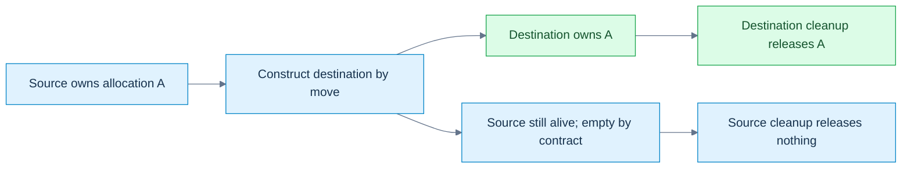

**Read the picture:** this is the manual byte-block contract below: construction creates the destination; ownership moves; the source remains a live, safely destructible empty object. **Limit:** `std::move` alone is a cast, not this transfer. Other types may copy, move inline data, or leave a valid but unspecified source state; move assignment also has an existing destination resource to handle. [[Visual Recall/02 - C++ - Objects, Ownership and Lifetime - Visual Recall#Four figure briefs|Recall this figure]].

[[Move operations and moved-from states|Move construction]] creates a new destination from an expiring source; **move assignment** replaces an existing destination, which may already own a resource needing release. For a pointer-owning byte block, a move can transfer the allocation pointer and size, then set the source to a documented empty state. `std::exchange(source.pointer,nullptr)` returns the old pointer while installing the new source state. That differs from merely copying the pointer and leaving two owners.

| Before/operation | Destination | Source | Lifetime consequence |
|---|---|---|---|
| move construction | new owner takes allocation A | becomes empty under this block's contract | source object remains alive |
| move assignment into owner B | releases B, takes A | becomes empty | both outer object lifetimes continue |
| destruction after move | releases only its current owned resource | empty source safely releases nothing | lifetime ends at normal destruction |

Inside `T(T&& other)`, the named expression `other` is an lvalue in ordinary member-initializer/body use. Move class-type members with explicit intent where needed; copying a scalar size is already cheap. `std::move` preserves const: an ordinary `T(T&&)` cannot bind a const source, so an available `T(const T&)` may be selected instead. A cast without a consumer performs no ownership transfer.

Self-move, `x=std::move(x)`, also needs a documented policy. Our manual block uses an identity guard and preserves its value. Do not demand that every standard-library type preserve its exact old value under self-move; consult its valid-state contract and operation preconditions. A moved-from object is still alive. Standard-library types generally specify valid-but-unspecified states unless they give a stronger guarantee; a user-defined type must implement its own promised invariant. **Unspecified** is not uninitialized or undefined: the value is not promised, but permitted operations still have defined requirements. `empty()` may be a valid query even though you cannot assume its answer; `front()` still requires a nonempty sequence.

For our block, the stronger contract is size0/null after a distinct-object move, plus safe destruction, copying of that empty state and assignment of a fresh value. It avoids traversing a nonexistent range when size is zero. For the earlier texture payload, consult member contracts without asserting the entire source vector/string must have a particular printed value.

Moving is not necessarily constant-time. An inline `std::array<float,N>` still transfers N inline values. Small-string storage may live inside the string object and be copied rather than pointer-stolen. Allocator-aware move assignment may require elementwise work when storage cannot be adopted by the destination allocator. A user-written move can do arbitrary work. Measure bytes, allocations, time and workload—not merely the occurrence of an ampersand.

## Failure guarantees shape the transfer algorithm

[[Noexcept and transfer selection|noexcept]] declares a non-throwing exception contract, not that the function contains no throw-capable instructions. If an exception escapes such a function, termination follows. Mark a move non-throwing only when its actual members/resource policy support that promise.

Container growth must balance transfer cost with rollback. A throwing move might mutate the first source element, then fail on a later one; restoring the original sequence may be impossible. If non-mutating copying is available, an implementation can use it to preserve the required guarantee. `std::move_if_noexcept(x)` selects an access category: it yields a const-reference path when move construction may throw and copying is possible, otherwise an rvalue-reference path. It does not itself transfer anything. See [forward/move helpers](https://eel.is/c++draft/forward).

The spelling is therefore a policy bridge from type properties to an operation's failure guarantee. If copying is impossible, a throwing move remains the available choice and a particular container operation can have weaker exceptional-effect guarantees. Do not teach “vector always gives strong rollback” regardless of type and operation. Neither should a trait-controlled algorithm assume every library implementation must use exactly one named helper internally.

Defaulted moves can derive exception properties from their selected member/base operations when left to the language. Forcing `noexcept` on a defaulted move without checking its subobjects is not automatically an improvement: a throw can terminate. Member composition often lets the compiler propagate the correct behavior. The inline probe checks the helper's return type directly rather than inferring a portable vector strategy from a constructor log.

## Let the compiler compose the operations

[[Special member generation and traits|Special members]] are the default constructor, copy/move constructors, copy/move assignment operators, and destructor. Whether the compiler declares one, whether it is deleted, and whether an expression can use it are three different questions.

| Programmer declaration in an ordinary class | Consequence to check in C++23 |
|---|---|
| no constructor declarations | default constructor can be implicitly declared |
| ordinary/default constructor | does not alone suppress implicit copy/move operations |
| copy constructor or copy assignment | suppresses implicit move generation |
| destructor, including first-declaration `=default` | suppresses implicit move generation |
| move constructor or move assignment | implicitly declared copy operations are defined as deleted unless usable copy operations are supplied explicitly |
| defaulted operation | may itself be deleted because a selected member/base operation is unusable |

This is a practical map, not the complete union/inheritance/constraint rulebook. A reference member can copy-bind, yet generated assignment is deleted. A non-copyable owner member can make the containing object non-copyable. A named constructor being available does not imply all required operations are available. The [copy/move constructor](https://eel.is/c++draft/class.copy.ctor) and [assignment](https://eel.is/c++draft/class.copy.assign) rules govern those details.

`std::is_move_constructible_v<T>` asks whether construction from a `T&&` expression is valid. It does not ask whether the selected constructor's parameter is exactly `T&&`. A class with a user-declared destructor can have no generated dedicated move constructor but still accept an rvalue through `const T&` copying. The trait may be true—and copying may be expensive. Likewise a nothrow trait classifies the valid expression, which could be a non-throwing copy.

An explicitly deleted move constructor can remain the best overload and reject an rvalue even when a copy constructor exists. A defaulted move that becomes deleted has specified ignore rules permitting fallback in relevant cases. “Unavailable move always falls back to copying” is therefore too broad. The diagnostic exercise demonstrates the explicitly deleted case.

First-declaration defaulting can retain triviality and inferred properties that a hand-written equivalent body loses. A **trivial** operation has the specified simple language properties; it is not synonymous with “fast enough in my benchmark.” Trivially copyable, standard-layout, aggregate, and nothrow-movable remain distinct traits. Rule-Zero composition containing vectors does not magically become trivially copyable or serialization-ready.

## From three repairs to five decisions to zero boilerplate

[[Rules of Three Five and Zero|The Rule of Three]] is a design heuristic: if raw-resource semantics require a custom destructor, copy constructor, or copy assignment, consider all three together. It is not a compiler requirement to support copying; explicitly deleting copying can be correct. The Rule of Five adds move construction and move assignment as coordinated decisions after C++11.

The **Rule of Zero** moves ownership responsibility into members whose own operations already match the intended semantics, so the containing class usually needs no custom copy/move/destruction operations. It does not mean “never write a constructor”: ordinary validation or default construction can coexist with composed transfer/cleanup. The texture payload's owning string/vector members and a scalar math record illustrate the approach without requiring a hand-maintained five-function protocol.

The raw owner below is educational infrastructure: its five operations expose the ownership invariant, failure transaction and source-reset contract. Prefer a vector-backed byte value for ordinary application code. A low-level unique resource wrapper may still need custom/deleted operations; then application-level records compose that tested owner instead of repeating resource logic.

[[Relocation versus move|Relocation]] distinguishes transfer plus an ended source lifetime from a move that leaves its source alive until normal later destruction. Container growth often uses move-construction followed by destruction; that pair must not be conflated with a universally legal memcpy of arbitrary nontrivial objects. The attachment discusses proposal-era trivial relocation. Here it is a future/toolchain-dependent research bridge, not a portable C++23 facility or an adopted-language-status claim. Self-references, external registrations and lifetime rules can make a bitwise relocation invalid even when a type's source code looks small.

The design progression is responsibility, not fashion: define the meaning of a copy, define who releases a resource, make failure and self-alias cases safe, supply moves where meaningful, then remove redundant custom code when composition already satisfies those contracts.

## Trace one payload from decode to cache

Assume the cache has reserved enough capacity for the next insertion; otherwise growth adds old-element transfer and invalidation. Assume TexturePayload retains ordinary composed string/vector semantics.

| Stage | Mechanism | Which object/resource is owned where? |
|---|---|---|
| `wall=built()` | optional NRVO or implicit-move fallback | caller receives an owning payload value |
| `cache.Insert(wall)` begins | copy construction of value parameter | wall preserved; parameter gets independent vector storage |
| parameter enters `push_back(std::move(payload))` | move construction of new cache element | cache element takes member state; parameter remains alive moved-from |
| Insert returns | parameter destruction | releases whatever members still own, without invalidating the cache's independent owner |
| `cache.Insert(fallback())` | direct result/parameter initialization, then element move | no mandatory intermediate parameter-transfer copy/move |
| cache grows later | member/type-dependent transfer to new backing | old borrows may be invalidated even if handles persist |
| cache dies | reverse destruction of contained ownership | CPU allocations released; no implied GPU destruction from a numeric handle |

This does not implement a decoder or uploader. It establishes the value-transfer backbone those systems would use. A 4096×4096 RGBA8 pixel image alone contains 67,108,864 bytes, or64 MiB, before mip levels/metadata. Copying that vector and copying a64-bit handle are radically different operations despite both using `=` syntax.

For teaching, ask the listener at every arrow: is a new object created, is an existing value assigned, is an access path merely bound, does source lifetime continue, what allocation is owned, and what happens if the operation fails? Those questions connect the entire build/object/borrow/value story.

## The laboratory and the teaching desk

### Complete runnable value-transfer laboratory

This standard-library-only C++23 program owns initialized bytes, deep-copies, copy-and-swaps, steals storage on move, releases prior move-assignment resources, and documents a preserving self-move policy. A single-threaded failure hook injects bad_alloc before the copy-assignment commit. It verifies independent storage, rollback, empty/moved-from copying and zero outstanding allocations. This is an educational raw owner, not a production allocator or a recommendation to replace vectors.

The independent Probe then measures three sink call forms with spare capacity. It checks const-source copying, destructor-suppressed dedicated movement, move_if_noexcept result types, and direct construction of an immovable result. Only the named-return move count is observational; it is not fixed by a portable assertion.

```cpp
#include <algorithm>
#include <cassert>
#include <cstddef>
#include <iostream>
#include <new>
#include <type_traits>
#include <utility>
#include <vector>

class OwnedByteBlock {
    std::size_t size_=0;
    std::byte* data_=nullptr;
    static std::byte* allocate(std::size_t n) {
        if (!n) return nullptr;
        if (std::exchange(fail_next,false)) throw std::bad_alloc{};
        auto* result=new std::byte[n]{}; // initialize every copied byte
        ++live_allocations;
        return result;
    }
    void release() noexcept {
        if (data_) { delete[] data_; --live_allocations; }
        data_=nullptr;
        size_=0;
    }
public:
    // Single-threaded laboratory instrumentation, not a production allocator.
    inline static bool fail_next=false;
    inline static int live_allocations=0;
    explicit OwnedByteBlock(std::size_t n=0):size_(n),data_(allocate(n)) {}
    ~OwnedByteBlock() { release(); }
    OwnedByteBlock(const OwnedByteBlock& other):OwnedByteBlock(other.size_) {
        if (size_) std::copy_n(other.data_,size_,data_);
    }
    OwnedByteBlock& operator=(const OwnedByteBlock& other) {
        if (this!=&other) {
            OwnedByteBlock replacement(other); // prepare; failure leaves *this intact
            swap(replacement);                // non-throwing commit
        } // replacement releases former target
        return *this;
    }
    OwnedByteBlock(OwnedByteBlock&& other) noexcept
        :size_(std::exchange(other.size_,0)),
         data_(std::exchange(other.data_,nullptr)) {}
    OwnedByteBlock& operator=(OwnedByteBlock&& other) noexcept {
        if (this!=&other) {
            release();
            size_=std::exchange(other.size_,0);
            data_=std::exchange(other.data_,nullptr);
        }
        return *this;
    }
    void swap(OwnedByteBlock& other) noexcept {
        std::swap(size_,other.size_);
        std::swap(data_,other.data_);
    }
    std::size_t size() const noexcept { return size_; }
    const std::byte* data() const noexcept { return data_; }
    std::byte& operator[](std::size_t i) { assert(i<size_); return data_[i]; }
    const std::byte& operator[](std::size_t i) const {
        assert(i<size_); return data_[i];
    }
};

struct Probe {
    inline static int copies=0, moves=0;
    int value;
    explicit Probe(int v=0):value(v) {}
    Probe(const Probe& p):value(p.value) { ++copies; }
    Probe(Probe&& p) noexcept:value(std::exchange(p.value,-1)) { ++moves; }
    static void reset() { copies=moves=0; }
};
struct Suppressed { Probe part; ~Suppressed()=default; };
struct ThrowingMove {
    ThrowingMove()=default;
    ThrowingMove(const ThrowingMove&) {}
    ThrowingMove(ThrowingMove&&) noexcept(false) {}
};
struct MoveOnly {
    MoveOnly()=default;
    MoveOnly(const MoveOnly&)=delete;
    MoveOnly(MoveOnly&&) noexcept(false) {}
};
struct Immovable {
    Immovable()=default;
    Immovable(const Immovable&)=delete;
    Immovable(Immovable&&)=delete;
};
Immovable direct() { return Immovable{}; }
Probe named_result() { Probe local(8); return local; }

int main() {
    static_assert(std::is_nothrow_move_constructible_v<OwnedByteBlock>);
    static_assert(std::is_nothrow_move_assignable_v<OwnedByteBlock>);
    static_assert(std::is_move_constructible_v<Suppressed>);
    static_assert(std::is_same_v<decltype(std::move_if_noexcept(
        std::declval<ThrowingMove&>())),const ThrowingMove&>);
    static_assert(std::is_same_v<decltype(std::move_if_noexcept(
        std::declval<MoveOnly&>())),MoveOnly&&>);
    {
        OwnedByteBlock a(4);
        a[0]=std::byte{7};
        OwnedByteBlock b=a;
        assert(a.data()!=b.data());
        b[0]=std::byte{9};
        assert(a[0]==std::byte{7});
        OwnedByteBlock& same=a;
        a=same;
        assert(a[0]==std::byte{7});

        const auto* old=b.data();
        const int live_before=OwnedByteBlock::live_allocations;
        OwnedByteBlock::fail_next=true;
        bool failed=false;
        try { b=a; } catch (const std::bad_alloc&) { failed=true; }
        assert(failed && !OwnedByteBlock::fail_next);
        assert(b.data()==old && b.size()==4 && b[0]==std::byte{9});
        assert(OwnedByteBlock::live_allocations==live_before);

        OwnedByteBlock c(std::move(a));
        assert(a.size()==0 && a.data()==nullptr && c[0]==std::byte{7});
        OwnedByteBlock empty_copy(a); // empty/moved-from source: no range traversal
        assert(empty_copy.size()==0 && empty_copy.data()==nullptr);
        b=std::move(c); // must release b's old allocation
        assert(c.size()==0 && c.data()==nullptr && b[0]==std::byte{7});
        OwnedByteBlock& self=b;
        b=std::move(self); // this type's documented preserving self-move
        assert(b.size()==4 && b[0]==std::byte{7});
        b=OwnedByteBlock{};
        assert(b.size()==0 && b.data()==nullptr);
    }
    assert(OwnedByteBlock::live_allocations==0);

    std::vector<Probe> stored;
    stored.reserve(4); // exclude growth work from these counts
    auto sink=[&](Probe p) { stored.push_back(std::move(p)); };
    Probe source(1);
    Probe::reset();
    sink(source);
    assert(Probe::copies==1 && Probe::moves==1 && source.value==1);
    Probe::reset();
    sink(Probe{2});
    assert(Probe::copies==0 && Probe::moves==1);
    Probe::reset();
    sink(std::move(source));
    assert(Probe::copies==0 && Probe::moves==2 && source.value==-1);

    const Probe fixed(5);
    Probe::reset();
    Probe copied(std::move(fixed));
    assert(copied.value==5 && Probe::copies==1 && Probe::moves==0);
    Suppressed original;
    Probe::reset();
    Suppressed fallback(std::move(original));
    assert(Probe::copies==1 && Probe::moves==0);
    (void)fallback;

    Immovable token=direct(); // must work even with optional elision disabled
    (void)token;
    Probe::reset();
    Probe returned=named_result();
    assert(returned.value==8 && Probe::copies==0);
    std::cout << "named return observed moves=" << Probe::moves << '\n';
    std::cout << "value-transfer laboratory: all assertions passed\n";
}
```

Compile with assertions enabled at debug and optimized settings. Also run with `-fno-elide-constructors`: that compiler option can disable optional NRVO, but cannot undo the language's guaranteed direct prvalue construction. The immovable result remains valid, while the named Probe return can reveal its move fallback. Constructor counts here explain semantics under controlled conditions; they are not allocation/timing benchmarks for a texture engine.

### Observe construction, failure and reverse cleanup

This separate complete program uses a fixed event buffer, so recording destructor events does not allocate. Positive IDs mark construction/body entry; negative IDs mark cleanup. It checks ordinary constructor-body failure, successful whole-object destruction, and the distinct delegating-body failure case. It also checks initialized defaults and copy-constructible-but-not-copy-assignable reference/const-member records. It never reads an uninitialized scalar.

```cpp
#include <array>
#include <cassert>
#include <iostream>
#include <stdexcept>
#include <type_traits>

struct Events {
    inline static std::array<int,16> values{};
    inline static std::size_t count=0;
    static void add(int v) noexcept { assert(count<values.size()); values[count++]=v; }
    static void reset() noexcept { count=0; }
};
struct Member {
    int id;
    explicit Member(int n):id(n) { Events::add(id); }
    ~Member() { Events::add(-id); }
};
struct Whole {
    Member first{1};
    Member second{2};
    explicit Whole(bool fail) {
        Events::add(3);
        if (fail) throw std::runtime_error("body failed");
    }
    ~Whole() { Events::add(-3); }
};
struct Delegated {
    Member member{4};
    Delegated() { Events::add(5); }
    explicit Delegated(int):Delegated() {
        Events::add(6);
        throw std::runtime_error("delegating body failed");
    }
    ~Delegated() { Events::add(-5); }
};
struct NonUserProvided { int n; NonUserProvided()=default; };
struct MemberDefault { int n=0; MemberDefault() {} };
struct Binding { int& value; };
struct ConstRecord { const int id; };

int main() {
    Events::reset();
    bool caught=false;
    try { Whole object(true); } catch (const std::runtime_error&) { caught=true; }
    assert(caught && Events::count==5);
    const std::array failed{1,2,3,-2,-1};
    for (std::size_t i=0;i<failed.size();++i) assert(Events::values[i]==failed[i]);
    Events::reset();
    { Whole object(false); }
    const std::array success{1,2,3,-3,-2,-1};
    assert(Events::count==success.size());
    for (std::size_t i=0;i<success.size();++i) assert(Events::values[i]==success[i]);
    Events::reset();
    caught=false;
    try { Delegated object(1); } catch (const std::runtime_error&) { caught=true; }
    const std::array delegated{4,5,6,-5,-4};
    assert(caught && Events::count==delegated.size());
    for (std::size_t i=0;i<delegated.size();++i) assert(Events::values[i]==delegated[i]);

    NonUserProvided a{};
    MemberDefault b{};
    assert(a.n==0 && b.n==0); // no uninitialized member is read
    static_assert(std::is_copy_constructible_v<Binding>);
    static_assert(!std::is_copy_assignable_v<Binding>);
    static_assert(std::is_copy_constructible_v<ConstRecord>);
    static_assert(!std::is_copy_assignable_v<ConstRecord>);
    int number=7;
    Binding first{number};
    Binding second=first;
    second.value=9;
    assert(number==9 && &first.value==&second.value);
    std::cout << "construction laboratory: all assertions passed\n";
}
```

Explain the event arrays before running the program. In the ordinary failing constructor, no -3 event appears because Whole never completed. On normal destruction, -3 comes before -2/-1. In the delegating case the target completed, so -5 appears before -4 after the delegating body fails. Copying Binding preserves the association to number; it does not create another referent.

### Value-transfer diagnostic and reconstruction desk

Compile these independent rejected-program exercises separately. They are not additions to either passing laboratory:

```cpp
struct Token { Token()=default; Token(const Token&)=delete; Token(Token&&)=delete; };
Token named() { Token token; return token; }
int main() {}
```

```cpp
struct Binding { int& value; };
int main() { int x=1,y=2; Binding a{x},b{y}; a=b; }
```

```cpp
#include <utility>
struct CopyOnly { CopyOnly()=default; CopyOnly(const CopyOnly&)=default; CopyOnly(CopyOnly&&)=delete; };
int main() { CopyOnly a; CopyOnly b(std::move(a)); }
```

```cpp
struct Token { Token()=default; ~Token()=delete; };
Token direct() { return Token{}; }
int main() {}
```

For each rejection, name the missing guarantee: non-guaranteed named-return fallback, reference-member assignment, best overload explicitly deleted, or required usable destruction. Removing optional elision is not necessary to make the named immovable return invalid.

Reconstruct the value story without the page:

1. Draw the separate objects/resources for lvalue, xvalue and prvalue calls to a value sink; add growth costs separately.
2. Reset a pointer parameter, then a reference-to-pointer parameter; distinguish which caller state changes.
3. Compute the exposure-reference alias trace for distinct arguments and one aliased argument.
4. Explain direct construction with both copy and move deleted, then explain why returning a named local differs.
5. State an object's invariant before writing its constructor. Which parts of input validation do the toy examples leave unimplemented?
6. Distinguish no initializer, aggregate braces, a first-declaration defaulted constructor and an empty user-provided constructor. Never prove the bad case by reading uninitialized memory.
7. Put a provider member before its dependent member. Draw both construction and destruction order.
8. Reconstruct ordinary constructor failure versus throwing after a delegating target completed.
9. Decide whether copying a handle, byte owner, view and scene graph should duplicate, share, remap or reject resources.
10. Rebuild the copy-assignment prepare/commit/cleanup transaction; inject failure before commit and predict both owners.
11. Move into a new owner, then an existing owner. Identify the old destination resource and the surviving source state.
12. State the exact self-copy/self-move policy; distinguish a documented empty source from an unspecified library value.
13. Derive move_if_noexcept's selected path and identify where strong rollback may become unavailable.
14. Explain why move-constructible can mean copied from an rvalue, and why a defaulted destructor changes generation.
15. Rebuild the three/five operations, then replace the raw owner with composed members where semantics allow. Which domain invariants still need a design decision?
16. Distinguish move from relocation without claiming a byte copy of arbitrary objects legal.

### Complete runnable borrow laboratory

Save this independent block as `borrows.cpp`. It uses only the standard library and C++23; no engine headers are needed. It checks aliasing, converted-reference snapshots, category deduction, array boundaries, typed null deletion, const span behavior, a live slot's changed logical owner, safe temporary getters, owning captures, and a synchronized mutable cache. Assertions are the expected results. No dangling reference is dereferenced and no invalid pointer arithmetic is executed.

```cpp
#include <cassert>
#include <cstddef>
#include <functional>
#include <iostream>
#include <mutex>
#include <optional>
#include <span>
#include <string>
#include <thread>
#include <type_traits>
#include <utility>
#include <vector>

struct Slot { int entity; int value; };

class Named {
    std::string name_;
public:
    explicit Named(std::string name) : name_(std::move(name)) {}
    std::string& Name() & { return name_; }
    const std::string& Name() const & { return name_; }
    std::string Name() && { return std::move(name_); }
    std::string Name() const && { return name_; }
};

int category(int&) { return 1; }
int category(int&&) { return 2; }
template<class T>
int relay(T&& item) { return category(std::forward<T>(item)); }

class Cache {
    mutable std::mutex mutex_;
    int source_ = 3; // restricted laboratory inputs: 3 or 4
    mutable std::optional<int> square_;
public:
    void Set(int value) {
        assert(value == 3 || value == 4);
        std::scoped_lock lock(mutex_);
        source_ = value;
        square_.reset();
    }
    int Get() const {
        std::scoped_lock lock(mutex_);
        if (!square_) square_ = source_ * source_;
        return *square_;
    }
};

int choose(int) { return 1; }
int choose(int*) { return 2; }

int main() {
    int a = 2, b = 9;
    int& alias = a;
    alias = b;
    b = 20;
    assert(a == 9 && b == 20 && std::addressof(alias) == &a);
    int* selected = &a;
    int*& pointer_alias = selected;
    pointer_alias = &b;
    assert(selected == &b);

    int count = 10;
    const int& live = count;
    const double& snapshot = count;
    count = 50;
    assert(live == 50 && snapshot == 10.0);

    int&& rr = 7;
    static_assert(std::is_same_v<decltype(rr), int&&>);
    static_assert(std::is_same_v<decltype((rr)), int&>);
    static_assert(std::is_same_v<decltype(std::move(rr)), int&&>);
    assert(relay(count) == 1 && relay(4) == 2);

    int array[3]{10, 20, 30};
    int (&whole)[3] = array;
    static_assert(sizeof(whole) == sizeof(array));
    int* end = array + 3;
    assert(end - array == 3); // no dereference of end

    int* absent = nullptr;
    delete absent;
    assert(choose(0) == 1 && choose(nullptr) == 2);

    std::span<int> elements(array);
    const std::span<int> descriptor = elements;
    descriptor[0] = 12;
    std::span<const int> readonly = elements;
    static_assert(std::is_same_v<decltype(readonly[0]), const int&>);
    assert(readonly[0] == 12);

    std::vector<Slot> pool{{11, 100}, {22, 200}, {33, 300}};
    std::size_t epoch = 0;
    Slot* cached = &pool[0];
    const auto borrowed_epoch = epoch;
    pool[0] = std::move(pool.back());
    pool.pop_back();
    ++epoch;
    assert(epoch != borrowed_epoch); // reject old logical borrow before use
    // Separate demonstration: cached designates a live first Slot, now owner 33.
    assert(cached == &pool[0] && cached->entity == 33);
    pool.reserve(pool.capacity() + 1); // invalidates cached; never use it again
    assert(pool[0].entity == 33); // reacquire via the container

    Named owner{"persistent"};
    const std::string& borrowed = owner.Name();
    assert(borrowed == "persistent");
    std::string owned = Named{"temporary"}.Name();
    assert(owned == "temporary");
    static_assert(std::is_same_v<decltype(std::declval<const Named&&>().Name()),
                                 std::string>);
    const Named const_owner{"const value"};
    std::string const_result = std::move(const_owner).Name();
    assert(const_result == "const value");

    std::string label = "frame";
    auto snapshot_job = [saved = label] { return saved.size(); };
    label.clear();
    assert(snapshot_job() == 5);
    auto counter = [n = 0]() mutable { return ++n; };
    assert(counter() == 1 && counter() == 2);

    Cache cache;
    const Cache& access = cache;
    assert(access.Get() == 9);
    cache.Set(4);
    assert(access.Get() == 16);
    {
        std::jthread reader([&] {
            for (int i = 0; i < 1000; ++i) {
                const int result = access.Get();
                assert(result == 9 || result == 16);
            }
        });
        std::jthread writer([&] {
            for (int i = 0; i < 1000; ++i) cache.Set(i % 2 ? 3 : 4);
        });
    } // both threads joined before cache is destroyed
    std::cout << "borrow laboratory: all assertions passed\n";
}
```

The epoch in this program is a local single-threaded witness, not a complete reusable borrow wrapper. The cache is separately synchronized and tested with concurrent calls; that short test does not prove arbitrary concurrent programs safe. Run with assertions enabled. Successful checks establish these examples on the recorded compiler, not every ABI or container implementation.

### Observe destruction without reading a dangling referent

This second complete program counts live Watch objects. A lifetime-ended reference can exist; using it to access its former object is the forbidden step. The intentionally dangling holder/new/call-return paths below are never dereferenced. The compiler may warn about the new-initializer reference member; that is useful evidence, not an invitation to suppress the warning. The unused escaped declaration can also produce a warning.

```cpp
#include <cassert>
#include <iostream>

struct Watch {
    inline static int live = 0;
    Watch() { ++live; }
    ~Watch() { --live; }
};
struct Holder { const Watch& value; };
const Watch& pass(const Watch& item) { return item; }

int main() {
    assert(Watch::live == 0);
    {
        const Watch& direct = Watch{};
        (void)direct; // alive throughout this block
        assert(Watch::live == 1);
    }
    assert(Watch::live == 0);
    {
        Holder kept{Watch{}};
        assert(Watch::live == 1);
        Holder lost(Watch{}); // deliberately dangling after this statement
        assert(Watch::live == 1); // only kept's Watch remains
        // Never read lost.value.
        (void)kept;
        (void)lost;
    }
    assert(Watch::live == 0);
    Holder* heap = new Holder{Watch{}}; // member temporary dies at semicolon
    assert(Watch::live == 0);
    delete heap; // default Holder destruction does not read the member
    const Watch& escaped = pass(Watch{});
    assert(Watch::live == 0);
    // escaped is dangling; do not evaluate it.
    std::cout << "temporary laboratory: live count = " << Watch::live << '\n';
}
```

At the parenthesized declaration, the count temporarily rises from one to two, then returns to one at the semicolon. Braced kept survives until its enclosing block ends. The heap holder outlives its temporary referent; allocation changes the holder's duration, not the reference-member exception. Passing through pass likewise gives no new extension. These observed counts support the language explanation on the tested compiler without reading freed or lifetime-ended objects.

### Rejected-program exercises

These are independent rejected-program exercises, not additions to the passing laboratory:

```cpp
// Expected rejection: reference binding would discard const.
int main() { const int value=3; int& wrong=value; }
```

```cpp
// Expected rejection: unsafe qualification injection.
int main() { int* p=nullptr; int** pp=&p; const int** wrong=pp; }
```

```cpp
// Expected rejection: operand type is nullptr_t, not an object-pointer type.
int main() { delete nullptr; }
```

Predict the diagnostics, then explain the mechanism without quoting the diagnostic. Other bad examples in the narrative are deliberately not executed: a program exhibiting undefined behavior is not a reliable demonstration of its supposed outcome.

### Reconstruct the access story at the board

1. Bind an integer reference, assign another integer through it, then change the other integer. Draw the final referent and values.
2. Explain why `decltype(rr)` and `decltype((rr))` differ, and why neither evaluates `rr`.
3. Compare a same-type const reference with a converting const reference; show the live value and snapshot after mutation.
4. Draw a temporary through a parameter-returning identity function. Mark the exact destruction point and explain why the receiving reference does not extend it.
5. Distinguish `Holder{7}`, `Holder(7)` and `new Holder{7}` without dereferencing a dangling member.
6. Show why `std::move` alone changes no resources and why const can change which constructor is viable.
7. Deduce `T` for an lvalue/rvalue passed to `T&&`; reconstruct collapsing and forwarding.
8. Give three independent ways a non-null pointer can be unsuitable for access.
9. Compare vector reallocation, last-element destruction, and first-slot repurposing. Which one can fool a sanitizer while remaining a logical bug?
10. Explain why a validated entity handle and a previously cached component reference answer different questions.
11. Reconstruct the rejected `int**` conversion as a const-pointer injection attack; explain the intermediate const fix.
12. Compare `const span<int>` with `span<const int>`, and explain why neither owns storage.
13. Design both const and non-const temporary getter policies; find the missing `const &&` hole.
14. State the mutable-cache invariant, protect source and cache together, and justify returning a snapshot rather than a borrowed result.

These questions test reconstruction, not the presence of a completed checkbox. The earlier object/build laboratory follows; both are part of this same story.

### Reproduce the compile and link distinction

Save the three preceding module blocks as Math.cppm, MathImpl.cpp and App.cpp. With a compatible Clang installation, from that directory:

```bash
clang++ -std=c++23 --precompile Math.cppm -o Math.pcm
clang++ -std=c++23 -c Math.pcm -o Math.o
clang++ -std=c++23 -fprebuilt-module-path=. -c MathImpl.cpp -o MathImpl.o
clang++ -std=c++23 -fprebuilt-module-path=. -c App.cpp -o App.o
clang++ App.o Math.o MathImpl.o -o modules
./modules
```

App exits0 when twice(21) equals42. Now omit MathImpl.o from only the final link: the importer still compiled, but the link needs the implementation of twice. This intentionally produces an undefined symbol. Restoring MathImpl.o repairs this demonstration. A production build system manages dependency scanning and compatible module options; these explicit commands are a small experiment, not a replacement for its build graph.

### Complete runnable object laboratory

This program is independent of Kairo. Every header and declaration it needs is included here; save only this block as `objects.cpp`. Assertions test lookup, enum validation, handle reuse, aggregate traits, initialization forms, correct array views, construction/destruction counts and two successive occupants at one storage location. The byte buffer survives both Tracked objects. Use the new construction result rather than assuming every old pointer remains usable after replacement.

```cpp
#include <array>
#include <cassert>
#include <climits>
#include <cstddef>
#include <cstdint>
#include <iostream>
#include <limits>
#include <memory>
#include <optional>
#include <span>
#include <type_traits>
#include <utility>
#include <vector>

enum class ResourceKind : std::uint8_t { Buffer, Texture, Pipeline };
std::optional<ResourceKind> decode_kind(std::uint8_t raw) {
    switch (raw) {
    case 0: return ResourceKind::Buffer;
    case 1: return ResourceKind::Texture;
    case 2: return ResourceKind::Pipeline;
    default: return std::nullopt;
    }
}
enum class Access : unsigned { None=0, Read=1, Write=2 };
constexpr Access operator|(Access a, Access b) {
    return static_cast<Access>(std::to_underlying(a) | std::to_underlying(b));
}
constexpr bool contains(Access set, Access flag) {
    return (std::to_underlying(set) & std::to_underlying(flag))
        == std::to_underlying(flag);
}
struct ResourceHandle {
    static constexpr std::uint32_t invalid =
        std::numeric_limits<std::uint32_t>::max();
    std::uint32_t index = invalid;
    std::uint32_t generation = 0;
    constexpr bool valid_shape() const { return index != invalid; }
    friend constexpr bool operator==(ResourceHandle, ResourceHandle) = default;
};
struct Slot { bool occupied{}; std::uint32_t generation{}; };
bool alive(ResourceHandle h, const std::array<Slot,1>& slots) {
    return h.index < slots.size() && slots[h.index].occupied
        && slots[h.index].generation == h.generation;
}
namespace geometry {
struct Pair { int x, y; };
constexpr int dot(Pair a, Pair b) { return a.x*b.x + a.y*b.y; }
}
struct NamedVector {
    float x{}, y{}, z{};
    float& at(std::size_t i) {
        assert(i < 3); // precondition remains required in release
        switch (i) { case 0: return x; case 1: return y; default: return z; }
    }
    const float& at(std::size_t i) const {
        assert(i < 3);
        switch (i) { case 0: return x; case 1: return y; default: return z; }
    }
    constexpr std::array<float,3> to_array() const { return {x,y,z}; }
};
struct ArrayVector {
    std::array<float,3> elements{};
    std::span<float,3> view() { return elements; }
};
struct ConstructedVector {
    float x,y,z;
    constexpr ConstructedVector(float a,float b,float c):x(a),y(b),z(c){}
};
struct Material { float roughness=0.5f; float metallic=0; bool double_sided{}; };
struct Padded { char a; double b; char c; };
struct Reordered { double b; char a; char c; };
struct Vertex { float x,y,z; std::uint32_t color; };
// This laboratory intentionally targets octet + IEEE binary32 platforms.
static_assert(CHAR_BIT == 8);
static_assert(sizeof(float)==4 && std::numeric_limits<float>::is_iec559);
static_assert(std::is_aggregate_v<ResourceHandle>);
static_assert(!std::is_aggregate_v<ConstructedVector>);
static_assert(std::is_standard_layout_v<Vertex>);
static_assert(std::is_trivially_copyable_v<Vertex>);
static_assert(offsetof(Vertex,x)==0 && offsetof(Vertex,color)==12);
static_assert(sizeof(Vertex)==16);
struct Tracked {
    inline static int constructions=0, destructions=0;
    int value;
    explicit Tracked(int n):value(n) { ++constructions; }
    ~Tracked() { ++destructions; }
};
constinit int mutable_counter=0;
thread_local int thread_counter=0;
int& persistent_count() { static int calls=0; return calls; }

int main() {
    geometry::Pair a{1,2}, b{3,4};
    assert(dot(a,b)==11); // ADL finds geometry::dot
    assert(decode_kind(1)==ResourceKind::Texture);
    assert(!decode_kind(199));
    const auto access=Access::Read | Access::Write;
    assert(contains(access,Access::Read) && contains(access,Access::Write));
    std::array<Slot,1> slots{{Slot{true,7}}};
    const ResourceHandle old{.index=0,.generation=7};
    assert(alive(old,slots));
    slots[0].occupied=false; assert(!alive(old,slots));
    slots[0]={true,8};
    assert(old.valid_shape() && !alive(old,slots));
    const ResourceHandle fresh{.index=0,.generation=8};
    assert(alive(fresh,slots) && old!=fresh);
    assert(!alive(ResourceHandle{},slots));
    NamedVector named{1,2,3};
    named.at(1)=9;
    const NamedVector& read_only=named;
    assert(read_only.at(1)==9);
    auto copy=named.to_array();
    copy[1]=8; assert(named.y==9); // copy, not a live view
    ArrayVector array{{1,2,3}};
    auto view=array.view(); view[1]=8;
    assert(array.elements[1]==8); // view aliases a real array
    const Material material{.roughness=0.8f};
    assert(material.metallic==0 && !material.double_sided);
    const std::vector<int> count_values(10,20), listed_values{10,20};
    assert(count_values.size()==10 && listed_values.size()==2);
    alignas(Tracked) std::byte storage[sizeof(Tracked)];
    const void* location=static_cast<void*>(storage);
    Tracked* first=std::construct_at(reinterpret_cast<Tracked*>(storage),7);
    assert(first->value==7 && static_cast<void*>(first)==location);
    std::destroy_at(first);
    // No Tracked member access here: lifetime ended, storage remains.
    Tracked* second=std::construct_at(reinterpret_cast<Tracked*>(storage),8);
    assert(second->value==8 && static_cast<void*>(second)==location);
    std::destroy_at(second);
    assert(Tracked::constructions==2 && Tracked::destructions==2);
    auto* dynamic=new Tracked{9};
    assert(dynamic->value==9);
    delete dynamic;
    dynamic=nullptr; // clears this pointer only, not other copies
    assert(dynamic==nullptr && Tracked::destructions==3);
    ++mutable_counter; ++thread_counter; ++persistent_count();
    ++persistent_count();
    assert(mutable_counter==1 && thread_counter==1 && persistent_count()==2);
    std::cout << "C++ object laboratory passed\n"
              << "Padded: size=" << sizeof(Padded) << " align=" << alignof(Padded)
              << " offsets=" << offsetof(Padded,a) << ','
              << offsetof(Padded,b) << ',' << offsetof(Padded,c) << '\n'
              << "Reordered: size=" << sizeof(Reordered) << '\n';
}

```

Compile with `clang++ -std=c++23 -Wall -Wextra -Wpedantic -Werror -fsanitize=address,undefined objects.cpp -o objects`, then run `./objects`. Repeat with `-O2`. The layout numbers printed are target measurements, not universal constants. The Vertex assertions are explicit requirements of this demonstration's upload format; they are not deductions from standard-layout alone. Sanitizers detect some bad executions, not all object-model violations. This program never executes the invalid named-member indexing example.

The thread-local counter is used on the main thread only; this laboratory does not test concurrency or thread shutdown. Local-static initialization synchronization protects initialization, not unsynchronized later mutation. Every generation comparison assumes one registry and no counter wrap during the test. These limits belong beside the code because an example should not silently promise more than it demonstrates.

## Where these foundations matter

Here is the full mapping.

| Source ledger entry | Engine consequence |
|---|---|
| 101 translation model | Why changing an exported module can rebuild dependents; why link failures differ from compile failures; why shader/native libraries need ABI boundaries. |
| 102 declaration vs definition | Public engine API versus implementation; forward declarations; reducing dependency exposure. |
| 103 ODR | Prevent duplicate renderer globals, mismatched inline/template definitions and macro-dependent UB. |
| 104 lookup | Namespaces, extension functions, generic algorithms, ADL and modular API hygiene. |
| 105 storage duration | Frame locals, singleton/static systems, per-thread scratch allocators, dynamically allocated resources. |
| 106 lifetime vs storage | ECS pools, arenas, `vector`, `optional`, `variant`, render-resource pools, placement construction. |
| 107 identity/address | Entity handles, GPU resource handles, generation counters, stale pointer prevention. |
| 108 fundamental widths | File formats, Vulkan structs, network protocols, IDs, GPU buffers, cross-platform engine builds. |
| 109 enums | Render states, resource states, component change kinds, shader modes, error states. |
| 110 aggregates | Descriptor records, vertices, configuration types, messages, ECS events. |
| 111 struct/class | Transparent math/data records versus invariant-owning systems/resources. |
| 112 layout | Vertex buffers, uniform/storage buffers, serialization, SIMD, cache usage, C ABI and GPU ABI matching. |

This entire chunk is therefore directly relevant to your graphics/engine path.

## Classifying a failure before debugging

When you see:

| Symptom | First mechanism to suspect |
|---|---|
| “undefined symbol” | declaration exists, definition absent/not linked, linkage mismatch |
| “duplicate symbol” | ODR violation or duplicate externally linked definition |
| same header behaves differently in two files | macro/preprocessor-dependent ODR issue |
| variable exists but name inaccessible | scope/lookup issue |
| object appears to retain bytes after destruction | confusing storage persistence with object lifetime |
| random crash from cached pointer | object lifetime ended / storage reused |
| old ECS handle affects new object | identity reused without generation validation |
| binary works macOS but fails Windows | implementation-defined widths/ABI assumption |
| state enum receives nonsense | external value not validated |
| aggregate initialization suddenly stops compiling | type ceased being aggregate, often due constructor/access change |
| GPU buffer looks scrambled | CPU structure layout != GPU ABI layout |
| `Vec3::operator[]` “works but sanitizer/compiler gets weird” | pointer arithmetic across separate member objects |
| size unexpectedly larger | alignment/padding/tail padding |

A strong C++ engineer does not begin with:

> “The compiler is weird.”

They classify the failure into the correct language mechanism first.

## Reconstructing a compact resource record

Write this without copying once this chapter settles:

```cpp
#include <cstddef>
#include <cstdint>
#include <type_traits>
#include <utility>

enum class ResourceKind : std::uint8_t
{
    Buffer,
    Texture,
    Pipeline
};

struct ResourceHandle
{
    static constexpr std::uint32_t InvalidIndex = 0xFFFFFFFFu;

    std::uint32_t index = InvalidIndex;
    std::uint32_t generation = 0;

    [[nodiscard]]
    constexpr bool valid() const noexcept
    {
        return index != InvalidIndex;
    }
};

struct GPUVertex
{
    float x;
    float y;
    float z;
    std::uint32_t packedColor;
};

static_assert(std::is_aggregate_v<ResourceHandle>);
static_assert(std::is_standard_layout_v<ResourceHandle>);
static_assert(std::is_trivially_copyable_v<ResourceHandle>);

static_assert(std::is_standard_layout_v<GPUVertex>);
static_assert(std::is_trivially_copyable_v<GPUVertex>);

static_assert(offsetof(GPUVertex, x) == 0);
```

Now you should be able to explain every statement not syntactically, but semantically:

```text
why uint32_t?
why enum class?
why uint8_t?
why aggregate?
what lifetime does a local handle have?
does handle address define resource identity?
what does standard-layout guarantee?
what does it NOT guarantee?
why might GPUVertex still need a backend-specific upload structure?
what happens if a constructor is added?
what entity does InvalidIndex define?
what is its storage duration?
what linkage does it have?
why doesn't offsetof prove shader compatibility?
```

If any of those feel like vocabulary questions instead of mechanical questions, that area needs reconstruction.

## Questions for teaching without looking at the page

This is the one list I want you to use as the actual chapter test:

1. Draw the complete path from `Vector.cppm` source text to a function executing in the final program, including preprocessing/global-module-fragment work, BMI/interface information, object generation and linking. Then explain what compilation error versus link error means.

2. Given `extern int x;`, `int x;`, `int f(int);`, `int f(int x){ return x; }`, `struct A;`, and `struct A{int n;};`, classify every declaration and definition and explain why every definition is also a declaration.

3. Explain why `#pragma once` does **not** solve `int global = 3;` being defined in a header included by two different translation units. Then give the `extern` solution and the `inline` variable solution.

4. For `void f(){ static int x; int y; thread_local int z; auto* p = new int; }`, separately identify name scope, storage duration and approximate object lifetime for `x`, `y`, `z`, `p`, and `*p`.

5. Explain why an object's bytes can remain physically unchanged after its lifetime ends, and why that does not permit continued use of the object.

6. Suppose an object at address `0x1000` is destroyed and another same-type object is constructed at `0x1000`. Explain why numerical address alone does not encode identity. Then connect this to `Entity{Index, Generation}`.

7. Explain why `int` is not necessarily 32-bit, why `std::uint32_t` is a better representation field for an ECS index, and why even `uint32_t` does not by itself give you a portable serialized format.

8. Explain why `enum class StructuralChangeKind : std::uint8_t` is safer than both `int Kind` and an old unscoped enum. Then explain why a byte read from disk must still be validated.

9. Determine whether `the illustrative ResourceHandle` and `the constructor-bearing Vec` are aggregates and explain precisely why their brace initialization can invoke different language mechanisms.

10. Explain all actual language differences between `struct` and `class`, including default base-class access.

11. Assuming `char=1` alignment and `double=8` alignment, manually lay out `struct X { char a; double b; char c; };`, calculate typical offsets/size, then reorder the members to reduce padding.

12. Explain why all four of these can be independently meaningful: `std::is_aggregate_v<T>`, `std::is_standard_layout_v<T>`, `std::is_trivially_copyable_v<T>`, and `sizeof(T)`. Reconstruct [[Standard-layout and trivial copyability]] without equating the traits.

13. Prove why `NamedVector` being standard-layout, trivially copyable, and exactly 12 bytes still does **not** make `(&x)[1]` valid array indexing.

14. Explain why `sizeof(NamedVector)==12` does not prove compatibility with an arbitrary Vulkan/Metal shader-side three-component vector structure.

15. From memory, rewrite a standards-safe `Vector3::operator[]` for the existing `x/y/z` representation and explain what would have to change if `Data()` truly needs to expose an N-element contiguous array.

If you can answer those under repeated “**why?**” questioning, then chapter is actually owned rather than merely read.

## What remains open

Ownership means deciding who is responsible for destruction and resource release. Parameter contracts, copy/move operations, constructor invariants, cleanup, direct result construction and Rule-Zero composition now extend the story through Parts147. The raw-owner laboratory develops a narrow strong-guarantee transaction, not complete subsystem exception safety. Smart-pointer ownership patterns, explicit lifetime restart, allocator design, polymorphic cleanup and broader container/concurrency guarantees remain future depth.

A useful future experiment compares raw address APIs with checked generation handles under repeated create/destroy/reuse workloads. Count stale-access attempts, validation failures, bytes per handle and lookup/frame cost. State the workload and lifetime contract before claiming a reliability or performance advantage. A handle is not automatically safer if callers bypass its registry checks.

**Coverage update after M010:** the ownership questions that were still open at the M009 boundary are now developed in [[#From a live object to responsible resource ownership|the next story chapter]]. The future experiment above remains open; the existence of a written treatment does not demonstrate learner mastery.

No written 'depth gate passed' proves learner mastery. Try the recall questions under repeated why-questioning, then reconstruct the laboratories without copying.

## Retrieval sheet - The whole opening story

Source text becomes tokens and translation units; declarations let callers compile; definitions let a program execute. Lookup finds a declaration, linkage relates declarations, and ODR requires coherent definitions. Modules change how interfaces are communicated, not the need for implementation code.

Names have scopes. Storage has automatic, static, thread or dynamic duration. Objects have lifetimes inside storage. A pointer's own lifetime does not keep its pointee alive. Equal values do not mean one object; reusing an address does not preserve the old occupant. Generation handles identify a logical occupant only when the registry validates them.

Ordinary integer widths are not portable constants. Scoped enums constrain accidental conversions, not hostile input. Braces may initialize aggregate elements or select a constructor; initializer-list constructors can change their meaning. Struct and class differ only in default member and base access.

Alignment creates holes and tail padding. Standard-layout, trivially-copyable and aggregate are different promises. Adjacent named fields are not an array. CPU layout, file format and shader layout need separate verified contracts.

Reference binding need not select the object we first imagined: conversion can create a snapshot temporary. Local lifetime extension is not transitive through function calls. An rvalue cast changes category, not ownership or lifetime. A vector borrow may dangle after reallocation or keep reaching a live slot whose logical owner has changed. Const describes an access path; shallow constness and mutable caches do not supply synchronization. A temporary-aware accessor returns an owning result or rejects rvalue callers.

Value parameters create objects; reference parameters borrow; pointer parameters copy pointer values. Construction establishes initial invariants, assignment replaces existing state, and destruction closes an ownership interval. Copy follows semantic member contracts; move may transfer resources while its source survives. NRVO is optional, same-type prvalue direct construction is not a required hidden move. Non-throwing properties constrain transfer policy. The Rule of Zero composes responsibility rather than proving arbitrary domain invariants.

[[Supplementary/Foundations#M007 - Parts 101-112|Opening coverage]] · [[Supplementary/Foundations#M008 - Parts 113-126|Borrowing coverage]] · [[Supplementary/Foundations#M009 - Parts 127-147|Value-transfer coverage]] · [[Supplementary/Foundations#M010 - Parts 148-160|Resource ownership coverage]] · [[Keyword Index]] · [[Dependency Map]] · [[Supplementary/Sources and Code Anchors#M010 - Resource ownership|Current sources, corrections and verification]]

## From a live object to responsible resource ownership

The Rule of Zero was the right destination for ordinary application types: compose members that already know how to copy, move, and clean up. But composition does not make responsibility disappear. Somewhere, a layer must acquire a file, allocation, lock, operating-system handle, graphics object, or other finite resource; keep it valid while needed; then release it exactly once and at a safe time. This chapter follows that responsibility downward—from a C++ object's lifetime to the external thing it controls—and then back upward to the smart pointers and containers most programs should use.

### Four lifetimes that can overlap without becoming one

Keep four questions separate:

1. **Storage:** Which bytes have been reserved, and for how long are they available?
2. **Object lifetime:** Which typed object has been initialized in those bytes, and when does its lifetime begin and end?
3. **Ownership:** Which object or protocol is responsible for arranging cleanup?
4. **External use:** Is another system—such as a GPU queue—still using the resource?

They often overlap, but they are not synonyms. A stack-allocated `BufferOwner` may own a Vulkan allocation. Destroying that wrapper can release the allocation, but only if the graphics API says the GPU is finished with it. A byte arena may remain allocated after a `Particle` lifetime ends. A `shared_ptr` control block may remain after the managed object has already been destroyed, because weak observers still refer to the ownership group.

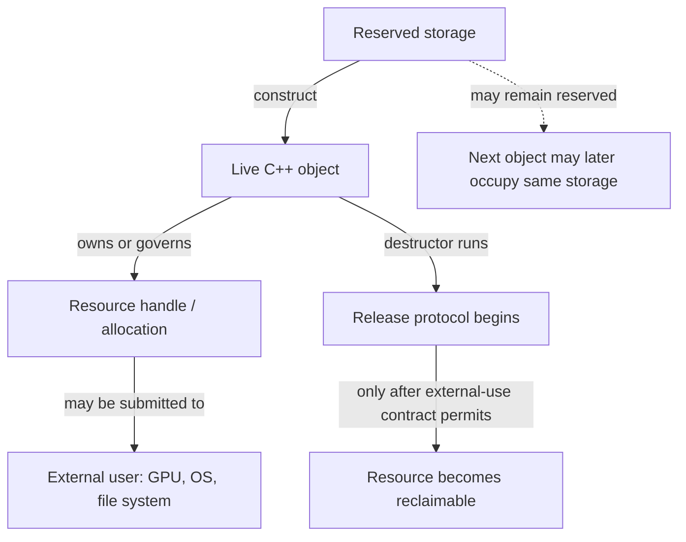

**Caption — The resource stack:** object destruction is a useful cleanup trigger, not proof that every external consumer has stopped. In a renderer, a fence, timeline value, deferred-deletion queue, or other API-specific completion rule may be part of the resource protocol.

### Why lifetime-bound cleanup is more reliable than remembering every exit

[[RAII and resource handles|RAII]] expands to **Resource Acquisition Is Initialization**. Read the name as a design cue: put a resource's responsibility into an object with a well-defined lifetime. Acquisition is associated with establishing the owner's usable state; destruction performs the matching release. The owner can be a small local guard, a standard-library type such as `std::unique_ptr` or `std::lock_guard`, or a domain wrapper around a non-memory handle.

Suppose a function opens a file, acquires a lock, validates data, and then writes. If each return path must remember `close` and `unlock`, adding one early return or throwing operation can leak the file or leave the mutex locked. A scope guard changes the proof: when stack unwinding leaves the scope, fully constructed automatic objects are destroyed in reverse construction order. Therefore the cleanup pairing is attached to scope exit rather than duplicated at each branch. This works for ordinary returns as well as exception unwinding.

RAII does **not** mean “everything is allocated on the stack,” “every constructor must acquire a resource,” or “the destructor can always succeed.” It means responsibility is represented by an object whose lifetime and cleanup protocol are explicit. A wrapper may acquire through a factory, adopt an already-created handle, or defer acquisition until an operation. A destructor should normally be non-throwing; if release can report failure, the design needs a separate explicit `close`/`flush` operation or error-reporting path, because throwing during stack unwinding can terminate the program.

The practical invariant is: **after successful construction, the owner knows exactly what it owns and how to release it.** If construction fails halfway, already-constructed members clean themselves up. This is why a raw handle stored in a class is not enough. The class must either make itself the complete owner, or immediately place that handle in a member that already provides ownership.

```cpp
#include <utility>

class LockGuard {
public:
    explicit LockGuard(Mutex& mutex) : mutex_(&mutex) {
        mutex_->lock();
    }

    ~LockGuard() noexcept {
        if (mutex_)
            mutex_->unlock();
    }

    LockGuard(const LockGuard&) = delete;
    LockGuard& operator=(const LockGuard&) = delete;

    LockGuard(LockGuard&& other) noexcept
        : mutex_(std::exchange(other.mutex_, nullptr)) {}

private:
    Mutex* mutex_; // non-owning pointer to the mutex; guard owns the unlock duty
};
```

Here `Mutex` is an illustrative interface with `lock()` and `unlock()`; the standard-library equivalent for an ordinary mutex is `std::lock_guard` or `std::unique_lock`.

The example's pointer does not own the `Mutex`; the guard owns the *responsibility to unlock it*. This is a useful correction to the overly narrow idea that RAII means “a smart pointer owns heap memory.” Ownership can be a duty to release a lock, close a file, unmap a region, or destroy a native handle. The guard also must not outlive its mutex: the pointer is a borrow, and the mutex's lifetime remains a precondition.

### Ownership is a responsibility contract, not pointer syntax

An **owner** is the entity responsible for ending a resource's use or lifetime according to its protocol. A **borrow** is temporary access that carries no such responsibility. [[Ownership and non-owning views|A raw pointer and reference are commonly used for non-owning access]] in modern C++; their spelling alone does not keep an object alive. A raw pointer can still be an owner in legacy or explicitly documented code, but then the contract is invisible to the type system and fragile at API boundaries.

Before choosing a pointer type, ask who owns the object and how many independent owners are required:

| Relationship | Usual representation | Meaning and limit |
|---|---|---|
| One owner; no ownership transfer at this call | `T&`, `T*`, or a view type | Borrow only; caller keeps the owner alive and respects invalidation rules. |
| One exclusive owner | `std::unique_ptr<T>` or a domain-specific move-only handle | One owner controls disposal; moving transfers that duty. |
| Several owners genuinely share one lifetime | `std::shared_ptr<T>` | A shared ownership group retains the object until its last strong owner releases it. |
| Need to observe shared ownership without extending it | `std::weak_ptr<T>` | Does not keep the object alive; `lock()` attempts to obtain a temporary strong owner. |
| A resource is not an ordinary `delete`-managed object | A purpose-built owner / custom deleter | Release must call the API and allocator that created the resource. |

Do not promote a borrow to `shared_ptr` merely because the lifetime feels uncertain. First find the actual owner and define the boundary where it remains alive. Shared ownership has real semantics and cost; it can also obscure architecture and create cycles. If an API needs only to inspect an object during the call, use a borrow. If it consumes ownership, say so with a move-only owner or clearly documented sink. If it retains shared lifetime, the shared pointer in the interface should express that intentional relationship.

### Exclusive ownership: `unique_ptr` makes transfer visible

[[Exclusive and shared smart-pointer ownership|`std::unique_ptr<T, D>`]] is a move-only owner: at most one such pointer in a given ownership chain is responsible for invoking its deleter. Its destructor, `reset`, or move assignment can trigger disposal. Copying is disabled because copying would create a second owner without a defined sharing policy. Moving transfers the ownership duty; it does not make the object itself move to a different address.

```cpp
#include <memory>

auto texture = std::make_unique<Texture>(device, description);
Render(*texture);                    // borrow for this call
QueueForUpload(std::move(texture));  // explicit transfer; texture is now empty
```

`std::make_unique<T>(args...)` constructs the object and returns its owner as one expression. It is the normal choice for dynamic exclusive ownership. A `unique_ptr` can also own a non-memory resource when supplied a deleter that performs the correct release, but a dedicated `Buffer` or `File` wrapper often gives a clearer interface and can store related context such as the owning device.

A raw pointer returned by `get()` is a **borrowed view**. It does not transfer ownership and must not be passed to `delete`. `release()` is different: it empties the smart pointer and returns the raw pointer, transferring responsibility to the caller, who must immediately establish another owner or perform the required release. Those verbs are not interchangeable.

Custom deleters encode the matching release operation. Their type is part of the `unique_ptr` type, so a capturing/stateful deleter may affect the owner's representation and move behavior. For an opaque C handle, the deleter may need both the handle and its device/context. For polymorphic deletion, deleting `Derived` through `Base*` requires a suitable virtual destructor, unless the deleter retains the concrete type and destroys it correctly. `unique_ptr<Derived>` can convert to `unique_ptr<Base>`, but the default deleter then sees `Base`; a non-virtual base destructor makes that conversion unsafe for destruction.

Arrays have an explicit `std::unique_ptr<T[]>` specialization and pair with array deletion. For ordinary growable sequences, `std::vector<T>` is usually the safer, more expressive owner: it records size and manages element construction/destruction. Do not mix `new[]` with scalar `delete`, or scalar `new` with `delete[]`.

### Shared ownership: one object, a group of owners, and a separate control block

Use [[Exclusive and shared smart-pointer ownership|`std::shared_ptr<T>`]] only when several independent parts of the program must each keep the same object's lifetime going. Copies join the same **ownership group**; destroying or resetting one copy removes only that owner's share. When the last strong owner goes away, the managed object is destroyed. The bookkeeping that coordinates owners lives in a **control block**, which commonly stores a strong-owner count, weak-observer count, deleter and allocator state. The standard specifies behavior, not a particular byte layout or exact performance cost.

```text
renderer ─┐
cache    ─┼──> shared ownership group ──> Texture lifetime
scene    ─┘             ↑
                 weak observers do not
                 keep Texture alive
```

`std::make_shared<T>(args...)` usually combines object and control-block storage into one allocation, though the standard does not promise a particular allocation strategy. This can reduce allocation overhead. It can also mean a long-lived `weak_ptr` keeps the combined allocation reserved after the managed object's destructor has run; the object and the control block have different lifetimes. Do not rely on a particular size or allocation count unless measured for the implementation in use.

An important subtlety: a `shared_ptr` stores a pointer value for access and participates in an ownership group. These need not denote the same address. The aliasing constructor can share ownership of one object while storing a pointer to a subobject. Likewise, a custom deleter may manage a native resource different from `get()`'s pointee. Never infer the complete disposal rule from the stored raw pointer alone.

Copying a `shared_ptr` generally updates shared bookkeeping. That operation is not free, and heavy cross-thread copying can contend on shared cache lines. Moving an existing `shared_ptr` transfers its local handle without creating a new owner. More importantly, shared-pointer thread safety is limited: separate `shared_ptr` objects sharing one control block may be manipulated concurrently under the library's guarantees, but this does **not** make concurrent mutation of the pointed-to `T` safe. The pointee still needs its own synchronization or immutability policy. `use_count()` is an observation, not a lock or a safe exclusivity test in concurrent code.

### Weak observation breaks cycles without pretending an object is alive

If two objects own each other with `shared_ptr`, neither strong count can reach zero. The result is a **reference cycle**: memory remains retained even when the rest of the application no longer needs the objects. Change one direction to [[Weak observation and ownership cycles|`weak_ptr`]] when that relationship is observational rather than lifetime-owning—often parent-to-child ownership with child-to-parent observation, or a cache entry that should not keep its value alive.

```cpp
if (auto parent = child.parent.lock()) {
    parent->Notify(child);
} else {
    // No strong owner remained when lock() was attempted.
}
```

`weak_ptr::lock()` is the safe operation that either obtains a temporary `shared_ptr` or returns empty. Avoid `if (!weak.expired()) { use(weak.lock()); }`: another thread or scope can release the last strong owner between the check and the attempted acquisition. Check the result of `lock()` itself. A weak pointer neither owns the object nor guarantees it will still exist at the next line unless a successful strong result is kept alive.

`std::enable_shared_from_this<T>` lets an already-shared-owned object produce another `shared_ptr` in the same ownership group. Its precondition is that a `shared_ptr` has already established that group. Constructing `std::shared_ptr<T>(this)` instead creates an independent control block and can cause double deletion. Calling `shared_from_this()` in the constructor is too early: the factory has not yet completed the shared-owner connection. Prefer a factory that first creates the `shared_ptr`, then performs any post-construction registration that needs shared self-ownership. `weak_from_this()` is useful when a non-owning self-observer is appropriate, but it does not manufacture ownership.

### Exceptions, partial construction, and the strong proof

RAII and exception safety meet at partial construction. When a constructor throws, the complete object's destructor is not called because that object never finished construction. However, each fully constructed base and member is destroyed automatically in reverse order. Therefore, put each acquired responsibility into a member owner as soon as it exists. A constructor that first acquires three raw handles and only later wraps them has a leak window if the second or third acquisition fails.

The useful guarantee here is not that “exceptions are safe” in the abstract. It is that every acquisition has a matching owner immediately, so every exit—including failed construction—has a defined cleanup path. For transactional operations, build a replacement under RAII, validate it, and only then publish or swap it into the long-lived state. This protects the existing state if preparation fails. It does not by itself roll back external side effects already committed to a file, GPU queue, or network peer; those require their own transaction or compensation protocol.

For asynchronous GPU work, destructor timing must respect **completion**, not merely CPU scope. If a command buffer refers to a buffer, destroying the C++ wrapper at the end of a function may be too early even though the wrapper's RAII is correct in isolation. The owner can enqueue the native object for deferred destruction tagged with a fence/timeline completion value. The release protocol then has two stages: logical ownership ends, and physical reclamation waits until submitted work can no longer access the resource. RAII makes the chosen protocol automatic; it does not choose the correct graphics synchronization rule for you.

### Figure CPP-04 - CPU cleanup can precede GPU reclamation

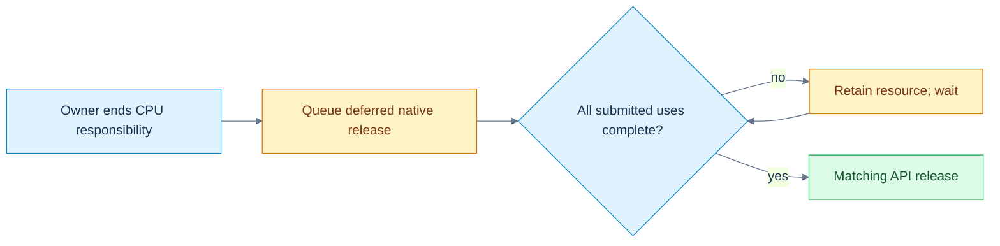

**Read the picture:** the destructor can transfer the release duty to a deferred-deletion queue. A fence or timeline condition covering every submitted use then permits native reclamation. **Limit:** this is a renderer policy, not behavior supplied by C++ or smart pointers. The queue, allocator and device must remain valid, and the backend must establish the correct completion condition. [[Visual Recall/02 - C++ - Objects, Ownership and Lifetime - Visual Recall#Four figure briefs|Recall this figure]].

### Custom allocation separates obtaining bytes from constructing objects

Ordinary `new T(args...)` is a **new-expression**: conceptually it obtains appropriately sized/aligned storage and initializes a `T` there. `delete p` calls the object's destructor and the matching deallocation function when `p` denotes a suitable object created by a matching allocation protocol. The expression manages a pair of operations; it is not merely a call to `operator new`.

An **allocation function** such as `::operator new(size)` obtains raw storage. It does not, by itself, create an arbitrary `T` object in that storage. An **object lifetime** begins only when the language's construction or implicit-lifetime rules say it does. This distinction matters in arenas and pools, where an allocator reserves a block and a container or caller constructs objects inside it. The allocator owns storage management; the object-aware layer must still construct and destroy the occupants correctly.

Modern code should normally keep explicit allocation centralized in a standard container, allocator-aware container, or carefully designed owner. `malloc`/`free` do not call C++ constructors/destructors. `new (std::nothrow) T` changes allocation-failure reporting for the corresponding new-expression, but it does not remove constructor exceptions or make every memory failure impossible. Alignment is a real precondition: storage must satisfy `alignof(T)`, as well as have enough size. Over-aligned types and custom pools need explicit support.

### Arrays carry a count and a destruction protocol

`new T[n]` creates an array of `n` elements (subject to allocation and construction succeeding); `delete[]` must destroy the constructed elements and release storage with the matching array deallocation protocol. The count is semantically important even when an implementation stores it in hidden overhead. If constructing a later array element throws, already-constructed earlier elements are destroyed and storage is released as required by the new-expression rules.

This is why inventing an array by allocating `n * sizeof(T)` bytes and pretending it is automatically a `T[n]` is not a generic safe shortcut. You need correct overflow checks, alignment, object construction for each element, tracking of how many constructions succeeded, reverse destruction, and matching deallocation. Let `std::vector<T>`, `std::unique_ptr<T[]>`, or a proven allocator/container abstraction carry that protocol unless you are implementing such a layer deliberately.

### Placement construction reuses storage; it does not allocate it

Sometimes an engine has reserved a pool slot or arena block and needs to begin a new object's lifetime there. [[Placement construction and explicit lifetime management|Placement new]] is the traditional spelling for constructing into an address supplied by the caller. In current C++, `std::construct_at(p, args...)` is usually a clearer library interface for this operation when its preconditions are met. Neither form obtains the underlying storage. The caller must already have enough correctly aligned storage, and must track the lifetime and eventual destruction of the object.

```cpp
#include <cstddef>
#include <memory>
#include <new>

alignas(Widget) std::byte slot[sizeof(Widget)];
Widget* item = std::construct_at(
    reinterpret_cast<Widget*>(slot), constructor_argument);

Use(*item);
std::destroy_at(item); // ends Widget lifetime; slot bytes still exist
```

This sketch demonstrates the distinction, not a complete general-purpose arena. A production slot abstraction should encapsulate size, alignment, occupancy, exception cleanup, and whether it is currently legal to reuse the storage. Calling `std::destroy_at` does not free `slot`; returning the slot to the arena is a separate allocator action. Conversely, reusing storage can end an existing object's lifetime, so existing references and pointers need the language's object-replacement rules, not just the same numeric address.

`std::launder` is not a generic “make this pointer valid” spell. It can obtain a pointer to an object already within its lifetime at an address when specific reachability and type conditions are met. It does not allocate storage, construct an object, fix alignment, revive a destroyed lifetime, or make an out-of-bounds pointer legal. Modern lifetime facilities—including `construct_at`, `start_lifetime_as` where applicable, and implicit-lifetime rules—have precise scopes; choose the operation that matches the intended object-creation semantics instead of treating raw bytes as universally interchangeable with objects.

### A union or arena slot has one occupant at a time

A union lets multiple members reuse storage, but only the active member's lifetime and value can be used under the applicable rules. When switching between non-trivial members, destroy the current member as needed, then construct the next one. A `std::variant` is often preferable for ordinary tagged alternatives because it tracks which alternative is active and handles construction/destruction; a manually managed union is a lower-level tool with a larger correctness burden.

The same reasoning applies to an arena slot: at one moment it may hold a `Particle`; later, after that lifetime ends, it may hold a `Command`. Bytes can remain at the same address while the object identity and valid operations change. **Transparent replacement** permits old names, pointers, or references to refer to a replacement object only when the standard's conditions are met; do not assume same address and same type always settle every case. If a pointer cannot automatically designate the replacement, a narrowly justified `std::launder` may be relevant after construction—but it still does not replace correct destruction, construction, alignment, and type checks.

Ordinary automatic objects should not be manually destroyed and then allowed to undergo their usual automatic destruction again. That risks using an object outside its lifetime and double destruction. Explicit destruction is appropriate in a controlled storage-management abstraction that also takes responsibility for exactly one construction and exactly one destruction per occupant. A tagged union or arena should track its state so the code knows which destructor is valid.

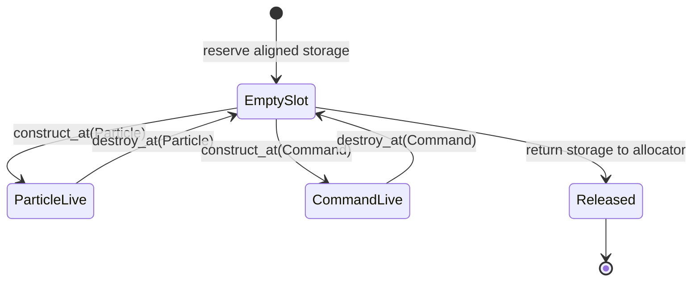

**Caption — Storage is not the occupant:** every transition has a precondition. Never construct the next occupant while a non-trivial current occupant still needs destruction; never read a member merely because the bytes at its former address still look familiar.

### A compact laboratory: choose the owner before the pointer

When reviewing a resource path, write a tiny ledger before looking at syntax:

| Question | Example answer for a GPU buffer |
|---|---|
| What is acquired? | Native buffer handle plus bound device memory. |
| Who creates it? | Device/resource factory with a specific allocator. |
| Who owns release responsibility? | A move-only `GpuBuffer` value. |
| Who merely borrows it? | A command-recording function during a documented valid interval. |
| What ends CPU-side ownership? | Destruction/reset of the `GpuBuffer`. |
| What delays actual release? | Completion fence/timeline for every submitted use. |
| What if creation of the second native object fails? | The first acquisition is already held by a cleanup owner and is released. |
| Can copying duplicate responsibility? | No; the owner is non-copyable and movable. |

Then test four failure paths: failure before acquisition, failure after the first of two acquisitions, early return after validation, and normal completion with work still in flight. A passing test should observe the matching release exactly once and only after the external-use condition is satisfied. Unit tests can verify wrapper behavior with a fake API; only the real backend can verify its actual synchronization and native-handle protocol.

### The teaching summary: ask “who, until when, by which release?”

The story now extends the object model. Storage answers where bytes are available. Lifetime answers which object occupies them. Ownership answers who must end the resource's use. External synchronization answers when release is actually safe. RAII connects the owner's object lifetime to its cleanup protocol; smart pointers are standardized ownership policies, not general-purpose pointer decorations. `unique_ptr` answers “one owner”; `shared_ptr` answers “a genuine shared lifetime”; `weak_ptr` answers “observe without keeping alive.” A raw pointer or reference usually answers only “borrow access.”

When bytes must be managed below the level of containers, allocation, object construction, destruction, and storage release are separate operations. Placement construction begins an object in already-provided storage. Explicit destruction ends that object's lifetime, not necessarily the storage's. Reuse creates a new occupant and requires the language's lifetime and replacement rules. None of these low-level tools removes the need for an owner ledger.

**Board test:** draw the four-level lifetime diagram, then pick one file, lock, unique resource, shared resource, and arena slot. For each one, say who owns it, who borrows it, what event ends use, what operation releases it, and what can make release too early or too late. If those answers are concrete, the vocabulary has become an operational model.

[[Visual Recall/02 - C++ - Objects, Ownership and Lifetime - Visual Recall|Open the C++ visual-recall board]] · [[Supplementary/Foundations#M010 - Parts 148-160|M010 coverage ledger]] · [[Keyword Index]] · [[Dependency Map]]


## From one owned resource to many requests and a replaceable backend

The previous chapter established that a resource has an owner, an object lifetime, and sometimes an external user that can outlive the local C++ scope. That solves one class of problems. It does not yet tell us how a renderer should represent different *kinds of work*, or how the same calling code can send that work to a Vulkan implementation, a Metal implementation, or a test implementation without rebuilding every scene system.

Imagine that the editor has three actions waiting for the renderer. First it clears the background to a color, then draws mesh 17 with material 4, and finally uploads 4,096 bytes of texture data. The renderer must remember **which kind of request each record represents**; otherwise the number 17 might be mistaken for a byte count or a color component. And the editor should not need to know which graphics API is responsible for carrying out the requests. These two requirements are related but different: a request is *one value chosen from a known set of shapes*; a backend is *one implementation chosen from a set that may be selected at runtime*. We will solve the first problem with a tagged alternative, and the second with a carefully owned interface. Along the way, we will encounter the C++ rules that make this safe or dangerous.

### Why reusing memory does not identify the object stored there

Suppose the first version of a command buffer saves space by allocating one record large enough for either a color or a mesh identifier. In C++, a `union` can give distinct members overlapping storage:

```cpp
union Cell {
    std::uint32_t meshIndex;
    float opacity;
};

Cell cell{.meshIndex = 17};  // meshIndex begins as the active member
cell.opacity = 0.5f;         // for this trivial member, assignment begins its lifetime
// Reading cell.meshIndex here is not a valid way to recover the old mesh index.
```

A union is not a magic box in which every member simultaneously exists. Its members share storage; the *active member* determines which object can be accessed under the applicable lifetime rules. For nontrivial members, changing the occupant may require explicitly destroying the old object and constructing the new one. In contrast to a formatted file, the raw union does not carry a trustworthy external tag saying which interpretation the next reader should use. A handwritten tagged union therefore needs a separate discriminant, a complete set of valid states, correct constructors, destruction, copying and moving, and recovery if a constructor throws. The challenge is not allocating enough bytes; it is preserving the link between bytes, object lifetime, and the *meaning* of the active value.

If the request alternatives are known at compile time, `std::variant` gives us that link without requiring an engine author to implement the union's state machine by hand:

```cpp
#include <cstdint>
#include <variant>

struct Clear { float red, green, blue; };
struct DrawMesh { std::uint32_t meshId, materialId; };
struct Upload { std::uint64_t byteCount; };

using Request = std::variant<Clear, DrawMesh, Upload>;
Request request = DrawMesh{17, 4};

if (auto* draw = std::get_if<DrawMesh>(&request)) {
    // A non-null pointer proves this is presently the DrawMesh alternative.
    DrawMesh selected = *draw;
    (void)selected; // the example only demonstrates the checked read
}
```

The alternative type and the currently active index are separate ideas. `std::holds_alternative<T>` asks which alternative is active; `std::get_if<T>` returns a pointer only when that type is active; `std::get<T>` throws `std::bad_variant_access` if the selection is wrong. `std::visit` selects the operation corresponding to the actual alternative, allowing a renderer to handle each command without inventing a dangerous integer-to-struct cast. The visitor's result type and alternative handling must still be coherent: for a non-generic visitor, adding a new alternative requires updating the visitor. A `variant` can also become `valueless_by_exception()` in certain throwing replacement operations; code that relies on `visit` must decide how to treat that exceptional state rather than assuming it is impossible. It is a *type-safe representation*, not a promise that user inputs, bounds or resource readiness are valid.

Follow the three requests as values. The first object is a `Clear` containing three floating-point color components; the second is a `DrawMesh` containing two unsigned identifiers; the third is an `Upload` containing a 64-bit byte count. A visitor reads the first as color, the second as mesh/material identity, and the third as a byte quantity. It never attempts to read a mesh index from an active `Upload`. Changing from `DrawMesh` to `Upload` changes the active alternative and ends the prior alternative's lifetime according to the variant operations. The type itself expresses that exactly one of the listed command forms is present at a time.

This is a good use of a *sum type*—a value with one of several explicitly listed forms. It is not automatically an efficient GPU command format: the object's layout is a C++ library representation, not a stable wire format or shader ABI, and `std::variant` can carry size, alignment and dispatch costs. If requests must be serialized or uploaded to a device, define a separate, versioned binary record and validate conversion into the in-memory alternative. That follows directly from the earlier lesson that an object's C++ layout is not a file or GPU contract.

### The request has a known shape; the backend has a runtime identity

The editor can now represent work, but it still should not contain an `if` statement for every graphics backend at every call site. A base class can specify a common operation, and a derived class can provide its implementation. This is an *is-a* relationship only when every derived object truly satisfies the base's observable contract; inheritance is not an appropriate shortcut just to reuse a few lines of implementation. For ordinary implementation sharing, composition—a member object containing another object—is often simpler and safer.

Consider the smallest meaningful backend interface:

```cpp
class Backend {
public:
    virtual ~Backend() = default;
    virtual void submit(const Request& request) = 0;
};

class CountingBackend final : public Backend {
public:
    void submit(const Request& request) override {
        // Count commands through std::visit without pretending to execute GPU work.
    }
};
```

The word `virtual` means that when `submit` is called through a `Backend` reference or pointer, C++ can select the final override appropriate to the object's dynamic type. The static type is what the expression is declared to be—`Backend&`, for example. The *dynamic type* identifies the actual polymorphic object, which could be `CountingBackend`. A pure virtual declaration, marked `= 0`, makes the base abstract: it cannot be instantiated as a complete object while it retains an unimplemented pure virtual operation. An abstract interface specifies a minimum useful contract, not a guarantee that every implementation behaves correctly. The derived `override` keyword asks the compiler to diagnose a signature that fails to override, and `final` disallows further derivation or override as applicable.

Many compilers implement virtual calls using a hidden table of function pointers and a per-object pointer or equivalent metadata, usually called a *vtable* and *vptr*. That is a useful performance and layout model, **not a layout mandated by the C++ language**. A virtual call may involve an indirect branch, and an optimizer may remove that indirection when it can prove the target. You must not serialize a polymorphic object by copying its bytes, assume its first machine word is a vptr, or calculate its size by casually adding a pointer to its named fields. Actual layouts, thunks and adjustment rules depend on the compiler and its application binary interface.

Why is the virtual destructor necessary? The renderer factory might return `std::unique_ptr<Backend>` while constructing a concrete `CountingBackend`. When the owner is destroyed, its default deleter calls deletion through the `Backend*`. A suitable virtual base destructor ensures that the derived object is destroyed through the polymorphic deletion path, then its base subobjects. Deleting a derived object through a base pointer that lacks an appropriate virtual destructor is unsafe in the ordinary default-delete pattern. A base intended for polymorphic ownership should make its destructor policy explicit, normally public and virtual. A custom deleter that retains the concrete destruction protocol can be an exception, but it needs its own proof rather than an assumed shortcut.

The lab uses borrowed references to a `Counts` record and a destruction counter. The test creates the backend inside a scope and confirms the derived destructor runs once as the `unique_ptr<Backend>` leaves that scope. The references must remain alive for the backend's entire use; virtual dispatch does not turn them into owners. Likewise, a real backend's destructor must respect GPU completion and deferred retirement rules established in the previous chapter. The virtual destructor selects the correct C++ cleanup behavior—it does not implicitly wait for device queues.

### A derived object contains a base subobject, not an interchangeable base value

When a `CountingBackend` is constructed, there is a `Backend` base subobject within the complete object. A base pointer or reference can refer to that subobject while virtual dispatch preserves access to the derived behavior. But copying a derived object into a *base value* constructs only a base object, discarding the derived portion. This is **object slicing**.

The runnable lab demonstrates slicing with a non-abstract `NamedObject` base and a `MeshObject` derived class. Calling `kind()` through a `NamedObject&` bound to the original mesh returns `"mesh"`. Copying the same mesh into a new `NamedObject` value gives that new object the base's dynamic type, so its virtual `kind()` returns `"base"`. The source object has not changed. What changed is which complete object the caller is asking about. An interface with pure virtual functions cannot itself be sliced into a standalone instance because abstract classes cannot be instantiated, but non-abstract polymorphic bases can still suffer this problem. Prefer references, pointers or owning polymorphic wrappers when dynamic identity matters.

Multiple inheritance extends this picture. A derived class can implement two independent interfaces, perhaps `IRenderBackend` and `IDiagnostics`. It then contains the corresponding base subobjects; conversion to each base view may involve a pointer adjustment, and unrelated base names can become ambiguous. Two separate paths may also reach the same ancestor, producing the *diamond* shape. Ordinary repeated inheritance may give two ancestor subobjects. Declaring the shared ancestor as a **virtual base** makes its subobject shared within the most-derived object; the most-derived class is responsible for initializing that virtual base. The lab constructs `Diamond : Left, Right` with both paths virtually inheriting `Root` and verifies that conversion through either path yields the same `Root` subobject. This illustrates identity, not a promised pointer offset or byte layout.

Multiple inheritance is therefore not automatically wrong, but it increases the reasoning burden. Independent pure interfaces are a common defensible use; complex concrete inheritance diamonds often signal that composition would communicate ownership and responsibilities more clearly.

### A cast cannot manufacture a valid object

When the caller holds a base pointer, there may be a genuine need to discover the concrete implementation for diagnostics. `dynamic_cast<CountingBackend*>(backend.get())` checks a runtime relationship for polymorphic types and returns null for an incompatible pointer cast. A failed reference cast throws `std::bad_cast`. This can be useful at debugging or integration boundaries, but repeated downcasts often suggest that the base interface is missing a required operation or that the design has become dependent on a particular implementation. Availability also depends on build settings that support the required runtime type information.

A `static_cast` converts between related types when the language permits it, but it does not perform that same dynamic check. A base-to-derived `static_cast` needs a proof that the actual object is compatible; a syntax-valid cast is not such a proof. Converting a derived pointer to a base pointer is a normal, safe upcast within its lifetime and access rules. A `const_cast` can remove `const` or `volatile` qualification from an access path, but writing through it is undefined when the underlying object was genuinely declared const. It does not grant ownership or synchronize threads.

A `reinterpret_cast` can reinterpret particular pointer or integer representations under language rules, but it neither constructs the new object nor makes an unrelated type legally alias the same bytes. This is a frequent source of misleading engine code. To inspect bytes, use the appropriate byte-view or copy operation; for supported equal-sized trivially copyable representations, `std::bit_cast` expresses a representation conversion much more clearly than treating a typed object as a live unrelated type. Endianness, padding and format versioning remain separate concerns. No cast eliminates alignment, bounds, provenance or lifetime obligations.

### Equality is an engine promise, not merely a convenient operator

A command system needs identities. A resource handle composed of `slot=7` and `generation=3` is different from `slot=7` and `generation=4`, even if both refer to storage at the same index at different times. We can make this meaning explicit through a value type:

```cpp
struct AssetId {
    std::uint32_t slot;
    std::uint32_t generation;
    auto operator<=>(const AssetId&) const = default;
};

static_assert(AssetId{7, 3} == AssetId{7, 3});
static_assert(AssetId{7, 3} != AssetId{7, 4});
```

The defaulted three-way comparison uses the declared members in order and can also enable a synthesized equality operator under the relevant rules. For these unsigned integer fields, this gives a *strong ordering*: two IDs compare consistently by their stored values. That is a useful deterministic order for keys, but it is **not** a statement about resource age, importance or current validity. A handle remains invalid if its registry does not contain the matching live generation, even when its fields compare equal to an old recorded handle. An equality operator must represent the intended semantic equivalence; it should not casually compare memory bytes that may contain padding or unrelated bookkeeping.

C++20's `<=>` reports an ordering category rather than always returning a Boolean. Strong ordering is appropriate for identities with a meaningful total order; weak ordering can represent equivalent values that need not be identical under the application relation; partial ordering includes values that cannot be compared in the usual way. Floating-point NaN illustrates partial ordering: comparing NaN with a finite value is unordered, not less, equal or greater. A defaulted comparison for a record containing floating-point fields can therefore have different semantic consequences than the integer-only `AssetId`. Using such records as ordered-map keys requires an ordering relation that satisfies the container's strict weak ordering requirements, including an explicit policy for NaNs if relevant.

Operator overloading is useful when it keeps the domain meaning visible—for example, adding a duration to a timestamp, not adding two arbitrary resource handles. Operators should preserve the invariants of their value types, avoid hidden resource creation or unexpectedly expensive work, and agree with the ordinary interpretation of the operation. A custom `operator==` should be reflexive, symmetric and transitive over the domain in which it is used; exact floating-point equality is not a general approximate comparison policy. Contextual tolerances belong in explicitly named comparisons, not silently inside a container key's equality relation.

### The compiler chooses an overload before a virtual function chooses its implementation

Another decision occurs at the call site: a function name may refer to several overloads. C++ first performs name lookup to find candidate declarations, then decides which are viable for the provided arguments, and ranks allowed conversions. An exact match normally wins over a conversion; templates, user-defined conversions, constraints and visibility can complicate that choice. The return type alone does not ordinarily distinguish overloads of the same parameter list. If two viable candidates are equally good under the ranking rules, the call is ambiguous and the program is rejected rather than deciding unpredictably at runtime.

The lab's `classify(int)` and `classify(double)` are an intentionally small observable case. Passing `3` chooses the integer overload and produces `1`; passing `3.0` chooses the double overload and produces `2`. A cast can influence the static type passed to overload selection, but it should not be used to conceal a poorly specified API. Especially in generic engine code, signed/unsigned conversions, initializer-list constructors, implicit conversions, and similarly named overloads deserve compile-time tests because an innocent-looking literal can select a different operation.

Default function arguments create a subtler interaction with virtual calls. Consider:

```cpp
struct Base {
    virtual ~Base() = default;
    virtual int reserve(int n = 2) const { return n; }
};
struct Derived : Base {
    int reserve(int n = 7) const override { return n * 10; }
};

Derived concrete;
Base& baseView = concrete;
assert(baseView.reserve() == 20); // default argument 2 from Base, body from Derived
assert(concrete.reserve() == 70); // default argument 7 from Derived, same Derived body
```

The default argument is chosen from the declaration visible through the **static type at the call site**; the virtual function body is selected according to the **dynamic type at runtime**. These are two different decisions. Defaults are not inherited as a dynamic policy, do not form part of the function type, and can create surprising differences when an override supplies a different default. A safer public interface often provides one non-virtual wrapper that determines defaults and calls a protected virtual operation with all arguments explicit. This is a concrete reason to understand lookup and dispatch together instead of learning them as unrelated vocabulary.

### One trace through the complete model

Start with three `Request` values: a clear, a mesh draw, and an upload of 4,096 bytes. Each value's variant tag identifies its active alternative. A `std::unique_ptr<Backend>` owns a `CountingBackend`, while the three requests are borrowed by reference during `submit`. Virtual dispatch calls the concrete override; within that override, `std::visit` chooses behavior from the active request tag. The resulting counters are one clear, one draw, one upload and 4,096 accumulated bytes. Leaving the scope destroys the derived backend exactly once via a virtual destructor. No real GPU work was submitted; the test's purpose is the C++ choice-and-lifetime model.

Now alter the system deliberately. Change the second request from `DrawMesh` to `Upload` and verify the active tag changes, the counter changes and no draw-specific field is read. Try a checked downcast to a different backend type and verify it returns null. Copy a derived object into a non-abstract base value and observe slicing. Reach the same virtual base through both diamond paths. Call an overridden virtual function through different static types with different defaults. Compare two handles differing only in generation; then compare a NaN to a finite floating-point value and check the result is unordered. Each experiment isolates a rule that matters when the engine grows beyond one backend and one command.

**Runnable reference:** [[tools/labs/backend_choice_lab.cpp|`tools/labs/backend_choice_lab.cpp`]]. From the repository root, compile with:

```sh
c++ -std=c++20 -Wall -Wextra -Wpedantic -Werror \
  -fsanitize=address,undefined -fno-omit-frame-pointer \
  tools/labs/backend_choice_lab.cpp -o /tmp/backend_choice_lab
/tmp/backend_choice_lab
```

The reference run used GCC 14.2.0 on Linux with address and undefined-behavior sanitizers enabled and completed all the assertions. This is evidence for this standalone C++ model, not for an actual Vulkan/Metal implementation or current Kairo modules. Before attributing anything to `KairoRenderer/GraphicsBackend.cppm` or `KairoAI/AIProvider.cppm`, inspect the corresponding current repositories and cite exact declarations and call sites. No such external repository inspection is claimed by this chapter.

### Choose the mechanism by the question it solves

A `variant` is a natural fit when the supported alternatives are known and a value should always identify its active form. Virtual dispatch is a natural fit when a stable contract must be implemented by objects selected or extended independently at runtime. An overloaded function is a *compile-time selection* from declarations based on argument types and conversions, not a runtime substitute for a backend interface. A cast changes or checks how an expression views an existing object; it does not create the representation, ownership or dynamic behavior the system lacks. Equality and ordering define domain promises about values, not about the existence of live resources.

The cost comparison also needs evidence. Virtual calls can inhibit inlining when the target is unknown, but indirect calls are not automatically slower overall than a large `variant` visitor with poor locality. `variant` stores the largest appropriately aligned alternative and carries a discriminator; polymorphic objects have separate allocation and locality possibilities, depending on how they are owned. A useful controlled experiment compares the same sequence of commands under both representations: report object size, allocation count, branch predictability where measurable, instruction cost, cache behavior, and whether the compiler could devirtualize. Do not declare one abstraction universally faster without stating workload, compiler, architecture and optimization settings.

**Reconstruct without reading:** explain why a byte array is not automatically a live command; derive why three known request forms favor a checked tag; draw an owning interface and its derived object; identify where a base subobject exists; predict slicing and the default-argument example; state exactly what each cast does and does not prove; and describe why a generation-aware identifier needs both slot and generation in equality. Then rebuild the counting backend and test it from a blank file. When those actions work, the material has become implementable knowledge rather than a list of C++ terms.

**Coverage boundary:** this first additive narrative targets the original M011 Parts 161–180. It provides a coherent teaching route and a checked standalone laboratory, but it is not an independent audit of the user's external engine repositories, every possible C++ ABI, or learner recall. The separate evidence ledger records that boundary; no missing source segment is silently reclassified as received.

## From an accepted render request to a resource that survives failures and callbacks

Our last chapter established two independent decisions: a `std::variant` identifies what work was requested, and a virtual `Backend` interface identifies which implementation performs the work. That is not yet a complete resource pipeline. The editor can ask to upload a mesh; a worker may read its data later; a renderer may allocate a native handle; and a completion callback may run after the scene that requested it has closed. An invalid file, a failed allocation or an exception must not expose a half-created resource. The same problem forces us to understand conversions, callable objects, lambda captures, exception guarantees, object representation and safe native-resource ownership. We will not learn these as twenty unrelated pieces of vocabulary: we will follow one upload from the request boundary through validation, preparation, publication and notification.

The central contract is simple to state and difficult to maintain: **a published asset is complete, its owner is unambiguous, its data have a checked meaning, and failed preparation must not change previously published assets.** We must also distinguish the lifetime of a C++ object from its backing device resource and from a callback that might retain a reference to it. The actual C++20 reference is [[tools/labs/safe_asset_pipeline_lab.cpp|the safe asset pipeline laboratory]]. It is intentionally a deterministic fake native-device model, not an uninspected claim about any current Kairo, Vulkan or Metal implementation.

### The first bug is possible before we load a file: 4096 of what?

A function such as `upload(std::size_t amount)` accepts a numeric quantity but says nothing about its meaning. Mesh indices, texture IDs, byte counts and frame numbers might all use `std::size_t`. Their machine representation can be similar without making the quantities interchangeable. C++ overload resolution reasons about types and allowed conversions, not the intent behind an integer. An ordinary one-argument constructor can participate in *implicit conversion*, and a user-defined conversion operator can turn one class value into another type in certain contexts. Convenience is valuable for a genuinely interchangeable representation; it is dangerous when it silently changes units.

Give our operation its own small value type:

```cpp
struct ByteCount {
    std::size_t value;

    explicit constexpr ByteCount(std::size_t n) noexcept : value(n) {}
    explicit constexpr operator std::size_t() const noexcept { return value; }
};

ByteCount requested{4096}; // the unit conversion is visible
// ByteCount accidental = 4096; // intentionally rejected by explicit
auto rawNumber = static_cast<std::size_t>(requested);
```

`explicit` on a converting constructor prevents its use in ordinary implicit copy-initialization; it does not prohibit explicit direct construction. `explicit` on a conversion operator likewise controls which conversion contexts can use it. Contextual Boolean conversion is a special case—for example, a class may provide `explicit operator bool()` yet work in an `if` condition. An unqualified implicit conversion operator may also affect overloaded-function selection unexpectedly, so conversion policy must be considered together with the overload rules from the preceding chapter.

The laboratory checks the compiler's answer with `std::is_convertible_v` in both directions. The static assertions establish that a `std::size_t` does not implicitly become our `ByteCount` and vice versa. They do **not** establish that a count fits device capacity or is nonzero. Those are distinct runtime conditions, validated before native acquisition. The important lesson is not to wrap every scalar mechanically; it is to choose explicit types at boundaries where mixing meanings would violate an important contract.

### A worker needs a callable completion operation—and a way to know what state it may use

A *callback* is an operation passed to another component for invocation on its terms. If the callback runs immediately, it may borrow a local variable whose lifetime is known to cover that call. If it is stored for later execution, the same borrowed variable can disappear before invocation. The safety question is therefore not merely “does this type have parentheses?” but **what does its invocation need, and who keeps that state alive?**

A plain function pointer identifies a function with a compatible signature. It carries no automatically associated editor object. A C-style API frequently passes a second, opaque pointer back to the function:

```cpp
using RawReport = void (*)(void*, ByteCount);

void report_to_counter(void* context, ByteCount bytes) {
    // Contract: context points to a currently live, aligned std::size_t.
    auto& sum = *static_cast<std::size_t*>(context);
    sum += bytes.value;
}

std::size_t completedBytes = 0;
RawReport report = &report_to_counter;
report(&completedBytes, ByteCount{4096});
```

The `void*` context is a *borrow*: converting it back using `static_cast` does not check that it is the correct object type, still alive, or safe to access concurrently. The function pointer has no ownership power over `completedBytes`. If a worker stores the pointer beyond the local variable's lifetime, the callback eventually accesses a dangling object. If the callback is invoked from another thread while the editor changes the same counter without synchronization, the data race is a different correctness failure. The use of a C API does not exempt us from C++ lifetime and concurrency rules.

A pointer to a **non-static member function** is a different type of callable because a member operation requires a particular object. For example:

```cpp
struct Reporter {
    std::size_t bytes = 0;
    void report(ByteCount value) { bytes += value.value; }
};

Reporter reporter;
void (Reporter::*operation)(ByteCount) = &Reporter::report;
(reporter.*operation)(ByteCount{32});
```

The operation is associated with the `Reporter` class; calling it also requires `reporter`. The equivalent syntax for a pointer to a `Reporter` is `(pointer->*operation)(ByteCount{32})`. A pointer-to-member function is not generically interchangeable with an ordinary function pointer and is not guaranteed to be represented by one address-sized machine word. Virtual dispatch and multiple inheritance can change the implementation's member-pointer representation. A callback trampoline can bridge such an operation into a function-pointer-and-context API, but the context's lifetime remains an obligation.

A **function object** solves a related problem by keeping operation and state in one C++ object. It defines `operator()`:

```cpp
struct AddBytes {
    std::size_t* destination; // still a borrow, not ownership

    void operator()(ByteCount amount) const {
        *destination += amount.value;
    }
};

std::size_t total = 0;
AddBytes add{&total};
add(ByteCount{16});
```

Now a callback has a concrete object representation that can carry arguments, handles or other state. But the raw pointer inside it remains borrowed. Copying a callable copies its member fields according to their semantics; it does not automatically deep-copy their referents.

### A lambda is a created object, and its capture is a lifetime contract

A lambda expression creates an object of a unique, compiler-generated *closure type*. Its body becomes a callable operation. Its captures determine which state is stored in, or referred to by, that object. We can understand the behavior without guessing the compiler's closure layout.

```cpp
std::size_t changing = 10;
auto snapshot = [saved = changing] { return saved; };
auto liveView = [&changing] { return changing; };
changing = 20;

// snapshot() returns 10; it owns the captured numeric value.
// liveView() returns 20; it accesses the same still-live variable.
```

The distinction is not merely syntactic. A value capture of a `std::string_view` copies the *view*, not the characters it points at. A value capture of a raw pointer copies the pointer, not the object. A `[&scene]` capture makes the eventual invocation depend on a live `scene`. Capturing `this` allows member access but does not keep the pointed-to object alive. The `[=]` default capture in a member function must not be mistaken for automatically owning a copy of the entire object. When appropriate and copyable, `[*this]` creates a captured copy of the current object; that can be expensive or wrong when the original object represents unique engine identity.

Suppose a user closes a scene after starting a texture load. The worker completes, invokes a lambda holding `[&scene]`, and tries to publish the texture into a destroyed scene. That is a lifetime violation, typically **undefined behavior**, not an exception we can recover from. Three common valid designs make different promises: copy the small data that the callback truly needs; capture a `std::shared_ptr` to state whose lifetime is intentionally shared; or capture a `std::weak_ptr`, call `lock()` when invoked, and gracefully discard the result if the state no longer exists. A generational scene/request identity can also prevent obsolete results from being published, if the registry's lifetime and synchronization contracts are correct.

An owning capture is demonstrated in the lab. A callback captures a `std::shared_ptr<int>` and can safely run after the local shared pointer's scope ends. A `weak_ptr` observer verifies that the target stays alive while the callback owns it and expires when the callback target is released. This does **not** prove every use of `shared_ptr` is thread-safe; it controls object lifetime, not unsynchronized access to its mutable contents. Storing an owning callback inside an object it strongly owns can form a cycle. The correct ownership graph matters more than the apparent convenience of the capture syntax.

### Why a uniform callback interface still has a price

The editor may want a queue of callbacks all callable as `void(ByteCount)` while their real types differ. `std::function<void(ByteCount)>` is a *type-erased* callable wrapper: the consumer can invoke one public signature without knowing the stored function, lambda or functor's concrete type. The wrapper manages the target's lifetime, invocation and copying. It has its own failure state: invoking an empty `std::function` throws `std::bad_function_call`.

Type erasure hides the concrete type at a particular interface, **not** its runtime cost. A library may store small targets inline and allocate storage for others; no particular inline size is guaranteed for arbitrary user targets. Copying the wrapper copies the target and can therefore copy captures or increase shared ownership counts. `std::function` requires a copy-constructible callable target; a lambda that directly captures a move-only `std::unique_ptr` is not generally a valid target. C++23 adds `std::move_only_function` for move-only callable wrappers, while templates can preserve the callable type when runtime erasure is unnecessary.

For a synchronous low-level API, a function pointer plus context can be simpler. For a worker queue, a move-only task may better express ownership. For an event subscription that is copied, `std::function` may be appropriate. A custom small-buffer wrapper requires actual measurement and a careful lifetime implementation. None of these choices is automatically the fastest. Benchmark the same workload, measuring call overhead, allocation count, target size, cache behavior and contention on the target compiler and standard library before claiming an advantage.

### A decoded asset is not ready merely because its bytes exist

Our callback mechanisms can now notify the editor. But the actual upload needs a sound state transition. Imagine the scene already contains one valid mesh. It asks for a texture; the loader has data bytes, acquires a native resource handle, and then discovers an invalid asset field. If it has already inserted the partial record into the scene, the scene's published state is corrupted. If it forgets to release the native handle on failure, the resource leaks.

A correct *prepare-then-publish* transaction keeps the proposed result private while its parts are being constructed. It is made visible only after all required preparation succeeds. C++ exceptions make this easier when resources are held by properly constructed local owner objects. If an operation throws, automatic local objects constructed earlier are destroyed during **stack unwinding**. Their destructors execute the cleanup responsibility that they own. An exception does not, however, undo arbitrary external effects such as bytes already written to a file, a network message already sent or GPU commands already submitted.

We can specify three useful failure guarantees. The **basic guarantee** means that objects remain valid and resources do not leak, although published values may change. The **strong guarantee** means that a failed operation leaves the specified observable state as it was before the operation. The **no-throw guarantee** means no exception escapes that operation; it does not promise that it cannot report failure another way.

Let $S$ denote the store's published asset sequence, and let $P$ denote a private, fully prepared record. A successful publication changes the sequence according to:

$$
S_{\mathrm{new}} = S_{\mathrm{old}} \mathbin{\|} P,
$$

where $\mathbin{\|}$ is the append operation. The strong guarantee for a covered failure means:

$$
S_{\mathrm{after\ failure}} = S_{\mathrm{before}}.
$$

This equation does **not** mean no temporary memory was allocated or no resource was ever created during the attempt. It means that the declared visible state is unchanged. The resource acquired on a failed path must still be released, and a commit boundary must be specified separately from later notifications.

### Build an owner from an empty state, not from a hope that callers remember delete

The first phase's ownership chapter established why a destructor should control a matching release protocol. We now design a resource-owning type from an empty state. The fake device creates a native handle; a wrapper records the associated borrowed device and the unique handle. An empty wrapper has no release responsibility. A successfully constructed wrapper owns exactly one such responsibility.

```cpp
class Resource {
    FakeDevice* device_ = nullptr; // device lifetime must cover Resource
    std::size_t handle_ = 0;       // zero means no native handle
public:
    Resource(FakeDevice& device, ByteCount bytes)
        : device_(&device), handle_(device.acquire(bytes)) {}

    ~Resource() noexcept { reset(); }
    Resource(const Resource&) = delete;
    Resource& operator=(const Resource&) = delete;

    Resource(Resource&& old) noexcept
        : device_(std::exchange(old.device_, nullptr)),
          handle_(std::exchange(old.handle_, 0)) {}

    void reset() noexcept {
        if (device_ != nullptr) {
            device_->release(handle_);
            device_ = nullptr;
            handle_ = 0;
        }
    }
    // The complete lab also implements correct move assignment.
};
```

A constructor that successfully acquires the handle establishes the owner's invariant. Copying is forbidden because two owners with the same release duty would cause double release. Moving transfers the device association and handle, leaving the source empty. Move assignment must first release the destination's old resource, handle self-assignment correctly, then adopt the source. The device must outlive all of its resource wrappers; storing a pointer to it does not own or extend the device lifetime. If the constructor's `device.acquire` throws, the `Resource` object is not completely constructed, so its destructor is not run. The factory must itself guarantee no leaked partially acquired native pieces; a constructor's not-yet-existing complete owner cannot be expected to repair a factory that leaks before returning.

This example begins from a blank *owner object*, but a complete native GPU buffer has additional requirements: allocator association, memory residency, queue submission, fences or timeline values, and deferred release while external consumers still use it. The fake model tests C++ ownership and exception flow; it is deliberately not a GPU lifetime proof. An owner for raw allocated *storage* would separately need checked size/alignment, construction and destruction of its occupants, and the matching allocator/deallocator. These are the same object-lifetime distinctions from M010, now applied to a publication protocol.

### The important failure: after acquiring a resource but before publication

The lab's `AssetStore::upload` accepts owned metadata and bytes, validates the payload, and prepares a native resource in local storage. A complete `AssetRecord` then contains the byte count, resource owner, source bytes and label. Only one operation publishes it: `records_.push_back(std::move(ready))`. Before that line, consumers cannot observe the proposed record through the store.

Why is this strong guarantee credible? First, any failure while `Resource pending` is live destroys it and releases the newly acquired handle. Second, existing records are untouched during preparation. Third, `std::vector` may reallocate during `push_back`; the example checks that its `AssetRecord` is nothrow move-constructible, so moving old records during such reallocation cannot throw on the tested element type. Failure to allocate replacement vector storage leaves the existing vector intact. These are conditions of the argument, not a blanket claim that vectors or moves are always exception-safe. With an element that is not copyable and whose move can throw, some vector reallocation paths cannot provide the same unchanged-state guarantee.

The actual test does this sequence:

| Point in the transaction | Published records | Handles acquired | Handles released | Live handles |
|---|---:|---:|---:|---:|
| Initial store | 0 | 0 | 0 | 0 |
| First successful mesh upload | 1 | 1 | 0 | 1 |
| Second upload throws after acquiring handle | 1 | 2 | 1 | 1 |
| Third successful texture upload | 2 | 3 | 1 | 2 |
| Store leaves scope | — | 3 | 3 | 0 |

During the deliberate failure, the original record retains its label and native handle. The just-acquired handle is released once. Afterward a new upload still succeeds. When the store is destroyed, every remaining owner releases its native handle. The operation is not a full filesystem or GPU transaction: the test does not inject failure at every possible allocation, perform concurrent cancellation or establish atomicity for a callback that executes after publication.

The latter distinction is important. If we publish a resource and *then* call a user callback which throws, the resource is already visible. Unless our API has a separate rollback/compensation protocol, it cannot claim the strong guarantee across that notification. **Transaction commitment and notification are separate stages.** Define when commitment occurs, who may observe it, and how callback failure is handled.

### noexcept is a promise about escaping exceptions, not a magical error handler

A destructor normally needs a non-throwing cleanup policy. Declaring `reset() noexcept` specifies that an exception must not escape it; if one attempts to escape, `std::terminate` is invoked. It does not catch or ignore the error. Cleanup for resources that can fail meaningfully—for example a file's final flush—often needs a separate explicit operation returning an error, while the destructor performs the safe best-effort release protocol.

`noexcept(expression)` can inspect whether an expression is statically non-throwing; `noexcept(condition)` can conditionally mark a function as non-throwing. Container algorithms care about these properties because relocating stored objects by throwing moves can leave partially changed state. `std::move_if_noexcept` can prefer copying rather than a potentially throwing move when the type's traits allow that choice. It does not guarantee every move succeeds or that every container offers an unconditional strong guarantee.

The lab therefore checks concrete properties at compile time:

```cpp
static_assert(std::is_nothrow_move_constructible_v<Resource>);
static_assert(std::is_nothrow_move_assignable_v<Resource>);
static_assert(!std::is_copy_constructible_v<Resource>);
static_assert(std::is_nothrow_move_constructible_v<AssetRecord>);
```

Those assertions describe these C++ types on the test build. They cannot establish completion of work already submitted to a hardware queue, and they do not replace resource-retirement rules from the rendering chapters.

### Which failures are expected input, which are operational, and which break our program?

An empty payload is invalid input that we can detect before allocation. The lab returns `UploadError::EmptyPayload`. Exhaustion of the device's finite handle table is an operational failure. A deliberately injected exception after acquisition tests rollback and is translated into a typed result. At the public boundary, success or error is represented as `std::variant<AssetId, UploadError>`, carrying exactly one alternative. C++20 does not yet provide standardized `std::expected`; that vocabulary type is standardized in C++23, so the chosen result type makes this lab buildable in C++20 without a third-party dependency.

The example catches `std::bad_alloc` separately from `std::runtime_error`. Its deliberately small set of runtime-error sources allows the injection flag to distinguish the simulated failure from resource exhaustion. This is not a production-quality error classification architecture: a real engine should use typed internal errors, preserve diagnostics, and avoid inferring the cause from message text or an incidental Boolean. Catch only failures the boundary is prepared to handle. Exceptions such as `std::bad_alloc` that arise *before entering the function body* when by-value parameters are constructed are not caught by an internal `try` block; the call site's contract must also be clear.

An `assert` belongs to a different category: it states an internal programmer assumption. Assertions are commonly disabled with `NDEBUG`, so placing input validation or essential side effects only inside `assert` is unsafe. Invalid file sizes, user-provided identifiers and network bytes always need actual checks. In the test lab, a separate `verify` function throws on failed checks so its tests still operate in a release-style `-DNDEBUG` build. The fake device's release operation treats an impossible double release as an internal invariant failure, deliberately terminating rather than pretending the input was an ordinary user error. A production system might choose other diagnostics, but it still must define the boundary.

### A file is a sequence of bytes, not an object of the type we wish were there

The asset loader reads raw file bytes. It is tempting to write `reinterpret_cast<const Header*>(file.data())` and access fields immediately. That cast does not verify length, alignment, object lifetime, valid field values or byte order. C++ object access must obey the language's *type-access* and lifetime rules—often discussed as **strict aliasing**. These rules allow the optimizer to reason about which typed accesses can refer to the same underlying object. An aliasing violation may produce undefined behavior rather than an exception or a reliable diagnostic.

A C++ object's **object representation** consists of its storage bytes. Those bytes can include padding, and different systems can use different layouts or endian orders. A **trivially copyable** type supports certain representation-copy operations; a **standard-layout** type satisfies distinct layout restrictions, relevant to facilities such as `offsetof`. A **trivial** type or special member involves another set of rules, and an aggregate is a separate initialization category. None of these classifications alone defines a portable file format. For example:

```cpp
struct WireHeader {
    std::uint32_t marker;
    std::uint16_t version;
};

static_assert(std::is_standard_layout_v<WireHeader>);
static_assert(std::is_trivially_copyable_v<WireHeader>);

// These do NOT prove sizeof(WireHeader)==6 or that a disk file
// may be accessed by casting its first bytes to WireHeader*.
```

`std::bit_cast<To>(value)` provides a specific representation-based value conversion when the source and destination have equal size and are trivially copyable, with the applicable validity conditions for their bit patterns. Unlike reference reinterpretation, it constructs a result *value*; it does not create a live alias into the source object. The lab checks that `float` is the expected IEEE form, then bit-casts 1.0f to its 32-bit representation `0x3f800000` and back. Without that platform assumption, the numeric bit pattern must not be asserted. `std::memcpy` into an appropriate trivially copyable destination is another safe representation-copy technique, but neither bit casting nor byte copying automatically validates a structured external file.

Instead, define a six-byte wire-format header as **four little-endian marker bytes and two little-endian version bytes**. The serializer deliberately extracts each byte:

```cpp
void append_u32_le(std::vector<std::uint8_t>& wire, std::uint32_t value) {
    for (unsigned shift : {0u, 8u, 16u, 24u})
        wire.push_back(static_cast<std::uint8_t>((value >> shift) & 0xffu));
}

void append_u16_le(std::vector<std::uint8_t>& wire, std::uint16_t value) {
    for (unsigned shift : {0u, 8u})
        wire.push_back(static_cast<std::uint8_t>((value >> shift) & 0xffu));
}
```

The marker `0x12345678` followed by version `0x0302` yields the exact bytes `78 56 34 12 02 03` on every conforming implementation with the asserted integer widths. A decoder must check that the input contains at least six bytes before indexing, reject unknown markers or versions, and handle length arithmetic without overflow. Only after such checks does the external input become a trusted *domain value*. Type traits and `bit_cast` solve narrower language-level representation problems, not those validation obligations.

### The optimizer is allowed to trust language rules; don't diagnose UB from one lucky output

**Undefined behavior** means the language offers no usable guarantee for the execution that triggers it. It is not a requirement to throw, return garbage, or crash immediately. Dangling references, out-of-bounds accesses, certain invalid type accesses, signed overflow and unsynchronized data races can invalidate assumptions that appear reasonable if one reads source line by line. An optimizer can transform a valid program assuming those impossible cases do not occur. Therefore, a test that “works under -O0” does not establish language correctness, and a test that passes under `-O2` does not establish it either.

AddressSanitizer and UndefinedBehaviorSanitizer catch many important errors but do not prove the absence of every UB, aliasing, threading or lifetime defect. Correctness combines precise language reasoning, compiled examples, adversarial cases, multiple compiler modes and specific runtime tools. This lab deliberately executes **legal** alternatives rather than running UB to see what happens. Its unsafe examples are explanatory warnings, never claims based on an observed invalid-program result.

### The complete trace becomes one implementable mental model

The editor produces an upload request. The API turns the raw count into an explicit `ByteCount`, validates the payload, and treats source bytes as an external format rather than an already-live C++ record. A private `Resource` acquires exactly one native handle and owns the release duty while borrowing the device. A fully constructed `AssetRecord` is assembled using owned bytes and metadata. Publication is the one vector insertion that makes the record visible. Failure before publication destroys private owners and preserves old records under the proven conditions. A typed result communicates success or documented failure. A callback reports the outcome only under a defined ownership and scheduling contract; it does not acquire magical lifetime from the fact that it is a lambda.

The laboratory tests the difference between value and reference captures, an owning deferred capture, ordinary function pointers, member-function pointers, functors, an empty `std::function`, raw union-free representation conversion, explicit little-endian encoding, nothrow move properties, successful publication and rollback after a deliberately injected failure. Its captured ownership and device accounting are observable rather than merely asserted in prose.

**Actual reference command:**

```sh
g++ -std=c++20 -O1 -g -Wall -Wextra -Wpedantic -Werror \
  -fsanitize=address,undefined -fno-omit-frame-pointer \
  tools/labs/safe_asset_pipeline_lab.cpp -o /tmp/safe_asset_pipeline_lab
/tmp/safe_asset_pipeline_lab
```

This exact committed source has been checked against the locally executed Git blob, and it passed GCC 14.2 with AddressSanitizer/UndefinedBehaviorSanitizer, Clang 17 with warnings treated as errors, and a GCC release-style build with `-DNDEBUG -O2`. The checks establish representative behavior on those tested toolchains, not complete standards, hardware, concurrency or fault-injection coverage. They do not claim to inspect `KairoAssets/AtomicFile.cppm`, `KairoRenderer/VulkanDevice.cppm`, or current GPU code. Those are separate original curriculum project-repository targets and must be verified against their actual revisions.

**Rebuild from a blank screen:** Explain why bytes, asset IDs and byte counts are different domains even if their raw integers happen to match; define explicit conversion boundaries. Draw a function pointer plus borrowed context, a member-function pointer plus required object, and a closure that owns versus borrows state. Predict the behavior of a deferred callback after a scene closes, then choose an appropriate ownership or cancellation policy. Implement a move-only native resource from empty state through acquisition, transfer, failure and destruction. Trace the store's exact acquisition/release counts during a failed second upload. Explain when `vector` reallocation preserves the strong guarantee and why `noexcept` matters. Decode an external six-byte header without illegal aliasing or host-endian assumptions. Finally explain what a sanitizer pass proves and does not prove.

**Coverage status:** M012 original Parts 181–200 have an authored narrative and a runnable representative laboratory; this is **not** a received M012 source transcript, proof of personal mastery, a complete native backend test, or a verified current Kairo audit. The prior corpus and its outstanding source-review work remain unchanged.

## One asset pipeline, many asset types — generic code without accidental promises

The previous story followed a single upload from external bytes through validation, resource acquisition, private preparation and publication. It established what the loader must preserve when construction fails, who owns the native handle, and what a delayed callback may safely retain. But we now have a new practical problem: a game editor loads meshes, textures, shader descriptions and many other kinds of assets. They do not all contain the same fields or need the same validation. Yet every loader repeats the same bookkeeping: check capacity, construct a complete record, publish it only after construction succeeds, return an identifier and avoid leaking a partially prepared result.

Copying this bookkeeping into separate `MeshStore`, `TextureStore` and `ShaderStore` classes would make every later correction difficult. If we discover a failure in publication or a missing capacity check, we would have to repair several implementations and prove that they remain consistent. At the opposite extreme, using `void*` and manually interpreting bytes would throw away the type and lifetime safety we worked to establish. We need a middle path: **write the operation once, preserve the actual asset's type, and reject operations that make no sense for that type.**

This is where C++ templates become necessary. A template is not a runtime container for arbitrary objects. It is a declaration parameterized by types, values, or other template arguments; the compiler forms usable specializations when code needs them. A well-designed template lets us express a shared rule while still allowing the compiler to know whether it is operating on a `Mesh` or a `Texture<4>`. The price is that requirements, generated code, compilation cost, overload behavior and ownership guarantees must all remain explicit. We will derive them from our asset pipeline rather than presenting templates as a detached language reference.

**Working reference:** [[tools/labs/generic_asset_pipeline_lab.cpp|C++20 generic asset laboratory]]. The laboratory is a CPU-side asset preparation model with fixed optional slots, checked byte counts and deliberate failure injection. It is not a direct replacement for the Phase 2 native-resource owner, and it does not claim to execute GPU work. Our eventual engine joins the two layers: validated type-specific preparation first, a resource-owning backend transaction second.

### The repeated operation is a function whose input type can vary

Start with the question "How many source bytes does this asset represent?" A mesh stores a vector of 32-bit indices. A texture has a channel count and a texel count. For a mesh with three indices, the simplest byte-size calculation is $3\times\operatorname{sizeof}(\texttt{uint32\_t})$. On an implementation with a 32-bit exact-width unsigned integer type, this is $3\times4=12$ bytes. A four-channel texture with twelve texels needs $4\times12=48$ bytes if each stored channel is one byte; a three-channel texture with five texels needs $3\times5=15$ bytes. These calculations represent the source payload model, not GPU row padding, compression, mip chains or device allocation requirements.

We could define three differently named functions, but it would be better if an asset-aware operation could accept any supported type and use the correct byte-size rule. A **function template** expresses that shape:

```cpp
template <class T>
std::size_t asset_bytes(const T& asset) {
    return AssetTraits<T>::byte_size(asset);
}
```

The `template <class T>` declaration introduces a type parameter, meaning that `T` stands for a type selected when the function is used. Calling `asset_bytes(mesh)` does not require us to type `asset_bytes<Mesh>(mesh)` every time. During **template argument deduction**, the compiler compares the parameter pattern `const T&` with the argument expression and determines the appropriate `T`. It then checks whether the resulting specialization is a valid function. The expression `AssetTraits<T>::byte_size(asset)` is type-dependent, so its meaning is determined for the selected type rather than being a single runtime switch on an integer type code.

This is different from the preceding chapter's polymorphic `Backend`. A virtual backend can be chosen through a base pointer at runtime. Here the compiler already knows the asset type at a particular call site and can form type-specific operations. The actual machine code may be inlined or outlined, duplicated or merged, depending on compiler optimization and link behavior. A template is therefore not automatically a promise of zero instructions or one code copy for all types; its important initial benefit is that the *source rule* is written once while the selected types remain statically known.

One subtle point: deduction does not work by guessing whatever type would make the function body compile. It first follows parameter/argument deduction rules, then substitution and validity checks. An argument that is an lvalue, a const lvalue or a temporary can produce different deductions for a forwarding-reference parameter, while `const T&` usually deduces the unqualified object type for the common examples here. Some contexts, such as certain dependent nested type names, do not deduce template arguments at all. Braced initializer lists also have specific deduction rules and may fail where a named `std::vector` would succeed. We should never describe deduction as "C++ automatically figures out everything from the code"; it solves a constrained pattern-matching problem under precise rules.

### Different asset types share a store, but their meanings remain different

We now want one store class that retains a particular asset type without converting it into untyped memory. A **class template** is a family of types described by a common declaration. Consider:

```cpp
template <class T, std::size_t Capacity>
class AssetDepot {
    std::array<std::optional<T>, Capacity> slots_{};
    std::size_t count_ = 0;
    // ...
};
```

The type parameter `T` specifies the actual stored object type. The value parameter `Capacity` specifies a compile-time capacity. Unlike `T`, which is a type, `Capacity` is a **non-type template parameter**: a value that participates in defining a specialization. `AssetDepot<Mesh, 2>` and `AssetDepot<Texture<4>, 2>` are different class types. Changing the capacity also selects a different specialization; `AssetDepot<Mesh, 2>` and `AssetDepot<Mesh, 8>` are not interchangeable by ordinary class identity.

Why use a compile-time capacity in this reference laboratory? A fixed `std::array` of `std::optional` slots makes the publication invariant exceptionally clear. Before an insertion, the next slot is empty. We construct the proposed object there. Only when that construction succeeds do we increment the count of published records. If construction throws, the old published slots remain untouched. This isolates the language behavior we want to learn.

There are tradeoffs. A fixed array reserves storage for every optional slot inside the depot object, even when the store is empty. Large assets or large capacities can make that object expensive or inappropriate for stack placement; a heap-backed or paged container may be better in a real engine. Constructing `AssetDepot<Mesh, 2>` and `AssetDepot<Mesh, 8>` can also instantiate separate code, and callers cannot freely substitute one for the other. Static capacity is ideal for this *bounded demonstration*, not proof that production asset registries should never grow.

The `std::optional<T>` slot has a straightforward meaning: it either contains a live `T` object or does not. It therefore saves us from having to manually implement the earlier union's active-member tracking. We still owe the caller a clear identity and lifetime contract. The lab's `AssetId{slot}` identifies a slot only while the depot's append-only sequence remains alive. It has no generation counter, removal or reuse policy. **It is not the generational asset handle design required by a real ECS or hot-reloading engine.** If a real store deletes and reuses slots, it must add generation validation and an invalidation model rather than pretending this small example already supplies them.

### The size rule must vary with the asset's semantic type

The shared store needs a common question—"How many bytes does this asset represent?"—but not a common answer. A mesh counts indices. A texture multiplies channel count by texel count. We can separate the *policy for a type* from the shared storage operation through a class-template trait:

```cpp
template <class T>
struct AssetTraits;  // deliberately no general implementation

template <>
struct AssetTraits<Mesh> {
    static constexpr std::string_view label = "mesh";

    static std::size_t byte_size(const Mesh& mesh) {
        constexpr auto width = sizeof(std::uint32_t);
        if (mesh.indices.size() >
            std::numeric_limits<std::size_t>::max() / width)
            throw std::overflow_error("mesh size overflow");
        return mesh.indices.size() * width;
    }
};
```

The initial declaration says that `AssetTraits<T>` is a possible template family; it does **not** promise that every conceivable C++ type is supported. The `template <>` definition is an **explicit specialization** for precisely `Mesh`. It says that the shared asset protocol is meaningful for this type and supplies that type's operations. Unlike an instance-level virtual method, this policy is selected using the known type, not an object's dynamic identity.

For textures we have an entire family of related types. `Texture<3>` and `Texture<4>` carry different compile-time channel counts, but they share the same formula for byte count. Instead of writing a separate complete specialization for each channel count, use a **partial specialization**:

```cpp
template <std::size_t Channels>
struct AssetTraits<Texture<Channels>> {
    static constexpr std::string_view label = "texture";

    static std::size_t byte_size(const Texture<Channels>& texture) {
        if (texture.texel_count >
            std::numeric_limits<std::size_t>::max() / Channels)
            throw std::overflow_error("texture size overflow");
        return texture.texel_count * Channels;
    }
};
```

This matches any member of the `Texture<Channels>` type family, subject to the texture type's own permitted channel counts. The compiler determines `Channels` from the selected `Texture` type. The multiplication must still be checked at runtime, because `texel_count` comes from data and may be too large. A compile-time channel count does not remove the need for input validation.

**Explicit versus partial specialization** is a difference in how much of the template argument pattern we fix. `AssetTraits<Mesh>` fixes the complete concrete type. `AssetTraits<Texture<Channels>>` fixes the outer type family while leaving the channel count parameterized. Function templates cannot be partially specialized in the same way as class templates; for function behavior differences we commonly use overloading, constrained templates, delegation to specialized traits, or other supported design techniques. Several partial specializations can also overlap, which creates an additional ordering problem; a design must guarantee a unique most-specialized match for the types it intends to accept.

This division avoids an implementation trap. A generic store should know how to **hold, construct and publish** an asset; a trait should explain which semantic operations a supported type provides. Neither should pretend the source-byte count automatically equals device allocation size, GPU row pitch or a serialized format's total length. Those are separate policies with their own units and constraints.

### A resource store must preserve the caller's intention to copy or transfer

Our Phase 2 owner had explicit move operations. If a generic store takes an asset's constructor arguments by value, it can create unnecessary intermediate copies. If it indiscriminately applies `std::move` to everything, it can steal storage from an argument that the caller intended to retain. We need to preserve whether the original argument is an lvalue or an rvalue.

First recall the value categories through the mesh's two constructors:

```cpp
struct Mesh {
    std::vector<std::uint32_t> indices;
    bool copied_input;

    explicit Mesh(const std::vector<std::uint32_t>& input)
        : indices(input), copied_input(true) {}

    explicit Mesh(std::vector<std::uint32_t>&& input)
        : indices(std::move(input)), copied_input(false) {}
};
```

A named `std::vector` passed as an lvalue selects the borrowing `const&` constructor and makes an independent copy of the indices. A temporary or an explicitly moved vector can select the `&&` overload, allowing the vector's resources to be transferred into the mesh. The `std::move` expression itself is a cast that makes an rvalue access path available; the actual resource transfer happens in the selected constructor or assignment operation. After a move, the original vector remains valid but its exact contents are not generally a promise our algorithm should depend on.

Now consider a template written with `T&&`. **It is not always an rvalue-reference parameter** in the simple sense. When `T` is deduced for a suitable function-template parameter, `T&&` is a *forwarding reference*. Passing an lvalue of type `U` deduces `T=U&`; passing an rvalue usually deduces `T=U`. That leads us to **reference collapsing**, the rules that simplify references formed through type aliases and template substitution:

| Inner reference | Outer reference | Collapsed result |
|---|---|---|
| `U&` | `&` | `U&` |
| `U&` | `&&` | `U&` |
| `U&&` | `&` | `U&` |
| `U&&` | `&&` | `U&&` |

In ordinary language, if either side is an lvalue reference, the collapsed result is an lvalue reference; only two rvalue-reference layers collapse to an rvalue reference. This preserves a fundamental promise: an expression supplied as a named, retained object does not suddenly become permission to move from it merely because it crosses a generic function boundary. By contrast, a parameter of the form `const T&&` is **not** the same forwarding-reference pattern, and a type parameter already fixed by a class template may not be deduced in the way this function-template pattern requires.

Our insertion method uses both a **variadic template parameter pack** and forwarding references:

```cpp
template <class... Args>
    requires std::constructible_from<T, Args&&...>
AssetId emplace(Args&&... args) {
    if (count_ == Capacity)
        throw std::length_error("asset depot full");

    slots_[count_].emplace(std::forward<Args>(args)...);
    return AssetId{count_++};
}
```

The symbols `Args...` mean a sequence of zero or more template type arguments, not one special runtime type. The function receives one forwarding-reference parameter corresponding to each deduced type. `std::forward<Args>(args)` uses that deduction to produce an access expression with the same effective value category as the original caller-supplied argument. The `...` after the forwarding expression expands the pack into the arguments for `optional<T>::emplace`. This means the store can call whatever `T` constructor is valid for those argument types, without manually duplicating constructor overloads in `AssetDepot`.

**Perfect forwarding** is the common name for this preservation mechanism. The word "perfect" should not be mistaken for guaranteed zero cost, zero allocations or universally correct semantics. It preserves argument categories *subject to C++ deduction rules*; the target constructor may still allocate or copy, and some arguments have special deduction behavior. It also preserves dangerous borrows if the target object stores references to short-lived data. The target type's constructor is still responsible for adopting or copying any state it retains.

A fully worked trace makes this concrete. The lab constructs `std::vector<std::uint32_t> input{3,7,9}`. Calling `meshes.emplace(input)` deduces an lvalue reference type for its one argument, forwards it as an lvalue, and selects `Mesh(const vector&)`. The mesh records `copied_input=true`, while the source vector remains usable with three elements. Calling `meshes.emplace(std::move(input))` treats the argument as an rvalue, forwards it accordingly and selects `Mesh(vector&&)`. The second mesh records `copied_input=false` and contains three indices. We deliberately do not assert that the moved-from input vector must be empty: **its exact moved-from state is not the same portable guarantee as the destination's correct contents.**

This trace is evidence about constructor selection and ownership on the tested type. It is not an assertion that moving every asset is cheaper than copying, or that a forwarded temporary can safely be retained by a target that stores an unchecked reference.

### A collection of assets makes parameter packs and fold expressions necessary

The editor may submit several kinds of resources in one batch. We want the total source-byte count before deciding whether a batch fits an upload budget. A fixed function accepting one mesh and two texture arguments would not scale to other combinations. We already have `AssetTraits<T>::byte_size` for each supported type; we need a way to repeat that operation for every asset in an arbitrary argument list.

A **parameter pack** represents the type and value arguments of this variable-length compile-time input. A **fold expression** combines them using a chosen operator. For a pure addition, one might write `(std::size_t{0} + ... + asset_bytes(assets))`. But this omits a real correctness condition: accumulating large `std::size_t` values can wrap because it is unsigned, quietly producing a smaller total. Source-byte accounting that determines whether an allocation fits must not ignore overflow.

The tested lab therefore folds over a checked addition operation:

```cpp
template <Uploadable... T>
std::size_t total_bytes(const T&... assets) {
    std::size_t result = 0;
    [[maybe_unused]] const auto add_checked = [&result](std::size_t next) {
        if (next > std::numeric_limits<std::size_t>::max() - result)
            throw std::overflow_error("batch size overflow");
        result += next;
    };

    (add_checked(asset_bytes(assets)), ...);
    return result;
}
```

The `(expression, ...)` form is a **unary right fold over the comma operator**. For the built-in comma behavior selected here, evaluations proceed in the specified left-to-right order: determine the current asset size, validate its addition against the remaining numeric range, then add it. With three assets of 12, 48 and 15 bytes, the intermediate totals are 12, 60 and 75 bytes. That trace should be reproducible without running the program. The result is not 75 kilobytes and not an allocated GPU buffer size. It is exactly 75 source payload bytes under the demonstrated type-specific formulas.

The empty pack matters. A unary comma fold is permitted with no operands and has `void()` as its identity, so the function can return the initialized zero. In our initial strict GCC test, however, the local checked-addition lambda was then defined but unused, triggering a warning elevated to a compilation error by `-Werror`. The final lab explicitly marks it `[[maybe_unused]]`, recognizing that the empty-pack specialization does not need a callable. This is a useful example of real template instantiation behavior: source that works when instantiated with three arguments can fail under a different pack size or compiler diagnostics. The zero-argument path is part of the contract and therefore must be compiled and tested.

Fold expressions are not universally evaluated left-to-right. Their grouping and operand evaluation follow the particular operator's rules; for many operators, grouping does not imply the execution order of arbitrary side effects. We intentionally use a built-in comma fold because sequencing is an important requirement here. A production batch planner might instead return a checked result type, distinguish overflow from unsupported asset type, and enforce hardware-specific alignment separately. A fold does not remove any of those requirements.

### A generic function still needs a boundary describing which types qualify

The traits model is useful only if unsupported types fail early and understandably. Without a public constraint, a caller can instantiate `asset_bytes(UnknownAsset{})` and receive an error somewhere inside a dependent function body. We would prefer the interface to state what a supported asset must provide.

Historically, C++ libraries often used **SFINAE**—*Substitution Failure Is Not An Error*—for this purpose. The phrase has a precise scope. During template argument substitution in certain immediate contexts, an invalid substitution can remove a candidate from consideration rather than producing an immediate hard error. It does not mean arbitrary invalid code in a template body is harmless. It also does not make a runtime bad input acceptable.

Here is the lab's representative detection trait:

```cpp
template <class T, class = void>
struct HasByteSize : std::false_type {};

template <class T>
struct HasByteSize<T, std::void_t<decltype(
    AssetTraits<T>::byte_size(std::declval<const T&>())
)>> : std::true_type {};
```

The primary definition reports false. The partial specialization is considered when the expression inside `decltype` is valid during substitution. `std::declval<const T&>()` supplies a type-level expression in an unevaluated context; it does not construct a real `T`. `decltype` asks about an expression's type, not its runtime result. If the expression is invalid for `UnknownAsset`, the specialization is discarded and the primary false trait remains. If it is well-formed for `Mesh` or `Texture<4>`, the specialization reports true.

The important limitation is that this trait checks whether a particular **expression is well-formed**. It does not check whether a size calculation is numerically correct or whether a device can accept the resulting buffer. The trait does not execute the function body, so a function that always throws could still satisfy the detection rule. Nor does this form necessarily produce the clearest diagnostics for a new contributor. C++20 **concepts** and **requires-expressions** make the public requirement far easier to read.

### Write the contract in the type system at the point where it is needed

Our asset protocol requires two things: a readable type-specific label and a byte-size expression producing `std::size_t`. We can state exactly that as a **concept**, a named compile-time predicate:

```cpp
template <class T>
concept Uploadable = requires(const T& asset) {
    { AssetTraits<T>::label } -> std::convertible_to<std::string_view>;
    { AssetTraits<T>::byte_size(asset) } -> std::same_as<std::size_t>;
};
```

A **requires-expression** checks expressions and type relationships for well-formedness under its parameter declarations. The braces around a compound requirement permit a return-type requirement introduced by `->`. The labels `std::convertible_to<std::string_view>` and `std::same_as<std::size_t>` are themselves standard-library concepts. The latter expresses an exact type requirement for the declared byte-size expression; a size function returning `int` is not accepted as an exact match merely because an integer can be converted to `std::size_t`. The name `Uploadable` means "has the static interface required by this laboratory", not "this object is guaranteed safe to upload".

Critically, the `requires` expression examines the expression's validity **without executing a real upload or checking data-dependent values**. A `Texture<4>` with an impossibly large texel count can still satisfy the concept. The call to `byte_size` must later reject arithmetic overflow at runtime, which our lab explicitly tests. Concept satisfaction is a **compile-time structural contract**; semantic truth and runtime preconditions require further evidence.

The laboratory includes:

```cpp
static_assert(Uploadable<Mesh>);
static_assert(Uploadable<Texture<3>>);
static_assert(Uploadable<Texture<4>>);
static_assert(!Uploadable<UnknownAsset>);
```

These check that the declarations and trait specializations match our intended boundary. The template definition also constrains the store itself:

```cpp
template <Uploadable T, std::size_t Capacity>
class AssetDepot {
    // Only types meeting Uploadable can form usable specializations here.
};
```

The concise `template <Uploadable T>` form abbreviates a constraint on `T`; it does not transform the chosen asset into a new base class or inject a virtual interface. Types remain concrete. The API can then add a more specific **requires-clause** for an operation that constructs them:

```cpp
template <class... Args>
    requires std::constructible_from<T, Args&&...>
AssetId emplace(Args&&... args);
```

This says: not every supported asset is constructible from every possible argument list. A mesh might accept a vector of indices; it should not silently accept an unrelated integer and guess what it means. Constraint checking can reject the invalid call during overload resolution. The lab goes further: it defines a `CanEmplace` concept that tests the actual expression against a store type, proving both vector-lvalue and vector-rvalue calls are available and an arbitrary integer call is not.

There are subtle boundaries here. A requires-clause can be written after the template parameter list or after a function declarator; concepts can also constrain abbreviated function templates. The compiler normalizes constraints to compare them for overload selection, and semantically similar Boolean expressions are not automatically interchangeable for that comparison. Reusing a **named concept** creates a stable requirement vocabulary and often makes constrained overload ordering more predictable than independently restating complicated conditions.

### Why two overloads can share a name without creating a runtime type switch

The editor wants a diagnostic route function that produces a useful label for recognized assets and a fallback for anything else. One unconstrained function template can say "unsupported"; a second, otherwise similarly shaped function template can require `Uploadable` and use the trait:

```cpp
template <class T>
constexpr std::string_view route(const T&) {
    return "unsupported";
}

template <Uploadable T>
constexpr std::string_view route(const T&) {
    return AssetTraits<T>::label;
}
```

Both overloads are candidates for a `Texture<4>` value, but the constrained overload is more specialized under the relevant rules, so it produces `"texture"`. For `UnknownAsset`, the constrained overload's requirement is not satisfied, leaving the fallback `"unsupported"`. This is resolved at compile time for the statically known argument type; it is not selecting a derived object's virtual method at runtime.

**Constrained overload resolution** uses ordinary viability and conversion rules together with template partial ordering and constraint subsumption. Constraint subsumption is not a general theorem prover. In particular, two independently written expressions that happen to mean the same thing to a mathematician may not count as the same atomic constraint under the language's identity rules. Writing `requires(N > 0)` and `requires(N >= 1)` does not establish a universal compiler-recognized ordering relationship simply because integers make the statements logically related. The precise normalization and identity rules matter. Named concepts help organize reusable constraints, but one must still test potentially overlapping overload sets for ambiguity.

The important design insight is that **specialization chooses the type-specific asset rule**, while **a constrained overload chooses which static interface may be called**. The public store API therefore has a predictable and explainable set of permitted operations. It does not accept an arbitrary pointer and hope a cast will work at runtime.

### Publication still needs a correctness proof after introducing templates

A generic container can be perfectly well-typed and still violate the exception guarantee established in Phase 2. We must therefore prove the new store's publication logic with the same care as its compile-time API. The reference store retains `std::array<std::optional<T>, Capacity>` and an integer count of published entries. Its insertion is:

```cpp
if (count_ == Capacity)
    throw std::length_error("asset depot full");

slots_[count_].emplace(std::forward<Args>(args)...);
return AssetId{count_++};
```

This sequence has a deliberate order. The capacity check happens before construction. The next slot is unoccupied by the store invariant. `optional<T>::emplace` constructs the candidate object in the currently unpublished slot; if the constructor throws, no new completed asset is published and `count_` remains unchanged. Only after construction returns successfully does `count_++` add the slot to the published prefix. With this append-only design, the earlier slots remain unaffected. There is no vector reallocation in this particular storage layout, so the strong-state argument differs from Phase 2's `std::vector` proof.

Let `c` be the number of published entries before the call and `C` the static capacity. We maintain the invariant:

\[
0\le c\le C,\qquad
\text{slots }[0,c)\text{ are engaged},\qquad
\text{slots }[c,C)\text{ are disengaged}.
\]

If `c=C`, the function rejects the insertion and changes nothing. If `c<C` and the proposed construction throws, the next optional remains disengaged and the published count stays `c`. If construction succeeds, the new slot is engaged, and incrementing the count makes the published interval `[0,c+1)`. This is a short, inspectable correctness proof that depends on the container's real semantics, not merely the word "generic".

The lab checks a `CheckedShader` whose constructor throws for a nonpositive version number. The first shader (version 3) is published in slot zero. The attempt to emplace version −1 throws; the store still reports one published asset, and the first shader remains valid. Emplacing version 4 then successfully reuses the *still-unpublished* slot one. The mesh store also tests capacity overflow: once its two slots are full, an extra insertion throws before touching existing assets.

This code does **not** implement removal or recycled slots. An asset ID can be used only while its depot is alive and while the append-only invariant holds. There is no thread synchronization: concurrent publication or access is not part of the proven contract. And `optional<T>` does not give external GPU resources a completion fence. It constructs and destroys C++ values under ordinary language rules; a resource-owning value stored inside it still needs a correct backend release protocol.

### The real performance question is what gets instantiated, stored and moved

Generic code is often described as a "zero-cost abstraction". That phrase is meaningful only when we specify *relative to which baseline, under which workload, and which cost*. A function template instantiated for `Mesh` and `Texture<4>` can produce distinct specialized functions. The compiler may inline them, use the known channel count to simplify multiplication or combine equivalent machine code. It may also produce more binary code, longer compilation times and different instruction-cache behavior. The C++ language does not promise that a particular template call becomes one machine instruction or that a distinct instantiation always occupies distinct final machine-code bytes.

The fixed `AssetDepot<T,Capacity>` stores `Capacity` optional slots inline. That means its memory cost grows with both the number of slots and the size/alignment of `T` plus any representation overhead needed by the optional state. The exact size is implementation-dependent; writing `Capacity*sizeof(T)` as an equality would be misleading. Heap allocations inside `T`, such as a mesh's vector storage, remain separate from the fixed depot slots. A reference obtained from a slot can remain at a stable address during subsequent successful appends, but it still dangles if the depot itself dies or moves in a way that invalidates those references. Static capacity does not make lifetime management disappear.

A production comparison would create equally capable versions using fixed optional slots, a growing vector, and a paged/generational registry, then measure construction success/failure, byte footprint, allocations, iteration locality, compile time and hot-loop behavior. A runtime polymorphic asset wrapper may be necessary when a collection must contain *unrelated asset types together under one dynamic interface*. A `variant` may be appropriate for a closed set of heterogeneous values. A class template is appropriate when callers statically know the stored `T`. These mechanisms solve different problems; selecting them by slogan would undo the work of understanding their contracts.

The first meaningful research-style experiment from this chapter would be to prepare thousands of mesh-like and texture-like records under different size distributions, inject constructors that fail at controlled points, measure publication invariants and allocations, and compare the generic implementation with a hand-written concrete baseline. Another would measure whether compile-time channel counts result in improved throughput after compiler optimization and whether the additional specializations enlarge the binary enough to affect instruction-cache behavior. Such outcomes must be measured, not invented from template syntax.

### One complete trace and a reconstruction challenge

The tested program constructs a two-slot mesh depot. It starts with indices `{3,7,9}` and inserts them first as an lvalue and then as a moved rvalue. The first mesh records that it copied; the second records that it received the move path. Both contain the expected index count. A third insertion is rejected because capacity is exhausted, and the published mesh count remains two. A shader depot accepts version 3, rejects version −1 without publishing, then accepts version 4 into its next slot. Next the program constructs a four-channel texture of 12 texels and a three-channel texture of 5 texels. Their byte sizes are 48 and 15 respectively; the three-index mesh contributes 12. The checked heterogeneous batch function produces **75 bytes**, and its empty-pack case produces zero. `route` chooses `"mesh"` and `"texture"` for supported types and `"unsupported"` for an unknown type. Finally, a deliberately enormous texture count triggers the overflow check before the multiplication could wrap.

The entire trace is covered by assertions that stay active in a release-style test build, with compile-time assertions guarding unsupported types and constructor argument patterns. The reference program has been compiled with GCC 14.2 and address/undefined-behavior sanitizers, Clang 17 with warnings-as-errors, and GCC with `-O2 -DNDEBUG`. Each run reported `generic_asset_pipeline_lab: all checks passed`. The source committed to this repository was compared byte-for-byte against the compiled source using Git blob SHA `e673da4c89e50114b3e49c5b1b32dda7bf019ec8`. This is concrete evidence for the standalone C++20 model, **not** a source audit of Kairo, a real GPU pipeline, a multithreaded asset registry, or exhaustive fault injection.

Build it yourself from the repository root:

```sh
g++ -std=c++20 -O1 -g -Wall -Wextra -Wpedantic -Werror \
  -fsanitize=address,undefined -fno-omit-frame-pointer \
  tools/labs/generic_asset_pipeline_lab.cpp -o /tmp/generic_asset_pipeline_lab
/tmp/generic_asset_pipeline_lab
```

To reconstruct it from memory, first explain why copying three independent stores is a maintenance problem but replacing them with raw `void*` is a type and lifetime problem. Build a function template that deduces an asset type, then a class template whose non-type capacity parameter determines the slot array. Write a full trait specialization for `Mesh` and a partial specialization for `Texture<Channels>`. From first principles, derive the four reference-collapsing cases; show why a named vector chooses the copy constructor and a forwarded rvalue chooses the transfer path. Implement a variadic batch-size function with overflow checks and an empty-pack result, then explain the fold's sequencing. Replace a SFINAE detection trait with a named concept and a requires-expression, constrain store construction and prove the fallback/constrained overload selection. Finally, trace a throwing constructor through the unoccupied slot to show exactly why previously published values remain untouched.

The original source contract calls this **M013, Parts 201–216**. The chapter is *authored reconstruction*, not a received original M013 transcript; the source ledger maps each part to its place in the story and its specific evidence. [[Supplementary/Foundations#M013 — Parts 201–216: generic asset preparation with constrained APIs|M013 coverage map]] · [[Visual Recall/02 - C++ - Objects, Ownership and Lifetime - Visual Recall#One asset pipeline, many types — M013 retrieval|reconstruction board]]. We have not inspected current `KairoMath/Matrix.cppm` or `KairoECS/SparseSet.cppm` revisions, which are original curriculum audit targets rather than proven facts about external repositories.

## A texture tile that chooses its work before the frame begins

The generic asset pipeline is now able to prepare meshes, textures, and shader records without copying the entire storage implementation for each type. An `AssetTraits` specialization describes the type-specific facts; a constrained `AssetDepot` constructs its selected `T` only after the argument types are validated; and a published prefix remains unchanged when the next constructor fails. That gives us a good type system and a readable ownership contract, but a renderer faces an additional question that occurs thousands or millions of times: **which decisions can be settled while we build the program, and which decisions must still happen for every resource or frame?**

Consider one practical operation. A texture arrives in a known pixel format. We need to determine its channel count, check the supplied dimensions, estimate the number of bytes, decide whether the tile fits a budget, perhaps compute a small spatial-addressing key, and record a work plan. If the format and the validation policy are compile-time choices, repeatedly asking what the format is during every pixel operation seems unnecessary. But if the width, height, source bytes, and runtime memory budget come from the asset or user, treating those as predetermined compile-time constants would be a mistake.

The solution is not “move everything into templates.” We must split the **stable configuration known to the compiler** from **the values that arrive while the program runs**, while preserving correct checks at their respective boundaries. That will naturally bring us to type traits, compile-time functions, policy types, static dispatch, lookup tables, and memory layout. The laboratory for this chapter is [[tools/labs/compile_time_asset_policy_lab.cpp|a standalone C++20 tile-planning program]]. It plans CPU-side work and validates an optional source payload; it does not pretend that producing a work plan has allocated GPU memory or submitted a Metal/Vulkan command.

### The pixel format is not an integer whose meaning we must rediscover

Suppose the tile is an 8-by-2 image with four 8-bit channels per pixel. It has \(8\times 2=16\) pixels. Each pixel contributes four source bytes, so its uncompressed, tightly packed payload has \(16\times4=64\) bytes. For an RGB image with four rows and four columns, the source payload has \(4\times4\times3=48\) bytes. These equations arise from the representation we have chosen: width and height count pixels, while `channels` counts 8-bit source components per pixel. They do **not** automatically give the amount of device memory after alignment, row-pitch requirements, mipmaps, block compression, or backend-specific allocation overhead.

Our asset type already knows its format. We therefore define a finite domain:

```cpp
enum class PixelFormat { R8, RGB8, RGBA8 };

template <PixelFormat Format>
struct PixelTraits; // intentionally no definition for arbitrary values

template <>
struct PixelTraits<PixelFormat::R8>
    : std::integral_constant<std::size_t, 1> {};

template <>
struct PixelTraits<PixelFormat::RGB8>
    : std::integral_constant<std::size_t, 3> {};

template <>
struct PixelTraits<PixelFormat::RGBA8>
    : std::integral_constant<std::size_t, 4> {};
```

We already met full and partial specializations when the mesh and texture types required different size rules. The new idea is that the pixel-format trait **inherits from a type that represents a compile-time constant**. `std::integral_constant<T,V>` is a class template whose `value` is the constant `V` of type `T`. It is often used to convert a compile-time fact into an object-like type that generic machinery can inspect. `std::true_type` and `std::false_type` are familiar instances of this pattern with Boolean values. For example, `PixelTraits<PixelFormat::RGBA8>::value` is the compile-time integer four.

Why make a value available as a type rather than simply store four in a field? Because the compiler can choose definitions and overloads using the type. It can evaluate bounds and compile-time assertions before execution, and it can form an operation specialized to the exact selected format. **Type traits** are the general category of compile-time questions about types or their associated properties: is a policy class empty? Is this resource wrapper nothrow movable? Is this asset type trivially copyable? Do two types denote the same type? The standard library answers many such questions through traits such as `std::is_empty_v<T>`, `std::is_trivially_copyable_v<T>`, and `std::is_same_v<T,U>`. The suffix `_v` is the convenient value form, generally based on the corresponding class template's `::value`.

These traits are facts about the **specified C++ type property**, not magical correctness checks. `std::is_empty_v<Policy>` cannot prove the policy is thread-safe or that it leaves validation unchanged. `std::is_trivially_copyable_v<T>` cannot prove that `T` has a stable wire format, as the preceding chapter demonstrated. Our format traits also do not validate a corrupt external image: they describe the chosen *internal model*. We must still verify file metadata, decode external formats, and reject unsupported values before forming an internal typed description.

The lab uses compile-time assertions to confirm that the RGB trait supplies three and that the RGBA trait derives from `std::integral_constant<std::size_t,4>`. This is a small but important transition: an external pixel count is data, while the chosen internal format's channel count is part of the program's type-level contract.

### The renderer asks whether one branch can disappear completely

Now consider a tile-planning function which wants to mark whether a format includes an alpha component. It could compare a runtime enum on every call. But the function already has `Format` as a template parameter. We can use:

```cpp
bool alpha = false;

if constexpr (Format == PixelFormat::RGBA8) {
    alpha = true;
}
```

The expression in `if constexpr` is a compile-time condition. For an instantiation with `Format == PixelFormat::RGBA8`, the selected branch is kept; for a different format the discarded statement is not instantiated in the same way as ordinary runtime control flow. This is especially useful when branches contain type-dependent operations that are well-formed only for certain types. A regular `if` requires both branches to be valid C++ for the instantiated function, even if a runtime condition always happens to be false. `if constexpr` can remove the need to compile a type-dependent discarded branch once the condition is fixed.

There are boundaries. `if constexpr` is not a preprocessor switch that arbitrarily hides invalid non-dependent code. Outside templates, the compiler still checks many forms of invalid code even in a branch that would be discarded; inside a template, names and expressions have dependent versus non-dependent validity rules. The selected branch can still perform runtime work. And an ordinary compiler may optimize a constant regular `if` to the same machine code anyway. We choose `if constexpr` primarily to **express an intended compile-time semantic distinction**, not to claim a guaranteed speedup without examining generated code.

In the tested program, the RGBA specialization reports `alpha=true` and the RGB specialization reports `alpha=false`. The tile's width and height are still runtime arguments. They retain their own checks, even though the channel count is fixed. A compile-time choice about **how** an operation works does not make the operation's **input values** valid.

### Some calculations can be used at compile time without being forced there

Before allocating or planning, the renderer multiplies dimensions. A naive `width * height * channels` may overflow `std::size_t` and wrap modulo its unsigned range. That is dangerous for allocation and bounds decisions. We need a function which is useful both when values are known at compile time and when they arrive from a file at runtime:

```cpp
constexpr std::size_t checked_product(std::size_t x, std::size_t y) {
    if (y != 0 && x > std::numeric_limits<std::size_t>::max() / y)
        throw std::overflow_error("byte-count multiplication overflow");
    return x * y;
}

static_assert(checked_product(8, 4) == 32);
```

The word `constexpr` means this function is **eligible** for evaluation in a constant-expression context when the necessary conditions hold. It does not say every invocation executes during compilation. In the static assertion, `checked_product(8,4)` is evaluated as a constant expression. When we later call `checked_product(runtime_width,runtime_height)`, the same source function may execute at runtime. A compiler may also optimize a runtime call using ordinary constant propagation where it has sufficient information; that optimization is distinct from the language-level requirement to produce a constant expression.

Why is the overflow check written as a division? Multiplying first would already lose the information we needed to detect overflow. For nonnegative unsigned numbers \(x,y\), a product fits in a maximum representable value \(M\) exactly when \(x\le M/y\) for \(y\ne0\). We therefore test the inequality before multiplication. The `y == 0` case needs separate handling to avoid division by zero; multiplying by zero is safe and yields zero. In the tile pipeline, we apply this function once to `width * height` and again to `pixels * channels`. This establishes a correct *count arithmetic* invariant, although it does not establish enough available memory or any GPU-specific alignment guarantee.

At runtime, the laboratory asks for a tile with width `SIZE_MAX` and height two. The first multiplication check throws before computing an overflowing product. The policy and recorder are not invoked after that failure, so the rejected request does not appear as a planned tile. In a compile-time constant-evaluation context, a call that attempts to evaluate the throwing path cannot produce the required constant expression; the program must reject its use as a compile-time constant. This is not an excuse to rely on exceptions in a real-time hot loop: the public engine may instead return a typed error, as Phase 2 developed. The function illustrates the distinction between the *arithmetic rule* and the *chosen error-delivery policy*.

### Configuration that must be known before the program executes

The renderer may choose a supported tile shape at build time, such as an 8-by-8 block. That choice could determine constant buffers, threadgroup dimensions or a compile-time lookup table in a backend-specific implementation. A normal `constexpr` function may be called at runtime, which is useful for arithmetic but not quite the contract we want for an immutable build configuration. C++20 provides `consteval`:

```cpp
struct TileDefinition {
    std::size_t width, height;
};

consteval TileDefinition make_tile_definition(std::size_t width,
                                               std::size_t height) {
    if (width == 0 || height == 0 || width > 64 || height > 64)
        throw "tile dimensions must be in [1, 64]";
    return {width, height};
}

inline constexpr TileDefinition kDefaultTile =
    make_tile_definition(8, 8);
```

A `consteval` function is an **immediate function**. Its potentially evaluated calls must satisfy the language's immediate-invocation rules and produce a constant expression where required. The invalid-dimension path has no acceptable constant result. A call such as `make_tile_definition(runtime_width,runtime_height)` in an ordinary runtime context is not simply another runtime validation operation; it is ill-formed if the argument values cannot satisfy the constant-evaluation requirement. That difference is the point of writing `consteval`.

The returned `TileDefinition` is stored in an `inline constexpr` variable, whose value is available as a constant expression. The `inline` specifier here supports coherent definitions in headers across translation units according to the language's rules; it does **not** mean the variable must be physically duplicated in every executable object or that the compiler has to perform a particular inlining optimization. The lab checks that the chosen tile holds 64 pixels. A caller-provided tile dimension still needs **runtime** validation, as shown in `TilePlanner::prepare`; it would be wrong to pretend that validating an 8-by-8 default validates every image loaded by the user.

Three terms are now distinguishable. `constexpr` enables constant evaluation of functions and designates qualifying variables as constant-expression values. `consteval` requires immediate compile-time evaluation for the function's relevant calls. `constinit`, which we will need for a global diagnostic counter, guarantees **static or thread storage duration initialization is constant-initialization**; it does not make the resulting variable immutable. Those are different contracts, even though their names look similar.

### Why precompute a spatial-address lookup instead of rebuilding it?

The same engine that loads textures may divide images into small tiles and assign compact keys to neighboring positions. One common ordering scheme is **Morton order**, also called Z-order, which interleaves the binary digits of two coordinates. It is useful because coordinates that are near one another often receive nearby keys, but it does not guarantee perfect spatial locality or replace a complete spatial index.

Take a four-bit coordinate \(x\). Write its bits as \(x_3x_2x_1x_0\). To make room for a second coordinate, place each bit at an even position:

\[
\operatorname{spread}(x)
=\sum_{i=0}^{3} \left(\left\lfloor\frac{x}{2^i}\right\rfloor\bmod 2\right)2^{2i}.
\]

The division and remainder here simply ask for bit \(i\); in C++ we use a right shift and bitwise AND. For \(x=3\), binary `0011`, the low two bits are set, so spreading produces `00000101`, decimal five. For \(y=5\), binary `0101`, spreading produces `00010001`, decimal seventeen. Shift the spread \(y\) bits left by one and combine:

\[
\operatorname{morton}(3,5)
=\operatorname{spread}(3)\;|\;
\big(\operatorname{spread}(5)\ll 1\big)
=5\;|\;(17\ll1)
=5\;|\;34
=39.
\]

The bitwise OR is correct here because one spread result occupies even bit positions and the other, after shifting, occupies odd bit positions; there is no overlapping set bit to carry. If the coordinates are outside the range zero through fifteen, the four-bit function cannot represent them and must reject them or use a wider scheme. This small example is **one four-bit-per-axis tile key**, not a complete texture layout for arbitrary image dimensions.

We can write the bit-spreading calculation once as a `constexpr` function and generate all sixteen possible values at compile time:

```cpp
constexpr std::uint8_t spread4(std::uint8_t n) noexcept {
    std::uint8_t result = 0;
    for (unsigned bit = 0; bit != 4; ++bit) {
        result |= static_cast<std::uint8_t>(
            ((n >> bit) & 1u) << (2u * bit)
        );
    }
    return result;
}

consteval std::array<std::uint8_t, 16> make_morton_table() {
    std::array<std::uint8_t, 16> table{};
    for (std::size_t n = 0; n < table.size(); ++n)
        table[n] = spread4(static_cast<std::uint8_t>(n));
    return table;
}

inline constexpr auto kSpread4 = make_morton_table();
static_assert(kSpread4[3] == 5 && kSpread4[5] == 17);
```

This is a **compile-time lookup table**. The expensive-to-explain transformation is fully specified, and each possible four-bit input has an entry known before runtime. The actual function `morton4(x,y)` validates the two coordinates, reads their table entries and interleaves them. The lab checks the derived result `morton4(3,5)==39` both at compile time and during execution.

A table is not automatically faster than direct bit operations. On some processors, a handful of shifts and masks can be cheaper than additional memory loads; for other workloads a table may be beneficial, especially if it remains in cache. A wider table increases data footprint, which can harm locality. On the GPU, wavefront execution, cache layout and address calculation can change the answer again. The purpose here is to show *when compile-time precomputation becomes available* and how to validate its meaning. A fair performance experiment must compare these algorithms on the same machine and workload, not assume the presence of `constexpr` guarantees a speedup.

### A global counter illustrates a different constant-initialization promise

During testing, we want to count plans that reached the recorder. A global variable can have **static storage duration**, and it may be accessed long after the particular planner object was constructed. But we do not want its initialization to depend on dynamic initialization performed by another translation unit. We declare:

```cpp
constinit std::uint32_t g_plans_recorded = 0;
```

This variable is initialized in the static-initialization phase under the `constinit` rules. The compiler rejects an initializer that cannot meet the required constant-initialization contract. Unlike `constexpr`, `constinit` does not require the variable to be const. In the single-threaded lab we increment it after successful recorder calls and verify the final value two.

This does **not** make a global mutable counter good architecture. It is neither automatically atomic nor a synchronization primitive. If multiple worker threads incremented it without synchronization, they could create a data race. A production diagnostic counter would likely use an appropriate atomic or aggregate per-thread counts and combine them under a defined memory ordering and reporting policy. `constinit` solves an **initialization-order concern**, not runtime concurrency, visibility or ownership. A separate global with non-trivial dynamic initialization can still impose dependencies, and initializing one object early does not establish a lifetime relationship with device work.

### One validation rule must vary without making every call virtual

Our tile planner always needs to check arithmetic overflow, positive dimensions and, when verifying a source buffer, its byte length. But different contexts may apply different **budget policies**. An editor's import queue might cap one tile at a specified number of bytes. A metadata-only discovery pass may have no additional application-specific byte budget, while still rejecting impossible dimensions and overflowing arithmetic.

We represent those policies as ordinary types:

```cpp
struct NoBudgetPolicy {
    void validate(std::size_t) const noexcept {}
};

struct ByteBudgetPolicy {
    std::size_t maximum;

    void validate(std::size_t count) const {
        if (count > maximum)
            throw std::length_error("tile exceeds byte budget");
    }
};
```

A policy is a **choice about how an operation is performed**, separated from the larger operation that uses it. The type `NoBudgetPolicy` carries no stored state, whereas `ByteBudgetPolicy` stores a numeric limit. The phrase "no budget" means no *additional application cap*; neither policy bypasses width/height overflow or, in verified-payload mode, the actual buffer-length check. Choosing one policy through a template parameter means that the compiler knows which `validate` function the planner calls. If we instead needed to change policy at runtime using a common interface, a virtual policy or type-erased function might be more appropriate. This is precisely the distinction between policy-based static choice and dynamic extensibility.

The planner is parameterized by both format and policy:

```cpp
template <PixelFormat Format, class BudgetPolicy, class Recorder>
class TilePlanner {
    [[no_unique_address]] BudgetPolicy budget_;
    Recorder recorder_;

public:
    TilePlanner(BudgetPolicy budget, Recorder recorder)
        : budget_(std::move(budget)), recorder_(std::move(recorder)) {}

    // prepare(width, height, payload, mode) is implemented in the lab.
};
```

The policy instance's *type* is fixed by the specialization, but its stored state, such as a 64-byte budget, can still be supplied at runtime. That distinction is important: choosing `ByteBudgetPolicy` at compile time does not mean the number 64 must be a template argument. We can change budgets between planner objects without compiling a different type for every numeric value.

For the RGBA example, width eight and height two require \(8\times2\times4=64\) bytes. With a 64-byte budget, the plan is accepted and recorded. An 8-by-3 tile would require 96 bytes, so the same planner throws before recording it. A different 4-by-4 tile also requires 64 bytes, but when the verified-payload mode is used with an empty buffer, it fails the length check. Both failure paths leave the recorder's count at one. The error source and the publish boundary remain observable; policy selection does not hide them.

### The recorder is known statically; explain the CRTP rather than mystifying it

The planner must report successful work plans. In Phase 1 we used a virtual `Backend` because a runtime-selected implementation had to satisfy one interface. The tile planner can make a different choice: it can know its recorder implementation as a template argument. The **Curiously Recurring Template Pattern**, or **CRTP**, is one way to express this static relationship:

```cpp
template <class Derived>
struct RecorderBase {
    void record(const TilePlan& plan) {
        static_cast<Derived&>(*this).record_impl(plan);
    }
};

struct CountingRecorder : RecorderBase<CountingRecorder> {
    std::size_t calls = 0;
    std::size_t total_bytes = 0;

    void record_impl(const TilePlan& plan) {
        ++calls;
        total_bytes += plan.bytes;
    }
};
```

The derived class declares itself as the base template's parameter. The base function can therefore convert its `*this` to the named derived type and call `record_impl`. The compiler resolves the concrete call through known types rather than through a virtual function table. This is *static polymorphism*—different compile-time types expose a common operation without requiring an ordinary runtime virtual interface.

The cast is not an arbitrary trick that makes any base object a derived object. The pattern relies on the real object being a correctly formed `Derived` whose `RecorderBase<Derived>` base subobject is being used. Constructing an unrelated base object and invoking the derived cast would not establish a valid derived object. The derived operation must also exist and be accessible under the chosen design. Concepts or direct constrained calls can communicate many of those requirements more explicitly, especially in modern C++; CRTP is a tool, not compulsory boilerplate.

The lab creates a `CountingRecorder`, submits one accepted 64-byte plan, and verifies both `calls==1` and `total_bytes==64`. Failed plans never reach `record`. The plan itself is a small value containing dimensions, byte count, one illustrative Morton key and whether the format includes alpha. These fields describe **planned work**; they are not proof of completed GPU transfer.

Why not always use CRTP? A `TilePlanner<Format,Policy,CountingRecorder>` is a different type from a planner instantiated with another recorder. If the editor must store arbitrary recorder implementations in one container and select them at runtime, it needs another abstraction, such as an erased callback or virtual interface. CRTP can enable inlining, but whether it does so is an optimization question; source-level absence of `virtual` is not a measured throughput comparison. It may also increase code size through multiple instantiations. We must select the dispatch mechanism according to whether the variation occurs at compilation or execution.

### The same operation can be verified or merely described—without a Boolean flag

There is another source of variation: should `prepare` check the actual byte buffer, or should it produce **only a metadata plan** when no buffer is available? A Boolean `verify_payload` would work, but it is easy for a caller to confuse a plan with a verified upload or to leave a condition buried in a long method. Since the caller knows which operation it wants at the call site, we can represent the decision using distinct empty **tag types**:

```cpp
struct VerifyPayloadTag {};
struct MetadataOnlyTag {};

void check_payload(std::span<const std::byte> bytes,
                   std::size_t expected, VerifyPayloadTag) {
    if (bytes.size() != expected)
        throw std::invalid_argument("payload size mismatch");
}

void check_payload(std::span<const std::byte>,
                   std::size_t, MetadataOnlyTag) noexcept {
    // Deliberately produce a plan only: no verified-buffer claim.
}
```

This is **tag dispatch**. The tag argument is an object of a type selected by the caller. Ordinary function overload resolution chooses the matching function at compile time, because `VerifyPayloadTag` and `MetadataOnlyTag` are distinct argument types. The compiler does not need a runtime string or integer to choose between the operations. An empty tag normally contains no application data; its *type* is what carries the decision.

The semantics matter more than the dispatch technique. A request with an empty payload must be rejected in verified mode if the expected size is nonzero. In metadata-only mode, the same expected size may be calculated and recorded, but the planner **must not claim the payload exists, is decoded, or is ready for a GPU consumer**. The lab tests this exact difference. A 4-by-4 RGB tile produces a 48-byte manifest without source data; the result is explicitly a plan, not an upload. Tags create a readable distinction, but a production API might go further and return different types for `VerifiedTile` and `TileManifest` so that downstream code cannot confuse them. The current lab does not implement that stronger distinction.

Tag dispatch and `if constexpr` are related but not identical. Tags select among overloads using distinct parameter types; `if constexpr` selects an instantiation branch within one function template. Policies carry a larger strategy and may store runtime state. CRTP supplies a compile-time-known base/derived call shape. These mechanisms can cooperate, but using all of them in every class would make ordinary code needlessly elaborate. Here each appears only because a specific decision—payload readiness, format, budget, or recorder implementation—has a distinct useful contract.

### If a policy has no data, why can its ordinary member increase object size?

We now have a no-budget policy object that has no non-static data members. It exists as a real C++ type, but adding it as an ordinary member to every planner may seem wasteful. The reason requires the earlier memory-layout model: C++ objects and subobjects have identity and alignment rules, and a normal empty class type still occupies at least one byte when instantiated as a complete object. Its size and the padding introduced around it can affect the containing class.

Consider three structurally similar holders:

```cpp
struct PlainPolicyHolder {
    NoBudgetPolicy policy;
    std::size_t counter;
};

struct EboPolicyHolder : private NoBudgetPolicy {
    std::size_t counter;
};

struct CompactPolicyHolder {
    [[no_unique_address]] NoBudgetPolicy policy;
    std::size_t counter;
};
```

The first has an ordinary empty member, so the implementation must represent its identity subject to the language rules; alignment of the following `std::size_t` can introduce padding. The second uses inheritance from an empty base. **Empty-base optimization (EBO)** allows the implementation to avoid additional storage for certain empty base subobjects, while satisfying the relevant address/identity constraints. The third uses C++20's `[[no_unique_address]]` attribute. It makes the data member a *potentially overlapping subobject*, allowing an implementation to overlap its storage with other eligible members or padding where the language permits.

On the tested Linux GCC/Clang setup, the sizes printed are:

| Holder | Observed `sizeof` |
|---|---:|
| `PlainPolicyHolder` | 16 bytes |
| `EboPolicyHolder` | 8 bytes |
| `CompactPolicyHolder` | 8 bytes |

These are **local observations**, not universal results. Different pointer widths, data models, alignment rules, compilers and ABI policies can produce different layouts. The language's constraints about which subobjects may share addresses are subtler than "all empty objects take zero bytes." For example, potentially overlapping subobjects of the same type may still have address-distinctness obligations, and the location of the first member and base classes can limit EBO arrangements. For nonempty members marked `[[no_unique_address]]`, eligible tail padding may also be reused in some layouts; that does not allow us to invent overlapping live object representations or an invalid serialization scheme.

There is a particularly important portability detail: the standard spelling `[[no_unique_address]]` is supported in modern GCC and Clang as tested here, but Microsoft Visual C++ has historically not honored that exact attribute for layout in C++20 mode, providing `[[msvc::no_unique_address]]` as an alternative extension. A cross-platform library cannot assume one attribute has the same size effect on every target. Confirm the actual toolchain behavior and relevant ABI compatibility before using object-size changes as an interface promise. See the cited portability reference in the verification ledger.

Why prefer a `[[no_unique_address]]` member in this planner rather than deriving privately from the policy? Because composition more directly communicates "this planner *has a validation policy*" and avoids some inheritance constraints, while still giving a conforming compiler freedom to avoid unnecessary policy storage. That is a design preference for this example, not a claim that all inheritance is harmful. An empty policy is still meaningful through its **type and behavior** even if a particular object representation adds no size.

The key distinction is **source-level capability versus observable layout**. We can prove that `NoBudgetPolicy` is empty with a type trait. We can make its member eligible for overlap with `[[no_unique_address]]`. We cannot prove that the compiled planner occupies a specific number of bytes until the relevant compiler, ABI and member types are fixed and measured. Nor should a raw class-layout measurement be confused with GPU buffer packing or an on-disk format.

### Static choice and runtime choice have different ownership and performance consequences

Return to the recorder. With CRTP, the concrete `CountingRecorder` is part of the planner's type, so the call target is known while compiling that specialization. We might instead pass a runtime-selected callable using `std::function<void(const TilePlan&)>`. This **type erasure** hides the concrete callable behind one uniform runtime interface and can hold different copyable callable target types. The wrapper also carries lifetime and potential allocation/copy behavior of its stored target. The Phase 2 callback chapter already derived those details; here they become part of a choice about the planner's extensibility.

The lab constructs a runtime-erased lambda that accumulates the byte count from a 48-byte metadata plan and verifies the result. It does not benchmark `std::function` versus CRTP or claim one implementation allocated and the other did not. A callable stored inline by one standard library might allocate with another implementation or capture. A direct CRTP call could be inlined, but the binary may have more specializations and a larger instruction footprint. A virtual interface could be a better contract if plugins select recorder backends dynamically. `std::variant` could suit a closed list of recorder forms. The right choice depends on **when** the implementation can be selected and how long it must remain valid.

A practical comparative experiment would implement the same trace recorder using (a) a concrete direct call, (b) CRTP, (c) a virtual base interface and (d) `std::function`, with identical records and equivalent data dependencies. Measure the cost of generating and recording many plans, count allocations separately, inspect generated code, and check whether the compiler devirtualizes targets in whole-program builds. Then vary record size and callback capture size. Static dispatch has an optimization opportunity, not an unconditional performance certificate.

Policy-based design can itself introduce code bloat: every combination of format, policy and recorder may produce a distinct specialization. If dozens of variants change only a small setup decision, a runtime enum or erased callback at a coarse boundary may reduce binary size without harming the hot loop. This is why the final architecture should keep compile-time variation where it actually resolves work inside tight, frequently executed paths and avoid gratuitous template parameters elsewhere.

### The full walk through our example, including its failure boundaries

A request arrives to plan an 8-by-2 RGBA tile with a 64-byte application budget. The selected template format fixes the channel count at four. Runtime width and height produce sixteen pixels, and checked multiplication produces 64 bytes without overflow. The budget policy permits the request. The verified-payload tag requires the input span to contain exactly 64 bytes; the lab provides that payload. The `if constexpr` format branch marks the plan as alpha-bearing. The precomputed Morton table supplies the demonstration key 39 for coordinates (3,5). The CRTP recorder receives the completed `TilePlan`, increments its call count, and accumulates 64 bytes. Only after the recording call returns does the diagnostic global count increase. Under the tested single-threaded conditions, the plan has reached the recording boundary exactly once.

Now change one input at a time. An 8-by-3 RGBA plan would require 96 bytes, so the budget policy rejects it. The recorder count stays one. A 4-by-4 RGBA plan has a permitted 64-byte size but receives an empty input span under `VerifyPayloadTag`, so the buffer-length check rejects it. The recorder still reports one accepted plan. Next, a different planner specializes to three-channel RGB, uses the empty no-budget policy, and receives a 4-by-4 request under `MetadataOnlyTag`. Its 48-byte metadata plan is recorded without claiming the pixels were present. Finally, a deliberately enormous width triggers the multiplication overflow guard before any policy or recorder can accept a nonsensical byte count.

These observations exercise three separate validation layers: arithmetic safety, application budget, and readiness of the supplied byte span. They should not be collapsed into one vague "validated" flag. The manifest case is legal only because its semantics explicitly say it is **not** verified payload data. In a real renderer the next stages would also check format support, image extent limits, row pitch, actual device memory and queue readiness before presenting a GPU-usable texture. None of those native checks is implemented by this CPU laboratory.

There is also a transaction boundary worth examining. The `TilePlanner::prepare` function invokes `recorder_.record(plan)` and **then** increments a global counter. If a general recorder throws during `record`, the code has no guarantee that the recorder itself was unchanged before throwing. This is not Phase 2's full strong-guarantee asset publication transaction, and we must not reuse that label casually. For the included `CountingRecorder`, the operations used in the test are simple integer increments without ordinary throwing operations under the tested state, so the demonstrated failure paths all occur **before** the recorder call. A production recorder with disk, network or GPU side effects needs an explicit commit/rollback or compensation contract. Static dispatch does not supply atomicity.

### A mastery test that connects every mechanism without breaking the narrative

You should now be able to reconstruct the following reasoning without opening the source. Start with a mesh/texture asset pipeline and explain which values are known by the compiler and which appear only at runtime. Derive the source-byte size \(W\times H\times C\) and explain why multiplication must be checked before forming the result. Design a trait whose compile-time channel count is an `integral_constant` value, then show when `if constexpr` eliminates a format-specific branch and when `constexpr` merely permits a calculation to execute during compilation.

Build a legal compile-time tile configuration with `consteval`; explain why a runtime argument cannot replace a required constant expression. Derive a four-bit Morton table from interleaving coordinate bits and verify why (3,5) yields 39. Explain why the resulting `inline constexpr` table and the `constinit` mutable counter make different guarantees. Choose two budget policies and show why the checked arithmetic contract remains valid under both. Build a `RecorderBase<Derived>` and explain precisely why the derived cast is sound only for a genuinely appropriate object; contrast that static call with runtime type erasure. Use empty tag types to distinguish a verified payload from a metadata-only plan and explain why the latter cannot be used as proof of upload readiness. Finally draw the three policy holder layouts and state what EBO and `[[no_unique_address]]` *permit*—and what they do not promise across compilers.

The runnable witness for these exercises is [[tools/labs/compile_time_asset_policy_lab.cpp|the M014 tile-planning laboratory]]. It was compiled and executed with GCC 14.2 using C++20, `-Wall -Wextra -Wpedantic -Werror -fsanitize=address,undefined`; with Clang 17 under strict C++20 warnings; and with GCC using `-O2 -DNDEBUG`. All three executions reported `compile_time_asset_policy_lab: all checks passed`, and the executable also printed the three local policy-holder sizes. The committed lab's Git blob matches the locally tested file exactly (SHA `f4379dbce70c261f2832f8311a628e346f7471f7`). This is a tested teaching model, **not** a benchmark, Kairo/Maveb source audit, portable ABI certification, thread-safety proof, or graphics driver test.

Rebuild using the full source and command:

```sh
g++ -std=c++20 -O1 -g -Wall -Wextra -Wpedantic -Werror \
  -fsanitize=address,undefined -fno-omit-frame-pointer \
  tools/labs/compile_time_asset_policy_lab.cpp -o /tmp/compile_time_asset_policy_lab
/tmp/compile_time_asset_policy_lab
```

This chapter provides an authored reconstruction of the exact original **M014, Parts 217–230**. It is inserted where our generic asset system requires a compile-time policy decision, rather than treating the fourteen numbered items as fourteen standalone lessons. [[Supplementary/Foundations#M014 — Parts 217–230: one tile planner and its compile-time policy decisions|The coverage map]] preserves every title; [[Supplementary/Sources and Code Anchors#Phase 4 additive reconstruction — M014 / Parts 217–230|the evidence ledger]] identifies executed and unverified claims; [[Visual Recall/02 - C++ - Objects, Ownership and Lifetime - Visual Recall#The tile planner makes a choice — M014 reconstruction|the recall path]] reconnects the ideas to the same asset pipeline. No new original lesson transcript has been received, and the suggested `KairoMath/Matrix.cppm` / `KairoECS/SparseSet.cppm` project anchors have not been re-inspected in this phase.

## An asset registry grows while its handles must not change

The last asset-pipeline chapter could plan a texture tile, choose a compile-time pixel format and policy, reject an invalid byte count, and record accepted work. But we deliberately left the asset depot with a fixed `Capacity`. That is a useful testing model; it is not how a long-running editor behaves. An editor loads ten meshes, then ten thousand. It closes a scene, removes some of them, hot-reloads others, searches for a texture by name, schedules hundreds of uploads, and allows rendering code to keep a reference to the *logical* asset while the underlying collection changes.

The first temptation is to replace `std::array<std::optional<T>,Capacity>` with `std::vector<T>` and declare the problem solved. That gives growth, but opens a second question: **does the address or iterator used to identify an asset remain valid after the vector moves its storage?** The answer is not always. The next temptation is to use a linked list for address stability, but then we give up contiguous iteration and often pay for extra allocations. Another tempting choice is a hash table for all names, but a hash table can rehash and invalidate its iterators, and a maliciously poor hash can turn an apparently constant-time lookup into a long scan.

These are not twenty unrelated library facts. They are decisions about three independent promises the editor must make: **where objects physically live**, **how logical identities survive movement and deletion**, and **which operations need sequential traversal, lookup, or scheduling**. Our running design will use contiguous storage where useful, a generation-aware logical handle to reject an old occupant, an owned string for persistent names, a hash index for name lookup, and standard adapters for the task queue. We will compare the alternatives at the exact points where their tradeoffs matter. The companion executable is [[tools/labs/asset_container_lab.cpp|the C++20 growing asset registry laboratory]].

### A vector has three quantities, but only one of them counts living elements

Start with a dense collection of integers representing indices or compact asset records. A `std::vector<int>` is a dynamically growing sequence whose elements are contiguous. On typical implementations the vector object contains metadata describing a pointer, a size and an end-of-capacity boundary; **that three-pointer arrangement is an implementation model, not a mandated class layout**. What the C++ interface guarantees is enough for our reasoning:

- `size()` counts the constructed, live elements in the current sequence.
- `capacity()` is the number of elements that can be held without another allocation of the element storage.
- `data()` points to the beginning of the contiguous element range when applicable; element `i` is reachable through `data()+i` for indices within `[0,size())`.

In other words, reserving physical capacity is not the same as constructing objects in that capacity. Suppose we begin with an empty vector and call `reserve(2)`. The vector is still empty: its size is zero, and accessing `v[0]` is invalid even though the vector has enough reserved memory for two future `int` elements. After pushing 10 and 20, its live range has size two. Pushing another element when `size()==capacity()` requires new element storage and relocation of the existing values; after that operation, the new live range contains 10, 20, 30.

The tested code records the capacity before and immediately after that third insertion. On the local Linux standard-library implementation it printed `vector capacity growth: 2 -> 4`. That number is a **measurement**, not an invariant of the C++ standard. Other implementations can select different capacities. The portable fact is that `capacity()` must be large enough for the new element and that the old storage may be replaced when the vector has reached its existing capacity.

```cpp
std::vector<int> values;
values.reserve(2);                    // capacity >= 2, size == 0
values.push_back(10);                  // size == 1
values.push_back(20);                  // size == 2

const auto before = values.capacity();
values.push_back(30);                  // requires reallocation if size was capacity
const auto after = values.capacity();  // after > before in this case

values.resize(5);                      // now creates two more live int objects
// values[3] == 0 and values[4] == 0 for this allocator/value type.
```

This is where `reserve` and `resize` separate. `reserve(n)` requests *space* for at least `n` elements, leaving `size` untouched. `resize(n)` changes the number of *live* elements: growing constructs new ones, and shrinking destroys those removed. For ordinary `int` with the default allocator, appended value-initialized entries are zero. For a nontrivial asset type, `resize` needs a valid construction path and can have very different costs. Calling `reserve` before a known batch can avoid repeated allocations; calling `resize` to prepare capacity when no objects are intended is a semantic error. Shrinking size does not necessarily shrink capacity. `shrink_to_fit` requests a reduction but does not promise an exact amount or timing. A bad practice is to call `reserve(size()+1)` before every insertion, which can defeat geometric growth and cause repeated relocations.

One important nonstandard-looking exception to "vector is a normal contiguous array of its value type" is `std::vector<bool>`. It is a specialized representation that may pack Boolean values into bits and uses proxy references rather than ordinary independent `bool&` elements. A graphics engine's tightly packed mask should choose an explicit bit-packing abstraction when representation is part of the contract; do not infer that `std::vector<bool>` gives the same address/view semantics as `std::vector<std::uint8_t>`.

### Why vectors usually grow geometrically: derive the cost instead of repeating “amortized O(1)”

Allocating a new block for *every* append would be expensive. If a sequence grows from zero to `n` elements, and on each append we move every existing element into a precisely sized replacement block, the total number of moved elements is:

\[
0+1+2+\cdots+(n-1)=\frac{n(n-1)}{2}.
\]

This is quadratic in `n`. It is not a reasonable growth strategy for a large asset array.

A common implementation instead chooses a new capacity that is a factor `g>1` larger when the vector fills. If the capacities are approximately `1,g,g^2,\ldots,g^k`, the total number of previously stored elements copied or moved across those reallocation events is a geometric series:

\[
1+g+g^2+\cdots+g^{k-1}
=\frac{g^k-1}{g-1}.
\]

Since the last capacity is on the order of the final element count, the total relocation work over all appends is proportional to `n` for fixed `g>1`. Divide total work by `n` appends and the *amortized* relocation cost per append is constant, even though one particular append may relocate a large existing sequence. For a factor around two, the geometric series of prior capacities is bounded by a small multiple of the final size; for a smaller growth factor the storage overhead may be lower but the number of reallocations higher. These are tradeoffs, not standardized growth factors.

**Amortized complexity** is not the same as every operation being worst-case constant time. A single append that grows storage can be linear in the old size. That distinction matters if the operation occurs on a frame-critical thread with a strict latency budget. You might preallocate the expected high-water mark, use a ring buffer, use a paged registry, or move allocations into a noncritical phase. Choosing a geometric factor yourself also entails working-set and memory-retention tradeoffs. The C++ standard guarantees the relevant vector operation complexity, but does **not** mandate the specific ratio, or promise that copying and moving an arbitrarily expensive asset type costs a fixed number of cycles.

An engine's data-oriented design is shaped by locality as well as asymptotic complexity. A vector of small records that are read sequentially may use caches efficiently. A vector of pointers into separately allocated objects might preserve the vector's contiguous **pointers** while still requiring many cache misses to reach the objects. Physical contiguity belongs to the actual `T` elements in the vector; it does not recursively make every allocation reachable through `T` contiguous.

### A growing vector invalidates addresses, not logical identity—if we design identity correctly

Our old fixed-capacity depot returned a slot number. A naive replacement might return `Asset*` or retain a `std::span` of the vector's elements. That can work within a carefully bounded interval, but it breaks when a later reallocation moves elements.

When `std::vector` reallocates, all iterators, references, and pointers into its previous element storage are invalidated. Calling an old iterator or dereferencing an old pointer after reallocation is not a way to ask the vector for the new location. **We do not run intentionally invalid accesses in the laboratory.** Instead, the test checks that the capacity-changing operation occurred and states the standard's resulting invalidation rule. The distinction between observing the event and deliberately executing undefined behavior is part of the required engineering proof.

When a vector appends *without* reallocation, existing element references/iterators remain valid, but the past-the-end iterator is invalidated. Inserting or erasing at an interior position can invalidate iterators and references at or after the point because the following elements shift. `pop_back` invalidates the removed element and the old end. `clear` ends the lifetimes of all elements. `reserve` invalidates all element references only when it actually changes capacity. Keep those rules attached to the operation; do not write "vector pointers never survive mutations" as a substitute for reasoning about the concrete mutation.

A **logical handle** addresses a different problem. It should identify the asset through a registry, not by carrying the current memory address. In our CPU teaching model, the handle is:

```cpp
struct AssetHandle {
    std::size_t slot;
    std::uint64_t generation;

    friend bool operator==(const AssetHandle&,
                           const AssetHandle&) = default;
};
```

The `slot` is an index into `std::vector<Slot>`. The generation identifies which occupant is expected at that slot. Suppose `rocks.mesh` is inserted into slot zero with generation one. If the vector later reallocates to hold many other slots, the numeric slot index zero still denotes the first *position of the new vector*. The registry checks the slot and generation afresh each time a handle is resolved. That is why a stable logical handle can survive physical relocation even though a previously borrowed `Asset*` cannot.

Now remove the asset. The registry destroys the occupant and increments that slot's generation before making it reusable. A new asset may occupy slot zero at generation two. The stale handle `{0,1}` fails, even though slot zero now contains a perfectly live *different* asset. This is the same ABA-like identity hazard we studied in ownership and ECS: equal numeric storage locations do not guarantee equal object identity across lifetimes. Our test verifies that the old handle cannot resolve and the new handle can.

The implementation handles one additional edge condition deliberately: a 64-bit generation must not silently wrap and accidentally recreate an ancient ID. The example rejects recycling a slot whose generation has reached `UINT64_MAX`, rather than wrapping. In a production system, the type width, exhaustion policy, registry lifetime and cross-session identity all need explicit design. The test registry does not implement concurrent access, persistence, device completion or globally unique IDs. Those are different contracts.

### A stable handle is not a transactional insertion algorithm by itself

The registry stores a `std::vector` of slots, an additional vector of reusable free-slot indices, and a name-to-handle index. Inserting a new asset first validates nonempty name/data and uniqueness. If a reusable slot exists, it is selected; otherwise the slot vector grows. The code constructs a complete `Asset` containing an owning `std::string` name and `std::vector<std::uint8_t>` source payload. Only then does it insert a name-to-handle entry in the hash table. That entry is the registry's publication path for name lookups.

Why do we need more than "construct, then insert"? Hash-table insertion can allocate or throw. If an exception occurs *after* the slot has become occupied but *before* the name index is updated, a naive implementation leaks an unreachable live slot into its own registry state. The lab therefore surrounds the publication operation with a rollback path. If the hash insertion or deliberate commit-stage injection throws, it resets the unpublished slot. If the slot was newly appended, it also pops the unused last slot; if it was selected from the free list, it leaves that index free for another attempt. The test injects two separate failures: before slot mutation and after construction but before name publication. Both preserve the previously published asset and do not increase the persistent slot count.

```cpp
// Simplified structure of the actual tested publication protocol:
if (!reusing_free_slot)
    slots_.emplace_back();      // may allocate; no published entry added

Slot& pending = slots_[index];
pending.value.emplace(Asset{std::move(name), std::move(bytes)});

try {
    names_.emplace(pending.value->name, AssetHandle{index, pending.generation});
} catch (...) {
    pending.value.reset();      // destroy the unpublished candidate
    if (!reusing_free_slot)
        slots_.pop_back();      // restore the prior slot count
    throw;
}
if (reusing_free_slot)
    free_.pop_back();           // commit retirement of the free slot
```

The complete code has additional validation, duplicate handling and a test injection flag. The rollback depends on specific operations being nonthrowing on this chosen element type, which the lab checks with `std::is_nothrow_move_constructible_v<Asset>`. The program also arranges free-list capacity before removal. That supports a meaningful *single-threaded observable-state* guarantee for the demonstrated paths, but it does not prove every allocator, custom hash, throwing equality operator, or reentrant observer is handled correctly. If a user-installed comparator or callback can throw after publishing an external side effect, a more extensive transaction or compensation protocol is necessary. Do not extrapolate the test's result beyond the operations it actually exercises.

Deletion is also a protocol, not simply `erase(name)`. The example first reserves a place in the free list and removes the name index, then ends the occupant's C++ lifetime, increments the generation, and records the slot for reuse. Every outstanding raw view into that deleted `Asset` becomes invalid. A logical handle to that exact generation becomes stale. In a renderer, the GPU may still be using the native resource after the CPU asset's logical deletion, so the native object may require deferred retirement. The CPU handle registry by itself cannot prove it is safe to free GPU memory at this point.

### Why a fixed array is still the right answer in some parts of this engine

Not every collection needs dynamic growth. The tile planner's four-element channel metadata, one small camera basis, or a fixed group of diagnostic counters may have a known number of elements. `std::array<T,N>` owns exactly `N` elements, stores them contiguously within the array object, supports indexed access and does not add a dynamic growth protocol. Its size is part of its type; `std::array<int,3>` and `std::array<int,4>` are different types.

In the laboratory, `std::array<int,3>{2,4,6}` is a fixed contiguous sequence, and `data()[2]` denotes the third element. The array does not choose a heap allocation by itself, but where the containing object lives still depends on its own storage duration and ownership. An `std::array` that is a member of a heap-allocated object is stored inside that heap object; an automatic local one commonly resides in automatic storage. Saying "std::array is always on the stack" is inaccurate.

A zero-length array specialization has its own documented iterator/data subtleties; the C++ standard does not make an arbitrary zero-sized array a useful source of a dereferenceable first element. For graphics buffers, array bounds and alignment remain explicit. A fixed `std::array` is excellent for the program-known four-channel metadata; it is not appropriate for an editor's unbounded list of user-imported textures. Choosing between vector and array follows from the collection's **growth contract**, not from a simplistic claim that one is always faster.

### A queue of both recent and old work needs inexpensive front and back operations

The editor also accumulates a stream of user events or network packets. It may append events at the back and consume them from the front. Removing the first element of a vector shifts all later elements toward the beginning, a linear operation. If this is a dominant operation, a `std::deque<T>` is often a better fit.

`deque` means **double-ended queue**. It provides indexed random access and efficient insertion/removal at both ends, but it is **not one contiguous `T[]` range** in the same way as `vector`. Typical implementations use segmented blocks and a structure to locate those blocks; the exact block size and representation are not standardized. The lab pushes 2 at the back, 1 at the front, and 3 at the back, then checks indexed order 1,2,3. This demonstrates its sequence semantics and both-end operations, not a particular physical block layout.

The invalidation rules differ importantly from vector. End insertion into a deque can invalidate **iterators**, even though references to existing non-erased elements remain valid under the specified operations. Middle insertion and erasure have more disruptive rules. `deque` is therefore not a universal answer to pointer/iterator stability, and a `span` cannot be made over an arbitrary whole deque as though it were one contiguous vector. Its segmented layout can increase pointer chasing and affect traversal locality, whereas vector's contiguous storage often wins for scan-heavy data. Use `deque` because the queue operation needs both ends, not because its name sounds more stable.

### Node-based linked structures trade locality for specific mutation guarantees

Some editor data change their order frequently while callers retain iterators to individual nodes. A `std::list<T>` is a doubly linked sequence abstraction with efficient insertion/removal at a known position and a splice operation that can transfer existing nodes under the operation's allocator requirements. Many implementations use one allocation per node with two link pointers, but the precise representation is not mandated.

The lab creates a list of operations `import` and `compile`, holds an iterator to `compile`, then **splices** an `upload` node from another list. The iterator to `compile` remains usable; it is not affected by transferring a different node. This is a valuable guarantee for algorithms that need to reorganize work without relocating each payload. It does not automatically justify list usage in a renderer. A linked traversal visits nodes with less spatial locality and more pointer indirection than a vector scan. Finding the position in the first place can cost linear time; constant-time insertion at a known iterator is not constant-time search.

`std::forward_list<T>` is a singly linked sequence abstraction. It commonly stores fewer links per node and offers only forward iteration. That changes the interface: to remove an element efficiently, we often need an iterator to the element **before** the one being removed, so operations are named `insert_after` and `erase_after`. The lab constructs 1,2,3 and calls `erase_after(begin())`, obtaining 1,3. The operation removes two because the supplied iterator names its predecessor.

Why not use forward_list everywhere if it has fewer links? Because its API sacrifices backward traversal, direct indexing, and common operations such as constant-time `size()`. For scanning dense renderable components, node allocation and pointer chasing usually deserve scrutiny. Linked structures are valuable when the real workload needs their mutation and iterator guarantees; "O(1) insertion" without including the search cost or allocator cost is a misleading argument.

### Asset name lookup is a separate job from storing the asset bytes

The registry has two fundamentally different access patterns. During rendering it may iterate all live asset records or construct dense component arrays. During an editor search it may ask "Where is `rocks.mesh`?" A sequential vector of all strings could answer the question by comparing every name, but that scales linearly with the number of assets in the worst case. We want a dedicated name index.

A `std::map<Key,Value>` maintains keys in comparison order. A `std::set<Key>` maintains unique keys, without a separate mapped value. Both are typically implemented using balanced search trees, but C++ specifies the relevant ordering and complexity contracts rather than mandating a particular red-black-tree node layout. For a balanced tree, the height grows on the order of `log₂ n`, giving logarithmic lookup/insertion/erasure. The map can provide ordered iteration, lower/upper-bound queries and predictable key comparison semantics. The set answers membership questions with ordered unique keys.

The laboratory's map stores names `mesh`, `shader` and `texture` and iterates them in their standard lexical comparison order; the set inserts IDs 8,3,8,5 and retains three unique values, beginning with 3. Those tests demonstrate the semantics, not the actual shape or rotations of a tree. Storing a key in a `map` also has a real ownership implication: an inserted `std::string` key owns its characters, while a `std::string_view` key may become invalid if the original bytes are destroyed. Ordered keys must obey a **strict weak ordering** relation; an inconsistent comparator can break the container's assumptions. Mutating a key in place would also break ordering, which is why associative-container key access is constrained.

Ordered containers have node-based storage, comparison costs and memory overhead. They are not categorically slower or faster than hash tables. They may win when the editor needs sorted traversal, range queries or deterministic order independent of hash bucket arrangement. If the actual requirement is only fast exact-name lookup, the next option is worth examining.

### A hash index finds names quickly on average—but its correctness is not its speed

`std::unordered_map<Key,Value>` and `std::unordered_set<Key>` provide associative lookup organized by a hash function and a key-equivalence relation. The map stores a value alongside each unique key; the set stores membership. A hash converts the key into a `std::size_t`-like hash value; the container uses that result to choose a bucket or another implementation-specific lookup location.

Two *equivalent* keys must produce the same hash value. But **different** keys may produce the same value: that is a **collision**. A correct hash table must still distinguish colliding keys by equality checks, not assume the hash alone proves identity. The laboratory uses an intentionally terrible hasher:

```cpp
struct ConstantHash {
    std::size_t operator()(const std::string&) const noexcept {
        return 0; // all names collide, deliberately
    }
};

std::unordered_map<std::string, int, ConstantHash> bad;
for (int i = 0; i < 24; ++i)
    bad.emplace("asset" + std::to_string(i), i);
```

Every name hashes to the same bucket. Lookups remain **correct**—the test retrieves `asset19` and gets 19—but the bucket containing `asset0` has all 24 elements. The number of collisions is an observable property of this chosen function and workload, not a claim about the standard library's default hasher. The example is a counterexample to the naive belief that unordered means guaranteed constant-time lookup.

Under typical hash distribution assumptions, insertion, lookup and deletion have **average constant-time** complexity. In the worst case, many keys collide and operations can become linear in `n`. The relevant hash *quality* depends on the key distribution and attacker model. A fast hash that clusters similar file paths may degrade in a real asset catalog; a cryptographic or keyed hash may be appropriate when untrusted users can choose adversarial keys, though it has different cost and threat-model considerations. Security, distribution, and performance should not be collapsed into one adjective such as "good". Always verify that the equality and hash functions are mutually consistent, including case-folding or path-normalization policies: if an equality relation declares two strings equivalent, they must have equal hashes.

### Load factor controls rehash pressure, not the absence of collisions

A hash table's **load factor** is:

\[
\alpha = \frac{n}{b},
\]

where `n` is the number of elements and `b` is the number of buckets. The `max_load_factor` setting establishes the desired upper bound after applicable operations and controls when growth is needed. If we want to support at least `N` elements while targeting maximum load `m`, the bucket count needs to be at least approximately:

\[
b \ge \left\lceil \frac{N}{m} \right\rceil.
\]

In the lab we set `max_load_factor(0.5f)` and later call `reserve(96)`, requesting enough bucket capacity for that many elements under the configured maximum. This request is not the same as reserving space for 96 contiguous objects. `unordered_map::reserve` is connected to bucket reorganization, not vector's element storage. Some implementations may grow or choose a bucket count using their own policies; the exact bucket number is not a portable constant.

When an unordered container **rehashes**, its iterators are invalidated. Pointers and references to elements generally remain valid across rehash under the container's specified guarantees; erasing the actual element destroys that element and invalidates views of it. This is a subtle difference from vector, where reallocation invalidates references to the former element storage. Our laboratory deliberately does not dereference any pre-rehash iterator after calling `reserve`. Checking the resulting `bucket_count` and `load_factor` is safe; accessing an invalidated iterator would not be.

Lower load factor can reduce average bucket occupancy but increase bucket metadata and memory use; it cannot repair a constant hash function. The terrible hasher still puts all 24 names in one bucket even if the table allocates hundreds of buckets. This is a useful research bridge: vary key distributions, number of assets, maximum load factors and hash algorithms; measure lookup latency distributions, total allocations and memory use. Do not claim hash lookup is always constant time, or that a lower load factor always improves overall throughput.

The actual registry uses `std::unordered_map<std::string, AssetHandle> names_` as a **name index**, while the vector holds the actual asset objects. It owns the string key because the index must remain valid after the temporary input buffer or file parser is gone. Its `find(std::string_view)` creates a temporary owned string for the lookup; that may allocate. A production table could use compatible transparent hashing and equality to support heterogeneous lookup without making that temporary, but the exact C++20 requirements and implementation support must be checked rather than assumed. Keeping this allocation explicit in the teaching code makes the source of cost visible.

### The order in which work executes is yet another independent decision

The editor now has assets, but it also has events: decode mesh A, upload texture B, compile shader C, process an error, or undo a command. Not every worklist needs random indexing or name-based lookup. Sometimes the public **access policy** is the whole reason to choose a container.

A `std::queue<T>` is a *first-in, first-out* adapter. Insert at the back, process from the front. In the lab we push 7 and then 8, confirm the first readable item is 7, pop it, and then see 8. A `std::stack<T>` is a *last-in, first-out* adapter, useful for undo histories, nested operations, or temporary traversal states: push 7, push 8, pop 8 before 7. Both are **container adapters**: they expose selected operations on top of an underlying container rather than providing full general iteration. Their named semantics are the API contract; whether they use a particular default underlying `deque` or another suitable container is an implementation/configuration detail.

A `std::priority_queue<T>` retrieves the highest-priority item according to a comparator; it is commonly implemented as a heap over a sequence such as `std::vector`. A binary heap supports access to the top in constant time and insertion/removal of the top with logarithmic complexity. Its underlying storage is not automatically a fully sorted array. If we have tasks at priorities 3, 1 and 3, which of the two priority-3 tasks comes first? **Priority queues do not promise stable ordering of equivalent-priority elements.**

The lab encodes a deliberate tie-breaking policy:

```cpp
struct UploadJob {
    int priority;
    std::uint64_t sequence;
    std::string name;
};

struct JobLess {
    bool operator()(const UploadJob& a, const UploadJob& b) const {
        if (a.priority != b.priority)
            return a.priority < b.priority; // larger numeric priority wins
        return a.sequence > b.sequence;     // earlier sequence wins a tie
    }
};
```

With two priority-3 jobs having sequence two and one, the job with sequence one is selected first, followed by sequence two; the priority-1 job follows. The comparator supplies the ordering that the adapter itself does not promise. Real job schedulers must also consider fairness, starvation, cancellation, dependencies and concurrent ownership. A `std::priority_queue` is not automatically a thread-safe work-stealing scheduler, and choosing a heap is not sufficient to implement a render graph.

### A span can inspect bytes without owning them—and that is precisely its danger

Decoding and validation often need to examine a contiguous subset of asset bytes. Copying the entire byte vector into every helper would increase allocation and bandwidth. Taking an unbounded raw pointer loses the length needed for safe range checks. C++20's `std::span<T>` gives a non-owning view of a contiguous sequence, conceptually a pointer plus an extent, with the exact representation left to the implementation. A dynamic-extent span records a runtime length; a fixed-extent span can put a known extent into its type.

In our laboratory the checksum helper is:

```cpp
std::size_t checksum(std::span<const std::uint8_t> bytes) noexcept {
    std::size_t sum = 0;
    for (std::uint8_t byte : bytes)
        sum += byte;
    return sum;
}
```

This accepts a vector-backed contiguous payload without taking ownership of it. A caller can pass the current live byte range, and the function iterates only the span's extent. The test checks that `{10,20,30}` sums to 60. The helper remains valid because the owning asset and its byte vector are alive and unchanged **during that synchronous call**. The span does not keep the asset alive, does not prevent the vector from reallocating, and does not synchronize another thread that might mutate the bytes.

A span's size makes some bugs easier to prevent, but it is not a general proof that its pointer is valid. If you return a span to a local vector, the vector's storage is destroyed at scope exit and the returned span dangles. If you store a span of a vector and then resize or append in a way that reallocates that vector, the span may dangle. If you erase an asset and then use a previously obtained byte span, the asset's payload may have been destroyed. C++20's range and borrowing concepts do not magically extend ownership here; lifetime is a separate contract. For GPU API calls, a span can be a convenient CPU input view, but an asynchronous upload must copy or otherwise retain its storage through the required completion interval.

### Paths and asset names need two different string types at two different boundaries

The registry's name lookup also exposes the important distinction between `std::string` and `std::string_view`. A `std::string` owns its character sequence and maintains its size, and can grow or shrink. On many standard-library implementations, **small-string optimization (SSO)** stores short strings within the string object's own representation instead of allocating a separate heap buffer. That can be extremely useful for short entity names or small path fragments, but the C++ standard does not mandate a particular SSO capacity or even that every implementation employ the same optimization. The lab prints the capacities of `"mesh"` and a 1,000-character string; on the local Linux environment they were `15/1000`. Those are observed capacities, not universal SSO thresholds or allocation counts.

A `std::string_view` does **not** own characters. It refers to a contiguous sequence of characters with a length. That is perfect for parsing or comparing a borrowed path while the owner remains alive:

```cpp
std::string owner = "texture/stone/normal.png";
std::string_view full{owner};
std::string_view part = full.substr(8, 5); // "stone", length 5

std::string retained{part}; // copy the five characters into owning storage
owner.clear();              // don't use part after this invalidates its content
// retained remains "stone".
```

The substring is not necessarily NUL-terminated at its end. Passing `part.data()` to a C API expecting a NUL-terminated string would be incorrect: the next bytes in the original string could continue into `/normal.png`. A `string_view` is not just a cheap `const char*`; it is a *pointer-and-length view*. The view's constructor or substring operation does not extend the underlying string's lifetime. Taking a view of a temporary `std::string` and retaining it for later is a common dangling-reference bug.

This directly explains our registry API choices. A synchronous `find(std::string_view)` can borrow an input path just for the lookup. A stored key in `names_` must own its characters, so the implementation copies or moves the string into `std::string` storage. A callback that retains a path for asynchronous work must also own the characters or have an explicitly longer-lived owner. Choosing the right type depends on **who uses the text and for how long**, not simply on the cost of one character copy.

Strings have their own iterator/reference invalidation rules when they mutate. An SSO implementation might change between internal and allocated storage as it grows, so do not retain a `string_view` into a mutable string across operations that can invalidate it. An empty string or zero-length view may have a valid size while its `data()` is not a dereferenceable character location; check length rather than assume every pointer designates a readable element.

### The container selection can be stated as an engineering contract, not a popularity ranking

The final registry design uses a vector because indexed slots give good dense storage and allow stable **index-based** identity across capacity growth; its elements are not stable raw-address identities. A free-list vector reuses vacant indices. A hash map provides average efficient name lookup with owned keys; it does not give deterministic iteration order or immunity to bad hashes. The byte payload within each asset is another vector because decoding and checksum operations need contiguous bytes. A `span` borrows that payload during an explicitly bounded call. A string view borrows a name only during lookup, while a string owns the name in the stored index. Queue/stack/priority queue adapters organize event handling according to scheduling semantics. Arrays, deques and linked lists remain alternatives where their particular fixed-size, double-ended or node-stability properties solve a real workload.

Do not read this as a fixed universal design. If the renderer iterates tens of millions of tiny components, a sparse-set or archetype ECS with compact structure-of-arrays storage may outperform this generic registry. If assets are asynchronously loaded and evicted, the registry will need thread-safe state transitions and deferred GPU retirement. If hash collisions are adversarial, hash function and key normalization become security concerns. If memory is fragmented, custom allocators or pools may matter. If stable addresses are required during concurrent access, a paged registry or carefully owned indirection may be appropriate. Those are **new requirements** for future system layers, not gaps to paper over with claims that a container solves everything.

The next concept should become necessary only after we understand what happens to *iterators* and *algorithms* when these containers change. For now, the standard contracts above are enough to choose the right representation for the demonstrated growing registry and recognize the failures that would invalidate borrowed state.

### Trace the full lifecycle and verify precisely what the code proves

Begin with an empty `AssetRegistry`. Insert `rocks.mesh` with bytes 10,20,30. It receives a logical handle containing slot zero and generation one. Look up its name and resolve the handle, then checksum its bytes to obtain 60. Next inject a preparation failure for `broken.mesh` before changing any registry structure. The published asset and total slot count remain unchanged. Inject a second failure **after** a candidate slot has been constructed but before the name index is committed. The rollback destroys that candidate and restores the prior persistent slot count. The old mesh is still discoverable.

Now erase the first asset. Its owned string and byte vector are destroyed, its name index entry disappears, and its generation advances. The old handle must no longer resolve. Insert `fresh.mesh` and deliberately reuse the same slot; the new handle has the same numeric index but a different generation. The test proves that the new asset resolves and the old one does not. This is the distinction between a physical slot and a logical occupant in executable form.

In the same run, vector growth prints 2→4 before the later resize creates five live integers; list splicing retains an unrelated iterator; forward-list removal uses a predecessor; ordered collections preserve key order and uniqueness; a deliberately pathological hasher sends 24 keys to one bucket without breaking equality; reserve/rehash exercises load-factor policy; priority scheduling honors an explicit tie break; queue and stack expose FIFO and LIFO behavior; a span reads live bytes synchronously; and a string-view substring is copied into ownership before the source is mutated. None of the tests dereferences an invalidated iterator or dangling view.

The complete source is [[tools/labs/asset_container_lab.cpp|the M015 C++20 asset-container laboratory]]. Its actual local commands were:

```sh
g++ -std=c++20 -O1 -g -Wall -Wextra -Wpedantic -Werror \
  -fsanitize=address,undefined -fno-omit-frame-pointer \
  tools/labs/asset_container_lab.cpp -o /tmp/allmight_m015_san
/tmp/allmight_m015_san

clang++ -std=c++20 -O1 -Wall -Wextra -Wpedantic -Werror \
  tools/labs/asset_container_lab.cpp -o /tmp/allmight_m015_clang
/tmp/allmight_m015_clang

g++ -std=c++20 -O2 -DNDEBUG -Wall -Wextra -Wpedantic -Werror \
  tools/labs/asset_container_lab.cpp -o /tmp/allmight_m015_release
/tmp/allmight_m015_release
```

Each executable reported `asset_container_lab: all checks passed`. The GCC sanitizer run reported no address or undefined-behavior diagnostics. The locally executed file is 292 lines, 13,525 bytes, with Git blob `c9a323bcf4a3f2e41df13db9d10d381bdd71468f`; the committed source was checked against that exact blob. These results support the **specific representative CPU-side tests**. They do not establish stress-tested concurrency, a portable allocator performance ranking, exhaustive exception injection for arbitrary user hashers, a stable ABI layout, true GPU lifetime safety, or the current implementation of the separately named Kairo codebases.

**Blank-screen reconstruction:** derive the difference between vector size and capacity, the amortized geometric-series cost and the invalidation rules of appending with versus without reallocation. Explain why a raw pointer cannot safely serve as a long-lived asset identity, then implement a slot-and-generation handle with a retire/reuse check. Choose a contiguous store, an ordered name index and a hash index for different requirements, showing what you gain and lose in lookup order, locality and worst-case behavior. Construct a constant-hash collision demonstration and derive the load-factor equation. Use a deque for both-end work, list splice for node transfer and forward_list's predecessor-based removal; then build FIFO, LIFO and priority scheduling with explicit tie semantics. Finally explain why a span of bytes and a string view are *borrowed*, why their lifetime cannot outlast their owner or a reallocation, and why short-string optimization cannot be inferred as a portable fixed-size promise. Recreate the two injected transaction failures and verify that an old handle never resolves after its slot is reused.

This is an **authored reconstruction** of M015, original Parts 231–250. Every original title is mapped to its first-needed explanation in [[Supplementary/Foundations#M015 — Parts 231–250: growing the asset registry without losing identities|the coverage ledger]], and the evidence boundaries are recorded in [[Supplementary/Sources and Code Anchors#Phase 5 additive reconstruction — M015 / Parts 231–250|the verification ledger]]. The associated [[Visual Recall/02 - C++ - Objects, Ownership and Lifetime - Visual Recall#A growing asset store must preserve its promises — M015 retrieval|recall exercise]] asks the reader to rebuild the mechanism, not repeat a glossary. The original curriculum's `KairoECS/SparseSet.cppm` and `KairoRenderer/RenderGraph.cppm` remain **project-specific audit targets**, not claims about their currently inspected source.

## From a living asset registry to reliable queries and transformations

Our growing asset registry can now accept a new mesh, reuse a deleted slot without accepting a stale handle, look up an owned filename, and borrow a byte range for a synchronous operation. The last chapter left us with a question that an editor and renderer encounter immediately: **what happens when we must inspect, rank, filter, search, summarize and remove hundreds of assets without accidentally mutating the live registry or returning an ambiguous result?**

Imagine that the editor needs a report for the next frame. The live registry contains `brick.mesh`, `sky.tex`, `ui.tex`, `terrain.mesh` and `rock.mesh`. It should find a named asset, explain why a lookup failed, group mesh resources, sort work by upload priority, find assets occupying exactly 48 bytes, sum the total payload size, and discard texture records from a *report* without deleting any asset from the actual engine. That is a single coherent task with several distinct correctness obligations. The report must not retain references into a registry that may be edited or reallocated. Binary search must not run on data in the wrong order. A summation must not change meaning merely because an algorithm decides to combine its operands differently. And an algorithm that moves values out of a range must not be mistaken for one that destroys the corresponding objects.

We will solve this task with an **owned snapshot of asset metadata**. A snapshot is a vector of values containing a handle, name, byte count, priority and kind for each observed asset. Copying the metadata makes sorting and erasing the report independent of the live registry's physical storage. That copy is not a transactionally coherent concurrent read of the live registry by itself. If the real registry can mutate on another thread, the snapshot must first be created under a suitable synchronization/versioning protocol. The snapshot may also contain a handle that becomes stale *after* capture; resolving a handle back into live state must still check its generation. Those limitations are part of the design, not minor footnotes.

This problem introduces the original M016 / Parts 251–270, but it will not become twenty isolated algorithm definitions. Each mechanism appears because the report requires it. The complete, runnable C++20 witness is [[tools/labs/asset_query_algorithm_lab.cpp|the asset-query and algorithm laboratory]].

### A missing asset is different from an invalid request

The editor asks for `rock.mesh`. The snapshot may contain it or not. In some operations those are the only two meaningful outcomes: a value is present, or it is absent. Returning a default-looking handle such as slot zero with generation zero is a poor choice because it forces every caller to remember whether that combination means something special. Even if we reserve the value today, future changes to slot and generation policy can silently break the sentinel convention.

`std::optional<T>` expresses the intended result directly: **either a live `T` value is contained, or no `T` value is contained**. It is itself an object whose active state is tracked; `std::nullopt` expresses the empty state.

```cpp
std::optional<AssetHandle> find_optional(
    const std::vector<AssetRecord>& assets,
    std::string_view requested_name)
{
    const auto it = std::find_if(
        assets.begin(), assets.end(),
        [requested_name](const AssetRecord& asset) {
            return asset.name == requested_name;
        });

    if (it == assets.end())
        return std::nullopt;

    return it->id; // copy a logical handle, not a pointer into the snapshot
}
```

We already know `std::string_view` borrows the query's characters. Here the view is used during a synchronous call and is not retained by the returned result. The returned `AssetHandle` contains a slot and generation **by value**. It does not borrow the asset name or a vector element. The snapshot has its own owning strings, so even if the query string came from a temporary caller-owned buffer, this function does not store that borrowed reference.

An optional is good when absence is an ordinary answer. But suppose the caller passes an empty name. Is that equivalent to a real, nonempty name that simply is not present? Not necessarily. The editor may want to show **invalid input** for the first case and **not found** for the second. Encoding both as `std::nullopt` loses information. That is where a typed success-or-error result becomes necessary.

### One value or one explanation, without pretending C++20 already has std::expected

We define a small error enumeration:

```cpp
enum class LookupError {
    EmptyName,
    NotFound
};
```

The successful value is `AssetHandle`. The failure is a `LookupError`. A C++20 program can model that with `std::variant`, which we introduced when rendering commands were one of several known request shapes. The lab builds a deliberately minimal `ExpectedLike<T,E>` wrapper around `std::variant<T,Unexpected<E>>`. The extra `Unexpected<E>` wrapper distinguishes error construction from success construction even if the template arguments could be otherwise confusing.

```cpp
template<class E>
struct Unexpected {
    E error;
};

template<class T, class E>
class ExpectedLike {
    std::variant<T, Unexpected<E>> state_;

    explicit ExpectedLike(T value)
        : state_(std::move(value)) {}

    explicit ExpectedLike(Unexpected<E> failure)
        : state_(failure) {}

public:
    static ExpectedLike success(T value) {
        return ExpectedLike(std::move(value));
    }

    static ExpectedLike failure(E error) {
        return ExpectedLike(Unexpected<E>{error});
    }

    bool has_value() const noexcept {
        return std::holds_alternative<T>(state_);
    }

    const T& value() const {
        return std::get<T>(state_);
    }

    const E& error() const {
        return std::get<Unexpected<E>>(state_).error;
    }
};
```

This interface uses a common **expected-style** pattern: if success is present, inspect the value; otherwise inspect a typed error. It is not a full implementation of `std::expected`. It omits several operations and contracts of the standard type: constructors, monadic operations, `void` success handling, reference/value category overloads, exception behavior of various accessors, comparisons and more. Standard `std::expected<T,E>` is a C++23 library facility, so we do **not** claim the C++20 standard supplies it. In a real C++23 build, prefer the standard implementation once toolchain support is confirmed; in a C++20 engine, a reviewed library implementation or a clearly bounded wrapper may be appropriate.

The lookup now has three distinguishable observations. Requesting `rock.mesh` yields success and handle `{4,1}`. Requesting an empty name yields `LookupError::EmptyName`. Requesting `other.mesh` yields `LookupError::NotFound`. A caller must check `has_value()` before calling `value()`. In this teaching wrapper, calling the wrong accessor leads to `std::bad_variant_access` from `std::get`. That is an API precondition we explain explicitly, not a silently assumed success.

Why not use exceptions for every missing name? In a frequently used query, absence might be a normal control-flow outcome rather than an exceptional failure. Typed results make expected branches visible in the function's return type. Exceptions are still useful when a boundary needs stack unwinding and cannot locally recover, as the Phase 2 resource-ownership chapter derived. A correct engine should choose the error model by the operation's semantics and document whether allocation errors or user callback failures can still escape. Returning an expected-like object is not a proof that the operation cannot throw.

### Some requests are one of several command shapes; that is not the same as a missing value

After looking up an asset, the editor may ask the engine to inspect it, upload it or evict it. Unlike `optional`, these are not variations of "present or absent." They are three distinct commands with different payload meanings. The previous renderer request story therefore reappears naturally:

```cpp
struct Inspect { AssetHandle id; };
struct Upload  { AssetHandle id; };
struct Evict   { AssetHandle id; };

using AssetCommand = std::variant<Inspect, Upload, Evict>;
```

A visitor selects the handler for the **active alternative**. The lab uses an overload-set helper to combine three lambdas:

```cpp
template<class... F>
struct Overloaded : F... {
    using F::operator()...;
};
template<class... F>
Overloaded(F...) -> Overloaded<F...>;

// In the lab, each lambda increments its own command counter:
std::visit(Overloaded{
    [&](const Inspect& command) { /* inspect the handle */ },
    [&](const Upload& command)  { /* plan an upload */ },
    [&](const Evict& command)   { /* request eviction */ }
}, an_asset_command);
```

The `using F::operator()...` declaration makes each inherited callable overload visible to overload resolution. The deduction guide lets the compiler infer the helper's template arguments from the supplied lambda closure types. For a non-generic visitor with explicit alternatives, adding a new command type requires an appropriate matching operation. The compile-time error is useful: it forces a change in our processing contract when the command vocabulary expands. A `variant` can become `valueless_by_exception` under certain replacement operations, so a production visitor handling potentially throwing alternative changes must acknowledge that exceptional state. The lab uses a fixed set of trivially movable command alternatives and checks one invocation of each handler.

This is exactly why our learning flow distinguishes `optional`, `variant` and the expected-style wrapper. **Optional:** an answer may be missing. **Variant:** a value is one of several known alternatives. **Expected-style result:** an operation has succeeded or has a typed error reason. These can all use tagged storage, but the public meanings are different.

### The diagnostics system needs a different escape hatch: std::any

The engine's normal command vocabulary should not casually accept any arbitrary type, because rendering and resource operations need a closed, testable set of alternatives. But consider a diagnostic attachment that an editor plugin may supply: a source filename, a numerical counter, or a backend-specific detail. We may not know all attachment types when compiling the host. `std::any` is a runtime type-erased holder for an owned value of a copy-constructible type.

```cpp
std::any diagnostic = std::string{"texture-rgba"};

const auto& text =
    std::any_cast<const std::string&>(diagnostic);

// This does not convert a string to an int:
try {
    (void)std::any_cast<int>(diagnostic);
} catch (const std::bad_any_cast&) {
    // The stored dynamic type was not int.
}

diagnostic.reset(); // destroy the stored value
```

Unlike `variant`, which enumerates permitted alternatives in its static type, `any` hides the concrete stored type behind runtime type information. A wrong `any_cast` throws `std::bad_any_cast` for the throwing overload; pointer forms can provide a nullable checked query. The wrapper may allocate for its target, depending on target size and library implementation; its copyability contract can reject a directly move-only target. It is not automatically an efficient serialization format, dynamic plugin ABI, or cross-process schema. In particular, a receiver must know which type it expects and trust that both sides agree on the meaning of the value.

The lab checks that a stored `std::string` is retrieved as a string, that retrieving it as `int` fails, and that resetting the holder removes the value. We keep `std::any` in the diagnostics boundary rather than in every hot renderer request. That design preserves explicit type coverage for core engine behavior.

### A report contains several related values; what is the correct shape?

The next request asks how many assets were examined and how many errors occurred. Returning an anonymous vector of two integers would force callers to remember that element zero means count and element one means errors. A `std::pair<A,B>` has exactly two typed fields named `first` and `second`. A `std::tuple<A,B,C,...>` generalizes the idea to a fixed number of heterogeneous fields, useful for passing or temporarily grouping values when a dedicated named record would be unnecessary.

```cpp
std::pair<std::size_t, std::size_t> counts{5, 0};

auto [copied_count, copied_errors] = counts;
auto& [live_count, live_errors] = counts;

++live_errors;
// copied_errors is still 0; counts.second is now 1.
```

The `auto [a,b]` form creates a hidden decomposition object initialized from `counts`; here it **copies** the pair. The `auto& [a,b]` form binds the decomposition to the original pair, so changes through `live_errors` affect the original. A `const auto& [a,b]` gives an immutable borrowed view of the pair's members, provided the pair outlives that binding. Other binding contexts and move-only member types have their own initialization constraints; the important principle is that the declaration's reference qualifiers determine whether the decomposition owns a new value or refers to an existing one.

A tuple such as `std::tuple{std::string("frame-assets"), std::size_t{5}, 1u}` can carry a report name, count and version. `std::get<0>(tuple)` or a structured binding accesses its fields without runtime indexing of heterogeneous values. That is valuable for local composition, but a named `struct ReportHeader { std::string name; size_t count; unsigned version; };` often communicates domain meaning better across a stable public API. Tuples are product types: all listed fields coexist at once. Variants are sum types: only one alternative is active. Understanding the distinction prevents misusing `variant` for a record whose fields all need to exist simultaneously.

### Before searching anything, decide what kind of iterator the algorithm actually needs

Our snapshot is a `std::vector<AssetRecord>`, and `std::vector` offers random-access, contiguous iterators. But the earlier container chapter included `std::deque`, `std::list`, `std::forward_list` and input streams, each with different traversal guarantees. An **iterator** is a position-like object associated with a traversal operation, and an **iterator category or concept** describes which movements and accesses are legal. This is where the generic standard algorithms meet the physical storage decisions of Phase 5.

An input iterator can read values in one forward progression; it need not support multiple independent passes. A forward iterator can traverse repeatedly over the same sequence under its iterator requirements. A bidirectional iterator can also move backward. A random-access iterator supports arithmetic such as jumping to a position by an offset and comparing distance efficiently. A contiguous iterator adds the guarantee that its elements occupy consecutive memory positions compatible with pointer-like address behavior. An output iterator is an access pattern for writing values; it is not simply the next stronger kind of input iterator. These capabilities are expressed through C++20 concepts; older algorithm APIs also refer to named legacy iterator requirements.

Our lab checks concrete differences at compile time:

```cpp
static_assert(std::contiguous_iterator<std::vector<int>::iterator>);
static_assert(std::random_access_iterator<std::deque<int>::iterator>);
static_assert(!std::contiguous_iterator<std::deque<int>::iterator>);

static_assert(std::bidirectional_iterator<std::list<int>::iterator>);
static_assert(!std::random_access_iterator<std::list<int>::iterator>);

static_assert(std::forward_iterator<std::forward_list<int>::iterator>);
static_assert(!std::bidirectional_iterator<std::forward_list<int>::iterator>);

static_assert(std::input_iterator<std::istream_iterator<int>>);
static_assert(!std::forward_iterator<std::istream_iterator<int>>);
```

That explains why we can sort a vector with `std::sort` but cannot invoke the same overload directly on `std::list` iterators, which do not meet its random-access requirement. A list instead provides its own `list::sort` operation suited to its node structure. It also explains a subtle binary-search cost: `std::lower_bound` can work with forward iterators and achieve logarithmic *comparisons*, but on non-random-access iterators, advancing across the sequence may still take linear total iterator steps. "Binary search is O(log n)" is incomplete unless we say what operation's cost we mean and what iterator capabilities we have.

The lab constructs a vector from `std::istream_iterator<int>` reading the stream `"7 8 9"`. Reading the stream consumes the input; repeatedly trying to traverse an already consumed input source as if it were a random-access array would be a different operation. We do not introduce iterator adapters as decorative syntax: `std::back_inserter(vector)` later gives algorithms an output iterator that appends to a vector, so the algorithm does not need to calculate or preconstruct output elements.

Iterator **invalidation** remains part of this discussion. If we sort a snapshot, iterators still refer into its live storage while the algorithm runs under its preconditions, but the *values at positions* can change through swaps and moves. A caller that assumes an iterator still denotes the same logical asset after sorting may make a semantic mistake even if its iterator object remains technically valid. After erasing vector elements, references and iterators at or after the erase point can be invalidated. An owning value snapshot is therefore useful partly because its transformation can be isolated from live registry handles and side-effectful render consumers.

### The upload report needs sorted work, but what does “sorted” mean?

Suppose the report shows the assets by byte count, from smallest to largest. We make a **separate copy** of the owned snapshot, then sort it:

```cpp
auto sorted = assets; // copy the metadata snapshot

std::sort(sorted.begin(), sorted.end(),
    [](const AssetRecord& a, const AssetRecord& b) {
        if (a.bytes != b.bytes)
            return a.bytes < b.bytes;
        return a.name < b.name;
    });
```

Why compare names after equal byte counts? Because the editor may want a deterministic secondary order. The source snapshot contains two assets with 48 bytes: `brick.mesh` and `rock.mesh`. A sort comparator that looks **only** at `bytes` considers them equivalent and is permitted to reorder them. Here a lexical name comparison explicitly breaks the tie, giving a total ordering for these records when the names themselves are unique. A deterministic tie-breaker is a semantic requirement, not something we should hope an implementation's internal quicksort happens to preserve.

A comparator used with `std::sort` must satisfy a **strict weak ordering** relation. In practical terms, `comp(x,x)` must be false; if `x<y` and `y<z` under the comparator then `x<z` must hold; and the induced equivalence groups must behave consistently. Accidentally writing `return a.priority >= b.priority` would violate the irreflexivity requirement when the values are equal. A floating-point key containing NaNs also requires a deliberate policy if the comparator's effective relation does not meet the algorithm's ordering preconditions. The compiler cannot generally discover a bad semantic comparator, and a test passing once does not establish the relation for every possible asset.

What does `std::sort` actually promise? For `n` elements it provides the specified comparison complexity bound and produces the requested ordering under the comparator. Many implementations use an **introsort-like** hybrid: start with quicksort-style partitioning, switch when recursion depth threatens poor worst-case behavior, and use insertion sort for small partitions. This is useful implementation intuition, not a normative requirement that the standard library must use an algorithm with that exact name or internal threshold. Sorting normally mutates the values within the supplied range. In our case it is an owned snapshot; this mutation does not change the live asset registry's index.

A priority report introduces a different requirement. Consider the original sequence of priority values:

| Original position | Asset | Priority |
|---|---|---:|
| 0 | brick.mesh | 2 |
| 1 | sky.tex | 3 |
| 2 | ui.tex | 3 |
| 3 | terrain.mesh | 1 |
| 4 | rock.mesh | 2 |

If we group by descending priority but want **equal-priority assets to keep their original relative order**, the precise contract is *stable sorting*. `std::stable_sort` preserves the original order of elements that compare equivalent under the supplied comparator. The sorted prefix therefore has `sky.tex` then `ui.tex` for priority 3, followed by `brick.mesh` then `rock.mesh` for priority 2. Our lab tests that exact outcome. `std::sort` does not promise it for equal keys.

Stable sort may use additional temporary memory and may have different algorithmic and allocation behavior than ordinary sort, depending on the implementation and available buffer. Its documented complexity conditions must be checked rather than replaced with "stable sort always uses mergesort." In an asset tool, retaining deterministic user-visible order can be more important than the last fraction of sorting throughput. In a render hot path with a stable, consistent tie-breaker encoded in the comparator, ordinary sort might be sufficient. The right operation follows from the report's **ordering contract**, not a popularity ranking.

### Sometimes we only need to separate meshes from textures, not sort everything

The editor asks for a temporary list with meshes first and all non-mesh assets afterward, so it can perform a mesh-specific pass. Sorting every asset by a total order would solve more than we need and could waste work. `std::partition` instead rearranges the sequence so that elements satisfying a predicate come before the elements that do not. It returns the boundary iterator between the two groups.

```cpp
auto partitioned = assets;
auto boundary = std::partition(
    partitioned.begin(), partitioned.end(),
    [](const AssetRecord& asset) {
        return asset.kind == AssetKind::Mesh;
    });
```

All elements before `boundary` must be meshes; all elements after it must fail the mesh predicate. The operation does **not** promise that the original relative order inside each group is preserved. That would be `std::stable_partition`'s additional contract. The lab verifies the two halves with `std::all_of` and `std::none_of`, then calls `std::partition_point` on the already partitioned range to check the boundary. The latter's precondition matters: applying partition-point logic to an arbitrary unpartitioned sequence cannot be justified simply because all its elements happen to be valid objects.

Partitioning is an important building block in many algorithms, from in-place filtering to quicksort-like pivots and some broad-phase collision organization. But a **partitioned** sequence is not necessarily **sorted**. We cannot assume that finding the mesh boundary has made every mesh's byte count increasing, nor can we run byte-count binary search on that arbitrary partition without first establishing its required byte-count ordering.

### Once byte counts are ordered, we can find an entire equal-size range

Our owned snapshot's byte sizes are 48, 64, 16, 128 and 48. After sorting by byte count they are:

\[
[16,\ 48,\ 48,\ 64,\ 128].
\]

The editor asks for all assets whose source payload is exactly 48 bytes. A linear scan would work, but because we have *already sorted by this key*, we can search the boundaries of the equal-key range.

`std::lower_bound` locates the first position where the element is **not less than** the query under the specified relation. In our sequence, the lower bound for 48 is index 1. `std::upper_bound` locates the first element **greater than** the query; for 48 that is index 3. The half-open range `[1,3)` therefore contains the two matching 48-byte assets and excludes the 16-byte and 64-byte neighbors. `std::equal_range` provides the matching pair of boundaries in one interface.

In C++ the comparator signatures for lower and upper bounds are easy to confuse, because one operation may call `comp(element,value)` while the other may require `comp(value,element)`. The lab supplies both directions:

```cpp
struct CompareBytes {
    bool operator()(const AssetRecord& a,
                    std::size_t requested) const noexcept {
        return a.bytes < requested;
    }

    bool operator()(std::size_t requested,
                    const AssetRecord& a) const noexcept {
        return requested < a.bytes;
    }
};

auto first = std::lower_bound(sorted.begin(), sorted.end(),
                              std::size_t{48}, CompareBytes{});
auto last = std::upper_bound(sorted.begin(), sorted.end(),
                            std::size_t{48}, CompareBytes{});
auto range = std::equal_range(sorted.begin(), sorted.end(),
                              std::size_t{48}, CompareBytes{});
```

The tests confirm that `std::distance(begin,first)==1`, `std::distance(begin,last)==3`, and `equal_range` returns the same two iterators. A query for 50 has no exact match but its lower bound is index 3, the insertion position before 64. This is why lower/upper bound are more general than a function that only reports "found" or "not found." They are also useful for inserting into a maintained sorted sequence, counting duplicate keys, and selecting ranges of records with a shared key.

The proof depends on a nonnegotiable precondition: the input range must be partitioned appropriately according to the comparison made by the algorithm; a fully sorted vector under that same comparison is the common sufficient condition. Using a comparator inconsistent with the sort order, or sorting by priority and then searching by bytes, invalidates the reasoning. The tests intentionally sort by bytes immediately before these searches rather than relying on the earlier copy that was sorted using a different comparison.

For a random-access iterator such as vector's, repeatedly halving a search interval requires logarithmically many comparisons and efficient midpoint movement. With only forward iterators, comparisons may remain logarithmic but iterator increments may be linear across the range. The question "Is binary search faster than find?" must therefore be answered with the cost of creating/maintaining the sorted input, the number of queries, and the iterator category, not with two detached big-O symbols.

### A one-off unsorted name query may still be better as a simple linear search

Suppose the report needs to check whether it contains the name `sky.tex`, but the snapshot is sorted by byte count or priority, not by name. `std::find` performs equality comparison over a range and does not require sorting. The lab first transforms the asset records into a vector of owned names and then applies `std::find`, finding `sky.tex` while correctly rejecting `absent`.

A linear scan costs at most proportional to the number of examined elements. That can be competitive for a small snapshot, particularly when its data are contiguous and cache-resident. Building a new hash map for one query may require allocations and hashing work that exceed the cost of a short scan. If the editor performs thousands of exact-name queries, our **live registry's existing name-to-handle hash index from M015** is the more natural starting point, provided the registry's synchronization and identity contracts are satisfied.

This is the actual engineering choice: **do not rebuild a heavyweight index for every one-off report**, but do not scan millions of asset names repeatedly when the live registry already maintains a suitable index. Use source-independent query snapshots when mutation or stable reporting order makes that isolation valuable.

### The report wants just byte counts; transform rather than write a second complicated loop

The next step is to compute a total payload size. We could write a loop that walks each `AssetRecord` and adds its `bytes` field immediately. But the editor may also need a histogram, a size-sorted report, or to hand the numeric values to a separate statistics function. We can separate **projection** from **aggregation** by transforming records into byte counts:

```cpp
std::vector<std::size_t> sizes;
sizes.reserve(assets.size());

std::transform(
    assets.begin(), assets.end(),
    std::back_inserter(sizes),
    [](const AssetRecord& asset) {
        return asset.bytes;
    });
```

`std::transform` applies an operation to each input element and writes the result into an output range. The `std::back_inserter` adapter makes assignment append to the vector through `push_back`, so the output vector does not need five default-constructed destination elements before we begin. We reserve space because the input count is known; reserve changes capacity but not size, which the earlier chapter proved. The resulting values are `[48,64,16,128,48]`, exactly the source-byte counts of the snapshot in original order.

The term **projection** here means extracting or computing a selected value from a larger record, not a geometric camera projection. The operation in our example is pure and has no external side effects. That makes its semantics easy to test and facilitates reuse. The ordinary `std::transform` overload used in this lab is not a promise of parallel execution or SIMD vectorization; the compiler may optimize it, but that requires evidence. Some overloads accept execution policies, introducing additional constraints about data races, exceptions and ordering, but those are not needed for the present synchronous query.

An overlapping input/output arrangement must satisfy the algorithm's specified iterator and mutation requirements. Using a back inserter into the **same vector that is currently being iterated over** can reallocate and invalidate the input iterators. Our lab intentionally writes into a separate vector. That choice is not merely aesthetic; it preserves the data and iterator lifetime contract while the report is being built.

### Adding a sequence is not always the same operation as reducing it in any order

Our byte counts are:

\[
48+64+16+128+48 = 304.
\]

With integers in a sufficiently wide type, this is straightforward. The lab uses `std::accumulate` with a `std::size_t{0}` initial value:

```cpp
auto total = std::accumulate(
    sizes.begin(), sizes.end(), std::size_t{0});
```

The initial value matters twice. First, it sets the result's initial value and type. Supplying a plain `0` would commonly select an `int` accumulator, which can truncate conversions or overflow when counting a large number of bytes. Second, `accumulate` is an **ordered left fold**. For elements \(a_1,\ldots,a_n\) and initial \(z\), its grouping follows:

\[
(((z+a_1)+a_2)+\cdots)+a_n.
\]

The algorithm traverses the range from beginning to end and combines each next element with the current accumulator in that sequence. If the operation itself has side effects, they must still respect its specified use and not illegally invalidate the input range.

`std::reduce` has a different semantic allowance. It may combine elements in an unspecified grouping and order rather than necessarily following that left fold. This can enable more freedom for a reduction implementation, including implementations taking advantage of parallel-friendly combinations. But there is **no guarantee that a particular call without an execution policy actually launches parallel threads**. The important difference is what order and grouping the language permits.

Why does the distinction matter? Addition of *mathematical real numbers* is associative. Floating-point addition on a finite machine is not, because intermediate results are rounded. Take \(L=10^{20}\) and the sequence \(L,1,-L,3\). In the tested ordinary binary64 representation:

\[
((L+1)-L)+3 = 3
\]

because adding one to a quantity of magnitude \(10^{20}\) loses the one at the available precision. But another grouping gives:

\[
(L-L)+(1+3)=4.
\]

The difference is not merely performance; it changes the numerical result. A floating-point `reduce` is allowed to group operations in ways that yield a different rounding pattern from a specified sequential `accumulate`. The lab checks two explicit groupings to demonstrate the numerical issue, rather than asserting that `std::reduce` on this compiler *must* choose one particular grouping. For the five small `std::size_t` byte counts, both accumulate and reduce yield 304 under the tested implementation, and their integer addition is exact within the chosen range.

For a production engine, we must separately think about overflow and reproducibility. Unsigned integer addition can wrap if the total exceeds its range, producing an incorrect allocation budget even though it is defined modulo \(2^N\); signed overflow is an undefined-behavior risk in the wrong context. A checked sum can reject values before addition, or use a wider bounded accumulator. For floating-point statistics, we can choose a deterministic accumulation order, wider precision, pairwise summation, compensated summation such as Kahan's method when appropriate, or reproducible reduction schemes. These methods have their own numerical assumptions and performance costs; simply selecting `reduce` does not certify an accurate, deterministic total.

### Erasing “by algorithm” is not automatically erasing “from the container”

The report wants to hide completed work IDs or remove all texture rows. A classic trap is to call `std::remove_if` on a vector and assume the vector got shorter. It did not. This algorithm reorganizes the elements, moving those that do not satisfy the removal predicate into a retained prefix, and returns an iterator to the new **logical end** of that retained range. The vector's `size()` is unchanged until the container's erase operation actually destroys its obsolete suffix.

Consider:

```cpp
std::vector<int> jobs{1, 2, 3, 4, 5, 6};

auto logical_end = std::remove_if(
    jobs.begin(), jobs.end(),
    [](int id) { return id % 2 == 0; });

// [jobs.begin(), logical_end) now contains 1,3,5 in that order.
// jobs.size() is still 6.

jobs.erase(logical_end, jobs.end());
// jobs now owns exactly three live ints: 1,3,5.
```

The contents of the range past `logical_end` after `remove_if` are not values we should treat as valid retained work records, even though the vector still contains live objects there before `erase`. The retained elements preserve their relative order under `remove_if`'s semantic guarantee. The actual `erase` operation destroys the removed suffix and updates the vector's size, with invalidation effects on references and iterators at or after the point of erasure. This is the **erase–remove idiom**, not a mysterious two-step tradition without a reason. It separates a generic algorithm over iterators from a container-specific operation that ends element lifetimes.

The C++20 standard library also provides nonmember `std::erase_if(container,predicate)` for supported containers. The lab uses it with a vector of asset report records:

```cpp
auto report = assets;

const auto removed = std::erase_if(
    report,
    [](const AssetRecord& asset) {
        return asset.kind == AssetKind::Texture;
    });

// removed == 2, report.size() == 3.
// The live registry is unchanged: only the owned report copy was edited.
```

This operation combines the predicate-based removal with actual container erasure and reports the number removed. It is not necessarily implemented the same way for every container category. For an `unordered_map`, it erases matching key/value entries using the associative container's deletion operations, not by trying to assign a new key into a const key field. The lab also tests removal of a diagnostic map entry whose priority equals three. Attempting to use the generic `std::remove_if` algorithm directly on associative keys would violate the iterator's modification requirements.

There is an engine-specific danger here: **erasing a record from an owned query snapshot must not be mistaken for evicting the corresponding live asset**. The snapshot holds copied metadata and handles. Removing its texture rows changes only the report. Actual eviction must go back through the live registry, validate each handle's generation, remove indexes, coordinate pending consumers and—if there is GPU use—defer native resource destruction until it is safe. That is the reason for keeping the query/report operation and the eviction command as separate semantic steps. A convenient algorithm call cannot silently assume ownership of live resources it does not possess.

### Putting the entire pipeline together without losing the guarantees we already earned

We can now trace a complete report over our five assets. The editor captures an owned snapshot of `brick.mesh` (48 bytes, priority 2), `sky.tex` (64 bytes, priority 3), `ui.tex` (16 bytes, priority 3), `terrain.mesh` (128 bytes, priority 1) and `rock.mesh` (48 bytes, priority 2). A normal lookup for `rock.mesh` returns an optional handle `{4,1}`; an expected-style lookup distinguishes empty-name input from a missing name. A visitor handles one Inspect, one Upload and one Evict command using the active `variant` alternative, not guessed bytes or a downcast. The diagnostics channel holds a string in `std::any` and demonstrates that attempting to extract an `int` is an error, not a conversion.

A pair stores counts and errors; a structured binding made with `auto` copies those values, while an `auto&` decomposition refers to the original pair. A tuple carries three heterogeneous report fields. Compile-time iterator assertions establish that our vector is contiguous, deque is random-access but not contiguous, list is bidirectional, forward_list is forward-only, and a stream iterator is an input iterator. That is why we choose vector snapshots for the algorithms that need random access.

A normal sort by byte count plus name gives a deterministic sequence. A stable sort by priority retains the original order of equal-priority tasks. A partition separates meshes from other types without pretending either group is sorted. After sorting by byte count, lower bound 48 returns index one, upper bound returns index three, and equal range gives exactly the two 48-byte records. A linear find still works for a one-off unsorted name query without constructing a new index. Transform extracts the five byte counts, and accumulate/reduce give 304 for this exact small integer dataset. The separate floating-point example demonstrates why regrouping is not numerically irrelevant. Remove–erase reduces a six-element job vector to the three odd IDs, and `std::erase_if` removes two texture records from a report without modifying live registry state.

Every step has a *precondition*, an *observable effect* and an *invalidation or ownership boundary*. That is the habit a reliable engine developer needs. The result type communicates what failure means; the container supplies an iterator with particular capabilities; the algorithm requires a certain ordering; the numerical operation assumes certain algebraic properties; and the caller must know whether it is mutating an owned snapshot or a live resource.

### The executable witness, independent reconstruction and remaining evidence

The new reference is [[tools/labs/asset_query_algorithm_lab.cpp|asset_query_algorithm_lab.cpp]], 316 lines of commented C++20. It is a standalone CPU program. It does not depend on installed graphics drivers, the current Kairo modules, or a prior laboratory's compiled binary. Build from the repository root:

```sh
g++ -std=c++20 -O1 -g -Wall -Wextra -Wpedantic -Werror \
  -fsanitize=address,undefined -fno-omit-frame-pointer \
  tools/labs/asset_query_algorithm_lab.cpp -o /tmp/allmight_m016_gcc_san
/tmp/allmight_m016_gcc_san
```

The exact committed source was compiled and executed with GCC 14.2.0 and AddressSanitizer/UndefinedBehaviorSanitizer, Clang 17.0.0 with warnings as errors, and GCC 14.2.0 with `-O2 -DNDEBUG -Wall -Wextra -Wpedantic -Werror`. Each run printed `asset_query_algorithm_lab: all checks passed` and the sanitizer run reported no diagnostics. The local executed and GitHub committed source matched the same Git blob `0fa0a888b2aa0c348a52307a049bbf38527fcde1` and SHA-256 `c479bd493444d093f6c34898d4ecdf43938cdbd82de8986a7b1906a5bc374f9c`. These are witnesses for the modeled C++ semantics, not proofs of thread safety, a production asset query service or native GPU execution.

To **reconstruct from a blank file**, begin by explaining why `optional<AssetHandle>` is a useful presence test but cannot say whether the input name was invalid. Build a success-or-error type, then contrast it with a three-alternative command variant and an open-ended diagnostic `any`. Give an example where a structured binding copies its pair versus borrowing it. Prove the iterator-category requirements for vector, deque, list, forward_list and input streams. Sort five asset records by bytes with an explicit tie-breaker, then use stable sort when the original order of equal-priority items matters. Partition by asset kind, locate the partition boundary, and explain why this does not satisfy the byte-count sorting precondition for binary search. From the sorted byte sequence `[16,48,48,64,128]`, derive the exact lower and upper bound indices for 48. Transform the records into sizes and derive 304 with a correctly typed initial accumulator. Show, with \(10^{20},1,-10^{20},3\), why floating-point grouping can produce 3 or 4. Finally implement both erase–remove and `std::erase_if`, and explain why deleting *report rows* is not the same as destroying *live assets*.

The complete coverage reference is [[Supplementary/Foundations#M016 — Parts 251–270: the asset registry becomes a query and transformation pipeline|M016's original twenty-part audit map]], supported by [[Supplementary/Sources and Code Anchors#Phase 6 additive reconstruction — M016 / Parts 251–270|the verification and provenance ledger]] and [[Visual Recall/02 - C++ - Objects, Ownership and Lifetime - Visual Recall#Query the registry without confusing identity and a snapshot — M016 reconstruction|the reconstruction board]]. This chapter is **authored reconstruction based on the canonical curriculum**, not a newly received M016 transcript. The current separate `KairoSpatial/BVH.cppm` and `KairoRayTracer/Scene.cppm` repositories and their specific revisions have not been inspected in this phase. No independent learner mastery test, real asset-registry concurrency proof, numerical-reproducibility benchmark, or GPU/graphics test is claimed. The next contract range, M017 / Parts 271–290, should become necessary when this query pipeline needs lazy ranges, allocators, PMR and stable modules/ABI boundaries.

## From copying every asset report to a lazy, allocatable, separately compiled query service

Our last editor query took a *snapshot* of the growing asset registry, then searched, sorted, partitioned, transformed, reduced and erased its metadata without pretending those operations changed the live registry. It was deliberately safe and direct. But every new report now repeats a familiar pattern: walk the owned snapshot, skip retired records, select the assets above a byte threshold, read their names or sizes, and hand those results to an editor panel. If we first build a vector of surviving records, then a vector of names, then another vector of byte counts, we may allocate and copy intermediate storage that we never actually needed. We also must answer a harder architectural question: where do all those small allocations come from, how long do they remain valid, and how can the query logic be compiled into a reusable engine library without forcing every plugin and consumer to rebuild every implementation detail?

We are going to follow one operation across three engineering boundaries. First, an editor wants a **lazy query over an owned asset snapshot**, where a view describes a computation rather than eagerly copying all intermediate results. Second, the editor wants to construct and discard per-frame report data using an **explicit allocation lifetime**, rather than hiding an unbounded number of individual heap allocations. Third, other engine components need to **import the query API across separately compiled translation units**, while the engine authors retain control over the implementation and understand the consequences of exported C++ types for binary compatibility.

Those boundaries are why M017, original Parts 271–290, exists. The source contract assigns it range-based iteration, lazy ranges and their ownership, projections, custom iterators, allocators, PMR and monotonic arenas, allocator-aware hash tables, callable representations, C++20 modules and partitions, header units, linkage, ODR, namespaces and ABI design. This is one connected systems problem, not twenty glossary entries. The CPU-side executable is [[tools/labs/asset_ranges_pmr_lab.cpp|the M017 ranges/PMR laboratory]]. The separate *actually compiled* module graph and build script are in [[tools/modules/build_module_lab.sh|the M017 module boundary laboratory]]. These have different test scopes, and the boundary between them is intentional.

### What the range-based for statement really does at the query boundary

Begin with six snapshot rows. Five represent live assets and one represents a retired texture. The live byte sizes remain 48, 64, 16, 128 and 48, totaling 304 bytes. We do not want the caller to remember to check `row.live` on every loop. Instead, the query layer offers a range whose iterator skips retired rows. Its public interface can be as simple as:

```cpp
struct LiveRows {
    const std::vector<Row>* owner; // borrowed owner: NEVER extends lifetime

    LiveRowIterator begin() const {
        return LiveRowIterator{*owner, 0};
    }

    LiveRowIterator end() const {
        return LiveRowIterator{*owner, owner->size()};
    }
};

LiveRows live{&rows};
std::size_t sum = 0;
for (const Row& row : live) {
    sum += row.bytes;
}
```

The **range-based for** statement is not a mysterious instruction that only works with a concrete container. Its conceptual translation introduces a hidden variable for the range expression, obtains a begin iterator and an end sentinel, compares them, dereferences the current iterator, executes the body, then increments. At this level, the loop is equivalent in intent to:

```cpp
auto&& hidden_range = live;
auto hidden_begin = hidden_range.begin();
auto hidden_end = hidden_range.end();

for (; hidden_begin != hidden_end; ++hidden_begin) {
    const Row& row = *hidden_begin;
    sum += row.bytes;
}
```

This is an explanatory model, not a claim that the compiler literally allocates these variable names or emits a fixed machine-code sequence. The language's exact range-for lookup and lifetime rules distinguish member `begin/end` discovery, argument-dependent lookup of suitable free functions, range expressions and different language versions. In particular, a temporary range object directly used in the range initializer can have its lifetime extended for the loop. That does **not** establish a general lifetime extension for every temporary object that a subexpression might have borrowed. C++23 strengthened some range-initializer temporary-lifetime rules, and even then a function returning a view to already destroyed storage remains a bug. Never infer that `for (auto x : get_bad_view())` can repair a dangling view returned by a callee.

Our `LiveRows` range itself only contains a pointer to the existing vector. It owns no row storage. The range-for statement safely runs while `rows` is alive and while no invalidating mutation occurs. If the vector reallocates, disappears, or is edited concurrently without appropriate synchronization, the iterator's accesses can become invalid. This is the exact same ownership boundary derived in the previous container chapter, now resurfacing in a more convenient syntax.

### The custom iterator has an observable promise, not merely two operators

The reader wants to walk only live assets. A hand-written iterator is appropriate when the traversal policy has useful semantics of its own, such as skipping vacant ECS slots or a sparse registry's tombstones. The concrete `LiveRowIterator` holds a borrowed pointer to the snapshot vector and a numeric position. Construction and increment advance the position past rows where `live == false`. Dereference yields a `const Row&`, so the loop does not copy asset names or byte counts merely to inspect them.

```cpp
class LiveRowIterator {
    const std::vector<Row>* rows_ = nullptr;
    std::size_t pos_ = 0;

    void skip_dead() noexcept {
        if (!rows_) return;
        while (pos_ < rows_->size() && !(*rows_)[pos_].live)
            ++pos_;
    }

public:
    using iterator_concept = std::forward_iterator_tag;
    using iterator_category = std::forward_iterator_tag;
    using value_type = Row;
    using difference_type = std::ptrdiff_t;
    using reference = const Row&;

    LiveRowIterator() = default;
    LiveRowIterator(const std::vector<Row>& source, std::size_t first)
        : rows_(&source), pos_(first) { skip_dead(); }

    reference operator*() const noexcept { return (*rows_)[pos_]; }
    const Row* operator->() const noexcept {
        return std::addressof(**this);
    }
    LiveRowIterator& operator++() noexcept {
        ++pos_;
        skip_dead();
        return *this;
    }
    LiveRowIterator operator++(int) noexcept {
        auto old = *this;
        ++*this;
        return old;
    }
    friend bool operator==(const LiveRowIterator&,
                           const LiveRowIterator&) = default;
};
```

The member types describe the iterator's value and traversal capabilities; `operator*` returns a reference to the referenced value, `operator++` advances to the next live row, and equality compares the position and owner. The default-initialized iterator is not an invitation to dereference a null owner; it is provided to satisfy the relevant iterator concept's construction requirements and can participate in defined iterator operations under their preconditions. A normal end iterator is formed with the vector's size and must never be dereferenced.

**What makes this a forward iterator?** Its increment can be repeated independently on copies, and it supports the required multi-pass semantics while the underlying range remains unchanged. Unlike a one-pass stream iterator, a copied cursor at the same position remains a valid way to revisit that position during an unchanged traversal. It cannot move backward, perform random-access pointer arithmetic, or claim contiguity. The actual lab enforces that distinction at compilation:

```cpp
static_assert(std::forward_iterator<LiveRowIterator>);
static_assert(!std::bidirectional_iterator<LiveRowIterator>);
static_assert(!std::contiguous_iterator<LiveRowIterator>);
static_assert(std::ranges::forward_range<LiveRows>);
```

These checks establish that the declared expressions meet the compiler's structural concept requirements; the *semantic* multi-pass property and the validity of the borrowed owner remain an engineering proof obligation. The test checks that five rows are visited and their byte sum is 304, skipping the one retired record. A programmer could write operators that satisfy a concept syntactically while violating its semantic laws; a `static_assert` cannot prove every possible behavior. Likewise, the iterator does not make concurrent deletion safe. It simply packages a consistent traversal rule for the **owned, stable snapshot**.

There is a performance tradeoff: every increment may inspect one or several rows to find the next live entry. Over a full traversal of `N` slots, the total number of skipped slots is bounded by `N`, so the scan is linear in the snapshot's physical row count, not merely the number of live entries. A sparse snapshot with very few live rows might be better compacted once when many queries reuse it. A single query that needs only a few rows may benefit from not allocating a compacted copy. That is the kind of workload-dependent decision ranges make easier to express but do not resolve automatically.

### A view describes a computation; it does not necessarily compute the answer now

The editor wants the names of live assets with at least 48 source bytes. A conventional implementation might allocate a filtered vector, then allocate another vector of names. C++20 **views** let us compose a computation that applies each step as elements are requested:

```cpp
auto pipeline = std::views::all(rows)
    | std::views::filter([](const Row& row) {
          return row.live && row.bytes >= 48;
      })
    | std::views::transform([](const Row& row) {
          return row.name;
      });
```

The pipe character in this expression is an overloaded operator forming a view-adaptor composition. It is not a shell pipe, and it does not create a background task. `views::all` adapts a range into an appropriate view; `filter` exposes only elements satisfying a predicate; `transform` maps each exposed element through a callable. Unlike `std::transform` writing to a back inserter, this pipeline **does not immediately fill a destination vector**. Its normal evaluation is lazy: iterating the view asks the underlying range for the next acceptable element and computes its projected value at that step.

Our lab increments one counter inside the filter predicate and another inside the transformation callable. Immediately after constructing the pipeline, both counters are zero. After traversing it once into an owned destination vector, the selected names are `brick.mesh`, `sky.tex`, `terrain.mesh` and `rock.mesh`, the transform ran four times, and the predicate ran as needed to inspect the input. That is a concrete witness of deferred work, not a claim that every view iteration uses the same number of predicate calls across all implementations and all adaptor compositions.

A view has **laziness**, not automatically **memoization**. A repeated traversal may re-evaluate a transformation; some view adaptors may cache certain iterator positions according to their semantics and implementation. The `filter_view` beginning may be cached after its first search, and the precise number of predicate invocations is not a stable performance contract for arbitrary compositions. Predicates with externally visible side effects can make such cached or repeated evaluation surprising. Prefer predicates and projections that behave like ordinary, stable mathematical functions for the duration of the traversal. Our counters are deliberately diagnostic and used in one controlled pass, not production state on which a query's correctness relies.

What has been saved? We avoid constructing intermediate *collections* solely to represent each filtering/projection stage. That does not mean no allocations occur anywhere: the underlying snapshot owns strings, and our final `std::vector<std::string> names` must allocate to retain copies of the selected names. A filtered iterator may hold several pointers and callable objects, and it still performs condition checks while traversing. A captured predicate might itself be costly or allocate. The actual evaluation strategy must be measured before asserting a throughput improvement.

### Owning ranges, borrowed views, and dangling are three separate questions

The original asset snapshot is owned by `std::vector<Row>`. But if we call `std::views::all(rows)` with a **named lvalue** vector, the normal view uses a lightweight borrowed reference to that vector. The view does not make a deep copy of the snapshot. If `rows` dies, the borrowed view cannot keep accessing it safely. If `rows` reallocates, cached iterators into its old storage may be invalidated even though the view's *type* still exists. This is precisely why a lazy query pipeline cannot outlive the snapshot it refers to unless it takes ownership explicitly.

The contrasting call supplies a temporary vector:

```cpp
auto owned = std::views::all(make_snapshot());
```

On the tested C++20 GCC14/Clang17 standard libraries, this produces an owning adaptation that keeps the temporary vector within the view object. The lab confirms that its range still contains the six source rows. If `owned` dies, its stored vector dies. Copying or moving the view has the view type's own copy/move constraints; owning a vector is a different contract from borrowing one. `std::ranges::owning_view` is move-only in the relevant C++20 implementation. The editor should choose ownership deliberately; "view" does **not** mean "always non-owning."

There is also a subtle library concept called **borrowed_range**. It asks whether iterators obtained from a *range object* may remain valid after that range object itself is destroyed, according to the type's declared contract. A reference view can satisfy it because destroying the lightweight view does not destroy the underlying referenced container. But that says absolutely nothing about whether the referenced container remains alive. The tested assertions are:

```cpp
static_assert(std::ranges::borrowed_range<
    std::ranges::ref_view<std::vector<Row>>>);

static_assert(!std::ranges::borrowed_range<std::vector<Row>>);

static_assert(!std::ranges::borrowed_range<
    std::ranges::owning_view<std::vector<Row>>>);
```

The last result may initially look counterintuitive: if the owning view *owns* the vector, why is it not a borrowed range? Because destroying the view destroys the owned vector, so iterators into it would not survive destruction of the view object. These names answer different questions: **owning** says who destroys the data, while **borrowed_range** addresses whether iterators can survive destruction of the *range object* itself under the concept's contract. Neither concept grants a right to ignore mutation or thread safety. Ranges algorithms can use `std::ranges::dangling` in return types when an iterator would otherwise refer to a destroyed non-borrowed temporary; that is a compile-time defense against certain mistakes, not a substitute for careful lifetime design.

The problem also appears when we return a view from a function. If the function creates a local vector, then returns `std::views::all(local) | filter(...)`, the returned view typically refers to a dead vector. A safer design is to return the materialized owned result, return an explicitly owning range, or require the caller to pass an owner whose lifetime is documented. An engine API that returns an ephemeral borrowed range should say so prominently; it should not rely on users guessing the lifetime from template types in a long error message.

### Projections are not the same thing as constructing another list of names

Our last report built a vector of names and searched that vector. When we only want to locate `sky.tex` once, copying names into another container is unnecessary. C++20 ranges algorithms accept **projections**: a callable applied to each candidate element to obtain the value used by the algorithm's comparison. The operation becomes:

```cpp
auto found = std::ranges::find(
    rows,
    std::string_view{"sky.tex"},
    &Row::name
);
```

The member pointer `&Row::name` is used by the algorithm's invocation machinery as a projection. The search compares the projected name against the requested string view, rather than comparing entire `Row` objects. Our test confirms that the returned row has 64 bytes. That does not allocate a separate names vector simply to find one match. It also does not need a custom equality operator for `Row` whose meaning might be inappropriate for other tasks.

The same approach applies to sorting a *separate owned copy* of the snapshot by byte count:

```cpp
auto sorted = rows;
std::ranges::sort(sorted, std::less<>{}, &Row::bytes);
```

The comparator operates on the projection results. This sorting operation is eager and **mutates** the owned copy; it is not a lazy view. The resulting first record is the 16-byte row and the last is the 512-byte retired row. That last point is deliberate: sorting by bytes did not automatically filter out inactive entries. If our semantic requirement were "sort live rows by bytes," we would need to filter first and materialize a suitable mutable sequence or use another algorithm carefully matched to the view's iterator/value category and mutation capabilities. A filter view is not an arbitrary writable, random-access container just because its source is a vector.

A projection supplied to an algorithm also carries lifetime and exception implications. A member-pointer projection is cheap to describe, but a stateful lambda projection may capture borrowed objects and throw. In a performance-sensitive pipeline, the cost of projection calls, comparator invocations and cache behavior matters. Again, the correct starting point is semantic equivalence: does the algorithm compare exactly the key we intended, under a consistent strict weak ordering? Only then is it worth benchmarking alternate representations.

### We have stopped copying intermediate vectors; now who pays for the final allocations?

The final report still needs owned storage. The snapshot vector, the selected names, any hash index, and internal job queues all allocate memory. In a per-frame editor workflow, repeated allocation can create allocator contention, memory fragmentation, unpredictable tail latency and unnecessary work. But replacing ordinary allocation with a custom allocator introduces a new correctness obligation: a container must obtain and return storage under a compatible protocol, respecting type size, alignment, exceptions and ownership.

A **C++ allocator** is an object satisfying an allocator-aware container's requirements. In the common typed model, it provides a `value_type` and suitable `allocate(n)` and `deallocate(pointer,n)` operations. The standard library's `std::allocator_traits<A>` mediates much of the interface, including rebinding to internal node types where needed. Allocating raw storage and constructing the objects in it are different operations. The allocator controls *where storage comes from*; a vector's element lifetime and exception behavior still arise from the container and the element type.

The laboratory introduces `TrackingAllocator<T>`, storing a shared pointer to allocation statistics. Its relevant operations are:

```cpp
template<class T>
struct TrackingAllocator {
    using value_type = T;
    std::shared_ptr<AllocationStats> stats;

    template<class U>
    TrackingAllocator(const TrackingAllocator<U>& other) noexcept
        : stats(other.stats) {}

    T* allocate(std::size_t count) {
        // Check the allocation is representable before asking for memory.
        auto* p = std::allocator<T>{}.allocate(count);
        ++stats->allocations;
        stats->allocated_bytes += count * sizeof(T);
        return p;
    }

    void deallocate(T* p, std::size_t count) noexcept {
        ++stats->deallocations;
        std::allocator<T>{}.deallocate(p, count);
    }

    // The complete lab contains size checks, constructors, equality and
    // access to shared statistics across its allocator rebindings.
};
```

We use the tracking allocator in `std::vector<std::size_t, TrackingAllocator<std::size_t>>` and insert the same five live byte counts. The resulting sum is still 304. After the vector leaves scope, the number of recorded successful storage acquisitions equals the number of releases. That is a **bookkeeping witness**, not a proof that the allocator never fragments memory or that every C++ type can be used safely with this illustrative implementation.

Allocator **equality** and **propagation** matter. If two allocator objects compare equal, the relevant allocator model says their allocations/deallocations are compatible in the required sense. Moving or swapping containers with unequal, non-propagating allocators can impose different behavior or preconditions than simply moving a pointer. The standard defines allocator traits such as `propagate_on_container_move_assignment`, `propagate_on_container_swap` and `is_always_equal`, which affect these operations. Our shared-statistics equality is appropriate for the isolated test because the actual upstream storage mechanism is the same `std::allocator<T>`; it is not a general recipe for every stateful pool allocator. An engine allocator that holds a pointer into a short-lived frame arena must not compare compatible with an unrelated arena and then allow deallocation through the wrong lifetime.

Another subtlety: `allocate(n)` returns **raw, appropriately aligned storage** for `n` objects of `T`, not `n` already constructed objects. The allocator-aware container performs construction/destruction under its contracts. An owning allocator cannot use a scope-exiting stack buffer to satisfy storage whose elements survive that stack frame. The memory resource and its users must have a properly nested lifetime.

### The problem with a compile-time allocator type is that allocation strategy may change per frame

A typed allocator parameter is part of a container's **type**:

```cpp
std::vector<std::size_t, TrackingAllocator<std::size_t>> tracked;
```

A vector using `TrackingAllocator<T>` and one using another allocator type are different C++ types. That may be fine inside a subsystem, but if the editor wishes to choose a resource provider at runtime without proliferating template specializations in every API, C++'s **polymorphic memory resources** provide a useful boundary.

A `std::pmr::memory_resource` is a runtime allocation interface exposing allocation, deallocation and resource-equivalence behavior through virtual customization points. `std::pmr::polymorphic_allocator<T>` refers to a memory resource; its type does not change for every concrete resource implementation. Standard PMR aliases such as `std::pmr::vector<T>` use the polymorphic allocator so the same container type can refer to a new/delete resource, a pool resource, a monotonic arena or another implementation chosen at runtime.

The lab builds a concrete `CountingMemoryResource` which delegates to `std::pmr::new_delete_resource()` and records successful block allocations and deallocations:

```cpp
class CountingMemoryResource final : public std::pmr::memory_resource {
    std::pmr::memory_resource* upstream_;
public:
    std::size_t allocated_blocks = 0;
    std::size_t freed_blocks = 0;

    explicit CountingMemoryResource(std::pmr::memory_resource* upstream)
        : upstream_(upstream) {}

private:
    void* do_allocate(std::size_t bytes,
                      std::size_t alignment) override {
        void* result = upstream_->allocate(bytes, alignment);
        ++allocated_blocks;
        return result;
    }

    void do_deallocate(void* p, std::size_t bytes,
                       std::size_t alignment) override {
        ++freed_blocks;
        upstream_->deallocate(p, bytes, alignment);
    }

    bool do_is_equal(const std::pmr::memory_resource& other)
                    const noexcept override {
        return this == &other;
    }
};
```

The resource's `allocate` receives both a byte count and an alignment request, unlike a naive byte-array allocator that might silently return misaligned storage. Our concrete implementation delegates alignment to the upstream resource. The custom equality rule uses resource identity rather than making two unrelated resource objects appear safely interchangeable.

The complete code then creates `std::pmr::vector<std::size_t>` and `std::pmr::unordered_map<std::pmr::string,std::size_t>` using the same resource. It inserts five live names and sizes, confirms the index contains five entries, looks up `sky.tex` and reads 64 bytes, and observes that the PMR resource intercepted allocations. After both containers leave scope, their ordinary deallocation calls have balanced the resource's successful allocation count.

This hash-table example is important because an unordered container normally allocates more than its user-visible value objects: it needs bucket storage and node or equivalent internal storage under the implementation's policy. An **allocator-aware unordered container** must use its allocator for the relevant internal storage via allocator rebinding and traits. A PMR hash table can therefore route those allocations through a selected memory resource, but the exact number, block sizes and node representation are *implementation-dependent*. The allocator does not change the semantic obligations of a hash table: equivalent keys must hash equally; rehash can invalidate iterators; and collisions still affect lookup performance. A memory resource is not a substitute for a good key representation or a correctness-preserving hash/equality relation.

The `std::pmr::string` keys also expose a nested-allocator issue. Allocating the hash nodes through a PMR resource does not prove that an arbitrary user-defined object stored in those nodes sends all *its own nested allocations* to that same resource. Our code deliberately constructs keys associated with the intended resource. The standard's `uses_allocator` construction machinery can propagate allocators to appropriately designed allocator-aware types, but not every third-party class participates. A common engine mistake is to assume that making the *outer* container PMR automatically gives every owned pointee, texture byte array and callback capture the same arena lifetime. Those objects require their own allocator-aware design.

### An arena is excellent for one frame—but only if its destruction boundary is real

The editor's per-frame query results can have a natural group lifetime: create records during one update, consume them, then discard everything together. A `std::pmr::monotonic_buffer_resource` is intended for that pattern. It can start with an already-provided buffer and allocate successive regions from it. When that buffer runs out, it can request larger blocks from an upstream memory resource. Individual `deallocate` calls do **not** return each block for reuse in the ordinary way; memory is reclaimed when the resource is released or destroyed.

The lab provides a small aligned stack scratch buffer and a counting upstream resource:

```cpp
CountingMemoryResource upstream{std::pmr::new_delete_resource()};
alignas(std::max_align_t) std::array<std::byte, 128> scratch{};

{
    std::pmr::monotonic_buffer_resource arena{
        scratch.data(), scratch.size(), &upstream
    };

    {
        std::pmr::vector<std::uint64_t> values{&arena};
        values.resize(2048, 7); // bigger than the initial 128-byte buffer
    }

    // The vector has been destroyed, but the monotonic resource has
    // not returned its individual upstream blocks yet.
}

// Now arena's destruction releases the acquired upstream blocks.
```

Because 2,048 64-bit elements cannot fit in the 128-byte scratch buffer, the arena obtains additional storage upstream. The test witnesses at least one upstream allocation while the vector is alive. After the vector is destroyed but before the arena is destroyed, the upstream resource has not received individual release calls for those acquired blocks. After the arena itself leaves scope, upstream allocation and deallocation counts balance. This is a *directly measured lifetime distinction*.

Monotonic allocation is often quick because the common path advances a current position in an existing block, subject to alignment and capacity. That does not mean the whole workflow is allocation-free, or that a known fixed number of bytes is sufficient for every input. Monotonic resources can request more upstream blocks, sometimes with geometric growth, and memory usage can remain high until the arena's entire lifetime ends. If one request allocates a very large temporary and the arena persists for many frames, retaining all its blocks can be undesirable. If you release the arena **before destroying objects that still own PMR pointers into it**, their later destruction or use becomes invalid. The safe order is: destroy or complete all users first, then release the arena, or choose a different lifetime policy.

A second test uses a 64-byte scratch buffer and `std::pmr::null_memory_resource()` as upstream. When a request is too large to fit, the resource cannot allocate another block, so the operation throws `std::bad_alloc`. That demonstrates a **bounded arena with explicit failure** rather than secretly falling back to unrestricted heap allocation. A production frame allocator can choose to reject work, divide it into batches, spill to a secondary resource or increase the budget. The chosen behavior belongs in the engine's API contract.

Crucially, `monotonic_buffer_resource` is **not thread-safe**. If several threads share one mutable arena concurrently, they need an explicitly synchronized resource or a design with separate thread-local arenas and well-defined ownership transfer. Even a synchronized pool resource does not automatically make the container operations on the allocated objects thread-safe. Allocator safety and logical data-race safety are independent.

If data must outlive a single frame or be returned to a renderer that might consume it asynchronously, a frame arena is appropriate only if its lifetime covers that asynchronous completion interval. Once the renderer has submitted GPU work, CPU query metadata may be releasable immediately if the necessary data have been copied, but staging bytes still referenced by pending transfers are not. The correct retirement boundary depends on actual API ownership and synchronization contracts, which this CPU-only laboratory deliberately does not simulate.

### A function object or lambda is not necessarily slow; its *representation* must be measured

The lazy filter requires a callable predicate. We already know from the callback chapter that a lambda creates a unique closure type and that a function object defines `operator()`. Which should the hot query use?

```cpp
struct AtLeastBytes {
    std::size_t threshold;

    bool operator()(const Row& row) const noexcept {
        return row.bytes >= threshold;
    }
};

AtLeastBytes functor{48};

auto lambda = [threshold = std::size_t{48}]
              (const Row& row) noexcept {
    return row.bytes >= threshold;
};

auto a = std::ranges::count_if(rows, functor);
auto b = std::ranges::count_if(rows, lambda);
// The lab checks a == b for its snapshot.
```

The concrete functor and the lambda closure both carry a numeric threshold by value. Both have statically known concrete types at the `count_if` call site, giving the compiler similar opportunities for inlining and constant propagation. We should not claim that lambdas are slower because they are anonymous, or that a named function object is automatically faster because it looks more explicit. A capturing lambda can be larger or smaller than another functor depending on captured state and layout; a `std::function` wrapper adds a different runtime-erasure contract and may allocate or dispatch indirectly depending on its target.

The correct experiment controls the predicate's observable behavior, the dataset, compiler, optimization level, capture size and invocation context. Measure both the time and resulting machine code, including potential instruction-cache growth if templates specialize for many closure types. Use a benchmark that prevents the compiler from removing all work as dead code, and report distributions rather than a single convenient number. The current lab verifies *behavioral equivalence* only; it does **not** benchmark execution time or compiler output. That distinction respects the original research bridge: **abstraction cost must be proved with evidence, not asserted by folklore**.

### The first compilation boundary: headers duplicate text, modules provide an import graph

Our query interface is now useful enough that the editor, renderer and an external tool all need it. A familiar header can contain declarations, inline functions, type definitions, macros and templates. Each translation unit that textually includes a header receives preprocessor-expanded source. Include guards or `#pragma once` prevent multiple inclusion in a single translation unit; they do not prevent the same declarations and template definitions from being processed by many separate translation units. A header can also bring macros and unexpected dependencies into callers. Well-designed headers remain valuable, but large, tightly coupled header graphs can make build dependencies and recompilation costs difficult to manage.

C++20 **named modules** offer another approach. An importing translation unit consumes an interface produced by a module build step, rather than textually inserting that interface as ordinary source. A module may contain non-exported implementation details that do not become public simply because they share a source file. Build tools must understand the graph of imports, and compilers need a compatible way to produce and locate compiled module interface artifacts. A module is not a dynamic-link library, a namespace, a C ABI, or automatic run-time plugin loading. It is fundamentally a C++ language and compilation organization mechanism.

The tested module's **primary interface unit** is [[tools/modules/allmight_asset_query.cppm|allmight_asset_query.cppm]]. Its essential shape is:

```cpp
module;
#include <cstddef>
#include <cstdint>

export module allmight.asset_query;
export import :rules;

export namespace allmight::asset_query {
    struct AssetHandle {
        std::uint32_t slot;
        std::uint32_t generation;
    };

    struct PreviewPlan {
        std::uint64_t byte_count;
        bool accepted;
    };

    PreviewPlan make_preview(std::uint64_t byte_count);

    inline constexpr std::uint32_t kApiEpoch = 1;

    inline constexpr bool has_generation(AssetHandle h) noexcept {
        return h.generation != 0;
    }
}
```

The leading `module;` begins a **global module fragment**, in which we include ordinary library headers before the named module declaration. This is a practical interoperability technique for current standard libraries and toolchains that do not provide universal `import std;` support. The `export module allmight.asset_query;` declaration introduces a primary module interface. `export namespace` makes the declarations within that region available to an importer according to the applicable module visibility and export rules. It does not convert their types to a C ABI. The `make_preview` declaration is exported, while its function body is intentionally elsewhere.

Why is the interface small? A plugin should need the *meaning* of a preview plan, not the source for every parser, allocator or platform-specific loader. But a small exported C++ structure is not automatically binary-stable across compiler versions or build options. We will return to that after verifying how implementation units and partitions actually compile.

### Module partitions separate interface decisions without splitting their identity

The primary module needs one rule: a preview with zero bytes is invalid, and the teaching boundary permits at most 1,024 bytes. That rule belongs to the same conceptual module but may be kept in a separate **module partition**. Its source is [[tools/modules/allmight_asset_query_rules.cppm|allmight_asset_query_rules.cppm]]:

```cpp
module;
#include <cstddef>

export module allmight.asset_query:rules;

export namespace allmight::asset_query {
    inline constexpr std::size_t kMaxPreviewBytes = 1024;

    inline constexpr bool within_budget(std::size_t bytes) noexcept {
        return bytes > 0 && bytes <= kMaxPreviewBytes;
    }
}
```

The colon names a partition of the **same named module**. The primary interface uses `export import :rules;` to re-export the partition's exported declarations. Consumers importing `allmight.asset_query` therefore have access to `within_budget` without importing the partition name directly. This is not a promise that every internal partition should be publicly exposed; we re-export it here deliberately to test the mechanism. An internal module partition could be imported only within the module without exporting its declarations to external consumers.

An import graph is **directed and acyclic** for the relevant module interface dependencies. In the tested GCC build, the rules partition is compiled first, producing its compiled module information. The primary interface, which imports that partition, comes second. Importers cannot correctly compile the interface before the required partition information is available in this deliberately ordered build. A modern build system should calculate this dependency graph rather than relying on a random order of source files or the order returned by a shell glob.

A source suffix such as `.cppm` is a useful naming convention but not a universal compiler promise. Our GCC14 commands explicitly pass `-x c++` when compiling those files. The build script also supplies `-fmodules-ts`, because GCC's C++20 module support is not enabled solely by `-std=c++20`. Another compiler or build system may require different flags, module scanner behavior, cache layout and compiler artifacts. The *language-level module model* is more portable than a handwritten one-size-fits-all module build command.

### The implementation unit defines the operation but does not export its body

The primary interface declares `PreviewPlan make_preview(std::uint64_t)`. The implementation unit is [[tools/modules/allmight_asset_query_impl.cpp|allmight_asset_query_impl.cpp]]:

```cpp
module;
#include <cstdint>

module allmight.asset_query;

namespace allmight::asset_query {
    PreviewPlan make_preview(std::uint64_t bytes) {
        return PreviewPlan{bytes, within_budget(bytes)};
    }
}
```

This is a **module implementation unit** because its module declaration lacks `export`. It belongs to the same named module as the interface, so it can define the exported function in the right module context. Its function body is not exposed to a consumer merely because the consumer imports the interface. The code calls the partition rule and constructs a small value. Its behavior is intentionally deterministic: `make_preview(64)` is accepted, while `make_preview(2048)` is rejected.

Now trace the compilation chain: first the rules partition; then the primary interface; then the implementation; then two independent importer translation units. The importer does not require a textual inclusion of the implementation source. It sees the declarations made reachable by the module interface and links against the compiled function definition. That is the actual separation modules provide. They are not a guarantee that implementations can change without recompiling consumers in all circumstances, especially when exported type layouts or inline definitions change.

The first consumer imports the module and calls `make_preview` and `has_generation`. A **second translation unit** independently imports the same module and invokes the exported inline function. The linked executable calls into both. This matters because a single test source can accidentally hide One Definition Rule or exported-visibility problems that only emerge when several translation units use the same module. We actually link the implementation and both importers in the tested build.

### Inline, linkage, and the One Definition Rule survive the transition to modules

We previously used `inline constexpr` helper functions and variables in headers and template-based classes. The **One Definition Rule (ODR)** constrains which entities may have multiple definitions and under what conditions. For ordinary inline functions in headers, definitions can appear in multiple translation units if the required conditions are met and the definitions are appropriately identical. Templates also impose ODR-related conditions, and many violations are not required to produce a diagnostic. Those facts are not magically erased by modules.

Modules introduce **module linkage** for certain namespace-scope names attached to a named module, and distinguish declarations attached to the named module from declarations in the global module fragment. The exact visibility and linkage relationships depend on whether an entity is exported, whether it has internal linkage or external linkage, and where its declaration appears. A non-exported name is not simply "global" because it is in a C++ namespace, and an exported name is not automatically a C link symbol. Keep the questions separate: who can *name* this entity from source; which translation units are allowed to *refer to the same entity*; and which compiled symbols or layouts form the actual binary interface?

In the tested module interface, `inline constexpr std::uint32_t kApiEpoch = 1` and `inline constexpr bool has_generation(AssetHandle)` appear in the exported region. Two importer translation units compile and link successfully while using these declarations. This is a direct check of the particular module export/inline arrangement, not a proof that every combination of macros, partitions, compiler flags and imported header units is ODR-safe. Defining a member function inside a class body *inside a named module* does not always carry the same implicit-inline semantics people expect from traditional header definitions; explicitly stating the intended `inline` contract can be necessary. GCC exposes compatibility options that change some of this behavior and can affect ABI, which must be used consistently if chosen. We avoid such flags in the test.

The lesson for a growing engine is that **public inline code and templates expose more implementation to clients**. Changing an exported inline algorithm can require client recompilation, and an incompatible mixture of old and new compiled module interfaces is not a supported binary-upgrade strategy. Modules help organize and potentially reduce textual compilation, but exported definitions remain a source-level contract. The CMI is typically tied to the compiler, flags and build environment; it is not a portable standardized binary package that arbitrary compilers can exchange.

### Header units are a bridge, not an unlimited replacement for every include

The engine already has legacy headers and C interfaces. C++20 **header units** let some headers be compiled as importable translation units, allowing source to write an import declaration for the header rather than always expanding its text into each importing source. But support and build procedures vary, and not every header has the right macro/interface behavior to migrate unchanged.

The demonstrated legacy header is deliberately small:

```cpp
#pragma once
inline constexpr unsigned kLegacyAssetFormatVersion = 7;
```

A separately compiled header-unit consumer can write:

```cpp
import "asset_query_interop.hpp";
import allmight.asset_query;

int main() {
    if (kLegacyAssetFormatVersion != 7)
        return 1;
    if (!allmight::asset_query::make_preview(64).accepted)
        return 1;
}
```

Our GCC14 build explicitly produces the header-unit CMI using `-x c++-user-header` *before* building this importer. It does not presume that `import "file.hpp";` will cause the compiler to transparently build the header unit on demand. C++ standard-library header units also have implementation-specific support and can need explicit compilation. Treat macro-heavy third-party headers carefully: macro visibility and include/import interactions can differ from the expected textual preprocessor behavior. A header unit is a **transitional compilation mechanism**, not a promise that macros become regular exported C++ module declarations.

We also demonstrate ordinary textual inclusion of a **C-compatible header** for a stable boundary. Both techniques can coexist. The decision should follow the consumer's compiler, build system, dependency graph and compatibility requirements rather than any blanket rule that modules eliminate all headers.

### The engine namespace organizes source names; it does not by itself version binaries

All the query interface's exported C++ declarations live in `namespace allmight::asset_query`. This organizes names and avoids collisions with similarly named functions in math, rendering or physics. It lets a caller distinguish `allmight::asset_query::make_preview` from some other library's `make_preview`. A nested namespace can also help an API document subsystem ownership, and inline namespaces can participate in versioned source-name lookup when designed carefully.

But **a namespace is not an ownership mechanism, a dynamic-loader boundary, or a frozen ABI**. It does not control where a resource was allocated, how long it stays alive, how the compiler lays out an exported struct, or whether two C++ compilers agree on mangled symbol names. Changing the content or layout of an exported C++ class can force clients to rebuild even if the namespace stays unchanged. Modules and namespaces solve different problems: modules control compilation reachability and attachment, while namespaces control source-level name organization.

Our exported API is intentionally small and uses familiar fixed-width integer fields, yet the C++ `PreviewPlan` structure is still not declared to be a portable wire format or stable binary interface. Its padding, calling convention and return-value ABI can depend on the target ABI and compiler settings. The test compiles and links its consumers with one GCC toolchain; that validates that configuration, not arbitrary cross-toolchain linking.

### A C-linkage wrapper makes a narrower promise than a C++ template API

The editor's C++ tools can import `allmight.asset_query`. Suppose a small C11 utility needs only to ask whether a payload size fits the preview rule. C cannot import a C++ named module or use a C++ template interface directly. We can expose a simple, versioned C-compatible function:

```c
/* asset_query_c_api.h: included by both C11 and C++20 sources */
#include <stdint.h>

#ifdef __cplusplus
extern "C" {
#endif

int allmight_asset_approved_v1(uint64_t byte_count);

#ifdef __cplusplus
}
#endif
```

The C++ wrapper is compiled separately, imports the C++ module and implements that symbol:

```cpp
#include "asset_query_c_api.h"
import allmight.asset_query;

extern "C" int allmight_asset_approved_v1(std::uint64_t bytes) {
    return allmight::asset_query::make_preview(bytes).accepted ? 1 : 0;
}
```

The separate C11 program includes only the header and calls `allmight_asset_approved_v1(64)` and `allmight_asset_approved_v1(2048)`. The first returns one; the second returns zero. We compile that C program with `gcc -std=c11`, compile the wrapper and module with `g++ -std=c++20 -fmodules-ts`, then link them through the C++ linker so the C++ runtime dependencies are satisfied. This linked executable was run successfully. There is no C++ module syntax inside the C translation unit.

Why bother with a C wrapper? `extern "C"` requests the specified C language linkage for the function so the symbol can be used through a conventional C toolchain on the selected platform, avoiding ordinary C++ overload-based name mangling for that function. The version suffix `_v1` gives us a place to introduce a separately named incompatible future interface instead of silently changing a caller's expectation.

**That is not a universal ABI guarantee.** C language linkage does not standardize the binary layout of every C struct across unrelated platforms, define cross-language exception unwinding, make a callback's ownership policy safe, or protect us from compiler/architecture calling-convention differences. A real plugin API should define symbol visibility, library loading, platform target, field widths, padding/versioning of externally visible structures, allocator ownership across the boundary, thread safety, error reporting and how handles are validated. It must **not let C++ exceptions escape into a C caller** unless a specific interoperable exception contract really exists; a production wrapper normally catches and translates failures at the boundary.

In this minimal experiment the C function returns a small integer based on an internal deterministic rule, so it creates no resource handle and needs no allocation ownership transfer. That is why it can be demonstrated cleanly. If we exposed a pointer to an engine-owned asset, we would need corresponding retain/release or opaque-handle operations and a clear versioned lifetime protocol. Those contracts belong at the same boundary, not in a future vague promise that "the plugin must be careful."

### Why the exported C++ template API and the external ABI deserve different treatment

The earlier template chapters showed how a concrete `AssetDepot<T,Capacity>` produces statically checked, type-specific operations. That is appropriate for internal, source-level reuse, where users build against matching compiler settings and a known library revision. It can also create multiple instantiations, long diagnostic messages, additional compile dependencies and visible implementation details. The exact machine code may be optimized or merged, but templates are not inherently ABI-neutral.

A stable external plugin boundary wants a **small, opaque, versioned surface**, so that an internal vector growth strategy, custom allocator, or template specialization does not become a structural promise to an independently distributed client. The C wrapper is one such boundary for this small question. Other production designs can use a carefully versioned C++ interface, a PIMPL implementation object, a table of function pointers, an opaque handle registry, or message-based interfaces. Each choice involves explicit binary/toolchain compatibility and ownership rules; none is automatically stable merely because the API uses C++20 modules.

The practical split is not "templates are bad" versus "C APIs are fast." It is **where variation is supposed to live**. Within a compilation unit or a mutually rebuilt engine, concrete templates and ranges can express efficient, type-safe work. Across separately versioned binaries, a versioned C-compatible adapter or deliberately managed C++ ABI surface can limit what callers need to know. The C boundary itself has call overhead and validation costs, and every crossed call may create a new opportunity for errors or mismatched ownership. A useful system chooses coarse, purposeful boundaries so that hot per-element work stays inside the engine while a plugin makes occasional high-level requests.

That architectural separation completes the original M017 ABI-stability question without pretending all later advanced topics are prerequisites we can defer. We have already made a tested concrete boundary. Further refinements such as opaque-state implementation patterns or a reusable math/container API can strengthen it, but the reader can now implement and explain the essential design end to end.

### Reproduce the module graph, not merely a code snippet that looks like a module

The module test is compiled by [[tools/modules/build_module_lab.sh|build_module_lab.sh]], an executable Bash script using GCC14 C++20 module support. It creates a clean temporary working directory, so stale CMIs from previous builds cannot make a broken import order appear to work. Its build order is:

```text
allmight_asset_query_rules.cppm   exported :rules partition
                 |
                 v
allmight_asset_query.cppm         primary exported module interface
                 |
     +-----------+-----------+------------------+
     v                       v                  v
allmight_asset_query_impl.cpp  asset_query_module_lab.cpp  asset_query_secondary.cpp
     |                       |                  |
     +-----------------------+------------------+
                         |
               linked C++ executable

asset_query_c_api.cpp + asset_query_c_consumer.c
   |                       |
   +---- linked C/C++ boundary executable

asset_query_interop.hpp (compiled separately as a header unit)
   |
asset_query_header_unit_lab.cpp
   |
linked header-unit importer executable
```

The actual script builds the partition, primary interface, implementation, wrapper and consumers with `g++ -std=c++20 -fmodules-ts` and warnings treated as errors. It builds the C11 consumer with `gcc -std=c11`. The header-unit build uses `-x c++-user-header` and the configured source include path, then builds its importer. All three produced programs execute checks and print explicit success messages; the script prints its own final success line.

On the local GCC 14.2.0 environment, all three module-path executables passed. The source-level ranges/PMR lab separately passed GCC 14.2 with AddressSanitizer/UndefinedBehaviorSanitizer, Clang 17 with warnings as errors, and a GCC release-style `-O2 -DNDEBUG` build. The module script is GCC-specific; we do not claim a Clang or MSVC module build passed simply because the C++ syntax is standard. GCC's documented C++20 modules support still has implementation limitations, and this test deliberately sticks to features its local toolchain can compile. The repository's CI workflow includes a separate GCC module build job, not an attempt to compile all module-partition files independently as if they were standalone `*_lab.cpp` programs.

The two tests are independent witnesses for different contracts. The runtime lab proves that the chosen lazy query returns the expected live records, that an owning view stores its snapshot, that a custom forward iterator satisfies the compiler's concepts, that PMR hash/vector operations intercept allocations, and that monotonic release timing differs from ordinary deallocation. The module test proves the chosen GCC toolchain can build and link exported partitions, interface and implementation units, two importers, a header unit and a C-facing wrapper. Neither proves thread safety, a real GPU frame allocator, cross-platform binary compatibility or zero abstraction overhead. Those would require new measurements and platform-specific tests, not stronger adjectives in our notes.

### One end-to-end reconstruction from a blank directory

Start with a five-live/one-retired owned snapshot and write `LiveRows` so that a normal range-for skips the retired element. Before testing, explain the hidden begin/end iteration model, the cursor's equality and increment invariants, and why it is a forward iterator but not a contiguous iterator. Use C++20 filter/transform views to select four names, then verify that adaptor construction performs no filtering. Explain why repeating the query may repeat work. Predict the difference between `views::all(lvalue_vector)` and `views::all(rvalue_vector)`, and state why `borrowed_range` does not guarantee ownership. Replace a separate name-vector allocation with a ranges algorithm using `&Row::name` as its projection.

Now count the allocations of one vector with a typed tracking allocator and of a PMR vector plus a PMR unordered map using a runtime memory resource. Explain how allocator traits, rebinding, nested allocator-aware objects and the resource's lifetime determine correctness. Allocate an oversized vector through a monotonic arena and prove that its upstream blocks are reclaimed only at the arena boundary, not individually when a vector leaves scope. Then use a fixed scratch buffer and a null upstream resource to force a clear `std::bad_alloc`. Compare a named predicate functor with a captured lambda and state what you would measure before claiming one runs faster.

Finally, in a fresh build directory, compile a named module partition, the primary interface which re-exports it, the non-exported implementation, and two independent importers. Explain the difference between **export visibility**, namespace organization and linkage. Compile a header as a header unit before importing it. Link a C11 consumer through a versioned C-linkage wrapper and explain why the wrapper is narrower than exporting a C++ class's layout. Describe when a client must recompile after changes to exported inline code, template definitions or public struct layout. If you can reproduce the three linked module executables and the allocation/lifetime assertions from the source alone, the twenty parts have become one functioning engineering model rather than twenty labels.

The original source map [[Supplementary/Foundations#M017 — Parts 271–290: lazy asset queries, allocation lifetimes and compiled API boundaries|M017 Parts 271–290]] records every title. [[Supplementary/Sources and Code Anchors#Phase 7 additive reconstruction — M017 Parts 271–290|The evidence ledger]] distinguishes native compiled results from language references and open audits. [[Visual Recall/02 - C++ - Objects, Ownership and Lifetime - Visual Recall#From borrowed reports to module boundaries — M017 reconstruction|The recall companion]] requires independent derivation and reimplementation. **This is an authored reconstruction of the canonical curriculum**, not a newly received M017 transcript, a claim of tested native graphics modules in external Kairo sources, or certification of learner mastery. External targets `KairoGameEngine/CMakeLists.txt` and `KairoMath/KairoMath.cppm` are still project-specific audit targets; our tested module graph is a self-contained reference, not an invented report about those files.

## A registry crosses its last C++ boundary: hidden implementation, typed identity and measured abstraction cost

The previous asset-query service was deliberately constructed across several translation units. A query could be imported through a C++20 module, allocated through a declared memory resource, expressed as a lazy range and made available to a separately compiled consumer. That was useful, but it leaves one particularly dangerous design pressure unresolved. The editor must keep a mesh selected while other assets are loaded and destroyed; graphics code must not mistake a texture ID for a mesh ID or a world-space displacement for a camera-space displacement; plugin clients should not be rebuilt whenever an internal pool representation changes. At the same time, every abstraction placed on the rendering hot path has a cost that we must **observe**, not merely describe as zero.

Follow the concrete operation. A user selects a teapot mesh. The editor holds a handle. The asset catalog replaces its internal vector storage, deletes the original mesh and reuses its slot for terrain. Meanwhile, a separately built rendering component calls a public catalog function, and the transform library calculates a world-space vector. Which values preserve identity? Which operations compile? Which references become invalid? What does a client binary know about internal layout? What will the compiler actually execute?

This is M018, the final Phase 3 mastery chunk and the exact original **Parts 291–300**. It develops a single connected architecture: PIMPL (291); strong typedefs and handles (292); phantom types for units/spaces (293); scalar-constrained generic mathematics (294); compile-time and dynamic dimensions (295); expression-template evaluation and its temporary-lifetime hazards (296); intrusive versus non-intrusive storage (297); measurable, rather than asserted, zero-overhead behavior (298); generated assembly (299); and a reusable container contract that states ownership and invalidation precisely (300). The runnable witness is [[tools/m018/m018_lab.cpp|the standalone lab]], linked through a genuinely separate implementation file in [[tools/m018/asset_catalog.cpp|the asset catalog]] and its stable public [[tools/m018/asset_catalog.hpp|interface]]. The reproducible build and assembly commands are in [[tools/m018/build_m018_lab.sh|the build script]]. These files demonstrate selected semantics; they are not the current Kairo engine.

### Hide representation only after deciding what clients are entitled to know

A client that includes an ordinary class declaration sees the layout of every member, even the private ones. Private access control prevents source-level member access; it does **not** hide the existence, size or alignment contribution of a private vector or hash table. Suppose the editor's public catalog contains a vector of mesh slots. A change to the slot representation can alter the catalog's size or force client translation units to recompile. A public member function may depend on private helper types as well. This is a compilation-dependency problem first, and sometimes a binary-layout problem.

A pointer-to-implementation, or PIMPL, separates the public class layout from its private representation. Our public header contains only the incomplete declaration **struct Impl;** and **std::unique_ptr<Impl> impl_;**. A pointer has a known representation even while the pointed-to class is incomplete. The actual Impl, containing the vector of slots, free list, catalog identity and live count, appears in the separately compiled source file. Changing Impl's vector into a sparse-set-like layout does not, by itself, require changing the public class's data-member layout.

The public declarations deliberately say:

~~~cpp
class AssetCatalog {
public:
    AssetCatalog();
    ~AssetCatalog();
    AssetCatalog(const AssetCatalog&) = delete;
    AssetCatalog& operator=(const AssetCatalog&) = delete;
    AssetCatalog(AssetCatalog&&) noexcept;
    AssetCatalog& operator=(AssetCatalog&&) noexcept;

    MeshHandle insert(MeshInfo mesh);
    bool erase(MeshHandle handle);
    std::optional<MeshInfo> lookup(MeshHandle handle) const;

private:
    struct Impl;                 // Incomplete here.
    std::unique_ptr<Impl> impl_; // Pointer ownership known here.
};
~~~

The destructor is *declared* in the header but *defined* after Impl in the source file. Why? The default deleter used by std::unique_ptr must see a complete implementation type at the point where it deletes that type. The same concern applies to move assignment when an old owned implementation is replaced. The default constructor allocates an Impl. The defaulted move operations transfer pointer ownership. Copying is deleted because duplicating a catalog would otherwise create an ambiguous logical-identity policy: is the new catalog a new owner, or does it share the same handles? A deliberate clone operation would have to specify and implement that policy explicitly.

A subtle point: the catalog's C++ **const** member function does not automatically make everything behind the unique_ptr transitively const. If an implementation receives an ordinary non-const pointer through a const owning wrapper, it may still mutate the pointee. The public contract, not the syntax of the pointer alone, must prohibit mutation where required. A propagated-const wrapper or an explicitly const-correct internal access path is needed when deep constness matters. In this lab the exposed lookup returns an owned copy and the implementation's **find** is const.

PIMPL has a nonzero cost in this design: construction allocates the implementation, method calls follow an additional indirection, and methods implemented out-of-line may not be inlined across a normal independently compiled boundary. Some compilers and link-time optimizers may remove selected costs in closed programs; that does not make the public ABI universally free. ABI stability is also conditional: compiler and standard-library ABI agreements, exported symbol signatures, exception boundaries, object layout, platform data models and the definition of public value types still matter. **PIMPL isolates one particular representation dependency; it does not turn an arbitrary C++ API into a universally stable plugin ABI.** The C ABI bridge introduced in M017 has different, more explicit compatibility requirements and also needs versioning, pointer lifetime and allocation ownership rules.

The natural decision is therefore selective. Put PIMPL at an expensive-to-recompile, relatively infrequently called service boundary. Do not put an individually heap-allocated PIMPL inside each of millions of particles or vertices merely because hiding implementation sounds architecturally clean. The latter would introduce allocation and pointer chasing into a workload whose performance depends on contiguous data and predictable locality.

### A handle is not an address: distinguish kind, slot, generation and owner

The editor now stores **MeshHandle**, not a pointer to a std::vector element. This is a distinct logical-identity promise. A vector reallocation may move every Slot object to a different address, and a deletion may destroy the slot's MeshInfo, but the handle remains a small value whose validity is checked against the current catalog.

The public definition is intentionally simple:

~~~cpp
struct MeshTag {};
struct TextureTag {};

template<class Kind>
struct Handle {
    std::uint64_t catalog_id{};
    std::uint32_t slot{};
    std::uint64_t generation{};

    friend constexpr bool operator==(Handle, Handle) = default;
};

using MeshHandle = Handle<MeshTag>;
using TextureHandle = Handle<TextureTag>;
static_assert(!std::is_same_v<MeshHandle, TextureHandle>);
~~~

A **strong type** prevents accidental mixing of semantically different values that happen to share a machine representation. The tag parameter Kind has no data member in Handle. MeshTag and TextureTag are *phantom types*: they influence type checking without adding a tag object to every handle. The runtime fields that do exist are catalog ID, slot number and generation. Their actual size can include padding; we do not claim a particular packed ABI from the declaration alone.

Why three fields? The type separates resource kinds. The **slot** identifies an index in a particular pool. The **generation** distinguishes different occupants of the same slot through time. The **catalog_id** distinguishes two otherwise separate catalogs that may both contain slot zero at generation one. A typed handle from a different catalog must fail lookup even if its slot and generation accidentally match.

Trace the concrete state transition:

~~~text
Catalog A, slot 0, generation 1: MeshInfo("teapot", 128)
    old = MeshHandle{A, 0, 1}  -> VALID

Erase old:
    MeshInfo destroyed; free-list entry prepared;
    generation becomes 2; live count decreases

Catalog A, slot 0, generation 2: MeshInfo("terrain", 4096)
    replacement = MeshHandle{A, 0, 2} -> VALID
    old         = MeshHandle{A, 0, 1} -> INVALID

Catalog B, slot 0, generation 1: MeshInfo("other", 7)
    MeshHandle{B, 0, 1} supplied to A -> INVALID
~~~

This requires a precise invariant: a live handle resolves if and only if the catalog identity, slot bounds, slot's generation and slot's engaged value all agree. The lab checks every part of that conjunction. Free-list reuse does not resuscitate old handles. When the generation reaches its maximum represented value, the slot is retired rather than wrapping into an old generation. Because generation retirement is a correctness policy, it is not appropriate to silently use unsigned wraparound simply because integer arithmetic makes that convenient.

Now connect this to exception safety. Inserting into a previously freed slot first constructs the new MeshInfo and only afterward removes the slot index from the free list. A failed construction must not leave a slot simultaneously free and live. During erasure, the implementation calls **free_slots.reserve** before destroying the live value, so an allocation failure cannot strand a destroyed slot that was meant to be reusable. Only after preparation succeeds does it reset the value, advance the generation and append the free index. For this particular MeshInfo, the move operations have the non-throwing behavior needed by the demonstrated path. A generic container accepting arbitrarily throwing destructors and moves would need a stronger, separately stated contract.

An owned lookup returns **std::optional<MeshInfo>**, not a reference into the vector. When the editor calls lookup and stores that result, it receives a copy of the mesh name and vertex count. It can retain the copy after the original asset is erased. That safety has a price: copying a long std::string may allocate, and an owned snapshot can become *out of date* without becoming *dangling*. These are different failure modes. The renderer that needs the current live resource must validate a handle at the time of use, rather than treating a cached description as proof that the live resource still exists.

A complete engine may also need an asset epoch across application restarts, device identity, serialization policies and atomic reader/writer publication. The catalog's monotonically allocated process-local ID prevents identity reuse among catalogs served by that counter until exhaustion, at which point construction fails, but it is not a durable cross-process or network identity. Moving a catalog transfers its implementation and preserves its handles; methods on the resulting moved-from catalog deliberately reject use until it is reassigned. A copy operation is not offered. These are explicit API decisions, not implicit guarantees of every PIMPL design.

### Strong mathematical types do not perform mathematical conversions for us

The same distinction between accidental representation equality and semantic identity appears in engine mathematics. A world-space displacement and a view-space displacement may both consist of three floats, but they inhabit different coordinate systems. Adding them directly is not meaningful without a conversion. In the laboratory:

~~~cpp
struct WorldSpace {};
struct ViewSpace {};

template<class T>
concept RealScalar = std::floating_point<T>;

template<RealScalar T, std::size_t N, class Space>
struct Vector {
    using scalar_type = T;
    using space_type = Space;
    static constexpr std::size_t extent = N;
    std::array<T, N> coordinates{};
    constexpr T& operator[](std::size_t i) { return coordinates[i]; }
    constexpr T operator[](std::size_t i) const { return coordinates[i]; }
};

using W3 = Vector<float, 3, WorldSpace>;
using V3 = Vector<float, 3, ViewSpace>;
static_assert(!std::same_as<W3, V3>);
~~~

The scalar type T, dimension N and space marker are independent template parameters. T controls element representation and permitted operations. N is a **non-type template parameter** selecting the compile-time extent. Space makes the coordinate frame part of the type. A Vector<float,3,WorldSpace> stores the three floats directly in an array rather than allocating them through an abstract base class. The observed representation assertion in the lab checks that this simple specific type uses exactly 3 * sizeof(float) bytes for its three components under the tested standard-library/ABI configuration; it does not establish the size of all possible generic vector classes.

A phantom **unit** tag can similarly distinguish meters from seconds. Yet it is essential not to confuse tagging with dimensional analysis. A meaningful unit system should define how multiplication, division, powers and conversions transform dimensions: distance divided by time is velocity; a position minus a position yields a displacement, not another position; degrees and radians may both describe angle but require a declared conversion; a point under an affine transform receives translation, while a direction does not.

Coordinate transformation is also not a tag reinterpretation. Under a linear coordinate change with matrix A, a vector transforms according to the declared map, for example $\mathbf{v}_{\mathrm{view}}=A\mathbf{v}_{\mathrm{world}}$. A point typically needs homogeneous or affine translation as well. Covectors and surface normals do not generally transform by the same matrix as displacement vectors. If coordinates transform by A, dual quantities require the inverse-transpose relationship under the corresponding conventions. These facts were developed in the mathematics volume; putting them into C++ types makes illegal combinations harder to express, but does not replace the derivation or the transformation implementation.

The scalar constraint deserves equal scrutiny. The lab's **std::floating_point** concept intentionally admits built-in float, double and long double, and rejects int. A constraint is more useful than a vague generic promise because it states what operations the code is written for. But it also excludes many useful user-defined scalar systems. Automatic-differentiation dual numbers, fixed-point numbers, intervals and arbitrary-precision types may not satisfy std::floating_point. A more powerful engine mathematics library may define a separate field-like concept containing precisely the operations, identities and numerical policies it requires. Merely permitting an **operator+** in a concept is not proof of a mathematical field, floating-point stability, total ordering or differentiability.

The distinction between static and dynamic dimensions appears when the same math library must operate on a 3D transform and on a runtime-sized optimization problem. For N = 3, the compiler knows the element count and can instantiate fixed-size loops or unroll them when profitable. A dynamic dot product accepts spans whose lengths are only known at runtime; it must compare those lengths before indexing. If the two spans differ, the laboratory throws **std::invalid_argument** rather than silently truncating to the shorter extent. A span is a *borrowed view* and does not extend its storage's lifetime; choosing a dynamic extent does not automatically choose ownership.

For a dot product of size n, the straightforward algorithm is

\[
s=\sum_{i=0}^{n-1}a_i b_i.
\]

It performs n multiplications and n additions in a single pass (counting the first accumulation into zero), with O(n) time and O(1) auxiliary scalar storage. Floating-point addition, however, is not associative, so a compiler's SIMD reduction or reassociation may change rounding. The mathematical formula and the machine's numerical contract must not be casually equated. For large n, error analysis, compensated summation and reduction order may matter more than whether the vector's dimension was a template parameter.

### Expression templates: delaying evaluation can remove an intermediate and create a lifetime bug

Our editor also wants to evaluate a mathematical expression with several operands. An eager implementation of **a + b + c** commonly describes two vector additions: compute a+b, then add c. At the abstract source level, an intermediate vector exists. A capable optimizing compiler may elide it, inline both operations or fuse the loops; the language source alone does not tell us the final memory traffic.

An expression template postpones element evaluation by constructing a small type describing the addition:

The code below includes the restrictions as well as the delayed arithmetic. **VectorExpression** describes an indexable expression with a scalar type, coordinate space and extent. **CompatibleExpressions** asks whether two expressions agree on all three. The requires clauses make those checks a condition for selecting lazy_add and materialize. The next section explains why each check is needed and how the negative tests exercise it.

~~~cpp
template<class E>
concept VectorExpression = requires(const E& expr, std::size_t i) {
    typename E::scalar_type;
    typename E::space_type;
    requires RealScalar<typename E::scalar_type>;
    { E::extent } -> std::convertible_to<std::size_t>;
    { expr[i] } -> std::same_as<typename E::scalar_type>;
};
template<class L, class R>
concept CompatibleExpressions = VectorExpression<L> && VectorExpression<R>
    && std::same_as<typename L::scalar_type, typename R::scalar_type>
    && std::same_as<typename L::space_type, typename R::space_type>
    && (L::extent == R::extent);

template<class L, class R> requires CompatibleExpressions<L, R>
struct SumExpr {
    using scalar_type = typename L::scalar_type;
    using space_type = typename L::space_type;
    static constexpr std::size_t extent = L::extent;
    const L& left;
    const R& right;
    constexpr auto operator[](std::size_t i) const {
        return left[i] + right[i];
    }
};
template<class L, class R> requires CompatibleExpressions<L, R>
constexpr SumExpr<L, R> lazy_add(const L& a, const R& b) {
    return {a, b};
}
template<RealScalar T, std::size_t N, class Space, VectorExpression Expr>
    requires std::same_as<T, typename Expr::scalar_type>
        && std::same_as<Space, typename Expr::space_type>
        && (N == Expr::extent)
constexpr Vector<T, N, Space> materialize(const Expr& expr) {
    Vector<T, N, Space> out{};
    for (std::size_t i = 0; i < N; ++i) out[i] = expr[i];
    return out;
}
~~~

**lazy_add(a,b)** does not traverse a or b. Its result stores two references. Calling **operator[](i)** computes the corresponding sum on demand. Materialization traverses i = 0,...,N−1 once and writes the final array. This demonstrates an opportunity to avoid explicit intermediate storage, not a guaranteed speedup.

We need to prove two different things: **the expression produces the same intended values** and **all referenced operands are still alive**. A seemingly elegant expression

~~~cpp
auto doomed = lazy_add(lazy_add(a, b), c);
~~~

contains a temporary *inner* SumExpr bound to the outer function's reference parameter. The temporary does not live for the lifetime of **doomed**. If we later evaluate doomed, its saved reference to the inner expression is dangling; the code has undefined behavior. No amount of benchmarking makes undefined behavior into an optimization.

The tested example deliberately gives the inner node a name:

~~~cpp
const auto inner = lazy_add(a, b);
const auto lazy = materialize<float, 3, WorldSpace>(
    lazy_add(inner, c));
~~~

The word **const** here means that we do not modify the named object after initialization. **constexpr** imposes an additional requirement: this particular initializer must be a constant expression. A function declared constexpr can still be called at runtime. Inside the lab function, a, b and c are automatic local objects. The expression node saves references to those particular objects; declaring the saved node constexpr would require an initializer that cannot retain those automatic-local addresses in this way. Giving the node a name fixes its lifetime during this evaluation, but does not make its initializer a constant expression. The complete compiled example therefore uses const for inner and lazy. This is separate from the eager result, which stores its numeric components rather than references and is checked with static_assert.

Here a, b, c and inner remain alive throughout materialization. The resulting three components are 12, 15 and 18, matching eager addition. A mature expression-template library needs an operand-storage policy that distinguishes borrowed lvalues from owned rvalue expression nodes. It also needs rules for aliasing: for a pure componentwise addition, writing output[i] may be safe with exact operand/output aliasing, but shifted spans, matrix products and stencil operations can read locations already overwritten by earlier iterations. A general promise that 'lazy expressions remove all temporaries' is wrong without those constraints.

This design decision connects to numeric reproducibility and SIMD. Fusing loops changes when intermediate values are rounded; using fused multiply-add, vector reductions or fast-math transformations can also change results. Measure both correctness and cost. The compiler may outperform a manually built expression tree on a tiny three-float vector; for a large dynamic vector, a single materialization pass may reduce memory bandwidth. Neither outcome is automatic.

### The delayed path must preserve the same mathematical contract

Suppose the compiler rejects world + view, but accepts lazy_add(world, view) followed by materialize<float,3,WorldSpace>. The numeric components can still add up, yet the output has acquired a coordinate label without any coordinate conversion. We have protected one spelling of addition and left another spelling unchecked. A type distinction is useful only when every entry point respects it.

The complete lab now attaches three pieces of compile-time information to each vector and sum node: scalar_type, space_type and extent. A **type alias** gives an existing type a name inside the class. A **static constexpr extent** records the number of components without storing another field in each vector. A sum node carries the same information as its operands. CompatibleExpressions requires matching scalar types, spaces and extents before lazy_add can construct a node. Materialization checks those three properties again against the requested output. Choosing ViewSpace in the output template argument is therefore a request that must be validated, rather than a conversion operation.

A **requires expression** asks whether an operation is well formed for template parameters, without executing it. The regression checks use that question to test actual operations. They accept WorldSpace-three plus WorldSpace-three; reject WorldSpace plus ViewSpace; reject two components plus three; and reject mixing float and double under this deliberately strict policy. They also reject relabelling or resizing a valid sum during materialization. A nested sum keeps its traits, so adding another node cannot quietly discard the restriction. See the complete [[tools/m018/m018_lab.cpp|constrained vector-expression lab]] for the exact declarations and checks.

These checks do not prove that a reference remains alive. A correctly labelled expression can still borrow a destroyed operand. The small lab continues to borrow its children and evaluate them while all named operands remain alive. A reusable deferred-expression library needs a separate policy for owning temporary child nodes, borrowing stable operands, aliasing and mutation. Compile-time shape compatibility and runtime lifetime validity are different questions; solving one does not solve the other.

### Intrusive storage exposes a different ownership contract

The catalog's vector is non-intrusive in the sense that its free-list links are stored in the catalog's bookkeeping rather than embedded in an independent mesh object. Contrast that with a per-frame task stack in which each Task contains its own **next** pointer and linked flag. The intrusive stack points directly to caller-owned Task objects. Pushing a Task changes its link, and popping it resets the link. No separate list node is allocated by this simple stack.

The advantage is a clear and often low-allocation representation. But the stack does **not** own the Task objects. Destroying or moving a Task while its address remains linked causes the container to retain an invalid pointer. Linking the same node twice can create cycles or corrupt ordering. The laboratory rejects a duplicate link and clears membership on pop, but it cannot automatically prevent an external owner from prematurely destroying a linked Task. An intrusive production container should define unlinking, hook membership, multiple-list participation, move restrictions and object-destruction policy. Thread-safe linkage would add synchronization requirements not represented in the sample.

There is another owner question inside the container itself. If we copy only its head pointer, both stacks point at the same hooks. Start with upload linked in stack A. Copy A to B. Pop through B: upload is now marked unlinked, but A still points at it. Pushing upload into A again can make it point to itself, so two later pops return the same task. Keeping the task alive does not prevent this logical corruption.

The lab therefore deletes stack copy construction, copy assignment, move construction and move assignment. This small container has one stable identity; it does not promise to transfer a chain. Its destructor pops remaining nodes, clearing their next pointers and membership flags without deleting the tasks. That cleanup has a strict precondition: every linked task must still exist at the same address when the stack is destroyed. Declare caller-owned tasks before a stack that borrows them, or explicitly unlink them before their owner destroys or relocates them. A cleanup loop cannot repair a node that is already gone.

The regression declares two tasks outside a nested stack scope, links them, exits that scope, and checks that both hooks are clear. It then links a surviving task into another stack and pops it successfully. Compile-time checks also verify that copying or moving the stack is unavailable. Thus the example tests both the permitted operation and the forbidden operation that previously defeated its membership flag.

A non-intrusive **std::forward_list<std::string>** instead owns its string elements inside separately managed nodes. This makes the container's ownership obligations explicit, although it can allocate nodes and add pointer indirection. The comparison is not simply 'intrusive fast, non-intrusive slow': data density, iteration order, size, allocator strategy, mutation frequency, object lifetime and locality determine the actual outcome. An array-based queue may outperform both for sequential workloads.

### The zero-overhead principle becomes a falsifiable experiment

We now have three different cost categories in one API. Typed handles and phantom types aim to enforce semantic distinctions at compile time while storing ordinary scalar fields at runtime. An inline generic addition can often compile to ordinary arithmetic without virtual dispatch. PIMPL intentionally allocates and dereferences an implementation pointer. An intrusive collection may avoid node allocations but requires strict external lifetime discipline.

Calling all of these 'zero-cost abstractions' would obscure the difference. A useful performance claim has a baseline, workload, compiler, target architecture, compiled object and measured outcome.

For the smallest case, the separately compiled [[tools/m018/assembly_probe.cpp|assembly probe]] defines a templated generic sum of three floating-point numbers and an externally visible C-named wrapper. Build its assembly through the script or with:

~~~bash
g++ -std=c++20 -O2 -S tools/m018/assembly_probe.cpp -o /tmp/m018-gcc.s
clang++ -std=c++20 -O2 -S tools/m018/assembly_probe.cpp -o /tmp/m018-clang.s
~~~

Locate **allmight_m018_sum3** in each output. Ask whether the instantiated template was inlined, whether any call remains, whether the expected arithmetic appears in registers, and whether additional stack traffic or allocations are present. An x86-64 compiler may use scalar floating-point instructions, while an AArch64 compiler will have different mnemonics. It would be incorrect to demand one exact instruction sequence on every machine or infer a cycle count from the number of assembly lines alone. Floating-point associativity rules, inlining visibility and optimization flags also matter. The code must be compared to an equivalently compiled handwritten baseline to support a meaningful zero-cost claim.

For a real asset-catalog workload, count PIMPL allocations, name-copy allocations, lookups, cache misses and time per operation for several asset counts and lookup distributions. Compare an appropriately optimized flat vector, a sparse-set-like design and a hash lookup under equivalent semantics. Record cold versus warm cache, compiler version, flags, CPU type, allocator, thread count and variance. Profilers and disassemblers are instruments, not substitutes for a workload hypothesis. These requirements are explained **here**, rather than postponed to a future performance chapter; the next CPU phase can apply the same method to increasingly realistic machine behavior.

The provided lab's size assertions, generated assembly and standalone build checks are evidence for limited claims. It is not a broad benchmark, a stable cross-toolchain ABI demonstration or a proof that every language abstraction vanishes in machine code.

### The finished container contract is a set of explicit promises

The outward service is a reusable API only when its caller can answer the following questions without reading Impl: What object owns a resource? Can it be copied or moved? Which handles become invalid on erase, reuse, relocation or catalog destruction? Do query results borrow or own their data? Is failure atomic? Are lookups thread-safe? Does the catalog identify CPU metadata or actual GPU residency? What is allowed after the catalog moves?

For this teaching implementation, ownership is concentrated in AssetCatalog::Impl; catalog copying is forbidden and moving transfers its implementation identity. A handle is a value containing type, catalog identity, slot and generation. Erasing a valid resource destroys that slot's MeshInfo and advances its generation before reuse. A foreign, stale or out-of-range handle returns no result. Lookup returns an owned optional MeshInfo. Failed allocation during free-list preparation leaves the original record intact. The public class's private representation stays outside the header. Every callable on a moved-from catalog throws a documented logic error instead of dereferencing a null impl.

The lab checks these invariants using **check** functions that throw on failure, not the standard **assert** macro, because **-DNDEBUG** removes ordinary assert evaluations. That detail matters for the release-mode CI job. Additional compile-time assertions establish that mesh and texture handles are distinct, world and view vectors are distinct, meters and seconds are distinct, and built-in integers are excluded by this particular floating-scalar concept. The dynamic dot-product test verifies both a known result and mismatched-length rejection. The intrusive example checks duplicate insertion, LIFO order and unlinking. Sanitizers detect many memory errors on executed paths but are not exhaustive lifetime proofs.

There are still explicit limits. No concurrent catalog reader/writer execution is demonstrated. No GPU in-flight resource retirement is implemented. A GPU submission referencing a mesh buffer does **not** become safe merely because the catalog's CPU MeshInfo is generation-checked; the buffer must remain valid until the relevant GPU work has completed, and device destruction or reset introduces additional epochs. No allocator fault-injection matrix proves every possible exception transition. No serialized handle is guaranteed meaningful after restart. The sample does not implement a full dimensional algebra or an alias-safe expression-template library. Those are separate engineering requirements, not omissions to disguise as established features.

The practical result is one reconstructed design rather than ten detached terms. A selected mesh begins as a value with a stable logical identity; its live data is privately owned, its public service remains compilable independently, its mathematical operations carry stronger types, its temporary computations have stated lifetimes, and its performance claims require evidence. This closes the C++ design bridge to the CPU, data-structure and engine-implementation work without claiming that one small teaching lab is a production engine.

**Source and scope.** This is original authored reconstruction aligned with the exact M018/291–300 contract in the integrated curriculum, not a newly received original source transcript. Primary contracts checked for this chapter include [cppreference's incomplete-type/unique_ptr rules](https://en.cppreference.com/w/cpp/memory/unique_ptr), [the PIMPL explanation](https://en.cppreference.com/w/cpp/language/pimpl), and the [C++ Core Guidelines](https://isocpp.github.io/CppCoreGuidelines/CppCoreGuidelines). The supplied *Professional C++* and *Effective Modern C++* books supply broader object/lifetime and modern API design context; their older examples should not be misrepresented as post-C++20 ABI guarantees. Current KairoMath/Transform and KairoRenderer/RendererTypes were **not** audited by this reconstruction. The executed lab/CI and the source-to-part evidence are tracked separately below.

## From a correct C++ asset service to the instructions a CPU can execute — Phase 4, M019–M021, Parts 301–346

Our M018 catalog solved a language-level problem: an editor can carry a typed mesh handle across vector reallocations, deletions and slot reuse without accidentally treating a texture as a mesh. The catalog's ownership and invalidation rules are explicit. Nothing in that proof tells us how fast a render-world update will run. The CPU does not execute the words "handle," "range," or "PIMPL"; it fetches machine instructions, obtains data from a hierarchy of memories, tracks dependencies and eventually retires instructions. We now need to reconstruct the behavior of the same asset and scene-workflow at that level.

Imagine that the editor has loaded 4,096 particle-like scene records. Every frame, a simulation step needs only position and mass, but an editor-facing representation also stores debug flags, names, authoring data and auxiliary attributes. The update is mathematically trivial: sum each record's x-coordinate multiplied by its mass, then move active particles. Yet the result can be limited by instruction dependencies, data layout, cache traffic, virtual-memory translation, branch behavior or parallel coordination. The apparent simplicity of the mathematical function is why it is a useful experiment: if the cost is high, we must discover *which machine resource is actually constraining the work* rather than decorating the code with optimization vocabulary.

The original Phase 4 curriculum assigns **M019 = Parts 301–310**, **M020 = Parts 311–324** and **M021 = Parts 325–346** to this first CPU journey. The original titles remain preserved in the [[Supplementary/Foundations#Phase 4 CPU architecture and measured execution — Parts 301–400|phase coverage contract]]. The connected [[tools/labs/phase4_cpu_systems_lab.cpp|CPU systems laboratory]] provides representative, executable invariants; not every machine feature is testable by a portable C++ value assertion. Primary outside bridges are [MIT 6.172](https://ocw.mit.edu/courses/6-172-performance-engineering-of-software-systems-fall-2018/video_galleries/lecture-videos/), especially assembly, compiler limitations, caching and multicore lectures; [Agner Fog's optimization manuals](https://www.agner.org/optimize/), whose per-instruction tables are architecture-specific rather than ISO C++ rules; and the supplied *Game Engine Architecture* chapters on memory management and profiling. These are comparison sources, not claims that every video was watched or every book page was audited during this pass.

### Why a five-stage pipeline is an explanation, not a prediction of modern silicon

Start with the familiar teaching model: an instruction is fetched from instruction memory, decoded into an operation, executed by some functional unit, accesses data memory where necessary, and eventually commits or retires its architectural result. An elementary five-stage processor makes this sequence visible because each stage can be occupied by a different instruction. Suppose five independent instructions each require one stage per cycle. Without overlapping execution, they need roughly twenty-five stage-cycles; with an ideally filled pipeline, the first result still incurs pipeline startup latency, but later results may retire every cycle. This distinction between **latency** (delay from a particular input to its result) and **throughput** (amount of work completed per unit time) will recur throughout graphics computing. Pipeline depth is not automatically a speedup: longer pipelines increase latency and can amplify recovery after a wrong branch prediction.

Real out-of-order superscalar CPUs do not generally pass every instruction through exactly these five physical boxes. They may decode instructions into micro-operations, rename registers, issue several instructions per cycle to multiple execution units, execute out of order when their data operands are ready, and retire architectural effects in a constrained order. The five-stage drawing is a conceptual scaffold, not a substitute for a processor-specific execution model. If a professor asks why a CPU could complete a later arithmetic instruction before an earlier cache-missing load, the answer is not that source order has stopped mattering: the CPU can make speculative progress on independent operations while preserving the ISA's required architectural behavior and exception/retirement rules.

Trace a hot asset loop. One instruction loads the record's mass, another loads x, a third multiplies them and a fourth adds the product to an accumulator. The multiplication cannot begin before its required load values are available: this is a **read-after-write (RAW)** true dependency. But loading the next record's x or mass may be independent, enabling overlap. **Write-after-read (WAR)** and **write-after-write (WAW)** name other kinds of apparent register or storage ordering pressure; register renaming can remove *false name dependencies* when the ISA and microarchitecture permit it. Genuine memory aliasing is harder: the compiler and CPU cannot assume arbitrary stores and loads are unrelated without a justified alias and ordering analysis.

A simple recurrence makes this precise. For a scalar reduction

\[
s_{i+1}=s_i+x_i m_i,
\]

every new value of s depends on the previous sum. Even if loads and multiplications overlap, the accumulation itself forms a dependency chain. Multiple independent partial accumulators can shorten that chain, but changing the grouping changes floating-point rounding. A compiler using permitted vector or fast-math transformations can choose a different evaluation tree; strict language and compiler options limit which transformations are legal. Therefore a proposed faster reduction must state **both its numerical tolerance and its reassociation policy**.

Instruction-level parallelism (ILP) is the independence available among operations within one instruction stream. Superscalar issue width is a hardware upper bound on how many appropriate operations can be issued in a cycle, not a guarantee that every instruction sequence reaches that width. Execution-port conflicts, dependent chains, branch recovery, cache misses, front-end bandwidth and register pressure reduce the realized rate. A useful first model is

\[
T_{\text{CPU}}\approx \frac{I\,\mathrm{CPI}}{f},
\]

where I is the number of executed instructions, CPI the *measured average* cycles per instruction and f the frequency. CPI is an aggregate result of a workload and machine, not an intrinsic constant for one C++ expression. Instructions that retire several per cycle can produce CPI below one; stalls can make it much larger. Frequency scaling and heterogeneous core placement further invalidate naive cycle-to-wall-time assumptions.

Registers hold immediate operands and intermediates close to execution units. They are finite. If an optimization creates too many simultaneously live values, some may be **spilled** into stack memory, adding loads and stores. This is *register pressure*. Inlining an enormous templated function or unrolling a loop aggressively may increase pressure enough to hurt performance even when instruction count is reduced. We should inspect compiler assembly and profiling counters before pronouncing more unrolling better.

Now consider branches. The loop can skip retired assets by checking an active flag. A modern predictor uses history and patterns to guess the next instruction address before the condition is resolved. A correct prediction keeps the pipeline supplied with useful instructions; a misprediction discards work along the wrong control path and restarts at the correct path. A rough branch-cost contribution is **mispredictions × average recovery cost**, but the actual penalty depends on the processor and the surrounding code's ability to overlap other work. A branch that is almost always taken may cost far less than an unpredictable branch on scattered flags, yet replacing every branch with conditional masking is not always faster. Masking may evaluate operations for inactive elements and increase memory traffic or instructions.

Speculative execution is the hardware's attempt to execute predicted future work before all earlier control conditions have retired. Its transient effects are not equivalent to C++-observable committed results; security considerations show why speculation cannot be thought of as completely invisible at the microarchitectural level. Do not build a correctness argument on an assumed predictor state or on speculative instructions "never touching memory." Use the language memory model for program correctness and architecture-specific documentation for speculative-performance or side-channel reasoning.

Our first reconstruction task therefore has a concrete output: disassemble an optimized scalar traversal, identify which loads depend on which addresses, which arithmetic operations depend on previous results, which conditions can mispredict, and whether additional unrolling increased or reduced live-register pressure. It is legitimate for two optimized builds to use different instruction sequences; their differences must be explained with compilation flags, target ISA and program semantics. This is the exact role of Parts 301–310, not ten disconnected definitions.

### When memory traffic becomes more expensive than arithmetic

The asset loop reaches into main memory through multiple levels of storage. A core typically has small, comparatively fast L1 caches, larger/slower L2 caches and some form of shared or distributed last-level cache, backed by DRAM. Exact sizes, associativity, inclusivity and latency vary by CPU, platform and topology. A **cache hit** finds the requested data in the addressed level; a miss causes a request to another level. One source-level load may interact with line-fill buffers, prefetchers, store queues and other mechanisms, so counting source loads does not directly count DRAM transactions.

A cache does not normally fetch a single isolated four-byte float. It obtains a **cache line**, commonly 64 bytes on many current general-purpose CPUs but not universally. If we need one float from a large 64-byte record and never touch the rest, the line brings mostly irrelevant data. If we instead traverse a contiguous array of four-byte x values, each 64-byte line can contain sixteen useful floats, subject to alignment, line size and actual cache implementation. The useful fraction of transferred bytes therefore depends on how the algorithm walks storage, not on how many arithmetic operations appear in its source.

**Spatial locality** means nearby addresses are likely to be used close together; **temporal locality** means a recently used address will be accessed again soon enough that retaining its line is useful. A sequential scan of densely packed elements often benefits from spatial locality and hardware prefetching. Pointer chasing through an unpredictable linked structure can create a dependency chain in which the next address is unknown until the current node is loaded. Even if a linked list has the same O(n) traversal complexity as a vector, it can have radically different stalls due to line utilization, prefetchability and allocation locality. Big-O does not model those constant factors or data distribution.

Caches are not fully associative infinite dictionaries. A conventional set-associative cache maps addresses to sets, and each set has a limited number of ways. After the line offset bits, some address bits participate in set selection; remaining address information forms the tag (with actual indexing and physical-address constraints depending on the cache). If many simultaneously needed lines map to the same set, they may repeatedly evict each other despite free capacity in other sets. This is a **conflict miss**; an initially unseen line can produce a compulsory miss; a working set too large for effective cache capacity can produce capacity misses. We should test layouts that produce set conflicts rather than assume every performance drop is an L3 miss.

An elementary cache address exercise makes the logic reconstructible. Suppose a hypothetical 32 KiB, eight-way, 64-byte-line cache. It holds 32,768/64 = 512 lines, distributed across 512/8 = 64 sets. A byte-addressed line has six offset bits, and this simple model needs six bits to choose one of 64 sets. Sequential addresses separated by 64 bytes step through lines, while addresses separated by 64 × 64 = 4,096 bytes can map to the same set in this simplified indexing model. Nine distinct such lines competing for eight ways can cause repeated eviction if all are needed and mapping/physical-tag assumptions hold. Real processors can use more complicated hashing, virtual indexes and policies, so the arithmetic is an architectural reasoning exercise, not a claim about an Apple or Intel cache's exact mapping.

Prefetchers may recognize predictable sequential or strided streams and begin loading future cache lines before an explicit load demands them. A pointer graph with random next links is less predictable. Prefetching can help hide latency but also consumes bandwidth and cache capacity; an ineffective prefetch may evict useful data. It is helpful to separate **latency**—the time for an access dependency to complete—from **bandwidth**—the sustained volume transferred per second. Many independent outstanding loads can saturate bandwidth despite high individual latency. A serialized pointer chase may be latency-bound despite using little total bandwidth.

We can estimate a bandwidth lower bound when the memory-bound conditions really apply:

\[
T \;\geq\; \frac{\text{bytes that must cross the limiting interface}}
                    {\text{sustainable bytes per second}}.
\]

For a purely illustrative machine capable of sustaining 20 GB/s on the relevant transfer path, moving 2 GB of indispensable data takes at least 0.1 s on that path. The estimate is only useful if the bytes and the interface are correctly identified. Cache reuse can reduce DRAM traffic; write allocation, coherence, other threads and prefetching can increase it. We should never take the structure's size and automatically equate it to memory-bus traffic.

Virtual addresses introduce another layer. The program operates with virtual addresses that hardware and the OS translate to physical memory using page-table structures, with a **Translation Lookaside Buffer (TLB)** caching recent translations. A TLB miss may require walking page tables, sometimes generating extra memory accesses. Traversing many widely separated pages can exert TLB pressure even if each access touches only a few bytes. Larger pages can reduce the number of translations needed for the same contiguous region, but huge-page availability, fragmentation, OS policy, permissions and portability are real constraints. Huge pages are not a universal "speed" flag. The lab does not allocate huge pages, and no improvement is claimed from merely mentioning them.

On multiprocessor systems with non-uniform memory access (NUMA), the cost of DRAM may depend on the physical node holding a page and the node where the executing core is scheduled. First-touch placement, thread pinning, affinity, allocator behavior and cross-node interconnect traffic become relevant. Machines with a unified memory architecture or heterogeneous CPU clusters still have topology-dependent performance characteristics, but the appropriate model must be learned from their own memory system rather than imposing a conventional multisocket NUMA diagram. The current Phase 4 laboratory does not enumerate or pin NUMA nodes.

The difference between a cache-line miss and a TLB miss is especially important when debugging: one concerns the location of data within the memory hierarchy; the other concerns translating the address. A source-level "slow load" can have both costs, neither, or be stalled on another dependency. Use performance counters and controlled experiments to tell them apart.

### Rewrite the representation around access patterns, not names

Return to the 4,096 records. A conventional **array of structures (AoS)** stores one complete Particle object after another. It is convenient for editing one object at a time. Our demonstrative AoS contains four hot floats (x, y, z, mass) and twelve cold floats used by editor/debug features: sixty-four bytes of float fields in total before any additional layout effects. A hot pass reading only x and mass may transfer more unused data than necessary if it scans large cold-rich objects. A **structure of arrays (SoA)** instead keeps all x values contiguous, all mass values contiguous, and so on. Two hot streams can be loaded efficiently, and the compiler may more easily vectorize them.

An **array of structures of arrays (AoSoA)** divides records into small blocks, with arrays of each field inside each block. This can combine block-local entity operations with SIMD-friendly lanes. The right block width depends on target vector widths, cache behavior, alignment and the algorithm's actual accesses; it is not universally 4, 8 or 16. Hot/cold splitting is another independent choice: store rarely used metadata elsewhere so a per-frame update does not repeatedly pull it through the cache.

Compare the *logical* bytes touched by an illustrative x-and-mass operation. Each ParticleAoS in our lab has 64 bytes of float data; an SoA pass may traverse only two four-byte arrays, or 8 useful bytes per entity. That suggests an eightfold difference in sequential stream volume **in this declared representation**, before cache reuse, line fills, compiler loads, write traffic and alignment. The actual speedup need not be eightfold. If the working set already fits in L1, or the math dominates, or the compiler's vectorization differs, or the AoS is reused for many other attributes in the same pass, the results change. This is a hypothesis to benchmark, not a numeric benchmark result.

The [[tools/labs/phase4_cpu_systems_lab.cpp|Phase 4 CPU lab]] constructs the same exactly representable values in both layouts, sums their x × mass values, and verifies equality against 30,720. It also compacts active indices into a dense vector. **Compaction** converts a sparse set of survivors into a contiguous traversal-friendly representation, often using filter/scan/scatter on a GPU or a serial conditional append on a CPU. It has an upfront cost, so it is justified when the saved downstream work outweighs that cost. Existing stable logical handles must not be confused with new dense physical positions: a separate index map or generation checked reference maintains identity.

~~~cpp
float sum_aos = 0.0f;
for (const ParticleAoS& p : aos)
    sum_aos += p.x * p.mass;

float sum_soa = 0.0f;
for (std::size_t i = 0; i < count; ++i)
    sum_soa += soa.x[i] * soa.mass[i];

// In the lab, both arrays hold deliberately exactly representable values.
// This tests equivalence on the chosen data, not universal bitwise equality
// for arbitrary floating-point inputs or differing reduction trees.
~~~

An ECS can use archetype chunks or sparse sets for related reasons. But the same "put data in contiguous arrays" slogan cannot settle an engine's overall design. Component addition and removal, stable entity identity, hierarchy, event delivery, editor metadata, script references and render snapshots all contribute. We must optimize the operations actually repeated in the hot path while stating which operations become more expensive. The performance result is workload-relative.

### Sharing a cache is not the same as safely sharing a value

Now parallelize scene updates. Suppose two threads increment independent counters in adjacent locations. If both counters occupy a single cache line, each core's writes can force coherence activity even though the values are distinct and the C++ program has no data race. This is **false sharing**. A data race is a language-level failure when conflicting non-atomic accesses lack required happens-before ordering; false sharing is a *performance* cost from coherence operating at a granularity larger than the variables.

A cache-coherence protocol such as a MESI-style model tracks line states that can be summarized as Modified, Exclusive, Shared and Invalid. Actual protocols include many additional states and variations. A core cannot simply write any shared copy while other cores simultaneously assume it is unchanged; the protocol arranges ownership, invalidation or other legal transitions. A pair of adjacent counters repeatedly written by different cores may cause the line to migrate. Conversely, two counters in separately aligned regions can reduce that particular interference, but padding increases memory footprint and may harm other access patterns.

The lab models a common mitigation:

~~~cpp
struct alignas(64) PaddedCounter {
    std::atomic<std::uint64_t> value{0};
};

// Two threads increment different counters using relaxed atomic operations.
// 64-byte alignment is a declared hypothesis, not a guarantee that every
// target machine has 64-byte destructive interference granularity.
~~~

The test verifies the final counts. It does **not** prove improved throughput, because it does not compare padded and unpadded variants under a controlled noisy multicore workload. It also does not prove that alignas(64) always separates every target's actual cache-coherence units. The important reconstruction is *why* a line-based ownership protocol can impose an extra cost even when distinct variables are individually race-free.

Hardware memory fences and the C++ memory model must not be conflated. A CPU may reorder or buffer accesses internally subject to its ISA rules; a compiler may also reorder operations subject to C++ observable-behavior rules. A source-level std::atomic operation with release or acquire semantics constrains which operations can be published and observed between threads when the synchronization conditions actually hold. The final CPU instructions implementing those semantics vary by architecture. A fence instruction is neither a magic cache flush nor a universal cure for incorrect ownership and lifetime.

### SIMD: one instruction, several elements, but only under a valid contract

A Single Instruction Multiple Data (SIMD) operation performs the same kind of calculation on multiple lanes of a vector register. A simple vector-addition instruction might add four floats or eight floats at once on one ISA, while another ISA uses different vector lengths or instructions. SIMD improves *potential* arithmetic throughput and can reduce instruction overhead, but it still needs data, registers, issue bandwidth and stores. It does not guarantee faster wall-clock time when memory traffic dominates.

For a loop processing N elements in packets of W lanes, the main body executes roughly floor(N/W) packets, with a **tail** of N mod W elements. A portable implementation can process the tail with a scalar loop; an architecture-specific implementation may use masked loads/stores. Reading or writing beyond the valid buffer merely because the register contains unused lanes is not allowed. Masked instructions also require checking what the ISA promises about inactive-lane address validity and exceptions. A safe tail strategy is part of correctness, not a tuning detail.

Alignment means that an address is a multiple of a required boundary. Some SIMD loads benefit from or require alignment; others accept unaligned addresses with possible architectural or workload-dependent costs. ISO C++ object alignment, allocator guarantees and an ISA's memory-operation requirements are related but distinct. A programmer cannot assume a vector's data pointer is aligned to a particular extended SIMD width merely because the element is a float. If using aligned instructions, establish or check alignment through the correct allocator and type contracts.

Horizontal reduction combines multiple lanes into one result. It can create a tree of additions rather than a left-to-right scalar chain. For floating-point input, that tree may round differently. Likewise, a branchless SIMD mask can avoid branch divergence while still doing unused operations; gather and scatter can access noncontiguous addresses but often lose the advantage of contiguous streams. Gather/scatter should be chosen from actual address patterns, not because the instructions sound more advanced.

Auto-vectorization depends on the compiler proving enough about loop independence, aliasing, trip counts, alignment and target instruction support. Conditional code, indirect indexing, potential exceptions and unclear alias relationships may block profitable transformations. The practical evidence chain is: compile with explicit optimization and target options, request the compiler's vectorization report, inspect the relevant machine code, check numerical correctness, then benchmark a realistic workload. The absence of a vectorization message does not alone prove poor performance; the presence of one does not prove speedup.

The portable source in the Phase 4 lab leaves SIMD selection to the compiler and does not use architecture-specific intrinsics. This is intentional: it exercises *what can be checked portably*. A later x86 AVX or ARM NEON specialization must declare feature detection, instruction availability, alignment, tails, numerical rounding, fallback behavior, benchmark methodology and CI hardware constraints. Before doing that, compare it to the compiler's optimized scalar/SoA implementation. The result may show that the compiler already produces a better instruction sequence.

The compiler's fast-math options can allow transformations that violate strict IEEE-style assumptions including signed zero, NaN/infinity behavior or reassociation, depending on the precise options. Such flags are a semantic change, not a universally safe rendering optimization. For physics constraints, geometric predicates, randomized reproducibility and research experiments, numerical assumptions may outweigh a small throughput advantage. Do not apply permissive floating-point flags globally without testing the algorithms that depend on stable numerical behavior.

### One measurement chain for the first half of Phase 4

We now have an inspectable causal chain: C++ source defines a sequence of hot accesses; the compiler emits instructions constrained by aliasing and floating-point semantics; the CPU fetches and schedules those instructions; cache and TLB behavior determine data availability; layout determines how many bytes are useful; and parallel writing can trigger line-level coherence costs. Each layer supports a different kind of evidence. A passing source test can establish that the AoS and SoA loops compute equal selected results. Compiler reports and disassembly can establish an observed vectorization strategy for one target. Hardware counters and careful timing can support claims about stalls or bandwidth. None automatically proves the others.

To make the experiment repeatable, record exact input count, data generation, compiler/version, optimization and target flags, CPU model, thread count, warm-up, repetitions and summary statistic. The optional benchmark in the lab reports median timings for seven executions of each layout but intentionally has **no pass/fail speed threshold**. The result must be replicated on target hardware and interpreted as a comparison for one access pattern. If the speedup changes after accessing more fields, that is useful evidence about workload dependence rather than an embarrassment to hide.

The lab and this narrative complete the *authored explanation* for M019–M021, Parts 301–346. They do not claim to have independently profiled KairoECS/SparseSet, KairoSIMD or Maveb's actual JobSystem. Those repository anchors remain to be inspected with exact source/function revisions before any statements about their current layout or optimizations.

## From temporary memory to finished parallel frames — Phase 4, M022–M024, Parts 347–400

Our CPU-side scene pass is now intelligible at the instruction, cache and data-layout levels. But an engine does not only update values that already exist. It allocates temporary arrays, loads and retires mesh data, creates or schedules worker tasks, publishes results to readers, waits for dependencies and eventually submits work to a GPU that can still be reading resources after the CPU returns. The performance and correctness problems now form one connected question: **who owns each byte, which execution may access it, how is that access ordered, and what is actually limiting the frame?**

This is the natural home for M022 (Parts 347–360: allocator strategies and deferred destruction), M023 (361–384: threads, atomics, memory ordering and synchronization) and M024 (385–400: job systems, measured parallelism and profiler-based decisions). The code witness is the same [[tools/labs/phase4_cpu_systems_lab.cpp|CPU systems laboratory]], where frame arenas, a counted allocator, an owned retirement queue, acquire/release message publication and an actual persistent worker pool are checked. Work stealing and GPU-completion integration are explained as distinct, still-unimplemented algorithms rather than implied by a generic thread-pool test.

### Each allocation makes two promises: suitable storage and controlled lifetime

The general-purpose heap allocator answers requests for dynamically sized storage with a suitable alignment and a lifetime that can extend past the current function. Its goals can include efficient small allocations, acceptable fragmentation, low tail latency, safe multithreaded use and bounded metadata overhead. These goals conflict: a general allocator that handles arbitrary sizes and lifetimes cannot assume every object disappears at the end of a frame.

An allocation does **not** construct every desired C++ object by itself. Storage acquisition reserves appropriately sized and aligned bytes; object construction starts a typed lifetime in valid storage. Using **std::construct_at** or placement new on suitably aligned raw storage is a distinct operation from obtaining the bytes. Destruction ends the object's lifetime and may need to run its destructor before storage is returned or reused. This matters for resources holding strings, file descriptors, mutexes or GPU handles: simply resetting a bump pointer does not automatically call all their destructors.

Different ownership patterns suggest different allocation strategies. A free-list allocator maintains reusable blocks and can coalesce adjacent free blocks when its representation and policy support it. A stack allocator can roll back only in last-in-first-out order, often with markers rather than individual frees. A linear or arena allocator advances a cursor and releases storage in bulk, making allocation cheap when all objects share a lifetime boundary. A pool allocator serves fixed-size objects from slots; a slab allocator commonly groups objects of one size class into larger backing slabs. A buddy allocator partitions power-of-two blocks and can merge matched buddies when both become free. A size-class allocator chooses bins for ranges of request sizes and trades memory waste for speed and predictable reuse. None is best independent of the size/lifetime distribution.

**Internal fragmentation** is allocated space not used by the requested object, such as padding or rounding a 100-byte request up to a 128-byte size class. **External fragmentation** describes free storage split into blocks that cannot satisfy a needed larger contiguous allocation despite sufficient total free bytes. A simple aggregate percentage of wasted bytes cannot identify all causes of allocation latency. Metadata cost, thread-local caches, lock contention, page retention, NUMA placement and over-alignment should also be measured. A pool can reduce allocation cost for repeated small objects but may waste memory when its capacity remains unused or when object lifetimes vary widely.

Alignment constrains the addresses at which objects may reside. If a type needs alignment a, its address must be divisible by a under the relevant C++/ABI definition. Over-aligned allocations may require an allocation mechanism that honors the greater alignment. For a linear arena with current cursor p and power-of-two a, a familiar alignment expression is

\[
p_{\mathrm{aligned}}=(p+a-1)\mathbin{\&}\sim(a-1),
\]

but a correct implementation must ensure that p+a−1 does not overflow, that a is valid, that the aligned extent fits the backing allocation, and that the returned pointer meets the type's actual alignment. A robust arena should reason about byte spans and capacity *before* pointer arithmetic. The formulas are not license to write past a buffer.

A **frame arena** is appropriate for scratch arrays that unquestionably die together after a well-defined frame or job epoch. Our lab gives a std::pmr::monotonic_buffer_resource a small aligned local byte array and null upstream. A std::pmr::vector stores one hundred integers in that region; an intentionally unreasonable reserve request exhausts it and throws std::bad_alloc rather than invisibly allocating a second backing region. This makes the capacity boundary observable. Destruction of the vector runs its element destructors, but a monotonic resource normally retains its backing blocks until it is itself released or destroyed. Treating a monotonic buffer like an ordinary per-object free list is conceptually wrong.

The same test uses a counting std::pmr::memory_resource upstream of an ordinary PMR vector. It counts successful acquisitions and matching deallocations in a controlled scope; that proves those calls occurred for this tested vector. It does not prove zero heap fragmentation or allocator scalability under concurrency. The arena and its users have a lifetime dependency: a container or string allocated from that resource must not outlive the resource, even if the container itself is a valid C++ object.

These ideas also explain why a per-frame allocator can make an engine *incorrect* if used carelessly. The CPU's notion of "frame complete" is not the GPU's. A command buffer might reference a buffer and return control to the CPU before the GPU has executed it. If a frame arena backs data that a GPU copy has not yet consumed, resetting the arena can overwrite in-flight bytes. Double- or triple-buffering of transient resources may help but does not alone prove safety: completion tokens, queue dependencies, device-loss handling and reuse of each specific allocation must be correct.

### Deferred destruction is ownership plus a completion relation

M018 defined logical asset lifetime using a generation-checked handle. A mesh can become invalid to new CPU lookups immediately after deletion. Yet a previously submitted GPU draw may still legally reference the underlying GPU buffer. It is therefore necessary to distinguish **logical retirement** from **physical destruction**.

The owner marks a resource logically unavailable, records the last GPU submission that can use it, and defers actual destruction until a trustworthy completion signal proves that submission—and any relevant dependent uses—has finished. A monotonic completion timeline is a useful model, provided all relevant uses belong to or are correctly joined into that timeline. The stored resource owner remains alive in the retirement queue.

Our CPU simulation uses integer tickets. We enqueue resources at tickets 2, 5 and 5. After reporting completion of ticket 2, exactly one owned object may be released. After ticket 5, the other two can be destroyed. A completion value going backwards is rejected. This proves the queue's *integer-order and ownership mechanics* on those test cases, not that an actual Vulkan semaphore or Metal command buffer was observed.

A real graphics implementation needs actual API synchronization. For multiple GPU queues, a single scalar ticket may be insufficient unless submission dependencies explicitly establish a common ordering. Queue-family ownership transfers, device-loss paths, wait failures, timeline wrap, external resources and non-GPU users need their own contracts. Vulkan's host-visible signaling and resource lifetime must be interpreted under the current specification; Metal completion callbacks and command buffer status similarly need accurate ownership and callback-lifetime rules. Releasing GPU handles just because the CPU emitted commands is a use-after-free hazard even when every C++ pointer in the catalog is valid.

One subtle failure mode is the opposite: a retirement queue can retain too many resources and exhaust memory if the oldest GPU work never completes or the application stops processing completion events. It needs diagnostics for queue depth, oldest pending ticket, bytes retained, device progress and shutdown policy. A correct engine cannot silently free live resources during a timeout; it must choose a defined error and teardown path.

### Threads share a process address space, not a common execution order

The editor wants to prepare visibility and mesh reports while the main thread continues handling input. A std::thread starts independent execution within the process address space; objects can therefore be accessed by multiple threads. Creating and destroying threads is not free: it can involve kernel scheduling resources, stack setup, runtime initialization and later joining. A context switch can change the running thread and incur scheduling and cache effects. The actual cost depends on the OS and workload, but repeatedly creating one thread for every tiny mesh task is normally an unexamined overhead risk. Persistent worker pools amortize it.

Sharing memory is not the same as safely sharing memory. In the C++ memory model, conflicting accesses to the same non-atomic location by different threads without the required happens-before relation can cause a **data race**, whose behavior is undefined. A counter that sometimes "looks correct" in a release test is not proof of a race-free program. A volatile qualifier is not a C++ thread-synchronization primitive.

Atomic operations provide indivisible operations on their own objects, but their **memory-order semantics** determine how they relate to other memory accesses. A relaxed fetch_add on an atomic statistic can count events without establishing ordering for unrelated payload data. It does not safely publish the contents of a separate ordinary object to another thread by itself. Release and acquire are used when one thread must make preceding writes visible to another that observes the publication.

In the Phase 4 lab, the producer writes an ordinary integer payload and then stores ready=true with **memory_order_release**. The consumer repeatedly loads ready with **memory_order_acquire**. When the acquire load observes the value written by the release store, the release synchronizes with that acquire, establishing the required happens-before relation for the earlier payload write. The consumer may then safely read the payload, provided no other unsynchronized thread concurrently mutates it. Merely having acquire on one atomic and release on an unrelated atomic is not enough.

~~~cpp
// Producer: ordinary payload write is sequenced before release publication.
message.payload = 42;
message.ready.store(true, std::memory_order_release);

// Consumer: only after it observes the published value may it read payload.
while (!message.ready.load(std::memory_order_acquire))
    std::this_thread::yield();
const int published_value = message.payload;
~~~

**Acquire-release** on a read-modify-write operation combines acquiring information from preceding releases with publishing this operation's earlier writes under the relevant conditions. **Sequential consistency** adds a strong single-total-order model for sequentially consistent atomic operations, but it does not automatically protect arbitrarily accessed non-atomic objects or eliminate all ordering questions. The weakest correct ordering must be derived from a specific protocol and verified on the target architectures; starting with simple locks or stronger atomics is often preferable to premature relaxed-atomic cleverness.

**Compare-and-exchange (CAS)** attempts to replace an atomic value only if it equals an expected value. It is indispensable in many lock-free algorithms but not sufficient for safe memory reclamation. An **ABA** problem occurs when a location changes from value A to B and back to A between observations; a CAS testing only the current bits may incorrectly conclude that nothing relevant changed. Generational identities, tagged pointers or other versioning can distinguish some ABA cases, but the lifetime of objects behind atomic pointers still needs safe reclamation such as hazard pointers, epochs, reference counting or a carefully designed ownership protocol. A generation-checked MeshHandle does not make a lock-free queue safe by itself.

Locks remain useful. A mutex protects an invariant by making critical sections mutually exclusive. Its unlock/lock synchronization also orders accesses to protected state. A reader-writer lock may allow concurrent readers when contention patterns justify it, but writers can starve under some policies; reader-heavy is not synonymous with faster. A spinlock repeatedly tries ownership and can waste CPU under preemption or long critical sections; it is generally unsuitable when sleeping, blocking I/O or expensive work happens inside the protected region. Lock choice must follow measured wait times, critical-section duration, fairness and scheduler behavior.

A condition variable solves a different problem: a worker needs to sleep until work appears. The queue state remains protected by a mutex, and the wait must use a **predicate**. Spurious wakeups can occur, and a notification does not store an event forever like a queue message. A worker that wakes must recheck the shared condition while holding the lock. The laboratory's worker checks whether stopping is requested or tasks are nonempty before taking a job. It executes the job *outside* the queue lock so other producers and workers can make progress.

~~~cpp
std::unique_lock lock(mutex_);
changed_.wait(lock, [&] {
    return stopping_ || !tasks_.empty();
});
if (stopping_ && tasks_.empty())
    return; // Shutdown only after queued work has drained.
auto job = std::move(tasks_.front());
tasks_.pop_front();
lock.unlock();
job(); // User work never runs while the queue mutex is held.
~~~

Counting semaphores represent available permits and can coordinate bounded queues or resources without the exact same predicate structure as a condition variable. Latches wait for a count of arrivals; barriers coordinate repeated phases and may have completion actions. They are not interchangeable: a worker waiting for queue work has different semantics from a set of threads that must all finish one simulation phase before any begin the next.

**Deadlock** occurs when a set of waits cannot progress, often through circular acquisition of resources. A lock ordering discipline eliminates a class of cycles: if code always acquires mutex A before mutex B, it cannot also acquire B and then wait for A through a reversed order. std::scoped_lock can acquire multiple mutexes using a deadlock-avoiding mechanism. But blocking on a future while holding a lock needed by the future's producer can still deadlock; so can tasks waiting on tasks from a fixed-size pool with no free worker. **Livelock** is continued activity without useful progress; **starvation** is failure of a participant to receive needed service despite system progress. A lock can be race-free and still cause unacceptable tail latency or starvation under contention.

### A job system is a scheduling graph, not merely a vector of threads

A persistent **thread pool** keeps a bounded set of workers alive and reuses them across tasks. A **job system** must also answer how tasks are represented, how work becomes ready, how dependencies are enforced, how failures propagate, how shutdown happens and how work is distributed across workers. Different engines choose different solutions depending on task granularity, frame determinism and runtime targets.

The Phase 4 lab constructs a real small worker pool with a shared mutex-protected deque, a condition variable and packaged_task-backed futures. Callers submit jobs; each worker removes a job under the lock and executes it outside the lock. Exceptions thrown by a user job are stored in the packaged task and can be rethrown by future.get() in the caller. Shutdown changes a protected stop flag, wakes the workers, permits queued work to drain and joins all worker threads. These choices are correct for the exercised protocol; they are **not** work stealing or a complete dependency-aware production scheduler.

The test first partitions a 10,000-element array into fixed chunks, submits independent reductions and combines the returned subtotals in a fixed order. It uses values exactly representable as double, so the oracle is an exact integer-valued total of 15,000. It tests grain sizes 1, 127 and 4,096. That demonstrates correctness over different task partitions. It does not demonstrate that creating 10,000 tiny tasks is efficient. The cost of packaging, queueing, waking and collecting those tasks may dominate the few arithmetic operations each job performs.

A practical scheduler chooses **grain size** so each task contains enough useful work to amortize scheduling overhead but not so much that one worker remains busy after others finish. If a task costs c units of useful work and incurs overhead h, then for n tasks

\[
T_{\mathrm{overhead}}\approx n h,
\]

before accounting for contention, cache effects and critical path dependencies. Smaller tasks improve load balancing in irregular workloads but increase overhead. Coarser tasks reduce overhead but may create idle workers and poor balance. There is no universal ideal grain size expressed solely in bytes or number of particles.

**Work stealing** addresses load imbalance by letting idle workers take work from other workers' queues, commonly using per-worker deques with local and stolen ends. The owner and thief must obey carefully designed synchronization and reclamation rules. A work-stealing deque is significantly more difficult than one mutex-protected queue: empty/single-element races, index wraparound, false sharing, memory ordering and capacity growth all become correctness concerns. The current lab deliberately does not claim to implement it. MIT 6.172's parallelism and Cilk runtime material provides a path to deeper implementations and work/span analysis.

A **task dependency graph** makes execution constraints explicit. If animation must complete before skinning, and skinning before a visibility-dependent render preparation, scheduling unrelated work earlier is legal but crossing those edges is not. A directed acyclic graph permits topological readiness processing; a cycle in required dependencies represents a scheduling impossibility absent a separately designed feedback or iterative protocol. Dependencies should be represented as data and tested, not hidden in accidental submission order.

For a workload with total work W and critical-path length S, the work/span model gives a conceptual lower bound

\[
T_P\;\geq\;\max\!\left(\frac{W}{P},\, S\right)
\]

for P equal-speed processors under the model. W/P expresses total work capacity; S expresses serial dependency limitations. Real systems add scheduler cost, synchronization, memory effects and heterogeneous execution. A job system with a hundred workers cannot beat a single long dependency chain.

### Determinism is a property of the complete update contract

Parallel reductions expose an immediate determinism problem. Floating-point addition is generally not associative:

\[
(a+b)+c\neq a+(b+c)
\]

for some representable a, b, c under finite-precision rounding. If task completion order determines reduction order, two valid executions may obtain slightly different results even without a data race. For deterministic physics, reproducible experiments and binary comparison tests, the update must define its accumulation and iteration ordering (or tolerate and quantify numerical differences).

One strategy partitions work into fixed chunks independent of worker scheduling and combines each chunk's result in a fixed order. The Phase 4 lab demonstrates that approach on exact integer-valued doubles. However, changing the chunk size still changes the addition tree. Fixed partitioning by itself cannot promise bit-identical floating-point results across different CPU ISAs, compilers, FMA decisions or math flags. A stronger guarantee requires fixed arithmetic semantics, stable ordering and carefully bounded execution-environment differences; even then transcendental library implementations may differ.

Determinism also concerns *state changes*. If two tasks write overlapping transforms or update the same collision manifold, a fixed final reduction does not repair a data race. Use exclusive component ownership, explicit barriers, deferred command buffers with deterministic merge order, or partitioning rules that make write sets disjoint. The solver phase later applies these same principles to contact islands and constraint batching.

### Profile first: one plausible optimization can hide the real bottleneck

A performance discussion should end by making a falsifiable decision, not by naming CPU features. Suppose an engine frame takes 16 ms, and a profile suggests 6 ms of scene update, 4 ms of physics, 3 ms of rendering submission and 3 ms of other work. Even this breakdown is only a starting measurement: did we include GPU wait time? Does the profiler report inclusive or exclusive costs? Are the categories concurrent or truly additive? Did instrumentation change scheduling? Are these median frames or tail outliers? An apparently slow CPU function can be blocked on another resource, and optimizing its arithmetic may not shorten the frame's critical path.

A **sampling profiler** periodically observes execution stacks with relatively low overhead, yielding statistical evidence of where CPU time is spent. An **instrumentation profiler** records explicitly marked events or functions and can produce precise phase durations and counts but alters the workload through instrumentation cost. **Flame graphs** aggregate stack samples: their horizontal extent represents sampled frequency/weight under the collection method, not source execution chronology or necessarily actual wall-clock span. The tool should be chosen according to the question: instruction stalls need hardware-aware profiling; lock contention needs wait analysis; transient GPU latency needs CPU/GPU timeline correlation; memory ownership needs allocation traces.

A proper microbenchmark includes warm-up and repeated runs, measures enough work to exceed timer quantization, checks that computations were not optimized away, and reports distributions rather than one favorable number. Cache warmth, CPU frequency, thermal state, background processes, address-space layout and data alignment can all influence results. Statistical noise should be quantified through repeated independent runs, medians and appropriate uncertainty estimates. Comparing two implementations only after a code cleanup, different compiler option or different input is confounded.

A useful speedup model is **Amdahl's law**. If fraction s of the baseline execution is inherently serial and the remainder is accelerated by a factor P, then the idealized overall speedup is

\[
S(P)=\frac{1}{s+(1-s)/P}.
\]

With s=0.2 and P=4, the ideal speedup is 1/(0.2+0.8/4)=2.5, *not* four. As P grows without limit, the maximum under this fixed-fraction model approaches 1/s=5. The model assumes the work fractions and costs are meaningful and ignores many real overheads; it does not predict actual hardware utilization. It teaches us why profiling the serial fraction and the critical path matters before growing the pool.

A well-grounded optimization report should state: the original frame/workload and measurement setup; a hypothesis tied to one observed bottleneck; a code change that preserves required semantics; the new profile and end-to-end measurement under the same conditions; variance and failure cases; and whether the change improved the actual user-visible workload. If the profiler indicated expensive cache misses in an AoS pass, a SoA conversion should be evaluated in the complete engine with its cost for insertion, deletion, serialization and editor interaction. If the profiler showed job-queue contention, simply increasing worker count may make it worse. If GPU completion is the limiter, CPU arithmetic changes may not affect frame time at all.

**This closes the Phase 4 authored narrative for Parts 301–400** through actual causal dependencies: C++ objects become machine instructions; hot data induces cache and TLB behavior; allocator choice controls memory lifetime; ownership crosses CPU/GPU completion; threads require a memory-model proof; jobs require dependency and scheduling contracts; and any optimization must be justified by measurement. The accompanying laboratory tests only those portable properties it actually executes. It does not turn a toy thread pool into Kairo's real scheduler, claim GPU retirement tests, or prove speedups on hardware it did not profile.

**Repository/research bridge:** the canonical code anchors include KairoECS/SparseSet, KairoSIMD, KairoScheduler and Maveb's JobSystem/Profiler, but this vault-only development did not inspect their current source revisions or run their actual workloads. *Game Engine Architecture*, Part II, Chapter 5 motivates allocation policies, while its profiling chapter distinguishes statistical and instrumentation techniques; exact implementation examples in the 2009 edition remain historical. [MIT 6.172](https://ocw.mit.edu/courses/6-172-performance-engineering-of-software-systems-fall-2018/video_galleries/lecture-videos/) supplies primary teaching links for C to assembly, multicore, caching, storage allocation, profiling and graph optimizations. [cppreference's memory ordering](https://en.cppreference.com/w/cpp/atomic/memory_order) supports the release/acquire distinction. [Amdahl's 1967 paper](https://doi.org/10.1145/1465482.1465560) is the historical research source for the fixed-serial-fraction argument. None of these sources establishes that the user's existing engine has a particular bottleneck without direct evidence.

## The scene is now too large for the wrong container — Phase 5, M025–M027, Parts 401–445

The Phase 4 scene update taught us what it means for a data structure to be fast *on a particular machine*: a cache line may carry unused fields, a pointer chain can serialize loads, a branch can be unpredictable, and a parallel task may spend more time waiting than doing useful work. We can now make a more demanding engine-design decision. The editor is adding and deleting assets while a navigation system searches paths, a renderer groups spatial objects, a scheduler orders dependencies and a streaming system tracks the most recently used resources. None of them merely needs "a data structure." Each needs a precise *abstract operation* with a correctness contract, and each operation has a workload-dependent cost.

The natural unit of teaching is the engine workload, not the catalog of names. We will follow several representations of the same set of logical assets and paths, derive why their operations cost what they cost, implement selected representatives and establish which alternatives are still conceptual. The original M025 (Parts 401–410) owns complexity and amortization; M026 (411–430) owns contiguous, linked, queued and hashed storage; M027 (431–445) owns ordered trees, heaps, tries and disjoint-set union. Exact titles are preserved in [[Supplementary/Foundations#Phase 5 algorithms and data-structure workload contracts — Parts 401–500|the 100-part contract]]. The [[tools/labs/phase5_algorithm_workload_lab.cpp|algorithm laboratory]] implements a queue, a real open-addressing table with tombstones and rehashing, a Bloom filter and disjoint-set union, alongside downstream graph and scan oracles. It does **not** claim full AVL, red-black, B+ or Robin Hood implementations merely because those ideas are explained.

### What an abstract data type promises, and what a representation actually pays

A *set* promises operations such as insert, contains and erase. It does not promise that those operations use a sorted array, hash table, tree or bitmap. A *map* associates keys with values; a *queue* preserves first-in-first-out order; a *priority queue* extracts an element of highest defined priority rather than oldest arrival. These are **abstract data types (ADTs)**, specified by what results and state transitions are observable. A **data structure** is a representation that implements those operations, with a choice of memory layout and algorithms.

This distinction is practical for the M018 asset service. Its external handle validation could use a flat vector indexed by a slot, achieving expected constant-time indexed lookup with a few direct accesses, whereas mapping arbitrary asset names to handles may need hashing or an ordered tree. Replacing the name index with a B-tree should not change the public meaning of "find name"; it changes cost, iteration order and sometimes memory stability. An API that accidentally exposes iterators or raw pointers into one representation can make that replacement a breaking change. We therefore define the semantic contract before selecting a representation.

Let n denote the number of stored assets. An operation's running time can be analyzed by counting primitive steps under a declared computational model. The asymptotic upper bound T(n)=O(f(n)) means there exist positive constants C and n₀ such that T(n) ≤ C f(n) for every n≥n₀. Omega similarly states a lower bound, T(n)=Ω(f(n)), and Theta means both hold, T(n)=Θ(f(n)). These are relationships between functions as input size grows, not timing measurements in milliseconds. They also do not capture allocation patterns, cache misses, branch behavior or GPU synchronization.

A single operation often has multiple relevant input sizes. Building an index of n assets may depend on the total bytes B of their names; exploring a graph depends on vertices V and edges E; an open-addressed hash table's expected probe length depends on load factor α=n/m as well as on n; a matrix graph representation costs Θ(V²) storage even when the edge count is small. When a paper or tutorial says simply "linear time," ask *linear in what?* The same operation might be O(n) in object count but O(B) in total input bytes.

**Best-, average- and worst-case** statements require different assumptions. A linear search for a key at the front may take one comparison; its worst case scans n elements; an average-case result needs a distribution over positions or inputs. Hash lookup is expected O(1) only under a stated hashing, table and load regime; malicious collisions or pathological clustering can create much worse behavior. A balanced search tree offers O(log n) worst-case search but may have less favorable constants and locality. These distinctions do not license omitting a worst-case failure or calling an empirical benchmark "a proof of average complexity."

Space complexity should identify auxiliary storage separately from input and output storage. Merge sort may allocate Θ(n) temporary storage; in-place heapsort can use O(1) extra array space with an unstable order; recursive depth-first search may use O(V) call-stack frames in a long chain, while an explicit stack makes that usage visible and avoids stack overflow from unbounded recursion. In an engine, the difference between transient scratch and persistent storage also affects frame arenas, thread-local resources and GPU memory budgets.

### Why a vector can grow cheaply even though reallocation is expensive

A dynamic array stores elements contiguously and supports amortized O(1) append under geometric growth. Suppose capacity doubles whenever it fills. At growth sizes 1,2,4,8,..., the number of elements moved over n insertions is bounded by a geometric series:

\[
1+2+4+\cdots+2^k < 2^{k+1}\leq 2n
\]

for the relevant k near the final capacity. Although one particular insertion can move Θ(n) elements, the total relocation work across n insertions is O(n), making average amortized relocation cost O(1) per insertion. This is an **aggregate analysis**, not a guarantee that every append has constant latency. A real engine may need to reserve capacity before a frame deadline to avoid an occasional large allocation/copy in a hot path.

The same result can be derived with a potential function: associate stored potential with unused capacity or earlier cheap operations so that an expensive reallocation is paid for by the accumulated potential. The precise potential must be defined so that amortized cost equals actual cost plus the change in potential and total potential does not produce an unearned negative lower bound. This accounting is a proof technique, not a runtime counter.

When vector storage moves, pointers, references and iterators to its old elements can be invalidated. This is exactly why the M018 catalog uses logical handles instead of raw addresses. A sparse set or indirection table can preserve **logical identity** while changing dense physical storage, but it must update its index map and generations correctly. Reserving enough capacity can reduce reallocations, not fix references that were already invalidated before reserve or create identity guarantees absent from the design.

A linked list avoids relocating existing nodes during insertion at a known position, but the nodes commonly require separately allocated memory and pointer chasing. A singly linked list needs a previous node to delete an arbitrary element efficiently; a doubly linked list stores both previous and next pointers to support local bidirectional edits. An **intrusive list** embeds links inside the caller-owned objects, saving a separate wrapper allocation but imposing a strict lifetime and membership contract, as M018 demonstrated. A queue of render commands may benefit from contiguous or ring-buffer storage even when a list offers the same O(1) logical enqueue/dequeue cost.

### A ring queue is the first container where a boundary bug becomes a temporal bug

An asset-streaming queue receives new work and processes it in FIFO order. We can represent it with a fixed array, a head index and a count. Its invariant is 0 ≤ count ≤ capacity; the next insertion position is

\[
\mathrm{tail}=(\mathrm{head}+\mathrm{count})\bmod C.
\]

When count=C, the queue is full; when count=0, it is empty. This avoids the ambiguity of a representation using only head and tail, for which head==tail can mean full *or* empty unless one slot is deliberately left unused or another state bit/count is stored. A design that leaves one slot unused has effective capacity C−1. Neither representation is universally better; the full/empty policy must be explicit to callers.

The lab implements a **Ring<int,3>** with optional elements, pushes 10,20,30, rejects a fourth push, pops two entries, inserts 40,50 after wraparound and confirms the remaining FIFO sequence 30,40,50. That trace proves the tested count and modulo behavior, not thread-safety. A single-producer/single-consumer lock-free ring additionally needs atomic index publication, release/acquire ordering, careful handling of capacity and wrap and a clear ownership contract for each slot. A multi-producer/multi-consumer ring is more complicated still. Dropping a mutex because array indexing is simple would be a category error.

Other queue and stack representations differ. A stack returns last-in-first-out (LIFO), making it useful for explicit DFS or nested temporary lifetimes. A deque supports efficient operations at both ends and often uses segmented storage rather than one contiguous vector; iterator and reference stability contracts differ from vector and must be checked. Scheduling queues may use one priority heap, per-worker double-ended work-stealing deques or separate lanes for latency-sensitive tasks. The queue's ADT contract should reflect its intended ordering, not assume every FIFO is suitable for parallel scheduling.

### Hash tables trade a comparison tree for a probe invariant

The editor's name-to-handle index must answer "is this asset name present?" and "what handle does it map to?" A hash function maps a key to a table bucket. Collisions happen when different keys share that bucket. How we resolve them determines both correctness and locality.

**Separate chaining** stores a collection of keys at each bucket, often with nodes or small arrays. Inserting a collision adds to the bucket's collection; lookup scans the chain. The expected cost depends on bucket distribution and load, but linked chains can be cache-unfriendly. **Open addressing** stores entries directly in an array and probes a sequence of alternative positions. Linear probing tries consecutive slots; quadratic probing uses a growing offset sequence; double hashing uses a second hash to set a step. Each has conditions needed to guarantee that a free slot can be found and that the search sequence matches insertion's sequence.

The Phase 5 lab implements an actual **linear-probing** table. At each candidate position there are three logical states: never occupied, currently occupied, or formerly occupied and now deleted. The third state is a *tombstone*. Lookup may stop at a never-used slot because a key inserted under the same probe sequence could not have passed that state. It must **not** stop at a tombstone: the key may lie farther along the collision chain. This is a subtle but essential invariant.

Insertion searches for an existing key before deciding to reuse an earlier tombstone. If it inserted immediately into the first tombstone, it could create a duplicate entry even though the same key existed farther down the probe chain. The implementation remembers the first tombstone while probing; if it discovers an existing key it updates the value, and otherwise inserts into an available slot. Deletion changes an occupied slot into a tombstone without breaking later searches. Rehashing allocates a new table and reinserts live records into their new probe positions; all direct pointers into the old table would be invalidated. The tested implementation is an illustrative integer-key table, not a hardened security-sensitive hash map or a production-quality exception-safe generic container.

The **load factor** α=n/m measures live entries relative to bucket count. Probe lengths generally rise as the table becomes crowded; tombstones create an additional effective occupancy pressure. Resizing lowers occupancy and rebuilds probe chains but costs Θ(n) at the moment of rehash, even though geometric resize policies can make insertion amortized efficient. Robin Hood hashing stores or derives probe distances and may swap an incoming key with a key having a shorter probe history, seeking to reduce the variance of lookup lengths; that is a separate algorithm, not the same thing as ordinary linear probing. A robust explanation needs to derive insertion, successful search, unsuccessful search, deletion and resize invariants individually.

A **perfect hash** scheme seeks collision-free placement for a known, fixed key set, often after preprocessing and with constraints on changing the set. It is not a default dynamic-map replacement. It can be attractive for immutable renderer lookup tables or generated keyword sets, while ordinary dynamic asset names require insertion/removal semantics. The correct choice depends on whether the key set changes and whether memory/build cost is acceptable.

### A Bloom filter is a one-sided answer to a different question

Sometimes the streaming system wants to ask whether a requested asset is *definitely not present* before performing an expensive lookup. A Bloom filter uses a bit array of length m and k hash functions. Adding a key sets k selected bits. Querying a key checks those bits; if any is zero, the key was never added **under the filter's insertion and no-deletion contract**. If every bit is one, the key is only *possibly* present because other inserted keys may have set the same bits. Hence ordinary Bloom filters permit false positives but not false negatives for inserted keys, assuming the bits were not cleared and the hashing representation is consistent.

With n inserted keys and ideal independent uniform hashing assumptions, a familiar approximate false-positive probability is

\[
p_{\mathrm{fp}}\approx\left(1-e^{-kn/m}\right)^k.
\]

The approximation comes from estimating the probability that a bit remains zero after kn bit assignments as (1−1/m)^{kn}≈e^{-kn/m}, then requiring all k queried positions to be one. This is an approximate probabilistic model, not an exact guarantee for arbitrary poor or correlated hash functions. The choice of m and k trades memory, compute and false-positive rate.

The lab sets two bit positions for each inserted integer and verifies that every inserted value still reports *possibly present*. It intentionally does not assert that absent keys always report false, because that would contradict the data structure's contract. To support deletion, a counting Bloom filter or another carefully designed variant is needed; clearing bits in a basic filter can create false negatives for other keys that share them.

A **bitset** itself is a dense representation of boolean membership over a bounded integer domain. If our engine tracks a known finite set of component flags, contiguous bits can enable efficient set union/intersection via word-wise operations. However, a huge sparse identifier space wastes memory if directly indexed. A Bloom filter trades exact answers for compact approximate membership; a bitset represents exact membership in its declared universe; a hash set represents exact keys in a dynamic universe. These are distinct ADT contracts.

### Trees emerge when the question changes from existence to ordered structure

A hash table is poorly suited to "find all assets whose names are between A and M" or "give me the next key after this one" without additional ordering. A **binary search tree (BST)** maintains the invariant that keys in the left subtree are ordered before the current key and those in the right subtree after it. Search follows comparisons from root to a child until the key is found or an empty child is reached. Its time is O(h), where h is the tree height. A balanced tree keeps h=O(log n), while an ordinary unbalanced BST can degenerate into a chain with h=Θ(n) under sorted insertion.

**AVL trees** maintain a bound on each node's left/right subtree height difference and rebalance using single or double rotations. A rotation changes local parent-child links while preserving in-order key order. The algorithm must update stored heights and parent pointers correctly after a structural change; forgetting one can turn an apparently valid tree into an incorrect future insertion or deletion. **Red-black trees** enforce coloring constraints, a black root and NIL leaves, no red-red parent/child relation and equal black-height along root-to-leaf paths. These invariants constrain the longest path relative to the shortest and yield logarithmic height, although their exact balancing and update costs differ from AVL trees. Choosing AVL vs red-black is a tradeoff across lookup frequency, mutation frequency, memory and implementation invariants, not a matter of one being universally "faster."

A **B-tree** generalizes a node to hold multiple sorted keys and child pointers, reducing tree height by increasing branching factor. **B+ trees** commonly store all actual records or payload references in leaves, with internal nodes guiding searches and linked leaves supporting range iteration. Their strength appears when a node maps naturally to a page or cache block; asymptotic logarithms in the number of keys are less informative than the number of blocks touched. Disk-oriented indexes, memory-mapped scene metadata and on-disk package catalogs motivate this model. A single binary node per allocation can be a poor fit when an expensive storage access retrieves an entire page anyway.

A **trie** indexes keys by successive symbols or bits, with branching along the key prefix. A radix tree compresses chains of single-child nodes into labeled edges or larger steps, reducing pointer overhead when paths share long prefixes. The cost depends on key length and representation, not just the number of keys. Tries can support prefix queries and routing; their pointer-heavy variants may waste memory for sparse alphabets. Packed radix nodes or compressed tries can improve locality with different mutation complexity.

These balanced and prefix trees are developed here through their invariants and usage contracts. The current Phase 5 laboratory **does not implement AVL rotations, red-black deletion, B-tree splitting/merging or radix-tree insertions**. Completing those as independently tested production-quality containers would require separate implementations with adversarial insertion, deletion, iteration, node lifetime and randomized oracles. The curriculum map explicitly marks this distinction rather than promoting topic mention into executable proof.

### A heap is an ordering promise weaker than a sorted array

When the navigation or task system needs the next smallest tentative distance, a **priority queue** is the relevant ADT. A binary heap implements it with an array representing a nearly complete binary tree. With zero-based indexing, a node at index i has children at 2i+1 and 2i+2 when those indices are in bounds; a non-root node's parent is floor((i−1)/2). The min-heap invariant requires each parent key to be no greater than its children. It says nothing about the relative order of siblings or unrelated branches, so simply iterating the array does not produce sorted output.

Insertion appends a new element and **sifts up** while it violates the parent ordering. Removal of the minimum replaces the root with the last element, removes that element and **sifts down** until the heap property is restored. Both take O(log n) swaps/comparisons in the worst case because a complete tree has logarithmic height. Accessing the minimum is O(1), building a heap bottom-up is O(n), and a binary heap can be used for heapsort or as the backend of a priority_queue. Heapsort runs O(n log n) with O(1) array auxiliary storage in a typical in-place implementation but is generally not stable.

The lab's Dijkstra implementation uses a standard-library binary priority queue rather than reimplementing heap operations. It pushes improved distances and skips stale entries when an old queue entry no longer matches the current best distance. This avoids requiring a decrease-key operation; it can increase heap size and must be included in complexity and memory analysis. It also makes an observable distinction between **the priority queue's operational order** and the **graph algorithm's correctness invariant**: an implementation may extract entries in priority order but still return incorrect paths if its edge-weight assumptions are violated.

### Disjoint sets explain connectivity that repeatedly changes

The broadphase may group colliders into contact islands, a graph algorithm may build a minimum spanning tree, and a simulation may merge connected components. We often need to maintain a partition of elements into disjoint sets under **find** ("which group contains this element?") and **union** ("merge these two groups"). A disjoint-set union (DSU) structure stores a parent forest. Each root represents one set. **Union by size or rank** attaches the smaller/shallower tree under the larger/greater-ranked root. **Path compression** shortens a find path by redirecting visited nodes toward the root.

The lab performs two unions connecting nodes 0,1,2; verifies that trying to connect 0 and 2 again does not merge a new component; and confirms node 4 remains separate. It validates the partition semantics and index bounds. With both union by rank/size and path compression, a sequence of m operations on n elements has a near-linear amortized bound O(m α(n)) under the standard analysis, where α is the inverse Ackermann function and grows extraordinarily slowly. That bound is not "each call constant time in the strict worst case"; an individual find can still traverse a path before compression. Path compression modifies parents even during find, which complicates naive concurrent use: this sample is single-threaded.

DSU works naturally for *adding* connectivity and asking whether two vertices are connected. It does not support arbitrary edge deletion with the same basic operations, because removing one edge may split a component and cannot be represented by undoing a parent pointer without tracking more structure. Dynamic connectivity, rollback DSU and offline processing are distinct problems. For physics solver islands, a union-find pass can group interacting bodies in a frame, but stable island wake/sleep policies and incremental contact events need additional state.

The group-selection lesson is now visible: arrays, rings, hash tables, trees, heaps and DSU each solve different semantic queries. Their asymptotic bounds explain growth; Phase 4 memory reasoning explains why implementations with identical bounds can behave differently; and source/lifetime constraints explain whether the chosen representation is even safe for an editor or renderer. This is the M025–M027 authored foundation, not a claim that every specialized tree has already been engineered and benchmarked.

**Independent-source comparison:** MIT's [6.006 Introduction to Algorithms, Spring 2020 lecture recordings](https://ocw.mit.edu/courses/6-006-introduction-to-algorithms-spring-2020/video_galleries/lecture-videos/) include dynamic arrays, hashing, trees, heaps and graph foundations, while the 2011 lectures explicitly include open addressing and table doubling. We checked the official course inventories and use them as targeted source routes; no unwatched lecture is described as fully reviewed. The supplied *Game Engine Architecture* provides an engineering context for choosing containers and memory layouts. Its older implementation choices are not automatically current C++ guarantees. Current KairoSpatial/KairoECS source files remain uninspected in this vault-only teaching addition.

## From an asset map to a correct navigable world — Phase 5, M028–M030, Parts 446–500

The editor's asset system now has logical identity, a measured memory budget and containers chosen for concrete operations. A connected simulation or game world needs more. Scene nodes form hierarchies; render passes form dependencies; paths connect navigation regions; physics bodies form contact graphs; a renderer sorts spatial keys, computes allocation offsets and caches repeated results. Each system can be understood as a graph or a sequence of transformations, but the correct algorithm depends on edge meaning, input assumptions and what must remain true after every update. Our next operation is therefore not "learn graph algorithms" as a dictionary entry. It is **take one world query, derive the data model, choose the algorithm and prove when its result is valid**.

The original Phase 5 assigns M028 to Parts 446–467 (graph structure and traversal, paths and spanning trees), M029 to 468–486 (searching, sorting, Morton ordering and prefix scans) and M030 to 487–500 (sliding windows, dynamic programming, randomized algorithms, caches and sparse-set/generation contracts). All 55 original titles in this interval have exact entries in the [[Supplementary/Foundations#Phase 5 algorithms and data-structure workload contracts — Parts 401–500|contract ledger]]. The [[tools/labs/phase5_algorithm_workload_lab.cpp|algorithm lab]] independently tests graph, scan, index and cache invariants and compares some shortest-path results to a distinct all-pairs oracle on deterministic randomly generated graphs. The lab does not implement every named algorithm; the narrative explains the mechanisms, their requirements and a path to additional proofs.

### A graph is a data model before it is an algorithm

A graph consists of vertices and edges, but the semantics of an edge must be declared. In a scene hierarchy, a parent → child edge expresses a dependency or ownership relation. In a navigation graph, an edge may represent traversable movement and carry a nonnegative distance or cost. In a physics contact graph, an undirected edge may connect bodies currently constrained by one another. In a renderer's pass graph, edges specify ordering and resource hazards. The same graph data structure cannot make all those meanings interchangeable.

An **adjacency matrix** for V vertices stores a V×V relation; its Θ(V²) memory cost makes edge existence lookup O(1) by index, while enumerating neighbors generally scans V positions. A dense weighted matrix can store a weight or sentinel for every ordered pair. An **adjacency list** stores the neighbors of each vertex and uses Θ(V+E) storage under a typical representation, allowing neighbor traversal proportional to degree. For sparse navigation or dependency graphs, the list usually avoids storing millions of absent edges. For dense small graphs, a bit matrix may have excellent locality and support word-level operations. These comparisons assume particular representations and exclude allocator overhead, indexing features and mutability.

A **directed** edge (u,v) does not automatically imply (v,u); an undirected edge does, or is represented by a pair of directed adjacency entries. A **weighted** graph associates a cost with an edge; "weight" is not automatically a physical length. It might represent travel time, CPU scheduling cost, probability-derived penalty or energy. Combining different units in one shortest-path objective without conversion is a modeling error. Negative weights can make sense in some abstract optimization graphs but are not automatically meaningful for physical movement distances.

### A queue discovers reachability one edge at a time

Suppose a unit moves through a grid in which every allowed step costs one. **Breadth-first search (BFS)** is appropriate. It begins at the source, marks its distance zero and places it in a FIFO queue. When a vertex at distance d is removed, all previously unseen neighbors are assigned distance d+1 and enqueued. Because all edges have equal unit cost and vertices are discovered in nondecreasing depth, the first discovery of each vertex yields its minimum hop count. The proof depends on queue order and equal edge costs; replacing the queue with an arbitrary stack breaks that property.

The Phase 5 laboratory stores a small directed graph with edges 0→1, 0→2, 1→2, 1→3 and 2→3. BFS from 0 gives hop distances [0,1,1,2] even though some weighted path lengths differ. This is the point: BFS minimizes edge count, not an arbitrary sum of edge weights.

**Depth-first search (DFS)** instead explores one branch as far as possible before returning. It can be written recursively, using call frames as the implicit stack, or iteratively with an explicit stack. A recursive implementation can overflow the program stack for a very long graph chain; an explicit stack lets the algorithm account for memory, order and limits. Both commonly run O(V+E) time for adjacency-list graphs when vertices/edges are processed in bounded ways.

Traversal colors or states help detect cycles. In a directed graph, an edge to a vertex currently on the active recursion stack is a back edge and indicates a directed cycle. An edge to an already completely processed vertex does not necessarily indicate a cycle. In an undirected graph, revisiting the immediate parent through the reverse edge is ordinary and must not be mistaken for a cycle; other visited-neighbor relationships may reveal one. Multigraphs and self-loops require stating how duplicate edges are represented.

### A render graph is an ordering proof, not simply a list of passes

A render graph often needs a **topological order**: every declared dependency A→B must place A before B. A directed graph has a topological ordering if and only if it is acyclic. One way to find that order is **Kahn's algorithm**. Count incoming edges for every vertex, enqueue vertices with indegree zero, remove a ready vertex, append it to the order, decrement its outgoing neighbors' indegrees, and enqueue any that become zero. If fewer than V vertices are emitted, a directed cycle remains.

The Phase 5 lab implements this algorithm and tests both a valid DAG and an added edge that creates a cycle. The source confirms the actual property: cycle detection is not based on whether the input "looks like" a sensible list of passes. Every new edge changes the dependence relation. A missing edge can be worse than a detected cycle because the graph may schedule unsafe resource access in an order the developer never intended.

A **strongly connected component (SCC)** is a maximal vertex set in which every vertex can reach every other through directed paths. Condensing each SCC into one supervertex produces an acyclic component graph. Algorithms such as Kosaraju or Tarjan find SCCs in O(V+E) time for adjacency-list graphs under standard assumptions. SCCs are useful for diagnosing cyclic modules, scene dependencies or feedback groups. They do not automatically make cyclic tasks executable: cycles may require a fixed-point solver, explicit delays, previous-frame state or a contract that rejects them. A topological sorter is allowed to reject cycles even when an application could intentionally solve a feedback system through a different algorithm.

### Shortest paths: the edge assumptions determine the proof

Now assign nonnegative weights to the same navigation graph: 0→1 costs 2, 0→2 costs 5, 1→2 costs 1, 1→3 costs 10, and 2→3 costs 1. The best path from 0 to 3 has weight 4 along 0→1→2→3, not the fewest-edge route 0→2→3, whose weight is 6.

**Dijkstra's algorithm** keeps the smallest discovered tentative distance to each vertex, repeatedly extracts the currently smallest tentative distance, and relaxes outgoing edges. If edge weight w(u,v) is nonnegative, then once a reachable vertex is extracted with the smallest unsettled distance, no detour through a not-yet-extracted vertex can later produce a shorter path to it. This is the critical invariant behind Dijkstra's correctness. Negative weights invalidate that argument.

A relaxation computes

\[
d(v)\leftarrow\min(d(v),\,d(u)+w(u,v)).
\]

The sum must be representable. An integer implementation should guard overflow; a floating implementation should specify how NaNs, infinities and negative values are handled. The lab uses a bounded integer infinity sentinel, checks positive-distance addition before performing it, rejects negative edge weights and ignores stale heap entries. With a binary heap and adjacency lists, an implementation that inserts an improved entry rather than decreasing an existing heap key typically has a bound on the order of O((V+E)log(V+E)) in a straightforward analysis, with variations from data structure and representation. Stating simply O(E log V) without identifying the queue and update strategy can hide assumptions.

**Bellman–Ford** relaxes all edges repeatedly. After at most V−1 rounds, every shortest *simple* path in a graph without reachable negative cycles has been considered, because such a path contains no more than V−1 edges. One more improving relaxation indicates a reachable negative cycle under the usual finite-distance interpretation. This algorithm allows negative edge weights, unlike Dijkstra, but costs O(VE) in a straightforward implementation. The lab checks one negative-edge graph and detects an intentionally created reachable negative cycle.

**Floyd–Warshall** computes all-pairs shortest paths by gradually allowing more intermediate vertices. Let D_k(i,j) be the shortest route from i to j whose intermediate vertices are drawn from the first k candidate vertices. The recurrence is

\[
D_k(i,j)=\min\!\left(D_{k-1}(i,j),
D_{k-1}(i,k)+D_{k-1}(k,j)\right).
\]

The algorithm follows from whether an optimal path uses intermediate k or not. A direct implementation costs O(V³) time and O(V²) storage, making it attractive as a small-graph *reference oracle* even when it is too expensive for a massive world graph. Negative cycles require explicit detection and interpretation. The Phase 5 lab uses bounded nonnegative generated weights and compares each Dijkstra row against Floyd–Warshall on 48 deterministic random six-vertex graphs. This is valuable differential testing, not proof for arbitrary graph size, negative weights or overflow.

### A* is Dijkstra informed by an admissible lower bound

In a large navigation world, we often want the shortest path to one target rather than the distances to all vertices. **A*** maintains the actual best-known cost g(n) from the start and a heuristic estimate h(n) of the remaining cost to the goal, ordering exploration by

\[
f(n)=g(n)+h(n).
\]

An **admissible heuristic** never overestimates the true remaining optimal cost h*(n), so h(n) ≤ h*(n). A **consistent heuristic** satisfies h(u) ≤ w(u,v)+h(v) for each edge and h(goal)=0, under the conventional nonnegative route-cost model. Consistency is a triangle inequality on heuristic potential and implies that f values behave nondecreasingly along improvements in a way that permits particularly simple closed-set handling. Admissibility and consistency are related but not synonymous.

A zero heuristic reduces A* to Dijkstra-like best-first expansion. A geometric Euclidean-distance heuristic is admissible only if actual path cost is guaranteed at least the corresponding straight-line travel cost in compatible units. If edge weights represent fuel cost, danger or arbitrary game-design penalties, Euclidean distance might not be a valid lower bound. A heuristic that "looks reasonable" can overestimate and sacrifice optimality.

The laboratory's A* allows improved entries to be re-enqueued and skips stale entries; it tests an explicitly supplied admissible set of estimates on the known four-vertex graph, producing 4. The code does not *verify admissibility* for a caller's arbitrary heuristic. It is a precondition whose source must be justified by the application and tested, not an automatically true property of a vector of numbers. A **greedy best-first search** might order solely by h(n), ignoring g(n); that can reach the goal quickly but is not guaranteed to minimize total path cost. A* is not simply greedy best-first with a fashionable name: the accumulated cost and heuristic bound are central.

For dynamic worlds, changed costs, temporary obstacles and agent-specific constraints require further thought. A previously optimal path can become invalid after an edge changes. Incremental planners and replanning strategies are separate systems; ordinary A* invocation does not update itself. The navigation component must also map continuous collision geometry to a graph whose edges represent traversable space.

### Minimum spanning trees solve a different global problem

A **minimum spanning tree (MST)** connects all vertices in a weighted undirected graph with no cycles and minimum total selected edge weight. It does not minimize the distance between every pair of vertices. The MST's objective is the *sum of selected edge weights*, not shortest paths from a source.

Kruskal's algorithm sorts edges by increasing weight and adds each edge only when it connects two distinct current components. A disjoint-set union detects whether adding an edge would close a cycle. The **cut property** justifies the greedy choice: under the standard MST conditions, a minimum-weight edge crossing a cut respecting the current partial forest is safe to add (with tie caveats concerning uniqueness). The Phase 5 lab computes a known four-vertex MST cost 1+2+3=6 and rejects a disconnected input rather than silently claiming a tree of all vertices.

Prim's algorithm grows a tree outward from the current connected set, repeatedly choosing the smallest edge crossing from the current tree into an unvisited vertex. It can use a priority queue and runs under different complexity bounds depending on adjacency representation and heap choice. Both find an MST for suitable connected undirected weighted graphs; neither is equivalent to Dijkstra or Bellman–Ford. A physics-island graph can use DSU connectivity without ever needing an MST, while an offline network-connection problem may require the MST objective. The abstract question determines the algorithm.

### Searching and sorting: the order of keys is itself a contract

Return to the editor's asset records. Finding one key in an unsorted vector requires **linear search**, O(n) comparisons in the worst case. Once a sequence is sorted according to a consistent comparator, **binary search** can discard half the remaining search interval per comparison, taking O(log n) comparisons for random-access iterators. But sorting the input costs work, and insertion or deletion may require moving data to maintain sorted order. A binary search on an unsorted sequence can silently return nonsense; the sorted-range precondition is not an optional hint.

**Lower bound** finds the first position at which the key could be inserted without violating order. For duplicates, it identifies the start of the equivalent range under the comparator, and upper bound identifies its end. These operations support asset lookups and compact grouping. **Exponential search** probes increasing distances (1,2,4,8,...) until the candidate range is bounded and then uses binary search; it can be useful when a target is close to the beginning of an ordered sequence with suitable random access. It is not a universal replacement for lower_bound.

Sorting algorithms have different contracts. **Selection sort** repeatedly selects the minimum of the remaining suffix, doing Θ(n²) comparisons even on favorable input in its straightforward form; it can minimize swaps in some contexts but is not a general high-performance choice. **Insertion sort** shifts elements into a sorted prefix, running O(n²) worst case but efficiently handling very small or nearly sorted arrays. **Bubble sort** repeatedly swaps adjacent out-of-order pairs; it also has quadratic worst-case behavior and offers little benefit in a production engine beyond illustrating local inversions and stability conditions.

**Merge sort** divides the input, sorts each half and merges them, giving Θ(n log n) comparisons under the standard implementation with O(n) auxiliary array storage; it can be stable by choosing the earlier equivalent element first. **Quicksort** partitions around a pivot and recursively sorts the partitions. Its average performance is typically good under appropriate pivot and input assumptions, but poor pivots can produce Θ(n²) time; its partition scheme and duplicate-key handling are part of correctness. **Heapsort** offers O(n log n) worst-case time with a typical in-place array implementation but does not preserve equal-key order.

**Introsort** begins with a fast quicksort-like strategy and switches to a worst-case-protected method such as heapsort when recursion depth suggests pathological behavior, often using insertion sort for small partitions. C++ standard-library std::sort has a complexity guarantee, but no standard mandate that every implementation use one exact textbook introsort variant. We can compare outputs and contracts without claiming the library's internal code path until the specific implementation is inspected.

**Counting sort** uses the bounded integer key range K to count occurrences and can run O(n+K) when its representation and output strategy suit the input. **Radix sort** processes keys digit by digit using a stable digit sort (for least-significant-digit variants) and has cost dependent on number of passes and digit range, not only n. They can outperform comparison sorting when keys are representable compact integers, but large key ranges, memory allocation, record movement and handling signed/floating keys introduce real tradeoffs.

A **stable sort** preserves the relative order of elements considered equal by its comparator. This matters when a renderer sorts by depth but wants earlier submission order among equal keys, or when multiple stable sorts establish a compound ordering. Stable does not mean deterministic across arbitrary parallel implementations with ambiguous floating-point keys: the comparator must satisfy a strict weak ordering and the execution must define any remaining tie policy. NaNs can violate the expected ordering model if floating comparisons are used without a consistent total-order policy.

### Morton keys turn 2D proximity into a sortable integer—within limits

Spatial grids often classify objects into cells with integer coordinates. **Morton ordering**, also called Z-order, interleaves coordinate bits so that points sharing high-order spatial bits tend to share prefixes of the key. For 16-bit x and y, put x bit i at key bit 2i and y bit i at bit 2i+1. The Phase 5 lab explicitly expands those bits and verifies Morton(1,2)=9. Sorting by these keys can improve locality of cells and serve spatial partitioning or LBVH construction.

However, Morton order is not a monotonic Euclidean distance ordering. Nearby points can cross a large key discontinuity, and distant points can share some prefixes. Coordinates must be quantized and clamped or rejected according to a declared domain, and out-of-range input can alias if high bits are discarded without checking. Sorting keys also costs time and memory movement. The correct question is whether spatially coherent traversal or BVH build cost improves for the target distribution.

### Prefix scans turn counts into a proof of nonoverlapping output

One of the most important bridges from CPU algorithms to GPU execution is the **prefix sum**, or scan. Suppose a GPU or CPU culling pass identifies per-cell counts c=[3,0,4,2]. An **exclusive scan** produces output offsets o=[0,3,3,7] with total 9. Cell i owns the half-open interval [o_i,o_i+c_i), yielding [0,3), [3,3), [3,7), [7,9). Every range is disjoint, and together they fill [0,9). This is more than a speed trick: it is an allocation and indexing correctness proof.

Formally,

\[
o_i=\sum_{j<i}c_j,\qquad
\mathrm{total}=\sum_{j=0}^{n-1}c_j.
\]

An **inclusive scan** instead outputs the sum through the current element, e.g. [3,3,7,9]. The two definitions differ by an index shift and identity element. Confusing them can make GPU scatter writes overlap or start one element too far into a buffer. The lab tests both the expected exclusive offsets and total and rejects unsigned-sum overflow before it can wrap. An empty input has total zero and no offsets.

A serial scan takes O(n) work and O(n) output space. A parallel scan can use an up-sweep/down-sweep tree, work-efficient block-local methods or hierarchical block aggregation, balancing total **work** against **span** and synchronization. A naive parallel algorithm may perform extra work or require a global barrier not available within one GPU workgroup. On GPUs, multi-dispatch scans and decoupled-lookback approaches involve device-specific synchronization and forward-progress assumptions; a portable CPU vector loop does not prove their correctness. This is exactly where Phase 4's task-dependency and memory-order reasoning becomes necessary.

### Windows, recursion, dynamic programming and greedy proofs are algorithmic choices

Many common engine operations are not named data structures at all; they are patterns for arranging computation. A **two-pointer algorithm** maintains two indexes with an invariant, such as advancing from both ends of a sorted collision-pair list until a target relationship is found. A **sliding window** maintains a contiguous active interval while extending its right boundary and removing expired left elements. If each pointer only moves forward O(n) times, the total work can be linear, despite a loop nested inside another loop. The proof depends on monotonic motion and the exact window predicate; arbitrary negative weights or nonlinear update rules can invalidate an easy window argument.

**Divide and conquer** solves a problem by splitting it into subproblems, solving them and combining results. For the recurrence T(n)=2T(n/2)+Θ(n), the recursion tree has log₂ n levels and O(n) work at each level, giving Θ(n log n), assuming balanced splits and the stated combination cost. That reasoning is the concrete mechanism behind common merge-sort complexity. A broad Master-Theorem phrase is less useful than constructing the recursion tree and checking assumptions.

**Dynamic programming (DP)** applies when subproblems overlap and the result can be composed from smaller optimal subproblem results. A DP state must contain enough information to make the recurrence valid. **Memoization** evaluates states on demand and caches their answers, often via recursion; **tabulation** fills a table in an order satisfying dependencies. They can compute the same recurrence but differ in reachability, recursion overhead, storage and traversal order. The Phase 5 lab finds the minimum number of coins to make total six from denominations {1,3,4}: two coins of value three. A naive greedy choice 4+1+1 uses three coins, showing that a locally largest denomination is not always globally optimal.

A **greedy algorithm** makes a locally preferred choice and commits without reconsidering it. It requires a correctness argument such as the MST cut property, an exchange argument or a matroid-like structure. "It worked on these examples" is not a proof of greediness. The counterexample above deliberately breaks a tempting greedy rule while dynamic programming remains correct.

### Randomization needs a probability proof as well as a seeded test

Randomized algorithms use random choices to affect expected cost or selection behavior. A reproducible pseudo-random generator with a fixed seed is useful for debugging and deterministic research reproduction, but it is not cryptographic entropy and does not make every sampling transformation unbiased.

**Reservoir sampling** can select one uniformly from a stream of unknown length without retaining all elements. Initially keep the first. At the i-th observed item (one-based), replace the reservoir with probability 1/i. By induction, an earlier element remains chosen after step i with probability (1/(i−1))×((i−1)/i)=1/i, while the newest element is selected with probability 1/i. Every item thus has equal probability when the stream ends. The proof assumes the random choice really implements the intended distribution.

**Fisher–Yates shuffle** visits positions and swaps with a uniformly selected eligible position, producing a uniformly random permutation under ideal uniform independent random choices. If the random-index procedure is biased, the permutation can be biased. The Phase 5 lab invokes std::shuffle with a seeded generator and checks that it preserves the input multiset; that does not empirically certify an exact uniform distribution. A rigorous implementation audit must also check index distribution, generator assumptions and seed handling.

### An LRU cache and a sparse set reconnect algorithms to engine ownership

The streaming system may keep only K active mesh descriptions in a memory cache. A **Least Recently Used (LRU)** cache evicts the entry that has not been accessed for the longest time under the cache's declared observation model. An ordered linked list can record recency, and a hash table can map keys to list iterators. On a hit, splice the existing node to the front; on insertion when full, remove the tail and erase its index entry. With appropriate hashing and container guarantees, lookup and recency adjustment are expected O(1). The laboratory exercises capacity two: access key one before inserting key three, then verify key two is evicted.

LRU is a cache policy, not a proof of optimal eviction. A sequential scan of many one-use resources can evict genuinely useful entries; LFU, segmented LRU, clock or application-defined priority may suit different workloads. Caches also need concurrency, invalidation, stale value policy and versioning. Returning an owned snapshot avoids dangling references but can still return stale data unless updates invalidate or version the cache.

A **sparse set** is valuable for entity IDs drawn from a sparse universe when most active components should be iterated densely. A sparse array maps an entity index to a dense position, while a dense array stores the active entity IDs and component values. Lookup checks bounds and verifies that the dense entry at the candidate position really belongs to the queried ID; otherwise an old sparse position can falsely report membership after swap-remove. Removing one entity often swaps the final dense element into the hole and updates its sparse index. This keeps iteration dense but invalidates positional references, explaining the need for logical handles.

**Generational-handle tables** add a generation check to physical slots so that a stale ID cannot silently refer to a newly created entity occupying the old slot. This continues M015/M018 rather than duplicating it into an unrelated "data structures" lesson. The API must still define generation wrap, instance/pool identity, concurrent readers, serialization and resource retirement. The current Phase 5 lab does not replace the existing tested M015/M018 generational registry; instead it relies on that earlier evidence and concentrates new tests on lookup, graph, scan and cache contracts.

### The final choice is an experiment grounded in an operation distribution

We can finally choose a structure without name recognition. The decision begins with the workload: how many assets exist, what fraction are inserted/deleted each frame, how frequently are exact lookups versus ordered range queries performed, how dense are graph edges, and what are the lifetime and synchronization requirements? We then identify correctness invariants and complexity bounds, build a representative input generator, measure relevant costs and validate against an independent oracle.

For exact name lookup with frequent mutation and no ordered iteration, a hash table might be appropriate; for ordered traversal and predictable worst-case comparisons, a balanced tree; for fixed small integer IDs, a bitset or direct-index table; for sparse components with dense iteration, a sparse set; for immutable spatial ordering, a sorted Morton-key array; for small, dense all-pairs routes, Floyd–Warshall; for large nonnegative weighted paths, Dijkstra or justified A*; for unweighted hop counts, BFS. Each choice includes memory footprint, cache behavior, invalidation and update cost, not just one asymptotic number.

A proper benchmark should vary n, load factor, hit/miss ratio, insertion/deletion rate, key distribution, graph density and spatial locality. Hash tables must be tested with collisions and tombstones; trees with adversarial insertion/removal order; graph algorithms with disconnected vertices, cycles and invalid weights; scans with zero counts, empty input and overflow; randomized methods with deterministic reference seeds and statistical checks; all algorithms with appropriate sanitizer and property tests. One medium-sized random workload is not enough to establish a production engine's requirements.

**Phase 5 authored content is now connected end to end, Parts 401–500.** The first half derived the cost and invariants of arrays, queues, hashing, trees, heaps and disjoint sets from the asset catalog. The second half used the same world to explain traversal, pathfinding, sorting, spatial keys, scans, DP and caching. The runnable lab checks selected algorithms, including deterministic randomized differential comparison between independently implemented shortest-path approaches. It is not a claim to have implemented every tree variant, every GPU scan or the current KairoSpatial classes. Those remaining validation requirements are recorded as such.

**Research/source comparison:** MIT OCW [6.006 algorithms lectures, 2020](https://ocw.mit.edu/courses/6-006-introduction-to-algorithms-spring-2020/video_galleries/lecture-videos/) explicitly includes BFS, DFS, Dijkstra, Bellman–Ford, heaps, hashing, dynamic arrays and DP. The older [2011 6.006 lectures](https://ocw.mit.edu/courses/6-006-introduction-to-algorithms-fall-2011/video_galleries/lecture-videos/) cover open addressing, table doubling and additional classical algorithm variants. We verified the course inventories, not complete captions. The supplied *Game Engine Architecture* and existing engine narrative motivate sparse sets, resource managers, scene graphs and navigable worlds. No claim about currently shipping KairoSpatial/AStar, BVHBuilder or NavigationGraph code is derived merely from those sources.

## An API is a promise about an operation

A programmer encounters an unfamiliar function:

```cpp
TextureHandle load_texture(std::string_view path);
```

The declaration gives useful information, but it leaves essential questions unanswered. Does the function finish the upload before returning? Is the path retained? Does a failed load return a distinguished handle, throw, or terminate? Which thread may call it? Who eventually releases the texture? Can a returned handle become invalid after hot reload?

An **application programming interface**, or **API**, is the exposed set of operations and the contracts that make those operations usable. Its spelling is only one part of the interface. A **contract** states what a caller must provide, what the operation promises, and what happens when the operation cannot deliver its normal result.

Start documentation with a caller's situation. For a texture loader, the caller wants a texture that can safely participate in a future draw. Explain whether the operation is synchronous or asynchronous, and define what “ready” means before introducing implementation classes. A CPU image decoded into memory, an upload submitted to a GPU queue, and a texture safe for a particular shader read are three distinguishable states.

### State the contract at the boundary

Use this order when teaching or documenting an operation:

1. Describe the intended result in one ordinary sentence.
2. Define the meaning, units, and validity of each input.
3. Identify ownership and the lifetime of any borrowed data.
4. Explain the successful result and the point at which it becomes usable.
5. Explain failure, cancellation, and partial side effects.
6. State thread, reentrancy, and synchronization requirements. Reentrant means another call is permitted before the earlier call finishes, for example through a callback; thread-safe means the stated concurrent uses are supported. Neither word supplies an unspecified ownership rule.
7. Give a small valid example and a changed-input failure trace.

These are parallel parts of the same contract, not a demand for seven boilerplate headings on every trivial accessor. A short function can have a short contract. A deferred operation involving files, memory, workers, GPU submission, and callbacks usually needs more explanation.

Consider the path argument. A `std::string_view` is a borrowed view of characters. If the loader stores the view for a worker that runs later, the caller's characters must still exist when that worker reads them. An API can instead copy the path into owned storage before returning. Its parameter type alone does not tell us which behavior it implements. A useful description says exactly which object retains the characters and for how long.

Failure guarantees are equally concrete. If decoding fails, does the cache remain unchanged? If decoding succeeds but GPU allocation fails, are temporary CPU bytes released? If uploading succeeds but [[Concepts/Interface contracts and publication|publication]] fails, who retires the GPU resource? “Returns an error” is incomplete when the operation can leave a half-published entry behind.

### Publication is the moment other code may rely on a result

**Publication** means making a result visible to its intended consumers under the required synchronization and validity rules. In a simple single-threaded loader, publication might be inserting a fully constructed texture into a resource table. In an asynchronous loader, it may require a completion message, a state transition, and a rule for when GPU consumers are allowed to read the uploaded data.

For a teaching implementation, imagine the states `Absent`, `Loading`, `Ready`, and `Failed`. A request changes `Absent` to `Loading`. A worker decodes the source image. The renderer's upload path creates the GPU resource. Only after the chosen readiness protocol has been established does the resource manager publish `Ready`. The exact readiness protocol depends on the backend; a Vulkan implementation must specify its execution and memory dependencies rather than relying on the word “upload.”

Cancellation introduces a race worth tracing. Request A starts for scene generation 12. The user closes the scene, destroying generation 12, and opens generation 13. A's worker finishes. If its completion callback blindly publishes into the new scene, cancellation has failed even though every allocation was released correctly. The completion path must validate the request's destination identity or carry an ownership mechanism that makes the obsolete destination unavailable. Cancellation is a state transition whose winner must be defined; it is not merely a Boolean checked at the beginning of a long job.


This same pattern appears in scene loading, shader compilation, pathfinding, image readback, and editor thumbnail generation. The payload changes, but the questions remain: who owns the unfinished result, who may publish it, and what makes its destination still valid?

### A buffer name, an API object, and its storage are separate

A returned integer can name several different stages of a resource's life. In OpenGL, glGenBuffers reserves names; the first glBindBuffer creates the corresponding object state. glCreateBuffers instead creates initialized objects directly. An initialized buffer begins with a zero-sized store. A separate storage operation establishes its byte capacity. Direct state access means naming the object in the command rather than first selecting it through a binding target. These are distinct API promises, not observations of a particular driver's physical allocation strategy.

For an OpenGL 4.5 context with loaded entry points, this fragment expresses two transitions:

```cpp
GLuint buffer = 0;
glCreateBuffers(1, &buffer);  // Initialized object; byte capacity is still zero.
glNamedBufferStorage(buffer, 256, nullptr, 0); // Define a 256-byte store.
```

The null data pointer does not initialize those bytes to zero; their contents are undefined. Immutable storage prevents replacing the store through the ordinary reallocation commands, not every permitted change to its contents. Allowed writes depend on flags and operations. These contracts are specified in [OpenGL 4.5 Core, sections 6.1–6.2](https://registry.khronos.org/OpenGL/specs/gl/glspec45.core.pdf).

For a wrapper design, track identity, storage extent, initialized ranges, and pending users separately. A nonzero handle is not proof that a vertex fetch has a valid range or initialized data. This also explains why the source lecture's phrase about creating everything on the GPU should not become a general allocation guarantee. The source is an explanatory recording; this context-dependent fragment was checked against the specification, not executed in a native OpenGL context. Its API-dependent calls stay beside the explanation, while the ownership and range rules connect to [[Concepts/Object identity and generation handles]] and [[Concepts/Matrix storage indexing and strides]].

### Destroying a C++ wrapper may not finish external work

[[Concepts/RAII and resource handles|RAII]] ties resource-management actions to object lifetime. A wrapper's destructor can reliably perform the action its design promises. It cannot make already-submitted asynchronous consumers disappear by magic.

Suppose the CPU submits a draw that refers to texture T. The owning wrapper then reaches the end of its C++ scope. Immediate destruction of T's backend allocation would be wrong if the GPU may still read it. A wrapper can instead hand T to a retirement mechanism that releases it after the chosen completion condition. That mechanism needs its own owner, and the engine's shutdown order must let the retirement system finish before destroying the device.

The language lifetime rule and the external completion rule meet here. C++ specifies when objects begin and end their lifetimes; the graphics API specifies the conditions for valid resource use. Treating either layer as a replacement for the other leaves a hole in the design. The [C++ lifetime clauses](https://eel.is/c++draft/basic.life) describe the language side. The [Khronos synchronization examples](https://docs.vulkan.org/guide/latest/synchronization_examples.html) give concrete dependency patterns for the API side.

### Error types should preserve the caller's decision

A useful error result distinguishes failures that lead to different actions. A missing source file might prompt the editor to offer a replacement path. An unsupported pixel format might lead to a conversion or a clear rejection. A device-lost error requires a different recovery path from a bad asset name.

Avoid inventing a large error taxonomy before the program has meaningful recovery behavior. Start with the distinctions the caller can act on, and keep diagnostic detail separate from the stable category. Logging an error does not communicate it to a caller that must decide whether to retry, substitute a fallback, or abort a transaction.

For partial operations, state what remains valid. A scene loader can build a candidate scene privately and publish it only after validation succeeds. If a referenced material is missing, it may reject the candidate while leaving the active scene intact. Alternatively, it may explicitly permit a partially loaded scene with fallback materials. Both policies can be coherent. The API must say which world the caller has after failure.

## A complete handle contract in a small program

The following constructed laboratory makes identity observable without returning a borrowed component address. `Handle` is meaningful only inside the particular `Values` instance that issued it; it is not a persistent asset ID or a globally unique name. Calls are single-threaded, or externally synchronized. Returning an `optional<int>` copies a small value, so a later vector relocation cannot invalidate the returned result.

A slot is either live, on an intrusive free list, or retired. Destroying a live value advances its generation before reuse. The generation never wraps: a slot at the maximum generation is retired when destroyed. The sample's normal tests exercise stale-handle rejection, invalid indices, reuse and independent replacement identity. Reaching the 64-bit retirement limit is not dynamically tested by this small program.

```cpp
#include <cassert>
#include <cstdint>
#include <limits>
#include <optional>
#include <stdexcept>
#include <vector>

struct Handle {
    std::uint32_t index;
    std::uint64_t generation;
};

class Values {
    static constexpr auto none = std::numeric_limits<std::uint32_t>::max();
    struct Slot {
        std::uint64_t generation = 1;
        std::optional<int> value;
        std::uint32_t next = none;
    };
    std::vector<Slot> slots;
    std::uint32_t free_head = none;
public:
    bool alive(Handle h) const noexcept {
        return h.index < slots.size() && slots[h.index].value.has_value()
            && slots[h.index].generation == h.generation;
    }
    Handle create(int value) {
        if (free_head != none) {
            const auto index = free_head;
            Slot& slot = slots[index];
            const auto next = slot.next;
            slot.value = value;
            slot.next = none;
            free_head = next;
            return {index, slot.generation};
        }
        if (slots.size() >= none)
            throw std::length_error("Handle index space exhausted");
        const auto index = static_cast<std::uint32_t>(slots.size());
        slots.push_back(Slot{1, value, none});
        return {index, 1};
    }
    bool destroy(Handle h) noexcept {
        if (!alive(h)) return false;
        Slot& slot = slots[h.index];
        slot.value.reset();
        if (slot.generation == std::numeric_limits<std::uint64_t>::max()) {
            slot.next = none; // Retire this slot; never wrap its generation.
        } else {
            ++slot.generation;
            slot.next = free_head;
            free_head = h.index;
        }
        return true;
    }
    std::optional<int> get(Handle h) const noexcept {
        return alive(h) ? slots[h.index].value : std::nullopt;
    }
};

int main() {
    Values values;
    const Handle first = values.create(42);
    assert(values.get(first) == 42);
    assert(values.destroy(first));
    assert(!values.get(first));
    const Handle replacement = values.create(7);
    assert(first.index == replacement.index);
    assert(first.generation != replacement.generation);
    assert(!values.alive(first));
    assert(!values.destroy(first));
    assert(values.get(replacement) == 7);
    const Handle invalid{std::numeric_limits<std::uint32_t>::max(), 1};
    assert(!values.get(invalid));
    assert(values.destroy(replacement));
    assert(!values.alive(replacement));
}
```

The short-circuit order in `alive` matters: it checks the index before reading the slot. Destroying a stale handle leaves its replacement intact. The free list is stored inside vacant slots, so destruction does not need to allocate a separate free-list entry. Creation can allocate when growing the vector and can throw; no new handle is published until that insertion succeeds. This example deliberately does not address cross-instance handles, concurrent access, serialization or GPU completion.

**Executed check:** this exact body compiled as C++20 with `-Wall -Wextra -Werror -fsanitize=address,undefined` and completed its assertions with no sanitizer diagnostics. That validates the exercised laboratory, not an unrelated ECS or renderer implementation.

## The build graph becomes another interface

### A capability exists only where the complete resource contract permits it

Kohi's uniform-buffer fix is a useful portability example: a desired combination of host-visible and device-local memory was not available on every viewer's device. The episode relaxes one path's requirements and conditionally prefers that combination on another. This is an implementation-specific fix, not a rule that frequently changed buffers must never use device-local memory. [Kohi uniform-buffer correction](https://www.youtube.com/watch?v=aD6fZ7tQSAY)

Host-visible memory permits CPU mapping. Device-local identifies memory local to the device; a type may have both properties. Host-coherent concerns cache visibility, not whether GPU work has finished. A descriptor layout declares binding types and counts; a descriptor pool provides storage for allocated sets.

A memory type's property flags must meet the allocation's requirements, and that type must also be included in the particular resource's `memoryTypeBits`. A device-wide Boolean saying “some type has these properties” is not sufficient to establish compatibility for every resource. Separate required properties from preferences, and define what happens when no acceptable type exists. CPU mapping, noncoherent flush/invalidate operations and GPU completion are separate contracts. [Vulkan memory-type selection](https://docs.vulkan.org/spec/latest/chapters/memory.html)

Descriptors add a different lifetime and update contract. The historical crash-fix episode moves ordinary descriptor updates before binding and allocates separate uniform regions for overlapping frames. A feature being supported by hardware does not itself enable its use: the relevant feature, descriptor-layout/pool configuration and binding rules must agree. Update-after-bind does not mean arbitrary concurrent updates to every in-use descriptor are safe. Keep the ordinary update-before-use path correct before adding optional relaxed behavior. [Kohi descriptor correction](https://www.youtube.com/watch?v=U4QvUeUL37Y), [Khronos descriptor binding rules](https://docs.vulkan.org/spec/latest/chapters/descriptorsets.html)

The frame's descriptor, uniform byte range, command buffer and completion record must refer to the same reuse policy. An acquired swapchain image index and a CPU frame-slot index are different identifiers; matching them by accident on one configuration is not a general design. A per-image or per-frame region is reusable when the work using that region has completed, not merely when a modulo counter repeats. The engine chapter develops ownership across frames; this is the API-level condition it must preserve.

A region offset must also obey the API's applicable alignment limits. For record size $b$ and required alignment $a>0$, a padded stride is $s=a\lceil b/a\rceil$. A 160-byte record with a queried 256-byte offset alignment uses offsets $0,256,512$ for three regions, not $0,160,320$. This is an illustrative limit value, not a universal Vulkan constant. The actual offset/range rules depend on the binding operation and resource type.

### Packaging removes an editor dependency, not every runtime dependency

The Java export episode demonstrates packaging a project as a runnable JAR and launching it outside its IDE. A JAR is an archive used for Java classes and resources. The configured entry point tells the runtime which application to start. Exporting does not make the program independent of a compatible Java runtime, native libraries, expected resources, permissions or platform behavior. The captions explicitly say the presenter did not test Linux there; an extracted claim saying Windows was untested was wrong. [Source export episode](https://www.youtube.com/watch?v=velhSXA2CnQ)

The transferable test is to launch the packaged application from a clean directory or machine with only its declared runtime requirements. Record which assets are bundled, which paths are resolved relative to a working directory, and how startup failures become visible without an IDE console. A successful export and a successful launch are distinct observations. A historical announcement of a future Android port likewise establishes intent, not a completed port or a recommendation to use that period's toolchain today.


## Give startup and shutdown a direction

An application cannot use a service before that service exists. If rendering needs a window and the window needs a platform connection, startup follows those dependencies. A **dependency** is simply a condition or service another operation relies on. Shutdown usually follows the reverse order, while also waiting for outstanding work that still uses the resource.

For example, finish or cancel world jobs, finish the rendering work that references GPU resources, destroy the renderer's objects, destroy the window, and finally release platform services. A **job** is a bounded unit of work scheduled to run; it may finish later than the function that requested it. An object's destruction is safe only when its last user is finished, not merely when a local variable goes out of scope.

Write the failed-startup case before hiding initialization inside a constructor. Suppose the window succeeds, the GPU device succeeds, but a required shader fails. Which steps have completed? Which resources must be released? Can the caller receive a useful error? This is a small **state machine**: a system whose legal operations depend on its current state and whose transitions are explicit.

| State | What is valid now? | Failure or exit action |
|---|---|---|
| No platform | No window or device use | Report why platform setup failed |
| Platform ready | Platform calls and window creation | Release platform if window creation fails |
| Window ready | Window events and graphics-surface setup | Destroy the window on later failure |
| Renderer ready | Resource preparation and frame submission | Finish in-flight use, then release graphics objects |
| Running | World update and presentation | Request exit and wind down in agreed order |

This table is a teaching model, not a required class hierarchy. In C++, ownership can be represented with objects whose destructors release what they acquire. That pattern is called **RAII**, or resource acquisition is initialization: a valid owning object's lifetime controls the resource's lifetime. In C, the same obligation can be expressed with explicit initialization and cleanup functions and carefully organized failure paths. The language changes the mechanism; the obligation remains.

Do not solve every possible extension yet. Add a new boundary when a concrete need appears: supporting a second platform, testing without a window, running an editor and a game, or replacing a graphics backend. An **API**, or application programming interface, is the set of operations and rules one part of software offers another. A **backend** is a particular implementation behind a shared interface, such as one renderer implemented with Vulkan and another with a different graphics API. The shared interface should express the engine's actual needs, not expose every operation of every possible API.

### Make system ownership match the work

A window should own window events and lifecycle; a renderer should own render passes and decide when buffers are bound. A render buffer can allocate attachments and report its dimensions, but it does not need to know what a “shadow pass” means. That separation gives the renderer authority over multiple views, editor/play scenes, and pass ordering without turning every resource object into a partial renderer. The C# code review uses these as architectural recommendations for one prototype, not as proof that one class layout is universally correct (C# Game Engine code review, 00:28:57–00:32:29).

Graphics resources also have prerequisites. A shader that calls OpenGL cannot be created until a context exists and its function entry points have been loaded. Constructing such an object during global initialization can run too early. Make startup order visible: create the window/context, load the graphics functions, then create programs and other GPU resources (Game Engine by 11-Year-Old code review, 00:21:34–00:30:37).

A release candidate benefits from a similarly explicit owner. Freeze one commit on a pending-release branch, test that fixed snapshot, and merge accepted fixes back into development. Testing a branch that keeps changing makes it unclear which exact state passed. Before replacing the current release, verify the branch ancestry and ensure hot fixes are not stranded. This is the historical Hazel team’s workflow in the devlog; the useful principle is a stable candidate plus traceable fixes, not the particular branch names (Fixing Hazel office devlog, 00:02:10–00:05:47, 00:14:20–00:15:30).

## Know which story each source can tell

The named series show evolving implementations. A video can intentionally build an awkward version, encounter a bug, and repair it later. The teaching should retain that cause and correction: what failed, why it failed, and what the replacement costs. Current repository code is evidence about an identified revision, not automatic proof of what an older video explained.

The two channels also make different choices. Kohi's official description identifies a C-and-Vulkan engine and says its current source authority has moved to SVN, with GitHub acting as a mirror. The Hazel public repository is an educational project associated with the series; public source access does not establish access to paid or private Hazel versions. These facts constrain provenance, rather than declaring one architecture the universal solution. [Kohi official repository](https://github.com/travisvroman/kohi), [Hazel public repository](https://github.com/TheCherno/Hazel).

The supplied books provide another useful perspective: runtime architecture, motion and contact, design requirements, and the connection between rules and player experience. Their editions and actually read page ranges are in the ledger. Their age matters when applying an API or platform-specific example; a durable architectural argument and a current API signature are different kinds of evidence.


### Choose an explanation format that matches the learner and the work

Not every teaching goal benefits from watching every line be typed. A creator’s livestream discussion proposes doing complex planning, debugging, and implementation in a long development stream, then producing shorter episodes that explain the result, code changes, and design decisions. The creator frames this as a proposal shaped by audience feedback and time constraints, not a proven course format. It is useful as a teaching distinction: a complete process record, a concise conceptual explanation, and a line-by-line beginner exercise serve different learners. [Format discussion](https://www.youtube.com/watch?v=lwDdMYzUnxs&t=8m2s)

A separate project announcement proposes an AI-assisted open-source engine workflow with architecture diagrams, generated implementation, senior review, tests, scripts, documentation, and reading generated code carefully. The presenter emphasizes that generated code must be understood and verified rather than accepted blindly. These are intentions and opinions, not evidence of a completed engine or measured productivity gain. The durable lesson is to keep authorship, review, tests, and comprehension explicit whichever tools are used. [Engine-series introduction](https://www.youtube.com/watch?v=-paLdjChPxo&t=8m32s)

An Unreal Engine 5 Early Access reaction is likewise a historical response to a vendor demonstration, not an independent implementation test. It draws attention to virtualized geometry, dynamic global illumination, world partitioning, data layers, animation tools, and audio synthesis, but those capabilities should be understood from version-specific primary documentation and hands-on tests before being treated as current guarantees. The reaction is valuable as a map of questions to investigate, especially around streaming and collaborative world editing. [Early Access reaction](https://www.youtube.com/watch?v=nyZnRxvSJrY&t=4m40s)
### Treat renderer and asset plans as plans until tested

Early engine logs often list a long roadmap: forward and deferred rendering, physically based materials, editor serialization, platform ports, or code generation. Those are not features just because they appear on a board. For example, the Sparky planning log describes deferred rendering as a possible fit for scenes with many dynamic lights, but its own note says that support depends on multiple render targets. Likewise, it proposes converting source models into a runtime-friendly layout and adding serialization before a scene editor can save levels. Keep the dependency visible, then confirm each stage with an implemented path and a test (Sparky Engine Dev Log #2, 00:12:19–00:18:05).

The same care applies to claims about borrowed algorithms. In a C# engine review, the presenter says a bloom shader closely matches code and comments from Hazel. That is a source-attribution concern raised by the reviewer; this review has not independently compared the repositories or established ownership. When importing an algorithm, keep a provenance note and check the license and source before presenting the implementation as original (C# Game Engine code review, 00:44:06–00:45:26).

### Evidence boundary

Episode-specific statements above come only from reviewed local ASR text. Whisper often mishears “Vulkan” as “Vulcan”; code identifiers and implementation details have not been checked against the episode's screen or source repository. No manual audio comparison, video-frame inspection, build, runtime, pixel check, or independent resize test was performed. The Khronos references support the added Vulkan explanations only; they do not verify the episode's claimed build or blue-screen result.

### What the ending establishes

Near the end, the narrator reports a clean build after correcting pointer types and moving a helper declaration, then says the program ran and texture/mode changes looked correct (**01:27:29–01:29:19**). This is an episode report, not a result independently verified for this research note. The practical lesson is to keep three questions separate when implementing a writable texture path: what operations the image is allowed to serve, what layout it must be in for the next operation, and which subsystem owns each resource and its resize/destruction. The episode’s API shape is a useful case study in those boundaries, including its acknowledged unfinished upload-to-writable-target layout choice.

### Evidence boundary

The section above summarizes the full locally generated ASR transcript for this episode and adds the separately labeled Khronos API context. No YouTube caption was retrieved or retried; the audio was not manually checked; no on-screen code, repository build, runtime, or video frame was inspected. Narrated implementation details and reported results remain attributed to the episode.


## PROFILING IS A SEARCH FOR THE LIMITING RESOURCE, NOT A RITUAL SCREENSHOT

A renderer can be correct and still miss its frame budget. The profiling workflow should therefore move from broad scheduling evidence toward increasingly local evidence.

### Start with the system timeline

A system profiler answers questions such as:

- Which CPU threads were runnable, sleeping or blocked?
- When were command buffers recorded and submitted?
- Is the CPU feeding the GPU continuously?
- Are graphics, compute and copy queues overlapping or serializing?
- Is a fence/event wait creating an avoidable bubble?
- Is asset streaming or shader compilation stealing frame time?

Nsight Systems can correlate Vulkan API calls, command-buffer creation, GPU workloads, debug labels and frame durations. This is useful before optimizing a shader because a slow frame may actually be caused by submission gaps, serialization or CPU-side work.

The first profiling question is therefore:

\[
\boxed{
\text{where is time absent from useful work?}
}
\]

not “which function looks expensive?”

### Then inspect one graphics workload in detail

A graphics debugger/profiler answers a different class of question.

Nsight Graphics supports Vulkan capture/replay, GPU Trace, shader profiling, shader debugging and ray-tracing inspection. A frame capture can expose:

- exact draw/dispatch sequence,
- bound resources and pipeline state,
- attachment contents,
- barriers and dependencies,
- shader inputs/outputs,
- acceleration-structure state,
- event timing.

GPU Trace is useful when the question becomes:

> Which GPU units are saturated, which are idle, and where are queues or workloads failing to overlap?

Shader profiling becomes useful only after evidence says the workload is shader/SM limited. Then inspect stalls, instruction mix and source-correlated hot regions.

This gives a narrowing funnel:

\[
\boxed{
\text{system timeline}
\rightarrow
\text{frame/workload}
\rightarrow
\text{pipeline stage}
\rightarrow
\text{shader/source}
}
\]

Jumping directly to source-level micro-optimization can waste hours when the real problem is an idle gap or synchronization edge.

### Label everything before you need the labels

A trace containing unnamed command buffers, passes and resources is technically detailed but practically opaque.

Use stable labels such as:

~~~
Frame 381
Shadow Cascades
Visibility Cull
GBuffer
RT Reflections
TAA Resolve
Bloom Downsample 3
Upload Mesh 1242
~~~

and name buffers/textures/pipelines where the API permits.

These labels should correspond to engine concepts. If the render graph calls a pass “RTReflections” while the profiler sees “encoder_17,” the abstraction boundary has failed observability.

### Measure representative workloads

A trace of an empty test scene cannot answer whether the engine scales to its target workload.

Profile:

- typical scene,
- worst expected scene,
- content-loading spike,
- shader-heavy scene,
- geometry-heavy scene,
- ray-tracing-heavy scene,
- CPU submission stress,
- memory-pressure case.

Performance is a function of workload and hardware:

\[
T = T(\text{scene},\text{settings},\text{hardware},\text{driver},\text{build}).
\]

Store enough metadata with captures to reproduce that tuple.

### Use counter evidence to choose the next experiment

If GPU occupancy is low, that does not automatically mean “increase threads.” The cause might be:

- dependency bubbles,
- tiny dispatches,
- register pressure,
- memory latency,
- divergent control flow,
- insufficient work,
- queue serialization.

If a shader is bandwidth limited, reducing ALU may do nothing. If it is latency bound, arithmetic changes may help only if they improve scheduling or occupancy.

Profiling is an iterative scientific loop:

\[
\boxed{
\text{observe}
\rightarrow
\text{hypothesize}
\rightarrow
\text{change one cause}
\rightarrow
\text{remeasure}
}
\]

Tracy and engine-side timers are excellent for continuous CPU instrumentation. RenderDoc is excellent for portable frame inspection. Nsight Systems is strong for CPU/GPU scheduling correlation on supported NVIDIA systems. Nsight Graphics provides deep Vulkan/D3D graphics and shader analysis on NVIDIA hardware. Xcode GPU tools serve the analogous Apple/Metal workflow.

Do not ask one tool to answer every layer.


## PRACTICAL SOURCE TRIANGULATION: WHAT EACH SERIES IS ACTUALLY GOOD FOR

A large curriculum gets weaker if every source is treated as authoritative about everything.

**The Cherno / Hazel** is strongest for seeing a C++ engine acquire architecture under pressure: project generation, layers/events, windowing, renderer abstractions, buffers, shaders, batching, editor/runtime separation, serialization, scripting, profiling and refactoring. The lesson is not to clone Hazel's exact classes; it is to watch abstractions appear because earlier code becomes painful.

**Travis Vroman / Kohi** is stronger for a low-level C/Vulkan engine evolving publicly for years. It exposes platform layers, custom memory/container systems, renderer plugins, assets/materials, manifests, tooling, hot-reloadable application code, tests, UI and audio. Kohi explicitly frames itself as a learning engine and acknowledges that some approaches are explored and later repaired. That makes evolution pressure part of the evidence.

**Brendan Galea's Vulkan series** is an efficient bridge from C++ knowledge to a small Vulkan engine. Its pedagogical strength is sequence: device, swapchain, pipelines, commands, descriptors, frame resources, transforms, models, cameras and lighting arrive in an order where each abstraction solves a visible problem.

**CppCon** is not one course. Use it surgically for topics whose failure modes disappear in toy examples: lifetime, allocator design, undefined behavior, atomics/memory ordering, ABI, templates, profiling, caches, SIMD, coroutines, modules, testing and performance methodology.

**MIT graphics lectures** provide algorithmic spine: transforms, curves/surfaces, animation, ODEs, collisions, ray casting/tracing, acceleration, shading, texture mapping, sampling/aliasing, Monte Carlo, rasterization and shadows. They keep an engine curriculum from becoming API memorization.

**Official Vulkan/Apple documentation** defines the current contract. If a tutorial and current documentation disagree, keep the tutorial as historical pedagogy and use the specification/documentation for current behavior.

**The uploaded books** play separate roles. A Tour of C++ supplies an integrated language map; Effective Modern C++ concentrates C++11/14 idioms and pitfalls; Professional C++ broadens into production software engineering; the Vulkan books explain both explicit-API foundations and modern renderer construction; the MSL specification is normative shader-language detail; Ray Tracing Gems supplies production techniques and edge cases rather than a single linear tutorial.

The curriculum rule is:

\[
\boxed{
\text{concept source}
\rightarrow
\text{implementation source}
\rightarrow
\text{production/failure source}
\rightarrow
\text{current specification}
}
\]

That is why this volume does not create detached “Kohi,” “Cherno,” or “CppCon” chapters. Their material is merged where the engineering pressure makes it necessary.


## From Moving Scene to Reproducible Runtime

### A teaching spine for spatial queries, planning, identity, ECS, content, and builds

A game engine can be understood as a chain of questions about *which things exist, where they are, what they mean, and how a machine can reproduce their behavior*. A moving robot in a scene gives us a concrete thread. At first we need to know what it can hit. Then we need to find a path through navigable space. Those queries depend on spatial structures that must follow motion. The scene's objects must in turn have durable identity while their component data moves in memory. An editor must turn authored data into runtime state and save it without publishing half a change. Finally, the build must reproduce the same executable and content pipeline from declared dependencies.

The same design tension repeats at every scale: do enough work to preserve a meaningful invariant, but no more than the query needs. A bounding hierarchy trades build/update cost for fewer primitive tests. A* trades a heuristic's domain knowledge for fewer graph expansions. ECS storage trades cheap iteration against structural mutation. A transaction trades staging and validation work for all-or-nothing [[Concepts/Interface contracts and publication|publication]]. A build graph trades dependency declarations for safe parallelism. We can understand engine architecture by following these costs and invariants rather than memorizing subsystem names.

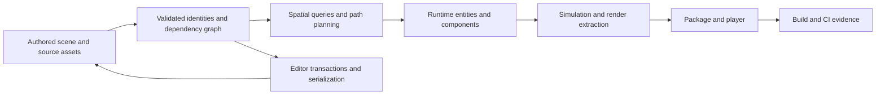

### 1. A robot asks questions of space

Imagine a robot with a position, orientation, velocity, collision shape, and goal. Each simulation step can ask: which obstacles overlap its predicted bounds? Which surface lies under a sensor ray? Which route connects its current region to a target? These are different queries. One spatial data structure rarely answers all of them well because each query has a different cost pattern.

A **primitive** is the thing whose exact geometry or state the query ultimately cares about: a triangle, collider, navigation polygon, or entity. A **bounding volume** is a simpler conservative envelope around it. “Conservative” means it may include empty space, but it must not exclude any real geometry. An axis-aligned bounding box (AABB) is described by minimum and maximum coordinates on each axis. A hierarchy groups bounds so a query can reject a whole group at once.

A **bounding volume hierarchy** (BVH) stores primitives in leaves and enclosing bounds in interior nodes. For a ray query, if the ray misses a node's bound, it cannot hit anything below that node. The traversal can skip every descendant. A BVH therefore reduces work; it does not make exact intersection cheaper. A loose or overlapping hierarchy may still visit many leaves.

A useful mental model for binary BVH traversal is:

1. Test the root bound.
2. If it misses, finish.
3. If it is a leaf, test its primitives exactly.
4. Otherwise test both child bounds, order the children when distance matters, and continue with candidates that can improve the answer.

The distinction between **closest-hit** and **any-hit** is important. Closest-hit needs the smallest positive ray parameter $t$; after finding a hit at $t_{best}$, a node whose near intersection lies beyond that value can be pruned. Any-hit only asks whether some acceptable hit exists, so it may stop at the first valid one. An API that returns a list of hits while being named “raycast” must make its ordering and completeness contract explicit; otherwise callers may wrongly assume nearest-first behavior.

#### 1.1 Why surface area predicts traversal

The surface area heuristic (SAH) estimates the expected cost of partitioning primitives into child bounds. For a parent bound $P$, left and right child bounds $L,R$, counts $N_L,N_R$, traversal cost $C_T$, and primitive intersection cost $C_I$, a common split estimate is

$$C_{split}=C_T+\frac{A(L)}{A(P)}N_LC_I+\frac{A(R)}{A(P)}N_RC_I.$$

The ratios approximate the probability that a random ray which reaches the parent also reaches each child. It is a statistical model, not a promise about every camera, ray distribution, or workload. The constants matter: if primitive tests are expensive, a somewhat deeper tree may pay off; if exact tests are cheap and traversal is branch-heavy, a different balance may win.

Consider a parent with surface area 100. Candidate A creates child areas 40 and 50, with 3 and 5 primitives. Let $C_T=1$, $C_I=1$. Its estimated cost is $1+(40/100)3+(50/100)5=4.7$. Candidate B creates areas 60 and 35, with 6 and 2 primitives: $1+(60/100)6+(35/100)2=5.3$. SAH prefers A. The primitive total in each split is eight, yet A's child areas suggest fewer expected ray visits. If exact primitive tests cost $C_I=4$, the same scores become 15.8 and 18.2, preserving this preference. But another scene or cost profile can reverse it.

An exact sweep evaluates every candidate split and can be expensive to build. **Binned SAH** groups centroids into a fixed number of bins, accumulates left and right bounds/counts, then evaluates boundaries. It approximates the best split with bounded work. Median splitting is simpler and predictable, but does not directly minimize expected traversal cost. Morton ordering quantizes positions and interleaves their coordinate bits, such as alternating x, y and z bits, to form integer keys whose order approximates a spatial traversal; sorting those codes gives a fast locality-oriented build, but a Morton builder is not automatically a canonical linear BVH (LBVH). The construction method and name should match what the code actually does.

Tree shape is a time-horizon choice. A static BVH can spend more time building for repeated queries. A dynamic scene may need a fast rebuild or update. **Refitting** recomputes parent bounds from changed leaves while preserving the topology. It is cheap if motion is modest, but deformation can make the fixed partition overlap badly. Periodic rebuilds restore quality. Measure both build/update cost and the query work after updates; “refit is faster” is incomplete if it leads to much slower traversal.

Other spatial structures suit other motion and query patterns. A **dynamic AABB tree** incrementally inserts and removes moving-object proxies. A fat bound extends beyond a tight collider bound; if an object stays inside it, the tree need not be updated every frame. Larger margins reduce update frequency but increase false-positive candidate pairs. **Sweep-and-prune** sorts interval endpoints along an axis and exploits temporal coherence: moving objects often leave the list nearly sorted. **Spatial hashing** maps integer cell coordinates to buckets; it is compact and useful for roughly uniform objects, but cell size and objects spanning many cells control the cost. Hash bucket collisions must not be confused with geometric overlap. A **uniform grid** uses explicit cells; a hierarchical grid handles size variation more gracefully than one fixed cell size.

A scene graph and a spatial index answer different questions. A scene graph captures ownership or transform relationships (“this wheel is attached to that robot”). A spatial index groups by geometry (“these bounds may overlap”). A parent-child relation does not guarantee spatial locality, and spatial proximity does not imply ownership. Using one as a substitute for the other causes awkward updates or poor query pruning.

### 2. From geometry to a route

Collision and visibility structures answer geometric tests. Pathfinding instead operates on a **graph**: vertices represent locations or regions, and edges represent allowed transitions. An edge can carry distance, time, energy, risk, or a weighted blend. If future cost depends on heading, speed, remaining fuel, or a key already collected, location alone is not a complete state. The graph node must encode the state variables needed to make transition costs and legal moves well-defined.

For the robot, a navigation mesh can represent walkable space as convex polygons. Neighboring polygons share a portal. A search first finds a polygon corridor; a funnel algorithm then tightens the path through the portals to produce a shorter geometric route. The corridor's graph cost and the final funnel path length are not necessarily the same quantity. If optimization is for shortest travel distance, the edge costs and heuristic must correspond to the metric being optimized. Agent radius and clearance also matter: a centerline path that fits a point robot may collide with walls for a robot of finite size.

A* maintains for each discovered node $n$:

- (g(n)): the least known cost from the start to $n$;
- (h(n)): a lower-bound estimate from $n$ to the goal;
- $f(n)=g(n)+h(n)$: a priority estimate for expansion;
- `cameFrom[n]`: the predecessor used to reconstruct a route.

When an edge $u\rightarrow v$ has cost (c(u,v)), relaxation tests whether (g(u)+c(u,v)) improves (g(v)). If so, update (g(v)), its predecessor, and its queue priority. A binary heap supports retrieving the smallest priority efficiently. A common implementation avoids an indexed decrease-key heap: push a new entry when a better score appears, and discard an entry when popped if its stored score no longer matches the current best score.

A heuristic is **admissible** when it never overestimates the true remaining optimal cost: $h(n)\leq h^*(n)$. This is the key bound behind optimality when the goal is accepted under the algorithm's appropriate termination rule. **Consistency** is stronger: for every edge $u\rightarrow v$, $h(u)\leq c(u,v)+h(v)$. It is a triangle-inequality condition. With a consistent heuristic, $f$-values do not decrease along a path; once a node is closed at its best $g$, it need not be reopened. With an admissible but inconsistent heuristic, a later route can improve a closed node. An implementation that permanently rejects closed nodes may then lose optimality. The choices are to require consistency, or support reopening when a better $g$ is found.

This distinction corrects a frequent simplification: “admissible means the closed set is always safe.” That is only true under additional conditions, such as a consistent heuristic or a reopening implementation. Also, Dijkstra's algorithm is A* with $h=0$. Manhattan distance is appropriate for four-neighbor grids with uniform cardinal costs; it can overestimate when diagonal travel is allowed. Octile distance accounts for diagonal moves under the corresponding cost model. A Euclidean heuristic must be scaled to the minimum cost per world-space distance, otherwise it can overestimate on cheap terrain. If an edge may cost zero over nonzero distance, a positive distance-scaled heuristic is unsafe; zero-cost movement can reduce the safe heuristic to zero, yielding Dijkstra behavior.

Path reconstruction follows predecessor links from goal to start, then reverses the result. It must detect missing predecessors and bound traversal so corrupt parent cycles cannot loop forever. Dynamic obstacles add another distinction: global planning finds a route through a map representation, while local avoidance handles nearby moving agents and short-term changes. One mechanism does not guarantee the other's job.

### 3. Moving structures and durable identities

As the robot moves, geometry changes, but its logical identity should not. An entity handle is a value naming a slot plus a generation (also called a version). The index identifies storage; the generation distinguishes successive occupants of the same index. On destruction, remove all owned component data, advance the generation, and only then make the slot reusable. A stale handle from an earlier occupant will fail a full index-and-generation check.

Generation counters are finite. If they wrap and an old handle survives long enough, the same index/generation pair can recur: an ABA problem, where a value looks unchanged even though the object was destroyed and replaced in between. Wider generations make wrap less likely, but do not prove infinite uniqueness. Stronger policies include reserving wraparound values, quarantining/recycling only after a safe horizon, using wider IDs, or adding a world/session identity. Which is needed depends on whether handles can persist externally, across reloads, or across network sessions. Runtime entity handles are not automatically persistent asset IDs or save-file references.

A free list stores reusable indices. LIFO reuse is cache-friendly and quick; FIFO reuse can delay recycling and may reduce immediate stale-handle confusion, but neither changes the need for generation validation. Creation and destruction must have exception-safe ordering. A failed allocation must not publish a live identity without a corresponding storage slot. Destruction must not recycle an index before all component pools and reverse mappings have stopped referring to it.

#### 3.1 Sparse sets and the meaning of a reference

A sparse-set component pool uses a sparse index table from entity index to dense position, plus dense entity handles and dense component values. Membership requires bounds and sentinel checks and then a full entity comparison, including generation. The sparse mapping for an insertion should be made visible only after the dense entity and component have been successfully constructed; otherwise an exception can expose a half-present component. Removal commonly swap-moves the last dense entry into the removed position and repairs its sparse mapping. This is fast and keeps iteration compact, but changes addresses.

That last fact is a lifetime contract, not an implementation footnote. A pointer or reference to a component may be invalidated by vector growth, erase, swap-and-pop, [[Concepts/Archetype ECS|archetype]] migration, or pool destruction. `Reserve()` can reduce reallocations, but it does not make references stable under removals. If stable addresses are required, use paged storage, indirection, tombstones, or a deliberate handle-to-object layer, accepting the extra memory or lookup cost. Gameplay code should often retain an entity handle and reacquire the component at the point of use rather than keep raw component pointers across structural changes.

Dense iteration is the strength of sparse storage: the system walks contiguous values and avoids pointer chasing. Multi-component queries can iterate the smallest pool and test membership in the other pools. Excluded components are anti-joins: require absence while iterating candidates. A query cache can remember matching pools or entity sets, but a cached entity list becomes invalid after structural changes. Versioning and invalidation rules must be explicit.

Structural mutation during iteration can skip an item, visit one twice, or dereference moved storage. A **command buffer** records requested changes and applies them at a defined synchronization point. Its semantics must say whether entity creation becomes visible immediately, when destruction takes effect, how conflicting commands are ordered, and what failure means. A deferred destroy may leave an entity query-visible until flush; an immediate tombstone hides it logically while physical removal waits. Neither policy is self-evident.

#### 3.2 Archetypes and structural migration

An archetype groups entities with exactly the same component-type set. Adding or removing a component changes the set, so the entity migrates to another archetype. Within each archetype, component columns are packed in chunks. A query can find matching archetypes once, then iterate columns efficiently without testing every entity for membership. This is attractive when component combinations are stable and large groups share systems.

The cost shifts to structural change. Migration must construct destination values, preserve retained values, remove the source entity, repair any moved entity location, and publish the destination location. If a component constructor throws halfway through, invariants require either rollback to the original archetype or a clearly documented failure state with a way to recover. A safe sequence stages the destination first, records which constructions succeeded, and makes location metadata authoritative only once the destination is complete. Component destructors are expected not to throw; destruction failures cannot generally be rolled back safely.

This is where C++ object lifetime rules matter. Relocation is not synonymous with copying bytes. `memcpy` is valid only for types and contexts where the language permits the object-representation operation and where the semantics are preserved. Nontrivial components need correct move construction and destruction. Move-only components can fit an ECS, but entity cloning must define whether the component can be cloned at all. Storage traits should drive the chosen operation rather than treating every `T` as a byte buffer.

Sparse sets and archetypes are design points, not moral opposites. Sparse sets often make adding/removing a component cheap and keep each component type independently packed. Archetypes make matching queries fast across stable combinations but incur migration. Hybrid designs use different storage for high-churn or sparse components. Tags have no payload but still affect membership; too many independent tags can fragment archetypes. Global resources such as input state may be clearer outside entity storage, while entity-linked state remains queryable as components.

Memory layout also shapes what the CPU actually loads. Array-of-structures (AoS) stores all fields of each item together; structure-of-arrays (SoA) stores one field across many items; array-of-structures-of-arrays (AoSoA) blocks a small number of items for vectorized work. ECS columnar storage is already partly SoA across component types, but a large component may still mix hot fields read every frame with cold fields used rarely. Split them when measurement shows wasted bandwidth or cache pressure. Do not optimize merely by labels: predictable access patterns and actual profiler evidence matter.

### 4. Scene relationships, systems, and identity bridges

A transform hierarchy is a relationship graph layered over entities. A child usually stores a parent handle, and the parent may keep child links for traversal. If both directions are stored, every edit must maintain the invariant that each parent lists exactly its children and each child's parent agrees. Reparenting must prevent cycles. Destruction policy must define whether children are destroyed, detached, or reparented. World transform is derived from local transform and ancestors, so hierarchy order matters: parent world transforms must be current before child transforms are computed.

Repeatedly walking ancestors for every consumer can duplicate work. Dirty propagation marks descendants stale after a local change; a version scheme can lazily recompute when a parent version changes. Fixed-step simulation may keep previous and current transform snapshots and interpolate for rendering. A teleport is a discontinuity and should reset interpolation history, or the renderer will draw a false sweep between positions.

Runtime subsystems often allocate their own IDs. A physics body ID or renderer object ID should not be confused with the entity handle or a persistent scene identity. Maintain explicit mappings and lifetime rules: entity-to-physics on creation, reverse mapping for collision callbacks, removal before handle reuse. Rendering commonly extracts a frame's renderable data into a renderer-facing snapshot rather than exposing live ECS storage to asynchronous GPU work. Picking IDs require the same care; writing a short-lived entity index into a GPU buffer can resolve to a different entity by readback time. Use a stable token or validate a captured generation when the result returns.

Systems form a schedule. Each system declares data it reads and writes; conflicts constrain parallel execution. A dependency directed acyclic graph (DAG) represents “must happen before” edges. If two systems only read the same data, they can often run together. If one writes a component another reads, order or synchronization is required. False sharing occurs when threads update independent values that happen to occupy the same CPU cache line; it is a memory-layout problem that can erase gains from parallel scheduling. Parallel execution also needs deterministic merge rules for commands/events if repeatable results matter.

### 5. Assets, editor state, and serialization

A project asset has several identities: source path, stable asset ID, content fingerprint, and runtime handle. A path says where a source file is organized; a UUID-like ID survives renames; a content hash identifies exact bytes or a derived result; a runtime handle identifies a loaded object in this process. These solve different problems. A persistent reference should generally use a stable asset ID and resolve to runtime state later. A handle does not imply the asset is resident, and deletion/reload may invalidate it.

Import is a dependency graph. A texture source plus import settings and tool version produce a derived artifact; a material depends on textures; a scene depends on materials and meshes; a package includes the transitive closure needed to run. A derived-data cache key should include every input that changes meaning: source content, importer version, settings, target platform, and relevant toolchain. Omitting one can return a stale artifact. Including irrelevant editor-only settings needlessly invalidates cache entries. Hot reload adds a lifetime boundary: consumers must stop using the old resource before it is destroyed, and GPU resources may need fence completion before release. Streaming similarly separates identity from residency.

The editor is a second client of the same semantic rules as runtime, not an owner of hidden mutation shortcuts. Reflection metadata can describe properties, widgets, validation, and serialization keys, but display names are not stable IDs. A property setter should enforce invariants; a generic inspector should not write raw memory offsets and bypass them. Undo commands store semantic before/after values or entity handles plus versions, not long-lived raw component pointers.

An edit is a transaction when the user perceives it as one operation. A robust flow is: collect intent, validate preconditions, construct candidate state, then publish. If validation fails, do not mutate the canonical document. If candidate construction fails, discard the candidate. If publication replaces a file, write a temporary in the same directory, flush as required by the durability promise, then rename. A same-directory rename can provide atomic visibility on common filesystems, but it does not automatically guarantee power-loss durability, cross-volume replacement, or an atomic multi-file update. Multi-file publication can use a generation directory plus one atomic pointer/manifest switch, or a journal with recovery rules.

Failure trace:

1. User changes a mesh reference and a transform together.
2. The mesh ID is unknown or resolves to an incompatible asset.
3. Validation rejects the candidate before either property is committed.
4. Undo history and canonical scene remain unchanged; an error is shown.
5. A recovery draft may still preserve the user's raw edit separately.

A different failure trace occurs after validation: serialization writes a temporary file, but disk-full occurs before completion. The old canonical file remains readable if publication is atomic, and the incomplete temporary can be discarded or recovered. If the program first truncates the canonical file, the same error destroys the last good state. “Save succeeded” should mean the promised stage completed; it should not conflate written bytes, atomic replacement, durable flush, and replicated backup.

Serialization should encode semantic fields, not raw C++ object layout. Raw struct dumps entangle compiler padding, endianness, pointer values, and ABI. A stable format uses explicit field meanings and numeric widths, a magic identifier and version, and a migration policy. Schema migration transforms old meaning into new meaning. Unknown fields can be rejected, ignored, or preserved; the correct choice depends on whether round-tripping through an older editor must keep data it does not understand.

Entity references in a saved scene need a save-time mapping from runtime handles to persistent local IDs, then a load-time two-pass resolution: create all entities first, build the saved-ID-to-new-handle map, then resolve parent/component references. This also handles forward references. Broken-reference policy should be explicit. The same pattern is useful for cloning a subtree and remapping internal references while retaining or clearing external ones according to semantics.

Loading a scene should also be transactional. Parse and validate the descriptor, allocate candidate entity/component state, resolve references, validate hierarchy cycles and assets, then publish the scene. If step three fails, discard candidate state rather than leave a half-loaded world. Saving a runtime scene back to authoring is a separate policy: some runtime state is transient and must never overwrite authored data. Play mode may use a copy-on-play world, a command diff, or an explicit apply-changes operation.

### 6. Dependencies, composition, and the build graph

Engine architecture contains several related DAGs. The source dependency graph answers which modules may depend on which. The runtime initialization graph orders services. The asset graph describes import and package closure. The build graph orders generated files and targets. A cycle in one graph may be legal in another, but confusing them creates fragile systems. Source layering should make high-level policy depend on stable mechanisms or abstractions. A composition root—the application entry point that constructs concrete services—chooses backends and injects them into the runtime. A service locator hides those dependencies behind global lookup; that may be useful in narrow contexts but makes tests and ownership harder to see.

API and ABI are different. An API is the source-level contract callers use. An ABI is the compiled calling/layout convention and symbol contract across binary boundaries. C++ plugins that exchange standard-library containers or compiler-specific class layouts can be source-compatible within one toolchain and still fail across compiler or runtime versions. A stable plugin boundary may use opaque handles, versioned function tables, explicit ownership, and plain data with fixed conventions. That does not mean every internal interface must be frozen; stability is an intentional boundary.

CMake expresses build relationships through targets. `PRIVATE` requirements are for the target's own compilation/link; `INTERFACE` requirements are for consumers; `PUBLIC` does both. These are usage requirements, not merely visibility adjectives. A public header that includes a dependency's header may require that dependency to be transitive; an implementation-only dependency should remain private. Overusing PUBLIC spreads compiler flags and dependencies into unrelated targets. Underusing it creates downstream missing-include or link errors.

A build tool schedules a DAG of actions. Ninja or another generator can run independent edges in parallel, but only if generated inputs and dependencies are declared. A missing generated-header or shader edge can cause a clean-build race that disappears on an incremental build. Over-serializing the graph is safe but slow. C++ modules make dependencies more explicit because a consumer needs a compiled module interface artifact before its own compilation; a module cycle remains an architectural cycle. A module or header organization cannot repair unclear ownership.

Reproducibility has layers: source revision, dependency revision, toolchain/SDK, configuration, and artifact bytes. Pinning a dependency to a full commit identifies a version, but a dirty checkout still changes actual input. A toolchain file must be applied early enough for compiler and platform selection. Presets can capture named configurations while keeping compiler paths local or overridable. Separate binary directories prevent one compiler's generated files from contaminating another's configuration.

A CI matrix checks selected combinations, not all possible environments. Linux Clang, macOS toolchains, Windows MSVC, sanitizer configurations, deterministic content fixtures, and package smoke tests answer different questions. A unit test localizes a function's behavior; an integration test checks contracts across modules; a smoke test checks that a built package starts. A passing unit suite does not prove relocatable packaging or graphics-driver behavior. Record the evidence level precisely.

### 7. End-to-end trace and the invariant ledger

The robot's scene asset is imported from source into a derived mesh and collider. The import key names all semantic inputs. The scene stores stable asset IDs and authored transforms. On load, a candidate scene is validated and runtime entities are created with new generational handles; persistent scene IDs map to those handles. Component columns or archetype chunks hold local transform, collider, and navigation agent state. A subsystem bridge assigns a physics ID and retains a validated mapping back to the entity.

Each simulation step updates world transforms, updates dynamic spatial proxies when tight bounds escape fat bounds, queries likely overlaps, performs exact narrow-phase tests, and emits ordered collision events. A route request maps start and goal to navigation regions, runs A* with a heuristic whose cost assumptions match actual edge costs, reconstructs a corridor, then funnels it into waypoints. Commands that add/remove components are buffered until a structural synchronization point. Render extraction snapshots current renderable state; interpolation uses previous/current transforms except across teleports. The package contains the transitive assets, and the build graph records how source code, generated shaders, tools, and targets depend on one another.

The recurring invariants can be written compactly:

- A bound contains its geometry; a spatial query may be conservative, never falsely rejecting a true hit.
- A heuristic never exceeds the optimal remaining cost; if closed nodes are final, consistency is required.
- A live entity handle matches both slot and generation; component membership checks generation too.
- A component reference remains valid only for its documented storage lifetime.
- Structural changes do not corrupt the iteration currently using storage.
- A relationship update preserves both directions and acyclicity where required.
- A serialized reference resolves through stable IDs, not process addresses.
- A transaction validates and stages before publication; failure leaves a defined prior state.
- A package contains dependency closure; a build edge declares every generated prerequisite.
- A claim of reproducibility names the source, dependency, toolchain, configuration, and artifact evidence actually captured.

The strongest teaching progression is therefore from a single query to a complete chain of ownership. A robot ray begins as a question over geometry. The BVH answers by conservative pruning; a dynamic tree maintains candidate bounds while the robot moves; a navigation graph turns location into reachable transitions; an entity handle separates identity from moving storage; ECS rules govern component lifetime; editor and serialization rules preserve semantic state; asset and build DAGs make the result loadable and repeatable. Each layer has its own contract. The engine becomes understandable when we ask which identity is stable, which data is derived, which mutation is visible, which query is optimized, and what evidence proves that the next stage can consume the result.

### Scope notes for integration

The spatial query and navigation narrative belongs in the game-engine volume. The ECS, identity, component lifetime, and scheduling material also belongs there. Serialization, reflection, editor transactions, asset identity, and packaging should connect directly to the same runtime flow rather than become isolated APIs. General C++ object lifetime and exception guarantees can be cross-linked to the C++ foundations volume. API/ABI, language and compiler compatibility, CMake target semantics, toolchains, modules, and reproducible build mechanics should be routed to the foundations/build volume, with only their engine-flow consequences retained here. This spine does not claim a whole-book review or exhaustive source/caption coverage; it synthesizes the specified staged passes and the cited primary references.

### 8. Make the guarantees executable

An architectural explanation should end in checks that can be stated as preconditions, postconditions, and failure behavior. Consider a dynamic broad-phase proxy for the robot. Its tight bound is computed from the current collider transform. Its fat bound is the tight bound expanded by a margin, perhaps additionally in the direction of velocity. The tree leaf stores the fat bound. On movement, first compute the new tight bound. If it remains inside the old fat bound, the tree topology remains valid and no structural update is needed. If it escapes, remove/reinsert or otherwise update the proxy, and compute a new fat bound. A containment test with reversed min/max, mixed coordinate spaces, or a stale transform invalidates the broad phase even when the tree code itself is correct.

The broad phase is allowed to return false positives because the narrow phase rejects them. It cannot return false negatives. This gives a practical test strategy: generate random collider pairs, compare broad-phase candidates against brute-force exact overlap, and assert every truly overlapping pair is represented. Performance tests should separately count candidate pairs, tree visits, rebuild time, and update time. One average frame time hides the cause of regression. Include distributions such as many small movers, a few very large objects, coherent translation, chaotic deformation, and dense clusters. Structure selection follows workload: no benchmark can make one data structure universally best.

For a BVH builder, validate that every primitive appears in exactly one leaf, every leaf bound contains its primitives, every parent contains both children, and traversal results match brute-force ray tests. Test degenerate centroids explicitly. If all centroids on the chosen axis are identical, a partition based only on that axis may be empty or unbalanced; a deterministic fallback split by index, another axis, or leaf termination must be defined. For quantized bounds, rounding must remain conservative: lower bounds round outward toward negative infinity, upper bounds toward positive infinity, or the encoding includes a sufficient expansion. A tiny inward quantization error can create a missed ray, which is a correctness failure rather than a speed tradeoff.

For A*, a useful small regression graph demonstrates why reopening matters. Let start S connect to A with cost 2 and B with cost 1. Let B connect to A with cost 0.5, and A connect to goal G with cost 2. Suppose h$A$=0, h$B$=2.5, h$S$=0, h$G$=0. The heuristic is admissible if the true remaining cost from B is 2.5, but it is inconsistent on B→A because 2.5 exceeds 0.5+h$A$. A may be closed first at cost 2; then B is expanded and finds A at 1.5. If the implementation refuses to reopen A, it returns a path costing 4 instead of 3.5. The example makes the algorithmic contract concrete: either establish consistency for the selected heuristic and edge model or reopen improved states. Merely naming a set `closed` does not settle correctness.

The edge cost model must remain coherent across the whole pipeline. If graph edges encode travel time but the heuristic estimates Euclidean distance, distance is a lower bound only if a known maximum speed converts distance into a minimum time. If cost includes danger penalties that are nonnegative, a geometric lower bound may remain admissible; if rewards create negative costs, standard A* assumptions fail and even Dijkstra's monotonicity breaks. If the graph changes while a search is in progress, the search may combine incompatible versions. Snapshot the graph, cancel/restart on version change, or explicitly support incremental replanning. Search result metadata should include the graph/map version so callers can reject stale routes.

Structural ECS changes deserve a similarly explicit state machine. A sparse-set insertion can be viewed as `Absent → Constructing → Present`. The public membership query should report absent until construction succeeds and metadata is committed. If construction throws, destroy any partial temporary according to C++ lifetime rules and leave sparse/dense arrays consistent. Removal is `Present → Removing → Absent`; first establish which dense element will move, then move-construct or move-assign under the storage's stated requirements, repair the moved entity's sparse entry, invalidate the removed entry, and destroy the removed value exactly once. Different operation orders may be valid, but the invariant must hold even when a permitted move operation throws. If the container requires nothrow move to provide its guarantee, state that as a type constraint.

Archetype migration has more steps and should be reasoned about in two phases. Phase one prepares a destination row: reserve capacity, construct the entity and each destination component, copying or moving retained values as allowed. Phase two commits: publish the new entity location, remove the old row and repair any entity moved into its slot. If phase one fails, destroy constructed destination columns in reverse construction order and preserve the source row. If retained values were moved out of the source before a later constructor failed, simply destroying the destination is insufficient: the original state may already be modified. Options include copy where available, a no-throw move ordering that makes rollback unnecessary, temporary staging, or documenting a weaker guarantee. The selected guarantee is part of ECS semantics because gameplay systems observe these mutations.

Exceptions from user component constructors make “atomic ECS mutation” a concrete promise, not an assumed property. A registry can offer a strong guarantee for each single add/remove while a command-buffer flush remains partially committed. It should not call a flush transactional unless it can stage all commands, validate all conflicts, and roll back every applied effect. In many engines, a fail-fast partial commit is acceptable if the flush stops at the first failure and reports exactly which commands applied. A validate-then-apply phase catches common semantic failures early but cannot guarantee rollback if an application-time allocator or component constructor still fails. Full rollback requires inverse operations or shadow state and can be expensive.

The error trace should therefore be observable. Suppose three buffered commands are: add navigation agent to entity E1, destroy E2, and add a render component to E3. E3's component constructor throws. Under a partial-commit policy, the first two may already be visible; the flush returns an error naming command three and leaves it unapplied. Under validate-then-apply, all handles and component types are checked first, but the constructor exception can still occur at application. Under transactional semantics, the system either stages the entire resulting registry and swaps it in or maintains enough undo state to reverse commands one and two. These are materially different behaviors. An editor-facing operation often needs transactional semantics; a simulation command buffer may accept ordered partial commit if failure is fatal and diagnosable.

Entity identity adds another useful distinction: **identity lifetime** versus **storage location lifetime**. During sparse-set swap-remove, entity E remains alive but its component changes address. During archetype migration, E remains the same entity but every component may move. During destruction, E's identity expires and the generation advances. During serialization load, a saved persistent ID is translated into a newly allocated runtime handle. During network replication, a network ID may have a different authority and lifetime again. APIs should name these transitions rather than assume one integer covers them all.

A scene load can be drawn as a publish protocol:

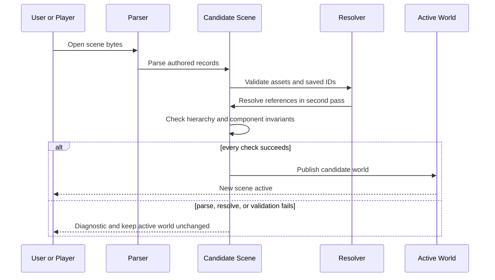

The parser should enforce resource limits as well as syntax. A valid-looking document can request millions of entities, excessive nesting, huge strings, or pathological asset references. Limits on file size, entity count, nesting depth, and blob size prevent accidental or adversarial exhaustion. Path resolution should use normalized path components and filesystem-aware containment checks; string-prefix tests confuse `/project/assets-old` with `/project/assets`. Symlinks can escape a project root after lexical normalization. For packaging, revalidate the staged closure because the source tree may change between discovery and copy. A time-of-check/time-of-use race remains possible when files can be concurrently replaced; robust tooling may snapshot inputs or verify content hashes after staging.

The save pipeline has at least three meaningful boundaries:

1. **Complete serialization:** all intended bytes were generated and written to a temporary output.
2. **Atomic visibility:** readers see either the old file or the new file, not a truncated mixture.
3. **Crash durability:** after the API reports success, the data and relevant directory metadata survive the failure model the application promises to tolerate.

A program that only calls a buffered stream's `flush()` may not have reached stable storage. A library that fsyncs the file but not the containing directory may still risk losing the rename after a crash on some systems. Cross-platform durability semantics differ. The file format, replacement code, and product promise should distinguish these layers. The same precision applies to autosave: it should not clear the canonical dirty flag merely because a recovery snapshot was written.

Asset identity and asset availability must be separate in runtime contracts. A material can refer to a texture asset that is known but not loaded; the runtime may return a placeholder, block, or fail. Hot reload should stage and validate a replacement before swapping the public handle. A GPU object may be logically superseded while in-flight command buffers still reference it; destruction waits for the relevant fence or deferred-release queue. This is analogous to entity generations: the visible reference is invalidated at a defined boundary, while storage reclamation waits until no reader can use it.

The build is also a publication pipeline. A CMake target compiles local sources using its private requirements and exports only the usage requirements consumers need. Generated shaders, reflection code, asset packs, and module interface units must be represented as graph nodes and edges. A build that works only after a previous build may have an undeclared edge. Clean CI is especially valuable because it removes accidental products left by developers. A reproducibility record should include source commit and cleanliness, lockfile revisions, compiler and SDK versions, preset/configuration, build commands, and artifact hashes. Full hermeticity may not be practical for every engine, but a precise record helps distinguish “same source” from “same binary.”

A package smoke test should launch the staged artifact from a path different from the source checkout, ideally in an environment without developer-only asset paths. It should load the scene, resolve assets through package-relative or manifest identity, and report missing dependencies. If a successful package still reads from the developer's absolute asset path, the smoke test has not proved relocation. If CI compiles the editor but never packages or starts the player, it proves compilation only. Validation should move through explicit layers: source analysis, unit behavior, module integration, clean build, package closure, relocated launch, and platform execution.

### 9. How to read claims and select the right mechanism

Many engine passages mix a general mechanism with a repository-specific audit. Keep those statements separate. “Fat AABBs can reduce dynamic-tree reinsertion” is a general design explanation. “This repository's dynamic tree currently mishandles slot reuse” is an audit claim that must point to inspected code and a reproducible trace. A general teaching volume should preserve both, but label the second with file/line or test evidence and a snapshot date. A staged source paragraph is not evidence by itself if its code observation was not independently checked in this pass.

Likewise, benchmark claims have a scope. A BVH benchmark over synthetic rays demonstrates those workloads; it does not establish superiority for a shipping game's camera, collision, or editor queries. A test that checks a returned path is valid does not prove path optimality. To test optimality on small maps, compare against Dijkstra or exhaustive search under the same edge costs. A serialization round-trip test proves a selected schema can read what it wrote; migration fixtures are needed to prove old versions still load. A CMake configure success does not prove dependency closure or ABI compatibility. State what the test distinguishes and what remains outside it.

Choose a spatial index based on object motion, query type, and scale distribution. Static triangle geometry under many ray queries favors high-quality BVHs. Dynamic colliders that move independently often benefit from a dynamic AABB tree or a simpler grid, depending on size spread and density. Coherent one-dimensional motion can suit sweep-and-prune. Point and nearest-neighbor queries in low-dimensional static point sets often suit KD-trees. Visibility through indoor rooms may need portals or precomputed potentially visible sets; a global spatial tree cannot infer architectural occlusion semantics. Hi-Z uses a depth pyramid for conservative GPU occlusion, but the reduction rule must preserve near occluders and handle reversed depth conventions correctly.

Choose a navigation representation based on movement constraints and world structure. Grids are simple and support local cost maps but resolution trades memory/search size against geometric fidelity. Navmeshes compactly encode open walkable regions and support a funnel path, but polygon adjacency, T-junctions, clearance, and dynamic changes require careful handling. Hierarchical pathfinding clusters the map and searches a smaller abstract graph; the abstraction can introduce approximation unless its entrances and costs preserve the desired guarantees. Static global planning and local collision avoidance should exchange route intent, not overwrite one another's responsibilities.

Choose ECS storage based on structural churn, query patterns, component type behavior, and reference requirements. If most frames iterate large stable populations, archetype chunks may make systems simple and fast. If entities frequently gain or lose independent components, sparse sets may reduce migration complexity. If stable component addresses are a hard requirement, dense swap-remove may be wrong even if it gives excellent iteration. If users can register component types at runtime, type identity and serialization schema need explicit registries; compiler-local static IDs are not persistent identifiers. The storage strategy has a direct bearing on which editor operations, undo commands, asynchronous systems, and plugins are safe.

A reasonable selection process is: state the dominant query and mutation; write the invariant; estimate the data distribution; select a candidate structure; implement a correctness oracle; instrument costs; then test representative scenes. Avoid choosing a structure from a one-line label such as “cache-friendly” or “dynamic.” A dense array is cache-friendly only for the fields actually consumed together. A dynamic tree can be expensive if balancing and reinsertion dominate. An archetype can fragment into many sparse populations. A spatial hash can be excellent at one cell scale and pathological when objects are much larger than cells.

### 10. The ownership graph as the final model

The runtime can be summarized as ownership of transformations. Source files are user-owned inputs. Import recipes and tool versions define derived outputs. Persistent IDs connect authored references without depending on paths or memory addresses. Scene serialization stores semantics. The editor owns candidate transactions and recovery drafts. Runtime handles own process-local identity. ECS stores current state and defines when its addresses move. Spatial indices derive conservative query structures from world transforms. Physics and rendering systems own backend resources behind explicit bridges. The package owns a dependency closure. The build owns generated artifacts and their prerequisites.

Every transformation should identify its inputs and outputs. Every output should say whether it is canonical, derived, cached, transient, or recoverable. Every reference should say whether it is stable across movement, reload, process restart, or network session. Every mutation should state its visibility point and failure guarantee. Every asynchronous consumer should state what keeps its data alive. These statements can sound like documentation details, but they are the architecture: they prevent a stale BVH from missing a collision, a stale entity handle from mutating a replacement, a failed scene load from destroying the previous level, a component pointer from outliving its storage, and a package from depending on an undeclared developer file.

The full chain therefore has one educational arc: from a local robot query to an engine that can reproduce a world. The geometry explains how to avoid work; graph search explains how to make a route; entity identity explains how to name mutable actors; ECS explains how to organize changing state; transactions and serialization explain how to preserve authored meaning; asset and build graphs explain how to deliver the state to another process and machine. The reader can reconstruct each subsystem from its contract, its cost model, its invalidation rules, and its failure trace.

### Primary references consulted

- PBRT v4, “Bounding Volume Hierarchies,” for the BVH/SAH cost model and construction terminology: [pbr-book.org, 4th edition](https://www.pbr-book.org/4ed/Primitives_and_Intersection_Acceleration/Bounding_Volume_Hierarchies).
- Hart, Nilsson, and Raphael, “A Formal Basis for the Heuristic Determination of Minimum Cost Paths” (1968), for heuristic graph search and optimality foundations: [Stanford-hosted paper PDF](https://ai.stanford.edu/~nilsson/OnlinePubs-Nils/PublishedPapers/astar.pdf).
- CMake documentation, `target_link_libraries`, for PUBLIC/PRIVATE/INTERFACE usage requirements: [CMake command reference](https://cmake.org/cmake/help/latest/command/target_link_libraries.html); and [CMake Presets manual](https://cmake.org/cmake/help/latest/manual/cmake-presets.7.html).
- Flecs entity documentation, for the versioned entity identifier model as one implementation example (the exact representation is library-specific): [Flecs Entities and Components](https://www.flecs.dev/flecs/EntitiesComponents.html).

The spine uses these as external concept references; it does not claim that the staged Kairo implementation matches PBRT, Flecs, or CMake's newest release in every detail. CMake and Flecs documentation are current web documentation consulted on 2026-11-10. The A* paper is the original 1968 source; the later correction should also be read when making formal theorem claims.

## Make the first game ask the architecture a question

## Design for play beyond a feature checklist

A renderer and game engine support an activity, but the rules and social setting determine what that activity means. A useful design lens asks what players are doing with and to one another, not only which controls or graphics the implementation exposes. Bartle’s well-known MUD roles—achievement, exploration, social connection, and player-versus-player domination—can prompt questions about rewards, discovery, communication, and conflict. The book grounds the lens in text-based MUDs and notes that players can mix these priorities; treat the four labels as a way to inspect one game’s possibilities, not as an exhaustive personality test or a fixed user segmentation. (Rules of Play, physical PDF p. 457–458; source `src-513f06a2888adb0105a8`.)

Small rule systems make the social consequences visible. In Little Max, a player who accepts a hidden dice claim immediately becomes the next person required to make a higher claim. The formal rule therefore passes the social role of listener/challenger into bluffer. The next decision is not just a comparison of odds: players infer whether the last person is truthful, how often others challenge, and whether a claim looks suspicious. Mafia uses a different hidden variable: player roles. Daytime discussion and voting create evidence about people’s behavior while the mafia secretly coordinate at night. Eliminated players still know the hidden roles but are expected to remain silent. In both cases, the rule system creates a social information problem, but the information structure is different. (Rules of Play, physical PDF pp. 458–461.)

A play community emerges through repeated interaction. It is shaped by the game’s rules, player personalities, actions among players, and the surrounding culture. Some communities exist only within one session; others continue across many games and time periods. This distinction helps an engine team see why persistence features, chat tools, moderation, and identity systems can alter the activity around a game without changing its core turn rules. It is a design question about the intended experience, not a requirement that every engine ship those systems. Stand Up illustrates the opposite case: a simple cooperative task can recruit spectators into joining, so the activity itself grows its group. (Rules of Play, physical PDF pp. 462–463.)

The social contract also has layers. Formal rules say what the game permits. Operational rules describe how a player carries out an action. Implicit rules are shared expectations: wait a reasonable time for a turn, do not cheat, pause if someone is hurt, or soften play when a child joins. These expectations connect the artificial game activity to values outside it. They can make play safe and trustworthy, but a program cannot guarantee the players’ trust merely by enforcing its rules. Designers can make a space more legible and provide tools for consent, moderation, or pausing; players and communities still supply social judgement. The book describes children’s understanding of rules shifting from improvisation, through treating rules as fixed, toward seeing them as changeable through mutual agreement. Use that as a historical framework for thinking about onboarding and community rule-setting, not as a diagnostic claim about any individual player. (Rules of Play, physical PDF pp. 464–467.)

Finally, ideal rules—the official written version—and real rules—the conventions a community actually uses—can diverge. A playground’s Foursquare players elaborated a compact base rule into named calls that adjusted difficulty, fairness, and tone. A multiplayer game may show the same gap when communities establish unwritten etiquette or house rules. If those conventions support a healthy experience, a designer can consider whether the game needs to make the practice explicit, offer configurable rules, or leave it community-owned. That choice can change social relationships even when the low-level mechanic stays the same. (Rules of Play, physical PDF p. 468.)


The workshop gives us a small result to pursue. Before choosing a framework, make that result precise enough that a player and a programmer can recognize the same success or failure.

### Let players read cause and consequence

Consider a sword attack that sometimes misses. The physics and collision code may know the exact reason: the target was out of range, blocked the strike, or dodged. If the player sees no difference between these cases, the world feels inconsistent even when the simulation is deterministic. A short impact sound, a visible block pose, a clear distance cue, or a readable dodge can connect the attempted action to its immediate outcome. The goal is not to expose internal engine state verbatim; it is to make the relevant cause legible at the moment it matters. (Game Design: Theory and Practice, PDF pp. 33-35; Rules of Play, PDF pp. 50-51.)

That immediate signal should also connect to something that matters later. If repeated hits lower an enemy’s guard and create an opening, players should be able to perceive both the present hit and the developing opportunity. The immediate result is discernable; the accumulated tactical consequence is integrated into the larger play. A hit spark alone may confirm contact but say little about whether the player is making progress. A changing stance, a stagger threshold, or a readable guard meter can show the longer relationship. The right presentation depends on the game: the selected theory pages explicitly leave room for different forms of meaningful feedback. (Rules of Play, PDF pp. 49-52.)

Player needs differ. One player may want mastery and a hard challenge; another may want exploration, a social activity, a solitary responsive world, fantasy, status, or an emotional arc. These are not a checklist that every game must satisfy. They are prompts for engine and interface choices. If a game promises exploration, streaming and world transitions should preserve player agency and show what new paths are available. If it promises competition, timing and outcomes should be consistent enough that practice teaches skill. If it promises a quiet solitary experience, interruptions and social prompts may undermine the desired mood. (Game Design: Theory and Practice, PDF pp. 27-33.)

Direction and progress can coexist with player freedom. A player may be free to choose a route through a level while still needing to know the current objective and whether actions move them closer. A useful engine-facing design question is: what state change can the game communicate after each meaningful action? A quest objective can update, a door can respond to a key, or an NPC can react to a choice. The player should not have to infer invisible progression from unrelated events. At the same time, a sandbox may intentionally let players define their own goals, provided its world gives understandable material to work with. (Game Design: Theory and Practice, PDF pp. 35-36.)

#### Design systems that produce readable outcomes

In the interview, Doug Church recalls design work around LookingGlass titles and discusses player choice, state, events, and emergent sequences. An event can describe a particular occurrence; a state describes what is currently true. For example, a guard hearing a sound is an event, while the guard being alerted is a state that can influence later decisions. Systems built from states and responses can create a sequence the designer did not script step by step. This distinction is presented as a useful way to think about game behavior, not a replacement for narrative or scripting in every game (*Game Design Theory and Practice*, interview with Doug Church, PDF pp. 537–542 / printed pp. 512–517).

Emergence still needs legibility. If the player cannot tell what the guard saw or heard, the resulting response may feel arbitrary rather than earned. The interview’s stealth and AI examples emphasize visible cues, plausible line of sight, and repeated behavior that the player can learn. **Illustrative design test:** show a guard turning toward a noise, then let the player see whether the guard is searching or has returned to patrol. The precise cue example is ours; the principle is grounded in the interview’s discussion of readable behavior and player inference (PDF pp. 542–544 / printed pp. 517–519).

Church’s account also connects prototyping with design judgment: try the interacting mechanics, observe what they let the player do, and revise the system when its results do not support the intended experience. Production and commercial constraints shape which ideas survive. The interview supports these statements as Church’s recollections and opinions, not as an independently verified history of every project or a universal process prescription (*Game Design Theory and Practice*, PDF pp. 545–548 / printed pp. 520–523).

##### Environmental effects can change both play and interpretation

The proposal gives destructible objects health and damage-type vulnerabilities: one object may respond to TNT, another to fire, while bullets do nothing. Objects can reveal plausible contents when broken; explosions can damage nearby things, ignite them, and start chain reactions. Even ammunition storage prompts an open design question in the appendix: should shooting a TNT box destroy the ammunition inside? Some windows take repeated shots that make holes before the whole pane breaks; walking over shards can leave bloody prints. [PDF pp. 636–637 / printed pp. 611–612]

Light is both atmosphere and a tactical resource. Switches can be placed logically near doors, but a room may deliberately have broken lights; timed circuits require the player to reset a breaker. Shots and explosions can destroy lights, so firing carelessly may remove useful illumination. Fire can come from weapons, explosions, enemies, or scripted events; it can spread between objects and characters, inflict damage over time, burn continuously in some cases, or spawn creatures in certain places. Burning enemies may move erratically but continue attacking; friendly people flee, and screams signal damage. Fluid pools can be flammable, leave fading footsteps, or spawn enemies; rain or blood may create them dynamically, while enough water can extinguish fire. Water bodies affect creature behavior differently, and weather ranges from clear skies to storms that fill ground depressions. [PDF pp. 637–639 / printed pp. 612–614]

The other effects also carry state and feedback. Blood from injured creatures can form pools; some enemies lose specified limbs, then either bleed out or keep functioning. Torque accumulates four stages of bloodiness, which fade with time and may frighten friendly characters. Bullet tracers show motion, while impact marks vary with both material and projectile. Controller vibration varies with damage type and amount, attacks, landings, nearby machinery, and Insanity Mode. Flashbacks are brief pre-rendered images triggered by reminders of Torque’s past; the final one branches between Torque having been framed if the player helps non-player characters and Torque having killed his family if the player kills every human character. In-world events can trigger from reaching or looking at a location or using a switch. Some events are protected from interference; others abort if the player kills a participant, who may then return to ordinary behavior. This proposal aims to tell story while leaving the player in control. [PDF pp. 639–641 / printed pp. 614–616]

The controls appendix lists two PlayStation 2 layouts with different mappings for movement, jump, attack, use, flashlight, target, throw, first-person view, inventory, map, and pause. The weapon examples show why mappings and mechanics belong together. The Shiv supports a light three-tap combo, a slower heavy lunge, and an airborne attack. Holding the Stun Stick keeps a creature immobilized for longer, creating time to switch weapons or reposition; it has no battery limit in this proposal. The Pistol fires once per press, is accurate at range, has weak stopping power, and carries the most ammunition; using two pistols doubles fire rate but reduces accuracy while still targeting one enemy. The Shotgun fires a spread, re-cocks between shots, reloads slowly, and stuns well nearby but wastes ammunition at distance. The TNT Stick visibly burns for five seconds, can pass through water, and can destroy doors. A Molotov creates a lasting main fire and smaller nearby fires, but its flame goes out in water. These proposed mechanics turn weapon labels into choices about timing, distance, and surroundings; they are not established facts about released *The Suffering*. [PDF pp. 641–644 / printed pp. 616–619]

### Keep the rules distinct from the machinery

A digital game contains much more code than its rules. In a falling-block game, the rules include how input moves and rotates a block, when it locks, how completed rows score, and what ends a round. The memory allocator and file reader help the program run, but they do not define the player's move choices. This distinction helps engine teams avoid confusing implementation complexity with game complexity. It also helps designers ask whether a proposed system change affects the game contract or only its implementation. (Rules of Play, PDF pp. 149-152.)

The source separates three rule layers. Constituative rules describe the abstract system: for example, selecting a cell in a grid and winning by completing a line. Operational rules describe how a player enacts those choices: click an empty square, see a mark, hear a cue, and learn whose turn comes next. Implicit rules are shared expectations that may not be written down. For an engine, this is a reminder that the same underlying game logic can be presented through different devices and feedback without changing the core logic, while a cue that reveals hidden information can change the actual strategic choices and therefore the game's formal structure. (Rules of Play, PDF pp. 146-147, 149-155.)

For example, changing the color palette of a game piece may be purely aesthetic if its identity remains clear. Making an enemy disappear in shadow may change what the player knows and when they can act, so the visual system becomes part of the rules as experienced. Similarly, a win sound or flashing line can communicate a formal outcome. A prototype can use placeholders for effects that do not affect choices, but it still needs enough feedback to test whether players understand the rules. The distinction is functional, not merely “graphics versus code.” (Rules of Play, PDF pp. 152-155.)


#### Production rules and player-facing meaning belong in the same conversation

Technical features are only part of what makes a game shippable. The *Game Engine Architecture* excerpt closes by distinguishing engine technology from gameplay systems: rules, objectives, entities, and the experience they create still have to be designed. A different production example makes the connection practical: a team’s game prototype drove prefabs, dynamic meshes, scene transitions, and packaging needs, while an engine release overview describes asset packs and runtime features tested through a game jam. A first playable can therefore test both whether a system works and whether its behavior communicates clearly to the player.

Mechanics also require examining how players interpret and exploit them. A chance mechanism can be biased by a small implementation error or strategically manipulated through the order in which a counting rhyme is spoken. A player’s subjective uncertainty may also differ from the formal probability table. This links implementation review to playtesting: verify the randomizer mathematically, then observe whether people understand the risk and make the choices the designer intended. The Rules of Play pages are conceptual design theory, not a replacement for probability testing; the creator reactions are opinions, not user studies.

Source boundaries: the dated Sparky and Hazel accounts are historical prototypes and release descriptions. They do not verify current SDK, API, platform, or runtime behavior. The trailer reactions are subjective commentary with no code or capture analysis. The chapter-specific Rules of Play and *Game Engine Architecture* points are integrated separately in `pdf-additions.md`; this section adds creator workflow examples and labels inferences as such.
#### The engine runs the rules; the game gives them a purpose

The assigned architecture pages end with an important boundary. A physics solver, renderer, animation system, and asset pipeline provide machinery; they do not decide what players are trying to accomplish. A game also needs entities that matter to its rules, goals that define progress or failure, and an experience that makes those rules meaningful. That is why a feature-complete engine and a complete game are different achievements: the first supplies capabilities; the second chooses and connects them for a particular player situation (*Game Engine Architecture*, PDF p. 711 / printed p. 13).

For example, a destruction system may turn a wall into moving fragments, but gameplay design determines whether that wall blocks progress, protects a player, reveals a route, or merely decorates the scene. The same physical result can serve different rules. Ask both questions during implementation: “Can the subsystem produce this state?” and “What can the player understand or do because it happened?” The example is an explanatory application of the chapter’s distinction, not a quoted scenario from the page.

### Design decisions as authored experiments

The interview excerpt in *Game Design: Theory and Practice* is most useful as a record of how its interviewee remembers a particular production, not as independently verified studio history. It describes a small group exploring a 3D dungeon idea, early working prototypes, and design changes shaped by the team’s available technology, experience, and publisher context. It repeatedly links design to iteration: try movement or combat in a small slice, observe what feels compelling, then expand the world around the strongest interactions. The inspected pages include period game images that anchor the discussion, but those images are illustrations, not evidence for every recollected production detail (PDF pp. 526 and 529 / printed pp. 501 and 504).

A small “minute of play” is a useful design instrument: specify a short sequence of player actions, feedback, and consequences, then build only enough content and technology to test it. A screenshot or rough room map can similarly make a spatial assumption visible. For example, before building a full stealth system, sketch one corridor, one light source, one hiding place, and one patrol. Ask whether the player can infer when they are seen and whether a choice changes the next moment. If not, expanding the world makes the uncertainty larger rather than resolving it. Treat the interview’s specific project history as a case study, while using the experiment format as a transferable method.

The excerpt also discusses how authored spaces, logs, dialogue, sound, and simulation can share the job of communicating a world. A player may reconstruct the story by exploring a room and comparing records rather than receiving one uninterrupted explanation. That freedom needs legible signals: a choice is meaningful when the player can understand the available actions and later perceive a consequence. The interview criticizes rules that hide their consequences behind opaque calculations; translate this into a design test: can a player form a useful expectation, act, and recognize what changed?

#### An interview separates a designer’s view from the editor’s conclusion

The assigned Doug Church pages continue an interview rather than introduce it. Church discusses market expectations, LookingGlass, Deus Ex, Frequency, game perspective, player agency, and independent experimentation. He describes a tradeoff between focused depth and broad scope: he sees Thief as focused and deep, while describing Deus Ex as broad but shallower in places. He does not declare one approach universally correct; his point is that ambitious scope can create a different set of production and coherence problems (*Game Design Theory and Practice*, interview with Doug Church, PDF pp. 549–552 / printed pp. 524–527).

Church also describes his role on Frequency as primarily engineering and low-level sound work, with design suggestions and meetings, rather than as one of the game’s main designers. When discussing first- and third-person viewpoints, he weighs fidelity, animation, aiming, stealth, and what the player can see. Perspective is a way to shape the player’s relationship with the character and world; the interview presents tradeoffs tied to a particular game and technology era, not a ranking of camera modes (*Game Design Theory and Practice*, PDF pp. 552–554 / printed pp. 527–529).

His comments on player agency frame the designer as authoring systems that create an experience with the player. He values what players remember doing and the choices they made, while recognizing commercial pressures and the difficulty of making less familiar interactions legible. His Indie Game Jam remarks treat short experiments as valuable for discovery and community, without claiming they will automatically transform a large studio’s production model (*Game Design Theory and Practice*, PDF pp. 554–556 / printed pp. 529–531). These are Church’s recollections and opinions in an edited interview.

The pages after that interview change authorship. PDF pp. 557–559 / printed pp. 532–534 are Richard Rouse’s conclusion, discussing games as an interactive medium and the designer’s motivation. PDF p. 560 / printed p. 535 begins a sample design document for *Atomic Sam*, which Rouse says was never developed into a finished game. Do not attribute those passages to Church or treat the sample document as a shipped game (*Game Design Theory and Practice*).

#### Fairness is both structure and player trust

A **level playing field** is the design ideal that no player receives an unjustified advantage. Rules can make the contest more impartial by holding the relevant conditions constant, but equal opportunity is difficult to guarantee. First move, lane position, lighting, wind, or order of information can affect a contest. Digital systems add their own perceived fairness risks, such as network lag, an AI that seems to cheat, or stutter that disrupts control. Whether or not a player’s suspicion is technically correct, loss of trust can break their willingness to accept the game’s rules. [PDF pp. 261–263 / Chapter 20, printed pp. 11–13]

The game *Pig* illustrates how a fair-sounding adjustment can shift strategy. Players take turns rolling toward a target score of 100; they can bank their turn total, but a roll of 1 loses that turn’s unbanked points. The first player to reach the target may win before others have had the same number of turns. The text explores options: randomizing order, rotating the first player over a series, or letting everyone finish a final round. Each addresses one inequality while introducing a tradeoff—random order does not remove the first-player advantage, a series feels more like a tournament, and a final-round rule can reward whoever rolls last. There may be no mathematically perfect adjustment for every table, so the perceived fairness of the rule matters too. [PDF pp. 263–264 / Chapter 20, printed pp. 13–14]

These examples connect formal rules to lived play: a game’s conflict is not only the opponent it names, but also the goals, resources, timing, information, and fairness players encounter. Designers can make these structures visible, then playtest whether the intended form of competition or cooperation is the one participants actually experience.

### Rules, emergence, and meaningful outcomes

*Rules of Play* separates the formal rules a design specifies from the implementation that executes them and from assumptions players bring implicitly. The distinction matters because a game can run exactly as coded while failing to communicate its actual rule. For example, a pressure plate may technically activate only above a mass threshold, but if the game gives no visual or audio cue when that threshold is crossed, players may interpret the result as random. A designer should test the written rule, the implemented rule, and the player’s inferred rule as three related but distinct things.

**Emergence** describes larger patterns that arise from repeated interactions among simpler parts. It is not a synonym for randomness. The excerpt’s messenger-city thought experiment asks the reader to imagine messages moving between locations under local rules: each messenger follows simple constraints, yet their combined paths and exchanges can form patterns. The inspected “Four Kinds of Systems” figure and text place fixed, periodic, chaotic, and complex behavior in a qualitative diagram (PDF pp. 163–164; chapter 14 local pp. 5–6). It is a conceptual aid, not a calibrated scale or a claim that every game belongs to one exclusive category. A perfectly static screen is fixed; a repeated two-state blinking signal is periodic; random-looking pixels illustrate the typology’s disordered category; an organized but changing crowd path can illustrate structured complexity.

To test a game rule, start with the smallest playable action/outcome loop. A coin toss with no stake or consequence is a random event, but it may not make meaningful play. Add a choice the player can understand—such as choosing a risk level before the toss—and a persistent consequence that changes later options. Now the outcome can carry meaning because the player’s action and the system’s response are connected. This does not mean randomness is inherently bad; randomness can create uncertainty while rules and feedback make its consequences interpretable. The excerpt’s Heads-or-Tails variants are exercises in that distinction (PDF pp. 165–167).

A practical design review can ask: what may the player do; what state changes; what feedback reveals the change; what repeated interactions produce a pattern; and can the player attribute the result to a rule they could learn? That review joins formal mechanics to implementation without collapsing one into the other. When the result feels arbitrary, inspect the rule, the feedback, and the player’s assumed rule before adding complexity.

Here the disordered category is a qualitative design label, not a demonstration of mathematical chaos. Deterministic rules can make nearby starting states diverge strongly without injecting independent random inputs; a random-looking image alone does not establish that behavior.


#### A choice is a loop through possibility, not a menu item

A useful way to connect interaction design to engine state is to stop treating a **choice** as the instant when a button is pressed. *Rules of Play* describes choice as a small cycle. The player is already in a context; the game communicates some possibilities; the player selects an action through an interface; the rule system changes state; the game communicates the consequence; and that consequence becomes part of the next context. Salen and Zimmerman call this anatomy a **choice molecule**. The term is useful because a failure at any link can make a mechanically valid action feel meaningless. If the option is invisible, the player cannot deliberately choose it. If input is accepted but the state change is hidden, the player cannot learn the rule. If the result is visible but has no later consequence, the action may be readable yet strategically empty.

This turns an apparently subjective complaint such as “the interaction feels arbitrary” into several testable questions. What information existed before the action? Which alternatives could the player reasonably perceive? What input or decision selected one? Which authoritative state changed? What feedback exposed that change? What new alternatives now exist? A door, dialogue response, combat dodge, crafting recipe, or strategy-game order can all be traced through the same cycle even though their software implementations are very different. The loop does not require five classes or five subsystems; it requires five meanings to remain connected.

The set of actions and outcomes reachable through those repeated cycles is the game’s **space of possibility**. It is not the same thing as a content count. A game with one hundred weapons can offer a narrow possibility space if they all solve encounters in essentially the same way; a game with a handful of strongly interacting verbs can create a wide space if position, timing, information, resources, other players, and world state continually change what those verbs mean. From an engine perspective, this is why adding a component type or scripting hook is not automatically adding meaningful possibility. The new capability matters only when rules expose it to decisions and consequences that can participate in later decisions.

This also clarifies **second-order design**. Designers directly author rules, parameters, objects, interfaces, and content, but they do not directly author every play sequence that will result. Play emerges when people repeatedly operate the formal system. The engineering consequence is important: an editor should make rule relationships inspectable and changeable, a runtime should make state transitions observable, and a playtest build should make it cheap to compare the predicted possibility with the one players actually discover. The purpose of observability here is not to eliminate emergence. It is to let the team distinguish desirable surprise from accidental unreadability, degenerate strategy, or an implementation bug.

Three layers of rules help during that diagnosis. **Constitutive rules** are the abstract relationships that define the formal system. **Operational rules** are how participants actually enact those relationships: which commands, turn procedures, prompts, or controls make an action possible. **Implicit rules** are the expectations that surround play but may not be encoded at all: etiquette, conventions, assumptions about fair conduct, or community practice. In a digital game, code can enforce many constitutive and operational rules, but it cannot make every implicit social expectation true merely by representing it as a boolean. Conversely, presentation can accidentally alter the experienced formal game: revealing hidden information, changing action timing, or making one choice unreadable changes what players can rationally do even if the underlying simulation function is unchanged.

A strong engine-facing design review therefore follows one possibility through all three layers. Write the abstract condition, show how the player performs it, identify what the interface reveals, and record any social convention the design relies on but does not enforce. Then replay the choice molecule and ask whether its outcome remains discernable and integrated into future play. This joins the earlier discussion of meaningful play to implementation without pretending that implementation alone determines experience.

Source basis: Salen and Zimmerman, *Rules of Play*, Chapter 6 (“Interactivity”), especially the choice-molecule/anatomy-of-a-choice and space-of-possibility discussion; Chapter 12 on constitutive, operational, and implicit rules; and Chapter 14 on emergence and second-order design. The engine mappings and diagnostic questions above are synthesis rather than quotations from the source.

#### Information is uncertainty about a signal, not its meaning

The next chapter of *Rules of Play* changes schemas from uncertainty to information theory. It uses “information” in a technical sense: a measure related to uncertainty in a signal, not the ordinary meaning or importance of a message. A nonsense string and a meaningful sentence can have the same information-theoretic structure if their possible symbols and probabilities match. This distinction helps keep the formal question separate from what a game’s story or clue means to its players (*Rules of Play*, PDF pp. 199–201 / printed pp. 1–3 of Chapter 16).

Imagine trying to guess whether a stranger ate breakfast: there are only two answers. Guessing the stranger’s favorite color has more possible answers, and guessing a favorite word has many more. A correct response to the larger-choice question resolves more uncertainty. The excerpt connects this to game decisions: a player selecting among many possible actions navigates a larger possibility space than a player whose next action is already determined. This is a conceptual bridge, not an equation for scoring game choices (*Rules of Play*, PDF pp. 200–202 / printed pp. 2–4 of Chapter 16).

In Mastermind, feedback from each guess narrows the remaining candidate codes. The solution remains fixed, so deductions can reduce uncertainty. If the opponent changed the hidden code after every guess, earlier feedback would not constrain the next guess in the same way. Twenty Questions applies a similar process to a culturally meaningful answer: each yes/no question partitions the possibilities, while the answer itself remains stable. These examples distinguish information flow from semantic content without denying that context matters to players (*Rules of Play*, PDF pp. 202–203 / printed pp. 4–5 of Chapter 16).

A signal also travels through a channel. The book’s examples follow a message from source through a signal and channel to a receiver; noise interferes with that transmission. A whispered message in Telephone changes as it passes among people, and that distortion is part of the activity’s fun. For an engine designer, this offers a useful way to ask where information is produced, transformed, displayed, and misunderstood. The excerpt does not provide a software networking protocol or a modern information-theory calculation; it provides a framework for thinking about signals and uncertainty in game systems (*Rules of Play*, PDF pp. 203–204 / printed pp. 5–6 of Chapter 16).

#### Information can be a formal signal or knowledge held by players

The two adjacent *Rules of Play* chapters use “information” differently. Chapter 16 uses the information-theory sense: a measure of uncertainty across possible messages, not the semantic importance of the message. A yes/no answer distinguishes two possibilities; a question with many plausible answers can distinguish more. The chapter then describes a signal moving from source through a channel to a receiver, with **noise** as distortion that can make the signal harder to recover. Charades makes that difficulty part of play, while ordinary communication treats it as a problem (PDF pp. 205–208 / printed pp. 7–10 of Chapter 16).

**Redundancy** means that some parts of a message help recover it when other parts are missing. In a crossword, crossing answers constrain one another: a clue that is hard to solve can become easier after neighboring answers supply letters. The design point is that noise and redundancy interact. Too much constraint leaves little meaningful choice; too little structure makes actions unrelated to outcomes. The chapter uses this as a conceptual lens on meaningful play, not as a networking protocol or a quantitative balancing formula (PDF pp. 205–208 / printed pp. 7–10 of Chapter 16).

Chapter 17 switches back to the ordinary game-design meaning of information: knowledge or content that can be hidden, revealed, transformed, remembered, or forgotten. **Perfect information** means all players know the complete current game position; **imperfect information** means some game information is hidden from one or more players. This distinction is independent of randomness: Backgammon has dice but can still be a perfect-information game because the board state and moves are public; Stratego has hidden piece identities without requiring random outcomes during play (PDF pp. 209–211 / printed pp. 1–3 of Chapter 17).

Celia Pearce’s four categories ask who knows a piece of information: everyone, one player, the game system alone, or no one until a random process generates it. These categories are a useful design checklist, though the chapter itself notes ambiguity between information hidden in a deck and a freshly randomized outcome. In *Enchanted Forest*, the board and current treasure are public; each player privately remembers what they saw beneath trees; the still-hidden treasure locations are initially unknown to players; dice create random movement values. As turns reveal clues, information shifts between categories. Players can navigate toward unvisited trees, infer from another player’s movement, or bluff about what they know (PDF pp. 211–214 / printed pp. 3–6 of Chapter 17; the illustrated board/game example visually inspected on PDF p. 212).

The value of information depends on its **information economy**: how one fact relates to other facts and available choices. A player who remembers a card or has seen a hidden location can use that knowledge only in relation to the current objective and the other players’ likely knowledge. Designers can make exploration meaningful by revealing locations, abilities, items, or rules over time, but hidden content alone does not guarantee interest. If information cannot be perceived, used, or connected to a decision, it adds volume without meaningful play. The chapter’s examples include fog of war, hidden locations and moves, item progression, and learning a simulation’s rules by experimenting (PDF pp. 214–216 / printed pp. 6–8 of Chapter 17).

#### Use feedback loops to shape how a game state moves

A feedback loop has a sensor that measures something, a comparator that decides whether the measured state needs correction, and an activator that changes the world. A thermostat senses room temperature, compares it with a chosen threshold, and turns cooling on or off. In a game, the sensor might read score difference, race position, or deaths at a level location; the comparator classifies the state; the activator grants an extra player, adjusts an opponent, drops a helpful item, or changes the enemy count. [Rules of Play, PDF pp.220–224 (printed chapter 18, pp.2–6)]

“Negative” feedback opposes a deviation and tends to stabilize a measured difference; “positive” feedback amplifies it and tends toward a runaway. These labels describe the direction of the loop, not whether it is good or bad. If a team is five points behind and receives an extra player, it may catch up; when it is fewer than five points behind, the bonus player is removed. This is a negative feedback rule because it pushes the score difference toward zero. If the team in the lead receives the extra player instead, the advantage can compound and produce a blowout. That positive loop may suit a short, chaotic game, but it can erase meaningful choices if it becomes irreversible too early.

A racing example uses position as the sensor: when the human player is first, the second-place opponent accelerates; when the player is last, nearby opponents slow down. The system adjusts the competitive backdrop instead of changing the player's own vehicle. This can keep rivals close, but if the adjustment is too visible or too strong, players may feel the game is manipulating the result. A different example gives trailing racers more useful power-ups. These rules create catch-up pressure through different mechanisms, so test how players perceive them as well as whether they narrow the rank gap. [Rules of Play, PDF pp.225–227 (printed chapter 18, pp.7–9)]

Positive feedback can also be deliberate: a successful attack in Powerstone stuns an opponent, making further hits easier. The loop is eventually interrupted by an effect that hurls the stunned character away. In a strategy game, gathering resources can create more units that gather still more resources; rival players' loops and combat tactics provide counterpressure. A useful design trace records the state variable, threshold, action, next-state effect, and release/limit condition. If there is no limit, ask whether an early lead can decide the match before players have meaningful counterplay.

Dynamic difficulty adjustment is a stronger intervention: the sample describes counting repeated deaths at a location, then adding helpful objects or reducing enemies. It can help a stuck player progress, but it raises a design question absent from a basic catch-up mechanic: does the game tell the player, hide the change, or let them opt out? A player may value support or may prefer a fixed challenge. Use a playtest to check understanding and trust; feedback logic cannot guarantee meaningful play by itself. [Rules of Play, PDF pp.227–228 (printed chapter 18, pp.9–10)]

#### Feedback rules and player agency

A **feedback loop** observes the current state, compares it with a target or condition, and changes the system in response. A thermostat is the simple example: sense room temperature, compare it to the set point, and switch cooling on or off. Negative feedback reduces deviation and tends to stabilize; positive feedback reinforces change and can amplify a lead. In a game, an early resource advantage that creates more resources can be positive feedback, while a catch-up rule can reduce the gap. Neither label says whether a mechanic is fun: too much correction can flatten meaningful differences or make players feel the game is taking control away. [Rules of Play, PDF pp. 230–233 / Chapter 18, printed pp. 12–15]

Chutes and Ladders’ exact-finish rule is a useful caution about naming. The authors say it can stretch the ending and let trailing players catch up, but it is not a strict cybernetic loop because no sensor, comparator, and activator are operating as separate parts of the system. The book offers a conditional “pseudo-feedback” reading of the rule. When evaluating a game, distinguish an effect that resembles negative feedback from a mechanic that explicitly detects a state and changes a rule or action because of it. Also inspect emergent loops players can discover even if designers did not intend them. Dynamic difficulty adjustment is one deliberate intervention; whether it feels helpful or unfair depends partly on perceived agency. [PDF pp. 229–232 / Chapter 18, printed pp. 11–14]
#### Map choices without pretending outcomes are certain

A **decision tree** maps possible decisions and resulting branches. Tic-Tac-Toe is small enough to enumerate: each open square creates a branch, and a win or full board ends that path. The tree becomes useful for analysis even when too large to draw completely. The text gives three conditions for a complete tree: play moves in discrete units, each decision has a finite set of clear choices with knowable outcomes, and the game itself is finite. A continuous-action sports play does not fit this cleanly because choosing a play does not determine its outcome. A mission-selection map may still help even if the combat within each mission cannot be fully enumerated. [PDF pp. 236–238 / Chapter 19, printed pp. 2–4]

In ordinary design talk, “strategy” can mean a general opening plan. In game theory, it means a complete contingent plan that prescribes what to do at every point, including every response to an opponent’s possible move. That distinction exposes assumptions: a rational player is modeled as knowing the game and choosing to maximize a defined utility. The book describes this as a deliberately narrow mathematical model, often involving two players and simultaneous strategy revelation. Use it to ask precise questions about choices and outcomes, not to claim that real players always behave as perfectly rational optimizers. [PDF pp. 239–240 / Chapter 19, printed pp. 5–6]

#### Use game theory as a narrow lens on choices and conflict

**Game theory** is an economic theory of rational decisions in situations where outcomes depend on more than one decision-maker. It is not a general theory of games or a step-by-step design recipe. The text models a rational player as an idealized person who knows the rules and chooses to maximize a measured outcome, without ordinary emotional, ethical, social, or memory limits. A **strategy** is a complete plan that covers every possible game state and anticipated opponent strategy. Most examples use two players because analysis grows more complicated with more players. These assumptions make small decision problems easier to inspect; they do not describe how all real players behave. (Rules of Play, Chapter 19, PDF pp. 241–243, 248–249 / printed pp. 7–9, 14–15.)

A **utility** is a number used to represent how much a player prefers an outcome. It can represent cake, money, time in prison, or a score; the number is a modeling choice, not a measurement of a person’s complete feelings. A **payoff matrix** places one player’s choices on one axis and the other player’s choices on the other; each cell records the outcome for one or both players. In the cake example, one child cuts and the other chooses. If the cutter divides unevenly, the chooser takes the larger piece. Anticipating this, the cutter’s safest choice is an even cut. The matrix makes the incentives visible without requiring a long sequence of turns. (PDF pp. 243–244 / printed pp. 9–10; cake payoff matrix visually inspected on both pages.)

A **zero-sum** game is one where one player’s gain is exactly another’s loss. In a dollar game, if the winner gains $1, the loser loses $1, so the total payoff is zero. Not every competitive situation is zero-sum: players can both gain or both lose. A **saddle point** is a cell that is best for one player’s worst-case choice and worst for the other’s best-case choice; in the cake example it gives the cutter and chooser a stable outcome. The chapter warns that an always-best move can become a **degenerate strategy** or exploit: if repeating one attack defeats every opponent, much of the game’s designed choice becomes irrelevant. Designers can inspect the rules, but playtesting is needed to find strategies people actually discover. (PDF pp. 244–245 / printed pp. 10–11.)

Not every matrix has a fixed best move. In **Matching Pennies**, each player simultaneously reveals heads or tails; one wins if they match and the other wins if they differ. A player who always chooses heads can be countered, so the book’s mixed strategy chooses heads or tails with equal 50/50 probability. Over many plays the expected average payoff is zero. This example shows how randomness in a strategy can prevent an opponent from exploiting a predictable choice. (PDF pp. 245–246 / printed pp. 11–12; matrix visually inspected on PDF p. 246.)

The **Prisoner’s Dilemma** is non-zero-sum: two prisoners independently choose whether to cooperate or testify, with sentence lengths as the payoff. Each has an incentive to testify regardless of the other’s choice, leading to two years each, even though mutual cooperation would give each only one year. The text presents two competing readings of the solution and calls the problem unresolved: minimax reasoning favors defection, while a symmetry argument chooses the better mutual outcome. Preserve that tension instead of teaching it as a single settled rule. The point for design is that even simple rules can create complex choices, and the payoff model must be stated before interpreting the outcome. (PDF pp. 246–248 / printed pp. 12–14; payoff grid visually inspected on PDF p. 247.)

The final two assigned pages begin Chapter 20, which shifts from formal game theory to **conflict** as the struggle to achieve a game goal against obstacles or other forces. The excerpt lists player structures such as one versus one, team versus team, one against many, free-for-all, player versus game system, and cooperative group versus game system. Conflict may be direct, as in arm wrestling, or indirect, as in separate figure-skating performances judged by score; a real-time strategy game can move from parallel development to direct encounters. These two pages are only the chapter’s introduction and examples, not a complete account of game conflict. (Rules of Play, Chapter 20, PDF pp. 251–252 / printed pp. 1–2.)

##### Conflict comes from the rules players can use

“Conflict” in a game can mean several things: beating another player’s score, attacking them directly, competing for scarce items, cooperating against computer-controlled enemies, or trying to survive a challenge set by the game itself. The examples of *Centipede*, *Joust*, and *Gauntlet* show how player count, simultaneous versus alternating turns, visible scores, attack rules, team structure, and shared resources change the kinds of competition that emerge. In *Joust*, two players may fight each other or coordinate against enemies; an accidental collision can shift a cooperative session into rivalry. In *Gauntlet*, attacks cannot harm teammates, but players still compete over food, keys, and score. [Rules of Play, PDF pp. 253–255 / Chapter 20, printed pp. 3–5]

A **zero-sum** contest is a narrow model where one player’s gain is exactly another player’s loss. The sample contrasts that model with score comparisons: a two-player *Centipede* match can turn the score into win/loss, while a personal best or high-score list compares a player with their past performance or with strangers’ records. The number is not inherently the goal; rules determine whether it means a victory, a rank, or a personal achievement. [PDF pp. 253–254 / Chapter 20, printed pp. 3–4]

The authors argue that competition and cooperation can coexist. They distinguish **player cooperation**, where people intentionally work together against a game system, from **systemic cooperation**, the shared agreement to follow the rules and sustain the game’s “magic circle.” Their example *Catch the Dragon’s Tail* forms a line of players who act as one dragon: the head tries to catch the tail, while the middle players have an ambiguous role. The group cooperates to stay connected and simultaneously participates in a chase. The design lesson is that goals and roles need not be symmetrical or perfectly clear for play to be engaging. This is the authors’ design framework, not a claim that every player experiences every game the same way. [PDF pp. 256–259 / Chapter 20, printed pp. 6–9]

#### Exploiting a rule is different from breaking it

Imagine a player who discovers that one tactic reliably beats the computer. They may be studying the game intensely, or taking an unsportsmanlike shortcut; the action itself does not settle the classification. *Rules of Play* separates five player types using three questions: how much the player cares about winning, whether they follow operational and implicit rules, and whether they accept the shared play frame (the authors’ “lusory attitude”). A dedicated player studies the rules to master them. An unsportsmanlike player may obey written rules while violating expectations such as taking a reasonable turn. A cheat secretly breaks an operational rule to win. A spoil-sport rejects the game frame and can make play impossible for everyone. The authors stress that these categories have fuzzy boundaries and depend on context. [Rules of Play, PDF pp. 267–272, 274–276 / Chapter 21, printed pp. 1–6, 8–10]

The term **degenerate strategy** describes a tactic that exploits a weakness in a game’s structure and makes success unusually easy or narrows play to one dominant path. In an RTS example, a fast “tank rush” defeats opponents before they can prepare; players then develop defensive counters. In the authors’ Basketball examples, rule changes such as the three-point line and three-second rule shift incentives and open space for different strategies. The design response may be a patch or rule change, but a player community can also create counter-strategies. Either way, examine the trade: does the exploit remove meaningful choices, or does it provoke a richer response? [PDF pp. 271–274 / Chapter 21, printed pp. 5–8]

Sports make a further distinction: some rule violations are expected parts of play because officials call fouls and apply penalties. A single violation may receive a limited penalty; repeated behavior can remove a player from the game. Designers can use that pattern as a question, not a recipe: if a game permits intentional transgressions, does it make the boundary legible, apply consequences consistently, and preserve play for others? The chapter describes sanctioned violations as part of its conceptual discussion; examples here do not substitute for checking any sport’s current rules. [PDF p. 276 / Chapter 21, printed p. 10]

#### Rule-bending can be part of the rules when its boundaries are clear

Sports create many close calls because real movement happens across millimeters and milliseconds. Athletes may push right up to a start signal or the edge of a foul to gain an advantage; officials interpret violations and apply penalties. A governing body can impose consequences beyond one match for much larger offenses. The chapter connects this enforcement to professional sports’ large outside stakes, where players, spectators, and organizations have strong reasons to trust the contest is fair. [Rules of Play, PDF pp. 276–277 / Chapter 21, printed pp. 10–11]

The optional *Illuminati* variant deliberately allows some deception: misread dice, steal from the bank, lie about group power, stack or peek at cards. It prohibits tipping the table, importing money from another set, and cheating during setup or income; if caught, the player undoes the cheat. The authors explain how these limits keep play from being destroyed or bogged down, and how the variant’s framing warns players that it can strain friendships. The case shows a design option: a game can authorize transgression while making limits and social context explicit. [PDF pp. 277–279 / Chapter 21, printed pp. 11–13]

Digital games add distinct boundary crossings. Easter eggs are creator-hidden secrets; cheat codes may be designed in; guides and walkthroughs supply outside knowledge. A workaround uses ordinary game rules or physics in an unintended way, such as climbing a wall with proximity mines. True cheating violates multiplayer rules, such as controlling two accounts at once; a hack changes code or records; a spoil-sport attack can disable play for others. The chapter relates these cases to code’s flexibility, online anonymity, and fan communities that inspect and remix games. Its design question is which kinds of discovery or modification support the experience and which undermine play for others. DeKoven’s further proposal is to let players change rules to find a game that works for their community; iterative designers already test changes by playing rule variations. [PDF pp. 279–282 / Chapter 21, printed pp. 13–16]

#### *Ironclad* puts two win conditions on one board

The commissioned game *Ironclad* is for two players and uses a 6-by-8 board (48 squares), with its narrow ends facing the players. Each player has twelve checkers in six robot stacks (two stacks of three, two of two, and two of one) and thirty-two stones; they share one six-sided die. As the setup diagram shows, four robot stacks occupy the player's home row; the two single-checker stacks are centered on the row in front. The opponent's setup mirrors it. Robot stacks move and fight on squares; colored stones move along intersections to form an unbroken connection between opposite sides. The active player chooses one contest and makes a move there; then the opponent chooses and makes a legal move for the active player in the other contest, controlling that second action. A player who meets either win condition wins the whole game immediately:

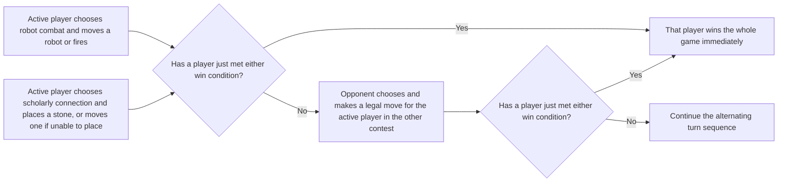

In robot combat, the objective is to move a robot onto any of the six squares in the opponent’s first row. A robot moves one square horizontally, vertically, or diagonally, but cannot enter an occupied square. Instead of moving, a player may fire at an enemy within two squares along a straight or diagonal line. A target takes one damage per attacking robot in range; shots pass through robots. Each damage removes one checker from the target’s stack, and damage greater than its stack removes it entirely. Stones at the corners of a robot’s square give it a defensive bonus; for each attacking robot, the attacking player rolls a die and damages the target only on a result greater than that bonus. The p288 example gives a target a bonus of 3, so each attacking robot damages it only on a roll of 4, 5, or 6.

In scholarly discourse, the objective is a connected line of a player’s stones from one side of the board to the opposite side. Each turn, place one stone; if no placement is possible, move a stone of either color. The diagrams show the setup, robot movement/range, damage, and terrain. The rules create a decision across systems: advance one win condition while the opponent controls a legal move for the active player in the other contest. This is a published rules proposal, not recorded evidence that its balance was tested. [Rules of Play, PDF pp. 285–288 / Commissioned Game 2: Ironclad, printed pp. 1–4]


#### Treat the player-facing contract as an engineering contract

Before inventing another subsystem, state what the player is entitled to infer from the world. Rouse’s opening design discussion is useful here because many of its “player expectations” can be restated as runtime contracts. A world should behave consistently enough that experience teaches rules. Its boundaries should be legible enough that a player can tell what can and cannot be attempted. Reasonable solutions should work when the game has taught the player to expect them. The player should have direction without needing every route prescribed, should be able to make progress in increments, and should have a fair chance to recover from setbacks rather than discover that an earlier invisible mistake made the current state hopeless.

These are not promises that every game must be easy, fully explained, or symmetric. A puzzle may intentionally conceal the solution; a horror game may intentionally create uncertainty; a roguelike may make loss severe. The contract is about **coherence between what the game teaches and what it later demands**. If a wall is climbable whenever it has a painted edge, an identical painted edge that is suddenly decorative needs a reason or a new cue. If a stealth game establishes that darkness hides the player, an enemy that ignores that rule because a trigger fired may be technically correct but experientially incoherent unless the exception is communicated. If a difficult encounter is meant to test mastery, the player needs enough information and control that failure can be attributed to a decision rather than to invisible state.

Rouse also emphasizes that players generally expect to **do rather than merely watch**. This does not outlaw cutscenes or authored sequences. It asks whether the game’s important promises are expressed through player activity. A story about being a clever infiltrator is weakened if every clever infiltration happens only in a noninteractive scene while actual play consists of unrelated shooting. A system about negotiation is weakened if dialogue choices have no consequences. The engine cannot solve that thematic mismatch, but it can make the relevant decisions available: reversible state transitions, readable objectives, scripting hooks, event history, conversation state, and tools for designers to connect consequences to later world state.

A practical acceptance test can therefore be written from the player’s perspective before it is written from the API’s perspective. “After I place the heavy crate on the plate, I can tell that the plate registered it, I can see which door changed, and removing the crate reverses the condition unless the design explicitly latches it.” The implementation can then derive tests for mass threshold, overlap, event dispatch, door state, save/load, sound, animation, and UI. This is stronger than a feature checklist because it defines the causal experience the systems collectively owe.

Source basis: Rouse, *Game Design: Theory & Practice*, Chapter 1 (“What Players Want”), especially the discussion of consistency, understandable world bounds, reasonable solutions, direction, incremental accomplishment, fair chance, avoiding pointless repetition or hopeless stuck states, and player action. The conversion into engine acceptance tests is an engineering synthesis.

### Begin with a player situation

Suppose a player swings a sword at an enemy beside a ledge. The attack misses. What should the player understand? Did the enemy step away? Was the player too far away? Was the attack blocked by a wall? Did the input arrive during recovery? Is the attack still in cooldown? A developer may be able to inspect the collision system and see the answer, but that does not help the player if the game communicates none of it.

This scene turns a vague requirement like “combat should feel responsive” into a testable question: when a reasonable attack fails, does the player receive enough information to understand the outcome and make a better next choice? Rouse discusses players’ expectations of consistent rules, understandable world bounds, reasonable actions working, direction, incremental accomplishment, fairness, and acting rather than merely watching (Rouse, *Game Design: Theory & Practice*, 2nd ed., Ch. 1, PDF pp. 33–40, printed pp. 8–15). That is design analysis, not an API contract. We turn it into one only after choosing the game’s intended behavior.

Salen and Zimmerman give an especially useful lens. In their definition, an action and the system’s outcome form a relationship; a designed experience becomes stronger when that outcome is perceivable and carries significance into the larger game (Salen & Zimmerman, *Rules of Play*, Ch. 3, PDF pp. 49–52, printed pp. 3–6). Apply that idea carefully. A combat cue is not automatically “meaningful” because it is loud or colorful. The cue should correspond to the actual outcome: blocked, out of range, invulnerable target, interrupted attack, or successful hit. If an animation shows a hit while the rules register a miss, feedback makes the mismatch more visible rather than repairing it.

Translate intent through five questions:

1. **Action:** What can the player do, and what input expresses it?
2. **Rule:** Under what conditions does the action succeed or fail?
3. **Outcome:** Which authoritative state changes, and at what time boundary?
4. **Communication:** What does the player see, hear, feel, or infer immediately?
5. **Continuation:** How does the outcome shape later options, resources, or goals?

This is a proposed working checklist. Its value is that it joins design and implementation at a seam where misunderstandings often occur. The designer can state the intended action/outcome relationship, while engineering can identify the state transition, collision query, event, and display path that must make it real.

#### Separate chance, risk, and uncertainty

A game outcome may be hard to predict for different reasons. The excerpt distinguishes macro-uncertainty about which broad result happens from micro-uncertainty among the individual outcomes that make it up. Risk describes a situation where players know the nature of the uncertainty in advance; in the roulette example, both the possible outcomes and their odds can be calculated. Uncertainty, in the book’s chess example, comes from not knowing enough about the opponent to estimate how the match will resolve. A single game may mix risk and uncertainty, and changing the time frame can change how it feels (*Rules of Play*, PDF pp. 181–185 / printed pp. 1–5).

Two fair six-sided dice make the probability distinction concrete. There are 36 equally likely ordered pairs because each of the first die’s six results can pair with each of the second die’s six results. Four pairs sum to five—$(1,4),(2,3),(3,2),(4,1)$—so $P(\text{sum}=5)=4/36=1/9$. Six pairs are doubles—$(1,1)$ through $(6,6)$—so $P(\text{doubles})=6/36=1/6$. A total of seven occurs in six pairs, while a total of two occurs only in $(1,1)$. Thus the eleven possible sums from two through twelve are not equally likely. The book’s table of outcome counts on PDF pp. 186–187 / printed pp. 6–7 was visually inspected; the example calculation here is explanatory arithmetic from those counts.

A random mechanism is only one source of uncertainty. A player may not know an opponent’s intention, may not yet understand a system, or may face a difficult choice whose outcomes are known but costly. Those cases can feel uncertain without dice. Separating the mechanism from the player’s knowledge helps a designer ask what they actually want: a probability distribution, hidden information, a skill test, or a choice with risk. This section follows the assigned excerpt and does not claim to summarize the full book’s probability theory (*Rules of Play*, PDF pp. 188–192 / printed pp. 8–12).

##### Chance has a mechanism, a strategy, and a player’s interpretation

Chance in a game is not only the random-number operation. *Rules of Play* distinguishes micro-level chance operations from macro-level uncertainty about how the whole game will end. A deterministic game can still feel unpredictable when players cannot know one another’s plans. The chapter also separates certainty, risk, and uncertainty. In its formulation, risk means players know the nature of the possible outcomes ahead of time; uncertainty means they cannot confidently predict the result. Roulette is its example of a known risk distribution, while a match against an unknown chess opponent illustrates outcome uncertainty. Most games combine these conditions, and the overall game can feel more uncertain than one isolated action (*Rules of Play*, PDF pp. 193–194 / printed pp. 13–14; chapter summary on PDF p. 197 / printed p. 17).

The reading gives two useful reminders for anyone implementing a random feature. First, a small coding bias can compound through a complex system. In the microbe example, one direction was accidentally counted twice in a random choice; a small probability imbalance gradually pulled the simulated population toward one corner. Second, players can turn an apparent chance procedure into a strategy. Children in the cited counting-out study changed rhyme length, count order, or their position to influence who became “It.” A game designer should test both the random mechanism and the ways players may manipulate it (*Rules of Play*, PDF pp. 193–194 / printed pp. 13–14).

Players also reason about chance imperfectly. The excerpt lists overvaluing rare high-payoff outcomes, adding successive probabilities as if they were independent chances in a simple sum, assuming a streak makes the opposite result “due,” and remembering unlikely positive outcomes differently from negative ones. These are described as fallacies that designers may need to account for, or may choose to build into a game’s decisions. Treat them as the book’s design discussion, not as a complete taxonomy of cognitive biases (*Rules of Play*, PDF pp. 194–195 / printed pp. 14–15).

The chapter’s summary includes the broad statement that computer programs cannot generate true randomness. That assertion is presented here only as a historical statement from the 2004 text, not as current technical guidance about random-number generators. The more durable design question in this excerpt is whether the probability procedure gives the player the intended experience and whether its outcomes support meaningful choices (*Rules of Play*, PDF p. 197 / printed p. 17).

### Turn adjectives into observations

“Responsive,” “fair,” “clear,” and “satisfying” are useful design words, but they are not yet measurable specifications. Ask what a tester would observe.

| Design word | Observable question | Possible instrument |
|---|---|---|
| Responsive | How long from accepted input to visible action? | Input timestamp, tick id, animation-start time, frame-present time |
| Fair | Can players predict why an attack failed? | Failure-reason telemetry plus observed playtest explanation |
| Clear | Can a player identify the attack’s effective range? | Hit/miss boundary trials and post-trial explanation |
| Satisfying | Does a confirmed hit read as a consequential event? | Animation, sound, haptic and target-reaction review with players |
| Consistent | Do equivalent conditions produce equivalent results? | Repeated scenario, fixed seed, rule assertions |
| Learnable | Does the player improve after receiving feedback? | Success rate across attempts, plus observed strategy changes |

These instruments can help answer a question but cannot replace judgment. Telemetry may say players hit more often after a brighter flash, while observation reveals that the flash hides an enemy’s attack. A survey may report enjoyment, while behavior shows that players leave the encounter. Pair counts with direct observation and keep the design hypothesis explicit.

A combat action can be represented as a state transition:

$$
(S_t, a_t) \xrightarrow{\text{rules}} (S_{t+1}, o_t),
$$

where (S_t) is the authoritative game state at time $t$, $a_t$ is a player action, and $o_t$ is the outcome exposed to the rest of the game. This is a compact model for requirements, not a formula quoted from either design book. It forces a distinction between the event and the interpretation of the event. A `DamageApplied` event says health changed. A “hit confirmed” cue may also need hit location, armor absorption, target state, and whether the target died. A miss can still be a valid outcome, but the system should be able to explain it in terms that match design.

#### Treat screenshots and trailers as observations, not implementation proofs

A reaction video may identify a frame that looks reflective, realistic, or unusually detailed, but it rarely reveals how the image was made. In one trailer review, the presenter first mistakes a reflection and later corrects the interpretation after seeing more footage. Another reviewer explicitly cannot tell whether rocks use Nanite, whether reflections are ray traced, or whether a scene is offline-rendered until the presentation clarifies it. A disciplined review writes down the visible cue—highlight movement, blur, fog, a reflection, or a camera change—and then marks the technique as confirmed, inferred, or unknown. ([GAME ENGINE DEVELOPER Reacts to Ratchet & Clank: Rift Apart](https://www.youtube.com/watch?v=qCSyy5BTDuc&t=0m0s), [THE MOST PHOTOREALISTIC Unreal Engine 5 Demo So Far!](https://www.youtube.com/watch?v=jbEfCcl7gOw&t=0m0s)).

The same restraint applies to official demonstrations. A GDC video can show a layered material or procedural assembly and state its hardware and experimental status, while a commentator speculates about how the feature works. Keep the speaker’s claims separate from the reaction’s hypotheses. A beautiful frame can inspire an engine experiment; it cannot establish current support, performance, or game-ready behavior without a build and measurements.
#### A visual review should describe the frame before naming its technique

A trailer can show the effect of rendering without revealing the method. A reaction reviewer may see depth of field, particles, blur, a bright reflection, or a distorted background and infer a particular technique. But compression, camera motion, and art direction can hide or imitate those details. One reviewer initially misread a reflection, then corrected the claim after viewing gameplay; another called possible photogrammetry, Nanite, and Lumen use speculation because the pipeline was unknown. Describe the visible evidence first, then label the technique as confirmed, inferred, or unknown ([Is this TOO REALISTIC? Unreal Engine 5 UNRECORD Gameplay Trailer // Game Engine Dev Reacts](https://www.youtube.com/watch?v=p4aAMPtNIsQ&t=0m0s), [GAME ENGINE DEVELOPER Reacts to Ratchet & Clank: Rift Apart](https://www.youtube.com/watch?v=qCSyy5BTDuc&t=0m0s), [GAME ENGINE DEV REVIEWS Ratchet & Clank: Rift Apart GAMEPLAY](https://www.youtube.com/watch?v=d5_9EEfN-Mw&t=0m0s), [GAME ENGINE DEV REACTS to Halo Infinite | Campaign Gameplay Trailer](https://www.youtube.com/watch?v=HWtEcbiuLBQ&t=0m0s)).

That distinction helps teams give useful review feedback. “The visor highlight moves with the scene” is an observation. “It is ray traced” is an implementation claim that needs stronger evidence. “I cannot read the far terrain through the fog” may be a usability observation even if the fog is artistically intended. A trailer review can generate questions for a capture or developer interview; it cannot replace those checks.

### Focus the prototype on the risky question

A prototype should answer a design uncertainty, not simply demonstrate that the team can assemble a small piece of the final technology. Salen and Zimmerman describe iterative design as a cycle of playable prototyping, playtesting, evaluation, and refinement; they emphasize that actual play reveals things that documents and advance reasoning cannot settle (Ch. 2, PDF pp. 31–32, printed pp. 1–2). They also recommend getting an early interactive prototype into play rather than waiting for polished presentation. Rouse likewise gives a detailed design-process account through early concepts, working gameplay, design tools, and playtesting (chapters inventoried at PDF pp. 9–15). The design move is to find the question whose answer could invalidate the current plan.

For the sword attack, possible uncertainties include:

- Can the player recognize the attack wind-up and recovery windows?
- Is the target’s movement readable enough to make timing feel fair?
- Does a short input buffer improve accessibility without making combat feel automatic?
- Does generous target selection help or undermine spatial mastery?
- Does combat remain legible when two enemies overlap?

A paper mock-up can test whether the rules are understandable. A primitive interactive version can test input timing and collision shape. A graybox arena can test spacing and camera framing. A physics stress scene can test contact stability separately. Do not use a polished character model to answer a timing question unless animation readability itself is the uncertainty. Reducing irrelevant detail makes the experiment cheaper and its result easier to interpret.

Write each prototype brief in one paragraph: the player situation, the uncertain design claim, the smallest playable test, the observation to collect, and a result that would change the design. Example: “We believe players can distinguish a blocked sword attack from a miss by reading a brief spark at the blocking surface. Test in a graybox room with varied distances and shield angles. After each attack, ask the player what happened before showing debug text. If players confuse blocked and out-of-range cases, revise the feedback or rule separation.”

The last sentence matters. A prototype without a decision attached becomes a demo. A team can spend weeks polishing a mechanic and still not know what it proved.

### Protect useful ambiguity; eliminate accidental ambiguity

Some games intentionally leave uncertainty. A mystery may not tell the player whether an ally is trustworthy. A tactical game may conceal enemy intent. A horror game may obscure the location of a threat. These are designed ambiguities. The player may not know what will happen, but should be able to understand what they did and what the system revealed. Salen and Zimmerman’s broader framing of games through formal rules, play experience, and cultural context (introduced in *Rules of Play*, PDF pp. 26–28, printed pp. 4–6) is helpful here: rule clarity does not mean every narrative or strategic question must be answered.

By contrast, accidental ambiguity arises when feedback contradicts the rule, the control fails without reason, or two similar actions produce different results with no perceivable distinction. The job of architecture is not to make the game predictable in every outcome. It is to make the designed uncertainty legible enough that player choices remain meaningful.

### Specify both allowed actions and boundaries

Players learn a game by forming expectations. Rouse’s chapter on player expectations includes consistency, understandable boundaries, reasonable solutions working, direction, gradual achievement, fairness, and avoiding situations where the player becomes hopelessly stuck (Ch. 1, PDF pp. 33–40). Requirements should therefore describe both positive actions and limits. “The player can attack” is incomplete. Specify when attack is accepted, what interrupts it, whether holding the button repeats it, what happens when the target leaves range, and which cues signal those cases.

Boundaries need not all be spelled out to the player. A mystery game may keep a door locked until a clue is found. But the lock should behave consistently enough that players can reason about the world. If a key opens one visually identical door but not another without explanation, the system teaches arbitrary behavior. A game can be surprising; it should still make its own surprises coherent in retrospect.

A requirements table can separate player-facing promise from engine mechanism:

| Promise | Rule owner | Runtime support | Evidence |
|---|---|---|---|
| An attack can be interrupted by a dodge | Combat state machine | Tick-ordered commands and state transition | Scenario replay with simultaneous inputs |
| A shield blocks attacks from its front | Combat rules | Contact/query and shield orientation | Boundary cases around shield arc |
| The player can tell a block from a miss | Presentation design | Outcome event with impact point/reason | Blind playtest plus event trace |
| Repeated attacks have consistent timing | Combat rules | Fixed-step timing and stable input ordering | Replay and low-frame-rate scenario |
| The player can recover from a mistake | Level/gameflow design | Checkpoint and progression state | Full encounter playthrough |

This table deliberately does not equate implementation with proof. “Outcome event exists” is not evidence that players can tell a block from a miss. Each promise needs an appropriate observation.

#### A design document can specify a playable contract without pretending a game exists

The selected pages finish an author’s discussion of document detail, then begin *Atomic Sam*, a sample design document. The author says the sample deliberately omits detail because the author expects to guide development; a team without that continuing author involvement would need more explicit descriptions. A **focus statement** summarizes the intended experience and helps decide which mechanics belong. In the sample, the focus is a non-violent action game about defeating robots creatively with projectiles and environmental devices, in a whimsical retro-future setting. This frames the following controls and systems as a coherent proposal (PDF pp. 561, 564–566 / printed pp. 536, 539–541).

The document separates camera behavior, in-game information, saving, controls, and movement. That makes requirements inspectable: the camera should stay behind the character smoothly, avoid blocking the view, and move closer when space is tight; an on-screen flight meter should reveal a resource the player must manage; checkpoints should define where failure restarts. Those statements guide design and implementation but do not prove that a camera or checkpoint system was built. The source is an authored sample for a game that the book says was never developed (PDF pp. 565–568 / printed pp. 540–543; title page and contents visually checked on PDF p. 562).

The rocket-pack illustrates how a movement system becomes a set of player-readable rules. Holding the control accelerates until a limit; releasing it does not stop Sam instantly; burst movement spends charge faster; hovering also consumes charge; landing recharges it. The interface displays remaining charge so the player can plan a route. Flat surfaces permit landing, while slopes and dangerous floors change the consequences. This is more useful than specifying only “the character can fly”: it gives designers, animators, programmers, and testers observable conditions to implement and check (PDF pp. 569–572 / printed pp. 544–547).

The projectile inventory also distinguishes carrying capacity, ready state, throwing, and recovery after a miss. Sam can carry up to fifty of each type, and missed projectiles may be retrieved after combat. This shows how a control document can explain both state and feedback, although the selected range ends before all throwing details. Treat the numbers and mechanics as part of this fictional design, not as reusable engineering standards (PDF pp. 567–572 / printed pp. 542–547).

##### A design document connects mechanics to the world

The *Atomic Sam* sample design document shows a different kind of engine-facing work: specify what the player can do, what each tool works against, and how allies or enemies change the play situation. Goo-balls stick certain ground or wall-crawling enemies; water balloons short exposed wiring; a magnet-and-weight pulls metallic flyers down. Each item also has limits, so the player must read the target and choose a response. This is a prototype of a mechanic catalog, not implementation evidence. A useful entry records the intended effect, valid targets, exceptions, and what feedback tells the player it worked. [Game Design Theory and Practice, PDF pp. 586–588 / printed pp. 561–563]

The proposed friends are designed to follow without getting stuck, point out threats and secrets, and deliver story while Sam is in safe situations. These requirements connect AI behavior to the experience: an ally that trails behind or talks during danger would violate the design intent even if its movement routine technically ran. The boss examples also connect mechanics to level geometry. The Visionary can be defeated by activating and aiming fans so their airflow pushes it back into a ceiling crate; Zeffir can be weakened through projectiles or by disabling the posts supporting his platform. These alternatives make observation and interaction part of combat. They remain intended behaviors in a sample proposal, not evidence of a shipped game or a tested AI system. [PDF pp. 585–595 / printed pp. 560–570]

The story outline then ties those mechanics to progression: Sam searches three locations, gathers allies and pieces of a message, and discovers why his parents were taken. A design document is strongest when these pieces reinforce one another: the world gives the player reasons to move, tools create readable choices, characters reveal information during play, and level objects support the intended encounters. [PDF p. 596 / printed p. 571]

##### Turn a design document into an observable route through the game

A design document can define a progression that gives players goals and gives the team testable states. In the *Atomic Sam* sample, the player begins in an apartment where a rocket-pack tutorial can be followed or skipped. A hub then offers three middle regions—Benthos, Harmony, and New Boston—in any order. Each region supplies a clue fragment and introduces a companion or local story. The player must complete all three before returning to the hub and unlocking the final airship level. This is a useful distinction between player choice and progression gates: the order is flexible, while the requirement to visit each branch is not. (Game Design Theory and Practice, Appendix A, PDF pp. 598–603 / printed pp. 573–578.)

The document connects movement and story to locations. The city confines the rocket-pack below tall buildings; the undersea dome limits flight height; the Moon colony requires a spacesuit and a surface trip to a character excluded from the dome; the finale shifts combat to narrow corridors aboard a flying fortress. These details imply different navigation, combat, and environment constraints, but they remain written requirements and story content, not evidence that a game was built. The fictional setting also presents an unjust social hierarchy among Moonies and robots; that is part of this sample’s authored world, not an endorsed design rule. (PDF pp. 597–603 / printed pp. 572–578.)

The next appendix gives an unusually candid account of a shipped project’s document. The *Suffering* document is dated eight months before the game shipped, was edited down for publication, and retained outdated names, cut quest items, an abandoned targeting system, and a planned introduction never attempted. Other late changes—storytelling, morality/reputation, creature behavior—were handled in separate documents and never merged into the main one. The author notes that some requested sections were included for apparent completeness even though they were vague or did not match final implementation. The lesson is not that documentation is useless; it is that a document’s revision, scope, and authority must be visible. A design brief is evidence of intended behavior, not proof of shipped behavior. (Appendix B, PDF pp. 604–608 / printed pp. 579–583.)

##### A design document describes a game that is meant to exist

An implementation team cannot build reliably from a genre label such as “horror action game.” It needs a proposed player, a setting, a loop of actions, and rules for what happens when those actions meet obstacles. The sample appendix called *The Suffering* describes a proposed game named *Unspeakable*: a prisoner explores a frightening island, fights creatures, and tries to understand his past. Its opening explains the desired feeling—cautious exploration broken by intense combat—and specifies how the story should reach the player during continuous play. This is a design proposal, not evidence that the described features shipped in the released game called *The Suffering*. [Game Design Theory and Practice, PDF pp. 612–613 / printed pp. 587–588]

That distinction matters because the appendix shifts quickly from mood to contracts. “Save anywhere” means a player can create a save at any time and later restore position and status; a checkpoint is an automatic save at a chosen challenge boundary; “Continue” chooses the latest saved state; auto-loading offers the latest save after death. Each rule answers different questions: what state is preserved, when it is captured, and what the player must do to resume. A production spec should also name failure cases—such as a full memory card or an interrupted save—even though this sample does not define them. [PDF pp. 613–614 / printed pp. 588–589]

Difficulty is described as a bundle of changes rather than one global multiplier. The proposal varies enemy toughness, accuracy, and damage output; the number of enemies; ammunition and health placement; puzzle complexity; and the amount of help text. These choices affect different skills and resources. For example, adding puzzle hints can support a player who understands combat but is stuck on navigation; reducing enemy numbers changes pressure without changing weapon damage. The page also describes the labels and intended audience for four difficulty settings, but it does not report playtest results. Treat the settings as proposed tuning, not verified balance. [PDF p. 614 / printed p. 589]

#### Design a mechanic as a state transition, not just a button label

A design document becomes useful to programmers when it states what the player can do, what state the game checks, and what changes after an input. In the Atomic Sam sample, tapping “Next Projectile” switches to the next available item, while holding it opens a selectable list; releasing commits the centered choice. The character may visually put the projectile away after five seconds, yet the throw input still uses the selected projectile immediately. That is a valuable distinction between presentation state (“arm lowered”) and gameplay state (“projectile remains readied”). [Game Design: Theory & Practice, PDF pp.573–574 (printed pp.548–549)]

The generic Action button is context-sensitive: near a switch it toggles it, near a pushable object it moves it, and holding it near a carryable object begins a carry that ends on release. The same control saves input complexity, but the player needs contextual cues so the engine's choice is legible. A “Look” hold temporarily changes camera control while leaving Sam in place. These cases can be specified as small transition tables before implementation:

| Current situation | Input | State change | Feedback the player should see |
|---|---|---|---|
| Near a switch | Action press | Switch activates | Switch movement and world response |
| Near a carryable object | Action hold | Object attaches to hands; projectile throw disabled | Pose and carry animation |
| Carrying object | Action release | Object detaches with defined placement/physics | Drop animation and resulting motion |
| Projectile ready | Next press and release | Select next available projectile | Held-item change |
| Projectile ready | Next held, directions, release | Choose from inventory list | Carousel highlight and committed item |

This is not a claim that the sample shipped these mechanics; it is a way to turn its written intentions into testable state transitions. Each row raises engine questions—input edges versus held state, interaction query, animation event, collision response, and UI prompt—without confusing the engine service with the design rule.

The same document describes combat puzzles in which a player positions an enemy near a steam vent, waits for the right moment, then activates a switch; a fan can redirect an enemy into the hazard. A safe training room teaches rocket-pack movement before hostile play. These examples show how environment, timing, and feedback can teach a mechanic. The design should specify what clue lets the player predict the trap and what happens when timing is wrong, including whether the trap can hurt the player. [Game Design: Theory & Practice, PDF pp.575–580 (printed pp.550–555)]

AI behavior is also a player-facing rule. The sample varies enemy perception cones and memory, from a robot that forgets the player after line of sight breaks to one that remains locked on; pathfinding ranges from beelining to navigating around obstacles. This can create difficulty through readable limitations instead of only increasing health or speed. If a trap is meant to work, an enemy can be authored to patrol near its trajectory—but the level must communicate the opportunity rather than relying on invisible designer intent. [Game Design: Theory & Practice, PDF pp.580–584 (printed pp.555–559)]

##### Choose goals and endings as part of the mechanic

A **goal** states what counts as success, and a loss condition states when progress stops. Together they shape the duration and rhythm of play. A race to the bottom of a ski slope turns casual recreation into a contest; a repeated survival game may have no single winning endpoint and instead ask the player to last longer or beat a score. The chapter treats a clear, measurable goal as central to formal game structure, while acknowledging that people can play for social or other reasons beyond winning. [PDF pp. 259–260 / Chapter 20, printed pp. 9–10]

The *LOOP* case study makes the design choice concrete. The prototype’s core action—drawing loops around butterflies to score—came before its ending rules. The team considered a target quota, clearing all butterflies, or endless play, then considered whether loss came from a timer or an overcrowded screen. It chose discrete levels with a capture quota and a time limit. Captured butterflies were replenished, keeping the screen active and preserving alternate strategies. The printed screenshots on PDF pp. 261–262 show the interface and a level’s quota/score feedback; the text explains why the game allowed players to exceed the quota for bonus points. The image and prose support a proposed design process, not a claim of present availability or a shipped implementation. [PDF pp. 260–262 / Chapter 20, printed pp. 10–12]

The chapter also warns that “clear objective” does not mean there is only one way to win. Designers can experiment with multiple endpoints, nonstandard victory conditions, or goals that ask players to lose quickly. The important step is to test what the chosen endpoint does to pacing, strategy, and the player’s sense of progress, rather than inheriting a convention without asking why it fits. [PDF p. 262 / Chapter 20, printed p. 12]

##### A resource meter can reward style and create a deadline

In the proposed *Unspeakable*, successful kills fill a 100-point Insanity Meter. A melee kill doubles the points for that enemy; a jumping kill adds a 1.5 multiplier; quick double and triple kills add further multipliers. The proposal shows how these combine: two five-point kills made while jumping yield 7.5 and 15 points, for 22.5 total. Once full, the meter stops accumulating. Activating Insanity Mode spends it over time, changes which attacks are available, and ending the mode too late can leave the character collapsed and end the game. This makes the resource both a reward for expressive play and a limited-duration power state with a failure consequence. It is a proposed mechanic in a sample design document, not evidence that the released *The Suffering* behaved this way. [PDF pp. 625–628 / printed pp. 600–603]

Other state rules connect survival feedback to item handling. Health recovers slowly only up to 20 of the proposed 100 points; pills can restore more, but not above the cap. The HUD appears when aiming or after damage. Useful objects are noticed through the character looking toward nearby pickups; proximity can collect them, play a sound, and briefly show their name, while unneeded health or ammunition remains in the world for a later return. Read together, these details describe not just a health number or inventory list, but when the player learns about state changes and how the design avoids interrupting movement. [PDF pp. 629–632 / printed pp. 604–607]

#### A weapon spec is a set of decisions the player can feel

Suppose the player holds Attack while carrying a machine gun, then taps Attack with a pistol. The same button produces different timing: the machine gun can continue firing while held, while the pistol fires once per press. A melee weapon may instead choose its move from how firmly the analog button is pressed. In the sample proposal, weapon identity is therefore a bundle of player-visible contracts: damage, readiness, speed or rate, range and accuracy, stun, secondary effects, ammunition, and reload behavior. Those variables let a designer make two weapons feel different without relying on names or appearance alone. [Game Design Theory and Practice, PDF pp. 621–624 / printed pp. 596–599]

The proposal also connects an action to its mode. Pressing Attack can force aimed view and acquire a target; holding Target selects a hostile target within range, and quickly releasing then pressing it cycles to the next candidate. Throwing keeps the primary weapon available but temporarily prevents another attack, while movement continues. A mounted weapon enters a separate first-person view with direct aiming and a finite supply attached to that emplacement. These cases suggest a useful way to specify a control: name the starting mode, input, resulting action, temporary restrictions, feedback, and exit condition. That checklist is a derived teaching aid; the appendix does not describe its original implementation architecture. [PDF pp. 621, 623–625 / printed pp. 596, 598–600]

### Failure feedback and accessibility

A game should not require every player to infer a failed action from the absence of an effect. But not every failure needs a pop-up explanation. Use the smallest cue that makes the relevant distinction clear in the game’s sensory language. A tactical game may use a combat log. An action game may use sound, a brief hit-stop, silhouette, or controller vibration. A screen-reader user may need a textual cue or a configurable audio channel. A player with low vision may rely more on sound and haptics; a player who cannot hear may rely on animation and visual indicators.

The rule event should be presentation-neutral and complete enough for alternate renderings. `Blocked` plus an impact point can drive a spark, sound, haptic, subtitle, and accessibility description. If the only output is a particle spawned by the collision function, accessibility options and replay analysis may be difficult. The engine’s job is to preserve outcome meaning across channels; the game’s design determines how many channels to use and how strong each signal should be.

Feedback also has timing. A cue emitted three frames after the hit may be interpreted as a separate event, especially in a fast encounter. Record the time between command, rule outcome, and presentation. If the simulation runs ahead of presentation, attach the simulation tick to the event so the renderer can place a cue at the correct world position and time. In multiplayer, a speculative local cue may need later confirmation. The game should avoid training players to trust a visual hit marker that sometimes appears without a real outcome.

### Decide what the first game must be able to do

Imagine you want to make a top-down game with a character, a few rooms, collisions, a user interface, and a way to restart after losing. You might be tempted to start by designing an all-purpose engine: support every graphics API, every physics model, multiplayer, asset hot reload, and a visual scripting language. That list sounds ambitious, but it does not yet say what the first playable game needs. It also creates dependencies before you have seen how the systems need to work together.

Instead, write the first game’s path in plain verbs: open a window; show a scene; read input; move an object; draw it; save the scene; press Play; return to editing. Each verb identifies a responsibility. “Open a window” points to platform code. “Read input” points to a boundary between the operating system and gameplay. “Draw” points to a renderer. “Save” points to a stable description of scene data. “Press Play” points to a difference between authoring and runtime state. That list can grow, but it gives the first architecture a reason to exist.

The opening Hazel captions explicitly take time to define and plan. The author pauses to say that scope should be discussed before construction, and that planning an event system matters because the reason for an architectural decision is part of learning how to write an engine. That is more than presentation style. A learner who can explain why a system exists can later replace or narrow it. A learner who only memorizes class names tends to cargo-cult interfaces that do not fit the next project.

A practical first scope statement might read: “This engine will support a desktop 2D game with a window, keyboard and mouse input, layered application code, a sprite renderer, editable scenes, save/load, and a runtime Play mode. It will target one rendering backend first. 3D, networking, audio, multiple backends, and mobile deployment are future decisions.” The statement is neither a product promise nor a permanent limit. It is a way to make costs visible. If the game later needs 3D lighting, you can add it against a working 2D application rather than trying to validate every system at once.

#### Choose the game you want to make before choosing how much engine to build

A game engine and a game are related but different products. A team making a game needs rules, content, interaction, and a way to ship them; an engine team builds reusable technology and tools that let games do those things. If the goal is to ship a game with a small team, rebuilding graphics, asset management, animation, and platform layers can consume the time that should go to the game. If the goal is to study engine technology, the engine itself may be the intended result. This is the creator’s opinion in an older vlog, but it yields a practical question: what is the actual deliverable, and which layer is the user trying to learn? ([Do you want to make GAMES or game ENGINES?](https://www.youtube.com/watch?v=Y4J4ZdQGEgo&t=0m20s), [Why you NEED to use a GAME ENGINE!](https://www.youtube.com/watch?v=QQ9MTzrsldo&t=0m1s)).

When the engine is the goal, a small game is still a useful test. One developer proposed a simple Mario-like platformer and worked backward to ask which editor, scene, input, rendering, and gameplay features Hazel needed. Another small-team example began with a Space Invaders prototype, then used the translation to Hazel to expose missing prefabs, dynamic meshes, and scene transitions. The game is a set of requirements that exercises the engine; it is not merely a showcase placed on top after engine work is done. ([The Importance of LONG-TERM PLANNING (Hazel Roadmap)](https://www.youtube.com/watch?v=OsnwKYxPX1A&t=5m29s), [He MADE A GAME using my GAME ENGINE](https://www.youtube.com/watch?v=56ISmbJE9S4&t=2m10s)).

A useful planning sequence is to pick one representative game action, build the smallest prototype that tests it, and record the friction. If many identical enemies must spawn, a prefab may reduce repeated setup. If a menu must lead to a game scene, scene loading is a real requirement. If a project has to run outside the editor, packaging becomes part of the feature. The roadmap should express those dependencies and assign owners, rather than list every engine feature anyone might want. The historical roadmap video explicitly notes that a visible team board can prevent two volunteers from unknowingly building the same feature. ([The Importance of LONG-TERM PLANNING](https://www.youtube.com/watch?v=OsnwKYxPX1A&t=6m35s)).

Keep the schedule proportionate to the team. One creator says he works better with a broad target and manageable milestones than with an imitation of a studio sprint calendar. That is personal experience, not a universal productivity rule. A strong plan makes the next step legible while leaving room to adjust when a prototype uncovers a different need.

### Keep an audio front end separate from its playback backend

The narrated audio system exposes load, play, stop, pause, resume, and volume operations through a front end, while an optional OpenAL plugin handles device playback. A single listener has position and orientation; positional sources have emitters whose locations update with the world. The initial implementation targets stereo output, and the presenter describes mono effects as spatially positioned while stereo tracks are non-spatial in this OpenAL path. Keep that behavior attributed to this backend rather than assuming it applies to every API. [Kohi #142](https://www.youtube.com/watch?v=xb23Y9o7tP4)

Playback channels are not the same as output channels. The source describes 16 playback channels, each tied to one OpenAL source and one active sound; requesting a specific channel replaces its sound, while a negative ID requests a free channel and drops playback if none is available. Master, channel, and emitter volume combine. The channel minimum and stereo/mono assumptions are the presenter’s claims, not independently verified backend guarantees. [Kohi #142](https://www.youtube.com/watch?v=xb23Y9o7tP4)

Short effects can load as one decoded buffer. Long music or voice tracks can reuse two buffers: queue both, unqueue each after playback, refill it with the next samples, then queue it again. The source reports a worker per playback source guarded by a mutex and a brief sleep between work checks; its reason that audio playback blocks is specific narration, not a general OpenAL contract. The implementation uses stb_vorbis and minimp3, and MP3 cleanup remains flagged. Error recovery, format coverage, and stress behavior are not established by the stream. [Kohi #142](https://www.youtube.com/watch?v=xb23Y9o7tP4)


#### Shared systems should pay for themselves

A reusable engine system exists to make repeated game work cheaper. If a helper saves one line once, it may not deserve a subsystem. If every feature needs a consistent way to receive resize events, draw textures, or identify entities, a shared API can prevent many features from inventing incompatible conventions. The cost of a subsystem includes more than its source code: it must be named, tested, documented, integrated into tools, and kept compatible with saved projects.

One useful test is to ask whether two independent game features would otherwise solve the same problem differently. If both need to draw a textured quad, a renderer API can provide common behavior. If only one game needs a custom dialogue graph, forcing it into a generic node framework may be overdesign. Engine design is the repeated choice between a local solution and an abstraction whose future value is uncertain. Hazel’s public series is valuable here because many episodes show the discussion and implementation as a progression, not just a polished list of completed components.


### Read a game feature at three nested scales

A game system is a set of interacting parts that forms a larger whole. To inspect one, name four things: its **objects** (the parts), their **attributes** (properties and state), their **internal relationships** (how the parts affect one another), and the **environment** (the context around the system). These labels depend on the question being asked; they are a lens for analysis, not a required software architecture. Salen and Zimmerman’s chess example shows why the lens matters: the same board game can be examined as a formal rule system, as an experience between players, or as a cultural object. The book describes these systems as nested: rules are experienced through play, and play sits in a wider cultural context. (Rules of Play, PDF pp. 63–68.)

Consider a co-op game in which one player marks a medical kit and another chooses to use it. At the **formal** level, objects include the two characters and the kit; attributes include each character’s health and the kit’s remaining charges; relationships include who can activate it and how much health it restores; the environment is the modeled game state. Here we can check a precise rule: if the player has 40 health, the kit restores 25, and maximum health is 100, the result is 65 and one charge is consumed. If two players activate the final charge simultaneously, the rule must define which operation wins or whether the actions serialize. These are questions for implementation and tests.

At the **experiential** level, the objects become the players interacting with the game. Their attributes include not only health and inventory but also what each person knows. Their relationships include coordination, trust, and competition over scarce resources; the environment includes the screen layout, controls, voice chat, and the physical setting in which they play. A formally correct 25-point heal may still be confusing if the charge counter updates late or the interaction prompt is hidden beneath another player’s marker. Conversely, a visible but inaccurate counter teaches a false rule. The relevant check now includes whether the players can predict the result and coordinate around it.

At the **cultural** level, the game itself is the object. Its designed elements and history are attributes; its relationships include how players connect it to genre conventions, community practices, and other media; the environment is the surrounding culture. A community may treat the last kit as a shared emergency resource, or develop a house rule that the player who finds it may claim it. Neither convention is automatically encoded by the health system. A designer can decide whether to support that practice with a ping, a shared-resource rule, or no special feature, but should not mistake a popular convention for a universal player expectation.

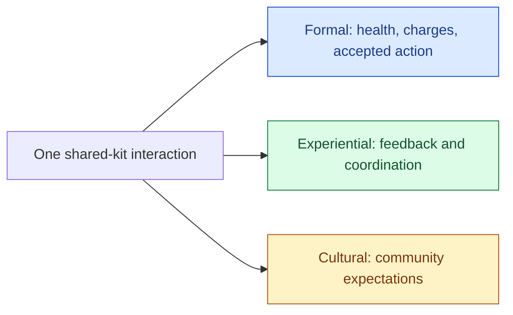

**Read the figure:** start with the same interaction. Each branch asks a different question and calls for different evidence: a state transition, participants’ understanding, or the surrounding practice.

The three levels answer different questions and remain connected. An engineer can fix the simultaneous-use race at the formal level, then test whether the interface communicates the result at the experiential level. If a community consistently adopts a house rule because the shipped mechanic feels unfair, that cultural evidence may motivate a design change. Treating one level as the whole game creates blind spots: a unit test cannot establish that the prompt is legible, and one playtest cannot prove the formal update is race-free. The source presents the levels as an analytical framework; the medical-kit example and its test plan are an applied teaching example.

The same separation helps make “interactive” precise. The book distinguishes **cognitive interactivity** (a player’s interpretive, emotional, or intellectual engagement), **functional interactivity** (the usability and material behavior of controls and display), **explicit interactivity** (choices and procedures designed into the system), and **beyond-the-object interactivity** (participation in the surrounding culture, such as fan interpretation). A game interaction can involve several at once. When the player uses the kit, interpreting its icon is cognitive, getting a prompt to respond is functional, choosing to spend a charge is explicit, and debating the team’s house rule afterward is beyond the current match. For defining the game’s input-and-outcome contract, explicit interactivity is the most direct focus; the other modes still affect whether that choice is understandable and meaningful. (Rules of Play, PDF pp. 69–72.)

A practical failure trace shows why this distinction matters. Suppose the server correctly accepts one player’s use of the last kit and reduces its charges from one to zero. The formal rule is satisfied. But if the other player’s UI continues to show one charge for half a second, the second player may press Use and see nothing happen. The controls technically registered, yet the functional feedback made the system look unresponsive; the explicit choice produced no expected outcome from that player’s perspective. If the team has learned a different house rule, the result may also feel socially unfair. Diagnose each layer separately: log the authoritative state transition and tick; measure the UI update delay; show a consumed/contested response to the rejected action; then observe whether teams understand the shared-resource rule. Choose the remedy after locating the fault: unclear rules may need better feedback, while delayed state may need a synchronization or notification change. A correct network trace alone does not establish a good player experience.

Open and closed systems provide a related boundary check. In the book’s terminology, a closed system does not exchange with its environment; an open system does. A formal rule model can be treated as closed when all relevant state and transitions are inside the rule set. A cultural analysis is open because it examines exchange with history and community. An experiential system may be framed either way depending on whether the question includes only in-game actions or also the players’ social and physical context. State the chosen boundary before using “open” or “closed”; otherwise the label hides which inputs and consequences the analysis includes. (Rules of Play, PDF pp. 67–68.)

**Use the framework as a review prompt, not a player taxonomy.** For a proposed engine feature, write one formal state transition, one experiential question about what participants can perceive or coordinate, and one cultural assumption that should be checked rather than baked in. Then choose a separate verification method for each. This keeps technical correctness, interaction quality, and community meaning in the same design conversation without claiming they can be reduced to one metric.


### Ask what the game makes valuable

A game is made and played inside a culture. Its meaning therefore depends on more than the state transitions inside its rules: the people who make and play it bring shared habits, histories, values, institutions, physical places, and media with them. The *Rules of Play* chapter calls these surrounding conditions the game’s **cultural context** and treats games as cultural objects that can be read in relation to that context. The context is analytically outside the game’s designed rules, but it is not irrelevant to play: it can shape what a rule or representation means to participants.

The book deliberately offers several ways to define culture rather than one universal definition. Pick the scope before making a design claim. These eight readings ask different questions about the same game:

| Reading | What it studies | A concrete question |
|---|---|---|
| Topical | Areas of life such as work, religion or economics | Which parts of everyday life does the game represent? |
| Historical | Traditions passed between generations | Which inherited story or convention is being reused? |
| Behavioral | Shared, learned ways of acting | What do experienced players teach newcomers to do? |
| Normative | Ideals and expectations about how people should act | What does the group call fair, generous or unacceptable? |
| Functional | Ways people solve shared problems | How does the game help people coordinate or compete? |
| Mental | Learned ideas and habits of thought | What does the game assume players already understand? |
| Structural | Patterns connecting roles, ideas and practices | Who has authority, and how do the roles depend on each other? |
| Symbolic | Shared meanings assigned to signs and objects | What does a uniform, badge or scarce item mean to this group? |

For example, a medical kit can be a resource in the rules, a sign of a support role, and an object governed by an unwritten sharing convention. Those descriptions answer different questions; naming the scope prevents an interpretation about one group from quietly becoming a claim about every player. The eight readings come from the book’s discussion on physical PDF p. 498; the questions are teaching applications.

The chapter’s **Games as Cultural Rhetoric** framework asks how a game expresses or carries values. Here, **rhetoric** means a way of expressing or promoting beliefs, sometimes through an unstated story. The book takes this use of the word from Brian Sutton-Smith. The book argues that games can do more than mirror their culture: their rules, goals, symbols, and representations may reproduce, reinforce, or sometimes transform cultural beliefs. This is an interpretive lens. It does not mean that every player reads the same message, that designer intent controls interpretation, or that a game causes a particular social outcome.

Consider the book’s American Dream example. Lotteries marketed with the promise that anyone might become a millionaire and the game show *Who Wants to Be a Millionaire?* frame wealth as an attainable prize. The chapter reads that framing as a cultural rhetoric of individual success, shortcuts, and chance. To use the example carefully, separate the observable design choice (a prize organized around becoming rich) from the book’s interpretation of the values that choice expresses. A design review can then ask: Which outcomes does the game reward? What effort, luck, cooperation, or ownership does it make visible? Which assumptions become part of the player’s route to success?

The book’s Chaturanga discussion makes a related point through changing formal structure. It describes the game’s pieces as modeled on an ancient Indian army and reads their hierarchy as reflecting the social order of that military context. As the game moved between cultures, pieces changed; the chapter interprets additions such as the queen and bishop as changes that affected both the rules and player experience, not merely the names or appearance of pieces. These are the chapter’s historical account and interpretation, relayed through its cited sources; this review did not independently verify that history. The useful design question is how a change in represented roles also changes movement, power, and strategic choice.

The pages also place this lens alongside other situated examples: Scrabble can carry different meanings for different groups; basketball is shaped by its institutions, arena, economics, and media; and games can draw on subcultures or stereotypes. These examples should remain attributed readings, not universal labels. A game may be read differently across communities and over time.

A practical cultural-rhetoric review can trace four things:

1. **Formal choices:** What does the game make players do, accumulate, protect, exchange, or compete over?
2. **Expressive choices:** Which identities, symbols, histories, places, and groups does it represent, and how?
3. **Context:** Which social, historical, economic, physical, or media conditions could shape how those choices are understood?
4. **Interpretation boundary:** Which conclusions are observed in the design, which are the book’s or reviewer’s interpretation, and which would require evidence from players or the relevant communities?

This complements analysis of rules and play. Rules describe the formal actions and outcomes; play concerns how participants act and experience them; cultural analysis asks how those actions and meanings connect to life beyond the designed system. A game can be technically consistent while communicating an unintended priority, and a critic can identify a possible reading without proving that every participant experiences it. Keep those claims separate when designing, documenting, or evaluating a game.

For an original design check, return to the shared medical kit. Suppose the rules award a personal score bonus to whoever consumes its last charge, even when a teammate needs it more. The bonus is an observable incentive in the formal rules. Reading that incentive as a preference for individual gain is an interpretation; saying it makes every player selfish would require evidence. Change the rule to reward keeping the whole team alive and inspect what choices now earn points. Then observe play before claiming that the intended cooperation actually occurs. This connects the cultural question to a rule you can implement and a behavior you can test.

Source: Salen and Zimmerman, *Rules of Play*, physical PDF pp. 496–504, especially the context definition on p. 498 and the rhetoric discussion on pp. 503–504. The medical-kit comparison is an original teaching example.


## Make a change cross the engine without breaking its promises

Repository-specific passages below describe the supplied Kairo snapshot. They have not been revalidated against a current checkout; code fragments retain their stated surrounding context and are not all standalone tested programs. Numerical and contract explanations are taught independently of those implementation observations.

### Engine Architecture, Dependency Direction, Runtime Boundaries, Platform/Backend Abstraction, Asset Identity, Import Pipelines, Dependency Graphs, DDC, Hot Reload, Streaming, Residency, and GPU-Safe Lifetime


The transition from the previous phase is important. ECS answered:

$$
\text{How should runtime world data be represented?}
$$

Phase 16 begins with a larger question:

$$
\boxed{
\text{How do all engine subsystems depend on each other without eventually becoming one inseparable program?}
}
$$

Then M092 asks the same question of content:

$$
\boxed{
\text{How does a file created by an artist become an immutable runtime resource,
while remaining reproducible, reloadable, cacheable and safe for the GPU?}
}
$$

Kairo is already unusually useful for teaching this phase because its repository boundaries actually embody many of these ideas: `KairoMath`, `KairoGeometry`, `KairoSpatial`, `KairoPhysicsEngine`, `KairoAssets`, `KairoECS`, `KairoReflection`, `KairoEngineCore`, `KairoRenderer`, `KairoEditor`, and the `KairoGameEngine` integration repository are separate pieces rather than directories pretending to be modular.

---

### ENGINE LAYERING, DEPENDENCY MANAGEMENT, PLATFORM BOUNDARIES, SERVICES, AND APPLICATION LIFETIME

**Game-engine architecture as dependency management**

A game engine is not fundamentally defined by having:

```text
renderer
physics
audio
ECS
assets
editor
```

Most sufficiently large applications can accumulate those systems.

The architecture is defined by **who is allowed to know about whom**.

Suppose:

```text
Renderer imports Scene
Scene imports Physics
Physics imports Renderer
```

You no longer have three systems.

You have one three-headed system whose pieces cannot evolve independently.

Architecture therefore begins with a directed graph:

$$
G=(V,E)
$$

where a node represents a module/library/subsystem and:

$$
A\rightarrow B
$$

means:

> A depends on B.

A healthy engine tries to make this graph mostly acyclic and directed toward increasingly fundamental abstractions.

For example:

```text
Application / Player / Editor
              |
              v
        integration bridges
        /      |       \
       v       v        v
 Renderer   Physics    ECS
       \       |        /
        \      v       /
        Foundation / Assets
              |
              v
             Math
```

This is not about drawing pretty boxes.

The direction determines which changes propagate.

If Math imports Renderer, every low-level mathematical utility becomes contaminated with a high-level runtime dependency.

If Renderer imports Math, that is natural:

$$
Renderer\rightarrow Math.
$$

The dependency arrow should generally point from policy-rich/high-level code toward simpler lower-level capabilities.

---

**Architecture has three different dependency graphs**

This distinction is important.

There is a **source dependency graph**:

```cpp
import Kairo.Foundation.Math;
```

There is a **link dependency graph**:

```cmake
target_link_libraries(
    KairoRenderer
    PUBLIC KairoMath)
```

And there is a **runtime dependency graph**:

```text
RendererRuntime instance owns/uses GraphicsDevice instance.
```

Those graphs often resemble one another but are not identical.

For example an interface target can create a build dependency without owning a runtime object.

A runtime service can be injected through an abstract interface while the source module containing the consumer never imports the concrete implementation.

That separation becomes the basis of dependency inversion.

---

**Current Kairo dependency structure**

Your umbrella `KairoGameEngine/CMakeLists.txt` explicitly resolves sibling repositories and adds foundational pieces before integration/runtime pieces.

The workspace contains separate targets for roughly:

```text
KairoMath
KairoGeometry
KairoSpatial
KairoPhysicsMath
KairoPhysicsEngine

KairoAssets
KairoAI
KairoECS
KairoReflection
KairoEngineCore
KairoRenderer

KairoEditor
KairoPlayer
bridges
samples
```

Then the integration target:

```cpp
KairoGameEngine
```

is an `INTERFACE` aggregation target joining the runtime-facing pieces.

That is a reasonable umbrella boundary because the umbrella sits at the **top**, not the bottom.

You do not want:

```text
KairoMath → KairoGameEngine.
```

You want:

```text
KairoGameEngine → KairoMath
```

directly or transitively.

The top is allowed to know the whole world.

The foundation should not.

---

**Foundation versus runtime responsibilities**

A foundation layer should answer questions like:

$$
\text{How do I represent a vector?}
$$

$$
\text{How do I intersect a ray and AABB?}
$$

$$
\text{How do I hash a stable asset ID?}
$$

It should not answer:

$$
\text{Which scene is currently loaded?}
$$

$$
\text{Which renderer is active?}
$$

$$
\text{Which entity is the player?}
$$

Those are runtime/application concerns.

The distinction can be expressed as:

$$
\boxed{
Foundation = reusable mechanism
}
$$

while:

$$
\boxed{
Runtime = policy + live world orchestration.
}
$$

---

**Mechanism versus policy**

Consider a BVH.

`KairoSpatial::BVH` knows:

```text
bounds
nodes
primitive IDs
ray traversal
```

It should not know:

```text
which collider belongs to the player
which renderer pass is active
which scene object is selected in the editor
```

Likewise PhysicsWorld can know:

```text
BodyID
ColliderID
forces
contacts
```

without knowing:

```text
EditorSelectionManager
```

or:

```text
InspectorPanel.
```

The more foundation code knows about application policy, the less reusable it becomes.

---

**The dependency rule**

A useful mental invariant is:

$$
\boxed{
\text{Lower layers must not import application policy from higher layers.}
}
$$

Suppose hierarchy:

```text
Layer 4: Game / Editor
Layer 3: Engine runtime
Layer 2: Subsystems
Layer 1: Foundation
```

Acceptable:

$$
L_4\rightarrow L_3\rightarrow L_2\rightarrow L_1.
$$

Suspicious:

$$
L_1\rightarrow L_4.
$$

Sometimes a lower-level system needs to invoke high-level behavior.

That does **not** mean reversing the dependency.

It means dependency inversion.

---

**Dependency inversion**

Suppose Physics needs to report a collision to gameplay.

The naive design:

```cpp
import Kairo.Gameplay.Player;

void PhysicsWorld::ResolveCollision(...)
{
    Player::Get().OnCollision(...);
}
```

Now Physics depends on gameplay.

Wrong direction.

Instead Physics defines a boundary it understands:

```cpp
struct ContactEvent
{
    BodyID A;
    BodyID B;
};
```

or:

```cpp
class ContactListener
{
public:
    virtual void OnContact(
        const ContactEvent&) = 0;
};
```

Gameplay supplies the implementation.

Source dependency remains:

$$
Gameplay\rightarrow Physics
$$

even though runtime control can flow:

$$
Physics\rightarrow GameplayCallback.
$$

This distinction is central:

$$
\boxed{
\text{control flow can point opposite to source dependency}.
}
$$

---

**Dependency inversion mathematically**

Suppose high-level module $H$ requires service $S$.

Without inversion:

$$
H\rightarrow ConcreteS.
$$

With an interface $I_S$:

$$
H\rightarrow I_S
$$

and:

$$
ConcreteS\rightarrow I_S.
$$

At composition:

```text
H
|
| uses
v
IService
^
|
ConcreteService
```

The concrete implementation depends on the contract rather than forcing the high-level module to know implementation details.

---

**Current Kairo example: `Application`**

Your current `Kairo.EngineCore.Application` imports:

```text
Scene
Time
Event
Input
Layer
```

but does **not** import Renderer or Physics.

Instead it owns:

```cpp
std::vector<std::unique_ptr<Layer>>
```

and layers implement:

```cpp
OnAttach()
OnDetach()
OnUpdate()
OnEvent()
```

The source comment explicitly says renderer and physics can be injected as concrete layers.

That is exactly the right dependency direction:

```text
EngineCore Application
        |
        v
     Layer API
        ^
        |
Renderer/Physics integration layer
```

EngineCore stays renderer-neutral.

---

**Current Kairo example: graphics backend policy**

`ProjectDescriptor` stores:

```cpp
std::string GraphicsBackend = "auto";
```

and explicitly does **not** import `KairoRenderer`.

Later the Player translates:

```text
"vulkan"
"metal"
"d3d12"
"opengl"
```

into renderer-specific backend selection.

This is a strong architectural choice.

The persistent project layer understands a portable **policy name**.

The rendering module understands:

```cpp
GraphicsBackend
```

and concrete API state.

Thus:

$$
EngineCore\nrightarrow KairoRenderer
$$

just because a project wants to say “use Metal.”

---

**Avoiding cyclic module dependencies**

Suppose:

```text
A imports B
B imports C
C imports A
```

This forms:

$$
A\rightarrow B\rightarrow C\rightarrow A.
$$

Conceptually, none of the three can exist independently.

With ordinary headers this produces painful include cycles and forward declarations.

With C++ named modules it becomes even more explicit: the module import graph must be acyclic in a valid build.

You cannot solve architectural cycles by rearranging `import` lines.

You must fix the ownership model.

---

**How cycles arise**

A common example:

```text
Scene needs Renderer types.
Renderer needs Scene objects.
```

Naive:

```text
Scene → Renderer
Renderer → Scene
```

The correct question is:

> What is the actual contract between them?

Usually:

```text
Scene
    ↓
render extraction bridge
    ↓
RenderScene / MeshDraw
    ↓
Renderer
```

Then:

```text
Scene → common contracts
Renderer → common contracts
Bridge → Scene + Renderer.
```

The bridge lives **above both**.

This is an extremely reusable cycle-breaking technique.

---

**Bridge modules**

Suppose two independent domains are:

```text
Physics
Renderer
```

and you need physics debug drawing.

Do not make:

```text
Physics → Renderer.
```

Expose:

```cpp
PhysicsDebugShape
```

from Physics.

Then:

```text
Physics
   |
   v
PhysicsDebugShape
   ^
   |
PhysicsRendererBridge
   |
   v
Renderer
```

This is exactly the architectural style your current repositories already lean toward.

`KairoSceneECSBridge` is another example.

It imports both EngineCore and KairoECS because **it is the integration boundary**.

Neither foundational side needs to import the other unnecessarily.

---

**Dependency cycles are usually ownership ambiguity**

If A and B “need each other,” one of four things is usually true:

$$
\text{shared contract belongs below both}
$$

or:

$$
\text{integration belongs above both}
$$

or:

$$
\text{one module owns too many responsibilities}
$$

or:

$$
\text{a callback/event/interface can reverse control flow}.
$$

Treat a module cycle as an architectural diagnostic, not merely a build problem.

---

**Static libraries versus shared libraries**

A static library is linked into the consuming binary.

Conceptually:

```text
libKairoMath.a
        +
libKairoAssets.a
        +
main.o
        ↓
     KairoPlayer
```

A shared library remains a separately loaded image:

```text
KairoPlayer
    |
    +-- KairoRenderer.dll / .so / .dylib
```

The distinction has consequences beyond file extension.

---

**Static-library advantages**

Static linking generally provides a simpler deployment model.

There is no runtime search for a separate library.

ABI boundaries are less troublesome because all code is normally compiled and linked together.

Link-time optimization can sometimes optimize across targets.

Version mismatches become build-time problems rather than runtime loader problems.

For an engine you completely control, static libraries are often the simplest default.

Your `add_library(...)` targets, when `BUILD_SHARED_LIBS` is not enabled, naturally behave this way in typical CMake configuration.

---

**Shared-library advantages**

Shared libraries are useful when you require:

```text
runtime plugin loading
independent updating
large code shared between several processes
binary extension APIs
```

But they create a real ABI boundary.

A function signature like:

```cpp
std::vector<std::string>
Plugin::GetNames();
```

crossing independently compiled C++ shared libraries can become problematic if compiler/STL/runtime versions differ.

---

**API versus ABI**

API is source-level contract:

```cpp
MeshHandle CreateMesh(...);
```

ABI includes:

```text
name mangling
calling convention
object layout
vtable layout
exception ABI
allocator ownership
STL layout
alignment
```

Two libraries can expose the same-looking API while being ABI incompatible.

This is why a truly durable external plugin API often prefers:

```cpp
extern "C"
```

with opaque handles and fixed-width types.

---

**Example robust plugin boundary**

```cpp
extern "C"
{
    struct KairoPluginHostV1;

    struct KairoPluginV1
    {
        std::uint32_t StructSize;
        std::uint32_t Version;

        void (*OnLoad)(
            KairoPluginHostV1* host);

        void (*OnUnload)();
    };

    using QueryPluginFn =
        bool (*)(
            std::uint32_t requestedABI,
            KairoPluginV1* outPlugin);
}
```

Why this is stronger than exporting a C++ class hierarchy across arbitrary DLLs:

$$
\boxed{
\text{explicit version}
+
\text{fixed representation}
+
\text{opaque ownership}
+
\text{minimal compiler ABI assumptions}.
}
$$

Inside one pinned engine toolchain, C++ interfaces can still be reasonable.

But know the trade.

---

**Header-only versus compiled libraries**

Header-only libraries put implementation in headers/templates.

Advantages include easy distribution and powerful compile-time generic code.

Costs include:

```text
longer compile times
more recompilation after implementation changes
implementation exposure
possible code bloat
```

Compiled libraries hide implementation behind translation/module boundaries.

---

**Templates naturally belong near interfaces**

For:

```cpp
template<typename T>
Vec<T,3>
```

the compiler usually needs the definition where it instantiates the template.

Likewise compile-time algorithms/concepts.

But a 4000-line Vulkan renderer does not belong in an inline header merely because “header-only is simpler.”

Mechanism should determine form.

---

**C++ modules change source organization, not architectural truth**

Your repositories use C++23 named modules such as:

```cpp
export module Kairo.EngineCore.Application;
```

A module lets you explicitly export an interface and hide non-exported implementation details.

It also changes dependency scanning and compilation units.

But:

$$
\boxed{
\text{a C++ module is not automatically an architectural layer}.
}
$$

You can still create terrible dependencies with modules.

Likewise:

$$
\boxed{
\text{module} \neq \text{shared library}.
}
$$

The source module system and binary library model solve different problems.

---

**CMake and module graphs**

Your integration target uses:

```cmake
target_sources(
    KairoSceneECSBridge
    PUBLIC
    FILE_SET CXX_MODULES
    ...
)
```

CMake's module scanning needs to discover import dependencies so BMI/module interfaces are compiled before consumers.

This makes clean dependency direction even more valuable.

A giant tangled import graph becomes expensive and fragile regardless of language-level cycle rules.

---

**Stable runtime interfaces**

A stable runtime interface should describe **capability** without exposing backend internals.

For renderer:

Bad:

```cpp
VkDevice GetDevice();
VkImage CreateTexture(...);
```

at the EngineCore boundary.

That forces EngineCore to know Vulkan.

Better high-level runtime contract:

```cpp
TextureHandle CreateTexture(
    const TextureArtifact& artifact);

void SubmitRenderScene(
    const RenderScene& scene);
```

The backend can be Vulkan, Metal, D3D12 or OpenGL.

---

**Stability does not mean frozen forever**

A good interface has:

```text
clear ownership
clear invalidation
clear failure behavior
clear threading rules
clear semantic meaning
```

That matters more than never changing the signature.

For internal engines, source compatibility can be broken intentionally.

The goal is to prevent implementation details from leaking into unrelated modules.

---

**Stable handle interfaces**

Your renderer's:

```cpp
using TextureHandle = std::uint64_t;
```

is a good example of hiding backend identity.

Engine-side code can pass a:

```text
TextureHandle
```

without knowing whether it corresponds internally to:

```text
VkImage
MTLTexture*
ID3D12Resource*
GLuint
```

Persistent asset identity remains a separate `AssetID`.

That separation is exactly right.

---

**Backend-specific boundaries**

A renderer should conceptually look like:

```text
                    Renderer front-end
                          |
          +---------------+---------------+
          |               |               |
          v               v               v
      Vulkan          Metal            D3D12
```

High-level systems should not repeatedly say:

```cpp
if (backend == Vulkan)
...
else if (backend == Metal)
...
```

throughout game logic.

Backend branching should be concentrated around backend ownership.

---

**What belongs above the backend**

Examples:

```text
RenderScene
MeshDraw
Camera data
Material description
Texture artifact
render graph intent
shader semantic binding descriptions
```

These represent renderer policy.

Below backend boundary:

```text
VkImage
VkDescriptorSet
MTLRenderPipelineState
ID3D12DescriptorHeap
OpenGL VAO
```

These are implementation mechanisms.

---

**Backend capabilities**

Do not force every backend into an artificially identical lowest common denominator.

Instead expose capability queries.

Conceptually:

```cpp
struct GraphicsCapabilities
{
    bool RayTracing;
    bool MeshShaders;
    bool BindlessTextures;

    std::uint32_t MaxTextureDimension;
};
```

Then high-level renderer policy can select an appropriate strategy.

Abstraction should hide API mechanics while still exposing meaningful capability differences.

---

**Platform abstraction layer**

Platform differences exist in:

```text
window creation
filesystem semantics
dynamic libraries
threads
timers
input
process spawning
memory mapping
file watching
sockets
```

The mistake is allowing:

```cpp
#ifdef _WIN32
```

and:

```cpp
#ifdef __APPLE__
```

to spread everywhere.

Put those decisions behind concentrated platform services.

---

**Platform layer versus backend layer**

These are related but not identical.

Platform:

```text
Windows
macOS
Linux
```

Graphics backend:

```text
Vulkan
Metal
D3D12
OpenGL
```

For example Vulkan can run on Linux/Windows and via translation on macOS.

Metal is macOS/iOS-specific.

Do not bake:

```text
if Windows => D3D12
```

into foundational architecture.

Treat backend selection as policy based on platform and capabilities.

Your `ProjectDescriptor` does this well by allowing:

```text
auto
vulkan
metal
d3d12
opengl.
```

---

**Service locators**

A service locator often looks like:

```cpp
Renderer& renderer =
    Services::Get<Renderer>();
```

Convenient.

But the function signature:

```cpp
void UpdatePlayer(Player& player);
```

now hides the fact that it may access:

```text
renderer
audio
physics
assets
networking.
```

Dependency visibility has disappeared.

---

**Why hidden service lookup hurts tests**

Suppose unit test calls:

```cpp
UpdatePlayer(player);
```

and unexpectedly receives:

```text
Services::Get<Audio>()
```

error because Audio was never globally registered.

The function's required environment is not encoded in its interface.

You must reconstruct dependencies from implementation.

That increases cognitive coupling.

---

**Service locator is not always forbidden**

There are legitimate cases:

```text
debug console
profiling
logging
legacy integration
optional tooling
```

where globally discoverable services are convenient.

The problem is making it the default dependency mechanism.

Use it knowingly.

---

**Dependency injection**

Dependency injection means required services are supplied rather than discovered.

Constructor injection:

```cpp
class CharacterSystem
{
public:
    CharacterSystem(
        PhysicsWorld& physics,
        AssetRuntime& assets)
        : m_Physics(physics),
          m_Assets(assets)
    {}

private:
    PhysicsWorld& m_Physics;
    AssetRuntime& m_Assets;
};
```

Now dependencies are explicit.

Testing can provide alternatives.

---

**Injection does not require a DI framework**

In C++, dependency injection can simply mean:

```cpp
Renderer renderer(...);
PhysicsWorld physics(...);

Gameplay gameplay{
    physics,
    renderer
};
```

That is often better than a giant reflection-driven DI container.

The top-level wiring code is called a **composition root**.

---

**Your current KairoPlayer `main` is a composition root**

It constructs roughly:

```text
RuntimeProject
PhysicsBridge
AudioBridge
SceneAudioBridge
InputBridge
CharacterMotorBridge
PlayerControllerBridge
LogicBridge
NativeGameplayBridge
ProductionSystemsBridge
ShippingBridge
RendererRuntime
RenderBridge
```

and passes references between them.

That explicit wiring is good.

You can actually read:

> what owns what, and what depends on what.

As this list grows, the solution is not necessarily a service locator.

It may be a dedicated bootstrap/composition object with explicit construction phases.

---

**Global state and hidden coupling**

Global:

```cpp
Renderer* g_Renderer;
```

looks easy.

But any code anywhere can mutate it.

Testing several worlds simultaneously becomes painful.

Initialization order becomes implicit.

Shutdown becomes risky.

A second renderer instance becomes awkward.

---

**Static initialization order**

Imagine:

```cpp
GlobalA a;
GlobalB b;
```

across translation units.

If A's constructor uses B before B is initialized, behavior becomes problematic.

This is one reason engines should avoid complex runtime services as static globals.

Construct them deliberately from `main()` or equivalent bootstrap.

---

**Hidden coupling can be temporal**

Even if two systems do not directly import one another, they may depend on order:

```text
SetGlobalProject()
then
InitializeRenderer()
```

If that order lives only in convention, architecture is fragile.

Explicit object dependencies make temporal requirements visible.

---

**Engine contexts and service bundles**

Passing twelve parameters everywhere is also unpleasant.

A context can group related services:

```cpp
struct RuntimeServices
{
    AssetRuntime& Assets;
    PhysicsWorld& Physics;
    JobSystem& Jobs;
    EventQueue& Events;
};
```

Then:

```cpp
GameplaySystem(RuntimeServices services);
```

This is still explicit enough to inspect.

---

**The god-context trap**

Do not create:

```cpp
struct EngineContext
{
    Renderer* Renderer;
    PhysicsWorld* Physics;
    Audio* Audio;
    Editor* Editor;
    Network* Network;
    AssetRegistry* Assets;
    ...
    70 services...
};
```

and pass it everywhere.

That is a service locator wearing a struct.

Prefer narrow contexts:

```text
SimulationContext
RenderExtractionContext
AssetImportContext
EditorContext.
```

A system receives the smallest capability bundle it logically needs.

---

**Capability views**

A stronger pattern:

```cpp
struct CharacterSystemContext
{
    PhysicsQueryAPI& Physics;
    CommandBuffer& Commands;
};
```

Character logic cannot accidentally access renderer or editor because those services are absent.

Architecture becomes enforceable by types.

---

**Application lifecycle**

An engine application has phases.

Conceptually:

```text
Process start
    ↓
Parse command line/configuration
    ↓
Create platform services
    ↓
Load project
    ↓
Initialize assets
    ↓
Initialize runtime subsystems
    ↓
Load startup world
    ↓
BeginPlay
    ↓
Frame loop
    ↓
EndPlay
    ↓
Drain asynchronous work
    ↓
Destroy runtime resources
    ↓
Destroy platform
    ↓
Process exit
```

Each stage should have explicit ownership.

---

**Lifecycle is not merely `main()`**

A robust application must define:

```text
what happens if initialization fails halfway
what happens if shutdown starts while jobs are running
what happens if renderer construction fails
what services may be used during teardown
```

RAII helps enormously.

If objects are constructed in dependency order as local members, C++ destroys them in reverse order.

But custom callbacks/events may still require explicit shutdown phases.

---

**Kairo `Application` lifecycle**

Current `Application::PushLayer()` does:

```cpp
layer->OnAttach();
m_Layers.push_back(...);
```

Then destructor invokes:

```text
OnDetach
```

in reverse layer order.

The reverse order is good:

$$
L_1,L_2,L_3
$$

attach order becomes:

$$
L_3,L_2,L_1
$$

detach order.

That mirrors stack-like dependency teardown.

---

**An important current lifecycle caveat**

`Application::~Application()` calls user-overridable:

```cpp
OnDetach()
```

but `OnDetach()` is not declared `noexcept`.

A destructor must not allow an exception to escape during stack unwinding.

If `OnDetach()` throws while another exception exists:

$$
std::terminate.
$$

Production options include declaring teardown callbacks `noexcept`, catching/logging inside the destructor, or exposing explicit `Shutdown()` that reports errors before the nonthrowing destructor performs final cleanup.

This is a real interface-level lifecycle decision.

---

**Engine initialization order**

Initialization should follow the dependency DAG.

If:

$$
A\rightarrow B,
$$

B must exist before A can initialize.

Example:

```text
Project descriptor
      ↓
Asset registry
      ↓
Scene
      ↓
Physics bridge
```

and:

```text
Platform window
      ↓
Graphics device
      ↓
Renderer runtime
      ↓
Render bridge.
```

Do not encode this in arbitrary singleton constructors.

Let the composition root build it explicitly.

---

**Topological initialization**

We can think of services exactly like the system DAG from Pass 11.

For every service S:

$$
Dependencies(S)=\{D_1,D_2,\dots\}.
$$

Initialize a service only after all its dependencies.

That is a topological ordering problem.

Usually the graph is small enough to express manually through constructor order.

But the mental model is the same.

---

**Two-phase initialization**

Some systems cannot finish construction until several objects mutually exist.

Avoid creating actual source cycles just to solve this.

Use:

```text
Construct inert object
    ↓
wire dependencies
    ↓
Initialize()
```

carefully.

But remember two-phase initialization creates states:

```text
constructed but unusable
```

which must be guarded.

Constructor injection is preferable where possible.

---

**Shutdown order**

Shutdown should usually reverse initialization dependencies.

If renderer depends on GraphicsDevice:

$$
Renderer\rightarrow Device.
$$

Destroy:

```text
Renderer
then Device.
```

Never:

```text
Device
then Renderer
```

because renderer destructor may attempt GPU cleanup on a destroyed device.

---

**Asynchronous shutdown complicates the picture**

Before destroying resources:

```text
stop accepting new work
wait/cancel worker jobs
flush asynchronous I/O
drain command buffers
wait for required GPU submissions
release runtime bridges
release resources
destroy device
destroy window/platform.
```

Otherwise a background thread can wake after its dependency has vanished.

---

**GPU shutdown**

Especially:

```text
vkDestroyImage
```

must not occur while GPU still references the image.

At complete shutdown it is acceptable to wait for the device/queues to become idle before destroying all GPU resources.

During ordinary runtime hot reload, waiting idle globally is too expensive; we'll design deferred destruction in M092.

---

**Runtime versus editor concerns**

The editor and game player solve different problems.

Editor needs:

```text
reflection
inspectors
asset importers
source watchers
undo/redo
debug visualization
scene mutation
profilers
migration tools.
```

Player needs:

```text
load cooked content
simulate
render
audio
input
gameplay.
```

Those should not become one executable with every feature merely disabled via `if (!editor)`.

---

**Separate processes are valuable**

If editor runs game inside the same process, play-mode crashes can crash the editor.

Global/static state can leak between edit and play worlds.

GPU/runtime state can become tangled.

A separate player process provides:

$$
\boxed{
\text{fault isolation}
+
\text{clean runtime semantics}
+
\text{shipping parity}.
}
$$

It also naturally tests that the game does not accidentally rely on editor-only services.

---

**Kairo already has this separation**

Your CMake has distinct options:

```text
BUILD_EDITOR
BUILD_PLAYER
```

and an actual:

```text
KairoPlayer
```

executable.

`ProjectDescriptor` can optionally name a project-relative Play executable.

This is much closer to a production engine architecture than simply embedding game mode in the editor.

---

**Authoring versus shipped runtime**

Consider a `.blend`, `.gltf`, `.png`, or shader source.

The editor needs:

```text
source files
import settings
importers
watchers
metadata
possibly DCC integration.
```

The shipped game ideally needs:

```text
cooked artifacts
runtime manifest
GPU-ready or near-GPU-ready data.
```

The shipped player should not necessarily contain Blender interoperability, OBJ parsing or Photoshop-image support.

---

**The source/cook/runtime split**

A strong pipeline:

```text
AUTHORING

PNG / glTF / OBJ / shader source
          |
          v
        importer
          |
          v
ENGINE ARTIFACT

texture2d.v1
mesh.v1
scene.v1
shader artifact
          |
          v
RUNTIME ADAPTER

Vulkan texture
Metal texture
GPU vertex buffers
pipeline state
```

Those are three different data layers.

Do not collapse them.

---

**Why cook offline**

If all source conversion happens before shipping:

$$
T_{\text{startup}}
$$

does not include expensive decoding/mesh processing/shader compilation.

You can validate content in CI.

You can make package contents deterministic.

You can remove import dependencies from shipping binaries.

You can precompute backend-specific formats.

---

**Standalone player architecture**

A standalone player is the composition root for runtime.

It should:

```text
load project/package metadata
load runtime manifest
resolve startup scene
construct runtime services
load world
begin play
run fixed/variable systems
extract rendering/audio
present
shutdown cleanly.
```

No editor window should be required.

---

**Current `KairoPlayer`**

Your player already creates runtime-specific bridges explicitly.

It supports:

```text
--renderer
--validate
--smoke
--package
```

It loads the project first, reports project/asset/entity information, constructs physics/audio/input/gameplay services, and only creates `RendererRuntime` after validation/package-only paths have been handled.

This is exactly the correct place for top-level policy.

---

**Composition-root growth**

Your current `main.cpp` now wires a considerable number of bridges.

That is a normal architectural milestone.

Eventually consider extracting:

```cpp
class RuntimeBootstrap
```

or:

```cpp
RuntimeServices BuildRuntime(
    RuntimeProject&);
```

not because `main` is "too long," but because bootstrap sequencing itself is becoming a coherent subsystem that deserves testing.

Do not hide those dependencies behind globals.

Move explicit wiring into a testable composition object.

---

**Headless validation**

A validation process should be able to answer:

```text
Is the project descriptor valid?
Are asset references valid?
Is the scene structurally valid?
Are source/cooked manifests consistent?
Do required components exist?
Are dependency graphs acyclic?
Can runtime contracts be satisfied?
```

without requiring:

```text
window
swapchain
GPU
audio device.
```

That lets CI run deterministic validation on headless machines.

---

**Current Kairo headless boundary**

`KairoPlayer --validate` exits before:

```cpp
RendererRuntime renderer(...)
```

is created.

That is a strong design.

Validation therefore tests project/runtime contracts without graphics-backend availability contaminating the result.

Your CMake tests already use this path for sample projects.

This is what a headless validation route should look like.

---

**Headless validation versus headless rendering**

These are not the same.

Headless validation:

$$
\text{no rendering required}.
$$

Headless rendering:

$$
\text{rendering occurs without a visible interactive window}.
$$

A server build may need neither.

A render farm may need headless GPU rendering.

A CI project validator should not require either.

Separate those concerns.

---

### ASSET IDENTITY, IMPORT PIPELINES, DEPENDENCY GRAPHS, DDC, HOT RELOAD, STREAMING AND GPU LIFETIME

Now we move from code architecture to content architecture.

The central idea is:

$$
\boxed{
\text{Asset identity is not file path,
loaded-object address,
or GPU-resource handle.}
}
$$

Those have different lifetimes.

---

**Asset identity**

An asset might represent:

```text
mesh
texture
material
scene
shader
audio
script
document.
```

We need a persistent answer to:

> Which asset is this?

The answer should ideally survive:

```text
editor restart
path movement
renaming
asset database reordering.
```

Kairo uses:

```cpp
AssetID
```

which is a persistent 128-bit UUID-like value.

That is a good durable identity.

---

**The four identity layers**

For one texture:

```text
Persistent AssetID
    |
    +---- metadata path
    |
    +---- derived cache key
    |
    +---- runtime TextureHandle
```

These are four different things.

For example:

```text
AssetID
f03b...c821
```

may remain stable when:

```text
Textures/Wall.png
```

becomes:

```text
Environment/Architecture/Wall.png.
```

The content hash changes if pixels change.

Runtime TextureHandle may change every process execution.

That is exactly what we want.

---

**Path-based asset identity**

Simplest asset identity:

```text
Textures/Wall.png.
```

Advantages are obvious: human readable and no separate ID database required.

But renaming:

```text
Textures/Wall.png
    ↓
Textures/StoneWall.png
```

changes identity.

Every referencing scene/material must be updated.

---

**Path normalization is harder than it looks**

Paths differ by:

```text
separator
case sensitivity
"." and ".."
drive roots
UNC forms
reserved names
Unicode representation
symlinks.
```

Kairo's `NormalizeAssetPath()` explicitly rejects absolute paths, traversal, unsafe characters and Windows device names, and creates a case-folded portable lookup key.

This is good defensive metadata handling.

But importantly:

$$
\boxed{
Kairo uses path as lookup metadata,
not durable identity.
}
$$

That is the right distinction.

---

**UUID asset identity**

Assign:

$$
ID=
128\text{-bit UUID}.
$$

References become:

```text
Material:
BaseColorTexture =
f03b9c...
```

Path becomes mutable metadata.

Move asset:

```text
Textures/A.png
        ↓
Characters/Hero/A.png
```

ID remains unchanged.

No scene references need rewriting.

---

**UUID collision probability**

For random UUID-like 122 effective random bits, birthday collision probability after $n$ IDs is approximately:

$$
p\approx
\frac{n^2}{2\cdot2^{122}}.
$$

Even at:

$$
n=10^9,
$$

the probability remains astronomically tiny.

But Kairo correctly does not treat randomness as a mathematical proof of uniqueness: registry creation can still reject/retry collisions.

That is sound engineering.

---

**Content-addressed identity**

Content addressing defines:

$$
ID=H(content).
$$

If content changes:

$$
H(old)\neq H(new)
$$

with overwhelming probability.

This is excellent for immutable blobs and caches.

Example:

```text
SHA-256(asset bytes) → cache object.
```

But it is often bad as the **authoring identity**.

Edit the texture by one pixel:

$$
AssetID
$$

would change.

Every scene/material reference would conceptually point to the old version.

---

**Hybrid identity is usually superior**

Kairo effectively uses a strong hybrid:

$$
\boxed{
UUID
\rightarrow
\text{persistent authored identity}
}
$$

$$
\boxed{
path
\rightarrow
\text{human/project location}
}
$$

$$
\boxed{
content hash
\rightarrow
\text{derived cache identity}.
}
$$

This is exactly how these three identity strategies naturally fit together.

Do not choose one mechanism and force it to solve all three problems.

---

**Asset handles**

A handle should represent an asset without embedding loaded runtime storage.

Kairo:

```cpp
template<AssetType ExpectedType>
struct AssetHandle
{
    AssetID ID;
};
```

Then:

```cpp
MeshAssetHandle
TextureAssetHandle
SceneAssetHandle
```

are type-safe persistent references.

Excellent.

---

**Asset handle does not imply residency**

This distinction is essential.

Suppose:

```cpp
TextureAssetHandle h;
```

exists.

That does not necessarily mean:

```text
texture bytes are in RAM
```

or:

```text
texture exists on GPU.
```

It means:

> this persistent asset is referenced.

So:

$$
\boxed{
Handle validity
\neq
Resource residency.
}
$$

We will build explicit residency state in Parts 1542–1544.

---

**Persistent handle versus runtime handle**

Persistent:

```cpp
TextureAssetHandle
```

might contain a 128-bit `AssetID`.

Renderer runtime handle:

```cpp
TextureHandle
```

may be an integer indexing renderer-owned resources.

Those must stay separate.

Your `Kairo.Renderer.Texture` explicitly documents its `TextureHandle` as a process-local renderer-owned key while persistent identity remains in KairoAssets.

This is correct architecture.

---

**Generational asset handles**

Persistent UUID handles do not need generation counters in the same sense because their identity is not a reused array slot.

But a **runtime resource table** often does.

Suppose:

```text
slot 7 = old texture
destroy
slot 7 = new texture.
```

A stale renderer handle `7` could alias the new texture.

So use:

$$
RuntimeHandle=(index,generation).
$$

Exactly the same reasoning as ECS entities.

---

**Example loaded-resource handle**

```cpp
struct TextureRuntimeHandle
{
    std::uint32_t Index;
    std::uint32_t Generation;
};
```

Resource table:

```text
slot 0 gen 5 resident
slot 1 gen 3 unloaded
slot 2 gen 9 resident
```

Then stale:

$$
(2,8)
$$

cannot access:

$$
(2,9).
$$

Persistent `AssetID` and process-local runtime generation solve different lifetime problems.

---

**Current Kairo runtime handle gap**

Current:

```cpp
using TextureHandle = std::uint64_t;
```

provides process-local abstraction but does not itself encode a documented generation structure.

That is fine if handles are monotonically issued and never reused unsafely.

If a reusable resource slot table is introduced, generational encoding would be advisable.

Do not assume “64-bit integer” itself prevents stale reuse.

---

**Asset registry**

An asset registry answers:

$$
AssetID\rightarrow AssetMetadata.
$$

It also often supports:

$$
Path\rightarrow AssetID.
$$

Your current `AssetRegistry` maintains exactly these mappings.

It also validates dependency existence, types and cycles.

---

**Registry is metadata authority, not loaded-resource manager**

This is important.

Registry should not necessarily own:

```text
VkImage
MTLTexture
audio voice
script VM
```

Its job is persistent metadata.

Current Kairo documentation is explicit that AssetRegistry leaves:

```text
decoding
GPU upload
audio creation
file watching
```

to other layers.

That is excellent separation.

---

**Thread-safe registry snapshots**

Kairo's registry uses a shared mutex and returns **copies** of metadata rather than references that could become invalid across concurrent mutation.

This is a strong API decision.

Instead of:

```cpp
const AssetMetadata&
```

that might outlive a lock, callers receive:

```cpp
AssetMetadata
```

by value.

Ownership is clear.

---

**Asset metadata**

Current metadata contains approximately:

```cpp
AssetID ID;
AssetType Type;
AssetOrigin Origin;
path Path;
string Importer;
uint64_t Revision;
vector<AssetReference> Dependencies;
```

Each field answers a different question.

`ID`: what asset?

`Type`: how should it be interpreted?

`Origin`: source/generated/builtin?

`Path`: where is its project representation?

`Importer`: which import mechanism?

`Revision`: how many metadata mutations?

`Dependencies`: what does it depend on?

---

**Metadata revision is not content version**

Kairo explicitly distinguishes:

$$
Metadata.Revision
$$

from:

$$
SourceFingerprint.
$$

Moving an asset changes metadata revision.

That does not necessarily change source bytes.

Editing source bytes changes source fingerprint even if metadata path is untouched.

This separation is excellent.

A single vague "version" field usually causes confusion.

---

**Source assets versus derived runtime assets**

Source asset:

```text
Wall.png
Character.glb
Rock.obj
shader.hlsl
```

exists for authoring/interchange.

Derived artifact:

```text
kairo.texture2d.v1
kairo.mesh.v1
kairo.gltf-scene.v1
```

exists for the engine.

Runtime GPU resource is a third layer.

Thus:

$$
\boxed{
Source
\rightarrow
DerivedArtifact
\rightarrow
RuntimeResource.
}
$$

---

**Why derived artifacts exist**

Source formats optimize for interchange and authoring.

They can contain:

```text
flexible JSON
text parsing
arbitrary numeric layouts
external references
compression formats
unused metadata.
```

Runtime wants:

```text
validated
canonical
bounded
fast-to-load
engine-specific data.
```

Derived artifacts let the engine own its runtime contract.

---

**Renderer adaptation**

Your renderer's:

```cpp
Mesh::FromArtifact(...)
```

takes KairoAssets mesh artifact data and converts it into renderer-side vertex representation.

This is a clean boundary:

```text
KairoAssets:
canonical engine artifact

KairoRenderer:
runtime rendering representation.
```

The asset importer does not create Vulkan buffers.

Good.

---

**Importer interfaces**

Current Kairo:

```cpp
class AssetImporter
{
public:
    virtual std::string Identifier() const = 0;
    virtual std::string Version() const = 0;

    virtual DerivedArtifact
    Import(const ImportRequest&) const = 0;
};
```

This is an excellent narrow plugin contract.

Importer receives validated request and returns artifact.

It does **not** mutate:

```text
asset registry
import database
DDC.
```

Those side effects belong to orchestration.

---

**Why importer purity matters**

Suppose importer itself did:

```text
parse
register new assets
write cache
modify manifest
upload GPU
notify editor
```

A failure halfway could leave several systems inconsistent.

Instead:

$$
Importer:
Source\rightarrow Artifact
$$

and:

$$
Orchestrator:
validation + cache + provenance + publication.
$$

This is much easier to test and make transactional.

---

**Exact importer versioning**

Your `ImporterRegistry` keys implementations by:

$$
(identifier,version).
$$

It explicitly refuses to silently substitute another version.

That is essential for reproducible builds.

If asset was imported with:

```text
kairo.texture.stb@1
```

and only:

```text
@2
```

exists, automatically using 2 may produce different output.

Reproducibility requires exact provenance.

---

**Import transaction**

Your `ImportSourceAsset()` follows a good sequence:

```text
validate importer/provenance
    ↓
read source bytes
    ↓
fingerprint source
    ↓
compute DDC key
    ↓
cache hit?
   / \
 yes  no
 |     |
load  importer.Import()
 |     |
 |   validate artifact
 |     |
 |   publish cache
  \   /
   \ /
update successful import provenance
```

Import provenance updates only after a usable artifact exists.

Thus failed import does not mark broken content as current.

Excellent transactional ordering.

---

**OBJ import pipeline**

A robust OBJ importer boundary should be:

```text
OBJ bytes
    ↓
syntax parsing
    ↓
indices/positions/normals/UV decoding
    ↓
validation
    ↓
coordinate/attribute normalization if policy requires
    ↓
canonical MeshArtifact
```

It should **not** perform:

```text
GPU upload
scene insertion
renderer material creation
editor UI mutation.
```

Those are separate layers.

Kairo's built-in registry exposes an `OBJMeshImporter`, fitting this model.

---

**OBJ-specific dangers**

OBJ can contain:

```text
negative relative indices
separate position/normal/UV indices
polygons rather than triangles
missing normals
duplicate vertices
huge counts
malformed floating point
```

Importer must convert flexible source semantics into a bounded canonical artifact.

The canonical artifact should not preserve every source-format quirk merely because OBJ allows it.

---

**glTF import boundaries**

glTF is much richer.

A glTF scene may include:

```text
nodes
hierarchy
meshes
materials
textures
skins
animations
buffers
external images.
```

So a glTF importer may output a **scene artifact**, not merely one Mesh.

Current Kairo `GltfSceneImporter` does exactly that class of conversion.

---

**glTF external dependencies**

A `.gltf` file can reference:

```text
buffer.bin
albedo.png
normal.png.
```

That means source is not necessarily one file.

Current Kairo validates local dependency URIs carefully, rejecting escaping paths and symlinked/nonregular dependencies.

This is strong security/portability design.

But it introduces an important cache question we will revisit:

$$
\boxed{
\text{all external files influencing output must influence the cache key}.
}
$$

---

**glTF import should not silently own project policy**

Your current asset pipeline deliberately preserves texture URIs in the glTF scene artifact instead of silently registering new texture assets.

The editor/import transaction owns that expansion.

This is a subtle but very good boundary.

Importer says:

> these source dependencies exist.

Project/editor layer decides:

> what persistent AssetIDs should they receive, how do undo and metadata behave?

That prevents parser code from becoming project-state code.

---

**Texture import pipeline**

A texture import pipeline should resolve:

```text
encoded source
    ↓
decode pixels
    ↓
validate dimensions
    ↓
classify color space
    ↓
normal-map handling
    ↓
mipmap generation
    ↓
runtime pixel format conversion/compression
    ↓
TextureArtifact
```

Your current STB importer handles decoding and produces canonical mip artifacts.

---

**sRGB versus linear**

Color textures generally encode approximately perceptual/sRGB values.

Lighting math requires linear values.

Normal maps are vector data and must be treated as linear.

So importer setting:

```text
normal=true
```

forces linear color space in Kairo.

That is correct.

---

**Mipmap generation**

For ordinary color:

$$
C_{mip}
$$

should be filtered in the correct linear-light domain rather than averaging gamma-encoded values naively.

For normal maps:

$$
n'=
Normalize\left(
\sum_i w_i n_i
\right)
$$

rather than simply averaging encoded RGB vectors and leaving the result unnormalized.

Your asset pipeline documentation specifically states that color mips use linear-light filtering and normal-map mips are renormalized.

That is exactly the sort of operation that belongs during derivation rather than every runtime load.

---

**Shader import/compilation pipeline**

This is currently a **design gap** in the inspected Kairo built-in importer set.

`AssetType::Shader` exists, but `RegisterBuiltinImporters()` currently registers:

```text
passthrough
OBJ
texture
WAV
glTF
```

and no dedicated shader compiler/importer was found.

So let's design it properly.

---

**Shader source is not the final runtime asset**

Source might be:

```text
HLSL
GLSL
MSL
shader DSL.
```

Runtime artifact might contain:

```text
SPIR-V
DXIL
metallib/MSL-derived binary
OpenGL GLSL/source variant
reflection metadata.
```

The compiler toolchain is itself part of asset derivation.

---

**Shader cache recipe**

A correct shader key may include:

$$
K=
H(
SourceClosure,
Stage,
EntryPoint,
Defines,
CompilerID,
CompilerVersion,
Optimization,
TargetBackend,
TargetProfile,
FeatureFlags
).
$$

If any input changes, shader artifact changes.

For example:

```text
source identical
compiler upgraded DXC 1.x → 2.x
```

can produce different binary.

Therefore compiler version belongs in the recipe.

---

**Shader include dependency closure**

Suppose:

```hlsl
#include "lighting.hlsl"
#include "pbr.hlsl"
```

Hashing only root shader file is insufficient.

You need:

$$
H(
RootSource,
IncludeA,
IncludeB,
...
).
$$

Prefer canonical dependency discovery/preprocessing.

The same principle applies to glTF external buffers.

---

**Shader reflection**

Compilation should often produce metadata:

```text
descriptor bindings
uniform buffers
push constants
vertex inputs
specialization constants
thread-group size.
```

Then pipeline creation does not need to reparsed source.

The derived shader artifact can be:

```text
binary code
+
stable reflection schema.
```

---

**Asset dependency graphs**

An asset graph has:

$$
A\rightarrow B
$$

if A depends on B.

Example:

```text
Scene
 ├── CharacterMesh
 │      └── Material
 │             ├── Albedo
 │             └── Normal
 └── EnvironmentTexture
```

Changing Normal may affect Material and every dependent scene/package.

---

**Why dependency topology belongs in metadata**

Without an explicit graph, detecting impact becomes:

> grep the project and hope.

With graph:

$$
Dependents(Texture)
$$

is computable.

This supports:

```text
safe deletion
incremental rebuild
hot reload propagation
package closure
dependency visualization.
```

Your AssetRegistry already stores typed dependency references.

---

**Cycle prevention**

Current AssetRegistry rejects cycles.

Suppose:

$$
A\rightarrow B
$$

and proposed dependency:

$$
B\rightarrow A.
$$

`SetDependencies()` performs reachability checking and refuses it.

That makes the asset graph a DAG.

This simplifies:

$$
topological import/build order.
$$

For asset types where cycles would be semantically meaningful, you would need an SCC-aware design instead, but Kairo chooses the simpler DAG contract.

That is a valid and useful policy.

---

**Reverse dependency graph**

Registry currently stores:

$$
Asset\rightarrow Dependencies.
$$

For incremental rebuild, you frequently need:

$$
Asset\rightarrow Dependents.
$$

You can derive reverse adjacency or maintain it incrementally.

If Texture T changes:

```text
T
↑
M1 M2
↑  ↑
S1 S2
```

reverse edges tell you what can become dirty.

---

**Asset cache keys**

A cache key must represent **all semantic inputs to the derivation**.

Ideal equation:

$$
\boxed{
K=
H(
SourceInputs,
ImporterIdentity,
ImporterVersion,
CanonicalSettings,
Target,
DependencyVersions
).
}
$$

If two derivations have identical keys, they must produce identical artifact bytes.

That is the fundamental cache contract.

---

**Kairo's current DDC key**

Current Kairo calculates roughly:

$$
K=
SHA256(
SourceFingerprint
\Vert
SourceByteCount
\Vert
AssetType
\Vert
ImporterID
\Vert
ImporterVersion
\Vert
CanonicalSettings
).
$$

This is strong.

Changing source bytes changes key.

Changing importer version changes key.

Changing settings changes key.

Different asset type changes key.

---

**Canonical settings matter**

Suppose these mean the same thing:

```text
mips=1;normal=0
```

and:

```text
normal=false;mips=true.
```

If importer allows arbitrary spelling, equivalent settings produce different cache keys.

Kairo's texture importer has:

```cpp
CanonicalTextureImportSettings(...)
```

that emits deterministic ordering/spelling.

This makes:

$$
semantic\ equality
\Rightarrow
byte\ equality
$$

for settings.

Exactly what DDC wants.

---

**A current Kairo glTF cache-invalidation gap**

This one matters.

`ImportSourceAsset()` calculates the DDC key **before** invoking the importer using the fingerprint of the registered source file.

For a self-contained GLB:

$$
SourceFingerprint
$$

covers everything.

Good.

For a `.gltf` that references:

```text
mesh.bin
texture.png
```

the output can depend on those sibling files.

But the current generic DDC recipe shown in `MakeDerivedDataKey()` contains only the primary source fingerprint plus importer/type/settings.

Therefore:

```text
scene.gltf unchanged
mesh.bin changed
```

can theoretically produce:

$$
same\ DDC\ key
$$

but:

$$
different\ correct\ artifact.
$$

That violates the immutable-cache invariant.

---

**Correct fix: dependency closure fingerprint**

Importer architecture needs a discovery phase.

Conceptually:

```cpp
struct SourceDependency
{
    path Path;
    Fingerprint Content;
};

struct ImportPlan
{
    vector<SourceDependency> Inputs;
    CanonicalSettings Settings;
};
```

Then key:

$$
K=
H(
Fingerprint(scene.gltf),
Fingerprint(mesh.bin),
Fingerprint(texture.png),
...
ImporterVersion,
Settings
).
$$

Only after computing the complete source closure do you consult DDC.

This is an important next improvement for KairoAssets.

---

**Alternative: registered dependency assets**

If external glTF textures/buffers are themselves registered AssetIDs, key could incorporate:

$$
(AssetID,DerivedKey)
$$

for each dependency.

Then:

$$
ParentKey=
H(
OwnInputs,
DependencyDerivedKeys
).
$$

This naturally propagates changes through the asset DAG.

It also makes incremental build reasoning much cleaner.

---

**Derived-data caches**

A DDC stores expensive-to-recompute artifacts.

Conceptually:

```text
key = SHA-256 recipe
             |
             v
Cache/
  ab/
    abcd...123.kdd
```

If key exists:

```text
load artifact
```

instead of:

```text
run importer.
```

The cache is disposable.

The source/project metadata remains authoritative.

---

**Cache is not the asset registry**

Registry answers:

> what is this asset?

DDC answers:

> have I already computed this exact derivation?

Do not merge them.

Deleting DDC should not destroy project identity.

It should merely make the next build slower.

---

**Kairo DDC immutability**

Current `DerivedDataCache::Store()` enforces:

> if a key already exists with different bytes, throw.

That is exactly right.

A content/recipe-addressed key should be immutable.

If:

$$
K=X
$$

ever maps to two byte sequences:

$$
B_1\neq B_2,
$$

your derivation function is nondeterministic or your key omitted an input.

Both are serious bugs.

---

**Multi-process cache publication**

Kairo's DDC does something notably careful.

It stages into a uniquely claimed temporary directory, writes the payload, then uses hard-link creation to publish the final immutable target without blindly overwriting another process's result.

This is much stronger than:

```text
write key.tmp
rename over key
```

when multiple build processes may race.

It is treating DDC as a real concurrent content store.

---

**Cache invalidation**

The best content-addressed cache invalidation strategy is often:

$$
\boxed{
\text{do not mutate old cache entries}.
}
$$

Change an input:

$$
I_0\rightarrow I_1.
$$

Then:

$$
K_0=H(I_0),
$$

$$
K_1=H(I_1).
$$

Load $K_1$.

$K_0$ becomes unused garbage that may later be collected.

No fragile:

```text
delete cache because timestamp changed
```

logic is required.

---

**Cache invalidation failures are usually key-design failures**

If changing a source input does not change cache key:

$$
\text{key omitted an input}.
$$

If semantically identical input creates new keys unnecessarily:

$$
\text{canonicalization is insufficient}.
$$

So the real cache invalidation question is:

$$
\boxed{
\text{Does the key uniquely identify the complete semantic recipe?}
}
$$

not:

> How do I delete stale files?

---

**Importer version invalidation**

Suppose importer bug is fixed but source/settings are unchanged.

If:

```text
ImporterVersion = 1
```

remains unchanged, DDC may return old broken artifact.

Therefore importer implementation changes that can change output must bump its version or otherwise change the toolchain fingerprint.

This is why exact importer version is part of Kairo's key.

---

**Target-platform cache dimensions**

Suppose derived artifact is backend-neutral.

Then platform need not enter key.

But if artifact includes:

```text
BC7 texture compression
ASTC texture compression
DXIL
metallib
```

the target matters.

Key must include something like:

```text
platform = windows-x64
gpu-family = desktop
backend = d3d12
format = BC7.
```

Otherwise one platform can accidentally consume another platform's cached output.

---

**Incremental asset builds**

Full rebuild:

```text
import every asset
```

is wasteful.

Incremental build begins from changed source nodes.

Suppose dependency graph:

```text
T -> M -> S
```

where:

```text
T = texture
M = material
S = scene/package.
```

If T changes, mark:

$$
Dirty=\{T,M,S\}.
$$

Then topologically rebuild.

---

**Incremental algorithm**

Conceptually:

```cpp
queue = changedAssets;

while (!queue.empty())
{
    AssetID changed = queue.pop();

    for (AssetID dependent
         : ReverseDependencies(changed))
    {
        if (dirty.insert(dependent).second)
        {
            queue.push(dependent);
        }
    }
}
```

Then topologically process dirty subgraph.

Each node computes its new DDC key.

Cache hit means no expensive importer work.

---

**Build graph versus metadata graph**

Sometimes asset A references B but A's derived bytes do not actually incorporate B.

Example:

```text
Scene stores AssetID of Texture
```

Changing texture pixels should not force scene serialization to rebuild.

The **runtime dependency graph** and **derived-build dependency graph** may differ.

This is another subtle point.

Model dependencies according to what output actually depends on.

Otherwise incremental builds over-invalidate.

---

**Current Kairo source watcher**

`SourceWatcher` provides a portable polling baseline.

It maintains state:

```text
Current
Changed
Missing
```

per imported asset.

`Synchronize()` establishes baseline without emitting fake startup changes.

`Poll()` emits deterministic AssetID-ordered transitions.

This is an excellent portable foundation.

Native file-system notifications can merely trigger earlier polls rather than changing semantics.

---

**Why polling remains valuable even with native notifications**

FSEvents/inotify/ReadDirectoryChangesW can:

```text
coalesce events
drop events
report directory-level changes
differ by platform.
```

Treat them as:

> something may have changed.

Then validate content using fingerprints.

That produces reliable semantics.

---

**Asset hot reloading**

Hot reload is not:

```text
file changed
destroy old object
load new object.
```

The robust state machine is:

```text
source change detected
        ↓
derive new artifact
        ↓
validate artifact
        ↓
create replacement runtime resource
        ↓
replacement fully ready?
      /    \
    no      yes
    |        |
keep old    publish new
             |
             v
         retire old safely
```

Critical invariant:

$$
\boxed{
\text{old known-good resource stays usable until the replacement succeeds.}
}
$$

---

**Never destroy first**

Bad:

```cpp
DestroyTexture(old);
Texture newTexture = Load(newFile);
```

If loading fails:

```text
no texture remains.
```

Good:

```cpp
Texture replacement =
    BuildReplacement();

SwapPublishedHandle(
    old,
    replacement);

RetireOld(old);
```

Failure leaves the previous resource active.

This is transactional hot reload.

---

**Versioned resource publication**

A runtime entry might be:

```cpp
struct RuntimeAssetEntry
{
    AssetID Asset;
    std::uint64_t Revision;

    ResourceState State;

    TextureRuntimeHandle Current;
};
```

On successful reload:

$$
Revision\leftarrow Revision+1.
$$

Consumers that cache derived information can observe revision changes.

---

**CPU hot reload versus GPU hot reload**

Replacing:

```text
CPU-side material metadata
```

can be straightforward.

Replacing:

```text
VkImage
descriptor set
pipeline
vertex buffer
```

must respect asynchronous GPU execution.

That is Part 1541.

---

**Safe GPU replacement**

Suppose frame 100 records:

```text
draw using Texture A.
```

CPU immediately creates Texture B and destroys A.

But GPU may still be executing frame 98–100.

Then it accesses freed:

```text
VkImage / memory / descriptor.
```

Undefined behavior.

So CPU ownership lifetime is not enough.

We need **GPU completion lifetime**.

---

**Frames-in-flight timeline**

CPU:

```text
submit frame 100
submit frame 101
submit frame 102
```

GPU might currently execute frame 99.

A resource referenced by frame 100 must survive until frame 100 completes.

Thus:

$$
DestroyTime(resource)
>
LastGPUUse(resource).
$$

This is the fundamental resource-lifetime inequality.

---

**Deferred destruction queue**

A simple frame-fence model:

```cpp
struct RetiredResource
{
    GPUResource Resource;
    std::uint64_t RetireFence;
};

std::vector<RetiredResource>
    retired;
```

On replacement:

```cpp
retired.push_back({
    std::move(old),
    lastSubmittedFence
});
```

Every frame:

```cpp
while (
    completedFence >=
    retired.front().RetireFence)
{
    Destroy(
        retired.front().Resource);

    retired.pop_front();
}
```

Now no resource is destroyed while referenced by the GPU.

---

**Timeline semaphores/fences**

If backend provides monotonic GPU timeline values:

$$
submitValue=431.
$$

When:

$$
completedValue\ge431,
$$

everything referenced exclusively by submissions $\le431$ may be retired.

This often creates cleaner resource lifetime tracking than an arbitrary “wait N frames.”

---

**Why "wait three frames" is not a proof**

Suppose engine usually has three frames in flight.

You retire resource after three CPU frames.

But GPU stalls for 100 ms.

The CPU may advance more than three logical frames while the GPU still references old resource, depending on synchronization model.

Correct lifetime should be tied to actual GPU completion, not only frame count, unless your per-frame fences explicitly guarantee that relationship.

---

**Descriptor lifetime**

Even if texture image survives, descriptor state referencing it may be in flight.

Hot reload may require:

```text
new image
new view
new descriptor
```

for future frames, while old descriptor/image remain valid for submitted frames.

Do not blindly overwrite descriptor memory that a submitted command buffer can still read unless backend features and synchronization rules explicitly permit it.

---

**Current Kairo Vulkan texture behavior**

`VulkanTexture2D`:

```text
creates image
creates view
creates sampler
uploads through staging
submits transfer
vkQueueWaitIdle
```

during creation.

This is safe but synchronous.

Its destructor immediately destroys:

```text
sampler
view
image
memory.
```

Therefore the owner must ensure no in-flight GPU work references it before destruction.

No general hot-reload retirement queue was found in the inspected asset/renderer layer.

That is a concrete future requirement for Part 1541-quality runtime replacement.

---

**Why `vkQueueWaitIdle` is unsuitable as a general hot-reload solution**

You could hot reload by doing:

```cpp
vkDeviceWaitIdle();
DestroyOld();
```

This is correct.

But every hot reload stalls the entire device.

For editor experimentation it may initially be acceptable.

For streaming/runtime reload it is terrible.

Deferred destruction lets:

```text
old resource finish naturally
while new frames use replacement.
```

---

**Asset streaming**

Streaming means not all content is resident at once.

Example open-world texture:

```text
AssetID exists
but texture may not currently be loaded.
```

A request initiates:

```text
disk read
decompression
artifact parse
GPU upload
publication.
```

That process may span many frames.

---

**A streaming state machine**

A useful state model:

```text
Unloaded
   |
   v
Requested
   |
   v
LoadingCPU
   |
   v
CPUReady
   |
   v
UploadQueued
   |
   v
Resident
   |
   v
EvictPending
   |
   v
Unloaded
```

With separate:

```text
Failed
```

state.

Do not represent all of this as:

```cpp
bool loaded;
```

There are many intermediate states with different ownership.

---

**Asset identity during streaming**

Asset handle remains:

```text
valid
```

while asset is Unloaded.

Queries may return:

```text
placeholder
fallback
pending future
not resident status.
```

Thus again:

$$
AssetExistence
\neq
CPUResidency
\neq
GPUResidency.
$$

---

**Async request object**

Conceptually:

```cpp
struct AssetRequest
{
    AssetID Asset;
    ResidencyPriority Priority;
};
```

Asset runtime deduplicates multiple requests for same asset.

If ten entities request the same texture:

```text
one load
ten consumers.
```

Do not launch ten disk reads.

---

**Streaming priorities**

Useful priority inputs include:

$$
\text{camera distance}
$$

$$
\text{screen-space size}
$$

$$
\text{gameplay criticality}
$$

$$
\text{predicted future visibility}
$$

$$
\text{explicit preload priority}.
$$

A hero character texture should beat a distant optional prop when budgets are constrained.

---

**Partial residency**

Residency need not be all-or-nothing.

Textures:

```text
coarse mip resident
high mips streaming.
```

Meshes:

```text
low LOD resident
high LOD requested.
```

Worlds:

```text
near cells resident
far cells absent.
```

This makes residency a level rather than a bool.

---

**Residency state**

A richer resource entry:

```cpp
enum class ResidencyState
{
    Unloaded,
    Loading,
    CPUResident,
    Uploading,
    GPUResident,
    EvictPending,
    Failed
};

struct AssetRuntimeEntry
{
    AssetID Asset;
    ResidencyState State;

    std::size_t CPUBytes;
    std::size_t GPUBytes;

    std::uint64_t LastUsedFrame;
    std::uint32_t PinCount;
};
```

Now resource manager can make budget decisions.

---

**CPU and GPU residency are independent**

A texture may be:

```text
CPU artifact present
GPU resource absent
```

during upload or after GPU eviction.

It may also be:

```text
GPU resident
CPU source artifact discarded
```

if the runtime no longer needs CPU pixels.

Therefore track separately where useful:

$$
R_{CPU},
R_{GPU}.
$$

---

**Memory budgeting**

Suppose GPU texture budget:

$$
B=4\text{ GiB}.
$$

Current resident textures consume:

$$
3.9\text{ GiB}.
$$

New request requires:

$$
500\text{ MiB}.
$$

Resource manager must evict approximately:

$$
400\text{ MiB}
$$

plus safety margin.

Candidates might be ranked by:

```text
unpinned
oldest use
lowest priority
largest reclaim value.
```

---

**Residency is policy**

Low-level GPU API should not decide:

> unload distant mountain.

It only knows allocation.

High-level streaming system has scene/game knowledge.

Thus:

```text
Streaming policy
      ↓
Residency manager
      ↓
Renderer/GPU allocator
```

preserves proper dependency direction.

---

**Reference counting versus explicit residency**

Reference counting says:

$$
resource\ stays\ alive
\iff
refcount>0.
$$

This works well for ordinary CPU object ownership.

It is often insufficient for streaming.

---

**Why references do not equal residency need**

Suppose a Scene contains references to 50,000 textures.

If each reference increments a strong runtime refcount:

$$
all\ 50,000
$$

may remain resident forever.

But many are currently:

```text
off-screen
far away
inactive level
low-priority.
```

The fact that an asset is **logically referenced** does not mean its heavy runtime payload must remain resident.

---

**Three concepts should be separated**

A good model distinguishes:

$$
\boxed{
Reference
}
$$

meaning:

> some durable object names this asset.

$$
\boxed{
Request
}
$$

meaning:

> some runtime consumer currently wants it available.

$$
\boxed{
Pin
}
$$

meaning:

> do not evict it yet.

These are different.

---

**Explicit residency leases**

Example:

```cpp
class ResidencyLease
{
public:
    ~ResidencyLease()
    {
        manager.Release(asset);
    }
};
```

A system can acquire:

```cpp
auto lease =
    assets.Acquire(texture);
```

while it requires residency.

But simple counts still need budget/priority semantics.

So:

```text
pin count
priority
last use
budget
```

often work together.

---

**Weak persistent handles**

An authored:

```cpp
TextureAssetHandle
```

is effectively a weak persistent reference to identity.

It should not force runtime GPU residency merely because a material exists somewhere in a project file.

This is another benefit of Kairo's AssetHandle containing only `AssetID`, not a shared_ptr to runtime texture.

---

**Resource lifetime across frames in flight**

This closes M092.

A resource may have several overlapping lifetimes:

$$
L_{\text{AssetID}}
$$

persistent project lifetime,

$$
L_{\text{DerivedArtifact}}
$$

cache/runtime CPU lifetime,

$$
L_{\text{RuntimeHandle}}
$$

process resource lifetime,

$$
L_{\text{GPUUse}}
$$

asynchronous submission lifetime.

These are not equal.

---

**The key inequality**

For resource R submitted to GPU at work item $S$:

$$
\boxed{
L_R
>
Completion(S).
}
$$

CPU saying:

```text
"I don't need it anymore"
```

is not enough if GPU still does.

This is conceptually identical to deferred reclamation in concurrent data structures.

A resource is retired logically first, physically freed later.

---

**Example three-frame timeline**

Imagine CPU:

```text
CPU frame 10 submitted using Texture A
CPU frame 11 reloads and publishes Texture B
CPU frame 12 uses B
```

GPU:

```text
currently executing frame 9.
```

Texture A must remain alive for frame 10 even though no future CPU frame will reference it.

So:

```text
Asset mapping:
A -> B immediately for future work

GPU memory:
old A remains until frame 10 fence signals.
```

Logical replacement and physical destruction are separate operations.

---

**Hot-reload publication model**

A robust runtime entry can be:

```cpp
struct TextureEntry
{
    AssetID Asset;

    std::uint64_t Revision;

    TextureRuntimeHandle Current;
};

void PublishReplacement(
    TextureEntry& entry,
    TextureRuntimeHandle replacement)
{
    TextureRuntimeHandle old =
        entry.Current;

    entry.Current = replacement;
    ++entry.Revision;

    RetireAfterGPUCompletion(old);
}
```

That is the core operation.

---

**Material/mesh transitive hot reload**

Suppose:

```text
Material
  ↓
Texture
```

Texture reload may not require rebuilding Material if material only stores stable AssetID/descriptor binding.

It may only require rebinding the new runtime texture.

But if a shader changes resource layout:

```text
descriptor layout changed
```

dependent pipelines/material bindings may need rebuilding.

The dependency graph must distinguish such relationships.

Hot reload is not always “replace one object.”

---

**Failure during hot reload**

If replacement shader fails to compile:

```text
keep old pipeline
report error
```

Do not replace working runtime state with null merely because source file is temporarily invalid while the user types.

Editor hot reload especially needs **last-known-good semantics**.

This drastically improves authoring UX.

---

**Current Kairo M092 architecture map**

Your code currently has a particularly strong split:

```text
AssetID
    persistent UUID

AssetMetadata
    path/type/origin/importer/revision/deps

AssetRegistry
    ID/path topology authority

ImportDatabase
    source fingerprint +
    importer/version/settings provenance

AssetImporter
    source -> derived artifact

ImporterRegistry
    exact importer ID/version registry

DerivedDataCache
    immutable recipe-addressed artifacts

SourceWatcher
    portable source-change observation

KairoRenderer
    artifact -> runtime GPU representation
```

That is a coherent pipeline.

It is not one monolithic asset manager.

---

**The current asset pipeline end-to-end**

For a texture:

```text
Textures/Wall.png
        |
        | AssetID identifies it persistently
        v
AssetRegistry metadata
        |
        v
ImportRecord
        |
        | source fingerprint
        | importer = kairo.texture.stb
        | importer version
        | canonical settings
        v
DerivedDataKey
        |
      cache?
      /    \
    yes     no
     |       |
     |   StbTextureImporter
     |       |
     |    mip chain
     |       |
     +--- TextureArtifact
              |
              v
       Renderer adapter
              |
              v
       VulkanTexture2D
              |
              v
          VkImage
```

This is the mental model to keep.

---

**Three kinds of hashes in an asset system**

Do not conflate:

**Persistent asset identity**

Kairo:

$$
UUID.
$$

**Source content fingerprint**

Answers:

> are source bytes the same?

**Derived cache key**

Answers:

> is the entire derivation recipe identical?

These serve different roles.

A robust asset system may use all three simultaneously.

Kairo does.

---

**Three kinds of versions**

Similarly distinguish:

$$
MetadataRevision
$$

for registry metadata changes,

$$
ImporterVersion
$$

for derivation implementation,

$$
RuntimeRevision
$$

for currently published runtime resource generation/hot reload.

One vague `version` field cannot express all three cleanly.

---

**Asset deletion**

Current AssetRegistry refuses to remove an asset while another registered asset depends on it.

That is a very good invariant.

Without this:

```text
Material -> Texture
```

could become silently dangling.

A higher-level editor may support:

```text
Delete anyway and clear references
```

or:

```text
Delete with dependency replacement.
```

But those should be explicit transactions.

Registry-level safety should remain strict.

---

**Asset move**

Moving asset path should not affect AssetID.

Kairo's registry updates:

```text
ID -> new path
path index
metadata revision
```

atomically enough to avoid leaving an asset with no path mapping if allocation fails.

This demonstrates an important principle:

$$
\boxed{
\text{metadata operations deserve strong exception guarantees too}.
}
$$

Asset databases are persistent state, not disposable scratch memory.

---

**Dependency graph complexity**

Let:

$$
V=
\text{asset count}
$$

and:

$$
E=
\text{dependency count}.
$$

Cycle detection through full reachability per mutation may cost:

$$
O(V+E)
$$

in worst case.

For editor-scale graphs this is usually acceptable.

If asset graphs become enormous and mutations frequent, maintain additional topological information or use more sophisticated incremental DAG algorithms.

Correctness first.

---

**DDC size management**

Content-addressed invalidation produces old unreachable entries.

Therefore DDC eventually needs garbage collection.

Possible policy:

```text
size budget
LRU
age threshold
workspace manifest reachability
```

Importantly, deleting DDC is safe.

All entries should be reproducible from source + tools.

That is the criterion for calling it a cache.

---

**DDC versus packaged build artifacts**

A local DDC may contain many historical/unused entries.

A shipping package should contain only the dependency closure of the chosen build/startup content.

Pipeline:

```text
project
    ↓
resolve package roots
    ↓
dependency closure
    ↓
resolve current derived artifacts
    ↓
copy/cook package manifest + payloads.
```

Do not simply ship the entire developer cache.

---

**Reproducibility**

For a derivation to be reproducible:

$$
Artifact
=
F(
Source,
Dependencies,
Settings,
ImporterVersion,
Target
).
$$

There must be no hidden dependency on:

```text
current directory
wall-clock time
random seed
machine locale
unordered-map iteration
untracked tool version.
```

Any hidden input undermines the cache.

This is why canonical settings, exact importer version and deterministic manifests matter.

---

**Locale**

Parsing:

```text
1.25
```

must mean the same thing on systems whose locale expects commas.

Asset formats should use locale-independent numeric parsing/serialization.

Kairo consistently uses explicit classic/character-based parsing in several persistence systems, which is the right philosophy.

---

**Deterministic dependency ordering**

Even if dependency vector semantics are unordered, writing them in arbitrary hash-table iteration order can produce different artifact bytes.

Canonicalize:

```text
sort by stable ID
```

before serialization/hashing unless order itself is meaningful.

Deterministic representation helps:

```text
cache hits
diffs
reproducible builds
tests.
```

---

**Asset importer error boundaries**

Importer errors should say:

```text
asset
source
importer
location if known
reason.
```

But importer failure should not partially mutate registry or runtime.

Your current functional boundary:

```text
Importer returns artifact or throws
```

is excellent for this.

Transaction owner can decide whether to:

```text
keep old artifact
mark source dirty
show error
retry.
```

---

**Build versus runtime import**

Editor:

```text
source watcher detects change
    ↓
import
    ↓
DDC
    ↓
hot reload.
```

Shipping runtime:

```text
manifest
    ↓
prebuilt artifact
    ↓
runtime resource.
```

Ideally shipped game does not need source file import paths.

This is Part 1518 and M092 working together.

---

**Cross-platform artifacts**

Some artifacts can be backend-neutral:

```text
canonical mesh vertices/indices
animation tracks
scene hierarchy.
```

Others should be target-specific:

```text
BC7/ASTC textures
shader binaries
pipeline libraries.
```

So the asset pipeline may have two derivation stages:

$$
Source
\rightarrow
CanonicalArtifact
\rightarrow
PlatformArtifact.
$$

This avoids re-parsing expensive source while still producing platform-specific output.

---

**The complete future Kairo asset runtime**

A strong next-generation runtime could be:

```text
AssetRegistry
    persistent metadata

Import pipeline / DDC
    authoring/build side

RuntimeAssetManager
    AssetID -> RuntimeEntry
                |
                +-- artifact state
                +-- residency
                +-- revision
                +-- current resource handle
                +-- load future
                +-- last GPU use

RendererResourceManager
    generational runtime handles
    deferred destruction
    memory budgeting
```

This preserves every lifetime boundary.

---

**Runtime asset entry design**

For example:

```cpp
enum class AssetLoadState
{
    Unloaded,
    LoadingCPU,
    CPUReady,
    UploadQueued,
    Resident,
    Failed
};

struct RuntimeTextureEntry
{
    AssetID PersistentID;

    std::uint64_t PublishedRevision = 0;

    AssetLoadState State =
        AssetLoadState::Unloaded;

    TextureRuntimeHandle Current{};

    std::size_t ResidentGPUBytes = 0;

    std::uint64_t LastUsedSubmission = 0;

    std::uint32_t PinCount = 0;
};
```

Notice what is **not** here:

```text
source path as identity
raw VkImage exposed to scene
shared_ptr forcing residency.
```

---

**Safe reload algorithm**

```cpp
void ReloadTexture(
    AssetID asset)
{
    // 1. Re-import or fetch new derived artifact.
    TextureArtifact artifact =
        BuildCurrentArtifact(asset);

    // 2. Build replacement completely.
    TextureRuntimeHandle replacement =
        renderer.CreateTexture(artifact);

    // 3. Publish only after success.
    auto& entry =
        runtimeAssets.Texture(asset);

    const auto old =
        entry.Current;

    entry.Current = replacement;
    ++entry.PublishedRevision;
    entry.State =
        AssetLoadState::Resident;

    // 4. Old resource is logically dead,
    //    but may remain physically alive.
    if (old.IsValid())
    {
        renderer.RetireTexture(
            old,
            renderer.LastSubmittedTimeline());
    }
}
```

This combines Parts 1540, 1541 and 1545 into one coherent runtime operation.

---

**Current Kairo gap priorities**

If I were extending the codebase specifically from this pass, the most valuable next work would be:

1. **External-source closure hashing** for glTF and shader include-style dependencies, because a DDC key must include every input that can change output.

2. A dedicated **shader import/compiler pipeline**, because `AssetType::Shader` exists but no built-in shader compiler was found.

3. A **runtime asset/resource manager** separating AssetID from loaded CPU/GPU resource state.

4. **Generational renderer resource handles** if slot reuse is introduced.

5. **GPU deferred destruction/timeline retirement**, required for safe hot reload and streaming.

6. Explicit **residency/budget management** rather than letting persistent references imply residency.

That order moves from correctness first to runtime sophistication.

---

**Architecture issue to watch in current umbrella linking**

Your top-level:

```cmake
KairoGameEngine INTERFACE
```

links a broad collection of engine targets.

That is fine as an application-facing convenience target.

But lower-level runtime libraries should still link the narrowest targets they truly need whenever practical.

Otherwise everything importing the umbrella can gradually acquire transitive access to:

```text
renderer
physics
assets
ECS
reflection
```

even when it should conceptually depend on only one or two.

An umbrella is useful at the composition boundary.

It should not become the default dependency of foundational modules.

---

**EngineCore's current direction is good**

Several of your current Core modules demonstrate the right principle.

`ProjectDescriptor` stores renderer policy without importing renderer.

`Application` owns generic layers rather than concrete rendering/physics.

Scene data stores persistent asset handles, not GPU handles.

Runtime VM IDs are not serialized.

Physics IDs are runtime-only.

Scene→ECS conversion lives in a bridge.

Those are not isolated coding details.

They are repeated applications of:

$$
\boxed{
\text{persistent data knows stable contracts;
runtime adapters know concrete implementations}.
}
$$

---

**Dependency reconstruction challenge**

Suppose you need to render physics debug shapes.

Bad:

```text
KairoPhysicsEngine
       ↓
KairoRenderer
```

if Physics is intended to remain renderer-neutral.

Design instead:

```text
KairoPhysicsEngine
   exposes DebugShape[]
          |
          v
PhysicsRenderBridge
          |
          v
KairoRenderer.
```

Now answer:

> Which module owns the bridge?

The highest-level integration module that is allowed to depend on both.

If you can derive this without memorization, you understand dependency inversion.

---

**Cycle reconstruction challenge**

Given:

```text
Scene → Renderer
Renderer → Scene
```

extract:

```text
RenderScene
MeshDraw
CameraPose
LightDraw
```

as a rendering contract.

Then:

```text
Scene
   |
   v
SceneRenderExtraction
   |
   v
RenderScene
   |
   v
Renderer.
```

Remove Renderer dependency from Scene.

That is architectural cycle removal through directional data extraction.

---

**Service reconstruction challenge**

Compare:

```cpp
void AI::Update()
{
    auto& physics =
        Services::Get<PhysicsWorld>();
}
```

against:

```cpp
AI::AI(
    PhysicsQuery& physics)
    : m_Physics(physics)
{}
```

Explain why the second provides:

```text
visible dependencies
testability
instance isolation
explicit lifetime.
```

Then explain why a narrow:

```cpp
AISystemContext
```

may be useful when several related services are needed.

But reject a god `EngineContext`.

---

**Lifecycle reconstruction challenge**

Given:

```text
Platform
Device
Renderer
RenderBridge
World
```

if:

```text
Renderer uses Device
RenderBridge uses Renderer + World
```

initialize:

```text
Platform
Device
Renderer
World
RenderBridge.
```

Shutdown dependency-safe:

```text
RenderBridge
World/runtime users
Renderer resources
Renderer
Device
Platform.
```

If jobs or GPU submissions exist, quiesce them before destroying dependencies.

---

**Asset-identity reconstruction challenge**

Given a texture that moves path and later changes pixels, identify the correct changing/stable values.

Rename:

```text
Textures/A.png
→ Environment/A.png
```

Persistent:

$$
AssetID:
\text{unchanged}.
$$

Path:

$$
\text{changed}.
$$

Metadata revision:

$$
\text{changed}.
$$

Source bytes:

$$
\text{same}.
$$

Source fingerprint:

$$
\text{same}.
$$

Derived key:

$$
\text{same}
$$

if path is intentionally not a semantic importer input.

Now edit pixels.

AssetID:

$$
\text{unchanged}.
$$

Source fingerprint:

$$
\text{changed}.
$$

Derived key:

$$
\text{changed}.
$$

That is the identity model.

---

**DDC reconstruction challenge**

You should be able to derive:

$$
K=
H(
SourceFingerprint,
AssetType,
ImporterID,
ImporterVersion,
CanonicalSettings,
DependencyFingerprints,
Target
).
$$

Some of those fields may be omitted only if they provably do not influence the artifact.

Then state the cache invariant:

$$
\boxed{
K_1=K_2
\Rightarrow
ArtifactBytes_1=ArtifactBytes_2.
}
$$

If this is false, the cache key is incomplete or the importer is nondeterministic.

---

**Hot-reload reconstruction challenge**

Given Texture A currently in use:

```text
detect source change
```

Do **not** destroy A.

Perform:

```text
build artifact B
create GPU resource B
validate B
publish B for future frames
retire A at its last GPU-use timeline
destroy A only after completion.
```

If any step before publication fails:

```text
A stays current.
```

That is safe hot reload.

---

**Streaming reconstruction challenge**

Explain why this is wrong:

```cpp
if (material.TextureHandle.IsValid())
{
    // therefore texture exists on GPU
}
```

A valid persistent handle only means the asset is referenced.

Correct flow:

```text
AssetHandle
    ↓
RuntimeAssetManager
    ↓
ResidencyState
    ↓
Resident?
   /     \
 yes      no
 |        |
use      request/fallback.
```

That distinction is central to any scalable asset system.

---

**Frames-in-flight reconstruction challenge**

CPU replaced resource at frame 20.

GPU still executing frame 18 and frame 19/20 are queued.

Question:

> Can old resource be destroyed immediately?

No.

Destroy only after the last submission that references it completes.

The relevant condition is:

$$
CompletedTimeline
\ge
LastUseTimeline(oldResource).
$$

Not:

```text
CPU has moved on.
```

That is Part 1545.

---

**Exact coverage — M091 + M092**

| Part | Topic | Status |
|---:|---|---|
| 1501 | Game-engine architecture as dependency management | ✓ |
| 1502 | Foundation versus runtime responsibilities | ✓ |
| 1503 | Dependency inversion in engine modules | ✓ |
| 1504 | Avoiding cyclic module dependencies | ✓ |
| 1505 | Static versus shared libraries | ✓ |
| 1506 | Header-only versus compiled libraries | ✓ |
| 1507 | Stable runtime interfaces | ✓ |
| 1508 | Backend-specific implementation boundaries | ✓ |
| 1509 | Platform abstraction layers | ✓ |
| 1510 | Service locators and trade-offs | ✓ |
| 1511 | Dependency injection | ✓ |
| 1512 | Global state and hidden coupling | ✓ |
| 1513 | Engine contexts/service bundles | ✓ |
| 1514 | Application lifecycle | ✓ |
| 1515 | Initialization order | ✓ |
| 1516 | Shutdown order | ✓ |
| 1517 | Runtime versus editor process concerns | ✓ |
| 1518 | Authoring versus shipped runtime | ✓ |
| 1519 | Standalone player architecture | ✓ |
| 1520 | Headless validation paths | ✓ |
| 1521 | Asset identity | ✓ |
| 1522 | Path-based asset identity | ✓ |
| 1523 | UUID-based asset identity | ✓ |
| 1524 | Content-addressed asset identity | ✓ |
| 1525 | Asset handles | ✓ |
| 1526 | Generational asset handles | ✓ |
| 1527 | Asset registry | ✓ |
| 1528 | Asset metadata | ✓ |
| 1529 | Source versus derived runtime assets | ✓ |
| 1530 | Importer interfaces | ✓ |
| 1531 | OBJ import pipeline boundaries | ✓ |
| 1532 | glTF import pipeline boundaries | ✓ |
| 1533 | Texture import pipeline boundaries | ✓ |
| 1534 | Shader import/compilation pipeline | ✓ |
| 1535 | Asset dependency graphs | ✓ |
| 1536 | Asset-cache keys | ✓ |
| 1537 | Derived-data caches | ✓ |
| 1538 | Cache invalidation | ✓ |
| 1539 | Incremental asset builds | ✓ |
| 1540 | Asset hot reloading | ✓ |
| 1541 | Safe GPU-resource replacement during hot reload | ✓ |
| 1542 | Asset streaming | ✓ |
| 1543 | Residency state | ✓ |
| 1544 | Reference counting versus explicit residency | ✓ |
| 1545 | Resource lifetime across frames in flight | ✓ |


The main architecture you should retain is this:

$$
\boxed{
\begin{array}{cccccc}
\text{Source Asset}
&\rightarrow&
\text{Persistent AssetID}
&\rightarrow&
\text{Import Recipe}
&\rightarrow
\\[4pt]
\text{Derived Artifact}
&\rightarrow&
\text{Runtime Resource}
&\rightarrow&
\text{GPU Submission}
&\rightarrow
\\[4pt]
&&
\text{Deferred Retirement}
&&&
\end{array}
}
$$

while the software architecture around it is:

$$
\boxed{
\text{Foundation}
\leftarrow
\text{Subsystems}
\leftarrow
\text{Integration Bridges}
\leftarrow
\text{Player / Editor / Game}
}
$$

with callbacks/interfaces allowing control flow to travel in the opposite direction **without reversing source dependencies**.

For your current Kairo codebase, the largest concrete findings from this pass are that the high-level layering and persistent/runtime identity separation are already strong, the DDC itself is unusually careful, but the next significant correctness/performance frontier is the runtime resource layer: **complete dependency-closure hashing for compound sources, dedicated shader derivation, generational loaded-resource handles, safe asynchronous GPU retirement, streaming/residency budgets, and last-known-good hot reload.**

**Pass 14 is M093 + M094, Parts 1546–1582.** That takes the next step into **serialization goals and formats, text versus binary, forward/backward compatibility, endianness, checksums, object/ECS/scene references, reflection metadata/type/property IDs, safe type erasure, inspector architecture, then undo/redo transactions, autosave/recovery, project manifests, path sandboxing, symlink/traversal defense, packaging, atomic publication, and build-config versus runtime-config separation.**


### Serialization, Schema Evolution, Compatibility, Endianness, Integrity, Object References, Reflection, Type Erasure, Undo/Redo, Transactions, Recovery, Autosave, Sandboxed Paths, Packaging, Relocatable Bundles, Atomic Publication, and Configuration Boundaries


Pass 13 ended with:

$$
\text{Source Asset}
\rightarrow
\text{Derived Artifact}
\rightarrow
\text{Runtime Resource}.
$$

Pass 14 asks how the *meaning* of all that data survives time.

A renderer object may live for milliseconds. A scene file may need to survive ten years, four engine versions, a CPU-architecture change, property renames, editor crashes, an interrupted save, a moved project directory, and a plugin no longer installed.

So the central question becomes:

$$
\boxed{
\text{How do we make engine state durable without making today's C++ layout tomorrow's file format?}
}
$$

Then M094 adds the editor-side problem:

$$
\boxed{
\text{How do we make destructive authoring operations reversible and crash-safe?}
}
$$

This is one of the most practically important passes because many engine projects get rendering right before they get persistence right—and bad persistence eventually destroys user work.

---

### SERIALIZATION, COMPATIBILITY, REFLECTION, INSPECTORS AND TYPE ERASURE

---

**Serialization goals**

Serialization is not merely:

> Turn object into bytes.

That definition is too weak.

For an engine, serialization commonly needs to satisfy several independent properties:

$$
\boxed{
Persistence
}
$$

The data survives process termination.

$$
\boxed{
Portability
}
$$

The data can move between machines/platforms.

$$
\boxed{
Determinism
}
$$

Equivalent logical states preferably produce equivalent serialized representations.

$$
\boxed{
Evolvability
}
$$

Future engine versions can interpret older data or migrate it.

$$
\boxed{
Integrity
}
$$

Corruption can be detected.

$$
\boxed{
Security
}
$$

Malformed input cannot request unbounded allocations, escape project roots or exploit parser assumptions.

$$
\boxed{
Performance
}
$$

Parsing and storage costs are appropriate for the use case.

Those goals conflict.

A human-editable scene file optimizes differently from a GPU texture artifact.

---

**Serialization domains**

You should not have one universal serializer for every purpose.

A game engine normally has several serialization domains.

```text
Editor scene
    human-readable
    diff-friendly
    versioned
    semantic

Derived asset
    compact
    validated
    deterministic
    fast to load

Network packet
    bandwidth-sensitive
    transient
    compatibility constrained

Save game
    durable
    version-aware
    player-facing

Recovery snapshot
    crash-resistant
    redundant
    checksummed
```

All serialize information.

They do not need the same format.

That is a recurring lesson:

$$
\boxed{
\text{serialization is a policy boundary, not a utility function.}
}
$$

---

**Serialization should capture semantics, not object representation**

Suppose:

```cpp
struct Camera
{
    ProjectionMode Mode;
    float VerticalFov;
    float NearPlane;
    float FarPlane;
};
```

Bad persistent format:

```cpp
write(
    reinterpret_cast<char*>(&camera),
    sizeof(camera));
```

That stores whatever today's compiler happened to choose for:

```text
padding
enum representation
alignment
float layout assumptions
member order
ABI
```

The file silently becomes coupled to one compiled object layout.

Instead store meaning:

```text
camera
projection perspective
vertical-fov 60
near-plane 0.1
far-plane 1000
```

or a binary equivalent with explicit field identifiers and numeric widths.

The serializer should describe:

$$
\boxed{
Camera\ semantics
}
$$

rather than:

$$
\boxed{
Camera\ memory.
}
$$

---

**Text versus binary serialization**

Text serialization represents logical values through characters.

Examples:

```text
near-plane 0.1
visible true
mesh "a912..."
```

Binary serialization stores encoded fields directly as bytes.

Neither is inherently superior.

They optimize different dimensions.

---

**Why text formats are powerful for authoring**

Text provides:

- easy inspection,
- source-control diffs,
- mergeability,
- manual repair,
- debugging,
- tooling with ordinary editors.

Suppose a light changes:

```diff
- intensity 1000
+ intensity 1500
```

That is excellent for source control.

Compare an opaque binary diff:

```text
8 bytes changed.
```

Far less useful to artists and programmers.

This is why your current Kairo project, scene and asset-manifest formats being deterministic textual formats is a strong authoring choice.

---

**Costs of text**

Text is usually:

- larger,
- slower to parse,
- requires numeric conversion,
- requires escaping,
- susceptible to representation ambiguity if not canonicalized.

For example floating value:

$$
1
$$

could be written:

```text
1
1.0
1.000000
1e0
```

All are semantically equivalent.

If serialized byte identity matters, choose one canonical representation.

---

**Binary serialization advantages**

Binary can provide:

- compact storage,
- faster decoding,
- direct fixed-width numeric representation,
- easier chunked random access,
- reduced parsing overhead.

A derived mesh artifact might have:

```text
header
vertex count
index count
vertex bytes
index bytes
```

There is no strong reason an end user needs to edit that manually.

Binary is natural.

---

**Binary does not automatically mean fast**

A bad binary format can be slower than a good textual one.

For example:

```text
millions of tiny length-prefixed heap allocations
```

will perform poorly regardless of binary encoding.

The real factors include:

$$
\text{allocation count}
$$

$$
\text{branching}
$$

$$
\text{copy count}
$$

$$
\text{data locality}
$$

$$
\text{compression}
$$

$$
\text{schema complexity}.
$$

Binary is an encoding choice, not a performance guarantee.

---

**Versioned file formats**

Every persistent format that may evolve should identify its schema version.

Kairo does this consistently.

Examples conceptually:

```text
kairo-project 2
kairo-assets 1
kairo-scene 5
kairo-recovery 1
kairo-package 1
```

This immediately answers:

> Which grammar and semantics should parse this file?

Without a version, a parser encounters an unknown structure and has no principled way to distinguish:

```text
corruption
new format
old format
wrong file type.
```

---

**Magic + version**

A robust header often carries at least:

$$
Magic
$$

and:

$$
Version.
$$

Binary example:

```cpp
struct FileHeader
{
    std::uint32_t Magic;
    std::uint32_t Version;
};
```

Where:

```cpp
constexpr uint32_t Magic =
    0x4B414952; // illustrative "KAIR"
```

Then parser first verifies:

```text
Is this even my file format?
```

before interpreting payload.

Text formats achieve the same through a canonical first line.

---

**Version numbers must correspond to semantic interpretation**

Do not increment versions for arbitrary reasons.

A file version means:

> The reader must potentially use different logic to interpret this representation.

If internal C++ code is refactored but serialized semantics remain identical, the file version need not change.

If field meaning changes:

```text
intensity used to mean arbitrary units
```

and now means:

```text
candela
```

that is a schema-semantic change.

Version/migration is required.

---

**Schema evolution**

Schema evolution is the process of changing persistent representation while preserving meaningful old data.

Suppose v1:

```text
light
color 1 1 1
intensity 5
```

v2 introduces unit:

```text
light
color 1 1 1
intensity 5
unit candela
```

Old files lack the field.

Reader can assign:

```text
unit = legacy
```

or convert according to a known v1 rule.

That is migration.

---

**Types of schema evolution**

The easiest change is adding an optional field with a default:

```text
v1:
roughness

v2:
roughness
double-sided = false
```

More complex:

```text
v1:
fov-horizontal

v2:
fov-vertical
```

requires viewport/aspect assumptions.

Harder:

```text
v1:
Euler rotation

v2:
Quaternion rotation.
```

Requires mathematical conversion.

Even harder:

```text
v1:
one Mesh component

v2:
MeshRenderer + MaterialSlot entities.
```

Now migration changes object topology.

---

**Migration should be semantic**

A good migration function is conceptually:

$$
M_{v1\rightarrow v2}:
Schema_{v1}
\rightarrow
Schema_{v2}.
$$

It should not be:

```cpp
reinterpret_cast<NewStruct*>(oldBytes);
```

You are converting meaning.

Example:

```cpp
CameraV2 Migrate(
    const CameraV1& old)
{
    CameraV2 result;

    result.VerticalFov =
        ConvertHorizontalToVertical(
            old.HorizontalFov,
            old.AssumedAspectRatio);

    result.NearPlane =
        old.NearPlane;

    return result;
}
```

---

**Forward compatibility**

Forward compatibility asks:

> Can an older reader tolerate data produced by a newer writer?

Suppose reader understands:

```text
position
rotation
```

but newer writer adds:

```text
scale.
```

If old reader can safely ignore unknown `scale`, forward compatibility exists for that change.

---

**Forward compatibility is difficult when semantics are required**

Suppose newer format adds:

```text
compression zstd
```

and old reader understands only:

```text
compression none.
```

It cannot simply ignore the field because it cannot decode the payload.

Forward compatibility is therefore not binary yes/no for a whole format.

It is feature-dependent.

---

**Backward compatibility**

Backward compatibility asks:

> Can a newer reader interpret files written by an older writer?

This is usually much more important for editor/project formats.

If Kairo 0.5 loads a Kairo 0.4 project and migrates it successfully, that is backward compatibility.

A mature engine often promises:

$$
CurrentReader
\rightarrow
OldFiles.
$$

It may not promise:

$$
OldReader
\rightarrow
CurrentFiles.
$$

---

**Compatibility matrix**

Imagine versions:

```text
Reader v1
Reader v2
Reader v3

Writer v1
Writer v2
Writer v3
```

Compatibility is a matrix, not a vague adjective.

For example:

| Reader | File v1 | File v2 | File v3 |
|---|---:|---:|---:|
| v1 | yes | maybe | no |
| v2 | yes | yes | maybe |
| v3 | yes | yes | yes |

Document this.

Testing compatibility fixtures is far more meaningful than saying:

> We support old files.

---

**Unknown-field handling**

Suppose new Camera file:

```text
camera
fov 60
near 0.1
chromatic-aberration 0.2
```

Older reader understands only first two fields.

It has choices.

**Strict rejection**

```text
unknown field -> error
```

Advantages:

- typo detection,
- no silent information loss,
- simple semantics.

Disadvantages:

- poor forward compatibility.

**Ignore unknown field**

Advantages:

- forward extensibility.

Disadvantages:

- read/save may destroy fields it did not understand.

**Preserve unknown field**

Old reader keeps opaque unknown data and writes it back unchanged.

This provides much stronger round-trip compatibility.

---

**Strictness is useful for authoring correctness**

Your current Kairo parsers are deliberately strict in several inspected formats.

For example `AssetManifest` rejects:

```text
unknown statement
unsupported version
duplicate/nested malformed records.
```

`ProjectDescriptor` similarly rejects unknown statements.

Recovery manifests also reject unknown statements.

This is a valid policy because it catches:

```text
typos
partial corruption
unsupported newer formats
ambiguous interpretation.
```

But it means these formats do not obtain generic forward compatibility through unknown-field preservation.

That is an explicit trade.

---

**Extensible binary formats commonly use field IDs**

Instead of positional layout:

```text
field 0 = x
field 1 = y
field 2 = z
```

encode:

```text
propertyID
wireType
length
payload
```

Unknown property ID can then be skipped using length.

This is why self-describing/tagged binary formats evolve more gracefully than naive fixed struct dumps.

---

**Stable endianness**

Consider integer:

$$
0x12345678.
$$

Little-endian memory:

```text
78 56 34 12
```

Big-endian:

```text
12 34 56 78.
```

If you write native integer bytes and read on opposite endian architecture, value changes.

Persistent binary formats must define byte order.

Usually:

```text
little-endian
```

or:

```text
network/big-endian.
```

Then convert explicitly.

---

**Endian-safe write**

Conceptually:

```cpp
void WriteU32LE(
    Writer& out,
    std::uint32_t value)
{
    std::byte bytes[4]
    {
        std::byte(value & 0xff),
        std::byte((value >> 8) & 0xff),
        std::byte((value >> 16) & 0xff),
        std::byte((value >> 24) & 0xff)
    };

    out.Write(bytes);
}
```

This representation is independent of host endianness.

---

**Stable numeric widths**

Avoid persistent:

```cpp
size_t
long
unsigned long
```

because their widths can vary by platform/compiler model.

Prefer:

```cpp
std::uint8_t
std::uint16_t
std::uint32_t
std::uint64_t

std::int32_t
std::int64_t
```

when binary representation requires a fixed width.

---

**Boolean representation**

Do not serialize `sizeof(bool)` bytes blindly.

Define:

```text
0 = false
1 = true.
```

Reject other values unless schema intentionally allows them.

Same for enums.

Do not serialize underlying enum bytes unless the persistent schema explicitly defines the numeric values.

Kairo frequently persists semantic enum names rather than compiler-dependent ordinals, which is stronger for textual durability.

---

**Floating point**

If storing IEEE-754 `float32`, say so explicitly.

If format must support architectures where float representation differs, conversion is required.

On modern target machines IEEE-754 is overwhelmingly common, but a durable format should still define:

```text
binary32
binary64
little-endian byte order.
```

Text float parsing must also reject:

```text
NaN
Infinity
```

where they violate engine invariants.

Your Kairo reflection layer explicitly rejects non-finite floating values in `PropertyValue`, which is good defensive behavior.

---

**Checksums and content hashes**

A checksum answers:

> Are these bytes likely corrupted?

A cryptographic/content hash can answer:

> Is this exactly the same content identity?

They are related but not identical roles.

---

**Simple checksum**

Example CRC/FNV-style checksum:

$$
C=Checksum(bytes).
$$

Recovery snapshot stores:

```text
payload size
payload checksum.
```

On load:

$$
size_{actual}=size_{expected}
$$

and:

$$
Checksum(actual)=Checksum(expected).
$$

If not:

```text
reject recovery point.
```

Your current recovery system does this.

---

**FNV is not a security primitive**

Kairo's recovery code explicitly uses FNV-1a as a **corruption detector**, not cryptographic authentication.

Correct.

If an attacker deliberately modifies both payload and checksum, FNV offers no meaningful tamper resistance.

For untrusted distribution/integrity, use something stronger:

$$
SHA\text{-}256
$$

or authenticated signatures/MACs depending on threat model.

---

**Content hash versus checksum**

DDC:

$$
SHA256(recipe)
$$

is serving identity.

Recovery:

$$
FNV(payload)
$$

is serving accidental-corruption detection.

Do not conflate these.

Same mathematical tool family, different security/semantic requirements.

---

**Chunk checksums**

Large binary artifact could contain:

```text
Header
Chunk table
Mesh chunk
Animation chunk
Texture chunk
```

You may checksum each chunk individually.

Then corruption can be localized.

You may also hash whole file.

Trade-off:

```text
one global hash = simpler
per-chunk hashes = better localization/streaming validation.
```

---

**Serialization of object references**

Object pointers cannot be persisted.

Suppose:

```cpp
Material* material;
```

At runtime address:

$$
0x7fa123...
$$

has no meaning on next launch.

Serialize stable identity instead:

```text
MaterialAssetID
```

or:

```text
SceneEntityID.
```

On load:

$$
ID\rightarrow object.
$$

---

**Two-pass reference resolution**

The universal pattern is:


Create every object and build:

$$
SerializedID
\rightarrow
RuntimeObject.
$$


Resolve references.

Example:

```text
Entity 10 parent 4
Entity 4 parent none
```

Even if Entity 10 appears first in file, loading works.

This same pattern appeared in Pass 12 for cloning and ECS extraction.

---

**Reference classes**

Not every reference has same ownership semantics.

You may distinguish:

```text
Strong reference
Weak reference
Optional reference
External asset reference
Scene-local reference
Cross-scene reference.
```

For example:

```text
MeshRenderer -> MeshAsset
```

can remain valid when entity changes.

A parent relation typically requires target in same loaded scene.

A gameplay target may be optional and disappear.

Serializer must understand the semantics.

---

**ECS entity serialization**

Never serialize:

```cpp
Entity{Index=42, Generation=7}
```

as persistent entity identity unless that runtime handle is explicitly defined as persistent—which it generally should not be.

Runtime slot allocation is transient.

Serialize:

```text
PersistentEntityID
```

and create runtime entities anew on load.

---

**Entity reference conversion**

Save:

```text
Runtime Entity {12,4}
      ↓
Scene Entity 105
```

Serialized reference:

```text
105.
```

Load:

```text
Scene Entity 105
      ↓
Runtime Entity {3,1}.
```

The runtime representation can be completely different.

That is desirable.

---

**ECS component schema**

A persistent ECS-like scene might encode:

```text
entity 105
component Transform
  position ...
component Camera
  fov ...
end
```

But remember Pass 12's architecture:

Kairo's durable `EngineCore::Scene` and process-local `KairoECS` are deliberately separate.

That means Kairo does not need to serialize its sparse-set internal indices.

It serializes authored scene semantics and extracts runtime ECS later.

This is the cleaner design.

---

**Scene-graph serialization**

A scene graph needs:

```text
entities
components
hierarchy
stable IDs
asset references.
```

There are two common hierarchy representations.

Nested:

```text
Root
{
    Child
    {
        Grandchild
    }
}
```

or flat IDs:

```text
entity 1 parent none
entity 2 parent 1
entity 3 parent 2.
```

Flat ID representation is often easier for:

```text
random ordering
references
incremental editing
streaming.
```

---

**Validate hierarchy after loading**

A parser must not assume file hierarchy is valid.

Check:

$$
Parent(E)\neq E.
$$

Check parent exists.

Check no cycles.

Check perhaps one root policy if required.

Check depth bounds if recursion is used.

Malicious/corrupt file:

```text
1 parent 2
2 parent 3
3 parent 1
```

must not lead to infinite traversal.

---

**Transactional scene loading**

Do not mutate live scene as parse proceeds.

Use:

```cpp
Scene candidate;

ParseInto(candidate);
Validate(candidate);

liveScene =
    std::move(candidate);
```

If parse fails at entity 997:

```text
live scene remains unchanged.
```

Your Kairo scene/project loading architecture repeatedly follows this strong-exception pattern.

---

**Reflection metadata**

Reflection metadata describes a type in a machine-readable engine-owned way.

Example:

```text
Type:
Kairo.Engine.Camera

Display:
Camera

Properties:
VerticalFov
NearPlane
FarPlane
Exposure
Primary
```

Each property can carry:

```text
stable key
display name
value kind
category
tooltip
numeric range
read-only flag
enum options
reference target type.
```

KairoReflection already implements essentially this model.

---

**Metadata is not the object's value**

Descriptor:

```text
"near plane is a floating point value"
```

is metadata.

Instance:

```text
NearPlane = 0.1
```

is data.

Separate:

$$
Schema
$$

from:

$$
InstanceState.
$$

That enables one descriptor to inspect thousands of objects.

---

**Stable reflection keys**

Your reflection system uses dotted ASCII identifiers such as:

```text
Kairo.Engine.Transform
```

instead of compiler RTTI names.

This is a very good choice.

RTTI names can be:

```text
compiler-dependent
mangled
unstable across builds.
```

A persistent reflection key should be designed as data schema identity.

---

**Type IDs**

A type ID is stable identity for a reflected type.

You have several implementation choices.

**String key**

```text
Kairo.Engine.Transform
```

Advantages:

- readable,
- collision-free if uniqueness enforced,
- persistent-friendly.

Cost:

- larger comparisons/storage.

**Integer ID assigned at runtime**

Fast, but registration order can make it unstable.

**Hashed stable string**

$$
TypeID=Hash("Kairo.Engine.Transform").
$$

Compact and deterministic, but collisions must be handled.

---

**Persistent versus runtime type IDs**

A useful design is:

```text
persistent:
stable string/hash

runtime:
dense TypeIndex
```

At startup:

```text
"Kairo.Engine.Transform"
    ↓
runtime index 7.
```

Then hot loops can use:

```cpp
uint16_t TypeIndex;
```

while persistence remains compiler/order independent.

This is the same persistent/runtime identity separation we have seen everywhere.

---

**Hash collisions**

If:

$$
TypeID=Hash(key),
$$

you cannot simply assume collisions never occur.

At registration:

```cpp
if (
    sameHash &&
    differentKey)
{
    fail loudly;
}
```

or use sufficiently wide IDs and store canonical key for validation.

A 64-bit hash makes accidental collision unlikely but not logically impossible.

---

**Property IDs**

Within one type, every property needs stable identity.

Bad identity:

```text
property index 3.
```

Reordering fields changes meaning.

Better:

```text
Kairo.Engine.Camera.NearPlane
```

or type-local:

```text
near-plane.
```

Stable property ID allows:

```text
undo
serialization
animation binding
editor presets
network replication
property diffing.
```

---

**Property display names are not IDs**

Display text:

```text
Near Plane
```

may later become:

```text
Near Clip
```

for UI wording.

That should not invalidate persistence.

Your ImGui inspector uses stable reflection keys for commit callbacks rather than display labels.

This is precisely correct:

```text
DisplayName = presentation
Key = identity.
```

---

**Reflection without language runtime reflection**

C++ historically does not provide Java/C#-style full runtime field enumeration.

So engines build their own reflection.

Kairo does not ask:

```cpp
for(auto member : typeof(Camera).members())
```

because ordinary C++ cannot generally do that in portable production code.

Instead descriptors are explicitly constructed and registered.

That is entirely valid.

---

**Explicit reflection registration**

Conceptually:

```cpp
TypeDescriptor CameraDescriptor()
{
    TypeDescriptor type;

    type.Key =
        "Kairo.Engine.Camera";

    type.DisplayName =
        "Camera";

    type.Properties.push_back(
        MakeMemberProperty<Camera>(
            {
                .Key =
                    "near-plane",
                .DisplayName =
                    "Near Plane"
            },
            &Camera::NearPlane));

    return type;
}
```

The compiler validates the member pointer type.

The engine owns metadata semantics.

---

**Benefits of explicit registration**

You choose deliberately what is reflected.

Private implementation details can remain invisible.

You can expose a semantic property that is not literally a field.

Example:

```text
Euler Rotation
```

could read/write underlying Quaternion.

Reflection is an abstraction layer.

It does not have to mirror memory layout.

---

**Compile-time reflection patterns**

Even without full language reflection, templates can generate descriptors.

Kairo's:

```cpp
MakeMemberProperty<Object, Member>(
    metadata,
    memberPointer)
```

is an example.

Compile time knows:

```text
Object type
Member type
pointer-to-member.
```

Runtime descriptor stores a type-erased accessor.

---

**Template-generated accessor**

Conceptually:

```cpp
descriptor.Read =
    [member](const void* object)
    {
        const Object* typed =
            static_cast<
                const Object*>(
                    object);

        return Encode(
            typed->*member);
    };
```

Write:

```cpp
descriptor.Write =
    [member](
        void* object,
        const PropertyValue& value)
    {
        Object* typed =
            static_cast<Object*>(
                object);

        typed->*member =
            Decode<Member>(value);
    };
```

This bridges compile-time type safety into runtime reflection.

---

**Reflection macro pattern**

Another common design:

```cpp
REFLECT_TYPE(Camera,
    PROPERTY(NearPlane),
    PROPERTY(FarPlane),
    PROPERTY(Exposure));
```

Macros reduce boilerplate but have drawbacks:

```text
debuggability
macro syntax
tooling complexity.
```

Modern template/constexpr code can often replace many macros.

Use macros only when they improve ergonomics materially.

---

**Static descriptor pattern**

You can make:

```cpp
template<>
struct Reflection<Camera>
{
    static constexpr auto Key =
        "Kairo.Engine.Camera";

    static TypeDescriptor Build();
};
```

Then generic registry bootstrap:

```cpp
registry.Register(
    Reflection<Camera>::Build());
```

This creates a strong association between C++ type and stable schema descriptor without relying on language RTTI names.

---

**Runtime reflection registry**

A registry maps stable key to descriptor:

$$
TypeKey
\rightarrow
TypeDescriptor.
$$

Kairo's registry uses deterministic ordered storage:

```cpp
std::map<std::string, TypeDescriptor>
```

and sorts properties by stable key during registration.

That is a deliberate determinism choice.

---

**Immutable descriptors after registration**

Your reflection registry does not silently mutate already registered descriptors.

This matters.

Suppose inspector is currently showing:

```text
property key "near-plane"
```

and a plugin reload changes its meaning underneath it.

That would be dangerous.

Immutable registration means descriptor semantics remain stable for that registry lifetime.

Plugin reload can construct a new registry/epoch rather than mutate existing contracts unpredictably.

---

**Registry validation**

Kairo validates:

```text
stable type keys
stable property keys
display names
categories
read accessor presence
write accessor for writable properties
numeric ranges
enum option uniqueness
reference metadata
array metadata limits.
```

This is exactly what reflection registration should do.

Fail when schema is registered, not three hours later when editor opens one rare component.

---

**Property getters and setters**

Reflection should not necessarily expose raw member addresses.

Getter/setter abstraction gives control.

Getter:

```cpp
PropertyValue Read(
    const void*);
```

Setter:

```cpp
void Write(
    void*,
    const PropertyValue&);
```

This enables validation and conversion.

---

**Why raw offset reflection is risky**

Some reflection systems store:

```cpp
offsetof(Camera, NearPlane).
```

Then compute:

```cpp
char* base +
offset.
```

Fast, but tightly coupled to standard-layout assumptions and exact memory layout.

It also bypasses semantic validation.

Getter/setter reflection is more flexible.

Kairo chooses getters/setters through `std::function`.

That is appropriate for editor/reflection workloads where correctness and flexibility matter more than nanosecond access.

---

**Semantic setters**

Suppose:

```cpp
void Camera::SetNear(float n)
{
    if (n <= 0)
        throw ...;

    NearPlane = n;
}
```

Reflection should ideally use this semantic path.

Likewise quaternion write may normalize.

Asset handle write may validate target type.

A property setter is an invariant boundary.

---

**Strong exception behavior**

Setter should preferably behave:

$$
\text{valid new value}
\Rightarrow
\text{commit}
$$

$$
\text{invalid new value}
\Rightarrow
\text{old value unchanged}.
$$

This is crucial because editor commands depend on reliable rollback/undo semantics later in M094.

---

**Inspector adapters**

Reflection metadata should remain UI-framework neutral.

It says:

```text
Property kind = FloatingPoint
Range = [0.01, 1000]
DisplayName = Near Plane
```

It should not say:

```text
ImGui::DragFloat
```

or:

```text
QtSlider.
```

UI adapter interprets metadata.

---

**Kairo's inspector boundary**

`ImGuiReflectionInspector` receives:

```text
ReflectionRegistry
Scene entity
commit callback.
```

It enumerates reflected components and picks an ImGui widget from `PropertyValueKind`.

That means:

```text
reflection metadata
```

does not import ImGui.

Instead:

```text
ImGui adapter
    ↓
reflection.
```

Correct dependency direction.

---

**Widget mapping**

Current logic naturally supports:

```text
Boolean          -> checkbox
Signed integer   -> numeric drag
Unsigned integer -> numeric drag
Floating point   -> ranged drag
String           -> text input
Vector2/3/4      -> component drag
Quaternion       -> 4-component editor
Enumeration      -> combo
Reference        -> reference string editor
Array            -> current summary/display
```

This is the generic-inspector payoff.

One UI implementation can inspect many component types.

---

**Inspector must not own mutation semantics**

Notice Kairo's inspector does not directly perform arbitrary scene writes.

When edited value changes, it invokes:

```cpp
commit(
    typeKey,
    propertyKey,
    edited);
```

That callback can generate an undoable command.

This is a very strong architectural separation:

```text
UI detects intent
      ↓
command layer performs mutation.
```

Without this, every widget becomes a secret mutation path bypassing undo.

---

**Serialization driven by reflection**

If reflection knows:

```text
type
properties
kinds
getters
```

generic serializer can do:

```cpp
for (const auto& property
     : descriptor.Properties)
{
    PropertyValue value =
        registry.Read(
            typeKey,
            property.Key,
            object);

    writer.Write(
        property.Key,
        value);
}
```

This removes duplicate hand-written field enumeration.

---

**Deserialization driven by reflection**

Conceptually:

```cpp
for (SerializedField field : input)
{
    const PropertyDescriptor* p =
        descriptor.Find(field.ID);

    if (!p)
    {
        HandleUnknown(field);
        continue;
    }

    PropertyValue value =
        Decode(
            field,
            p->ValueKind);

    registry.Write(
        descriptor.Key,
        p->Key,
        object,
        value);
}
```

Now reflection schema and persistence schema can share metadata.

---

**Reflection-driven serialization trade-off**

Be careful with the temptation:

> Reflect everything, therefore serialize everything.

Not every reflected property should be persisted.

Examples:

```text
runtime statistics
computed bounds
debug state
cached matrix
GPU handle.
```

So reflection metadata may need flags:

```cpp
Serializable
Transient
EditorVisible
ReadOnly
NetworkReplicated
SaveGame
```

depending on engine scale.

Reflection is a metadata platform.

Serialization is one consumer.

---

**Current Kairo design**

Kairo currently uses reflection primarily for editor inspection and semantic values while scene serialization remains an explicit dedicated format.

That is a defensible design.

Explicit scene serializers give precise control over:

```text
versioning
ordering
validation
migration.
```

Reflection can gradually reduce boilerplate later without forcing persistence to become purely automatic.

---

**Editor UI driven by reflection**

The generic inspector architecture is:

$$
Object
\rightarrow
TypeDescriptor
\rightarrow
PropertyDescriptors
\rightarrow
PropertyValue
\rightarrow
UIWidget.
$$

This means adding a new reflected property can automatically make it appear in the inspector.

That is a massive tooling scalability improvement.

---

**Metadata can improve UX**

Reflection property metadata can include:

```text
Tooltip
Category
Advanced flag
ReadOnly
NumericRange
Step
Enum options
Reference target.
```

Then an editor gains consistent behavior across hundreds of components.

Without metadata every component requires a bespoke panel.

---

**Generic inspector versus custom inspector**

Generic reflection UI handles the common 80–90%.

Some types still deserve a specialized inspector.

Example:

```text
Material
Animation graph
Particle system
Terrain
Navigation mesh.
```

Use generic reflection as the baseline.

Allow type-specific adapters when domain UX requires them.

Do not force everything through primitive widgets.

---

**Safe type erasure**

Type erasure allows runtime code to manipulate values whose concrete C++ type is not known at compile time.

Kairo reflection uses:

```cpp
const void*
void*
```

plus descriptor-specific functions.

This is a classic type-erasure boundary.

---

**`void*` itself is not safe**

This is dangerous:

```cpp
void* object =
    GetAnything();

descriptorForCamera.Read(object);
```

if object is actually a Light.

The cast inside accessor becomes invalid.

So safety comes from **pairing pointer with the correct descriptor**.

The invariant is:

$$
\boxed{
(objectAddress,TypeDescriptor)
}
$$

must correspond to the same concrete type.

---

**Safer erased object view**

You can encode this:

```cpp
struct ReflectedObjectView
{
    void* Object = nullptr;
    const TypeDescriptor* Type = nullptr;
};
```

Read:

```cpp
PropertyValue Read(
    ReflectedObjectView object,
    PropertyID property);
```

Now the pointer and schema travel together.

Still not mathematically impossible to construct incorrectly, but far harder to mix accidentally.

---

**Runtime type token**

Stronger:

```cpp
struct ErasedObject
{
    void* Data;
    TypeID Type;
};
```

Registry checks:

$$
object.Type=
descriptor.TypeID
$$

before accessor invocation.

This converts silent undefined behavior into a deterministic runtime error.

---

**Owned type-erased values**

Kairo's `PropertyValue` is another safer kind of type erasure.

It uses:

```cpp
std::variant<
    bool,
    int64_t,
    uint64_t,
    double,
    string,
    Vector...
>
```

This is significantly safer than:

```cpp
void* value;
```

because the variant remembers its active alternative.

`PropertyValueKind` can be checked against expected descriptor kind before writing.

---

**Why `std::any` is less ideal here**

You could use:

```cpp
std::any.
```

But then the reflection transport becomes dependent on concrete C++ type identities.

Kairo deliberately defines a canonical, engine-neutral value model:

```text
double
Vector3Value
ReferenceValue
EnumerationValue
ArrayValue.
```

That is much better for:

```text
editor
serialization
plugin boundaries
potential scripting.
```

---

**Reflection must own values, not dangling references**

Kairo's reflected `PropertyValue` owns strings, arrays and composite values.

This is important.

Returning:

```cpp
std::string_view
```

into a component would create lifetime hazards.

An inspector may keep the value after component storage changes.

Owned values decouple reflection transport lifetime from object storage lifetime.

---

### UNDO, TRANSACTIONS, RECOVERY, PROJECT BOUNDARIES, PATH SECURITY, PACKAGING AND ATOMIC PUBLICATION

---

**Undo commands**

Undo begins with one idea:

$$
\boxed{
\text{An edit must contain enough information to reverse itself.}
}
$$

For property edit:

```text
Entity
Component
Property
Before
After.
```

For create entity:

```text
CreatedEntityID
complete creation state.
```

For delete entity:

```text
serialized deleted subtree.
```

The inverse operation must be deterministic.

---

**Command interface**

Kairo currently defines:

```cpp
class EditorCommand
{
public:
    virtual std::string_view
    Name() const noexcept = 0;

    virtual void Execute() = 0;
    virtual void Undo() = 0;

    virtual bool TryMerge(
        EditorCommand&) noexcept
    {
        return false;
    }
};
```

This is an excellent minimal command model.

Each command owns the state necessary for forward and reverse transitions.

---

**Creation command identity**

A subtle problem:

Create entity.

Undo.

Redo.

If redo allocates a **different Entity ID**, references or selection state may behave unexpectedly.

Kairo's creation commands preserve the allocated scene identity.

First execution:

```text
allocate ID 42.
```

Undo:

```text
destroy 42.
```

Redo:

```text
CreateEntityWithID(42).
```

This is exactly the right editor semantic.

---

**Undo commands should store semantic state**

For Light edit:

Bad:

```text
store pointer to Light
store raw bytes.
```

Better:

```text
Entity ID
Before LightComponent
After LightComponent.
```

Kairo's `SetSceneComponentCommand` follows this model.

It captures complete before/after component values.

Undo therefore does not depend on stale memory addresses.

---

**Command-pattern undo/redo**

Command history is a sequence:

$$
C_0,C_1,\dots,C_{n-1}.
$$

Maintain cursor $k$:

```text
[ applied commands | redo commands ]
                  ^
                cursor
```

If:

$$
k=3,
$$

commands 0–2 are applied.

Commands 3 onward are redoable.

---

**Undo**

Undo command:

$$
C_{k-1}.Undo().
$$

Only after successful Undo:

$$
k\leftarrow k-1.
$$

This ordering matters.

If Undo throws and cursor moved first, history would claim state changed when it did not.

Current Kairo does the operation first and changes cursor afterward.

Strong design.

---

**Redo**

Redo:

$$
C_k.Execute().
$$

Then:

$$
k\leftarrow k+1.
$$

Again cursor changes only after successful execution.

---

**New edit after undo**

History:

```text
A B C D
      ^
```

Suppose C/D are redo branch.

Now execute X.

Expected:

```text
A B X
```

not:

```text
A B X C D.
```

Kairo truncates redo entries when a new command executes after undo.

This is standard linear undo semantics.

---

**Command history memory**

Unlimited undo can retain huge snapshots.

Imagine deleting a 2 GiB terrain entity snapshot 500 times.

History becomes enormous.

Kairo bounds command history, defaulting to:

$$
512
$$

entries.

When full, oldest applied command is evicted.

That is a reasonable first memory policy.

More advanced systems use:

```text
byte budget
compressed snapshots
disk-backed history.
```

---

**Command merging**

Slider drag generates many micro-edits:

```text
1.00
1.01
1.02
...
3.50.
```

Without merging, Ctrl-Z walks every intermediate frame.

Kairo's:

```cpp
TryMerge(...)
```

allows adjacent compatible commands to coalesce.

A merged command should preserve:

```text
Before = initial value
After = latest value.
```

That makes one intuitive undo step.

---

**Transactional editor changes**

A transaction is stronger than an undo command.

It means an operation involving several mutations behaves:

$$
\boxed{
\text{all succeed or none become visible}.
}
$$

Suppose "Add Physics Preview" adds:

```text
RigidBody
Collider.
```

If RigidBody succeeds but Collider validation fails, leaving only one component is undesirable.

A transactional command should prevalidate or mutate a candidate state first.

---

**Strong exception guarantee**

For an operation $F$:

$$
F(State)=
\begin{cases}
State',&success\\
State,&failure
\end{cases}
$$

not:

$$
State_{half-mutated}.
$$

Kairo's command interface explicitly requires a strong exception guarantee from commands.

This is a very good contract.

---

**Validate before mutation**

Example:

```cpp
void SetMaterial(
    Entity e,
    MaterialAssetHandle asset)
{
    // May throw.
    assets.Resolve(asset);

    // Only mutate after validation.
    scene.SetMaterial(e, asset);
}
```

Kairo's logic-document command uses precisely this pattern: it resolves the typed asset before replacing the component.

This keeps failure atomic.

---

**Candidate-copy transactions**

For complex state:

```cpp
Scene candidate = scene;

ApplyOperation(candidate);

candidate.Validate();

scene =
    std::move(candidate);
```

This can be expensive but gives strong semantics.

Your RuntimeWorld and several project-loading paths already use candidate state before commit.

---

**Multi-command transactions**

Sometimes one UI action logically contains many commands.

Example prefab instantiation:

```text
create root
create 20 children
add components
set hierarchy
resolve references.
```

Undo should happen as one action.

Use composite command:

```cpp
class CompositeCommand
{
    vector<Command> Commands;
};
```

Execute in order.

Undo in reverse:

$$
C_n^{-1},
C_{n-1}^{-1},
\dots,
C_0^{-1}.
$$

If an Execute fails midway, undo already-applied children before propagating failure.

---

**Transaction boundary should match user intent**

Not every low-level mutation deserves an undo record.

User performs:

> Duplicate subtree.

That is one logical operation even though hundreds of component writes occur.

The undo stack should reflect **semantic authoring actions**, not internal implementation calls.

This dramatically improves editor usability.

---

**Recovery journals**

Undo protects against:

```text
user mistake during a live session.
```

Recovery protects against:

```text
process crash
OS crash
power loss
editor bug.
```

These are different problems.

Undo history stored only in RAM disappears during a crash.

Recovery state must live outside the process.

---

**Snapshot versus write-ahead journal**

Two broad approaches exist.

**Snapshot**

Periodically save complete recovery state:

```text
Project
Manifest
Scene
Documents
Draft buffers.
```

**Operation journal**

Append every mutation:

```text
SetTransform
DeleteEntity
ChangeMaterial
...
```

Then replay after last durable checkpoint.

Kairo currently uses a recovery **snapshot** model.

That is simpler and robust.

---

**Kairo recovery snapshot**

A recovery point contains metadata such as:

```text
original project root
project file
active scene
creation time
list of recovery files.
```

Each payload records:

```text
role
target path
payload path
byte count
checksum
dirty state
active state.
```

The snapshot includes:

```text
project descriptor
asset manifest
scene
authoring documents
text drafts.
```

This is impressively complete.

---

**Drafts versus canonical documents**

One subtle feature matters greatly.

A text editor buffer may currently contain invalid syntax.

Example user is halfway typing:

```text
function foo(
```

An autosave/recovery system must preserve those bytes.

It must **not** require them to parse as a valid authoritative document.

Kairo distinguishes:

```text
AuthoringDocument
TextDraft.
```

The recovery code explicitly says drafts may be syntactically invalid and should not be promoted to authoritative state merely because they were recovered.

That is exactly correct.

---

**Recovery integrity**

On load Kairo verifies:

$$
ActualByteCount=
ManifestByteCount
$$

and:

$$
Checksum(payload)=
ManifestChecksum.
$$

If one payload fails:

```text
reject recovery snapshot.
```

This is much safer than opening a partially written state and hoping.

---

**Recovery publication**

A recovery snapshot is built in a staging directory.

Only after payloads and manifest are complete is the snapshot directory published into the recovery root.

Thus discovery sees either:

```text
old complete snapshots
```

or:

```text
new complete snapshot.
```

Not a partially assembled snapshot masquerading as valid.

This is atomic-publication thinking at directory granularity.

---

**Retention**

Recovery data grows indefinitely unless bounded.

Kairo defaults to:

$$
10
$$

snapshots and permits up to:

$$
64.
$$

Old recovery points can be removed according to creation ordering.

This is the correct distinction:

```text
recovery data is redundant safety state,
not permanent project history.
```

---

**Autosave architecture**

Autosave is a policy layered over recovery primitives.

The safe definition is not:

> Call Save All every 30 seconds.

That can overwrite the user's authoritative files with partially edited state.

Better:

$$
\boxed{
Autosave
\rightarrow
RecoverySnapshot.
}
$$

The user's real project remains unchanged.

---

**Autosave should not clear dirty state**

Suppose scene is unsaved.

Autosave creates recovery snapshot.

The editor must still display:

```text
*
unsaved changes.
```

Because autosave did not commit the user's canonical project.

Kairo's recovery API explicitly says creating a recovery point does not modify:

```text
dirty flags
command history
authored files.
```

Excellent.

---

**Autosave scheduling**

A practical policy might trigger when:

$$
TimeSinceLastRecovery
>
T
$$

and:

$$
HasUnsavedChanges
$$

and editor is not currently in a critical file operation.

For example:

```cpp
if (
    session.HasUnsavedChanges() &&
    now - lastRecovery >
        std::chrono::minutes(2))
{
    session.CreateRecoveryPoint();
}
```

But do not perform heavy serialization synchronously every frame.

---

**Snapshot consistency under asynchronous autosave**

If autosave happens on a background thread while UI mutates Scene concurrently, copying live structures without synchronization is dangerous.

Options:

```text
short lock + snapshot copy
immutable/persistent document structures
command barrier
serialize a versioned copy.
```

The recovery job should operate on a stable snapshot, not moving live state.

---

**Current Kairo status for autosave**

The inspected code clearly provides:

```text
CreateRecoveryPoint
LoadRecoverySnapshot
RestoreRecoveryPoint
retention
checksums
draft preservation.
```

A full time-based autosave scheduler was not evident in the inspected recovery/session files.

So the **recovery mechanism exists**; automatic scheduling is a host/editor policy that can be layered on top.

That is a reasonable architectural separation.

---

**Project descriptors**

A project descriptor tells the engine how to bootstrap the project.

Current Kairo descriptor contains:

```text
Name
AssetManifest
StartupScene
EngineVersion
InputMap
RenderingProfile
GraphicsBackend
optional PlayExecutable
EnabledPlugins
BuildProfiles.
```

This is exactly the right level of information.

It does not contain:

```text
VkDevice
runtime ECS entity IDs
GPU resources.
```

It contains persistent bootstrap policy.

---

**Descriptor versus runtime state**

Descriptor:

```text
graphics-backend metal
```

is configuration.

Runtime:

```text
selected physical device
queue family
swapchain image count
```

is runtime state.

Do not serialize runtime discoveries back into project descriptor unless they are deliberate project settings.

---

**Descriptor versioning**

Kairo supports:

```text
kairo-project 1
kairo-project 2.
```

New v2 fields include broader engine/build settings.

The parser explicitly applies version-specific requirements.

That is much better than:

```text
try reading fields and guess format.
```

---

**Manifest validation**

A manifest should be validated structurally and semantically.

Structural validation:

```text
header valid?
token count correct?
values parse?
counts bounded?
records closed?
```

Semantic validation:

```text
IDs valid?
paths valid?
asset types valid?
dependencies exist?
dependency types match?
cycles absent?
duplicates absent?
```

Do both.

---

**Kairo asset manifest validation**

Current parser bounds:

$$
ManifestSize\le64\text{ MiB}.
$$

It bounds:

$$
AssetCount\le1,000,000.
$$

It bounds dependency count per asset.

It limits path/importer lengths.

It rejects unknown statements.

Then registry installation performs graph/topology validation.

This is strong layered validation.

---

**Why limits are security features**

Input says:

```text
array-count = 4,000,000,000.
```

Naive parser:

```cpp
vector.resize(count);
```

may attempt huge allocation.

Always validate before allocating:

$$
count\le MaximumAllowed.
$$

Every variable-length structure needs a budget.

This applies even to "local project files" because corrupted data should not be capable of crashing the tool unpredictably.

---

**Duplicate validation**

Manifest might list same AssetID twice.

Or two paths differing only by case:

```text
Textures/A.png
textures/a.png.
```

On Windows/macOS configurations these may alias.

Kairo's portable path key case-folds logical paths to avoid such ambiguous manifests.

That is an important cross-platform policy.

---

**Sandboxed project-relative paths**

A project file should normally reference:

```text
Scenes/Main.kscene
Textures/A.png.
```

Not:

```text
C:\Users\Alice\Desktop\foo.png
```

or:

```text
/home/alice/foo.png.
```

Project-relative paths enable:

$$
\boxed{
relocatability
+
portability
+
sandboxing.
}
$$

---

**Path resolution model**

Given canonical root:

$$
R.
$$

Given validated relative path:

$$
p.
$$

Candidate:

$$
C=Canonical(R/p).
$$

Then require:

$$
C\in Descendants(R).
$$

That is stronger than lexical normalization alone because symlinks can alter filesystem resolution.

---

**Never use string-prefix containment**

Wrong:

```cpp
candidateString.starts_with(
    rootString);
```

If root:

```text
/Game
```

then:

```text
/Game2/evil.txt
```

also starts with `/Game`.

Kairo's `IsWithinProjectRoot()` compares filesystem path components instead.

Correct.

---

**Existing files and future outputs differ**

Existing path can use:

```cpp
std::filesystem::canonical(...)
```

because target exists.

Future save path may not exist yet.

Kairo uses:

```cpp
weakly_canonical(...)
```

for future output paths, resolving existing prefixes while allowing missing final components.

This distinction is exactly right.

---

**Path traversal prevention**

Classic traversal:

```text
../../../../etc/passwd
```

or:

```text
..\..\Windows\System32.
```

If joined naively:

```cpp
root / userPath
```

attacker can escape root.

Kairo's `NormalizeAssetPath()` rejects parent components.

That is the first line of defense.

---

**Absolute path injection**

Also reject:

```text
/etc/passwd
C:\Windows\System32
\\server\share
```

because path joining semantics may discard the project root.

A relative-project field should be **provably relative**.

Kairo checks:

```text
is_absolute
has_root_name
has_root_directory.
```

Good.

---

**Encodings and separators**

Cross-platform paths are tricky.

On Windows:

```text
\
```

is native separator.

Portable project formats should usually canonicalize to:

```text
/
```

when serialized.

Kairo uses generic path spelling and validates portable character sets.

This means the same manifest behaves consistently across host systems.

---

**`.` and empty components**

Normalize:

```text
Meshes/./Cube.obj
```

to:

```text
Meshes/Cube.obj.
```

Reject paths that normalize to the project root itself when a file is expected.

Canonical path representation reduces ambiguity and duplicate identities.

---

**Symlink escape prevention**

Lexical traversal checks are not enough.

Suppose:

```text
Project/
    Assets/
        External -> /etc
```

Then user path:

```text
Assets/External/passwd
```

contains no `..`.

Lexically it appears inside project.

Filesystem resolution escapes.

Therefore canonicalize after filesystem resolution and verify containment.

Kairo does this for existing project files.

---

**Future output symlink problem**

Suppose:

```text
Project/Saves
```

is a symlink to:

```text
/tmp/other.
```

Saving:

```text
Saves/Main.kscene
```

would escape project.

`ResolveProjectOutput()` uses `weakly_canonical(root / relative)` and then component-wise root containment.

This catches existing symlink redirects.

Good.

---

**Packaging is stricter**

Kairo's package collector rejects symbolic links entirely.

This is an excellent packaging policy.

Why?

A bundle should contain concrete files, not references whose meaning changes after relocation.

A symlink could point:

```text
outside project
to machine-specific location
to missing target after installation.
```

Rejecting all symlinks produces a much cleaner portable bundle.

---

**TOCTOU caveat**

There is one deeper security issue.

Sequence:

```text
canonicalize path
check path
open file
```

has a time-of-check/time-of-use window.

An adversarial process could replace a path component with a symlink between check and open.

For a normal trusted desktop project environment, canonicalization is usually sufficient.

For hardened untrusted sandboxes, use OS-level directory handles and no-follow APIs such as `openat`-style relative opening, platform equivalents, and descriptor-relative traversal.

That is the difference between:

$$
\text{robust editor sandboxing}
$$

and:

$$
\text{hostile multi-user filesystem security}.
$$

---

**Runtime packaging**

Packaging converts a development project into a runnable deployment bundle.

It should not simply `zip` the whole repository.

Exclude:

```text
.git
temporary caches
recovery journals
editor-only metadata
build outputs recursively copied into themselves.
```

Include:

```text
runtime project
required assets
player executable
required runtime libraries
manifest
launcher/config.
```

---

**Current Kairo package pipeline**

`PackageRuntimeProject()` roughly performs:

```text
select build profile
resolve player executable
validate output
create staging directory
collect bounded project payload
reject symlinks/non-regular entries
copy project
relocate descriptor as Project.kproject
copy player
write launcher
write package manifest
re-open staged RuntimeProject
publish staging directory.
```

That is a serious packaging pipeline rather than an ad-hoc copy script.

---

**Revalidate staged package**

One particularly good step is:

```cpp
RuntimeProject(
    packagedProject /
    "Project.kproject");
```

before publication.

This means all descriptor-relative paths are exercised in the **actual relocated layout**.

So:

```text
package builds
```

is not considered success until:

```text
packaged project can bootstrap.
```

Excellent acceptance gate.

---

**Package closure**

The next level beyond copying an entire project tree is dependency-closure packaging.

Given startup scene roots:

$$
R.
$$

Compute transitive asset closure:

$$
Closure(R).
$$

Package only needed cooked assets.

This reduces shipping size and prevents unused source content from leaking into distribution.

Current packaging appears project-tree based with filtering rather than complete asset-DAG cooking, so dependency-closure packaging remains a future optimization.

---

**Development versus release packaging**

Development bundle may include:

```text
symbols
debug shaders
validation layers configuration
diagnostics
editable assets.
```

Release:

```text
optimized cooked assets
stripped symbols
shipping config
no editor recovery state.
```

Project `BuildProfiles` already provide the right policy hook.

---

**Relocatable bundles**

A relocatable bundle runs regardless of absolute install directory.

Bad:

```text
/home/swayam/KairoBuild/project/Scenes/Main.kscene
```

embedded into executable.

Good:

```text
project/Project.kproject
```

resolved relative to package root.

---

**Launcher-relative discovery**

Kairo's Unix launcher determines:

```sh
KAIRO_PACKAGE_ROOT=
    directory of launcher
```

then executes:

```text
bin/KairoPlayer
project/Project.kproject
```

relative to that root.

Thus moving:

```text
Build/Release
```

to:

```text
/Applications/MyGame
```

does not break project paths.

That is relocatability.

---

**Shared libraries complicate relocatability**

If KairoPlayer dynamically depends on:

```text
libFoo.so
SomeFramework.dylib
Some.dll
```

package must include them and configure loader discovery.

Linux:

```text
RPATH / $ORIGIN
```

macOS:

```text
@executable_path
@loader_path
install names.
```

Windows:

```text
DLL beside executable
or controlled search paths.
```

Static linking reduces much of this complexity.

But a truly relocatable shared-library build must manage loader paths explicitly.

---

**Runtime content must also avoid absolute paths**

Even if executable locates project correctly, a scene containing:

```text
C:\Users\Swayam\Textures\a.png
```

kills relocatability.

That is why Part 1576's project-relative path discipline and Part 1580 are connected.

Relocatable packaging is not a packaging-only feature.

It starts at every persistent reference.

---

**Atomic publication by rename**

Suppose saving:

```text
Assets.kassets.
```

Bad:

```text
open destination truncate
write half
power loss.
```

Now original file is gone and replacement is incomplete.

Better:

```text
write temporary sibling
flush/close
validate
rename temp -> destination.
```

Within the same filesystem, rename/replacement can provide atomic **visibility** semantics.

Readers see old or new name, not half a file.

---

**Why same-directory temporary matters**

Rename between different filesystems may become:

```text
copy + delete
```

or fail.

Atomicity is typically guaranteed only within the same filesystem.

So create:

```text
Assets.kassets.tmp-UUID
```

beside:

```text
Assets.kassets.
```

Kairo follows this pattern.

---

**Windows versus POSIX replacement**

Kairo centralizes platform behavior in `AtomicFile.cppm`.

On Windows it uses:

```cpp
MoveFileExW(
    temporary,
    destination,
    MOVEFILE_REPLACE_EXISTING |
    MOVEFILE_WRITE_THROUGH);
```

On non-Windows it uses:

```cpp
std::filesystem::rename(
    temporary,
    destination);
```

This avoids duplicating platform-specific final-publication behavior across manifests/scenes/documents.

Good architecture.

---

**Atomic visibility is not full crash durability**

This distinction is extremely important.

Suppose:

```text
write()
flush C++ stream
rename()
```

completes.

`flush()` generally pushes data to the OS kernel.

It does **not necessarily guarantee** the data has reached stable physical storage.

For stronger POSIX crash durability you may need:

```text
fsync(temp file)
rename()
fsync(parent directory)
```

and equivalent platform-specific primitives.

Thus:

$$
\boxed{
Atomic\ rename
\neq
Guaranteed\ power-loss\ durability.
}
$$

Kairo's current atomic replacement design is strong against partial application-level writes and rename-level replacement failures, but do not overstate POSIX `std::filesystem::rename + ostream::flush` as full journaled-disk durability.

---

**Directory publication**

Packaging uses a similar principle.

Build complete staging directory:

```text
.Release.kairo-stage-123/
```

then rename:

```text
stage
→
Release.
```

If replacing an existing package, Kairo:

```text
existing -> backup
stage -> output
```

and attempts rollback if publication fails.

That is transactional directory publication.

---

**Multi-file atomicity**

Atomic rename solves one file.

Suppose project Save All modifies:

```text
Project.kproject
Assets.kassets
Main.kscene.
```

Saving each atomically does **not** make the set atomically consistent across a crash.

Crash after manifest replacement but before scene replacement can leave mixed generations.

Kairo's own comments correctly avoid claiming cross-file crash atomicity.

Recovery journaling addresses this higher-level problem.

---

**Ways to achieve stronger multi-file commits**

You can use:

**Generation directory**

Write:

```text
generation-42/
```

completely.

Then atomically switch:

```text
current -> generation-42
```

through a manifest/pointer.

**Journal**

Record intended transaction.

Apply files.

Mark commit complete.

Recovery either rolls forward or rolls back.

**Single container**

Store project in one database/container that supports transactions.

Each approach adds complexity.

For Kairo's current editor, independent atomic files + recovery snapshots is a very reasonable balance.

---

**Build configuration versus runtime configuration**

This distinction is frequently abused.

Build configuration determines **what code/artifacts are produced**.

Examples:

```text
Debug / Release
sanitizers enabled
editor target built
raytracer built
AI cloud provider compiled
Vulkan backend compiled.
```

Runtime configuration determines **how an existing executable behaves**.

Examples:

```text
renderer = metal
resolution = 1920×1080
volume = 0.8
startup scene
graphics quality.
```

---

**Build-time configuration**

Current Kairo CMake options include things like:

```text
BUILD_EDITOR
BUILD_PLAYER
BUILD_RAYTRACER
BUILD_COMPUTE_STACK
ENABLE_SANITIZERS
ENABLE_PACKAGING.
```

These change the target graph or compilation.

They belong to build configuration.

You cannot meaningfully toggle:

```text
ENABLE_SANITIZERS=true
```

at runtime if sanitizer instrumentation was never compiled in.

---

**Runtime configuration**

`ProjectDescriptor` contains:

```text
graphics-backend
rendering-profile
startup-scene
input-map
plugins
build profiles.
```

Some of these are persistent project policy consumed at startup.

For example:

```text
graphics-backend = auto
```

can be overridden by player command line:

```text
--renderer metal.
```

That is runtime policy.

---

**Compile-time feature vs runtime feature**

Suppose Vulkan support is not built.

Project says:

```text
graphics-backend vulkan.
```

Runtime cannot magically create Vulkan code.

So capability is:

$$
AvailableRuntimeOptions
=
CompiledCapabilities
\cap
PlatformCapabilities.
$$

Runtime configuration selects **within** compiled capabilities.

That is the correct relation.

---

**Environment configuration**

There is also deployment/environment configuration:

```text
cache directory
logging level
crash upload endpoint
server port.
```

Some may be runtime command-line/environment settings rather than project-persistent settings.

Do not stuff every setting into `ProjectDescriptor`.

Ask:

> Is this project content, user preference, machine configuration, build configuration or runtime session state?

Different scopes deserve different storage.

---

**Configuration precedence**

A common policy:

$$
Defaults
<
ProjectConfig
<
UserConfig
<
CommandLine.
$$

Example:

```text
engine default:
renderer auto

project:
renderer vulkan

user:
renderer metal

CLI:
--renderer opengl
```

Final:

```text
opengl.
```

The exact precedence is a product choice.

But it should be deterministic and documented.

---

**Never serialize secrets into project config accidentally**

Runtime configuration can include credentials:

```text
API tokens
server keys.
```

These should not enter:

```text
source-controlled Project.kproject.
```

Secrets belong in environment/secure credential stores.

This is another reason configuration scopes must remain distinct.

---

**Reflection + undo integration**

Now combine M093 and M094.

Inspector reads:

```text
TypeKey
PropertyKey
CurrentValue.
```

User edits.

Do not call reflection setter directly from UI.

Instead create:

```cpp
ReflectedPropertyCommand
{
    Entity;
    TypeKey;
    PropertyKey;
    Before;
    After;
};
```

Execute:

```text
registry.Write(...After).
```

Undo:

```text
registry.Write(...Before).
```

Now every reflected property automatically participates in undo.

That is one of the greatest practical benefits of stable property IDs.

---

**Example reflected property command**

```cpp
class SetReflectedPropertyCommand
    final : public EditorCommand
{
public:
    SetReflectedPropertyCommand(
        ReflectionRegistry& reflection,
        std::string type,
        std::string property,
        void* object,
        PropertyValue before,
        PropertyValue after)
        : m_Reflection(&reflection),
          m_Type(std::move(type)),
          m_Property(std::move(property)),
          m_Object(object),
          m_Before(std::move(before)),
          m_After(std::move(after))
    {}

    void Execute() override
    {
        m_Reflection->Write(
            m_Type,
            m_Property,
            m_Object,
            m_After);
    }

    void Undo() override
    {
        m_Reflection->Write(
            m_Type,
            m_Property,
            m_Object,
            m_Before);
    }

private:
    ReflectionRegistry* m_Reflection;

    std::string m_Type;
    std::string m_Property;

    void* m_Object;

    PropertyValue m_Before;
    PropertyValue m_After;
};
```

But there is a major problem.

---

**Do not store long-lived raw `void*` in editor commands**

That object's address may change.

Scene may be reloaded.

Entity may be destroyed.

Component may move.

So actual editor command should store:

```text
persistent Scene Entity ID
TypeKey
PropertyKey
Before
After.
```

On Execute/Undo:

```text
resolve entity
resolve component object
write reflected property.
```

Again:

$$
\boxed{
Identity
\neq
Address.
}
$$

This same principle has now appeared in ECS, assets, GPU resources, object references, undo and reflection.

---

**Reflection + serialization integration**

If every serializable property has stable ID:

```text
Camera.NearPlane
Camera.FarPlane
Camera.Exposure.
```

then file can store:

```text
type Kairo.Engine.Camera

property near-plane 0.1
property far-plane 1000
property exposure 1.
```

Generic loader resolves:

$$
TypeKey
\rightarrow
TypeDescriptor
$$

then:

$$
PropertyKey
\rightarrow
PropertyDescriptor.
$$

This is how reflection becomes schema machinery.

---

**Property rename problem**

Suppose:

```text
near-plane
```

renamed to:

```text
near-clip.
```

If property key changes, old serialized files break.

Therefore distinguish:

```text
DisplayName can change freely.

Persistent PropertyKey should remain stable.
```

If semantic key must change, provide migration alias:

```text
old near-plane
→ new near-clip.
```

Never casually rename persistent IDs for cosmetic reasons.

---

**Type rename problem**

Similarly:

```text
Kairo.Engine.MeshRenderer
```

might later be called:

```text
Kairo.Rendering.MeshRenderer
```

as code organization changes.

Should persistent type ID change?

Probably not unless schema identity truly changes.

Persistence identity should not necessarily mirror source namespace.

You may keep legacy stable key forever while C++ type moves namespaces.

This is why persistent IDs must not be auto-derived blindly from `typeid`.

---

**Unknown reflected properties**

Suppose plugin missing.

Scene has:

```text
Kairo.Plugin.Water
```

but registry does not contain that type.

Policies include:

```text
hard failure
preserve opaque component
load placeholder
disable component.
```

If editor aims to preserve projects even when optional plugin is temporarily unavailable, opaque preservation can be extremely valuable.

If runtime requires plugin for correctness, hard failure may be right.

This policy belongs to serialization/product design.

---

**Version reflection descriptors too**

If a reflected type's schema evolves, you may associate:

```cpp
struct TypeDescriptor
{
    StableTypeID ID;
    uint32_t SchemaVersion;
    ...
};
```

Then serializer can know:

```text
Component Camera schema 3.
```

This is more scalable than relying only on global scene-format version when plugins/components evolve independently.

Kairo currently uses stable type/property keys and versioned scene formats; per-type schema versions would be a possible future extension.

---

**Safe type erasure + plugins**

Suppose plugin registers:

```text
TypeDescriptor
accessor callbacks.
```

Then plugin unloads while registry still holds `std::function` lambdas whose code lives inside unloaded library.

Calling them becomes catastrophic.

So dynamic plugin systems require descriptor/code lifetime coupling.

Policy:

```text
plugin may unload only after
all registered descriptors are removed
and no reflected objects remain.
```

Or descriptors remain valid until process shutdown.

Type erasure solves type coupling.

It does not solve code lifetime automatically.

---

**Inspector transactions**

When user drags Transform X for 200 frames:

```text
UI needs immediate live preview.
```

But undo should be one command.

A strong pattern:

```text
BeginInteraction:
capture Before

During drag:
apply preview state

EndInteraction:
capture After
push one command representing Before→After
```

Be careful not to execute command twice if preview already applied.

Kairo's `TryMerge` model is another valid solution: each incremental command executes and subsequent commands merge into the previous history entry.

---

**Recovery versus undo history**

Should recovery snapshots store entire undo stack?

Not necessarily.

Two different recovery goals:

**Document recovery**

Restore unsaved content.

**Session recovery**

Restore undo/redo cursor, selection, tabs, camera, etc.

Kairo currently prioritizes authored/recovery payloads and session context such as active document.

That is a sound first target.

Recovering exact undo history requires serializing every command, which is significantly more complex.

---

**Recovery snapshots and checksum collision**

FNV-1a 64-bit collision is possible.

For accidental bit corruption, risk is sufficiently low for many editor recovery contexts.

For adversarially modified recovery directories, not secure.

If future threat model includes untrusted recovery payloads, replace or augment with SHA-256.

Security algorithms should match threat model rather than superstition.

---

**Recovery timestamp ordering**

Kairo goes beyond simply naming snapshots by wall clock.

Wall clocks can move backward.

Multiple snapshots can occur in same millisecond.

It ensures each published recovery timestamp is greater than prior valid snapshots.

This gives deterministic retention ordering even across clock rollback/collisions.

That is a thoughtful production detail.

---

**Project paths and case sensitivity**

Suppose Linux allows both:

```text
Textures/A.png
Textures/a.png.
```

Windows may treat them as same path.

A cross-platform project should reject ambiguous case-only duplicates.

Kairo's portable key lowercases paths for lookup while preserving authored spelling.

This is a pragmatic cross-platform policy.

---

**Unicode path complexity**

Even case folding does not solve every Unicode issue.

Characters may have multiple normalization forms:

$$
é
$$

can be one code point or:

$$
e+\text{combining accent}.
$$

Some filesystems normalize automatically; others do not.

A fully portable asset pipeline may need defined Unicode normalization rules.

Kairo's current path rules concentrate on portable ASCII-sensitive filesystem hazards and Windows reserved names, which is already strong; deeper Unicode canonicalization can become relevant for global content pipelines.

---

**Manifest canonical ordering**

Current AssetManifest serializer sorts assets by stable AssetID and dependencies by dependency ID.

This means semantically identical registry state serializes consistently.

Benefits:

```text
clean diffs
stable hashes
reproducible builds
lower merge noise.
```

Deterministic ordering is one of the cheapest high-value persistence improvements.

---

**Reflection registry canonical ordering**

Similarly Kairo:

```text
uses std::map for types
sorts properties by stable key.
```

That makes descriptor snapshots deterministic independent of registration call order.

Again, deterministic metadata matters for:

```text
tooling
testing
serialization
plugin diagnostics.
```

---

**Build config should not leak into data semantics accidentally**

Suppose Debug build serializes:

```text
sizeof(size_t)=8
```

while another target differs.

Persistent file must not depend on compile flags such as:

```text
NDEBUG
packing pragmas
compiler ABI.
```

The serialization layer acts as the firewall between:

$$
BuildConfiguration
$$

and:

$$
PersistentDataSchema.
$$

This is one reason explicit field serialization matters.

---

**Runtime config should not invalidate DDC unless semantically relevant**

Suppose runtime setting:

```text
masterVolume = 0.5.
```

It should not change asset cache keys.

But build/import setting:

```text
texture compression = BC7.
```

must.

So configuration scope influences derivation identity.

Ask:

$$
\text{Can this setting change artifact bytes?}
$$

If yes:

$$
\text{include in DDC recipe}.
$$

If no, do not over-invalidate.

---

**Configuration is another dependency graph**

Artifact:

$$
A=F(Source,Settings,Toolchain).
$$

Thus configuration values are hidden edges in build graph.

If a setting influences output but is not included in cache key:

$$
\text{cache correctness bug}.
$$

This connects M092's DDC logic directly to Part 1582.

---

**Current Kairo audit for M093/M094**

The inspected implementation currently provides:

| Area | Current Kairo status |
|---|---|
| Versioned project formats | Implemented |
| Versioned scene formats | Implemented |
| Versioned asset manifest | Implemented |
| Strict unknown-statement handling | Implemented in inspected text formats |
| Stable asset/entity references | Implemented |
| Stable reflection type/property keys | Implemented |
| UI-neutral reflection values | Implemented |
| Runtime reflection registry | Implemented |
| Generic getter/setter descriptors | Implemented |
| Generic ImGui reflection inspector | Implemented |
| Safe owned `PropertyValue` type erasure | Implemented |
| `void*` object erasure | Implemented, descriptor pairing remains invariant |
| Command-pattern undo/redo | Implemented |
| Bounded command history | Implemented |
| Redo-branch truncation | Implemented |
| Command merging hook | Implemented |
| Scene creation commands preserve IDs | Implemented |
| Strong-exception command contract | Explicit |
| Recovery snapshots | Implemented |
| Recovery payload checksums | Implemented |
| Invalid text draft recovery | Implemented |
| Recovery retention | Implemented |
| Periodic autosave scheduler | Not evident in inspected core recovery code |
| Project descriptor v2 | Implemented |
| Asset manifest validation | Implemented |
| Project-relative path normalization | Implemented |
| Traversal rejection | Implemented |
| Canonical symlink escape checks | Implemented |
| Packaging symlink rejection | Implemented |
| Runtime package staging | Implemented |
| Staged package bootstrap validation | Implemented |
| Relocatable launcher | Implemented |
| Atomic file replacement | Implemented |
| Atomic directory package publication | Implemented |
| Full fsync-style POSIX crash durability | Not established by the inspected atomic-file code |
| Build/runtime config separation | Strongly present |

---

**Important Kairo improvement: checked erased object views**

Current reflection accessors accept:

```cpp
const void*
void*.
```

The registry validates:

```text
type key
property key
PropertyValue kind.
```

But it cannot intrinsically prove that:

```text
void*
```

actually points to the C++ type associated with descriptor.

A useful future abstraction:

```cpp
struct ReflectedObject
{
    void* Address = nullptr;
    std::string_view TypeKey;
};
```

Then:

```cpp
registry.Write(
    object,
    property,
    value);
```

compares:

$$
object.TypeKey=
descriptor.Key.
$$

This turns one class of UB into deterministic validation.

---

**Stronger alternative using runtime token**

```cpp
using RuntimeTypeToken =
    std::uint32_t;

struct ReflectedObject
{
    void* Address;
    RuntimeTypeToken RuntimeType;
};
```

TypeDescriptor contains matching token.

Persistent key remains:

```text
Kairo.Engine.Camera.
```

Runtime token is dense and fast.

Again:

$$
PersistentID
\neq
RuntimeIndex.
$$

Same architecture as assets and ECS.

---

**Important Kairo improvement: reflection serialization policy flags**

Current metadata already has:

```text
ReadOnly
Multiline
Advanced.
```

Future flags might include:

```cpp
enum class PropertyFlags
{
    None,
    ReadOnly,
    Multiline,
    Advanced,

    Serializable,
    Transient,
    SaveGame,
    Replicated,
    EditorOnly
};
```

This lets reflection drive more systems without assuming every visible property belongs in every persistence domain.

---

**Important Kairo improvement: field aliases**

For schema evolution:

```cpp
PropertyMetadata
{
    Key = "near-clip",
    LegacyKeys =
    {
        "near-plane"
    }
};
```

Deserializer sees old field:

```text
near-plane
```

and maps it to current property.

Writer emits only:

```text
near-clip.
```

This gradually canonicalizes old formats.

---

**Important Kairo improvement: descriptor schema version**

```cpp
struct TypeDescriptor
{
    std::string Key;
    uint32_t SchemaVersion;

    ...
};
```

Then plugin/component persistence can evolve independently from whole-scene version.

This becomes especially valuable once third-party components exist.

---

**Important Kairo improvement: recovery scheduling**

Existing primitives are already strong.

A thin editor policy can add:

```cpp
class RecoveryScheduler
{
public:
    void Tick(
        ProjectSession& session,
        TimePoint now)
    {
        if (
            !session.HasUnsavedChanges())
        {
            return;
        }

        if (
            now - m_LastSnapshot <
            m_Interval)
        {
            return;
        }

        session.CreateRecoveryPoint();

        m_LastSnapshot = now;
    }

private:
    Duration m_Interval =
        std::chrono::minutes(2);

    TimePoint m_LastSnapshot{};
};
```

In production, snapshot creation may be delegated to an I/O worker after capturing immutable state.

---

**Important Kairo improvement: full durable save option**

Current atomic rename semantics are excellent for normal editor failure resistance.

For workloads where power-loss durability matters, introduce a lower-level durable file abstraction:

```text
write temp
flush userspace
fsync temp
atomic rename
fsync containing directory.
```

On Windows, use the appropriate write-through/handle flush semantics.

Then expose:

```text
SaveMode::Atomic
SaveMode::Durable.
```

Not every editor keystroke requires durability-grade fsync latency.

Recovery snapshots perhaps do.

---

**Important Kairo improvement: package dependency closure**

Current package process copies a validated project payload with exclusions.

Future release cooker should use:

```text
startup scene
+
runtime config roots
        ↓
asset dependency DAG
        ↓
transitive required assets
        ↓
platform-specific derived artifacts
        ↓
runtime package.
```

Then exclude:

```text
source OBJ
source PSD
unused scenes
unused editor documents
local DDC.
```

This would complete Pass 13's authoring/runtime separation.

---

**Reconstruction challenge — serialization**

Given:

```cpp
struct Camera
{
    float Near;
    float Far;
};
```

Explain why this is wrong:

```cpp
file.write(
    reinterpret_cast<char*>(&camera),
    sizeof(Camera));
```

Then derive a robust representation defining:

```text
format identity
version
field IDs/names
float representation
validation
unknown-field policy.
```

If you cannot explain padding, ABI, endian, schema evolution and unknown-field consequences, serialization is not yet mastered.

---

**Reconstruction challenge — compatibility**

Suppose v1:

```text
entity
position
rotation
```

v2 adds:

```text
scale.
```

Answer separately:

**New reader loading old file**

Backward compatibility.

Give:

```text
scale = 1.
```

**Old reader loading new file**

Forward compatibility.

Possible only if unknown `scale` can be skipped or preserved.

Then explain why strict parsers intentionally reject it.

---

**Reconstruction challenge — object references**

Given:

```text
Entity 10 parent Entity 5
```

runtime entities are:

```text
10 -> {42,7}
5  -> {91,3}.
```

Save:

```text
10 parent 5.
```

Never:

```text
42:7 parent 91:3.
```

Load:

```text
create all persistent entities
build ID map
resolve parent references
validate no cycles.
```

That algorithm should now be automatic.

---

**Reconstruction challenge — reflection**

Given C++ field:

```cpp
float Camera::Exposure;
```

derive:

```text
Stable TypeKey
Stable PropertyKey
DisplayName
PropertyValueKind
Read accessor
Write accessor
Range
Flags.
```

Then trace:

```text
Camera instance
    ↓
registry.Read
    ↓
PropertyValue
    ↓
ImGui adapter
    ↓
user changes
    ↓
command
    ↓
registry.Write.
```

That is the complete reflection/editor path.

---

**Reconstruction challenge — type erasure**

Explain why:

```cpp
void* object
```

does not provide type safety.

Safety comes from:

```text
object pointer
+
correct descriptor
+
validated PropertyValue kind.
```

Then propose runtime TypeToken if you need explicit misuse detection.

That is safe type erasure.

---

**Reconstruction challenge — undo**

History:

```text
A B C D
cursor after D.
```

Undo twice:

```text
A B | C D.
```

Execute X.

Result:

```text
A B X |
```

C/D discarded.

Then explain why cursor moves only **after** Execute/Undo succeeds.

That is command-history correctness.

---

**Reconstruction challenge — recovery**

Explain difference:

```text
Save
```

writes authoritative state.

```text
Undo
```

reverses semantic edits in current process.

```text
Recovery snapshot
```

protects unsaved state against process failure.

```text
Autosave
```

periodically produces recovery state without necessarily committing authoritative files.

Those are four separate mechanisms.

---

**Reconstruction challenge — path sandbox**

Given:

```text
ProjectRoot =
/Users/x/Game

Input =
Assets/../Outside/file
```

reject lexically.

Given:

```text
Assets/External
```

is symlink to:

```text
/etc.
```

canonical path escapes root.

Reject after filesystem resolution.

Then explain why string prefix comparison is unsafe and path-component comparison is required.

---

**Reconstruction challenge — atomic save**

Correct sequence:

```text
serialize/validate
      ↓
write sibling temp
      ↓
flush/close
      ↓
atomic replace
      ↓
cleanup.
```

Explain:

$$
\text{atomic visibility}
$$

versus:

$$
\text{power-loss durability}.
$$

They are not identical.

That distinction is important enough to remember permanently.

---

**Reconstruction challenge — package relocation**

Bundle:

```text
MyGame/
├── run.sh
├── bin/
│   └── KairoPlayer
└── project/
    ├── Project.kproject
    ├── Scenes/
    └── Assets...
```

Launcher discovers root from itself.

All project paths are relative.

Therefore moving:

```text
/home/a/MyGame
```

to:

```text
/opt/MyGame
```

should still work.

That is relocatability.

---

**Reconstruction challenge — configuration**

Classify:

```text
BUILD_EDITOR=ON
```

as build-time.

```text
--renderer metal
```

as runtime.

```text
startup-scene Scenes/Main.kscene
```

as persistent project runtime policy.

```text
OPENAI_API_KEY
```

as environment/secret configuration.

```text
texture-compression=BC7
```

as asset-build configuration and therefore potentially a DDC-key input.

If you can classify settings by lifetime/scope, you understand Part 1582 rather than merely memorizing terms.

---

**The deep unifying principle of M093**

Serialization, reflection and compatibility are all fundamentally about **stable semantic identity**.

You need stable identity for:

$$
Type
$$

$$
Property
$$

$$
Entity
$$

$$
Asset
$$

$$
FileFormat.
$$

And you must keep those identities independent from:

```text
memory address
vector index
compiler RTTI name
display label
filesystem location
GPU handle.
```

This is the exact same principle that has appeared repeatedly throughout the curriculum.

---

**The deep unifying principle of M094**

Undo, recovery and atomic save are all forms of **controlled state transition**.

Instead of:

$$
State
\rightarrow
Mutation
$$

think:

$$
\boxed{
State_{old}
\xrightarrow{validated\ transaction}
State_{new}.
}
$$

And preserve enough information to either:

$$
Rollback
$$

or:

$$
Recover.
$$

Undo gives semantic rollback.

Atomic rename gives file-level publication.

Recovery gives crash-level restoration.

Staging packaging gives directory-level publication.

These are the same systems idea applied at different scopes.

---

**Exact coverage — M093 + M094**

| Part | Topic | Status |
|---:|---|---|
| 1546 | Serialization goals | ✓ |
| 1547 | Binary versus text serialization | ✓ |
| 1548 | Versioned file formats | ✓ |
| 1549 | Schema evolution | ✓ |
| 1550 | Forward compatibility | ✓ |
| 1551 | Backward compatibility | ✓ |
| 1552 | Unknown-field handling | ✓ |
| 1553 | Stable endianness and numeric widths | ✓ |
| 1554 | Checksums and content hashes | ✓ |
| 1555 | Serialization of object references | ✓ |
| 1556 | Serialization of ECS entities | ✓ |
| 1557 | Scene-graph serialization | ✓ |
| 1558 | Reflection metadata | ✓ |
| 1559 | Type IDs | ✓ |
| 1560 | Property IDs | ✓ |
| 1561 | Reflection without language runtime reflection | ✓ |
| 1562 | Compile-time reflection patterns | ✓ |
| 1563 | Runtime reflection registries | ✓ |
| 1564 | Property getters and setters | ✓ |
| 1565 | Inspector adapters | ✓ |
| 1566 | Serialization driven by reflection | ✓ |
| 1567 | Editor UI driven by reflection | ✓ |
| 1568 | Safe type erasure | ✓ |
| 1569 | Undo commands | ✓ |
| 1570 | Command-pattern undo/redo | ✓ |
| 1571 | Transactional editor changes | ✓ |
| 1572 | Recovery journals | ✓ |
| 1573 | Autosave architecture | ✓ |
| 1574 | Project descriptors | ✓ |
| 1575 | Manifest validation | ✓ |
| 1576 | Sandboxed project-relative paths | ✓ |
| 1577 | Path traversal prevention | ✓ |
| 1578 | Symlink escape prevention | ✓ |
| 1579 | Runtime packaging | ✓ |
| 1580 | Relocatable bundles | ✓ |
| 1581 | Atomic publication by filesystem rename | ✓ |
| 1582 | Build configuration versus runtime configuration | ✓ |


You now have the complete persistence/tooling chain:

$$
\boxed{
\begin{aligned}
\text{C++ object}
&\rightarrow
\text{stable reflected schema}
\\
&\rightarrow
\text{versioned semantic representation}
\\
&\rightarrow
\text{validated references}
\\
&\rightarrow
\text{atomic persistent file}
\\
&\rightarrow
\text{recovery-protected editor state}
\\
&\rightarrow
\text{relocatable runtime package}.
\end{aligned}
}
$$

And the Kairo-specific architecture is already substantially aligned with that model: **strict versioned text formats, persistent IDs instead of pointers, stable reflection keys instead of RTTI names, generic owned reflection values, UI-neutral descriptors, command-based undo, recovery snapshots with checksums, canonicalized project-relative paths, symlink escape checking, staged package validation, and atomic replacement.**

The biggest remaining upgrades from this pass are not conceptual rewrites. They are production hardening: **runtime-checked reflected object/type pairing, reflection serialization-policy flags and schema aliases, automatic recovery scheduling, stronger fsync-level durability where required, and dependency-closure/platform-cooked runtime packages.**

**Pass 15 is M095 + M096, Parts 1583–1600.** It closes Phase 16 with **CMake's target model; PUBLIC/PRIVATE/INTERFACE dependency propagation; imported/alias targets; presets; Ninja's build DAG; compiler toolchains; Clang/MSVC portability; C++ modules across targets; Git submodule pinning; reproducible superbuilds; CI matrices; unit/integration/smoke testing; crash reporting; structured logs/profiling hooks; portable subsystem boundaries; and finally drawing the full ownership/data flow from source asset → editor → package → player → runtime subsystem.**


**Complete source→editor→runtime data and ownership flow**

This is the culmination of the entire Phase 16.

We are going to trace **one texture**, **one scene entity**, and **one frame** through the whole engine.

If you can draw this from memory, you understand the phase.

---

**Stage 1 — source content**

Artist creates:

```text
Project/
└── Textures/
    └── Wall.png
```

At this stage the authoritative thing is:

$$
SourceBytes.
$$

Ownership:

```text
filesystem/project content.
```

It is not yet:

```text
renderer texture
GPU image
runtime handle.
```

---

**Stage 2 — persistent asset registration**

Asset system gives it:

$$
AssetID=A_{wall}.
$$

Metadata:

```text
ID
Type = Texture
Path = Textures/Wall.png
Importer = kairo.texture.stb
Dependencies...
```

Ownership:

```text
AssetRegistry owns metadata.
```

Important separation:

$$
A_{wall}
\neq
"Textures/Wall.png".
$$

Move path; ID survives.

---

**Stage 3 — import recipe**

Import database records:

```text
source fingerprint
importer ID
importer version
canonical settings.
```

Derived key:

$$
K=
H(
SourceFingerprint,
ImporterID,
ImporterVersion,
Settings,
Target,
DependencyInputs
).
$$

Ownership:

```text
import pipeline.
```

This is reproducibility metadata.

---

**Stage 4 — derived artifact**

Importer produces:

```text
TextureArtifact
```

with:

```text
dimensions
format
mip levels
pixel payload.
```

DDC stores it under immutable key K.

Ownership:

```text
DerivedDataCache.
```

Deleting DDC should not destroy project identity.

The artifact is reproducible.

---

**Stage 5 — authored scene reference**

A scene entity's MeshRenderer/Material may store:

```text
TextureAssetHandle{
    AssetID = A_wall
}.
```

Ownership:

```text
EngineCore Scene.
```

It does not store:

```text
VkImage
TextureHandle
filesystem pointer.
```

Excellent lifetime separation.

---

**Stage 6 — editor inspection**

Reflection registry describes:

```text
MeshRenderer
Material
asset-reference property.
```

Inspector displays stable semantic reference.

User edits.

The ImGui layer emits intent:

```text
Set property
```

rather than mutating arbitrary bytes.

Ownership flow:

```text
UI
    ↓
Editor command
    ↓
Scene persistent state.
```

---

**Stage 7 — undo transaction**

Command captures:

```text
Entity ID
TypeKey
PropertyKey
Before
After.
```

Execute modifies scene.

History owns command.

Undo reverses.

The scene remains the authoritative authored state.

No renderer object is directly edited by the property widget.

---

**Stage 8 — persistent save**

Scene serializer writes:

```text
stable entity IDs
component schema
asset IDs
hierarchy references.
```

It uses a versioned format.

Save sequence:

```text
serialize candidate
write temporary sibling
flush/close
atomic replace.
```

Ownership transfers from in-memory scene representation to durable file representation.

They represent the same semantics, not the same memory.

---

**Stage 9 — recovery path**

If scene is unsaved:

```text
CreateRecoveryPoint
```

serializes current in-memory state into separate recovery snapshot.

Recovery owns redundant safety copies.

It does **not** become canonical project state unless explicitly restored.

---

**Stage 10 — packaging**

Build profile determines output.

Packaging creates staging tree:

```text
package/
├── bin/KairoPlayer
├── project/Project.kproject
├── project/Scenes/...
└── package.kmanifest
```

It rejects unsafe symlinks and transient editor state.

Then staged project is reopened and validated.

Only after success does package become visible.

Ownership:

```text
packaging pipeline
→ published bundle.
```

---

**Stage 11 — Player bootstrap**

Launcher determines package root.

Runs:

```text
KairoPlayer
project/Project.kproject.
```

Player loads:

```text
ProjectDescriptor
AssetManifest
StartupScene.
```

No editor is required.

The runtime composition root constructs:

```text
runtime project
ECS bridge
physics
audio
input
renderer
gameplay
render bridge.
```

---

**Stage 12 — scene→runtime ECS extraction**

Persistent authored:

```text
Scene Entity 1007
```

becomes:

```text
Runtime Entity {Index,Generation}.
```

Bridge records:

$$
SceneID
\leftrightarrow
RuntimeEntity.
$$

Persistent scene remains distinct from process-local ECS storage.

---

**Stage 13 — asset runtime resolution**

The runtime entity references:

$$
A_{wall}.
$$

Asset runtime resolves:

```text
AssetID
   ↓
derived artifact
   ↓
renderer resource creation.
```

Renderer creates:

```text
TextureHandle T17
```

which may internally correspond to:

```text
VkImage
MTLTexture
ID3D12Resource
OpenGL texture.
```

Now we have three distinct identities:

$$
A_{wall}
$$

persistent,

$$
T17
$$

runtime renderer identity,

and:

$$
GPUObject
$$

backend-specific object.

Never merge them conceptually.

---

**Stage 14 — simulation**

Runtime systems operate on:

```text
ECS entities
physics BodyIDs
input state
script state.
```

Physics may map:

$$
RuntimeEntity
\leftrightarrow
BodyID.
$$

Renderer does not become physics owner.

Subsystem-specific identities remain separate.

---

**Stage 15 — render extraction**

ECS:

```text
Transform
Renderable
Light
Camera
```

becomes frame data:

```text
RenderScene
MeshDraw[]
Lights
Camera.
```

This is a **copy/extraction boundary**.

Renderer receives exactly what it needs.

It does not traverse arbitrary editor Scene internals.

---

**Stage 16 — render graph**

Renderer compiles:

```text
passes
resources
accesses
transitions
lifetimes.
```

RenderGraph produces execution plan.

CPU timing can produce:

```text
RenderGraphExecutionProfile.
```

Backend records GPU work.

---

**Stage 17 — GPU submission**

Backend submits resources.

Now their lifetime extends beyond CPU frame construction.

For a resource R:

$$
Lifetime(R)
>
LastGPUUse(R).
$$

If hot reloaded:

```text
new resource published
old resource retired
old object destroyed only after GPU completion.
```

This is the frames-in-flight rule from Pass 13.

---

**Stage 18 — diagnostics**

Along the entire path:

```text
Logger
profiling
validation
tests
crash metadata.
```

observe the system.

Diagnostics should **observe** engine state.

They should not become the owner of core semantics.

---

**Stage 19 — CI proves the complete graph**

The build artifact did not emerge from nowhere.

CI reconstructs:

```text
workspace.lock
        ↓
exact repositories
        ↓
preset
        ↓
toolchain
        ↓
CMake target graph
        ↓
Ninja DAG
        ↓
build
        ↓
unit tests
        ↓
integration tests
        ↓
smoke tests
        ↓
package.
```

That chain is the **build-time equivalent** of your runtime ownership chain.

---

**The two master DAGs**

At this point you should mentally separate two large graphs.

### Build DAG

$$
SourceRepos
\rightarrow
CMakeTargets
\rightarrow
GeneratedArtifacts
\rightarrow
Executables.
$$

### Runtime DAG

$$
ProjectData
\rightarrow
RuntimeServices
\rightarrow
SubsystemResources
\rightarrow
FrameWork.
$$

Neither should contain hidden cycles.

And both should have explicit ownership.

---

**The full Kairo architecture in one view**

```text
                    DEVELOPMENT / AUTHORING

 Source repositories
       |
       | exact SHAs
       v
 workspace.lock
       |
       v
 CMake target graph
       |
       v
 Ninja build graph
       |
       +--------------------+
       |                    |
       v                    v
    KairoEditor          KairoPlayer
       |                    ^
       |                    |
       v                    |
 Project + source assets    |
       |                    |
       v                    |
 Asset Registry             |
       |                    |
       v                    |
 Importers / DDC            |
       |                    |
       v                    |
 Derived artifacts          |
       |                    |
       v                    |
 Scene authoring            |
       |                    |
       v                    |
 Reflection inspector       |
       |                    |
       v                    |
 Undo / recovery            |
       |                    |
       v                    |
 Persistent project files   |
       |                    |
       +-------> Packaging--+
                            |
                            v

                         RUNTIME

                     ProjectDescriptor
                            |
                            v
                       AssetManifest
                            |
                            v
                         Scene
                            |
                            v
                      ECS extraction
                    /       |        \
                   v        v         v
               Physics    Logic     Render
                   |        |         |
                   +--------+---------+
                            |
                            v
                        Frame state
                            |
                            v
                       RenderScene
                            |
                            v
                       RenderGraph
                            |
                            v
                      Backend commands
                            |
                            v
                           GPU
```

That is Phase 16.

---

## Turn the application into a portable working foundation

Now turn the promise into a program that starts, reports failure, and closes reliably. The C and C++ implementations offer different mechanisms for the same responsibilities.

#### Make subsystem memory needs visible before startup

A subsystem that owns a small, fixed state block can describe its memory need before it begins doing work. Give initialization two phases: with a null state pointer, it returns the required byte count; after the application reserves that many bytes, initialization receives the block and sets up the subsystem. The first call is a size query, not a partially initialized subsystem. Document that distinction in the function contract and make failure explicit in the second call.

This makes memory ownership visible at the application boundary. The application can reserve one startup arena, ask each subsystem for its state size, hand out non-overlapping blocks, and keep ownership outside a reloadable engine module. Opaque `void*` state at the boundary avoids requiring every caller to know the private state structure, while the subsystem itself casts and interprets its own block. The tradeoff is that a raw opaque pointer has no type or lifetime checking; the API must state who retains it and when it becomes invalid.

A fixed arena does not grow safely by itself. If it is full, return a failure and leave its offset unchanged. Reallocating and moving the arena could invalidate every pointer already handed to subsystems. Capacity should be a measured/configured budget, not a magic constant: the stream starts with 64 MiB as a temporary allowance, and does not establish that amount as a generally suitable target. Also distinguish the allocator's CPU-side bookkeeping from GPU resource storage: resizing the free metadata alone does not move or resize GPU payloads.

A robust requirements query should state alignment as well as byte count, use the same configuration as the later initialization call, and avoid acquiring live resources during the query. Keeping bytes outside a reloadable module does not guarantee state-layout compatibility with replacement code; version that contract if reload is supported.

Source reading: [caption source](https://www.youtube.com/watch?v=3ZFcvBjRFN0). Captions document the narrated development state; on-screen code and reported builds were not independently reproduced.


#### Keep engine lifecycle separate from game-specific frame work

The engine should provide lifecycle hooks and rendering services; a consuming game should choose its own test meshes, fonts, skybox, and render views. Kohi moves testbed setup into game boot/configuration/render/shutdown callbacks so an editor or another application can make different choices. Metrics calculation similarly belongs in a metrics system, while the game decides how to display FPS or frame time. [Kohi application/game boundary](https://www.youtube.com/watch?v=UWaUUhOFCec)

A later refactor groups delta time, elapsed time, and a frame allocator into a constant `FrameData` pointer passed to input, system updates, renderer hooks, and game callbacks. The engine owns/resets the allocator; an application may request an opaque per-frame block for its own transient data. A render-packet geometry array moves from persistent game state into that frame block. This reduces duplicated parameters but adds a cast/configuration contract: the block must be sized before use, initialized before callbacks that read it, and not retained past frame reset. The stream reports a rebuild/run; its generic scene lifecycle remains a sketch. [Kohi frame context](https://www.youtube.com/watch?v=xRag4sy8Kyk)

##### Freeze features, then move game behavior out of the core

Before attempting an Emscripten build, the Sparky series pauses feature work and removes portability hazards and project-specific code. The episode distinguishes desktop audio from browser audio, expects JavaScript audio in the web build, and plans to compile the other dependencies through Emscripten. It also corrects declarations that the author expects Clang to reject.

A texture batch has a finite number of texture slots. When the renderer fills those slots, it must flush and begin another batch; a deliberately tiny slot count increases draw calls and sharply reduces the observed frame rate in this test. The source uses this as a concrete reason to track batch limits and flush behavior, while its measured numbers remain specific to the sample scene and machine.

The episode moves a hard-coded tile layer and its projection out of the engine core into the example game, then removes obsolete simple-renderer and static-sprite examples. It sketches an application base class with initialization, a once-per-second tick, a separately paced update, rendering, and a window loop. A small game subclass creates its layer and shader, displays FPS text, handles keyboard movement, and draws a texture. This is an evolving architecture shown before the promised browser build; it is not evidence that the cross-platform port succeeded.

##### Keep frame phases visible so game work and engine work stay separate

A small engine example can teach more than where its methods are declared. It can show when each method is allowed to do work. In a historical Sparky devlog, the creator describes layer hooks for initialization, events, periodic ticks, updates, and rendering. Initialization happens after renderer and scene setup; a tick is intended for low-frequency diagnostics; update advances gameplay at a fixed interval; rendering follows the display. The narrator also doubts whether the shown render interval is really synchronized, so the schedule is a design sketch rather than verified behavior. See [Sparky devlog #5](https://www.youtube.com/watch?v=zqmgcQd6ayc&t=6m30s).

This separation helps answer practical questions. A key press belongs on an event path. Movement and simulation belong on a time-defined update path. Drawing belongs on a render path that can happen at a different rate. A diagnostic counter can run less often than either. If one callback silently performs all four jobs, frame pacing and side effects become hard to reason about. The source describes an update rate of 60 Hz, but projects should state and verify their own timestep rather than copy that value as a universal rule.

A code review of a small Hazel-inspired engine makes the complementary API point: application code should describe the scene and requested draw, while the engine owns unavoidable startup steps and graphics state transitions. The reviewer recommends hiding buffer binding/linkage details behind a vertex-array or geometry-construction API, so a caller supplies vertex data, indices, and layout without manually managing every OpenGL bind. This is a design recommendation from a historical OpenGL example, not a mandate to hide every backend operation. Abstractions earn their place when they remove repeated state choreography while preserving a clear way to inspect what work will be submitted. [The cube-focused review](https://www.youtube.com/watch?v=sIAXLH7ZqCw&t=10m26s)

### Keep example behavior in the example application

A reusable engine library should provide capabilities, while a particular demo or game decides how to use them. This Hazel episode moves camera, shader, vertex-array, and drawing behavior out of the engine's general `Application` class and into the Sandbox example layer. It also groups commonly used rendering headers in the public Hazel API header, while keeping names explicit in the example so readers can distinguish engine types from sample code.

The episode tests two input styles. Handling repeated key-press events moves the camera in discrete, uneven steps because key-repeat events are not a continuous per-frame signal. Polling held keys from the update method produces continuous movement, but the shown fixed per-update speed still depends on frame rate. The author identifies delta time as the next correction. Rotation is also wired into the camera state, with its sign adjusted to match the camera's rotation convention.

This is a teaching refactor and an input experiment in the Hazel codebase at this point in the series. It does not demonstrate frame-rate-independent movement or per-object transforms; those are identified as follow-up work. [Source:](https://www.youtube.com/watch?v=4zj-0FQ7Xbg)

#### Add a feature by following its data across the engine

A circle that appears on screen and a circle that participates in physics are two different facts. Rendering answers what the player sees; a collider answers what the solver sees. The Hazel example starts from that distinction: an entity can have a circle sprite, yet fail to collide until it also has a circle collider and a rigid body. Its offset test overlays a separately rendered circle so the author can compare the visible reference with the collider's intended location. This is a useful debugging method because it makes the hidden physics state observable without pretending that the debug drawing is the physics itself. [Hazel circle collider, 00:00:00–00:01:10; 00:11:46–00:14:36]

A new component is a vertical slice through an engine, not just a new struct. In the example, adding a circle collider touches runtime component retrieval, the inspector controls, entity duplication, scene serialization and deserialization, and the physics fixture. Missing any one of those paths creates a feature that works only in one context: it may collide during play but disappear after duplication, fail after saving and reopening, or remain invisible in the editor. Trace a test object through each path and keep the evidence for each separate. [Hazel circle collider, 00:08:31–00:11:46]

This pattern also applies to a render feature. The circle-rendering episode separates circle parameters and shader behavior from ordinary sprite rendering, while reusing quad geometry where the underlying geometry is shared. Its first draw failure came from a missing vertex-array bind; later, a missing component-copy path caused circles to disappear in a duplicated runtime scene. Those failures occurred at different boundaries, so a correct fragment shader alone could not prove the feature complete. [Circle rendering, 00:19:51–00:28:40; 00:49:13–00:51:57; 00:59:24–01:02:12]

### Choose a module boundary that matches how the game is developed

A renderer can work on screen while the engine remains awkward to consume. In this episode, the author begins from link errors: ImGui had been compiled into a static library, then linked into Hazel's DLL, but a sandbox executable that called an ImGui function not referenced by Hazel could not resolve it. The linker removes unused symbols from the DLL, so the apparent dependency chain did not export everything the client needed. The episode traces static-library input, the Hazel DLL, and the sandbox's unresolved call at 02:30–05:20, then demonstrates the export/import macro workaround at 06:30–09:15. [Rendering and Maintenance](https://www.youtube.com/watch?v=695SyEyFwWU&t=150s) [Rendering and Maintenance](https://www.youtube.com/watch?v=695SyEyFwWU&t=390s)

A module definition file (`.def`) can explicitly list DLL exports, but the speaker describes maintaining such a list by hand as error-prone. The video looks at that option around 09:20–11:00 before considering a different build boundary: make Hazel a static library so its required objects are linked into the final executable. The discussion compares deployment and rebuild needs, symbol visibility, template/shared-pointer boundaries, and link-time optimization at 11:00–16:30. These are the author's reasons for preferring a static-library workflow for this project at that moment; they are not a universal verdict that DLLs are bad. [Rendering and Maintenance](https://www.youtube.com/watch?v=695SyEyFwWU&t=550s) [Rendering and Maintenance](https://www.youtube.com/watch?v=695SyEyFwWU&t=660s) [Rendering and Maintenance](https://www.youtube.com/watch?v=695SyEyFwWU&t=780s) [Rendering and Maintenance](https://www.youtube.com/watch?v=695SyEyFwWU&t=930s)

The useful design question is: which part must change independently? If game code changes every minute while the engine stays stable, hot-reloading the game module may matter more than hot-reloading the engine. If you ship a single executable and do not promise binary plugin compatibility, static linking can simplify deployment and avoid cross-DLL C++ ABI problems. If users need plugins, separately updated engine binaries, or a C# editor loading a native core, a DLL/shared library may be the right boundary, but its exported ABI and ownership rules need design. The source explicitly contrasts hot-swapping game code with reloading the engine at about 16:00–18:00 and discusses its intended native, cross-platform tools around 18:00–20:00. It closes by sketching rendering-context/swap-chain work and asks readers to try a static-library conversion and warning cleanup as future tasks around 22:00–24:50; those later features and cleanup are plans, not completed work in this episode. [Rendering and Maintenance](https://www.youtube.com/watch?v=695SyEyFwWU&t=960s) [Rendering and Maintenance](https://www.youtube.com/watch?v=695SyEyFwWU&t=1080s) [Rendering and Maintenance](https://www.youtube.com/watch?v=695SyEyFwWU&t=1320s)

When diagnosing a link failure, first identify the target types and the edge where the symbol disappears: static library into shared library, then shared library into executable is not equivalent to static library directly into executable. Inspect the final link inputs and exports. A local workaround that forces a function to be referenced can confirm the diagnosis, but it does not create a complete export contract. The episode demonstrates such a temporary forced-use test around 07:00–09:00; do not mistake that demonstration for a maintainable public API.


### Design the next engine layer backward from a small finished game

A feature list can grow without bringing the engine closer to a usable game workflow. Start with a small game the engine should support, then write down the authoring steps a developer would need to complete it. Work backward from those steps to find missing engine capabilities. This keeps a renderer, scripting system, scene model, and editor tied to an end-to-end use rather than treating each as a goal on its own.

A 2020 Hazel roadmap episode uses a Flappy Bird-sized game as this target. It describes a public 2D learning branch and a faster development branch, while explicitly treating the roadmap as a plan. The presenter wants users eventually to place entities and appearance data into a scene, allowing the scene to drive rendering; lower-level direct drawing remains useful for controlled rendering work. The source does not show these later features being completed. [Hazel 2020](https://www.youtube.com/watch?v=6BHhNELSnDU)

This backward design also clarifies API shape. A user making a game should describe the intended result, such as drawing a textured quad or attaching a sprite to an entity. The renderer may need to batch geometry internally, but callers should not need to manage the batch's begin/end mechanics for ordinary scene drawing. A direct renderer API can remain available for specialized use, while the common route hides mechanical steps behind scene data and simple operations.

A vertical-slice checklist might be: create a project; load a sprite; place and move an entity; respond to input; detect a collision; show a score; restart after a loss; save and reopen the scene. For every step, ask what the author writes, what the editor stores, what engine service runs it, and how a learner can tell it worked. If a proposed engine feature does not unblock one of these steps or improve a measured bottleneck, defer it until the slice reveals a reason to build it.

#### Source-to-volume map

- Existing foundations: `### Focus the prototype on the risky question`, `### A step-by-step build order for a small Hazel-like engine`, and `### Put a render API under scene-level submission calls`.
- The roadmap adds a specific method for choosing feature order: derive it from a small completed game and keep public API simplicity separate from internal renderer mechanics.
- Limits: this is a dated planning episode as transcribed in English captions; no implementation, scripting runtime, scene workflow, or performance target is verified here.

### Prototype the game loop, then list what the engine lacks

The Flappy-style one-hour prototype is presented as a postmortem. It makes missing capabilities visible: collision, particles, and post-processing were absent or incomplete, so the author chose a triangle texture to include a glow, pooled a fixed set of pillar pairs, and used screen-space falloff for a vignette. The game state determines whether particles keep updating after game over. These choices show how constraints shape a prototype; they should not be elevated into general engine recommendations ([42aqVsdcxwU](https://www.youtube.com/watch?v=42aqVsdcxwU), 00:09–10:00; 21:34–30:17).

A separate Hazel rendering experiment adapts particles from an unrelated OpenGL demo and uses a bounded pool to stress rendering. It reports that a 100,000-particle allocation behaves differently in debug and release and calls its memory layout inefficient. The camera-bounds first-frame bug is attributed in the video to C++ member initialization order and resolved by reordering fields. This is a useful diagnostic example: when a value is read during construction, inspect declaration-order initialization rather than assuming the constructor’s textual order controls it. The result remains an observed video demonstration, not an independently reproduced test ([q39GnqVhLf8](https://www.youtube.com/watch?v=q39GnqVhLf8), 03:49–08:25; 19:21–22:52).


#### Let a short game expose the engine’s next concrete need

A feature request is easier to judge when it comes from a game someone is trying to finish. In a 72-hour Hazel jam, the team made *Forest* while streaming. The prototype forced practical decisions: place papers only in the village to simplify content placement, decide whether the player picks up or carries a gun, and remove a planned title screen so the game can fade directly into play. This is a useful engine-development loop: build a small playable, record the friction that blocks the intended experience, then choose the smallest change that removes that friction. The jam account also shows the limit of that evidence: the team discusses ideas and unfinished experiments in real time, so a suggestion in the stream is not proof of a shipped system ([How We Made a Game in 72 HOURS using OUR OWN GAME ENGINE](https://www.youtube.com/watch?v=tQ_pjZDfm-0&t=0m1s)).

A second jam, *Saving Captain Chino*, makes the connection between world rules and player choices especially clear. The player carries coffee through a randomly generated battlefield. Enemies spill the coffee, so the objective itself becomes a resource the player must protect. The player can put it down while fighting, scout the route, clear enemies from newly revealed areas, and retrieve the coffee for the final trip. Here “chunk” means a tile region generated as the player nears its edge; the presenter says new chunks may add enemies, while visited chunks do not respawn them. That rule creates a tactical choice between carrying the fragile objective forward and preparing the route first. The same demonstration reveals a bad dead end: ammunition is finite, and if the player runs out before clearing enemies, there may be no way to obtain more. A mechanic that generates tension can also make progress impossible, so test for both intended risk and accidental lockout ([We Made a Game About Delivering Coffee in a War Zone in Hazel in 72 Hours!](https://www.youtube.com/watch?v=ahrdtYwBLTk&t=6m42s)).

The coffee game also exposes how presentation settings can make a build more usable across machines. Its launcher offers a render scale rather than listing every display mode. Lowering the internal image width and height can reduce rendering cost while leaving the window’s presentation size alone. This is a useful quality knob, but the video does not provide a benchmark or claim a particular performance gain. A function-key overlay reports counters, and the developer describes the game as GPU-limited because of its effects; that is a diagnosis from the creator, not a measured comparison. Separate the player-facing control, the diagnostic signal, and the performance conclusion when documenting such a feature ([We Made a Game About Delivering Coffee in a War Zone in Hazel in 72 Hours!](https://www.youtube.com/watch?v=ahrdtYwBLTk&t=1m7s)).

### Build a minimal application before building game systems

An empty application is a valuable checkpoint. It proves that the compiler, build generator, dependencies, program entry, and operating-system window can cooperate. If this foundation is unstable, every later error will be harder to classify. A linker issue can look like a renderer issue. A bad working directory can look like missing assets. A broken event callback can look like a frozen game loop.

The first Hazel episodes establish the project’s terms: the engine is a library that the example application uses; the application has an entry point; the window and core services belong to the engine; and the game-specific code is supplied by a client. In the 2023 public repository, `Application.h` declares `CreateApplication` as a function to be defined by the client, while `EntryPoint.h` supplies the common program entry that calls that factory. This is a familiar engine pattern: the engine owns the long-lived platform loop, while the client supplies project behavior through a narrow hook.

A conceptual entry arrangement looks like this:

```cpp
// Engine-owned startup, shown as pseudocode.
int main() {
    auto game = CreateProjectApplication();
    game->Run();
}

// Project-owned customization.
Application* CreateProjectApplication() {
    return new MyGameApplication();
}
```

The point is not whether the factory returns a raw pointer or a smart pointer. The point is that the engine controls startup while the project chooses its concrete application. A useful public contract should make this ownership clear and should not hide global lifetime assumptions behind many unrelated helpers. The public Hazel snapshot uses a singleton pointer for `Application::Get()` and asserts that only one application exists. That is simple and practical for one desktop application, but it also creates a constraint: tests or tools that need multiple independent application instances will need a different design. This is a design tradeoff, not a universal recommendation to use singletons.

### Generate platform projects from one configuration, then verify each target

The Premake walkthrough replaces manually maintained IDE projects with one Lua project description for source files, include paths, libraries, defines, platform filters, and build configurations. It separates debug, optimized release, and distribution intent, and derives output/intermediate paths from configuration, system, architecture, and project name to avoid collisions. A post-build copy step places the engine DLL next to the sandbox executable. The stream fixes a project-generation include syntax error and a sandbox dependency path, then reports successful Visual Studio 2017 generation and F5 execution. Other platform project generation is prospective, not demonstrated. [Premake walkthrough](https://www.youtube.com/watch?v=sULV3aB2qeU)

The later cross-platform symbol work addresses a different boundary: the shared library can compile while a consuming application still cannot resolve a required API. Hiding GCC/Clang symbols by default and explicitly exporting public APIs makes that boundary resemble Windows’ explicit exports. A link-time undefined-symbol check catches a missing export earlier than a runtime loader failure. The stream reports the Linux check; Mac flags were researched but not tested, so do not generalize this as cross-platform verification. [Symbols and mipmaps](https://www.youtube.com/watch?v=xb23Y9o7tP4)


#### Make platform and lifecycle assumptions visible

Cross-platform support is a series of host-specific contracts, not a compiler switch alone. The Emscripten walkthrough changes the main-loop handoff, resource packaging and paths, shader dialect, buffer update path, and texture selection strategy for its browser target. It also builds native dependencies as bitcode and defers browser audio. These are evidence of the changes that particular historical project needed; they are not a current recipe or a claim that one build configuration makes a desktop engine portable. [Emscripten experience, 00:07:42–00:09:03; 00:23:38–00:28:28; 00:35:13–00:58:47; 01:12:52–01:38:03; 02:06:47]

Similarly, an audio system owns more than a sound filename. It must initialize a backend, create playback handles, update the backend, and release or stop resources under an explicit lifecycle. The example only begins playback after the manager's update function is called from the loop; its callback and pause/resume details are still implementation-specific. Keep the game-facing command separate from the desktop or browser playback backend, and verify each target independently. [Sounds and sound managers, 00:08:13–00:14:04; 00:20:24–00:25:00; 00:41:43–00:54:56; 01:18:12–01:29:33]

Vulkan makes selection and presentation another explicit chain. The surface belongs to a window-system path; physical-device suitability depends on the surface, required features/extensions, and queue families; presentation support is checked against that surface rather than inferred from a graphics queue flag. The Kohi source is a generated Whisper transcript, and its described work stops before logical-device creation. It is a useful design trace, not proof of a complete renderer or a current API recipe. [Kohi #015, generated ASR, 00:05:52–00:10:29; 00:13:30–00:20:50; 00:27:22–00:37:24; 00:43:32–00:47:24]

### Packaging changes the host, not the engine’s obligations

An older Java lesson gives a useful delivery test: can someone start the game without opening your IDE? Its runnable JAR needs the intended entry point, required libraries, and resources. An export failure caused by an out-of-sync project is repaired by refreshing the IDE’s view of the filesystem. That is a build-input problem rather than a rendering bug. Once the game runs outside the IDE, its console may no longer be visible; useful diagnostics need an intentional destination. The narrated cross-machine frame rates are observations, not a controlled portability or performance test. [Runnable JAR export](https://www.youtube.com/watch?v=velhSXA2CnQ)

A Windows executable wrapper changes how that JAR is launched; it does not, by itself, turn the Java program into a self-contained native engine. The source supplies the runnable JAR and runtime-version setting to a wrapper tool, saves its configuration, and reports a successful launch. A file icon and the application window’s icon are separate pieces of presentation. The tutorial’s old runtime versions, tool settings, and informal FPS comparison are historical evidence, not current compatibility recommendations or proof of a speedup. For any packaging system, test the actual runtime requirements on a machine without your development environment. [Executable wrapper](https://www.youtube.com/watch?v=ucW3mBoTyTw)

The applet lesson explores a different host: it embeds the existing display in a container, forwards start/stop lifecycle calls, and packages classes and resources in an archive referenced by an HTML page. Archive paths are resolved relative to that page. The example assumes a browser Java plugin; keep it as a historical host-adapter example rather than a present-day browser deployment recipe. Its use of synchronized methods alone does not establish a complete threading contract, and its visual glitch remains unresolved. The lasting question is which responsibilities belong to the reusable game loop and which belong to its host—window creation, cursor behavior, lifecycle, resource location, and shutdown. [Applet host](https://www.youtube.com/watch?v=WkBMoCbbgO0)


#### Project generation is part of the foundation

C++ projects often separate the build description from generated IDE files. A generator script can describe targets, source groups, include paths, and dependencies once, then emit projects for the chosen IDE. The opening series captions discuss using Premake as the project-generation tool and later implementing the application’s basic pieces. This is an example of treating build setup as a real engine concern: a contributor must be able to reproduce the project’s structure rather than rely on one person’s machine state.

Keep the dependency graph understandable. The engine core should not have to include every editor header. A sample game should not secretly compile a second copy of the renderer. A third-party library should have one documented route into the build. When setup fails, record the tool version, command, and first meaningful error. “It works in my IDE” does not tell the next developer how to reproduce the build.

#### Logging and diagnostics belong early

The opening sequence introduces logging before the engine grows. That is good sequencing. A first log facility can separate engine messages from application messages, assign severity, and provide a consistent output route. When a window does not resize or an asset fails to load, a clear diagnostic saves more time than a sophisticated feature that cannot explain its own failure.

A practical log record answers: which subsystem emitted this; what operation failed; what input or path was involved; and is the message informational, a warning, or an error? Do not hide recoverable failures behind assertions. An assertion is useful when the program has violated an internal condition that should never happen. A missing texture file selected by a user is an expected failure path and should usually produce an actionable error instead of terminating the editor.

The series also covers precompiled headers after the basic event design. A precompiled header is a build optimization: the compiler stores a prepared representation of frequently included headers to avoid repeating expensive parsing. It can speed up iteration in a large C++ project, but it should not be used to conceal missing includes or create unclear dependencies. A source file should still include what it logically depends on, and the project’s build configuration must apply the precompiled header consistently. This sequence makes sense: get the project compiling, then optimize a measured compile bottleneck.

#### Separate a diagnostic message from the operation it describes

A **log level** classifies a message, for example as a trace of ordinary work, a warning about a recoverable condition, or an error describing a failed operation. The level helps people and tools filter the record. It does not itself decide whether the caller should retry, return failure, or stop. An asset loader that logs an error and then returns an apparently valid resource has broken its contract despite producing a useful message.

An **assertion** checks a condition that the programmer expects to hold. A release configuration can disable some assertion mechanisms. Required work therefore belongs outside an assertion: performing a required operation only inside `assert(open_window())` can remove the operation when standard assertions are disabled. Open the window through the normal startup path, handle failure there, and assert appropriate invariants separately.

Give startup failures enough context to diagnose: the operation, relevant path or requested capability, and the platform/API result. A message saying only "initialization failed" leaves the user guessing which resource was missing. At the same time, a logging callback must not interpret an arbitrary message as a formatting program or retain a borrowed temporary string beyond its valid lifetime. Formatting, storage ownership, and routing to console/file are separate responsibilities.

The fully read Kohi logging lesson builds formatted messages, platform output, and assertions. These examples expand the surrounding contract rather than treating the presence of a logger as complete error handling or claiming that a particular debug macro is safe in every configuration. [Caption source: Logging and Assertions](https://www.youtube.com/watch?v=l9e8PJskYnI).


#### Put ownership and lifetime into the first application loop

A platform abstraction becomes useful when the rest of the engine has a clear owner for it. The initial window loop can prove that the OS can create a surface, deliver queued messages, and close cleanly, but putting that loop in user `main` leaves platform details in the game entry point. Move startup, message pumping, and shutdown behind an application lifecycle. Let the engine call a user-supplied `create_game` function to obtain a small game interface: configuration, opaque game state, and callbacks for initialize, update, render, and resize. The engine can validate that required callbacks exist before calling them. This boundary keeps OS handles and game implementation details on their respective sides.

The order of teardown matters as systems acquire dependencies. A renderer may hold platform surface data; input may register event callbacks; both must be shut down before the platform state disappears. Write the lifecycle in dependency order and reverse it for cleanup. A callback contract should also say when it runs: in this tutorial scaffold, update and render run only while the application is not suspended, resize updates stored dimensions before notifying the game, and the first delta-time value is temporarily a placeholder. A `void*` state pointer is useful for hiding user state from the engine, but allocation through platform functions is a temporary coupling; a later engine allocator should own this responsibility.

Source reading: [caption source](https://www.youtube.com/watch?v=jEbqCf-MsZs) · [caption source](https://www.youtube.com/watch?v=ojEPsZFPj2Q) · [caption source](https://www.youtube.com/watch?v=nGgvWzoCsyk). Captions document the narrated development state; on-screen code and reported builds were not independently reproduced.


### A service is not ready merely because its constructor returned — Gregory integration

The window and renderer story becomes a real engine architecture problem as soon as more than one subsystem can fail while starting. Consider an editor which needs a platform event pump, then a window, then a GPU device, then a resource loader, then a game world. Saying that these are "layers" does not determine **which of them is allowed to exist when another initialization step fails**. Nor does moving every subsystem into a C++ object automatically solve the problem. A service constructor might allocate a native handle before discovering that a required feature is unavailable; its caller must not treat the half-created service as ready, but the half-created service must still release anything it acquired.

Describe the dependencies as a directed graph. Write an edge `A -> B` when *B cannot be initialized or used unless A is ready*. If the graph contains a cycle, such as renderer -> asset manager -> renderer, there is no valid whole-service startup ordering; the design must split construction from activation, inject a narrower interface, or break the dependency. If it is acyclic, a topological ordering gives an initialization sequence. The topological ordering does not specify **one unique** schedule: independent providers can start in either order or, when concurrency is safe, in parallel. The important property is that each service starts after all its providers and stops before any provider it still needs. During normal shutdown, reverse **successful start order**, not the alphabetical order of service names.

The failure rule is deliberately stricter than "call shutdown on everything." Track the set `Ready` of services whose `start()` returned success. If startup fails at service `S`, `S` must roll back its own partial acquisition using local RAII or explicit cleanup, and the coordinator stops only members of `Ready` in reverse order. Destructors for successfully constructed C++ wrappers should be non-throwing; do not allow a platform callback or an already-destroyed logger to be invoked during late teardown. A final GPU frame's command submission is not its completion: the renderer must wait for the relevant device work or retain retired resources before destroying memory still referenced by that work.

Take a concrete trace. Platform startup succeeds; window startup succeeds; renderer acquires a provisional surface object but fails device-feature negotiation. The trace must be `platform ready -> window ready -> renderer partial -> renderer partial cleaned -> window stopped -> platform stopped`. It must **not** try to stop an unready renderer as if it were fully active; nor may it destroy the platform first, because the window destructor still calls into that platform. Missing dependencies and cycles should be rejected *before* any service starts. This is what the accompanying C++20 witness tests, including the exact rollback trace. The witness intentionally does not pretend that its `Service` class is a Vulkan/Metal lifetime wrapper: device-loss, callbacks from other threads and GPU fences add real obligations beyond this logical proof.

This improves the older engine-support-system motivation in Gregory's Chapter 5 (2009) without treating his original platform choices as present-day requirements. It also sharpens the existing engine lifecycle discussion: a scene's per-frame memory arena may be reset once all CPU jobs borrowing that arena have joined, but a GPU upload staging allocation must remain alive until the *GPU* has finished consuming it. "End of the frame" is not a universal free point. The practical ownership question is always **what is the last possible user, and what evidence proves that user is finished?**


### Precompiled headers as a measured project choice

When many translation units repeatedly parse the same stable headers, a precompiled header (PCH) lets the compiler reuse a prepared representation of that shared prefix. In this Hazel episode, the instructor creates `HazelPCH.h` and a corresponding `.cpp`, puts common standard-library headers there, and conditionally includes `Windows.h` when the project's Windows platform define is active. The useful design rule is to keep this shared set relatively stable: frequently changed headers can invalidate the prepared state and reduce the benefit.

The build description names the PCH header and, for Visual Studio's workflow shown here, the source file that creates it. The project regenerates its Visual Studio files, then includes the PCH first in each current `.cpp` translation unit. That ordering is part of the demonstrated setup: the compiler must encounter the precompiled prefix before ordinary includes. Because the project is small at this point, the author can update its few translation units before the codebase grows.

The episode reports clean and incremental build timings with PCH enabled and disabled and sees improvement in its own sample. Treat those numbers as a local observation, not a general ratio: compiler, machine, project size, header stability, and build configuration all affect results. This is a Hazel/Premake/Visual Studio workflow from the cited episode, not a universal prescription for every compiler or current toolchain. [Source:](https://www.youtube.com/watch?v=UQ718BrbQ5E)

### Build boundaries: library choice, runtime assumptions, and warning scope

A game project can compile cleanly and still have a fragile binary boundary. In this Hazel episode, the presenter makes the core engine a static library and links it into the application. The practical motivation is to remove a DLL boundary that had become unnecessary for the project’s current design. A static core does not prevent later modules from being loaded dynamically: it only changes how Hazel itself is packaged.

The most important compatibility issue here is the C/C++ runtime (CRT), which provides services such as allocation and deallocation. If one DLL allocates an object with one runtime configuration and another DLL frees it with a different one, the two sides may disagree about the allocator’s bookkeeping. The result can be a crash or memory corruption. In this episode the engine core becomes a static library linked into the application, which removes that particular engine/application DLL boundary. It does not establish a universal cross-DLL ownership fix. This is a constraint of the shown Windows toolchain setup, not a universal rule that every library must always use static linkage. A dynamic module boundary still needs an explicit, compatible ownership and ABI policy.

The build cleanup follows a useful sequence: edit Premake configuration for the intended library kind and runtime, regenerate IDE projects, reload them, clean old outputs, rebuild, and launch. The presenter also moves settings into clearer language, platform, and configuration scopes so that a setting such as the C++ dialect is not accidentally treated as Windows-only. This is configuration hygiene tied to a specific Premake/Visual Studio workflow; generated project files are outputs of that process and should reflect the checked-in build description.

Warning cleanup demonstrates why suppression scope matters. A third-party implementation emits deprecated-CRT warnings. A macro defined in the implementation file seemed appropriately narrow, but that file is compiled through a unity build and the relevant declarations had already entered through a precompiled header. Since the compiler saw the declarations before the macro, that attempt could not suppress the warnings. The episode first explores include-order adjustments, then concludes that the shared build configuration is the effective place for the macro in this setup. The tradeoff is broader suppression: a project-level setting can also hide warnings in code beyond the third-party source. The episode leaves warning-as-error enforcement off, so the reported zero-warning build is a demonstrated result rather than an enforced invariant.

Use this example when teaching students to reason about build boundaries: ask who creates and destroys an object, which runtime owns that memory, and whether the build configuration matches at both ends. Then ask where a warning originates, when the affected declaration is parsed, and how wide a suppression applies. The caption-reported zero-warning build and successful launch are evidence for the demonstrated configuration only; source code and other platforms need their own checks.

Source: [Static Libraries and ZERO Warnings | Game Engine series](https://www.youtube.com/watch?v=TlvmnoDlrI0)

Microsoft documents that separately linked CRT copies can retain separate state and heap managers: using `/MT` in both a DLL and its executable does not by itself make cross-boundary allocation/free safe. Keep destruction in the allocating module, pass an agreed allocator, or otherwise establish the required compatible ownership contract. [Microsoft CRT boundary guidance](https://learn.microsoft.com/en-us/cpp/c-runtime-library/potential-errors-passing-crt-objects-across-dll-boundaries?view=msvc-170)

### Make build and source organization part of maintenance

A project generator is a tool that turns a build description into IDE or build-system files. In the historical Hazel walkthrough, the repository's checked-in Premake executable does not recognize the newly selected Visual Studio 2019 action. The fix is to replace that tool binary with a release that supports the requested action; the recording reports that VS2017 generation still works afterward. This sequence is shown at 06:00–11:20. A generator upgrade is therefore part of the toolchain change, not an incidental download: pin and document the version so contributors generate the same project model. [Maintenance](https://www.youtube.com/watch?v=e9uTV44oOiw&t=360s) [Maintenance](https://www.youtube.com/watch?v=e9uTV44oOiw&t=600s)

The same episode makes a Windows batch script's scope visible by moving it into a `scripts` directory and naming it for Windows, while noting that Mac and Linux need their own scripts and build checks. It adjusts directory handling after the move and reruns project generation around 12:20–15:00. The general lesson is to label platform-specific tooling honestly and make the command reproducible; one `.bat` file does not demonstrate cross-platform support. The speaker discusses potential Mac/Linux support and CI but explicitly describes those as future work around 08:45–10:00. [Maintenance](https://www.youtube.com/watch?v=e9uTV44oOiw&t=740s) [Maintenance](https://www.youtube.com/watch?v=e9uTV44oOiw&t=525s)

Upgrading a compiler or IDE can expose old code assumptions even when the project file itself converts cleanly. The lesson builds the solution under VS2019, explains why compiler changes can affect templates and macros at 16:00–17:20, and then reorganizes Hazel headers and source folders. After moving files, it regenerates the project and uses compiler errors to find stale include paths; it says the Debug and Release configurations both built and launched in that snapshot around 17:30–23:35. This is evidence for those configurations on the author's machine at that time, not a compatibility guarantee for all machines or platforms. [Maintenance](https://www.youtube.com/watch?v=e9uTV44oOiw&t=960s) [Maintenance](https://www.youtube.com/watch?v=e9uTV44oOiw&t=1050s) [Maintenance](https://www.youtube.com/watch?v=e9uTV44oOiw&t=1320s) [Maintenance](https://www.youtube.com/watch?v=e9uTV44oOiw&t=1410s)

A good maintenance change has a short verification loop: record the old and new tool versions; regenerate from a clean checkout; compile every supported configuration; run the executable; and inspect warnings separately from errors. The video specifically cautions against checking Debug alone and requests a community warning cleanup near 22:00–24:20. Warnings were not all eliminated in the recording. Organizing files can improve navigation, but avoid moving code solely for visual neatness when ownership is unclear: a camera controller may span renderer and application concerns, so state the dependency rule before choosing its folder.


#### Keep declarations, ownership, and implementation visible

The Sparky C++ introduction presents the syntax needed to follow the engine series: functions and overloaded operators, integer and floating types, the preprocessor, pointers and references, classes and structs, arrays, headers, namespaces, and inheritance. Several contrasts with Java are useful when reading later engine code: a function can exist outside a class, a pointer is an address that must be dereferenced, and a reference lets a function work with the caller's value without making a copy.

The examples also show why C++ needs visible ownership choices. Stack objects are destroyed at scope exit; raw heap allocations created with `new` require matching cleanup. A virtual destructor matters when deleting a derived object through a base pointer. Const references express that an argument is read-only, and const member functions promise not to change the object through that method. Header declarations can be included in many translation units while `.cpp` definitions are compiled separately; include guards or `#pragma once` prevent repeated declarations. Namespaces help keep unrelated names from colliding.

This is a compressed orientation, not a safe ownership manual. It demonstrates raw arrays and `new`/`delete` but does not develop modern RAII or standard containers, and it acknowledges that later videos will cover more detail. Keep platform/compiler-specific statements about integer widths tied to the environment shown in the source.
#### Dependency setup is an engineering task, not a version guarantee

The adjacent GLEW episode shows a source-era Windows/Visual Studio integration: include paths, library paths, static-versus-DLL linking, a preprocessor definition, and initialization after an OpenGL context exists. An attempted modern OpenGL call is used as a smoke check. The steps are specific to that historical project and environment; they should not be copied as current dependency setup instructions without checking contemporary official documentation. Likewise, the Visual Studio walkthrough teaches navigation, build configurations, breakpoints, watches, and call stacks in the version shown, not every modern IDE layout (The Cherno, “Ep. 2: OpenGL Extensions,” 00:00–00:21:43; “Introduction to Visual Studio,” transcript timestamps across the episode).

#### Keep project organization useful and proportionate

A small team can lose work in the gaps between meetings, code, bugs, and plans. In one historical Hazel workflow account, the technical director uses a Notion page as a dashboard linking Jira issues, recent commits, documentation, and a calendar. Longer collaborative documents go into Google Docs; Jira issues carry ownership, estimates, and progress, while epics group related tasks into a larger objective. The key mechanism is the shared index: a person returning to work can find what is active and where the details live. Its limitation is also explicit—status views help only if people update their issues. These are one team’s period-specific tool choices, not requirements for engine teams or current product recommendations ([What tools I use to manage Game Engine Development](https://www.youtube.com/watch?v=XGYEk9rbGjU&t=3m11s)).

Process choices should serve the work being done. A separate announcement proposes week-long live streams to get through editor UI and other tedious work, with prepared edited episodes for the instructional channel. Later, the creator moves the long game-engine series to a separate channel because its niche audience and hour-long sessions do not fit the main channel’s short edited format. These examples show how teaching and production formats can affect what work is visible; they do not demonstrate that a planned sprint, upload schedule, or channel move was completed. Preserve that distinction between an announced plan and an observed result ([Game Engine Series Week!](https://www.youtube.com/watch?v=Q4wHOx5av0w&t=0m1s), [Goodbye Game Engine series. 👋](https://www.youtube.com/watch?v=4w9NYltdaew&t=0m3s)).

Visual reactions can suggest questions for a technical review, but they cannot identify a renderer implementation. A reaction to the Cyberpunk 2077 trailer praises dense environments and neon lighting, speculates about reflections, and explicitly admits the capture platform and reflection method are unknown. Treat “I see a bright reflection” as an observation; “it is ray traced” requires stronger evidence. Likewise, the horror prototype playthrough gives subjective feedback about lighting, sound, repeated enemy reveals, and the loading hitch before a scare. Such reactions can identify perceived effects or friction worth testing, but they are not code inspection, a systematic playtest, or a performance measurement ([GAME ENGINE DEV REACTS to Cyberpunk 2077 — Official Trailer —](https://www.youtube.com/watch?v=ZyfFCIFHYuk&t=1m11s), [Game Engine Dev Plays Horror Game - Deppart Prototype](https://www.youtube.com/watch?v=Y3-p6MlTjLA&t=0m0s)).

Source boundary: these creator accounts describe specific historical Hazel and Sparky branches, jam builds, and personal workflow. They do not establish current engine APIs, current product features, or reproducible performance results. The Cyberpunk trailer reaction and prototype playthrough are subjective visual/gameplay commentary. The roadmap and channel announcements are plans unless a source demonstrates completion.
#### Documentation is part of the build and release path

Documentation becomes easier to maintain when its source is plain text and the publishing steps are repeatable. A historical Hazel docs tutorial stores Markdown pages in Git, uses mdBook to produce HTML, and defines navigation in `SUMMARY.md`. A webhook asks a server to pull and rebuild after a push. The tutorial’s own debugging is instructive: assumptions about a webhook payload are wrong, a root-owned directory causes permission errors, and inspecting actual responses plus logs reveals the issues. The concrete lesson is to make the source list, build command, worker permissions, and failure logs explicit. This describes one old deployment, not a secure current production recipe; it does not cover webhook signature verification or deployment hardening. ([How I made a DOCUMENTATION WEBSITE for my Game Engine](https://www.youtube.com/watch?v=tJDof3nrfHU&t=3m18s)).

Documentation should also describe the maturity of a feature. A checklist that labels an OpenGL path “not yet done,” a noisy shadow prototype, or a missing import path is more useful than a release note that implies completion. A roadmap can explain intent; a test, release artifact, or clean package run provides stronger evidence. Keep these layers separate when communicating engine progress.

Evidence boundary: the examples above come from dated creator accounts, release walkthroughs, roadmap videos, and subjective trailer reactions. They do not establish present API contracts, platform support, compatibility, licensing, or current performance. No repository code or current SDK was inspected in this caption pass.

### Start a tool project from the build recipe

A new editor or test application should be generated from the project’s build description, not assembled by copying IDE settings that can drift. In the project setup lesson, Premake is treated as the source for compiler, include, link, and output-directory rules; a Sandbox target provides a pattern, while a separate editor target gets its own source files and layer. Keep the distinction clear: a game-facing sandbox exercises runtime behavior, while an editor creates and changes authored data. The video reports a build and link followed by a crash when the expected assets were absent; copying the Sandbox assets is the demonstrated workaround, not a general resource-lifetime solution ([Qbt-1rcSqZc](https://www.youtube.com/watch?v=Qbt-1rcSqZc), 01:53–10:08).

The same setup lesson catches a viewport image flipped vertically by inspecting texture coordinates. That is a useful diagnostic pattern: when geometry appears correct but the image is upside down, check UV orientation before changing camera or transform math (16:29). Its input routing and scrolling remain unresolved at the end of the lesson (17:51), so do not teach the viewport as a finished interaction system.


#### Keep build work incremental and validate dependency tracking

A build script becomes slow when every source file is compiled on every run. A make-based build can model each object file as the output of a source file plus its dependencies. The first build creates the directory structure, compiles translation units into intermediate object files, then links the engine library and testbed. Later builds can reuse unchanged object files and relink only what changed. Keep these generated object directories out of version control, and provide a clean target for a deliberate rebuild. Separate engine and testbed rules when their output type, include paths, or link dependencies differ; use platform-specific rule files where DLL and shared-object conventions differ. The tutorial reports faster rebuilds, but the transcript does not establish dependency tracking for included headers or modern compiler portability, so those need separate validation.

Source reading: [caption source](https://www.youtube.com/watch?v=WR0tAQj-og8). Captions document the narrated development state; on-screen code and reported builds were not independently reproduced.


#### Give asset tools a precise command-line contract

Suppose adding one fragment shader means editing three post-build scripts. Each script repeats the compiler command, its stage option, and an output filename. A small change now has three chances to drift. Move the shared decision into an **asset tool**: a developer-facing program that prepares files for the engine. The platform scripts can then launch that program and check its result. This is **offline processing** because it happens while preparing the game, rather than during its frame loop.

Kohi’s Toolchain episode starts from this repeated shader-build work and introduces a command-line utility. Shader conversion is the operation developed there; mesh and texture conversion are possible later extensions. A **mode** selects an operation within the utility. Keeping mode selection separate from the operation makes the boundary visible: the entry point checks the requested operation, and that operation checks its own inputs. [Episode source, local ASR around 00:00–00:10](https://www.youtube.com/watch?v=cCEmwjfHIkY&t=0).

A shader is a program used by the GPU pipeline. In this example, GLSL is the source language, a stage identifies where the program runs, and SPIR-V is the compiled intermediate representation. The vertex and fragment stages perform different jobs, so stage selection belongs in the conversion contract. Shaderc provides the `glslc` compiler used for this kind of source-to-SPIR-V work. [Shaderc’s own documentation](https://github.com/google/shaderc).

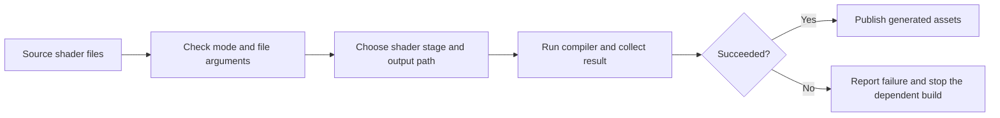

The important boundary is between a valid request, a successful conversion, and permission to continue the build. A tool that recognizes a filename has not yet proved that the compiler succeeded. A script that launches the tool has not yet proved that the generated file is usable.

##### Understand the argument strings before parsing a mode

A **command-line interface**, or CLI, is the text interface used to start a program. In an ordinary C entry point, `argc` counts argument strings and `argv` indexes them. Under the usual invocation convention, `argv[0]` names the program. The program chooses what later strings mean.

For a new tool, we can deliberately define this interface:

```text
asset-tool shaders basic.vert.glsl "scene space.frag.glsl"
```

After the launching shell has handled the quotes, our proposed program receives:

| Index | String | Meaning in this example |
|---|---|---|
| `argv[0]` | `asset-tool` | Program name |
| `argv[1]` | `shaders` | One-word mode |
| `argv[2]` | `basic.vert.glsl` | First input path |
| `argv[3]` | `scene space.frag.glsl` | Second input path, including its space |

Here `argc` is four. For this particular interface, with one mode string and no extra options,

$$
\texttt{argc}=1+1+n_{\text{files}}.
$$

Thus six input paths give eight argument strings. The number counts strings, not words inside a quoted filename. Check that an index exists before reading it: a mode requires `argc >= 2`, and this shader operation requires `argc >= 3`. Print usage when those requirements are not met. Return a documented success or failure result so the caller can respond.

The ASR renders Kohi’s mode names as “build shaders” and a short form. That spelling alone cannot establish whether the actual interface uses a joined identifier, a quoted string, or several parsed tokens. The later narrated count of eight arguments is consistent with one mode string and six paths. Treat the exact mode spelling as unresolved until checking the program’s help or code. The one-word `shaders` interface above is our constructed example, not a reconstruction of an unseen identifier.

##### Make file naming a checked rule

A **suffix** is the ending of a string. A convention such as `.vert.glsl` or `.frag.glsl` can carry both stage and source-language information. Write down exactly which endings are accepted and what happens to an unsupported filename. The example below accepts lowercase vertex and fragment suffixes; adding compute or geometry support would require both a naming rule and an implemented conversion path.

Count the literal characters when doing suffix arithmetic. `.frag.glsl` has ten characters; `frag.glsl` has nine. A caption’s reference to “nine” does not establish which literal the on-screen code compared. For an implementation we control, calculate the suffix length rather than copying a spoken count. Also check the whole input is at least that long before subtracting: unsigned length arithmetic can otherwise wrap for a short filename.

Output naming needs the same care. To turn `basic.frag.glsl` into `basic.frag.spv`, either replace the five-character `.glsl` ending with `.spv`, or remove the four letters `glsl` and append `spv` while keeping the existing dot. Mixing those two recipes creates an extra dot or removes part of the stage name. A C output buffer also needs room for its terminating zero byte.

This complete C17 example exercises argument and suffix classification. It prints the recognized stage and path; compiler invocation is a separate step.

```c
#include <stdbool.h>
#include <stdio.h>
#include <stdlib.h>
#include <string.h>

static bool ends_with(const char *text, const char *suffix) {
    size_t n = strlen(text), m = strlen(suffix);
    return n >= m && memcmp(text + n - m, suffix, m) == 0;
}

int main(int argc, char **argv) {
    if (argc == 2 && strcmp(argv[1], "--help") == 0) {
        puts("usage: asset-tool shaders FILE...");
        return EXIT_SUCCESS;
    }
    if (argc < 3 || strcmp(argv[1], "shaders") != 0) {
        fputs("usage: asset-tool shaders FILE...\n", stderr);
        return EXIT_FAILURE;
    }
    _Static_assert(sizeof(".frag.glsl") - 1 == 10, "suffix length");
    for (int i = 2; i < argc; ++i) {
        const char *stage = ends_with(argv[i], ".vert.glsl") ? "vertex" :
                            ends_with(argv[i], ".frag.glsl") ? "fragment" : NULL;
        if (stage == NULL) {
            fprintf(stderr, "unsupported shader suffix: %s\n", argv[i]);
            return EXIT_FAILURE;
        }
        printf("classify %s: %s\n", stage, argv[i]);
    }
    return EXIT_SUCCESS;
}
```

The example was compiled with `cc -std=c17 -Wall -Wextra -Werror -fsanitize=address,undefined`. Six runs covered help, missing arguments, an unknown mode, a filename shorter than the suffix, and two valid inputs including a path with a space. They produced the expected exit statuses with no sanitizer diagnostics. This verifies the constructed classifier, not Kohi’s executable or shader compiler output.

##### Treat the compiler as another process

An **SDK**, or software development kit, supplies development tools and libraries. An **environment variable** is a named value made available to a process; it can tell a tool where an SDK is installed without embedding one developer’s path in source code. A lookup helper takes the variable’s name as input. If an explanation calls that parameter `name`, it does not mean the environment variable is literally called `name`. A missing value needs an explicit error path. For example, the Vulkan SDK documents `VULKAN_SDK` as an installation-location variable. Keep that documented identifier distinct from an ASR rendering such as “Vulkan SDK.” [LunarG SDK setup](https://vulkan.lunarg.com/doc/view/latest/linux/getting_started.html).

The narrated design finds the SDK compiler, derives a stage and output name, assembles a command, and checks its result. Keep the compiler path, stage, input path, and output path as distinct values until the process-launch boundary. This makes spaces and unexpected characters in filenames easier to handle correctly.

C’s `system()` accepts a command string interpreted by a command processor. That adds another parsing step: characters in the string can become shell syntax. On POSIX-style systems, distinguish failure to start from a child that exits unsuccessfully or is terminated; a returned wait status must be decoded before describing it as the child’s numeric exit code. These details are different from merely checking whether the overall operation succeeded. [Linux man-pages project: `system()`](https://man7.org/linux/man-pages/man3/system.3.html).

A useful launcher abstraction reports the category and evidence: “could not launch compiler,” “compiler exited unsuccessfully,” or “compiler was terminated,” plus the input path and available diagnostics. Where the platform offers an argument-vector process API, pass executable and arguments separately. When a shell is deliberately needed, apply that shell’s quoting rules. An interactive terminal session can have different startup state, aliases, or shell configuration, so it is not a complete specification of `system()` behavior.

The episode reports negative error values for some failure paths. Preserve them as narrated implementation details; define the statuses of a new tool explicitly, and do not assume the launching shell displays the same signed C integer. In the constructed classifier, `EXIT_SUCCESS` and `EXIT_FAILURE` express the contract plainly.

##### Keep platform scripts and shared policy in agreement

The platform script still owns its working directory, executable path, file list, and response to failure. The shared tool owns mode parsing, input validation, and conversion policy. Use one executable name consistently in the build target, post-build command, and debugger configuration. A makefile variable’s spelling is a project convention, so the transcript’s discussion of an “assembly” name should not be turned into a claim about the implementation language.

Line-continuation syntax also belongs to the command processor. Windows batch uses the caret glyph `^` in the demonstrated setup; “carrot” in ASR should be read as a transcription uncertainty, not taught as the symbol’s name. The shell-script version uses backslash continuation. They are platform-specific syntax for writing a long command across lines. `cmd.exe` also uses `^` to escape special characters, and paths with spaces require appropriate quoting. [Microsoft’s `cmd` reference](https://learn.microsoft.com/en-us/windows-server/administration/windows-commands/cmd).

Finally, let failure propagate. If shader conversion fails, the dependent build step should stop with a useful report. Checking only that the tool itself compiled misses that boundary. A practical check is to remove generated outputs, run conversion, confirm successful statuses and expected outputs, and then exercise the runtime that consumes them. Keep those observations separate: the episode narrates successful build/debug/output-regeneration checks, but those results were not independently reproduced here. The narrator also says macOS was not available for testing. Future central configuration and additional asset modes remain extension work rather than demonstrated completed features. [Local-ASR source, platform integration and reported checks around 00:19–00:32](https://www.youtube.com/watch?v=cCEmwjfHIkY&t=1167).

**Recall:** explain the difference between an argument string and a shell word; show why the proposed interface needs at least three argument strings; count a suffix without a magic number; and trace a compiler failure back to the build script. If any step depends on an unstated filename convention, current directory, or shell rule, make that part of the contract visible.

**Source boundary:** this addition uses the saved Kohi #064 ASR and its local-pipeline extraction of all 33 timestamped spans, plus the separately cited technical references and original classifier. The original audio was not manually compared, on-screen code was not inspected, and the Kohi project was not built. Nontechnical greetings, camera remarks, and channel promotion remain in the source cache rather than the lesson. All 48 extracted points remain in the source ledger, including uncertainties and repeated narrated outcomes.

### Begin with a runnable program and a visible failure

A game engine tutorial can start with a grand architecture diagram, but a learner needs a small result that can be built and broken. Kohi’s opening episodes establish the project and its Windows and Linux build environments, then lay down platform, logging/assertion, application and renderer foundations. The captions for [Kohi #000](https://www.youtube.com/watch?v=teg23SJlyl8), [#001](https://www.youtube.com/watch?v=F6_WdnzQIQ4), [#002](https://www.youtube.com/watch?v=NIv1mygBOcg), [#003](https://www.youtube.com/watch?v=l9e8PJskYnI), [#004](https://www.youtube.com/watch?v=ojEPsZFPj2Q), [#005](https://www.youtube.com/watch?v=nGgvWzoCsyk), and [#006](https://www.youtube.com/watch?v=jEbqCf-MsZs) repeatedly frame the work as a cross-platform engine built from scratch in C with Vulkan. A full read of #000 sets an important learning boundary: the presenter says an existing engine is the faster route when the primary goal is shipping a game; building Kohi is for understanding the underlying technology. The announced first target is Windows and Linux with C, Clang and Vulkan, and the architecture is explicitly provisional. The planned layout separates a shared engine library, lightweight executable, reloadable game library, testbed and separate editor; these are plans in the opening episode, not proof they are all implemented at that point. The full #016 logical-device caption makes ownership distinctions visible: the physical device is obtained and its query arrays are freed, the logical device is created/destroyed, while graphics/present/transfer queues are obtained as handles rather than created or destroyed. Queue-family indices are deduplicated when roles share a family; enabled features and the swapchain extension are still hard-coded at this tutorial stage, with configuration deferred. The early code creates a foundation on which each later feature can be demonstrated, rather than pretending the engine exists before it can open a window or report an error.

The first practical problem is that a program needs a place to start and a way to stop. If application logic is scattered through `main`, platform setup, event processing, and renderer startup become entangled with game behavior. A small application layer gives those steps a lifecycle: initialize, run the loop, process input/events, update and render, then shut down. “Lifecycle” means the ordered stages in which a subsystem becomes valid and is later released. Initialization order matters because the renderer depends on a window, while rendering resources depend on a live graphics device. Shutdown order matters for the inverse reason: a resource must be destroyed before the device that owns it.

This is also why logging and assertions arrive early. A log records what the program observed; an assertion states an assumption that must hold at a particular point. Together, they turn a silent blank screen or null handle into a localized explanation. A useful failure report names the subsystem and failed operation. An assertion is not a substitute for handling ordinary runtime errors, but it can expose programmer mistakes at the boundary where the invalid state was created. The caption for [Kohi #003: Logging and Assertions](https://www.youtube.com/watch?v=l9e8PJskYnI) presents these as utilities needed “for the rest of our application development,” a sensible dependency ordering: diagnostics pay for themselves before the complicated systems arrive.

Build scaffolding is part of this design. A build is a repeatable translation from source files plus platform/compiler settings into a runnable program. It is not merely a one-time compiler command. When a project supports Windows and Linux, those configurations should be explicit and reproducible. Kohi’s early captions separate Windows and Linux setup ([#001](https://www.youtube.com/watch?v=F6_WdnzQIQ4), [#002](https://www.youtube.com/watch?v=NIv1mygBOcg)); the corresponding lesson is to keep platform-specific compiler, dependency, and linker decisions visible. Hidden machine-local setup makes a tutorial appear to work while making it impossible to reproduce elsewhere.

A learner should therefore maintain a tiny “known-good” milestone: build, start, log a startup line, run until a close event, then release resources. Each new subsystem should preserve that milestone. This habit narrows debugging. If the known-good program stops building after a change, the error is in the changed layer or its contract, not somewhere in an imagined future engine.

#### Keep a window milestone small enough to verify

This Hazel implementation puts a platform-independent `Window` interface in front of a GLFW window, passes per-window `WindowData` through GLFW’s user pointer, and initializes GLFW once for the demonstrated setup. The per-window records do not by themselves prove a complete multi-window lifecycle. The first visible milestone is deliberately small: create a window and clear it pink; VSync is configured through the implementation. The caption runs on Windows and defers close, resize, keyboard, and mouse event routing to the next episode, so it does not prove those platform paths. [Caption source](https://www.youtube.com/watch?v=88dmtleVywk).


##### A resize becomes pending work

**Episode source:** [Kohi#021: BIG Milestone! Clearing the Screen](https://www.youtube.com/watch?v=hRL71D1f3pU). This transcript was generated locally with Whisper base.en from public audio. It is a reviewed ASR transcript, not a YouTube caption track.

The speaker describes caching the latest framebuffer width and height and incrementing a size-generation counter when a resize event arrives. At frame start, unequal current and last-recreated generations indicate pending work. The renderer waits for the device, recreates swapchain-dependent objects, copies the new dimensions into the render state, then catches the handled generation up to the current one. A zero width or height means the window is minimized, so rendering pauses until a drawable size returns. This generation scheme can coalesce several rapid resize events into one rebuild using the latest size. [ASR 00:01–00:07, 00:30–00:34]

### Put operating-system differences behind a narrow platform boundary

A window, clock, file read, and key event are ordinary needs, but operating systems provide them through different APIs. If every subsystem calls Win32 on one machine and X11 or another Linux facility on another, portability becomes a search-and-replace problem that never ends. A platform layer owns those differences and exposes a small engine-shaped interface. “Abstraction” here simply means a stable operation name and contract that hide how a platform performs it.

The Kohi captions explicitly build Windows and Linux platform code in separate steps: [#004](https://www.youtube.com/watch?v=ojEPsZFPj2Q) takes on the platform layer, and [#005](https://www.youtube.com/watch?v=nGgvWzoCsyk) completes the Linux platform code. The two environment-setup episodes also acknowledge that setup is not identical. This is a concrete reason to avoid pretending cross-platform means identical implementation. The public source snapshot contains separate platform files, including `kohi.core/src/platform/platform_nix.c` and renderer-specific platform files under `kohi.plugin.renderer.vulkan/src/platform/` for macOS, Windows, and Linux. Those files are code evidence from the 2026 snapshot, not proof that every historical video used the current exact implementation.

The boundary should be small enough that it can be understood and tested. For example, an engine-facing window interface can ask for a window with a title and dimensions, query whether it is open, and receive normalized events. The platform backend translates those operations into native calls. The game should not have to know which native message means “close requested.” The translation is a one-way adaptation: native details enter the platform module, while engine concepts leave it.

The platform layer is not a license to abstract everything. A boundary earns its cost when multiple systems need the same behavior or when platform variance is real. If a helper only renames a native call without reducing coupling or clarifying ownership, it may add indirection without making the system easier to change. The Kohi retrospective itself values cross-platform support as a strength while identifying complexity elsewhere, a reminder that abstractions are tools with maintenance costs, not automatic improvements.

### Start with one visible event

Imagine a player presses jump while standing on a moving platform. A good game must do much more than draw a character a little higher. It samples the button, decides whether the character is allowed to jump, changes a simulation state, advances that state in time, resolves the platform contact, selects an animation, places the character in the world, renders a new image, and communicates whether the jump worked. If any layer disagrees, the result feels broken: the character visibly jumps but remains grounded in the physics; the animation lifts the feet while collision keeps the body pinned; or the jump succeeds but the camera and sound imply failure.

This small event gives us a useful way to understand an engine. An engine is a set of reusable runtime systems and authoring tools that coordinate data and computation so a particular game can run. Gregory describes a layered architecture in which foundational facilities support higher-level gameplay foundations, while the boundary between engine and game varies by project (Gregory, *Game Engine Architecture*, PDF pp. 25–28, printed pp. 1–4; the contents map runtime architecture in §1.6 and gameplay foundations in Chs. 13–14, PDF pp. 9–13). That is not a rigid universal taxonomy. It is a practical question: which services are general enough to reuse, and which express this game’s own rules?

For our jump, a likely dependency chain is:

```text
input event -> gameplay command -> simulation state -> contacts -> animation/camera
             -> render submission -> display + sound/haptics + diagnostic trace
```

The arrows are contracts, not necessarily calls on one thread. A jump command needs a stable definition: actor identity, intended action, and the simulation tick to which it belongs. Physics needs to know which entities have bodies, how they move, and what counts as a valid support contact. Rendering needs a pose and camera snapshot. The player needs the result to be visible and consistent. Keeping these responsibilities explicit makes it possible to change the renderer without rewriting jump rules, or tune jump response without changing memory allocation policy.


## Let one input produce one intended change

Once the program can receive events, decide exactly when they become world actions. Time and routing must agree before a larger scene can behave predictably.

### Let input enter without handing it the whole world

A window system reports events such as a key press, pointer movement, resize, or request to close. An **event** is a report that something happened, with data describing it. An **input state** answers a different question: which controls are currently held? A press transition and a held state should not be confused. “Jump” often uses a transition; continuous walking uses a state or a sampled action value.

Drain the pending event queue, translate device details into actions, then let the appropriate world update consume those actions. A **queue** stores items for later processing in an agreed order. If a key goes down and up before the next simulation step, a single final “held” boolean loses the press. Preserve transitions until the intended consumer receives them. If one display frame contains three fixed simulation steps, decide which step consumes a one-shot action so it does not fire three times.

SDL's official polling documentation shows processing pending events in a loop and documents its main-thread restriction. This is a concrete platform contract, not a guarantee that every window library has the same rule. [SDL3 event polling](https://wiki.libsdl.org/SDL3/SDL_PollEvent).

For the workshop, translate a physical key into `Interact`. The editor's text field may currently own keyboard focus, so decide whether the action should reach the game. **Focus** means which interface is receiving input now; **capture** means an interface temporarily claims a category of input. If entering a file name also picks up a crate behind the dialog, input routing is crossing the wrong boundary.

Do not make every service subscribe to every raw event. A **callback** is a function given to another part of the program so it can call back when a specified event occurs. A narrow callback can be enough for a small program. A typed event queue helps when producers and consumers operate at different points in the frame. A direct function call is often clearer when the caller needs an immediate result. Choose the mechanism from timing, ownership, and error requirements. Indirection is not a measure of sophistication.

### Separate elapsed time from the time the world advances

The operating system measures elapsed real time. Rendering may take a different duration each frame. A physics or gameplay update can instead advance in constant increments. One such update is a **tick**. If a tick is $h=1/60$ second, sixty ticks represent one simulated second, regardless of how many images are displayed between them.

An **accumulator** holds elapsed time not yet simulated. Add the latest real frame duration, perform as many whole ticks as the chosen budget permits, and keep the remainder. If the remainder is $a$ with $0\le a<h$, the fraction $\alpha=a/h$ tells presentation how far it lies between two saved simulation states. **Interpolation** estimates a value between known values; for position the simple model is

$$
\mathbf{x}_{\mathrm{draw}}=(1-\alpha)\mathbf{x}_{\mathrm{previous}}+\alpha\mathbf{x}_{\mathrm{current}}.
$$

Here drawing blends the two completed states, so it normally presents the simulation approximately one tick behind rather than predicting the future. Do not feed the blended position back into physics. That would let display timing alter the authoritative world state. **Authoritative** means the state from which decisions are made, as opposed to a temporary visual estimate.

An overloaded simulation needs a policy. Unlimited catch-up can make a slow frame demand still more work and keep the program behind. Clamping a long wall-time interval or limiting updates can keep the application responsive, but discards simulated elapsed time or lets simulation lag. Those choices are visible behavior. A networked lockstep game cannot casually drop ticks while claiming to preserve the same timeline. **Lockstep** means peers advance an agreed simulation using corresponding inputs for each tick. Fiedler's timestep article motivates fixed increments, an accumulator, presentation interpolation, and the catch-up failure commonly called a spiral of death. [Fix Your Timestep!](https://gafferongames.com/post/fix_your_timestep/).

Constant ticks alone do not establish **determinism**, the property that the same initial state and inputs produce the same later state. Floating-point operations, iteration order, random-number state, asynchronous completions, and unrecorded inputs can still differ. For a replay, record the tick's accepted actions and relevant state-changing decisions, then compare a defined state representation at checkpoints. A **replay** is reconstruction from recorded information, not necessarily a video.

**Trace:** after a $10$ ms frame with $h\approx16.667$ ms, there is no full tick. After another $20$ ms, accumulated time is $30$ ms: run one tick and keep about $13.333$ ms. The draw fraction is about $0.8$. One tick updated the world; two display opportunities did not mean two updates. Now repeat the trace with a one-second pause and specify what the overload policy does before you judge the result.


#### A game is soft real-time, and one frame can contain several timelines

Gregory’s useful systems-level description of a video game is a **soft real-time interactive simulation**. “Real-time” does not merely mean “fast.” It means work has deadlines: a frame should be ready before the next presentation interval, an audio buffer before the device needs more samples, a physics step before dependent gameplay consumes its result, and network work before old estimates become unacceptable. “Soft” means missing one of those deadlines normally degrades quality rather than producing the catastrophic failure expected of a hard real-time controller. A missed frame can stutter; an underrun can click; late input can feel sluggish. The player survives, but the experience changes.

That framing prevents an architectural mistake: assuming there is one universal engine clock because the program displays one image at a time. There can be several legitimate **abstract timelines**. Wall time measures elapsed time outside the simulation. Simulation time advances according to the game’s stepping policy and may pause, slow, accelerate, or deliberately discard wall time. Physics may use fixed substeps. Animation can have clip-local time and playback rate. Audio has a device sample clock. Networking maintains remote timestamps and interpolation/extrapolation windows. UI may continue animating while gameplay is paused. A replay may advance recorded ticks as fast as the host can process them while still representing the original simulation timeline.

The important rule is not that every subsystem must have a different clock. It is that every conversion between clocks must be explicit. If gameplay reads “current animation time,” ask whether that means current simulation tick or a render-interpolated pose. If a network snapshot says time 12.4 seconds, identify the clock domain and how it maps to the local estimate. If a pause menu freezes physics but not audio fading, the pause operation is a policy over timelines rather than a global variable called time. If the renderer interpolates between two fixed simulation snapshots, presentation time may lie between authoritative ticks without granting the renderer permission to mutate either one.

Different update frequencies can be legitimate too. Physics may require a smaller stable step than tactical AI. Expensive path planning might be distributed across frames while low-level steering reacts each tick. Rendering may run faster or slower than both. This does not authorize arbitrary stale reads: the system still needs a freshness contract. A slow AI update can write an intention that a fast locomotion controller consumes; a renderer can consume an immutable snapshot; an audio system can schedule from game events without rerunning gameplay. The architecture becomes clearer when each hand-off says **which timeline produced this state, at which point, and how long it remains valid**.

This view also sharpens performance analysis. Average frame time is not enough. A 16 ms average can hide 40 ms spikes that repeatedly miss a 60 Hz presentation deadline. A worker pool that improves throughput but sometimes delays the one job on the critical path can make the game feel worse. Measure deadlines and tails as well as totals: frame-time distributions, late audio work, physics catch-up count, input-to-presentation latency, and network snapshot age. Soft real-time engineering is the discipline of deciding which lateness is acceptable, how it degrades, and how the runtime recovers without silently changing simulation meaning.

Source basis: Gregory, *Game Engine Architecture*, §1.2.1 on games as soft real-time simulations and Chapter 7 on rendering/game loops, abstract timelines, time measurement, multiprocessor loops, and networked multiplayer loops. The clock-domain terminology above is a modern systems synthesis built on that framing.

### Give the application a clock and a loop

A real-time application repeatedly updates state and presents a new image. At first the loop can be described in one sentence: process platform events, update the world, draw, present, and repeat until close. The order and timing of those steps become the skeleton that future systems share.

Hazel’s public `Application::Run` takes a current time reading, computes a delta from the previous frame, executes queued main-thread work, calls each layer’s update method, asks layers to draw their ImGui content, and calls the window’s update operation. It skips updates and UI rendering when the application is minimized. This is a concrete loop, not merely a list of concepts. The code also reveals the boundary of the snapshot: it organizes updates and editor UI, while renderer-specific work is called through separate systems.

A delta time is the elapsed time between two updates. If a character moves at five world units per second, its displacement for one update should be proportional to elapsed seconds:

```cpp
position += velocity * elapsedSeconds;
```

If movement is instead “five units per frame,” the character moves faster on a machine that produces more frames. Passing a timestep helps gameplay logic express rates in real units. It does not automatically make simulation deterministic. Variable frame duration can still affect physics, collision ordering, and replay results. A fixed-step simulation is often useful when the game needs stable physics; rendering can then interpolate between simulation states. The simple Hazel loop in this repository uses the measured timestep directly in layer updates, so do not claim that this snapshot implements a fixed-step loop merely because it defines a `Timestep` wrapper.

#### Put a mutex around shared allocation bookkeeping

A mutex protects a critical section: shared state that must not be updated concurrently. In the Kohi Linux threading installment, the allocator free list and allocation statistics are protected by one mutex around allocation/free bookkeeping. Keeping the lock around only those updates reduces the time competing workers wait. The same installment adds pthread wrappers for create, detach, cancellation request, sleep, and current thread ID, but it is groundwork rather than a worker pool. Its “active thread” check merely tests whether a joinable handle is stored and does not describe detached-thread state. [Kohi Linux threading primitives](https://www.youtube.com/watch?v=NxtqrN6Jw-4)

A POSIX cancellation request is not confirmation of completion. With the default deferred cancellation mode, it takes effect at a cancellation point; state and type settings can change that behavior. For a joinable thread, join it to confirm completion before releasing resources it can still use. An engine-level stop flag is a separate cooperative protocol. [Linux pthread cancellation contract](https://man7.org/linux/man-pages/man3/pthread_cancel.3.html). Protecting one allocator path also does not make unrelated engine state thread-safe. The stream reports a clean integration build but says concurrent jobs are not yet available to exercise; treat the thread wrappers and processor-based worker cap as implementation stage, not proof of safe concurrency.

#### A wait result can change ownership even when recovery is needed

A mutex wrapper must preserve the operating system's ownership rules. For Windows `WaitForSingleObject`, a zero timeout polls rather than waiting; a successful mutex acquisition and an abandoned mutex also need distinct treatment.

| Result | Relevant meaning |
|---|---|
| `WAIT_OBJECT_0` | The wait is satisfied; for a mutex, ownership is acquired. |
| `WAIT_TIMEOUT` | The wait was not satisfied before its deadline. |
| `WAIT_FAILED` | The wait operation failed; obtain the error information. |
| `WAIT_ABANDONED` | The caller acquires the mutex, but its previous owner terminated without releasing it; protected state may need consistency checks. |

Collapsing the last case into a plain false result can conceal acquired ownership. Define recovery and release behavior explicitly. A result type can carry both ownership and recovery status instead of forcing callers to infer them from one boolean. [Microsoft wait contract](https://learn.microsoft.com/en-us/windows/win32/api/synchapi/nf-synchapi-waitforsingleobject).

The resumed full Kohi Windows-thread review records how the tutorial classifies wait outcomes. The table above checks the platform contract independently; it is not a claim that the narrated wrapper already implements every recovery path. [Caption source: Windows Multithreading](https://www.youtube.com/watch?v=jmt_BE6ny1g).


##### Query success, worker completion and handle lifetime are separate states

The earlier mutex table distinguishes acquiring ownership from recovering abandoned protected data. A thread-status wrapper needs another distinction: did the operating-system query succeed, and what did the worker itself report?

For Win32, a **handle** is an operating-system reference to an object. GetExitCodeThread returns a BOOL indicating whether its query succeeded, and writes a separate DWORD status through its output pointer. A nonzero return means that the query worked; it does not mean the worker completed its application task successfully. For example, the query can succeed while the returned application exit status is $7$, which our application might define as “asset decoding failed.” Conversely, a failed query supplies no successful application result. Confirm termination before treating the status as final; avoid using STILL_ACTIVE, whose value is $259$, as an application exit code because polling code can mistake it for a running worker. [Microsoft: GetExitCodeThread](https://learn.microsoft.com/en-us/windows/win32/api/processthreadsapi/nf-processthreadsapi-getexitcodethread).

One orderly shutdown path is to ask the worker to stop through its documented cancellation policy, allow it to finish its cleanup and return, wait for its thread handle to become signaled, query the final status, and close the owned handle. Closing a handle releases that reference; it does not itself request cancellation, terminate the worker, or establish that its borrowed memory is no longer in use. A deliberately detached design can close its handle earlier, but still needs another valid way to keep worker-accessed data alive. [Microsoft: CloseHandle](https://learn.microsoft.com/en-us/windows/win32/api/handleapi/nf-handleapi-closehandle).

For an asset-loading worker, imagine the UI requests shutdown while the worker is writing into a staging buffer. Closing the thread handle and immediately freeing the buffer can leave a live worker writing through a dangling pointer. The missing gate is confirmed completion, not a second handle close. Conversely, keeping every completed worker's handle forever leaks resources. Keep the lifetime of the task, its shared buffers and its operating-system handle explicit.

Waiting also requires that the handle stay valid: closing it while WaitForSingleObject is still pending has undefined behavior. The wrapper must serialize those lifetime operations. This is separate from the mutex's abandoned-owner recovery problem, already explained earlier. [Microsoft: WaitForSingleObject](https://learn.microsoft.com/en-us/windows/win32/api/synchapi/nf-synchapi-waitforsingleobject).

The retained Kohi Windows-threading episode motivated this review. The platform contracts above were checked against Microsoft's documentation; they are not an assertion that the historical narrated wrapper implemented them correctly. This review did not run a native Windows thread or mutex experiment.


#### Main-thread work and threads

The public application keeps a queue of functions to execute on the main thread. A worker can prepare a resource or perform file work and then schedule an operation that must touch a main-thread-owned system. This queue is protected by a mutex, which prevents concurrent modifications to the queue container. The implementation executes queued functions at a clear point in the loop before layer updates.

That design creates a useful boundary, but it is not a complete job system. A general job system needs worker lifecycle, cancellation or shutdown, dependency scheduling, error propagation, and safe ownership of data passed to tasks. The queue’s presence should therefore be taught as a narrow handoff mechanism, not as evidence that all engine work is thread safe. A basic rule for a small engine is: decide which thread owns each mutable system, then make crossings explicit. Rendering APIs and UI frameworks often have strict thread requirements, so “background” is not synonymous with “safe.”

#### Minimized, resized, and closing states

Window lifecycle events affect the loop. A zero-width or zero-height resize may mean the user minimized the application. Hazel marks the application minimized and skips layer updates and ImGui rendering until a nonzero size arrives. That prevents rendering work against a viewport with no area. When the window is restored, the renderer receives the new dimensions and the application can continue.

This illustrates why platform events should not leak unpredictably into every game feature. The application can handle global window close and resize behavior, then forward events to layers. A game layer may care about keyboard input; a scene hierarchy panel may care about selection; the renderer may care about viewport size. The event system provides a common message form, while clear ownership decides who responds.

#### Make event delivery behavior explicit

An event needs an identifier, a small payload, an optional sender, and a callback registration. A fixed-size union can carry a few integers, floats, coordinates, or a short inline character array without allocating a separate heap object for every event. Keep payloads small and define who may use each code range; the tutorial reserves low codes for engine events and asks application events to begin above that range. Multiple listeners can subscribe to one code, while duplicate registration should be rejected or diagnosed so a stale callback cannot remain after an object is destroyed.

The described dispatcher calls listeners immediately, on the calling thread. A callback returning “handled” stops dispatch to later listeners. That is a specific contract: it is neither a queued message bus nor a background job system. It can be appropriate for short input or lifecycle notifications, but a slow listener stalls its caller. Priorities, deferred queues, per-frame processing budgets, and multithreaded delivery are possible later designs; they should be added only when the engine has clear ordering and ownership rules.

Source reading: [caption source](https://www.youtube.com/watch?v=XQ6qljkh2KI). Captions document the narrated development state; on-screen code and reported builds were not independently reproduced.


#### Make event identity and input values explicit

A listener may register more than one callback, so event uniqueness can depend on both listener identity and callback identity. Mouse button state is boolean; wheel direction is a signed delta and should not be collapsed into the same representation. The Kohi maintenance stream reports fixes for both contracts. [Kohi renderer maintenance](https://www.youtube.com/watch?v=x8ao57nbMlY)

### Keep the event API explicit about payload, timing, and propagation

Before a window exists, list the events the application needs and decide how they reach the application without making Window depend on the Application class. The planning stream compares a direct callback with an event-listener collection and a queued buffer. A direct callback is simple and synchronous, but a slow handler blocks the caller; a queue adds storage, ordering, and a defined drain phase. The choice is an implementation tradeoff, not a property of events in general. [Planning the event system](https://www.youtube.com/watch?v=5mlziHwq90k)

The later implementation presents a base event with runtime type, name, categories, handled state, and debug formatting. Category bits let one event be filtered as both input and mouse or keyboard. Typed dispatch checks the requested event type before invoking its handler. Key presses carry repeat information; mouse events carry position, scroll, or button data. The demonstrated path is immediate and synchronous. The source reports event delivery and category logging, while window integration and a queryable current-input API remain future work. [Event system implementation](https://www.youtube.com/watch?v=xnopUoZbMEk)

Treat “handled” as a route-control signal with a documented meaning. In this implementation, a handler returning handled stops propagation to later listeners/layers; a UI overlay can consume a key before gameplay sees it. Categories are convenient filters, not a replacement for a typed payload. The planning and implementation episodes establish the event contract and delivery model, not a queued bus or complete UI/game arbitration policy. [Planning the event system](https://www.youtube.com/watch?v=5mlziHwq90k) · [Event system implementation](https://www.youtube.com/watch?v=xnopUoZbMEk)


#### Separate application events from game messages

The same review argues that the engine’s event mechanism handles application-level events such as window and input events, while gameplay messages belong at the game layer. This boundary can keep engine architecture independent of game-specific communication. The stream also discusses whether a bitmask-like event category should remain a plain enum, a choice tied to the code’s usage and compiler warnings. These are maintainership judgments about that Hazel version, not universal C++ rules (The Cherno, “Finishing the Pull Requests!,” 00:07:00–00:30:18).

### Treat events as messages with an explicit route

An event is a structured description of something that happened: a key was pressed, the window resized, the mouse moved, or a close request arrived. A system that only polls the current state can answer “is this key held now?” but can miss transitions such as the exact press or release moment. A system that reports events can capture those transitions and route them to whichever layer is active.

The reviewed planning episode specifically frames the problem around window close, window resize, and input such as mouse and keyboard events. The next episode implements the event system, followed by the precompiled-header episode referring back to that event work. This is direct evidence of a deliberate sequence: list the event kinds the application needs, choose a dispatch approach, then add it before more systems depend on it.

In the inspected public code, event types are named in an enum. Event categories are represented as bit flags, so a keyboard event can be categorized as input and keyboard. Each event exposes its type, name, category, and optional string representation. A dispatcher checks whether an event’s runtime type matches a requested concrete event and invokes a callback if it does. Events also carry a handled flag. The application first tries global close and resize handlers, then walks the layer stack from the top toward the bottom until a handler marks the event handled.

A simplified picture is:

```text
OS callback -> Window -> Application
                         ├─ global window handler
                         └─ top layer -> lower layers -> stop if handled
```

The implementation is synchronous. The event is delivered where it was raised and handled immediately, in the current call path. The public `Event.h` comments explicitly describe that behavior and contrast it with a possible future event bus that buffers messages for a later event phase. Those two approaches solve different problems.

#### Synchronous dispatch versus a queued bus

Synchronous dispatch is easy to follow. A resize callback arrives; the application updates renderer dimensions; layers can inspect the same event before control returns. It avoids an extra queue and avoids having to decide when buffered events are drained. The cost is reentrancy: a handler may modify a structure that the current dispatch loop is traversing, or trigger more application work before the original callback returns. The call stack can also become deep if handlers cause more events.

A queued event bus separates production from consumption. A window callback appends a resize event; the application processes it in a known phase. That can help when multiple threads produce events or when deterministic ordering matters. It adds latency, storage, overflow policy, and a defined rule for events generated during event processing. It is also easier to lose the causal connection between the native callback and the eventual handler.

Choose based on the problem. A small single-threaded desktop engine can start with immediate dispatch, as this public code does. If event mutation, cross-thread producers, replay, or deterministic simulation becomes a real concern, introduce buffering with explicit ordering rules. Do not adopt an event bus just because it sounds more scalable. Conversely, do not treat a synchronous callback chain as harmless if callbacks can outlive or mutate their recipients.

#### Removing a layer pointer does not define who destroys it

The Hazel layer stack updates layers from bottom to top, places overlays after ordinary layers, and dispatches events in reverse so the topmost overlay gets first chance to handle them. A handled event stops that reverse walk. The episode’s vector-backed implementation also distinguishes the insertion boundary for overlays; its pop operation removes a pointer without deleting the object, so ownership and destruction must follow the caller’s actual contract. Layer enable/disable and fuller removal behavior remain unfinished in this snapshot. [Caption source](https://www.youtube.com/watch?v=_Kj6BSfM6P4).


#### Propagation and “handled” semantics

The handled flag creates a propagation rule: a UI overlay near the top can consume an event before gameplay receives it. This is useful when the editor has text input, menus, or gizmos. A selected text field should be allowed to interpret a key without the active game also treating it as a movement command. But the meaning of “handled” must be consistent. It could mean “a listener has seen this,” “the event’s default action was suppressed,” or “stop forwarding.” Hazel’s application uses it as a stop-propagation signal. That convention should be documented and used by every layer.

Categories are filters, not security boundaries. They help a listener cheaply ask whether an event belongs to keyboard or mouse input. The concrete type still carries the payload, such as a key code or cursor position. Avoid building a system where clients must repeatedly cast opaque event pointers without a type guarantee. Hazel’s dispatcher couples a type check with a cast in one template helper; the pattern keeps call sites short, though such a design must maintain the invariant that each enum type matches the correct concrete class.

### Layers give features a place to live

As soon as the engine has input, an editor UI, debugging overlays, and game logic, placing everything in one application class becomes difficult. A layer is a feature-shaped unit that receives a set of lifecycle callbacks: attach, detach, update, event, and UI rendering. A layer stack provides an order for those units.

In the public snapshot, ordinary layers are inserted before overlays. Overlays are appended at the end. Event dispatch walks the stack backward, so the topmost layer can handle input first; update and ImGui rendering walk forward. A useful arrangement might put core game behavior beneath editor panels and a diagnostic overlay. The topmost UI can consume a mouse click; unhandled input can flow down to lower layers.

Layers are an organizational seam rather than a substitute for all modularity. A physics simulation may be a service used by a scene rather than a layer. A resource cache may have longer lifetime than any particular UI panel. Use a layer when something needs to participate in the application’s update, event, or UI lifecycle. Use a service or component for behavior whose lifetime and data ownership differ.

The public layer stack owns layer pointers in this implementation: its destructor calls detach and then deletes the layers. Push operations call attach from the application after insertion. That makes lifecycle and ownership visible, but it also means callers must not hand the stack a pointer whose lifetime they expect to control elsewhere. Modern designs often use owning smart pointers to encode the same fact in the type system. Either way, answer four questions for every plugin-like object: who creates it, who destroys it, when does it attach, and what callbacks can still arrive during shutdown?

#### Overlays and the editor

An overlay is useful for UI that should sit above the main feature order: immediate-mode UI, debug tools, or a modal tool. Hazel’s application constructs its ImGui layer and pushes it as an overlay. The application run loop brackets UI drawing with begin/end calls, then asks layers to contribute their panels. That keeps the GUI backend from becoming the owner of every editor feature. A scene hierarchy panel and a content browser can each render through the editor layer while the engine still owns the ImGui frame lifecycle.

The same ordering idea appears in event propagation. A panel should receive a click before the scene viewport or game scene if it visually sits above them. Rendering order and input priority should agree closely enough that users are not clicking one thing and activating something underneath. This requirement becomes especially important when panels overlap or when a viewport is docked and resized.

### Transform a pointer into the control’s local space before testing a hit

For a two-dimensional affine UI control, keep its simple bounds in local coordinates and transform the pointer into that space. A screen-space axis-aligned bounding box can be useful for a cheap preliminary rejection, but it includes areas outside a rotated control.

Take a local rectangle $0\leq u\leq2$, $0\leq v\leq1$. Rotate it by 45 degrees about its local origin, then translate it by $(3,4)$. The screen coordinates are

$$
x_s=3+\frac{u-v}{\sqrt2},\qquad
y_s=4+\frac{u+v}{\sqrt2}.
$$

To reverse that transformation, first remove the translation. With $a=x_s-3$ and $b=y_s-4$, add and subtract the two equations:

$$
u=\frac{a+b}{\sqrt2},\qquad
v=\frac{b-a}{\sqrt2}.
$$

Now test the recovered local coordinates against the original rectangle. For example, the screen-space bounding box includes its corner

$$
\left(3-\frac1{\sqrt2},\;4+\frac3{\sqrt2}\right).
$$

The inverse maps that point to $(u,v)=(1,2)$, outside the rectangle because $v>1$. Accepting every point in the screen-space bounding box would therefore accept a click outside the visible button. The local test makes the distinction explicit.

This method requires an invertible control transform. A zero scale can make inversion undefined; choose a disabled/unpickable policy or another documented behavior instead of passing invalid numbers into a hit test. After the geometric test, apply the control's visibility, enabled state, ancestor clipping, and interaction-order rules. Being inside the local rectangle is necessary for this rectangular control, but need not be sufficient to receive the click.

A three-dimensional interface needs another step: screen coordinates alone do not specify a unique world position. Build the appropriate camera ray and intersect it with the control's surface under that interface's contract. Do not reuse a two-dimensional inverse-point shortcut without the missing depth information.

The full Kohi button lesson motivates transforming input into the control's local space. The equations and explicit false-positive case above are original teaching extensions, not a claim that the tutorial uses these exact numbers or implements every clipping policy. [Caption source: Button Rotation and Mouse Input](https://www.youtube.com/watch?v=VuPFUCVGy9U).

After the geometric test, state and routing still matter. The button demo updates nine-slice geometry and bounds together when its size changes; its initial click routing treats release as a click only if it was not part of a drag. The later hover/pressed work keeps the pressed appearance through drag-out and restores it on re-entry, but release outside does not activate the button. These streams do not establish a complete nested-control propagation or cancellation policy. [Kohi #141](https://www.youtube.com/watch?v=VuPFUCVGy9U) · [Kohi #143](https://www.youtube.com/watch?v=jLSfss8YrXE)

### Treat input capture as a route, not a hit-test result

Platform input first reaches the UI so it can update hover, focus, dragging, and text fields. A separate decision determines whether the game below should act on that input. A control can be geometrically hit yet decline to handle an event; a drag or focused text field can continue receiving events after the pointer leaves its rectangle. Keep visibility, enabled state, ancestor clipping, z-order, press/release pairing, and propagation semantics explicit. The Kohi prototype’s UI handler initially consumes events needed for object selection; returning false for unhandled events restores scene selection. [Kohi #143](https://www.youtube.com/watch?v=jLSfss8YrXE)

### Keep the standard UI optional and stateful, but name its current limits

The standard UI is scoped as an optional editor-style library, distinct from a possible animated or world-space in-game UI. Its early control tree stores transform, children, active/visible flags, and optional callbacks. Active controls are kept in a contiguous list for update, with transitions moving pointers between active and inactive arrays; the initial system sets an explicit maximum control count. At that stopping point it is a registry/system scaffold: panels, images, buttons, input, layout, and visible drawing are not yet shown. Later, controls are walked into compact renderable records in tree order and drawn without depth, so traversal order determines overlap. Registering a control is distinct from attaching it beneath the root or activating it. [Kohi #136](https://www.youtube.com/watch?v=IGt08az4bLA) · [Kohi #137](https://www.youtube.com/watch?v=ptdE4nbVN0U) · [Kohi #138](https://www.youtube.com/watch?v=xqExSNvOc6A)

A nine-slice divides an atlas region into fixed corners, stretchable edges, and a stretchable center. Source pixels and screen units are different measurements: a three-pixel corner may be drawn as ten screen units. Generating all nine quads into one geometry shares a draw path, but each quad needs its own four-vertex and six-index base. The reported implementation has an unresolved bottom-center placement error and temporarily hard-codes atlas dimensions because the atlas is not loaded when the control requests its size. Input is still deferred in that session. [Kohi #140](https://www.youtube.com/watch?v=C_uF9W2niD0)

For an atlas-backed panel, derive UVs from atlas pixel bounds and texture dimensions, independently of the panel’s screen rectangle. The source uses nearest filtering and clamp-to-edge for pixel-styled UI, checks orientation with colored corner markers, and corrects a one-pixel max-bound error. Atlas coordinates remain hard-coded temporarily; default-texture fallback and fatal map-acquisition failure are separate initialization paths. [Kohi #139](https://www.youtube.com/watch?v=-V5z1bVjl_c)

### Track text length, allocation capacity, cursor, and selection separately

A label can use the renderer’s shared geometry buffers instead of private per-label buffers, but then each text record needs buffer offsets, element counts, element sizes, and a material identity. The allocator must reserve and release ranges when text capacity grows. Maximum capacity and current string length are different values: draw only the current glyph count. In this prototype’s simple text path, capacity is corrected to count UTF-8 code points rather than encoded bytes because it emits one glyph quad per code point. That is a prototype policy, not a general text-layout rule: shaping can combine, split, or reorder characters, so production geometry capacity should follow emitted glyphs/vertices, while cursor movement and user-visible selection may need grapheme boundaries. The label conversion remains an unfinished refactor in its source episode. [Kohi #145](https://www.youtube.com/watch?v=HXJbWldxfj0)

For editable text, keep focus ownership, logical cursor, selection range, and horizontal scroll offset synchronized. The textbox prototype composes a nine-slice frame and label, clips both, and routes keyboard input only to the focused control. The following pass uses font measurement to keep the cursor visible with proportional glyph widths; selection replacement and deletion expose stale-buffer and copy-count bugs. The sources leave select-all, some whole-string deletion cases, command-history navigation, and other behaviors unresolved. [Kohi #147](https://www.youtube.com/watch?v=faESVT5N9gg) · [Kohi #149](https://www.youtube.com/watch?v=aWv2-QSOuO8)

The debug-console refactor adds a related capacity lesson: resizing its background must update the quad as well as the stored rectangle, and changing a label to shorter text must reduce the draw count rather than reveal old glyphs. Its panel composition and text editing are useful concrete stages, not proof that the full console or textbox is finished. [Kohi #146](https://www.youtube.com/watch?v=g7ZqqsMHZNo)

### Use stencil when a rotated UI shape cannot be represented by a scissor rectangle

A scissor clips to an axis-aligned rectangle, so it cannot exactly contain a rotated text box. A stencil mask can follow arbitrary geometry: draw the mask with writes enabled and a chosen 8-bit reference value, then draw the content only where stencil equals that reference. Stencil state also includes compare/write masks, a comparison, and distinct operations for stencil failure, depth failure, and pass. The episode changes to a depth-plus-stencil attachment format and configures the two attachment roles separately. For a masked item, it disables depth testing during the mask draw, disables stencil writes for the content draw, then resets stencil state. A captured render pass and a stencil-test overlay show the accepted/rejected mask region; rotating the box confirms the mask follows the transformed shape. [Kohi #148](https://www.youtube.com/watch?v=_VDD8wzUMuY)

The demo’s mask uses a hard-coded reference ID of 1, so it does not establish a unique-ID policy for overlapping or nested masks. The same episode moves key-repeat control into the input layer and enables repeats while the console is visible, disabling them when focus ends. It reports a Vulkan 1.2 support floor after consolidating dynamic-state variants; some feature-detection fixes remain under review. The text box’s horizontal scroll, Home/End, selection, and replacement remain unfinished, so working clipping is not a completed editor control. [Kohi #148](https://www.youtube.com/watch?v=_VDD8wzUMuY)

### Display scale and persistent identity need explicit platform policies

The UI scaling work introduces device-pixel ratio for sizing and font generation, but platform reporting differs. Windows has a DPI-change event and macOS exposes content scale; the X11 setup described cannot reliably derive one per-monitor value, so a manual override is considered and Wayland is left for investigation. A fallback must be explicit rather than pretending a desktop-wide number is correct everywhere. The same maintenance stream introduces 64-bit generated IDs and restoration of serialized IDs: randomness reduces collision likelihood but does not guarantee uniqueness, so loading still needs duplicate detection and a policy. [Kohi #144](https://www.youtube.com/watch?v=YCYZtc2PrtY)


#### Let the UI observe input before the game acts on it

Typing a console command should not also move the player. The input still needs to reach the UI so it can update focus, dragging, and text fields. Routing therefore has two decisions: deliver the event to the UI integration, then decide whether the underlying game should act on it. Dear ImGui documents `WantCaptureMouse` and `WantCaptureKeyboard` for that second decision; hiding input from ImGui itself when capture is false would prevent some of its focus behavior. [Dear ImGui input guidance](https://github.com/ocornut/imgui/blob/master/docs/FAQ.md#q-how-can-i-tell-whether-to-dispatch-mousekeyboard-to-dear-imgui-or-my-application).

Pairing press and release matters. If a text field consumes a key-down and then loses focus, the later release may arrive when capture is false. Record which recipient owns the interaction when needed, so a game action is not inferred from an unmatched release. Mouse hover alone is also an incomplete substitute for a capture policy: dragging and modal interfaces can retain an interaction beyond the initial hovered rectangle. These are integration policies to test with the actual UI backend, not just button hit tests.

The generated transcript of the historical Hazel lesson narrates handlers returning false to let later layers see events; it explicitly leaves more selective handling unfinished. That is a development stage, not a complete UI/game arbitration contract. Use the input API and backend appropriate to the version you build rather than copying old ImGui field writes from a noisy transcript. [Generated-ASR source: ImGui Events](https://www.youtube.com/watch?v=yBP1gSbQPPM).

#### A physical key is not a typed character

A key callback tells the game about a physical key action. Text input instead follows keyboard layout, modifiers, and character composition. A key and a character need not correspond one-to-one. GLFW supplies typed text through a character callback carrying Unicode code points; keep that meaning distinct from an engine's physical-key enumeration. [GLFW text input](https://www.glfw.org/docs/latest/input_guide.html#input_char).

A code point such as `U+1F600` does not fit into one unsigned 16-bit value. Truncating it to `0xF600` changes the character. Nor is one 16-bit unit by itself a general representation of a complete UTF-16 character. Choose an explicit text representation and perform the proper encoding conversion at the boundary. The generated lesson transcript contains an apparently casual 16-bit-cast justification; uncertain historical wording is not grounds to narrow the engine's text model.

A callback also retains a relationship to its target. Binding an object's member function through `this` does not extend the object's lifetime. Unregister or invalidate the callback before the target disappears, and account for already queued work if delivery is deferred. The handler's ownership, input meaning, and propagation result are three separate parts of its contract.

This source was read through a locally generated Whisper `base.en` transcript, 4,286 words. Technical spellings and a repeated outro remain uncertain; no manual listening or source-frame/code inspection is claimed. The current input-contract details above were checked against the linked primary documentation.


### Turning platform callbacks into engine events

A native window library reports concrete callbacks, while engine code benefits from a stable event vocabulary. In this Hazel episode, the window layer converts GLFW callbacks into Hazel event objects and forwards them through a callback stored in `WindowData`. GLFW's user pointer provides a route from its opaque window handle back to that data. The application registers its handler without making the window implementation depend directly on the application class.

For resize, the callback first updates the stored width and height, then emits a resize event. That ordering matters if a handler reacts by querying the window dimensions. Key callbacks distinguish press, repeat, and release; mouse callbacks cover button press/release, scroll offsets, and cursor position. The source explicitly leaves platform key-code conversion for later, so GLFW codes remain a portability gap in this stage. An error callback logs GLFW's code and description.

The application uses an event dispatcher to call a matching handler for window-close events. That handler clears the run flag, allowing the existing application loop to terminate. The episode demonstrates this path in its sample and notes that event routing will later extend toward layers. These are the design and behavior shown in this Hazel/GLFW episode; the source does not establish a current API contract for later Hazel revisions. [Source:](https://www.youtube.com/watch?v=r74WxFMIEdU)

### Poll current input while routing input events

An event answers “what just happened?” Polling answers “what is true now?” If a camera rotates only while Alt and a mouse button are held, a current-state query is convenient. If a text field needs to react to the exact press or release transition, an event carries that moment and can be routed through the layer stack. A responsive engine often needs both models, with clear ownership of the native window and a defined policy for which focused window supplies the polled state.

In the narrated Hazel desktop prototype, the public input facade offered static calls, while a platform-specific implementation queried GLFW through the application's window. The native-window accessor returned an opaque `void*` at the shared interface and was cast to GLFW's window type inside the Windows implementation. That boundary keeps the backend type out of callers, but the episode still couples the implementation to GLFW and a single global application/window. For multiple windows, the API would need to identify which window's input is requested. A global singleton is a simplifying design choice, not a universal input architecture. [Caption source: Input Polling](https://www.youtube.com/watch?v=yuhNj8yGDJQ)

Mouse coordinates illustrate a smaller API choice. GLFW writes the horizontal and vertical values through two output pointers. The Hazel facade returns them together as a pair; with C++17 structured bindings, a caller can write `auto [x, y] = Input::GetMousePosition();`. This keeps one position query coherent and avoids confusing an X-only result with a full coordinate. The source reports a console trace of mouse position, then leaves key and mouse-button checks as follow-up work. Treat that as the evidence boundary: the described demo exercised cursor coordinates, while the captions do not establish testing of every polling method or multi-window behavior. [Caption source: Input Polling](https://www.youtube.com/watch?v=yuhNj8yGDJQ)

#### Input callbacks and state queries serve different questions

The early Sparky input episode builds keyboard and mouse support around GLFW callbacks and arrays indexed by key/button codes. A callback records transitions; an `is key pressed` query asks for the current held state. The demonstration also distinguishes press, repeat, and release, and uses GLFW’s window user pointer to recover the owning window object in a callback. It revises the API from static access toward per-window instance methods for cursor state. This is historically useful for understanding one callback-based design. It does not prove the code’s bounds safety, multi-window correctness, or suitability as a current GLFW recipe (The Cherno, “Ep. 3: Input,” 00:00–00:34:44).

A previous-frame key snapshot can be copied as a value, so every consumer sees the same transition rather than the first query consuming it. The maintenance episode copies state-array bytes ([00:37:40](https://www.youtube.com/watch?v=CKhGMoTNPOo&t=2260)). For plain fixed-size arrays of key flags, a byte copy can preserve the values when the element type is trivially copyable: its representation can be copied without running a custom copy operation. Use valid source and destination storage, the correct complete byte count, and nonoverlapping ranges for `std::memcpy`; a straightforward safe case copies between live arrays of the same flag type and size. This is not a recipe for copying `std::string`, `std::vector`, ownership-bearing objects or scene components wholesale. Copying also does not synchronize concurrent writers. Ordinary array assignment through a suitable container is often clearer; choose by correctness first and measure any claimed speed difference. The language qualification follows the [C++ working draft's trivially-copyable rules](https://eel.is/c++draft/basic.types#basic.types.trivial), rather than a general performance claim from the historical stream.

### Keep application key names independent of a windowing library

Suppose game code asks whether the Tab key is pressed. If it must name `GLFW_KEY_TAB`, every client that uses the engine now needs GLFW's headers, and a later backend change can alter the meaning of that integer. Define an engine-owned key-code vocabulary at the public boundary instead. The platform backend translates its native code to that vocabulary when producing events, and translates the engine value back when making a native polling query. The conversion point is the adapter boundary, where both code systems are known.

There are two broad policies. One can compile different numeric values for each platform, which avoids repeated conversion but makes serialized bindings platform-dependent. Or the engine can keep stable internal values and map to/from each backend. A stable serialized control map can use symbolic names such as `Tab` or a versioned engine code; it should not silently assume an operating system's integer assignments are portable. The Hazel episode copies a particular GLFW-era key table into engine headers and discusses conversion against Win32's different virtual-key assignments. That is a historical prototype decision; for a current project, choose and document a stable scheme and verify mappings for every supported backend. [Caption source: Key and Mouse Codes](https://www.youtube.com/watch?v=zaJGn8pur5I)

The demonstration notes that letter codes align with ASCII and can be cast to characters, but this convenience applies only to that part of the chosen table. A key code is not generally text: Shift, layout, dead keys, IME composition, and keyboard layout can make text input differ from physical-key identity. Use key events for controls and a separate text-input path for user-entered characters. Likewise, a modifier bitmask describes modifiers accompanying an event; it is not the same thing as a durable key identity. These distinctions prevent a shortcut system from accidentally becoming a text-entry implementation. [Caption source: Key and Mouse Codes](https://www.youtube.com/watch?v=zaJGn8pur5I)

### A held button and a completed tap carry different information

Imagine a player taps jump while a slow frame is being rendered. At $0\,\mathrm{ms}$ the button is up, at $5\,\mathrm{ms}$ it goes down, and at $9\,\mathrm{ms}$ it comes up again. The next update samples the stored state at $16\,\mathrm{ms}$. Both update-time samples say “up,” even though a complete tap occurred between them. A **state** answers “is the button down at this sampling point?” An **edge** records a change, such as “a press arrived.” A state sample cannot reconstruct every intervening change.

| Time | Input transition | Held state after processing it | Pending press count |
|---|---|---:|---:|
| Start | None | false | 0 |
| $5\,\mathrm{ms}$ | Press | true | 1 |
| $9\,\mathrm{ms}$ | Release | false | 1 |
| $16\,\mathrm{ms}$ | Simulation consumes the press | false | 0 |

Only genuine down transitions increment this example’s press counter; repeated-key actions need a separate policy. This table is an original trace for a deliberately simple policy: delivered press transitions increment a counter, release transitions change held state, and simulation consumes a pending press exactly once. It assumes the input layer has actually received and processed the transitions. A counter preserves how many presses arrived, but not their exact ordering relative to other inputs. A timestamped event queue is a better fit when that ordering matters. Neither structure means that a jump is permitted: grounded state, cooldowns and game rules still decide the action.

For movement, read the held state during the update and scale the motion by the chosen time step. For a one-shot action, consume an edge under an explicit rule. If several simulation steps occur during one rendered frame, decide which step receives a new press; do not make every catch-up step consume the same edge. If no step runs, retain the edge until its intended boundary. Focus loss, UI capture, pause and replay need policies for clearing, routing or retaining that pending input.

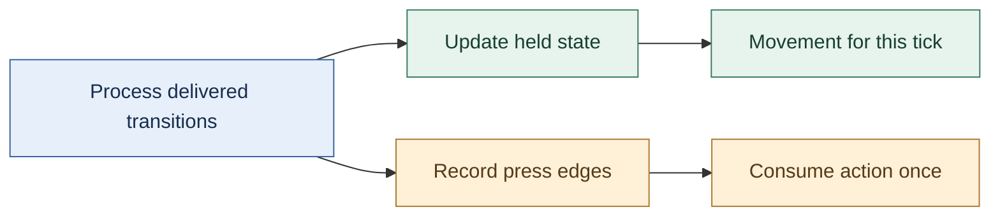

GLFW’s state query returns the last reported cached key state; it does not directly resample the physical keyboard. Its guide warns that a press and release can be missed between queries and describes callbacks and sticky-key mode as alternatives. Sticky mode retains a press until queried; it is not a complete ordered event history. OS key-repeat timing is also unsuitable for driving held-key movement. Those API facts support the distinction above; the counter, tick-consumption policy and numeric trace are original engine-design examples. [GLFW input guide](https://www.glfw.org/docs/latest/input_guide.html)


### Normalize input before gameplay consumes it

A keyboard key press is delivered differently by operating systems. Gameplay, however, wants to ask a simple question: “Is the jump action pressed?” If game code tests native key codes directly, a later platform port spreads through every gameplay feature. Input should therefore have two stages. The platform captures native events; the engine converts them to stable key/button or action states; gameplay consumes those states.

The series develops input in parts: [Kohi #009](https://www.youtube.com/watch?v=ZZhfCYNbVp8) introduces input, [#010](https://www.youtube.com/watch?v=6zjpgUX1TRY) connects the Windows-specific part, and [#011](https://www.youtube.com/watch?v=kIWFdKcGQPM) adds Linux. Those captions make an important architectural relationship explicit: the engine-level input system and platform implementation meet at a seam. The window receives events; a translation step updates the input state; gameplay queries an engine-level representation. In the full #011 caption, Linux key events pass through an X keycode-to-keysym conversion and then a switch mapping to engine key enums; upper/lowercase symbols are folded to one engine key. Mouse button indices are normalized and pointer motion forwards X/Y coordinates, while wheel handling is explicitly left for a later episode. The same build step exposes a missing portable string-duplication helper, prompting a first core string abstraction. This is useful evidence that portability work often discovers non-window dependencies in unrelated core code.

A key state has at least two useful notions. “Down” describes whether the key is held now. “Pressed this frame” describes a transition from up to down since the previous update. The latter avoids repeated actions every frame when a player intended one tap. Similarly, “released this frame” captures the opposite transition. A robust input update compares current state with prior state rather than trying to reconstruct a gameplay action from every raw event.

This design also prevents a common timing bug. If event pumping happens after gameplay reads input, the game sees the prior frame’s state and appears to respond one frame late. If input state is updated several times during a single frame with inconsistent reset rules, short presses may disappear or repeat. A clear loop order—collect events, update normalized input, run gameplay update, render—gives those states an understandable meaning. “Frame” means one iteration of this update/render cycle.

The captions later show input enabling a mock camera so the learner can move around the scene while the engine evolves ([stream](https://www.youtube.com/watch?v=s9xSwQvbG2w)). That is a useful test fixture: an engine can be visually complicated while still offering a simple camera control that confirms event delivery, frame updates and transforms are connected. The camera is not itself proof that all input semantics are finished; it is a visible end-to-end check for the specific path it exercises.

#### Preserve input edges as well as the final held state

A held-state snapshot answers "is this key down now?" It does not necessarily describe everything that happened since the previous simulation step. Suppose the player taps a key quickly while the program is processing platform messages:

| Observation | Held state |
|---|---|
| Previous simulation step | Up |
| Platform delivers key-down | Down |
| Platform delivers key-up | Up |
| Next simulation step | Up |

Comparing only the two simulation snapshots sees Up followed by Up and loses the tap. Preserve the press and release edges as events, or accumulate explicit transition flags until the intended consumer has processed them. A **transition** is a change of state; a **repeat** message for a key already held is not automatically another physical press.

Now consider several fixed simulation ticks occurring before one displayed frame. A one-shot action such as opening a door should consume the press according to the input policy, rather than firing once in every catch-up tick. A continuous action such as walking can use the held state across those ticks. That difference belongs in the gameplay command boundary, not in an accidental placement of the previous-state copy.

Focus loss needs a policy too. If the window loses focus after a key-down and receives no corresponding release, a purely event-updated held flag can remain stuck. Clear or reconcile relevant state on focus changes, and decide whether outstanding one-shot commands remain valid. Timestamp input when ordering matters, then specify how it maps to simulation ticks.

The fully read Kohi input lessons develop current/previous state tracking, key and button processing, and platform event routing. The quick-tap and catch-up examples extend that foundation to expose information a final-state snapshot cannot retain. They are original worked cases, not a claim that every edge policy is implemented in the early tutorial. [Input state](https://www.youtube.com/watch?v=ZZhfCYNbVp8), [Windows event processing](https://www.youtube.com/watch?v=6zjpgUX1TRY).


#### Input travels through two clocks, a focus owner, and a durable tick command

A controller stick report is a two-dimensional sample `(x,y)` in a device-specific coordinate convention; it is not yet a requested game velocity. The player may tilt diagonally, the physical stick may fail to return precisely to the electrical center, the input UI may have keyboard focus, and the display frame that receives an event may contain zero, one, or several physics ticks. These are distinct problems. Solve them in the order physical device -> calibration -> logical action -> ownership/capture -> timestamped tick command -> gameplay, not by allowing gameplay systems to query raw keys whenever they happen to run.

For a normalized stick `v = (x,y)`, use its **radial** magnitude `r = sqrt(x²+y²)` instead of dead-zoning `x` and `y` separately. With inner dead-zone `d` in `[0,1)`, define the output vector as zero for `r <= d`. Otherwise set `r' = (min(r,1)-d)/(1-d)` and `v' = (r'/r)v`. The scaling preserves the original direction because the same positive gain multiplies both axes. For example, `v=(0.3,0.4)` has `r=0.5`; with `d=0.2`, the new radius is `(0.5-0.2)/0.8=0.375`, hence `v'=(0.225,0.3)`. An axial dead zone can erase a gentle diagonal on one axis and distort aiming. If an outer dead zone or response curve is added, specify its order relative to calibration and remapping. A low-pass filter suppresses jitter but also adds latency; record its state and time base and do not assume a different sampling frequency preserves the same feel.

A quick press-release can occur entirely between simulation ticks. Polling the final held state yields `up` before and `up` after, and the tap disappears. Retain *transition records* in order (`pressed`, `released`) until the next simulation consumption boundary. A tick can receive both transitions while ending with held=false. Each transition is consumed exactly once; a second simulation tick in the same display frame must not repeat the first tick's press event. For deterministic replays, record the **logical action, tick number, value and order** after the device mapping and UI-capture decision, not an unspecified host key scan code alone. A real timestamp-to-tick policy must also define events arriving exactly at a tick boundary and the permitted clock-quantization tolerance.

Capture is an owner, not a property of a pixel hit test. If a text field or console takes focus while the MoveForward key is held, the gameplay action must be released or it can remain permanently stuck; it is not sufficient to ignore future key-up events. On device disconnect, clear device-specific state, send any necessary synthetic release, and decide whether another device can continue the same logical action. On a focus transition, UI and gameplay must not both consume the same activation. The reference lab's `TickInput` is a deliberately small single-button demonstration of the invariant and its focus-release rule. A shipping input router must additionally handle multiple active devices, capture ownership per source, bindings/chords/axes, accessibility remapping, platform timestamps, hot-plug, and vibration as an **output** command (not as gameplay input).

This expands the control-device material of Gregory's Chapter 8 into a modern fixed-step and editor-aware path. It connects to the previous engine loop material without pretending that sampling a button once per render frame solves time ownership.


#### Derive frame time from a monotonic clock, then treat pacing as a separate choice

A minimal clock stores a start reading and an elapsed duration. On each update, elapsed seconds are `now - start`; a frame delta is `current_elapsed - previous_elapsed`. Feed that delta into game update and input update instead of passing zero. Keep the absolute timer monotonic: wall-clock time can jump when the system clock is corrected, while frame measurement needs a steadily increasing source. Platform code should normalize each OS timer to seconds so the application does not depend on counter units.

Measuring a frame and limiting its rate are distinct operations. The loop can measure work time, accumulate elapsed time for an FPS counter, and calculate the remaining portion of a target interval such as 1/60 second. Sleeping for that remainder is an optional pacing policy; it should not be mistaken for a guarantee of a precise frame rate because sleep resolution and scheduling vary by OS. A debugger pause also produces a large delta, so test observations taken while stepping are not representative of normal frame timing. The tutorial leaves limiting disabled in its scaffold, which is a useful reminder to make the policy explicit.

Source reading: [caption source](https://www.youtube.com/watch?v=bbPdEkRaVNE). Captions document the narrated development state; on-screen code and reported builds were not independently reproduced.


#### Pace the quiet period after a resize

A frame-count debounce can expire almost immediately if the loop keeps iterating while rendering is skipped. In a Kohi fix, waiting 30 frames before rebuilding swapchain resources returned early without beginning or ending a normal frame; increasing the threshold to 120 still reached it rapidly. The presenter adds a 16 ms sleep to pace the path, then reports rebuilding about half a second after resizing stops. This is an expedient frame-count-plus-sleep fix, not a general time-based debounce or robust pacing policy. [Resize debounce fix](https://www.youtube.com/watch?v=x8ao57nbMlY)

**Chronology clarification:** after the temporary 120-frame diagnostic, the presenter restores the threshold to 30 frames. The sleep component alone is then about $30\times16\,\mathrm{ms}=0.48\,\mathrm{s}$; 120 such sleeps would instead total about $1.92\,\mathrm{s}$. The observed half-second behavior belongs to the restored threshold. Actual elapsed time also includes loop work and scheduling, so this calculation still does not turn frame counting into a time-based debounce guarantee.

### Scale movement by elapsed time, and state what the clock means

Suppose an arrow key moves a camera by a fixed 0.1 units each update. At 60 updates per second, that is 6 units per second; at 10 updates per second, it is 1 unit per second. Frame-based movement makes simulation speed depend on rendering speed. The lesson reproduces this mismatch and motivates delta time at 00:30–03:30, then works through the 60-versus-30 frame examples around 03:40–08:30. [TIMESTEPS and DELTA TIME](https://www.youtube.com/watch?v=pctGOMDW-HQ&t=30s) [TIMESTEPS and DELTA TIME](https://www.youtube.com/watch?v=pctGOMDW-HQ&t=220s) [TIMESTEPS and DELTA TIME](https://www.youtube.com/watch?v=pctGOMDW-HQ&t=500s)

Let $\Delta t$ be elapsed seconds since the previous update and $v$ be a velocity in world-units per second. Then the frame's displacement is

$$\Delta x=v\Delta t, \qquad x_{n+1}=x_n+v\Delta t.$$

At 60 Hz, $\Delta t\approx 1/60$ s; at 30 Hz, $\Delta t\approx 1/30$ s, so each slower update advances about twice as far. Over the same real-time interval, ideal constant-velocity motion covers the same distance, while the lower frame rate displays fewer, larger steps. The episode states this distinction at 08:30–10:00 and then introduces a small time-step value object that stores seconds and offers milliseconds at 11:00–13:00. [TIMESTEPS and DELTA TIME](https://www.youtube.com/watch?v=pctGOMDW-HQ&t=510s) [TIMESTEPS and DELTA TIME](https://www.youtube.com/watch?v=pctGOMDW-HQ&t=660s)

The demonstrated loop reads the current platform time, subtracts the previous frame time, stores the new value, and passes the resulting interval through application/layer updates. The caption notes that GLFW is used directly as a temporary clock source and suggests a platform abstraction later around 13:00–18:30. The first interval is unusual because there is no prior frame timestamp; initialize the baseline before the first measured update or explicitly accept a one-frame startup artifact. The video prints seconds and milliseconds and observes about 16.6 ms per frame with VSync at 18:00–19:00. [TIMESTEPS and DELTA TIME](https://www.youtube.com/watch?v=pctGOMDW-HQ&t=780s) [TIMESTEPS and DELTA TIME](https://www.youtube.com/watch?v=pctGOMDW-HQ&t=1080s)

The camera then multiplies movement and rotation speeds by elapsed time. With VSync disabled, the old fixed-per-frame motion becomes visibly too fast; after scaling movement by $\Delta t$, the episode reports roughly the same speed when VSync is restored. That before/after experiment is shown around 20:30–25:00. Treat it as evidence for the input-to-camera update path, not a proof of frame pacing, deterministic simulation, or physics stability. [TIMESTEPS and DELTA TIME](https://www.youtube.com/watch?v=pctGOMDW-HQ&t=1230s) [TIMESTEPS and DELTA TIME](https://www.youtube.com/watch?v=pctGOMDW-HQ&t=1350s)

A variable delta solves frame-rate-scaled movement, but it does not make every simulation robust to arbitrarily large stalls. Physics engines often use a fixed simulation step with an accumulator while rendering interpolates between simulation states; this episode does not implement that pattern. Decide whether each update is visual input, gameplay simulation, or physics, and define what happens after a long pause, debugger stop, or minimized window. Clamp or subdivide unusually large intervals only with an explicit policy. The speaker says a fixed-rate update can fall behind under load at about 08:20–10:10; the lesson's next topic is object transforms at 26:50–27:30, not a fixed-step physics implementation. [TIMESTEPS and DELTA TIME](https://www.youtube.com/watch?v=pctGOMDW-HQ&t=500s) [TIMESTEPS and DELTA TIME](https://www.youtube.com/watch?v=pctGOMDW-HQ&t=1610s)

### Make timestep and integration choices explicit

Suppose a particle begins at position $p$ with velocity $v$, acceleration $a$, and is advanced for a duration $\Delta t$ seconds. A simple game integrator may first advance position using the current velocity,

$$p_{n+1}=p_n+v_n\Delta t,$$

then compute acceleration from forces and advance velocity,

$$v_{n+1}=v_n+a_n\Delta t.$$

That ordering is meaningful: the position step uses the old velocity, while the newly computed velocity affects the next step. A different integrator can produce a different result even with the same force and timestep. So “integrate the particle” is not a neutral implementation detail; it defines when inputs influence visible motion. (Game Physics Engine Development, PDF pp. 73-76.)

The selected chapter also shows a deliberate approximation. The constant-acceleration position equation contains an extra term, $\frac{1}{2}a\Delta t^2$, but the sample engine drops it and uses current velocity only. For a small timestep and ordinary acceleration, the omitted displacement may be small. For a short, strong force, it can visibly matter. A designer who needs a punchy recoil kick or a fast launch should not assume that the approximation is harmless just because it works for falling particles. It is a measurable design and simulation choice. (Game Physics Engine Development, PDF pp. 74-76.)

Damping is another place where a formula silently becomes a player-facing rule. If a factor $d$ is applied once per rendered frame, then changing the frame rate changes how quickly motion dies away: more updates mean more multiplications. If instead $d$ represents the fraction retained over one second, the chapter applies $d^{\Delta t/(1\,\mathrm{s})}$ each update, where $\Delta t$ is the elapsed duration. This keeps the intended decay closer across different frame durations, though it costs a power operation. An engine may choose a cheaper per-step approximation for huge particle counts, but then should treat the visual difference as part of the behavior, not as an invisible optimization. (Game Physics Engine Development, PDF p. 75.)

The practical contract around an integrator should state at least: the units of duration, whether duration must be positive, which state fields the caller may set, whether forces are accumulated or persistent, and when accumulated forces are cleared. The example implementation asserts positive duration, advances position, derives acceleration from force times inverse mass, updates velocity, then applies damping. The pages do not show the complete force accumulator lifecycle, so that final clearing policy must be verified elsewhere before copying the interface. (Game Physics Engine Development, PDF p. 76.)

Inverse mass is particularly useful for static world geometry. A wall with inverse mass zero receives no acceleration contribution from accumulated force in this model, while a dynamic crate has positive inverse mass. Zero inverse mass alone does not erase an object's existing velocity or separately configured base acceleration, so the engine must also keep those values appropriate for an immovable body. Storing inverse mass avoids dividing by mass each time. But the name matters: accidentally storing mass in an inverse-mass field reverses the expected response. A small API that accepts ordinary mass and converts internally can keep content authors from making that mistake. (Game Physics Engine Development, PDF pp. 70-71, 76.)


### Time is part of the design

A frame is not simply “run every subsystem once.” The amount of real time between frames varies with hardware load, background work, and display cadence. The simulation therefore needs an explicit relationship between wall-clock time and game time. Gregory treats rendering loops, game loops, timelines, measuring time, and multiprocessing as separate but related architectural choices (Gregory, Ch. 7, contents PDF pp. 10–11; implementation passages in §7.1–7.5, PDF pp. 326–345, printed pp. 304–323). The important design decision is not to copy an old loop pattern. It is to decide which state must advance deterministically, which work can be asynchronous, and how the rendered frame observes the latest coherent simulation state.

A basic fixed-step simulation accumulates elapsed time and advances in slices of a chosen duration $h$:

$$
A \leftarrow A + \Delta t_{real}, \qquad
\text{while } A \ge h: \; S \leftarrow \operatorname{step}(S,h),\; A \leftarrow A-h.
$$

Here (S) is simulation state and (A) is accumulated time. The display can render at a different rate. If the renderer interpolates between the two latest simulation states, it can present smooth motion without making the physics step size depend on display speed. This pattern is a teaching example, not an attributed algorithm from a specific cited paragraph. Its tradeoffs are concrete: too large an $h$ increases numerical error and tunneling risk; too small an $h$ costs CPU; a long pause can create a “spiral of death” if the engine tries to catch up forever. A game may cap catch-up steps and deliberately drop excess simulation time, but that changes world-time semantics and must be an explicit product choice.

The jump system should consume input at a defined boundary. One clean arrangement is to timestamp raw input, turn it into a gameplay command, and apply that command on the next simulation tick. The renderer may show a prediction to reduce perceived lag, but prediction and authoritative state should remain distinguishable. For networked games, a tick identifier and stable input ordering become critical because two peers must agree which command affected which state. Gregory’s contents specifically call out networked and multiprocessor loops (§7.6–7.7, contents PDF p.11); those topics are only inventoried here, not deeply read. This section therefore recommends the concepts but does not claim a particular network protocol.


### Teach a control when the player needs it

A **heads-up display (HUD)** is information drawn over the game view. The proposal keeps most HUD elements hidden until they answer a current question: show flashlight charge while the flashlight is on, display recently equipped or collected items briefly, and reveal health and ammunition when aiming or after damage. This is contextual visibility. Instead of leaving every number on screen all the time, the design ties each indicator to a state where the player can use it. [PDF pp. 614–615 / printed pp. 589–590]

The spec also proposes help text at the moment a mechanic first matters, rather than a separate tutorial level. Picking up a weapon can prompt the attack control; encountering the inventory can teach how to switch weapons; reaching the insanity threshold can explain how to activate that mode. The prompt fades after enough reading time or after the player succeeds, and a setting can disable repeated assistance. The design lesson is to connect instruction to a visible opportunity and to provide a way to dismiss or suppress it. Those rules are proposed behavior, not proof of an implemented tutorial system. [PDF p. 614 / printed p. 589]

### Update gameplay state, then let subsystems batch their work

A character’s state at a moment might include position, velocity, health, and animation choice. The game loop advances that state from an earlier time using a time delta. This broad use of “state” means the object’s data at that moment; it is different from the named states inside a finite-state machine.

A tempting design is to call `Update(dt)` on every object and have each object update its own physics, animation, sound, collision, and rendering. The chapter explains why this scatters similar work: a renderer would receive one object’s request, then unrelated physics and audio work, then another render request. Instead, the object can change gameplay values and configure subsystem-owned records. Once objects have had their turn, rendering, animation, and other systems can process their respective data in batches. The exact ownership boundary depends on the engine, but the teaching point is to keep gameplay decisions distinct from subsystem-wide processing.

(*Game Engine Architecture*, PDF pp. 779–783 / printed pp. 757–761.)

### Let dependencies set the update order

Suppose a character carries a sword. The sword’s world position depends on the final pose of the character’s hand, so updating both objects in an arbitrary order can leave the sword using the prior frame’s pose for one frame. The relationship creates an ordering constraint: update the character first, then the attached object.

Batching also reduces unrelated costs. If a subsystem stores its per-object data together, it can process nearby data with better cache locality; it can compute global values once, allocate temporary resources once per batch, and overlap similar work in a pipeline. There is a correctness reason too: a group of colliding rigid bodies may need to resolve their interpenetrations together, so processing each body in isolation cannot generally produce a satisfactory result. These are the chapter’s reasons for batching, not measured performance guarantees. (*Game Engine Architecture*, PDF pp. 784–785 / printed pp. 762–763.)

A whole game frame has similar dependencies. Animation can produce a pose that ragdoll physics consumes; physics returns body positions that animation then uses to finalize the skeleton. A single `Update(dt)` call per object hides these stages. The chapter’s phased approach makes them explicit: objects can receive hooks before or after a subsystem pass, and lists can limit each hook to objects that need it. (Game Engine Architecture, PDF pp. 785–788 / printed pp. 763–766.)

When dependencies form several layers, group objects by tier: unattached roots first, their children next, then objects attached to those children. Run the necessary subsystem phases for each tier. This bucketed schedule preserves parent-before-child updates while retaining batches inside each tier. A vehicle, its passenger, and the passenger’s held item make a small constructed example. The author cites Naughty Dog’s *Uncharted* workflow as a historical example; that account is not evidence of current studio practice or a universal engine design. (PDF pp. 788–790 / printed pp. 766–768.)

### Make mixed-time reads visible

Objects are processed one by one, so during the loop some objects hold the new frame’s state while others still hold the old state. A query can therefore be internally valid C++ and still read the wrong time. If an attachment uses its parent’s newly updated position but the parent has not run yet, the attachment appears one frame behind. State that should be read consistently must have a clear time meaning: previous snapshot or current result.

The chapter proposes keeping each object’s previous state while computing its next one. That uses more memory, but it gives every object a consistent old snapshot and allows interpolation between old and new states for display. The excerpt cites Havok as maintaining previous and current rigid-body states for that purpose. The new states can still be inconsistent while they are being computed. Timestamps can help catch queries that read a state from the wrong update phase. A timestamp does not make partially updated data consistent by itself; it only makes the mismatch detectable. (Game Engine Architecture, PDF pp. 790–793 / printed pp. 768–771.)

The same dependencies explain why gameplay objects are hard to parallelize: objects may inspect one another unpredictably. The text describes message passing as one way a carefully designed object model could avoid direct cross-object reads, while its account of common practice keeps game-object logic serial and parallelizes data-heavy engine systems. For a costly subsystem job, an object can issue a non-blocking request and continue other work; it later consumes the result. Ask how early the request can start and how late the result can be used. Some systems may tolerate last frame’s result, but that introduces a deliberate latency. Batching requests, such as collecting many ray casts for one collision-system pass, can also reduce per-call overhead; converting synchronous one-at-a-time code may require reorganizing when requests are issued and collected. These are architectural ideas in a historical chapter, not guarantees about modern engines or hardware. (PDF pp. 793–795 / printed pp. 771–773.)

The last page begins the next topic: an event is an occurrence of interest during play, such as an explosion, an enemy spotting the player, or a health pack being collected. The event system must notify interested objects and provide a route for their responses. The assigned excerpt only introduces those two responsibilities; it does not cover a complete event queue or dispatch policy. (PDF p. 795 / printed p. 773.)

## Keep identity, storage, and ownership in agreement

The first object can live in a local variable. A world that creates, removes, saves, and reloads objects needs a more deliberate lifetime model.

### A live object needs an identity that survives storage changes

A crate's position in an array is not necessarily its permanent identity. Removing another item can move it, and reusing an old slot can accidentally make an old reference point at a new object. **Identity** answers “which logical object?”; **storage** answers “where do its current bytes live?”

An arena can reclaim a region of bytes together, but reclaiming bytes is not the same as running C++ destructors. If an arena stores objects that own other resources, arrange their cleanup before reset or deliberately restrict what may be stored there. Likewise, releasing CPU scratch memory does not prove that a GPU copy has finished reading it.

A **handle** is a small token that the owner resolves into the current object. A common teaching design stores a slot number and a **generation**, a counter that changes when a slot is reused. The owner accepts a handle only when both parts match an alive slot. Suppose crate A occupied slot 7 at generation 4. After A is destroyed, slot 7 is reused for crate B at generation 5. A's old handle is rejected instead of silently selecting B.

This does not make a handle automatically thread-safe, nor does it stop a caller keeping a raw pointer after validation. The validation and use must follow a lifetime rule. A bounded-width generation can eventually wrap; the laboratory retires a slot at the maximum generation instead of cycling into an old identifier. Other engines choose different tradeoffs and must state their assumptions.

An **entity** is a world object's identity. A **component** stores one kind of data associated with it. A **transform** records placement, orientation, and scale. A **collider** supplies the geometry and settings used to test physical interactions; it need not be identical to the visible mesh. A **system** performs work over suitable data. **ECS**, entity-component-system, names a family of ways to organize these relationships; it is not a command to put every behavior into one universal framework. A small object-oriented world, tables of components, or a hybrid can all be reasonable if access and ownership are clear.

During an iteration, defer changes that would invalidate the iterator or change the meaning of the current pass. **Deferred destruction** means recording a removal request and applying it at an agreed safe boundary. A raw pointer that happened to work before a container reallocated is not a lifetime guarantee. The C++ companion develops these ownership and borrowing issues in more detail: [[Concepts/Ownership and non-owning views]].


Notice that the GPU may extend the final lifetime. Removing a crate from the scene does not prove that a submitted graphics command has stopped reading its mesh. CPU and GPU completion are different facts.

### Keep submitted render resources alive until their users finish

Imagine a layer submits a draw using a shader and vertex array, then the layer is removed before the renderer processes that draw. The game thread may already have destroyed the layer and released its last references, while a queued render command still needs those resources. “The caller is done” and “the renderer is done” are different moments.

A useful lifetime trace is:

```text
Game thread                 Render queue / render thread
submit(shader, geometry) -> retain draw data and resource references
release layer's handles     process queued draw
                            release queued references
```

The `Refs, Scopes and Smart Pointers` episode introduces `Scope<T>` as an alias for unique ownership and `Ref<T>` as an alias for shared ownership. Its point is that public engine code can express intent without spelling `std::unique_ptr` or `std::shared_ptr` at every resource boundary, and could later change the implementation behind those aliases. A shared reference is appropriate when several parties must independently keep a CPU resource object alive; it is not a reason to make every pointer shared. A uniquely owned layer or short-lived local helper can remain uniquely owned. The choice answers who may keep the object alive, not merely who calls `delete`. [Caption source: Refs, Scopes and Smart Pointers](https://www.youtube.com/watch?v=HkGZ378nArE)

CPU object lifetime and GPU-use lifetime are separate contracts. A reference count can prevent the CPU-side wrapper from being destroyed while the render queue holds a reference. It does not, by itself, prove that previously submitted GPU commands have finished reading the underlying buffer or image. GPU storage still needs an API-appropriate completion rule—such as a fence or timeline value—before it is destroyed or recycled. Keep those two questions explicit: “Can CPU code still access this object?” and “Can in-flight device work still use this allocation?” The episode motivates retaining renderer assets across deferred work; the GPU completion rule is a general extension, not an implementation demonstrated there. [Caption source: Refs, Scopes and Smart Pointers](https://www.youtube.com/watch?v=HkGZ378nArE)

The speaker also notes shared ownership costs, including a separately managed control block and atomic reference-count operations in the standard shared-pointer implementation. Treat those as a measured tradeoff, not an automatic performance failure: first establish the required lifetime, then profile if reference counting appears in a hot path. The episode's `Ref` and `Scope` aliases improve vocabulary and preserve a possible implementation seam, but do not replace an asset manager. An asset manager may add identity, caching, load state, eviction policy, and explicit retention rules that a shared pointer alone does not provide. [Caption source: Refs, Scopes and Smart Pointers](https://www.youtube.com/watch?v=HkGZ378nArE)


#### Fence and semaphore jobs

A **fence** is the host-facing completion signal in this frame loop: after submission, the GPU signals it when that submission finishes, and a later CPU wait allows safe reuse of the associated frame resources. A **binary semaphore** carries ordering between device-side operations. Image acquisition signals an “image available” semaphore; queue submission waits on it before color-attachment output can write the image. The submission can signal a “render finished” semaphore for presentation to wait on. These primitives do different jobs: the fence paces CPU reuse, while semaphores link work in the queue/presentation path. [Khronos, [Synchronization](https://docs.vulkan.org/guide/latest/synchronization.html); [Rendering and presentation](https://docs.vulkan.org/tutorial/latest/03_Drawing_a_triangle/03_Drawing/02_Rendering_and_presentation.html)]

A compact illustrative pattern is:

```text
wait(frameFence[slot])
result, image = acquire(imageAvailable[slot])
if result is out-of-date: recreate swapchain; return
wait(imageFence[image]) if that image has a prior submission
imageFence[image] = frameFence[slot]
record(commandBuffer[slot or image], image)
reset(frameFence[slot])                 # only when submission will follow
submit(wait=imageAvailable[slot], signal=renderFinished[image], fence=frameFence[slot])
present(wait=renderFinished[image], image)
slot = (slot + 1) mod framesInFlight
```

This is a teaching trace, not reconstructed episode code. The index used for command buffers depends on the engine's resource organization. The important invariant is that the acquired image is the render target, and each reusable synchronization object is paired with the work or image whose completion it represents. The current Khronos tutorial sizes presentation-wait semaphores by swapchain image and indexes them by image index, because a frame-slot fence does not by itself prove that the presentation engine has finished waiting on a semaphore. [Khronos, [Frames in flight](https://docs.vulkan.org/tutorial/latest/03_Drawing_a_triangle/03_Drawing/03_Frames_in_flight.html); [Swapchain semaphore reuse](https://docs.vulkan.org/guide/latest/swapchain_semaphore_reuse.html)]

There is a specific early-return trap: if a frame fence is reset and image acquisition then returns `VK_ERROR_OUT_OF_DATE_KHR`, the function may return without submitting work to signal that now-unsignaled fence. A later wait on it can deadlock. The current Khronos tutorial addresses this by delaying the reset until acquisition succeeds and the frame is definitely going to be submitted. It also describes recreating the swapchain for an out-of-date result and waiting for a nonzero framebuffer size when minimized. [Khronos, [Swapchain recreation and fixing a deadlock](https://docs.vulkan.org/tutorial/latest/03_Drawing_a_triangle/04_Swap_chain_recreation.html)]

### State ownership and memory lifetime

Now consider what “the player is grounded” means. If animation, gameplay, and physics each keep their own unrelated grounded flag, drift is inevitable. The engine should identify one authoritative source and define how derived representations are refreshed. A common choice is: physics owns the contact facts for a tick; gameplay consumes a grounded/support result and decides whether jump is permitted; animation consumes gameplay movement intent and the resulting pose inputs. The result sent to rendering is a snapshot, not a second authority.

Memory choices affect these contracts. Gregory’s support-systems contents point to allocator design and memory management (Ch. 5, contents PDF p.10); his text explains that custom allocation can better match known usage patterns, but relocating allocations requires pointer discipline or indirection such as handles (PDF pp. 229–241, printed pp. 207–219). Translate that into a practical rule: use a short-lived arena for temporary per-frame contact candidates; use a pool or stable slot table for entities whose identity must persist; avoid retaining raw pointers into a buffer that may move or be reset. These are not interchangeable allocator recipes. Pick based on lifetime and access pattern, measure, and document invalidation.

For example, a `BodyHandle` can be a slot plus generation counter. A contact manifold stores handles, not raw addresses. If a body is deleted and its slot reused, the old generation no longer resolves. This protects delayed events and debug overlays from accidentally referring to a different object. The cost is an indirection and validation check. For tightly packed solver arrays, the engine can resolve handles once per step into local indexed data, preserving both safety and cache-friendly iteration.

Resource memory has another lifecycle. Gregory’s resource chapter distinguishes raw authoring data, processing/conditioning, packaging, loading, and runtime use; the asset build must understand dependencies so an edit causes dependent outputs to be rebuilt (Ch. 6 contents PDF pp. 10–11; selected text PDF pp. 301–307, printed pp. 279–285). His discussion also identifies streaming as loading data in the background while the main program continues (PDF p.291, printed p.269). A jump on a platform in the next streamed region raises a boundary question: does physics wait for collision data, use a conservative placeholder, or prevent entry until the region is ready? That is a gameplay contract as much as a file-I/O problem.

A resource manager gives the rest of the engine one place to request resource types and apply type-specific initialization (Gregory, PDF pp. 304–307, printed pp. 282–285). It can coalesce duplicate loads and track references, but it should not hide every cost. If a gameplay call that appears cheap can trigger disk I/O, decompression, GPU upload, and memory growth, frame-time spikes will be difficult to reason about. Offer explicit asynchronous request/completion states where cost is uncertain. Let the editor and build pipeline validate missing dependencies before the player sees a broken jump animation.

#### Read memory statistics as a ledger with a stated boundary

A memory report becomes useful when its numbers answer a precise question. **Live bytes** are the tracked allocations not yet released. **Cumulative allocated bytes** count allocations over time, including memory already released. **Peak live bytes** are the largest simultaneously live total observed. They can differ even in a program that releases everything correctly.

Consider a wrapper that records requested heap bytes:

| Operation | Live bytes | Cumulative allocated bytes | Peak live bytes |
|---|---:|---:|---:|
| Allocate a 1,024-byte texture staging block | 1,024 | 1,024 | 1,024 |
| Allocate a 256-byte temporary block | 1,280 | 1,280 | 1,280 |
| Free the staging block | 256 | 1,280 | 1,280 |
| Free the temporary block | 0 | 1,280 | 1,280 |

A cumulative total that keeps rising is not by itself evidence of a leak. Conversely, a zero total from one wrapper does not prove that the process has released every allocation. Third-party libraries, platform APIs, GPU allocations, and unwrapped calls can live outside its accounting boundary. Also distinguish bytes requested by callers from the allocator's actual reserved space, padding, and metadata.

A **memory tag** assigns a category such as texture loading, arrays, or application state. Tags help locate responsibility; they do not change ownership. For the counts to remain meaningful, deallocation must subtract the same size and category that allocation recorded. Depending entirely on a caller's guessed size or tag makes the report vulnerable to its own bookkeeping mistakes. Store or otherwise verify allocation metadata where the allocator contract permits it.

An arena adds a second boundary. Resetting its logical allocation position can make its objects unavailable while retaining the arena's backing storage for reuse. Report reserved backing bytes separately from currently occupied space. Calling a reset "freeing all memory" conceals this distinction and can mislead both optimization and lifetime reasoning.

The fully read Kohi memory-subsystem lesson motivates tagged allocation and accounting. The ledger and arena distinction above are original teaching extensions; they do not claim that the early wrapper measures every allocation in an operating-system process. [Caption source: Memory Subsystem](https://www.youtube.com/watch?v=_GBUCo2FbUk).


#### Align the address the caller receives

A pool beginning on a 32-byte boundary does not guarantee that every payload returned from it is 32-byte aligned. If a 12-byte header precedes the payload, a block starting at `0x1000` returns `0x100C`, which is twelve bytes past that boundary. Alignment belongs to the final address, after metadata and padding have been considered.

One layout can reserve space for a size breadcrumb, align the user pointer, and retain enough information to recover the allocator's original range on release. The contract needs more than a rounding expression: the alignment must be supported, all size additions must fit, the payload and metadata must remain inside the reserved block, and deallocation must recover exactly the range originally allocated.

Metadata has alignment rules too. A payload satisfying a byte-aligned request may not leave a preceding typed integer aligned; a header immediately after a 15-byte payload may also be misaligned. Add suitable padding or use a representation that permits safe byte copying into an aligned local object. Do not assume that hardware tolerating an unaligned load makes an arbitrary typed C access portable.

Test a range of payload sizes and alignments, not only a rounded size such as 64 bytes. Include alignment one, small odd payloads, exact-capacity requests, requests that cannot fit, and the representable-size limit of any compact size field. Failure must not advance the allocator or discard a still-valid old allocation.

The fully read Kohi correction rearranges metadata to repair the caller-visible alignment guarantee. The numerical address and additional metadata checks here expand that contract; they are not independent verification of the tutorial's allocator implementation. [Caption source: Memory Alignment Correction](https://www.youtube.com/watch?v=VQ6Q9B_WDlM).

Related foundations: [[Concepts/Alignment and padding|Alignment and padding]].

##### Recover the original allocation range

The corrected source layout stores a four-byte payload size immediately before the aligned pointer and a trailing header retaining the original block start. That compact breadcrumb imposes a 32-bit representability limit. [Alignment correction](https://www.youtube.com/watch?v=VQ6Q9B_WDlM).

The free-list layer may also return an alignment offset. Free must receive that offset and the original consumed range; adding a base offset twice shifts the allocation, while forgetting padding on release strands or overlaps free space. A later allocator walkthrough uses a header before the pointer to record size, alignment, and offset, and adds report-only memory tags. Report-only accounting must not be confused with freeing driver-owned memory. [Allocator offset and accounting walkthrough](https://www.youtube.com/watch?v=Fo9ri9DMu74)

These reported repairs do not establish exhaustive allocator correctness.


#### Bridge Vulkan allocation callbacks to an engine allocator

Vulkan allocation callbacks can route driver requests through an engine allocator, but the bridge must honor the requested alignment and preserve existing bytes when reallocation succeeds. A replacement should allocate first, copy the old contents, and release the old block only after the replacement is valid. The Kohi implementation checks that the requested alignment matches its original allocation, but its captioned discussion is uncertain about zero-size reallocation semantics; verify edge behavior against the Vulkan specification before treating the bridge as conformant. [Kohi Vulkan allocator callbacks](https://www.youtube.com/watch?v=F9hN1PrxnHE)

Separate allocations the application owns from driver-internal allocation notifications. The former provide a pointer that the engine can later free; the latter report size for accounting but do not transfer ownership. Counters for hooked buffer/image paths are useful diagnostics, not a census of all driver or resident GPU memory. The episode reports GPU-local and ordinary Vulkan totals and explicitly calls its allocator an early version; its measurements exclude unhooked resources.

### Give memory a lifetime that matches the work

Imagine loading a cave level. Its collision mesh, room graph, and encounter records are all created together. When the player leaves the cave, none of those objects need to outlive the level. A stack allocator fits this job: reserve a level region, remember a marker before loading, and return to that marker when unloading. The useful guarantee is not that every object can be freed whenever convenient. It is that the group has one clear storage-reclamation point. Allocations made after the marker are reclaimed with a constant-time pointer reset. That does not automatically run object destructors or release external resources such as file handles; the engine must arrange that work separately. The tradeoff is strict: a cave object cannot be individually freed while later allocations remain live, and a pointer into the region becomes invalid after rollback. (Game Engine Architecture, PDF pp. 229-231.)

Now consider per-frame visibility work: a list of lights visible to the camera, temporary sorting keys, and a scratch list of draw commands. If every entry is consumed before the frame ends, a single-frame allocator can reset the whole scratch region at the next frame. The question for the engine API is therefore not merely “how many bytes?” but “until when may a caller use this pointer?” A name such as `FrameScratch` can make the boundary obvious, and an API should avoid storing its result in persistent world state. A two-buffer version is useful when a worker job writes results that the next frame consumes: the buffer from frame (i) remains available during frame (i+1), then becomes reusable. This only works if the consumer finishes before the reuse boundary. (Game Engine Architecture, PDF pp. 235-237.)

For thousands of short-lived projectile records of exactly one size, a pool is a better shape. Every slot can be handed out or returned independently, so one projectile can die while others remain. Equal-sized slots avoid the “enough total free bytes, but no large enough hole” failure common to a general heap. The pool is not a universal allocator: if a caller needs a differently sized object or retains a slot after returning it, the pool contract no longer protects that caller. (Game Engine Architecture, PDF pp. 231-232, 238-239.)

This gives a useful engine review habit: draw a lifetime beside each allocation category. Level data lives from load to unload; frame scratch lives until frame completion; asynchronous output may live through the next frame; entity records may need independent lifetimes. Then choose storage whose reset/free rule matches that lifetime. The source’s double-ended stack example makes this concrete: level data grows from one end while temporary frame data grows from the other, sharing capacity while keeping separate rollback directions. But neither side may cross the other, so capacity planning and high-water instrumentation still matter. (Game Engine Architecture, PDF pp. 229, 231, 235-237.)

Alignment and relocation expose another boundary: a pointer is not just an address if the allocator needs hidden information to recover its original block, and moving blocks invalidates outstanding pointers unless every reference is relocated. For a compact engine, stable addresses may be a deliberate simplification. A movable heap can reclaim holes, but only if the engine owns references well enough to update them. Handles or indices can make relocation possible; unrestricted raw pointers make it difficult. The selected pages explain the relocation problem, but do not prescribe handles as its solution. (Game Engine Architecture, PDF pp. 233-235, 240.)

#### Two scratch buffers still need a completion rule

Suppose a visibility job reads a temporary list from scratch buffer A. The main thread moves on and writes the next frame's list into buffer B. Alternating buffers has bought the job extra time; it has not proved the job finished. If the main thread resets A while that job still holds a pointer into it, the pointer may still name allocated memory whose contents now belong to different work. This is a lifetime error even if no allocator reports a use-after-free.

```mermaid
flowchart LR
    A[Frame 0<br/>Write A] --> B[Frame 1<br/>Write B]
    B --> C{A consumers<br/>finished?}
    C -->|Yes| D[Reset and reuse A]
    C -->|No| E[Wait or use<br/>other storage]
    E -->|Check again| C
    classDef step fill:#e7effb,stroke:#3764a0,color:#172e4d
    classDef gate fill:#fff0d8,stroke:#ac7830,color:#563a16
    classDef safe fill:#e7f4ee,stroke:#397b60,color:#183f30
    class A,B step
    class C,E gate
    class D safe
```

The source's double-buffered allocator gives a useful way to separate adjacent frames' data. The completion gate above is an original extension for asynchronous consumers, not a claim that two buffers are a universal scheduling solution. For a CPU job, its completion token can release the borrow. For GPU-visible storage, use the completion condition for the actual submission that reads it. A frame counter or a CPU smart pointer alone does not establish that condition. Extra buffers reduce pressure under some workloads, but the reuse rule still needs proof that all relevant consumers are done. Storage capacity and safe reuse are separate questions. (Gregory, *Game Engine Architecture*, supplied 2009 edition, PDF pp. 235–237; asynchronous example and diagram are original teaching.)

The same distinction helps when reading [[Concepts/Storage duration and object lifetime|storage duration and object lifetime]] and [[Concepts/Ownership and non-owning views|ownership and non-owning views]]: keeping bytes allocated, keeping an object alive, and allowing a borrowed view to remain valid are related contracts that must agree.


### Give memory a purpose, then choose an allocator to fit it

General-purpose allocation is convenient but can become expensive or unpredictable in systems that create many short-lived objects. An allocator is a component that decides how a region of memory is handed out and reclaimed. The right allocator depends on the lifetime pattern, not on fashion. The series introduces a memory subsystem in [Kohi #007](https://www.youtube.com/watch?v=_GBUCo2FbUk), and later captions cover dynamic allocation, freelists and allocator work: [dynamic allocator](https://www.youtube.com/watch?v=BSBFBWwG8Ds), [freelists](https://www.youtube.com/watch?v=sP7xRUyP3e0), [wrapping up freelists and allocators](https://www.youtube.com/watch?v=SNDJ-rGJd5A), and a live stream that identifies a first simple allocator as its main task ([stream](https://www.youtube.com/watch?v=3ZFcvBjRFN0)).

A linear allocator is a good first example. It owns a fixed block and advances an offset as allocations are requested. Allocation is cheap: align the current offset, return that address, advance by size. Releasing individual objects is not supported; the whole block is reset at once. This is ideal for temporary data whose lifetime naturally ends together, such as per-frame scratch data. It is a poor fit for objects that must be freed independently or survive an unpredictable time.

A pool allocator handles a known set of same-sized objects. It divides a block into slots and tracks which slots are free. Allocation and release can be constant-time, but the object size and pool capacity constrain use. A freelist is a linked list of free slots; the link may be stored inside each free slot itself. The lesson is not “use a freelist everywhere.” It is that known, repeated allocation patterns can be served with predictable behavior by a specialized structure.

A dynamic allocator can serve varying sizes in a managed region, but then fragmentation, alignment, metadata and coalescing become concerns. Fragmentation means usable bytes are split into pieces too small for a particular request. Alignment means an address must satisfy a boundary requirement for the object or API that will access it. The current repository contains allocator modules under `kohi.core/src/memory/allocators/`, including linear, pool and dynamic allocators. Its roadmap explicitly says the freelist should be reworked to account for alignment and calls out carrying alignment into renderbuffer allocation. That is direct evidence that “size fits” is not enough: GPU-facing buffers can have stricter alignment requirements than a generic byte allocation.

A good allocator API needs observable failure. If a fixed arena is exhausted, silently returning overlapping memory corrupts unrelated objects. If a pool cannot supply a slot, the caller must know. A useful debug build tracks requested sizes, tags or allocation sites, but debug metadata should not obscure the basic contract. Start with the lifetime story: who allocates, who owns, who releases, and when is bulk reset safe? Only then select the allocator.

The later GitHub mirror has concrete allocator variants beyond the early videos. In the pinned [linear allocator source](https://github.com/travisvroman/kohi/blob/05a5193d5ed4890703cfcbbeb5c5e947feefecf6/kohi.core/src/memory/allocators/linear_allocator.c), allocation advances a byte offset and `free_all` optionally clears the full arena; the inspected allocator does not align each request. The [pool allocator source](https://github.com/travisvroman/kohi/blob/05a5193d5ed4890703cfcbbeb5c5e947feefecf6/kohi.core/src/memory/allocators/pool_allocator.c) uses fixed element slots plus a free-node array. Its `pool_allocator_destroy` body is empty in this mirror even though creation allocates its backing memory, an apparent cleanup gap that deserves verification before relying on that snapshot. The [dynamic allocator](https://github.com/travisvroman/kohi/blob/05a5193d5ed4890703cfcbbeb5c5e947feefecf6/kohi.core/src/memory/allocators/dynamic_allocator.c) combines a freelist with per-allocation size storage, alignment metadata, and optional debug guards/source-location fields. These code observations describe the later GitHub revision, not what the earlier videos had already implemented; no build or allocator test was run.
The source retrospective says the engine had 77.5 thousand lines, 472 commits and 265 full episodes by its writing point, and it praises the organization while acknowledging areas to improve. Those figures are from the repository retrospective and should not be mistaken for a live count at this revision. They illustrate a broader practical risk: custom allocation can be educational and useful, but every custom policy becomes code that must be tested, profiled and explained. Avoid building an allocator subsystem before a real allocation pattern needs it.

#### Total free space is not necessarily one usable range

A **free list** records ranges available for allocation. For a simple 64-byte example, let each requested range start at an eight-byte boundary and use half-open notation: `[0,16)` includes offsets zero through fifteen. This is a logical byte-offset example, not a claim about a graphics device's required alignment.

| Operation | Allocated ranges | Free ranges |
|---|---|---|
| Start | None | `[0,64)` |
| Allocate A: 16 bytes | A at `[0,16)` | `[16,64)` |
| Allocate B: 16 bytes | A at `[0,16)`, B at `[16,32)` | `[32,64)` |
| Release A | B at `[16,32)` | `[0,16)`, `[32,64)` |
| Release B and merge adjacent free ranges | None | `[0,64)` |

After releasing A, 48 bytes are free in total, but the largest contiguous free range is only 32 bytes. A request for one contiguous 48-byte block cannot fit. This is **external fragmentation**: available space is separated by live allocations. After B is released, **coalescing** merges neighboring free ranges, restoring one 64-byte span.

An allocator must also represent its own bookkeeping. Running out of free-list nodes can be different from running out of payload bytes. Resizing that metadata does not itself resize a GPU buffer or move uploaded mesh data. A GPU-buffer resize needs its own allocation, copy, synchronization, and publication path. Returning a byte range to the free list before earlier GPU work finishes can allow a new mesh to overwrite data still in use.

Reallocation needs a failure policy: if a larger replacement cannot be obtained, preserve the old valid allocation unless the contract explicitly states otherwise. Validate sizes and range arithmetic before copying. A byte-offset allocator, a CPU pointer allocator, and a GPU resource manager can share ideas without sharing all alignment or lifetime rules.

The fully read Kohi free-list and dynamic-allocator lessons motivate these structures. The 64-byte trace and separation of bookkeeping from GPU payload are original teaching extensions. [Free list](https://www.youtube.com/watch?v=sP7xRUyP3e0), [dynamic allocator](https://www.youtube.com/watch?v=BSBFBWwG8Ds).


#### Dynamic arrays in C: track capacity separately from length

A small generic C array can store a header containing capacity, logical length, and element stride, followed by contiguous element storage. Return a pointer to the element region so ordinary indexing still works; recover the header with a documented pointer offset in helper functions. Macros can provide `sizeof(element)` and make push calls accept a value, while implementation functions operate on byte pointers. This is a compact technique, but it depends on careful alignment, pointer arithmetic, overflow checks, and strict ownership. Those details deserve tests before treating the container as production-ready.

Capacity is reserved storage; length is the number of initialized elements. Growing capacity (for example, doubling it) preserves existing bytes, but popping need not shrink the allocation. Reserving room does not make elements logically present: after a bulk copy into reserved storage, explicitly set the length before iteration. A middle removal shifts the tail left, and insertion shifts it right; both should validate the index and compute byte counts from stride. Keep these invariants visible in the API so callers do not confuse allocated room with valid elements.

A growing allocation can invalidate pointers into its old storage. Reject overflowing `count * stride` and capacity-growth arithmetic before allocating or copying; a larger capacity is not evidence that arbitrary byte counts are safe.

Source reading: [caption source](https://www.youtube.com/watch?v=XQ6qljkh2KI). Captions document the narrated development state; on-screen code and reported builds were not independently reproduced.


### Separate state ownership from state use

Many engine bugs are ownership bugs with a graphics symptom. The code that creates a buffer must know when it can be destroyed. The code that submits work must not free a resource still referenced by an in-flight command buffer. A material should not own a shared texture accidentally if multiple materials use it. A scene unload should release its references without invalidating a global asset cache. Thinking in terms of ownership makes these relationships explicit.

A useful rule is to ask four questions whenever a subsystem API returns an object: Who owns it? How long is it valid? Who releases it? What happens if the operation fails? A raw pointer only answers “where is it now,” not any of these lifetime questions. An opaque handle may improve safety if the manager validates it, but then the manager owns the storage and must document whether handles survive reload or relocation.

GPU execution makes lifetime less intuitive because the CPU and GPU do not share one timeline. Suppose the CPU records a draw using a texture, submits it, and immediately destroys the texture. The CPU has finished issuing commands, but the GPU may not yet have executed them. A safe design tracks completion or defers destruction until the relevant fence signals. This is why synchronization and resource lifetime belong in the same mental model.

The repository’s retrospective highlights verbose asset requests and API differences between asset and resource systems, while its TODO proposes per-type request/release operations. Those observations are best converted into design questions, not copied as a universal API: Does this type need asynchronous creation? Is it safe to share? Should the API return a handle, callback result or ready pointer? Is release a decrement of a reference count or an explicit owner action? A consistent answer reduces accidental leaks and double frees.


### Preserve ownership, freshness, and intent in engine APIs

Several review comments connect seemingly small APIs to larger contracts. Physics queries may observe the previous completed simulation step unless the caller waits for fresh data. Working directories distinguish engine resources from project assets. UV offsets should be represented in a way that supports the renderer’s batching model and the editor’s eventual crop workflow. Unbinding graphics state may make debugging clearer even where a later draw would bind new state. Each example asks the same design question: which subsystem owns this data, when is it valid, and what user or caller intent does the API expose? The review is a historical discussion and its implementation comments are not evidence about current runtime behavior (The Cherno, “Finishing the Pull Requests!,” 01:09:00–01:30:52).

#### Treat ownership proposals as questions about lifetime and identity

Code reviews often recommend “use a shared pointer,” “put it in a pool,” or “make it a scene member.” These are not interchangeable fixes. First ask: who creates the object, who may keep using it, what event ends that use, and what identity survives replacement or relocation?

A borrowed reference is safe only while its owner guarantees the object remains alive and stable. An owning handle can extend lifetime, but shared ownership can obscure which subsystem must shut down first. An index survives vector reallocation because it does not store an element address, but it may refer to a different object after compaction unless the container preserves slot identity or checks a generation. A stable ID answers “which object?” while a pointer answers “where is it now?” A pool may improve locality for frequently traversed components, but it also needs a deletion/reuse policy and a way to validate handles. These are different contracts, not automatic performance upgrades.

The Hazel guest review raises these distinctions for queued callbacks, layer pointers, intrusive reference counting, buffer views, and scene teardown. A queued callback that captures shared ownership may be appropriate if the task must outlive its producer; a synchronous borrowed reference may be enough if the call cannot escape. A buffer described as pointer-plus-length can be a non-owning view, while a separate explicit release operation suggests ownership exists elsewhere. Read the actual type and call sites before concluding what owns the bytes. The episode's discussion of interpreting raw file bytes as objects is explicitly unsettled; casting does not itself settle object lifetime, alignment, padding, or serialization rules. [Hazel code review](https://www.youtube.com/watch?v=Glq1oDBy1cQ), 00:14–00:24 and 00:45–00:52

The same caution applies to suggested data-oriented redesigns. A component-per-heap-allocation design can scatter hot data, but replacing it with packed arrays is beneficial only if traversal is important and the storage/handle rules remain correct. Measure the workload and define mutation/deletion semantics before treating a reviewer's cache-locality argument as a measured win. Likewise, returning a reference to a current scene is only a defect if the caller can outlive or observe replacement of that scene without a valid contract. The 13-year-old engine review, Hazel 2D review, terminal engine review, and no-library engine review all contain useful design questions, but their source-level claims are not independent builds or reproductions.

### Give references a way to survive object deletion and relocation

Imagine a projectile keeps a reference to the target it hit. If the target is removed, a plain pointer still contains the old address. It may seem to work until another object reuses that memory, then the projectile can accidentally act on the newcomer. The chapter calls this a stale pointer. A handle table inserts a lookup step: a small handle stores a slot, and the table stores the current object address. Removing an object can clear its slot; moving it can update the slot. Reusing slots creates another hazard, so pair the slot with an object identity or generation value and check both when resolving the handle.

The book also describes smart pointers, which wrap pointers with ownership or reference-counting behavior. This can help manage lifetime, but ownership rules and runtime costs need deliberate design. The printed Boost and `auto_ptr` discussion is historical; it should not be read as current C++ library guidance. The chapter’s handle code is a teaching sketch and says it is incomplete.

(*Game Engine Architecture*, PDF pp. 772–777 / printed pp. 750–755.)

## Let identity survive changes in storage

Repository-specific passages below describe the supplied Kairo snapshot. They have not been revalidated against a current checkout; code fragments retain their stated surrounding context and are not all standalone tested programs. Numerical and contract explanations are taught independently of those implementation observations.

### Entity Identity, Generational Handles, Type Identity, Sparse-Set ECS, Dense Storage, Queries, Invalidation and Deferred Structural Changes

This pass begins **Phase 15: ECS, Generational Handles, Sparse Sets, Archetypes, Scene Data, and Data-Oriented Design**. M085 owns **Parts 1401–1411**, while M086 owns **Parts 1412–1434**, with every atom in both ranges required. Graphics_Engine_Mastery_Integra… Graphics_Engine_Mastery_Integra…

And for this pass, the central idea is not merely:

> “An ECS stores components separately.”

That is far too shallow.

The actual engineering problem is:

$$
\boxed{
\text{How do we represent millions of changing objects so that identity remains safe while data remains compact, cache-friendly, queryable and mutable?}
}
$$

Those goals conflict.

Stable objects suggest pointers.

Compact storage suggests moving memory.

Fast deletion suggests swap-removal.

Stable references suggest not moving memory.

Generic components suggest type erasure.

Fast queries suggest compile-time types or dense numeric IDs.

Immediate mutation is easy to understand.

Immediate mutation during iteration can corrupt the very arrays being iterated.

M085 and M086 are about resolving these tensions deliberately.

---

### ENTITY IDENTITY, GENERATIONS, FREE LISTS AND COMPONENT TYPE IDENTITY

---

**Entity identity as data rather than an object hierarchy**

Traditional object-oriented game code often starts like this:

```cpp
class GameObject
{
public:
    Transform transform;
    Mesh* mesh;
    PhysicsBody* body;
    Script* script;

    virtual void Update(float dt);
};
```

Then subclasses grow:

```text
GameObject
├── Player
├── Enemy
│   ├── FlyingEnemy
│   ├── ArmoredEnemy
│   └── BossEnemy
├── Vehicle
├── Projectile
└── Pickup
```

This looks clean until combinations explode.

What is:

```text
a destructible moving light-emitting physics object
```

supposed to inherit from?

ECS changes the model.

An entity is not an object containing its behavior.

An entity is simply an **identity**.

```cpp
Entity player;
```

The data exists elsewhere:

```text
Entity 42

Transform pool  -> Transform for 42
Velocity pool   -> Velocity for 42
Renderable pool -> Renderable for 42
Health pool     -> Health for 42
```

The entity itself can be nearly meaningless.

That is intentional.

---

**Identity and data ownership become separate concepts**

Imagine:

$$
E=42.
$$

The identifier 42 does not contain a transform.

Instead:

$$
TransformPool[42]
$$

may contain a transform.

Likewise:

$$
PhysicsPool[42]
$$

may or may not exist.

This separates:

$$
\boxed{\text{who}}
$$

from:

$$
\boxed{\text{what data they currently possess}}.
$$

That allows composition:

```text
Entity A:
Transform
Renderable

Entity B:
Transform
PhysicsBody

Entity C:
Transform
Renderable
PhysicsBody
Light
Health
```

No inheritance lattice is required.

---

**This does not mean “entities are just integer array indices”**

A raw integer such as:

```cpp
uint32_t entity = 17;
```

looks attractive.

Suppose entity 17 is destroyed.

Later the index is reused:

```text
old entity:
17

destroy

new entity:
17
```

Now some old system still has:

```cpp
Entity target = 17;
```

That stale reference silently refers to the new object.

This is an **ABA problem**.

From the holder's perspective:

```text
17 existed
17 disappeared
17 exists again
```

and raw identity provides no way to distinguish old 17 from new 17.

That is catastrophic.

---

**Your current Kairo entity handle**

`KairoECS/Entity.cppm` currently defines:

```cpp
struct Entity final
{
    static constexpr std::uint32_t InvalidIndex =
        std::numeric_limits<std::uint32_t>::max();

    std::uint32_t Index = InvalidIndex;
    std::uint32_t Generation = 0u;

    [[nodiscard]]
    constexpr bool IsValid() const noexcept
    {
        return Index != InvalidIndex;
    }

    friend constexpr bool operator==(
        const Entity&,
        const Entity&) noexcept = default;
};
```

That is already a generational handle.

An entity is:

$$
\boxed{
E=(index,generation)
}
$$

not merely:

$$
E=index.
$$

That distinction is foundational.

---

**Entity index representation**

The index identifies a slot in registry metadata.

For example:

```text
index

0 -> generation 4, alive
1 -> generation 9, dead
2 -> generation 1, alive
3 -> generation 3, alive
```

Kairo stores:

```cpp
std::vector<std::uint32_t> m_Generations;
std::vector<bool>          m_Alive;
```

So entity:

```cpp
Entity{3, 3}
```

means:

> inspect registry slot 3 and require generation 3.

The index provides efficient direct addressing.

Instead of:

```text
hash entity UUID -> registry record
```

we have:

```text
registryMetadata[entity.Index]
```

which is $O(1)$ and cache-friendly.

---

**Why index 0 is not inherently special**

Some systems reserve entity 0 as null.

Kairo does not need to.

Its invalid state is:

```cpp
Index = UINT32_MAX;
```

So index:

$$
0
$$

is a perfectly usable entity slot.

This is cleaner than sacrificing index 0 unless some API interoperability requires it.

---

**`Entity::IsValid()` is not the same as “entity is alive”**

This distinction matters.

Current:

```cpp
entity.IsValid()
```

only verifies:

$$
Index\neq InvalidIndex.
$$

It does **not** prove:

- index is within registry bounds,
- slot is alive,
- generation matches.

Actual liveness requires registry state.

Your `Registry::IsAlive()` correctly does:

```cpp
return
    entity.IsValid() &&
    entity.Index < m_Generations.size() &&
    m_Alive[entity.Index] &&
    m_Generations[entity.Index]
        == entity.Generation;
```

Thus there are two concepts:

$$
\boxed{
\text{syntactically non-null handle}
}
$$

and:

$$
\boxed{
\text{currently live entity}
}.
$$

Do not conflate them.

---

**Generation counters**

Suppose slot 5 begins:

```text
Index      = 5
Generation = 1
```

Entity:

$$
E_1=(5,1).
$$

Destroy it.

Increment generation:

$$
generation[5]\leftarrow2.
$$

When slot 5 is reused:

$$
E_2=(5,2).
$$

Now stale handle:

$$
(5,1)
$$

fails:

$$
generation[5]=2\neq1.
$$

So:

$$
IsAlive(5,1)=false.
$$

while:

$$
IsAlive(5,2)=true.
$$

That solves index reuse.

---

**Why generations solve the stale-handle problem**

Suppose physics holds:

```cpp
Entity target = enemy;
```

Enemy dies.

Another entity later receives the same index.

Without generations:

```text
target = new unrelated entity
```

silently.

With generations:

```text
target.Index      = 431
target.Generation = 8

registry slot 431 generation = 9
```

Therefore validation fails.

The old reference cannot accidentally mutate the replacement object.

This is one of the highest-value safety mechanisms in an engine.

---

**Generation counters do not provide infinite uniqueness automatically**

Suppose generation uses $g$ bits.

There are only:

$$
2^g
$$

possible values.

Eventually:

$$
generation
\rightarrow
generation+1
\rightarrow
\dots
\rightarrow
2^g-1
\rightarrow
0.
$$

If wrap occurs, an ancient stale handle may become valid again.

That recreates ABA.

For a 12-bit generation:

$$
2^{12}=4096.
$$

A pathological slot reused 60 times per second wraps in:

$$
4096/60
\approx68.3\text{ seconds}.
$$

That is surprisingly quick.

So generation width matters.

---

**Kairo's generation policy is stronger**

Your generation is full:

```cpp
uint32_t
```

and your destruction path explicitly checks:

```cpp
const bool recyclable =
    m_Generations[entity.Index] !=
    std::numeric_limits<std::uint32_t>::max();
```

If generation reaches:

$$
2^{32}-1,
$$

the slot is **retired instead of wrapping**.

That gives a strict process-lifetime invariant:

$$
\boxed{
\text{a destroyed Kairo handle will never become valid again through generation wrap}.
}
$$

It sacrifices one entity slot after more than four billion reuse cycles of that exact slot.

That is an excellent trade.

---

**Packing index and generation into one integer**

Your current Kairo handle stores:

```cpp
uint32_t Index;
uint32_t Generation;
```

This already contains the right information.

But the curriculum also requires understanding **packed handles**.

Use one 64-bit integer:

```text
63                             32 31                             0
+--------------------------------+--------------------------------+
|          generation            |             index              |
+--------------------------------+--------------------------------+
```

Then:

$$
raw=
(generation\ll32)
\;|\;
index.
$$

C++:

```cpp
struct PackedEntity
{
    using Value = std::uint64_t;

    static constexpr Value IndexMask =
        0x00000000FFFFFFFFull;

    static constexpr unsigned GenerationShift = 32;

    Value Raw = IndexMask; // invalid index, generation 0

    [[nodiscard]]
    constexpr std::uint32_t Index() const noexcept
    {
        return static_cast<std::uint32_t>(
            Raw & IndexMask);
    }

    [[nodiscard]]
    constexpr std::uint32_t Generation() const noexcept
    {
        return static_cast<std::uint32_t>(
            Raw >> GenerationShift);
    }

    [[nodiscard]]
    static constexpr PackedEntity Make(
        std::uint32_t index,
        std::uint32_t generation) noexcept
    {
        return
        {
            (static_cast<Value>(generation) << GenerationShift)
            |
            static_cast<Value>(index)
        };
    }
};
```

---

**What packing actually buys you**

Kairo's current pair of `uint32_t`s is normally already 8 bytes.

A packed `uint64_t` is also 8 bytes.

So packing does not necessarily save memory.

The advantages are instead:

- one scalar value for hashing/comparison,
- convenient atomic operations on platforms with native 64-bit atomics,
- easier serialization as one integer,
- explicit bit allocation,
- easier passing through C APIs.

The disadvantages are:

- bit manipulation,
- fixed allocation between index/generation bits,
- easier accidental misuse,
- generation width may be reduced if packed into 32 bits.

---

**32-bit packed handles**

Suppose total handle is only 32 bits.

A common split is:

$$
20\text{ index bits}
+
12\text{ generation bits}.
$$

Maximum slot index count:

$$
2^{20}
=
1,048,576.
$$

Generation states:

$$
2^{12}
=
4096.
$$

Current EnTT's default 32-bit entity traits use exactly a 20-bit entity field and 12-bit version field, while its 64-bit traits use 32 bits for each. This is a useful real production example of the capacity-versus-generation-width tradeoff. [skypjack.github.io](https://skypjack.github.io/entt/entity_8hpp_source.html?utm_source=chatgpt.com)

Other choices:

| Index bits | Generation bits | Max slots | Generation states |
|---:|---:|---:|---:|
| 24 | 8 | 16.7 M | 256 |
| 20 | 12 | 1.05 M | 4096 |
| 16 | 16 | 65,536 | 65,536 |
| 32 | 32 in a 64-bit handle | 4.29 B | 4.29 B |

There is no universal split.

---

**Free lists**

Once an entity dies, its index should usually become reusable.

Suppose registry has slots:

```text
0 alive
1 dead
2 alive
3 dead
4 alive
```

Without reuse, new entities always append:

```text
5
6
7
8
...
```

Metadata arrays grow forever.

Instead store dead reusable slots:

```text
free list:
3
1
```

Then next entity creation pops one.

Your Kairo implementation uses:

```cpp
std::vector<std::uint32_t> m_FreeIndices;
```

as a stack.

That gives:

$$
push=O(1)
$$

amortized,

$$
pop=O(1).
$$

---

**LIFO versus FIFO free lists**

A vector stack gives LIFO reuse.

Suppose:

```text
destroy 100
destroy 200
destroy 300
```

free list:

```text
100 200 300
```

next creation gets:

$$
300.
$$

This often helps locality because the most recently used metadata slot is reused quickly.

But rapid create/destroy loops can repeatedly hammer the same slot, advancing its generation quickly.

With 32-bit generations and slot retirement, that is essentially irrelevant in realistic process lifetimes.

With tiny generation fields, it matters.

---

**Intrusive free lists**

A separate vector is not the only design.

Dead slot metadata itself can store the next free index:

```text
slot 5 -> slot 9 -> slot 14 -> end
```

Then:

```cpp
uint32_t freeHead;
```

is enough.

A dead entity slot could reinterpret one metadata field as:

```cpp
NextFree
```

much like your `DynamicAABBTreeNode` intended in the previous pass.

This saves the separate free-index vector but makes slot state representation more complicated.

Kairo's separate vector is simpler and perfectly reasonable.

---

**Entity creation from a free-list slot**

Current Kairo creation has two paths.

**Reuse path**

```cpp
if (!m_FreeIndices.empty())
{
    index = m_FreeIndices.back();
    m_FreeIndices.pop_back();

    m_Alive[index] = true;
}
```

The generation was already incremented when the old entity died.

So returned entity is:

```cpp
Entity{
    index,
    m_Generations[index]
};
```

No new metadata slot is allocated.

---

**New-slot creation**

If free list is empty:

```cpp
index =
    static_cast<uint32_t>(
        m_Generations.size());

m_Generations.push_back(1u);
m_Alive.push_back(true);
```

New entities begin generation:

$$
1.
$$

Why not 0?

There is no deep requirement.

Starting at one makes generation zero available as a conspicuous default/uninitialized value.

It also means default:

```cpp
Entity{}
```

has:

```text
InvalidIndex
Generation 0
```

which looks distinct from normal created entities.

---

**Kairo creation exception safety**

Your current `Create()` does something many small ECS examples omit.

Before structural mutation:

```cpp
ReserveJournalSlot();
```

Then for a new slot:

```cpp
m_Generations.push_back(1u);

try
{
    m_Alive.push_back(true);
}
catch (...)
{
    m_Generations.pop_back();
    throw;
}
```

So if `m_Alive` allocation fails, the generation vector is rolled back.

That preserves:

$$
m_Generations.size()
=
m_Alive.size().
$$

This is not glamorous ECS theory.

It is exactly what production container design requires.

---

**Entity destruction and generation increments**

Destroying an entity must happen in a careful order.

Naïvely:

```text
mark dead
push free index
remove components
increment generation
```

is dangerous because failures or reentrant code could expose inconsistent states.

Your current ordering is much more deliberate:

```text
1. Verify entity is alive
2. Reserve journal capacity
3. Ensure free list can accept index
4. Remove every component
5. Mark entity dead
6. Decrement live count
7. Journal Destroyed using old handle
8. Increment generation
9. Push reusable index
```

This preserves several invariants.

---

**Why components must be removed before index recycling**

Imagine entity:

$$
E_1=(7,4)
$$

owns:

```text
Transform
Velocity
Health
```

If slot 7 is reused before those components disappear, new entity:

$$
E_2=(7,5)
$$

could encounter storage left by generation 4.

Sparse storage must never silently attach stale data to the new incarnation.

Your `Destroy()` therefore loops:

```cpp
for (const auto& storage : m_Storages)
{
    (void)storage->Remove(entity);
}
```

before recycling the index.

That establishes:

$$
\boxed{
\text{reusable entity slot}
\Rightarrow
\text{no components from previous generation remain}.
}
$$

---

**Generation must advance before reuse**

The critical ordering is:

```text
destroy old entity
     ↓
invalidate old generation
     ↓
place index on free list
     ↓
future Create may reuse
```

Never:

```text
free index
     ↓
reuse
     ↓
increment generation later
```

because there would be a window where old and new identity collide.

Kairo correctly increments before `m_FreeIndices.push_back()`.

---

**Validating an entity handle**

The complete validation predicate is:

$$
Valid(E)=
IndexValid
\land
InBounds
\land
Alive[Index]
\land
Generation[Index]=E.Generation.
$$

In C++:

```cpp
bool IsAlive(Entity e) const noexcept
{
    return
        e.Index != InvalidIndex &&
        e.Index < generations.size() &&
        alive[e.Index] &&
        generations[e.Index] == e.Generation;
}
```

Every externally supplied entity should eventually cross this boundary before mutating registry state.

---

**Why generation must also be checked in component storage**

One might say:

> Registry already validates entities. Why should `SparseSet` care about generations?

Because `SparseSet<T>` is also an independent public type in Kairo.

Someone could construct:

```cpp
Entity old{42,1};
Entity newer{42,2};
```

directly.

The component pool must remain internally coherent even when used separately.

Your `SparseSet::Contains()` checks:

```cpp
const uint32_t dense =
    m_Sparse[entity.Index];

return
    dense != Missing &&
    dense < m_Entities.size() &&
    m_Entities[dense] == entity;
```

That final equality checks both:

```text
Index
Generation
```

because `Entity::operator==` compares both fields.

Excellent.

---

**Component type identity**

Entities are one axis of identity.

Components need another.

When user writes:

```cpp
registry.Get<Transform>(entity);
```

the ECS must find:

$$
Pool<Transform>.
$$

When user writes:

```cpp
registry.Get<Velocity>(entity);
```

it must find:

$$
Pool<Velocity>.
$$

So every component type needs an identity.

Conceptually:

```text
Transform   -> type 0
Velocity    -> type 1
Health      -> type 2
Renderable  -> type 3
...
```

That numeric mapping enables:

- pool lookup,
- component masks,
- serialization metadata,
- reflection,
- query caching,
- command buffers.

---

**Static component type IDs**

A simple runtime-local scheme is:

```cpp
using ComponentTypeID = std::uint32_t;

inline ComponentTypeID NextComponentTypeID()
{
    static ComponentTypeID next = 0;
    return next++;
}

template<typename T>
ComponentTypeID ComponentType()
{
    static const ComponentTypeID id =
        NextComponentTypeID();

    return id;
}
```

Then:

```cpp
ComponentType<Transform>() == 0;
ComponentType<Velocity>()  == 1;
```

within one execution.

Lookup can become:

```cpp
std::vector<StorageBase*> pools;
```

instead of:

```cpp
unordered_map<type_index, ...>
```

which can be substantially cheaper.

---

**Why lazy static IDs are not persistent schema IDs**

Suppose registration order changes:

Run A:

```text
Transform -> 0
Velocity  -> 1
Health    -> 2
```

Run B:

```text
Health    -> 0
Transform -> 1
Velocity  -> 2
```

If file says:

```text
component type 1
```

its meaning changed.

So lazy static IDs are excellent for:

$$
\boxed{\text{process-local fast indexing}}
$$

but usually terrible for:

$$
\boxed{\text{serialization/network protocol identity}}.
$$

These are separate requirements.

---

**Thread safety of static type allocation**

Function-local static initialization is thread-safe in modern C++.

But the shared counter itself must also be safely incremented if different component types can be first-used concurrently.

A naïve:

```cpp
next++;
```

on a global integer is a data race.

Solutions include:

- register component types during single-threaded initialization,
- atomic counter,
- mutex-protected registry,
- compile-time type registration.

Engine startup registration is often the simplest.

---

**Runtime component type registries**

A real component registry often stores much more than a number.

For example:

```cpp
struct ComponentDescriptor
{
    ComponentTypeID ID;

    std::string Name;

    std::size_t Size;
    std::size_t Alignment;

    void (*DefaultConstruct)(void*);
    void (*Destroy)(void*);
    void (*MoveConstruct)(void*, void*);

    // Later:
    // Serialize
    // Deserialize
    // Reflect
    // EditorDraw
};
```

Then:

```text
type ID
   ↓
descriptor
   ↓
size/alignment/lifetime/serialization/etc.
```

This is the beginning of a reflection-aware ECS.

---

**What Kairo currently uses**

Kairo currently finds pools using:

```cpp
std::unordered_map<
    std::type_index,
    std::unique_ptr<StorageBase>
> m_Pools;
```

Lookup:

```cpp
m_Pools.find(
    std::type_index(typeid(Component))
);
```

This is a valid **runtime C++ type identity** solution.

It means component types do not require registration ahead of time.

The first:

```cpp
Emplace<Transform>
```

can create `Pool<Transform>` lazily.

But `std::type_index` is not the stable serialized identity you would want for scene schemas, editor metadata or networking.

So current Kairo has:

$$
\boxed{
\text{runtime storage type identity}
}
$$

but not yet:

$$
\boxed{
\text{explicit persistent component schema identity}.
}
$$

That later connects directly to reflection and serialization.

---

### COMPONENT POOLS AND SPARSE SETS

---

**Component pools**

A sparse-set ECS usually stores one pool per component type:

```text
Transform Pool
----------------
entities
components

Velocity Pool
----------------
entities
components

Health Pool
----------------
entities
components
```

An entity with Transform and Health exists in both corresponding pools.

There is no requirement that pools have equal sizes.

Example:

```text
100,000 entities total
100,000 transforms
 20,000 velocities
    300 bosses
     12 directional lights
```

That density difference is what later makes smallest-pool queries powerful.

---

**Type erasure in Kairo pools**

Your registry needs to do this during entity destruction:

```cpp
for (every component pool)
    remove(entity);
```

But the registry does not statically know every component type.

So Kairo uses:

```cpp
struct StorageBase
{
    virtual ~StorageBase() = default;

    virtual bool Remove(
        Entity entity) noexcept = 0;
};
```

and:

```cpp
template<typename Component>
struct Pool final : StorageBase
{
    SparseSet<Component> Set;

    bool Remove(
        Entity entity) noexcept override
    {
        return Set.Remove(entity);
    }
};
```

This is type erasure.

At typed access time:

```cpp
Pool<Transform>
```

is known.

At generic destruction time:

```cpp
StorageBase*
```

is enough.

That is a clean division.

---

**Why Kairo keeps both `m_Pools` and `m_Storages`**

You have:

```cpp
unordered_map<type_index, unique_ptr<StorageBase>>
    m_Pools;
```

and:

```cpp
vector<StorageBase*>
    m_Storages;
```

The map answers:

> give me the pool for type T.

The vector answers:

> iterate every existing pool quickly.

The unique ownership remains in `m_Pools`.

`m_Storages` contains non-owning pointers.

This avoids traversing an unordered map when bulk iterating all storages.

However, entity destruction still has complexity:

$$
O(T)
$$

where $T$ is the total number of registered component types, because it asks every pool whether the entity is present.

Later signatures or per-entity component lists can reduce that.

---

**Sparse-set concept**

Suppose entities owning Position are:

```text
Entity indices:
2, 7, 100
```

We want:

1. $O(1)$ membership lookup by entity,
2. dense contiguous component iteration.

A sparse set combines two representations.

```text
SPARSE ARRAY
indexed by entity index

entity index:
0 1 2 3 4 5 6 7 8 ... 100
    . 0 . . . . 1 . ...  2


DENSE ENTITY ARRAY

dense index:
0   1    2

entity:
2   7   100


DENSE COMPONENT ARRAY

dense index:
0       1       2

Position:
P2      P7      P100
```

The sparse array maps:

$$
entityIndex\rightarrow denseIndex.
$$

The dense arrays map:

$$
denseIndex\rightarrow entity/component.
$$

This exact sparse-to-packed architecture is also the core model documented by EnTT: its component pools are specialized sparse sets with packed entity/component storage; modern EnTT additionally pages sparse and component storage to control memory and pointer stability. [skypjack.github.io](https://skypjack.github.io/entt/md_docs_2md_2entity.html?utm_source=chatgpt.com)

---

**The fundamental sparse-set invariant**

For every dense slot $d$:

$$
\boxed{
Sparse[DenseEntity[d].Index]=d.
}
$$

And for entity E claiming membership:

$$
d=Sparse[E.Index].
$$

Then membership is valid only if:

$$
d<Dense.size
$$

and:

$$
DenseEntity[d]=E.
$$

That last equality is where generations enter.

This invariant is the heart of the entire data structure.

---

**Sparse index array**

Kairo stores:

```cpp
std::vector<std::uint32_t> m_Sparse;
```

Missing slots contain:

```cpp
Missing =
    std::numeric_limits<uint32_t>::max();
```

So:

```text
entity index 0 -> Missing
entity index 1 -> Missing
entity index 2 -> 0
entity index 3 -> Missing
entity index 7 -> 1
```

Lookup does not search.

It indexes directly:

$$
dense=Sparse[E.Index].
$$

That's why membership is $O(1)$.

---

**Sparse-array memory cost**

Suppose highest entity index is:

$$
10,000,000.
$$

Even if this component exists on only 3 entities, a flat `uint32_t` sparse array may require about:

$$
10,000,001\times4
\approx40\text{ MB}.
$$

For **one component type**.

If dozens of sparse components independently allocate huge sparse arrays, memory explodes.

Kairo's current flat sparse vector therefore works especially well when:

$$
\text{entity indices are reasonably dense}.
$$

Production ECS libraries often page sparse arrays precisely to avoid allocating the entire index range for every pool. EnTT's current storage documentation explicitly notes paged sparse arrays for this reason. [skypjack.github.io](https://skypjack.github.io/entt/md_docs_2md_2entity.html?utm_source=chatgpt.com)

A paged sparse set might allocate only pages touched by entities.

---

**Dense entity array**

Kairo stores:

```cpp
std::vector<Entity> m_Entities;
```

This array tells us:

> Which entity owns component at dense index $d$?

Example:

```text
dense 0 -> Entity {42,3}
dense 1 -> Entity {7,1}
dense 2 -> Entity {921,8}
```

Dense order has no requirement to match entity index order.

That is important.

We trade ordering for compactness.

---

**Dense component array**

Kairo stores:

```cpp
std::vector<Component> m_Components;
```

with exact positional correspondence:

$$
m_Entities[d]
\leftrightarrow
m_Components[d].
$$

So:

```text
DenseEntities[5] = Entity 73
DenseComponents[5] = Transform of Entity 73
```

The invariant:

$$
|Entities|=|Components|.
$$

This is why iteration can simply walk:

```cpp
for (size_t i = 0;
     i < components.size();
     ++i)
{
    Entity e = entities[i];
    Component& c = components[i];
}
```

No pointer chasing.

---

**Sparse-set membership lookup**

Current Kairo:

```cpp
bool Contains(Entity entity) const noexcept
{
    if (!entity.IsValid() ||
        entity.Index >= m_Sparse.size())
    {
        return false;
    }

    const std::uint32_t dense =
        m_Sparse[entity.Index];

    return
        dense != Missing &&
        dense < m_Entities.size() &&
        m_Entities[dense] == entity;
}
```

Let's derive every check.

**Valid index sentinel**

Reject null-like handles.

**Sparse bounds**

Avoid out-of-bounds indexing.

**Missing sentinel**

Entity index has no dense mapping.

**Dense bounds**

Defensive corruption check.

**Full entity equality**

Protect against stale generations.

Every line has a purpose.

---

**Why sparse index alone is insufficient**

Suppose:

```text
old entity = {42,1}
new entity = {42,2}
```

Sparse array says:

```text
Sparse[42] = 7
```

If membership checked only:

```cpp
Sparse[42] != Missing
```

then both generations would appear to own the component.

Generation comparison prevents that:

```cpp
DenseEntities[7] == Entity{42,2}
```

means old handle `{42,1}` fails.

This makes the sparse set generation-aware.

---

**Sparse-set component lookup**

Once membership is known:

$$
dense=Sparse[E.Index].
$$

Then:

$$
component=DenseComponents[dense].
$$

Kairo:

```cpp
Component* TryGet(Entity entity) noexcept
{
    return Contains(entity)
        ? &m_Components[
              m_Sparse[entity.Index]]
        : nullptr;
}
```

So successful lookup involves roughly:

```text
entity index
  ↓
sparse array load
  ↓
dense entity validation
  ↓
dense component access
```

No hash table is needed per entity/component lookup.

---

**Why this can outperform entity→component hash maps**

An alternative would be:

```cpp
unordered_map<Entity, Transform>
```

for every component.

That introduces:

- hash calculation,
- bucket lookup,
- pointer chasing,
- bucket metadata,
- poor iteration locality.

Sparse set uses direct indexing and contiguous packed data.

The tradeoff is sparse-array memory.

This is a classic space/time/layout trade.

---

**Sparse-set component insertion**

Insertion needs to preserve the invariant:

$$
Sparse[Entity.Index]=DensePosition.
$$

Kairo first ensures sparse capacity:

```cpp
EnsureSparseIndex(entity.Index);
```

Then verifies that entity does not already exist.

It also checks something subtle:

```cpp
if (m_Sparse[entity.Index] != Missing)
{
    throw ...
}
```

even after `Contains(entity)` returned false.

Why?

Because the slot could belong to a **different generation**.

---

**The different-generation insertion hazard**

Suppose:

```text
dense entities:
[ Entity{42,1} ]

Sparse[42] = 0
```

Now caller attempts:

```cpp
Emplace(Entity{42,2}, ...)
```

`Contains({42,2})` returns false because generation differs.

If insertion blindly proceeded:

```text
dense:
0 -> {42,1}
1 -> {42,2}

Sparse[42] = 1
```

Now old dense entry 0 exists but no sparse mapping can reach it.

It became an **orphan component**.

Your implementation detects this and rejects insertion until old generation is removed.

That is a genuinely important invariant defense.

---

**Dense insertion algorithm**

Let:

$$
d=|Dense|.
$$

Then:

```text
DenseEntities.push(E)
DenseComponents.emplace(component)
Sparse[E.Index] = d
```

Kairo does:

```cpp
const std::uint32_t dense =
    CheckedDenseIndex();

m_Entities.push_back(entity);

try
{
    m_Components.emplace_back(
        std::forward<Arguments>(arguments)...);
}
catch (...)
{
    m_Entities.pop_back();
    throw;
}

m_Sparse[entity.Index] = dense;
```

Note that sparse mapping is assigned last.

That is crucial for exception safety.

---

**Why sparse mapping must be updated last**

Suppose component construction throws.

If code had already done:

```cpp
Sparse[e.Index] = newDense;
```

then sparse would point to a component that never successfully existed.

Instead Kairo leaves sparse untouched until both dense arrays are successfully extended.

If component construction throws:

```text
entity push -> rolled back
component -> never exists
sparse -> still Missing
```

Internal state remains valid.

Good container engineering again.

---

**Swap-and-pop removal**

Removing an element from the middle of `std::vector` normally shifts everything after it:

$$
O(N).
$$

ECS pools generally do not require stable order.

So swap with the last dense element, then pop.

Suppose:

```text
dense index:

0   1   2   3   4

A   B   C   D   E
```

Remove B at index 1.

Move E into slot 1:

```text
0   1   2   3

A   E   C   D
```

Then pop old last slot.

Complexity:

$$
O(1).
$$

---

**Kairo removal code**

```cpp
const uint32_t dense =
    m_Sparse[entity.Index];

const uint32_t last =
    static_cast<uint32_t>(
        m_Entities.size() - 1u);

if (dense != last)
{
    m_Entities[dense] =
        std::move(m_Entities[last]);

    m_Components[dense] =
        std::move(m_Components[last]);

    m_Sparse[
        m_Entities[dense].Index
    ] = dense;
}

m_Entities.pop_back();
m_Components.pop_back();

m_Sparse[entity.Index] = Missing;
```

The critical step is not the move itself.

It is repairing sparse metadata.

---

**Repairing sparse indices**

Before removal:

```text
Sparse[A] = 0
Sparse[B] = 1
Sparse[C] = 2
Sparse[D] = 3
Sparse[E] = 4

Dense:
0 A
1 B
2 C
3 D
4 E
```

Move E:

```text
Dense:
0 A
1 E
2 C
3 D
```

If we forget to change:

$$
Sparse[E],
$$

it remains:

$$
4.
$$

But dense slot 4 no longer exists.

So after moving:

$$
\boxed{
Sparse[E.Index]\leftarrow1.
}
$$

Finally:

$$
Sparse[B.Index]\leftarrow Missing.
$$

This restores the sparse-set invariant.

---

**The removal invariant proof**

Let removed entity be $R$, dense index $d$, and final entity be $M$, previous last index $l$.

Before:

$$
Sparse[M.Index]=l.
$$

After move:

$$
DenseEntity[d]=M.
$$

Therefore invariant requires:

$$
Sparse[M.Index]=d.
$$

Then R no longer exists:

$$
Sparse[R.Index]=Missing.
$$

All other entries remain unchanged.

Hence invariant holds globally.

That is the entire correctness proof of swap-remove.

---

**Component address invalidation**

This is where many ECS APIs become dangerous.

Suppose:

```cpp
Transform* t =
    registry.TryGet<Transform>(entity);
```

You keep `t`.

Then another Transform is inserted.

If:

```cpp
m_Components.push_back(...)
```

causes `std::vector` reallocation, **every component pointer/reference in that vector becomes invalid**.

So even insertion can invalidate references.

---

**Removal has an even nastier hazard**

Suppose:

```text
dense:
0 A
1 B
2 C
3 D
```

You hold:

```cpp
Transform* ptrD =
    &components[3];

Transform* ptrB =
    &components[1];
```

Remove B.

D moves:

```text
0 A
1 D
2 C
```

Now:

- `ptrB` points to memory now representing D,
- `ptrD` points into the popped tail slot and is invalid.

The first case is especially dangerous.

The pointer may still point to valid memory.

It simply refers to a **different logical entity**.

That can create silent corruption rather than an immediate crash.

---

**ECS references require explicit lifetime contracts**

A safe rule is:

$$
\boxed{
\text{component references are temporary views, not stable handles}.
}
$$

Use them during one known-safe operation:

```cpp
auto& transform =
    registry.Get<Transform>(e);

transform.position += delta;
```

Do not casually cache them across structural changes.

If long-lived access is needed, keep:

```cpp
Entity
```

and call:

```cpp
TryGet<T>(entity)
```

again when needed.

Identity is stable.

Component addresses are not necessarily stable.

---

**`Reserve()` helps but does not solve removal invalidation**

Kairo supports:

```cpp
registry.Reserve<Transform>(100000);
```

which reserves dense vector capacity.

That can prevent reallocation during expected insertions.

Therefore component addresses may remain stable **under insertion until capacity is exceeded**.

But swap-removal can still move components.

So reserve reduces one invalidation mechanism.

It does not create a stable-address guarantee.

---

**Stable-component storage alternatives**

If components must keep stable addresses, several strategies exist.

**Paged storage**

Allocate components in fixed pages:

```text
page 0
[ ][ ][ ][ ]

page 1
[ ][ ][ ][ ]

page 2
[ ][ ][ ][ ]
```

Adding a page does not relocate old pages.

Lookup becomes:

$$
page=i/P
$$

$$
offset=i\bmod P.
$$

This preserves pointer stability across growth.

Modern EnTT explicitly uses paged component storage to provide pointer stability on additions, while retaining packed entity arrangements and optional in-place deletion policies. [skypjack.github.io](https://skypjack.github.io/entt/md_docs_2md_2entity.html?utm_source=chatgpt.com)

---

**Tombstones / in-place deletion**

Instead of swapping the last component into the removed slot:

```text
before:
A B C D

remove B:

A [hole] C D
```

Address of C and D remains stable.

But now iteration encounters holes.

You need:

- tombstone checks,
- free-slot reuse,
- periodic compaction,
- more complex indexing.

Stable addresses and perfectly dense iteration are opposing goals.

---

**Indirection storage**

Another option:

```text
dense entity list
      |
      v
component handles/pointers
      |
      v
stable component allocation
```

Then ECS can reorder handles without moving components.

But every component access introduces another pointer chase.

You sacrifice locality.

Again:

$$
\boxed{
\text{there is no free stability}.
}
$$

---

**Dense component iteration**

The payoff for sparse sets is here.

Suppose system updates every Position:

```cpp
for (Position& p :
     positionPool.Components())
{
    p.x += ...;
}
```

Components are contiguous.

CPU sees approximately:

```text
P0 P1 P2 P3 P4 P5 P6 P7 ...
```

rather than:

```text
pointer -> object
pointer -> object
pointer -> object
```

Hardware prefetchers can predict sequential access.

Cache lines deliver several components at once.

---

**Why contiguous iteration is so powerful**

Assume a hypothetical 64-byte cache line and a 12-byte Position:

```cpp
struct Position
{
    float x, y, z;
};
```

One line contains roughly five Positions worth of useful data, ignoring boundary effects.

A pointer-heavy object hierarchy might load an entire 128-byte or 256-byte object even when the system only needs 12 bytes of position.

Data-oriented design asks:

$$
\boxed{
\text{what data does this loop actually consume?}
}
$$

and stores that data accordingly.

This is the philosophical center of ECS performance.

---

**Current `Registry::Each<T>`**

Kairo does:

```cpp
const auto& entities =
    pool->Set.Entities();

auto& components =
    pool->Set.Components();

for (std::size_t index = 0;
     index < count;
     ++index)
{
    const Entity entity =
        entities[index];

    if (IsAlive(entity))
    {
        std::invoke(
            callable,
            entity,
            components[index]);
    }
}
```

This is a dense linear traversal.

The `IsAlive()` check should normally always succeed if registry invariants hold, because destroying entities removes their components.

It is an extra safety check.

Potential optimization in highly tuned code would be to rely on invariants and omit redundant liveness checks from hot loops, but only after proving registry mutation rules prevent stale dense entries.

Correctness first.

---

**Multi-component query**

Suppose system needs:

```text
Position
Velocity
Health
```

with pool sizes:

$$
|P|=1,000,000
$$

$$
|V|=400,000
$$

$$
|H|=10,000.
$$

You could scan every Position and ask:

```text
Has Velocity?
Has Health?
```

That performs around one million primary iterations.

Or scan Health:

$$
10,000
$$

and test:

```text
Has Position?
Has Velocity?
```

Much cheaper.

Therefore:

$$
\boxed{
\text{iterate the smallest required pool}.
}
$$

---

**Complexity of smallest-pool joins**

Query requires $k$ component types.

Let smallest pool size be:

$$
m.
$$

Each candidate performs approximately:

$$
k-1
$$

constant-time sparse membership tests.

Complexity:

$$
\boxed{
O(m(k-1)).
}
$$

For fixed small $k$:

$$
O(m).
$$

This is one of the strongest features of sparse-set ECS.

---

**Current Kairo two-component join**

Your registry explicitly chooses the smaller pool.

If:

```cpp
first->Set.Size()
<=
second->Set.Size()
```

scan first and sparse-lookup second.

Otherwise scan second.

Yet callback order remains:

```cpp
Entity, First&, Second&
```

regardless of which pool drives iteration.

That is excellent API behavior.

Storage optimization does not leak into callback semantics.

---

**Current three-component join**

The same strategy is manually expanded for three pools.

It identifies minimum of:

```text
First
Second
Third
```

and scans it.

Then performs `TryGet` on the other two.

Your tests explicitly construct:

```text
Position = 128
Velocity = 64
Health   = 8
```

and verify the join visits only the eight entities satisfying all components.

That is exactly the workload where smallest-pool iteration shines.

---

**Multi-pool membership tests**

For entity E and query:

$$
Q=\{A,B,C\},
$$

if A drives iteration:

```cpp
if (poolB.Contains(E) &&
    poolC.Contains(E))
{
    execute(E);
}
```

Each membership lookup is:

```text
entity index
    ↓
sparse index
    ↓
dense owner validation
```

roughly constant-time.

This is an intersection operation:

$$
A\cap B\cap C.
$$

The sparse set turns set intersection into direct indexed membership tests rather than sorting/merging IDs every frame.

---

**Required versus excluded components**

Production queries often include exclusions.

Example:

```text
Position
Velocity
WITHOUT Frozen
WITHOUT Dead
```

The condition is:

$$
E\in Position
\land
E\in Velocity
\land
E\notin Frozen
\land
E\notin Dead.
$$

Smallest required pool can still drive the query.

Then membership tests evaluate positive and negative constraints.

---

**Component signatures / bit masks**

Suppose there are at most 64 component types.

Assign each a bit:

```text
Transform = bit 0
Velocity  = bit 1
Health    = bit 2
Light     = bit 3
```

Entity signature:

```text
Transform + Health

000...0101
```

Query requiring Transform + Health:

```text
required = 0101
```

Entity matches if:

$$
\boxed{
(signature\ \&\ required)=required.
}
$$

Excluded mask:

$$
(signature\ \&\ excluded)=0.
$$

---

**Example signature code**

```cpp
using Signature = std::uint64_t;

constexpr Signature Bit(
    std::uint32_t componentID)
{
    return
        Signature{1}
        << componentID;
}

bool Matches(
    Signature entity,
    Signature required,
    Signature excluded)
{
    return
        (entity & required) == required
        &&
        (entity & excluded) == 0;
}
```

This makes set-membership predicates extremely cheap.

---

**Signatures do not replace component pools**

A signature can answer:

> Does entity 42 conceptually own Transform?

It does not tell you where Transform is stored.

You still need:

$$
SparseSet<Transform>
$$

or another storage backend.

Signatures are metadata.

Sparse sets are storage/index structures.

They complement each other.

---

**Signatures can accelerate entity destruction**

Current Kairo destruction does:

```cpp
for (every registered component pool)
    pool.Remove(entity);
```

If there are 200 component types but entity owns 4, this checks 196 irrelevant pools.

With entity signature:

```text
bits set:
3, 19, 77, 91
```

you can iterate only those four component storages.

That changes destruction work from roughly:

$$
O(T)
$$

to:

$$
O(C_e),
$$

where $C_e$ is number of components actually owned.

---

**The problem with a fixed 64-bit signature**

Once component count exceeds 64:

```cpp
uint64_t
```

is insufficient.

Could use:

```cpp
std::bitset<256>
```

if maximum is known at compile time.

But a plugin architecture may not know component count in advance.

Then we need dynamic bitsets.

---

**Dynamic bitsets**

Represent bitset as:

```cpp
std::vector<std::uint64_t> words;
```

For component ID $c$:

$$
word=c/64
$$

$$
bit=c\bmod64.
$$

Set:

```cpp
words[word] |=
    uint64_t{1} << bit;
```

Test:

```cpp
(words[word] &
 (uint64_t{1} << bit))
!= 0;
```

---

**Dynamic signature matching**

Required query signature contains multiple words.

Entity matches if for every word $i$:

$$
(E_i\ \&\ R_i)=R_i.
$$

C++:

```cpp
bool ContainsAll(
    std::span<const uint64_t> entity,
    std::span<const uint64_t> required)
{
    for (std::size_t i = 0;
         i < required.size();
         ++i)
    {
        const uint64_t e =
            i < entity.size()
                ? entity[i]
                : 0;

        if ((e & required[i])
            != required[i])
        {
            return false;
        }
    }

    return true;
}
```

---

**Dynamic bitsets can become expensive**

Suppose:

$$
256
$$

possible component types.

That requires:

$$
256/8=32\text{ bytes}
$$

of signature per entity.

For one million entities:

$$
32\text{ MB}
$$

just for signatures.

And most entities may use only a handful of those component types.

This is one motivation for archetype systems, where a signature belongs to a **group/archetype** rather than being duplicated per entity.

That is Pass 11 territory, but you should already see why it emerges.

---

**Kairo currently has no component signature layer**

Current membership is inferred through sparse-set ownership.

There is no:

```text
entity component mask
dynamic bitset
component signature
```

in the current `Registry`.

That is perfectly valid for a sparse-set ECS.

EnTT itself deliberately describes its registry model as sparse-set based and bitset-free, demonstrating that signatures are an optional architecture choice rather than an ECS requirement. [skypjack.github.io](https://skypjack.github.io/entt/md_docs_2md_2entity.html?utm_source=chatgpt.com)

The curriculum requires understanding signatures because they become especially important in archetype matching, query caching and generic tooling.

---

**Query caching**

Suppose every frame you run:

```text
Position + Velocity + Health
```

The naive query setup repeatedly does:

```text
find Position pool
find Velocity pool
find Health pool
determine smallest pool
```

before iteration.

That work is avoidable.

A query object can cache:

```cpp
struct CachedQuery
{
    Pool<Position>* PositionPool;
    Pool<Velocity>* VelocityPool;
    Pool<Health>* HealthPool;

    DriverKind Driver;
};
```

Then the query can run directly.

---

**Level 1 query cache: cache storage lookup**

This is safest.

Cache:

```text
type -> pool pointers
driver pool
```

but still determine membership live.

Structural changes do not invalidate the pool objects themselves as long as pool addresses remain stable.

In Kairo, pools are heap-allocated under `unique_ptr`, so `unordered_map` rehashing moves `unique_ptr` objects but does not move the allocated Pool object.

Thus cached raw `Pool<T>*` can remain valid until a pool is explicitly destroyed—which current Registry never does.

That makes this caching strategy attractive.

---

**Level 2 query cache: cache matching entities**

You could cache:

```text
entities currently matching
Position + Velocity + Health
```

Then iteration becomes extremely cheap.

But adding/removing a component changes membership.

Now cache requires invalidation.

Use a structural version:

```cpp
uint64_t m_StructureVersion;
```

Increment on:

```text
entity create
entity destroy
component add
component remove
```

Query stores:

```cpp
uint64_t CachedVersion;
```

If:

$$
CachedVersion\neq RegistryVersion,
$$

rebuild matching set.

---

**Global structural versions can over-invalidate**

Suppose query requires:

```text
Position + Velocity
```

and someone adds:

```text
AudioEmitter
```

to unrelated entity.

A global version invalidates the Position+Velocity cache unnecessarily.

More granular solution:

```text
Position pool version
Velocity pool version
Health pool version
...
```

Cache records versions only for pools it depends on.

Or maintain event-driven incremental query membership.

That is more complex but can scale better.

Current ECS libraries often have explicit cached query mechanisms and change/version tracking for exactly this reason; Flecs, for example, distinguishes cached queries and tracks structural/component changes to determine whether matched data changed. [Flecs](https://www.flecs.dev/flecs/Queries.html?utm_source=chatgpt.com)

---

**Cached entity lists versus sparse-set joins**

Do not assume caching all result entities is automatically faster.

Suppose structure changes frequently:

```text
thousands of add/remove operations every frame
```

Then maintaining query membership may cost more than simply scanning the smallest pool.

The decision is workload-dependent:

$$
C_{\text{cache}}
=
C_{\text{maintenance}}
+
C_{\text{iteration}}.
$$

Compare with:

$$
C_{\text{uncached}}
=
C_{\text{pool lookup}}
+
m(k-1)\cdot C_{\text{sparse lookup}}.
$$

Benchmark.

---

**Structural changes**

A structural change modifies **which components/entities exist or where they are stored**.

Examples:

```text
Create entity
Destroy entity
Add component
Remove component
```

Changing:

```cpp
position.x += 1;
```

is not structural.

The component stays in the same pool.

Adding:

```cpp
registry.Emplace<Velocity>(entity);
```

is structural because the Velocity pool changes.

Removing Transform is structural because dense storage can reorder.

---

**Why structural mutation during iteration is dangerous**

Suppose:

```cpp
registry.Each<Health>(
    [&](Entity e, Health& health)
    {
        if (health.Value <= 0)
            registry.Destroy(e);
    });
```

Assume dense Health pool:

```text
index
0 A
1 B
2 C
3 D
```

Loop currently at:

$$
i=1
$$

on B.

Destroy B.

Swap-remove moves D into index 1:

```text
0 A
1 D
2 C
```

Loop increments:

$$
i=2.
$$

D is never visited.

The structural mutation changed iteration order under the iterator.

---

**It can be worse than skipping an element**

If insertion reallocates:

```cpp
m_Components.emplace_back(...)
```

then references currently held by the loop may become dangling.

If entity destruction removes components from the primary pool, loop size changes.

If another callback stores `Component&` and later structural change swap-moves that slot, the reference may now denote a different entity.

Thus "don't mutate while iterating" is not stylistic.

It is an ownership/invalidation rule.

---

**Current Kairo explicitly documents the restriction**

Your `Registry::Each` says, in effect:

> do not add/remove the primary component or destroy entities during this call because dense storage may reorder.

That is correct.

But the next question is inevitable:

> What if gameplay logically needs to destroy an entity inside a system?

Answer:

$$
\boxed{
\text{defer the structural change}.
}
$$

---

**Deferred entity creation**

Suppose during projectile update:

```cpp
if (exploded)
{
    CreateExplosionEntity();
}
```

Creating immediately may mutate multiple component pools.

Instead record:

```text
Create entity command
```

and execute it after iteration.

Problem:

> How do later commands refer to an entity that does not exist yet?

Use a temporary token.

```cpp
struct DeferredEntity
{
    uint32_t Token;
};
```

Then:

```cpp
DeferredEntity explosion =
    commands.Create();

commands.Emplace<Transform>(
    explosion,
    transform);

commands.Emplace<Explosion>(
    explosion,
    explosionData);
```

At flush time:

```text
token 7 -> real Entity{241,6}
```

Subsequent commands resolve token 7 to that entity.

---

**Alternative: reserve identity immediately**

Another architecture is:

```text
allocate entity ID now
defer only storage mutation
```

Then systems immediately obtain a normal `Entity`.

This simplifies references between queued commands.

But now "creation is deferred" only partially; registry entity metadata changed immediately.

Whether that is safe depends on threading and iteration model.

In a fully readonly multithreaded stage, you may want **no world mutation at all** until merge.

Hence temporary deferred tokens are the stronger general model.

---

**Deferred entity destruction**

Instead of:

```cpp
registry.Destroy(entity);
```

inside a system:

```cpp
commands.Destroy(entity);
```

Physical destruction occurs later.

But now you need to define semantics.

During the remainder of this system pass, is the entity considered alive?

Two common models:

**Fully deferred semantics**

Until flush:

```cpp
registry.IsAlive(entity) == true;
```

Other systems in the same stage can still observe it.

**Logical tombstone semantics**

Mark entity:

```text
PendingDestroy
```

immediately for query/filter purposes, but delay actual pool mutation.

This provides more intuitive "dead now" behavior but adds complexity.

A command buffer must define this explicitly.

---

**Deferred component add/remove**

Same principle:

```cpp
commands.Emplace<Velocity>(
    entity,
    velocity);

commands.Remove<Health>(
    entity);
```

Nothing touches dense arrays until flush.

During the iteration:

```text
Position pool
Velocity pool
Health pool
```

remain structurally stable.

That is what makes current pointers/iterators safe.

---

**Command buffers**

A command buffer is not merely:

```cpp
vector<enum Command>
```

It is a **transaction log of deferred structural intent**.

Conceptually:

```text
CommandBuffer

0 Create token #0
1 Add Transform to token #0
2 Add Explosion to token #0
3 Remove Health from Entity A
4 Destroy Entity B
5 Add Velocity to Entity C
```

At a synchronization point:

```text
finish iteration
      ↓
flush commands in defined order
      ↓
registry becomes mutable
      ↓
apply structural mutations
```

Then next systems observe the new structure.

---

**A practical C++23 command-buffer skeleton**

Since Kairo is C++23, a useful implementation can use `std::move_only_function`.

```cpp
#include <cstdint>
#include <functional>
#include <tuple>
#include <utility>
#include <variant>
#include <vector>

struct DeferredEntity
{
    std::uint32_t Token = 0;
};

using EntityReference =
    std::variant<Entity, DeferredEntity>;

class ECSCommandBuffer
{
public:
    DeferredEntity Create()
    {
        DeferredEntity token{
            static_cast<std::uint32_t>(
                m_DeferredEntities.size())
        };

        m_DeferredEntities.push_back(Entity{});

        // Creation itself is executed in stream order.
        m_Commands.emplace_back(
            [token](
                Registry& registry,
                std::vector<Entity>& resolved)
            {
                resolved[token.Token] =
                    registry.Create();
            });

        return token;
    }

    void Destroy(EntityReference reference)
    {
        m_Commands.emplace_back(
            [reference](
                Registry& registry,
                std::vector<Entity>& resolved)
            {
                registry.Destroy(
                    Resolve(reference, resolved));
            });
    }

    template<
        typename Component,
        typename... Arguments>
    void Emplace(
        EntityReference reference,
        Arguments&&... arguments)
    {
        // Store arguments inside the command.
        // decay_t makes the command own its payload.
        auto values =
            std::tuple<
                std::decay_t<Arguments>...
            >(
                std::forward<Arguments>(
                    arguments)...);

        m_Commands.emplace_back(
            [
                reference,
                values = std::move(values)
            ](
                Registry& registry,
                std::vector<Entity>& resolved
            ) mutable
            {
                Entity entity =
                    Resolve(reference, resolved);

                std::apply(
                    [&](auto&&... unpacked)
                    {
                        registry.Emplace<Component>(
                            entity,
                            std::forward<
                                decltype(unpacked)
                            >(unpacked)...);
                    },
                    std::move(values));
            });
    }

    template<typename Component>
    void Remove(EntityReference reference)
    {
        m_Commands.emplace_back(
            [reference](
                Registry& registry,
                std::vector<Entity>& resolved)
            {
                registry.Remove<Component>(
                    Resolve(reference, resolved));
            });
    }

    void Flush(Registry& registry)
    {
        for (auto& command : m_Commands)
        {
            command(
                registry,
                m_DeferredEntities);
        }

        Clear();
    }

    void Clear()
    {
        m_Commands.clear();
        m_DeferredEntities.clear();
    }

private:
    using Command =
        std::move_only_function<
            void(
                Registry&,
                std::vector<Entity>&)>;

    std::vector<Command> m_Commands;
    std::vector<Entity> m_DeferredEntities;

    static Entity Resolve(
        const EntityReference& reference,
        const std::vector<Entity>& resolved)
    {
        if (const Entity* entity =
                std::get_if<Entity>(
                    &reference))
        {
            return *entity;
        }

        const DeferredEntity token =
            std::get<DeferredEntity>(
                reference);

        return resolved.at(token.Token);
    }
};
```

This is not the only design, but notice what it solves:

- mutations happen later,
- command payload is owned,
- move-only payloads can be supported,
- newly created entities can be referenced by later commands,
- command order is explicit.

---

**Safe gameplay usage**

Now:

```cpp
ECSCommandBuffer commands;

registry.Each<Health>(
    [&](Entity entity, Health& health)
    {
        if (health.Value <= 0)
        {
            commands.Destroy(entity);
        }
    });

// Iteration is over.
// Dense pools can now change.
commands.Flush(registry);
```

The primary component array remains stable during `Each`.

This is the correct structural-mutation model.

---

**Command order is observable**

Suppose command stream says:

```text
1 Remove Health from A
2 Destroy A
```

versus:

```text
1 Destroy A
2 Remove Health from A
```

Those are not necessarily equivalent from the API's perspective.

First ordering:

```text
Remove succeeds
Destroy succeeds
```

Second:

```text
Destroy succeeds
Remove sees dead entity and returns false
```

Therefore command buffer must define whether it:

- preserves issue order,
- canonicalizes commands,
- coalesces them,
- sorts by entity/type,
- exposes unspecified order.

For a first implementation, **preserve issue order**.

It is easiest to reason about.

---

**Command coalescing is possible later**

Suppose same system produces:

```text
Add Velocity E
Remove Velocity E
Add Velocity E
```

The final state may be simplified.

But coalescing is complicated by:

- constructors/destructors,
- events,
- observers,
- side effects,
- component values,
- replication logs.

Do not optimize command sequences until semantics are completely specified.

---

**Multithreaded command buffers**

This becomes even more powerful with jobs.

Give each worker thread:

```text
its own command buffer
```

while registry storage is readonly for structural operations.

Workers can safely iterate:

```text
Thread 0 -> commands0
Thread 1 -> commands1
Thread 2 -> commands2
Thread 3 -> commands3
```

At synchronization:

```text
merge command buffers
     ↓
apply structure changes
```

No worker needs to mutate component pool layout concurrently.

Flecs uses essentially this staging model: while systems iterate readonly world storage, add/remove/set/delete operations can be queued into command buffers, and thread-specific stages are merged at synchronization points. The reason is exactly that direct structural changes can reallocate component arrays and invalidate ongoing iteration. [Flecs](https://www.flecs.dev/flecs/Systems.html?utm_source=chatgpt.com)

---

**Deterministic multithreaded merging**

If deterministic simulation matters, do not merge thread buffers in whichever thread finishes first.

That gives scheduling-dependent command order.

Instead define something such as:

```text
system execution order
then worker index
then local command sequence
```

So global sequence is deterministic:

$$
(systemID,\ workerID,\ localSequence).
$$

This becomes important for:

- lockstep games,
- deterministic replay,
- simulation tests,
- reproducible bugs.

---

**Command-buffer exception semantics**

Suppose flush executes:

```text
command 0 succeeds
command 1 succeeds
command 2 component constructor throws
```

What happens to commands 3–10?

You must decide.

Options include:

**Fail-fast partial commit**

Commands 0–1 remain applied.

Flush throws.

Simple, but not transactional.

**Validate-then-apply**

Perform as much validation as possible before mutation.

Cannot protect against arbitrary user component constructor failures completely.

**Full transactional rollback**

Extremely complicated and expensive for arbitrary component types.

Most game ECS systems choose well-defined partial/fail-fast semantics and design component construction to avoid exceptions.

---

**The current Kairo structural journal is **not** a command buffer**

Kairo currently records:

```cpp
enum class StructuralChangeKind
{
    Created,
    Destroyed,
    ComponentAdded,
    ComponentRemoved
};
```

and:

```cpp
struct StructuralChange
{
    uint64_t Sequence;
    StructuralChangeKind Kind;
    Entity Subject;
};
```

That is a **journal of changes that already happened**.

Flow:

```text
mutation occurs
     ↓
AppendChange(...)
```

A command buffer does:

```text
request mutation
     ↓
store command
     ↓
apply mutation later
```

They solve different problems.

---

**Why both systems are useful**

Command buffer answers:

> How do I safely schedule structural changes?

Structural journal answers:

> What structural changes happened?

Journal can support:

- editor tooling,
- replication,
- incremental scene bridges,
- debugging,
- event processing,
- recording/replay.

Command buffer supports:

- safe iteration,
- staging,
- parallelism,
- deterministic structural commits.

A mature ECS can contain both.

---

**Current Kairo journal performance issue**

The journal has fixed logical capacity.

When full:

```cpp
if (m_Changes.size()
    == m_JournalCapacity)
{
    m_Changes.erase(
        m_Changes.begin());
}
```

`vector::erase(begin)` shifts every remaining event left.

For capacity $C$:

$$
O(C)
$$

per new structural event once full.

At:

$$
C=4096,
$$

each additional event can move roughly 4095 records.

Under heavy entity churn, that becomes unnecessary work.

A ring buffer is a much better representation.

---

**Ring-buffer journal**

Keep:

```text
buffer[C]
head
count
```

When full:

```text
overwrite oldest
advance head
```

Appending remains:

$$
O(1).
$$

Logical sequence numbers already exist:

```cpp
m_NextChangeSequence
```

so chronological meaning does not require physical vector ordering.

This is a concrete improvement for current KairoECS.

---

**Another current Kairo storage contract: move assignment**

Your sparse-set removal does:

```cpp
m_Components[dense] =
    std::move(m_Components[last]);
```

Therefore `Component` must be move-assignable.

README already states this.

There is an additional subtlety:

```cpp
SparseSet::Remove(...)
```

is declared:

```cpp
noexcept
```

but component move assignment is called inside it.

If a component's move assignment throws, the program invokes:

$$
std::terminate.
$$

Therefore the effective current Kairo contract is stronger than merely:

$$
MoveAssignable.
$$

For safe removal it should effectively be:

$$
\boxed{
\text{nothrow move-assignable}
}
$$

or the implementation must stop declaring removal `noexcept`.

We will go much deeper into non-trivial component lifetime in M089, but this is already an important current-code constraint.

---

**Current Kairo M085/M086 implementation map**

Here is where your actual code stands after the audit:

| Curriculum concept | Current Kairo status |
|---|---|
| Entity identity as data | Implemented |
| Entity index | Implemented |
| Generations | Implemented |
| Packed entity integer | **Not packed; stored as two `uint32_t`s** |
| Free list | Implemented with `vector<uint32_t>` |
| Recycled creation | Implemented |
| Generation increment on destruction | Implemented |
| Generation wrap defense | **Strong: retires max-generation slots** |
| Handle validation | Implemented |
| Component type identity | RTTI / `std::type_index` |
| Static numeric component IDs | Not implemented |
| Rich runtime component registry | Not implemented |
| Component pools | Implemented |
| Sparse-set storage | Implemented |
| Sparse array | Implemented |
| Dense entity array | Implemented |
| Dense component array | Implemented |
| Membership lookup | Implemented with generation validation |
| Component lookup | Implemented |
| Component insertion | Implemented with rollback |
| Swap-and-pop removal | Implemented |
| Sparse-index repair | Implemented |
| Address invalidation contract | Documented |
| Stable-address alternative | Not implemented |
| Dense iteration | Implemented |
| Smallest-pool multi-query | Implemented for 2 and 3 component types |
| Multi-pool sparse tests | Implemented |
| Component signatures | Not implemented |
| Dynamic masks | Not implemented |
| Query caching | Not implemented |
| Structural-change restrictions | Documented |
| Deferred creation | Not implemented |
| Deferred destruction | Not implemented |
| Deferred component changes | Not implemented |
| Structural command buffer | Not implemented |
| Structural journal | Implemented, but it is a different mechanism |

---

**The complete memory model**

Now combine everything.

Entity metadata:

```text
Generations:
[1][5][8][2][...]

Alive:
[1][0][1][1][...]

Free indices:
[1][...]
```

Transform sparse set:

```text
Sparse:
entity index -> dense index

[ . ][ . ][ 1 ][ . ][ 0 ][ ... ]
```

Transform dense entities:

```text
dense index
0 -> Entity{4,2}
1 -> Entity{2,8}
```

Transform dense components:

```text
dense index
0 -> Transform for {4,2}
1 -> Transform for {2,8}
```

Velocity sparse set may contain completely different entities.

The registry is not one giant object array.

It is a federation of independently packed data columns keyed by safe generational identities.

---

**Lookup pipeline from an entity to a component**

Suppose:

```cpp
registry.Get<Transform>(
    Entity{42,7});
```

Conceptually:

```text
1. Is Index != InvalidIndex?
2. Is 42 inside registry metadata?
3. Is slot 42 alive?
4. Is current generation == 7?
5. Find Pool<Transform>
6. Is sparse index 42 inside Transform sparse array?
7. dense = Sparse[42]
8. Is dense valid?
9. Does DenseEntities[dense] == {42,7}?
10. Return DenseComponents[dense]
```

Each layer protects a different invariant.

This is why a properly built ECS is far more than `unordered_map<Entity, Component>`.

---

**Destruction pipeline**

For:

```cpp
registry.Destroy(
    Entity{42,7});
```

conceptually:

```text
Validate entity
     ↓
Remove Transform{42,7}
     ↓
Remove Velocity{42,7}
     ↓
Remove any other owned components
     ↓
Alive[42] = false
     ↓
Generation[42] = 8
     ↓
FreeIndices.push(42)
```

Now:

```text
{42,7} invalid forever
```

and future:

```text
{42,8}
```

may reuse the slot safely.

---

**Query pipeline**

System:

```text
Transform + Velocity + Health
```

Pool counts:

```text
Transform 100000
Velocity   40000
Health      2000
```

Choose Health as driver.

For each:

```text
Health dense entry
     ↓
entity
     ↓
Transform sparse membership
     ↓
Velocity sparse membership
     ↓
if both exist:
    obtain dense component references
     ↓
execute system
```

Thus runtime is proportional primarily to the rarest component.

That is the algorithmic strength of sparse-set joins.

---

**Why Kairo's current registry is genuinely data-oriented**

"Data-oriented" does not simply mean:

> we use vectors.

It means organization follows the operations that dominate runtime.

Your registry does several things correctly:

- component values of one type are contiguous,
- entity IDs are tiny,
- membership uses direct indexing,
- iteration is dense,
- queries choose the rarest pool,
- entity reuse does not compromise safety,
- component storage is independent of scene hierarchy.

Those are actual data-oriented decisions.

---

**What it still lacks before becoming a stronger production ECS**

The highest-value next additions from this pass are:

```text
1. Dense numeric runtime component IDs
2. Persistent schema IDs kept separate from runtime IDs
3. Paged sparse storage if entity index extent becomes large
4. Explicit storage invalidation policy
5. Component/query structural version counters
6. Generic variadic sparse-set queries
7. Deferred structural command buffer
8. Thread-local command staging
9. Ring-buffer structural journal
10. Stronger component move/noexcept constraints
```

I would prioritize **command buffering** before signatures.

Why?

Because signatures mostly optimize metadata/query organization.

Command buffering fixes a correctness and scalability boundary:

$$
\boxed{
\text{systems currently cannot safely perform arbitrary structural changes during iteration}.
}
$$

That limitation will matter more and more when parallel scheduling arrives.

---

**A generic variadic query direction**

Current Kairo manually implements:

```cpp
Each<A>
Each<A,B>
Each<A,B,C>
```

This becomes unmanageable for:

```text
4 components
5 components
6 components
...
```

A future query abstraction should accept:

```cpp
registry.Each<
    Transform,
    Velocity,
    Health,
    PhysicsBody
>(callback);
```

Internally:

1. collect pool pointers,
2. determine smallest pool,
3. iterate that pool,
4. test all other pools,
5. invoke callback in template argument order.

The challenge is preserving typed references while the driver pool type varies.

This is where tuples, compile-time indices and fold expressions become useful.

---

**Generic membership fold**

Conceptually:

```cpp
bool matches =
    (pool<ComponentTypes>()
         .Contains(entity)
     && ...);
```

In a real implementation you avoid rechecking the driver's membership.

But the fold-expression concept is:

$$
\bigwedge_{T\in Q}
Contains_T(E).
$$

Then fetch:

```cpp
callback(
    entity,
    *pool<ComponentTypes>()
         .TryGet(entity)...
);
```

The compile-time type list provides callback ordering.

The runtime pool-size comparison chooses the driver.

This gives both genericity and sparse-set efficiency.

---

**Why query caching will eventually become more important**

Today:

```text
Each<Transform,Velocity>
```

does two `type_index` hash lookups to retrieve pools each call.

If hundreds of systems invoke similar queries every frame, those pool lookups become unnecessary overhead.

A persistent query:

```cpp
auto moving =
    registry.Query<
        Transform,
        Velocity>();
```

could cache storage pointers once.

Then per frame:

```cpp
moving.Each(...);
```

does only join work.

This is the natural next step without yet requiring archetypes.

---

**The ownership rule you should memorize**

The ECS owns components.

Systems borrow them.

So:

$$
\boxed{
Registry
\rightarrow
\text{owns entity metadata and component storage}
}
$$

while:

$$
\boxed{
System
\rightarrow
\text{temporarily borrows component references}
}
$$

and:

$$
\boxed{
Entity handle
\rightarrow
\text{stable logical reference}
}
$$

but:

$$
\boxed{
Component*
\rightarrow
\text{potentially unstable physical reference}.
}
$$

This one mental model prevents a huge class of engine bugs.

---

**Identity versus location**

This also connects to everything we learned earlier.

A BVH node index can change if hierarchy rebuilt.

A component's dense index can change if another component is removed.

A vector address can change if reallocated.

Therefore:

$$
\text{physical storage location}
$$

should usually not be identity.

Instead:

$$
\text{stable logical handle}
\rightarrow
\text{current storage location}.
$$

For ECS:

$$
Entity(Index,Generation)
\rightarrow
Sparse[Index]
\rightarrow
DenseIndex
\rightarrow
Component.
$$

That extra indirection buys storage freedom.

---

**Why this architecture scales better than pointers between objects**

Imagine one million entities.

If gameplay systems store raw pointers between components, then any compaction/migration invalidates relationships.

With entity handles:

```cpp
struct Target
{
    Entity TargetEntity;
};
```

the target remains logical.

On use:

```cpp
if (registry.IsAlive(target.TargetEntity))
{
    ...
}
```

The target entity's components may have moved ten times.

Relationship remains valid because it does not encode a component address.

This becomes essential in archetype migration next pass.

---

**Entity handles are not globally persistent IDs**

Another critical distinction.

Your Kairo Entity is documented as:

> process-local.

That is right.

Do not serialize:

```text
Index = 27
Generation = 4
```

and assume it identifies the same game object after loading tomorrow.

Index allocation depends on runtime lifecycle.

For persistent scene identity, use another ID:

```text
UUID
SceneEntityID
AssetObjectID
NetworkID
```

Then loading constructs fresh ECS entities and maps persistent IDs to runtime handles.

This separation will matter heavily in scene serialization later.

---

**Sparse-set memory complexity**

For one pool:

Let:

$$
E_{\max}
=
\text{largest entity index extent},
$$

$$
N_C
=
\text{number of entities owning component C}.
$$

With Kairo's flat sparse array:

$$
M_C
\approx
4E_{\max}
+
sizeof(Entity)N_C
+
sizeof(Component)N_C.
$$

The sparse portion depends on **entity extent**, not component population.

This is why rare components can still consume large sparse metadata if entity IDs grow very high.

Paged sparse arrays change this toward allocated-page occupancy.

---

**Time complexity summary**

For current Kairo sparse-set registry, ignoring allocation effects:

$$
IsAlive(E)=O(1)
$$

$$
Has<T>(E)=O(1)
$$

$$
Get<T>(E)=O(1)
$$

$$
Emplace<T>(E)=O(1)
$$

amortized,

$$
Remove<T>(E)=O(1)
$$

assuming movable component,

$$
Each<T>=O(|T|)
$$

and for query $T_1,\dots,T_k$:

$$
Each<T_1,\dots,T_k>
=
O(
\min_i|T_i|
\cdot(k-1)
).
$$

Entity destruction is currently:

$$
O(T)
$$

over number of registered component types because every pool is checked.

---

**Reconstruction challenge — build a generational registry from blank memory**

You should be able to derive the minimum entity allocator yourself.

State:

```cpp
vector<uint32_t> generations;
vector<bool> alive;
vector<uint32_t> free;
```

Create:

```text
if free nonempty:
    pop index
else:
    append metadata

alive[index] = true

return {index, generation[index]}
```

Destroy:

```text
validate
remove components
alive[index] = false

if generation not max:
    generation++
    free.push(index)
else:
    retire slot
```

Validate:

$$
IndexValid
\land
Bounds
\land
Alive
\land
GenerationMatch.
$$

If you cannot derive this without remembering code, revisit M085.

---

**Reconstruction challenge — sparse set**

You should be able to draw this from memory:

```text
Sparse
entity index → dense index

DenseEntities
dense index → entity

DenseComponents
dense index → component
```

Then state invariant:

$$
Sparse[DenseEntities[d].Index]=d.
$$

Membership:

$$
d=Sparse[E.Index]
$$

and:

$$
d\neq Missing
\land
d<DenseSize
\land
DenseEntities[d]=E.
$$

Removal:

```text
move last into hole
repair sparse[lastEntity.Index]
pop dense arrays
Sparse[removed.Index] = Missing
```

That is the entire sparse-set mechanism.

---

**Reconstruction challenge — invalidation**

You should know immediately:

**Component insertion may invalidate**

$$
\text{all component references}
$$

if vector reallocates.

**Swap-remove invalidates**

the removed component,

the old address of the moved last component,

and changes the logical entity represented at the removed slot address.

Therefore:

$$
\boxed{
\text{never promise pointer stability unless storage policy explicitly provides it}.
}
$$

---

**Reconstruction challenge — command buffering**

If a system wants:

```cpp
for every Health:
    if health <= 0:
        destroy entity
```

do not mutate the primary pool.

Instead:

```text
iteration
     ↓
record Destroy commands
     ↓
finish iteration
     ↓
flush command buffer
```

For deferred creation:

```text
temporary token
     ↓
Create command
     ↓
later AddComponent commands reference token
     ↓
flush resolves token → real Entity
```

That is Part 1431–1434 in one coherent mechanism.

---

**Exact coverage — M085 + M086**

| Part | Required topic | Covered |
|---:|---|---|
| 1401 | Entity identity as data rather than object hierarchy | ✓ |
| 1402 | Entity index representation | ✓ |
| 1403 | Generation counters | ✓ |
| 1404 | Packing index/generation into one integer | ✓ |
| 1405 | Entity free lists | ✓ |
| 1406 | Creation from free-list slot | ✓ |
| 1407 | Destruction and generation increments | ✓ |
| 1408 | Validating entity handle | ✓ |
| 1409 | Component type identity | ✓ |
| 1410 | Static component type IDs | ✓ |
| 1411 | Runtime component type registries | ✓ |
| 1412 | Component pools | ✓ |
| 1413 | Sparse-set concept | ✓ |
| 1414 | Sparse index array | ✓ |
| 1415 | Dense entity array | ✓ |
| 1416 | Dense component array | ✓ |
| 1417 | Sparse-set membership lookup | ✓ |
| 1418 | Sparse-set component lookup | ✓ |
| 1419 | Sparse-set component insertion | ✓ |
| 1420 | Swap-and-pop removal | ✓ |
| 1421 | Sparse-index repair after removal | ✓ |
| 1422 | Component-address invalidation | ✓ |
| 1423 | Stable-storage alternatives | ✓ |
| 1424 | Dense component iteration | ✓ |
| 1425 | Smallest-pool iteration | ✓ |
| 1426 | Multi-pool membership tests | ✓ |
| 1427 | Component signatures / masks | ✓ |
| 1428 | Dynamic bitsets | ✓ |
| 1429 | Query caching | ✓ |
| 1430 | Structural changes / iterator invalidation | ✓ |
| 1431 | Deferred entity creation | ✓ |
| 1432 | Deferred entity destruction | ✓ |
| 1433 | Deferred component add/remove | ✓ |
| 1434 | ECS command buffers | ✓ |


The important result is that you should no longer think of ECS as “entities + components + systems.”

You should now see this chain:

$$
\boxed{
\text{generational identity}
\rightarrow
\text{slot reuse}
\rightarrow
\text{typed pools}
\rightarrow
\text{sparse indirection}
\rightarrow
\text{dense storage}
\rightarrow
\text{constant-time membership}
\rightarrow
\text{smallest-pool joins}
\rightarrow
\text{invalidation rules}
\rightarrow
\text{deferred structural mutation}.
}
$$

And this sets up **Pass 11 — M087 + M088, Parts 1435–1474**, where the architecture becomes substantially more advanced: **archetype signatures, chunks, entity migration between archetypes, chunk capacity/alignment, columnar SoA storage, sparse-set vs archetype ECS, hot/cold splitting, tags, resources, relationships, scene hierarchies, transform dirty propagation, concrete render/physics/light/camera/script/input components, entity↔subsystem ID bridges, events, tick models, dependency graphs, parallel system execution, synchronization hazards, false sharing and prefetch behavior.**


### Archetype ECS, Chunks, Migration, AoS/SoA, Hot–Cold Layouts, Tags, Resources, Relationships, Transform Hierarchies, Engine Components, Subsystem ID Bridges, Events, Tick Models, System DAGs, Parallel ECS Scheduling, Hazards, False Sharing and Prefetch

**Coverage:** M087 owns **Parts 1435–1451** and M088 owns **Parts 1452–1474**, with every atom in both ranges required. Graphics_Engine_Mastery_Integra…

Pass 10 established a sparse-set ECS:

$$
Entity(Index,Generation)
\rightarrow
Sparse
\rightarrow
DenseIndex
\rightarrow
Component.
$$

That is already a powerful runtime model. Pass 11 asks a different question:

$$
\boxed{
\text{What if the dominant workload is not random component lookup, but processing huge groups of identically shaped entities?}
}
$$

That is where **archetypes and chunks** appear.

Then the second half asks the larger engine question:

$$
\boxed{
\text{How do rendering, physics, input, scripts, events and jobs actually attach to this ECS without destroying its data-oriented properties?}
}
$$

This is one of the most architecturally important passes in the entire curriculum.

---

### ARCHETYPES, CHUNKS, LAYOUTS, RELATIONSHIPS AND TRANSFORMS

---

**Archetype ECS concept**

In the sparse-set model, storage is organized by **component type**.

```text
Transform pool
--------------------
E1 T1
E2 T2
E4 T4
E9 T9

Velocity pool
--------------------
E1 V1
E4 V4
E7 V7

Health pool
--------------------
E1 H1
E2 H2
```

Entity 1 has:

$$
\{Transform,Velocity,Health\}.
$$

Entity 2 has:

$$
\{Transform,Health\}.
$$

Entity 4 has:

$$
\{Transform,Velocity\}.
$$

An archetype ECS instead organizes entities by the **entire set of component types they possess**.

So:

```text
Archetype A
{Transform, Velocity, Health}

E1


Archetype B
{Transform, Health}

E2


Archetype C
{Transform, Velocity}

E4
```

An archetype is therefore:

$$
\boxed{
A(E)=
\{\text{all component types owned by E}\}
}
$$

and every entity with exactly the same component set belongs to the same archetype.

Unity Entities uses this exact organizational idea: entities with the same component set are grouped into an archetype, and entities of an archetype are stored in chunks containing parallel arrays for those components. [Unity User Manual](https://docs.unity.cn/Packages/com.unity.entities%401.0/manual/concepts-archetypes.html?utm_source=chatgpt.com)

---

**Archetypes are equivalence classes**

Define relation:

$$
E_i\sim E_j
$$

iff:

$$
Components(E_i)=Components(E_j).
$$

This relation is reflexive, symmetric and transitive, so entities partition into equivalence classes.

Each equivalence class is an archetype.

If:

$$
E_1=\{A,B,C\}
$$

and:

$$
E_2=\{A,B,C\},
$$

then:

$$
E_1\sim E_2.
$$

But:

$$
E_3=\{A,B,C,D\}
$$

belongs to another archetype even if D is only a zero-byte tag.

That last point matters.

The **presence of a component type** defines archetype identity, not its memory size.

---

**Why this radically changes query execution**

Suppose a system wants:

```text
Transform
Velocity
Health
```

Sparse-set ECS asks:

```text
Which pool is smallest?
For every entity there:
    Does it also have the other components?
```

Archetype ECS asks:

> Which archetypes contain at least Transform, Velocity and Health?

Suppose the world contains:

```text
A1 = {Transform, Velocity, Health}
A2 = {Transform, Velocity, Health, AI}
A3 = {Transform, Health}
A4 = {Transform, Velocity}
A5 = {Transform, Velocity, Health, Renderable}
```

The query matches:

$$
A_1,\quad A_2,\quad A_5.
$$

Once archetype matching is cached, the system iterates entire contiguous storage regions where **every entity is already known to match**.

No per-entity `Has<Velocity>()` check is needed.

That is the great archetype advantage.

---

**Query work moves from entities to archetypes**

Imagine:

$$
N=1,000,000
$$

entities but only:

$$
A=120
$$

archetypes.

Query matching can be performed against 120 archetype signatures rather than one million entities.

If archetypes stabilize early, matched archetype lists can be cached and reused. Unity's documentation explicitly notes that archetype sets often stabilize early, allowing queries to cache matching archetypes. [Unity User Manual](https://docs.unity.cn/Packages/com.unity.entities%401.0/manual/concepts-archetypes.html?utm_source=chatgpt.com)

So query setup can approach:

$$
O(A)
$$

once when cache is rebuilt,

then iteration is simply:

$$
O(N_{\text{matching entities}}).
$$

---

**Kairo's current position**

Your current `KairoECS` is **not an archetype ECS**.

It currently owns independent:

```cpp
SparseSet<Component>
```

pools selected through:

```cpp
Pool<Component>.
```

That is completely legitimate.

M087 is therefore partly canonical theory and partly a design alternative you must be able to evaluate against your existing sparse-set implementation.

Do **not** rewrite KairoECS into archetypes merely because this chunk exists.

First understand when one wins.

We will compare them properly in Part 1441.

---

**Archetype signatures**

We need a canonical identity for:

$$
\{Transform,Velocity,Health\}.
$$

One option is a bitset:

```text
bit 0 Transform
bit 1 Velocity
bit 2 Health
bit 3 Renderable
bit 4 Light
...
```

Then:

```text
Transform + Velocity + Health

00000111
```

is the archetype signature.

But with a dynamic component registry, a more general representation is a **sorted list of component type IDs**.

```cpp
using ComponentTypeID = std::uint32_t;

struct ArchetypeKey
{
    std::vector<ComponentTypeID> Types;
};
```

Canonical requirement:

$$
Types_0<Types_1<\dots<Types_n.
$$

So:

```text
{Velocity, Health, Transform}
```

and:

```text
{Health, Transform, Velocity}
```

canonicalize to the same key.

---

**Why sorted signatures are powerful**

Given sorted component IDs:

```text
[2, 5, 8, 17]
```

adding component 11 produces:

```text
[2, 5, 8, 11, 17].
```

Removing 5 produces:

```text
[2, 8, 17].
```

Signature hashing becomes deterministic.

Matching required components can use sorted-set containment.

And unlike a fixed 64-bit mask, there is no hard 64-component ceiling.

---

**Archetype lookup**

World needs:

```text
signature → Archetype*
```

Conceptually:

```cpp
std::unordered_map<
    ArchetypeKey,
    std::unique_ptr<Archetype>,
    ArchetypeKeyHash
> archetypes;
```

When adding/removing a component:

```text
source signature
      ↓
derive destination signature
      ↓
lookup/create destination archetype
      ↓
migrate entity
```

This lookup should not be repeated unnecessarily.

---

**Archetype transition edges**

Suppose archetype:

$$
A=\{Transform,Velocity\}.
$$

Adding Health always produces:

$$
B=\{Transform,Velocity,Health\}.
$$

Once discovered, cache:

```text
A
  add Health
      ↓
      B
```

Similarly:

```text
B
  remove Health
      ↓
      A
```

So archetypes themselves form a **transition graph**.

A production representation might contain:

```cpp
struct ArchetypeTransition
{
    Archetype* OnAdd;
    Archetype* OnRemove;
};
```

indexed by component type.

Then component add/remove avoids repeatedly rebuilding and hashing signatures.

---

**Archetype chunks**

An archetype may contain millions of entities.

We usually do not allocate one gigantic ever-growing block.

Instead divide storage into fixed-ish blocks called **chunks**.

```text
Archetype:
{Transform, Velocity, Health}

Chunk 0
E0..E511

Chunk 1
E512..E1023

Chunk 2
...
```

Each chunk stores the same set of component columns.

Unity Entities is one production example using fixed **16 KiB chunks**; chunk capacity depends on the component sizes in the archetype. [Unity User Manual](https://docs.unity.cn/Packages/com.unity.entities%401.0/manual/concepts-archetypes.html?utm_source=chatgpt.com)

The specific 16 KiB number is not universal.

The architectural idea is.

---

**Why chunks rather than one large array**

Chunks provide:

- bounded relocation,
- easy job partitioning,
- predictable memory blocks,
- chunk-level change versions,
- chunk-level metadata,
- easier allocation/reclamation,
- reduced giant-vector reallocation,
- locality-preserving work units.

A chunk becomes simultaneously:

$$
\boxed{
\text{storage unit}
+
\text{iteration unit}
+
\text{job unit}
+
\text{change-tracking unit}.
}
$$

That is enormously useful.

---

**A conceptual archetype chunk**

For:

$$
A=\{Transform,Velocity,Health\},
$$

chunk memory conceptually looks like:

```text
+------------------------------------------------------+
| chunk header                                         |
+------------------------------------------------------+
| Entity[capacity]                                     |
+------------------------------------------------------+
| Transform[capacity]                                  |
+------------------------------------------------------+
| Velocity[capacity]                                   |
+------------------------------------------------------+
| Health[capacity]                                     |
+------------------------------------------------------+
```

Not:

```text
Entity
Transform
Velocity
Health
Entity
Transform
Velocity
Health
...
```

That distinction is Part 1440's columnar storage.

---

**Entity locations in archetype ECS**

Sparse-set ECS locates component through:

$$
Entity\rightarrow Sparse\rightarrow Dense.
$$

Archetype ECS needs an entity-location table:

```cpp
struct EntityLocation
{
    Archetype* Archetype;
    Chunk* Chunk;
    std::uint32_t Row;
};
```

Then:

$$
Entity
\rightarrow
(Archetype,Chunk,Row)
$$

and component T is:

$$
Chunk.Column<T>()[Row].
$$

The entity record itself therefore points to its current **storage row**, not to individual component addresses.

---

**Entity movement between archetypes**

This is the defining structural operation.

Suppose entity has:

$$
A=\{Transform,Velocity\}.
$$

We execute:

```cpp
Emplace<Health>(entity);
```

The entity's component set becomes:

$$
B=\{Transform,Velocity,Health\}.
$$

It cannot remain in A because every row in A must have exactly the A signature.

So the entity physically migrates.

---

**Archetype migration sequence**

Suppose source:

```text
A = {Transform, Velocity}
```

destination:

```text
B = {Transform, Velocity, Health}
```

Migration is:

```text
1. Find/create B.
2. Find destination chunk with free row.
3. Allocate destination row.
4. Move/copy Entity ID.
5. Move Transform.
6. Move Velocity.
7. Construct Health.
8. Update entity-location record.
9. Remove source row.
10. Repair location of entity swapped into source hole.
```

That is a structural change.

---

**Migration is much more expensive than changing component values**

Compare:

```cpp
velocity.x += 1.0f;
```

with:

```cpp
registry.Emplace<Health>(entity);
```

The first mutates perhaps 4 bytes.

The second may:

- locate two archetypes,
- allocate chunk space,
- move several components,
- construct a component,
- destruct source components,
- swap-remove source row,
- update entity metadata,
- update chunk counts,
- potentially update query caches.

Therefore archetype ECS strongly rewards worlds where:

$$
\boxed{
\text{component sets are relatively stable}.
}
$$

If entities constantly add/remove components every frame, archetype migration cost can dominate.

---

**Swap-removal inside source chunk**

Suppose source chunk rows:

```text
row 0 E10
row 1 E20
row 2 E30
row 3 E40
```

Move E20 to another archetype.

To keep source packed:

```text
row 1 ← E40
```

Then source becomes:

```text
row 0 E10
row 1 E40
row 2 E30
```

Now update:

```text
Location[E40].Row = 1.
```

Exactly the same invariant repair we learned for sparse sets appears again.

Dense storage repeatedly leads to swap-remove.

---

**Migration and exception safety**

With trivial components, migration is straightforward.

With:

```cpp
std::string
unique_ptr<Resource>
custom destructors
throwing constructors
```

it becomes substantially harder.

If moving three components succeeds and the fourth throws, what is the entity's state?

That is why M089 later spends an entire chunk on nontrivial component lifetime.

For now, recognize that archetype migration implicitly requires a type-erased operation table:

```text
construct
move construct
destroy
possibly copy
```

for every component type.

---

**Chunk capacity**

Suppose chunk size is:

$$
B.
$$

Header uses:

$$
H.
$$

Archetype contains columns with element sizes:

$$
s_0,s_1,\dots,s_k.
$$

Capacity $N$ is the largest integer satisfying:

$$
\boxed{
H+
\sum_{i=0}^{k}
AlignUp(Ns_i,a_i)
\le B
}
$$

where $a_i$ is required alignment for each column.

Entity IDs themselves are another column.

---

**Approximate capacity example**

Suppose:

```text
Entity      8 bytes
Transform  48 bytes
Velocity   12 bytes
Health      4 bytes
```

Ignoring alignment/header:

$$
bytes/entity
=
8+48+12+4
=
72.
$$

For a 16 KiB chunk:

$$
16384/72
\approx227.
$$

Actual capacity is slightly lower after header and alignment.

Add a 256-byte AI state component:

$$
72+256=328.
$$

Now:

$$
16384/328
\approx49.
$$

A single large component can drastically reduce chunk density.

This motivates hot/cold splitting.

---

**Alignment**

Suppose component requires:

$$
alignof(T)=16.
$$

Its column start must be aligned accordingly.

A simplistic layout:

```text
header
Entity column
Transform column
Velocity column
...
```

must call:

$$
AlignUp(offset,alignment)
$$

before each column.

Canonical helper:

```cpp
constexpr std::size_t AlignUp(
    std::size_t value,
    std::size_t alignment)
{
    return
        (value + alignment - 1)
        & ~(alignment - 1);
}
```

for power-of-two alignment.

---

**Chunk size is a systems choice**

Larger chunks:

- fewer allocations,
- more entities per job,
- lower metadata overhead,
- potentially more cache pollution,
- larger migration working set.

Smaller chunks:

- finer job granularity,
- smaller working sets,
- more chunk metadata,
- more allocations,
- potentially more fragmentation.

There is no sacred universal chunk size.

The correct number depends on:

$$
\text{cache hierarchy}
+
\text{component widths}
+
\text{job system}
+
\text{allocator}
+
\text{workload}.
$$

Unity's 16 KiB chunks are a useful production design reference, not a universal law. [Unity User Manual](https://docs.unity.cn/Packages/com.unity.entities%401.0/manual/concepts-archetypes.html?utm_source=chatgpt.com)

---

**Columnar storage inside chunks**

Suppose archetype:

```text
Transform
Velocity
Health
```

AoS-like chunk storage would be:

```text
T0 V0 H0
T1 V1 H1
T2 V2 H2
...
```

Columnar storage is:

```text
T0 T1 T2 T3 ...
V0 V1 V2 V3 ...
H0 H1 H2 H3 ...
```

Each system accesses only the columns it needs.

---

**Why columnar chunks are powerful**

A movement system needs:

```text
Transform
Velocity
```

but not:

```text
Health
AI
Renderable
Audio
Name
```

Columnar layout means the CPU streams only:

```text
Transform[]
Velocity[]
```

The irrelevant columns need not enter cache.

That is the real data-oriented advantage.

---

**Archetype query execution**

Suppose query matches chunks C1, C2, C3.

For each:

```cpp
auto* transforms =
    chunk.Column<Transform>();

auto* velocities =
    chunk.Column<Velocity>();

for (uint32_t i = 0;
     i < chunk.Count();
     ++i)
{
    transforms[i].Position +=
        velocities[i].Linear * dt;
}
```

No `Has<T>`.

No sparse lookup.

No entity-level component discovery.

Just contiguous arrays known to match.

---

**Sparse-set versus archetype ECS**

Now the real comparison.

Sparse-set ECS optimizes:

$$
\boxed{
\text{independent component pools + flexible structural mutation}.
}
$$

Archetype ECS optimizes:

$$
\boxed{
\text{whole-component-set grouping + extremely efficient multi-component iteration}.
}
$$

Neither universally wins.

---

**Sparse-set strengths**

Sparse sets are excellent when:

- component sets change frequently,
- random component lookup is common,
- components are very sparse,
- you want independent component pools,
- engine complexity must remain moderate,
- query component counts are small,
- entity population is not extreme.

Adding Health only inserts into:

```text
Health pool
```

instead of migrating every existing component.

That can be much cheaper structurally.

---

**Archetype strengths**

Archetypes excel when:

- huge populations share a few signatures,
- systems process many components together,
- component sets are comparatively stable,
- chunk-level parallelism matters,
- query cache overhead must be tiny,
- change tracking can operate at chunk granularity.

For simulation-heavy workloads:

```text
Transform + Velocity + Acceleration + Mass
```

across hundreds of thousands of entities, archetype chunks can be extremely effective.

---

**Sparse-set weakness versus archetypes**

For:

```text
A+B+C+D+E
```

sparse-set query might scan the smallest pool and execute four sparse lookups per candidate.

Those lookups jump through several sparse/dense arrays.

Archetype query already knows that matching chunks contain all five components.

It performs zero membership tests per entity.

---

**Archetype weakness versus sparse sets**

Add one component to entity owning ten components.

Sparse set:

```text
insert one component
```

Archetype:

```text
move entity
+ move ten common components
+ construct new component
+ remove source row
```

So archetype structural mutation can be significantly more expensive.

---

**Hybrid ECS designs**

Real engines need not choose one ideology absolutely.

You could use:

- archetype chunks for hot simulation components,
- separate sparse pools for large/rare components,
- external stable storage for pointer-stable objects,
- resources outside entity storage,
- relationship indices separate from archetypes.

The design goal is not:

> be a pure archetype ECS.

The goal is:

$$
\boxed{
\text{put each data category where its access pattern belongs}.
}
$$

---

**AoS component data**

Array of Structures:

```cpp
struct Particle
{
    Vec3 Position;
    Vec3 Velocity;
    float Mass;
    float Lifetime;
};

std::vector<Particle> particles;
```

Memory:

```text
P0 V0 M0 L0
P1 V1 M1 L1
P2 V2 M2 L2
...
```

This is AoS.

It is convenient because all properties of one object are adjacent.

---

**When AoS is good**

Suppose code does:

```cpp
for (Particle& p : particles)
{
    RenderDebugParticle(
        p.Position,
        p.Velocity,
        p.Mass,
        p.Lifetime);
}
```

Every field is used.

AoS is reasonable.

Similarly, a complex component itself may be naturally treated as one logical record.

AoS is not inherently bad.

The question is always:

$$
\boxed{
\text{Does the access pattern consume the whole record?}
}
$$

---

**AoS waste**

Suppose physics integration only uses:

```text
Position
Velocity
```

but each Particle also stores:

```text
Name
Material
DebugColor
Lifetime
CollisionHistory
AssetReference
```

The cache line fetches irrelevant bytes.

Useful-byte ratio can become terrible.

That is where SoA helps.

---

**SoA component data**

Structure of Arrays:

```cpp
struct Particles
{
    std::vector<Vec3> Positions;
    std::vector<Vec3> Velocities;
    std::vector<float> Masses;
    std::vector<float> Lifetimes;
};
```

Memory:

```text
P0 P1 P2 P3 ...
V0 V1 V2 V3 ...
M0 M1 M2 M3 ...
L0 L1 L2 L3 ...
```

Now integration reads only the Position and Velocity streams.

---

**ECS is already partly SoA**

A sparse-set ECS with separate component pools:

```text
Transform[]
Velocity[]
Health[]
```

is SoA **at the component level**.

But inside Transform:

```cpp
struct Transform
{
    Vec3 Position;
    Quaternion Rotation;
    Vec3 Scale;
};
```

it is still AoS relative to its fields.

So there are multiple layout levels:

```text
world
  → component type separation
      → component internal field layout
```

You can have:

```text
SoA components
with AoS fields inside each component.
```

That is often perfectly fine.

---

**Transform SoA example**

If a system only changes positions for one million objects, an extreme SoA might be:

```cpp
struct TransformColumns
{
    float* PosX;
    float* PosY;
    float* PosZ;

    float* RotX;
    float* RotY;
    float* RotZ;
    float* RotW;

    float* ScaleX;
    float* ScaleY;
    float* ScaleZ;
};
```

This can be wonderful for SIMD.

But it substantially complicates APIs.

Do not split data until profiling shows a reason.

---

**AoSoA**

There is an intermediate pattern:

**Array of Structures of Arrays**.

For SIMD width 4:

```text
Block 0:
x[4]
y[4]
z[4]

Block 1:
x[4]
y[4]
z[4]
```

This can align naturally with vector registers while preserving manageable grouping.

High-performance particle, animation and physics kernels often benefit from such arrangements.

---

**Hot-and-cold splitting**

Suppose one component contains:

```cpp
struct Character
{
    // hot every frame
    Vec3 Position;
    Vec3 Velocity;
    float Health;

    // cold
    std::string DisplayName;
    AssetHandle Portrait;
    std::string Biography;
    DebugMetadata Debug;
};
```

Every update pulls cold bytes near hot data.

Instead split:

```cpp
struct CharacterRuntime
{
    Vec3 Position;
    Vec3 Velocity;
    float Health;
};

struct CharacterMetadata
{
    std::string DisplayName;
    AssetHandle Portrait;
    std::string Biography;
    DebugMetadata Debug;
};
```

Now hot loops ignore cold data entirely.

---

**Hot/cold splitting and chunks**

Large cold components reduce archetype chunk capacity even when systems never touch them.

Suppose hot data per entity is:

$$
64\text{ bytes}.
$$

Cold metadata adds:

$$
512\text{ bytes}.
$$

If stored together:

$$
576\text{ bytes/entity}.
$$

16 KiB chunk fits only roughly:

$$
28
$$

entities.

If cold data is external:

$$
16384/64
\approx256.
$$

That is almost an order of magnitude difference in chunk density.

This is why hot/cold splitting is not cosmetic.

---

**Kairo-specific hot/cold example**

Your authored `MeshRendererComponent` contains persistent asset handles, material slot arrays, shadow flags and render-layer data.

A runtime renderer may not want all of that in the hottest per-draw path.

The renderer-facing `MeshDraw` already represents a more runtime-specific extraction:

```cpp
MeshHandle Mesh;
Mat4f Model;
PBRMaterial Material;
uint32_t ObjectID;
bool CastShadows;
bool ReceiveShadows;
```

That is a good conceptual bridge:

```text
authored component
      ↓
runtime extraction
      ↓
hot renderer data
```

Do not force authoring representation to be the most efficient GPU submission representation.

---

**Tag components**

A tag component has identity but no per-entity payload.

Examples:

```cpp
struct Player {};
struct Dead {};
struct Frozen {};
struct Static {};
struct NeedsTransformUpdate {};
```

The entity either has the tag or does not.

In archetype ECS, tag presence affects signature but requires no component column.

---

**Tags are data despite having zero bytes**

`Dead` expresses state:

$$
Dead(E)\in\{false,true\}.
$$

A system can query:

```text
Health
WITHOUT Dead
```

The tag encodes one bit of semantic information through membership.

So a zero-byte component is still meaningful data.

---

**Tags and archetype fragmentation**

Be careful.

Every distinct component combination creates a distinct archetype.

If you introduce many independent tags:

```text
Selected
Highlighted
Sleeping
Visible
NetworkDirty
EditorLocked
QuestTarget
...
```

all combinations may theoretically generate:

$$
2^N
$$

signatures.

Most will never exist, but excessive dynamic tags can still create archetype proliferation.

For rapidly toggled flags, sometimes one packed bitfield component is better than structural tag migration.

Again:

$$
\boxed{
\text{structural state}
\neq
\text{ordinary mutable state}.
}
$$

---

**Kairo's current tags are not ECS tag components**

Current `EngineCore::EntitySettingsComponent` contains:

```cpp
std::vector<std::string> Tags;
```

These are flexible authored string tags.

Examples might be:

```text
"player"
"enemy"
"spawn-point"
```

That is different from:

```cpp
struct Dead {};
```

as an ECS structural tag.

String tags are good for authoring/search.

Compile-time or numeric ECS tags are better for hot simulation queries.

Do not conflate them.

---

**Singleton/resource components**

Some data belongs to the **world**, not to each entity.

Examples:

```text
DeltaTime
PhysicsWorld
InputState
NavigationWorld
RenderSettings
Weather
RandomGenerator
ActiveCamera
```

Duplicating these across entities is nonsense.

Use a resource/singleton model.

---

**Singleton entity versus resource storage**

One pattern:

```text
Entity WorldSettings
    Time
    Gravity
    Environment
```

Another:

```cpp
registry.Resource<Time>();
registry.Resource<InputState>();
```

with separate world resource storage.

Resource storage often communicates intent more clearly:

$$
\boxed{
\text{there is exactly one value per ECS world}.
}
$$

A singleton entity is useful if you want ordinary entity queries/reflection/serialization.

Both are valid.

---

**Input is usually a resource first**

Your current `Kairo.EngineCore.Input` behaves like a resource/service.

It stores:

- current and previous keys,
- mouse buttons,
- gamepad buttons,
- gamepad axes,
- mouse position,
- mouse delta,
- scroll delta.

That is appropriate for raw device state.

It should not be copied onto every player entity.

Later a system can transform raw input into per-entity intent:

```cpp
struct CharacterInput
{
    Vec2 Move;
    Vec2 Look;
    bool JumpPressed;
};
```

So:

```text
Input resource
     ↓
input-mapping system
     ↓
CharacterInput component
```

This distinction becomes important in Part 1458.

---

**Relationship components**

Not all ECS data is unary.

Ordinary component says:

$$
Has(E,T).
$$

A relationship says:

$$
R(E_a,E_b).
$$

Examples:

```text
ChildOf(child,parent)
Targets(attacker,target)
OwnedBy(item,player)
AttachedTo(weapon,bone)
Follows(camera,character)
```

This is graph data inside an ECS.

---

**Relationship-as-component design**

Simplest:

```cpp
struct Parent
{
    Entity Value;
};

struct Target
{
    Entity Value;
};
```

Then each entity has at most one Parent and one Target.

This works extremely well for many relationships.

---

**Relationship pairs**

Another model treats:

$$
(RelationshipType,\TargetEntity)
$$

as a component-like ID.

For example:

```text
(ChildOf, Entity42)
(Eats, Apple)
(Likes, Entity17)
```

Flecs provides this pair model directly, allowing relationships to participate in ECS queries. [Flecs](https://www.flecs.dev/flecs/Relationships.html?utm_source=chatgpt.com)

It is powerful, but it has storage implications.

If target entity participates in archetype identity, many different relationship targets can fragment storage into many tables/archetypes.

---

**Parent-as-data versus parent-as-signature**

Consider 100,000 children with 10,000 possible parents.

If parent identity becomes part of archetype signature:

```text
ChildOf Parent17
ChildOf Parent18
ChildOf Parent19
...
```

you may get large numbers of storage groups.

If instead:

```cpp
struct Parent
{
    Entity Value;
};
```

all children with a Parent component can share the same archetype.

Flecs itself distinguishes hierarchy storage strategies for exactly this reason: its regular `ChildOf` relationship can partition storage by parent, while a parent-component-style hierarchy can avoid fragmenting ordinary component layout. [Flecs](https://www.flecs.dev/flecs/HierarchiesManual.html?utm_source=chatgpt.com)

This is a deep storage consequence of relationship modeling.

---

**Parent-child relationships**

A scene hierarchy requires:

$$
Parent(child)=parent.
$$

We often also want efficient:

$$
Children(parent).
$$

You can store only Parent and derive children by scanning.

But that is:

$$
O(N)
$$

per parent query.

Better maintain reverse adjacency.

---

**Bidirectional hierarchy invariants**

If child C says:

$$
Parent(C)=P,
$$

then P's child index should contain C.

So:

$$
\boxed{
Parent(C)=P
\iff
C\in Children(P)
}
$$

for live hierarchy relations.

This is exactly the invariant your current `EngineCore::Scene` maintains.

It stores:

```cpp
std::optional<Entity> Parent;
std::vector<Entity> Children;
```

and `SetParent()` updates both sides.

---

**Cycle prevention**

A hierarchy should be a forest/DAG, not:

```text
A parent B
B parent C
C parent A
```

Your current `Scene::SetParent()` walks ancestors of the prospective parent and rejects if it encounters the child.

That enforces:

$$
child\notin Ancestors(parent).
$$

This is essential because world-transform propagation assumes acyclicity.

---

**Destruction policy**

What happens when a parent dies?

Common choices:

1. destroy entire subtree,
2. reparent children to root,
3. reparent to parent's parent,
4. reject destruction until children removed.

Your current `Scene` chooses **subtree destruction**.

It performs an iterative walk rather than recursive destruction, avoiding stack overflow on very deep hierarchies.

That is a clear and coherent policy.

---

**Scene hierarchy transforms**

Each entity has local transform:

$$
L_e.
$$

Root world transform:

$$
W_r=L_r.
$$

For child C of P:

$$
\boxed{
W_C=W_P L_C
}
$$

assuming the engine's transform composition convention uses parent * local.

For a chain:

```text
Root → Arm → Hand → Sword
```

Sword world transform is:

$$
W_S=
L_RL_AL_HL_S.
$$

---

**Current Kairo hierarchy calculation**

Your current `Scene::WorldTransform()`:

1. walks from entity to root collecting ancestors,
2. reverses the ancestry,
3. multiplies local transforms root-to-leaf.

Conceptually:

```cpp
Transform world = Identity();

for (Entity e : rootToLeaf)
{
    world *= Local(e);
}
```

This is correct and authoritative.

But its complexity is:

$$
O(depth)
$$

per call.

---

**Why repeated on-demand hierarchy walks become expensive**

Suppose 100,000 entities form moderate hierarchies and renderer asks for world transform of each.

A parent's transform may be recomputed separately for every descendant.

If tree depth averages $d$:

$$
O(Nd).
$$

A dedicated transform system can instead traverse hierarchy once:

$$
O(N).
$$

Each parent's world transform is computed once and reused for its children.

---

**Hierarchy traversal order**

You must process parent before child.

One way is breadth-first:

```text
depth 0 roots
depth 1 children
depth 2 grandchildren
...
```

Another is depth-first pre-order.

What matters is:

$$
\boxed{
ParentWorld
\text{ must exist before }
ChildWorld.
}
$$

This introduces a dependency that ordinary flat ECS iteration does not automatically capture.

---

**Local and world transform components**

A runtime ECS may separate:

```cpp
struct LocalTransform
{
    Vec3 Position;
    Quaternion Rotation;
    Vec3 Scale;
};

struct WorldTransform
{
    Mat4 Matrix;
};
```

Then hierarchy system reads:

```text
LocalTransform
Parent
Parent.WorldTransform
```

and writes:

```text
WorldTransform
```

This makes dependencies explicit.

---

**Dirty transform propagation**

Recomputing every world transform every frame is unnecessary if most entities do not move.

Mark changed transforms dirty.

Simple approach:

```cpp
struct TransformDirty {};
```

When local transform changes:

```text
mark entity dirty
mark all descendants dirty
```

Then update only dirty subtrees.

---

**Immediate dirty propagation**

If entity A changes:

```text
A
├── B
│   ├── D
│   └── E
└── C
```

mark:

```text
A B C D E dirty.
```

Correct but modifying A may require:

$$
O(size(subtree)).
$$

If the hierarchy is huge and parents change frequently, dirty marking itself becomes expensive.

---

**Version-based lazy propagation**

A more elegant design stores:

```cpp
struct TransformState
{
    uint64_t LocalVersion;
    uint64_t WorldVersion;

    uint64_t CachedParentWorldVersion;
};
```

Recompute entity E if:

$$
LocalVersion_E
\text{ changed}
$$

or:

$$
WorldVersion_{Parent(E)}
\neq
CachedParentWorldVersion_E.
$$

After recomputation:

```text
CachedParentWorldVersion =
    Parent.WorldVersion
```

and increment E's world version.

Now changing a parent does not require immediately writing dirty flags through the entire subtree.

Descendants discover the change during ordered traversal.

---

**Dirty propagation and archetype tags**

You *could* use:

```cpp
struct DirtyTransform {};
```

as a tag.

But if this tag is frequently added and removed every frame in an archetype ECS, entities constantly migrate between:

```text
{Transform, Parent}
```

and:

```text
{Transform, Parent, DirtyTransform}.
```

That is expensive.

For very transient state, a bit/flag/version inside existing transform metadata can be better.

This is exactly the kind of decision Part 1445 was warning about.

---

**Previous and current transform snapshots**

Physics often runs at fixed frequency:

$$
dt_f=\frac1{60}.
$$

Rendering may run:

$$
90,\ 120,\ 144,\ 240\text{ Hz}.
$$

If renderer uses only latest physics state, objects visibly step at 60 Hz.

Store:

$$
T_{prev}
$$

and:

$$
T_{curr}.
$$

Then render between them.

---

**Fixed-step interpolation**

Frame accumulator:

$$
accumulator.
$$

After fixed simulation steps:

$$
\alpha=
\frac{accumulator}{dt_f}.
$$

Where:

$$
0\le\alpha<1.
$$

Render position:

$$
p_r=
(1-\alpha)p_{prev}
+
\alpha p_{curr}.
$$

Scale similarly.

Rotation should use:

$$
q_r=
Slerp(q_{prev},q_{curr},\alpha).
$$

Do **not** generally linearly interpolate complete transformation matrices.

That can introduce shear/non-orthonormal rotations.

---

**Snapshot update order**

Every physics tick:

```cpp
Previous = Current;

SimulateFixedStep();

Current = NewSimulationTransform;
```

Then rendering independently uses:

```cpp
Interpolate(
    Previous,
    Current,
    alpha);
```

This decouples simulation and rendering clocks.

---

**Teleports**

Suppose character teleports 100 meters.

If:

```text
Previous = old location
Current  = new location
```

interpolation makes it fly rapidly across the map for one rendered interval.

For teleport:

```cpp
Previous = teleportedTransform;
Current  = teleportedTransform;
```

to suppress interpolation.

This is a small but essential runtime rule.

---

**Current Kairo status for M087**

Current Kairo contains:

- a sparse-set ECS rather than archetype chunks,
- authored `Scene` parent/children hierarchy,
- cycle-safe parenting,
- on-demand world transform calculation,
- flexible string tags.

It does **not currently implement** in inspected KairoECS:

- archetypes,
- archetype chunks,
- archetype migration,
- chunk column layouts,
- archetype transition caches,
- dirty-transform propagation,
- previous/current ECS transform snapshots.

So M087 is largely a **next-level runtime architecture**, not a claim about what your sparse-set registry already does.

---

### ENGINE COMPONENTS, BRIDGES, EVENTS, TICKS AND PARALLEL SYSTEM SCHEDULING

---

**Renderable component representation**

A scene/ECS renderable should not own Vulkan/Metal command buffers.

It should describe **render intent**.

A useful authored component:

```cpp
struct Renderable
{
    MeshAssetHandle Mesh;
    MaterialAssetHandle Material;

    uint64_t RenderLayers;

    bool Visible;
    bool CastShadows;
    bool ReceiveShadows;
};
```

Your current `MeshRendererComponent` already follows this philosophy.

It contains persistent typed asset handles and renderer-neutral policy.

That is excellent separation.

---

**Authored renderable versus runtime renderer object**

Asset identity:

```text
MeshAssetHandle
MaterialAssetHandle
```

is not necessarily the renderer's runtime GPU handle.

The rendering bridge resolves:

```text
ECS Entity
MeshAssetHandle
MaterialAssetHandle
WorldTransform
        ↓
Renderer
        ↓
MeshHandle
GPU buffers
descriptor tables
pipeline/material state
```

Keep those domains separate.

Otherwise scene files accidentally serialize GPU-process-local IDs.

---

**Render extraction**

A good ECS/render pipeline often builds a frame-local render scene:

```text
ECS components
     ↓
visibility/culling
     ↓
render extraction
     ↓
MeshDraw[]
Light[]
Camera
     ↓
renderer
```

Your `KairoRenderer::RenderScene` already works this way.

A `MeshDraw` is a runtime submission record rather than the authored component itself.

This is precisely the architecture you want.

---

**Physics body component**

A rigid-body ECS component describes persistent physical intent:

```cpp
struct RigidBody
{
    MotionType Motion;

    float Density;
    float GravityScale;
    float LinearDamping;
    float AngularDamping;
};
```

Your current `RigidBodyComponent` stores exactly this kind of authoring data.

Critically, its documentation says runtime body IDs belong to the physics-world adapter and are **not serialized in the scene**.

That separation is correct.

---

**Why runtime physics IDs should not live in persistent authored data**

Suppose scene file stores:

```text
BodyID = 83.
```

Next run physics world allocates bodies in a different order.

Body 83 may now be unrelated.

Therefore persistent data contains:

```text
how this entity should behave physically
```

while runtime bridge stores:

```text
which PhysicsWorld body currently implements it.
```

Two distinct identities.

---

**Collider component**

Collider contains geometric and filtering data:

```cpp
struct Collider
{
    Shape ShapeType;

    Vec3 HalfExtents;
    float Radius;
    float HalfHeight;

    float Friction;
    float Restitution;

    uint32_t BelongsTo;
    uint32_t CollidesWith;

    bool IsTrigger;
};
```

Your current component contains these concepts.

That is a good persistent representation.

---

**Multiple colliders per entity**

A simple optional:

```text
ColliderComponent
```

implies at most one authored collider per entity.

Complex characters may need:

```text
torso capsule
head sphere
weapon hitbox
foot sensors
```

There are several ECS designs:

1. dynamic buffer of collider descriptors,
2. child entities each owning Collider,
3. multiple specialized collider components,
4. one external physics body with several colliders represented by a handle list.

Child-entity colliders fit naturally with entity relationships but increase entity count.

A buffer is compact but makes individual collider identity trickier.

Again, model according to access/lifetime needs.

---

**Light component**

Light data should describe physical/scene intent.

Your `LightComponent` includes:

- Directional/Point/Spot/RectangleArea,
- linear RGB color,
- physically meaningful intensity,
- Lux/Candela/Nit,
- range,
- spot cone angles,
- area dimensions,
- shadow policy,
- shadow bias,
- render layers.

This is considerably better than:

```cpp
float intensity = 5;
```

with no unit.

Explicit units make the renderer adapter deterministic.

---

**Light transforms**

Light component does not need to duplicate world position/direction.

Position and orientation should come from:

```text
Transform
```

while light stores photometric properties.

That is component composition:

```text
Transform + Light
```

rather than bloating Light with unrelated transform state.

---

**Camera component**

Your current Camera contains:

- perspective/orthographic mode,
- vertical FOV,
- near/far planes,
- orthographic size,
- exposure,
- clear mode/color,
- render-layer mask,
- Primary flag.

Again, camera transform comes from Transform.

Thus camera entity is:

```text
Transform
Camera
```

not one monolithic camera object.

---

**Primary camera is global state hiding in entity data**

`CameraComponent::Primary` allows at most one primary camera in your current `Scene`.

Another architecture would store:

```cpp
struct ActiveCameraResource
{
    Entity Camera;
};
```

Why?

Because "which camera is active?" is really world-level state.

Then cameras themselves do not need mutually exclusive `Primary` flags.

Both designs work.

The resource design avoids scanning or invariant enforcement across all camera components.

---

**Script or behavior component**

A script component should generally store:

```text
script asset/class identity
enabled state
serialized parameters
```

not a raw VM pointer.

Your current:

```cpp
struct LogicComponent
{
    DocumentAssetHandle Document;
    bool Enabled;
};
```

does exactly the persistent-identity part.

Runtime VM instances are deliberately process-local.

That is the right separation.

---

**Script runtime state**

The bridge might maintain:

```text
Entity
   ↓
ScriptInstanceID
   ↓
VM state
```

or a runtime component:

```cpp
struct ScriptRuntime
{
    ScriptInstanceID Instance;
};
```

but that process-local data should not be confused with the authored Logic component.

On scene load:

```text
LogicComponent
    ↓
compile/load bytecode
    ↓
create VM instance
    ↓
runtime bridge mapping
```

---

**Input component/state representation**

There are two different "input states."

Raw device state:

```text
W key down
mouse dx
gamepad axis 0 = 0.72
```

Gameplay intent:

```text
Move = (0.8,0.1)
Look = (-2.1,0.4)
JumpPressed = true
Fire = true
```

Raw state belongs naturally to a resource/service.

Gameplay intent can belong to an entity.

---

**Why this separation matters**

Keyboard W does not inherently mean:

$$
MoveForward.
$$

Bindings may change.

A gamepad may produce the same Move action.

AI may generate Move without any physical device.

Networking may inject remote inputs.

So:

```text
raw hardware
     ↓
input mapping
     ↓
gameplay command component
```

allows human, AI, replay and network inputs to converge onto the same simulation interface.

---

**Entity-to-physics ID mapping**

Your PhysicsWorld has runtime IDs:

```text
BodyID
ColliderID
```

Your ECS has:

```text
Entity(Index,Generation)
```

These are separate identity spaces.

You need a bridge.

---

**Bidirectional physics bridge**

A useful structure:

```cpp
struct PhysicsEntityBridge
{
    std::unordered_map<Entity, BodyID>
        EntityToBody;

    std::vector<Entity>
        BodyToEntity;
};
```

Then:

$$
Entity\rightarrow BodyID
$$

for writing forces/transforms,

and:

$$
BodyID\rightarrow Entity
$$

for collision events/raycast hits.

---

**Why reverse mapping matters**

Physics reports:

```text
Body 17 collided with Body 43.
```

Gameplay cares about:

```text
Player collided with Door.
```

So:

```text
Body17
   ↓
Entity A

Body43
   ↓
Entity B
```

must be cheap.

A one-way Entity→Body map is insufficient.

---

**Kairo PhysicsWorld ID behavior**

Current PhysicsWorld creates body IDs as vector indices and, on destruction, deactivates records rather than compacting/reusing them immediately.

That means an old BodyID does not silently alias a newly compacted body.

This is a useful deletion-safety property.

If you later introduce body-ID reuse, consider a generational physics handle for the same reason ECS entities use generations.

---

**Entity-to-render-object mapping**

Renderer may have:

```text
MeshHandle
MaterialHandle
RenderProxyID
ObjectID
```

ECS Entity should remain independent.

Bridge:

```text
Entity
  ↓
render extraction
  ↓
frame render object
```

Many engines do not need a permanent render object for every entity.

Frame extraction can simply generate transient draws.

---

**Current Kairo `MeshDraw`**

Your renderer has:

```cpp
struct MeshDraw
{
    MeshHandle Mesh;
    Mat4f Model;
    PBRMaterial Material;
    uint32_t ObjectID;
    ...
};
```

This is already a clear separation:

```text
renderer resource MeshHandle
```

versus:

```text
ObjectID used to identify the scene object.
```

Good architecture.

---

**Stable object IDs for picking**

GPU picking often renders an integer ID into an offscreen attachment:

```text
pixel → object ID
```

Then readback gives:

$$
ID=1234.
$$

Map 1234 to scene/entity.

But there is a subtle lifetime problem.

GPU readback is asynchronous.

---

**Why writing ECS index directly into the pick buffer can be unsafe**

Frame N:

```text
Entity {Index=42, Generation=7}
→ pick value 42
```

Entity dies.

Before readback completes, index 42 gets reused:

```text
Entity {42,8}.
```

GPU reports:

```text
42.
```

If CPU interprets only the index, it selects the wrong object.

This is the same ABA problem again.

---

**Safer GPU picking**

Option A: write persistent scene ID if it is guaranteed not to recycle during relevant lifetime.

Your current authored `Scene::Entity` uses stable scene-local `uint32_t` IDs, and `MeshDraw::ObjectID` can naturally carry that.

Option B: use a frame-local pick table:

```text
PickID 1 -> Entity{42,7}
PickID 2 -> Entity{97,3}
...
```

Render only PickID.

Keep the table until GPU readback for that frame finishes.

Then:

```text
pixel PickID
   ↓
that frame's immutable lookup table
   ↓
generational Entity
   ↓
IsAlive()
```

This is especially robust for runtime ECS handles.

---

**ECS event queues**

Not every interaction should call another system immediately.

Suppose physics detects 50 collisions.

Instead of recursively invoking gameplay inside solver code, produce events:

```cpp
struct CollisionEvent
{
    Entity A;
    Entity B;
    CollisionPhase Phase;
};
```

Push them into an event queue.

Later gameplay systems consume them.

---

**Why event queues help**

They decouple:

$$
\text{producer timing}
$$

from:

$$
\text{consumer execution}.
$$

Physics can finish in a clean state.

Gameplay can process events afterward.

Structural changes can be command-buffered.

Replay can record events.

Multiple listeners can consume them.

This is much easier to reason about than arbitrary nested callbacks.

---

**Double-buffered event queues**

A strong design is:

```text
WriteEvents
ReadEvents
```

During phase:

```text
producers append WriteEvents
consumers read ReadEvents
```

At synchronization:

```cpp
swap(ReadEvents, WriteEvents);
WriteEvents.clear();
```

This prevents an event handler generating another event from recursively entering the same iteration unexpectedly.

It establishes clear frame/tick boundaries.

---

**Current Kairo event systems**

`EngineCore::Event` currently represents platform/window events such as:

```text
WindowClose
WindowResize
KeyPressed
MouseMoved
...
```

and supports immediate handled propagation.

Separately, `PhysicsWorld` has:

```cpp
PhysicsContactEvent
```

with:

```text
Begin
Stay
End
```

and supports both polling and a synchronous callback.

So current Kairo already has **event-producing subsystems**, but not yet one generalized typed ECS event-queue layer.

---

**Collision event delivery**

Physics emits:

```text
BodyID A
BodyID B
ColliderID A
ColliderID B
Begin/Stay/End
Trigger flag
```

ECS bridge resolves:

```text
BodyID → Entity
```

then produces gameplay event:

```cpp
struct EntityCollisionEvent
{
    Entity A;
    Entity B;

    ColliderID ColliderA;
    ColliderID ColliderB;

    CollisionPhase Phase;
    bool IsTrigger;
};
```

Now gameplay never needs to know body-table internals.

---

**Event timing relative to physics**

Current Kairo PhysicsWorld carefully dispatches contact callbacks only after solver arrays and profiling have finished.

Its source explicitly avoids callback mutation while iterating live body/contact/joint storage.

That is exactly the right principle.

For ECS integration I would go one step further:

```text
Physics Step
    ↓
capture contact events
    ↓
map IDs to entities
    ↓
enqueue ECS events
    ↓
finish physics phase
    ↓
gameplay event systems
    ↓
deferred structural flush
```

This maximizes isolation.

---

**Begin-play lifecycle events**

Many components need one-time initialization.

Examples:

```text
script OnStart
AI initialize
audio autoplay
particle emitter activation
runtime resource creation
```

You need to distinguish:

```text
entity exists
```

from:

```text
entity has entered gameplay.
```

---

**Lifecycle state**

A simple component:

```cpp
enum class LifecycleState : uint8_t
{
    PendingBeginPlay,
    Running,
    PendingEndPlay
};

struct Lifecycle
{
    LifecycleState State;
};
```

Begin-play system queries:

```text
Lifecycle == PendingBeginPlay
```

executes initialization, then sets:

```text
Running.
```

---

**A tag-based lifecycle alternative**

Use:

```cpp
struct NeedsBeginPlay {};
```

System runs:

```text
Logic + NeedsBeginPlay
```

then removes tag.

But in archetype ECS, removing the tag migrates the entity.

For a one-time operation that occurs only once in entity lifetime, that may be entirely acceptable.

For state that toggles every frame, less so.

---

**Components added after gameplay starts**

Important semantic question.

Suppose world is already running and entity receives a new:

```text
LogicComponent.
```

Should that script receive BeginPlay?

Usually yes—but define it explicitly.

Lifecycle belongs not only to entity creation, but sometimes to **component activation**.

You may need:

```text
OnComponentAdded
OnBeginPlay
OnEnable
OnDisable
OnDestroy
```

as separate concepts.

Do not collapse them into one vague "Start."

---

**Fixed tick versus render tick**

Physics needs stable timestep.

Rendering needs actual display cadence.

So maintain at least two clocks.

Physics:

$$
dt_f=\frac{1}{60}.
$$

Render:

$$
dt_r=
\text{actual frame duration}.
$$

---

**Fixed-step accumulator**

Canonical:

```cpp
accumulator += frameDelta;

std::uint32_t substeps = 0;

while (accumulator >= fixedDelta &&
       substeps < maxSubsteps)
{
    FixedUpdate(fixedDelta);

    accumulator -= fixedDelta;
    ++substeps;
}

const float alpha =
    accumulator / fixedDelta;

Render(alpha);
```

This decouples simulation stability from rendering cadence.

---

**Spiral of death**

Suppose simulation takes longer than real time.

Frame takes 100 ms.

At 60 Hz you owe:

$$
100/16.67\approx6
$$

physics steps.

Those steps themselves may take another 100 ms.

Now you owe more.

System falls progressively behind.

This is the spiral of death.

Use:

```text
maximum substeps
frame-time clamp
adaptive degradation
```

depending on engine requirements.

Never allow an unbounded fixed-step catch-up loop.

---

**Tick groups**

A useful high-level order:

```text
Input sample
     ↓
Variable gameplay preparation
     ↓
Fixed gameplay
     ↓
Physics
     ↓
Collision event extraction
     ↓
Post-physics gameplay
     ↓
Animation / transform finalization
     ↓
Render extraction
     ↓
Rendering
```

Actual engines vary, but the principle is explicit phase boundaries.

---

**System ordering dependencies**

Some systems depend semantically on others.

Example:

```text
InputMapping
    ↓
CharacterControl
    ↓
PhysicsForceApplication
    ↓
PhysicsStep
    ↓
PhysicsToTransform
    ↓
RenderExtraction
```

Executing RenderExtraction before PhysicsToTransform yields one-frame-old transforms.

That is not a thread race.

It is a **semantic ordering bug**.

---

**Explicit before/after dependencies**

A system descriptor may declare:

```cpp
struct SystemDescriptor
{
    SystemID ID;

    std::vector<SystemID> After;
    std::vector<SystemID> Before;
};
```

For example:

```text
PhysicsStep.After(CharacterController)
RenderExtraction.After(PhysicsToTransform)
```

Scheduler converts these into edges.

---

**System dependency graph**

Represent systems as a DAG:

$$
G=(V,E)
$$

where:

$$
A\rightarrow B
$$

means:

> B may not execute until A finishes.

Example:

```text
        Animation
           |
           v
Input -> Gameplay -> Physics
           |           |
           |           v
           +------> Transform
                        |
                        v
                  RenderExtract
```

Independent branches can execute simultaneously.

---

**Data hazards also produce dependencies**

Suppose:

```text
System A writes Velocity
System B reads Velocity
```

They cannot overlap unless additional partition guarantees exist.

Similarly:

```text
A writes Position
B writes Position
```

conflicts.

But:

```text
A reads Position
B reads Position
```

is safe.

So access declarations can generate dependency edges.

---

**Topological scheduling**

A DAG can be executed in topological order.

Kahn's algorithm:

1. compute indegree of every system,
2. push zero-indegree systems into ready set,
3. execute/remove ready node,
4. decrement outgoing neighbor indegrees,
5. newly zero-indegree nodes become ready.

If processed count:

$$
<|V|,
$$

a cycle exists.

That is a configuration error.

---

**Parallel topological scheduler**

Instead of taking one zero-indegree node at a time, take **all currently ready nodes**.

```text
Wave 0:
A B C

Wave 1:
D E

Wave 2:
F
```

A/B/C can run concurrently.

After they complete, D/E become available.

This exposes parallelism while preserving dependencies.

---

**Current Kairo JobSystem**

Your `KairoEngineCore::JobSystem` currently provides:

- fixed worker pool,
- thread-safe job queue,
- futures,
- exception propagation,
- `WaitIdle()`.

It is a **generic executor**.

It does not currently know:

- ECS component reads,
- ECS component writes,
- system dependencies,
- topological scheduling,
- archetype/chunk iteration.

That is a good layering boundary.

An ECS scheduler can sit **above** the JobSystem.

---

**Parallel-safe ECS iteration**

Suppose one chunk contains:

$$
1000
$$

Transform + Velocity entities.

You can partition:

```text
Thread 0 rows   0–249
Thread 1 rows 250–499
Thread 2 rows 500–749
Thread 3 rows 750–999
```

If every worker writes only its own rows:

$$
\text{no component element is written by two threads}.
$$

Safe.

---

**Chunk-level parallelism**

Archetypes make this particularly natural:

```text
Chunk 0 -> worker A
Chunk 1 -> worker B
Chunk 2 -> worker C
Chunk 3 -> worker D
```

Each chunk is an independent dense memory region.

This is one of the strongest practical arguments for chunk storage.

---

**Structural changes during parallel iteration**

Still forbidden.

Thread A cannot migrate an entity out of a chunk while Thread B is iterating the same archetype storage.

Use thread-local command buffers:

```text
worker 0 → commands 0
worker 1 → commands 1
worker 2 → commands 2
```

merge/apply after jobs finish.

Exactly the command-buffer principle from Pass 10 becomes mandatory in parallel ECS.

---

**Read-only versus writable declarations**

A scheduler needs to know what every system intends to access.

Example:

```cpp
struct MovementSystemAccess
{
    Reads<Velocity> ReadsVelocity;
    Writes<Transform> WritesTransform;
};
```

Conceptually maintain:

$$
R(S)
$$

read set,

$$
W(S)
$$

write set.

---

**Why `const` at callback level is not enough**

C++ can enforce:

```cpp
const Velocity&
```

inside one callback.

But scheduler must know access **before the job runs**.

It needs metadata to decide concurrency.

So access intent is part of system registration.

---

**Resource accesses too**

Systems can also conflict through globals.

Example:

```text
System A writes PhysicsWorld resource
System B reads PhysicsWorld resource
```

even if their ECS component sets do not overlap.

Therefore descriptor needs:

```text
component reads/writes
resource reads/writes
structural access
```

All contribute to scheduling hazards.

---

**Detecting system data hazards**

For systems A and B:

No hazard if:

$$
W(A)\cap
(R(B)\cup W(B))
=
\varnothing
$$

and:

$$
W(B)\cap
(R(A)\cup W(A))
=
\varnothing.
$$

Equivalently, conflict exists if one writes something the other reads or writes.

---

**Hazard table**

| A access | B access | Safe concurrently? |
|---|---|---|
| Read | Read | Yes |
| Read | Write | No |
| Write | Read | No |
| Write | Write | No |

This is the fundamental scheduler rule.

---

**Hazards don't tell you direction**

Suppose:

```text
A writes Velocity
B reads Velocity
```

They conflict.

But should:

$$
A\rightarrow B
$$

or:

$$
B\rightarrow A?
$$

The access sets alone cannot tell you.

You still need:

- explicit before/after semantics,
- phase ordering,
- registration order as fallback,
- dataflow semantics.

Hazard detection determines **cannot overlap**.

It does not automatically determine **which result is desired**.

Important distinction.

---

**Structural access as a world-wide hazard**

A system that can:

```text
create entity
destroy entity
add component
remove component
```

can potentially invalidate queries/storage.

One conservative scheduler model marks structural access as:

$$
\text{exclusive world write}.
$$

Then no ordinary ECS iteration overlaps it.

Better model:

```text
systems queue structural commands
```

and actual structural flush happens at a dedicated barrier.

That preserves far more parallelism.

---

**ECS job partitioning**

One system may itself need many jobs.

Suppose:

$$
N=1,000,000
$$

entities.

Don't submit one job per entity.

Job scheduling overhead would dominate.

Partition into ranges.

---

**Grain size model**

Let:

$$
H=
\text{job scheduling overhead}
$$

and:

$$
C=
\text{cost per entity}.
$$

For grain size $G$, useful work per job:

$$
GC.
$$

We want:

$$
\boxed{
GC\gg H.
}
$$

If job costs 5 µs to schedule and 100 entities take 1 µs total, terrible.

If 10,000 entities take 100 µs, scheduling overhead is small.

Measure.

---

**Static versus dynamic partitioning**

Static:

```text
thread 0 gets fixed chunk range
thread 1 gets fixed chunk range
...
```

cheap but can become unbalanced if chunks differ in cost.

Dynamic job queue:

```text
many medium jobs
workers pull next available
```

provides load balancing.

Work stealing can improve this further.

---

**Archetype chunk = natural job unit**

One simple model:

```text
one job per chunk.
```

But if chunks are tiny or system work cheap, overhead may be excessive.

Batch several chunks per job.

Conversely, one huge chunk with expensive per-entity work may be split by row range.

Again, chunks are storage units, not necessarily sacred scheduling units.

---

**False sharing**

This is one of the most misunderstood multithreading problems.

Suppose cache line contains:

```text
x0 x1 x2 x3 x4 x5 x6 x7
```

Thread A writes x0.

Thread B writes x1.

They are completely different variables.

There is no logical data race.

But both variables occupy the same cache line.

Cache coherence operates at cache-line granularity.

The line repeatedly migrates between cores.

That is false sharing. Intel's optimization guidance explicitly warns that independently modified data on the same cache line can cause costly coherence traffic between cores. [Intel CDRD](https://cdrdv2-public.intel.com/814198/248966-Optimization-Reference-Manual-V1-049.pdf?utm_source=chatgpt.com)

---

**Terrible ECS partitioning**

Do not do:

```text
thread 0 → entities 0,2,4,6,8...
thread 1 → entities 1,3,5,7,9...
```

if both write a dense component array.

Adjacent elements share cache lines.

Threads ping-pong those lines constantly.

---

**Better partitioning**

Use contiguous ranges:

```text
thread 0:
0 ... 2499

thread 1:
2500 ... 4999

thread 2:
5000 ... 7499

thread 3:
7500 ... 9999
```

Now only the boundary lines risk sharing.

Most cache lines belong exclusively to one thread during the job.

Chunk-level assignment naturally encourages this.

---

**False sharing in metadata**

Even if component data is perfectly partitioned, metadata can suffer.

Bad:

```cpp
struct WorkerStats
{
    std::atomic<uint64_t> Count[8];
};
```

If counters sit on one line, every worker invalidates the others' cache line.

Better:

```cpp
struct alignas(64) WorkerCounter
{
    std::uint64_t Value = 0;
};
```

then one per worker, followed by a reduction.

The exact destructive-interference size is architecture/platform dependent, but separating heavily written per-thread state is the principle.

---

**Read-only sharing is fine**

False sharing requires modifications.

Many threads reading the same cache line is generally not the same problem.

So:

```text
immutable configuration
read-only Transform data
constant tables
```

can be broadly shared.

The danger is write ownership bouncing.

---

**Prefetch and sequential iteration**

Modern CPUs are extremely good at recognizing sequential access.

Loop:

```cpp
for (std::size_t i = 0; i < count; ++i)
{
    position[i] += velocity[i] * dt;
}
```

has predictable streams:

```text
position[i]
velocity[i]
```

Hardware prefetchers can fetch future cache lines before they are demanded.

This is the payoff of dense arrays.

---

**Pointer chasing defeats prefetch**

Compare:

```text
dense:
Component[0]
Component[1]
Component[2]
...
```

with:

```text
vector<Component*>
    ↓
random heap object
    ↓
random heap object
    ↓
random heap object
```

The latter has poor spatial predictability.

Each pointer may stall waiting for another cache miss.

This is why ECS data layout can outperform a traditional object hierarchy even when algorithmic big-O is identical.

---

**Sparse-set query locality versus archetype locality**

Sparse-set join:

```text
iterate Health dense array
      ↓
lookup Sparse<Transform>[entity]
      ↓
jump to Transform dense slot
      ↓
lookup Sparse<Velocity>[entity]
      ↓
jump to Velocity dense slot
```

Each component pool is individually dense, but cross-component access order may be poorly correlated.

Archetype chunk:

```text
Transform[row]
Velocity[row]
Health[row]
```

all use the same row.

This produces excellent parallel sequential streams.

That is a core archetype advantage.

---

**Software prefetch**

You *can* manually prefetch:

```cpp
__builtin_prefetch(&components[i + distance]);
```

on compilers that support it.

Do not reach for this first.

Sequential loops already benefit heavily from hardware prefetch.

Manual prefetch is mainly useful for irregular-but-predictable access patterns where profiling demonstrates memory stalls.

Poorly chosen prefetch can:

- waste bandwidth,
- evict useful lines,
- arrive too early,
- arrive too late.

Data layout is more important than sprinkling prefetch intrinsics.

---

**System scheduling example for a real frame**

Consider these systems:

```text
Input
CharacterController
AI
Animation
PhysicsPreSync
PhysicsStep
CollisionEvents
PhysicsPostSync
TransformHierarchy
RenderExtraction
AudioExtraction
```

A possible graph:

```text
Input ────────┐
              v
      CharacterController ──┐
                            v
AI --------------------> PhysicsPreSync
                            |
                            v
                       PhysicsStep
                            |
                  +---------+---------+
                  |                   |
                  v                   v
           CollisionEvents     PhysicsPostSync
                                      |
                                      v
                              TransformHierarchy
                              /               \
                             v                 v
                      RenderExtraction    AudioExtraction

Animation --------------------^
```

Independent nodes can run in parallel when access declarations allow it.

This is where ECS stops being merely a storage library and becomes a **runtime scheduler architecture**.

---

**Read/write declaration example**

Imagine:

```cpp
SystemDescriptor movement
{
    .Reads  = { Velocity },
    .Writes = { Transform }
};

SystemDescriptor renderer
{
    .Reads  =
    {
        Transform,
        Renderable
    }
};

SystemDescriptor ai
{
    .Reads  = { Transform },
    .Writes = { Velocity }
};
```

Conflicts:

```text
AI → Movement
```

because AI writes Velocity that Movement reads.

And:

```text
Movement → Renderer
```

because Movement writes Transform that renderer reads.

AI and renderer both read Transform, but renderer also depends indirectly on movement.

The resulting DAG emerges from semantic and hazard edges together.

---

**Kairo's current Scene versus ECS runtime**

This distinction is crucial to your engine.

Current `EngineCore::Scene` owns an authored record approximately like:

```text
Record
├── Name
├── Transform
├── Settings
├── Parent
├── Children
├── optional MeshRenderer
├── optional SceneInstance
├── optional Camera
├── optional Light
├── optional AudioEmitter
├── optional AudioListener
├── optional Environment
├── optional Logic
├── optional RigidBody
└── optional Collider
```

That is effectively an authored **entity record / AoS-like scene representation**.

It prioritizes:

- serialization,
- editor semantics,
- stable scene IDs,
- explicit hierarchy,
- validation.

That is not the same job as runtime ECS storage.

---

**Do not prematurely delete the authored Scene**

A strong architecture can be:

```text
Authoring Scene
    |
    | extraction / bridge
    v
Runtime ECS
    |
    +------> PhysicsWorld
    |
    +------> RenderScene
    |
    +------> Audio
```

The authored scene remains understandable and serializable.

The runtime ECS becomes optimized for simulation.

This is often superior to making the editor directly manipulate low-level chunk storage.

---

**Scene/ECS identity bridge**

Persistent scene identity:

```text
Scene Entity ID
```

Runtime identity:

```text
ECS Entity(Index,Generation)
```

Keep a bridge:

```text
SceneID → ECS Entity
ECS Entity → SceneID
```

Then:

- serialization uses SceneID,
- simulation uses ECS Entity,
- picking may use SceneID,
- physics maps ECS Entity → BodyID,
- rendering extracts from ECS.

Each subsystem gets identity suited to its lifetime.

---

**Current deferred runtime scene mutations**

Interestingly, `EngineCore::RuntimeSceneCommandBuffer` already implements several ideas from Pass 10 for the authored Scene:

- pending entity tokens,
- FIFO commands,
- deferred create/destroy,
- deferred parenting,
- deferred tags,
- explicit commit.

Its documentation says commands are applied only at synchronization points so callbacks/physics iteration do not invalidate scene traversal.

That is a very good architectural precedent.

But it is a **Scene command buffer**, not yet the `KairoECS` structural command buffer discussed in Pass 10.

The concept can be reused.

---

**Current runtime physics event design**

Your PhysicsWorld has:

```cpp
enum class PhysicsContactEventType
{
    Begin,
    Stay,
    End
};
```

and records:

```text
BodyA
BodyB
ColliderA
ColliderB
Trigger
Response
Type
```

This is already a strong subsystem-neutral event representation.

The next bridge should translate those runtime physics IDs into ECS entities.

Do not make gameplay search all bodies to discover their owner.

---

**Current runtime job design**

Your `JobSystem` has worker threads and a queue but deliberately does not own:

```text
renderer
physics
scene objects
```

That is good.

Build ECS scheduling as:

```text
SystemGraph
     ↓
ready systems
     ↓
JobSystem.Submit(...)
     ↓
barriers
     ↓
next dependency wave
```

rather than stuffing ECS-specific logic into the generic thread pool.

---

**A production ECS scheduler descriptor**

A useful future design:

```cpp
struct ECSSystemDescriptor
{
    SystemID ID;
    std::string Name;

    std::vector<ComponentTypeID> Reads;
    std::vector<ComponentTypeID> Writes;

    std::vector<ResourceTypeID> ResourceReads;
    std::vector<ResourceTypeID> ResourceWrites;

    std::vector<SystemID> Before;
    std::vector<SystemID> After;

    TickDomain Domain;

    bool MayQueueStructuralChanges = false;
};
```

where:

```cpp
enum class TickDomain
{
    Fixed,
    Variable,
    RenderExtraction
};
```

Now the scheduler has enough information to reason about execution.

---

**Hazard function**

```cpp
bool Intersects(
    std::span<const ComponentTypeID> a,
    std::span<const ComponentTypeID> b);

bool Conflicts(
    const ECSSystemDescriptor& a,
    const ECSSystemDescriptor& b)
{
    // A writes something B reads.
    if (Intersects(a.Writes, b.Reads))
        return true;

    // A writes something B writes.
    if (Intersects(a.Writes, b.Writes))
        return true;

    // B writes something A reads.
    if (Intersects(b.Writes, a.Reads))
        return true;

    // Repeat for world resources.
    if (Intersects(
            a.ResourceWrites,
            b.ResourceReads))
        return true;

    if (Intersects(
            a.ResourceWrites,
            b.ResourceWrites))
        return true;

    if (Intersects(
            b.ResourceWrites,
            a.ResourceReads))
        return true;

    return false;
}
```

This is the core static hazard detector.

---

**But scheduler must not over-serialize everything**

Suppose two systems both write Transform but to provably disjoint entity groups:

```text
PlayerTransformSystem
EnemyTransformSystem
```

A component-type-only hazard model says conflict.

That is conservative but safe.

Later you can expose partition guarantees:

```text
query filters
archetype ownership
entity ranges
exclusive tags
```

to recover parallelism.

Start conservative.

Correct concurrency is far more valuable than theoretical maximal parallelism.

---

**Chunk change versions**

Archetype chunks enable a powerful optimization.

Suppose system writes Transform in chunk C.

Set:

```text
C.TransformVersion = WorldVersion.
```

Later renderer asks:

> Did Transform change since my last update version?

If not, skip work.

This is chunk-level change detection.

It cannot prove which individual entity changed, only:

$$
\text{something in this column/chunk may have changed}.
$$

But it is extremely cheap.

This mechanism can accelerate:

- transform extraction,
- GPU uploads,
- replication,
- bounds updates,
- renderer proxy updates.

---

**Previous/current transform and physics sync pipeline**

A robust fixed-tick flow:

```text
Before fixed simulation:
PreviousTransform = CurrentTransform

Gameplay writes inputs/forces
        ↓
Physics Step
        ↓
physics body states
        ↓
PhysicsToTransform system
        ↓
CurrentTransform

Render:
alpha = accumulator / fixedDt
        ↓
interpolate Previous/Current
        ↓
RenderTransform
```

Static/kinematic entities may follow different authority rules.

---

**Transform authority must be explicit**

Physics body modes:

**Static**

Scene/ECS Transform drives physics initialization.

No runtime physics integration.

**Kinematic**

Gameplay Transform generally drives physics.

Physics computes contacts but does not freely integrate body from forces.

**Dynamic**

Physics owns world motion.

After step:

```text
Physics → Transform.
```

If gameplay simultaneously writes Transform for a dynamic body, you have two authorities.

That must be defined.

Otherwise systems fight every frame.

---

**Render interpolation and physics authority**

Dynamic physics entity may therefore have:

```text
PhysicsPreviousPose
PhysicsCurrentPose
RenderInterpolatedPose
```

rather than overwriting authored local transform at arbitrary render cadence.

This avoids mixing simulation state and render state.

Again:

$$
\boxed{
\text{one logical object can legitimately have several state representations for different domains}.
}
$$

---

**Input tick timing**

Raw input is usually sampled once per rendered frame.

But fixed simulation may execute:

```text
0 fixed ticks
1 fixed tick
2 fixed ticks
...
```

during that frame.

"Pressed this frame" events require care.

If JumpPressed is consumed by every fixed tick, two substeps could jump twice.

A robust input-command layer needs semantics like:

```text
continuous:
Move axis
Look rate

edge-triggered:
JumpPressed
FirePressed
```

with controlled consumption across fixed steps.

---

**Collision event timing**

Similarly:

```text
Begin collision
```

should normally be delivered once for a contact transition, not once per renderer frame.

PhysicsWorld already maintains Begin/Stay/End around simulation steps.

So collision event domain belongs naturally to fixed simulation time.

Rendering can observe resulting state later.

---

**Event queue lifetime**

Never put references into events that may outlive the producing storage.

Bad:

```cpp
struct CollisionEvent
{
    const ContactManifold& Contact;
};
```

if manifold vector is rebuilt next physics step.

Better:

```cpp
struct CollisionEvent
{
    Entity A;
    Entity B;
    Vec3 Point;
    Vec3 Normal;
    float Impulse;
};
```

or an immutable stable event record.

Events should own the data required by their lifetime.

---

**Render-picking lifetime**

Same principle.

Do not map GPU ObjectID to:

```cpp
Transform*
```

because component address may migrate before readback.

Map to stable identity:

```text
SceneID
or
generational Entity
```

and validate after readback.

Identity bridges repeatedly solve lifetime separation.

---

**False-sharing example with ECS counters**

Suppose every worker tracks:

```cpp
struct Stats
{
    uint64_t Processed;
};

Stats stats[8];
```

`sizeof(Stats)=8`.

Eight counters may fit in one 64-byte cache line.

Eight cores increment different counters.

The line bounces constantly.

Instead:

```cpp
struct alignas(64) WorkerStats
{
    uint64_t Processed = 0;
};
```

then reduce afterward.

This is a textbook example where logical independence is not physical independence.

---

**False sharing with Transform columns**

Suppose Transform is 48 bytes.

Cache line 64 bytes.

Rows can straddle cache-line boundaries.

If job split happens at arbitrary row:

```text
worker A ends at row 100
worker B starts row 101
```

one or two boundary cache lines can be shared.

That's usually fine.

If workers alternate rows, almost every line is shared.

So **contiguous partitioning** matters much more than perfect cache-line-aligned boundaries.

---

**Prefetch and system fusion**

There is another performance consideration.

Suppose:

```text
System A:
read Velocity
write Position

System B immediately after:
read Position
write Bounds
```

Position written by A may still be hot in cache when B executes.

That can be good.

But combining every system into one giant loop destroys modularity and scheduling flexibility.

Sometimes system fusion improves locality.

Sometimes separation enables parallelism.

This is another benchmark decision, not a dogma.

---

**Archetype fragmentation**

Suppose entities differ by tiny structural flags:

```text
A = Transform + Renderable
B = Transform + Renderable + Selected
C = Transform + Renderable + Highlighted
D = Transform + Renderable + Selected + Highlighted
```

Now one logical population is split across four archetypes.

Queries must visit more chunks.

Small chunks waste capacity.

This is archetype fragmentation.

Watch metrics:

$$
\text{archetype count}
$$

$$
\text{chunk count}
$$

$$
\text{average chunk occupancy}
$$

$$
\text{wasted bytes}.
$$

Production ECS tools expose archetype/chunk occupancy for exactly this reason. Unity's Archetypes window, for example, reports chunk counts, chunk capacity and unused entity capacity per archetype. [Unity User Manual](https://docs.unity.cn/Packages/com.unity.entities%401.0/manual/editor-archetypes-window.html?utm_source=chatgpt.com)

---

**Chunk occupancy**

Define:

$$
Occupancy=
\frac{LiveEntities}
{TotalChunkCapacity}.
$$

Suppose archetype has ten chunks each capacity 256:

$$
capacity=2560.
$$

But only 900 entities:

$$
Occupancy=
900/2560
\approx35\%.
$$

Memory locality benefits are being squandered.

Structural churn/shared-value grouping/tag explosion can cause this.

---

**Sparse-set fragmentation is different**

Sparse sets do not have archetype fragmentation.

Each component type has one packed component array.

But cross-component query locality may be poorer.

So the trade is:

```text
Sparse set:
excellent per-component density
less guaranteed multi-component alignment

Archetype:
excellent multi-component alignment
possible population fragmentation across signatures
```

That is the actual nuanced comparison.

---

**Kairo recommendation for now**

Given current `KairoECS`, I would **not** replace the sparse-set core immediately.

Instead:

```text
Stage 1
keep sparse sets
add generic queries
add command buffers
add scheduling metadata

Stage 2
benchmark real engine systems

Stage 3
if multi-component traversal dominates:
prototype archetype/chunk backend

Stage 4
compare objectively
```

You need evidence from your engine workloads before paying archetype complexity.

---

**Good archetype prototype workload**

Build two storage implementations:

**Sparse set**

```text
Transform pool
Velocity pool
Health pool
```

**Archetype**

```text
{Transform,Velocity,Health} chunks
```

Benchmark:

$$
1,000,000
$$

entities.

Run:

```text
integrate transforms
damage/health iteration
component add/remove churn
destroy/create churn
```

Measure:

```text
iteration ns/entity
structural mutation ns/entity
cache misses
bytes/entity
```

Then you have data rather than architecture fashion.

---

**Repository audit — M087/M088**

Current implementation status after inspecting KairoECS, KairoEngineCore, KairoPhysicsEngine and KairoRenderer:

| Concept | Current status |
|---|---|
| Sparse-set ECS | Implemented |
| Archetype storage | Not currently in KairoECS |
| Archetype chunks | Not implemented |
| Archetype migration | Not implemented |
| AoS authored Scene records | Present in EngineCore Scene |
| SoA component pools | Present at KairoECS component level |
| Hot/cold runtime extraction | Partly present architecturally |
| Zero-size ECS tags | Not in KairoECS |
| Authored string tags | Implemented |
| World resources | Several systems naturally act as resources |
| Parent/child Scene hierarchy | Implemented |
| Cycle rejection | Implemented |
| World-transform hierarchy calculation | Implemented on demand |
| Dirty transform propagation | Not found in inspected ECS/Scene |
| Previous/current ECS transforms | Not found as a general transform system |
| Mesh renderer authored component | Implemented |
| Rigid body component | Implemented |
| Collider component | Implemented |
| Light component | Implemented |
| Camera component | Implemented |
| Logic/script authoring component | Implemented |
| Raw input state | Implemented as engine-level state |
| ECS input-intent component | Not generalised yet |
| Runtime physics IDs | Implemented in PhysicsWorld |
| Entity↔physics bridge | Architectural next step |
| Renderer ObjectID | Implemented |
| Physics Begin/Stay/End contacts | Implemented |
| Generic ECS event queue | Not yet a dedicated KairoECS layer |
| Deferred Scene mutations | Implemented in EngineCore |
| Fixed physics stepping | Implemented |
| Generic thread pool | Implemented |
| ECS dependency DAG | Not currently implemented |
| ECS access declarations | Not implemented |
| Automatic hazard detection | Not implemented |
| ECS topological scheduler | Not implemented |
| Parallel chunk iteration | Not applicable until chunk backend exists |

---

**Reconstruction challenge — archetype ECS**

From memory, derive this chain:

```text
Entity has signature S
      ↓
lookup Archetype(S)
      ↓
Archetype owns chunks
      ↓
chunk owns component columns
      ↓
entity location = archetype + chunk + row
```

Adding component C:

```text
S
 ↓
S ∪ {C}
 ↓
destination archetype
 ↓
allocate destination row
 ↓
move common columns
 ↓
construct C
 ↓
update entity location
 ↓
swap-remove source row
 ↓
repair moved source entity location
```

If you cannot explain all of those steps and why each is needed, archetype ECS is not yet mastered.

---

**Reconstruction challenge — sparse set versus archetype**

You should be able to defend both positions.

Sparse set:

$$
\text{cheap structural component changes}
+
\text{excellent independent component density}
+
\text{O(1) lookup}
$$

but:

$$
\text{multi-component queries require membership lookups}.
$$

Archetype:

$$
\text{excellent multi-component iteration}
+
\text{query matching at archetype granularity}
+
\text{natural chunk jobs}
$$

but:

$$
\text{component add/remove = entity migration}.
$$

There is no correct answer without workload.

---

**Reconstruction challenge — transform hierarchy**

Given:

```text
A root
└── B
    └── C
```

derive:

$$
W_A=L_A
$$

$$
W_B=W_AL_B
$$

$$
W_C=W_BL_C.
$$

Then explain why parent must execute before child.

Then explain two dirty models:

```text
eager subtree dirty marking
```

versus:

```text
lazy parent-version comparison.
```

Then explain fixed-tick interpolation:

$$
T_r=
Interpolate(
T_{prev},
T_{curr},
\alpha).
$$

That completes M087 conceptually.

---

**Reconstruction challenge — engine subsystem bridge**

You should be able to trace one entity through the whole engine:

```text
SceneID 57
    ↓
runtime ECS Entity {231,4}
    ↓
RigidBodyComponent
ColliderComponent
Transform
Renderable
    ↓
physics bridge:
Entity {231,4} ↔ BodyID 81
    ↓
PhysicsContactEvent Body81/Body99
    ↓
BodyID→Entity translation
    ↓
ECS CollisionEvent
    ↓
gameplay
```

Simultaneously:

```text
Entity {231,4}
    ↓
Renderable + Transform
    ↓
render extraction
    ↓
MeshDraw
ObjectID
    ↓
GPU picking
    ↓
ID→entity lookup
```

If those identity domains are kept separate, the engine remains robust.

---

**Reconstruction challenge — scheduler**

Given:

```text
A reads Position, writes Velocity
B reads Velocity, writes Transform
C reads Transform
D reads Position
```

You should immediately identify:

$$
A\rightarrow B
$$

because A writes what B reads,

and:

$$
B\rightarrow C
$$

because B writes what C reads.

A and D can potentially run concurrently if no hidden resource dependencies exist.

Then topologically schedule:

```text
Wave 0: A, D
Wave 1: B
Wave 2: C
```

That is M088's central scheduling skill.

---

**Reconstruction challenge — false sharing**

Explain why this can be race-free but slow:

```text
core 0 writes values[0]
core 1 writes values[1]
```

when both occupy one cache line.

Then explain why:

```text
core 0 writes [0..999]
core 1 writes [1000..1999]
```

usually behaves far better.

If you understand the difference between:

$$
\text{data race}
$$

and:

$$
\text{cache-coherence contention},
$$

you understand false sharing.

---

**Exact coverage**

| Part | Topic | Covered |
|---:|---|---|
| 1435 | Archetype ECS concept | ✓ |
| 1436 | Archetype signatures | ✓ |
| 1437 | Archetype chunks | ✓ |
| 1438 | Entity movement between archetypes | ✓ |
| 1439 | Chunk capacity and alignment | ✓ |
| 1440 | Columnar component storage | ✓ |
| 1441 | Sparse-set versus archetype trade-offs | ✓ |
| 1442 | AoS component data | ✓ |
| 1443 | SoA component data | ✓ |
| 1444 | Hot-and-cold component splitting | ✓ |
| 1445 | Tag components | ✓ |
| 1446 | Singleton/resource components | ✓ |
| 1447 | Relationship components | ✓ |
| 1448 | Parent-child relationships | ✓ |
| 1449 | Scene hierarchy transforms | ✓ |
| 1450 | Dirty transform propagation | ✓ |
| 1451 | Previous/current transform snapshots | ✓ |
| 1452 | Renderable component | ✓ |
| 1453 | Physics body component | ✓ |
| 1454 | Collider component | ✓ |
| 1455 | Light component | ✓ |
| 1456 | Camera component | ✓ |
| 1457 | Script/behavior component | ✓ |
| 1458 | Input component/state | ✓ |
| 1459 | Entity-to-physics mapping | ✓ |
| 1460 | Entity-to-render-object mapping | ✓ |
| 1461 | Stable picking IDs | ✓ |
| 1462 | ECS event queues | ✓ |
| 1463 | Collision-event delivery | ✓ |
| 1464 | Begin-play lifecycle | ✓ |
| 1465 | Fixed tick vs render tick | ✓ |
| 1466 | System ordering dependencies | ✓ |
| 1467 | System dependency graphs | ✓ |
| 1468 | Topological scheduling | ✓ |
| 1469 | Parallel-safe ECS iteration | ✓ |
| 1470 | Read-only vs writable declarations | ✓ |
| 1471 | Data-hazard detection | ✓ |
| 1472 | ECS job partitioning | ✓ |
| 1473 | False sharing | ✓ |
| 1474 | Prefetch/sequential iteration | ✓ |


The architecture you should now hold mentally is no longer merely:

$$
Entity\rightarrow Component.
$$

It is:

$$
\boxed{
\begin{aligned}
&\text{persistent scene identity}\\
&\qquad\downarrow\\
&\text{generational runtime entity}\\
&\qquad\downarrow\\
&\text{sparse pool or archetype/chunk storage}\\
&\qquad\downarrow\\
&\text{system queries}\\
&\qquad\downarrow\\
&\text{read/write declarations}\\
&\qquad\downarrow\\
&\text{dependency DAG}\\
&\qquad\downarrow\\
&\text{parallel jobs}\\
&\qquad\downarrow\\
&\text{renderer / physics / audio bridges}.
\end{aligned}
}
$$

And throughout the whole chain, **identity, storage location, subsystem handles and persistent IDs are deliberately separate things**. That separation is what lets data move freely without destroying correctness.

**Next: Pass 12 — M089 + M090, Parts 1475–1500.** That finishes the ECS phase with the ugly production details that toy ECS tutorials skip: **non-trivial C++ component lifetime, move-only components, serialization, entity-reference remapping, schema migration, reflection/editor inspection, undo/redo, prefab data, scene→ECS loading, cloning, network/determinism concerns, ECS diagnostics, dangling-pointer detection, million-entity memory budgets, complexity benchmarking and finally implementing/defending the entire generational sparse-set ECS from a blank file.**


### Component Lifetime, Move-Only Data, Serialization, Entity Reference Remapping, Schema Evolution, Reflection, Inspector Editing, Undo/Redo, Prefabs, Scene↔ECS Conversion, Cloning, Network Identity, Determinism, ECS Diagnostics, Memory Budgets, Complexity, Invalidation Contracts, Reuse Testing, Benchmarking, and Building the Whole Sparse-Set ECS From Scratch

This pass **finishes Phase 15**.


Passes 10 and 11 gave us the structural model:

$$
Entity
\rightarrow
ComponentStorage
\rightarrow
Systems.
$$

Pass 12 asks what happens when those components are **real C++ objects**, the world must survive save/load/editor/network boundaries, and somebody asks you:

> “Why did you choose this exact data structure, what invalidates what, what is the memory cost at one million entities, and can you prove stale handles never alias?”

That is where an ECS stops being a coding exercise.

---

### PRODUCTION COMPONENT LIFETIME, SERIALIZATION, REFLECTION, SCENES AND IDENTITY

---

**Component construction and destruction**

So far we have often used components like:

```cpp
struct Position
{
    float x;
    float y;
    float z;
};
```

For such a type, storage looks deceptively simple.

Allocate bytes.

Write three floats.

Eventually release bytes.

But C++ components are not just byte ranges.

Every object has a **lifetime**.

For an object $T$, there is a point at which suitably aligned storage exists but **no T object exists yet**, then construction begins its lifetime, and eventually destruction ends that lifetime. C++ object lifetime and storage duration are related but not identical. [Cppreference](https://en.cppreference.com/cpp/language/lifetime?utm_source=chatgpt.com)

This distinction becomes critical the moment an ECS owns raw chunk storage.

---

**Storage is not an object**

Suppose an archetype chunk allocates:

```cpp
std::byte memory[16384];
```

and reserves 64 bytes at some offset for a component.

Those 64 bytes do **not** magically contain a valid:

```cpp
std::string
```

just because:

```text
sizeof(std::string) <= 64.
```

You must begin the object's lifetime.

For ordinary dynamic construction:

```cpp
std::construct_at(
    reinterpret_cast<T*>(address),
    constructorArguments...);
```

Later:

```cpp
std::destroy_at(
    reinterpret_cast<T*>(address));
```

The sequence is:

$$
\boxed{
Storage
\rightarrow
Construction
\rightarrow
Live\ T
\rightarrow
Destruction
\rightarrow
Storage.
}
$$

You cannot legally treat arbitrary bytes as a fully initialized nontrivial T.

---

**Sparse sets hide much of this for you**

Your current Kairo sparse set stores:

```cpp
std::vector<Component> m_Components;
```

That is important.

`std::vector<T>` already manages:

- allocation,
- alignment,
- construction,
- move/copy during reallocation,
- destruction,
- exception cleanup.

So:

```cpp
m_Components.emplace_back(...);
```

constructs a real Component.

And:

```cpp
m_Components.pop_back();
```

destroys one.

This is a major simplification compared with writing a raw archetype chunk allocator.

---

**Archetype chunks force you to become a miniature `std::vector`**

If you later implement raw archetype chunks, **you inherit responsibility for object lifetime**.

An archetype column cannot merely know:

```text
component size = 48
alignment = 16
```

It also needs operations.

Conceptually:

```cpp
struct ComponentOperations
{
    std::size_t Size;
    std::size_t Alignment;

    void (*DefaultConstruct)(void*);
    void (*MoveConstruct)(void*, void*);
    void (*Destroy)(void*);

    // Depending on policy:
    void (*CopyConstruct)(void*, const void*);
};
```

Then moving an entity from one archetype to another becomes type-erased lifetime management.

---

**Type-erased construction**

For type T:

```cpp
template<typename T>
ComponentOperations MakeOperations()
{
    return
    {
        .Size = sizeof(T),
        .Alignment = alignof(T),

        .DefaultConstruct =
            [](void* destination)
            {
                std::construct_at(
                    static_cast<T*>(destination));
            },

        .MoveConstruct =
            [](void* destination,
               void* source)
            {
                std::construct_at(
                    static_cast<T*>(destination),
                    std::move(
                        *static_cast<T*>(source)));
            },

        .Destroy =
            [](void* object)
            {
                std::destroy_at(
                    static_cast<T*>(object));
            }
    };
}
```

Now your ECS can manipulate unknown component types through their descriptors.

This is the runtime type-erasure layer archetype storage ultimately requires.

---

**Destruction order matters**

Imagine entity owns:

```text
Transform
ScriptRuntime
AudioSource
PhysicsProxy
```

If some component destructors refer to other runtime state, arbitrary destruction ordering can become observable.

Ideally components should not depend heavily on one another in destructors.

Instead subsystem teardown should occur in explicit systems:

```text
pre-destroy phase
    ↓
release physics proxy
release script instance
release renderer proxy
    ↓
destroy ECS components
```

This prevents hidden destructor ordering dependencies.

That is another data-oriented principle:

$$
\boxed{
\text{behavioral lifecycle should usually be explicit,
not buried in destructors}.
}
$$

---

**Component destruction on entity destruction**

For sparse-set Kairo:

```text
Destroy Entity
    ↓
for every storage:
    Remove(entity)
    ↓
component swap-remove
    ↓
component destructor eventually runs on removed tail object
    ↓
generation increments
    ↓
slot recycled
```

This ordering from Pass 10 remains important.

Runtime identity cannot be reused until old component objects have ceased to exist logically.

---

**Non-trivial C++ component types**

A trivial-looking component:

```cpp
struct Health
{
    float Value;
};
```

does not own resources.

A non-trivial component may contain:

```cpp
struct Inventory
{
    std::vector<Item> Items;
    std::string OwnerName;
};
```

or:

```cpp
struct ScriptRuntime
{
    std::shared_ptr<VM> Machine;
    std::vector<Value> Locals;
};
```

or:

```cpp
struct AudioEmitterRuntime
{
    AudioVoiceHandle Voice;
    std::string DebugName;
};
```

These have real construction/destruction semantics.

---

**Why raw `memcpy` becomes illegal or semantically wrong**

Suppose:

```cpp
std::string a = "Kairo";
```

and you byte-copy its object representation into some other location:

```cpp
std::memcpy(&b, &a, sizeof(std::string));
```

Now two string objects may contain internal pointers referring to the same allocation without correct ownership semantics.

Destruction can double-free.

The broader rule:

$$
\boxed{
\text{object relocation is not equivalent to byte copying
unless the type's semantics permit it}.
}
$$

Trivially copyable types can be handled much more aggressively.

Nontrivial types require constructors/move operations/destructors.

---

**Traits should affect storage policy**

A sophisticated ECS can branch:

```cpp
if constexpr (
    std::is_trivially_copyable_v<T>)
{
    // memcpy/memmove may be available
}
else
{
    // actual move construction/destruction
}
```

Likewise:

```cpp
std::is_trivially_destructible_v<T>
```

can eliminate destructor loops.

For a million POD-like physics components, skipping unnecessary lifetime callbacks can materially matter.

---

**Trivial relocation is broader than trivial copying conceptually**

Engines frequently want:

> “This type can safely be relocated from one storage address to another.”

That is not exactly the same question as:

```cpp
std::is_trivially_copyable_v<T>.
```

For example a type could own a heap allocation through a pointer and moving its raw bytes might be semantically acceptable if the old object's lifetime is appropriately ended—but standard C++ has historically made general relocatability subtler than engine programmers might wish.

Unless you establish a stronger engine-specific relocation contract, use actual move construction for nontrivial types.

---

**Your current Kairo removal contract has an important consequence**

Current swap-removal essentially performs:

```cpp
m_Components[dense] =
    std::move(m_Components[last]);
```

Therefore Component must support:

$$
\text{move assignment}.
$$

More precisely, because the current `Remove()` path is `noexcept`, a throwing move assignment can lead to:

$$
std::terminate.
$$

So the practical contract should be stated as something close to:

```cpp
static_assert(
    std::is_nothrow_move_assignable_v<Component>);
```

or Kairo should weaken its `noexcept` guarantee.

This is not academic.

It is an API contract that users of the ECS deserve to know.

---

**A stronger sparse-set implementation can move-construct instead**

One alternative storage model is raw/paged storage.

To remove row $d$:

```text
destroy object at d
move-construct object from last into d
destroy moved-from last
```

rather than move-assigning into an existing object.

Conceptually:

```cpp
std::destroy_at(destination);

std::construct_at(
    destination,
    std::move(*last));

std::destroy_at(last);
```

But exception safety becomes harder.

If move construction throws after destination destruction, you have a hole.

So once again:

$$
\boxed{
nothrow move construction
}
$$

is extremely valuable for ECS components.

---

**Nontrivial components can hide allocations**

Consider:

```cpp
struct Name
{
    std::string Value;
};
```

Dense ECS iteration over one million Names is technically contiguous in terms of `std::string` objects.

But each long string may point somewhere else in the heap.

So:

```text
dense component array
```

does not automatically imply:

```text
all logically relevant data is contiguous.
```

Hot components should avoid unnecessary dynamic allocations.

Cold authoring metadata can tolerate them much more readily.

---

**Move-only components**

Some engine objects should have exactly one owner.

Example:

```cpp
struct ScriptInstance
{
    std::unique_ptr<VirtualMachine> VM;
};
```

or:

```cpp
struct GPUUploadTicket
{
    std::unique_ptr<UploadPayload> Payload;
};
```

These are move-only.

```cpp
ScriptInstance(const ScriptInstance&) = delete;
ScriptInstance& operator=(
    const ScriptInstance&) = delete;
```

but move is allowed.

An ECS should not unnecessarily require components to be copyable.

---

**Sparse sets naturally support many move-only types**

`std::vector<T>` can hold move-only T.

Insertion:

```cpp
registry.Emplace<ScriptInstance>(
    entity,
    std::make_unique<VM>());
```

works if constructors and vector relocation requirements are satisfied.

Swap-removal also uses move semantics.

So a sparse-set ECS can be friendly to move-only components.

---

**But entity duplication becomes semantically ambiguous**

Suppose entity contains:

```text
Transform
Health
unique_ptr<ScriptVM>
```

Now user clicks:

> Duplicate Entity.

What should happen to `ScriptVM`?

You cannot copy the `unique_ptr`.

Possible semantics include:

$$
\text{clone VM state}
$$

or:

$$
\text{create fresh VM from script asset}
$$

or:

$$
\text{do not duplicate runtime-only component}.
$$

This means **component copyability is not the same as entity duplicability**.

A component metadata system should expose an explicit clone operation.

---

**Runtime-only components**

A clean classification is:

```text
persistent authored components
runtime-derived components
runtime-owned external handles
transient frame state
```

For example:

```text
LogicComponent:
persistent script asset reference

ScriptRuntimeComponent:
runtime VM instance
```

Save scenes should serialize the former.

Not the latter.

Duplication may copy the former and reconstruct the latter.

This distinction is already visible in Kairo: `LogicComponent` stores persistent document identity while VM instances are explicitly process-local.

---

**Component serialization**

Serialization means converting component state into a durable representation:

$$
Component
\rightarrow
SerializedData.
$$

Deserialization reverses:

$$
SerializedData
\rightarrow
Component.
$$

Do not serialize C++ object memory directly.

For:

```cpp
struct Health
{
    float Current;
    float Maximum;
};
```

you want semantic fields:

```text
health.current = 80
health.maximum = 100
```

not bytes at offsets 0 and 4 merely because today's compiler layout happens to look that way.

---

**Why raw struct dumps are fragile**

Raw dump depends on:

- compiler padding,
- endianness,
- ABI,
- enum representation,
- pointer size,
- alignment,
- implementation changes,
- member order.

Suppose:

```cpp
struct A
{
    bool Enabled;
    float Value;
};
```

may be:

```text
byte 0 bool
bytes 1–3 padding
bytes 4–7 float
```

A future compiler/configuration can differ.

Durable formats should store logical fields.

---

**Component serializer interface**

A reflection-independent design:

```cpp
struct ComponentSerializer
{
    void (*Serialize)(
        const void* object,
        Writer& writer);

    void (*Deserialize)(
        void* object,
        Reader& reader,
        std::uint32_t version);
};
```

Type-specific:

```cpp
void Serialize(
    const Transform& t,
    Writer& w)
{
    w.Field("position", t.Position);
    w.Field("rotation", t.Rotation);
    w.Field("scale", t.Scale);
}
```

This is explicit and robust.

---

**Reflection-driven serialization**

Once reflection metadata exists, generic serialization becomes possible.

If descriptor knows:

```text
Component: Camera
Properties:
vertical-fov
near-plane
far-plane
projection
...
```

generic serializer can enumerate them.

That reduces hand-written code.

But beware:

$$
\boxed{
\text{editor-visible property}
\neq
\text{necessarily serialized property}.
}
$$

Some values are derived, transient, editor-only or runtime-only.

Reflection metadata needs flags.

---

**Kairo's current scene serialization**

Your EngineCore already has durable scene serialization with explicit parsing, validation and versioning.

Current files use headers such as:

```text
kairo-scene 4
kairo-scene 5
```

rather than assuming C++ memory layout.

The serializer imposes input limits such as maximum scene size and entity count, validates numeric ranges, validates assets, and uses a temporary file followed by atomic replacement when saving.

That is exactly the kind of defensive scene I/O a production engine should have.

---

**Runtime ECS entities are explicitly not serialized in Kairo**

Your KairoECS README says the runtime ECS is process-local.

The SceneECS bridge carries:

```cpp
struct AuthoredEntityIdentity
{
    kairo::engine::Entity Authored;
};
```

beside the runtime ECS handle.

This distinction is crucial:

$$
\boxed{
\text{durable authored ID}
\neq
\text{runtime ECS slot/generation}.
}
$$

Excellent design.

---

**Entity-reference serialization**

Suppose:

```cpp
struct Target
{
    Entity TargetEntity;
};
```

Runtime value might be:

```text
Index = 142
Generation = 8
```

You cannot serialize that as the persistent reference.

On next run:

```text
{142,8}
```

may not exist at all.

Instead convert:

$$
RuntimeEntity
\rightarrow
PersistentEntityID.
$$

---

**Save-time remapping**

Suppose:

```text
Runtime {41,3} ↔ SceneID 1007
Runtime {93,8} ↔ SceneID 1008
```

Entity 41 targets runtime 93.

Serialized:

```text
entity 1007
target 1008
```

Not:

```text
target index 93 generation 8.
```

That is the correct durable relation.

---

**Load-time remapping**

Loading should generally happen in at least two phases.

First create entities:

```text
persistent ID 1007 -> runtime E1
persistent ID 1008 -> runtime E2
```

Then resolve references:

```text
1007.target = lookup(1008)
```

The key idea:

$$
\boxed{
\text{create identities first,
resolve cross-references afterward}.
}
$$

---

**Kairo already applies this pattern for parent references**

`SceneECSMirror::Extract()` uses two passes.

First pass:

```text
create all ECS entities
store authored→runtime mapping
```

Second pass:

```text
resolve hierarchy parent references
```

This means a child can reference a parent regardless of authored file/entity ordering.

That is exactly the general technique Part 1479 demands.

---

**Broken references**

What happens when serialized entity A references entity B but B is missing?

Options include:

```text
hard error
null reference
warning + null
create placeholder
```

The correct policy depends on the field.

A required parent reference may warrant an error.

An optional target may safely become null.

The serializer/reflection metadata can express:

```text
required
optional
weak reference
external scene reference
```

instead of treating every entity reference identically.

---

**Versioned component schemas**

Suppose Camera v1:

```cpp
struct CameraV1
{
    float Fov;
    float Near;
    float Far;
};
```

Later v2 adds:

```cpp
float Exposure;
```

Old scenes do not contain Exposure.

What should happen?

A schema version allows migration.

---

**Component versioning model**

Store:

```text
component Camera
schema 2
...
```

or version the enclosing scene format.

Then:

```cpp
switch (serializedVersion)
{
case 1:
    camera.Fov = read(...);
    camera.Near = read(...);
    camera.Far = read(...);
    camera.Exposure = 0.0f;
    break;

case 2:
    ...
    break;
}
```

The old format is interpreted intentionally.

---

**Why a global scene version is sometimes insufficient**

Suppose:

```text
Scene format = 17
```

but individual components evolve independently.

Changing Audio should not conceptually require migration logic for Physics.

Component-level schema versions can be cleaner:

```text
Transform schema 3
Camera schema 5
AudioEmitter schema 2
```

However, global scene versions are simpler and can still work very well for a tightly controlled engine.

Kairo currently uses whole scene-format versions.

---

**Migration chains versus direct migration**

Suppose you have:

```text
v1 → v2 → v3 → v4 → v5.
```

One model applies every migration sequentially.

Advantages: each migration is small.

Disadvantages: loading very old assets requires all historical migration code forever.

Alternative:

```text
v1 → current
v2 → current
v3 → current
...
```

More code duplication but fewer intermediate dependencies.

A common authoring pipeline eventually **re-saves/cooks old assets into current format**, allowing runtime to support only recent/current versions.

---

**Kairo's current V5 pattern**

Your V5 serializer is particularly interesting.

It delegates much of the previous format and then extends the result for newer fields such as audio components.

This is a practical evolutionary strategy:

$$
\text{reuse stable previous serializer}
+
\text{append/migrate new semantics}.
$$

It reduces unnecessary rewriting while keeping the version boundary explicit.

---

**Schema evolution rules**

When designing durable formats, these changes are usually comparatively easy:

```text
add optional field with default
rename with migration
split one field into two with conversion
change enum with explicit mapping
```

Harder:

```text
remove semantic information
change coordinate system
change identity model
merge/split entities
change units
```

Those require actual migration logic.

Never assume:

> “We'll just deserialize old bytes into the new struct.”

That is exactly what schema versioning exists to prevent.

---

**Reflection-driven component inspection**

Reflection answers:

> What type is this?

> What properties does it expose?

> How do I read/write them generically?

Kairo already has a substantial reflection layer.

For example, it registers descriptors for:

```text
Transform
Camera
Environment
Light
MeshRenderer
Logic
RigidBody
Collider
```

with human-readable names, categories, tooltips, numeric ranges, enum options and property read/write functions.

That is significantly beyond toy reflection.

---

**Property descriptor model**

Conceptually:

```cpp
struct PropertyDescriptor
{
    std::string Key;
    std::string DisplayName;

    PropertyValueKind Kind;

    PropertyValue (*Read)(const void*);
    void (*Write)(
        void*,
        const PropertyValue&);

    NumericRange Range;
    PropertyFlags Flags;
};
```

Now editor does not need:

```cpp
if component == Camera
    hardcode every camera field
```

It can inspect metadata.

---

**Reflection requires semantic adapters**

Consider:

```cpp
Quaternionf Rotation;
```

Generic bytes are not editor-friendly.

Kairo's reflection explicitly encodes/decodes quaternion/vector property values and normalizes rotation on write.

That is important.

Reflection should expose **semantic values**, not simply memory addresses.

Likewise asset handles become persistent reference strings/IDs.

---

**Reflection is not C++ RTTI**

`typeid(T)` gives some runtime type identity.

It does not give:

```text
DisplayName
fields
ranges
tooltip
asset target type
editor category
serialization policy
```

Engine reflection is a domain metadata system.

RTTI and reflection solve different problems.

---

**Editor property panels**

Given reflected component:

```text
Camera
```

editor can generate:

```text
Projection       [Perspective ▼]
Vertical FOV     [60.0       ]
Near Plane       [0.1        ]
Far Plane        [1000       ]
Exposure         [0.0        ]
Primary          [✓]
```

from metadata.

No hand-written Camera inspector is strictly required.

---

**Generic inspector algorithm**

Conceptually:

```cpp
for (const PropertyDescriptor& property
     : component.Properties)
{
    PropertyValue value =
        property.Read(componentPointer);

    PropertyValue edited =
        DrawEditorWidget(
            property,
            value);

    if (edited != value)
    {
        property.Write(
            componentPointer,
            edited);
    }
}
```

The widget depends on property kind.

---

**Widget mapping**

Examples:

```text
bool        → checkbox
float       → drag/slider
enum        → combo box
Vec3        → xyz editor
Quaternion  → Euler UI or quaternion editor
Color       → color picker
AssetRef    → asset selector
EntityRef   → scene/entity selector
string      → text box
```

Reflection metadata provides enough information to choose sensible editors.

---

**Validation after reflective writes**

Suppose user changes:

```text
NearPlane = 100
FarPlane  = 10
```

A generic property write may temporarily make Camera invalid.

You need a policy.

Options:

```text
validate each property immediately
edit temporary copy then validate/commit
allow transient invalid editor state
clamp through metadata
```

For complex invariants involving multiple fields, editing a temporary copy then validating is often safest.

---

**Editor writes should not bypass engine invariants**

Current Kairo components already expose:

```cpp
Validate()
```

for Camera, Light, Collider, etc.

A reflection inspector should not write arbitrary bytes and leave them invalid.

A strong flow:

```text
read component
    ↓
copy to candidate
    ↓
apply reflected property change
    ↓
candidate.Validate()
    ↓
commit candidate
```

If validation fails, editor can show an error without corrupting live state.

---

**Undo/redo for component edits**

Suppose user changes light intensity:

$$
1000\rightarrow5000.
$$

Undo must restore 1000.

Redo must restore 5000.

The simplest command stores:

```cpp
struct PropertyEditCommand
{
    PersistentEntityID Entity;
    ComponentSchemaID Component;
    PropertyID Property;

    PropertyValue Before;
    PropertyValue After;
};
```

---

**Execute, undo and redo**

```cpp
void Execute()
{
    Set(
        Entity,
        Component,
        Property,
        After);
}

void Undo()
{
    Set(
        Entity,
        Component,
        Property,
        Before);
}
```

Undo stack:

```text
A
B
C <- current
```

Undo:

```text
A
B <- current
C
```

A new edit after undo usually drops C and begins a new branch.

---

**Do not store raw component pointers in undo commands**

Bad:

```cpp
struct Command
{
    Transform* Target;
};
```

Component storage may move.

Entity may be destroyed and recreated.

Editor may reload scene.

Use stable authored identity:

```text
Scene Entity ID
+
Component schema ID
+
Property key
```

Then resolve on execute/undo.

This is yet another application of:

$$
\text{identity}\neq\text{address}.
$$

---

**Undo command merging**

Dragging a slider can generate:

```text
1000
1001
1002
...
5000
```

You do not want 4000 undo steps.

During one interactive edit transaction:

```text
BeginEdit
capture Before

many live updates

EndEdit
capture final After
push one command
```

This is essential for usable editors.

---

**Structural undo**

Changing a property is easy.

Undoing:

```text
Delete Entity
```

requires enough data to recreate:

- persistent ID,
- components,
- hierarchy,
- children policy,
- references,
- asset references.

Often the easiest representation is a serialized snapshot of the deleted subtree.

Undo deletion:

```text
deserialize snapshot
restore IDs/references
```

This directly connects undo to serialization.

---

**Prefab/template entities**

A prefab is reusable authored entity structure.

Example:

```text
EnemySoldier.prefab

Root
├── Transform
├── MeshRenderer
├── RigidBody
├── Collider
├── Health
├── Logic
└── Weapon child
```

Instantiate it 500 times without manually recreating the structure.

---

**Prefab is not merely copying an entity**

A useful prefab system needs:

$$
\text{template identity}
+
\text{instance identity}
+
\text{overrides}.
$$

Suppose prefab Health.Maximum changes:

$$
100\rightarrow120.
$$

Instances without overrides should inherit 120.

An instance with override:

$$
Maximum=200
$$

should remain 200.

Thus prefab instances are usually:

$$
\boxed{
Template
+
OverrideSet
}
$$

rather than frozen copies only.

---

**Prefab instance override model**

Conceptually:

```text
Prefab:
Health.Maximum = 100
Renderable.Material = SoldierMaterial

Instance:
override Health.Maximum = 200
```

Resolved value:

$$
Value(instance,p)=
\begin{cases}
Override(p),&p\text{ overridden}\\
Prefab(p),&otherwise
\end{cases}
$$

Nested prefabs add another layer.

This quickly becomes an asset/inheritance system.

---

**Prefab runtime extraction**

Do not make runtime ECS query template inheritance constantly.

At load/cook/instantiate time:

```text
Prefab
+ overrides
    ↓
resolved entity data
    ↓
runtime ECS components
```

Runtime wants concrete component values.

Authoring wants inheritance.

Separate those layers.

---

**Scene loading into an ECS**

Kairo already has a very clean model for this.

Authoring:

```text
EngineCore::Scene
```

Runtime:

```text
KairoECS::Registry.
```

Bridge:

```text
SceneECSMirror::Extract(Scene).
```

This is much better than serializing ECS dense indices.

---

**Kairo's two-pass scene extraction**

Current bridge performs:

**First pass**

For every authored entity:

```text
create runtime Entity
add AuthoredEntityIdentity
add RuntimeName
add RuntimeTransform
add RuntimeSceneState
record authored→runtime
```

**Second pass**

Resolve parent:

```text
authored parent ID
    ↓
m_byAuthored
    ↓
runtime parent Entity
```

This is exactly how cross-reference loading should work.

---

**Why extraction rather than aliasing is valuable**

The bridge test explicitly verifies:

```text
change authored scene name
```

does not automatically mutate runtime ECS.

Only:

```cpp
RefreshAuthoredState(...)
```

crosses the boundary.

That gives clear ownership:

$$
\boxed{
Scene = authored source of truth
}
$$

$$
\boxed{
ECS = extracted process-local runtime state.
}
$$

No accidental shared mutable state.

---

**Scene loading pipeline**

A more complete production pipeline becomes:

```text
scene file
   ↓
parse
   ↓
validate
   ↓
migrate schema
   ↓
create authored Scene
   ↓
resolve asset references
   ↓
extract runtime ECS
   ↓
instantiate runtime-only components
   ↓
create physics/render/audio bridges
   ↓
BeginPlay
```

Every arrow is an explicit boundary.

That is good architecture.

---

**Transactional loading**

Never partially mutate the live world while parsing.

Kairo follows this principle in several places.

Load into:

```text
candidate Scene
```

then, if everything succeeds:

```cpp
destination = std::move(candidate);
```

Similarly `RuntimeWorld::Commit()` applies commands to a copy and only replaces the live scene when all commands succeed.

That provides strong all-or-nothing behavior.

---

**Scene saving from an ECS**

This is trickier.

If authored Scene remains the source of truth, you generally should not save arbitrary runtime ECS directly.

Runtime may contain:

```text
PhysicsProxy
ScriptVM
InterpolatedTransform
NavigationAgentRuntime
GPUVisibilityState
```

that should never become authored scene data.

So saving needs an extraction policy:

$$
Runtime
\rightarrow
\text{persistent authored subset}.
$$

---

**Runtime-to-authoring sync**

Potential flow:

```text
for each runtime entity with AuthoredEntityIdentity:
    find authored scene entity

    copy approved editable state:
        Transform
        enabled
        selected gameplay properties

    ignore:
        BodyID
        RenderProxy
        ScriptVM
        transient events
```

Then serialize the authored Scene.

This whitelist policy is safer than dumping every component.

---

**Play mode editor semantics**

Editors often distinguish:

```text
Edit mode
Play mode
```

During play, runtime transform may change due to physics.

When play stops, should those changes persist?

Possible policy:

```text
discard all runtime changes
```

or:

```text
user explicitly Apply Runtime Changes
```

or:

```text
certain fields persist.
```

That is not purely serialization.

It is product/editor semantics.

But ECS architecture must permit it.

---

**Entity duplication**

Naive duplication:

```text
for every component on source:
    copy to destination
```

sounds easy.

But we immediately encounter categories:

```text
plain value component
persistent asset reference
entity reference
runtime handle
move-only runtime object
hierarchy relationship
unique identity
```

They cannot all be copied identically.

---

**Component clone metadata**

A production component descriptor might contain:

```cpp
enum class ClonePolicy
{
    CopyValue,
    Reinitialize,
    Skip,
    Custom
};
```

Examples:

```text
Transform       CopyValue
Health          CopyValue
MeshRenderer    CopyValue
PhysicsBodyID   Reinitialize/Skip
ScriptRuntime   Reinitialize
NetworkOwner    Custom
```

Duplication becomes metadata-driven.

---

**Entity cloning with remapped references**

Suppose hierarchy:

```text
A
├── B
└── C
```

and B contains:

```text
Target = C.
```

Duplicate subtree.

Create:

```text
A'
├── B'
└── C'
```

What should:

```text
B'.Target
```

be?

Usually:

$$
C'
$$

not original C.

This is **reference remapping**.

---

**Clone map**

First clone all identities:

```text
A → A'
B → B'
C → C'
```

Store:

```cpp
std::unordered_map<
    PersistentEntityID,
    PersistentEntityID
> remap;
```

Then clone components.

For every entity-reference field:

$$
ref'=
\begin{cases}
remap[ref],&ref\text{ inside cloned set}\\
ref,&ref\text{ external and policy preserves it}\\
null/error,&\text{depending policy}
\end{cases}
$$

---

**Two-pass cloning is the same pattern again**

Notice the repeating architecture:

**Scene load**

Create all entities → resolve references.

**Scene→ECS extraction**

Create all runtime entities → resolve parent.

**Subtree clone**

Create all clones → remap references.

These are all instances of:

$$
\boxed{
\text{identity establishment before relational resolution}.
}
$$

This is a powerful general engine pattern.

---

**Internal versus external references during clone**

Suppose duplicated Weapon points to shared asset/controller entity outside subtree.

Should it remap?

No, usually.

So clone algorithm must know whether target belongs to cloned closure.

If:

$$
target\in CloneSet,
$$

remap.

Otherwise preserve or clear depending on relationship semantics.

---

**Parent references during cloning**

Duplicating an entity whose parent is outside the cloned set needs a policy.

For editor "Duplicate":

```text
clone becomes sibling
```

so both original and duplicate share parent.

For "Duplicate subtree as prefab":

root may become detached.

Again, cloning is not one universal byte-copy operation.

---

**Network entity IDs versus local IDs**

Multiplayer introduces another identity namespace.

Client A runtime entity:

```text
{Index=81, Generation=3}
```

Client B representing the same game object:

```text
{Index=409, Generation=9}.
```

Therefore ECS handles cannot be network identity.

---

**Network identity model**

Server assigns:

```text
NetworkEntityID = 761283.
```

Each machine maintains:

$$
NetworkID
\leftrightarrow
LocalEntity.
$$

For client:

```text
761283 -> {409,9}
```

For server:

```text
761283 -> {81,3}.
```

Replication packets mention:

```text
761283
```

never process-local ECS slot IDs.

---

**Network ID lifetime**

Network IDs themselves need lifetime rules.

If IDs are reused rapidly, delayed packets can create another ABA problem.

Solutions include:

- monotonically increasing large IDs,
- epoch/generation,
- connection-local spawn sequence,
- UUID-like IDs,
- destroy acknowledgement before reuse.

The same identity lesson repeats at another scale.

---

**Mapping creation order**

Suppose packet says:

```text
Entity 500 references Entity 700.
```

but 700's spawn packet has not arrived.

You need:

```text
unresolved reference
```

or deferred packet application.

Network replication is effectively distributed entity-reference deserialization.

So much of Part 1479's logic reappears in networking.

---

**Deterministic entity iteration**

Suppose physics/gameplay depends on entity update order.

If iteration order changes between runs, floating-point accumulation and event order can diverge.

Sparse-set order is affected by:

```text
insertion
deletion
swap-remove.
```

Therefore:

$$
\boxed{
\text{dense order is not inherently stable semantic order}.
}
$$

---

**Swap-remove destroys ordering**

Start:

```text
A B C D
```

remove B:

```text
A D C.
```

So D now executes before C.

If gameplay behavior depended on:

```text
A B C D
```

it is broken.

The ECS is correct.

The gameplay assumption was wrong.

---

**Determinism requires an explicit contract**

Options include:

```text
sort by stable entity ID before order-sensitive work
```

or:

```text
maintain ordered storage
```

or:

```text
make system semantics order-independent
```

or:

```text
define deterministic swap-remove lifecycle.
```

The best solution is often to make most systems order-insensitive, then impose order only where necessary.

---

**Kairo authored Scene already gives deterministic iteration**

`Scene::Entities()` gathers IDs then sorts them in ascending stable scene-ID order.

That is excellent for:

- serialization,
- deterministic editor behavior,
- stable diff output.

KairoECS dense pool order is instead runtime-storage order.

Those differing goals justify differing iteration contracts.

---

**Floating-point determinism**

Even identical entity order does not automatically provide bit-identical simulation across:

```text
x86
ARM
different compilers
different SIMD modes
different thread schedules.
```

Floating-point reductions are non-associative:

$$
(a+b)+c
\neq
a+(b+c)
$$

in general finite precision.

Parallel reduction order can change results.

For strict lockstep determinism, you must control much more than ECS order.

Do not promise "deterministic ECS" and imply "deterministic entire engine."

---

### DIAGNOSTICS, MEMORY, COMPLEXITY, API CONTRACTS AND COMPLETE ECS DEFENSE

---

**ECS debugging views**

A production ECS needs visibility into itself.

You want to inspect an entity and see:

```text
Entity {42,7}
Alive: yes

Components:
Transform
Velocity
Health
Renderable
```

For a sparse set:

```text
Transform:
Sparse[42] = 831
DenseEntity[831] = {42,7}
```

For an archetype ECS:

```text
Archetype #17
Chunk #4
Row 81
```

Without this, storage bugs are miserable to diagnose.

---

**Entity inspector**

A debug API could provide:

```cpp
struct EntityDebugInfo
{
    Entity Handle;
    bool Alive;

    std::vector<ComponentTypeInfo>
        Components;
};
```

But generic enumeration requires a component type registry.

Current Kairo's type-erased `StorageBase` can be extended with:

```cpp
virtual std::string_view TypeName() const = 0;
virtual bool Contains(Entity) const = 0;
virtual std::size_t Size() const = 0;
```

Then debug tooling can inspect without knowing T.

---

**Storage invariant checker**

Debug builds should expose:

```cpp
bool SparseSet<T>::Validate() const;
```

Check:

$$
|Entities|=|Components|.
$$

For every dense index $d$:

$$
Sparse[Entities[d].Index]=d.
$$

For every sparse entry $s\neq Missing$:

$$
s<Entities.size().
$$

No duplicate entity indices.

Generations match.

Such validators catch corruption close to its source.

---

**Registry invariant checker**

Registry-wide:

$$
generations.size=alive.size.
$$

For each free index:

```text
in bounds
not alive
generation not retired
```

No duplicate free indices.

For every live component owner:

```text
registry.IsAlive(owner) == true.
```

For destroyed entity:

```text
no storage contains exact stale handle.
```

Call this under debug/test builds.

---

**Component-pool statistics**

For each component pool record:

```text
count
capacity
sparse extent
dense bytes
sparse bytes
estimated allocated bytes
```

For example:

```text
Transform:
  count = 950,000
  dense capacity = 1,000,000
  sparse size = 1,000,000
```

This turns memory behavior into data.

---

**Useful density metric**

Define:

$$
Density_C=
\frac{ComponentCount_C}
{SparseExtent_C}.
$$

If:

$$
Count=100
$$

but:

$$
SparseExtent=1,000,000,
$$

then:

$$
Density=0.01\%.
$$

A flat sparse array is wasting memory for this component.

That is direct evidence to consider paged sparse storage.

---

**Dense utilization**

$$
Utilization=
\frac{size}
{capacity}.
$$

A dense vector with:

$$
size=100,000
$$

and:

$$
capacity=1,000,000
$$

uses only 10% of reserved component slots.

Perhaps reserve policy is overly aggressive.

Expose these numbers.

---

**Structural statistics**

Useful runtime counters:

```text
entities created/frame
entities destroyed/frame
components added/frame
components removed/frame
generation reuse count
query visits
journal events
```

A sudden spike in structural churn may explain frame-time regression.

Data-oriented architecture should be observable.

---

**Detecting dangling external component pointers**

This is one of the hardest practical problems.

Suppose:

```cpp
Transform* cached =
    registry.TryGet<Transform>(entity);
```

Later component pool reallocates.

`cached` points to freed old storage.

How can engine detect misuse?

---

**Debug storage epochs**

Give each component pool a structural epoch:

```cpp
uint64_t MutationEpoch;
```

Increment whenever an operation may invalidate addresses:

```text
reallocation
swap-remove
compaction
migration
```

A debug borrow stores:

```cpp
template<typename T>
struct ComponentBorrow
{
    T* Pointer;
    const PoolBase* Owner;
    uint64_t Epoch;
};
```

Dereference checks:

$$
Epoch=Owner.CurrentEpoch.
$$

If not:

```text
stale component borrow detected.
```

---

**Debug proxy handle**

Instead of exposing raw T* in debug mode:

```cpp
template<typename T>
class CheckedComponentRef
{
public:
    T& Get()
    {
        assert(
            m_Epoch ==
            m_Pool->MutationEpoch());

        return *m_Pointer;
    }
};
```

Release builds can use direct references if overhead is unacceptable.

Debug builds gain excellent diagnostics.

---

**AddressSanitizer helps, but not enough**

ASan can detect:

```text
use-after-free
```

when vector reallocation frees old storage.

But swap-remove can produce a nastier case:

```text
pointer still points to allocated memory
but now another entity occupies it.
```

ASan sees valid memory.

Semantically it is wrong.

Storage epochs/ownership checks can detect what memory sanitizers cannot.

---

**Poisoning removed storage**

Debug allocators can overwrite removed slots:

```text
0xDD
0xDEADBEEF
```

but if swap-removal immediately fills that slot with another component, poisoning does not help.

The stale pointer now aliases a live but wrong object.

That is why identity-aware debug handles are superior.

---

**Memory budgeting for millions of entities**

This is where hand-wavy ECS design ends.

Let's budget an example.

One million entity slots.

Kairo entity metadata currently roughly includes:

$$
Generation:4\text{ bytes}
$$

plus `vector<bool>` alive bitmap approximately:

$$
1\text{ bit/entity}.
$$

Generation array:

$$
1,000,000\times4
=
4,000,000\text{ bytes}
\approx3.81\text{ MiB}.
$$

Alive bitmap:

$$
1,000,000/8
=
125,000\text{ bytes}
\approx0.119\text{ MiB}.
$$

Ignoring capacity/allocator metadata:

$$
\approx3.93\text{ MiB}
$$

for core lifetime metadata.

---

**Free-list worst case**

If all one million slots become free:

$$
1,000,000\times4
=
3.81\text{ MiB}.
$$

So entity allocator metadata in a pathological mostly-dead world might approach roughly:

$$
7.7\text{ MiB}
$$

before vector overhead.

Not bad.

Components dominate.

---

**Transform pool example**

Assume:

```cpp
struct Transform
{
    // hypothetical 40 bytes
};
```

Kairo dense storage stores:

```text
Component array
Entity array
Sparse array
```

For one million Transform owners:

Component data:

$$
40,000,000
\approx38.15\text{ MiB}.
$$

Dense Entity array; Kairo Entity is 8 bytes:

$$
8,000,000
\approx7.63\text{ MiB}.
$$

Sparse `uint32_t`:

$$
4,000,000
\approx3.81\text{ MiB}.
$$

Total approximately:

$$
49.6\text{ MiB}.
$$

One component pool.

---

**Sparse component example**

Suppose only 1,000 entities have BossAI, but highest entity index is one million.

Component size:

$$
256\text{ bytes}.
$$

Dense components:

$$
256,000
\approx0.244\text{ MiB}.
$$

Dense entities:

$$
8,000
\approx0.008\text{ MiB}.
$$

Flat sparse array:

$$
4,000,000
\approx3.81\text{ MiB}.
$$

Sparse metadata is over 15× larger than actual component payload.

This is precisely the use case where paged sparse storage matters.

---

**Memory budget formula for flat sparse set**

For component C:

$$
\boxed{
M_C
\approx
E_{\max}\cdot sizeof(SparseIndex)
+
N_C\cdot sizeof(Entity)
+
N_C\cdot sizeof(C)
+
CapacityWaste.
}
$$

Where:

$$
E_{\max}
$$

is sparse extent, approximately largest entity index + 1.

And:

$$
N_C
$$

is number of owners.

This formula should be in your head.

---

**One million entities with ten common components**

If ten common components each pay a 4 MiB flat sparse array:

$$
10\times4
=
40\text{ MiB}
$$

just for sparse maps.

Often acceptable on desktop.

On constrained platforms or with 200 component types:

$$
200\times4
=
800\text{ MiB}
$$

if every pool expands to the million-slot extent.

That becomes disastrous.

Paged sparse arrays avoid paying full extent for untouched pages.

---

**Archetype memory overhead**

Archetypes eliminate per-component sparse arrays inside an archetype.

Entity location table might cost:

```text
archetype/chunk pointer/index
row
generation/etc.
```

and chunks contain packed component columns.

But archetypes can waste memory through partially filled chunks.

So compare:

$$
SparseMetadataWaste
$$

versus:

$$
ChunkFragmentationWaste.
$$

Again: workload.

---

**Sparse-set complexity**

For flat sparse set:

Membership:

$$
Contains(E)=O(1).
$$

Lookup:

$$
Get(E)=O(1).
$$

Insertion:

$$
O(1)
$$

amortized, because dense vector push is amortized constant and sparse resize may occasionally cost more.

Removal:

$$
O(1)
$$

with swap-remove, assuming move operation cost is treated as constant with respect to entity count.

Iteration:

$$
O(N_C).
$$

---

**Multi-component sparse query complexity**

For query requiring $k$ components with smallest pool size $m$:

$$
\boxed{
O(m(k-1)).
}
$$

For fixed $k$:

$$
O(m).
$$

However big-O hides memory latency.

Each membership check may access:

```text
another sparse array
another dense entity array
another dense component slot
```

so cache behavior matters enormously.

---

**Entity destruction complexity**

Current Kairo destruction checks every registered storage:

$$
O(T)
$$

where $T$ is number of component types/pools.

If only $c$ components belong to the entity:

$$
c\ll T,
$$

a per-entity signature/list could reduce removal work toward:

$$
O(c).
$$

This is an example where theoretical complexity reveals a scaling opportunity.

---

**Sparse array growth complexity**

Suppose component first appears on entity index 999,999.

`EnsureSparseIndex` may resize from tiny size to one million.

That single insertion costs:

$$
O(E_{\max})
$$

for initialization of new sparse entries.

Thus insertion is not strict constant-time in every operation.

It is amortized/workload dependent.

This matters for rare components added late to high-index entities.

Paged sparse storage avoids giant one-shot expansions.

---

**Archetype migration complexity**

Entity moving from archetype A to B must move all common components.

Let:

$$
C=
\text{number of shared components}.
$$

Let component move costs be:

$$
M_i.
$$

Migration cost roughly:

$$
\boxed{
T_{\text{migrate}}
=
T_{\text{lookup}}
+
T_{\text{allocate row}}
+
\sum_{i=1}^{C}M_i
+
T_{\text{construct/remove changed}}
+
T_{\text{source swap repair}}.
}
$$

If component moves are constant:

$$
O(C).
$$

But C++ nontrivial moves can hide allocations or external operations.

---

**Structural cost depends on bytes moved too**

Two archetypes each have five components.

Case A components total:

$$
64\text{ bytes}.
$$

Case B:

$$
4\text{ KiB}.
$$

Both are:

$$
O(5)
$$

components, yet real migration cost differs dramatically.

A more realistic performance model tracks:

$$
BytesMoved
$$

and component-specific move complexity.

---

**Archetype lookup complexity**

Destination archetype lookup using hash map:

$$
O(1)
$$

average.

But building/hash-comparing dynamic signatures may cost:

$$
O(C).
$$

Transition caching from Pass 11 changes repeated:

```text
A + Health
```

from signature rebuilding to a cached edge.

Then transition lookup can approach:

$$
O(1).
$$

This is why archetype transition graphs matter.

---

**Designing ECS APIs around ownership/invalidation**

This may be the most important M090 topic.

An API must make it hard to accidentally depend on unstable physical storage.

Bad API:

```cpp
Transform* GetPermanentTransform(Entity e);
```

The word "permanent" is a lie.

Better:

```cpp
Transform& Get(Entity e);
```

with documented lifetime:

> valid until the next structural operation that can invalidate this pool.

Even better for long-lived references:

```text
store Entity
resolve component when needed.
```

---

**Invalidation contract should be explicit**

For current sparse-set pool, document something like:

**`Emplace<T>`**

May reallocate T's dense arrays.

Therefore may invalidate all:

```text
T*
T&
spans/iterators into pool T.
```

**`Remove<T>`**

May move the last T into another slot.

Therefore invalidates:

```text
reference to removed T
reference/pointer to moved last T's old address
semantic association at removed slot address.
```

**Other component pools**

Adding Velocity should not invalidate Transform pointers if storages are truly independent.

That distinction is useful.

---

**Registry destruction invalidation**

Destroy entity may remove components from many pools.

Therefore:

```cpp
registry.Destroy(e);
```

potentially invalidates references in every pool from which e owns a component, because each removal may swap-move a last element.

This is wider than:

```cpp
Remove<Transform>(e).
```

Users should know it.

---

**Query callback ownership contract**

A safe contract:

```text
callback borrows component references
for the duration of that callback invocation.

do not store them beyond structural synchronization boundary.
```

Structural changes should be queued rather than executed directly.

This is far clearer than relying on users to reverse-engineer vector behavior.

---

**Const query APIs**

Provide separate:

```cpp
EachRead<T>
```

or const-registry iteration returning:

```cpp
const T&.
```

That communicates both C++ mutability and scheduler access intent.

Later:

```text
Read<T>
Write<U>
```

can feed hazard detection.

API semantics and scheduler semantics should reinforce each other.

---

**Entity handle validation at subsystem boundaries**

Do not assume an Entity received from another subsystem is live.

Before mutation:

```cpp
if (!registry.IsAlive(entity))
    ...
```

especially for:

- delayed events,
- asynchronous jobs,
- network packets,
- GPU readback,
- timers,
- script callbacks.

Generational handles make validation cheap.

Use it.

---

**Testing generation reuse bugs**

Kairo already has an excellent basic test:

```text
create first
destroy first
assert old not alive
create recycled
assert same index
assert different generation
assert recycled alive.
```

That is exactly the first required generation test.

But production testing should go deeper.

---

**Stale mutation test**

Create:

$$
E_1=(i,g).
$$

Destroy.

Create:

$$
E_2=(i,g+1).
$$

Then verify all operations using $E_1$ fail:

```text
Emplace
Get
Remove
Destroy
Has
```

while E2 remains untouched.

This proves stale handles cannot mutate replacement state.

Your current tests already cover part of this.

---

**Component stale-generation test**

Your direct SparseSet test is especially good.

It inserts:

```text
{42,1}
```

then attempts:

```text
{42,2}
```

without first removing old generation.

The pool rejects it.

This proves sparse mapping cannot silently create two generations sharing one sparse index.

That is a very valuable invariant test.

---

**Rapid reuse stress test**

Do:

```cpp
Entity previous {};

for (std::size_t i = 0;
     i < 10'000'000;
     ++i)
{
    Entity e = registry.Create();

    if (previous.IsValid())
    {
        assert(!registry.IsAlive(previous));
    }

    registry.Destroy(e);
    previous = e;
}
```

You expect:

- slot reuse,
- increasing generations,
- no stale resurrection,
- no component leakage,
- stable entity count.

---

**Max-generation retirement test**

Because Kairo retires a slot at:

$$
UINT32_MAX,
$$

this needs a direct test.

Do not loop four billion times.

Expose test-only state or construct a Registry fixture whose generation is:

$$
UINT32_MAX-1.
$$

Destroy the penultimate-generation entity.

Reuse once at max generation.

Destroy again.

Verify slot is **not pushed back onto free list**.

Then next Create must allocate another index.

That proves no wraparound alias.

---

**Randomized property testing**

Generate random sequences:

```text
Create
Destroy
Add<T>
Remove<T>
Get<T>
Create
...
```

Maintain a simple trusted reference model.

After every operation compare:

```text
alive set
component ownership
component values.
```

Also run:

```text
ValidateRegistryInvariants().
```

Randomized state-machine testing is exceptionally effective for ECS bugs.

---

**Benchmarking ECS versus object-oriented layout**

Current Kairo benchmark measures:

```text
Position + Velocity + Active
```

with Active on 1/10 entities.

It runs 120 iterations and emits JSON:

```text
kairo.ecs.benchmark.v1
```

including visits/sec.

That is useful.

But it does **not yet answer Part 1499 completely** because there is no OOP baseline in that benchmark.

---

**Fair OOP baseline**

Do not sabotage OOP with deliberately awful allocations like:

```cpp
vector<unique_ptr<GameObject>>
```

and then claim ECS is faster.

Use realistic alternatives.

For example:

```cpp
struct Object
{
    Position PositionData;
    Velocity VelocityData;
    bool Active;
};
```

stored contiguously:

```cpp
std::vector<Object>.
```

Then benchmark the same semantic operation.

---

**AoS baseline**

```cpp
struct Object
{
    Position P;
    Velocity V;
    bool Active;
};

for (Object& object : objects)
{
    if (!object.Active)
        continue;

    object.P.x += object.V.x;
    object.P.y += object.V.y;
    object.P.z += object.V.z;
}
```

Compare to ECS:

```cpp
registry.Each<
    Position,
    Velocity,
    Active>(...);
```

Now the comparison is meaningful.

---

**What do you actually expect?**

If every Object has Position, Velocity and Active and all are updated together, AoS may perform extremely well.

ECS does not magically win.

If objects contain many unrelated fields:

```text
Name
AI
Renderer
Audio
Inventory
Script
Debug
```

and movement uses only Position+Velocity, ECS/SoA begins to gain.

If Active exists on only 10% of entities, a sparse-set query scanning the 10% Active pool may avoid testing 90% entirely.

Now storage structure changes the amount of work.

---

**Benchmark several populations**

At minimum compare:

$$
N=
10^3,\ 10^4,\ 10^5,\ 10^6.
$$

And component density:

$$
1\%,10\%,50\%,100\%.
$$

Also test:

```text
single-component iteration
two-component join
three-component join
random Get
component add/remove churn
entity create/destroy
```

ECS performance is multidimensional.

---

**Measure latency and throughput**

Iteration:

$$
entities/sec
$$

is useful.

Also measure:

$$
ns/entity.
$$

For structural mutations:

$$
ns/add
$$

$$
ns/remove
$$

$$
ns/create
$$

$$
ns/destroy.
$$

For queries:

$$
ns/query
$$

and total matched entities.

Without operation-specific metrics, one "ECS benchmark score" is not very meaningful.

---

**Warm-up**

First iteration may include:

- page faults,
- branch predictor cold state,
- lazy allocations,
- instruction-cache warming.

Run warm-up iterations before timing.

Then repeat benchmark many times.

Report:

```text
median
p95
min/max
```

rather than one number.

---

**Avoid dead-code elimination**

Compiler may remove work whose result is never observed.

Current Kairo benchmark increments:

```cpp
visits
```

and prints output, and modifies component positions, so there is observable activity.

For more aggressive optimized benchmarks, compute a checksum at the end.

---

**Benchmark build configuration**

Never compare:

```text
ECS Release -O3
```

against:

```text
OOP Debug.
```

Record:

```text
compiler
compiler version
optimization flags
CPU
OS
entity count
commit hash
```

Kairo wisely emits schema-structured benchmark JSON instead of putting hardware-specific bragging numbers into the README.

That is good benchmark hygiene.

---

**Implementing a generational sparse-set ECS from a blank file**

Now we rebuild the whole thing.

No memorized library.

No magical containers beyond vectors/maps.

We need to defend every data structure.

Start with entity identity.

---

**Entity handle**

```cpp
#include <cstdint>
#include <limits>

struct Entity final
{
    static constexpr std::uint32_t InvalidIndex =
        std::numeric_limits<std::uint32_t>::max();

    std::uint32_t Index = InvalidIndex;
    std::uint32_t Generation = 0;

    [[nodiscard]]
    constexpr bool IsNull() const noexcept
    {
        return Index == InvalidIndex;
    }

    friend constexpr bool operator==(
        Entity,
        Entity) noexcept = default;
};
```

Why two fields?

Index gives:

$$
O(1)
$$

slot addressing.

Generation prevents ABA on index reuse.

Why 32 bits each?

Simple, large space, and generation wrap becomes astronomically remote; Kairo goes further and retires max-generation slots.

---

**Sparse set**

```cpp
#include <cassert>
#include <cstdint>
#include <limits>
#include <stdexcept>
#include <utility>
#include <vector>

template<typename T>
class SparseSet
{
public:
    static constexpr std::uint32_t Missing =
        std::numeric_limits<std::uint32_t>::max();

    [[nodiscard]]
    bool Contains(Entity entity) const noexcept
    {
        if (entity.IsNull() ||
            entity.Index >= m_Sparse.size())
        {
            return false;
        }

        const std::uint32_t dense =
            m_Sparse[entity.Index];

        return
            dense != Missing &&
            dense < m_Entities.size() &&
            m_Entities[dense] == entity;
    }

    template<typename... Args>
    T& Emplace(
        Entity entity,
        Args&&... args)
    {
        EnsureSparse(entity.Index);

        if (Contains(entity))
        {
            throw std::invalid_argument(
                "Component already exists.");
        }

        // A different generation may still occupy this
        // sparse index. Allowing another dense entry
        // would orphan the old one.
        if (m_Sparse[entity.Index] != Missing)
        {
            throw std::logic_error(
                "Sparse entity index is occupied "
                "by another generation.");
        }

        if (m_Entities.size() >=
            static_cast<std::size_t>(Missing))
        {
            throw std::overflow_error(
                "SparseSet exhausted 32-bit dense indices.");
        }

        const auto dense =
            static_cast<std::uint32_t>(
                m_Entities.size());

        // Add entity first.
        m_Entities.push_back(entity);

        try
        {
            // Construct component.
            m_Components.emplace_back(
                std::forward<Args>(args)...);
        }
        catch (...)
        {
            // Restore parallel-array invariant.
            m_Entities.pop_back();
            throw;
        }

        // Publish sparse mapping only after both
        // dense entries exist successfully.
        m_Sparse[entity.Index] = dense;

        return m_Components.back();
    }

    bool Remove(Entity entity)
        noexcept(
            std::is_nothrow_move_assignable_v<T>)
    {
        if (!Contains(entity))
        {
            return false;
        }

        const std::uint32_t dense =
            m_Sparse[entity.Index];

        const std::uint32_t last =
            static_cast<std::uint32_t>(
                m_Entities.size() - 1);

        if (dense != last)
        {
            // Move final entity/component into hole.
            m_Entities[dense] =
                std::move(m_Entities[last]);

            m_Components[dense] =
                std::move(m_Components[last]);

            // Repair moved entity's reverse map.
            m_Sparse[
                m_Entities[dense].Index
            ] = dense;
        }

        m_Entities.pop_back();
        m_Components.pop_back();

        m_Sparse[entity.Index] = Missing;

        return true;
    }

    T* TryGet(Entity entity) noexcept
    {
        if (!Contains(entity))
        {
            return nullptr;
        }

        return &m_Components[
            m_Sparse[entity.Index]];
    }

    const T* TryGet(
        Entity entity) const noexcept
    {
        if (!Contains(entity))
        {
            return nullptr;
        }

        return &m_Components[
            m_Sparse[entity.Index]];
    }

    T& Get(Entity entity)
    {
        if (T* result = TryGet(entity))
        {
            return *result;
        }

        throw std::out_of_range(
            "Entity does not own component.");
    }

    [[nodiscard]]
    std::size_t Size() const noexcept
    {
        return m_Components.size();
    }

    [[nodiscard]]
    const std::vector<Entity>&
    Entities() const noexcept
    {
        return m_Entities;
    }

    [[nodiscard]]
    std::vector<T>&
    Components() noexcept
    {
        return m_Components;
    }

private:
    std::vector<std::uint32_t> m_Sparse;
    std::vector<Entity> m_Entities;
    std::vector<T> m_Components;

    void EnsureSparse(
        std::uint32_t index)
    {
        if (index >= m_Sparse.size())
        {
            m_Sparse.resize(
                static_cast<std::size_t>(
                    index) + 1,
                Missing);
        }
    }
};
```

This is the fundamental storage engine.

---

**Why three arrays?**

`m_Sparse` provides:

$$
EntityIndex\rightarrow DenseIndex.
$$

`m_Entities` provides:

$$
DenseIndex\rightarrow Entity.
$$

`m_Components` provides:

$$
DenseIndex\rightarrow Component.
$$

Together:

$$
Entity
\leftrightarrow
DenseRow
\leftrightarrow
Component.
$$

Without dense entity array, swap repair would not know which entity was moved.

Without sparse array, lookup would require search.

Without dense component array, iteration loses locality.

Every structure has a reason.

---

**Type-erased pool base**

Registry must remove components from all unknown pool types during entity destruction.

```cpp
class IComponentPool
{
public:
    virtual ~IComponentPool() = default;

    virtual bool Remove(
        Entity entity) = 0;

    virtual bool Contains(
        Entity entity) const = 0;

    virtual std::size_t Size()
        const noexcept = 0;
};
```

Typed pool:

```cpp
template<typename T>
class ComponentPool final
    : public IComponentPool
{
public:
    SparseSet<T> Storage;

    bool Remove(Entity e) override
    {
        return Storage.Remove(e);
    }

    bool Contains(
        Entity e) const override
    {
        return Storage.Contains(e);
    }

    std::size_t Size()
        const noexcept override
    {
        return Storage.Size();
    }
};
```

---

**Registry metadata**

```cpp
#include <memory>
#include <typeindex>
#include <unordered_map>

class Registry
{
private:
    std::vector<std::uint32_t>
        m_Generations;

    std::vector<bool>
        m_Alive;

    std::vector<std::uint32_t>
        m_Free;

    std::unordered_map<
        std::type_index,
        std::unique_ptr<IComponentPool>>
        m_Pools;
};
```

Defend each:

`m_Generations` is flat O(1) validation metadata. `m_Alive` distinguishes currently occupied slots. `m_Free` gives O(1) slot reuse. `m_Pools` maps C++ type identity to storage while keeping pools type-erased at registry level.

---

**Entity creation**

```cpp
Entity Create()
{
    std::uint32_t index;

    if (!m_Free.empty())
    {
        index = m_Free.back();
        m_Free.pop_back();

        assert(
            index < m_Alive.size());

        assert(
            !m_Alive[index]);

        m_Alive[index] = true;
    }
    else
    {
        if (m_Generations.size() >=
            Entity::InvalidIndex)
        {
            throw std::overflow_error(
                "Entity index space exhausted.");
        }

        index =
            static_cast<std::uint32_t>(
                m_Generations.size());

        m_Generations.push_back(1);

        try
        {
            m_Alive.push_back(true);
        }
        catch (...)
        {
            m_Generations.pop_back();
            throw;
        }
    }

    return
    {
        index,
        m_Generations[index]
    };
}
```

Notice rollback if metadata allocation fails.

---

**Handle validation**

```cpp
bool IsAlive(
    Entity entity) const noexcept
{
    return
        !entity.IsNull() &&
        entity.Index <
            m_Generations.size() &&
        m_Alive[entity.Index] &&
        m_Generations[entity.Index] ==
            entity.Generation;
}
```

This is the generation barrier.

Every externally supplied Entity must eventually be checked against it before mutation.

---

**Entity destruction**

```cpp
bool Destroy(Entity entity)
{
    if (!IsAlive(entity))
    {
        return false;
    }

    // Remove old generation's components before
    // allowing slot to become a new entity.
    for (auto& [_, pool] : m_Pools)
    {
        pool->Remove(entity);
    }

    m_Alive[entity.Index] = false;

    std::uint32_t& generation =
        m_Generations[entity.Index];

    if (generation !=
        std::numeric_limits<
            std::uint32_t>::max())
    {
        ++generation;
        m_Free.push_back(entity.Index);
    }
    else
    {
        // Retire permanently rather than wrap.
    }

    return true;
}
```

This ordering enforces:

$$
\boxed{
\text{No recycled slot retains old-generation components}.
}
$$

---

**Typed pool creation**

```cpp
template<typename T>
ComponentPool<T>& Pool()
{
    const std::type_index key =
        std::type_index(typeid(T));

    const auto found =
        m_Pools.find(key);

    if (found != m_Pools.end())
    {
        return *static_cast<
            ComponentPool<T>*>(
                found->second.get());
    }

    auto created =
        std::make_unique<
            ComponentPool<T>>();

    ComponentPool<T>* pointer =
        created.get();

    m_Pools.emplace(
        key,
        std::move(created));

    return *pointer;
}
```

This is lazy pool creation.

---

**Component insertion**

```cpp
template<typename T, typename... Args>
T& Emplace(
    Entity entity,
    Args&&... args)
{
    if (!IsAlive(entity))
    {
        throw std::invalid_argument(
            "Cannot mutate stale entity.");
    }

    return Pool<T>()
        .Storage
        .Emplace(
            entity,
            std::forward<Args>(
                args)...);
}
```

Registry validation and pool generation validation form two defensive layers.

---

**Multi-component iteration**

For two components:

```cpp
template<
    typename A,
    typename B,
    typename Function>
void Each(Function&& function)
{
    auto& a = Pool<A>().Storage;
    auto& b = Pool<B>().Storage;

    if (a.Size() <= b.Size())
    {
        const auto& entities =
            a.Entities();

        auto& values =
            a.Components();

        for (std::size_t i = 0;
             i < entities.size();
             ++i)
        {
            Entity entity = entities[i];

            if (B* second =
                    b.TryGet(entity))
            {
                std::invoke(
                    function,
                    entity,
                    values[i],
                    *second);
            }
        }
    }
    else
    {
        const auto& entities =
            b.Entities();

        auto& values =
            b.Components();

        for (std::size_t i = 0;
             i < entities.size();
             ++i)
        {
            Entity entity = entities[i];

            if (A* first =
                    a.TryGet(entity))
            {
                // Preserve caller's requested order.
                std::invoke(
                    function,
                    entity,
                    *first,
                    values[i]);
            }
        }
    }
}
```

This is the essence of Kairo's current query strategy.

---

**Why smallest-pool iteration is defensible**

Suppose:

$$
|A|=1,000,000
$$

and:

$$
|B|=10,000.
$$

Scanning A:

$$
1,000,000
$$

candidates.

Scanning B:

$$
10,000.
$$

Since membership tests are $O(1)$, B is clearly preferable.

So:

$$
\boxed{
driver=
argmin_i |Pool_i|.
}
$$

That is not an arbitrary micro-optimization.

It is the algorithmic query policy.

---

**But "smallest pool" is not always absolute optimality**

Imagine smallest pool is randomly ordered relative to other component dense arrays, causing many cache misses.

A slightly larger pool whose order correlates with another hot pool might sometimes outperform it.

Archetype storage solves much of this by aligning component row ownership.

Therefore smallest-pool is a strong sparse-set heuristic, not a universal theorem about machine performance.

Benchmark.

---

**The complete Kairo architecture now makes sense**

Your current codebase has three deliberately different layers.

```text
EngineCore::Scene
    durable authored identity
    validation
    hierarchy
    serialization
    reflection

          ↓ explicit extraction

KairoECS
    generational runtime identity
    sparse-set pools
    dense iteration
    structural journal

          ↓ adapters

Physics / Renderer / Gameplay
    process-local subsystem IDs
    hot runtime state
```

This separation is one of the strongest aspects of the current architecture.

Do not collapse it accidentally.

---

**Current Kairo gaps exposed by M089/M090**

The current implementation already has a lot: stale-generation tests, sparse sets, smallest-pool joins, authored/runtime identity separation, scene versioning, reflection descriptors, durable scene IDs, transactional runtime scene edits, and a deterministic JSON ECS benchmark.

The major remaining gaps for this specific pass are:

```text
generic KairoECS component serializer
entity-reference reflection/remapping at ECS level
generic ECS clone policy
prefab inheritance/override system
ECS-level inspector/debug storage views
storage epochs / checked component borrows
OOP/AoS benchmark baseline
paged sparse arrays for very sparse high-index pools
stronger formal nontrivial/noexcept component contracts
generalized network entity bridge
```

None of those invalidate the current architecture. They are the next production layers.

---

**Memory-budget exercise**

Assume:

$$
N=1,000,000.
$$

Components:

$$
Transform=48B,\quad N_T=1,000,000
$$

$$
Velocity=12B,\quad N_V=600,000
$$

$$
Health=4B,\quad N_H=100,000.
$$

Each flat sparse array spans one million entries:

$$
4\text{ MB approximately}.
$$

Dense Entity handle:

$$
8B.
$$

Transform pool:

$$
48M+8M+4M
=
60M\text{ bytes}.
$$

Velocity:

$$
12(600k)+8(600k)+4M
$$

$$
=7.2M+4.8M+4M
=
16M.
$$

Health:

$$
0.4M+0.8M+4M
=
5.2M.
$$

Total:

$$
81.2M
$$

bytes before allocator overhead, capacities and entity metadata.

Notice Health payload is only:

$$
0.4M
$$

but its sparse map is:

$$
4M.
$$

That ratio immediately tells you which pool benefits most from paging.

---

**One million entity performance thought experiment**

Movement system requires:

```text
Transform + Velocity.
```

Transform count:

$$
1M.
$$

Velocity count:

$$
600k.
$$

Sparse-set strategy scans:

$$
600k
$$

velocity owners.

Per candidate:

```text
Velocity contiguous read
Transform sparse lookup
Transform dense lookup
```

Archetype strategy might scan several matching archetype chunks totaling exactly 600k entities with:

```text
Transform[row]
Velocity[row]
```

aligned.

You should expect archetype iteration to have superior cross-component locality.

But adding/removing Velocity on 200k entities could make archetype migration far more expensive.

That is the actual trade-off to benchmark.

---

**The "object-oriented" comparison must also include virtual behavior**

A traditional design might be:

```cpp
class GameObject
{
public:
    virtual void Update(float dt) = 0;

    Transform TransformData;
    // many unrelated fields...
};
```

Then update loop:

```cpp
for (auto& object : objects)
{
    object->Update(dt);
}
```

This can introduce:

- pointer chasing,
- polymorphic dispatch,
- heterogeneous object sizes,
- unrelated data loaded,
- unpredictable instruction flow.

ECS system:

```text
one operation
over homogeneous data.
```

This is where data-oriented design often wins significantly.

But benchmark both a realistic polymorphic baseline **and** a strong contiguous AoS baseline.

Otherwise you learn nothing useful.

---

**Data-oriented design is about traversal direction**

Traditional object thinking:

```text
for each object:
    run all behavior touching many fields.
```

Data-oriented thinking:

```text
for each operation:
    traverse exactly the data needed.
```

That is the deeper distinction.

ECS is one implementation pattern for this.

Not the definition itself.

---

**The most important lifetime equation of this phase**

You should mentally separate four lifetimes:

$$
L_{\text{persistent ID}}
$$

$$
L_{\text{runtime entity}}
$$

$$
L_{\text{component object}}
$$

$$
L_{\text{component address}}.
$$

These are not equal.

A persistent Scene ID may survive save/load.

Runtime Entity survives until Destroy.

A Transform object survives until component removal/entity destroy.

Its **address** may survive only until vector relocation/swap-remove.

Thus typically:

$$
L_{\text{address}}
\le
L_{\text{component}}
\le
L_{\text{runtime entity}}
$$

while persistent identity can span multiple runtime incarnations.

This hierarchy explains a huge number of engine bugs.

---

**Reconstruction challenge — nontrivial component lifetime**

Given raw chunk memory and component T, you must be able to explain:

```text
reserve aligned storage
    ↓
construct_at
    ↓
object becomes live
    ↓
systems use it
    ↓
move-construct during migration
    ↓
destroy old instance
    ↓
eventually destroy new instance
```

And explain why:

```cpp
memcpy()
```

is not a universal substitute.

Also explain why `std::vector<T>` currently saves Kairo from most raw-lifetime complexity.

---

**Reconstruction challenge — persistence**

Given runtime:

```text
Entity {42,7}
Target -> Entity {91,4}
```

and persistent mapping:

```text
{42,7} -> SceneID 100
{91,4} -> SceneID 200
```

save:

```text
Entity 100
Target 200
```

Then on load:

```text
SceneID100 -> runtime {9,1}
SceneID200 -> runtime {10,1}
```

and reconstruct:

```text
{9,1}.Target = {10,1}.
```

If you ever serialize `{42,7}` directly as durable identity, you have violated the architecture.

---

**Reconstruction challenge — cloning**

Original:

```text
A
├── B
└── C

B.Target = C
```

Clone:

```text
A'
├── B'
└── C'
```

Build mapping:

$$
A\rightarrow A',
B\rightarrow B',
C\rightarrow C'.
$$

Then:

$$
B'.Target
=
remap[C]
=
C'.
$$

An external reference D not in clone set usually remains D.

This is exactly the algorithm you should be able to derive from scratch.

---

**Reconstruction challenge — sparse-set correctness proof**

Given dense index $d$:

$$
Sparse[Entities[d].Index]=d.
$$

That is the invariant.

Insert E:

$$
d=|Dense|
$$

append E/component,

then:

$$
Sparse[E.Index]=d.
$$

Remove E at d.

Let last entity be L at $l$.

If:

$$
d\neq l,
$$

move L to d and repair:

$$
Sparse[L.Index]=d.
$$

Then:

$$
Sparse[E.Index]=Missing.
$$

The invariant holds.

That is the entire mathematical core of sparse-set storage.

---

**Reconstruction challenge — generation correctness proof**

Entity handle:

$$
E=(i,g).
$$

Registry validates iff:

$$
Alive[i]
\land
Generation[i]=g.
$$

Destroy:

$$
Alive[i]\leftarrow false
$$

and:

$$
Generation[i]\leftarrow g+1.
$$

Recreate:

$$
E'=(i,g+1).
$$

For stale E:

$$
Generation[i]=g+1\neq g.
$$

Therefore:

$$
IsAlive(E)=false.
$$

Kairo further retires max-generation slots, so generation wrap cannot revalidate ancient handles.

That is your stale-handle proof.

---

**Reconstruction challenge — API invalidation**

Answer instantly:

If:

```cpp
Transform& t =
    registry.Get<Transform>(A);
```

and then:

```cpp
registry.Emplace<Transform>(B);
```

`t` may be invalidated by vector reallocation.

If:

```cpp
registry.Remove<Transform>(C);
```

`t` may be invalidated if A's transform was the last element moved into C's removed slot, or if `t` was C itself.

If:

```cpp
registry.Emplace<Velocity>(B);
```

a Transform reference normally remains unaffected because Velocity owns separate storage.

If:

```cpp
registry.Destroy(C);
```

several component pools may reorder.

This should become automatic reasoning.

---

**Exact coverage — M089 + M090**

| Part | Topic | Status |
|---:|---|---|
| 1475 | Component construction and destruction | ✓ |
| 1476 | Non-trivial C++ component types | ✓ |
| 1477 | Move-only components | ✓ |
| 1478 | Component serialization | ✓ |
| 1479 | Entity-reference serialization | ✓ |
| 1480 | Versioned component schemas | ✓ |
| 1481 | Reflection-driven component inspection | ✓ |
| 1482 | Editor property panels over ECS data | ✓ |
| 1483 | Undo/redo for component edits | ✓ |
| 1484 | Prefab/template entity concepts | ✓ |
| 1485 | Scene loading into an ECS | ✓ |
| 1486 | Scene saving from an ECS | ✓ |
| 1487 | Entity duplication | ✓ |
| 1488 | Entity cloning with remapped references | ✓ |
| 1489 | Network entity IDs vs local entity IDs | ✓ |
| 1490 | Deterministic entity iteration | ✓ |
| 1491 | ECS debugging views | ✓ |
| 1492 | Component-pool statistics | ✓ |
| 1493 | Detecting dangling external component pointers | ✓ |
| 1494 | Million-entity memory budgeting | ✓ |
| 1495 | Sparse-set complexity analysis | ✓ |
| 1496 | Archetype migration complexity | ✓ |
| 1497 | Ownership/invalidation API design | ✓ |
| 1498 | Entity-generation reuse testing | ✓ |
| 1499 | ECS vs object-oriented benchmarking | ✓ |
| 1500 | Build and defend a complete generational sparse-set ECS | ✓ |


You now have the full logical chain of the ECS phase:

$$
\boxed{
\begin{aligned}
&\text{Entity index}\\
&\downarrow\\
&\text{Generation safety}\\
&\downarrow\\
&\text{Free-list reuse}\\
&\downarrow\\
&\text{Sparse/dense component storage}\\
&\downarrow\\
&\text{Multi-component joins}\\
&\downarrow\\
&\text{Structural mutation boundaries}\\
&\downarrow\\
&\text{Archetypes/chunks as an alternative}\\
&\downarrow\\
&\text{SoA/hot-cold layouts}\\
&\downarrow\\
&\text{relationships and hierarchy}\\
&\downarrow\\
&\text{render/physics/script/input bridges}\\
&\downarrow\\
&\text{events and system DAGs}\\
&\downarrow\\
&\text{parallel scheduling}\\
&\downarrow\\
&\text{real C++ object lifetime}\\
&\downarrow\\
&\text{serialization/reflection/editor semantics}\\
&\downarrow\\
&\text{persistent/runtime/network ID separation}\\
&\downarrow\\
&\text{diagnostics, memory budgets and benchmarks}.
\end{aligned}
}
$$

The largest architectural lesson is that **an entity, a component object, the component's memory address, the authored scene object, the physics body, the renderer object and the network object are all different identities with different lifetimes**. Good engine architecture connects those identities with explicit bridges rather than pretending one integer or pointer can safely mean all of them.

**Pass 13 moves into Phase 16, beginning at Part 1501**: engine architecture as dependency management, foundation/runtime responsibilities, dependency inversion, cyclic-module avoidance, library boundaries, ABI/build decisions, module ownership, engine/application boundaries, and the larger asset/reflection/serialization/tooling architecture that turns all the subsystems we built so far into one maintainable engine.

## Give the renderer a clear job, then meet the graphics API

## Explicit backend execution closes the renderer's lifetime contract

The frontend knows *what* image must be produced; the backend knows *when* resources may be read, written and retired. This full migrated Vulkan/Metal chapter connects queues, synchronization, descriptors, resource transitions, frame overlap and device state to the engine's visible frame. Code fragments retain the original verification limits.

## From generated GPU work to safe explicit execution

The following extension follows data from GPU work generation through explicit API execution, renderer planning, Gaussian images, lighting, and animated surfaces. Definitions and worked examples precede the retained detailed lessons. Source-project observations about Kairo, Maveb and Vulkax are supplied draft claims; they have not been independently certified against a current repository revision. API examples retained below include fragments and pseudocode. Their presence is not a claim that every snippet was compiled or every device path tested.
# From GPU-generated work to a Metal frame that can be reused safely

A useful way to learn a graphics backend is to follow one object from a decision made on the GPU to the moment its pixels become visible. Along that route, several topics that can look like separate API trivia turn out to be one system: GPU work generation, command scheduling, temporary memory, frame overlap, resource ownership, and the arithmetic that decides whether a kernel is limited by computation or data movement.

The examples below are teaching examples, not measurements of a particular Apple GPU. API facts are linked to Apple’s documentation. The supplied source notes include observations about Kairo and Maveb code, but this supplement did not independently check out or inspect those repositories. Treat those observations as dated source claims rather than current repository facts. The snippets are pseudocode unless explicitly identified as Apple documentation examples; none here has been compiled.

## The list that the CPU used to build

Imagine a scene with 10,000 objects. A serial CPU renderer loops over them, tests whether each object can affect the view, and pushes visible identifiers into a list. It then tells the graphics API to draw the list. This design is easy to reason about, but it requires the CPU to learn a result that the GPU can calculate more cheaply and then send a command description back to the GPU. On a discrete GPU that round trip may involve a readback. On unified memory it still requires a synchronization point and CPU scheduling. The important cost is not merely copying bytes: it is making a CPU decision depend on work that only the GPU can finish.

The GPU-oriented pipeline keeps the predicate, compacted list, and draw count resident on the GPU:

```mermaid
flowchart LR
    A[Object bounds] --> B[Visibility predicate]
    B --> C[Count or append]
    C --> D[Compact visible IDs]
    D --> E[Write indirect draw arguments]
    E --> F[Indirect graphics work]
```

A **predicate** is a true/false condition, here “does this object survive the culling test?” A **compaction** packs the surviving items into a dense output range. A **dispatch** is one launch of a compute grid. An **indirect command** is a command whose count or dimensions are read by the GPU from a buffer, so the CPU does not need to know the result before submission.

Two common compaction strategies expose a fundamental GPU design choice. In an atomic append, each passing thread increments a shared counter and writes its ID to the returned slot:

```text
if visible[i]:
    slot = atomic_fetch_add(count, 1)
    visibleIDs[slot] = i
```

For 3,700 visible items, the final count is 3,700 and every output slot from 0 through 3,699 is filled. The order is generally scheduling-dependent: object 814 might obtain slot 0 in one run and slot 12 in another. If the consumer treats the result as a set, that is fine. If stable ordering matters, it is not. A hot counter can serialize many lanes, and a single global atomic may become a bottleneck.

A scan-based method does more phases but gives each item a unique deterministic destination. Let $p_i$ be 1 when item $i$ passes and 0 otherwise. The exclusive prefix sum is

$$
o_i=\sum_{j=0}^{i-1}p_j.
$$

Each passing item writes to `visibleIDs[o_i]`. If item 0, 2, and 4 pass, their offsets are 0, 1, and 2. In a large GPU, the prefix sum itself is built hierarchically: each workgroup scans a local segment, a later phase scans workgroup totals, and a final phase adds each segment’s base offset. A workgroup barrier coordinates threads in one workgroup; it is not a global barrier that safely coordinates every workgroup in an arbitrarily large dispatch. Dispatch boundaries, with appropriate resource dependencies, become global phase boundaries.

Then a final one-thread or small compute operation writes an indirect argument structure such as a draw count or dispatch grid. The CPU records that a later operation will consume the argument buffer, but the GPU determines its contents. This changes the CPU’s role from “calculate all visible work” to “submit a valid dependency chain.” A direct draw is still better for tiny fixed work; GPU-generated commands are valuable when they remove CPU readback, reduce submission count, or keep a large variable workload on the device. They are not automatically faster: scan has multiple launches and temporary storage, while atomic append has contention and unstable ordering.

## Keep separate kinds of ping-pong separate

Suppose a particle update reads positions $x_t$ and velocities $v_t$, computes a new state, and writes $x_{t+1},v_{t+1}$. If each thread reads and writes the same arrays without a carefully proven in-place scheme, one particle may observe another particle’s partially updated state. Two state buffers solve that problem: read from A, write to B, then swap roles. That is **algorithmic ping-pong**; it separates old simulation state from new simulation state.

A frame ring solves another problem. While frame 0 is still executing, the CPU may prepare frame 1. If both frames write the same upload bytes, frame 1 can overwrite data frame 0 has not read yet. A **frame slot** is a set of per-frame temporary resources that can be reused only after the submission using them has completed. Two or three slots can let CPU and GPU overlap. A slot count does not by itself prove safety: code must associate each slot with the command buffer that last used it and wait, poll, or receive a completion signal before recycling it.

Consider three slots, S0, S1, and S2. At time $t=0$, CPU prepares S0 and submits command buffer C0. At $t=1$, while C0 executes, CPU fills S1 and submits C1. At $t=2$, CPU fills S2 and submits C2. At $t=3$, CPU wants S0 again. It may reuse S0 only if C0 has completed; “three loop iterations elapsed” is not a completion proof. If the GPU stalls, C0 may still be reading S0. If completion arrives, S0 is retired and can be filled with a later frame. More slots may improve throughput under some loads, while increasing memory use and input-to-display latency.

```mermaid
sequenceDiagram
    participant CPU
    participant Queue
    participant GPU
    CPU->>CPU: Fill slot 0
    CPU->>Queue: Commit C0(slot 0)
    Queue->>GPU: Schedule C0
    CPU->>CPU: Fill slot 1 while C0 runs
    CPU->>Queue: Commit C1(slot 1)
    GPU-->>CPU: C0 completion: slot 0 reusable
    CPU->>CPU: Refill slot 0
```

The source material describes a per-frame bump arena and ring buffers. A **bump arena** allocates by advancing a cursor through a larger allocation; reclaiming the whole arena at once is cheap. A **ring buffer** reserves a contiguous logical stream whose physical allocation wraps around. Both need a retirement rule: the CPU may not reclaim a range while the GPU still refers to it. A fixed 256-byte alignment often appears as a project policy for uniform or argument records, but it is not a universal rule for every Metal binding. The correct alignment depends on resource type, binding path, platform capability, and documented API requirements. Store the chosen alignment beside the allocator contract rather than teaching a magic number as a law.

## Dependency graphs are the real meaning of asynchrony

An asynchronous command submission lets the CPU continue without waiting for GPU completion. It does not mean the GPU work is independent. If a culling compute pass writes visible IDs and an indirect draw reads them, the draw depends on the compute pass. If a copy engine uploads a texture and a render pass samples it, rendering depends on the copy. If a readback buffer is consumed by the CPU, CPU access depends on the GPU finishing and on any required visibility/coherency operation.

Represent each operation as a node and each “must happen before and be visible to” relation as an edge. For example, `upload → cull → compact → indirect draw → present` is one path. A second independent shadow-map pass might overlap part of it, but only if it does not contend for the same constrained resources and has no data dependency. Two queues or command streams do not guarantee overlap. If both saturate memory bandwidth, or one waits on the other’s output, additional scheduling machinery can increase overhead without shortening the critical path.

Apple’s command-structure guidance says command buffers on a queue are scheduled after earlier committed buffers waiting in that queue; the perceived order is preserved, though implementation reordering is possible when it does not change observable behavior. A committed command buffer cannot be reused. Its scheduled callback marks scheduling, not completion; `addCompletedHandler` runs when the GPU has finished the commands. A blocking `waitUntilCompleted` stalls the calling CPU thread and is usually inappropriate in an interactive frame loop. See Apple’s [command structure guide](https://developer.apple.com/documentation/Metal/setting-up-a-command-structure) and [MTLCommandBuffer reference](https://developer.apple.com/documentation/metal/mtlcommandbuffer).

Metal hazard tracking and explicit synchronization must be understood at the resource-access level. In classic `MTLCommandQueue` paths, Metal can automatically synchronize conflicts for directly bound resources using tracked hazard mode; heap-created resources default to untracked, and newer Metal 4 queue paths require explicit resource synchronization regardless of the resource hazard-tracking property. Check the exact queue/API generation and resource provenance. A fence, event, or barrier is not a universal “flush everything” switch. `MTLFence` orders GPU memory operations between passes; Apple documents its supported scopes and encoding rules. Events coordinate workloads across queues, and shared events extend synchronization to CPU code and, where supported, other devices. Do not transplant Vulkan’s host fence meaning onto `MTLFence`; the word “fence” is reused by APIs for different synchronization layers. When correctness depends on a cross-queue producer-consumer edge, state which resource is written, which operation consumes it, and which Metal mechanism establishes ordering and visibility.

There is a subtle but important distinction between a **lifetime edge** and a **data dependency edge**. A resource can stay alive for the entire frame and still be read before its producer’s writes are visible. Conversely, a dependency may be correct while the CPU frees an object or recycles its memory too early. For every transient resource, write down: who allocates it, who writes it, who reads it, what event makes the write available, and what completion permits reuse. This five-question habit catches many “works on my GPU” failures.

## Arithmetic intensity tells you what to measure next

A kernel’s **arithmetic intensity** is the number of floating-point operations performed per byte transferred at a chosen level of the memory hierarchy. “Chosen level” matters: data can be fetched from external memory once and reused many times from a cache or threadgroup memory. A byte count that ignores reuse can misclassify the bottleneck.

For a vector multiply $y_i=a_i b_i$ with 32-bit floats, each element performs one multiplication and, in an ideal streaming pass, reads 4 bytes from $a$, reads 4 from $b$, and writes 4 to $y$. Thus

$$
I=\frac{1\text{ FLOP}}{12\text{ bytes}}\approx0.0833\text{ FLOP/byte}.
$$

This low intensity suggests that memory bandwidth may dominate on a device capable of far more floating-point work per second than this stream can feed. But the conclusion must be tested: cache behavior, launch overhead, CPU synchronization, and the actual memory traffic may dominate a small benchmark. A benchmark that calls `waitUntilCompleted` after every dispatch measures an intentionally serialized path, not necessarily the throughput of a pipelined application.

For matrix multiplication, $C_{ij}=\sum_k A_{ik}B_{kj}$, a naïve output-at-a-time implementation reloads many values. A tiled kernel loads a tile of A and B into fast local storage and reuses each value across multiple multiply-adds. For square tile width $T$, one tile step performs about $2T^3$ floating operations (counting multiply and add separately) and moves about $8T^2$ bytes of 32-bit A/B inputs, before output traffic and cache effects. So the simplified intensity is

$$
I\approx\frac{2T^3}{8T^2}=\frac{T}{4}\text{ FLOP/byte}.
$$

At $T=16$, that model gives about 4 FLOP/byte. This is an idealized comparison, not a benchmark prediction: it omits output stores, padding, edge tiles, synchronization, register spills, and whether the cache already retains data.

The roofline model bounds attainable performance by

$$
P\le \min(P_{\max}, B_{\max} I),
$$

where $P_{\max}$ is peak compute throughput, $B_{\max}$ is sustainable bandwidth at the memory level under study, and $I$ is arithmetic intensity at that level. If an illustrative GPU sustains 10 TFLOP/s and 500 GB/s, its “ridge point” is $10{,}000/500=20$ FLOP/byte. A vector multiply at 0.083 FLOP/byte lies far to the bandwidth side of this simplified roof. A tiled matrix operation at 4 FLOP/byte is improved, but still below the example ridge. The values are hypothetical and should never be reported as a device measurement.

The model suggests choices, not guarantees. Fusion can remove an intermediate write/read and increase useful operations per byte, but may extend register lifetimes or reduce occupancy. Fission can add memory traffic but make each kernel simpler, increase parallelism, or lower register pressure. Reducing registers per thread may permit more resident workgroups, yet additional spills can make the kernel slower. Measure GPU time separately from CPU submission time, warm-up, allocation, and synchronization. Inspect a representative workload and a profiler capture before deciding which roof is relevant.

## Metal is a chain of objects with distinct jobs

Metal’s core object model is easier to remember if each object answers one question. `MTLDevice` represents a GPU and creates resources or pipeline states. `MTLCommandQueue` accepts command buffers for that device. `MTLCommandBuffer` records a sequence of work to submit. A **command encoder** writes one kind of work into it: render commands, compute commands, or blits (resource copies and related transfer operations). A render pipeline state packages compiled vertex/fragment stages and fixed configuration such as attachment formats. A compute pipeline state represents a compiled kernel and exposes device/pipeline properties relevant to dispatch.

An encoder is not a reusable global command stream; it is the scoped place where commands of that type are encoded into a command buffer. End the encoder before starting another encoder on the same command buffer. The sequence might be: create command buffer, encode compute culling, end compute encoder, encode a blit or another compute stage if needed, end it, encode render, end render, register presentation, commit. The command buffer owns the ordered command recording; the encoder configures and emits one segment. Pipeline state is reusable across frames; command buffer and encoder are per-submission work objects. Mixing these lifetimes obscures bugs.

A drawable is a scarce presentation image supplied through a view or layer. Apple recommends obtaining it as late as practical—ideally just before encoding the onscreen pass—and holding it as briefly as possible. `MTKView.currentRenderPassDescriptor` implicitly obtains the current drawable; `currentDrawable` may be nil if all drawable objects are in use. Encode into that drawable’s texture, register its presentation on the command buffer, then commit. See [MTKView](https://developer.apple.com/documentation/metalkit/mtkview/) and [currentDrawable](https://developer.apple.com/documentation/MetalKit/MTKView/currentDrawable). This is why expensive CPU scene preparation should generally happen before acquiring the drawable.

Render attachments also have a begin/end contract. A load action says whether an attachment’s previous contents are needed, should be cleared, or need not be preserved. A store action says whether the result must survive the pass. If depth is only used during one pass and discarded afterward, storing it to external memory is unnecessary. Apple-family tile rendering can keep eligible temporary attachment data in tile memory, and Metal memoryless resources are explicitly temporary pass-local resources; they cannot be loaded from or stored to. This is a useful optimization when its constraints match the render graph, not a universal promise that a pass will run faster. Resource type, GPU family, attachment action, format, and later consumers matter. See Apple’s [storage-mode guide](https://developer.apple.com/documentation/metal/setting-resource-storage-modes) and [`storageModeMemoryless`](https://developer.apple.com/documentation/metal/mtlresourceoptions/storagemodememoryless).

Metal storage modes describe where a resource lives and who can access it. Shared storage gives CPU and GPU access to system memory; private storage is GPU-only; managed storage can represent separate CPU/GPU copies on platforms that support it; memoryless storage is temporary render-pass memory on supported Apple GPUs. Defaults vary by architecture. Apple advises using the system default when suitable and checking feature support rather than assuming a particular machine from a product label. “Unified memory” removes a separate-copy topology for many resources; it does not remove the need to avoid CPU/GPU races or to observe completion before changing data that GPU work still uses.

## C++, Objective-C++, and Swift have different ownership rules

A renderer commonly has a C++ engine core and an Objective-C/Swift presentation shell. Objective-C++ (`.mm`) lets one translation unit speak both C++ and Objective-C, making it a practical narrow bridge: C++ contracts and data structures remain on one side, Metal objects and Cocoa view types on the other. Keep that boundary deliberate. A generic renderer should not expose `id<MTLDevice>` through every public engine interface if a small backend-specific implementation can own the handle.

Objective-C ARC (Automatic Reference Counting) manages strong and weak object references inserted by the compiler. It is not C++ RAII (resource acquisition is initialization): C++ destructors govern C++ object lifetime, while Objective-C objects follow ARC ownership. `__bridge`, `__bridge_retained`, and `__bridge_transfer` express different transfer behavior between Objective-C object pointers and opaque C pointers. A bridge cast does not, by itself, prove that a GPU submission has stopped using a resource. The CPU object’s retain lifetime and the allocation’s safe-to-reuse lifetime are related but distinct questions.

A completion handler is an asynchronous callback. It should capture only what it needs, avoid unprotected mutation of renderer state, and move UI changes onto the main queue when required by the UI framework. A safe pattern is often: completion signals a slot-retirement mechanism or publishes a small immutable result; the main thread consumes it at an appropriate point. Do not block the render/UI thread waiting for every command buffer unless the operation inherently requires an immediate answer, such as a deliberately synchronous picking path. For ordinary rendering, asynchronous submission plus per-slot completion tracking is the shape that allows overlap.

For a C++/Swift boundary, prefer a narrow C-compatible interface or Objective-C++ wrapper with explicit ownership and error semantics. A Swift closure retained by C++ needs a clear release path; a raw pointer must state whether it is borrowed, retained, or owned. An `NSError` should preserve a meaningful domain, code, and description rather than being flattened into a generic failure. These are interface design principles; they do not certify any particular Kairo or Maveb bridge implementation, which was not checked against source code here.

## A repeatable design and debugging walk-through

Take GPU culling as a concrete exercise. First write the CPU baseline and measure separately: scene traversal, culling, list construction, command submission, and GPU rendering. Next define the output contract: visible object IDs, exact count, allowed ordering, and capacity. If order does not matter and the count is modest, start with atomic append. If stable order or per-item offsets matter, build a scan pipeline and account for all intermediate arrays and dispatch boundaries. Then keep the count on the GPU and produce indirect work rather than reading it back only to issue a draw.

Now draw the dependency graph: bounds upload must be complete before culling reads; culling writes predicates; scan reads predicates; scatter writes the compact list; indirect-argument generation writes count fields; render consumes list and arguments. Mark every producer-to-consumer edge and every lifetime end. Assign temporary memory to a frame slot or a transient pass, and refuse to recycle it until the last consumer’s command buffer completes. If resources cross queues, encode the exact synchronization relationship. If they stay on one queue, rely only on documented queue and hazard rules, not an intuition that “GPU commands happen in order.”

Then inspect the cost model. Estimate arithmetic intensity for the kernel’s data movement. Estimate bytes uploaded and whether persistent/ring allocation can reduce CPU allocation overhead. Measure GPU timestamps around the actual stages and CPU wall time around preparation and submission. An optimization that shortens culling but adds two dispatches may lose for 100 objects and win for 100,000. A change that cuts average frame time may increase worst-case latency if it adds queued frames. Report workload size, device, configuration, warm-up, and whether the measurement waited for completion.

Finally construct a failure trace deliberately. For a frame-slot overwrite: CPU writes slot 0 for C0; GPU starts C0; CPU wraps and writes slot 0 for C3 before C0 completes; C0 now reads some old and some new values. The symptom may be intermittent geometry corruption. For a missing dependency: compute writes an indirect count; render consumes it without an ordering/visibility edge; GPU may see stale or partial arguments. For wrong scan math: exclusive offset uses an inclusive sum; first passing item writes to slot 1, leaving a hole and potentially exceeding capacity. For the wrong roofline diagnosis: benchmark blocks after every tiny kernel, reporting CPU launch/sync overhead as if it were shader throughput. Each trace begins with a violated contract, not with a mysterious graphics driver.

The reliable mental model is compact: a GPU algorithm produces data; a dependency graph makes that data ready for its consumer; a frame-slot lifetime makes its storage safe to reuse; a command buffer carries the ordered work to a Metal queue; a completion signal retires work that has truly finished; a performance model tells you which measurement to improve. Keep these contracts explicit and API details become easier to place.

## Give one image an explicit path through the machine

Imagine the workshop scene is ready: meshes, materials, a camera and an editor panel waiting for the next image. The rendering mathematics tells us which values to calculate. An explicit graphics API asks a different set of questions: where will those values live, which operations will read them, and what proves the previous user has finished? Vulkan exposes those contracts through resource objects, recorded commands and dependencies. Its handles are names for parts of this agreement, not a sequence of unrelated incantations.

### Start by separating discovery from permission

An instance connects the application to a Vulkan implementation. A physical-device handle identifies an enumerated adapter; a logical device opens the selected features and queues of that adapter for the application. A surface represents a particular window-system presentation target. Presentation support must therefore be checked for the chosen surface and queue family. A queue family describes compatible operation capabilities and command allocation; a queue is a submission channel, not a CPU thread or proof of an independent hardware engine.

A property reports a limit or characteristic, such as an alignment or maximum image size. A feature reports a capability that may need enabling. An extension adds an API capability beyond a declared baseline. Support, enablement and actual use are three separate facts. Record the capability that each renderer path requires and what happens when it is unavailable. This is more useful than ranking adapters only by a familiar vendor or assuming the first enumerated adapter works.

On a portability implementation, instance enumeration policy and the device's portability-subset contract are separate steps. A loader can hide portability adapters unless the appropriate enumeration extension and creation flag are used; a device advertising the portability-subset extension brings additional device requirements. Validation and diagnostic extensions likewise need discovery. An example that requests a recent command or feature cannot quietly assume it is part of a Vulkan 1.1 baseline.

### Create storage and then describe how to interpret it

A buffer describes a linear byte resource. An image describes structured storage with a format, extent, mips, layers, sample count and usage. Device memory supplies backing allocation. A view selects an interpretation and subresource range; a sampler supplies filtering and addressing behavior. A descriptor connects a shader binding to the intended buffer or image view and sampler. A descriptor's layout field describes the image layout expected during access; writing that field does not transition the image.

Before binding ordinary resource memory, query its size, alignment and compatible memory-type mask. A type is usable only if the resource permits its index and its property flags meet the required properties. A preference is different from a requirement. Device-local and host-visible can coexist in one type; therefore “device-local means the CPU cannot map it” is false in general. Mapping an optimal-tiled image allocation also does not by itself provide a simple tightly packed pixel layout. A staging copy is one explicit upload design, not a synonym for every possible device-local allocation.

Suppose a suballocator has cursor $c=300$, required alignment $a=256$, and resource size $s=160$. The next start is $o=\lceil c/a\rceil a=512$, and the occupied interval is $[512,672)$. The 212-byte gap is alignment padding. A checked implementation must reject zero alignment and detect arithmetic overflow before applying a bit-mask shortcut. Mixed buffers and images can add granularity and dedicated-allocation constraints; satisfying one offset equation does not establish complete Vulkan allocation compatibility.

A pipeline layout declares the resource interface: descriptor-set layouts and push-constant ranges. The pipeline combines that interface with shader stages and rendering state. A shader module contains intermediate code, not a guarantee that every final pipeline using it has been compiled. Pipeline caches are implementation-specific acceleration data; retain enough identity and failure handling to rebuild rather than treating an arbitrary cache blob as portable executable code.

### Follow a frame slot and a presentation image separately

Let the renderer use two frame slots and a swapchain with three images. For frame number $n$, the CPU may choose slot $n\bmod2$. Acquisition returns an image index independently. A possible sequence is:

| Frame | Reusable CPU/GPU slot | Acquired image |
|---:|---:|---:|
| 0 | 0 | 2 |
| 1 | 1 | 0 |
| 2 | 0 | 1 |
| 3 | 1 | 2 |

Slot 0's fence proves when slot 0's command storage and mutable uniform region may be reused. It does not say which swapchain image will be acquired next. Keep slot-indexed command pools, descriptors and upload regions separate from image-indexed image views and presentation state. A readback also needs its frame, camera and resource generation so a delayed result is interpreted against the state that produced it.

Use an acquire semaphore associated with the frame slot, after its previous wait is known to have completed. For present-wait semaphores, a robust basic pattern associates one with each swapchain image. Waiting for graphics completion alone does not prove that presentation has finished consuming a semaphore. Reacquiring the same image and establishing the acquire wait provides the relevant reuse ordering. This is the specific distinction documented in the [Khronos swapchain semaphore guide](https://docs.vulkan.org/guide/latest/swapchain_semaphore_reuse.html).

The safe frame loop is a small transaction. First wait for the chosen slot's previous work, collect eligible retired payloads, and handle completed readbacks. Then acquire an image. An out-of-date result before a usable acquisition must not leave a reset fence that no submission will signal. Prepare and record the new work; reset its completion fence only when entering a path that will submit, with an explicit failure policy. Submit waits on acquisition at a stage covering the first relevant image use. Presentation waits on rendering's signal.

After successful acquisition, an arbitrary exception cannot simply abandon both the image and a signaled binary semaphore and then repeat the ordinary loop. The recovery policy must resolve that acquired-image/semaphore state, for example by completing a defined fallback frame or performing controlled presentation-resource recovery. A supported maintenance API may offer more explicit operations, but it requires its own feature and synchronization handling. Likewise, submission failure is not a successful frame: device loss stops normal work, and other failures require a documented recovery path before waiting on a fence that has no pending signal.

```mermaid
flowchart LR
  A["Slot completion known"] --> B["Acquire image"] --> C["Prepare and record"] --> D["Submit with slot fence"] --> E["Present with image semaphore"]
  B -->|"out of date"| F["Rebuild without inventing a submission"]
  D -->|"failure"| G["Classified recovery; no blind fence wait"]
  classDef normal fill:#e8f2ff,stroke:#436b9c,color:#193552;
  class A,B,C,D,E normal;
```

This diagram shows control obligations. Its arrows do not mean the CPU waits between every box: semaphores carry device-side dependencies while the CPU continues preparing independent work.

### A command buffer is reusable only under its actual state contract

Recording turns commands into an executable stream. Submission makes that stream pending. It cannot be reset while pending. After completion, an ordinary reusable command buffer can become executable again; one recorded with one-time-submit usage instead becomes invalid and must be reset before another recording. Destroyed referenced resources or invalidated secondary recordings can also invalidate a previously recorded stream. “The fence signaled” establishes a completion fact, not permanent validity of everything ever referenced.

A command pool is externally synchronized allocation state. Recording a buffer allocated from a pool participates in that synchronization contract; having one command-buffer handle per worker does not automatically make a shared pool safe. A common organization is one pool for each recording worker, queue family and reusable lifetime class. Reset only when every submission using the relevant buffers is finished. The [command-buffer specification](https://docs.vulkan.org/spec/latest/chapters/cmdbuffers.html) defines these state and synchronization obligations.

### Derive a dependency from the real producer and consumer

Suppose compute culling writes indirect arguments. The consumer is the draw-indirect stage reading commands, not a vertex shader reading ordinary data. If the same compute pass also produces instance attributes consumed by vertex fetch, that second resource use requires the corresponding vertex-input read scope. One dependency tuple does not automatically cover all other outputs of the dispatch.

Distinguish read-after-write, write-after-read and write-after-write. A later reader must observe the producer's values. A later writer must wait until earlier readers no longer need the overwritten contents. A later writer must be ordered against an earlier writer when the result depends on their order. An execution-only dependency can suffice for a pure write-after-read hazard; visibility operations are needed when values must be carried from a write to a later access. This distinction is illustrated by the [Khronos synchronization examples](https://docs.vulkan.org/guide/latest/synchronization_examples.html).

For a shadow map, include every stage in which the actual depth writes can occur. Early and late fragment tests are distinct possibilities; naming only late tests is not a universal shadow barrier. For an image, also identify the aspect, mip and layer range, old and new layouts, and any required queue-family ownership transfer. Layout, access, ownership and completion are related contracts, not alternative spellings for the same thing.

Readback completes a longer path. Make the GPU's writes available to the host through the required memory dependency, establish completion, and invalidate a noncoherent mapped range before CPU reads where required. Host-coherent memory removes explicit cache-maintenance operations; it does not replace producer/consumer dependencies or authorize a CPU read before the copy finishes. The retained source's fence-plus-coherency description assumes the rest of that path is correctly established; it is not a complete readback proof by itself.

### Retire a resource after every user, not after one convenient clock

The C++ owner answers who will eventually destroy a payload. The GPU dependency system answers when destruction is legal. Releasing a logical texture handle can remove it from future scene use while an owning retirement record keeps its old native image, view and memory alive. Capture that payload by ownership; a callback that refers to an already destroyed wrapper does not preserve it.

For a resource used on graphics, compute and transfer queues, write a completion stamp $r=(r_g,r_c,r_t)$. If the observed completion values are $d=(d_g,d_c,d_t)$, the payload is ready only when

$$
d_g\ge r_g\quad\land\quad d_c\ge r_c\quad\land\quad d_t\ge r_t.
$$

The example $r=(9,5,3)$ is not ready at $d=(10,4,100)$: compute is still using it. Values from separate timeline semaphores cannot be compared as if they were one global timestamp. A single joined completion token can be sufficient if a dependency chain proves that its signal follows every relevant use. A host counter that merely assigns increasing numbers to independent queues does not prove that order.

A FIFO retirement queue also has a data-structure assumption. If entries arrive with retirement values 100 and then 3, a collector that checks only the front will keep the second entry even when completion reaches 5. It remains safe but delays reclamation. Enforce ordered insertion, use a structure appropriate to the ordering, or scan ready entries independently. With multiple queue stamps there may be no single scalar order at all.

The complete CPU model below tests ownership and the completion predicate. It deliberately does not call Vulkan: passing the model tests establishes those bookkeeping rules, not correct native API barriers, device lifetime, presentation or GPU execution.

```cpp
#include <algorithm>
#include <array>
#include <cassert>
#include <cstdint>
#include <memory>
#include <stdexcept>
#include <utility>
#include <vector>

// CPU bookkeeping model. These values are not native GPU handles.
using Stamp = std::array<std::uint64_t, 3>; // graphics, compute, transfer

struct Payload {
    int id;
    std::vector<int>* destructionLog;
    Payload(int value, std::vector<int>& log) : id(value), destructionLog(&log) {}
    Payload(const Payload&) = delete;
    Payload& operator=(const Payload&) = delete;
    ~Payload() { destructionLog->push_back(id); }
};

class RetirementQueue {
    struct Entry {
        Stamp required;
        std::unique_ptr<Payload> payload;
    };
    std::vector<Entry> entries;
    Stamp observed{};

    static bool covers(const Stamp& completed, const Stamp& required) {
        for (std::size_t i = 0; i < completed.size(); ++i)
            if (completed[i] < required[i]) return false;
        return true;
    }

public:
    void retire(Stamp required, std::unique_ptr<Payload> payload) {
        if (!payload) throw std::invalid_argument("missing payload");
        entries.push_back({required, std::move(payload)});
    }

    std::size_t collect(Stamp completed) {
        if (!covers(completed, observed))
            throw std::invalid_argument("completion counters regressed");
        observed = completed;
        const auto before = entries.size();
        std::erase_if(entries, [&](const Entry& entry) {
            return covers(completed, entry.required);
        });
        return before - entries.size();
    }

    std::size_t size() const { return entries.size(); }
};

int main() {
    std::vector<int> destroyed; // outlives every Payload in this test
    RetirementQueue queue;

    queue.retire({100, 0, 0}, std::make_unique<Payload>(1, destroyed));
    auto payload = std::make_unique<Payload>(2, destroyed);
    queue.retire({3, 0, 0}, std::move(payload));
    assert(!payload); // retirement queue now owns it
    queue.retire({9, 5, 3}, std::make_unique<Payload>(3, destroyed));
    assert(destroyed.empty());

    // Unordered insertion must not block a ready entry behind value 100.
    assert(queue.collect({5, 0, 0}) == 1);
    assert((destroyed == std::vector<int>{2}));

    // A large transfer completion cannot replace unfinished compute work.
    assert(queue.collect({10, 4, 100}) == 0);
    assert(queue.size() == 2);
    assert(queue.collect({10, 5, 100}) == 1);
    assert((destroyed == std::vector<int>{2, 3}));
    assert(queue.collect({100, 5, 100}) == 1);
    assert(queue.size() == 0);
    assert((destroyed == std::vector<int>{2, 3, 1}));

    bool rejected = false;
    try { queue.collect({99, 5, 100}); }
    catch (const std::invalid_argument&) { rejected = true; }
    assert(rejected);

    rejected = false;
    try { queue.retire({0, 0, 0}, nullptr); }
    catch (const std::invalid_argument&) { rejected = true; }
    assert(rejected);
    // A real renderer must likewise drain/resolve all payload uses at shutdown.
}
```

The test drains every payload before the queue dies. A real shutdown must first resolve all relevant device uses and keep the device, allocation machinery, and destruction dependencies alive until retirement finishes. A default C++ container destructor is not a substitute for that shutdown protocol. This CPU model was compiled and run with address and undefined-behavior sanitizers; no native Vulkan execution is claimed.


## Build variable GPU workloads without a CPU round trip

### + M132

Pass 10 completes **Phase 22: GPU Architecture, SIMT Execution, Memory Hierarchy, Compute, and Parallel GPU Algorithms**.


The mastery cards make the intent explicit: M130 is the shift into **GPU-resident scheduling and GPU-driven pipelines**, M131 is about keeping CPU, GPU and memory systems overlapped without accidental stalls, and M132 asks you to predict performance from resource usage and data movement instead of treating GPU optimization as trial-and-error.

---

### GPU-RESIDENT DATA STRUCTURES & GPU-DRIVEN WORK

**The next GPU transition: from parallel computation to parallel scheduling**

Pass 9 taught:

$$
\text{map},
\quad
\text{reduce},
\quad
\text{scan},
\quad
\text{compact},
\quad
\text{sort}.
$$

Those operations become far more powerful once the GPU stops merely processing work selected by the CPU and begins deciding:

$$
\boxed{
\text{what work should exist at all}.
}
$$

A traditional renderer might do:

```text id="p10-cpu-driven"
CPU:
    inspect every object
    determine visibility
    choose LOD
    build draw list
    upload commands
    submit draws

GPU:
    execute them
```

A GPU-driven renderer tries to move toward:

```text id="p10-gpu-driven"
GPU:
    inspect object data
    determine visibility
    select LOD
    compact visible objects
    produce command arguments
    consume those arguments
```

The CPU submits the **algorithm**, not necessarily every individual piece of work.

---

**GPU hash tables**

A hash table maps:

$$
key\rightarrow value.
$$

Hash function:

$$
h(k)\in[0,M).
$$

On a CPU we might use linked buckets, trees or dynamically allocated nodes.

Those are usually poor GPU representations because they introduce:

- pointer chasing,
- random memory,
- dynamic allocation,
- divergent traversal.

A more GPU-friendly representation is frequently a flat array with open addressing.

---

**Open-addressed hash table**

Suppose table capacity is:

$$
M.
$$

Initial position:

$$
i_0=h(k)\bmod M.
$$

If occupied by another key, probe:

$$
i_j=
(i_0+j)\bmod M
$$

for linear probing.

Insertion needs an atomic compare-and-swap.

Conceptually:

```cpp id="p10-hash-insert"
constexpr uint32_t Empty =
    0xffffffffu;

void Insert(
    uint32_t key,
    uint32_t value)
{
    uint32_t slot =
        Hash(key) & (TableSize - 1);

    for (uint32_t probe = 0;
         probe < MaxProbe;
         ++probe)
    {
        uint32_t previous =
            atomic_compare_exchange(
                table[slot].key,
                Empty,
                key);

        if (previous == Empty ||
            previous == key)
        {
            table[slot].value =
                value;

            return;
        }

        slot =
            (slot + 1) &
            (TableSize - 1);
    }

    // Overflow/failure must be tracked.
}
```

The atomic ensures two lanes cannot both claim the same empty slot.

---

**Hash-table load factor matters enormously on GPUs**

Define:

$$
\boxed{
\alpha=
\frac{
N_{\text{occupied}}
}{
M_{\text{capacity}}
}.
}
$$

At low:

$$
\alpha,
$$

most lookups resolve quickly.

As:

$$
\alpha\rightarrow1,
$$

probe lengths grow dramatically.

That creates:

- more random memory traffic,
- longer divergent loops,
- greater atomic contention.

A CPU might tolerate moderate extra probing.

On SIMT hardware, one lane performing 30 probes can hold up a subgroup whose other lanes finished after two.

Thus hash-table performance is not just average lookup count.

It is also:

$$
\boxed{
\text{distribution of probe lengths across lanes in the same subgroup}.
}
$$

---

**Spatial hashing**

For spatial data, convert position:

$$
P=(x,y,z)
$$

into integer cell coordinate:

$$
c_x=
\left\lfloor
\frac{x}{s}
\right\rfloor,
$$

$$
c_y=
\left\lfloor
\frac{y}{s}
\right\rfloor,
$$

$$
c_z=
\left\lfloor
\frac{z}{s}
\right\rfloor
$$

where:

$$
s=\text{cell size}.
$$

Then hash:

$$
H(c_x,c_y,c_z).
$$

A simple conceptual mixer is:

$$
H=
(c_xp_1)
\oplus
(c_yp_2)
\oplus
(c_zp_3).
$$

Spatial hashing is useful when the conceptual grid is enormous or sparse.

A dense $1000^3$ grid contains:

$$
10^9
$$

cells.

If only 10,000 are occupied, dense storage is absurd.

Hash only occupied cells.

---

**Dense spatial binning versus spatial hashing**

Do not confuse them.

For a screen divided into:

$$
120\times68
$$

tiles, the total tile count is only:

$$
8160.
$$

A dense array of 8160 counters/offsets is cheap.

Hashing would add unnecessary collisions and indirection.

For an effectively unbounded sparse 3D world, hashing becomes attractive.

Your Gaussian renderer correctly uses **dense tile binning**, not a hash table.

That is the better data structure for its domain.

---

**Spatial binning**

Suppose object $i$ belongs to bin:

$$
b_i.
$$

We need data structure:

```text id="p10-csr-bins"
bin 0 → object indices...
bin 1 → object indices...
bin 2 → object indices...
```

The canonical GPU representation is CSR-like:

$$
counts[b],
$$

$$
offsets[b],
$$

$$
references[].
$$

For bin $b$:

$$
references[
offset_b
:
offset_{b+1}
]
$$

are that bin's objects.

Your Vulkax Gaussian scheduler's comments explicitly describe this structure: tile counts, prefix offsets and references, with a CPU oracle validating CSR shape, bounds, tile membership and deterministic ordering.

---

**Atomic append construction**

The simplest GPU builder:

```cpp id="p10-atomic-bin"
uint32_t local =
    atomic_fetch_add(
        binCounts[bin],
        1);

binEntries[
    bin * MaxEntriesPerBin +
    local
] = objectID;
```

Or one global append:

```cpp id="p10-global-append"
uint32_t dst =
    atomic_fetch_add(
        globalCount,
        1);

output[dst] =
    objectID;
```

This is extremely easy.

And often perfectly good.

---

**Atomic append problems**

Imagine every projected Gaussian overlaps the same central screen tile.

Thousands of threads execute:

$$
atomicAdd(
count[\text{center}],
1
).
$$

That one counter becomes a serialization hotspot.

Other issues include capacity management and nondeterministic ordering.

If threads race for append positions, the output order depends on execution timing.

If deterministic order matters, atomic append alone may be insufficient.

---

**Count → scan → scatter construction**

The more scalable construction from Pass 9:

First calculate each producer's output count:

$$
c_i.
$$

Then exclusive scan:

$$
o_i=
\sum_{j<i}c_j.
$$

Now producer $i$ owns:

$$
[o_i,o_i+c_i).
$$

It writes without atomics.

This is exactly how Maveb's Gaussian tile expansion works.

Projected Gaussian $i$:

$$
c_i=
\text{number of overlapping tiles}.
$$

Scan gives its base destination.

Then it writes all tile references to its private region.

---

**Atomic append versus scan is not ideological**

Atomic append costs roughly:

$$
\text{one atomic per output}
$$

and often one dispatch.

Scan construction costs multiple phases:

$$
\text{count}
\rightarrow
\text{scan}
\rightarrow
\text{scatter}.
$$

For small or sparse output:

$$
\boxed{
\text{atomic append may be faster}.
}
$$

For huge output with contention or deterministic-layout requirements:

$$
\boxed{
\text{scan construction often scales better}.
}
$$

This is a recurring engine design decision.

---

**Indirect argument buffers**

Now suppose the GPU computes that only:

$$
K
$$

items remain.

The naive route is:

```text id="p10-bad-readback"
GPU computes K
↓
CPU reads K
↓
CPU submits dispatch(K)
```

That requires a GPU→CPU synchronization/readback.

Terrible.

Instead GPU writes a buffer containing command arguments.

Later the GPU command processor consumes that buffer.

That is **indirect dispatch/draw**.

---

**Current Maveb indirect dispatch is already real**

Maveb allocates:

```text id="p10-indirect-buffer"
Gaussian Radix Indirect Dispatch
```

as a GPU-private buffer containing three `uint32_t`s.

Its scan stage writes:

$$
dispatch_x
=
\left\lceil
\frac{
N_{\text{generated entries}}
}{
256
}
\right\rceil,
$$

$$
dispatch_y=1,
\qquad
dispatch_z=1.
$$

Then later Metal executes:

```cpp id="p10-indirect-dispatch"
histogram->
    dispatchThreadgroups(
        indirectDispatchBuffer,
        0,
        {256,1,1});
```

and does the same for radix scatter.

The CPU never needs to know the dynamic entry count before launching those stages.

That is exactly Part 2161.

---

**Why indirect execution matters**

Without it:

$$
GPU\rightarrow CPU\rightarrow GPU
$$

forms a round trip.

With indirect arguments:

$$
GPU_A
\rightarrow
\text{argument buffer}
\rightarrow
GPU_B.
$$

No CPU stall.

This is a foundational primitive of GPU-driven rendering.

---

**GPU-driven culling pipeline**

Suppose there are:

$$
N=1,000,000
$$

renderable instances.

A scalable pipeline can do:

```text id="p10-cull-pipeline"
instance bounds
    ↓
frustum test
    ↓
optional occlusion test
    ↓
LOD selection
    ↓
visibility predicate/count
    ↓
compaction
    ↓
draw/dispatch arguments
    ↓
indirect rendering
```

The CPU submits a small number of passes rather than inspecting one million objects every frame.

---

**Frustum culling in compute**

A perspective frustum can be represented by six planes:

$$
P_j=(n_j,d_j)
$$

with signed distance:

$$
s_j(x)
=
n_j\cdot x+d_j.
$$

For bounding sphere center $C$, radius $r$, if:

$$
n_j\cdot C+d_j<-r
$$

for any plane $j$, sphere is entirely outside.

Therefore:

$$
\boxed{
visible_{\text{frustum}}
=
\bigwedge_j
[
n_j\cdot C+d_j\ge-r
].
}
$$

One invocation per object.

Very parallel.

---

**AABB frustum test**

For an AABB you can use the positive vertex relative to each plane normal.

For plane normal:

$$
n=(n_x,n_y,n_z),
$$

choose box corner:

$$
p_x=
\begin{cases}
x_{\max},&n_x\ge0\\
x_{\min},&n_x<0
\end{cases}
$$

and similarly for $y,z$.

If even the most positive point satisfies:

$$
n\cdot p+d<0,
$$

box is completely outside.

This avoids testing all eight corners.

---

**Visibility predicate into compaction**

Each object writes:

$$
p_i=
\begin{cases}
1,&\text{visible}\\
0,&\text{culled}.
\end{cases}
$$

Exclusive scan:

$$
o_i=
\sum_{j<i}p_j.
$$

Then:

$$
p_i=1
\Rightarrow
visible[o_i]=i.
$$

Number of visible objects:

$$
N_v=
o_{N-1}+p_{N-1}.
$$

GPU can then write indirect arguments:

$$
instanceCount=N_v.
$$

No CPU visibility list.

---

**Hi-Z occlusion culling**

Frustum culling answers:

> Could this object project onto the image?

It does not answer:

> Is it hidden behind already visible geometry?

For that we use a hierarchical depth pyramid, often called Hi-Z.

Mip 0 contains full-resolution depth.

Each higher mip summarizes a larger region.

---

**What depth should a Hi-Z level store?**

This depends on depth convention.

For conventional depth:

$$
near=0,
\qquad
far=1,
$$

a conservative occlusion hierarchy commonly stores:

$$
\boxed{
\max(\text{depths})
}
$$

for a region.

Why?

To prove an object is behind **every** occluder in that region, its nearest possible depth must be farther than the farthest stored occluder depth.

With reversed-Z:

$$
near=1,
\qquad
far=0,
$$

the relationship reverses and the conservative hierarchy stores:

$$
\boxed{
\min(\text{depths})
}.
$$

Your earlier reversed-Z work therefore changes Hi-Z reduction semantics too.

---

**Building the depth pyramid**

For conventional Z:

$$
H_{l+1}(x,y)
=
\max
\begin{cases}
H_l(2x,2y),\\
H_l(2x+1,2y),\\
H_l(2x,2y+1),\\
H_l(2x+1,2y+1).
\end{cases}
$$

For reversed Z, substitute `min`.

Each mip covers twice the linear screen extent.

This lets one coarse sample conservatively represent many full-resolution pixels.

---

**Testing an object's screen rectangle**

Project the object's bounds into screen space.

Suppose projected rectangle dimensions are approximately:

$$
w\times h.
$$

Choose a mip where one/few texels cover that rectangle:

$$
\boxed{
m
\approx
\left\lfloor
\log_2
\max(w,h)
\right\rfloor.
}
$$

Sample Hi-Z around the rectangle.

Compare object's nearest possible depth against the conservative depth value.

If object is definitely behind all represented depth, cull.

---

**Hi-Z must be conservative**

A false negative:

> object considered visible even though hidden

costs performance.

A false positive:

> visible object incorrectly culled

produces missing geometry.

Therefore culling algorithms deliberately err toward:

$$
\boxed{
\text{visible}.
}
$$

Numerical margins, previous-frame depth and fast-moving cameras make conservative bias essential.

---

**Previous-frame Hi-Z**

One practical GPU-driven renderer often culls frame $N$ using depth from frame $N-1$.

That avoids needing a complete depth prepass before all culling.

But camera/object movement can expose previously hidden geometry.

Hence conservative expansion, temporal hysteresis or a two-phase renderer may be necessary.

Occlusion culling is not merely a depth comparison; it is also a temporal correctness problem.

---

**GPU LOD selection**

An object's projected size determines how much detail is useful.

For bounding sphere radius:

$$
r
$$

at view-space depth:

$$
z,
$$

projected screen radius is approximately:

$$
\boxed{
r_{\text{px}}
\propto
\frac{
f_{\text{px}}r
}{
z
}.
}
$$

As $z$ increases, projected size falls.

LOD thresholds can then be:

$$
r_{\text{px}}>T_0
\Rightarrow
LOD_0,
$$

$$
T_1<r_{\text{px}}\le T_0
\Rightarrow
LOD_1
$$

and so forth.

---

**LOD hysteresis**

Without hysteresis, an object near a threshold can alternate:

```text id="p10-lod-flicker"
LOD 1
LOD 2
LOD 1
LOD 2
```

due to camera jitter.

Use different enter/leave thresholds.

For example:

$$
LOD_1\rightarrow LOD_2
$$

at:

$$
r_{\text{px}}<90
$$

but return:

$$
LOD_2\rightarrow LOD_1
$$

only at:

$$
r_{\text{px}}>110.
$$

State reduces temporal popping.

---

**GPU-driven command generation**

The culling/LOD kernel can output records such as:

```cpp id="p10-draw-command"
struct DrawCommand
{
    uint indexCount;
    uint instanceCount;

    uint firstIndex;
    int  vertexOffset;
    uint firstInstance;
};
```

or the equivalent command format for the backend.

Then an indirect renderer consumes those commands.

Potential CPU workload becomes:

```text id="p10-cpu-small"
update camera
submit culling
submit indirect rendering
```

instead of thousands of individual draw decisions.

---

**GPU particle simulation**

Particles are almost ideal compute workload.

Each particle might store:

$$
P,
V,
age,
lifetime,
color,
size.
$$

Simple integration:

$$
V_{t+\Delta t}
=
V_t+
a\Delta t,
$$

$$
P_{t+\Delta t}
=
P_t+
V_{t+\Delta t}\Delta t,
$$

$$
age\leftarrow age+\Delta t.
$$

One invocation per particle.

---

**Structure of arrays for particles**

Instead of:

```cpp id="p10-particle-aos"
struct Particle
{
    float3 position;
    float3 velocity;
    float age;
    float lifetime;
};
```

a compute-heavy particle system may prefer:

```text id="p10-particle-soa"
positions[]
velocities[]
ages[]
lifetimes[]
```

if different kernels touch different fields.

Simulation might need position/velocity/age.

Rendering might only need position/color/size.

SoA reduces irrelevant memory traffic.

---

**Particle spawning**

You need a dead particle slot.

One design maintains a free-index stack:

```text id="p10-free-list"
freeIndices[]
freeCount
```

Spawn:

$$
slot=
atomicSub(freeCount,1)-1.
$$

Index:

$$
particleID=
freeIndices[slot].
$$

Initialize particle.

When particle dies, return ID:

$$
slot=
atomicAdd(freeCount,1),
$$

$$
freeIndices[slot]=particleID.
$$

This works well when spawn/death volume is moderate.

---

**Free-list hazards**

You must establish ownership.

A slot must not simultaneously be:

- alive,
- in the free list,
- allocated twice.

Phase boundaries help.

For example:

```text id="p10-particle-phases"
simulate/mark dead
    ↓
collect dead IDs
    ↓
spawn using updated free list
```

is easier to reason about than arbitrary simultaneous mutation of everything.

GPU algorithms become tractable when ownership is phase-structured.

---

**Particle compaction**

Another model stores a dense alive-particle list every frame.

Predicate:

$$
alive_i=
(age_i<lifetime_i).
$$

Scan:

$$
offset_i=
\operatorname{exclusiveScan}(alive).
$$

If alive:

$$
nextParticles[offset_i]
=
particles[i].
$$

Now:

$$
N_{\text{next}}
=
\sum alive_i.
$$

Next simulation only processes live particles.

That can be far better when many particles die.

---

**Free-list versus compaction**

A free list maintains stable particle slots but leaves holes.

Compaction produces dense arrays but moves particles.

Stable IDs may require separate identity fields.

Again, no universal winner.

If rendering/simulation benefits strongly from contiguous alive data, compaction is attractive.

If stable slots and incremental spawning matter, free lists may win.

Hybrid systems are common.

---

**Particle sorting**

Transparent particles often need approximate back-to-front rendering.

Generate:

$$
key_i=
\text{depth}.
$$

Value:

$$
particleID_i.
$$

Then key-value sort.

Your Maveb Gaussian system is effectively solving a closely related problem: depth ordering translucent splats within screen tiles.

The radix infrastructure from Pass 9 transfers naturally.

---

**Ping-pong buffers**

Suppose simulation update reads old state and writes new state:

$$
S_{t+1}=F(S_t).
$$

If every thread reads and writes the same array, invocation $i$ may observe already-updated neighbor state.

Instead:

```text id="p10-pingpong"
Frame/iteration n:
    read A
    write B

Frame/iteration n+1:
    read B
    write A
```

This is ping-ponging.

It solves a **data dependency**.

---

**Ping-pong is not the same as double buffering**

They often both use two buffers, but their purposes differ.

Ping-pong:

$$
\boxed{
\text{algorithmic old state versus new state}
}
$$

Double buffering:

$$
\boxed{
\text{one frame/resource can be consumed while another is produced}
}
$$

A particle simulation may use two state buffers for ping-pong **and** three copies of other per-frame resources for frames in flight.

Keep those concepts separate.

---

**Maveb radix uses ping-pong**

You already have:

```text id="p10-radix-ping"
keysA
keysB

valuesA
valuesB
```

Pass 0:

$$
A\rightarrow B.
$$

Pass 1:

$$
B\rightarrow A.
$$

That is algorithmic ping-pong.

The same principle appears in iterative fluid solvers, temporal buffers and image processing.

---

**Double buffering**

CPU produces frame $N+1$ resource while GPU consumes frame $N$.

Two copies prevent overwrite.

Timeline:

```text id="p10-double"
time →
CPU: [prepare A] [prepare B] [wait?]
GPU:             [use A   ] [use B]
```

If GPU occasionally lags by more than one frame, CPU may catch up and stall.

Triple buffering increases slack.

---

**Triple buffering**

With three frame contexts:

```text id="p10-triple"
frame 0 → slot A
frame 1 → slot B
frame 2 → slot C
frame 3 → slot A again
```

Slot A may only be reused after GPU has finished frame 0.

Advantages:

- more overlap,
- fewer CPU waits.

Costs:

- more memory,
- potentially more frame latency.

---

**Maveb is genuinely triple buffered**

Current renderer creates three frame contexts and initializes:

```cpp id="p10-maveb-semaphore"
frameSemaphore =
    dispatch_semaphore_create(3);
```

Frame slot:

$$
\boxed{
slot=
frameNumber\bmod3.
}
$$

Before creating new GPU work the CPU waits for an available frame slot.

When the command buffer completes, its completion handler signals the semaphore.

This is a real three-frames-in-flight system, not merely a theoretical `frameIndex % 3` variable.

---

**CPU–GPU pipelining**

Without pipelining:

```text id="p10-serialized"
CPU prepare frame
GPU execute frame
CPU prepare next
GPU execute next
```

one processor is idle almost constantly.

Desired:

```text id="p10-pipeline"
time →
CPU: F0 prepare | F1 prepare | F2 prepare
GPU:            | F0 GPU     | F1 GPU     | F2 GPU
```

Total frame latency may span multiple stages, but throughput can approach the slower stage:

$$
T_{\text{frame throughput}}
\approx
\max(
T_{\text{CPU}},
T_{\text{GPU}}
).
$$

Not:

$$
T_{\text{CPU}}+T_{\text{GPU}}.
$$

That is the point of frames in flight.

---

### COMMAND EXECUTION, ASYNC WORK & MEMORY LIFETIMES

**GPU command processor**

Your CPU does not directly call an ALU and say:

> Run this shader now.

It records command data describing:

- pipeline state,
- resources,
- dispatch/draw dimensions,
- copies,
- barriers.

The GPU command processor/front-end consumes those commands and schedules work onto execution engines.

Therefore there are at least two parallel timelines:

$$
\boxed{
\text{CPU command generation}
}
$$

and:

$$
\boxed{
\text{GPU command execution}.
}
$$

A well-designed renderer prevents unnecessary synchronization between them.

---

**Submission overhead**

Imagine issuing 100,000 tiny dispatches each doing 20 arithmetic instructions.

Even if GPU arithmetic is fast, command encoding, validation, queue processing and state transitions become significant.

Hence GPU work should usually have enough granularity.

“Use more dispatches” is not free.

This is one reason kernels sometimes fuse adjacent stages.

But excessive fusion increases register pressure and divergence.

Once again:

$$
\boxed{\text{tradeoff}.}
$$

---

**KairoGPU's current compute wrapper is intentionally synchronous**

Current Kairo Metal vector operation performs:

```objc id="p10-kairo-sync"
command = queue.commandBuffer();
encode();
command.commit();
command.waitUntilCompleted();
```

for every vector add/multiply call.

That is excellent for a simple deterministic wrapper and unit-testable API.

But it destroys CPU–GPU overlap.

The caller cannot enqueue:

$$
64
$$

operations and let the GPU work asynchronously.

The CPU waits after each one.

That distinction is essential when interpreting its benchmark.

---

**Asynchronous compute**

Async compute means compute work can be scheduled independently of graphics work, potentially overlapping.

Conceptually:

```text id="p10-async"
Graphics: [shadow][gbuffer]------[lighting]
Compute :        [particles][SSAO]
```

If resource dependencies permit and hardware has available execution capacity, some work can overlap.

But:

$$
\boxed{
\text{asynchronous submission does not guarantee physical parallel execution}.
}
$$

---

**Why graphics + compute can fail to speed up**

Suppose graphics already saturates:

- shader ALUs,
- memory bandwidth,
- register capacity.

Launching compute concurrently may merely make both workloads compete.

Frame may become slower.

Async compute is valuable when workloads complement each other.

For example one phase may be raster/backend heavy while compute uses spare arithmetic capacity.

Or one workload may stall on memory while another has independent arithmetic.

You profile.

---

**Resource dependencies constrain overlap**

Suppose compute writes buffer:

$$
B.
$$

Graphics immediately reads:

$$
B.
$$

Then:

$$
Compute(B)
\rightarrow
Graphics(B)
$$

is a real dependency.

No amount of async queue magic removes it.

To overlap, find independent work:

$$
Compute(A)
$$

while:

$$
Graphics(B)
$$

runs.

Dependency graphs, not queue count, determine possible overlap.

---

**Transfer engines / copy queues**

Many GPUs provide dedicated mechanisms for:

- buffer copies,
- texture copies,
- uploads,
- readbacks.

On discrete GPUs these may correspond to separate DMA/copy engines.

Using them can allow copying while graphics/compute continue.

On Apple unified-memory systems, the physical memory model differs, but blit/copy encoders and resource synchronization still matter.

Do not blindly transfer discrete-GPU assumptions to unified memory.

---

**CPU→GPU upload bandwidth**

On a discrete GPU, uploads typically cross a PCIe-like interconnect.

If every frame uploads:

$$
1\text{ GB}
$$

at 60 FPS:

$$
60\text{ GB/s}
$$

of host→device traffic would be required before considering anything else.

That can exceed the interconnect budget.

Hence:

$$
\boxed{
\text{keep persistent data resident on the GPU}.
}
$$

Upload only changes.

---

**Apple unified memory changes the topology, not the optimization problem**

CPU and GPU can share physical memory.

That can avoid an explicit host→VRAM copy.

But memory traffic is still finite.

Caches still matter.

Synchronization still matters.

Writing massive CPU buffers that the GPU immediately streams still consumes DRAM bandwidth.

Unified memory removes one kind of transfer bottleneck; it does not create infinite bandwidth.

---

**GPU→CPU readback stalls**

This is among the easiest ways to destroy a renderer.

Bad pattern:

```cpp id="p10-bad-read"
DispatchGPU();

WaitForGPU();

count =
    ReadBuffer();

SubmitNextWork(count);
```

CPU stalls until GPU finishes.

GPU may then stall waiting for CPU to submit subsequent work.

The pipeline collapses.

---

**Indirect buffers are one answer to readback**

Instead:

```text id="p10-gpu-chain"
GPU creates count
GPU creates indirect args
GPU consumes indirect args
```

Read the result back only when the CPU actually needs it, possibly several frames later.

Maveb's radix dispatch does exactly this.

This is why indirect execution and pipelining are deeply connected topics.

---

**Asynchronous readback**

If CPU genuinely needs GPU data, copy into a CPU-visible readback buffer and process after completion.

Current Maveb frame capture does this correctly.

It encodes texture→buffer copy.

Then registers a command-buffer completion handler.

Only when GPU work has completed does the handler access buffer contents and construct the CPU capture.

The main frame function does not call:

```cpp id="p10-no-wait"
waitUntilCompleted()
```

for every screenshot copy.

That preserves normal frame pipelining.

---

**Persistent mapped upload buffers**

The inefficient model:

```text id="p10-map-everything"
create/map buffer
write 64 bytes
unmap
submit

create/map another buffer
...
```

causes allocation/mapping overhead.

Instead allocate a large CPU-visible upload buffer once and keep its CPU pointer available.

Every frame allocate slices:

$$
[offset,offset+size).
$$

Write directly.

Bind GPU buffer + offset.

This is persistent mapped arena allocation.

---

**Maveb FrameContext does exactly this**

Each frame context owns an 8 MiB `StorageModeShared` upload buffer.

Allocation:

$$
offset=
alignUp(cursor,alignment).
$$

Then:

$$
cursor\leftarrow offset+size.
$$

Returned slice contains:

```cpp id="p10-slice"
buffer
offset
size
cpuAddress
```

Default alignment:

$$
256\text{ bytes}.
$$

CPU writes directly through the shared buffer's `contents()` pointer.

No per-object Metal buffer creation.

Very good.

---

**It is technically a per-frame bump arena**

The source labels it an `"Upload Ring"`.

Inside one `FrameContext`, allocation is currently:

$$
\boxed{
\text{monotonic cursor reset at beginFrame()}
}
$$

rather than a circular buffer with independent head and tail.

The **three FrameContexts together form the frame ring**.

Slot 0's cursor is reset only when its frame context becomes reusable after GPU completion.

This architecture is simpler than managing one giant circular arena with arbitrary in-flight ranges.

---

**Ring buffer principle**

For a true single-buffer ring, maintain:

$$
head
$$

for new allocations and:

$$
tail
$$

for oldest GPU-in-use data.

Never let head overtake live tail.

If allocation reaches buffer end:

$$
head\rightarrow0
$$

only if the wrapped range is no longer in flight.

This requires fences/timeline tracking.

Per-frame arenas avoid much of that complexity.

---

**Readback arena**

Maveb also allocates a:

$$
256\text{ KiB}
$$

shared readback buffer per frame context.

Same aligned bump mechanism.

That provides bounded CPU-visible storage for GPU results without creating one tiny readback resource per query.

This is exactly the same allocation principle in the opposite data direction.

---

**GPU memory suballocation**

Suppose you need:

$$
10,000
$$

small 4 KiB GPU buffers.

Requesting 10,000 dedicated GPU memory allocations can be expensive and fragmented.

Instead reserve a large block:

$$
256\text{ MiB}
$$

and allocate slices from it.

Resource:

$$
(block,\ offset,\ size).
$$

This is suballocation.

---

**Dedicated allocations versus suballocation**

Dedicated allocation is attractive for:

- enormous textures/buffers,
- special alignment/tiling requirements,
- resources whose lifetime spans most of the application,
- allocations where backend recommends/requires dedication.

Suballocation is excellent for:

- many small resources,
- dynamic/transient resources,
- predictable lifetime pools.

A serious allocator usually supports both.

---

**Internal and external fragmentation**

Internal fragmentation:

You allocate 300 bytes from a 512-byte block.

Unused:

$$
212\text{ bytes}.
$$

External fragmentation:

There is enough total free memory, but it exists in disconnected chunks.

For example:

```text id="p10-frag"
free 10 MB
used 5 MB
free 10 MB
used 5 MB
free 10 MB
```

Total free:

$$
30\text{ MB}.
$$

A contiguous 25 MB allocation cannot fit.

Allocator design matters in long-running engines.

---

**Common suballocators**

A linear/bump allocator is ideal for:

$$
\text{reset-whole-pool-at-once}
$$

transient data.

A free-list allocator handles arbitrary lifetimes.

Buddy allocation makes split/merge efficient while restricting block sizes to powers of two.

Slab/pool allocators are excellent when many objects have equal size.

There is no single GPU allocator for every lifetime class.

---

**Resource aliasing**

Suppose texture A is only used during shadow generation.

Texture B is only used much later during bloom.

Their lifetimes do not overlap.

Instead of allocating:

$$
Memory(A)+Memory(B),
$$

the renderer may place both resources in the same physical region at different times.

That is resource aliasing.

---

**Lifetime interval view**

Represent resource lifetime as:

$$
[l_i,r_i].
$$

Two resources may alias if:

$$
[l_A,r_A]
\cap
[l_B,r_B]
=
\varnothing.
$$

This turns transient resource allocation into an interval-allocation problem.

A frame graph can compute lifetimes automatically.

---

**Aliasing requires synchronization discipline**

Memory reuse is legal only after prior resource use has truly ended.

Otherwise:

```text id="p10-alias-bug"
pass A still reading memory
pass B overwrites same bytes
```

gives corruption.

Alias transitions may require explicit API barriers or hazard tracking depending on backend.

Aliasing is memory optimization built on correct lifetime analysis.

---

**Transient memory**

A resource is transient if its contents need exist only during part of a frame.

Examples:

- blur intermediates,
- temporary visibility lists,
- scan workspace,
- G-buffer attachments not needed after lighting.

Because lifetimes are short and predictable, transient resources are ideal candidates for pooled/aliased memory.

---

**Maveb already reserves per-frame transient memory infrastructure**

Each `FrameContext` creates a private:

$$
64\text{ MiB}
$$

Metal heap labelled:

```text id="p10-transient"
Frame N Transient Heap
```

with tracked hazards.

That is exactly the kind of backing storage from which transient resources can be allocated.

From the inspected code, I would not yet claim that a general lifetime-aware frame-graph alias allocator is fully using this heap everywhere—the infrastructure is present, while full transient lifetime aliasing is a separate system.

That distinction matters.

---

**GPU timestamp queries**

CPU timing:

```cpp id="p10-wrong-gpu-time"
auto t0 = CPUClock::now();
submit();
auto t1 = CPUClock::now();
```

mostly measures:

$$
\text{command submission cost}.
$$

It does **not** measure shader execution.

To measure GPU duration, the GPU itself records timestamps around work.

Conceptually:

$$
t_0=\text{GPU timestamp before pass},
$$

$$
t_1=\text{GPU timestamp after pass}.
$$

Duration:

$$
\boxed{
T=
(t_1-t_0)\times
\text{timestamp period}.
}
$$

---

**Coarse GPU timing already exists in Maveb**

The frame command buffer completion handler reads:

```cpp id="p10-gpu-time"
GPUEndTime() -
GPUStartTime()
```

and stores milliseconds.

That gives coarse command-buffer/frame GPU duration.

Useful.

But it does not tell you:

```text id="p10-pass-timing-needed"
Gaussian projection: 0.3 ms
Radix sort: 1.1 ms
Scene pass: 2.8 ms
TAA: 0.4 ms
```

For that you need pass-level GPU timestamp/counter instrumentation.

---

**Pipeline statistics queries**

Timing tells you:

$$
\text{how long}.
$$

Pipeline statistics can tell you:

$$
\text{how much work}.
$$

Depending on API/hardware, possible counters include:

- vertices processed,
- primitives generated,
- fragments,
- compute invocations,
- clipping statistics.

If frame suddenly doubles from:

$$
8\text{ ms}\rightarrow16\text{ ms},
$$

statistics help distinguish:

> Shader got slower

from:

> We accidentally submitted twice as much geometry.

Not all metrics are available on every backend.

Capability querying matters.

---

**GPU profiling zones**

A profiling system should expose named zones:

```text id="p10-zones"
Frame
 ├── Shadow
 ├── Gaussian Project
 ├── Gaussian Scan
 ├── Gaussian Radix
 ├── Gaussian Composite
 ├── Scene
 ├── TAA
 └── Presentation
```

Each zone can associate:

- CPU encoding time,
- GPU start/end timestamp,
- counters,
- command-buffer identity.

Then profiler visualizes dependency/overlap.

Without zones, optimization becomes guesswork.

---

**Current Maveb profiler status**

The inspected `Profiler.cpp` is a CPU-side `ProfileScope`.

It records:

$$
\text{name},
\quad
\text{milliseconds}
$$

under a mutex.

The renderer separately records whole-command-buffer GPU time.

So current infrastructure distinguishes some CPU/GPU timing, but a full per-pass GPU timestamp-zone system is still a useful future step.

That would be particularly valuable for your Gaussian scan/radix pipeline.

---

### PERFORMANCE MODELING & PRINCIPLED GPU REDESIGN

**Occupancy versus instruction throughput**

Pass 9 established:

$$
\text{occupancy}
=
\frac{
\text{resident warps/waves}
}{
\text{maximum}
}.
$$

Now comes the warning:

$$
\boxed{
\text{high occupancy is useful only if it helps keep execution units productive}.
}
$$

Imagine kernel A:

$$
50\%\text{ occupancy}
$$

but every active warp continuously issues FMAs.

Kernel B:

$$
100\%\text{ occupancy}
$$

but half its instructions are spill loads/stores.

Kernel A may be much faster.

---

**Register reduction can make performance worse**

Suppose original kernel uses:

$$
80
$$

registers/thread.

Compiler keeps all important state in registers.

You manually rewrite it to use:

$$
48
$$

registers and occupancy rises.

But now expensive values are recomputed repeatedly or memory accesses increase.

Total work rises.

Occupancy is not the objective.

The objective is:

$$
\boxed{
\text{useful completed work per unit time}.
}
$$

---

**Arithmetic intensity**

Arithmetic intensity is:

$$
\boxed{
I=
\frac{
\text{arithmetic operations}
}{
\text{bytes transferred from limiting memory level}
}.
}
$$

Typically measured:

$$
\text{FLOP/byte}.
$$

A low-intensity kernel spends most of its effort moving data.

A high-intensity kernel reuses data heavily and performs substantial computation per byte.

---

**KairoGPU vector multiply arithmetic intensity**

Per element:

Load:

$$
lhs[i]
$$

= 4 bytes.

Load:

$$
rhs[i]
$$

= 4 bytes.

Store:

$$
out[i]
$$

= 4 bytes.

Total:

$$
12\text{ bytes}.
$$

Arithmetic:

$$
1\text{ floating multiply}.
$$

Therefore:

$$
\boxed{
I=
\frac1{12}
\approx0.0833
\text{ FLOP/byte}.
}
$$

Extremely low arithmetic intensity.

This is almost certainly a memory-bandwidth-oriented workload on any modern GPU.

Making the multiply itself twice as fast will barely help.

---

**Effective bandwidth metric**

If vector multiply processes $N$ elements in $T$ seconds:

$$
\boxed{
B_{\text{effective}}
=
\frac{
12N
}{
T
}.
}
$$

For repeated operations, multiply by iteration count.

This metric is more informative than FLOP/s for such a kernel.

---

**Current KairoGPU benchmark**

Benchmark uses:

$$
N=2^{20}
=
1,048,576
$$

elements.

Per dispatch logical traffic:

$$
12N
=
12,582,912\text{ bytes}
$$

approximately:

$$
12\text{ MiB}.
$$

For:

$$
64
$$

iterations:

$$
768\text{ MiB}
$$

of logical buffer traffic.

But every `VectorMultiplyFloat()` currently commits and waits for GPU completion.

Therefore benchmark includes repeated command submission/synchronization overhead.

It is useful as an end-to-end dispatch benchmark, but it is **not yet a pure kernel-bandwidth benchmark**.

---

**Better benchmark separation**

Measure separately:

$$
T_{\text{submit}},
$$

$$
T_{\text{GPU}},
$$

$$
B_{\text{effective}},
$$

$$
\text{dispatch count}.
$$

Warm the pipeline first.

Batch many dispatches in one command buffer if testing kernel throughput.

Use GPU timestamps rather than CPU wall time for kernel execution.

Then also maintain an end-to-end test because application overhead still matters.

Both measurements answer different questions.

---

**Matrix multiplication arithmetic intensity**

Now examine Kairo's tiled matrix multiply.

Tile width:

$$
T=16.
$$

For one $K$-tile step, workgroup loads:

$$
T^2
$$

elements from A and:

$$
T^2
$$

from B.

Float bytes:

$$
4(2T^2)
=
8T^2.
$$

It computes:

$$
T^3
$$

multiply-adds.

Counting one FMA as two FLOPs:

$$
2T^3.
$$

Arithmetic intensity approximately:

$$
\boxed{
I=
\frac{
2T^3
}{
8T^2
}
=
\frac T4.
}
$$

At:

$$
T=16:
$$

$$
\boxed{
I\approx4\text{ FLOP/byte}.
}
$$

That is roughly:

$$
48\times
$$

the arithmetic intensity of simple vector multiply.

Threadgroup-memory reuse is why.

---

**Why larger tiles can raise intensity**

Formula:

$$
I\approx T/4.
$$

At:

$$
T=32,
$$

theoretical tile intensity becomes around:

$$
8\text{ FLOP/byte}.
$$

But a $32\times32$ group would contain:

$$
1024
$$

threads and require much more shared memory/register state.

Occupancy or hardware group-size limits may collapse.

Hence:

$$
\boxed{
\text{greater data reuse can conflict with occupancy/resources}.
}
$$

This is the kind of multi-variable optimization M132 expects.

---

**Bandwidth-bound kernel**

A kernel is bandwidth-bound when arithmetic units could process more work, but memory cannot feed them fast enough.

Symptoms include:

- measured memory bandwidth near hardware limit,
- low ALU utilization,
- increasing arithmetic throughput doesn't improve runtime,
- reducing bytes improves runtime strongly.

Typical examples:

- vector copy,
- vector addition,
- simple particle state update,
- sparse gather.

---

**Compute-bound kernel**

A kernel is compute-bound when arithmetic pipelines are the limiting resource.

Symptoms:

- high math-unit utilization,
- memory bandwidth below peak,
- reducing arithmetic improves runtime,
- more data reuse no longer matters much.

Examples can include:

- large matrix multiplication,
- expensive procedural shading,
- heavy transcendental math,
- dense numerical kernels.

---

**Roofline model**

Let:

$$
P_{\max}
=
\text{peak compute throughput}
$$

in FLOP/s.

Let:

$$
B_{\max}
=
\text{peak memory bandwidth}
$$

in bytes/s.

For arithmetic intensity:

$$
I
$$

FLOP/byte, memory can supply at most:

$$
B_{\max}I
$$

FLOP/s worth of work.

Therefore attainable performance is bounded by:

$$
\boxed{
P
\le
\min(
P_{\max},
B_{\max}I
).
}
$$

That is the roofline model.

---

**Ridge point**

The two roofs intersect when:

$$
P_{\max}
=
B_{\max}I^*.
$$

Thus:

$$
\boxed{
I^*
=
\frac{
P_{\max}
}{
B_{\max}
}.
}
$$

If:

$$
I<I^*,
$$

kernel is potentially bandwidth bound.

If:

$$
I>I^*,
$$

kernel can potentially become compute bound.

This gives you a numerical way to decide whether to optimize data movement or arithmetic.

---

**Example roofline reasoning**

Imagine hypothetical GPU:

$$
P_{\max}=10\text{ TFLOP/s}
$$

and:

$$
B_{\max}=500\text{ GB/s}.
$$

Ridge intensity:

$$
I^*
=
\frac{
10\times10^{12}
}{
500\times10^9
}
=
20\text{ FLOP/byte}.
$$

Vector multiply:

$$
I=0.083.
$$

Memory roof:

$$
500\times0.083
\approx41.7\text{ GFLOP/s}.
$$

Far below:

$$
10\text{ TFLOP/s}.
$$

Optimizing multiply instruction is pointless.

Your challenge is bandwidth and overhead.

---

**Same hypothetical GPU, tiled matmul**

Kairo's $16\times16$ tiled kernel:

$$
I\approx4.
$$

Memory roof:

$$
500\text{ GB/s}
\times
4
=
2\text{ TFLOP/s}.
$$

Still below:

$$
10\text{ TFLOP/s}.
$$

So even that hypothetical implementation may remain bandwidth-limited unless cache reuse or larger tiles raise effective intensity.

This is why high-end GEMM kernels use sophisticated blocking across multiple memory levels.

---

**Arithmetic intensity is measured at a memory level**

Important subtlety.

A value loaded once from DRAM may then be reused ten times from shared memory.

DRAM arithmetic intensity is high.

Shared-memory arithmetic intensity is different.

Cache behavior changes effective traffic.

Roofline analysis requires specifying the memory level whose bandwidth roof you are modeling.

Advanced performance analysis can use hierarchical rooflines:

$$
L1,
L2,
DRAM.
$$

---

**Shader compiler optimization**

Shader source is not hardware machine code.

Compiler performs things such as:

- constant folding,
- dead-code elimination,
- common-subexpression elimination,
- loop transformations,
- FMA formation,
- instruction scheduling,
- register allocation,
- strength reduction.

Therefore source code that “looks shorter” can generate worse machine code.

And source that appears more complicated can compile better.

---

**Common-subexpression versus register lifetime**

Suppose:

```cpp id="p10-cse"
float expensive =
    f(x);

a =
    expensive * y;

... many instructions ...

b =
    expensive * z;
```

Keeping `expensive` avoids recomputation.

But it remains live for a long time and occupies a register.

Recomputing `f(x)` later may paradoxically improve occupancy if `f` is cheap.

This is an advanced but fundamental compiler/performance tradeoff:

$$
\boxed{
\text{compute versus storage even exists at the register level}.
}
$$

---

**Loop unrolling**

Unrolling:

```text id="p10-unroll"
for i=0..7
```

into eight explicit operations can remove loop-control overhead and expose instruction-level parallelism.

But it increases:

- code size,
- live temporaries,
- register pressure.

A small fixed loop may benefit.

A giant unrolled loop can spill catastrophically.

Never assume `unroll = faster`.

---

**Fast math**

Strict IEEE-like arithmetic preserves semantics around:

- NaN,
- infinity,
- signed zero,
- rounding,
- operation ordering.

Fast-math modes may permit:

- reassociation,
- reciprocal approximations,
- reciprocal-square-root approximations,
- approximate transcendental functions,
- FMA contraction,
- assumptions about finite values.

This can increase speed substantially.

But mathematical identity under real numbers does not imply bitwise identity under floating point.

---

**Reassociation example**

Strict:

$$
(a+b)+c
$$

is not necessarily equal to:

$$
a+(b+c)
$$

in floating point.

Take:

$$
a=10^{20},
\quad
b=-10^{20},
\quad
c=3.14.
$$

First:

$$
(a+b)+c
\approx
0+3.14
=
3.14.
$$

Second:

$$
a+(b+c)
\approx
a-b
\approx0
$$

depending on rounding.

Fast math can permit such reassociation.

For shading this may be harmless.

For deterministic reductions or fragile geometric predicates it may not be.

---

**Reciprocal approximation**

Instead of:

$$
y=\frac{x}{z},
$$

compiler might use approximate reciprocal:

$$
r\approx\frac1z
$$

then:

$$
y=xr.
$$

Likewise normalization may use approximate:

$$
\frac1{\sqrt{x}}
$$

hardware instructions.

These can be excellent for normals, lighting or iterative algorithms tolerant to small error.

They require careful validation in robust intersection/codecs/synchronization counters.

---

**Half precision**

IEEE FP16 has:

$$
1\text{ sign bit},
$$

$$
5\text{ exponent bits},
$$

$$
10\text{ explicit fraction bits}.
$$

Largest finite magnitude:

$$
65504.
$$

Precision is roughly:

$$
3\text{ decimal digits}
$$

depending on magnitude.

It is not “a slightly less precise float.”

Its numerical envelope is dramatically smaller than FP32.

---

**Why FP16 can be fast**

Half precision can reduce memory traffic by half:

$$
4\text{ bytes}
\rightarrow
2\text{ bytes}.
$$

That doubles the number of values fitting in:

- cache,
- shared memory,
- memory transactions.

Many GPUs also have higher native FP16 arithmetic throughput.

So FP16 can help both:

$$
\text{bandwidth}
$$

and:

$$
\text{compute}.
$$

---

**Good FP16 candidates**

Quantities with naturally bounded ranges can work well:

$$
color\in[0,1]\text{ or moderate HDR},
$$

$$
normal\in[-1,1],
$$

$$
roughness\in[0,1],
$$

$$
texture-like intermediate values.
$$

Poor candidates include huge world coordinates or accumulated sums spanning many orders of magnitude.

---

**Mixed precision**

The mature solution is rarely:

> Make the entire renderer FP16.

Instead:

```text id="p10-mixed"
storage: half
load
convert/compute critical terms: float
accumulate: float
store: half
```

or:

$$
FP16\times FP16
\rightarrow
FP32\text{ accumulator}.
$$

This is especially common in matrix hardware.

---

**FP16 Gaussian implications**

Gaussian rendering contains values such as:

- positions,
- log scales,
- rotations,
- spherical harmonic coefficients,
- opacities.

Some may tolerate half precision.

World position may not, especially in large scenes.

Depth sorting keys certainly should not casually become FP16 because ordering precision matters.

Mixed-precision analysis should be per field.

That would be an excellent research/performance experiment for Maveb.

---

**SIMD-group matrix operations**

Modern GPUs often expose specialized cooperative matrix hardware.

Instead of each lane calculating a scalar dot product independently, a subgroup cooperatively multiplies matrix tiles:

$$
D=
AB+C.
$$

Think:

$$
\boxed{
\text{subgroup owns a matrix fragment rather than one scalar output}.
}
$$

Exact APIs differ by platform:

- tensor/matrix cores,
- cooperative matrices,
- subgroup matrix operations.

The key architectural idea is common.

---

**Why matrix units change algorithm design**

Traditional tiled GEMM:

```text id="p10-gemm-old"
load tile
each thread performs scalar FMAs
```

Matrix units:

```text id="p10-gemm-matrix"
load compatible fragments
subgroup matrix multiply-accumulate
store result
```

Throughput can be enormously higher for supported:

- dimensions,
- layouts,
- data types.

But data must be shaped appropriately.

You do not get matrix-unit performance from arbitrary irregular code.

---

**KairoGPU matmul's future path**

Current KairoGPU $16\times16$ threadgroup matrix multiply is a clean educational tiled GEMM.

A later optimized backend could dispatch a capability-dependent matrix implementation when subgroup matrix operations are available.

That should remain behind the same semantic interface:

```cpp id="p10-matmul-interface"
Device::MatrixMultiply(...)
```

so correctness remains independent of the execution path.

This is exactly where Vulkax-style capability querying becomes useful.

---

**Debugging GPU races**

GPU races are especially nasty because output may depend on scheduling.

Typical symptoms:

```text id="p10-race-symptoms"
works in debug
fails in release

works on one GPU
fails on another

adding printf/logging fixes it

random flickering values

failure rate changes with workload
```

These are classic indicators of missing synchronization or overlapping ownership.

---

**Race example**

Wrong:

```cpp id="p10-race"
threadgroup uint sum;

if (local == 0)
    sum = 0;

sum += value;
```

Problems:

Other threads may execute before lane 0 initializes.

Multiple threads perform non-atomic RMW.

Correctness requires synchronization and aggregation design.

A barrier alone after initialization does **not** make `sum += value` atomic.

This distinction is essential:

$$
\boxed{
\text{ordering}
\neq
\text{mutual exclusion/atomicity}.
}
$$

---

**Correct reduction instead of atomic race**

```metal id="p10-correct-reduction"
threadgroup uint scratch[256];

scratch[local] =
    value;

threadgroup_barrier(
    mem_flags::mem_threadgroup);

for (uint stride = 128;
     stride > 0;
     stride >>= 1)
{
    if (local < stride)
    {
        scratch[local] +=
            scratch[
                local + stride];
    }

    threadgroup_barrier(
        mem_flags::mem_threadgroup);
}

if (local == 0)
    output[group] =
        scratch[0];
```

Ownership at each stage is explicit.

Far easier to prove correct.

---

**Never “debug” a race by adding random barriers**

A common reaction:

```text id="p10-barrier-everywhere"
maybe barrier here?
maybe another here?
```

This can:

- accidentally hide the race,
- destroy performance,
- still be wrong,
- deadlock if control flow diverges.

Instead establish:

$$
\boxed{
\text{who writes each location?}
}
$$

$$
\boxed{
\text{who reads it?}
}
$$

$$
\boxed{
\text{what dependency must order those events?}
}
$$

Then choose the minimum correct primitive.

---

**Race-debugging technique: deterministic oracle**

Exactly like your BVH oracle and Vulkax Gaussian scheduler oracle:

Implement a small CPU reference.

For randomized input:

$$
GPU(x)
\stackrel{?}{=}
CPU(x).
$$

Test thousands of seeds/sizes.

Especially test:

$$
0,
1,
W-1,
W,
W+1,
$$

where:

$$
W=\text{workgroup size}.
$$

Parallel bugs love boundary sizes.

---

**Poison and sentinel values**

Initialize output to impossible values:

$$
0xDEADBEEF
$$

or NaNs.

After execution, check whether every required element changed exactly once.

For compaction, validate:

- every output index in range,
- no duplicate IDs unless allowed,
- output count exact,
- stable ordering if promised.

Structural validation often catches race bugs before pixel inspection does.

---

**Designing a GPU algorithm systematically**

Before writing shader code, write down the data model.

What are inputs?

What are outputs?

What is one unit of independent work?

Which outputs have unique writers?

Where do threads need communication?

Where does global synchronization occur?

What bytes are read/written per element?

What branch divergence exists?

What limits occupancy?

Then design kernels.

This prevents “CPU code translated into 100,000 threads.”

---

**A serial CPU visibility algorithm**

Suppose CPU code is:

```cpp id="p10-serial-cull"
std::vector<DrawCommand>
BuildDraws(
    std::span<const Object> objects,
    const Camera& camera)
{
    std::vector<DrawCommand> out;

    for (const Object& object :
         objects)
    {
        if (!InsideFrustum(
                object.bounds,
                camera.frustum))
        {
            continue;
        }

        if (Occluded(
                object.bounds))
        {
            continue;
        }

        const uint32_t lod =
            ChooseLOD(
                object,
                camera);

        out.push_back(
            MakeDrawCommand(
                object,
                lod));
    }

    return out;
}
```

Naively moving loop body to GPU is not the full solution because `push_back()` is a serial dynamic operation.

---

**First GPU translation: atomic append**

```cpp id="p10-atomic-cull"
uint i =
    globalID;

if (i >= objectCount)
    return;

if (!Visible(objects[i]))
    return;

uint dst =
    atomic_fetch_add(
        visibleCount,
        1);

draws[dst] =
    MakeDraw(objects[i]);
```

This may be excellent.

Simple.

One pass.

If visibility is sparse and contention moderate, stop here.

Do not overengineer.

---

**Scalable deterministic translation**

If atomic append becomes bottleneck or deterministic order is required:

Pass A:

$$
visible_i\in\{0,1\}.
$$

Scan:

$$
offset_i=
exclusiveScan(visible).
$$

Pass B:

```cpp id="p10-scan-cull"
if (visible[i])
{
    draws[offset[i]] =
        MakeDraw(objects[i]);
}
```

Count:

$$
drawCount=
offset_{N-1}
+
visible_{N-1}.
$$

Generate indirect args on GPU.

Now every visible object has mathematically unique output ownership.

---

**“More threads” can be slower**

Suppose CPU algorithm processes:

$$
N=128
$$

items.

GPU implementation requires:

- upload,
- dispatch,
- barriers,
- scan,
- second dispatch,
- readback.

CPU may finish before GPU submission overhead alone.

Parallel hardware is useful when:

$$
\boxed{
\text{available parallel work}
\times
\text{work per item}
}
$$

is large enough to amortize overhead.

GPU is not a magical function accelerator.

---

**Serial dependency cannot be solved by launching N threads**

Consider:

$$
x_i=
x_{i-1}+a_i.
$$

Naively:

```cpp id="p10-bad-prefix"
thread i:
    x[i] =
        x[i-1] +
        a[i];
```

All threads have a dependency chain.

Launching them simultaneously creates a race, not a scan.

You must **change the algorithm**—for example to Blelloch's tree structure.

This is the core lesson of Part 2200:

$$
\boxed{
\text{GPU optimization often requires algorithmic reformulation, not parallel syntax}.
}
$$

---

**Amdahl's law**

Suppose fraction:

$$
p
$$

is perfectly parallelizable and fraction:

$$
1-p
$$

remains serial.

With theoretically infinite processors:

$$
\boxed{
S_{\max}
=
\frac1{1-p}.
}
$$

If:

$$
p=0.95,
$$

then:

$$
S_{\max}=20.
$$

Even infinite GPU cores cannot exceed 20× if 5% remains serial.

This directly applies to Maveb's currently serial block-sum/radix-offset stages at sufficiently large workloads.

They may be insignificant today.

But if they become dominant, adding more parallelism to histogram/scatter will not help.

---

**Gustafson-style perspective**

A GPU also lets us scale the problem.

Instead of rendering the same 10,000 Gaussians faster, perhaps process:

$$
10,000,000.
$$

Parallel computing often makes larger feasible workloads possible.

Thus speedup is not the only objective.

Throughput and problem scale matter.

That is particularly relevant for reconstruction/rendering research like Maveb.

---

**Optimization order**

Before modifying code, classify bottleneck.

If bandwidth-bound:

reduce memory traffic or improve locality.

If compute-bound:

reduce arithmetic, use faster operations or specialized units.

If latency-bound due to low occupancy:

reduce registers/shared memory or expose more parallelism.

If synchronization-bound:

redesign ownership/aggregation.

If command-bound:

batch work/reduce dispatch count.

If CPU-GPU synchronization-bound:

remove waits/readbacks.

If divergent:

reorganize work or data.

Without classification, optimization is gambling.

---

**A practical roofline analysis of KairoGPU vector multiply**

Known logical work per element:

$$
F=1\text{ FLOP}.
$$

Logical traffic:

$$
Q=12\text{ bytes}.
$$

Intensity:

$$
I=0.0833.
$$

Measure GPU duration:

$$
T.
$$

Then:

$$
P_{\text{measured}}
=
\frac{
N
}{
T
}
\text{ FLOP/s}
$$

and:

$$
B_{\text{measured}}
=
\frac{
12N
}{
T
}
.
$$

If:

$$
B_{\text{measured}}
$$

is near achievable memory bandwidth, stop optimizing arithmetic.

Possible improvements become:

- fuse neighboring kernels to eliminate intermediate writes,
- operate in-place where legal,
- compress data,
- use half precision if error permits.

---

**Kernel fusion increases arithmetic intensity**

Suppose pipeline:

```text id="p10-fusion-before"
A → kernel1 → temporary B
B → kernel2 → C
```

Kernel 1 writes:

$$
B.
$$

Kernel 2 reads:

$$
B.
$$

If fused:

```text id="p10-fusion-after"
A → fused kernel → C
```

temporary B may stay in registers.

You remove global:

$$
\text{write B}+\text{read B}.
$$

Arithmetic work stays roughly the same.

Bytes fall.

Thus:

$$
\boxed{
I=\frac{FLOPs}{bytes}
}
$$

increases.

But fused kernel may increase registers and reduce occupancy.

Again, every optimization has a shadow.

---

**Kernel fission can also help**

Suppose one giant shader handles:

```text id="p10-mega"
diffuse
glass
metal
skin
hair
clearcoat
volume
debug
```

Register pressure and divergence become enormous.

Splitting into specialized kernels can improve coherence and occupancy even though it increases dispatch overhead and intermediate traffic.

Wavefront path tracing from Pass 8 is exactly this tradeoff.

---

**Performance is a constrained optimization problem**

Think of throughput as constrained by several ceilings:

$$
\boxed{
P
\le
\min(
P_{\text{compute}},
P_{\text{bandwidth}},
P_{\text{occupancy}},
P_{\text{sync}},
P_{\text{front-end}}
).
}
$$

Improving a ceiling that is not currently minimum does nothing.

If memory bandwidth is bottleneck:

doubling ALUs gives:

$$
0\%
$$

speedup.

If command submission is bottleneck:

better shared-memory tiling may barely matter.

This mindset is more important than memorizing any one optimization.

---

**Maveb performance reading from this phase**

Your Gaussian pipeline currently performs:

$$
\text{projection}
\rightarrow
\text{tile counts}
\rightarrow
\text{scan}
\rightarrow
\text{key generation}
\rightarrow
\text{radix histogram}
\rightarrow
\text{prefix}
\rightarrow
\text{scatter}
\rightarrow
\text{tile ranges}
\rightarrow
\text{composite}.
$$

Potential bottleneck classes are very different.

Projection can be arithmetic-heavy.

Key generation can be output-bandwidth-heavy.

Radix sort can be memory-bandwidth/synchronization heavy.

Serial radix-offset stage can become latency/serial-fraction limited.

Composite can become overdraw/bandwidth or arithmetic heavy depending Gaussian occupancy and SH degree.

Do not optimize “the Gaussian renderer” as one monolithic thing.

Profile each phase.

---

**Gaussian occupancy diagnostic is already useful**

The shader has a debug mode visualizing approximately:

$$
\frac{
\text{Gaussians in tile}
}{
64
}.
$$

This tells you spatial load distribution.

A screen region with huge per-tile occupancy implies composite work is highly imbalanced.

That suggests different optimization strategies than a uniform screen.

For example:

- finer tiles,
- early opacity termination,
- workload splitting.

The correct response follows from data distribution.

---

**Early opacity termination as algorithmic work reduction**

Gaussian composite accumulates opacity and stops when:

$$
opacity>0.999.
$$

This is not merely an arithmetic micro-optimization.

If sorted front-to-back for the chosen compositing formulation, opaque-enough pixels can skip many later splats.

The best optimization is often:

$$
\boxed{
\text{do less work}
}
$$

rather than:

$$
\text{do identical work 5% faster}.
$$

---

**Current Kairo/Maveb/Vulkax audit for M130–M132**

| Topic | Current state from inspected code |
|---|---|
| GPU spatial binning | Yes: Gaussian tiles |
| CPU oracle for GPU scheduling | Yes in Vulkax |
| CSR-like counts/offsets/references | Yes by scheduler design |
| Scan-based variable output | Yes |
| Atomic counters | Yes |
| GPU indirect dispatch | Yes |
| GPU-generated dynamic dispatch count | Yes |
| Frustum/Hi-Z GPU culling | Not established by inspected snippets |
| GPU LOD selection | Not established here |
| Particle system/free list | Not established here |
| Ping-pong buffers | Yes: Gaussian radix keys/values |
| Double/triple frame buffering | Yes: Maveb triple frame contexts |
| CPU-GPU frame pipeline | Yes |
| Synchronous demo compute API | KairoGPU currently waits per operation |
| Persistent CPU-visible upload arena | Yes |
| Upload arena capacity | 8 MiB/frame context |
| Readback arena | 256 KiB/frame context |
| Private transient heap | 64 MiB/frame context |
| Full lifetime-based alias allocator | Not demonstrated in inspected snippets |
| Asynchronous frame capture readback | Yes |
| Whole-command-buffer GPU time | Yes |
| Per-pass GPU timestamp zones | Not established |
| CPU profiling scopes | Yes |
| Vector multiply AI | ~0.083 FLOP/byte |
| Tiled matmul AI | ~4 FLOP/byte per tile stage at T=16 |
| FP16/matrix-specialized backend path | Not established |
| Parallel radix | Yes |
| Parallel local scan | Yes |
| Serial block-sum scan | Yes; possible scale bottleneck |
| Serial global radix-offset stage | Yes; possible scale bottleneck |
| Race/correctness validation oracle | Strong in Vulkax scheduler design |

---

**The deepest M130–M132 connection**

Notice the progression:

Pass 9 taught:

$$
scan.
$$

M130 turns scan into:

$$
\text{bin construction},
$$

$$
\text{visible lists},
$$

$$
\text{indirect commands}.
$$

M131 asks:

> How do I keep all of those results GPU-resident and avoid waiting on the CPU?

M132 asks:

> After removing the obvious waits, what physical resource is actually limiting throughput?

This is one continuous chain.

---

**Serial CPU thinking versus GPU systems thinking**

A CPU algorithm often owns one mutable container:

```cpp id="p10-cpu-push"
for (...)
{
    if (...)
        vector.push_back(...);
}
```

GPU thinking asks:

$$
\text{How many outputs does each producer create?}
$$

$$
\text{Can I derive disjoint output ownership?}
$$

$$
\text{Can I avoid CPU visibility?}
$$

$$
\text{Can the GPU construct the next dispatch itself?}
$$

$$
\text{Can data remain resident?}
$$

$$
\text{Can CPU prepare frame }N+1
\text{ while GPU executes }N?
$$

$$
\text{What roof am I hitting afterward?}
$$

That is the architectural mindset Phase 22 is trying to establish.

---

**Reconstruction: build a GPU-driven renderer from first principles**

Start with objects:

$$
O_0,\dots,O_{N-1}.
$$

Each has:

$$
bounds,
mesh,
material,
LOD data.
$$

Compute kernel maps:

$$
\text{thread }i
\leftrightarrow
O_i.
$$

Frustum:

$$
p_i^{F}.
$$

Hi-Z:

$$
p_i^{O}.
$$

Combined:

$$
p_i=
p_i^F p_i^O.
$$

Select LOD:

$$
l_i=f(projectedSize_i).
$$

Compact:

$$
offset_i=
exclusiveScan(p).
$$

If visible:

$$
visible[offset_i]
=
(i,l_i).
$$

Then grouping/sorting can arrange by mesh/material/LOD.

Generate indirect commands.

GPU consumes those commands.

CPU never needs the individual visible set.

That is a GPU-driven pipeline.

---

**Reconstruction: spatial bin construction**

Given object $i$ overlaps bins:

$$
B_i.
$$

Count:

$$
c_i=|B_i|.
$$

Scan:

$$
o_i=
\sum_{j<i}c_j.
$$

Thread $i$ writes:

$$
references[
o_i+k
]
=
(
bin_{ik},
i
).
$$

Then either sort by `bin` or directly construct per-bin counts/offsets depending algorithm.

This is exactly the intellectual pattern behind Gaussian scheduling.

---

**Reconstruction: frame pipeline**

Frame contexts:

$$
F_0,F_1,F_2.
$$

CPU frame:

$$
n
$$

uses:

$$
F_{n\bmod3}.
$$

Before reuse:

$$
wait(
F_{n\bmod3}
\text{ retired}
).
$$

Then reset:

$$
uploadCursor=0,
$$

$$
readbackCursor=0.
$$

Encode.

Submit.

Completion marks slot reusable.

CPU proceeds.

That is how Maveb's current triple-buffered frame structure should be understood.

---

**Reconstruction: choose the optimization from the roof**

Suppose measured kernel has:

$$
I=0.1\text{ FLOP/B}
$$

and already consumes most memory bandwidth.

Do not:

- unroll arithmetic,
- use matrix units,
- chase higher ALU occupancy.

Instead reduce bytes.

Suppose:

$$
I=100\text{ FLOP/B}
$$

and bandwidth utilization is low while compute pipelines are saturated.

Then reduce arithmetic or use faster precision/special units.

Suppose both are low.

Look for:

- synchronization,
- poor occupancy,
- divergence,
- front-end/dispatch overhead,
- dependency stalls.

Roofline starts the diagnosis; it does not end it.

---

**Phase 22 recall sheet**

| Concept | Core idea |
|---|---|
| GPU hash table | flat concurrent key→value structure, often open addressed |
| Load factor | occupied/capacity; high values increase probe divergence |
| Spatial hashing | quantized cell coordinate → hash |
| Spatial binning | objects grouped into spatial cells/tiles |
| Atomic append | simple dynamic output, but contention/order issues |
| Scan construction | count → scan → unique offsets → scatter |
| Indirect args | GPU writes commands later consumed by GPU |
| GPU-driven renderer | GPU decides visibility/LOD/work counts |
| Frustum culling | reject bound outside any frustum plane |
| Hi-Z | hierarchical conservative depth summary |
| Conventional Hi-Z | commonly max depth for conservative region test |
| Reversed-Z Hi-Z | corresponding min-depth hierarchy |
| GPU LOD | choose detail from projected screen size |
| Particle free list | atomic pool of reusable IDs |
| Particle compaction | alive predicate → scan → dense output |
| Ping-pong | algorithm reads old buffer, writes new one |
| Double/triple buffering | duplicate frame resources for overlap |
| CPU-GPU pipeline | CPU prepares future frame while GPU executes prior |
| Command processor | GPU consumes encoded draw/dispatch/copy commands |
| Async compute | potentially overlap compute and graphics |
| Copy engine | independent transfer mechanism where available |
| Upload buffer | CPU-visible staging/persistent memory |
| Readback | GPU→CPU path; immediate wait is dangerous |
| Ring arena | aligned slices reclaimed after GPU retirement |
| Suballocation | many resources from large memory block |
| Dedicated allocation | one allocation for one large/special resource |
| Aliasing | nonoverlapping resource lifetimes reuse physical memory |
| Transient resource | short frame-local lifetime |
| GPU timestamp | timing measured on GPU timeline |
| Pipeline statistics | counters describing amount of processed work |
| Profiling zone | named GPU interval/counter region |
| Occupancy | resident execution groups, not a performance score |
| Arithmetic intensity | FLOPs / transferred bytes |
| Bandwidth bound | memory roof limits throughput |
| Compute bound | arithmetic roof limits throughput |
| Roofline | $P\le\min(P_{\max},B_{\max}I)$ |
| Ridge point | $I^*=P_{\max}/B_{\max}$ |
| Fast math | relaxed floating semantics for throughput |
| FP16 | lower bandwidth/storage and often higher throughput, much less precision |
| Matrix units | subgroup-cooperative tiled matrix MAC hardware |
| GPU race | scheduling-dependent conflicting memory access |
| GPU redesign | change dependency structure, not merely thread the CPU loop |

---

**Blank-page mastery gate**

You should now be able to take a CPU loop that appends visible objects into a vector and produce two correct GPU versions: first an atomic-append implementation and then a deterministic predicate–scan–scatter version, while explaining exactly when each is preferable.

From there, you should be able to explain why reading the visible count back to the CPU before drawing destroys GPU-driven execution, and replace that round trip with an indirect argument buffer.

Then derive a compute frustum test from:

$$
n\cdot C+d<-r,
$$

explain why conventional and reversed-Z Hi-Z pyramids use opposite conservative reductions, and derive a projected-size LOD metric proportional to:

$$
\frac{fr}{z}.
$$

You should be able to distinguish algorithmic ping-ponging from double/triple frame buffering, reconstruct Maveb's three-frame semaphore/context system, and explain why resetting a frame's upload cursor is only safe after that frame slot has retired on the GPU.

Then take KairoGPU's vector multiply and derive:

$$
I=
\frac1{12}
\approx0.083
\text{ FLOP/B}.
$$

Take its tiled matrix multiply and derive:

$$
I\approx\frac T4,
$$

therefore:

$$
I_{T=16}\approx4.
$$

Then derive the roofline:

$$
\boxed{
P
\le
\min(
P_{\max},
B_{\max}I
)
}
$$

and the ridge point:

$$
\boxed{
I^*=
P_{\max}/B_{\max}.
}
$$

You should be able to explain why reducing register count can make a shader slower, why FP16 can improve both storage and arithmetic throughput but destroy world-space precision, why a subgroup matrix operation requires restructuring data into matrix fragments, and why adding a barrier does not repair an atomicity bug.

Finally, reconstruct the complete Maveb Gaussian compute chain from the hardware perspective:

$$
\text{project}
\rightarrow
\text{count tile references}
\rightarrow
\text{parallel scan}
\rightarrow
\text{GPU-generated indirect count}
\rightarrow
\text{generate key/value records}
\rightarrow
\text{subgroup histogram}
\rightarrow
\text{prefix}
\rightarrow
\text{stable radix scatter}
\rightarrow
\text{tile ranges}
\rightarrow
\text{composite}.
$$

Then identify its likely scaling frontiers:

$$
\text{serial block-sum scan},
$$

$$
\text{serial radix group-offset computation},
$$

$$
\text{memory traffic from repeated radix passes},
$$

$$
\text{per-tile compositing imbalance}.
$$

That is the final Phase-22 skill: not merely knowing GPU algorithms, but being able to look at a real GPU pipeline and say **which resource, dependency or data movement pattern is likely to become the next limit—and redesign the algorithm accordingly**.


We now enter **Phase 23: Vulkan — Objects, Resources, Descriptors, Commands, Synchronization, Presentation, and Profiling**. Pass 11 will go from Vulkan's explicit-control philosophy through `VkInstance`, physical/logical devices, queues and queue families, swapchains/surface capabilities, buffers/images/memory heaps and memory types, staging and mapping, image layouts and views, samplers, descriptor sets/layouts/pools, push constants and pipeline layouts, shader modules/SPIR-V, graphics/compute pipeline construction and pipeline caches, command pools/buffers, primary/secondary command buffers, and command recording—all tied directly against your current Kairo Vulkan implementation rather than taught as disconnected API calls.


## Open the device and describe its storage

**Clarification before the allocation examples:** device-local and host-visible are independent memory properties and can coexist. The explicit-execution narrative above defines the distinction.

### + M135

This pass begins **Phase 23: Vulkan — Objects, Resources, Descriptors, Commands, Synchronization, Presentation, and Profiling**. The exact ownership is: **M133 = Parts 2201–2220**, covering Vulkan's explicit design, instance/device/queues/surface/swapchain; **M134 = Parts 2221–2243**, covering buffers, images, memory, staging and resource classes; and **M135 = Parts 2244–2264**, covering descriptors, push constants, pipeline layouts, SPIR-V, graphics pipeline state, pipeline caches, dynamic rendering versus render passes/subpasses, and attachment load/store semantics.

The original curriculum sequence confirms the boundary: swapchain recreation ends at Part 2220, Vulkan resources/memory occupy 2221–2243, descriptors begin at 2244, and Part 2264 is attachment load/store. **Command pools begin at 2265, so command-buffer lifecycle belongs to Pass 12 rather than this pass.**

The important mental change is that Vulkan does not try to infer what you meant.

It asks you to state it.

That is the entire API philosophy.

---

### VULKAN PHILOSOPHY, INSTANCE, DEVICES, QUEUES, SURFACE & SWAPCHAIN

**Vulkan's central philosophy**

Older high-level graphics APIs tend to maintain substantial hidden state.

You might say:

```cpp
BindTexture(...);
Draw(...);
```

and the driver internally figures out:

- resource transitions,
- state validation,
- pipeline compilation,
- synchronization,
- memory placement,
- command batching.

Vulkan moves much of that responsibility toward the engine.

Conceptually:

$$
\boxed{
\text{more programmer responsibility}
\Longrightarrow
\text{less runtime guesswork}
}
$$

The intended advantages are:

$$
\boxed{
\text{predictability}
+
\text{parallel command construction}
+
\text{explicit synchronization}
+
\text{lower driver overhead}
}
$$

but the cost is also real:

$$
\boxed{
\text{more objects}
+
\text{more lifetime management}
+
\text{more ways to be subtly wrong}.
}
$$

---

**Vulkan is not “OpenGL with more parameters”**

The API is architecturally different.

OpenGL-like thinking:

```text
global context state
→ issue command
→ driver interprets current state
```

Vulkan thinking:

```text
construct immutable-ish state objects
→ explicitly bind resources/state
→ record commands
→ explicitly submit
→ explicitly synchronize
```

That is why a Vulkan renderer tends to have objects such as:

```text
Instance
PhysicalDevice
Device
Queue
Surface
Swapchain
Image
ImageView
Buffer
DeviceMemory
DescriptorSetLayout
DescriptorPool
DescriptorSet
PipelineLayout
Pipeline
RenderPass
Framebuffer
```

Each object corresponds to a real contract with the API.

---

**The Vulkan object hierarchy**

A useful ownership graph is:

```text
VkInstance
    ↓
VkPhysicalDevice
    ↓
VkDevice
    ↓
VkQueue

VkInstance
    ↓
VkSurfaceKHR
    ↓
VkSwapchainKHR
        ↓
    swapchain VkImage objects
        ↓
    VkImageView objects

VkDevice
    ↓
Buffers / Images
    ↓
VkDeviceMemory

VkDevice
    ↓
Descriptor layouts / pools / sets
    ↓
Pipeline layout
    ↓
Graphics / compute pipelines
```

Not all arrows imply strict C++ ownership, but they express API dependency.

Destroying things in the wrong order can violate object lifetime rules.

---

**`VkInstance`**

`VkInstance` is the connection between your application and the Vulkan implementation.

It does **not** represent the GPU.

It exists before physical-device selection.

You provide metadata:

```cpp
VkApplicationInfo app{};
app.sType =
    VK_STRUCTURE_TYPE_APPLICATION_INFO;

app.pApplicationName =
    "Kairo";

app.pEngineName =
    "Kairo";

app.apiVersion =
    VK_API_VERSION_1_1;
```

Then:

```cpp
VkInstanceCreateInfo create{};
create.sType =
    VK_STRUCTURE_TYPE_INSTANCE_CREATE_INFO;

create.pApplicationInfo =
    &app;
```

and:

```cpp
vkCreateInstance(
    &create,
    nullptr,
    &instance);
```

Kairo currently targets:

$$
\boxed{\text{Vulkan 1.1}}
$$

in `VulkanInstance.cppm`.

---

**Why instance extensions exist**

The Vulkan core cannot know every platform/window-system integration mechanism.

So optional capabilities are exposed through extensions.

For example, creating a drawable surface requires platform-specific window-system support.

GLFW provides the required instance extension names.

Kairo takes those surface extensions and passes them into instance creation.

This is exactly the correct architecture:

```text
Window system
    ↓
required Vulkan instance extensions
    ↓
VkInstance
```

---

**Extension discovery is mandatory**

You should not blindly enable an extension because your development machine supports it.

The general pattern is:

```cpp
uint32_t count = 0;

vkEnumerateInstanceExtensionProperties(
    nullptr,
    &count,
    nullptr);

std::vector<VkExtensionProperties>
extensions(count);

vkEnumerateInstanceExtensionProperties(
    nullptr,
    &count,
    extensions.data());
```

Then test by name.

Kairo's `HasExtension()` does exactly this.

---

**MoltenVK portability enumeration**

This matters specifically because you are developing on macOS.

Vulkan is not natively exposed by macOS in the same way Metal is.

MoltenVK implements Vulkan over Metal.

Portable Vulkan implementations may expose devices through:

$$
VK_KHR_portability_enumeration.
$$

Kairo checks for:

```cpp
VK_KHR_PORTABILITY_ENUMERATION_EXTENSION_NAME
```

and if present adds:

```cpp
VK_INSTANCE_CREATE_ENUMERATE_PORTABILITY_BIT_KHR
```

to the instance flags.

Without this, physical-device enumeration through portability implementations may not behave as expected.

This is a particularly important cross-platform detail in your current setup.

---

**Validation layers**

Vulkan deliberately performs relatively little runtime validation in normal production operation.

Incorrect usage may produce:

- validation errors,
- undefined results,
- GPU hangs,
- device loss,
- silent corruption.

During development, use:

$$
\boxed{
VK_LAYER_KHRONOS_validation
}
$$

when available.

Kairo checks whether the validation layer exists before enabling it.

Good.

---

**Validation is not the graphics driver**

Validation layers sit between your application and implementation.

Conceptually:

```text
application
    ↓
validation layers
    ↓
Vulkan implementation
    ↓
driver / GPU
```

They inspect API use and report mistakes such as:

- wrong object lifetime,
- missing synchronization,
- invalid descriptor bindings,
- layout mismatches,
- wrong render-pass compatibility,
- out-of-range API parameters.

They do not make invalid code valid.

They diagnose it.

---

**Kairo validation nuance**

Kairo currently enables validation only when both:

```text
VK_LAYER_KHRONOS_validation
```

and:

```text
VK_EXT_debug_utils
```

are available.

That makes sense for a debug-capable configuration.

Later M138 will go deeper into debug messengers and diagnostic naming.

---

**Physical devices**

A:

$$
VkPhysicalDevice
$$

represents a physical or logical Vulkan-capable adapter exposed by the implementation.

Examples could correspond to:

- discrete GPU,
- integrated GPU,
- software implementation,
- portability device.

You do not create a `VkPhysicalDevice`.

You enumerate it:

```cpp
uint32_t count = 0;

vkEnumeratePhysicalDevices(
    instance,
    &count,
    nullptr);
```

Then fetch handles.

Kairo does exactly this.

---

**Physical-device selection should be capability driven**

A common tutorial mistake is:

```cpp
device = devices[0];
```

Kairo correctly does not assume the first device works.

It checks each candidate for:

$$
\text{graphics queue}
$$

and:

$$
\text{presentation support}
$$

and:

$$
VK_KHR_swapchain
$$

and:

$$
independentBlend.
$$

Only then does it select the adapter.

That is much better than hardcoding enumeration order.

---

**Device properties versus device features**

These are different concepts.

**Properties** describe characteristics/limits:

```text
device name
device type
vendor/device IDs
maximum image dimensions
maximum descriptor counts
timestamp period
alignment limits
subgroup characteristics
```

These are mostly facts about the implementation.

**Features** are capabilities that may need to be explicitly enabled:

```text
geometry shaders
sampler anisotropy
independent blend
wide lines
fill mode non-solid
```

You query support before device creation, then enable selected features when creating the logical device.

---

**`vkGetPhysicalDeviceProperties`**

General usage:

```cpp
VkPhysicalDeviceProperties props{};

vkGetPhysicalDeviceProperties(
    physical,
    &props);
```

Then:

```cpp
props.deviceName;
props.deviceType;
props.limits.maxImageDimension2D;
```

These limits should feed engine capability decisions.

Do not assume desktop-NVIDIA-style limits on every backend.

---

**`vkGetPhysicalDeviceFeatures`**

Kairo currently does:

```cpp
VkPhysicalDeviceFeatures
supported{};

vkGetPhysicalDeviceFeatures(
    candidate,
    &supported);
```

and specifically requires:

```cpp
supported.independentBlend ==
VK_TRUE
```

because its viewport writes multiple attachments whose blend behavior differs.

That is a great example of feature selection being driven by renderer semantics rather than by “enable everything.”

---

**Why enabling every feature is poor practice**

The logical device declares the feature contract your application intends to use.

A feature should generally be enabled because some engine path requires it.

That makes:

- portability clearer,
- compatibility checks easier,
- fallback design explicit.

Kairo enables:

$$
\boxed{
independentBlend
}
$$

because object-ID and color attachments need distinct blending behavior.

That is disciplined capability use.

---

**Queue families**

A physical device exposes one or more queue families.

Each family supports some subset of:

$$
VK_QUEUE_GRAPHICS_BIT,
$$

$$
VK_QUEUE_COMPUTE_BIT,
$$

$$
VK_QUEUE_TRANSFER_BIT,
$$

and possibly other operations.

Presentation support is surface-specific and queried separately.

This is important:

$$
\boxed{
\text{presentation capability is not merely a queue flag}.
}
$$

You ask:

```cpp
vkGetPhysicalDeviceSurfaceSupportKHR(
    physical,
    family,
    surface,
    &supported);
```

Kairo correctly does this.

---

**Graphics, compute and transfer queues**

A graphics-capable queue generally supports graphics work and often compute/transfer too.

A compute-only queue may exist.

A transfer-only queue may exist.

Why care?

Dedicated compute/transfer families can sometimes allow:

- concurrent work,
- lower contention,
- specialized scheduling.

But they also introduce:

- queue-family ownership transfers,
- more synchronization,
- more scheduling complexity.

Therefore:

$$
\boxed{
\text{dedicated queue}
\neq
\text{automatic performance win}.
}
$$

---

**Kairo's current queue model**

Kairo finds:

$$
\boxed{
\text{one graphics family}
}
$$

and:

$$
\boxed{
\text{one present family}.
}
$$

These may be the same or different.

It does **not** yet separately search for:

- dedicated compute family,
- dedicated transfer family.

That is reasonable for the renderer's current scope.

General Vulkan engine design should still understand those distinctions.

---

**Queue-family selection heuristic**

A more advanced engine may conceptually prefer:

```text
graphics:
    family with GRAPHICS

compute:
    COMPUTE but preferably not GRAPHICS

transfer:
    TRANSFER but preferably neither GRAPHICS nor COMPUTE
```

because dedicated families may map to specialized hardware queues.

But if no dedicated queue exists:

$$
\boxed{
\text{fallback to shared graphics family}.
}
$$

Capability-driven fallback is essential.

---

**Logical device**

`VkDevice` is your application's logical interface to one selected physical device.

You tell Vulkan:

- which queue families you need,
- how many queues,
- which device extensions,
- which features.

Kairo builds one `VkDeviceQueueCreateInfo` per unique graphics/present family.

If both families are identical, only one queue-family request is created.

That avoids redundant queue-create entries.

---

**Device queues**

After device creation:

```cpp
vkGetDeviceQueue(
    device,
    graphicsFamily,
    0,
    &graphicsQueue);
```

and similarly for present queue.

A `VkQueue` is where commands are eventually submitted.

Do not think of it as a CPU thread.

It is a logical submission channel into GPU execution.

---

**Multiple queues from one family**

A family may expose:

$$
queueCount>1.
$$

You can request multiple logical queues.

That does not necessarily imply completely independent physical engines.

The implementation may schedule them onto shared hardware.

Again:

$$
\boxed{
\text{logical concurrency}
\neq
\text{guaranteed hardware parallelism}.
}
$$

---

**Window-system surfaces**

`VkSurfaceKHR` connects Vulkan presentation to a native window.

It belongs conceptually to:

$$
VkInstance.
$$

It does not itself contain rendered pixels.

It describes:

> the window-system target to which swapchain images may eventually be presented.

Kairo uses:

```cpp
glfwCreateWindowSurface(...)
```

and wraps the resulting handle in RAII.

---

**Surface lifetime**

Kairo stores:

```cpp
VkInstance m_Instance;
VkSurfaceKHR m_Handle;
```

and destroys with:

```cpp
vkDestroySurfaceKHR(...)
```

before the instance disappears.

This is exactly the sort of explicit lifetime dependency Vulkan makes visible.

---

**Surface capabilities**

Before creating a swapchain, query:

```cpp
VkSurfaceCapabilitiesKHR caps{};

vkGetPhysicalDeviceSurfaceCapabilitiesKHR(
    physical,
    surface,
    &caps);
```

This gives information such as:

$$
minImageCount,
$$

$$
maxImageCount,
$$

$$
currentExtent,
$$

$$
minImageExtent,
$$

$$
maxImageExtent,
$$

$$
currentTransform.
$$

Swapchain configuration must fit these limits.

---

**Swapchain extent**

Sometimes:

```cpp
capabilities.currentExtent
```

already specifies the required extent.

Otherwise the application selects one constrained by:

$$
[minImageExtent,maxImageExtent].
$$

Kairo correctly does:

$$
width=
clamp(
framebufferWidth,
minWidth,
maxWidth
)
$$

and similarly for height.

---

**Why framebuffer size rather than logical window size matters**

On HiDPI displays:

$$
\text{window points}
\neq
\text{framebuffer pixels}.
$$

Rendering targets need physical framebuffer dimensions.

Using logical window dimensions can produce scaling bugs.

GLFW exposes framebuffer extent separately for this reason.

---

**Surface formats**

A surface exposes supported:

$$
(format,colorSpace)
$$

pairs.

Kairo prefers:

```text
VK_FORMAT_B8G8R8A8_SRGB
+
VK_COLOR_SPACE_SRGB_NONLINEAR_KHR
```

and otherwise falls back to first available format.

This matters because swapchain images are display-facing resources.

---

**sRGB swapchain format**

With an sRGB format, color written from the shader is treated as linear input to the attachment and encoded appropriately for storage/display behavior according to the API's sRGB rules.

That is why your lighting should remain in linear space before final output.

This connects directly to Pass 3.

---

**Present modes**

Important present modes conceptually include:

$$
FIFO,
$$

$$
MAILBOX,
$$

$$
IMMEDIATE
$$

depending on platform.

`FIFO` behaves like queued vsync and is the universally required safe mode.

`MAILBOX` keeps a pending image model that can reduce latency without tearing when supported.

Kairo:

$$
\boxed{
MAILBOX\text{ if available}
}
$$

otherwise:

$$
\boxed{
FIFO.
}
$$

A sensible choice.

---

**Swapchain creation**

Swapchain is created from:

```cpp
VkSwapchainCreateInfoKHR
```

with:

- surface,
- image count,
- format,
- color space,
- extent,
- image usage,
- sharing mode,
- transform,
- present mode.

Kairo requests:

```cpp
VK_IMAGE_USAGE_TRANSFER_DST_BIT |
VK_IMAGE_USAGE_COLOR_ATTACHMENT_BIT
```

which means swapchain images can be rendering destinations and transfer destinations.

---

**Swapchain image count**

Kairo chooses:

$$
imageCount=
minImageCount+1
$$

then clamps to `maxImageCount` if nonzero.

The intuition is to request one additional image beyond the minimum to reduce chances that rendering blocks waiting for the presentation engine.

This is related to buffering, but swapchain image count is not exactly equivalent to your own frames-in-flight count.

Keep those concepts separate.

---

**Graphics and present queue-family sharing**

If graphics and present families are the same:

$$
VK_SHARING_MODE_EXCLUSIVE.
$$

If different, Kairo uses:

$$
VK_SHARING_MODE_CONCURRENT
$$

with both family indices.

Concurrent sharing avoids explicit ownership transfer between those families.

Potential cost is less optimized ownership assumptions.

An advanced renderer may choose exclusive mode plus explicit transfers, but concurrent mode simplifies the implementation.

---

**Swapchain images are not allocated by your code**

After creation:

```cpp
vkGetSwapchainImagesKHR(...)
```

returns image handles.

These images are owned by the swapchain implementation.

You do not call `vkDestroyImage()` on them.

You do, however, usually create image views for them.

Kairo does exactly that.

---

**Swapchain image views**

For every swapchain image, Kairo creates:

```cpp
VkImageViewCreateInfo view{};
view.image =
    image;

view.viewType =
    VK_IMAGE_VIEW_TYPE_2D;

view.format =
    swapchainFormat;
```

with color aspect.

Why image view?

Because many APIs do not bind raw image objects directly into render operations.

A view tells Vulkan:

> interpret this image using this format/subresource range/aspect.

The resource and its interpretation are separated.

---

**Acquiring a swapchain image**

Before rendering to a presentable image:

```cpp
vkAcquireNextImageKHR(...)
```

returns an image index.

This does not mean:

> CPU now owns the image forever.

It establishes presentation/rendering synchronization semantics through the provided semaphore/fence.

Kairo correctly handles:

$$
VK_ERROR_OUT_OF_DATE_KHR.
$$

It also permits:

$$
VK_SUBOPTIMAL_KHR
$$

as a usable-but-recreate-soon result.

---

**`VK_ERROR_OUT_OF_DATE_KHR`**

This commonly occurs when:

- window resized,
- display configuration changed,
- surface no longer matches swapchain configuration.

The existing swapchain cannot be used.

Kairo responds by recreating it.

Correct.

---

**`VK_SUBOPTIMAL_KHR`**

The swapchain can still function, but no longer perfectly matches surface conditions.

For example the surface characteristics may have changed.

The frame can often complete, then swapchain gets recreated.

Kairo treats this as recreation-worthy.

---

**Presenting**

After graphics work has produced the image, presentation uses:

```cpp
VkPresentInfoKHR present{};
```

then:

```cpp
vkQueuePresentKHR(
    presentQueue,
    &present);
```

Presentation is queue work.

It must wait for rendering completion through appropriate synchronization.

The exact semaphore mechanics come in Pass 12.

---

**Swapchain recreation**

Current Kairo's `Recreate()` does:

```cpp
vkDeviceWaitIdle(device);

Destroy();

Create(window);
```

This is simple and correct for its current one-frame-oriented architecture.

But it stalls the entire device.

For a more advanced multi-frame engine, you can create a replacement swapchain while old resources retire after fences/timeline values.

Kairo's source itself comments that a future multi-frame scheduler could do this.

Excellent comment.

---

**Resources depending on the swapchain must also be rebuilt**

When Kairo recreates the swapchain, it also recreates:

$$
\text{synchronization resources}
$$

and:

$$
\text{triangle renderer swapchain-dependent state}.
$$

Why?

Because framebuffers and render-pass compatibility may depend on:

- extent,
- format,
- image views.

A swapchain resize is not merely “replace one handle.”

It is a dependency-tree rebuild.

---

### BUFFERS, IMAGES, MEMORY & UPLOADS

**Vulkan separates resources from memory**

This is one of Vulkan's most important concepts.

Creating:

```cpp
VkBuffer
```

does not necessarily allocate its backing bytes.

Similarly:

```cpp
VkImage
```

describes an image resource but not necessarily its allocated memory.

The general model is:

```text
create resource
    ↓
query memory requirements
    ↓
allocate VkDeviceMemory
    ↓
bind memory to resource
```

This separation enables sophisticated memory allocators and aliasing.

---

**`VkBuffer`**

A buffer is an unformatted linear byte range.

Creation:

```cpp
VkBufferCreateInfo create{};
create.sType =
    VK_STRUCTURE_TYPE_BUFFER_CREATE_INFO;

create.size =
    bytes;

create.usage =
    usageFlags;

create.sharingMode =
    VK_SHARING_MODE_EXCLUSIVE;
```

then:

```cpp
vkCreateBuffer(...);
```

Its meaning comes from usage and how commands/shaders interpret its bytes.

---

**Buffer usage flags**

Possible roles include:

```text
vertex data
index data
uniform data
storage data
transfer source
transfer destination
indirect arguments
texel buffer
```

A buffer can combine roles.

For example:

```cpp
VK_BUFFER_USAGE_TRANSFER_DST_BIT |
VK_BUFFER_USAGE_VERTEX_BUFFER_BIT
```

means:

> data may be copied into this buffer, then consumed as vertex input.

Usage flags are not decorative.

They tell the driver what operations will legally use the resource.

---

**Kairo's host buffer**

Current `VulkanHostBuffer` creates a buffer with caller-provided usage flags, then chooses memory requiring:

$$
HOST_VISIBLE
$$

and:

$$
HOST_COHERENT.
$$

It maps the allocation once during construction and retains:

```cpp
void* m_Mapped;
```

for its entire lifetime.

That is essentially persistent mapping.

---

**`VkImage`**

An image is not merely “a 2D pixel array.”

Its creation specifies:

$$
\text{image type},
$$

$$
\text{format},
$$

$$
\text{extent},
$$

$$
\text{mip levels},
$$

$$
\text{array layers},
$$

$$
\text{sample count},
$$

$$
\text{tiling},
$$

$$
\text{usage},
$$

$$
\text{initial layout}.
$$

These properties determine how memory is interpreted and accessed.

---

**Kairo texture image**

Kairo creates:

```cpp
imageType =
    VK_IMAGE_TYPE_2D;

extent =
    {width,height,1};

mipLevels =
    textureMipCount;

arrayLayers =
    1;

samples =
    VK_SAMPLE_COUNT_1_BIT;

tiling =
    VK_IMAGE_TILING_OPTIMAL;

usage =
    VK_IMAGE_USAGE_TRANSFER_DST_BIT |
    VK_IMAGE_USAGE_SAMPLED_BIT;

initialLayout =
    VK_IMAGE_LAYOUT_UNDEFINED;
```

This describes a typical immutable sampled texture upload destination.

---

**Image dimensions**

Image types conceptually include:

$$
1D,\ 2D,\ 3D.
$$

A cube map is generally represented using a 2D image with six layers and cube-compatible usage/view semantics.

An array texture similarly uses:

$$
arrayLayers>1.
$$

Mipmap count:

$$
L=
1+
\lfloor
\log_2
\max(W,H,D)
\rfloor
$$

for a full chain.

---

**Mip subresources**

An image is divided into subresources by:

$$
\text{aspect},
$$

$$
\text{mip level},
$$

$$
\text{array layer}.
$$

A barrier/view/copy may affect one subset rather than the entire image.

For example:

```cpp
baseMipLevel = 2;
levelCount   = 3;
baseArrayLayer = 0;
layerCount   = 1;
```

selects mip levels 2–4.

This explicitness becomes crucial for streaming and render graphs.

---

**Image formats**

A format defines:

- channel count,
- channel size,
- numeric interpretation,
- ordering,
- possibly sRGB decoding/encoding behavior.

Examples from Kairo:

$$
VK_FORMAT_R8_UNORM,
$$

$$
VK_FORMAT_R8G8B8A8_SRGB,
$$

$$
VK_FORMAT_R16G16B16A16_SFLOAT.
$$

Kairo maps the asset's **semantic color-space metadata** to sRGB versus linear Vulkan formats.

That is exactly correct.

---

**`UNORM` versus `SFLOAT`**

`UNORM` stores integer bits interpreted as normalized values.

For 8-bit:

$$
0\rightarrow0,
$$

$$
255\rightarrow1.
$$

`SFLOAT` stores floating-point values.

Use:

$$
RGBA16F
$$

when HDR values above 1 must be represented.

Do not mistake “16-bit format” for a single numerical category.

---

**Image views**

A `VkImageView` selects how an image is accessed.

It specifies:

- view type,
- format interpretation,
- subresource range.

One underlying image may have several views.

For example, an array texture might have:

- one 2D-array view over all layers,
- separate 2D views for individual layers.

This resource/view separation is extremely useful.

---

**Kairo texture view**

Kairo creates one:

$$
VK_IMAGE_VIEW_TYPE_2D
$$

view covering:

$$
mip=0\dots L-1
$$

and:

$$
layer=0.
$$

The color aspect is selected.

So the shader can sample across the full mip chain through one view.

---

**Samplers**

A sampler describes **how** a sampled image is filtered/addressed.

This is separate from image storage.

Sampler state includes:

$$
magFilter,
$$

$$
minFilter,
$$

$$
mipmapMode,
$$

$$
addressU/V/W,
$$

$$
LOD range,
$$

$$
anisotropy,
$$

$$
comparison mode.
$$

Kairo currently uses linear min/mag and linear mip interpolation:

$$
\boxed{\text{trilinear filtering}}
$$

with configurable address modes.

---

**Sampler LOD range**

Kairo sets:

$$
minLod=0,
$$

$$
maxLod=L-1.
$$

That permits the sampler to access the entire mip chain.

The derivatives generated by fragment execution drive ordinary implicit LOD selection.

---

**Anisotropy**

Current Kairo:

```cpp
maxAnisotropy = 1.0f;
```

so anisotropic filtering is effectively disabled.

Enabling higher anisotropy generally requires:

- checking physical-device feature,
- enabling `samplerAnisotropy`,
- respecting device limit.

That would be an example of feature-driven optional quality.

---

**Device-memory heaps**

Vulkan distinguishes:

$$
\boxed{
\text{memory heaps}
}
$$

from:

$$
\boxed{
\text{memory types}.
}
$$

A heap represents a large physical memory pool/budget.

A memory type describes properties of allocations sourced from a heap.

Conceptually:

```text
heap 0: device local memory
    type 0: DEVICE_LOCAL

heap 1: host accessible memory
    type 1: HOST_VISIBLE | HOST_COHERENT
    type 2: HOST_VISIBLE | HOST_CACHED
```

Exact organization is device specific.

---

**Integrated versus discrete GPU memory types**

On a discrete GPU:

$$
DEVICE_LOCAL
$$

often means VRAM that the CPU cannot directly access efficiently.

Host-visible memory may reside in system memory or in a special host-visible region.

On an integrated/unified device, memory types may simultaneously expose combinations such as:

$$
DEVICE_LOCAL
+
HOST_VISIBLE.
$$

Never hardcode assumptions.

Query memory properties.

---

**Memory requirements**

After creating a buffer/image:

```cpp
VkMemoryRequirements req{};

vkGetBufferMemoryRequirements(
    device,
    buffer,
    &req);
```

or image equivalent.

Requirements include:

$$
size,
$$

$$
alignment,
$$

$$
memoryTypeBits.
$$

The `memoryTypeBits` mask says which memory types are legal for this resource.

---

**Finding a memory type**

Kairo's function:

```cpp
if (
    bits & (1u << index)
)
```

checks whether resource permits type `index`.

Then:

```cpp
(
propertyFlags & required
)
==
required
```

ensures requested properties are all present.

Mathematically:

$$
\boxed{
legal(i)
=
bit_i(memoryTypeBits)
\land
[(props_i\&required)=required].
}
$$

This pattern is canonical Vulkan memory selection.

---

**Host-visible memory**

$$
VK_MEMORY_PROPERTY_HOST_VISIBLE_BIT
$$

means CPU can map the allocation:

```cpp
vkMapMemory(...)
```

and access it through a pointer.

It does **not** automatically mean writes become immediately visible to the GPU without cache management.

That is where coherency matters.

---

**Host-coherent memory**

With:

$$
HOST_COHERENT
$$

you generally do not need explicit flush/invalidate calls for host/device visibility of mapped writes/reads within Vulkan's synchronization rules.

Without it, host writes may require:

```cpp
vkFlushMappedMemoryRanges(...)
```

and device-written data may require:

```cpp
vkInvalidateMappedMemoryRanges(...)
```

before CPU reads.

Kairo requests both:

$$
HOST_VISIBLE
|
HOST_COHERENT.
$$

Therefore `memcpy()` into mapped memory is sufficient from the host-cache-coherency perspective.

GPU execution ordering is still a separate concern.

---

**Coherency is not synchronization**

This deserves emphasis.

Host coherent means:

> caches do not require explicit flush/invalidate for visibility.

It does not mean:

> CPU may overwrite memory while GPU is reading it.

You still need fences/timeline ownership or per-frame buffer slices.

Similarly:

$$
\boxed{
\text{visibility/coherency}
\neq
\text{execution ordering}.
}
$$

This distinction becomes central in M137.

---

**Device-local memory**

$$
VK_MEMORY_PROPERTY_DEVICE_LOCAL_BIT
$$

is desirable for frequently GPU-accessed resources.

Kairo textures allocate device-local memory.

That is the correct default for static sampled images.

The CPU therefore cannot simply `memcpy` texture pixels directly into their final image allocation.

So we need staging.

---

**Binding memory**

After allocation:

```cpp
vkBindBufferMemory(
    device,
    buffer,
    memory,
    offset);
```

or:

```cpp
vkBindImageMemory(...)
```

connects the logical resource to bytes inside a memory allocation.

The offset must satisfy alignment requirements.

Kairo currently binds dedicated allocations at:

$$
offset=0.
$$

---

**Dedicated allocation versus suballocation**

Kairo's small wrapper currently tends to perform:

```text
resource
→ query requirements
→ vkAllocateMemory
→ bind at offset 0
```

for each resource.

That is simple.

A production Vulkan allocator often instead does:

```text
large VkDeviceMemory block
    ↓
suballocate offsets
    ↓
bind many resources to slices
```

because frequent `vkAllocateMemory()` calls are expensive and device allocation counts are limited.

---

**Suballocation math**

Suppose allocation cursor:

$$
c.
$$

Resource alignment:

$$
a.
$$

Aligned start:

$$
\boxed{
o=
\left\lceil
\frac ca
\right\rceil a.
}
$$

For power-of-two alignment:

$$
\boxed{
o=
(c+a-1)\&( \sim(a-1)).
}
$$

Then resource occupies:

$$
[o,o+size).
$$

Next cursor:

$$
c'=o+size.
$$

This is the same bump-allocation principle we saw in Maveb's Metal frame arenas.

Different API; same allocator mathematics.

---

**Staging buffers**

A staging buffer is a host-visible temporary transfer source.

Static resource upload:

```text
CPU
 ↓
mapped host-visible staging buffer
 ↓ copy command
device-local buffer/image
```

This lets final GPU resource live in fast device-local memory.

Kairo texture upload follows exactly this design.

---

**Kairo texture upload**

It packs all mip pixels into one contiguous staging buffer.

For each mip it creates a `VkBufferImageCopy` with:

$$
bufferOffset
$$

and the mip's extent.

Then issues:

```cpp
vkCmdCopyBufferToImage(...)
```

covering all mip levels in one copy command sequence.

That is a good bulk-upload design.

---

**Image layouts appear during upload**

The texture starts at:

$$
VK_IMAGE_LAYOUT_UNDEFINED.
$$

Before copy:

$$
\boxed{
UNDEFINED
\rightarrow
TRANSFER_DST_OPTIMAL.
}
$$

After copy:

$$
\boxed{
TRANSFER_DST_OPTIMAL
\rightarrow
SHADER_READ_ONLY_OPTIMAL.
}
$$

Kairo performs exactly these transitions.

Detailed barrier semantics belong to M137, but the resource-state intent belongs here.

---

**Why `UNDEFINED` is useful**

If old contents do not matter, transitioning from:

$$
VK_IMAGE_LAYOUT_UNDEFINED
$$

allows the implementation to discard previous image contents.

This can avoid preserving memory unnecessarily.

Never use `UNDEFINED` when old contents must survive.

---

**Kairo's upload synchronization is intentionally simple**

Texture upload creates a temporary command pool and command buffer, submits to the graphics queue, then calls:

```cpp
vkQueueWaitIdle(...)
```

before destroying staging resources.

This is correct.

But it serializes the queue.

A high-throughput asset streamer would instead batch uploads and retire staging buffers using fences/timeline semaphores without queue-wide idle.

That optimization belongs naturally to later synchronization work.

---

**Vertex buffers**

A vertex buffer is merely a `VkBuffer` used through:

$$
VK_BUFFER_USAGE_VERTEX_BUFFER_BIT.
$$

The pipeline's vertex-input state says how bytes are interpreted.

Your `MeshVertex` layout is:

$$
Position:float3,
$$

$$
Color:float3,
$$

$$
Normal:float3,
$$

$$
TexCoord:float2.
$$

The Vulkan pipeline specifies matching offsets and formats.

---

**Index buffers**

Index data allows multiple primitives to reuse vertices.

Kairo binds:

```cpp
vkCmdBindIndexBuffer(
    ...,
    VK_INDEX_TYPE_UINT32);
```

therefore indices are:

$$
32\text{-bit unsigned integers}.
$$

Index buffer's resource usage must permit index consumption.

---

**Uniform buffers**

Uniform buffers represent relatively small read-only shader parameter blocks.

Typical data:

- camera matrices,
- lighting constants,
- frame parameters.

Kairo has a large `CameraUniform` written through its host buffer and exposed via descriptor binding 0.

Uniform-buffer access is designed for relatively uniform reads across shader invocations.

---

**Storage buffers**

Storage buffers permit larger/general shader-readable/writable data.

Examples:

- particle arrays,
- material tables,
- visible-instance lists,
- GPU-driven draw data.

Unlike uniform buffers, storage buffers are suited to broader random/indexed access and shader writes.

Current Kairo material system does not yet use a large bindless material SSBO, but that is the natural future architecture discussed in Pass 5.

---

**Texel buffers**

A texel buffer combines a buffer with a format interpretation through a buffer view.

Instead of reading raw bytes/structs, shader accesses formatted texel values.

Useful for some large one-dimensional formatted datasets.

Less common in modern engine code than storage buffers/images, but still part of Vulkan's resource model.

---

### DESCRIPTORS, PIPELINE LAYOUTS, SHADERS & RENDERING STATE

**Descriptors solve one core question**

A shader contains something conceptually like:

```glsl
layout(set=0, binding=7)
uniform MaterialData
{
    vec4 baseColor;
};
```

The shader needs to know:

> Which actual buffer backs this declaration?

That association is represented through descriptors.

A descriptor is effectively metadata connecting a shader-visible binding slot to a resource.

---

**Descriptor types**

Important descriptor types include:

$$
UNIFORM_BUFFER,
$$

$$
STORAGE_BUFFER,
$$

$$
COMBINED_IMAGE_SAMPLER,
$$

$$
SAMPLED_IMAGE,
$$

$$
SAMPLER,
$$

$$
STORAGE_IMAGE,
$$

plus dynamic-buffer variants and others.

The descriptor type must match shader declaration semantics.

---

**Kairo's descriptor model**

Kairo's material descriptor set has ten bindings.

The important layout is approximately:

| Binding | Resource |
|---:|---|
| 0 | Camera uniform buffer |
| 1 | Shadow sampled image |
| 2 | Base-color texture |
| 3 | Normal texture |
| 4 | Metallic-roughness texture |
| 5 | Emissive texture |
| 6 | Occlusion texture |
| 7 | Material uniform buffer |
| 8 | Environment sampled image |
| 9 | Optional skin uniform buffer |

This is a conventional per-material/per-draw descriptor architecture.

---

**Descriptor-set layout**

`VkDescriptorSetLayout` defines the **shape** of a descriptor set.

For each binding:

```cpp
VkDescriptorSetLayoutBinding b{};
b.binding =
    7;

b.descriptorType =
    VK_DESCRIPTOR_TYPE_UNIFORM_BUFFER;

b.descriptorCount =
    1;

b.stageFlags =
    VK_SHADER_STAGE_FRAGMENT_BIT;
```

The layout says:

> binding 7 exists, contains one UBO descriptor, and fragment shaders may access it.

It does not yet point to a particular buffer.

---

**Descriptor pool**

Descriptor sets are allocated from a:

$$
VkDescriptorPool.
$$

Pool creation reserves capacities by descriptor type.

If you want 100 sets each containing:

- 3 UBOs,
- 7 combined samplers,

pool needs approximately:

$$
300\text{ UBO descriptors}
$$

and:

$$
700\text{ combined image-sampler descriptors}.
$$

Kairo computes exactly this for its material set rebuild.

---

**Descriptor-set allocation**

Given a pool and one or more layouts:

```cpp
VkDescriptorSetAllocateInfo info{};
```

then:

```cpp
vkAllocateDescriptorSets(...)
```

returns actual sets.

A set has a defined layout but does not yet necessarily contain meaningful resource descriptors.

That comes through update.

---

**Updating descriptor sets**

Kairo builds:

```cpp
VkDescriptorBufferInfo
```

for buffers and:

```cpp
VkDescriptorImageInfo
```

for images/samplers.

Then fills:

```cpp
VkWriteDescriptorSet
```

and calls:

```cpp
vkUpdateDescriptorSets(...)
```

This is the “connect actual resource to slot” step.

---

**Descriptor lifetime hazard**

Suppose descriptor points to:

$$
VkImageView A.
$$

You destroy image view A while GPU still executes a draw that uses the descriptor.

That is invalid even though the descriptor set object itself still exists.

Resource lifetime must extend through all GPU uses.

Kairo's comments explicitly say descriptor pools are rebuilt only after fence-safe frame boundaries.

That is the right mindset.

---

**Kairo descriptor rebuild architecture**

`VulkanMaterialDescriptors::Rebuild()` first clears the old pool.

But its precondition says:

$$
\boxed{
\text{render fence must have completed}.
}
$$

That is essential.

Otherwise destroying pool/material buffers would invalidate resources still referenced by in-flight commands.

Later M137 will formalize deferred lifetime rules.

---

**Dynamic buffer offsets**

Suppose one large uniform buffer contains:

```text id="p11-dyn-ubo"
camera 0 at offset 0
camera 1 at offset 256
camera 2 at offset 512
...
```

A dynamic uniform-buffer descriptor can bind the same buffer descriptor, while the draw call provides a dynamic offset.

This avoids creating/updating separate descriptor sets for many small per-object blocks.

Offset must obey:

$$
minUniformBufferOffsetAlignment.
$$

---

**Why dynamic offsets matter**

Without dynamic offsets:

```text
1000 objects
→ potentially 1000 descriptor updates/sets
```

With one big ring buffer:

```text
one descriptor
+ per-draw offset
```

This can reduce descriptor management overhead substantially.

Kairo's current material system instead creates separate small host buffers and sets per draw/material instance.

Simple, but not maximally scalable.

---

**Descriptor indexing / bindless**

Traditional descriptors require resources to be bound into relatively fixed slots.

Bindless-style systems instead expose a large descriptor array:

```glsl
layout(set=0,binding=0)
uniform sampler2D textures[];
```

Material record stores:

$$
textureIndex.
$$

Shader:

```glsl
color =
    texture(
        textures[
            nonuniformEXT(material.textureIndex)
        ],
        uv);
```

This makes material data far more GPU-driven.

We already explored this architecturally in Pass 5.

---

**Descriptor indexing is not one feature bit**

A robust Vulkan bindless design may involve capabilities such as:

- runtime descriptor arrays,
- partially bound descriptors,
- variable descriptor counts,
- nonuniform indexing,
- update-after-bind.

These need to be queried/enabled appropriately.

Kairo currently does not use this path.

Its descriptor system is deliberately conventional.

---

**Push constants**

Push constants are a tiny block of command-supplied shader data associated with pipeline layout.

They are ideal for:

- per-draw matrix,
- object ID,
- small scalar constants.

Kairo uses a push block containing its mesh/model transform.

---

**Kairo push constants**

Pipeline layout declares:

```cpp
VkPushConstantRange
{
    VK_SHADER_STAGE_VERTEX_BIT |
    VK_SHADER_STAGE_FRAGMENT_BIT,

    0,

    sizeof(MeshPushConstants)
}
```

Earlier we verified this is:

$$
128\text{ bytes}
$$

in the current design.

Then draw code executes:

```cpp
vkCmdPushConstants(...)
```

before each mesh draw.

---

**Why push constants differ from uniform buffers**

Uniform buffer:

```text
resource object
→ descriptor
→ memory load
```

Push constant:

```text
small command-recorded value
→ pipeline layout range
```

Push constants are limited in size.

They are excellent for data changing extremely frequently.

Do not try to store an entire material database in them.

---

**Pipeline layout**

A:

$$
VkPipelineLayout
$$

defines the shader-visible interface at the pipeline level.

It contains:

$$
\text{descriptor-set layouts}
$$

and:

$$
\text{push-constant ranges}.
$$

Think of it as the ABI between command recording and shaders.

If shader expects set/binding layout incompatible with pipeline layout, the engine contract is broken.

---

**Kairo pipeline layout**

Kairo currently uses:

$$
1
$$

descriptor-set layout:

```text
material/camera/shadow/environment/skin set
```

plus one push-constant range.

This same layout is shared across mesh/shadow pipeline variants.

That allows common draw-binding logic.

---

**Shader modules**

Vulkan consumes shader code in SPIR-V form.

SPIR-V is a binary intermediate representation.

Pipeline creation references a:

$$
VkShaderModule.
$$

Kairo loads `.spv` files into:

```cpp
std::vector<uint32_t>
```

and passes the words to:

```cpp
vkCreateShaderModule(...)
```

Exactly correct.

---

**Why SPIR-V is 32-bit word aligned**

SPIR-V binary is defined as a stream of 32-bit words.

Kairo checks file byte count is divisible by:

$$
sizeof(uint32_t).
$$

This is a useful sanity check before creating the module.

---

**Shader module is not the final executable pipeline**

`VkShaderModule` represents shader IR.

Graphics pipeline creation combines shader stages with:

- vertex input,
- assembly,
- rasterizer state,
- multisampling,
- depth/stencil,
- blending,
- render-pass compatibility,
- pipeline layout.

Driver may perform compilation/optimization during pipeline creation.

This is why pipeline creation can be expensive.

---

**Graphics pipeline state**

A Vulkan graphics pipeline packages a huge amount of state that older APIs allowed to mutate independently.

Conceptually:

```text
shader stages
vertex-input interpretation
input assembly
viewport/scissor policy
rasterization
multisampling
depth/stencil
color blending
pipeline layout
rendering/render-pass compatibility
```

Some state can be marked dynamic.

Everything else is baked into the pipeline.

---

**Shader stages**

Kairo regular mesh pipeline uses:

$$
vertex
$$

plus:

$$
fragment.
$$

Shadow pipeline uses vertex only because it writes no color.

That is efficient.

No fragment stage is needed when only depth is relevant and rasterization rules permit omission.

---

**Input assembly**

Kairo opaque mesh pipeline:

$$
VK_PRIMITIVE_TOPOLOGY_TRIANGLE_LIST.
$$

Debug pipeline:

$$
VK_PRIMITIVE_TOPOLOGY_LINE_LIST.
$$

Input assembly interprets indices/vertices into primitives before rasterization.

---

**Rasterization state**

Kairo currently configures:

$$
polygonMode=FILL,
$$

$$
cullMode=NONE,
$$

$$
frontFace=CCW,
$$

$$
lineWidth=1.
$$

Disabling culling simplifies double-sided and current rendering behavior but sacrifices potential triangle rejection.

Material-dependent culling would require pipeline variants or dynamic cull state if supported/enabled.

---

**Vertex-input state**

Kairo's main vertex binding:

$$
stride=sizeof(MeshVertex).
$$

Attributes:

$$
location0:
R32G32B32_SFLOAT
\rightarrow Position,
$$

$$
location1:
R32G32B32_SFLOAT
\rightarrow Color,
$$

$$
location2:
R32G32B32_SFLOAT
\rightarrow Normal,
$$

$$
location3:
R32G32_SFLOAT
\rightarrow TexCoord.
$$

This is the CPU↔GPU vertex ABI.

If `offsetof()` disagrees with asset/buffer layout, vertices decode incorrectly.

---

**Skinning uses a second vertex binding**

Kairo skinned pipeline adds binding 1 with:

$$
Joints:
R32G32B32A32_UINT,
$$

$$
Weights:
R32G32B32A32_SFLOAT.
$$

Both bindings use per-vertex input rate.

This is a nice example of multiple vertex streams.

The static mesh buffer and skin influence buffer remain separate.

---

**Depth/stencil state**

Kairo uses:

$$
depthTestEnable=TRUE,
$$

$$
depthCompareOp=LESS.
$$

Opaque pipeline:

$$
depthWriteEnable=TRUE.
$$

Transparent pipeline:

$$
depthWriteEnable=FALSE.
$$

That matches our Pass 2 analysis.

Transparent fragments test against opaque depth but do not overwrite it.

---

**Kairo does not currently use reversed-Z in this Vulkan path**

The depth compare is:

$$
LESS
$$

with conventional depth behavior.

Your Maveb Metal pipeline has reverse-Z work, but current Kairo Vulkan mesh pipeline remains conventional.

Do not mix assumptions between those projects.

---

**Blend state**

Opaque color attachment:

$$
blendEnable=FALSE.
$$

Transparent:

$$
src=SRC_ALPHA,
$$

$$
dst=ONE_MINUS_SRC_ALPHA,
$$

$$
op=ADD.
$$

Thus:

$$
C_{out}
=
\alpha_sC_s
+
(1-\alpha_s)C_d.
$$

For alpha channel Kairo uses:

$$
src=ONE,
$$

$$
dst=ONE-\alpha_s.
$$

---

**Independent blending**

Kairo has two attachments in the viewport path:

- shaded color,
- object ID.

Color can blend.

Object IDs must remain exact.

Therefore attachment 0 and attachment 1 have different blend behavior.

That is why Kairo explicitly requires:

$$
\boxed{independentBlend}
$$

during physical-device selection.

This is a perfect example of an API feature requirement being traceable to renderer semantics.

---

**Dynamic state**

Kairo marks:

$$
viewport
$$

and:

$$
scissor
$$

dynamic.

Shadow pipeline additionally makes:

$$
depthBias
$$

dynamic.

Therefore those values can change at command-recording time without creating a new pipeline object.

Everything not dynamic remains baked.

---

**Why not make everything dynamic?**

Historically Vulkan exposed limited dynamic state; newer extensions/core versions expand it considerably.

Even when available, fully dynamic state is not automatically ideal.

Static state lets driver optimize more aggressively and makes pipeline behavior predictable.

Dynamic state reduces pipeline permutations.

It is an engine-design tradeoff.

---

**Pipeline creation cost**

`vkCreateGraphicsPipelines()` can trigger significant compilation.

Inputs include shaders and state.

That can involve:

- shader compilation,
- specialization,
- hardware ISA generation,
- state optimization.

Doing this during gameplay can cause stutter.

Pipelines should usually be:

- created ahead of time,
- cached,
- prewarmed,
- asynchronously compiled where architecture permits.

---

**Current Kairo pipeline variants**

Kairo builds variants for:

```text
static opaque
skinned opaque
static transparent
skinned transparent
static shadow
skinned shadow
debug lines
```

This is a manageable permutation set.

It has not yet exploded features such as normal-map on/off, metallic on/off, emissive on/off into separate pipelines.

That is good.

---

**Pipeline caches**

Vulkan lets you supply:

$$
VkPipelineCache
$$

to pipeline creation.

The implementation may store reusable compilation artifacts.

A cache can potentially be serialized and reused between runs, subject to compatibility requirements.

Kairo currently calls:

```cpp
vkCreateGraphicsPipelines(
    device,
    VK_NULL_HANDLE,
    ...
);
```

So:

$$
\boxed{
\text{current Kairo uses no pipeline cache}.
}
$$

That is a concrete future optimization.

---

**Pipeline cache is not magic portable shader binary storage**

Cache data is implementation/device/driver dependent.

You cannot assume a pipeline-cache blob from one GPU/driver is valid on another.

The engine needs cache identity/version handling.

Think:

$$
\boxed{
\text{implementation-specific acceleration artifact}
}
$$

not:

$$
\text{universal compiled shader package}.
$$

---

**Dynamic rendering**

Modern Vulkan can begin rendering without constructing a traditional `VkRenderPass`/`VkFramebuffer` pair.

Instead the command specifies current attachments directly.

Conceptually:

```text
old model:
VkRenderPass
+ VkFramebuffer
→ begin render pass

dynamic rendering:
attachment descriptions at command time
→ begin rendering
```

This substantially reduces boilerplate and render-pass object management.

---

**Dynamic rendering does not remove attachment semantics**

You still need to know:

- image format,
- layout,
- load operation,
- store operation,
- synchronization,
- sample count.

Dynamic rendering removes the traditional render-pass object structure.

It does **not** make rendering state implicit again.

---

**Current Kairo uses traditional render passes**

Current `VulkanTriangle` creates:

```cpp
vkCreateRenderPass(...)
```

and creates framebuffers per swapchain image.

Pipelines reference compatible render passes.

Therefore current Kairo does **not** use Vulkan dynamic rendering.

That is completely valid, especially for Vulkan 1.1 portability.

---

**Traditional render pass**

A `VkRenderPass` describes:

$$
\text{attachments},
$$

$$
\text{subpasses},
$$

$$
\text{dependencies}.
$$

Attachment description includes:

- format,
- sample count,
- load/store operations,
- initial/final layouts.

A framebuffer supplies the actual image views used by that render pass.

So:

$$
\boxed{
\text{render pass = structural rendering contract}
}
$$

while:

$$
\boxed{
\text{framebuffer = concrete attachment instances}.
}
$$

---

**Kairo swapchain render pass**

Its swapchain pass has one color attachment.

It begins:

$$
initialLayout=
UNDEFINED.
$$

Rendering uses:

$$
COLOR_ATTACHMENT_OPTIMAL.
$$

Ends:

$$
finalLayout=
PRESENT_SRC_KHR.
$$

That is the canonical render-to-present lifecycle.

---

**Why initial `UNDEFINED` is valid here**

Attachment uses:

$$
loadOp=CLEAR.
$$

Previous swapchain image contents are irrelevant.

Therefore:

$$
UNDEFINED
$$

is appropriate.

The implementation may discard old contents freely.

If you wanted to preserve old image contents, this would be wrong.

---

**Subpasses**

A render pass may contain multiple subpasses.

Conceptually:

```text
subpass 0:
    geometry writes attachments

subpass 1:
    lighting consumes prior attachment as input

subpass 2:
    composition
```

Subpasses historically let tile-based/mobile GPUs keep data in on-chip tile memory and avoid external memory round trips.

They also formalize attachment dependencies.

---

**Why modern engines sometimes prefer dynamic rendering instead**

Subpasses are powerful but make render-pass compatibility/state management more rigid.

Modern explicit APIs increasingly favor flexible pass graphs and dynamic rendering plus explicit synchronization.

This often maps better to complex cross-platform render-graph systems.

But traditional subpasses remain important to understand because:

- many engines use them,
- Vulkan compatibility rules reference them,
- tile-based architectures may benefit.

---

**Attachment load operation**

At beginning of rendering:

$$
loadOp
$$

specifies what happens to existing attachment contents.

Main choices conceptually:

$$
LOAD,
$$

$$
CLEAR,
$$

$$
DONT_CARE.
$$

`LOAD` preserves previous contents.

`CLEAR` initializes to specified clear value.

`DONT_CARE` says previous values need not be preserved.

---

**Attachment store operation**

At end:

$$
storeOp
$$

states whether rendered results must be preserved.

$$
STORE
$$

keeps results for later use/presentation.

$$
DONT_CARE
$$

allows implementation to discard them.

Using `STORE` unnecessarily can force memory traffic, especially on tile-based GPUs.

---

**Load/store are performance semantics, not just correctness flags**

Imagine a mobile tile renderer.

Color attachment begins in system memory.

If:

$$
loadOp=CLEAR,
$$

the GPU need not load old color from memory.

It can clear tile storage on-chip.

If final result will never be read:

$$
storeOp=DONT_CARE
$$

means no writeback required.

Thus correct load/store selection can eliminate significant bandwidth.

This is one reason explicit APIs expose them.

---

**Kairo swapchain attachment**

Current main swapchain attachment:

$$
loadOp=CLEAR,
$$

$$
storeOp=STORE.
$$

Correct:

- old frame contents irrelevant,
- final image must survive for presentation.

---

**Object-ID attachment**

For the offscreen viewport path, object-ID attachment is cleared at start and stored because tools/picking need the result later.

That also makes sense.

If the ID attachment were never read after the pass, `STORE` would be wasteful.

This is the mindset to maintain across every attachment.

---

**Depth attachment store semantics**

Depth may be:

$$
load=CLEAR
$$

and:

$$
store=DONT_CARE
$$

if no later pass samples/reads depth.

But if:

- SSAO,
- Hi-Z,
- TAA,
- picking,
- depth-aware postprocess

needs it later, then:

$$
store=STORE.
$$

Load/store decisions derive from downstream consumers.

A render graph can automate this from resource lifetime analysis.

---

**Vulkan's explicitness is dependency visibility**

At first Vulkan feels verbose because it asks you to specify:

```text
which queue?
which format?
which layout?
which memory type?
which descriptor binding?
which pipeline?
which render pass?
which load/store?
```

But every one of those questions corresponds to something the hardware/driver must know anyway.

Vulkan's philosophy is to move those decisions into a form where the engine can reason about them ahead of time.

That is why it pairs so naturally with:

- render graphs,
- explicit allocators,
- pipeline caches,
- GPU-driven rendering.

---

**Current Kairo Vulkan architecture end to end**

The current path is approximately:

```text id="p11-kairo-chain"
VulkanInstance
    ↓
GLFW Vulkan extensions
+ optional portability enumeration
+ optional validation

VulkanSurface
    ↓
physical-device enumeration

VulkanDevice
    ↓
select device with:
    graphics family
    present family
    swapchain extension
    independentBlend

VkDevice
    ↓
graphics queue
present queue

VulkanSwapchain
    ↓
surface capabilities
format
present mode
extent
images
image views

resources
    ↓
VulkanHostBuffer
VulkanTexture2D

texture upload
    ↓
host-coherent staging buffer
    ↓
copy to device-local image
    ↓
shader-read layout

descriptors
    ↓
camera
shadow
material textures
material UBO
environment
skin UBO

pipeline layout
    ↓
descriptor layout
+ push constants

SPIR-V modules
    ↓
graphics pipeline variants

traditional render pass
    ↓
framebuffers
    ↓
swapchain presentation
```

That is already a coherent explicit renderer.

---

**Where current Kairo is intentionally simple**

It currently favors correctness/clarity over maximum Vulkan sophistication.

It uses:

$$
\boxed{
\text{Vulkan 1.1}
}
$$

rather than building around newer core features.

It uses:

$$
\boxed{
\text{graphics + present queues}
}
$$

without separate compute/transfer queue architecture.

It uses:

$$
\boxed{
\text{one VkDeviceMemory allocation per simple resource}
}
$$

rather than a global suballocator.

Texture upload creates a transient command pool and waits on queue idle.

Descriptors are conventional per-draw/per-material rather than bindless.

Pipeline creation uses:

$$
VK_NULL_HANDLE
$$

pipeline cache.

Rendering uses traditional render passes rather than dynamic rendering.

These are all reasonable simplifications for an engine that is still establishing correctness.

---

**Where I would evolve Kairo next**

The highest-value resource-side step is a real Vulkan memory allocator.

Instead of:

```text
every buffer
→ vkAllocateMemory
```

use:

```text
device-local pools
host-visible upload pools
readback pools
```

with aligned suballocation.

Then static vertex/index data should move toward:

```text
host staging
→ device-local vertex/index buffers
```

instead of permanently host-visible allocations for everything.

This better matches the GPU memory hierarchy.

---

**Next descriptor evolution**

Current descriptor-per-draw design is easy to reason about.

The next scalable model would likely be:

```text
frame set
    camera/light globals

material table
    SSBO of material records

global texture descriptor array
    bindless/indexed textures

per-draw
    material ID + transform
```

This reduces descriptor-set binding frequency and fits GPU-driven draw generation.

But do this only when current architecture becomes a measured bottleneck.

---

**Next pipeline evolution**

Introduce a pipeline cache.

Potentially compile pipelines asynchronously.

Separate shader permutation identity from runtime material values.

Keep variant count controlled.

If portability target later moves beyond Vulkan 1.1, consider dynamic rendering to simplify render-target management.

But do not rewrite working render-pass infrastructure merely because newer API exists.

Solve an actual architectural problem.

---

**One subtle but important resource-lifetime issue**

Kairo texture destruction currently destroys:

```text
sampler
view
image
memory
```

in that order.

Correct conceptual dependency:

$$
sampler
$$

does not own image, but descriptors may reference both.

The engine must ensure no in-flight descriptor uses them before destruction.

RAII controls CPU lifetime.

It does **not** automatically solve GPU lifetime.

This is the single most important explicit-API lifetime concept to carry into Pass 12/13.

---

**CPU lifetime versus GPU lifetime**

Suppose:

```cpp
{
    VulkanTexture texture;
    RecordDraw(texture);
}
```

C++ scope ends.

Destructor runs.

But recorded command buffer may execute 10 ms later.

Then GPU references destroyed resources.

CPU lifetime:

$$
\text{ended}.
$$

GPU lifetime:

$$
\text{still active}.
$$

Therefore:

$$
\boxed{
\text{RAII alone is insufficient for GPU resources}.
}
$$

You need retirement synchronization.

This is why fences/timeline values become so important next.

---

**Descriptor ABI reasoning**

Shader:

```glsl
layout(set = 0, binding = 7)
uniform MaterialData
{
    vec4 baseColorFactor;
    vec4 emissiveAndNormalScale;
    vec4 factors;
    vec4 flags;
};
```

CPU layout:

$$
4\times vec4
=
64\text{ bytes}.
$$

Kairo CPU uses:

```cpp
std::array<float,16>
```

also:

$$
16\times4=64\text{ bytes}.
$$

This is an intentional ABI.

Descriptors point to bytes.

They do not understand C++ classes.

If CPU/GPU layout disagrees, Vulkan will faithfully provide the wrong bytes to your shader.

Explicit API does not rescue your struct layout.

---

**Pipeline ABI reasoning**

Pipeline layout says:

$$
set_0
=
\text{MaterialDescriptors layout}
$$

and push constants:

$$
[0,128)
$$

visible to vertex+fragment.

Every shader used with that layout must conform.

Therefore:

$$
\boxed{
\text{pipeline layout is effectively a shader-resource ABI}.
}
$$

This is a better mental model than “some Vulkan object I have to create before pipeline.”

---

**Render-pass compatibility reasoning**

A pipeline created against a traditional render pass expects compatible attachment structure.

The renderer cannot arbitrarily bind it inside an unrelated render pass.

That is one reason render-pass architecture can produce many pipeline compatibility relationships.

Dynamic rendering weakens some of that object coupling but not the underlying format/sample requirements.

---

**Swapchain is not your scene framebuffer**

This is a subtle architectural distinction.

A sophisticated renderer often renders scene into:

$$
HDR\ offscreen\ texture
$$

then tone maps/composites into swapchain.

The swapchain is presentation infrastructure.

It should not necessarily dictate all internal rendering formats.

Kairo already has offscreen viewport targets elsewhere in the rendering architecture, which is the right direction.

---

**Vulkan image view versus sampler versus descriptor**

These three are often confused.

`VkImage`:

$$
\text{storage/resource}.
$$

`VkImageView`:

$$
\text{interpretation/subresource selection}.
$$

`VkSampler`:

$$
\text{filter/addressing behavior}.
$$

Descriptor:

$$
\text{shader binding referencing view/sampler}.
$$

For combined image sampler:

$$
\boxed{
descriptor
=
(imageView,sampler,layout)
}
$$

conceptually.

Kairo's `VkDescriptorImageInfo` contains exactly those three pieces.

---

**Why descriptor contains image layout**

Kairo descriptor writes:

```cpp
{
    sampler,
    view,
    VK_IMAGE_LAYOUT_SHADER_READ_ONLY_OPTIMAL
}
```

The descriptor states the layout in which the image is expected when accessed.

The actual image must truly be in that layout when shader access occurs.

Descriptor metadata does not perform the transition.

This is another crucial distinction:

$$
\boxed{
\text{descriptor declares expected state}
\neq
\text{barrier establishes state}.
}
$$

---

**Buffer memory type choice should derive from access frequency**

A static vertex buffer:

CPU writes once.

GPU reads millions of times.

Ideal:

$$
\boxed{
device-local final buffer
}
$$

with staging upload.

A frequently updated tiny uniform:

CPU writes every frame.

GPU reads once/few times.

Host-visible/coherent mapped ring buffer may be ideal.

A readback counter:

GPU writes.

CPU occasionally reads after synchronization.

Use host-visible readback memory.

Resource usage pattern should drive memory architecture.

---

**Current Kairo host buffers trade simplicity for performance**

`VulkanHostBuffer` always chooses:

$$
HOST_VISIBLE
|
HOST_COHERENT.
$$

That means even vertex/index/debug/uniform data can be straightforwardly updated.

But it does not guarantee ideal device-local bandwidth.

On some architectures host-visible memory is also device-local.

On others it is not.

A more mature allocator should distinguish:

```text
UploadBuffer
ReadbackBuffer
DeviceBuffer
DynamicUniformRing
```

rather than one universal host buffer class.

---

**Descriptor pool lifetime model**

A descriptor pool owns descriptor-set allocations.

Destroying the pool implicitly invalidates its sets.

Therefore:

```text
pool
    ↓ owns allocation storage
descriptor sets
```

Kairo's `ClearPool()` correctly clears set handles before destroying pool.

But CPU vector clearing does not itself synchronize GPU.

The method relies on its fence-safe precondition.

Again:

$$
\boxed{
\text{lifetime correctness has two layers}
}
$$

CPU ownership and GPU completion.

---

**Why descriptor pools exist at all**

If every descriptor-set allocation had to individually allocate driver memory, overhead would be high.

Pools allow bulk resource management.

They are especially useful for allocation patterns such as:

```text
per frame pool
→ reset when frame fence completes
```

or:

```text
long-lived material pool
```

Different lifetime classes can have separate pools.

---

**Pipeline creation object graph**

To create Kairo's mesh pipeline, all these contracts converge:

```text id="p11-pso-graph"
SPIR-V vertex module
SPIR-V fragment module

vertex binding/attributes

input assembly

raster state

multisample state

depth state

blend state

dynamic-state declaration

pipeline layout
    descriptors
    push constants

render-pass compatibility
```

Only after all that:

```cpp
vkCreateGraphicsPipelines(...)
```

returns a pipeline.

This is why Vulkan pipeline creation feels heavy.

The advantage is that a huge amount of state validation/compilation can happen before draw time.

---

**Draw-time state becomes relatively small**

Once pipeline/resources exist, actual draw recording mainly says:

```text
bind pipeline
bind descriptor set
set dynamic viewport/scissor
push constants
bind vertex/index buffers
draw
```

That is deliberately lightweight compared with rebuilding/validating state every draw.

This is the payoff of up-front pipeline construction.

---

**The explicit renderer lifecycle**

Before frame:

$$
\text{create stable objects/resources}.
$$

At frame time:

$$
\text{select current dynamic resources}.
$$

Then:

$$
\text{record lightweight commands}.
$$

Then:

$$
\text{submit}.
$$

Then GPU executes asynchronously.

Then resources retire only when synchronization proves they are unused.

That complete final half begins next pass.

---

**PASS 11 RECALL SHEET**

| Concept | Reconstruction |
|---|---|
| Vulkan philosophy | Explicit state, memory, synchronization and lifetime |
| `VkInstance` | Application↔Vulkan implementation connection |
| Instance extension | Optional instance-level capability |
| Validation layer | Development-time API correctness diagnostics |
| `VkPhysicalDevice` | Enumerated adapter |
| Properties | Device facts/limits |
| Features | Optional capabilities explicitly enabled |
| Queue family | Group of queues with operation capabilities |
| Present support | Surface-specific queue capability |
| `VkDevice` | Logical device created from selected physical device |
| `VkQueue` | Submission channel |
| `VkSurfaceKHR` | Window-system presentation target |
| Surface capabilities | Extent/image-count/transform constraints |
| Surface format | Image format + color space |
| Present mode | FIFO/mailbox/etc. presentation policy |
| Swapchain | Rotating presentable image set |
| Acquire | Obtain usable swapchain image index |
| Present | Queue presentation of completed image |
| Out-of-date | Swapchain no longer usable |
| Suboptimal | Still usable but should recreate |
| Buffer | Linear unformatted resource |
| Image | Structured multidimensional resource |
| Image view | Format/subresource interpretation of image |
| Sampler | Filtering/addressing state |
| Heap | Physical memory budget/pool |
| Memory type | Heap-backed memory with property flags |
| Host visible | CPU mappable |
| Host coherent | No explicit host cache flush/invalidate needed |
| Device local | Efficient GPU-local access |
| Requirements | Size, alignment, compatible memory-type mask |
| Bind memory | Attach resource to allocation/offset |
| Suballocation | Many resources from one large allocation |
| Staging | Host-visible temporary transfer source |
| Vertex buffer | Buffer consumed as vertex input |
| Index buffer | Buffer consumed as primitive indices |
| Uniform buffer | Small read-only shader parameter block |
| Storage buffer | General larger shader data |
| Texel buffer | Formatted buffer access through buffer view |
| Descriptor | Resource binding metadata |
| Descriptor set layout | Binding ABI/shape |
| Descriptor pool | Allocation arena for descriptor sets |
| Descriptor set | Concrete collection of descriptors |
| Dynamic offset | Runtime offset into dynamic buffer descriptor |
| Bindless | Large indexed descriptor/resource arrays |
| Push constant | Tiny high-frequency command-supplied data block |
| Pipeline layout | Descriptor-set + push-constant ABI |
| SPIR-V | Vulkan shader intermediate representation |
| Graphics pipeline | Shader + fixed/dynamic rendering state bundle |
| Pipeline cache | Implementation-specific pipeline compilation reuse |
| Dynamic rendering | Render directly with attachment info, no `VkRenderPass` object |
| Traditional render pass | Attachment/subpass/dependency contract |
| Subpass | Rendering phase inside one render pass |
| `LOAD` | Preserve existing attachment contents |
| `CLEAR` | Initialize attachment |
| `DONT_CARE` load | Old contents irrelevant |
| `STORE` | Preserve rendered result |
| `DONT_CARE` store | Final contents may be discarded |

---

**Blank-page mastery gate**

Without looking back, reconstruct Vulkan startup from nothing:

$$
\boxed{
VkInstance
\rightarrow
VkSurfaceKHR
\rightarrow
VkPhysicalDevice
\rightarrow
queue-family discovery
\rightarrow
VkDevice
\rightarrow
VkQueue
}
$$

and explain why presentation support cannot be inferred only from `VK_QUEUE_GRAPHICS_BIT`.

Then explain exactly why Kairo requires `independentBlend`, why it checks `VK_KHR_swapchain`, and why MoltenVK requires portability-enumeration awareness.

Then derive swapchain creation from:

$$
\text{surface capabilities}
\rightarrow
\text{format}
\rightarrow
\text{present mode}
\rightarrow
\text{extent}
\rightarrow
\text{image count}.
$$

Explain why swapchain images are not manually freed with `vkDestroyImage`, but their image views are.

Then explain:

$$
VkBuffer
\neq
VkDeviceMemory
$$

and derive the resource memory process:

$$
create
\rightarrow
requirements
\rightarrow
memory type
\rightarrow
allocate
\rightarrow
bind.
$$

Then distinguish:

$$
HOST_VISIBLE,
$$

$$
HOST_COHERENT,
$$

$$
DEVICE_LOCAL
$$

and explain why coherency does **not** remove GPU synchronization requirements.

Then reconstruct Kairo's texture upload:

$$
\text{asset mips}
\rightarrow
\text{mapped staging buffer}
\rightarrow
UNDEFINED
\rightarrow
TRANSFER_DST
\rightarrow
vkCmdCopyBufferToImage
\rightarrow
SHADER_READ_ONLY.
$$

Then explain the difference between:

$$
VkImage,
$$

$$
VkImageView,
$$

$$
VkSampler,
$$

$$
VkDescriptorImageInfo.
$$

Then reconstruct descriptors from shader declaration to actual bound resource:

$$
shader(set,binding)
\rightarrow
descriptor-set layout
\rightarrow
descriptor pool
\rightarrow
descriptor set
\rightarrow
vkUpdateDescriptorSets
\rightarrow
pipeline layout.
$$

Then explain why pipeline layout is an ABI, not merely “something Vulkan asks for.”

Then rebuild a graphics pipeline from its parts:

$$
SPIR\text{-}V
+
vertex\ input
+
assembly
+
rasterizer
+
multisampling
+
depth
+
blend
+
dynamic\ state
+
pipeline\ layout
+
rendering compatibility.
$$

Finally explain these two attachment configurations:

$$
load=CLEAR,\quad store=STORE
$$

versus:

$$
load=DONT_CARE,\quad store=DONT_CARE
$$

and identify exactly what memory traffic/correctness assumptions each permits.

If you can do all that from a blank sheet, then Vulkan stops looking like an arbitrary pile of handles. It becomes what it actually is:

$$
\boxed{
\text{a typed description of resources, execution interfaces, memory ownership and rendering contracts}.
}
$$


That will finish Phase 23 and tackle the part of Vulkan that causes most real bugs: **command pools and primary/secondary buffers, recording lifecycle, render scopes, binding and draws/dispatch, queue submissions, fences, binary/timeline semaphores, pipeline stages/access masks, execution versus memory dependencies, buffer/image barriers, queue-family ownership, Synchronization2, frames in flight, per-frame resources, deferred destruction, timestamp queries, validation synchronization diagnostics, debug naming, device loss, MoltenVK portability, the full acquire→record→submit→present frame trace, and an RAII layer that preserves—not hides—Vulkan's synchronization semantics.**


## Record, synchronize and retire explicit work

**Clarifications before the retained examples:** ordinary reusable and one-time-submit command buffers have different completion states. Frame completion does not prove present-wait semaphore consumption. Use the image-indexed present semaphore policy and late fence-reset/error handling developed above. A FIFO deletion example assumes ordered retirement values; independent queues require joined completion or a componentwise stamp. The retained `VulkanBuffer` move-constructor fragment delegates to an assignment operator that is not supplied, so it is an incomplete illustration, not a standalone compilable class. Readback additionally needs device-write-to-host-read visibility, and depth barriers must include the actual early/late writers.

### + M138

This closes **Phase 23**.

The exact curriculum ownership is: **M136 = Parts 2265–2279**, command pools/buffers, recording, draw/dispatch, submission, fences and binary/timeline semaphores; **M137 = Parts 2280–2292**, synchronization stages/accesses, execution versus memory dependencies, barriers/layouts/queue ownership, Synchronization2, frames in flight and deferred destruction; **M138 = Parts 2293–2300**, timestamp queries/readback, synchronization validation, debug naming, device loss, MoltenVK, full frame tracing and correct Vulkan RAII.

The original contract confirms the sequence: command pools begin at 2265; queue submission/fences/semaphores close M136 at 2279; synchronization starts at 2280; frame lifetime occupies 2290–2292; diagnostics and explicit RAII finish the phase at 2300.

This is arguably the most important Vulkan pass.

Most Vulkan bugs are not:

> My matrix multiplication is wrong.

They are:

> This resource was used too early, destroyed too early, transitioned incorrectly, waited at the wrong stage, reused while still in flight, or made visible without actually ordering the producer.

The central equation for this pass is therefore not numerical.

It is:

$$
\boxed{
\text{Correct GPU execution}
=
\text{ordering}
+
\text{memory visibility}
+
\text{lifetime}
}
$$

and all three are distinct.

---

### COMMAND POOLS, COMMAND BUFFERS, SUBMISSION & SEMAPHORES

**Vulkan commands are recorded before execution**

When you call:

```cpp
vkCmdDraw(...);
```

the GPU does **not** necessarily draw at that moment.

You are recording an instruction into a command buffer.

Conceptually:

```text
CPU recording time:
    vkCmdBindPipeline
    vkCmdBindDescriptorSets
    vkCmdDrawIndexed
    vkCmdPipelineBarrier
    ...

                ↓

VkCommandBuffer

                ↓ later

vkQueueSubmit

                ↓

GPU execution
```

This separation is one of Vulkan's fundamental architectural properties.

---

**Command pools**

A `VkCommandPool` owns allocation backing for command buffers.

It is created for one:

$$
\boxed{\text{queue family}}
$$

not one particular queue handle.

Kairo:

```cpp
VkCommandPoolCreateInfo pool{};
pool.sType =
    VK_STRUCTURE_TYPE_COMMAND_POOL_CREATE_INFO;

pool.flags =
    VK_COMMAND_POOL_CREATE_RESET_COMMAND_BUFFER_BIT;

pool.queueFamilyIndex =
    device.GraphicsFamily();
```

So command buffers allocated from this pool are compatible with queues belonging to Kairo's graphics family.

---

**Why the queue-family index belongs to the pool**

Command-buffer implementation may maintain internal state optimized for a particular family of commands.

If a command buffer was allocated from a pool associated with graphics family $G$, it is intended to be submitted to compatible queues from that family.

This makes pool organization naturally follow threading/queue architecture.

---

**Command pools are externally synchronized**

A subtle Vulkan rule:

$$
\boxed{
\text{simultaneous host access to the same command pool must be synchronized}.
}
$$

This matters when multithread-recording.

A good design is often:

```text
thread 0
    own command pool

thread 1
    own command pool

thread 2
    own command pool
```

rather than all CPU workers allocating/resetting from one pool behind a mutex.

---

**Kairo currently has one command pool**

Current `VulkanCommandBuffer` owns:

$$
1\text{ command pool}
$$

and:

$$
1\text{ primary command buffer}.
$$

The source comment explicitly says this is a:

$$
\boxed{\text{single-frame renderer baseline}}
$$

and that the buffer is not safe for concurrent recording.

This is simple and correct for the current architecture.

---

**Command-pool reset strategies**

There are several ways to reuse command storage.

You can reset a particular command buffer if pool supports:

$$
VK_COMMAND_POOL_CREATE_RESET_COMMAND_BUFFER_BIT.
$$

Or reset the entire pool:

```cpp
vkResetCommandPool(...);
```

which can be more efficient when all command buffers have the same frame lifetime.

A multi-frame renderer often has:

```text
FrameContext 0 → command pool
FrameContext 1 → command pool
FrameContext 2 → command pool
```

and resets the whole pool only when that frame's fence/timeline proves completion.

---

**Primary command buffers**

Primary buffers can be submitted directly to a queue.

Kairo allocates:

```cpp
allocate.level =
    VK_COMMAND_BUFFER_LEVEL_PRIMARY;
```

Primary buffer can contain:

- render pass begin/end,
- pipeline bindings,
- barriers,
- draws,
- copies,
- dispatches,
- secondary command-buffer execution.

This is what Kairo records every frame.

---

**Secondary command buffers**

Secondary command buffers cannot ordinarily be independently submitted like primaries.

They are executed from primary buffers:

```cpp
vkCmdExecuteCommands(
    primary,
    count,
    secondaryBuffers);
```

They are particularly useful for multithreaded command generation.

For example:

```text
CPU thread 0 → secondary for opaque batch A
CPU thread 1 → secondary for opaque batch B
CPU thread 2 → secondary for opaque batch C

main thread:
    primary
        begin render pass
        execute A/B/C
        end render pass
```

This lets several CPU threads record rendering work in parallel.

---

**Secondary rendering inheritance**

If a secondary command buffer executes inside a render pass, Vulkan needs enough inherited render-state context to validate/execute it.

Traditional render-pass secondary command recording uses:

```cpp
VkCommandBufferInheritanceInfo
```

and flags such as:

```cpp
VK_COMMAND_BUFFER_USAGE_RENDER_PASS_CONTINUE_BIT
```

to describe the render pass/subpass context.

This is one of the complexities secondary command buffers introduce.

---

**Secondary buffers are not automatically faster**

They can reduce CPU command-recording bottlenecks.

But they also add:

- more command buffers,
- execution indirection,
- pool management,
- synchronization between CPU workers.

If command recording costs only:

$$
0.2\text{ ms},
$$

parallelizing it may be pointless.

Use them when CPU profiling establishes a recording bottleneck.

---

**Command-buffer lifecycle**

A simplified state model is:

```text
Initial
   ↓ vkBeginCommandBuffer
Recording
   ↓ vkEndCommandBuffer
Executable
   ↓ vkQueueSubmit
Pending
   ↓ GPU completes
Executable again
   ↓ reset
Initial
```

The key dangerous state is:

$$
\boxed{Pending}.
$$

A pending command buffer is still potentially being consumed by the GPU.

You cannot simply reset/re-record it.

---

**Kairo's `Begin()`**

Current Kairo performs:

```cpp
vkResetCommandBuffer(
    m_Handle,
    0);
```

then:

```cpp
vkBeginCommandBuffer(
    m_Handle,
    &begin);
```

but its comment explicitly states the precondition:

$$
\boxed{
\text{GPU work previously submitted with this buffer has completed}.
}
$$

That precondition is guaranteed because `DrawFrame()` waits on the one in-flight fence before re-recording.

Correct.

---

**Why resetting a pending command buffer is disastrous**

Suppose GPU still reads command data:

```text
draw mesh A
draw mesh B
```

while CPU resets and overwrites buffer with:

```text
draw mesh C
```

You have violated lifetime/execution ownership.

The API may report validation errors or behavior may be undefined.

The fence is therefore protecting not just “the image.”

It protects reusable CPU-side Vulkan state too.

---

**Beginning and ending rendering**

Traditional Vulkan:

```cpp
vkCmdBeginRenderPass(...);
```

then draw commands.

Finally:

```cpp
vkCmdEndRenderPass(...);
```

Current Kairo does this for:

- directional shadow pass,
- HDR editor viewport pass,
- swapchain presentation/overlay pass.

Inside a render pass, attachment semantics and subpass structure are active.

---

**Kairo frame recording structure**

Current `VulkanTriangle::Record()` is approximately:

```text
Begin command buffer

if meshes:
    shadow render pass

viewport render pass
    draw meshes
    draw debug lines
end viewport pass

optional object-ID copy
optional HDR color readback

swapchain presentation render pass
    tooling overlay
end presentation pass

End command buffer
```

This is already a multi-pass frame inside one primary command buffer.

---

**Binding pipelines**

Before graphics commands use a graphics pipeline:

```cpp
vkCmdBindPipeline(
    command,
    VK_PIPELINE_BIND_POINT_GRAPHICS,
    pipeline);
```

Pipeline defines the shader/fixed-state contract we covered in Pass 11.

For compute:

```cpp
VK_PIPELINE_BIND_POINT_COMPUTE.
```

Pipeline binding persists until replaced, within applicable recording semantics.

---

**Pipeline sorting**

If 10,000 objects alternate:

```text
pipeline A
pipeline B
pipeline A
pipeline B
...
```

you repeatedly change GPU state.

Sorting compatible draws by pipeline/material can reduce state changes.

But transparent rendering may impose strict depth ordering.

Therefore command ordering balances:

$$
\boxed{
\text{state locality}
}
$$

against:

$$
\boxed{
\text{rendering correctness}.
}
$$

---

**Binding vertex buffers**

Kairo uses:

```cpp
vkCmdBindVertexBuffers(...)
```

with one or two bindings.

Static mesh:

$$
binding_0=\text{MeshVertex}.
$$

Skinned mesh additionally has:

$$
binding_1=\text{SkinVertexInfluence}.
$$

Each binding has its own byte offset.

---

**Binding an index buffer**

Kairo:

```cpp
vkCmdBindIndexBuffer(
    command,
    mesh.Indices->Handle(),
    0,
    VK_INDEX_TYPE_UINT32);
```

The index type tells Vulkan how to interpret index bytes.

Then indexed drawing becomes possible.

---

**Descriptor-set binding**

Current Kairo:

```cpp
vkCmdBindDescriptorSets(
    command,
    VK_PIPELINE_BIND_POINT_GRAPHICS,
    layout,
    0,
    1,
    &descriptor,
    0,
    nullptr);
```

This means:

- graphics bind point,
- pipeline layout defines compatibility,
- first set is set 0,
- one descriptor set,
- no dynamic offsets.

Descriptor-set contents connect actual resources to shader bindings.

---

**Push constants**

Kairo also records per-draw transform/object state:

```cpp
vkCmdPushConstants(...)
```

So its per-draw resource state is currently approximately:

```text
descriptor set
    camera + material + textures + skin

push constants
    model/normal matrix + draw flags/object ID
```

This cleanly separates larger persistent resources from tiny high-frequency draw constants.

---

**`vkCmdDraw`**

Non-indexed draw:

```cpp
vkCmdDraw(
    command,
    vertexCount,
    instanceCount,
    firstVertex,
    firstInstance);
```

The vertex shader's logical vertex index derives from these parameters.

Kairo's debug line system uses:

```cpp
vkCmdDraw(
    command,
    debugVertexCount,
    1,
    0,
    0);
```

because debug lines are directly stored as a vertex stream.

---

**`vkCmdDrawIndexed`**

Kairo meshes use:

```cpp
vkCmdDrawIndexed(
    command,
    mesh.IndexCount,
    1,
    0,
    0,
    0);
```

Parameters conceptually mean:

$$
indexCount,
instanceCount,
firstIndex,
vertexOffset,
firstInstance.
$$

Per indexed vertex:

$$
vertexIndex
=
indexBuffer[firstIndex+i]
+
vertexOffset.
$$

This is how submeshes can reference ranges/base vertices without copying data.

---

**Instancing**

If:

$$
instanceCount>1,
$$

one draw launches multiple logical instances.

Vertex shader receives instance identity.

This is important for:

- repeated meshes,
- foliage,
- crowds,
- particles.

Eventually GPU-driven indirect draws extend this further.

---

**Compute dispatch**

Compute pipeline dispatch:

```cpp
vkCmdDispatch(
    command,
    groupCountX,
    groupCountY,
    groupCountZ);
```

Total invocation count depends on shader's local size:

$$
N_x=
groupCountX\times localSizeX
$$

and similarly for $y,z$.

The workgroup ideas from Pass 9 map directly onto Vulkan compute dispatch.

---

**Queue submission**

Recording produces an executable command buffer.

Execution begins when it is submitted:

```cpp
vkQueueSubmit(...)
```

Current Kairo builds:

```cpp
VkSubmitInfo submit{};
```

containing:

- semaphore to wait on,
- stage at which to wait,
- command buffer,
- semaphore to signal.

It also associates a fence with the submission.

This one call links nearly every synchronization concept in M136.

---

**Kairo's submit**

Current flow:

```text
wait:
    imageAvailable semaphore

wait stage:
    COLOR_ATTACHMENT_OUTPUT

execute:
    primary command buffer

signal:
    renderFinished[imageIndex]

CPU completion:
    inFlight fence
```

Then presentation waits on:

$$
renderFinished[imageIndex].
$$

That is a classic acquire→submit→present chain.

---

**Fence**

A fence is primarily a:

$$
\boxed{\text{GPU → CPU completion primitive}.}
$$

Create a fence.

Submit work with fence.

Later CPU does:

```cpp
vkWaitForFences(...)
```

and learns:

> work associated with that fence has completed.

This is different from a semaphore, which primarily coordinates GPU/queue operations.

---

**Why Kairo's first fence starts signaled**

Kairo creates:

```cpp
fence.flags =
    VK_FENCE_CREATE_SIGNALED_BIT;
```

Why?

At the first frame, no previous GPU frame exists.

But frame loop begins by:

```cpp
vkWaitForFences(...)
```

If the fence began unsignaled, first frame would wait forever because nothing had ever been submitted to signal it.

Starting signaled means:

$$
\boxed{
\text{frame 0's reusable resources are initially free}.
}
$$

---

**Fence reuse cycle**

Kairo performs:

```text
wait fence
    ↓
fence is signaled

acquire image

reset fence
    ↓
fence becomes unsignaled

submit graphics with fence

GPU finishes
    ↓
fence becomes signaled
```

Then next frame repeats.

The ordering is crucial.

---

**Never reset a fence before knowing you will submit**

Suppose you reset the fence first.

Then acquire returns:

$$
VK_ERROR_OUT_OF_DATE.
$$

You skip submission.

The fence remains unsignaled forever.

Next frame waits forever.

Kairo correctly acquires first and only resets the fence after successful/suboptimal acquisition.

This is a very important frame-loop edge case.

---

**Binary semaphores**

Binary semaphore has two conceptual states:

$$
unsignaled,
$$

$$
signaled.
$$

One GPU operation signals it.

Another waits.

You do not assign a numerical value.

Typical chain:

```text
presentation engine
   signal imageAvailable
          ↓
graphics submission waits
          ↓
graphics finishes
   signal renderFinished
          ↓
present operation waits
```

Exactly Kairo's model.

---

**Binary semaphore is not a CPU mutex**

You typically do not inspect its “state” on CPU.

It exists to build asynchronous dependency chains.

The virtue is that CPU does not need to stall between:

$$
acquire,
render,
present.
$$

Dependencies execute on the GPU/queue side.

---

**Why Kairo has one image-available semaphore**

Current Kairo has only:

$$
1\text{ frame in flight}.
$$

It waits the previous frame's fence before reacquiring.

Therefore the single `imageAvailable` semaphore has already been consumed before being reused.

This is safe under the current architecture.

With several frames in flight, you normally need per-frame acquire semaphores.

---

**Why Kairo uses render-finished semaphore per swapchain image**

Presentation completion is subtle because the graphics submission fence does not directly mean the presentation engine has finished consuming the present-wait semaphore.

Using one render-finished semaphore associated with each swapchain image is a robust pattern: reacquiring that image gives a natural guarantee that its previous presentation cycle has progressed far enough for reuse.

Kairo creates:

$$
renderFinished[imageIndex].
$$

Good.

---

**Timeline semaphores**

A timeline semaphore contains monotonically increasing 64-bit values.

Instead of:

```text
semaphore A
semaphore B
semaphore C
```

you can have:

$$
timeline=1
$$

for frame/job 1,

$$
timeline=2
$$

for frame/job 2,

$$
timeline=3.
$$

GPU signals values.

GPU or CPU waits for values.

---

**Timeline model**

Suppose:

$$
T
$$

is one timeline semaphore.

Upload submission signals:

$$
T=5.
$$

Graphics waits:

$$
T\ge5.
$$

Later graphics signals:

$$
T=6.
$$

CPU resource-retirement logic can ask whether:

$$
T\ge6.
$$

This creates a much more expressive completion sequence than a large collection of one-shot fences/semaphores.

---

**Timeline semaphores are excellent for resource retirement**

Suppose texture last used in submission value:

$$
137.
$$

Do not destroy immediately.

Store:

```text
resource → retireAfter = 137
```

Later query completed timeline value:

$$
C.
$$

If:

$$
C\ge137,
$$

destruction is safe.

This is vastly better than calling:

```cpp
vkDeviceWaitIdle()
```

every time a resource is destroyed.

---

**Kairo does not currently use timeline semaphores**

Current repository search shows no:

```text
VK_SEMAPHORE_TYPE_TIMELINE
```

or `VkSemaphoreTypeCreateInfo`.

So current Kairo uses:

$$
\boxed{
\text{one fence + binary semaphores}
}
$$

for its one-frame-in-flight baseline.

Timeline retirement is the natural next architectural step.

---

### VULKAN MEMORY MODEL, BARRIERS & MULTI-FRAME LIFETIMES

**Synchronization starts with pipeline stages**

A GPU command does not execute at one indivisible moment.

Graphics pipeline contains conceptual stages such as:

```text
vertex input
vertex shader
rasterization
early fragment tests
fragment shader
late fragment tests
color attachment output
```

Transfer and compute operations have their own stages.

Synchronization says not merely:

> B happens after A.

It says:

> Which **parts** of A and B participate in the dependency?

---

**Source stage and destination stage**

A dependency often has:

$$
S_{src}
$$

and:

$$
S_{dst}.
$$

Source stage identifies producer-side execution scope.

Destination stage identifies consumer-side execution scope.

If transfer writes texture and fragment shader later samples it:

$$
S_{src}
=
TRANSFER,
$$

$$
S_{dst}
=
FRAGMENT_SHADER.
$$

That matches Kairo texture upload.

---

**Stage mask is not memory type**

This is wrong reasoning:

> `FRAGMENT_SHADER` means shader-readable memory.

No.

Pipeline stage says **where in execution**.

Memory access mask says **what kind of memory operation**.

You usually need both concepts.

---

**Access masks**

Examples:

$$
VK_ACCESS_TRANSFER_WRITE_BIT,
$$

$$
VK_ACCESS_SHADER_READ_BIT,
$$

$$
VK_ACCESS_COLOR_ATTACHMENT_WRITE_BIT,
$$

$$
VK_ACCESS_TRANSFER_READ_BIT.
$$

These identify memory access types in producer/consumer scopes.

---

**A dependency has two orthogonal dimensions**

Think:

$$
\boxed{
(\text{pipeline stage},\text{memory access})
}
$$

Producer:

$$
(S_s,A_s).
$$

Consumer:

$$
(S_d,A_d).
$$

Example:

$$
(TRANSFER,\ TRANSFER_WRITE)
$$

to:

$$
(FRAGMENT_SHADER,\ SHADER_READ).
$$

That pair says far more precisely what is being synchronized.

---

**Execution dependency**

Execution dependency alone ensures:

$$
\boxed{
\text{certain destination execution does not begin before certain source execution reaches the required point}.
}
$$

Think:

$$
A_{\text{execution}}
\prec
B_{\text{execution}}.
$$

This is ordering.

It does not by itself fully express memory availability/visibility for arbitrary read/write hazards.

---

**Memory dependency**

A memory dependency additionally handles producer memory writes becoming available and visible to consumer reads/writes.

Conceptually:

Producer:

$$
W_A(x).
$$

Consumer:

$$
R_B(x).
$$

Correctness requires:

$$
\boxed{
W_A
\rightarrow
\text{available}
\rightarrow
\text{visible}
\rightarrow
R_B.
}
$$

This is deeper than “A executes before B.”

---

**Why ordering alone is insufficient**

CPU analogy:

Core 0 writes `x=5`.

Core 1 is told to execute later.

Without appropriate cache/memory-order semantics, “later” is not automatically equivalent to “observes value 5.”

GPU memory systems similarly require explicit visibility rules.

Hence Vulkan distinguishes execution and memory dependencies.

---

**Pipeline barriers**

Classic Vulkan uses:

```cpp
vkCmdPipelineBarrier(...)
```

with:

- source stage mask,
- destination stage mask,
- memory barriers,
- buffer barriers,
- image barriers.

It records a dependency into a command buffer.

A barrier is not a CPU-side blocking call.

It constrains GPU execution.

---

**The misconception: “barrier stalls the whole GPU”**

A carefully scoped barrier does not necessarily mean:

> every unit stops until all previous work finishes.

It restricts only relevant source/destination scopes.

Modern GPUs can continue unrelated work if dependency permits.

This is why overly broad barriers hurt performance.

---

**`TOP_OF_PIPE → BOTTOM_OF_PIPE` is not “extra safe”**

A common beginner habit:

```text
src = ALL_COMMANDS
dst = ALL_COMMANDS
```

for everything.

It may produce correctness in some cases but destroys useful overlap.

Worse, access/stage combinations can still be semantically wrong.

Correct synchronization is:

$$
\boxed{
\text{smallest scopes that fully cover producer and consumer}.
}
$$

---

**Buffer memory barrier**

`VkBufferMemoryBarrier` additionally identifies:

- buffer,
- byte offset/range,
- access masks,
- queue-family ownership indices.

Use when specific buffer memory requires synchronization.

Example:

```text
compute writes SSBO
↓
indirect draw reads same bytes as commands
```

Producer:

$$
COMPUTE_SHADER
+
SHADER_WRITE.
$$

Consumer:

$$
DRAW_INDIRECT
+
INDIRECT_COMMAND_READ.
$$

---

**Image memory barrier**

Images have an extra dimension:

$$
\boxed{\text{layout}.}
$$

A `VkImageMemoryBarrier` can combine:

- execution/memory dependency,
- layout transition,
- queue ownership transfer,
- subresource selection.

That is why image barriers appear everywhere in Vulkan.

---

**Kairo HDR capture barrier**

After viewport render pass, HDR color image is in:

$$
SHADER_READ_ONLY_OPTIMAL.
$$

For capture Kairo wants to copy it to a buffer.

It records:

$$
COLOR_ATTACHMENT_OUTPUT
+
COLOR_ATTACHMENT_WRITE
$$

to:

$$
TRANSFER
+
TRANSFER_READ
$$

and transitions:

$$
SHADER_READ_ONLY_OPTIMAL
\rightarrow
TRANSFER_SRC_OPTIMAL.
$$

Then performs:

```cpp
vkCmdCopyImageToBuffer(...)
```

Then transitions back:

$$
TRANSFER_SRC_OPTIMAL
\rightarrow
SHADER_READ_ONLY_OPTIMAL
$$

with:

$$
TRANSFER_READ
\rightarrow
SHADER_READ.
$$

This is a concrete correct synchronization story.

---

**Why source access says color-attachment write even though oldLayout is shader-read**

This initially looks odd.

The image's **layout at the barrier** is `SHADER_READ_ONLY_OPTIMAL` because the render pass automatically transitioned it to its final layout.

But the producer operation whose writes we need to make available was:

$$
COLOR_ATTACHMENT_WRITE.
$$

Layout describes image state.

Access mask describes the producer memory operation.

These are related but not identical.

Excellent example.

---

**Render passes can perform implicit layout transitions**

Current viewport color attachment:

$$
initialLayout=UNDEFINED
$$

is used as:

$$
COLOR_ATTACHMENT_OPTIMAL
$$

inside subpass.

Final:

$$
SHADER_READ_ONLY_OPTIMAL.
$$

The render pass handles these transitions through its declared attachment/subpass structure and dependencies.

You do not need an explicit external barrier for every internal render-pass transition.

---

**Object-ID attachment final state**

Kairo viewport target sets object-ID attachment final layout to:

$$
\boxed{
TRANSFER_SRC_OPTIMAL
}
$$

because object picking immediately copies a pixel to a readback buffer.

Its external subpass dependency covers:

$$
COLOR_ATTACHMENT_WRITE
\rightarrow
TRANSFER_READ.
$$

Therefore `Record()` can issue:

```cpp
vkCmdCopyImageToBuffer(
    ObjectIDImage,
    VK_IMAGE_LAYOUT_TRANSFER_SRC_OPTIMAL,
    ...);
```

without a separate explicit layout barrier there.

This is deliberately encoded into the render-pass contract.

---

**Shadow-map synchronization**

Shadow render pass writes depth in:

$$
EARLY/LATE_FRAGMENT_TESTS
$$

with:

$$
DEPTH_STENCIL_ATTACHMENT_WRITE.
$$

It ends in:

$$
DEPTH_STENCIL_READ_ONLY_OPTIMAL.
$$

Later fragment shading samples it with:

$$
SHADER_READ.
$$

Kairo's subpass dependency expresses exactly:

$$
\text{depth write}
\rightarrow
\text{fragment shader read}.
$$

This is the canonical shadow-map producer→consumer hazard.

---

**RAW, WAR and WAW hazards**

Synchronization reasoning gets easier when you classify hazards.

**RAW — Read After Write**

$$
W_A(x)
\rightarrow
R_B(x)
$$

Consumer must see producer.

Example:

shadow pass writes depth, lighting samples shadow map.

**WAR — Write After Read**

$$
R_A(x)
\rightarrow
W_B(x)
$$

New write must not destroy data before earlier read finishes.

**WAW — Write After Write**

$$
W_A(x)
\rightarrow
W_B(x)
$$

Ordering must define which result wins.

These are the same dependency classes render graphs track.

---

**Kairo's backend-neutral render graph already reasons in hazards**

Current `RenderGraph` compiler tracks:

```text
last writer
active readers
initialized state
```

For read:

- depend on previous writer.

For write:

- depend on previous writer,
- depend on all readers.

That is essentially RAW/WAW/WAR dependency construction.

The graph then topologically sorts passes.

This is exactly the right high-level model.

---

**But current Vulkan frame graph is not yet translating every graph transition to native barriers**

The generic `CompiledRenderGraph` exposes an `ApplyTransitions` hook intended for Vulkan/D3D12/Metal backends.

Current Vulkan frame lifecycle graph mainly uses it to establish CPU/control ordering among:

```text
Retire
Acquire
Record
Submit
Present
```

while actual image barriers remain manually recorded inside Vulkan rendering code.

This is a sensible intermediate architecture.

A future Vulkan render-graph backend can map logical state transitions into native Vulkan synchronization.

---

**Image layouts**

Layouts describe optimized usage/state of image subresources.

Common examples:

$$
UNDEFINED,
$$

$$
TRANSFER_SRC_OPTIMAL,
$$

$$
TRANSFER_DST_OPTIMAL,
$$

$$
COLOR_ATTACHMENT_OPTIMAL,
$$

$$
DEPTH_STENCIL_ATTACHMENT_OPTIMAL,
$$

$$
SHADER_READ_ONLY_OPTIMAL,
$$

$$
PRESENT_SRC_KHR.
$$

A layout transition is part of synchronization.

---

**Layout does not imply automatic synchronization**

This is important:

$$
\boxed{
\text{newLayout}
}
$$

does not alone tell Vulkan:

- which prior writes matter,
- which consumer accesses need visibility.

You must specify correct dependency scopes.

A layout is not a substitute for access/stage masks.

---

**Image subresource transitions**

Barrier can affect:

$$
aspect,
mip,
layer.
$$

You do not have to transition entire image.

Texture streaming might transition only:

$$
mip_5.
$$

Shadow atlas might transition one layer.

This granularity is essential for advanced engines.

---

**Queue-family ownership**

Resources in:

$$
VK_SHARING_MODE_EXCLUSIVE
$$

are generally owned by one queue family at a time.

If transfer queue writes a texture and graphics queue later uses it, ownership may need transfer.

This is distinct from ordinary memory visibility.

---

**Ownership transfer concept**

Transfer queue:

```text
release resource from transfer family
```

Graphics queue:

```text
acquire resource into graphics family
```

and queues also need an inter-queue execution dependency, usually semaphore.

So cross-family resource transfer requires two conceptual things:

$$
\boxed{
\text{ownership transfer}
+
\text{queue synchronization}.
}
$$

One does not replace the other.

---

**Why Kairo avoids this complexity currently**

Kairo uploads through the graphics queue itself.

Textures use:

$$
VK_SHARING_MODE_EXCLUSIVE.
$$

No queue-family transfer is needed because the resource remains within one family.

This is simpler.

A dedicated transfer queue becomes worthwhile only when the performance benefit outweighs synchronization complexity.

---

**Swapchain concurrent sharing exception**

In Pass 11 we saw Kairo uses:

$$
VK_SHARING_MODE_CONCURRENT
$$

if graphics and present families differ.

This permits both families to access swapchain image without explicit ownership transfer.

It trades some optimization opportunity for simpler correctness.

---

**Synchronization2**

Classic synchronization APIs combine many old flag types and call shapes.

Synchronization2 modernizes the model with structures such as:

```cpp
VkMemoryBarrier2
VkBufferMemoryBarrier2
VkImageMemoryBarrier2
VkDependencyInfo
VkSubmitInfo2
```

and 64-bit stage/access flags.

The conceptual model remains the same.

The API becomes easier to express locally.

---

**Synchronization2 image barrier**

Conceptually:

```cpp
VkImageMemoryBarrier2 b{};

b.srcStageMask =
    VK_PIPELINE_STAGE_2_TRANSFER_BIT;

b.srcAccessMask =
    VK_ACCESS_2_TRANSFER_WRITE_BIT;

b.dstStageMask =
    VK_PIPELINE_STAGE_2_FRAGMENT_SHADER_BIT;

b.dstAccessMask =
    VK_ACCESS_2_SHADER_SAMPLED_READ_BIT;

b.oldLayout =
    VK_IMAGE_LAYOUT_TRANSFER_DST_OPTIMAL;

b.newLayout =
    VK_IMAGE_LAYOUT_SHADER_READ_ONLY_OPTIMAL;
```

Then put it into:

```cpp
VkDependencyInfo
```

and call:

```cpp
vkCmdPipelineBarrier2(...);
```

This expresses stage/access pairs together instead of splitting stage masks into the outer function arguments.

---

**Why Synchronization2 is conceptually cleaner**

Old API:

```text
source stages supplied globally
destination stages supplied globally
barriers separately carry access masks
```

Synchronization2:

```text
each barrier describes:
    source stage + source access
    destination stage + destination access
```

This matches the mental model we actually want:

$$
(S_s,A_s)\rightarrow(S_d,A_d).
$$

---

**Kairo currently uses classic synchronization**

Repository search shows no:

```text
vkCmdPipelineBarrier2
VK_KHR_synchronization2
```

in current Vulkan renderer.

This fits its Vulkan 1.1 baseline.

The existing barriers are valid classic Vulkan barriers.

---

**Wait-stage masks in queue submission**

This deserves detailed attention.

Kairo waits on:

$$
imageAvailable
$$

at:

$$
VK_PIPELINE_STAGE_COLOR_ATTACHMENT_OUTPUT_BIT.
$$

This means commands in the submission may begin before acquire semaphore signals **until they reach relevant destination-stage work**.

That is more permissive than:

$$
TOP_OF_PIPE,
$$

which would effectively block the whole submission earlier.

---

**Why `COLOR_ATTACHMENT_OUTPUT` is common for swapchain acquisition**

The swapchain image is first used as a color attachment.

Earlier work such as:

- vertex processing,
- unrelated compute,
- unrelated shadow work

does not fundamentally need the acquired presentation image.

So waiting only when color-output stage needs the image can permit overlap.

---

**A subtle Kairo performance limitation**

Kairo places shadow rendering, offscreen viewport rendering and final swapchain presentation in **one primary submission**.

Its acquire semaphore waits at:

$$
COLOR_ATTACHMENT_OUTPUT.
$$

However the earlier offscreen viewport pass also uses color-attachment-output stage.

Therefore its color writes may also be held behind the swapchain acquire semaphore even though they do not touch the swapchain image.

The dependency is correct but broader than semantically necessary.

A more advanced architecture could separate:

```text
offscreen rendering submission
```

from:

```text
swapchain-dependent presentation submission
```

or use a more precise scheduling structure.

This is the difference between **correct synchronization** and **optimal synchronization**.

---

**Frames in flight**

Current Kairo:

$$
\boxed{1\text{ frame in flight}.}
$$

That means before recording frame $N+1$, CPU waits for GPU completion of frame $N$.

Timeline:

```text
CPU: record F0 ------- wait ------ record F1
GPU:          execute F0 ------- execute F1
```

Simple.

But CPU and GPU cannot run far ahead of one another.

---

**Two frames in flight**

With two frame contexts:

```text
CPU records F0
GPU begins F0

CPU records F1 while GPU executes F0

CPU waits for slot 0 only when preparing F2
```

This increases overlap.

Each frame needs separate mutable resources that cannot be overwritten while its GPU work is pending.

---

**Per-frame resources**

A frame context commonly contains:

```cpp
struct FrameContext
{
    VkCommandPool CommandPool;
    VkCommandBuffer Command;

    VkFence Fence;

    VkSemaphore ImageAvailable;
    VkSemaphore RenderFinished;

    DescriptorArena Descriptors;
    UniformRing Uniforms;

    DeferredDeletionQueue Garbage;
};
```

If:

$$
framesInFlight=3,
$$

you maintain three such contexts.

---

**Why descriptor resources must often be per-frame**

Suppose frame 0 descriptor references:

$$
uniform offset=0.
$$

Before GPU finishes, CPU updates descriptor to point to new frame-1 buffer.

If descriptor is modified while in use and feature/lifetime rules do not permit it, you have a hazard.

Simplest solution:

$$
\boxed{
\text{each in-flight frame gets immutable-for-that-frame descriptor state}.
}
$$

---

**Uniform ring buffering**

If one large host-visible uniform buffer is split into frame regions:

$$
[Frame0],
[Frame1],
[Frame2],
$$

CPU writes only current frame's region.

Region is reused after corresponding frame completion.

This avoids per-object buffer allocations and prevents CPU overwrite races.

---

**Command pool per frame**

Likewise:

```text
Frame 0 command pool
Frame 1 command pool
Frame 2 command pool
```

When frame 0 fence completes:

```cpp
vkResetCommandPool(
    frame0.pool,
    0);
```

You know every command buffer from that pool is no longer pending.

This is much cleaner than individually tracking hundreds of command buffers.

---

**Deferred destruction**

Suppose texture is deleted during frame 100.

GPU frame 98/99 may still reference it.

Do **not** immediately destroy.

Instead:

```cpp
garbage.push({
    .retireValue = submittedTimelineValue,
    .destroy = [...]
});
```

Later:

$$
completed\ge retireValue
$$

then execute destruction.

---

**Fence-based retirement**

With frame fences:

```text
resource scheduled for destruction
↓
attach to current frame's garbage list
↓
when that frame fence completes
↓
destroy
```

Works well when resource use is tied to frame boundaries.

---

**Timeline-based retirement**

More general:

Every submission gets increasing value:

$$
1,2,3,\dots
$$

Resource remembers last submission value using it:

$$
lastUse=417.
$$

Safe when:

$$
completedTimeline\ge417.
$$

This supports:

- async uploads,
- multiple queues,
- resources spanning different frame lifetimes.

---

**Current Kairo resource destruction strategy**

`DestroyMesh()` and `DestroyTexture()` currently call:

```cpp
vkDeviceWaitIdle(...)
```

before releasing resources.

This is:

$$
\boxed{\text{correct but globally blocking}.}
$$

No in-flight command can still use them after the device idle.

But you stop all GPU work.

A deferred destruction queue would eliminate that global stall.

---

**Same with viewport resize**

Current resize:

```cpp
vkDeviceWaitIdle(...)
```

then replace viewport resources.

Again, very safe.

A production multi-frame renderer would retire the old image-generation resources after their last-use fence/timeline instead.

The current code comments explicitly anticipate this future design.

---

### TIMESTAMPS, VALIDATION, DEVICE LOSS, MOLTENVK & EXPLICIT RAII

**GPU timestamp query pools**

CPU wall-clock around:

```cpp
vkQueueSubmit(...)
```

does not measure actual shader duration.

Submission is asynchronous.

For GPU time, create:

```cpp
VkQueryPool
```

with:

$$
VK_QUERY_TYPE_TIMESTAMP.
$$

Write GPU timestamps into slots during command execution.

---

**Timestamp recording**

Conceptually:

```cpp
vkCmdWriteTimestamp(
    command,
    VK_PIPELINE_STAGE_TOP_OF_PIPE_BIT,
    queryPool,
    beginQuery);

DrawStuff();

vkCmdWriteTimestamp(
    command,
    VK_PIPELINE_STAGE_BOTTOM_OF_PIPE_BIT,
    queryPool,
    endQuery);
```

Modern synchronization APIs provide more precise variants/stages.

Timestamp difference gives GPU clock ticks.

---

**Convert timestamp ticks to time**

Physical-device limits provide:

$$
timestampPeriod
$$

in nanoseconds per timestamp unit.

If:

$$
\Delta ticks=
t_1-t_0,
$$

then:

$$
\boxed{
T_{ns}
=
\Delta ticks
\times
timestampPeriod.
}
$$

Milliseconds:

$$
T_{ms}
=
\frac{
\Delta ticks\times timestampPeriod
}{
10^6
}.
$$

---

**Timestamp valid bits**

Queue-family properties can expose how many timestamp bits are valid.

If only $b$ bits are valid, timestamps wrap modulo:

$$
2^b.
$$

Robust profiler respects that.

Another reason GPU profiling is more subtle than subtracting arbitrary integers.

---

**Resetting query pools**

Query indices must be reset before reuse.

Depending on Vulkan version/features, this may be performed by:

- command-buffer reset commands,
- host reset extension/core functionality.

The reset itself has lifetime/order requirements.

A per-frame query region is often easiest.

---

**Safe query readback**

This is wrong:

```cpp
submit();

vkGetQueryPoolResults(...);
```

with assumptions that GPU has finished.

Correct approaches include:

- wait for frame fence,
- read an earlier frame's queries,
- use availability bits,
- use `VK_QUERY_RESULT_WAIT_BIT` when blocking is intentionally acceptable.

For a real-time profiler, avoid immediate CPU wait.

---

**Query availability**

With availability results, each query can return:

$$
(value,available).
$$

CPU can say:

> If frame $N-2$'s timestamp results are ready, consume them; otherwise skip for now.

This prevents profiler itself from stalling rendering.

---

**Kairo currently lacks Vulkan timestamp queries**

Repository inspection found no:

```text
vkCreateQueryPool
vkCmdWriteTimestamp
vkGetQueryPoolResults
```

in current Vulkan backend.

Its `RenderGraphExecutionProfile` currently measures:

$$
\boxed{\text{CPU pass callback/recording duration}}
$$

with `std::chrono`.

That is useful CPU-side information.

It is **not GPU pass timing**.

This distinction matters enormously.

---

**What Kairo's current frame profile actually measures**

For each graph pass:

```text
Retire
Acquire
Record
Submit
Present
```

it measures the CPU duration spent executing its callback.

For example:

$$
Record=0.7\text{ ms}
$$

means CPU command recording took roughly 0.7 ms.

It does not mean the GPU rendered the scene in 0.7 ms.

A future profiling system should expose both:

```text
CPU Record: 0.7 ms
GPU Shadow: 0.4 ms
GPU Viewport: 2.8 ms
GPU Present pass: 0.2 ms
```

---

**Synchronization validation**

Standard Vulkan validation catches broad API misuse.

Synchronization validation performs hazard analysis looking for cases such as:

- RAW without dependency,
- WAW without dependency,
- incorrect layout/use,
- bad stage/access scopes.

It is one of the most valuable tools for Vulkan development.

---

**Synchronization validation does not prove correctness**

If your barrier is far too broad:

```text
ALL_COMMANDS
→ ALL_COMMANDS
```

validation may be satisfied.

But performance may be terrible.

And logical mistakes outside what the validator can infer may remain.

Validation establishes:

$$
\boxed{
\text{absence of detected API hazards}
}
$$

not:

$$
\text{optimal synchronization}.
$$

---

**Kairo currently enables standard validation layer but not explicit synchronization-validation feature configuration**

Repository search found no:

```text
VK_VALIDATION_FEATURE_ENABLE_SYNCHRONIZATION_VALIDATION_EXT
```

configuration.

So current validation infrastructure is a good baseline, but enabling dedicated synchronization validation during development would be valuable as the render graph begins generating native barriers.

---

**Debug utils naming**

Opaque handles are miserable in GPU debuggers:

```text
Image 0x18F2A
Buffer 0x83CB1
```

Use:

```cpp
vkSetDebugUtilsObjectNameEXT(...)
```

to label resources:

```text
Viewport HDR Color
Viewport Object ID
Directional Shadow Map
Frame 1 Uniform Ring
Gaussian Visible List
```

Then RenderDoc/Xcode/MoltenVK diagnostics become dramatically easier to understand.

---

**Kairo currently doesn't assign Vulkan debug object names**

Repository search found no:

```text
vkSetDebugUtilsObjectNameEXT.
```

This is a low-complexity, high-value addition.

Kairo already enables `VK_EXT_debug_utils` when validation is available, so adding a helper around object naming fits naturally.

---

**Debug labels**

Debug utils can also annotate command buffers with regions:

```text
Directional Shadow
Viewport Opaque
Viewport Transparent
Object-ID Readback
Presentation
```

GPU debuggers then display meaningful nested regions.

This should mirror render-graph pass names.

Your render graph already has semantic names.

The natural next step is emitting those names into native GPU debug labels.

---

**Device loss**

Vulkan commands can return:

$$
VK_ERROR_DEVICE_LOST.
$$

This means normal operation of the logical device can no longer continue.

Causes can include:

- GPU reset,
- driver failure,
- severe invalid GPU behavior,
- hardware/OS intervention.

Do not treat it like:

$$
VK_SUBOPTIMAL_KHR.
$$

You cannot simply recreate the swapchain and continue.

---

**Device-loss strategy**

When a Vulkan call returns device lost:

First preserve diagnostic context.

Record:

- operation that failed,
- last submitted frame number,
- active passes,
- pipeline/resource IDs,
- driver/device metadata,
- validation messages.

Then stop issuing normal device work.

Depending on application class, either:

- gracefully terminate renderer,
- attempt full device recreation,
- restart application/renderer subsystem.

Full recreation is a major operation because every device object becomes invalid.

---

**Device loss and fault extensions**

On supported implementations, extensions can provide extra device-fault information.

A production renderer should query optional diagnostic capabilities rather than assuming availability.

The basic engine rule is:

$$
\boxed{
\text{device loss must have an explicit failure path}.
}
$$

Do not throw generic `"vkQueueSubmit failed"` and discard the specific `VkResult`.

---

**Current Kairo loses some diagnostic specificity**

Many current calls do:

```cpp
if (vkQueueSubmit(...) != VK_SUCCESS)
    throw runtime_error(
        "vkQueueSubmit failed.");
```

This is adequate while building the renderer.

But for robust diagnostics, store the result:

```cpp
const VkResult result =
    vkQueueSubmit(...);

if (result == VK_ERROR_DEVICE_LOST)
{
    HandleDeviceLoss(...);
}
```

and include:

$$
VulkanResultText(result).
$$

The instance code already uses result-to-text for `vkCreateInstance`; that discipline can be extended.

---

**MoltenVK portability**

Your macOS Vulkan environment matters.

MoltenVK translates Vulkan semantics onto Metal.

This means:

$$
\boxed{
\text{valid Vulkan}
}
$$

does not always mean:

$$
\boxed{
\text{identical implementation behavior/performance to native desktop Vulkan}.
}
$$

Portability matters in:

- supported extensions,
- feature availability,
- queue topology,
- memory model exposure,
- performance characteristics.

---

**Portability subset**

Kairo checks:

```text
VK_KHR_portability_subset
```

during logical-device creation and enables it when exposed.

That is correct for portability implementations such as MoltenVK.

Combined with portability enumeration at instance level, this makes Kairo more robust on macOS.

---

**Queue-family expectations under MoltenVK**

Do not expect a desktop discrete-GPU topology with:

```text
graphics queue
dedicated async compute queue
dedicated DMA queue
```

to map exactly to Apple GPU hardware.

MoltenVK must map Vulkan queue abstractions into Metal command queues/encoders.

Therefore:

$$
\boxed{
\text{query capabilities and benchmark}
}
$$

rather than designing around assumed queue hardware.

---

**Vulkan barriers on Metal-backed implementation**

Vulkan may express:

```text
pipeline stage
access mask
layout transition
```

but MoltenVK translates those semantics into what Metal needs.

This is another reason to write **correct minimal Vulkan dependencies**.

Do not rely on accidental behavior of one native Vulkan driver if you want portability.

---

**Full Kairo frame — CPU/GPU synchronization trace**

Now reconstruct current frame.

At frame start:

$$
F=\text{m\_Sync.InFlight()}.
$$

CPU waits:

```cpp
vkWaitForFences(
    device,
    1,
    &F,
    VK_TRUE,
    UINT64_MAX);
```

Meaning:

$$
\boxed{
\text{previous graphics submission using reusable frame resources is complete}.
}
$$

This also makes pending viewport readbacks safe for CPU consumption.

---

**Readback completion**

After fence:

```cpp
CompleteViewportPick();
CompleteViewportCapture();
```

This ordering is essential.

The readback buffer is host-coherent, but host coherency alone did not prove GPU had completed transfer.

The fence did.

So:

$$
\boxed{
\text{Fence gives execution completion}
+
\text{coherent memory gives host visibility}.
}
$$

Both are part of the story.

---

**Acquire**

Then:

```cpp
vkAcquireNextImageKHR(
    swapchain,
    UINT64_MAX,
    imageAvailable,
    nullptr,
    &imageIndex);
```

Presentation engine eventually signals:

$$
imageAvailable.
$$

If out of date, frame aborts and swapchain recreates.

Fence has **not** been reset yet.

Correct.

---

**Fence reset**

Only after a usable acquired image:

```cpp
vkResetFences(...)
```

Now fence represents future submission completion.

This avoids the unsignaled-fence deadlock discussed earlier.

---

**Command recording begins**

`VulkanTriangle::Record()` calls:

```cpp
command.Begin();
```

which resets and begins the single primary command buffer.

Safe because we waited its previous submission fence.

Then resource CPU updates occur before/around recording:

- material descriptor rebuild if needed,
- uniform write,
- debug vertex upload.

Current host buffers are coherent.

---

**Shadow pass**

If draws exist:

```text
begin shadow render pass
clear depth to 1
bind shadow pipeline
bind descriptors
push model transform
bind vertex/index
draw indexed
end shadow pass
```

Render-pass dependency transitions depth map into:

$$
DEPTH_STENCIL_READ_ONLY_OPTIMAL.
$$

This makes shadow writes visible to later fragment shader sampling.

---

**Viewport pass**

Begin HDR/editor render pass.

Attachments:

$$
RGBA16F\ color,
$$

$$
R32_UINT\ objectID,
$$

$$
D32\ depth.
$$

Clear all.

Draw opaque/transparent meshes and debug lines.

End pass.

Final layouts:

Color:

$$
SHADER_READ_ONLY_OPTIMAL.
$$

Object ID:

$$
TRANSFER_SRC_OPTIMAL.
$$

Depth remains depth-attachment state and can be discarded because its store op is `DONT_CARE`.

---

**Optional picking**

If object pick requested:

```cpp
vkCmdCopyImageToBuffer(
    ObjectID,
    TRANSFER_SRC_OPTIMAL,
    pickReadback);
```

The viewport render-pass external dependency already established:

$$
COLOR_ATTACHMENT_WRITE
\rightarrow
TRANSFER_READ.
$$

After the submission fence signals next frame, CPU reads one uint32 object ID.

No immediate GPU wait at request time.

Good asynchronous pattern.

---

**Optional HDR capture**

If capture requested:

Color image transitions:

$$
SHADER_READ_ONLY
\rightarrow
TRANSFER_SRC.
$$

Copy whole HDR image to host-visible buffer.

Then transition back:

$$
TRANSFER_SRC
\rightarrow
SHADER_READ_ONLY.
$$

Later frame fence signals.

CPU reads half-float pixels.

No immediate `vkDeviceWaitIdle()`.

This is a much better readback architecture than synchronous screenshot capture.

---

**Swapchain render pass**

Then current acquired swapchain framebuffer is begun.

Clear background.

Set viewport/scissor.

Tooling overlay records commands.

End render pass.

Render pass transitions swapchain image to:

$$
PRESENT_SRC_KHR.
$$

Command buffer ends.

---

**Submission**

Graphics queue submission waits on:

$$
imageAvailable
$$

at:

$$
COLOR_ATTACHMENT_OUTPUT.
$$

Executes command buffer.

Signals:

$$
renderFinished[imageIndex].
$$

Associates:

$$
inFlight fence.
$$

GPU can now execute asynchronously.

---

**Presentation**

`vkQueuePresentKHR()` waits on:

$$
renderFinished[imageIndex].
$$

Therefore presentation engine will not use image before rendering is done.

If present returns out-of-date/suboptimal, swapchain recreation happens.

Current recreation:

$$
vkDeviceWaitIdle
$$

then destroys/recreates dependent swapchain state.

Correct, though coarse.

---

**Current Kairo frame dependency diagram**

```text
CPU
│
├─ wait previous inFlight fence
│      ↓
│   read previous pick/capture
│
├─ acquire swapchain image
│      ↓ signals imageAvailable asynchronously
│
├─ reset fence
│
├─ record primary command buffer
│      ├─ shadow pass
│      ├─ viewport pass
│      ├─ optional readback copies
│      └─ swapchain pass
│
├─ queue submit
│      wait imageAvailable
│      execute command
│      signal renderFinished[image]
│      signal inFlight fence on completion
│
└─ queue present
       wait renderFinished[image]
```

This is a complete valid explicit frame.

---

**What one-frame-in-flight buys Kairo**

A huge amount of complexity disappears.

Because every frame starts with:

$$
vkWaitForFences(previousFrame),
$$

Kairo can safely reuse:

- one primary command buffer,
- one camera uniform buffer,
- one acquire semaphore,
- descriptor state,
- debug buffer,
- pick buffer.

No CPU writes can overlap prior GPU reads because there is no prior GPU frame still alive.

Correctness is exceptionally easy.

---

**What it costs**

CPU and GPU overlap is limited.

Every frame has a mandatory CPU wait for previous GPU frame.

If GPU frame takes:

$$
12\text{ ms}
$$

and CPU frame work would take:

$$
4\text{ ms},
$$

the CPU often cannot use those 4 ms productively to prepare the next frame while GPU runs.

Two/three frame contexts can improve throughput.

---

**Converting Kairo to three frames in flight**

Architecturally:

```cpp
struct VulkanFrameContext
{
    VulkanCommandPool Pool;
    VkCommandBuffer Command;

    VkFence Completion;

    VkSemaphore ImageAvailable;

    UniformRing Uniforms;
    DescriptorArena Descriptors;

    std::vector<DeferredDestroy>
        Garbage;
};
```

Create:

$$
frames[3].
$$

Current frame:

$$
F=
frames[
frameNumber\bmod3
].
$$

Wait only:

$$
F.Completion.
$$

Do not wait other frames.

---

**Present semaphores need special thought**

Naively placing one `renderFinished` semaphore per frame can be dangerous because CPU frame fence signals graphics completion, not necessarily completion of presentation wait consumption.

A robust pattern is the one Kairo already uses:

$$
\boxed{
renderFinished\ semaphore\ per\ swapchain\ image.
}
$$

Then reuse occurs naturally when same image is reacquired.

Keep that design when expanding frames in flight.

---

**Per-frame camera uniform**

Current one global camera uniform becomes:

```text
frame 0 uniform region
frame 1 uniform region
frame 2 uniform region
```

or separate buffers.

CPU writes only current frame.

GPU may simultaneously read previous frame.

This removes write-after-read races.

---

**Descriptor architecture for multiple frames**

Static material texture descriptors need not be duplicated if they never mutate in flight.

Dynamic per-frame resources do.

A sensible set architecture:

```text
Set 0 — frame
    camera/lights/environment frame state

Set 1 — material
    mostly immutable textures/material data

Set 2 — object / bindless indices
```

Then only frame set rotates per frame.

This scales better than duplicating every descriptor blindly.

---

**Correct Vulkan RAII**

Now the final curriculum part.

Naive RAII:

```cpp
class Buffer
{
public:
    ~Buffer()
    {
        vkDestroyBuffer(
            device,
            buffer,
            nullptr);
    }
};
```

This solves CPU handle ownership.

It does **not** solve GPU lifetime.

If destructor runs while command buffer still uses buffer:

$$
\boxed{\text{undefined behavior}.}
$$

---

**RAII has two lifetime axes**

CPU ownership:

$$
\boxed{
\text{Who calls }vkDestroyX?
}
$$

GPU ownership:

$$
\boxed{
\text{When is }vkDestroyX\text{ allowed?}
}
$$

A good Vulkan abstraction must preserve both.

---

**The wrong abstraction: hidden `vkDeviceWaitIdle()`**

You could make every destructor:

```cpp
~Texture()
{
    vkDeviceWaitIdle(device);
    Destroy();
}
```

Now lifetime is always safe.

But every destruction stalls the entire GPU.

The abstraction technically “works” while destroying explicit Vulkan performance semantics.

This is exactly what Part 2300 warns against.

---

**Better RAII: explicit retirement**

Resource wrapper owns native handles.

When high-level resource is released:

```cpp
renderer.Retire(
    std::move(texture),
    lastUseValue);
```

Retirement queue keeps ownership.

When GPU timeline reaches value:

$$
completed\ge lastUseValue,
$$

queue finally destroys it.

Thus C++ owner can logically release resource now while native bytes survive until GPU safety is proven.

---

**Example deferred destruction queue**

```cpp
class DeferredDeletionQueue
{
    struct Entry
    {
        uint64_t RetireAfter;
        std::function<void()> Destroy;
    };

    std::deque<Entry> m_Entries;

public:
    void Retire(
        uint64_t value,
        std::function<void()> destroy)
    {
        m_Entries.push_back(
            {
                value,
                std::move(destroy)
            });
    }

    void Collect(
        uint64_t completedValue)
    {
        while (!m_Entries.empty() &&
               m_Entries.front()
                       .RetireAfter
                   <= completedValue)
        {
            m_Entries.front()
                .Destroy();

            m_Entries.pop_front();
        }
    }
};
```

The critical point is not this exact container.

It is that destruction occurs only after explicit completion evidence.

---

**Resource wrapper can remain move-only**

```cpp
class VulkanBuffer
{
    VkDevice m_Device = VK_NULL_HANDLE;
    VkBuffer m_Buffer = VK_NULL_HANDLE;
    VkDeviceMemory m_Memory =
        VK_NULL_HANDLE;

public:
    VulkanBuffer(
        const VulkanBuffer&) = delete;

    VulkanBuffer&
    operator=(
        const VulkanBuffer&) = delete;

    VulkanBuffer(
        VulkanBuffer&& other)
        noexcept
    {
        *this =
            std::move(other);
    }

    // Destruction assumes wrapper itself owns
    // only already-retired native resources.
};
```

Move-only RAII is good.

The mistake is letting ordinary C++ destruction implicitly decide GPU retirement timing.

---

**Separate logical resource from native retired payload**

A powerful architecture:

```text
TextureHandle
    ↓
Renderer resource registry
    ↓
NativeTexture generation

DestroyTexture(handle)
    ↓
remove from future scene use
    ↓
move NativeTexture to deferred queue
    ↓
destroy after timeline completion
```

This cleanly separates:

$$
\text{logical lifetime}
$$

from:

$$
\text{physical GPU lifetime}.
$$

---

**Generation IDs**

Your `VulkanViewportTexture` already uses a:

$$
Generation
$$

counter when resize replaces views.

That is excellent.

Borrowing systems can compare:

$$
cachedGeneration
\neq
currentGeneration
$$

and know their descriptor/reference is stale.

Generation IDs are a powerful defense against handle reuse/stale-resource bugs.

---

**Explicit synchronization should remain visible in abstractions**

Avoid wrapper:

```cpp
Texture::MakeReadable();
```

if nobody can tell what stage/access dependency it emits.

Prefer something semantically explicit such as:

```cpp
TransitionImage(
    command,
    image,

    {
        .srcStage =
            Transfer,

        .srcAccess =
            TransferWrite,

        .dstStage =
            FragmentShader,

        .dstAccess =
            ShaderSampledRead,

        .oldLayout =
            TransferDst,

        .newLayout =
            ShaderReadOnly
    });
```

The helper removes boilerplate but preserves synchronization meaning.

That is good abstraction.

---

**Render graph can become the synchronization owner**

Rather than manually author every barrier:

```text
Pass A:
    writes ShadowMap as DepthAttachment

Pass B:
    reads ShadowMap as Sampled
```

render graph compiler derives:

$$
DEPTH_WRITE
\rightarrow
SHADER_READ.
$$

Then backend maps to Vulkan barrier/subpass dependency.

This is why your existing RenderGraph is strategically important.

It already tracks logical hazards and state transitions.

Phase 24 will take this much further.

---

**Validation + render graph**

A very strong development loop is:

```text
render graph
    derives dependency

Vulkan backend
    emits native barrier

synchronization validation
    verifies no detectable hazard

GPU timestamp profiler
    measures whether dependency is too broad
```

Correctness and performance become two separate feedback channels.

Exactly what an explicit renderer needs.

---

**Debug-name everything the render graph creates**

If graph knows resource name:

```text
ViewportColor
ShadowDepth
ObjectID
TAAHistory
```

then Vulkan backend should name native resources with those strings.

If graph knows pass name:

```text
Shadow
Viewport
Capture
Present
```

emit debug command labels.

Now RenderDoc/Xcode captures reflect the same vocabulary as your engine.

That dramatically reduces cognitive load.

---

**Robust Vulkan result handling**

Instead of:

```cpp
if (vkCall() != VK_SUCCESS)
    throw;
```

prefer:

```cpp
const VkResult result =
    vkCall();

switch (result)
{
case VK_SUCCESS:
    break;

case VK_ERROR_DEVICE_LOST:
    HandleDeviceLoss();
    break;

case VK_ERROR_OUT_OF_DATE_KHR:
    RecreateSwapchain();
    break;

default:
    ThrowVulkanError(result);
}
```

Not every non-success has the same recovery semantics.

Explicit APIs deserve explicit error classification.

---

**Current Kairo phase audit**

| System | Current state |
|---|---|
| Command pool | One graphics-family pool |
| Command buffers | One reusable primary |
| Secondary buffers | Not currently used |
| Reset | Per command buffer |
| Render scopes | Traditional render passes |
| Pipeline binding | Yes |
| Vertex/index binding | Yes |
| Descriptor binding | Yes |
| Draw | Yes, debug lines |
| Indexed draw | Yes, meshes/shadows |
| Compute dispatch | Conceptually supported by Vulkan, not central in inspected Kairo path |
| Queue submit | One graphics submit/frame |
| Fence | One in-flight fence |
| Binary acquire semaphore | One |
| Binary render-finished | One per swapchain image |
| Timeline semaphore | Not currently used |
| Classic barriers | Yes |
| Synchronization2 | Not currently used |
| Image transitions | Explicit + render-pass automatic |
| Queue ownership transfer | Avoided by current design |
| Frames in flight | One |
| Deferred destruction | Not yet; uses `vkDeviceWaitIdle()` at destructive boundaries |
| Async pick readback | Yes |
| Async HDR capture readback | Yes |
| Timestamp queries | Not currently used |
| CPU render-graph profiling | Yes |
| Sync validation feature | Not explicitly enabled |
| Debug object naming | Not currently used |
| Device-loss strategy | Not specialized yet |
| Portability enumeration | Yes |
| Portability subset | Yes |
| MoltenVK-aware architecture | Yes |
| Hazard-aware generic RenderGraph | Yes |
| Native graph-driven Vulkan barriers | Future integration point |

---

**The three synchronization questions**

Whenever you see a Vulkan hazard, ask in this order.

**Who produced the data?**

Example:

$$
ColorAttachmentWrite.
$$

**Who consumes it?**

Example:

$$
TransferRead.
$$

**What is the resource state/lifetime transition?**

Example:

$$
ShaderReadOnly
\rightarrow
TransferSrc.
$$

Then formulate:

$$
(S_s,A_s,L_s)
\rightarrow
(S_d,A_d,L_d).
$$

This is the most useful synchronization equation in the whole phase.

---

**Example: texture upload**

Producer:

$$
S_s=TRANSFER
$$

$$
A_s=TRANSFER_WRITE.
$$

Consumer:

$$
S_d=FRAGMENT_SHADER
$$

$$
A_d=SHADER_READ.
$$

Layout:

$$
TRANSFER_DST
\rightarrow
SHADER_READ_ONLY.
$$

Therefore:

$$
\boxed{
(TRANSFER,TRANSFER_WRITE,TRANSFER_DST)
\rightarrow
(FRAGMENT,SHADER_READ,SHADER_READ_ONLY)
}
$$

That is the barrier.

---

**Example: compute culling → indirect draw**

Compute writes indirect commands.

Producer:

$$
COMPUTE_SHADER
+
SHADER_WRITE.
$$

Consumer:

$$
DRAW_INDIRECT
+
INDIRECT_COMMAND_READ.
$$

Buffer has no image layout.

Barrier:

$$
\boxed{
(COMPUTE,SHADER_WRITE)
\rightarrow
(DRAW_INDIRECT,INDIRECT_READ)
}
$$

This exact reasoning will matter when Kairo gets GPU-driven rendering.

---

**Example: compute writes vertex data**

Producer:

$$
COMPUTE_SHADER
+
SHADER_WRITE.
$$

Consumer:

$$
VERTEX_INPUT
+
VERTEX_ATTRIBUTE_READ.
$$

Not:

$$
VERTEX_SHADER
$$

unless shader itself reads the buffer as a descriptor.

Pipeline stage must correspond to the actual consumer operation.

This is a common synchronization mistake.

---

**Example: depth prepass → fragment sampling**

Producer:

$$
LATE_FRAGMENT_TESTS
+
DEPTH_STENCIL_ATTACHMENT_WRITE.
$$

Consumer:

$$
FRAGMENT_SHADER
+
SHADER_SAMPLED_READ.
$$

Layout:

$$
DEPTH_STENCIL_ATTACHMENT
\rightarrow
DEPTH_STENCIL_READ_ONLY.
$$

Again, describe actual producer/consumer.

---

**Why “ALL_COMMANDS” hides understanding**

If you write:

```text
ALL_COMMANDS
ALL_MEMORY
→
ALL_COMMANDS
ALL_MEMORY
```

you no longer know:

- who produced resource,
- who consumes it,
- whether graph dependencies are correct.

The program may work, but architecture has lost semantic information.

Precise synchronization is both a performance tool and a correctness-documentation tool.

---

**Phase-23 mental model**

Vulkan is now no longer:

> API with thousands of structs.

It is four explicit systems.

**Resource system**

$$
Buffer/Image
+
Memory
+
Views/Descriptors.
$$

**Execution system**

$$
CommandBuffer
\rightarrow
Queue.
$$

**Dependency system**

$$
Stages
+
Accesses
+
Barriers
+
Semaphores/Fences.
$$

**Lifetime system**

$$
Frames
+
Completion values
+
Deferred retirement.
$$

Every Vulkan object fits primarily into one of those systems.

---

**PASS 12 RECALL SHEET**

| Concept | Reconstruction |
|---|---|
| Command pool | Queue-family-associated command allocator |
| Primary command buffer | Directly queue-submittable command stream |
| Secondary command buffer | Executed from primary, useful for parallel recording |
| Command lifecycle | Initial → Recording → Executable → Pending → reusable |
| Reset rule | Never reset while pending |
| Render scope | Region where render-pass/dynamic-rendering attachment contract is active |
| Bind pipeline | Select shader/fixed-state program |
| Bind vertex/index | Select geometry data |
| Bind descriptors | Connect shader bindings to resources |
| Draw | Non-indexed vertex execution |
| DrawIndexed | Index-buffer-driven primitive execution |
| Dispatch | Compute workgroup launch |
| Queue submit | Schedule recorded work |
| Fence | GPU→CPU completion |
| Binary semaphore | GPU/queue dependency token |
| Timeline semaphore | Monotonic value-based dependency/completion primitive |
| Pipeline stage | Where execution occurs |
| Access mask | What memory operation occurs |
| Execution dependency | Orders execution scopes |
| Memory dependency | Makes writes available/visible to later accesses |
| Pipeline barrier | Command-buffer dependency |
| Buffer barrier | Dependency for buffer range/ownership |
| Image barrier | Dependency + possible layout/ownership transition |
| Image layout | Image usage/state optimization contract |
| Queue ownership | Exclusive resource family ownership |
| Synchronization2 | Stage/access-paired modern sync API |
| Frame in flight | Submitted frame whose GPU work has not retired |
| Per-frame resources | Mutable state isolated by frame slot |
| Deferred destruction | Destroy only after last GPU use completes |
| Query pool | GPU-side measurements/results storage |
| Timestamp period | Nanoseconds per GPU timestamp tick |
| Safe timestamp read | Read only after availability/completion |
| Sync validation | Validation-layer hazard analysis |
| Debug name | Human-readable native GPU object identity |
| Device lost | Device no longer usable for ordinary rendering |
| MoltenVK | Vulkan portability implementation over Metal |
| Explicit RAII | CPU ownership without hiding GPU synchronization/lifetime |
| Current Kairo | One frame, classic sync, binary semaphores, async readback, device-idle destruction |
| Future Kairo | Frames in flight + timeline retirement + native graph barriers + GPU timestamps |

---

**Blank-page mastery gate**

From nothing, reconstruct the state machine of a command buffer and explain exactly why this is illegal:

```cpp
vkQueueSubmit(queue, command, fence);

vkResetCommandBuffer(command, 0);
```

unless completion has first been proven.

Then explain the difference between:

$$
\boxed{\text{fence}}
$$

and:

$$
\boxed{\text{semaphore}}.
$$

A fence tells the CPU that submitted GPU work completed.

A semaphore builds asynchronous execution dependencies.

Then derive Kairo's frame:

$$
\text{wait fence}
\rightarrow
\text{acquire}
\rightarrow
\text{reset fence}
\rightarrow
\text{record}
\rightarrow
\text{submit}
\rightarrow
\text{present}.
$$

Explain why resetting the fence **before** acquisition could deadlock after an out-of-date swapchain result.

Then explain why Kairo's acquire semaphore waits at:

$$
COLOR_ATTACHMENT_OUTPUT
$$

rather than `TOP_OF_PIPE`, and also identify why its single combined command submission can make that dependency broader than necessary for the earlier offscreen pass.

Then derive the synchronization tuple:

$$
\boxed{
(S_s,A_s,L_s)
\rightarrow
(S_d,A_d,L_d)
}
$$

for all four cases:

$$
\text{texture upload}
\rightarrow
\text{fragment sampling},
$$

$$
\text{shadow depth write}
\rightarrow
\text{shadow-map sampling},
$$

$$
\text{viewport color write}
\rightarrow
\text{readback transfer},
$$

$$
\text{compute-generated indirect commands}
\rightarrow
\text{indirect drawing}.
$$

Then explain why:

$$
HOST_COHERENT
$$

does not mean the CPU can read a GPU-written mapped buffer before its fence completes.

Then distinguish:

$$
\text{execution dependency}
$$

from:

$$
\text{memory dependency}.
$$

Then distinguish:

$$
\text{image layout}
$$

from:

$$
\text{access mask}.
$$

Then explain why a resource may have layout `SHADER_READ_ONLY_OPTIMAL` at a barrier while the source access being synchronized is still:

$$
COLOR_ATTACHMENT_WRITE.
$$

That one question proves whether you actually understand Vulkan image synchronization.

Then convert Kairo from one frame in flight to three on paper:

$$
frameIndex\bmod3
$$

with per-frame:

- command pool/buffer,
- fence,
- acquire semaphore,
- dynamic descriptors,
- uniform ring,
- deletion queue,

while keeping present-wait semaphores safely associated with swapchain images.

Then design timeline retirement:

$$
resource.lastUse=417
$$

and destroy only when:

$$
completedTimeline\ge417.
$$

Then explain why this is a terrible destructor:

```cpp
~GpuTexture()
{
    vkDeviceWaitIdle(device);
    DestroyNativeHandles();
}
```

even though it is “safe.”

Finally reconstruct the complete Kairo frame at the hardware-dependency level:

$$
\boxed{
\begin{aligned}
&\text{Fence}_{N-1}\text{ complete}\\
&\downarrow\\
&\text{CPU consumes previous readback}\\
&\downarrow\\
&\text{Acquire image}\\
&\downarrow\\
&\text{Record shadow pass}\\
&\downarrow\\
&\text{Depth write}\rightarrow\text{fragment sample}\\
&\downarrow\\
&\text{Record HDR/object-ID viewport}\\
&\downarrow\\
&\text{Optional transfer readback}\\
&\downarrow\\
&\text{Record swapchain pass}\\
&\downarrow\\
&\text{Submit waiting on imageAvailable}\\
&\downarrow\\
&\text{Signal renderFinished + fence}\\
&\downarrow\\
&\text{Present waits renderFinished}
\end{aligned}
}
$$

If you can explain which object proves **execution completion**, which dependency proves **memory visibility**, which object proves **presentation ordering**, and which mechanism proves **resource destruction safety**, then Vulkan synchronization has stopped being “barrier magic.”

It has become a dependency graph you can reconstruct.


That starts **Phase 24 — Metal, Render Graphs, Resource Lifetimes, Apple GPU Concerns, and Multi-Backend Rendering**: Metal's object model and command queues/buffers/encoders, buffers/textures/samplers/resource options, render/compute pipelines and argument buffers, drawable/present flow, Metal synchronization and resource hazards, then render-graph DAG construction, logical resource state, pass dependencies, lifetime analysis, transient-resource aliasing, barrier generation, pass culling, queue scheduling, and finally the Apple GPU/tile-based architecture consequences that explain *why* Metal wants you to structure rendering differently from a desktop immediate-memory GPU.


### METAL 4 IS A NEW SUBMISSION MODEL, NOT A RENAME OF OLD METAL

The preceding Metal model remains essential background, but Metal 4 changes ownership and submission around several core objects. The MTL4 family introduces a new command queue, command buffer, encoders, command allocator, argument table and barrier model intended to reduce CPU overhead and make multithreaded encoding/reuse more explicit.

A useful contrast is:

| Earlier Metal | Metal 4 |
|---|---|
| command buffer normally created from queue | command buffer created from device |
| command buffer commits itself | queue commits command buffers |
| command buffers normally short-lived/one-use | command buffers can be reused |
| queue tightly associated with buffer creation | compatible MTL4 queue can submit the buffer |
| command storage mostly implicit | command allocator owns encoding storage |
| direct slots / argument buffers | argument tables add a newer binding path |

The architectural consequence is that **recorded work and the queue that submits it are less tightly coupled**.

#### Command allocators make command-memory lifetime explicit

A reusable command buffer still needs memory that stores encoded commands. Metal 4 exposes this through MTL4CommandAllocator.

A frame ring becomes:

~~~
allocator[0]
allocator[1]
allocator[2]

choose frame slot
    ↓
ensure GPU no longer uses slot
    ↓
reset allocator
    ↓
begin/reuse command buffer
    ↓
encode
    ↓
submit
~~~

The invariant is:

\[
\boxed{
\text{never reset command storage while GPU work can still reference it}
}
\]

That invariant belongs in frame-lifetime management, not in ad-hoc rendering calls.

#### Reusable command buffers separate object identity from recorded-work identity

Old Metal code often creates one short-lived command buffer per frame. Metal 4 allows the command buffer object to persist while the encoded command sequence changes each time it begins with a new allocator.

So distinguish:

\[
\boxed{
\text{command-buffer object identity}
\neq
\text{command-storage epoch}
\neq
\text{GPU completion epoch}
}
\]

A persistent C++ wrapper must not imply that the commands inside the object are persistent.

#### Queue commit becomes an explicit batching point

Metal 4 queues can commit multiple command buffers together.

~~~
worker A → command buffer A
worker B → command buffer B
worker C → command buffer C

submission phase:
    establish dependency/order
    commit group
~~~

Parallel CPU encoding and parallel GPU execution are different. The engine still needs resource-access knowledge, ordering, barriers/events, presentation dependencies and allocator lifetime safety.

The gain is that workers can encode independently without each worker owning a queue.

#### Argument tables push binding toward shader-visible tables

Argument buffers already package Metal resource references. Metal 4 adds argument tables to the new core API family.

A scalable renderer should therefore think in terms of shader-visible resource tables:

~~~
FrameTable:
    camera
    lighting
    global buffers

MaterialTable:
    texture handles
    material scalars

ObjectTable:
    transform
    mesh/material indices
~~~

A backend can map that model to MTL4 argument tables, older argument buffers/direct slots, Vulkan descriptor indexing, or another API's binding system.

Do not infer that one giant global table is always best. Update frequency, lifetime, visibility and capacity still determine table structure.

#### Residency sets expose the working set

Metal 4 queues can associate residency sets with submitted work. Residency asks:

> Which resources must be available to the GPU while this workload executes?

Unified memory does not make this irrelevant. The runtime still manages mappings, working sets, compression state, heaps and residency pressure.

A render graph can conceptually derive:

~~~
selected passes
    ↓
resources touched
    ↓
working set
    ↓
residency decisions
~~~

This becomes important for large streamed scenes, ray-tracing acceleration structures and tensor-heavy workloads.

#### Next-generation barriers should come from graph dependencies

The cross-backend truth is:

\[
\boxed{
\text{producer access}
\rightarrow
\text{dependency}
\rightarrow
\text{consumer access}
}
\]

If ComputeCull writes VisibleDraws and GraphicsMain reads it, the render graph owns that fact. Vulkan and Metal encode it differently. The engine should not own a function named “insert Metal barrier because Metal needs one”; it should own the producer/consumer relation.

#### Metal Shading Language 4 expands the GPU programming model

The current MSL specification includes:

- argument buffers,
- uniform values/control flow,
- visible function tables,
- ray-tracing types/intersectors,
- object and mesh shader types,
- imageblocks,
- SIMD-group and quad-group operations,
- Metal-specific atomics and scopes,
- tensor and cooperative-tensor types,
- Metal Performance Primitives tensor operations.

The tensor additions matter because rendering, reconstruction, denoising and ML inference now coexist in one GPU programming environment.

An ordinary tensor represents multidimensional data with extents/strides. A cooperative tensor partitions its elements across participating threads according to a device-oriented layout. The correct mental model is therefore a collective data structure:

\[
\boxed{
\text{one logical tensor operation distributed across lanes}
}
\]

not “every thread owns a complete little matrix.”

#### Uniformity is an execution property

A uniform value is logically identical across the relevant participating execution scope, while a varying value may differ per lane. Uniformity affects branch convergence, resource indexing, subgroup operations and compiler reasoning.

Do not confuse this with “uniform buffer” terminology from other APIs. One describes value/control-flow behavior; the other describes a resource class.

#### MSL atomics resemble C++ vocabulary but have Metal rules

The specification exposes a subset of C++17-like atomic concepts, but allowed orders, scopes and address spaces are Metal-specific.

For every GPU synchronization operation, check:

~~~
operation
address space
memory order
thread scope
barrier/fence semantics
~~~

Do not copy a host-side C++ memory-model intuition merely because enum names look familiar.

#### Capabilities should drive backend paths

Do not reduce feature selection to:

~~~
if Metal4 then use all new features
~~~

Resolve capabilities such as:

~~~
MTL4 command path
argument tables
ray tracing
mesh shaders
tensor operations
dynamic libraries
GPU family constraints
~~~

and print them in startup diagnostics. “Works on my M-series chip” is not a reproducible capability report.

Source basis: Apple's current Metal 4 documentation and Metal Shading Language Specification v4 dated 2025-10-23. The frame-ring, render-graph and cross-backend interpretations are integrations into this engine narrative.


### Metal 4 deepening: argument tables, residency, barriers, and multi-threaded encoding are one resource protocol

The first Metal 4 section establishes the new objects. The deeper architectural point is that these objects are not independent conveniences. Together they move more of the renderer's hidden resource bookkeeping into explicit application-visible structures.

The useful way to read the Metal 4 core API is as four linked questions:

\[
\boxed{
\begin{aligned}
&\text{Where are commands stored?} &&\rightarrow \text{command allocator}\\
&\text{What resources can shaders address?} &&\rightarrow \text{argument table}\\
&\text{What resources must be GPU-visible?} &&\rightarrow \text{residency set}\\
&\text{What earlier work must precede later work?} &&\rightarrow \text{barrier/dependency}
\end{aligned}
}
\]

A renderer that answers only one of those questions is incomplete.

#### Argument tables are a root-binding layer, not a replacement for all resource indirection

Metal 4 argument tables store bindings for buffers, textures, samplers and other resources. The key performance idea is that table population can happen outside the draw-critical encoding path and the same table can be applied to several encoder stages.

A scene renderer can therefore separate slow-changing binding structure from per-draw identity.

~~~text
GlobalTable
    frame constants
    scene buffers
    bindless material table
    light lists

MaterialTable
    texture table / argument-buffer root
    material constants

DrawRecord
    mesh index
    material index
    transform index
~~~

The draw call does not need to re-describe every resource that the shader may touch.

However, argument tables should not be interpreted as permission to place every resource in one immortal global namespace. The engine still has to reason about:

- update frequency,
- frame overlap,
- slot reuse,
- table capacity,
- resource destruction,
- shader-stage visibility,
- residency,
- transient resources.

A good table hierarchy reflects lifetime domains.

\[
\boxed{
\text{binding domain should usually follow resource lifetime/update domain}
}
\]

This is the same reason a frame table, material table and scene table are often better than one mutable mega-table.

#### Bindless resource identity still needs generation safety

Suppose a texture occupies table slot 731. If the texture is destroyed and slot 731 is immediately reused, an in-flight draw referring to the old slot can silently sample the new resource.

The index is therefore not enough.

The CPU-side identity can be:

~~~cpp
struct TextureHandle {
    std::uint32_t index;
    std::uint32_t generation;
};
~~~

while the shader-visible table uses the compact index only after the CPU has guaranteed that the index cannot be recycled until the last dependent GPU epoch completes.

This yields two separate correctness layers:

~~~text
CPU handle:
    detects stale logical references

GPU table slot:
    remains physically stable while in flight
~~~

The deferred-reuse rule is:

\[
\boxed{
\text{recycle slot only after completedEpoch}
\ge
\text{lastEpochThatCanReadSlot}
}
\]

That same invariant applies to Vulkan descriptor arrays, descriptor buffers, Metal argument tables, and custom GPU-visible heaps.

#### Residency is the physical counterpart to logical binding

A shader can logically refer to a resource through a table while the runtime still needs to know that the resource must be available to the GPU.

Metal 4 makes this explicit through residency sets.

The render graph already has almost enough information to derive residency:

~~~text
selected pass
    ↓
declared reads/writes
    ↓
concrete buffers/textures/pipelines
    ↓
resources needed during submission
    ↓
residency set
~~~

The difficult cases are not ordinary static scene resources. They are:

- streamed textures arriving mid-frame,
- sparse resources with partial backing,
- large acceleration structures,
- transient heap aliases,
- machine-learning tensors,
- resources created by one worker while another worker encodes commands,
- resources removed from the scene while prior frames remain in flight.

A residency system should therefore distinguish logical liveness from physical GPU liveness.

~~~text
logical live:
    scene may reference resource

GPU live:
    submitted/in-flight work may still reference resource

resident:
    runtime must make resource available to GPU
~~~

These are related but not identical states.

#### Residency sets and streaming need a publication point

Imagine a streaming thread creates a texture, fills it, and adds it to a residency set while the render thread is encoding.

The renderer must define when the new resource becomes visible to scene tables.

A safe conceptual sequence is:

~~~text
IO/decode
    ↓
resource creation
    ↓
upload
    ↓
upload completion known
    ↓
add/update residency information
    ↓
publish table slot at a frame-safe point
    ↓
future draw may reference slot
~~~

Publishing earlier can expose a resource whose contents are not ready. Publishing table identity without residency can expose a resource the GPU cannot access. Reusing a table slot too early can expose a different resource to an older frame.

This is why asset streaming is ultimately a synchronization protocol.

#### Queue barriers should be derived from resource hazards

Apple describes Metal 4 queue barriers as a scalable way to express dependencies. The engine should not think in terms of manually sprinkling barrier calls.

Instead define a resource edge:

~~~text
Pass A:
    writes VisibilityBuffer

Pass B:
    reads VisibilityBuffer
~~~

That edge carries four pieces of information:

\[
(\text{resource},\text{producer access},\text{consumer access},\text{execution order})
\]

The Metal backend maps the edge to the appropriate Metal 4 dependency mechanism.

The Vulkan backend maps the same edge to stage/access masks, barriers and potentially semaphore dependencies.

This is exactly why the render graph is more than an ordering graph. It is a resource-hazard compiler.

#### A barrier is not a lifetime guarantee

A subtle but important distinction:

~~~text
barrier:
    constrains visibility/order of accesses

completion:
    proves GPU has finished using a resource

lifetime:
    determines whether memory/object may be destroyed or reused
~~~

A barrier between two passes does not mean the CPU can destroy the resource after recording the second pass. The resource may still be referenced by queued or executing GPU work.

The correct chain is:

\[
\boxed{
\text{hazard ordering}
\neq
\text{submission completion}
\neq
\text{resource retirement}
}
\]

This distinction should appear in backend abstractions. Otherwise one generic word such as sync ends up hiding three different problems.

#### Command allocators create an allocator epoch

The command allocator should be treated similarly to a frame arena.

Its memory belongs to one encoding/submission epoch. Resetting it is safe only after all command buffers that use that storage are no longer in flight.

For triple buffering:

~~~text
slot 0 allocator → frame N
slot 1 allocator → frame N+1
slot 2 allocator → frame N+2
slot 0 cannot reset until frame N completed
~~~

The correct frame object therefore owns more than a drawable index:

~~~cpp
struct FrameContext {
    MTL4CommandAllocatorHandle commandAllocator;
    UploadArena uploadArena;
    DescriptorOrArgumentScratch bindingScratch;
    CompletionEpoch retireEpoch;
};
~~~

The exact wrapper types vary, but the architectural rule is that all frame-scoped CPU/GPU resources retire together under an explicit completion condition.

#### Reusable command-buffer objects do not imply reusable encoded commands

Metal 4 can reuse a command-buffer object while replacing its encoded contents using a new allocator epoch.

That means three identities must stay separate:

~~~text
wrapper object identity
command storage identity
submission identity
~~~

A profiler/debugger should log submission identity, not merely the wrapper pointer, or multiple frames will appear to be the same command buffer.

A useful debug label is:

~~~text
Frame 481 / Main / Submission 1437
~~~

rather than only:

~~~text
MainCommandBuffer
~~~

#### Suspended/resumed render passes change how parallel encoding is partitioned

Metal 4 can suspend a render pass in one command buffer and resume it in another. This provides a different path to multithreaded encoding than tying all worker encoders to a single parallel-render-encoder object.

The engine can think in logical chunks:

~~~text
RenderPass: GBuffer
|
+-- chunk A: opaque batch 0
+-- chunk B: opaque batch 1
+-- chunk C: opaque batch 2
+-- chunk D: terrain
~~~

Workers can encode chunks independently, while the renderer preserves one logical attachment lifetime.

The important warning is that parallel CPU encoding does not automatically produce parallel GPU execution. All chunks writing the same attachments still obey the ordering and attachment semantics of that logical render pass.

#### Attachment maps separate logical shader outputs from physical attachment slots

Metal 4's attachment mapping allows one encoder to map logical shader outputs to physical color attachments more flexibly.

That is useful when a render graph wants one shader/pipeline family to target different physical attachments across pass variants.

The cross-backend abstraction should therefore represent semantic outputs:

~~~text
Color
Normal
Material
Velocity
ObjectId
~~~

and let the backend map those to concrete attachment slots/formats.

This reduces pipeline explosion caused solely by attachment wiring differences.

#### Texture view pools and placement sparse resources belong to the memory system

Texture views are metadata objects that reinterpret or select portions of underlying texture storage. Large engines may create many views for mips, layers, formats, streaming tiles, or transient passes.

A view pool reduces repeated allocation pressure.

Placement sparse resources go deeper: they separate virtual resource shape from physical backing. The useful mental model is:

\[
\text{virtual texture address space}
\quad\neq\quad
\text{currently backed physical pages}
\]

This is valuable for huge textures, streamed worlds, and memory-budgeted content, but it means the engine must track residency at subresource/page granularity when it chooses to exploit sparsity.

Sparse resources are therefore not just a texture feature; they extend the resource-state machine.

#### Metal 4 machine-learning encoding strengthens the need for one graph of heterogeneous GPU work

Metal 4 includes a machine-learning command encoder alongside render and compute encoders.

A modern graphics engine can therefore have a frame such as:

~~~text
visibility compute
    ↓
raster G-buffer
    ↓
ray-traced reflections
    ↓
ML denoiser/upscaler
    ↓
tone map
    ↓
presentation
~~~

Treating ML as an external black box would lose resource lifetime and scheduling information. A better architecture places the ML pass in the same dependency graph, with explicit input/output resources and completion edges.

The frame graph becomes a heterogeneous GPU work graph.

#### The cross-backend lesson from Metal 4 and modern Vulkan is convergence around explicit resource databases

The APIs remain different, but their engine pressures increasingly converge:

~~~text
Vulkan:
    descriptor indexing / descriptor buffers
    synchronization2
    timeline semaphores
    dynamic rendering
    explicit queue submission

Metal 4:
    argument tables
    residency sets
    next-generation barriers
    reusable command buffers
    explicit command allocators
~~~

The portable engine abstraction should therefore not try to make one API look like the other. It should preserve the shared truths:

\[
\boxed{
\text{resource identity}
+
\text{binding}
+
\text{residency}
+
\text{access dependency}
+
\text{completion}
+
\text{retirement}
}
\]

Then each backend can express those truths using its native mechanisms.

Source integration basis: Apple's current Metal 4 core API documentation and WWDC25 Metal 4 sessions, especially the command allocator, argument table, residency-set, queue-barrier, drawable-resource, sparse-resource, and multithreaded encoding material.


## Execute and measure a Metal frame

### + M141

Pass 13 begins **Phase 24 — Metal, Render Graphs, Resource Lifetimes, Apple GPU Concerns, and Multi-Backend Rendering**. The exact boundary is important: M139 owns **2301–2316**, Metal's core execution/resource/shader model; M140 owns **2317–2340**, storage modes, tile-memory implications, drawable/presentation, frames in flight, heaps and synchronization; and M141 owns **2341–2350**, profiling/debugging plus Objective-C++/Swift ownership and threading boundaries. Render-graph construction itself begins later at Part 2361, so that belongs to Pass 14.

This phase is especially useful for you because we now have three concrete implementation levels to compare:

$$
\boxed{
\text{Kairo Metal}
\rightarrow
\text{small explicit Metal backend}
}
$$

$$
\boxed{
\text{Maveb Metal}
\rightarrow
\text{multi-pass, triple-buffered production-style renderer}
}
$$

$$
\boxed{
\text{AetherStudio bridge}
\rightarrow
\text{C++ Metal core}\leftrightarrow\text{Objective-C++}\leftrightarrow\text{SwiftUI}
}
$$

The important conceptual shift from Vulkan is not that Metal is “less explicit.” It is that Metal chooses **different explicit boundaries**.

Vulkan makes state transitions, access scopes and synchronization extraordinarily visible.

Metal exposes a somewhat higher-level execution model around:

$$
\text{device}
\rightarrow
\text{queue}
\rightarrow
\text{command buffer}
\rightarrow
\text{encoder}
$$

while still giving you direct control over memory placement, render-pass semantics, heaps, hazards and GPU scheduling.

---


### CURRENT VULKAN PRACTICE: LEARN THE EXECUTION CONTRACT, NOT AN OLD OBJECT CHECKLIST

The original Vulkan object model above remains valuable because the API is deliberately explicit, but a modern learning path must distinguish enduring concepts from historical setup patterns. The current Khronos documentation teaches Vulkan using facilities such as dynamic rendering, synchronization2, descriptor indexing, newer feature/property chains, ray tracing and modern compute paths. A tutorial that teaches only the original render-pass/framebuffer-centric style may still explain the architecture correctly, yet leave the reader with ceremony that a current engine no longer needs to bake into every path.

The durable mental model is

\[
\boxed{
\text{resource lifetime}
+
\text{resource state}
+
\text{execution dependency}
+
\text{binding contract}
+
\text{submission order}
}
\]

Everything else is a concrete mechanism for expressing those five things.

#### Dynamic rendering removes an object layer, not attachment semantics

Traditional Vulkan rendering uses render-pass and framebuffer objects. That model remains useful because it exposes attachment lifetime, load/store behavior, subpass dependencies and compatibility. Dynamic rendering can instead describe attachments when encoding work.

~~~
traditional:
render-pass object
+ framebuffer object
+ compatible pipeline
→ begin render pass
→ draw
→ end

dynamic rendering:
attachment descriptions at encoding time
+ pipeline declares compatible formats
→ begin rendering
→ draw
→ end rendering
~~~

The engine still owns image creation, views, formats, sample counts, load/store choices, layouts, access masks, dependencies, aliasing and lifetime. Dynamic rendering removes predeclared objects; it does not remove data hazards.

This is why a cross-backend renderer should expose a pass contract such as “these attachments are read, these are written, these values must be preserved” rather than expose VkRenderPass as the engine abstraction.

#### Synchronization2 is easiest to understand as producer-to-consumer intent

The real question is never “which barrier function do I call?” It is:

> Which earlier access must become visible before which later access, and in which execution stages can those accesses occur?

A dependency is conceptually

\[
\boxed{
(\text{source stage},\text{source access})
\rightarrow
(\text{destination stage},\text{destination access})
}
\]

plus any layout transition or queue-family ownership transfer.

If compute writes a compacted visible-draw buffer and a graphics pass consumes it as indirect/vertex input, the engine dependency is

~~~
compute write
    ↓
availability + visibility
    ↓
graphics/indirect read
~~~

The barrier should be as narrow as correctness allows. “All commands to all commands” can serialize correctly while throwing away overlap opportunities.

A render graph can derive this because it knows producer, consumer, resource and access type. Scattered broad barriers are usually evidence that the architecture lost that information.

#### Timeline semaphores turn completion into epochs

Binary semaphores encode one signal/wait edge. Timeline semaphores associate a monotonically increasing value with progress.

~~~
submission A signals 41
submission B waits 41, signals 42
submission C waits 42, signals 43
~~~

That maps naturally to deferred destruction:

\[
\boxed{
\text{resource last used at epoch }E
\rightarrow
\text{completed epoch}\ge E
\rightarrow
\text{resource may be recycled}
}
\]

The same epoch model can drive staging-ring reuse, upload completion, transient-resource retirement and frame-slot reuse.

The backend-independent lesson is that destruction safety is a relation between last use and completion; timeline semaphores are one clean Vulkan representation of that relation.

#### Descriptor indexing is not literal absence of bindings

Descriptor indexing allows shaders to index large arrays of resources while reducing per-draw rebinding.

A material path can become

~~~
draw record:
    materialIndex
    meshIndex
    transformIndex

material table:
    albedo texture index
    normal texture index
    roughness texture index
    sampler index
~~~

That reduces CPU binding traffic and makes GPU-driven submission practical, but creates other obligations: stable indices, in-flight lifetime protection, fallback slots, capacity budgets, partially bound rules and nonuniform-indexing correctness.

“Bindless” is therefore shorthand for a binding architecture, not for a program with no bindings.

#### GPU-driven rendering reorganizes dataflow

The modern Vulkan rendering literature increasingly emphasizes descriptor indexing, compute-generated work, indirect rendering, data-oriented scene representation, GPU culling, large-scene handling and asynchronous asset work. These should not be learned as disconnected Vulkan tricks. They are consequences of moving decisions from CPU loops into GPU-visible tables.

CPU-driven:

~~~
for each visible object
    bind material
    bind mesh
    upload transform
    draw
~~~

GPU-driven:

~~~
objects[]
materials[]
meshes[]
transforms[]
drawCommands[]

compute:
    cull
    compact
    build indirect arguments

graphics:
    consume indirect work
~~~

The transformation is

\[
\boxed{
\text{CPU decides once per object}
\rightarrow
\text{CPU submits coarse work + data; GPU resolves many decisions}
}
\]

This can reduce CPU/driver overhead, but debugging now spans extraction, culling, compaction, indirect arguments, descriptor indices and the draw itself. Complexity is relocated, not erased.

#### Use tutorial sequence, engine evolution and current docs together

Brendan Galea's Vulkan Game Engine series is valuable because it introduces abstractions in a visible order: device, swapchain, pipelines, command buffers, descriptors, frame resources, models, cameras and lighting appear when each becomes necessary.

Kohi is valuable for long-running engine evolution. Its public code exposes platform, memory, logging, assets, renderer plugins, UI, audio, tools, manifests, testing and hot-reload concerns accumulating over years. Kohi explicitly describes itself as a learning engine and acknowledges that approaches may be explored and later repaired, so its history is part of the lesson.

The official Khronos guide/specification supplies current contract truth: feature availability, synchronization rules, ray-tracing access requirements and modern replacements for older tutorial ceremony.

The synthesis is

\[
\boxed{
\text{tutorial sequence}
+
\text{long-running engine evolution}
+
\text{current specification}
}
\]

The older Vulkan Programming Guide remains excellent for the architectural reason Vulkan exists: application code takes ownership of synchronization, scheduling, memory strategy and command construction that older APIs often hid. Its concrete examples come from an earlier Vulkan generation, so keep the architecture and refresh the mechanisms.

Source basis: Graham Sellers, Vulkan Programming Guide; Kosarevsky, Medvedev and Latypov, Vulkan 3D Graphics Rendering Cookbook, 2nd ed.; current Khronos Vulkan Guide/Tutorial; Brendan Galea's Vulkan Game Engine series; and Travis Vroman's Kohi series.


### CURRENT VULKAN DEEPENING: DESCRIPTORS ARE BECOMING MEMORY, PIPELINES ARE BECOMING MORE DYNAMIC, BUT THE CONTRACT IS STILL EXPLICIT

The modern Vulkan samples add several ideas beyond the baseline dynamic-rendering/synchronization2 path above. They are useful because they show which historical abstractions are optional and which responsibilities remain unavoidable.

#### Descriptor buffers expose the fact that descriptors are encoded data

Traditional Vulkan descriptor management uses descriptor pools, descriptor sets and update calls. Descriptor buffers provide another model in which descriptor data is written into specially created buffers and the command buffer binds those buffers plus offsets.

Conceptually:

~~~text
traditional:
application state
    ↓
vkUpdateDescriptorSets
    ↓
driver-owned descriptor representation
    ↓
bind descriptor set

descriptor buffer:
application asks driver for encoded descriptor bytes
    ↓
application stores bytes in descriptor memory
    ↓
bind descriptor buffer
    ↓
set offsets
~~~

This does not mean descriptor layout becomes arbitrary. The driver still defines:

- encoded descriptor sizes,
- set-layout size,
- binding offsets,
- required alignment,
- supported binding counts.

That is why code must query layout sizes and offsets instead of multiplying a descriptor size by a guessed count.

The deeper lesson is:

\[
\boxed{
\text{descriptor buffer removes a management abstraction}
\quad
\text{but not the shader-interface contract}
}
\]

#### Descriptor-buffer writes are ordinary memory hazards

Once descriptors live in memory, updating that memory on the GPU creates a synchronization problem like any other producer/consumer relationship.

If a transfer or compute operation writes descriptor bytes that a later shader will read, the dependency must make those writes visible to descriptor-buffer reads.

The conceptual edge is:

~~~text
descriptor memory write
    ↓
visibility dependency
    ↓
descriptor fetch by later shader
~~~

This matters because a renderer can no longer think of descriptors as purely CPU-side metadata.

Descriptor data becomes part of GPU-visible state.

#### Host descriptor writes and device descriptor writes have different visibility concerns

A host-written descriptor buffer can rely on the submission visibility rules applicable to host writes and the buffer's memory properties.

A device-written descriptor buffer needs an explicit GPU dependency before shader descriptor reads.

The general rule is:

\[
\boxed{
\text{same logical update}
\not\Rightarrow
\text{same synchronization path}
}
\]

because the producer domain changed.

This is a recurring systems theme: always identify who wrote the data and who will read it.

#### Descriptor buffers make allocator architecture important again

A renderer may allocate descriptor-buffer regions per frame, per material, per pass, or from a persistent heap.

Each choice creates a different lifetime policy.

A frame-linear allocator is simple:

~~~text
Frame N descriptor region
    allocate sequentially
    bind offsets
    submit
    wait for frame retirement
    reset entire region
~~~

A persistent material heap requires free-list or slot-reuse logic plus deferred reuse.

The resource-binding allocator should therefore be designed using the same lifetime categories as ordinary GPU memory.

#### Shader objects decouple shader-stage selection from monolithic pipeline objects

The shader-object extension allows stages and dynamic state to be set without constructing a conventional graphics pipeline object for every permutation.

This changes where state composition happens.

Traditional model:

~~~text
many fixed-function and shader choices
    ↓
pipeline object
    ↓
bind pipeline
    ↓
draw
~~~

Shader-object model:

~~~text
bind/select shader stages
set required dynamic state
    ↓
draw
~~~

This can reduce pipeline-permutation pressure for highly dynamic applications, but it also transfers responsibility to the engine to ensure that all required state has been established before drawing.

The architectural trade is:

\[
\boxed{
\text{less precompiled state bundle}
\Rightarrow
\text{more explicit command-time state responsibility}
}
\]

It is not automatically simpler.

#### Dynamic rendering plus shader objects pushes the backend toward semantic state tracking

When render passes and full pipeline objects become less central, the backend increasingly tracks semantic state such as:

~~~text
active color formats
depth format
shader stages
blend state
raster state
vertex input
topology
sample count
dynamic state
~~~

That can align well with a cross-backend renderer, but only if the engine knows which state is valid and which state must be re-established after changes.

A state cache should therefore be a correctness mechanism first and an optimization second.

#### Dynamic rendering local read closes part of the old subpass gap

Classic Vulkan render passes and subpasses can express tightly coupled attachment reads and writes with tile-local advantages on some architectures.

Dynamic rendering originally simplified render-pass setup but did not reproduce every subpass/local-read pattern.

Dynamic rendering local-read facilities address more of that space, allowing current engines to use dynamic rendering in workflows that previously needed subpasses for local attachment reads.

The important engine lesson is not a specific extension name. It is that API modernization often removes an object model in stages; a new abstraction may initially cover common cases and later absorb specialized capabilities.

Therefore never infer:

~~~text
newer API path exists
→ every older semantic has disappeared
~~~

Instead compare capabilities.

#### Timeline semaphores are powerful, but swapchain presentation remains a special boundary

The Khronos timeline-semaphore sample deliberately demonstrates out-of-order submission, multi-queue waits, host waits and monotonic progress.

It also highlights a practical limitation: window-system swapchain acquire/present synchronization still has special binary-semaphore requirements in common paths.

That means an engine often has two synchronization domains:

~~~text
internal engine progress:
    timeline epochs

WSI edge:
    acquire/present binary synchronization
~~~

Trying to force presentation into the same abstraction without acknowledging the WSI rules can create incorrect assumptions.

A clean backend can keep a generic completion-epoch system internally while isolating the presentation bridge.

#### Out-of-order submission can increase latency even when it is legal

Timeline semaphores permit flexible scheduling, including waits submitted before corresponding signals in scenarios where the API allows it.

But legal scheduling is not automatically good frame pacing.

If the CPU submits far ahead:

\[
\text{queue depth}\uparrow
\Rightarrow
\text{input-to-photon latency may rise}
\]

even if GPU throughput remains high.

A frame scheduler therefore needs both correctness and pacing constraints.

~~~text
correct:
    dependencies eventually resolve

well paced:
    bounded frames/submissions in flight
~~~

The engine should measure both throughput and latency.

#### Streaming needs a safe descriptor publication point

The current Khronos engine tutorial illustrates an important practical pattern:

~~~text
background upload
    ↓
transfer queue copies
    ↓
timeline value signals upload completion
    ↓
graphics waits as needed
    ↓
frame fence proves this frame's descriptor set is not in use
    ↓
descriptor update occurs at safe point
~~~

The critical idea is not the exact descriptor-set mechanism. It is that publishing a new resource binding must happen when both conditions are true:

\[
\boxed{
\text{resource contents ready}
\land
\text{binding storage safe to mutate}
}
\]

If either condition is false, the renderer risks sampling incomplete data or mutating state still consumed by an in-flight frame.

This maps directly to Metal 4 argument-table publication.

#### Descriptor update-after-bind is a permission with conditions, not universal mutability

Vulkan descriptor binding flags can permit certain descriptors to be updated while sets are pending, especially when the updated descriptors are not dynamically used by those command buffers.

That does not mean every bound descriptor can be freely overwritten at any time.

The engine still needs to know which slots an in-flight workload may access.

This is especially important for partially bound arrays and bindless tables.

The safe abstraction is again epoch-based:

~~~text
slot last read by epoch E
new binding wants same slot
    ↓
if completedEpoch < E:
    allocate another slot or defer update
else:
    reuse permitted
~~~

#### Ray queries show why acceleration structures belong to the shared scene database

A ray-query path can run inside compute or fragment shaders without requiring a full ray-generation/miss/hit pipeline.

The renderer still needs BLAS, TLAS, instance transforms, geometry addresses, materials and texture tables.

This means rasterization and ray queries should share scene identity rather than maintain unrelated scene copies.

~~~text
SceneDatabase
|
+-- mesh buffers
+-- material table
+-- texture table
+-- transforms
+-- instance IDs
|
+-- raster visibility path
|
+-- ray-query / ray-tracing path
~~~

The path changes; the scene truth does not.

This is essential for hybrid rendering because divergence between raster and ray-scene representations creates correctness bugs that are difficult to diagnose.

#### Ray-query rebuild policy is a workload tradeoff

Acceleration structures can be built with priorities such as fast traversal or fast rebuild/update.

The right choice depends on geometry behavior.

~~~text
static environment:
    expensive build acceptable
    optimize traversal

frequently deformed/rebuilt geometry:
    rebuild/update cost matters more

mixed scene:
    separate policies by BLAS class
~~~

A single global flag wastes either build time or traversal performance.

The broader rule is that acceleration structure policy belongs to asset/runtime metadata.

#### Mesh shaders change geometry amplification and culling location

A mesh-shader pipeline moves work that traditionally depended on fixed vertex/index assembly plus optional geometry/tessellation stages into programmable task/mesh stages.

This enables cluster/meshlet-oriented culling and amplification.

The engine-level dataflow becomes:

~~~text
meshlets/clusters
    ↓
task-stage culling/work generation
    ↓
mesh-stage vertex + primitive emission
    ↓
rasterization
~~~

This aligns naturally with GPU-driven rendering, but only when assets are preprocessed into suitable clusters and metadata.

Mesh shaders are therefore not a drop-in replacement for vertex shaders. They often require a different asset representation.

#### Fragment shading rate connects rendering policy to perception and content frequency

The Vulkan samples include fragment-shading-rate paths, including dynamic generation of rate information.

For XR/foveated rendering and adaptive shading, the key conceptual mapping is:

\[
\text{importance/frequency field}
\rightarrow
\text{shading-rate field}
\rightarrow
\text{fragment invocation density}
\]

A gaze-driven foveated renderer adds another temporal problem: the shading-rate field is only useful if gaze prediction, display timing, and frame scheduling keep the high-quality region aligned with perception.

Thus a seemingly local Vulkan feature connects directly to XR latency and perceptual error.

#### Modern Vulkan study should preserve one invariant across every feature

Dynamic rendering, descriptor buffers, shader objects, mesh shaders, ray queries, timeline semaphores and synchronization2 all reduce or reorganize API ceremony.

None of them remove the need to answer:

~~~text
Who owns this resource?
Who may read/write it?
When do those accesses happen?
What state/layout/interface does the consumer expect?
When is the last use complete?
When may storage or identity be reused?
~~~

That six-question checklist is more durable than any Vulkan version-specific object checklist.

Source integration basis: current Khronos Vulkan Samples and Guide material covering timeline semaphores, synchronization2, streaming/frame pacing, descriptor management, descriptor buffers, shader objects, dynamic rendering, mesh shaders, ray queries, fragment shading rate, and GPU-driven resource-binding patterns.


### METAL'S CORE EXECUTION MODEL

**Metal design philosophy**

Metal is Apple's low-overhead GPU API.

Its design goal is approximately:

$$
\boxed{
\text{minimal driver ambiguity}
+
\text{low CPU submission overhead}
+
\text{explicit resource ownership}
+
\text{tight mapping to Apple GPU architecture}
}
$$

but it intentionally exposes fewer low-level synchronization permutations than Vulkan.

A useful comparison is:

| Vulkan | Metal |
|---|---|
| `VkDevice` | `MTLDevice` |
| `VkQueue` | `MTLCommandQueue` |
| `VkCommandBuffer` | `MTLCommandBuffer` |
| command recording directly into buffer | commands grouped through encoders |
| graphics pipeline | `MTLRenderPipelineState` |
| compute pipeline | `MTLComputePipelineState` |
| descriptor sets | direct resource binding / argument buffers |
| image layouts | no direct equivalent exposed in same form |
| explicit pipeline barriers | hazard tracking + barriers/fences/events |
| swapchain | `CAMetalLayer` / `CAMetalDrawable` |
| SPIR-V | Metal library / MSL functions |

The biggest conceptual difference is the **encoder model**.

In Vulkan, one command buffer can directly contain:

```text
vkCmdDraw
vkCmdDispatch
vkCmdCopyBuffer
...
```

Metal groups commands by operation family:

```text
MTLRenderCommandEncoder
MTLComputeCommandEncoder
MTLBlitCommandEncoder
```

That is not merely cosmetic.

It gives Metal a strong phase structure.

---

**`MTLDevice`**

`MTLDevice` represents a GPU and its Metal capabilities.

Objective-C:

```objective-c
id<MTLDevice> device =
    MTLCreateSystemDefaultDevice();
```

metal-cpp equivalent:

```cpp
MTL::Device* device =
    MTL::CreateSystemDefaultDevice();
```

depending on wrapper/API style.

The device creates most GPU resources:

```text
buffers
textures
samplers
pipeline states
heaps
command queues
libraries
```

It also exposes hardware capabilities.

Maveb explicitly queries Apple GPU family support and capabilities such as:

$$
\text{ray tracing}
$$

and:

$$
\text{dynamic libraries}.
$$

Its current capability inspection iterates Apple GPU family support and records the highest family exposed.

That is preferable to saying:

> I am on an M-series Mac, therefore feature X exists.

Query actual capabilities.

---

**Kairo's device ownership**

Kairo's Metal backend creates:

```objective-c
Device =
    MTLCreateSystemDefaultDevice();
```

and throws if no device exists.

Then:

```objective-c
Queue =
    [Device newCommandQueue];
```

That gives the backend a single default device and one primary command queue.

Maveb instead receives/retains a device from its MetalKit bridge and creates its queue internally.

Both designs are legitimate.

The latter is especially useful when UI layer already owns an `MTKView` with a selected device.

---

**Device identity versus rendering context**

Unlike legacy OpenGL, there is no giant implicit global rendering context.

A Metal resource carries device association.

The application can have references to:

$$
device_A,
device_B
$$

although Apple systems commonly expose one integrated/default GPU in modern Apple-silicon environments.

The important architectural idea is:

$$
\boxed{
\text{GPU ownership is object-based, not implicit-context-based}.
}
$$

---

**`MTLCommandQueue`**

A command queue receives command buffers.

Creation:

```objective-c
id<MTLCommandQueue> queue =
    [device newCommandQueue];
```

Conceptually:

```text
CPU
 ↓
command buffer 0
command buffer 1
command buffer 2
 ↓
MTLCommandQueue
 ↓
GPU scheduling
```

Command buffers submitted to one queue have ordered queue semantics.

That does not mean every GPU instruction from one command buffer must completely finish before any useful work from the next can exist internally.

The implementation may pipeline work where legal.

But command dependencies/order must remain semantically correct.

---

**Maveb's queue**

Maveb:

```cpp
commandQueue_ =
    adopt(
        device->newCommandQueue());
```

and labels it:

```text
AETHER Primary Queue
```

This is good instrumentation.

The label becomes visible in GPU tools.

---

**One queue is often enough on Apple GPUs**

Do not import desktop Vulkan thinking too literally.

You might imagine:

```text
graphics queue
compute queue
copy queue
```

as mandatory architecture.

Metal supports multiple command queues, but Apple GPU execution and unified memory architecture mean more queues do not inherently mean more physical parallelism.

A single well-scheduled command queue can already provide excellent throughput.

Use additional queues where dependency structure and measurement justify them.

---

**`MTLCommandBuffer`**

A command buffer is a package of GPU work destined for a command queue.

Creation:

```objective-c
id<MTLCommandBuffer> command =
    [queue commandBuffer];
```

or metal-cpp:

```cpp
MTL::CommandBuffer* commandBuffer =
    commandQueue_->commandBuffer();
```

You create encoders from it.

Then:

```cpp
encoder->endEncoding();

commandBuffer->commit();
```

After commit, the GPU can execute it.

---

**Command-buffer lifecycle**

Conceptually:

```text
Created
    ↓
Encoding
    ↓
Committed
    ↓
Scheduled
    ↓
Completed
```

or:

```text
Completed with error
```

You cannot keep appending commands after committing.

This is analogous to Vulkan's command recording/submission model but without the same reusable command-buffer reset model exposed to the application.

Metal command buffers are normally short-lived command objects.

---

**Kairo's one-command-per-frame model**

Kairo does:

```objective-c
id<MTLCommandBuffer> command =
    [Queue commandBuffer];

EncodeScene(
    command,
    frame);

Present(command);

[command commit];

LastCommand =
    command;
```

So each frame produces a fresh command buffer.

That is idiomatic Metal.

---

**Maveb does the same at a larger scale**

At frame start:

```cpp
MTL::CommandBuffer* commandBuffer =
    commandQueue_->commandBuffer();
```

Then that one frame command buffer accumulates numerous passes:

$$
\text{Gaussian work},
$$

$$
\text{shadows},
$$

$$
\text{mesh scene},
$$

$$
\text{TAA},
$$

$$
\text{bloom},
$$

$$
\text{presentation},
$$

$$
\text{optional readback}.
$$

Then:

```cpp
commandBuffer->presentDrawable(
    drawable);

commandBuffer->commit();
```

That is a much richer example of the same execution model.

---

**One active encoder at a time**

Metal command buffers are generally structured as sequential encoding regions.

Conceptually:

```text
command buffer

    RenderEncoder A
        ...
    endEncoding

    ComputeEncoder B
        ...
    endEncoding

    BlitEncoder C
        ...
    endEncoding
```

You do not arbitrarily interleave commands from multiple normal encoders into the same command stream.

Each encoder defines a GPU operation domain.

This structure makes resource/hazard reasoning easier.

---

**`MTLRenderCommandEncoder`**

A render encoder records rasterization work.

Creation:

```objective-c
id<MTLRenderCommandEncoder> encoder =
    [command
        renderCommandEncoderWithDescriptor:
            renderPass];
```

The descriptor specifies attachments and their load/store semantics.

Inside encoder you bind:

```text
render pipeline
depth/stencil state
vertex buffers
fragment buffers
textures
samplers
viewport
scissor
culling state
```

then issue:

```text
drawPrimitives
drawIndexedPrimitives
```

---

**Kairo render encoder**

Kairo's scene pass creates:

```objective-c
id<MTLRenderCommandEncoder> encoder =
    [command
        renderCommandEncoderWithDescriptor:
            pass];
```

and binds:

```text
DepthState
CullMode
FrontFacingWinding
frame uniforms
shadow map
material textures
mesh buffers
```

Then draws its opaque and transparent objects.

This maps closely to its Vulkan backend semantically.

The API details differ.

---

**Metal separates pipeline state from many dynamic states**

`MTLRenderPipelineState` contains compiled shader/pipeline configuration, but states such as:

$$
cullMode,
$$

$$
frontFacingWinding,
$$

$$
viewport,
$$

$$
scissor,
$$

$$
depthStencilState
$$

are bound independently on encoder.

Compare Vulkan's more aggressively baked pipeline-state object.

Metal's split makes certain state changes less pipeline-permutation-heavy.

---

**`MTLComputeCommandEncoder`**

Compute encoder records general compute kernels.

Conceptually:

```cpp
auto* encoder =
    commandBuffer->
        computeCommandEncoder();

encoder->
    setComputePipelineState(
        pipeline);

encoder->
    setBuffer(
        buffer,
        offset,
        slot);

encoder->
    dispatchThreads(
        grid,
        group);

encoder->
    endEncoding();
```

This is where Maveb's Gaussian scan/radix pipeline from Pass 9 lives.

---

**Compute dispatch mapping**

If:

$$
N
$$

threads are needed and group size:

$$
G,
$$

you can issue:

```cpp
dispatchThreads(
    MTL::Size(N,1,1),
    MTL::Size(G,1,1));
```

Metal generates enough threadgroups to cover the logical grid.

Or explicitly dispatch threadgroups.

The MSL kernel receives IDs such as:

```metal
uint id
    [[thread_position_in_grid]]
```

exactly as we discussed in GPU architecture.

---

**Compute pipeline properties**

A `MTLComputePipelineState` can expose:

$$
threadExecutionWidth
$$

and:

$$
maxTotalThreadsPerThreadgroup.
$$

These matter for choosing good workgroup sizes.

Recall Pass 9:

$$
\boxed{
\text{workgroup size should respect subgroup/execution width}.
}
$$

Metal gives you implementation data for this rather than requiring you to assume a 32-lane warp.

---

**`MTLBlitCommandEncoder`**

Blit encoder handles data movement and utility transfer operations.

Examples include:

$$
buffer\rightarrow buffer,
$$

$$
texture\rightarrow buffer,
$$

$$
buffer\rightarrow texture,
$$

$$
texture\rightarrow texture,
$$

mipmap generation and synchronization/copy operations depending on resource/storage mode.

Maveb uses a blit encoder to generate mipmaps:

```cpp
blit->generateMipmaps(
    texture);
```

and to copy a presented drawable into a CPU-readable buffer for frame capture.

---

**Why use a blit encoder rather than a compute shader for copies?**

A compute shader can copy bytes.

But dedicated copy/blit hardware and driver paths may be more efficient.

Blit commands also clearly communicate intent:

$$
\boxed{
\text{this operation moves data}
}
$$

rather than:

$$
\text{this is arbitrary shader computation}.
$$

That can improve scheduling and optimization.

---

**Maveb frame capture**

Maveb creates a shared buffer and records:

```cpp
captureEncoder->
    copyFromTexture(
        drawableTexture,
        ...
        captureBuffer,
        ...);
```

Then completion handler reads `captureBuffer->contents()` only after command buffer has completed.

That is the correct asynchronous readback pattern.

---

**`MTLBuffer`**

A Metal buffer is a linear byte allocation.

Creation can be:

```objective-c
id<MTLBuffer> b =
    [device
        newBufferWithLength:
            size
        options:
            MTLResourceStorageModeShared];
```

or from initial bytes:

```objective-c
newBufferWithBytes:
    data
length:
    bytes
options:
    ...
```

Like Vulkan buffer, interpretation comes from binding context.

---

**Buffer offset binding**

You can bind one buffer at different offsets:

```cpp
encoder->setVertexBuffer(
    frameBuffer,
    frameOffset,
    0);
```

Thus one giant upload arena can hold:

```text
camera
draw constants
skin palette
lights
cluster data
...
```

without creating a new Metal buffer for each allocation.

Maveb's `FrameContext` is explicitly designed around this.

---

**`MTLTexture`**

Texture stores structured image data.

Descriptor specifies:

$$
type,
format,
width,
height,
depth,
mipCount,
arrayLength,
sampleCount,
storageMode,
usage.
$$

Maveb's scene HDR texture:

$$
RGBA16Float
$$

with:

$$
StorageModePrivate
$$

and usage:

$$
RenderTarget
|
ShaderRead.
$$

That is exactly the right shape for a GPU-only HDR render target later sampled by post-processing.

---

**Texture usage flags matter**

Examples:

$$
ShaderRead,
$$

$$
ShaderWrite,
$$

$$
RenderTarget,
$$

$$
PixelFormatView.
$$

Declaring correct usage lets Metal optimize resource placement/layout internally.

This is conceptually similar to Vulkan image usage flags, although Metal hides explicit image layouts from you.

---

**`MTLSamplerState`**

Sampler state controls:

$$
minification,
magnification,
mip filtering,
addressing,
comparison sampling,
anisotropy,
LOD range.
$$

Creation:

```objective-c
MTLSamplerDescriptor* d =
    [MTLSamplerDescriptor new];

d.minFilter =
    MTLSamplerMinMagFilterLinear;

d.magFilter =
    MTLSamplerMinMagFilterLinear;

id<MTLSamplerState> sampler =
    [device
        newSamplerStateWithDescriptor:d];
```

Kairo binds texture and sampler separately, unlike Vulkan's commonly used combined-image-sampler descriptor.

---

**Comparison samplers**

Maveb's shadow sampler uses:

$$
CompareFunctionLessEqual.
$$

Shader sampling can perform depth comparison directly.

This is useful for:

- PCF shadows,
- hardware comparison filtering.

Sampler state therefore has semantic impact beyond visual filtering.

---

**`MTLRenderPipelineState`**

This is a compiled render pipeline.

Descriptor includes:

- vertex function,
- fragment function,
- color formats,
- blend state,
- depth/stencil attachment formats,
- sample count,
- vertex descriptor where required.

Then:

```objective-c
id<MTLRenderPipelineState>
pipeline =
    [device
        newRenderPipelineStateWithDescriptor:
            descriptor
        error:
            &error];
```

---

**Kairo pipeline construction**

Kairo builds runtime Metal source into a library.

Then obtains:

```text
mesh_vertex
mesh_fragment
skinned_mesh_vertex
shadow_vertex
debug_vertex
...
```

and creates pipeline variants.

It configures:

$$
ViewportColorFormat=RGBA16Float
$$

and:

$$
ViewportIDFormat=R32Uint.
$$

The same semantic attachments exist in its Vulkan backend.

This is good backend agreement.

---

**Blend state belongs to pipeline descriptor**

For transparent pipeline Kairo sets:

$$
sourceRGB=
SourceAlpha,
$$

$$
destinationRGB=
OneMinusSourceAlpha.
$$

Exactly the same blend equation as Vulkan:

$$
C_o=
\alpha_s C_s
+
(1-\alpha_s)C_d.
$$

This demonstrates an important multi-backend principle:

$$
\boxed{
\text{rendering semantics can match even when API object models differ}.
}
$$

---

**`MTLComputePipelineState`**

Compute state is built from an MSL `kernel` function.

Conceptually:

```cpp
auto function =
    library->
        newFunction(
            "scan");

auto pipeline =
    device->
        newComputePipelineState(
            function,
            &error);
```

Then bind:

```cpp
encoder->
    setComputePipelineState(
        pipeline);
```

Maveb's Gaussian system contains multiple pipelines for:

- projection,
- counting,
- scan,
- key generation,
- radix histogram,
- radix scatter,
- compositing.

Each represents a specialized compute stage.

---

**Why compute pipeline state is separate**

Compute has no:

- rasterizer,
- blend state,
- color attachments,
- vertex assembly.

So its pipeline object is simpler.

It still contains compiled executable metadata and execution-width/resource usage relevant to dispatch.

---

**shader libraries**

Metal shader functions live inside a:

$$
MTLLibrary.
$$

There are two major workflows.

Runtime source compilation:

```objective-c
newLibraryWithSource
```

and offline compiled:

```text
.metal
↓
Metal compiler
↓
.metallib
```

loaded with:

```cpp
device->newLibrary(
    path,
    &error);
```

---

**Kairo versus Maveb shader strategy**

Kairo currently stores MSL source in its backend and performs:

```objective-c
newLibraryWithSource
```

during initialization.

Excellent for:

- simplicity,
- rapid testing,
- self-contained backend.

Maveb loads:

```text
AetherShaders.metallib
```

from its app bundle.

That is the more production-oriented approach because shader compilation moves out of the normal runtime path.

---

**Offline shader compilation advantages**

It reduces runtime pipeline startup cost.

It allows build-time validation.

It makes application binaries less dependent on runtime source compilation.

It enables better build-system integration.

For an engine like Kairo, you can eventually keep source in repository but compile to metallib during asset/build pipeline.

---

**MSL vertex functions**

A Metal vertex function looks conceptually like:

```metal
struct VertexOut
{
    float4 position
        [[position]];

    float2 uv;
};

vertex VertexOut vertexMain(
    uint vertexID
        [[vertex_id]],

    const device Vertex* vertices
        [[buffer(0)]])
{
    VertexOut out;

    const Vertex v =
        vertices[vertexID];

    out.position =
        ...;

    out.uv =
        v.uv;

    return out;
}
```

`vertex` is the stage qualifier.

---

**MSL address spaces**

MSL makes memory domains explicit.

Common qualifiers:

$$
device,
$$

$$
constant,
$$

$$
threadgroup,
$$

$$
thread.
$$

`device` refers to GPU-accessible device memory.

`constant` is read-only uniform-ish memory.

`threadgroup` is workgroup-shared on-chip memory.

`thread` is private per invocation.

These map directly to the GPU memory hierarchy from Pass 9.

---

**Vertex input can use buffer pointers or stage-in attributes**

Metal supports different vertex-input styles.

You can use a vertex descriptor and:

```metal
[[stage_in]]
```

or manually index a device buffer using:

$$
vertex_id.
$$

Both are valid.

Explicit buffer access can be useful when building custom geometry pipelines.

---

**MSL fragment functions**

Fragment:

```metal
fragment float4 fragmentMain(
    VertexOut in
        [[stage_in]],

    texture2d<float> albedo
        [[texture(0)]],

    sampler s
        [[sampler(0)]])
{
    return albedo.sample(
        s,
        in.uv);
}
```

Fragment function runs for generated fragment/sample work.

It can access:

- interpolated stage data,
- buffers,
- textures,
- samplers.

---

**Metal texture/sampler separation**

MSL:

```metal
texture2d<float>
    texture [[texture(0)]]

sampler
    sampler0 [[sampler(0)]]
```

lets same texture be used with different samplers.

This differs from Vulkan's commonly used:

```text
combined image sampler
```

although Vulkan can also bind images and samplers separately.

API abstraction should therefore not assume that:

$$
TextureHandle
=
Texture+Sampler
$$

is always the best universal representation.

---

**MSL compute kernels**

Compute functions use:

```metal
kernel
```

rather than `vertex` or `fragment`.

Example:

```metal
kernel void multiply(
    const device float* lhs
        [[buffer(0)]],

    const device float* rhs
        [[buffer(1)]],

    device float* output
        [[buffer(2)]],

    uint id
        [[thread_position_in_grid]])
{
    output[id] =
        lhs[id] *
        rhs[id];
}
```

This is essentially the exact execution model we derived in Pass 9.

---

**Threadgroup memory in MSL**

Example reduction:

```metal
kernel void reduce(
    const device float* input
        [[buffer(0)]],

    device float* output
        [[buffer(1)]],

    uint local
        [[thread_index_in_threadgroup]],

    uint group
        [[threadgroup_position_in_grid]])
{
    threadgroup float
        scratch[256];

    scratch[local] =
        input[
            group * 256 +
            local];

    threadgroup_barrier(
        mem_flags::mem_threadgroup);

    ...
}
```

The keyword `threadgroup` is the concrete Metal spelling of shared-memory concepts from Phase 22.

---

### STORAGE MODES, TILE MEMORY, DRAWABLES, FRAMES IN FLIGHT, HEAPS & SYNCHRONIZATION

**Metal storage modes**

Metal's storage modes describe where/how a resource's backing storage is accessible.

The major conceptual modes are:

$$
Shared,
$$

$$
Private,
$$

$$
Managed,
$$

$$
Memoryless.
$$

These are not merely performance hints.

They define CPU/GPU access rules.

---

**`Shared`**

Shared storage is directly CPU and GPU accessible.

For buffer:

```cpp
auto* b =
    device->
        newBuffer(
            bytes,
            MTL::ResourceStorageModeShared);
```

CPU pointer:

```cpp
void* p =
    b->contents();
```

Then CPU can write directly.

On Apple unified-memory architectures this maps very naturally to physical unified memory.

---

**Best uses of shared memory**

Typical:

$$
\text{per-frame constants},
$$

$$
\text{dynamic geometry},
$$

$$
\text{upload staging},
$$

$$
\text{readback}.
$$

But shared does not mean:

> use it for every large GPU resource.

GPU-only textures and large static compute buffers may be better as private resources because Metal can optimize them for GPU use.

---

**Maveb frame uploads**

Each `FrameContext` creates:

$$
8\text{ MiB}
$$

shared upload buffer.

It also creates:

$$
256\text{ KiB}
$$

shared readback buffer.

Allocation is:

$$
offset=
alignUp(cursor,alignment).
$$

Current default alignment:

$$
256.
$$

Then:

```cpp
cpuAddress =
    buffer->contents()
    + offset;
```

This is a clean per-frame arena.

---

**Why shared memory still needs lifetime synchronization**

Unified physical memory does not remove races.

Suppose CPU writes:

$$
cameraFrame1
$$

into the same bytes while GPU is still reading:

$$
cameraFrame0.
$$

Physical memory is shared.

That makes the race more direct, not less real.

You still need frame-slot ownership.

---

**`Private`**

Private resources are GPU-access-only from ordinary CPU perspective.

CPU does not obtain meaningful direct pointer to resource data.

Use for:

$$
\text{render targets},
$$

$$
\text{static geometry},
$$

$$
\text{large compute buffers},
$$

$$
\text{GPU-only intermediate textures}.
$$

Upload normally goes:

$$
Shared\ staging
\rightarrow
Blit
\rightarrow
Private.
$$

---

**Maveb uses private render targets**

Its:

```text
Scene HDR Color
Scene Reverse-Z Depth
Scene Entity IDs
Scene Motion Vectors
Bloom textures
TAA histories
Gaussian Color/Depth/IDs
Shadow arrays
```

are allocated with:

$$
MTL::StorageModePrivate.
$$

That is exactly the right architecture for GPU-resident working data.

---

**Kairo currently makes a different simplification**

Kairo's smaller Metal backend creates viewport textures with:

$$
MTLStorageModeShared.
$$

That allows simple synchronous:

```objective-c
getBytes:
```

readback for picking/capture.

This favors code simplicity.

Maveb's private targets plus explicit blit readback are the more scalable production architecture.

This is a good example of why architecture evolves with engine maturity.

---

**`Managed` storage concept**

Managed storage is primarily a macOS-oriented concept for systems where CPU and GPU may maintain distinct copies.

Conceptually:

```text
CPU-visible copy
↕ synchronization
GPU-visible copy
```

CPU writes may require notifying Metal that a range changed.

GPU-produced data may need synchronization back toward the CPU copy before CPU reads.

The exact availability/behavior is platform-dependent, so query/use it only where appropriate.

On Apple-silicon unified-memory engines, `Shared` and `Private` are usually the more central choices.

---

**Why Managed exists historically**

Discrete GPU memory architecture:

```text
CPU RAM
     ↕
interconnect
     ↕
GPU VRAM
```

A resource that both CPU and GPU use may have two copies.

Managed mode helps Metal track/coherently synchronize those representations.

This is fundamentally different from physically shared Apple-silicon DRAM.

---

**Memoryless resources**

A memoryless render target need not have persistent backing storage outside on-chip tile memory.

Conceptually:

```text
tile begins
    ↓
temporary depth/color data lives on-chip
    ↓
tile processing ends
    ↓
data discarded
```

No need to write the entire attachment to system memory if nobody needs it afterward.

This is powerful on tile-based GPUs.

---

**When memoryless is valid**

Suppose depth exists only for depth testing during one render pass.

No later pass samples depth.

Then:

$$
\boxed{
\text{depth data is temporally local to the pass}.
}
$$

A memoryless depth attachment may be ideal where supported.

But if later TAA/SSAO/Hi-Z needs depth:

$$
\boxed{
\text{depth must survive}.
}
$$

Then memoryless would be wrong.

---

**Apple tile-based deferred rendering intuition**

This is one of the most important Apple GPU concepts.

A conventional immediate mental model says:

```text
triangle
↓
rasterize
↓
write every fragment result to framebuffer memory
```

A tile-based renderer instead divides the framebuffer into screen tiles.

Conceptually:

```text
geometry processing
      ↓
bin primitives into tiles
      ↓

Tile 0:
    load/clear tile attachments
    rasterize relevant primitives
    blend/depth test in on-chip tile memory
    store needed results

Tile 1:
    same
...
```

The crucial resource is:

$$
\boxed{
\text{fast on-chip tile memory}.
}
$$

---

**Why tile rendering saves bandwidth**

Suppose the same pixel is written by 20 overlapping fragments.

Immediate external-memory mental model might imply repeated:

$$
read\ depth,
write\ depth,
read\ color,
write\ color.
$$

Tile memory lets many of those operations remain on-chip.

Only the final attachment result may need to be written to system memory.

This is why attachment `loadAction` and `storeAction` matter so much on Apple GPUs.

---

**Bandwidth is expensive**

Apple GPUs operate under power and memory-bandwidth constraints.

On-chip tile operations are much cheaper than repeatedly hitting DRAM.

Therefore one of the most important Metal performance principles is:

$$
\boxed{
\text{avoid unnecessary attachment loads and stores}.
}
$$

---

**Metal load/store actions**

At start of render pass, an attachment has a load action.

Conceptually:

$$
Load,
Clear,
DontCare.
$$

At end:

$$
Store,
DontCare
$$

plus resolve variants for multisampling.

Same semantic idea as Vulkan Pass 11.

But on tile-based GPUs the bandwidth consequences become especially tangible.

---

**LoadActionClear**

If pass overwrites entire target and old contents are irrelevant:

```cpp
attachment->
    setLoadAction(
        MTL::LoadActionClear);
```

GPU can initialize tile memory directly.

It need not load old attachment data from system memory.

This is often significantly better than:

$$
Load
$$

followed by shader overwrite.

---

**LoadActionDontCare**

If every relevant pixel will definitely be overwritten and you do not even require a defined initial clear:

$$
DontCare.
$$

The GPU may skip initialization entirely.

Only use it when shader/render coverage guarantees old values are never semantically observed.

---

**StoreActionDontCare**

If attachment is only temporary:

```cpp
depthAttachment->
    setStoreAction(
        MTL::StoreActionDontCare);
```

Metal does not need to preserve tile result after render pass.

For a transient depth buffer, this can avoid large memory writeback.

---

**Kairo's depth target**

Kairo's viewport scene pass sets:

$$
depth.loadAction=Clear
$$

and:

$$
depth.storeAction=DontCare.
$$

That is ideal if depth is used only for that pass.

It says:

> I need a fresh depth buffer during rasterization, but I do not care about its value afterward.

This is exactly how you should reason on a tile GPU.

---

**Maveb differs because it uses depth later**

Maveb's scene depth participates in later temporal/postprocessing logic.

Therefore it cannot universally throw it away at the end of the geometry pass.

Resource lifetime determines store action.

This is precisely the kind of decision a future render graph can infer.

---

**Color attachments**

A Metal render pass color attachment specifies:

$$
texture,
$$

$$
loadAction,
$$

$$
storeAction,
$$

$$
clearColor.
$$

For MSAA there may also be resolve texture.

Maveb temporal pass:

```text
destination = TAA history output
load = DontCare
store = Store
```

Correct because every result is newly written, but later presentation/bloom needs it.

---

**Multiple render targets**

Kairo/Maveb can attach multiple color targets:

```text
HDR color
Object ID
Motion vector
Normal/confidence
```

One fragment shader may output different values to different attachments.

This is Metal's equivalent of MRT.

Formats are baked into render pipeline state.

Therefore pipeline must match attachment formats.

---

**Depth attachments**

Depth attachment descriptor contains:

$$
texture,
loadAction,
storeAction,
clearDepth.
$$

Depth compare/write behavior itself lives in:

$$
MTLDepthStencilState.
$$

These are separate.

Render pass says:

> Which depth texture exists and how its lifetime begins/ends.

Depth state says:

> How fragments compare/write depth.

---

**Maveb reverse-Z**

Maveb explicitly labels scene depth:

```text
Scene Reverse-Z Depth
```

and uses reverse-Z states.

With reverse-Z:

$$
near\rightarrow1,
$$

$$
far\rightarrow0.
$$

So clear depth commonly becomes:

$$
0.
$$

Depth comparison becomes:

$$
Greater
$$

or equivalent.

This contrasts with Kairo's conventional depth path.

---

**Drawable acquisition**

To present to a screen, Metal gives you a drawable.

With `MTKView`:

```cpp
auto* drawable =
    view->
        currentDrawable();
```

or Objective-C:

```objective-c
id<CAMetalDrawable>
drawable =
    layer.nextDrawable;
```

This drawable owns/presents a texture.

You render into that texture.

---

**Acquire drawable as late as practical**

Drawable pools are finite.

Once you call:

```text
nextDrawable
```

you hold one presentation resource.

Acquiring far earlier than needed can reduce presentation pipeline flexibility and potentially block if drawable pool is exhausted.

A good rule:

$$
\boxed{
\text{acquire presentation resource near the point it becomes necessary}.
}
$$

---

**Maveb MetalKit acquisition**

Maveb obtains:

```cpp
renderPass =
    view->
        currentRenderPassDescriptor();

drawable =
    view->
        currentDrawable();
```

and immediately validates them.

If window is unavailable/minimized and drawable is nil:

$$
\boxed{
\text{skip frame cleanly}.
}
$$

Correct.

---

**`CAMetalLayer`**

`CAMetalLayer` is the lower-level Core Animation layer that supplies Metal drawables.

Kairo constructs one directly:

```objective-c
Layer =
    [CAMetalLayer layer];

Layer.device =
    Device;

Layer.pixelFormat =
    MTLPixelFormatBGRA8Unorm_sRGB;

Layer.framebufferOnly =
    YES;

Layer.displaySyncEnabled =
    YES;
```

then attaches it to the Cocoa window's content view.

---

**`framebufferOnly`**

If true, drawable texture is optimized for render-target presentation and restricted from broader shader/readback use.

This can improve performance.

Maveb temporarily sets its MetalKit view's framebuffer-only behavior differently when frame capture is required because it needs to copy/read the drawable.

That demonstrates the real tradeoff:

$$
\boxed{
\text{narrow usage permits stronger optimization}.
}
$$

---

**Drawable size**

Kairo updates:

```objective-c
Layer.drawableSize =
    CGSizeMake(
        width,
        height);
```

with physical framebuffer dimensions.

As with Vulkan, retina logical points are not necessarily framebuffer pixels.

Renderer must work in drawable pixel dimensions.

---

**presenting drawables**

You do not immediately display the drawable when you finish encoding.

You schedule presentation on a command buffer:

```objective-c
[command
    presentDrawable:
        drawable];

[command commit];
```

Presentation occurs after command buffer reaches appropriate point.

Maveb metal-cpp:

```cpp
commandBuffer->
    presentDrawable(
        drawable);

commandBuffer->
    commit();
```

---

**Why presentation belongs to command buffer**

The GPU must finish rendering the drawable before display consumes it.

By encoding presentation into the command stream, Metal naturally associates presentation with rendering completion.

This is conceptually similar to Vulkan:

$$
renderFinished
\rightarrow
vkQueuePresentKHR,
$$

but Metal makes the common dependency more integrated.

---

**command-buffer completion handlers**

Metal allows:

```cpp
commandBuffer->
    addCompletedHandler(
        [](MTL::CommandBuffer* cb)
        {
            ...
        });
```

Handler executes after GPU finishes command buffer.

This is useful for:

- releasing frame slot,
- processing readback,
- statistics,
- deferred cleanup,
- error inspection.

---

**Completion handlers are asynchronous**

Do not assume completion handler runs on:

$$
\text{main UI thread}.
$$

Treat it as arbitrary asynchronous callback context.

Therefore it should not directly mutate AppKit/SwiftUI UI state unless explicitly marshalled to main thread.

---

**Maveb completion handler**

Maveb:

```cpp
commandBuffer->
    addCompletedHandler(
        [this,semaphore](...)
        {
            ...
            dispatch_semaphore_signal(
                semaphore);
        });
```

It computes coarse GPU duration:

$$
GPUEndTime-GPUStartTime
$$

stores it atomically, increments completed-frame count and releases one frame-in-flight slot.

That is excellent use of completion handler.

---

**Frame capture completion**

Another handler copies data out of shared readback buffer only after GPU is finished.

It protects completed capture with:

```cpp
std::lock_guard
```

because completion occurs asynchronously from app/UI thread.

Again, correct cross-thread ownership.

---

**frames-in-flight semaphore limiting**

Maveb creates:

$$
dispatch_semaphore_create(3).
$$

At frame start:

```cpp
dispatch_semaphore_wait(
    frameSemaphore_,
    FOREVER);
```

At command completion:

```cpp
dispatch_semaphore_signal(
    frameSemaphore_);
```

So maximum submitted-not-completed frames is:

$$
\boxed{3}.
$$

---

**Why this prevents overwrite**

Frame slot:

$$
slot=
frameNumber\bmod3.
$$

Because semaphore guarantees no more than three incomplete frames, by the time CPU cycles back to same slot, earlier GPU work using that slot must have completed.

Then:

```cpp
frame.beginFrame();
```

can reset upload/readback cursors safely.

This is the Metal analogue of multi-frame fence slots in Vulkan.

---

**Triple buffering latency tradeoff**

More frames in flight improve CPU/GPU overlap.

But worst-case input-to-display latency can increase.

If CPU gets three frames ahead:

$$
Input_N
$$

may not be visible until several queued frames execute.

Therefore:

$$
\boxed{
\text{throughput}
\neq
\text{latency}.
}
$$

Competitive interactive applications may deliberately cap frames in flight lower.

---

**per-frame upload buffers**

Maveb has one:

$$
8\text{ MiB}
$$

shared upload arena per frame context.

At frame start:

$$
cursor=0.
$$

Each upload:

$$
offset=
alignUp(cursor,a).
$$

Then:

$$
cursor=
offset+size.
$$

This avoids hundreds/thousands of tiny allocations.

---

**Example frame allocation**

Suppose frame needs:

$$
320\text{ byte camera}
$$

with:

$$
256\text{ byte alignment}.
$$

Allocate at:

$$
0.
$$

Next 80-byte material data:

current cursor:

$$
320.
$$

Aligned:

$$
512.
$$

So:

$$
offset=512.
$$

Next cursor:

$$
592.
$$

That wasted padding is the cost of alignment.

---

**Metal buffer offsets and alignment**

Binding:

```cpp
encoder->
    setVertexBuffer(
        buffer,
        offset,
        index);
```

requires offset satisfying relevant alignment requirements.

Different resource usages have different constraints.

The safe architecture is to centralize allocation alignment rules rather than scatter magic padding throughout shaders/render code.

Maveb defaults its frame arena allocations to:

$$
256
$$

byte alignment, which is conservative and convenient for uniform-like data.

---

**Alignment formula**

For power-of-two alignment:

$$
\boxed{
alignUp(x,a)
=
(x+a-1)\&
\sim(a-1)
}
$$

Maveb uses exactly:

```cpp
(value + alignment - 1)
&
~(alignment - 1)
```

and validates alignment is power of two.

Good allocator hygiene.

---

**argument buffers**

Direct binding:

```text
setBuffer slot 0
setBuffer slot 1
setTexture slot 0
setTexture slot 1
setSampler slot 0
...
```

can become expensive for large material/resource sets.

Argument buffers package references to multiple resources into a buffer-backed structure.

MSL concept:

```metal
struct MaterialArguments
{
    texture2d<float>
        baseColor
        [[id(0)]];

    texture2d<float>
        normal
        [[id(1)]];

    sampler
        samplerState
        [[id(2)]];
};
```

Shader receives argument-buffer structure at one buffer slot.

---

**Argument buffers are Metal's route toward bindless-style resource indexing**

Instead of rebinding every texture per draw, you can build arrays/tables of:

$$
textures,
samplers,
buffers.
$$

Material stores indices.

GPU selects appropriate resources.

This aligns extremely well with:

- GPU-driven rendering,
- large material databases,
- indirect draws.

Conceptually it corresponds to Vulkan descriptor indexing/bindless architectures.

---

**Argument buffers do not erase residency/hazard concerns**

A buffer containing references to resources does not mean Metal automatically knows all intended indirect resource usage in every configuration.

Depending on argument-buffer tier/resource model, you may need to explicitly declare resource/heap usage to an encoder.

This is analogous to the principle:

$$
\boxed{
\text{indirect reference}
\neq
\text{resource lifetime magically solved}.
}
$$

---

**Current repository state**

The inspected Kairo/Maveb source paths use direct:

```text
setVertexBuffer
setFragmentBuffer
setFragmentTexture
setFragmentSamplerState
```

binding extensively.

I did not find an established argument-buffer architecture in the inspected paths.

So argument buffers are a future scalability tool, not something I will pretend is already implemented.

---

**Metal heaps**

`MTLHeap` is a large resource-memory pool from which buffers/textures can be created.

Conceptually:

```text
MTLHeap
    ↓
Texture A
Texture B
Buffer C
...
```

Benefits include:

- reduced allocation overhead,
- memory control,
- resource aliasing potential,
- predictable transient allocation.

---

**Maveb frame heap**

Each frame context creates:

$$
64\text{ MiB}
$$

private heap.

Descriptor:

$$
StorageModePrivate
$$

and:

$$
HazardTrackingModeTracked.
$$

It is labelled:

```text
Frame N Transient Heap
```

That is exactly the infrastructure you want for short-lived GPU resources.

---

**heap suballocation**

When resources are allocated from a heap, Metal manages placement within heap according to resource size/alignment requirements.

The engine still needs to reason about:

$$
\text{heap capacity},
$$

$$
\text{resource lifetime},
$$

$$
\text{reuse}.
$$

For advanced aliasing, logically non-overlapping resources can reuse backing heap space where API/resource rules allow.

---

**Heap aliasing intuition**

Suppose:

$$
Texture_A
$$

exists during passes 1–3.

$$
Texture_B
$$

exists during passes 5–7.

Their lifetimes do not overlap.

Instead of reserving:

$$
memory(A)+memory(B),
$$

they can conceptually reuse:

$$
\max(memory(A),memory(B))
$$

of physical storage.

This will become explicit render-graph lifetime analysis in Pass 14.

---

**Heaps do not automatically give optimal aliasing**

Creating a heap does not mean:

> all resources magically share memory efficiently.

Engine still needs lifetime knowledge and appropriate resource creation/reuse strategy.

Maveb has the per-frame heap infrastructure, but I would not claim its current renderer already performs a full graph-driven interval alias plan.

That belongs to the next architecture stage.

---

**hazard tracking**

A hazard occurs when memory accesses overlap in an unsafe way.

Same familiar classes:

$$
RAW,
WAR,
WAW.
$$

Metal can automatically track many hazards for tracked resources.

This is an important difference from Vulkan's normal explicit synchronization philosophy.

---

**Tracked resources**

With:

$$
MTLHazardTrackingModeTracked,
$$

Metal tracks usage dependencies and inserts required synchronization where needed across relevant encoders/command buffers according to its model.

This greatly simplifies application code.

Maveb's transient heap explicitly uses:

$$
\boxed{HazardTrackingModeTracked}.
$$

That is a deliberate correctness-first choice.

---

**explicit versus implicit hazard tracking**

Tracked mode:

$$
\boxed{
\text{driver/runtime tracks dependencies}
}
$$

Untracked mode:

$$
\boxed{
\text{application promises to synchronize correctly}
}
$$

Why ever use untracked?

Because automatic tracking has overhead.

A sophisticated render graph that already knows every producer/consumer may be able to emit precise synchronization itself.

But if the graph is wrong:

$$
\boxed{
\text{untracked resource can race silently}.
}
$$

---

**This is analogous to Vulkan philosophy**

Vulkan effectively expects you to own synchronization semantics.

Metal lets you choose a more automatic path for many resources.

A mature multi-backend renderer can have high-level resource graph semantics, then map:

```text
Vulkan:
    explicit barrier

Metal tracked resource:
    maybe no manual action

Metal untracked:
    fence/barrier/event as required
```

Same engine-level dependency.

Different backend mechanism.

---

**resource barriers in Metal**

Within compute/render encoders, Metal exposes memory barrier mechanisms for ordering shader/resource memory accesses where needed.

Exact APIs depend on encoder/resource scope and Metal version.

Conceptually:

$$
write
\rightarrow
memoryBarrier
\rightarrow
read.
$$

This is especially relevant when one dispatch/stage writes data that a later dispatch/stage inside the same encoder reads.

---

**Barrier versus encoder boundary**

Ending one encoder and beginning another can establish certain ordering/hazard behavior, especially for tracked resources.

But do not use encoder splitting as random “synchronization superstition.”

You need to know:

- which resource is written,
- where read occurs,
- whether automatic tracking covers it,
- whether same/different command buffer/queue is involved.

Same conceptual discipline as Vulkan remains.

---

**fences and events**

Metal exposes multiple synchronization primitives.

`MTLFence` is a GPU synchronization primitive suited to expressing dependencies between command encoders on a device/queue timeline.

Conceptually:

```text
encoder A
    updateFence(F)

encoder B
    waitForFence(F)
```

This is useful especially with untracked resources/heaps.

---

**Metal fence versus Vulkan fence**

They are **not semantically equivalent despite the name**.

Vulkan:

$$
VkFence
$$

is mainly CPU-visible submission completion.

Metal:

$$
MTLFence
$$

is GPU-side synchronization between encoded work.

Always translate semantics, not names.

This will matter massively in multi-backend abstraction.

---

**Events**

`MTLEvent` and especially:

$$
MTLSharedEvent
$$

support synchronization across command buffers/queues.

Events are more timeline-like than fences.

They can express signal/wait operations between asynchronous work streams.

---

**shared events as timeline synchronization**

Shared event has a:

$$
64\text{-bit value}
$$

conceptually similar to Vulkan timeline semaphore values.

GPU can encode:

$$
signal(event,v)
$$

and later:

$$
wait(event,v).
$$

CPU can also observe/signal shared event state under its API semantics.

Thus you can build:

```text
Upload queue:
    signal 52

Render queue:
    wait 52
    consume uploaded resource

Render:
    signal 53

CPU retirement:
    when completed >= 53
        free resource
```

This is much closer to Vulkan timeline semaphore thinking than `MTLFence`.

---

**Why monotonically increasing values are powerful**

With binary synchronization:

```text
Semaphore A
Semaphore B
Semaphore C
...
```

With a timeline:

$$
1,2,3,\dots
$$

one object can describe a long execution history.

Resource retirement becomes:

$$
lastUseValue
\le
completedValue.
$$

Exactly the model from Pass 12.

---

### PROFILING, OBJECTIVE-C++ OWNERSHIP, SWIFTUI & THREAD BOUNDARIES

**GPU counters and Metal profiling**

You should distinguish at least three kinds of performance measurements.

CPU encoding time:

$$
\text{how long CPU spent building commands}.
$$

Command-buffer GPU duration:

$$
\text{how long GPU command buffer occupied GPU timeline}.
$$

Detailed GPU counters:

$$
\text{what hardware was doing inside that duration}.
$$

Those answer different questions.

---

**Maveb's current coarse GPU timing**

Completion handler reads:

```cpp
completed->GPUEndTime()
-
completed->GPUStartTime()
```

then converts to milliseconds.

This gives whole-command-buffer GPU duration.

Useful for:

$$
\text{frame GPU ms}.
$$

But not sufficient to tell whether:

```text
Gaussian sort
shadow
TAA
bloom
presentation
```

is slow.

---

**Counter sample buffers**

Modern Metal profiling can use counter sampling mechanisms where supported.

Conceptually record counter samples at boundaries:

```text
sample 0
Gaussian projection
sample 1
Radix
sample 2
Composite
sample 3
```

Then resolve/read results after GPU completion.

Counters can expose architecture-dependent metrics such as timestamps and other supported statistics.

Capabilities must be queried.

---

**Profiling should not stall**

Bad profiler:

```text
commit
waitUntilCompleted
read counters
```

every frame.

That destroys CPU/GPU overlap.

Better:

```text
frame N records counters
frame N+2 reads frame N when already completed
```

This is the same latency-hiding principle as Vulkan query pools.

---

**Xcode GPU capture**

Xcode's Metal GPU capture can inspect:

- command buffers,
- encoders,
- resources,
- pipeline state,
- textures,
- draw calls,
- shader execution,
- performance.

This is the Metal equivalent of the workflow you might use RenderDoc for Vulkan, though Apple's integration can expose Apple-specific GPU details.

---

**Capture tells you execution reality**

Your source might say:

```text
Render scene
```

but GPU capture may reveal:

- five unexpected render passes,
- attachment stored and reloaded repeatedly,
- gigantic intermediate texture,
- redundant state binding,
- unexpected shader variant.

Performance optimization should eventually inspect the executed GPU workload, not merely source code.

---

**Metal labels**

Metal resources and command objects expose labels.

Maveb labels extensively:

```text
AETHER Primary Queue
AETHER Frame
Scene HDR Color
Scene Reverse-Z Depth
Gaussian HDR Color
Temporal Resolve Pass
Presentation Tone Map Pass
Mesh Upload
Presented Frame Capture
```

This is excellent.

It means GPU capture shows semantic engine names rather than anonymous resources.

---

**Encoder labels**

For every meaningful pass:

```cpp
encoder->
    setLabel(
        "Gaussian Radix Histogram");
```

or equivalent.

You can also use debug groups where useful:

```text
Frame
    Shadow
    Scene
    Gaussian
        Project
        Sort
        Composite
    TAA
    Bloom
    Present
```

A profiler/capture should reflect your engine's conceptual hierarchy.

---

**Why labels are not optional fluff**

When debugging a 200-pass renderer, names save enormous time.

Compare:

```text
Texture 0x173902
Encoder 0x77193
```

with:

```text
Scene Motion Vectors
Temporal Resolve Pass
```

Labels are part of engine observability.

---

**Objective-C retain/release intuition under ARC**

Objective-C objects use reference counting.

Conceptually:

$$
retain
\Rightarrow
refcount+1,
$$

$$
release
\Rightarrow
refcount-1.
$$

When count reaches zero:

$$
object\ destroyed.
$$

ARC automatically inserts many retain/release operations based on ownership semantics.

---

**Strong ownership**

A strong reference keeps object alive.

Objective-C property:

```objective-c
@property(strong)
id<MTLDevice> device;
```

means owner retains it.

When owner releases property, reference count can fall.

This is analogous conceptually to `shared_ptr`, but implementations and semantics are not identical.

---

**Weak references**

Weak reference:

$$
\boxed{\text{does not keep object alive}}
$$

and is automatically zeroed when referenced Objective-C object dies.

Useful for delegate relationships to avoid retain cycles.

Again, this is Objective-C object lifetime, not GPU completion lifetime.

A Metal object can be strongly alive while GPU work is unfinished, and command-buffer/resource retention semantics matter too.

---

**Autorelease pools**

Some Objective-C APIs return autoreleased temporary objects.

A tight render loop without a local autorelease pool can accumulate temporary objects until outer pool drains.

Therefore render code frequently uses:

```objective-c
@autoreleasepool
{
    ...
}
```

Kairo does this in Metal draw calls.

Maveb's C++ Metal renderer explicitly creates/releases an autorelease pool per frame.

That is correct.

---

**ARC does not manage C++ objects**

Suppose Objective-C++ object contains:

```cpp
std::unique_ptr<
    aether::metal::Renderer>
    _renderer;
```

ARC does not manage that pointer.

C++ RAII does.

So in Objective-C++ source you have **two ownership systems simultaneously**:

$$
\boxed{
\text{ARC for Objective-C objects}
}
$$

and:

$$
\boxed{
\text{C++ RAII for C++ objects}.
}
$$

You must understand which system owns each object.

---

**metal-cpp adds a third-looking syntax, but same ownership reality**

Maveb uses C++ wrappers around Objective-C Metal objects.

Its helper pattern distinguishes:

$$
adopt(x)
$$

from:

$$
retain(x).
$$

Conceptually:

`adopt()` means:

> this newly created object already carries ownership; wrap it without adding another retain.

`retain()` means:

> borrowed object must be retained because wrapper will own it.

Mix those incorrectly and you get:

- leaks,
- double releases,
- dangling pointers.

---

**Objective-C++ `.mm` translation units**

A `.mm` file can contain both:

```objective-c
id<MTLDevice>
```

and:

```cpp
std::unique_ptr<Renderer>
```

and Objective-C message syntax:

```objective-c
[object method]
```

plus ordinary modern C++.

This is the ideal bridge layer between:

$$
\text{C++ engine core}
$$

and:

$$
\text{AppKit/Metal/Objective-C APIs}.
$$

---

**Why not put Objective-C in all C++ files?**

It infects portability.

If core engine headers contain:

```objective-c
#import <Metal/Metal.h>
```

or Objective-C object syntax, Linux/Windows compilers cannot parse them.

Better architecture:

```text
portable C++ headers
        ↓
Objective-C++ implementation bridge (.mm)
        ↓
Metal / AppKit
```

This keeps platform code localized.

---

**Kairo follows this idea**

Public module:

```text
MetalRenderer.cppm
```

talks through:

```text
detail::MetalBackend
```

while raw Objective-C Metal implementation lives in:

```text
detail/MetalBackend.mm.
```

That is a good boundary.

The public renderer-neutral host does not need Objective-C syntax leaking through every module.

---

**C++ ownership across Objective-C++ bridges**

AetherStudio's bridge contains:

```cpp
std::unique_ptr<
    aether::metal::Renderer>
    _renderer;
```

inside:

```objective-c
@implementation
AetherViewportDelegate
```

This is a very clean boundary.

Objective-C object owns a C++ unique pointer.

When delegate dies, C++ renderer destructor executes.

Renderer then releases its own Metal C++ wrapper resources through its RAII mechanisms.

---

**Passing an Objective-C Metal device into C++**

Aether bridge:

```objective-c
id<MTLDevice> device
```

is converted to metal-cpp representation with a non-owning bridge cast.

Then:

```cpp
Renderer::create(
    reinterpret_cast<
        MTL::Device*>(
        (__bridge void*)device));
```

The `__bridge` cast does not transfer Objective-C ownership.

Therefore C++ renderer must establish its own ownership if it stores the device.

Maveb constructor does:

```cpp
device_(retain(device))
```

which is exactly what you want.

---

**Ownership equation**

At bridge:

$$
\boxed{
\text{borrow ObjC device}
}
$$

then inside persistent C++ renderer:

$$
\boxed{
\text{retain device for C++ lifetime}.
}
$$

If it merely stored borrowed pointer, Objective-C owner could disappear and leave dangling C++ Metal pointer.

The retain is the lifetime bridge.

---

**error bridging C++ → Objective-C/Swift**

Never casually allow C++ exceptions to cross into Swift/Objective-C API boundaries.

Different exception runtimes/ABI semantics make that unsafe architecture.

Instead transform:

$$
C++\ Result<T,Error>
$$

into:

$$
Objective\text{-}C\ return\ value
+
NSError.
$$

---

**Example bridge**

C++:

```cpp
Result<void>
SaveThing(...);
```

Objective-C++:

```objective-c
BOOL SaveThingBridge(
    NSURL* destination,
    NSError** error)
{
    auto result =
        SaveThing(...);

    if (!result)
    {
        if (error)
        {
            *error =
                [NSError
                    errorWithDomain:
                        @"com.engine"
                    code:
                        1
                    userInfo:
                        @{
                          NSLocalizedDescriptionKey:
                            ...
                        }];
        }

        return NO;
    }

    return YES;
}
```

This is exactly the pattern Aether uses in `AetherWriteDiagnostics`.

---

**Current Aether error bridge has multiple levels**

`AetherWriteDiagnostics()` converts failures into:

$$
NSError**.
$$

Many viewport operations currently instead:

- return `BOOL`,
- return `nil`,
- return empty arrays,
- log engine error.

That is acceptable for internal editor operations.

For APIs where caller must distinguish failure reasons, promote them to structured `NSError`/Swift `Error`.

---

**Preserve error semantics**

Do not reduce:

```text
resource exhausted
invalid argument
file not found
corrupt data
Metal command failure
```

into:

```text
"something failed"
```

A bridge should preserve:

$$
error\ code,
$$

$$
message,
$$

$$
context.
$$

Maveb's internal errors already carry:

$$
ErrorCode
+
description/context.
$$

That is useful information to carry upward.

---

**SwiftUI view versus rendering-core responsibility**

This separation is extremely important.

SwiftUI should own:

$$
\text{application/UI state}.
$$

Renderer should own:

$$
\text{GPU resources and frame execution}.
$$

Bridge translates between them.

Do not let SwiftUI understand:

```text
MTLBuffer
MTLTexture
command encoders
Gaussian radix buffers
BVH nodes
```

and do not make render core understand:

```text
@Binding
@State
@AppStorage
NSViewRepresentable
```

---

**Aether's architecture**

SwiftUI:

```text
AetherViewport
```

contains bindings:

```text
selectedGaussianId
selectedMeshId
camera
materials
lights
playback
debug settings
```

It creates:

```text
AetherViewportView
```

through `NSViewRepresentable`.

Objective-C++ view owns:

```text
MTKView
AetherViewportDelegate
```

Delegate owns:

```cpp
std::unique_ptr<
    aether::metal::Renderer>
```

This is a strong layered architecture.

---

**The responsibility chain**

```text
SwiftUI
    declarative editor state

        ↓

NSViewRepresentable
    lifecycle/update synchronization

        ↓

AetherViewportView
    AppKit input/window/view integration

        ↓

AetherViewportDelegate
    Objective-C++ conversion boundary

        ↓

aether::metal::Renderer
    C++ rendering system

        ↓

Metal
```

Every layer speaks its natural language.

That is what good platform integration looks like.

---

**Why SwiftUI should not issue GPU commands**

SwiftUI body/update execution is driven by declarative state changes.

It is not a stable real-time rendering loop.

GPU frame execution needs:

- consistent timing,
- resource lifetimes,
- command-buffer scheduling,
- frames in flight.

`MTKView`/renderer handles that.

SwiftUI configures it.

---

**`NSViewRepresentable`**

Aether:

```swift
struct AetherViewport:
    NSViewRepresentable
```

implements:

```swift
makeNSView(...)
```

and:

```swift
updateNSView(...)
```

`makeNSView` constructs native Metal-backed view once.

`updateNSView` propagates changes in Swift state into existing native renderer/view.

That is exactly how a long-lived renderer should integrate with SwiftUI.

---

**Coordinator prevents redundant work**

Aether's `Coordinator` caches previously applied:

```text
scenePath
dynamicMeshPath
transform overrides
materials
lights
camera
playback
```

Then `updateNSView` compares.

Only changed values are pushed into renderer.

This matters because SwiftUI may call update many times.

You do not want to reload a scene or re-upload every material because some unrelated UI state changed.

---

**main-thread UI constraints**

AppKit and SwiftUI state/view operations generally belong on the main thread.

Examples:

```text
creating/changing NSView hierarchy
mutating SwiftUI-observed UI state
handling many AppKit events
```

GPU completion handlers, worker threads and asset loaders may run elsewhere.

The rule becomes:

$$
\boxed{
\text{renderer thread may produce data}
\rightarrow
\text{main thread consumes UI-facing result}.
}
$$

---

**Why this matters with Metal completion handlers**

Completion handler might do:

```cpp
completedFrameCapture_ =
    capture;
```

under mutex.

Good.

It should not directly do:

```swift
selectedImage = capture
```

or manipulate `NSView` from unknown callback thread.

Instead:

```text
GPU callback
    ↓
thread-safe result queue/state
    ↓
DispatchQueue.main
    ↓
UI update
```

---

**Aether Swift code already uses main dispatch for deferred state updates**

Examples in `updateNSView`:

```swift
DispatchQueue.main.async {
    selectedMeshTransform =
        snapshot
}
```

and similar material/selection updates.

This avoids mutating SwiftUI binding synchronously in problematic update cycles and keeps UI mutation on main.

---

**cross-thread renderer callbacks**

Once renderer becomes asynchronous, events can originate from:

```text
GPU completion
asset loader
simulation
network
background reconstruction
```

while UI exists on main thread.

A callback boundary therefore needs an explicit threading contract.

For every callback answer:

$$
\boxed{
\text{What thread invokes it?}
}
$$

$$
\boxed{
\text{Who owns captured data?}
}
$$

$$
\boxed{
\text{May receiver outlive sender?}
}
$$

$$
\boxed{
\text{Must callback be marshalled to main thread?}
}
$$

---

**Bad cross-thread callback**

Imagine:

```cpp
commandBuffer->
    addCompletedHandler(
        [this]
        {
            uiView->
                setProgress(1.0);
        });
```

Problems:

`uiView` may have been destroyed.

Callback thread may not be main.

`this` may have died.

UI state may race.

This is several bugs hidden in five lines.

---

**Safer architecture**

GPU callback produces plain data:

```cpp
struct CompletedFrameInfo
{
    uint64_t Frame;
    double GpuMs;
};
```

Then places it into thread-safe storage.

Main/UI side polls or receives main-thread dispatch.

Conceptually:

```cpp
commandBuffer->addCompletedHandler(
    [weakState](...)
    {
        if (auto state =
                weakState.lock())
        {
            state->
                PushCompleted(...);
        }
    });
```

Then UI:

```swift
DispatchQueue.main.async {
    consumeResult()
}
```

Ownership and threading are explicit.

---

**Completion handlers and renderer destruction**

Maveb's renderer destructor drains its three frame-semaphore tokens.

Conceptually it waits until all submitted frames have completed before destruction continues.

That protects callbacks/resources referencing renderer state.

This is the Metal analogue of waiting/retiring in-flight frames before Vulkan teardown.

---

**Deferred cleanup in Maveb FrameContext**

Each frame context contains:

```cpp
deferredCleanup_
```

and:

```cpp
deferUntilReusable(...)
```

At:

```cpp
beginFrame()
```

it runs those cleanup functions.

Because frame slot is only reusable after semaphore completion discipline, this provides a simple frame-retirement mechanism.

Same idea as Vulkan deferred destruction.

Different synchronization primitive.

---

**This is the recurring cross-API pattern**

Vulkan:

$$
frameFence/timeline
\rightarrow
resource retirement.
$$

Metal:

$$
completion handler/frame semaphore/shared event
\rightarrow
resource retirement.
$$

The high-level engine concept is identical:

$$
\boxed{
\text{destroy only when last GPU use has completed}.
}
$$

This is precisely why the upcoming multi-backend abstraction must model **intent**, not API object names.

---

**Kairo Metal versus Maveb Metal**

The two backends represent two maturity points.

| Concern | Kairo Metal | Maveb Metal |
|---|---|---|
| Device | default Metal device | supplied/retained device |
| Queue | one command queue | one labelled primary queue |
| Shader library | runtime source compilation | offline `.metallib` |
| Frame command buffer | one/frame | one complex command buffer/frame |
| Frames in flight | effectively simple/last-command model | 3 |
| Frame limiting | waits where needed | semaphore count 3 |
| Uploads | direct/shared buffers | per-frame 8 MiB shared arena |
| Readback | direct/shared + waits for simple operations | 256 KiB frame readback + async capture |
| Render targets | shared in simple backend | private |
| Transient heap | none in simple backend | 64 MiB private/frame |
| Hazard mode | default | tracked transient heap |
| Presentation | direct `CAMetalLayer` | `MTKView` drawable |
| Capture | waits on `LastCommand` | asynchronous blit + completion callback |
| GPU timing | not central | `GPUStartTime/GPUEndTime` |
| Labels | limited | extensive |
| UI bridge | renderer-neutral runtime | Objective-C++ + SwiftUI editor bridge |

Neither codebase is “wrong.”

Kairo prioritizes:

$$
\boxed{
\text{small comprehensible backend}
}
$$

while Maveb prioritizes:

$$
\boxed{
\text{overlapped multi-pass production behavior}.
}
$$

---

**A more production-oriented Kairo Metal evolution**

The most useful progression would be:

$$
\text{single LastCommand wait}
$$

to:

$$
\text{FrameContext[2 or 3]}.
$$

Each frame context gets:

```cpp
struct MetalFrameContext
{
    id<MTLBuffer> Upload;
    size_t UploadCursor;

    std::vector<
        std::function<void()>>
        DeferredCleanup;
};
```

At frame begin, wait only if rotating into a still-busy slot.

Then encode/commit.

Completion handler releases slot.

Exactly the model Maveb proves works.

---

**Kairo static meshes should eventually become private**

Current Metal mesh buffers are created with:

$$
StorageModeShared.
$$

For static geometry:

$$
CPU writes once,
GPU reads repeatedly.
$$

Better architecture:

```text
shared upload buffer
    ↓
blit
    ↓
private vertex/index buffer
```

Whether this materially improves Apple-silicon performance should be benchmarked, but it is the more general GPU-local architecture and mirrors Maveb's static upload path.

---

**Maveb's upload path demonstrates this**

Its static mesh upload creates destination and staging buffers.

Then:

```cpp
blit->
    copyFromBuffer(
        staging,
        destination);
```

Completion handler keeps staging object alive until copy finishes.

This is a subtle but important lifetime technique.

The lambda captures `staging`.

Therefore staging cannot be destroyed before GPU finishes copy.

Very elegant.

---

**Command-buffer retention of resources**

Metal generally retains resources referenced by encoded commands sufficiently for execution semantics, but your wrapper/application ownership still matters around buffers not directly retained in the same way, indirect pointers, callbacks and CPU-side state.

Do not treat command-buffer retention as an excuse to forget logical resource lifetime.

The engine still needs a coherent ownership model.

---

**Apple GPU thinking versus desktop immediate thinking**

The biggest practical mental shift is this:

Desktop-style intuition often optimizes around:

$$
\boxed{
\text{VRAM bandwidth + large caches + immediate framebuffer writes}.
}
$$

Apple GPU intuition should additionally prioritize:

$$
\boxed{
\text{tile locality}
}
$$

$$
\boxed{
\text{attachment lifetime}
}
$$

$$
\boxed{
\text{load/store elimination}
}
$$

$$
\boxed{
\text{unified-memory traffic}
}
$$

$$
\boxed{
\text{render-pass grouping}.
}
$$

This does not mean every Apple GPU is identical.

It means the tile-based architecture strongly affects good rendering structure.

---

**Why unnecessary pass splitting can hurt**

Imagine:

```text
Pass A
    render color
    STORE to memory

Pass B
    LOAD color
    modify
    STORE

Pass C
    LOAD
    modify
    STORE
```

Each pass boundary can force memory traffic.

If operations could legally remain in one rendering scope or use tile-local mechanisms, you may save enormous bandwidth.

This is one motivation behind render-pass/subpass/tile-aware graph optimization.

---

**Why over-fusing can also hurt**

One giant pass can:

- require too many attachments,
- increase shader complexity,
- force resources to remain live,
- prevent async compute,
- reduce modularity.

Again, the objective is not:

> fewer passes at any cost.

It is:

$$
\boxed{
\text{minimize unnecessary external memory traffic while preserving useful execution structure}.
}
$$

---

**Attachment lifetime equation**

For attachment $R$:

If previous content is irrelevant:

$$
LoadCost(R)=0
$$

using Clear/DontCare semantics.

If result never needed after pass:

$$
StoreCost(R)=0.
$$

Ideal transient attachment:

$$
\boxed{
Load=DontCare/Clear
,\quad
Store=DontCare
}
$$

and memoryless where supported.

That resource can conceptually live entirely inside tile execution.

---

**Why temporal buffers cannot be transient**

TAA history:

$$
H_t
$$

must be consumed by frame:

$$
t+1.
$$

Therefore its lifetime crosses frame boundary.

It must:

$$
Store
$$

and remain allocated.

This is the opposite of memoryless.

The renderer must distinguish:

$$
\boxed{
\text{transient frame-local resource}
}
$$

from:

$$
\boxed{
\text{history/persistent resource}.
}
$$

#### First-use completion — lifetime analysis for a frame-local attachment and a history image

Here is the actual render-graph reasoning now, while transient and persistent storage first affect the result. Consider four operations: **geometry** writes a screen-space normal attachment $N_k$; **lighting** reads $N_k$ and writes a linear HDR image $C_k$; **temporal accumulation** reads $C_k$ and the preceding history $H_{k-1}$ and writes new history $H_k$; **presentation** reads $H_k$. These are logical resource *versions*. The graph edges are
$$
\text{geometry}\to\text{lighting}\to\text{temporal}\to\text{present}
$$
with another edge $H_{k-1}\to\text{temporal}$ arriving from the preceding frame. An edge describes both the required execution ordering and the visibility of the producer's writes to the consumer, using the exact API's synchronization mechanisms. A memory allocation remaining alive is not proof that this happens-before relationship exists.

The graph can find a resource's logical **live interval** by recording the first writing pass and the last pass that must read it. The normal attachment $N_k$ is needed from geometry through lighting but does not have to survive the frame when no later pass samples it. In a compatible tile-local rendering scope, and only where the platform/API supports the requested attachment usage, that can permit clear/dont-care load/store decisions or memoryless storage. The HDR image $C_k$ must survive until the temporal pass reads it, so the compiler cannot discard it immediately after lighting. The history $H_{k-1}$ must survive from its previous producer through *this* temporal read, and $H_k$ must survive until the following frame's temporal pass. Memoryless storage cannot fulfill that cross-frame read contract.

For an ordinary RGBA16F history, each pixel stores four 16-bit channels: $4\times2=8$ bytes. At $1920\times1080$ pixels one history uses $1920(1080)(8)=16{,}588{,}800$ bytes, about $15.82$ MiB, before alignment, tiling or additional metadata. Two such images alone account for about $31.64$ MiB. The word **persistent** does not say they must always live in dedicated physical allocations, but it says that their contents cannot be thrown away while future work still needs them.

Two history versions are also not automatically sufficient for safe frames-in-flight. Frame $k$ can read image A and write B. Frame $k+1$ may read B and intend to write A, but A can be recycled only after the last asynchronous read that uses A has completed. A ring of physical images plus completion-aware retirement may be necessary. The distinction is between a **logical version** (the meaning of a frame's history) and a **physical allocation** (memory that can carry one version when no overlapping use forbids it). Conversely, allocating a separate texture for every named graph version may waste large amounts of memory if two transient versions have provably disjoint lifetimes and compatible usage.

```text
geometry:
    WRITE N[k]                   # valid normal/color encoding, declared format
lighting:
    READ  N[k]                   # require producer-write visibility
    WRITE C[k]
temporal:
    READ  C[k]
    READ  H[k-1]                 # prior-frame content, not memoryless
    WRITE H[k]                   # new version, not an alias of a live input
present:
    READ H[k]

# The compiler can alias physical storage only if lifetime/schedule
# non-overlap, format/usage restrictions and synchronization all hold.
```

One important qualification is that a linear list of passes does **not** automatically establish safe aliasing. With asynchronous compute or multiple command queues, two apparently non-overlapping entries in a textual schedule may actually execute concurrently. Aliasing is safe only after the compiler proves no overlapping physical access in the *scheduled* dependency graph and establishes the required reuse barrier or completion. If a pass writes a resource and the next reads it, aliasing does not fix a missing visibility edge; if a pass reads a resource after its allocation has been reused, a correct barrier elsewhere does not restore the lost contents.

Temporal **validity** adds a second, semantic condition. Keeping $H_{k-1}$ allocated and synchronized does not make its pixels meaningful after a camera teleport, resolution change, projection-convention change, material edit, estimator change or discontinuity in object identity. A history epoch should identify which camera/scene state produced the previous estimate; reset or deliberately reproject according to documented validity rules. A renderer that displays a stable but ghosted image can have perfectly correct GPU lifetime synchronization and still have incorrect history semantics.

At first use, therefore, a render-graph resource requires five answers: **who creates this version, who last consumes it, which operation makes writes visible, what completion permits storage reuse, and what semantic state makes its contents valid?** A test should intentionally delay one GPU submission and verify no buffer is recycled early; another should change the camera and verify history invalidation. Those are different tests. This is the complete reasoning needed here, not a placeholder for a later render-graph pass.

---

**Metal resource synchronization mental model**

You can now think in four levels.

Same encoder:

$$
\text{use barriers where shader memory dependency requires}.
$$

Different encoders, tracked resource:

$$
\text{Metal hazard tracking commonly orders required use}.
$$

Different encoders, untracked resource:

$$
\text{explicit fence/barrier semantics may be necessary}.
$$

Different queues/command streams:

$$
\text{events/shared events encode inter-stream dependency}.
$$

This hierarchy prevents treating all Metal synchronization as one thing.

---

**Metal/Vulkan naming trap**

Never build a cross-platform abstraction by matching names:

```text
VkFence ↔ MTLFence
```

because semantics are different.

Instead map concepts:

| Engine concept | Vulkan | Metal |
|---|---|---|
| CPU knows GPU submission completed | `VkFence` / timeline value | completion handler / shared event value |
| GPU queue-to-queue timeline | timeline semaphore | shared event |
| encoder-local GPU dependency | barrier | memory barrier |
| resource dependency between phases | pipeline/image/buffer barrier | tracked hazard / fence / event depending scope |
| presentation image | swapchain image | drawable texture |

This is the beginning of correct multi-backend thinking.

Pass 14 will formalize it.

---

**ARC versus GPU lifetime**

ARC answers:

$$
\boxed{
\text{Is the Objective-C object alive?}
}
$$

It does not answer:

$$
\boxed{
\text{Has GPU stopped using the object's underlying resource?}
}
$$

Those are different questions.

Likewise C++ `unique_ptr` answers CPU ownership.

GPU completion remains another dimension.

Same lesson as Vulkan RAII.

---

**A robust bridge lifetime diagram**

```text
SwiftUI AetherViewport
       ↓ owns
AetherViewportView
       ↓ owns
AetherViewportDelegate
       ↓ C++ unique_ptr owns
aether::metal::Renderer
       ↓ MetalPtr owns
MTL resources

GPU command buffer
       ↓ temporarily uses
MTL resources

completion
       ↓
frame slot becomes reusable
```

Every arrow has a different ownership/synchronization meaning.

Understanding those arrows is much more valuable than memorizing ARC syntax.

---

**Swift closure lifetime**

A view property such as:

```objective-c
@property(copy)
void (^onEntityPicked)(...);
```

owns a copied block.

Swift closure assigned to it can capture values/objects.

If it strongly captures the same object that strongly owns the view, you can form a retain cycle.

Therefore class-heavy bridges often use:

```swift
[weak self]
```

when appropriate.

In Aether's current `NSViewRepresentable` closures, the bindings/value context differs from a typical view-controller retain cycle, but the general rule remains:

$$
\boxed{
\text{inspect closure capture graph explicitly}.
}
$$

---

**Thread ownership is part of API design**

Instead of documentation:

> callback occurs later.

Write:

> callback may execute on a Metal completion thread; callback must be nonblocking and may not access AppKit. Results are marshalled to main thread.

That is a real API contract.

Similarly:

> `draw()` is invoked by MTKView frame lifecycle.

> `setCameraState()` must be called from UI/main integration layer.

Threading assumptions should be first-class.

---

**Avoid holding locks in GPU completion handlers**

Completion handlers should be quick.

A callback that blocks on:

$$
heavy\ disk\ IO
$$

or a contended mutex can delay callback processing.

Good handler:

```text
copy minimal metadata
move finished payload
atomic counter
signal semaphore
enqueue lightweight task
```

Then larger work occurs elsewhere.

Maveb's handler mostly follows this pattern.

---

**Synchronous picking caveat in Maveb**

Some current picking paths create a command buffer, blit one pixel and call:

```cpp
waitUntilCompleted();
```

This is simple and correct.

But it stalls caller until GPU finishes.

For occasional editor clicks that may be acceptable.

For continuous hover picking at 60–120 Hz, convert to asynchronous frame readback just like Kairo's Vulkan pick path.

This is exactly the kind of design decision that depends on workload frequency.

---

**Kairo Metal's `WaitForLastCommand()`**

Kairo's destruction/pick/capture path waits for:

$$
LastCommand.
$$

Again:

$$
\boxed{
\text{simple and correct}
}
$$

but it serializes.

Its next maturity step is not “remove the wait.”

It is:

$$
\boxed{
\text{replace global wait with explicit frame/resource retirement}.
}
$$

Never remove synchronization without adding an ownership model.

---

**The three Metal memory questions**

For every resource ask:

$$
\boxed{
\text{Does CPU need direct access?}
}
$$

If yes, Shared/Managed may be appropriate.

Then:

$$
\boxed{
\text{Does data need survive the render pass/frame?}
}
$$

If no, memoryless/transient strategy may apply.

Then:

$$
\boxed{
\text{Who synchronizes hazards?}
}
$$

Tracked mode or explicit synchronization.

These three questions often determine the correct Metal resource architecture.

---

**The three encoder questions**

Before adding an encoder ask:

$$
\boxed{
\text{Is this rasterization, compute, or transfer?}
}
$$

Then:

$$
\boxed{
\text{What resources does it read/write?}
}
$$

Then:

$$
\boxed{
\text{Can its work remain on-chip or does it force resource store/load?}
}
$$

This prevents accidental pass fragmentation.

---

**Practical Maveb optimization candidates revealed by M140**

Your current architecture already does many strong things:

$$
Private\ render\ targets,
$$

$$
3\ frames\ in\ flight,
$$

$$
Shared\ per-frame\ upload,
$$

$$
Shared\ readback,
$$

$$
Private\ transient\ heap,
$$

$$
Tracked\ hazards,
$$

$$
offline\ metallib,
$$

$$
labels,
$$

$$
async\ frame\ capture.
$$

The next questions are therefore not basic Metal correctness.

They are more advanced:

Can some strictly transient attachments become memoryless where supported?

Can graph lifetime analysis allocate actual temporary resources from the per-frame heap and alias them?

Can direct bindings become argument-buffer/resource-table architecture where material scale demands it?

Can synchronous pick commands become asynchronous if interaction frequency rises?

Can detailed counter sampling show whether Gaussian work is compute-, bandwidth- or tile-pressure-limited?

Those are mature optimization questions.

---

**PASS 13 RECONSTRUCTION TABLE**

| Topic | Reconstruction |
|---|---|
| `MTLDevice` | GPU/capability/resource factory |
| `MTLCommandQueue` | ordered command-buffer submission stream |
| `MTLCommandBuffer` | one asynchronously executed GPU work package |
| Render encoder | rasterization commands |
| Compute encoder | general thread-grid kernels |
| Blit encoder | copies/mip generation/transfer work |
| `MTLBuffer` | linear byte resource |
| `MTLTexture` | structured image resource |
| `MTLSamplerState` | filtering/addressing/comparison |
| Render pipeline | compiled vertex+fragment and attachment-format/blend contract |
| Compute pipeline | compiled `kernel` state + execution properties |
| Metal library | container of compiled/runtime MSL functions |
| MSL vertex | `vertex` function producing `[[position]]` |
| MSL fragment | `fragment` function consuming interpolants/resources |
| MSL compute | `kernel` over thread grid |
| Shared | CPU+GPU accessible |
| Private | GPU-only optimized resource |
| Managed | CPU/GPU copies synchronized on applicable macOS configurations |
| Memoryless | transient tile-only attachment where supported |
| TBDR | bin geometry, rasterize per tile in on-chip memory |
| Load action | how attachment begins |
| Store action | whether tile result survives pass |
| Drawable | presentable texture instance |
| `CAMetalLayer` | drawable provider / Core Animation presentation layer |
| `presentDrawable` | schedule presentation through command buffer |
| Completion handler | asynchronous post-GPU callback |
| Frame semaphore | cap frames in flight |
| Upload arena | one shared per-frame buffer + aligned slices |
| Argument buffer | table of indirectly bound resources |
| Heap | pooled resource memory |
| Hazard tracking | automatic dependency tracking |
| Untracked resource | application owns synchronization |
| Memory barrier | shader/resource ordering within relevant execution scope |
| `MTLFence` | GPU encoder dependency primitive |
| Shared event | timeline-style inter-command/queue/CPU synchronization |
| GPU counters | hardware/timestamp measurements |
| Xcode capture | GPU workload inspection |
| Labels | semantic names for GPU tools |
| ARC | Objective-C reference-count automation |
| `.mm` | Objective-C++ translation unit |
| C++ bridge ownership | RAII and ARC coexist |
| Error bridge | C++ Result → NSError/BOOL/nil/etc. |
| SwiftUI role | declarative application/editor state |
| Renderer role | GPU resources/execution |
| Main-thread rule | UI work stays on UI thread |
| Renderer callback rule | thread and ownership contract must be explicit |

---

**Blank-page mastery gate**

Reconstruct a Metal frame from nothing.

Start with:

$$
MTLDevice
$$

then create:

$$
MTLCommandQueue.
$$

At frame $N$, acquire one frame context:

$$
F_{N\bmod3}.
$$

Explain why the frame semaphore must guarantee that $F$'s previous GPU use has completed before resetting:

$$
uploadCursor=0.
$$

Then create:

$$
MTLCommandBuffer.
$$

Encode a shadow render encoder.

End it.

Encode a compute encoder.

End it.

Encode the scene render encoder.

End it.

Encode TAA/bloom.

Acquire drawable.

Encode final presentation pass.

Schedule:

$$
presentDrawable.
$$

Add completion handler.

Commit.

Then explain why the CPU can immediately begin preparing a future frame without waiting for current GPU completion.

From there, derive why this resource:

```text
CPU updates every frame
small
GPU reads
```

should usually be:

$$
Shared.
$$

Why this:

```text
large HDR render target
CPU never directly reads it
```

should usually be:

$$
Private.
$$

Why this:

```text
depth used only during one tile-local pass
never sampled later
```

can potentially be:

$$
Memoryless.
$$

Then explain exactly why:

$$
LoadActionClear
$$

can save external memory bandwidth relative to `Load`, and why:

$$
StoreActionDontCare
$$

can eliminate writeback.

If you cannot connect load/store actions to Apple's tile memory, you do not yet understand Metal performance.

Then compare:

$$
MTLFence
$$

against:

$$
VkFence.
$$

Explain why mapping them by name would be wrong.

Then compare:

$$
MTLSharedEvent(value=N)
$$

with:

$$
VkTimelineSemaphore(value=N).
$$

Then reconstruct Maveb's `FrameContext`:

$$
8\text{ MiB Shared Upload}
+
256\text{ KiB Shared Readback}
+
64\text{ MiB Private Tracked Heap}.
$$

Explain why:

$$
offset=
(value+a-1)\&
\sim(a-1)
$$

requires $a$ to be a power of two.

Then explain why:

```cpp
frame.beginFrame();
```

is safe only after that frame slot has retired.

Then reconstruct the ownership boundary:

$$
SwiftUI
\rightarrow
AetherViewport
\rightarrow
AetherViewportView
\rightarrow
AetherViewportDelegate
\rightarrow
std::unique_ptr<Renderer>
\rightarrow
MetalPtr<MTLResource>.
$$

Explain where ARC is responsible.

Explain where C++ RAII is responsible.

Explain why neither one by itself proves GPU completion.

Then explain why this bridge cast:

```objective-c
(__bridge void*)device
```

does not transfer ownership, and why the persistent C++ renderer must retain the device if it stores it.

Then explain why a Metal completion handler must not blindly mutate SwiftUI state.

Correct chain is:

$$
GPU\ completion
\rightarrow
thread\text{-}safe\ result
\rightarrow
DispatchQueue.main
\rightarrow
UI.
$$

Finally compare your two implementations.

Kairo Metal currently chooses:

$$
\boxed{
\text{shared resources + simple last-command waiting}
}
$$

for clarity.

Maveb chooses:

$$
\boxed{
\text{private GPU resources + triple buffering + per-frame arenas + async completion}
}
$$

for throughput.

The difference is not API knowledge.

It is **lifetime and scheduling architecture**.

Once you can see that, Metal stops looking like a collection of Objective-C calls and becomes a coherent execution machine:

$$
\boxed{
\text{resources}
+
\text{encoder phases}
+
\text{tile locality}
+
\text{frame ownership}
+
\text{async lifetime}
}.
$$


This is where Phase 24 becomes genuinely engine-architectural: **backend-neutral handles and resource descriptions without lowest-common-denominator design; feature/capability contracts and backend escape hatches; then the complete render-graph system—resources, passes, reads/writes, dependency inference, cycle detection, topological scheduling, lifetime intervals, transient allocation and aliasing, barrier/state inference, cross-queue dependencies, pass culling, imported/history/swapchain resources and graph debugging—followed by Metal↔Vulkan conversion boundaries, portable mesh/material/scene extraction, private native handles, shader/reflection/layout strategy, coordinate/depth convention adaptation, backend visual agreement, and designing a multi-backend renderer that shares engine intent without pretending Vulkan and Metal are identical.**


Graph connections: [[GPU workgroups and synchronization]] and [[Prefix scan and stream compaction]]. The shared spatial/order/lifetime visual is [[University - Worlds, Images and Inference - Graphics, Vision and Photography#Figure ER1 - Footprint, compositing order and storage lifetime|Figure ER1]].

### Distinguish host allocation callbacks from device-memory allocation

There are two allocator conversations inside a Vulkan renderer. An application allocates and binds device memory for buffers and images. Separately, Vulkan implementation code may need host memory for its own internal bookkeeping. `VkAllocationCallbacks` lets the application supply functions for that second purpose. A host allocation callback is not a replacement for `vkAllocateMemory`, and a counter attached to that callback is not a measurement of all resident graphics memory.

The allocation function receives a requested byte count and an address alignment. **Size** answers how many usable bytes must exist. **Alignment** answers which addresses are permitted for the returned pointer. A request for 37 bytes at 16-byte alignment does not require a 64-byte logical size: the returned address must be divisible by 16 and the block must contain at least 37 usable bytes. An allocator may round its internal consumption upward, but that is its storage policy. In particular, the power-of-two requirement belongs to alignment. An extracted caption claim that assigns it to the byte count must be corrected; the original subtitle text explicitly refers to alignment.

Reallocation asks to change a block while retaining the shared prefix of its contents. If an old 37-byte block becomes a 70-byte block, its first 37 bytes must remain. If it shrinks to 20 bytes, its first 20 remain. A replacement strategy can allocate the new block, copy the smaller byte count, then free the old block. It must not free the old block before it knows replacement succeeded. Otherwise failure destroys the caller's only valid copy.

Three boundary cases deserve explicit branches. A null original pointer requests allocation behavior. A zero requested size requests free behavior. When a non-null original block cannot be reallocated, the application must leave the old allocation intact. The requested alignment for reallocation of an existing block must agree with the alignment originally used. Free must also accept a null pointer safely. These are callback semantics, rather than a reason to guess at an apparent documentation typo. They are defined in the [Khronos allocation-callback specification](https://docs.vulkan.org/spec/latest/chapters/memory.html).

A useful trace begins with a 37-byte block containing an identifier and payload. A request for 70 bytes fails: the returned replacement is null, the original pointer still owns the same 37 bytes, and the caller can retry or report failure. A later successful request returns a valid aligned block with the prefix intact; only then does ownership move and the original block cease to be valid. Finally a zero-size request releases that allocation through the specified free behavior. An adapter must preserve these cases even if its underlying allocator uses a different convention.

The source episode also distinguishes internal-allocation notifications from application-supplied allocation/free callbacks. A notification reports an event for accounting; it does not hand the engine a new memory block to destroy. Mixing those paths can double-free memory or make diagnostics look more complete than they are. Keep each counter's measured scope beside its display: hooked host requests, application device allocations, driver estimates, and resident hardware usage answer different questions.

This clarification resolves the uncertainty noted in [[Game Engine - From First Frame to Living Worlds#Bridge Vulkan allocation callbacks to an engine allocator|the engine allocator walkthrough]]. It checks the interface contract against primary documentation; it does not certify the episode's implementation or every allocation path in Kohi.


## A generated binding is still an API boundary

A code generator can remove repetitive wrapper work, but it does not erase the difference between languages. The Sparky branch in this devlog experiments with exposing selected C++ engine operations through C++/CLI. C++/CLI is a C++ extension for working with the .NET managed runtime while interoperating with native C++ code. The language extension is not a language-neutral ABI. Its wrapper calls the native API and converts values at the boundary—for example, a managed string must be converted into the representation expected by the native C++ method. The episode also describes limiting exposure to public or protected operations and says that the branch is a learning project with substantial work remaining. Treat this as a prototype snapshot rather than a production generator or complete C# integration (Sparky Engine Dev Log #12, 00:29:20–00:30:03; source `src-a539341c398d4c55cdb1`, unit `u-486c51f3035705147bf6ac71`, with the branch status in `u-461e47c9ea075d3a77cdba67`).

This small example exposes the actual generator contract. The native API has types, ownership rules, error behavior, and lifetimes. The target language has its own strings, arrays, exceptions, and object model. A wrapper must decide which native operations are visible, how each type is represented, who owns the converted value, how errors cross the boundary, and whether callbacks can safely outlive the wrapper object. Generating a method signature is easy compared with preserving those semantics.

A reliable binding workflow starts from a narrow API surface and an explicit mapping table. For each supported native type, define its target-language form and conversion, including ownership and nullability. For each function, identify which side allocates and releases memory, how errors are reported, and whether references are borrowed or retained. Generate a small wrapper, compile it, and exercise one call in both directions where callbacks are involved. Keep generated output reproducible from the declared source and tool version; inspect representative generated code during development so an accidental mapping does not become hundreds of opaque failures.

The devlog’s filesystem section offers a parallel lesson: a virtual path such as `/models/hero` decouples an asset reference from a workstation’s physical directory, while ordered mounts determine where a request resolves. Both mechanisms insert a stable vocabulary between a client and an implementation. The vocabulary is useful only when its resolution and ownership rules are explicit. The source says packed-asset support is future work, so no archive format or package performance is implied here (00:04:01–00:05:40, unit `u-700ebba84bd2d2a5f5cabfeb`, and future-plan point `p-000011`).


A generator does not bypass C++ access control: protected native operations still need a valid class/access context and a deliberate exposure policy. A managed string conversion must specify encoding and temporary-buffer lifetime, not merely make the types compile. A generated signature is evidence of a proposed interface; a compiled wrapper, a successful call and a correct ownership/error path are separate verification steps.


### Choose the language boundary before choosing a generator

**Managed code** runs with a runtime's type and execution model; **native code** follows its compiled platform's binary interface and its own ownership contracts. C++/CLI can combine managed and native operations in a .NET bridge. That does not make a native pointer a garbage-collected owner or define how long a borrowed buffer remains valid. Microsoft documents mixed managed/native interoperability and describes C++/CLI as a Windows bridge retained primarily for existing systems. The old Sparky experiment is useful for understanding the boundary, rather than as a default architecture for every new engine. [Microsoft native/.NET interoperability](https://learn.microsoft.com/en-us/cpp/dotnet/native-and-dotnet-interoperability), [C++/CLI scope](https://learn.microsoft.com/en-us/cpp/dotnet/).

For a cross-language engine interface, another design exposes a narrow C-compatible boundary: create an opaque engine handle, perform operations through functions, return explicit status/results, and destroy the handle through its owning module. Keep C++ object layouts, exceptions and allocator assumptions behind that boundary. This does not make one binary portable across all operating systems; each target still has a platform ABI. It does make the supported calling surface easier to specify and bind. Microsoft's .NET guidance recommends a C-style boundary for ordinary C++ interoperability because C++ has no single consistent ABI across its supported compilers and platforms. Choose the actual runtime, platforms, callback needs and ownership model first; then select tooling that can preserve that contract. [Microsoft native interoperability ABI guidance](https://learn.microsoft.com/dotnet/standard/native-interop/abi-support).


### A visual description does not identify a shader operator

The 2D-API narration describes leaving a red control at one and lowering green and blue controls to 0.9. It calls the effect “subtracting” those channels “in a way.” That language describes the visible suppression of green and blue; it does not identify the arithmetic operator in an uninspected shader. A standard multiplicative tint is fully compatible with the explanation:

$$
C_{out}=C_{texture}\odot(1,0.9,0.9),
$$

where $\odot$ means component-wise multiplication in the declared shader working space. The red component is unchanged and the others are reduced. White factors $(1,1,1)$ are neutral for multiplication. A literal subtraction of those control values would have a very different neutral point, while subtraction of a separately computed offset could again look similar for a particular image.

To distinguish models, use known input texels and inspect the shader or measured output. For a channel value of $0.5$, multiplying by $0.9$ yields $0.45$, whereas subtracting an offset of $0.1$ yields $0.4$. A saturated white input may hide that difference. This small witness explains why visual similarity and casual words are weak evidence about implementation. It does not prove what the historical episode's shader executed. Preserve the mathematical teaching model and label the exact episode operation unverified until its code or a controlled test establishes it.

## A platform escape hatch must also restore process-wide state

The Linux-windowing episode gives a concrete example of why a backend boundary needs to include side effects, not only function signatures. The Kohi #005 Linux platform episode uses Xlib and XCB together for an X11 window. It calls Xlib to disable key-repeat events because repeated key presses would complicate the engine's input handling. The presenter explicitly warns that the call is global to the X server/session rather than scoped to this window. If the process exits without turning repeat back on, the user may continue to experience changed keyboard behavior outside the game. The same episode therefore adds an explicit shutdown action to re-enable repeat before destroying its window. (Kohi #005, source `src-994a368b666ebd1bf250`, units `u-81fe6c39aad8fdcf8055e768`, `u-f4883a4974cbd13730aea658`.)

The transferable engineering lesson is to model a platform call as a resource or state transition with a matching cleanup obligation. Record: what state is changed, who else can observe it, how the change is scoped, and what cleanup runs on normal close and failure. A platform adapter that exposes only `disable_key_repeat()` hides the important contract. A safer boundary either avoids changing global behavior, uses a window-scoped mechanism where available, or makes acquisition and restoration explicit and testable. If initialization fails after changing the setting, rollback still needs to occur. This is proposed API design based on the tutorial's warning, not a claim about all X11 input systems.

The episode’s choice to use both Xlib and XCB is also a reminder to distinguish protocol concepts from bindings and libraries. It demonstrates one historically specific implementation path; its remarks about documentation and deprecation are the speaker's assessment at recording time, not current Linux platform guidance. A modern engine should first identify the presentation and input contracts it needs, then select and verify supported platform APIs for its target environments. The supplied source does not establish present-day X11 recommendations or behavior under Wayland.

### Restore the state that existed before the adapter changed it

Unconditionally enabling repeat on close is not the same as restoring the user's previous setting. Xlib exposes the current keyboard controls, including global auto-repeat mode, through `XGetKeyboardControl`; its global repeat calls affect the keyboard for the selected display. Record the initial state before a deliberate global change and restore that state on the supported cleanup paths. [X.Org Xlib keyboard controls](https://www.x.org/releases/X11R7.6/doc/libX11/specs/libX11/libX11.html).

A destructor or rollback handler can organize normal cleanup, but it cannot guarantee restoration after every abrupt process termination. Global state can also be changed by another client while the application runs. These limitations strengthen the case for an input design that avoids changing shared session preferences. If a platform workaround must change them, its scope, rollback and competing-user assumptions belong in the adapter contract alongside its function signatures. This is a design qualification of the historical tutorial, not a native X11 test on this machine.

### Range count, byte capacity and API guarantees are different quantities

An array containing 32 `VkPushConstantRange` records stores 32 descriptions in host memory. It does not create 128 bytes of push-constant capacity on a device. Each record describes a byte offset, a byte size and the shader stages that use that range. Counting records and counting bytes answer different questions.

For a declared range, its end offset must fit the queried `maxPushConstantsSize`. For example, offset 64 and size 96 end at byte 160: this fails a 128-byte device limit and passes that particular extent check against 256 bytes. Alignment, stage flags and the pipeline's interface still have their own requirements. Passing one byte-count check does not validate an entire pipeline layout. [Khronos physical-device limits](https://docs.vulkan.org/spec/latest/chapters/limits.html).

The name `maxPushConstantsSize` reports this device's supported maximum; the specification separately defines a minimum capability that an implementation must provide. Vulkan 1.0 through 1.3 guarantee at least 128 bytes, while Vulkan 1.4 raises that required minimum to 256 bytes. A device can report more than its baseline minimum. Query the actual property and state the application's supported baseline before designing a block layout. A tutorial's 128-byte example is a useful portable baseline for its version, not a universal maximum for all Vulkan devices. [Khronos versions and limit changes](https://docs.vulkan.org/guide/latest/versions.html).

This distinction applies far beyond push constants: a wrapper's array length, an allocation's host byte size, an API version's guaranteed floor and a device's advertised limit are four separate facts. Keep their units and owners beside their names so a local implementation constant cannot quietly become a claimed hardware rule.


## Let a renderer evolve without losing resource ownership

Our workshop scene can be drawn with rasterization, a CPU path tracer, or a GPU path tracer. The engine's job is to keep scene identity, resource lifetime and frame state coherent as those implementations change. Geometry-to-sample mathematics is developed in [[Continuous Notes/University - Worlds, Images and Inference - Graphics, Vision and Photography#Decide which samples a triangle owns]]. GPU execution and synchronization are developed in [[Continuous Notes/Computing Foundations - From Bits to C++ and Systems APIs#Let many invocations cooperate without inventing a global clock]]. Here we connect those calculations to an engine that can survive edits.

Suppose an artist changes the panel's material while frame $k$ is still using the old one. A material asset is the durable authored meaning; a runtime material instance is a version prepared for rendering; a GPU material record is its packed representation for a particular pipeline. Replacing the asset does not make the old GPU record unused. Build the new version, validate its dependencies, publish it for a defined frame, and retire the old buffers, descriptors and images only after their last use completes. If an editor keeps an index, pair it with the identity or generation rules needed to reject a recycled entry.

A render graph represents rendering operations and their resource accesses. A pass describes work such as writing depth, shading an opaque surface or resolving multisample color. Declaring a resource access creates information from which an implementation can derive dependencies, transitions and lifetimes. The graph must know whether a pass reads, writes or preserves previous contents. Marking a load as discard is correct only if no required previous content is read. An attractive graph drawing cannot compensate for an undeclared image read in a shader.

For GPU visibility compaction, the culling dispatch writes a list of visible object IDs and indirect draw arguments. The drawing stage consumes both. It therefore needs dependencies for the written payload and for indirect command reads, with scopes appropriate to the actual API. A shader barrier inside one culling workgroup cannot establish readiness for every group or for the later draw command. The engine owns that cross-dispatch contract.

For CPU path tracing, a tile scheduler can distribute independent pixel regions to workers. Give samples stable identities independent of which worker claims a tile. If two workers add to the same pixel, ownership or synchronization must be explicit; if each pixel has one writer, keep that invariant visible in the design. A cancellation request also needs an ownership policy: workers must stop accessing the old scene before the editor frees it. Publishing an immutable scene snapshot is one possible design, with a measurable copying and memory cost.

Progressive accumulation has a history validity problem. A sample belongs to a particular camera, geometry, material, lighting and estimator configuration. Change one of those and silently retaining the previous mean mixes different target images. Attach an accumulation epoch to the relevant state, reset or deliberately reproject history when the target changes, and distinguish exposure-only display changes from changes to scene-linear samples. History reuse can be a useful algorithm, but it requires its own validity conditions.

Validation should cross the subsystem boundary. Compare accelerated queries with brute force on the same rays; compare packing offsets with shader reflection; compare single-thread and multi-thread images with the same sample identities; and compare transport estimators in linear space before tone mapping. Each check establishes a different fact. A CPU mathematical witness does not establish GPU shader correctness, and identical screenshots do not establish that retired resources were freed at a safe time.


The world now owns meaningful state. Rendering needs a view of that state, not permission to become its accidental owner. The next explanations move from the engine boundary to the work behind a graphics submission.

### See a frame as a small, inspectable grid

Before asking a graphics API to draw a mesh, make a tiny image whose storage you can explain. A **pixel** is one sample in that image. It stores values interpreted as color, and sometimes opacity; it is not a little triangle or a game entity. A **pixel buffer** is memory holding those samples. Getting values into a buffer and getting that buffer displayed are separate jobs.

Imagine an image four pixels wide and three pixels high. Give its upper-left pixel the coordinates `(0, 0)`. In this example, horizontal coordinates increase to the right and vertical coordinates increase downward. Those are our image conventions; they do not establish how every graphics API or camera defines its axes.

A **row-major** layout puts one whole row in memory, then the next. For a tightly packed array containing one element per pixel, the element index is `y * width + x`:

| Row | First pixel | Next | Next | Last pixel |
|---|---|---|---|---|
| `y = 0` | `(0,0) → 0` | `(1,0) → 1` | `(2,0) → 2` | `(3,0) → 3` |
| `y = 1` | `(0,1) → 4` | `(1,1) → 5` | `(2,1) → 6` | `(3,1) → 7` |
| `y = 2` | `(0,2) → 8` | `(1,2) → 9` | `(2,2) → 10` | `(3,2) → 11` |

The calculation counts the `y` complete rows before our pixel, then moves `x` elements along its row. At `(2,1)`, one complete row contributes four elements and the horizontal move contributes two: the index is six. Twelve pixels occupy indices zero through eleven. A width of four allows horizontal coordinates zero through three; four is the count, not a valid horizontal coordinate.

Use an outer loop for rows and an inner loop for horizontal positions. Initially, write the index into each pixel element instead of trying to make an attractive image. Print the coordinates for this tiny buffer and check that each location is visited once. For a real display, replace those diagnostic integers with correctly encoded colors. Do not keep printing every pixel of every frame: the logging can dominate the work you intended to measure.

There is an important limit to the simple formula. An **element index** is not necessarily a byte address. If one pixel occupies four bytes, the tightly packed byte offset is four times its element index. Some image interfaces add padding between rows. Their **row pitch**, also called row stride, is the byte distance from one row's beginning to the next. With a 24-byte row pitch and four bytes per pixel, `(2,1)` begins at byte offset `1 * 24 + 2 * 4 = 32`, rather than the tightly packed offset 24. Use the interface's actual format and pitch when copying image data.

The short Cherno lesson demonstrates row-by-row traversal through printed coordinates. The four-by-three trace and pitch example here are original teaching extensions, not a claim that the video implements padded image transfer. [Caption source: How Rendering Works, episode 4.5](https://www.youtube.com/watch?v=6dOIju7--Jg).


### Put a rendering boundary between games and graphics APIs

A game needs to describe what it wants drawn; a graphics backend needs to translate that description into GPU commands. If every game feature directly calls OpenGL, then replacing the backend or testing the gameplay logic becomes difficult. An engine can introduce interfaces for renderer API, buffers, vertex arrays, shaders, textures, framebuffers, and commands. The interfaces give game and editor code a stable vocabulary while a backend supplies platform-specific implementations.

The Hazel public code exposes this separation. Core renderer classes delegate commands through a `RendererAPI`; platform-specific OpenGL classes implement buffers, vertex arrays, textures, shaders, and framebuffers. A `RenderCommand` acts as a high-level call site for operations such as clearing and drawing. The repo has a renderer API abstraction, an OpenGL implementation, shader and buffer classes, and a 2D renderer. That evidence is from the 2023 snapshot and should be described as its architecture at that revision, not as a claim about the latest Hazel development branch.

A useful learning progression is:

1. Create a graphics context and clear the window to a known color.
2. Upload a small vertex buffer and draw a triangle.
3. Define how vertex data is laid out and how a shader consumes it.
4. Add a texture and sample it in a shader.
5. Add transforms and a camera so objects can be moved in world space.
6. Batch compatible 2D draws to reduce repeated state changes.
7. Add off-screen framebuffers when the editor needs a scene viewport, picking, or post-processing.

This sequence is conceptual general guidance. It follows the public Hazel renderer abstractions and the Game Engine playlist’s renderer-focused episodes, but a video title alone is not enough to attribute every step to a specific explanation. The code is the checkable evidence for which abstractions existed in the inspected commit.

#### API abstraction has a price

An abstraction is worthwhile when it lets a meaningful part of the engine survive a backend change. It can also become the least common denominator that hides useful backend capabilities. For example, a simple “draw indexed” interface is portable across many APIs; a complex render graph with transient resources and synchronization needs a more deliberate model. Start with the operations the engine actually uses. Add capabilities when a real feature needs them, and expose backend-specific escape hatches only when you can define their lifecycle and portability cost.

Do not claim that an interface means multiple backends are implemented. In the public repository snapshot, an interface and an OpenGL implementation are visible; the README’s roadmap mentions native APIs as future goals. The existence of `RendererAPI` is proof of a seam, not proof that DirectX, Vulkan, and Metal are all supported. This distinction is a good example of evidence discipline: a design intention, an interface, and a working backend are three different facts.

#### From vertices to useful render operations

A vertex is structured data that describes a point or attribute for the GPU. A vertex buffer stores those records. A layout explains which fields the shader will read, such as position, texture coordinate, and color. An index buffer lets the renderer reuse vertices when forming triangles. A vertex array or equivalent binding object associates those resources with the expected layout. Shaders transform vertices and calculate pixel color. A texture provides image data that the shader can sample.

An engine renderer can expose either low-level primitives or more useful operations such as “draw sprite.” For 2D games, a sprite call can bundle a transform, texture, tint, and UV rectangle. Hazel’s 2D renderer is an example of raising the abstraction above raw vertices. The renderer can combine compatible requests into batches, preserving draw order where transparency requires it. Batching reduces per-draw overhead, but it introduces capacity limits, texture binding rules, and flush decisions. The engine should make those limits measurable and visible through renderer statistics rather than treating “batching” as an unlimited magic optimization.

##### Submit work, then flush it

The simple 2D renderer separates describing a shape from issuing graphics commands. A renderable quad stores position, size, color, a vertex array, and an index buffer. Its four vertices and six indices describe the quad; color values are uploaded alongside the geometry. A z coordinate is retained so a 2D scene can express drawing order.

A small renderer interface has two operations: submit a renderable and flush pending submissions. The example implementation queues renderable pointers. During flush it binds each renderable’s vertex array and index buffer, sets a model transform from its position, issues an indexed triangle draw, unbinds the resources, and removes the front queue item. The live coding exposed an important queue-loop bug: reading the front without popping it repeats the same item forever. Every successful iteration needs to advance the queue.

The demonstration gets two differently sized and colored sprites on screen, but it is deliberately simple. It issues one draw call per renderable and rebuilds a model matrix for each object on every flush. Queue ownership, shader lifetime, batching, and optimization are left for later design work. Treat these as limitations of this tutorial implementation, not guarantees about a modern engine renderer.

#### Give named cameras an owner and a release path

A camera can compute its own view matrix while a camera system owns named instances and their lifetime. In the Kohi system, setters mark a cached view dirty; a later getter recomputes rotation and translation, inverts the camera transform, and clears the dirty flag. This is correct only when callers use the setters or otherwise invalidate the cache. Named acquisition increments a reference count, release makes a slot reusable at zero, and a special default camera remains as a fallback. The renderer holds an active camera pointer and obtains its view during frame drawing, while game movement goes through the camera API. [Kohi camera system](https://www.youtube.com/watch?v=6UMJzh1RdOo)

This removes duplicated camera state across game and renderer code, but reference counts only work if acquisition and release are paired. If the renderer keeps only a borrowed active-camera pointer, that pointer must stop being used before the camera resource is released and its slot can be recycled; it must not outlive the owning reference. The source reports a clean build; it does not independently verify every lifetime path.

#### Camera and coordinate spaces

A camera defines how world positions become positions on screen. In 2D, an orthographic projection can map a chosen world rectangle to the viewport without perspective foreshortening. In 3D, a perspective projection makes distant objects appear smaller. A transform says where an object is positioned, rotated, and scaled in world space; the camera transform and projection determine how that world is viewed.

Keep coordinate spaces explicit. A position in screen pixels is not automatically a world position. Mouse picking must convert cursor coordinates through the viewport rectangle and camera transform before it can identify a scene object. If the editor scales or docks the viewport, stale pixel coordinates can select the wrong thing. This is why editor camera controls, framebuffers, picking, and transformation gizmos become connected features rather than isolated buttons.

##### Give vectors clear value semantics

The Sparky math episode begins with vectors as tuples of coordinates: a 2D vector stores x and y, a 3D vector adds z, and a 4D vector adds w. It implements component-wise arithmetic, equality, and stream output before adding direction-specific geometry operations. A shared header gathers the vector types under one include.

The live coding makes a useful C++ rule concrete. Mutating member methods can return a reference to the object they changed so calls can be chained. A free `+` operator has a different job: it should leave its operands unchanged and return a new value. Passing the left operand by reference initially changes the original unexpectedly; changing it to a value copy fixes that. Returning a reference to that local copy would then dangle, so the operator must return the result by value as well. These corrections matter more than the initial syntax sketch.

The lesson is limited to this introductory point-vector library. The episode defers dot products, cross products, normalization, and other direction-vector tools to later work, so it should not be used as a complete math API specification.
##### Compose parent and child transforms

A transformation stack lets a child be positioned relative to its parent. Push the parent's matrix, submit the child geometry, then pop back to the previous transform. Nested children inherit every matrix pushed above them. Each push composes the new matrix with the current top; the stack begins with the identity matrix so ordinary rendering remains unchanged. A guarded pop preserves that identity entry.

During submission, the renderer multiplies each vertex position by the current matrix. A 4 × 4 matrix can transform a 3D position by treating it as a homogeneous vector with w = 1 and using the first three output components. The base renderer can provide stack operations, but each concrete rendering path still has to apply the top matrix.

The tutorial then finds a design boundary: if a layer only submits a flat list of renderables, it has no clear scope for pushing a parent's transform around a group of children. That nested UI case is deferred to a later groups episode. The stack operation alone does not provide grouping semantics.
###### Move a rotation between coordinate bases by conjugation

Suppose $M_t$ performs a transformation in basis $B_1$, but the same physical action must be expressed in basis $B_2$. Let $M_b$ convert between the bases. The equivalent transform is

$$
M'_t=M_bM_tM_b^{-1}.
$$

With column vectors, the rightmost operation acts first: convert the point back to $B_1$, apply the known transform, then convert the result into $B_2$. For a concrete 2D trace, let the new origin be shifted to $a=(2,0)$ and let $M_t$ rotate by 90 degrees around the old origin. To express the same turn around the shifted origin, apply $T(a)RT(-a)$. Starting from $x=(3,0)$:

$$
x-a=(1,0),\qquad R_{90}(1,0)=(0,1),\qquad (0,1)+a=(2,1).
$$

The point rotates around $(2,0)$ and lands at $(2,1)$. This example assumes the conventional homogeneous column-vector layout described here; matrix storage and multiplication conventions must be made explicit in code. The text notes that this basis-change operation is especially useful when transforming an inertia tensor, with a dedicated implementation deferred to the next chapter. [Game Physics Engine Development, PDF pp.208–209 (printed pp.185–186)]

##### Transform a point with its rigid body

Suppose a headlamp is mounted off-center on a car. Its local coordinate describes where it sits relative to the car, while the car’s position is a world-space coordinate. If the car turns, rotate the local offset first; then translate by the car’s position. This order is the heart of a rigid-body transform: every attached point follows the same body orientation and translation, provided its offset from the body origin stays fixed (*Game Physics Engine Development*, PDF pp. 172–174 / printed pp. 149–151).

For a two-dimensional angle $\theta$, the assigned pages use the rotation matrix

$$
\Theta = \begin{bmatrix}
\cos\theta & -\sin\theta \\
\sin\theta & \cos\theta
\end{bmatrix}.
$$

If the headlamp’s body-relative coordinate is $q_b$, its rotated offset is $q' = \Theta q_b$. To get its world coordinate, add the body position $p$:

$$
q = \Theta q_b + p.
$$

**Worked example derived from the book’s values.** Let $q_b = (1.5,-0.75)$, $p=(4,3.85)$, and $\theta=3\pi/8$ (67.5 degrees). Using unrounded trigonometric values (the final coordinates are rounded below for readability),

$$
q' \approx \begin{bmatrix}0.382683&-0.923880\\0.923880&0.382683\end{bmatrix}
\begin{bmatrix}1.5\\-0.75\end{bmatrix}
= \begin{bmatrix}1.26699\\1.09880\end{bmatrix},
\qquad
q \approx \begin{bmatrix}1.26699\\1.09880\end{bmatrix}
+ \begin{bmatrix}4\\3.85\end{bmatrix}
= \begin{bmatrix}5.26699\\4.94880\end{bmatrix}.
$$

Rounding those results to two decimal places gives $q'\approx(1.27,1.10)$ and $q\approx(5.27,4.95)$. The transformed point is not the same as the body origin. This local-to-world conversion is what lets a renderer place a mesh vertex, or a physics system locate a point attached to a body. The numbers and matrix above follow the book’s printed example; the worked layout here is an explanatory reformatting, not a copied paragraph (PDF pp. 173–174 / printed pp. 150–151).

The book then explains why the body origin matters. A rigid body assumes its parts keep fixed offsets from that origin. Choosing the center of mass makes linear motion and angular motion easier to treat separately: the center moves like a particle, and rotation is computed around it. An artist may prefer a different pivot for an unsimulated object, but that convenient pivot is not automatically a convenient physics origin (*Game Physics Engine Development*, PDF pp. 174–175 / printed pp. 151–152).
##### Choose an orientation representation with its failure mode in mind

An orientation is the object’s current rotational pose. In 2D one angle is enough; in 3D an object can turn around three axes. Euler angles name those turns (often yaw, pitch, and roll), but a three-number representation does not by itself settle the order in which to apply them. Turning, then pitching can produce a different pose from pitching, then turning. This noncommutativity means rotations cannot be combined as if they were ordinary vectors. Near a gimbal-lock configuration, two rotational axes align and one independent direction of control is lost in that parameterization. That is a representation problem, not a physical inability of the object to turn (*Game Physics Engine Development*, PDF pp. 176–178 / printed pp. 153–155).

An axis-angle representation says “rotate by $\theta$ around this unit direction.” It directly describes an intuitive single turn, but combines a direction with an angle and needs conventions for angle range and composition. A 3-by-3 rotation matrix composes turns through matrix multiplication and avoids storing a bounded angle, but its nine values contain more degrees of freedom than the three needed for orientation. Floating-point updates can make its axes drift away from perpendicular unit vectors, so the matrix may need correction. The useful design question is not “which representation is always best?” but “what operations will this system perform, and how will it preserve a valid rotation?” (*Game Physics Engine Development*, PDF pp. 178–179 / printed pp. 155–156).

The excerpt presents a unit quaternion as a practical orientation representation. Given a unit axis $u=(u_x,u_y,u_z)$ and angle $\theta$, it stores four values:

$$
\hat q = (q_w,q_x,q_y,q_z) = \left(\cos\frac{\theta}{2},
 u_x\sin\frac{\theta}{2},
 u_y\sin\frac{\theta}{2},
 u_z\sin\frac{\theta}{2}\right).
$$

The four coordinates are constrained to unit length, $q_w^2+q_x^2+q_y^2+q_z^2=1$, so they still represent three rotational degrees of freedom. Multiplying two orientation quaternions composes rotations, and multiplication order still matters. Normalizing a nonzero quaternion rescales it to unit length, putting it back on the unit sphere required by this rotation representation. That does not undo accumulated orientation error, and a zero quaternion cannot be normalized (PDF pp. 180–182 / printed pp. 157–159). The rendered pages were checked because extraction obscures the formula layout.
###### Integrate angular velocity with a quaternion and renormalize

A quaternion $q=(r,i,j,k)$ represents a valid orientation when its magnitude is one. Floating-point rounding can slowly move it away from unit length, so normalize by

$$
q\leftarrow\frac{q}{\sqrt{r^2+i^2+j^2+k^2}}.
$$

The sample implementation handles a zero magnitude by returning to the identity/no-rotation value $(1,0,0,0)$. Its structure uses both named components and a four-element array in a union; that is a historical implementation excerpt, not a universal recommendation for a modern C++ representation. [Game Physics Engine Development, PDF pp.209–211 (printed pp.186–188)]

For angular velocity $\omega=(\omega_x,\omega_y,\omega_z)$, the book embeds the vector as a pure quaternion $\hat\omega=(0,\omega_x,\omega_y,\omega_z)$ and uses the first-order update

$$
q' = q+\frac{\Delta t}{2}\hat\omega q.
$$

The multiplication side is meaningful: the book's code constructs the angular increment and multiplies it by the current orientation in this order. Other libraries may choose another convention for handedness, active/passive rotations, or multiplication order; match the API's contract instead of copying symbols alone.

For a short worked step, start at the identity $q=(1,0,0,0)$, rotate about $z$ with $\omega=(0,0,2)$ radians/second for $\Delta t=0.1$ seconds, and use the book's first-order update. Then $\hat\omega=(0,0,0,2)$ and

$$
q'=q+0.05(\hat\omega q)=(1,0,0,0.1).
$$

Its magnitude is $\sqrt{1.01}\approx1.005$, so normalization gives approximately $(0.9950,0,0,0.0995)$. This is a small-step approximation; it is not exactly the same as constructing the exact finite rotation quaternion $({\cos(0.1)},0,0,{\sin(0.1)})$. A practical integration pass should update position and orientation, then refresh the cached transform matrix before rendering or querying it.

##### Advance orientation and find a moving point’s velocity

An object can rotate at an angular velocity $\boldsymbol{\omega}$, a vector whose direction is the spin axis and whose magnitude is the rate in radians per second. The text represents orientation with a quaternion but angular velocity with a three-component vector. That split is useful: orientation is a pose, while angular velocity is a rate and has no angle-wrap boundary. Two angular-velocity contributions can be added as vectors in the treatment given by the book when both are expressed in the same coordinate frame (PDF p. 182 / printed p. 159).

The excerpt gives a first-order quaternion update. With $\hat{\omega}=(0,\omega_x,\omega_y,\omega_z)$ and timestep $\Delta t$, it writes $\hat q' = \hat q + \frac{\Delta t}{2}\hat{\omega}\hat q$. Since this update is approximate, the resulting orientation should be normalized. **Illustrative calculation from that formula:** start at identity orientation $\hat q=(1,0,0,0)$; spin around $z$ at $\pi/2$ radians per second for $0.1$ seconds. The update gives approximately $(1,0,0,0.0785)$; normalizing yields about $(0.9969,0,0,0.0783)$, which corresponds to roughly a 9-degree turn. This is an example of the page’s equation, not a stability comparison or a recommendation for a production integrator. Timestep selection, higher-order integration, error bounds, and engine-specific stabilization are outside these pages (PDF p. 183 / printed p. 160).

A point away from the body center has velocity from both translation and rotation. If $r=q-p$ is the offset from body origin $p$ to world-space point $q$, then

$$
\dot q = \dot p + \boldsymbol{\omega} \times r.
$$

A point at the center has $r=0$, so its velocity is just the body’s linear velocity. A point to the side gains tangential velocity from the spin. The order in the cross product matters: the page uses angular velocity crossed with the point offset. **Illustrative example:** with linear velocity $v=(1,0,0)$ meters per second, angular velocity $\boldsymbol{\omega}=(0,0,2)$ radians per second, and point offset $r=(0.5,0,0)$ meters, the tangential part is $\boldsymbol{\omega}\times r=(0,1,0)$ meters per second, so the point moves at $(1,1,0)$ meters per second. This example is ours; the equation and operand order are from the page. It is a useful bridge from pose transforms to collision response and contact-point calculations (*Game Physics Engine Development*, PDF p. 183 / printed p. 160).

##### Make transform conventions visible in the data layout

A matrix is a rectangular array used here to transform vectors. The implementation excerpt stores a 3-by-3 matrix for a basis transformation and a compact 3-by-4 matrix for a 3D orientation plus a position. The 3-by-4 form stores twelve values because its implicit fourth row is always $[0,0,0,1]$. That row allows the transform to be written as a 4-by-4 homogeneous matrix while avoiding storage for the constant values (*Game Physics Engine Development*, PDF pp. 184–185 and 189–190 / printed pp. 161–162 and 166–167).

The text uses column vectors and post-multiplication: the matrix is on the left of the vector. In a 3-by-3 transform, the columns show where the three basis axes land. In a 3-by-4 transform, the first three columns describe those transformed axes, and the fourth column is the new position of the origin. “Row-major” in the excerpt describes how the `Matrix3` values are stored in a C++ array; it does not change the stated matrix-times-column-vector operation. When comparing this code with another math library, check both memory layout and multiplication convention—one does not determine the other (PDF pp. 184–188 / printed pp. 161–165).

**Worked example built from the chapter’s 3-by-4 form.** Let a transform rotate 90 degrees around $z$ and translate by $(5,2,0)$:

$$
M = \begin{bmatrix}
0 & -1 & 0 & 5 \\
1 & 0 & 0 & 2 \\
0 & 0 & 1 & 0
\end{bmatrix}.
$$

For point $x=(2,1,0)$, append the homogeneous coordinate $1$ and multiply:

$$
M\begin{bmatrix}2\\1\\0\\1\end{bmatrix}
= \begin{bmatrix}4\\4\\0\end{bmatrix}.
$$

The rotation first sends $(2,1,0)$ to $(-1,2,0)$; the translation then yields $(4,4,0)$. This example is ours; it illustrates the book’s matrix layout and multiplication convention (PDF pp. 189–190 / printed pp. 166–167).

```mermaid
flowchart LR
  L["Local point<br/>(2, 1, 0)"] -->|"Rotate +90 degrees about z"| R["Rotated offset<br/>(-1, 2, 0)"]
  R -->|"Translate by (5, 2, 0)"| W["World point<br/>(4, 4, 0)"]
  classDef local fill:#e8f1fc,stroke:#527ba6,color:#142a42;
  classDef world fill:#e8f4ed,stroke:#4c8262,color:#183c27;
  class L,R local;
  class W world;
```

**Read the figure from left to right.** The first arrow changes the offset's direction; the second places that offset relative to the world origin. These are the same operations as the worked matrix product, in the same order. This is our explanatory diagram, not a figure copied from the book.


Matrix multiplication composes transforms, but order must be read alongside the vector convention. In the book’s convention, multiplying $A B$ and then applying that result to a column vector applies $B$ first, then $A$. A transform hierarchy therefore cannot be implemented by swapping operands casually. Likewise, inverse transforms are useful when a point must travel from world space back into local coordinates—for example, to locate which part of a car was hit. The excerpt gives the inverse formula for a 3-by-3 matrix and shows that it exists only when the determinant is nonzero. A zero determinant means the mapping has collapsed at least one direction, so it cannot be uniquely reversed. The displayed multiplication and inverse formulas were visually checked on PDF pp. 193 and 195 / printed pp. 170 and 172 (PDF pp. 191–195 / printed pp. 168–172).

A compact 3-by-4 implementation can save memory, but the book cautions that target hardware may already provide optimized matrix support. The transferable lesson is to understand the representation and measure it on the target; the historical Cyclone code and its performance assumptions are not a current graphics-library prescription (PDF p. 194 / printed p. 171).

##### A transform matrix can move points and directions, but not in the same way

A **point** names a location; a **direction vector** names an orientation or offset without a location. Translation should move a point but must not move a direction. The chapter’s compact 3-by-4 transform stores a 3-by-3 rotation basis plus a translation column. It represents the homogeneous 4-by-4 matrix whose implicit final row is $[0,0,0,1]$. With column-vector convention, a point is extended with homogeneous coordinate $w=1$ so rotation and translation happen in one multiplication. The code stores the compact values row by row, but storage order and vector multiplication convention are separate choices; the implementation has to make both explicit (PDF pp. 202–205 / printed pp. 179–182; code and formula layout visually inspected on PDF pp. 202–203).

For a concrete example, rotate 90 degrees around $z$ and then translate by $(5,2,0)$:

$$
M = \begin{bmatrix}0&-1&0&5\\1&0&0&2\\0&0&1&0\end{bmatrix}.
$$

For point $(2,1,0)$, the homogeneous form yields

$$
M\begin{bmatrix}2\\1\\0\\1\end{bmatrix}=\begin{bmatrix}4\\4\\0\end{bmatrix}.
$$

The rotation changes the point to $(-1,2,0)$; the translation then adds $(5,2,0)$. This is an explanatory calculation built from the chapter’s compact transform convention, not a quoted sample result (PDF pp. 202–204 / printed pp. 179–181).

Going back from world coordinates to local coordinates requires the inverse transform. For a rigid transform made only of rotation $R$ and translation $t$, first subtract $t$, then apply $R^T$, because an orthonormal rotation matrix has inverse equal to transpose: $R^{-1}=R^T$. For a general invertible matrix, use its inverse; the determinant must be nonzero. A transpose is not an inverse for arbitrary matrices, and transposing a translated 3-by-4 homogeneous transform is not a meaningful shortcut (PDF pp. 196–201, 204–205 / printed pp. 173–178, 181–182; transpose material visually inspected on PDF pp. 202–203 for adjacent implementation context).

Directions omit translation. The book’s `transformDirection` uses only the 3-by-3 linear portion, and `transformInverseDirection` uses the rotational inverse. That is the right distinction for a rigid rotation/translation transform. If the transform includes scale or shear, those routines do not automatically preserve direction magnitude or transform surface normals correctly; normal vectors under general nonuniform scale need a separately derived rule, such as an inverse-transpose matrix when the linear transform is invertible. Do not read the chapter’s rigid-body convenience methods as a complete shader-normal specification (PDF pp. 205–207 / printed pp. 182–184; direction-transform code visually inspected on PDF p. 206).

The `Matrix4::setInverse` listing on PDF pp. 198–199 (printed pp. 175–176) declares an argument `m` but calls `getDeterminant()` without qualifying it with `m`; the following cofactor expressions use `m.data`. This is an apparent inconsistency in the printed listing, not proof about the original source implementation. For a zero determinant, the shown method returns before writing inverse elements, so the destination retains its prior state; the `inverse()` helper’s result depends on construction/initialization behavior not shown here. Do not treat the listing as a verified general inverse implementation. The design lesson is that singular transforms have no unique inverse, so a robust API should report that case and define the output state. This is a visual and extracted-text observation; no code was compiled.

#### Keep renderer contracts small while the backend grows

An engine-facing renderer can accept a frame packet rather than exposing an expanding list of graphics-API parameters. At first the packet may contain only delta time; later it can gather camera, environment, mesh, and material data. The frontend owns the common frame contract, while a backend interface owns API-specific initialization, shutdown, resize, begin-frame, and end-frame operations. A backend can decline a frame without treating every decline as fatal: a resize may temporarily invalidate swapchain resources. A failed end-frame operation, by contrast, may signal a more serious submission or presentation problem.

A render pass describes the attachments and subpass use for a rendering operation. Start with one color image and one depth image, make load/store and layout transitions explicit, then bind image views to a framebuffer sized for the actual render surface. With a swapchain, framebuffers commonly correspond one-to-one with swapchain images. This scaffold is still not visible rendering: successful Vulkan instance creation or a validation-clean render-pass setup demonstrates only those stages. Keep that evidence boundary clear until a clear operation or draw is actually presented.

Synchronization names describe different relationships. A fence gives the host a way to wait for submitted work to complete; a semaphore orders GPU work or coordinates rendering with presentation. Keep per-frame synchronization objects distinct from per-image ownership tracking. Before destroying resources still referenced by device work, wait for the device to become idle. Destroy dependent objects before their parent device and free command buffers before destroying their pool/device according to the ownership path used. These rules make cleanup a testable part of the rendering design, not an afterthought.

Source reading: [caption source](https://www.youtube.com/watch?v=70q9jtjWP4o) · [caption source](https://www.youtube.com/watch?v=4M1hKSFxhWw) · [caption source](https://www.youtube.com/watch?v=Is6CwlsaCFE). Captions document the narrated development state; on-screen code and reported builds were not independently reproduced.


##### Reading a matrix column without rebuilding it

A 4 × 4 matrix made from sixteen floats occupies 64 bytes when each float is four bytes. In the column-major example, each of its four columns contains four adjacent floats. A `getColumn` helper can return a vec4 value assembled from four array elements. That is a value result; it does not imply a heap allocation, and an optimizing compiler may remove or avoid a physical copy.

The historical MSVC demonstration overlays a sixteen-float array and four vec4 columns in a union, then observes matching storage addresses and mutually visible writes. Treat that observation as specific to the demonstrated compiler and representation, not portable C++ guidance: accessing an inactive union member and the active member object's lifetime require care. See the C++ draft rule for [union members and lifetime](https://eel.is/c++draft/class.union) and its narrow common-initial-sequence exception. The caption does not introduce an anonymous struct; if one is added to expose named components, identify it as a compiler extension rather than standard C++.

#### What the graphics pipeline stages do

A vertex buffer supplies per-vertex values and an optional index buffer lets primitives reuse those vertices. The input assembler interprets that data as points, lines, or triangles. The vertex shader runs per vertex and transforms positions while passing attributes onward. Optional tessellation can subdivide geometry; the geometry shader can discard or emit primitives. Rasterization turns primitives into fragments, interpolating per-vertex attributes across their coverage. Depth testing can reject fragments behind nearer opaque geometry. The fragment shader computes fragment outputs such as color and depth, and color blending combines outputs that map to the same pixel, including common transparency cases. The lesson presents this as a simplified overview and defers exceptions and detailed behavior.

It distinguishes fixed-function stages, whose behavior is configured through parameters, from programmable stages driven by shaders. Vulkan consumes compiled shader modules. The episode describes GLSL/HLSL being compiled to SPIR-V ahead of runtime, then sketches a post-build task that invokes the Vulkan SDK's `glslc`, writes vertex and fragment SPIR-V files, checks compiler failure, and copies assets beside the executable. A Windows batch file and Linux shell script are prepared. The task is exercised only far enough to report that shader compilation fails because the input shader file has not been created yet. Thus this source establishes the intended tool flow, not a successful shader compile or a working graphics pipeline.

Depth/stencil operations may occur early or late depending on the pipeline and shader behavior; the conceptual stage description is not a promise of one hardware execution order.

Source reading: [caption source](https://www.youtube.com/watch?v=KanKG-vd9GA). Captions document the narrated development state; on-screen code and reported builds were not independently reproduced.


#### Load a renderer through a small, platform-aware plugin contract

A dynamic plugin boundary needs a library name and an exported creation entry point. The platform layer turns a base name into an OS-specific filename, keeps the native handle opaque, resolves exported symbols, and calls them through a shared function type. Kohi first extracts Vulkan and game code into libraries; missing Windows export annotations become visible only after the hard link is removed. State-size and lifecycle entry points let the engine allocate application-owned state without knowing the concrete struct. Runtime hot reload remains planned until persistent state and callback ownership are designed. [Kohi dynamic renderer and game libraries](https://www.youtube.com/watch?v=oigQGZJ1Yc0)

A renderer plugin still needs a native window handle. One Windows approach copies application/window handles through a sized platform struct; redeclaring that struct in the plugin contains OS headers but risks layout drift. A typed adapter or stable opaque-handle contract can mature the boundary. The macOS port separately required Objective-C/AppKit/QuartzCore build work, Retina backing-pixel dimensions, POSIX thread/mutex code, explicit keycode translation, and Vulkan portability enumeration for MoltenVK. Its reported run covers one Apple Silicon/Monterey setup, not Intel or all OS versions. [Plugin platform bridge](https://www.youtube.com/watch?v=gLP3WWSvICs) · [Kohi macOS renderer port](https://www.youtube.com/watch?v=g9tvP4qf5sA)

A plugin test stream reports that a frame packet held a pointer to a local skybox value; copying it into frame-owned memory kept it alive through rendering until the frame allocator reset. Frame-scoped copies are appropriate only when every consumer finishes before that reset.

#### Rendering features emerge through visible experiments

The shader tutorial creates a shader class, compiles and links stages, handles errors, then draws a triangle and adds uniforms. The group tutorial adds a parent/child collection and recursively submits child renderables through a transform stack. The font episodes extend rendering toward glyph atlases, metrics, advances, kerning, and blending; their stream includes failed builds and experiments with texture formats. These episodes are best read as process records: build a visible test, inspect a failure, and add the smallest missing concept. Their legacy OpenGL and FreeType-GL implementation details belong to the period and project that produced them; the captions alone do not establish current compatibility or a complete text-rendering system (The Cherno, “Ep. 6: Shaders,” “Ep. 13: Groups,” “Ep. 18: FreeType and FreeType-GL,” and “Ep. 19: Font Rendering”).
#### Start with the surface the application must present to

Vulkan makes you answer a question before it can create the device your renderer will use: which physical GPU should this application target? A computer may expose one GPU or several, and each device reports its own features, memory, extensions, queue families, and ability to present images to the window's surface. A `VkPhysicalDevice` represents a Vulkan implementation exposed to the application; the implementation may be discrete, integrated, virtual, or CPU/software. The logical device is the application-facing object that later Vulkan work uses. The tutorial's episode ends before creating that logical device, so selection is the work demonstrated here.

The renderer cannot judge presentation support without a Vulkan surface connected to the window system. The example therefore moves surface creation ahead of physical-device selection. Its Win32 path calls the Win32 surface extension, while its Linux path calls the XCB surface extension. The implementation temporarily keeps the surface in both platform state and Vulkan context while the design is being worked out. That duplication is described as temporary, not as a settled ownership pattern. (00:05:52–00:09:00)

The platform layer needs enough Vulkan-specific information to create the surface. This is one of the tradeoffs surfaced by the tutorial: platform code owns the window-system details, but surface creation itself uses Vulkan types and extension functions. Keep the boundary explicit so each platform supplies its surface path while the Vulkan backend can query presentation support against the resulting surface.

Source: [Kohi #015](https://www.youtube.com/watch?v=6Kj3O2Ov1RU), 00:05:52–00:09:00; local Whisper base.en ASR, not a caption transcript.
#### Turn requirements into a suitability check

The example enumerates physical devices, then checks each candidate against a set of needs. Its starting requirements include a discrete GPU, sampler anisotropy, the swap-chain device extension, and queues for graphics, presentation, and transfer. Compute is tracked as an optional requirement that can be enabled if the renderer needs it. These are the tutorial's engine choices, not universal Vulkan requirements: another application may accept integrated GPUs, require different features, or need different queue capabilities. (00:10:29–00:16:22)

For each candidate, collect the properties, supported features, memory properties, extension names, and queue-family properties. Reject the device as soon as a required capability is missing. This is easier to reason about when the requirements are stated separately from the probing code: one structure describes what the application asks for; the query routine reports what a candidate offers; the suitability check compares the two. The tutorial uses this decomposition to keep its selection routine understandable as it grows. Reported support is not enabled use: required device features must still be explicitly enabled when a logical device is created. Robust count-then-fill loops must handle `VK_INCOMPLETE` and re-query if the available count changes. (00:13:30–00:20:50)

Source: [Kohi #015](https://www.youtube.com/watch?v=6Kj3O2Ov1RU), 00:10:29–00:20:50; local Whisper base.en ASR, not a caption transcript.
#### A queue family is a pool of queues with declared capabilities

A physical device reports queue families. Each family has capability flags, such as graphics, compute, or transfer, and a count that says how many queues can be created from that family. A family can support several capabilities at once; another may offer a narrower capability set, and a graphics-capable family is not guaranteed to support presentation. The tutorial inspects these properties with `vulkaninfo` and records family indices for the queue roles it needs. (00:20:50–00:25:39)

Presentation is queried separately because it is tied to a particular surface. A queue family's capability flags alone do not establish that it can present to the application's window. The example therefore checks presentation support for each family using the selected surface. For transfer work, it attempts to prefer a family with fewer overlapping capabilities, since a dedicated transfer family may allow transfer work to be scheduled separately. That preference is a heuristic shown in the tutorial, not a guarantee of faster transfers or better performance on every GPU. (00:25:39–00:29:03)

Source: [Kohi #015](https://www.youtube.com/watch?v=6Kj3O2Ov1RU), 00:20:50–00:29:03; local Whisper base.en ASR, not a caption transcript.
#### Check swap-chain support for the actual surface

The example asks each candidate device for surface capabilities, supported surface formats, and present modes. The format and mode lists use Vulkan's count-then-fill query pattern: first obtain the number of entries, then provide storage and retrieve them. The tutorial expects to query this support again later, so it sketches retaining allocated arrays and refreshing their contents. It then rejects a candidate with no formats, no present modes, or a missing required device extension or feature. (00:17:59–00:18:40; 00:30:36–00:37:24)

This query is surface-specific. The device alone is not enough: the combination of GPU and window surface determines whether the desired presentation path is supported. Later swap-chain creation must still choose settings from the reported capabilities; merely finding a non-empty list does not complete that work.

Source: [Kohi #015](https://www.youtube.com/watch?v=6Kj3O2Ov1RU), 00:17:59–00:37:24; local Whisper base.en ASR, not a caption transcript.
##### A window is part of the presentation contract

Companion-source provenance: public GitHub mirror `travisvroman/kohi`, pinned commit `05a5193d5ed4890703cfcbbeb5c5e947feefecf6` (commit message: mirror SVN revision r96). Its README identifies SVN trunk as the source of truth and says GitHub is periodically mirrored. This material is a read-only companion source review, separate from the PDF/caption/ASR source set; no video was reviewed from this code, and no code was built or run.

Imagine a renderer that can draw a triangle perfectly but has no agreement with the operating system about which window should show it. The missing piece is a presentation path: native window handles are used to create a Vulkan surface, and a swapchain is then created for presenting images to that surface.

Kohi’s pinned mirror revision makes the dependency visible in its call order. Per-window renderer state is allocated; the platform layer creates a surface from the native window; then the renderer creates a swapchain. The teardown reverses that relationship: swapchain first, surface second, per-window renderer state last. This ordering illustrates a general ownership question: which object depends on which other object, and which one must remain alive until its dependents are released?

The word **surface** here means Vulkan’s connection to a platform presentation target. It is distinct from the OS window and from the pixels eventually shown. The platform code supplies the OS-specific details: the Linux/XCB implementation obtains connection and window handles, while the broader platform interface leaves room for different implementations. This is why window-system integration belongs behind a platform boundary rather than being assumed to be one universal handle recipe.

Before making a swapchain, a device must be suitable for that surface. A **physical device** is the selected GPU; a **logical device** is the application-created interface used to issue most Vulkan work. A device may support graphics commands yet lack a queue family that can present to a particular surface. Kohi’s support query takes both the physical-device handle and the surface, and its cached result includes capabilities, supported formats, and presentation modes. Thus “this GPU works” is incomplete unless the presentation target is part of the question.

The **swapchain** is the presentation-owned collection of images exchanged with the display system. In this snapshot, Kohi stores its swapchain handle, image count/current image index, format, and a texture wrapper handle in a per-window record. It asks Vulkan for the swapchain images and creates image views for its renderer wrapper. At teardown, it frees the views/wrapper array and destroys the swapchain, while deliberately not destroying the images one by one: the code comments that the swapchain owns those images.

Trace one window through the lifetime:

1. Create the platform surface while the native window and platform connection are valid.
2. Query presentation support for the selected GPU against that surface.
3. Create the swapchain and renderer-side views/wrappers for its images.
4. The checked code places synchronization and frame resources with the per-window/swapchain state; the focused review did not inspect the frame-acquire/present loop.
5. On teardown, the checked swapchain path releases image views/wrappers before destroying the swapchain; the backend then destroys the surface before freeing per-window state. Keep any synchronization and frame-resource cleanup consistent with the owning window lifecycle.

This trace is a teaching model based on one code revision, not a universal Vulkan checklist. In particular, the snapshot’s helper destroys and recreates the swapchain, and the creation code shown sets `oldSwapchain` to null. Applications may choose other recreation strategies and synchronization policies; consult the Vulkan version and platform requirements being targeted. Kohi’s README itself describes the repository as an educational project and warns against treating it as production-ready or as the single correct design.

**Evidence boundary.**

The observations above come from the public GitHub mirror pinned to commit `05a5193d5ed4890703cfcbbeb5c5e947feefecf6` (mirror revision r96). The README identifies SVN trunk as the source of truth, so the mirror may lag. This companion reading does not inspect or verify any Kohi video, compile or run the engine, or establish current API behavior.

#### Save the selected device facts for later stages

When a candidate passes, the example stores its physical-device handle, chosen queue-family indices, properties, features, memory properties, and swap-chain support. It prints the device name, type, driver and Vulkan API versions, and memory heaps as diagnostics. In the recorded run, the machine reports an RTX 2080 Super and several queue families. Those values describe that one tutorial machine only; they do not establish behavior on other systems. (00:39:02–00:45:30)

The important boundary is visible at the end of the episode: the selection routine may find and report a suitable physical device, while logical-device creation remains unfinished. The current build-and-run demonstration reaches initialization diagnostics, but the source explicitly returns failure from the not-yet-implemented device-creation path. Treat this episode as a design and partial implementation walkthrough, not as proof of a complete Vulkan renderer. (00:43:32–00:47:24)

```mermaid
graph LR
  A[Surface and required capabilities] --> B[Enumerate and query candidates]
  B --> C{All required checks pass?}
  C -->|No| D[Reject and check next candidate]
  C -->|Yes| E[Select physical-device implementation]
  E --> F[Logical-device creation pending]
```

This decision path summarizes suitability selection. Selecting a device does not complete logical-device creation or prove renderer functionality.

Source: [Kohi #015](https://www.youtube.com/watch?v=6Kj3O2Ov1RU), 00:39:02–00:47:24; local Whisper base.en ASR, not a caption transcript.

### Choosing and integrating a graphics math library

Rendering quickly requires vectors and matrices: positions, directions, colors, transforms, and camera state all need structured math operations. A tiny library can be written quickly, but performance-oriented implementations also use SIMD (single instruction, multiple data), where one CPU instruction operates on several numeric components at once. Writing SIMD support directly brings compiler-specific intrinsics and platform concerns. This series instead adopts GLM, a header-only library whose familiar GLSL-style type names do not make it dependent on OpenGL.

The integration is deliberately modest: vendor GLM as a submodule, add its include directory to both the engine and sandbox projects, and optionally list its headers in generated IDE projects for browsing. These are separate concerns: an include path lets the compiler find headers, while a project file listing mostly affects IDE navigation. A small sandbox compile then checks the include setup; a debugger view confirms a sample matrix value. Neither proves every compiler's SIMD path nor every renderer convention.

The episode also identifies useful follow-up tooling rather than pretending it is already present: readable logging for vector and matrix types, and ImGui controls for inspecting or editing them during graphics debugging. Its stated next step is docking and multi-viewport support, with the aim of keeping close to upstream ImGui and reducing custom divergence.

Source: [Maths | Game Engine series](https://www.youtube.com/watch?v=Idr1G1KyPNg)

#### Reuse geometry while varying the object transform

In this early Hazel/OpenGL exercise, the same square geometry is submitted repeatedly while a model matrix supplies each square’s translation and scale; the shader combines that per-object transform with camera data. The episode uses a 20-by-20 arrangement to make repeated geometry visible and distinguishes the model transform from view-projection state. It explicitly treats this as a per-object 3D-style submission path, not the intended batched 2D renderer. [Caption source](https://www.youtube.com/watch?v=cbB2fh0UxZ0).


### Make each 2D draw describe its own transform

A quad can be present in a vertex buffer and still be useless as a game object if every draw places it at the same coordinates. The missing idea is a per-object transform: a map that takes a vertex from the quad's local coordinates into the renderer's next coordinate space. In the lesson's minimal 2D API, the caller supplies a position and size, while the renderer builds the matrix and sends it to the vertex shader. This keeps the easy-to-use call small while reserving matrix math for the rendering implementation. The source first frames the fixed-buffer problem and introduces translation, rotation, and scale at 00:00:24–01:26; it then narrows the public parameters to position and size and leaves rotation as an extension exercise at 01:35–02:08. [2D Renderer Transforms](https://www.youtube.com/watch?v=-Qt12lcAF0Y&t=24s) [2D Renderer Transforms](https://www.youtube.com/watch?v=-Qt12lcAF0Y&t=95s)

For a unit-size 2D quad centered on the origin, translation by $(x,y)$ and scaling by $(w,h)$ can be represented in homogeneous coordinates as

$$
T(x,y)=\begin{bmatrix}1&0&x\\0&1&y\\0&0&1\end{bmatrix},\qquad
S(w,h)=\begin{bmatrix}w&0&0\\0&h&0\\0&0&1\end{bmatrix}.
$$

If a vertex is a column vector, the lesson's intended composition is $M=TRS$: scale the local quad, rotate it if needed, then translate it. Matrix multiplication acts right-to-left on the vector. Thus $p'=TRSp$. Reordering changes the result: translation before scaling in the product can scale the offset too. The caption calls out the order and describes the shader's view-projection, object transform, and vertex position at 01:09–01:31 and 09:51–10:42; matrix construction and GLM helper setup follow at 10:53–12:16. [2D Renderer Transforms](https://www.youtube.com/watch?v=-Qt12lcAF0Y&t=69s) [2D Renderer Transforms](https://www.youtube.com/watch?v=-Qt12lcAF0Y&t=591s) [2D Renderer Transforms](https://www.youtube.com/watch?v=-Qt12lcAF0Y&t=653s)

Keep the API and the GPU representation distinct. A two-component position and size are convenient authoring values; the shader needs a matrix. The CPU can form that matrix per draw and set a transform uniform before issuing the draw. In the tutorial, the uniform-setting interface gains matrix and scalar/vector setters so the 2D renderer no longer has to downcast to an OpenGL shader. The distinction between a high-level `set` operation and a backend-specific upload is deliberate: a later material or buffer implementation could store values differently. The API change and rationale appear at 02:10–05:13; the lesson then discovers a missing GLM include during a build and adds it before continuing at 08:48–09:51. [2D Renderer Transforms](https://www.youtube.com/watch?v=-Qt12lcAF0Y&t=130s) [2D Renderer Transforms](https://www.youtube.com/watch?v=-Qt12lcAF0Y&t=528s)

A small visual witness is more useful than trusting the matrix expression by inspection. Draw one quad at the origin with unit size, another shifted left and reduced, and a third moved down/right with unequal width and height. The source performs this check at 12:29–13:36 and notes the next renderer limitation at 14:30–15:10: each quad still costs an individual draw call, so tilemaps and text will need batching to scale. It explicitly defers textures to a later episode at 15:10–15:30. These are the demonstrated result and stated roadmap of this historical episode, not evidence of a performance benchmark or of a completed batching system. [2D Renderer Transforms](https://www.youtube.com/watch?v=-Qt12lcAF0Y&t=749s) [2D Renderer Transforms](https://www.youtube.com/watch?v=-Qt12lcAF0Y&t=870s)

A robust implementation should additionally verify the matrix convention shared by CPU math and shader upload, including row/column interpretation and any transpose flag; the caption does not resolve those details. It also does not show rotation implemented, a hierarchy, or batching. Treat those as follow-up work rather than silently crediting the lesson with them.

### Load modern OpenGL entry points at the platform edge

A graphics context exposes functions through the platform driver, but modern OpenGL entry points are not all ordinary symbols that an application can assume are directly linked. A loader asks the active context/driver for function addresses and makes the supported entry points callable. The lesson introduces this requirement as preparation for using Dear ImGui, and chooses GLAD for that Hazel episode while comparing it with GLEW. It stresses that this is a project choice, not a claimed rendering-performance difference. That motivation and comparison are at 01:40–03:20. [Modern OpenGL (Glad)](https://www.youtube.com/watch?v=HFyHIc89z1g&t=100s)

The demonstrated setup generates a C/C++ loader for OpenGL 4.6 core, adds the generated source and headers under Hazel's vendor tree, gives the loader a premake static-library project, and links/includes it from Hazel. The source discusses core-profile selection and leaving extensions unselected for that snapshot at 04:30–06:05; the explicit source-file and include setup follows at 06:50–10:55. [Modern OpenGL (Glad)](https://www.youtube.com/watch?v=HFyHIc89z1g&t=270s) [Modern OpenGL (Glad)](https://www.youtube.com/watch?v=HFyHIc89z1g&t=410s) [Modern OpenGL (Glad)](https://www.youtube.com/watch?v=HFyHIc89z1g&t=650s)

Initialization has an ordering dependency: create the window and make its OpenGL context current before asking the loader to resolve procedures. The video calls `gladLoadGLLoader` with GLFW's procedure lookup after context creation, checks its return status, and temporarily verifies a modern function pointer. Those steps occur at 11:00–13:35. It also encounters header overlap: GLAD's header and GLFW's OpenGL include need coordinated configuration; the shown fix defines `GLFW_INCLUDE_NONE`, regenerates the project, rebuilds, and checks initialization at 14:20–16:20. [Modern OpenGL (Glad)](https://www.youtube.com/watch?v=HFyHIc89z1g&t=660s) [Modern OpenGL (Glad)](https://www.youtube.com/watch?v=HFyHIc89z1g&t=860s)

This episode's exact generator output and build recipe are version-specific. Regenerate for the chosen profile and required extensions, inspect the generated license and files, and verify the loader against the actual context profile and platform. Selecting a 4.6 core header does not prove that every target GPU supports 4.6. The lesson itself says it will later revisit a renderer-backed ImGui integration; at 16:30–18:55 it explains that the current engine renderer is not yet in place, so the near-term integration will use raw OpenGL calls, with the intended renderer-backed path deferred at 18:29–18:55. That is a temporary historical compromise, not a general recommendation to put UI backend calls into a game-facing API. [Modern OpenGL (Glad)](https://www.youtube.com/watch?v=HFyHIc89z1g&t=990s) [Modern OpenGL (Glad)](https://www.youtube.com/watch?v=HFyHIc89z1g&t=1109s)

### Keep the renderer frontend useful without pretending backends are identical

A rendering backend translates engine requests into a graphics API's commands. A renderer frontend decides what the engine wants drawn and organizes that work. This episode draws that boundary explicitly: backend primitives include a context, swap chain, buffers, textures, shaders, and state; frontend systems include materials, cameras, sorting, culling, LOD, effects, and the code that assembles a scene. It introduces the split and primitive examples at 03:30–06:00, then names frontend responsibilities at 11:00–16:40. The labels are the speaker's working vocabulary for Hazel, not a standard taxonomy every engine must adopt. [Rendering Architecture](https://www.youtube.com/watch?v=YPWNNmlIUIo&t=210s) [Rendering Architecture](https://www.youtube.com/watch?v=YPWNNmlIUIo&t=330s) [Rendering Architecture](https://www.youtube.com/watch?v=YPWNNmlIUIo&t=660s) [Rendering Architecture](https://www.youtube.com/watch?v=YPWNNmlIUIo&t=890s)

A useful boundary lets scene code issue a stable intent such as “draw this mesh with this material” while each backend handles its own buffers and submission details. But an abstraction cannot erase real differences for free. The episode warns that Vulkan command queues, synchronization, render passes, and descriptor sets do not line up one-for-one with OpenGL's state-oriented model; advanced techniques may need a backend-specific path. Its discussion of deferred rendering, Vulkan-only controls, and the cost of moving code into the backend occurs at 07:50–11:20 and 17:30–20:50. Keep a common API for work that is truly common; add an explicit extension when a backend capability materially improves a measured workload. Do not claim the episode implements any of these systems: it is a design discussion before the renderer is built. [Rendering Architecture](https://www.youtube.com/watch?v=YPWNNmlIUIo&t=470s) [Rendering Architecture](https://www.youtube.com/watch?v=YPWNNmlIUIo&t=630s) [Rendering Architecture](https://www.youtube.com/watch?v=YPWNNmlIUIo&t=1050s) [Rendering Architecture](https://www.youtube.com/watch?v=YPWNNmlIUIo&t=1220s)

The renderer command queue is presented as a way to record commands and execute them later, potentially on a render thread, while the main thread prepares more work. The episode contrasts an API with built-in command queues against constructing a similar model around OpenGL at 20:00–23:00. A queue introduces ordering, resource lifetime, synchronization, and failure-reporting responsibilities; it is not automatically faster because it exists. The recording's chosen progression is to start with OpenGL for quick visible results, get a complete renderer working, then consider another API or additional engine systems. That learning roadmap is stated around 23:00–25:00; it is not a claim that OpenGL is the best production backend for every target. [Rendering Architecture](https://www.youtube.com/watch?v=YPWNNmlIUIo&t=1200s) [Rendering Architecture](https://www.youtube.com/watch?v=YPWNNmlIUIo&t=1380s)

A practical design test follows from the split: list one feature such as a textured triangle; mark which steps require API-specific resources, which are renderer policy, and which are game intent. Then implement the simplest path and observe where the backend leaks into the frontend. If moving one operation behind an interface makes the common path clearer, the abstraction is earning its cost. If a generic interface hides essential synchronization or forces multiple backends into an inefficient least-common-denominator path, keep a deliberate extension seam. The source calls out that tradeoff at 10:00–11:00 and again at 17:30–18:20. [Rendering Architecture](https://www.youtube.com/watch?v=YPWNNmlIUIo&t=600s) [Rendering Architecture](https://www.youtube.com/watch?v=YPWNNmlIUIo&t=1050s)

### Give a 2D renderer a clean place to be exercised

A test harness should isolate the feature under development without deleting earlier examples that still test lower-level systems. In this episode, the existing sandbox layer mixes buffers, shaders, textures, camera control, and UI. The author keeps it for broad engine checks and creates a separate 2D sandbox layer with only the pieces needed to draw a colored quad and move an orthographic camera. The source frames this goal at 00:00–02:30 and starts the new layer around 13:00–15:50. That is a useful test-design move: preserve a general integration scene, then add a smaller fixture whose inputs and expected output are easy to recognize. [Preparing for 2D Rendering](https://www.youtube.com/watch?v=sEiZZ2APlDs&t=0s) [Preparing for 2D Rendering](https://www.youtube.com/watch?v=sEiZZ2APlDs&t=780s)

The new layer uses attach/detach callbacks to own its setup and teardown, and update/render/event hooks for its ongoing work. In the episode, the constructor is kept light while initialization is moved into `OnAttach`; the code is then narrowed from the old example to one flat-color shader, a square vertex array, a camera controller, and a color value. That sequence appears around 15:00–18:00, 20:00–25:00. A layer is a unit of application behavior in this Hazel design, not a GPU render pass. Keeping those meanings distinct prevents game/test organization from becoming entangled with backend submission. [Preparing for 2D Rendering](https://www.youtube.com/watch?v=sEiZZ2APlDs&t=900s) [Preparing for 2D Rendering](https://www.youtube.com/watch?v=sEiZZ2APlDs&t=1200s) [Preparing for 2D Rendering](https://www.youtube.com/watch?v=sEiZZ2APlDs&t=1380s)

The refactor exposes an include-boundary bug: Hazel's umbrella header includes an entry-point header that defines `main`. Including that umbrella from the new layer therefore defines another program entry point. The recording diagnoses the duplicate definition around 26:40–27:50 and moves the entry-point include to the source file that actually owns `main`. This illustrates a strong header rule: a convenience “include everything” header should not silently inject an executable entry point into every client translation unit. [Preparing for 2D Rendering](https://www.youtube.com/watch?v=sEiZZ2APlDs&t=1600s) [Preparing for 2D Rendering](https://www.youtube.com/watch?v=sEiZZ2APlDs&t=1670s)

The final demonstration shows the isolated layer drawing a colored square, accepting camera movement, and editing color and alpha in the UI at about 27:50–29:00. It is a focused smoke check of that layer's visible path, not a test suite for every renderer API. The episode also reports community contributions to platform macros, an OpenGL version assertion, and camera movement, then discusses how a teaching repository must balance contributions with explaining major systems at 02:30–12:30. Those statuses and decisions describe the recorded week only. [Preparing for 2D Rendering](https://www.youtube.com/watch?v=sEiZZ2APlDs&t=1670s) [Preparing for 2D Rendering](https://www.youtube.com/watch?v=sEiZZ2APlDs&t=150s) [Preparing for 2D Rendering](https://www.youtube.com/watch?v=sEiZZ2APlDs&t=600s)

### Start a 2D renderer with one visible, deliberately limited draw path

A useful first renderer should prove a complete path from caller intent to pixels. This episode proposes a static `Renderer2D` interface with begin-scene, draw-quad, and end-scene calls, while warning that it is a deliberately simple first step. Its motivation for isolating profiling and memory metrics comes early at 00:00–06:00, and it creates the public API and storage-less static class around 10:00–18:00. [Starting our 2D Renderer](https://www.youtube.com/watch?v=r_5fF1AxgpU&t=0s) [Starting our 2D Renderer](https://www.youtube.com/watch?v=r_5fF1AxgpU&t=360s) [Starting our 2D Renderer](https://www.youtube.com/watch?v=r_5fF1AxgpU&t=600s)

The visible operation begins with position, size, and color. The episode supports only an origin/constant transform first, then notes that a 3D position could reserve z for ordering before choosing a 2D position API for its immediate example at 17:00–21:00. In the current implementation, `drawQuad` sets a color and transform uniform and submits one vertex array through one indexed draw; the source explains this call path at 29:00–34:30. This is an immediate, one-draw-per-quad baseline, not a batching renderer. [Starting our 2D Renderer](https://www.youtube.com/watch?v=r_5fF1AxgpU&t=1020s) [Starting our 2D Renderer](https://www.youtube.com/watch?v=r_5fF1AxgpU&t=1260s) [Starting our 2D Renderer](https://www.youtube.com/watch?v=r_5fF1AxgpU&t=1740s) [Starting our 2D Renderer](https://www.youtube.com/watch?v=r_5fF1AxgpU&t=2040s)

The static class stores shared renderer resources because there is one active submission path in this small OpenGL prototype. “Static” is not inherently better: it makes the API convenient but also makes current-scene state global and harder to use for multiple viewports or concurrent scenes. The speaker's explanation around 10:00–16:30 emphasizes that the class is a wrapper over ordered graphics commands, not an object with independent instances. If the engine later needs several render targets or independent scene submissions, make that ownership explicit rather than assuming the static storage model still fits. [Starting our 2D Renderer](https://www.youtube.com/watch?v=r_5fF1AxgpU&t=600s) [Starting our 2D Renderer](https://www.youtube.com/watch?v=r_5fF1AxgpU&t=840s)

Explicit shutdown matters because GPU wrapper destructors call OpenGL while a context must still exist. The lesson moves storage into renderer-owned data and insists on releasing it before the context is destroyed at about 22:30–27:00. It momentarily uses shared ownership, then remarks that a scoped owner would better communicate exclusive lifetime but is not yet supported in the API. That leaves a real design question: resource ownership must be compatible with renderer shutdown order. A process-exit cleanup is not sufficient if GPU objects require a live context. [Starting our 2D Renderer](https://www.youtube.com/watch?v=r_5fF1AxgpU&t=1350s) [Starting our 2D Renderer](https://www.youtube.com/watch?v=r_5fF1AxgpU&t=1500s)

The first run displays a blank screen because the shader also expects a transform uniform; setting it to the identity matrix makes the square appear at about 32:30–34:00. This is a good debugging trace: a vertex array and valid draw call can still produce no visible result when shader inputs are incomplete. The episode ends with position and size explicitly deferred to the next lesson. Do not attribute a completed transform system, multi-quad batching, texture support, or measured performance improvement to this source. [Starting our 2D Renderer](https://www.youtube.com/watch?v=r_5fF1AxgpU&t=1950s) [Starting our 2D Renderer](https://www.youtube.com/watch?v=r_5fF1AxgpU&t=2040s)

### Put a render API under scene-level submission calls

A draw call is the command that tells the graphics API to consume previously configured geometry and shader state. The episode begins because a raw `glDrawElements` remains in application code, then works upward from the inputs needed for a scene: camera/environment state, object transform, geometry, and material. Its opening explanation covers draw calls and scene/object data at 00:00–09:00. The larger categories are conceptual scaffolding; at this point the Hazel sample has no full camera, lighting, material, or 3D mesh system. [Renderer Flow and Submission](https://www.youtube.com/watch?v=akxevYYWd9g&t=0s) [Renderer Flow and Submission](https://www.youtube.com/watch?v=akxevYYWd9g&t=270s)

The public flow becomes `BeginScene`, one or more `Submit` operations, and `EndScene`. `BeginScene` is where frame or scene-wide inputs such as a camera can later be established; each submit describes an object to draw. The episode introduces this submission pattern and contrasts it with a future command queue around 09:00–14:00. In the immediate prototype, however, `Submit` directly dispatches a draw. The command queue, sorting, batching, and separate render thread are explicitly deferred, not implemented by the presence of the high-level API. [Renderer Flow and Submission](https://www.youtube.com/watch?v=akxevYYWd9g&t=540s) [Renderer Flow and Submission](https://www.youtube.com/watch?v=akxevYYWd9g&t=720s)

A renderer API defines backend operations; a render command is a small static forwarding layer; the renderer owns higher-level scene/submission policy. The recording distinguishes clear color/clear commands from scene and mesh work around 14:00–18:00. It names the backend contract `RendererAPI`, implements an OpenGL version, and uses a `RenderCommand` façade around 18:00–28:00. The exact class layering is Hazel's historical choice. Its value is that application code can stop including GLAD and directly issuing OpenGL calls; its limit is that one OpenGL implementation is not proof of multiple working backends. [Renderer Flow and Submission](https://www.youtube.com/watch?v=akxevYYWd9g&t=840s) [Renderer Flow and Submission](https://www.youtube.com/watch?v=akxevYYWd9g&t=1080s) [Renderer Flow and Submission](https://www.youtube.com/watch?v=akxevYYWd9g&t=1380s) [Renderer Flow and Submission](https://www.youtube.com/watch?v=akxevYYWd9g&t=1560s)

The first OpenGL backend supports clearing, setting clear color, and indexed drawing of triangles using an index count obtained from the vertex array's index buffer. The concrete implementation is shown around 25:00–31:00. It assumes triangles and one index type because that is all the tutorial has built so far. A more complete API must make topology, index type, offsets, instances, and resource lifetime explicit when actual features need them. [Renderer Flow and Submission](https://www.youtube.com/watch?v=akxevYYWd9g&t=1500s)

The final integration removes the application-level GL calls, preserves the visible result, and removes the GLAD include from that client code at about 31:00–35:30. The episode's own closing identifies missing camera and object transforms, plus the future command queue and multithreading, at 34:00–38:00. Thus the demonstrated claim is narrow: a basic OpenGL triangle/quad draw path now goes through Hazel's renderer façade. It does not establish a complete scene renderer or that each class abstraction is independently necessary. [Renderer Flow and Submission](https://www.youtube.com/watch?v=akxevYYWd9g&t=1860s) [Renderer Flow and Submission](https://www.youtube.com/watch?v=akxevYYWd9g&t=2040s) [Renderer Flow and Submission](https://www.youtube.com/watch?v=akxevYYWd9g&t=2220s)


#### A graphics context still has a concrete backend

The Hazel prototype moves context creation and buffer swapping behind a small graphics-context interface: initialization receives the native window handle, while the GLFW/OpenGL implementation owns the GLAD loading and makes its context current. This gives the window/application a narrow lifecycle call without pretending that the context is API-neutral internally. Only the GLFW/OpenGL path is built and exercised in the episode; DirectX and Vulkan contexts remain hypothetical alternatives. [Caption source](https://www.youtube.com/watch?v=YZKEjaCnsjU).


#### Separate a renderer plan from an implemented command queue

This episode is a design discussion that walks from the visible goal of a triangle through context, buffers, shaders, draw work, and presentation, then separates renderer-level scene or batching decisions from graphics-API calls. It proposes a renderer abstraction and discusses command encoding as a possible way to queue work; the speaker qualifies multithreading and private-branch status rather than demonstrating a completed command queue. Use it as rationale and a milestone outline, not proof that the proposed architecture was implemented. [Caption source](https://www.youtube.com/watch?v=Hoi-Gzk-How).


### Build a renderer interface before investing in one graphics API

A renderer backend knows the details of a graphics API. A renderer frontend expresses engine-level requests such as creating geometry, materials, textures and render passes. If game code creates Vulkan command buffers and descriptors directly, the renderer is not replaceable and the rest of the engine inherits Vulkan’s vocabulary. A frontend/backend boundary contains that complexity.

Kohi’s caption sequence moves from renderer overview ([#012](https://www.youtube.com/watch?v=70q9jtjWP4o)) into Vulkan setup, devices, render passes, framebuffers, command pools and buffers. The later shader-system captions explicitly say the frontend and backend are being changed to provide a renderer-agnostic interface ([stream/video](https://www.youtube.com/watch?v=4E0v_5Wva-8)). This order is instructive: early learning uses a concrete backend to make results visible; as more engine systems begin to depend on it, a stable frontend becomes more valuable.

A frontend contract should describe what callers mean, not how Vulkan accomplishes it. For example, “begin a frame,” “create a texture,” or “draw this geometry with this material” should not expose Vulkan handles to gameplay. The backend translates those operations to Vulkan objects and commands. The distinction is similar to a restaurant order: a caller asks for a meal; it does not need to know which pan or burner is used. The analogy has limits because renderers expose capabilities and performance constraints, but it helps explain why callers should be insulated from implementation details.

An abstraction can become too generic. If the frontend exposes the lowest common denominator of all possible APIs, it may prevent useful backend capabilities. If it mirrors Vulkan exactly, it provides little insulation. A practical contract models engine needs and provides explicit extension points for capabilities that matter. The cost of supporting a second backend is the honest test of whether the interface is truly independent; merely naming a module “frontend” does not prove it.

The current public source separates `kohi.plugin.renderer.vulkan` from core and includes Vulkan platform-specific files. That confirms a plugin-shaped renderer backend in the later project state. The retrospective praises the renderer frontend/backend organization and says the Vulkan renderer was coming along well. The same retrospective warns that the rendergraph worked but created code complexity and overhead. That paired judgment matters: architecture that works can still cost too much to maintain.

#### Add a second graphics API only after shared assumptions are ready
A renderer port starts with the assumptions shared by the old and new backends. In a Hazel Vulkan sprint, the creator first repairs shader compatibility and a uniform-buffer binding-point bug in the OpenGL renderer. He says Vulkan is being added alongside OpenGL, not replacing it. The narrated progression then goes through Vulkan instance and device setup, queue families, a resizable swapchain, shaders, pipelines, vertex and index buffers, descriptor sets, and uniform buffers. The reported end result is a camera-controlled sphere after an initial goal of drawing a triangle. This is a progress account; it does not explain synchronization, resource lifetime, or portability details. [[caption source](https://www.youtube.com/watch?v=zUdaT19aSxA), full cleaned transcript]


#### Constructing a Vulkan graphics pipeline

The pipeline is the object that joins shader stages, vertex input description, render pass compatibility, viewport/rasterization/depth/blend state, and a pipeline layout. The tutorial wraps creation, destruction, and command-buffer binding in a helper. It starts with one vertex binding and a position-only vertex format, a triangle-list input assembly, one color attachment, and no descriptors yet. The vertex stride comes from the `Vertex3D` structure size; an attribute's format, offset, and shader location describe how bytes map to the shader input.

The selected rasterization settings include fill versus line mode for a separate wireframe pipeline, front-face winding, and back-face culling. Depth testing and depth writes are enabled; multisampling and stencil are left at simple defaults. Blending state is wired for later alpha work. Viewport, scissor, and line width are treated as dynamic state so those values can be changed without recreating the pipeline; other immutable choices require a different pipeline. These settings are starter choices and assumptions, not universal defaults.

Pipeline creation succeeds in the narrated run with `VK_SUCCESS` and no reported validation errors, but it still draws nothing. Shutdown first exposes a missing pipeline destroy call; adding that cleanup removes the validation errors. This provides a useful resource-lifetime lesson: every created pipeline and its layout must be destroyed before the device is destroyed.


#### Keep Vulkan inputs alive through the call that consumes them

A Vulkan descriptor write may retain a pointer to a `VkDescriptorBufferInfo` supplied by the caller, so that structure must remain alive through the descriptor update that consumes it. The Kohi maintenance stream reports fixing this temporary-lifetime mistake. The same stream moves device-extension array preparation outside a physical-device loop and frees the array after device selection, rather than allocating it repeatedly. These are specific fixes reported in the stream, not independent source verification. [Kohi renderer maintenance](https://www.youtube.com/watch?v=x8ao57nbMlY)

#### Share a renderer contract while keeping backend facts explicit

When a game may run on more than one graphics API, shared code needs a stable vocabulary for requesting work: create a texture, describe a vertex buffer, set material values, submit geometry. Each backend then translates those requests into its own resource types and operations. Sparky’s historical multi-API refactor sketches this arrangement with platform-independent interfaces and API-specific context, texture, vertex-buffer, index-buffer, and shader implementations. It also shows the cost: factories, duplicated implementations, shader differences, and a large increase in files. The Direct3D path is explicitly unfinished; Vulkan is only planned. Treat it as an architecture experiment, not evidence that arbitrary backends are interchangeable. [Sparky devlog #7](https://www.youtube.com/watch?v=yGggmfDGGv0&t=2m43s)

The same caution applies to shader inputs. One backend may expose uniform values in ways another backend does not. In that devlog, the author groups renderer-owned values such as camera data separately from material-owned values such as colors and textures, then maps resources to slots during shader setup. This is an attempt to make one renderer contract fit historical OpenGL and Direct3D 11. The author says OpenGL uniform-buffer support is not yet present and calls the work difficult. A shared API should therefore preserve differences that matter: resource binding rules, supported formats, synchronization, and failure modes cannot be assumed away merely because two implementations have matching method names.

A useful workflow is to begin with one backend and one narrow operation, record the concrete assumptions, and add another backend only when there is a real need to test the shared contract. Keep the backend choice visible in diagnostics. Avoid an interface that suggests a feature is available everywhere when one implementation is a stub or has not been tested. The live book’s renderer-boundary and backend sections develop this idea further.

### Understand Vulkan setup as a chain of explicit dependencies

Vulkan does not give an application a single “draw a triangle” call. The application chooses and connects explicit objects. A physical device is the GPU and its supported features. A logical device is the application’s opened connection to selected device functionality and queues. A queue is where work is submitted. A surface connects presentation to a native window. A swapchain is a set of images used to present rendered frames. Command buffers record work for later submission. Render passes or equivalent rendering scopes describe how attachments are used. A pipeline packages shaders and fixed-function state used to draw.

The playlist catalog titles lay out that dependency chain: extensions/validation (#014), physical device/surface (#015), logical device/queues (#016), swapchain/images/depth (#017), render pass (#018), command pools/buffers (#019), framebuffers/synchronization (#020), and a clear-screen milestone (#021). Captions for #014, #016, and #018–#020 were retrieved and sampled; captions for #015, #017, and #021 were unavailable in this pass, so their titles establish catalog order only. In #014, the presenter wires required Vulkan extensions and wraps result checking; #016 creates and stores the logical device; #018 configures color/depth attachment layouts; #019 pairs command-buffer allocation with freeing and submits a single-use buffer; #020 tracks fence status. These inspected details support the broader dependency model, while the missing episodes are not treated as transcript evidence.

A synchronization object coordinates when GPU work can proceed. The CPU and GPU run asynchronously: after the CPU submits a command buffer, the GPU may still be using images when the CPU begins the next frame. Semaphores and fences express those dependencies. A semaphore typically orders GPU submissions or presentation; a fence lets the CPU know a submission has finished. The exact synchronization design depends on the frame-in-flight strategy. A frame-in-flight is a frame whose GPU work has been submitted but may not yet be complete.

The playlist catalog labels #021 as a clear-screen milestone, but its caption was unavailable here. Independently of that title, clearing a window in an explicit graphics API requires a surface, a compatible device, swapchain images, a render target and a valid submission/presentation sequence. When the screen stays blank, debugging can walk those dependencies: Did device selection find graphics and presentation support? Was the swapchain recreated after resize? Is the acquired image attached to the framebuffer? Is the command buffer recording the expected pass? Is the submit wait stage correct? Is presentation waiting on the right semaphore? A clear is a useful first integration check because it avoids geometry and material complexity, but this description is technical analysis rather than a claim about the unavailable #021 transcript.

Validation layers and debug callbacks are not optional decoration during development. They report invalid API use near the source. The caption for #014 puts extensions, validation layers and debugger together early. A learner should treat those diagnostics as a second compiler: the C compiler catches language-level errors, while Vulkan validation catches many API contract errors. A validation warning may not explain the conceptual mistake, but it sharply reduces the search area.

A bug-fix appendix shows why a milestone is evidence only for a tested configuration. [Kohi #029.1](https://www.youtube.com/watch?v=U4QvUeUL37Y) follows viewer reports of a Vulkan crash/time-out around fence waits. In the full captioned diagnosis, the presenter compares `vkinfo` feature output from his GPU and a viewer’s GPU, identifies support for descriptor binding uniform-buffer update-after-bind as a difference, moves descriptor updates before binding, records whether each per-image descriptor was updated, and allocates three global uniform objects with an image-indexed offset. He reports that affected viewers tested the fix. A separate full-caption read of [#034.1](https://www.youtube.com/watch?v=aD6fZ7tQSAY) finds the object uniform buffer was incorrectly requiring host-visible plus device-local memory on all devices; that path is changed to host-visible/coherent, while the global uniform path feature-detects device-local+host-visible availability and uses it only when supported. The fixes address different contracts: descriptor update timing and uniform-buffer memory flags.

#### Buffer storage, reuse, and the first backend allocation

A command buffer and a data buffer solve different problems. The command buffer records operations for the GPU to execute. A vertex or index buffer holds the values those operations use. For a quad made from two triangles, naively listing three vertices for each triangle stores six positions, even though two corners are shared. Instead, store the four unique vertices once and let an index buffer refer to them in triangle order. This saves repeated vertex data and makes the triangle assembly explicit. The index order also carries winding information, so the sequence must match the renderer's front-face convention.

The episode builds a small Vulkan buffer wrapper around the raw handle and its allocation. Besides the handle and size, the wrapper tracks usage, memory flags, and whether its allocation is currently mapped. The planned interface makes common steps explicit: create and destroy; bind; map and unmap; copy data; copy between buffers; and resize. Mapping provides a CPU pointer to a mapped allocation, and that pointer is only valid during the mapping interval. A convenience load operation can map, copy bytes, and unmap in sequence.

Creating a Vulkan buffer does not by itself provide its backing memory. First create the buffer with its intended size and usage. Then ask Vulkan for the memory requirements, including compatible memory-type bits and allocation size. Select a memory type satisfying both those requirements and the requested properties. If none exists, creation must fail instead of pretending the requested allocation is available. Allocate the required memory and bind it to the buffer. The tutorial uses exclusive queue sharing based on its current single-queue assumption; that assumption must be revisited if a buffer is shared across queues.

Buffer size is not changed in place in the shown approach. Resize allocates a replacement, copies the old contents, waits until the device is idle, and then releases the old allocation. This preserves contents in the simple case, but a device-wide idle wait can stall unrelated work. The episode prioritizes a straightforward first implementation and does not show a narrower synchronization strategy.

The backend then allocates large, fixed-capacity device-local vertex and index buffers and tracks a running offset for each geometry stream. The offsets avoid overwriting earlier uploads, but this starter design does not yet address reclamation or capacity growth. Although the wrapper includes mapping and loading operations, the geometry buffers are requested as device-local for GPU access. The source explicitly leaves geometry upload to a later episode, so it does not yet explain or demonstrate how CPU-produced geometry reaches these allocations. The narrated successful application startup verifies only this initialization stage, not rendered indexed geometry.

Host-visible memory can be mapped, but visibility to the CPU does not alone settle cache coherency or GPU synchronization. In particular, unmapping non-coherent memory does not implicitly flush pending host writes. Use the required mapped-range flush and synchronization rules for the allocation. [Vulkan mapped-memory requirements](https://docs.vulkan.org/refpages/latest/refpages/source/vkFlushMappedMemoryRanges.html).


#### Dynamic allocation inside renderer buffers

A free list stores bookkeeping about which byte ranges in a separately managed region are available; it does not itself own or copy the payload bytes. A renderer buffer can use that metadata to allocate and release ranges as individual resources come and go. The buffer wrapper can retain its older whole-buffer upload path, while tracked subranges use allocate to obtain an offset, upload into that range, then free it when the resource is removed. Upload must report failure and return the chosen offset; geometry creation records that offset separately for vertex and index data. This is the groundwork for variable-size resources such as text controls. (Kohi #044, 00:01–00:11)

Resizing the free-list metadata allocates a replacement bookkeeping block and returns the old metadata block for release. That alone does not copy or relocate payload bytes in a Vulkan buffer; the buffer layer must preserve or upload its resource data separately when changing the GPU allocation. The implementation described here rejects shrinking, since allocated ranges might fall outside the smaller buffer. Creation and failure cleanup must keep the Vulkan allocation and free-list bookkeeping paired. (Kohi #044, 00:03–00:07)

Keep success separate from the selected byte offset: use an output parameter or a result carrying both validity and location. Zero is a perfectly valid first allocation offset and must not automatically mean failure.

Source reading: [caption source](https://www.youtube.com/watch?v=SNDJ-rGJd5A). Captions document the narrated development state; on-screen code and reported builds were not independently reproduced.


#### Give render buffers an API-neutral owner

An engine buffer wrapper can own purpose, total capacity, subrange allocation, and free-list bookkeeping while a backend owns graphics handles and memory properties. The Kohi wrapper describes vertex, index, uniform, staging, read, and storage uses, but its Vulkan implementation still rejects storage buffers. The contract should distinguish a tracked suballocation (offset and length recorded for later release) from a write to an explicit range owned elsewhere. [Kohi generic render buffer](https://www.youtube.com/watch?v=7mNgC7dGkZs)

Device-local storage may need a host-visible staging buffer: load bytes into staging, then copy to the target. Readback reverses that path when direct mapping is unavailable. In the narrated run, a successful build still showed a broken scene because a staging buffer was copied before pixel data had been loaded into it. The copy path also assumes a graphics queue. Treat API-neutral purpose as a boundary, not evidence that all usage types or queues are implemented.

#### Current Vulkan concepts that make the narration easier to follow

This section adds general teaching context from the current Khronos Vulkan tutorial and specification. It explains the terms in the narration; it does not establish what the episode's unseen code or rendered frames contain.
#### Two indexes answer two different questions

A **frame-in-flight slot** is the CPU's turn in a small ring of reusable frame resources. It commonly indexes a command buffer, an acquire semaphore, and a fence. The fence lets the CPU wait until the GPU has finished a prior submission before the CPU reuses those resources. A **swapchain image index** is returned by image acquisition and identifies which presentation image is currently available to render into. It is chosen by the presentation system and need not follow the frame-slot sequence. Keep the two indexes separate in code and in explanations. Depending on the design, command buffers can be organized by frame slot or by image, but each buffer must be safe to reuse before it is reset or recorded again. Khronos's current tutorial uses frame-slot command buffers and frame fences while selecting image-specific resources with the acquired image index. [Khronos, [Frames in flight](https://docs.vulkan.org/tutorial/latest/03_Drawing_a_triangle/03_Drawing/03_Frames_in_flight.html); [Rendering and presentation](https://docs.vulkan.org/tutorial/latest/03_Drawing_a_triangle/03_Drawing/02_Rendering_and_presentation.html)]
#### What the recorded commands describe

A **command buffer** is a recorded list of GPU operations. The CPU begins recording it, writes commands into it, ends it, and submits it to a queue; the GPU executes the submitted work later. A **viewport** maps rendered coordinates into a rectangle of the framebuffer and sets the depth range. A **scissor** is a pixel rectangle: pixels outside it are discarded. With dynamic viewport and scissor state, those values are commands recorded for the draw. [Khronos, [Command buffers](https://docs.vulkan.org/tutorial/latest/03_Drawing_a_triangle/03_Drawing/01_Command_buffers.html); [Fixed functions](https://docs.vulkan.org/tutorial/latest/03_Drawing_a_triangle/02_Graphics_pipeline_basics/02_Fixed_functions.html)]

A **render pass** (or, in newer paths, a dynamic-rendering scope) identifies the image attachments used for rendering and the start/end rules for that work. Beginning a legacy render pass can initialize its color attachment with `loadOp = CLEAR` and the clear color supplied at begin time. That clear is an attachment operation, so it can fill the render area before any mesh draw command exists. If the attachment is then stored and presented with correct image layout and synchronization, the first visible frame can be a solid clear color alone. This explains how “clear the screen” can be a milestone before geometry; it does not prove that this episode configured its attachment that way. [Khronos, [Render pass specification](https://docs.vulkan.org/spec/latest/chapters/renderpass.html); [Appropriate use of render pass attachments](https://docs.vulkan.org/samples/latest/samples/performance/render_passes/README.html)]
#### The episode's viewport choice

The speaker says this implementation uses `y = framebuffer height` and a negative viewport height to flip the vertical mapping for an OpenGL-style convention, with depth range `0` to `1`. Vulkan permits negative viewport height through `VK_KHR_maintenance1`, promoted to Vulkan 1.1; On a Vulkan 1.0 path, negative height requires `VK_KHR_maintenance1` or `VK_AMD_negative_viewport_height`; an application can instead perform its vertical flip elsewhere, such as in its projection transform. The viewport's `y` origin must pair with the negative height. A clear-only frame cannot verify projection orientation, triangle winding, or depth behavior, so those require geometry tests. The depth endpoints `0` and `1` are an ordinary allowed range; they do not by themselves choose a projection convention. [Khronos, [VkViewport reference](https://docs.vulkan.org/refpages/latest/refpages/source/VkViewport.html); [Vulkan tutorial Y-coordinate discussion](https://docs.vulkan.org/tutorial/latest/05_Uniform_buffers/00_Descriptor_set_layout_and_buffer.html)]

### Read a triangle's bytes as the GPU will read them

A first indexed triangle is a compact exercise in turning a CPU array into a draw the GPU can interpret. In clip space, a triangle can use three 3D positions such as $(-0.5,-0.5,0)$, $(0.5,-0.5,0)$, and $(0,0.5,0)$. An index list $(0,1,2)$ says to form a triangle from those three vertex records in that order. The vertex buffer stores the records; the index buffer stores references to records; a vertex array (in OpenGL) remembers the bound buffers and attribute interpretation needed by the draw.

The bytes need a layout contract. If each record is three 32-bit floats, the position attribute has three components and the distance from one vertex to the next (the stride) is $3\times4=12$ bytes. Its offset is zero when position is the only field. Once color or texture coordinates are added, the stride becomes the full record size and each attribute gets its own byte offset. The source walks through setting the attribute index, component count, stride and offset before issuing an indexed triangle draw. This is the bridge between “the array looks like three vectors to me” and the GPU's view of a sequence of bytes. [Caption source: Our First Triangle!](https://www.youtube.com/watch?v=bwFYXo0VgCc)

The tutorial reports that a triangle appeared on its tested Intel and NVIDIA drivers without an application shader, while also warning that driver behavior may differ. Treat that as a diagnostic shortcut in that historical environment, not as a portable modern rendering contract: a renderer should create and bind its own shader and explicitly define how vertex positions reach the rasterizer. A visible triangle proves that one path produced pixels; it does not prove the path is portable, that the buffer lifetime is correct, or that the resources are cleaned up. [Caption source: Our First Triangle!](https://www.youtube.com/watch?v=bwFYXo0VgCc)

### Read vertex records as bytes before asking the backend to draw them

Suppose each vertex stores a 3D position followed by a 2D texture coordinate. The GPU receives a flat byte range; it does not know where one field ends and the next begins. A **vertex layout** is the contract that maps those bytes to named shader inputs. With 32-bit floats, position occupies $3\cdot4=12$ bytes, UV occupies $2\cdot4=8$ bytes, and each interleaved vertex occupies $20$ bytes. The position begins at byte offset $0$; UV begins at byte offset $12$; the next vertex begins $20$ bytes later. In general, the stride is the total bytes per vertex, while each attribute offset is its starting byte within that record.

| Attribute | Components | Type | Offset | Bytes |
|---|---:|---|---:|---:|
| Position | 3 | 32-bit float | 0 | 12 |
| UV | 2 | 32-bit float | 12 | 8 |
| Next vertex | — | — | 20-byte stride | — |

Keep that description in data and let the backend turn it into its API's attribute declarations. A count of components alone is insufficient: the backend also needs the element type, whether integer values should be normalized into a floating range, and the byte stride and offset. For example, a four-byte color stored as unsigned bytes can be exposed as values from $0$ to $1$ when normalized; without normalization the shader receives integer-scale values instead. Making offsets and stride visible beside the format turns a mysterious corrupted attribute into a checkable byte calculation. The Hazel episode develops this layout abstraction for its OpenGL vertex attributes; the exact API calls are backend-specific. [Caption source: Vertex Buffer Layouts](https://www.youtube.com/watch?v=jIJFM_pi6gQ)


#### Treat vertex data as an agreement between CPU and GPU

A vertex buffer is a byte sequence interpreted according to an agreed record layout. If a record contains position, UV coordinates, color, and an entity identifier, the CPU's offsets and stride must match the shader's attribute locations and types. Attribute locations connect the two sides; a shader reading location 2 does not magically discover which C++ member was intended. The Sparky buffer and texture walkthroughs show the layout growing as new data is added, with member offsets used to keep interleaved records aligned with the declared shader inputs. [Buffers and vertex arrays, 00:14:11–00:17:05; 00:38:01–00:44:08; batch renderer textures, 00:04:14–00:09:37]

This is a contract to verify, not a claim that a particular C++ type is portable or that a GPU driver will accept every primitive. A signed index type caused an OpenGL error in the example, and native line rendering is subject to target implementation behavior. Check the actual API's required formats and the actual target's limits. Where one draw call batches sprites with different textures, the texture choice must travel with each sprite's submitted data or another batching strategy must split the work; changing a per-draw uniform between sprites cannot choose different textures inside one already-issued draw. [Buffers and vertex arrays, 00:27:45–00:38:01; 00:55:52; line rendering, 00:02:08–00:06:54; batch renderer textures, 00:14:40–00:18:57]

### Make geometry, buffers and memory visibility explicit

A triangle on screen seems simple because graphics APIs hide many steps. In an explicit API, geometry data must be represented in buffers, uploaded or made visible to the GPU, bound to a pipeline, and referenced by a draw command. Kohi’s progression includes Vulkan buffers ([#027](https://www.youtube.com/watch?v=jHSYJXs7VJQ)), a triangle and quad ([#028](https://www.youtube.com/watch?v=kgnc_hHVz_M)), matrices and quaternions ([#022](https://www.youtube.com/watch?v=nk3KNPrSRqc)), uniforms and descriptors ([#029](https://www.youtube.com/watch?v=yc40ixalLtU)), and model matrix/push constants ([#030](https://www.youtube.com/watch?v=xGonaV-OB7E)). The catalog titles establish episode order, while captions for #027–#030 were retrieved and inspected in part. In #027 the presenter describes a Vulkan buffer structure with a buffer handle, usage and device-memory allocation; #028 shows binding a vertex buffer before drawing; #029 distinguishes scene-wide uniforms such as projection/view from per-object values such as a model transform. #030 is titled push constants and model matrix. This evidence describes the tutorial implementation at those episodes, not every later renderer.

A vertex buffer stores per-vertex attributes such as position, normal, UV coordinate or color. An index buffer stores references that let a triangle reuse vertices. This reduces duplicated data, but it introduces a contract: index values must be within the vertex range and the pipeline’s vertex layout must match the bytes in memory. A mismatch can produce plausible garbage rather than an obvious crash.

A uniform is a small block of values supplied to a shader, often values that are constant for a draw or a group of draws: transform matrices, lighting parameters, camera data. A descriptor is Vulkan’s way of binding a resource such as a uniform buffer or sampled image for shader use. A push constant is a small amount of data sent directly with command recording; it is useful for compact per-draw values, but it is not a substitute for large arbitrary data.

Host-visible memory can be mapped by the CPU; device-local memory is optimized for GPU access. Some devices and memory heaps do not support the exact combination an application might wish to use for every buffer. That is why a common design stages data: CPU writes to a host-visible staging buffer, then a transfer command copies it into device-local memory. The captioned buffer fix (#034.1) concretely underlines that flags are constraints to query, not a wish list that the hardware guarantees.

The allocator and renderer systems meet here. GPU buffer allocations have alignment and lifetime rules; a render buffer suballocator must satisfy both the engine’s object-size needs and Vulkan’s device requirements. The project roadmap’s note to carry alignment into renderbuffer allocations is evidence of that practical coupling. The clean boundary is not “memory has nothing to do with rendering,” but “the allocator obeys an explicit alignment and lifetime contract supplied by the renderer.”

#### A shared position is not always a shared vertex

A cube has eight geometric corners, but a conventional flat-shaded mesh often stores twenty-four vertex entries: four for each of six faces. Why repeat a position? A **vertex entry** contains all the attributes the draw fetches together, not only a location. At one cube corner, three faces meet and need three different outward normals. If those faces share an entry with just one normal, they cannot all receive their intended flat-face normal. Texture coordinates can introduce further seams where positions match but attribute values differ.

In this representation, each face's four entries feed two triangles, giving six indices per face and thirty-six indices overall. This is one common indexed representation, not a law that every cube renderer must store twenty-four entries. Other representations can derive face information differently. The important rule is to decide whether the entire required attribute tuple can be shared.

The CPU layout and shader input layout must agree on each attribute. A **stride** is the byte distance from one vertex entry's beginning to the next. An attribute **offset** is its byte distance from the beginning of that entry. C++ can add padding to structures, so counting floats by eye is insufficient: use the actual structure size and valid member offsets, then declare matching formats in the graphics API. A normal mistakenly fetched from a color field can produce plausible-looking but incorrect lighting. Displaying normals as diagnostic colors is one way to see unexpected directions before debugging the lighting equation.

Normals also need a different transformation from positions. A normal represents a direction perpendicular to the surface. Consider a tangent and normal in the same local plane, with a nonuniform scale:

$$
\mathbf{t}=(1,-1,0),\qquad \mathbf{n}=(1,1,0),\qquad S=\operatorname{diag}(2,1,1).
$$

Their original dot product is zero. Scaling both vectors directly gives a tangent `(2,-1,0)` and a supposed normal `(2,1,0)` whose dot product is three: perpendicularity has been lost. For an invertible linear transform, transform the normal by the inverse transpose instead:

$$
\mathbf{t}'=S\mathbf{t}=(2,-1,0),\qquad
\mathbf{n}'=(S^{-1})^{\mathsf T}\mathbf{n}=(1/2,1,0),\qquad
\mathbf{t}'\cdot\mathbf{n}'=0.
$$

Normalize the result when the shading equation needs a unit normal. The inverse is undefined for a singular transform such as a zero scale; that case needs a policy rather than an attempted inverse. The translation part of an affine position transform does not move a normal direction.

The fully read Vulkan continuation discusses cube vertex duplication, normal diagnostics, structure layout, and normal transformation. The explicit tangent calculation above is an original numerical witness, not a claim that the transcript provides this exact derivation. [Caption source: Textures, Descriptors and Vertex Attributes](https://www.youtube.com/watch?v=QFf91u8bZlk).


##### Read a vertex as position plus the attributes the surface needs

A cube can be described by eight corner positions if the only goal is to connect those corners into triangles and shade the whole object uniformly. A vertex in a rendered mesh is usually a record containing several attributes, such as position, normal, texture coordinates, and color. A hard-edged cube needs a different normal for each face. At one geometric corner, the three touching faces therefore require three attribute records even though they share the same position. For six separately normaled faces, that commonly means 24 vertex records. Indices select complete records; they do not independently select a position from one array and a normal from another unless the renderer is explicitly designed that way.

This explains why a flat white cube can look acceptable before lighting and then fail when per-vertex normals are introduced. The review also catches a naming trap: an array of indices should be called indices rather than positions. A model loader or primitive factory can generate this repetitive data later, but manually constructing a cube is a useful way to understand the CPU-to-GPU data contract. [Cube topology discussion](https://www.youtube.com/watch?v=sIAXLH7ZqCw&t=13m50s)

Scale is part of that contract too. The reviewed cube spans from -1 to +1 on each axis, so it is two units wide. A consistent primitive convention makes camera framing, collision dimensions, imported assets, and physical quantities easier to compare. There is no universal unit choice; what matters is that the engine and its assets agree and that transforms are used to scale instances intentionally.

#### Load six sky directions into one cubemap resource

A cubemap asset is commonly authored as six directional images but sampled by a shader with a three-dimensional direction vector. The Kohi skybox loader builds filenames from a base name and face suffix, requires compatible dimensions/channel counts, copies each image into a contiguous face region, and releases the individual CPU images before creating the cube texture. Vulkan still represents the storage as a cube-compatible 2D image with six array layers, a cube view, and copy/transition operations across all layers. The source's face-name and orientation convention must match the asset. [Kohi cubemap loading](https://www.youtube.com/watch?v=-6yPOAwbjSI)

The first narrated run sized its staging buffer for one face, then copied six; multiplying the size by six fixed the reported result. This is a useful dimension check at every boundary: one face byte count, total six-face allocation, each copy offset, and view layer count. The book's HDR environment section already explains cubemap meaning and lighting use; retain this topic only for the resource-loading/layout trace, not as another general cubemap introduction.

#### Let the engine prepare HDR environments for image-based lighting
**Image-based lighting** uses an image of surrounding light as an input to surface shading. **HDR**, high dynamic range, preserves a wider range of brightness values than an ordinary display-ready image. An **equirectangular image** lays spherical directions out as longitude and latitude; a **cubemap** stores directional data on six faces. **Irradiance** describes incident light integrated over directions, while a **mip level** is a lower-resolution level in a texture hierarchy. Their preparation and filtering must match the shading model.


An HDR environment contains a wider range of light values than an 8-bit image can preserve. In one Hazel workflow, an artist loads a 32-bit equirectangular HDR image and the engine converts it to a cubemap, filters a mip chain for roughness-dependent reflections, and generates an irradiance texture. The developer contrasts this with an older process that required an 8-bit cubemap and a separately generated irradiance map. This makes the authoring change concrete: one source environment can feed several lighting resources prepared by the engine. [[caption source](https://www.youtube.com/watch?v=mzJ60W8I_bk), full cleaned transcript]

Exposure controls how much of the HDR range is visible in the rendered image. The demonstration shows bright areas initially looking blown out, then recovering detail when exposure is reduced. The creator also varies material roughness and metalness to show reflections becoming sharper or blurrier, and adds a normal map to change the reflected surface detail. This connects environment data, exposure, and material response in one visible workflow. The creator reports preprocessing in about half a second on his own computer, which should remain attributed to that setup rather than treated as a general timing guarantee. [[caption source](https://www.youtube.com/watch?v=mzJ60W8I_bk), full cleaned transcript]


#### Shader modules as pipeline inputs

The shader lesson separates writing a shader from giving Vulkan executable shader code. GLSL is compiled ahead of time to SPIR-V; Vulkan then creates a shader module from the binary bytes. A small wrapper owns that handle and centralizes creation and destruction. The example vertex shader writes a position to `gl_Position`, and its fragment shader produces white, giving the later pipeline work minimal inputs.

The episode also adds temporary file operations and reads shader binaries in binary mode, passing both the byte count and code pointer into module creation. A post-build script is drafted to call the Vulkan SDK compiler. Its first run is blocked by file permissions; after the presenter changes the script's executable bit, the build emits SPIR-V, and the debugger narration reports a module load and matching vertex-file byte size. Module creation is not yet a complete graphics pipeline and no rendered result is shown.

Source reading: [caption source](https://www.youtube.com/watch?v=01KQiQ4fdXs). Captions document the narrated development state; on-screen code and reported builds were not independently reproduced.


#### Keep sampling policy with the texture use

A texture stores pixels; a sampler defines how those pixels are filtered and addressed. The same image may be used with nearest filtering in one map and linear filtering in another, so the sampler belongs with the texture-map use rather than the shared image resource. Kohi's generic map records minification/magnification filters, U/V/W address modes, and opaque backend data translated to a Vulkan sampler. Unsupported generic values fall back to defaults; anisotropy remains fixed in the described version. [Kohi sampler configuration](https://www.youtube.com/watch?v=hGA2veSznn8)

Moving ownership changes the whole path: map configuration acquires a sampler, shader instances retain map pointers, descriptors pair image and sampler, and teardown releases them. The first run passed the map but stored only its image texture, so later sampler lookup used the wrong object. Tracing configuration, acquire, binding, and release together exposed the mistake. The stream presents configurable views/material editing as future use, not completed behavior.

#### Connecting per-object material data and texture sampling

A global uniform can carry camera state shared by every draw, but each object may need its own color and texture. This episode introduces a geometry render record containing the object's model matrix, an object ID, and texture pointers. The ID indexes fixed arrays and is also used to calculate the per-object uniform offset; the tutorial reserves the maximum 32-bit unsigned value as “no ID” so index zero remains available. That is a useful sentinel pattern, but its safety depends on validating IDs before indexing.

The first implementation uses a fixed pool of 1,024 objects and a monotonically increasing index. The presenter calls out the missing free list and dynamic capacity as future work. Each object gets descriptor state for each frame and a descriptor set. A shared object uniform buffer stores a padded diffuse-color record per object. A time accumulator feeds a sine wave, which is remapped from [-1, 1] into [0, 1] and written to RGB, yielding a reported black-to-white pulse. This tests the per-object descriptor path before image sampling is added.

For a texture that does not depend on external files, the renderer builds a 256×256 blue-and-white checkerboard in memory and keeps it as a default fallback. It adds a combined image sampler descriptor, texture coordinates to the vertex format, and a vertex-to-fragment interface carrying those coordinates. The fragment shader samples the image and multiplies the result by diffuse color. Descriptor generations are compared with texture generations so later texture replacement can refresh bindings. The narrator reports a successful build and a checkerboard mapped to the quad with smooth filtering; disk loading is left for the next episode.

Two implementation details need careful review in a real renderer: the offset calculation must obey the actual buffer-descriptor alignment rules, and `vkDeviceWaitIdle` before destruction is safe but can stall all queued GPU work. A scalable engine can retire resources after the specific submissions that reference them complete.

Source reading: [caption source](https://www.youtube.com/watch?v=n7qS96720yI). Captions document the narrated development state; on-screen code and reported builds were not independently reproduced.


### Treat a material file as a versioned contract between authoring data and shader inputs

A named material description can carry its version, material category, shader name, typed properties, and named texture maps with sampling choices. Version-aware loading can translate older records and supply defaults; an OBJ importer needs its own translation into the same normalized form. This creates a trace from source material to parser/importer, normalized runtime values, and shader binding. The early redesign is unfinished: later parser work reports version-state scope and dynamic-array push failures, plus pipeline-layout/push-constant validation errors. An explicit `Unknown` type is safer than treating the default numeric value as a valid material. [Kohi #112](https://www.youtube.com/watch?v=-Ps-749SEs4) · [Kohi #113](https://www.youtube.com/watch?v=-lHaaoIrdFM)

The UI material regression shows why material category must match the geometry and pipeline. Applying the ordinary default material to UI geometry points the UI shader at incompatible uniform/pipeline data. The proposed repair introduces an explicit material type, migrates version-one UI files, and gives UI a dedicated fallback material. Parser mode and closing-tag errors are corrected in stages, but another default/empty-array issue remains when the source ends. [Kohi #114](https://www.youtube.com/watch?v=K-EFytY5Pmg)

#### Treat materials as data contracts, and validate the lighting behind them

A material is not just a label for a shader. It binds surface parameters and texture references to the shader inputs that consume them. A historical Sparky experiment shows material instances overriding a base material’s gloss with a constant or a map, then demonstrates how a painted gradient changes reflections across a cube. It also describes albedo, specular, gloss/roughness, and normal maps. The author explicitly warns that the equations are not fully checked, that bright artifacts remain, and that the environment-map seams are visible. Use these examples to understand data flow and iteration, not as a validated physically based shading recipe. [Sparky PBR experiment](https://www.youtube.com/watch?v=zqmgcQd6ayc&t=17m30s)

In that specific older model, gloss is described as the inverse of roughness. Roughness influences how broadly reflected environment detail is distributed; the video says rougher surfaces sample a lower-detail mip level. A normal map perturbs the surface direction used by lighting, adding small-scale detail without changing the mesh silhouette. These descriptions are conceptual and source-specific. Modern material systems may choose different parameterization or defaults; name the convention in the asset/shader contract and test representative surfaces rather than relying on channel names alone.

Environment maps need preprocessing too. A lat-long panorama can be converted into six cube faces; mip levels made by simply averaging each face can leave seams or poor results when sampled for rough reflections. The devlog compares a basic generated mip chain with a filtered cubemap and shows a visibly smoother result, while admitting that some seams remain and the filter settings were barely tuned. This is a concrete example of why a texture’s import path can affect lighting even when the shader code is unchanged.

### Follow terrain material identity all the way to its draw

The first terrain material path composes several named Phong materials into one terrain runtime record. This reuses the ordinary material loader, but assumes three maps and a Phong property layout for each layer; custom shaders do not automatically fit. A parsed texture name can still disappear before runtime acquisition if the loader fails to copy it into the texture record. Trace the value from parsed config through resource identity, acquired texture, instance map array, descriptor, and rendered pixels. The #115 debugging session repairs one missing name but ends with invalid instance-map entries and no terrain result. The earlier terrain work also gets past startup but finds unsupported global image samplers; the intended terrain image never appears. [Kohi #115](https://www.youtube.com/watch?v=IaFdiRqQ-jw) · [Kohi #111](https://www.youtube.com/watch?v=J7qBRwaPxv8)

The later terrain material pass aligns CPU and shader layouts with explicit padding, reserves maximum map slots, fills absent maps with defaults, and creates altitude weights with smooth transitions. The terrain/material render is reported working; terrain picking is a separate shader path that still fails to return an ID at the end. Keep the visible material result separate from the unfinished picking result. [Kohi #116](https://www.youtube.com/watch?v=b_L8RSQlu48)

### Move from Phong maps to metallic and roughness with explicit defaults

The PBR migration replaces a standalone specular map with albedo, normal, metallic, roughness, and ambient-occlusion inputs. The sample curtain makes the per-pixel meaning concrete: cloth is rough and nonmetallic; its gold decoration is smoother and metallic. Missing maps receive explicit defaults, such as a neutral normal, black metallic, mid-gray roughness, and white AO. The material configs move to a new version, and the terrain shader blends each property across up to four layers. Sampling five maps per layer is intentionally simple for the first pass but expensive; packing metallic, roughness, and AO into channels is proposed, not implemented in that session. [Kohi #150](https://www.youtube.com/watch?v=SNdjjeRAFc4)

The lighting shader uses a Cook–Torrance microfacet BRDF. The normal-distribution term estimates facet alignment to the halfway direction; the geometry term accounts for self-shadowing among facets; Schlick Fresnel approximates angle-dependent reflectance. Direct directional and point lights accumulate reflected radiance (light reaching the viewer), weighted by material response and light geometry, followed by a small ambient term, tone mapping, and gamma correction. The testbed reports the new material response working, while scenes remain dark because environment lighting is missing. This is a direct-lighting PBR milestone, not a complete environment-lighting result. [Kohi #150](https://www.youtube.com/watch?v=SNdjjeRAFc4)

### Keep environment-light precedence and capability requirements visible

The PBR continuation defines a useful fallback order for a cubemap: material override first, scene environment second, engine default last. Clearing an override returns to the default; an invalid non-cubemap should leave the previous value unchanged. During the narrated work, the scene skybox stands in for an irradiance map, which is described as a blurred/convolved environment for diffuse illumination. A red/white checker cubemap confirms sampler connectivity, not physically plausible lighting. The scene loses terrain while ambient-color changes are being removed; the rollback makes it visible again, but the root cause is not isolated. [Kohi #151](https://www.youtube.com/watch?v=OME4d4Zwd7k)

That episode also enables partially bound descriptor behavior assuming Vulkan 1.2 without capability discovery or a fallback. Requesting a feature is not proof that every target supports it. Earlier, the #150 attempt to alias a 2D sampler array and cube sampler fails validation because the image-view dimension does not match the shader’s cube expectation; the source ends without working IBL. Keep the desired precedence contract distinct from the incomplete, capability-sensitive implementation. [Kohi #151](https://www.youtube.com/watch?v=OME4d4Zwd7k) · [Kohi #150](https://www.youtube.com/watch?v=SNdjjeRAFc4)


#### Materials combine surface values with texture references

A texture supplies sampled pixels, but a rendered surface also needs values such as diffuse color. The material resource groups those properties with a diffuse texture map and a generation number. A material system lets callers acquire by name from a file or create from a configuration in code. It tracks named entries, reference counts and optional auto-release, and uses a default white material with a default texture as a fallback. When a material is destroyed, it releases its texture references and renderer-side descriptor resources.

The episode introduces a small `.kmt` text format: each meaningful line is a key and value separated by `=`, `#` begins a comment, and ordering and blank lines are flexible. The parser trims whitespace, extracts the key/value substrings, parses a four-float diffuse color, and accepts a diffuse map name. Missing values use defaults; malformed colors warn and fall back to white. It also adds string parsing helpers and changes file reading to fill a caller-provided line buffer. This is a small configuration format, not a full serialization grammar: the line and key buffers are fixed, and partial numeric parses need stronger validation if the format grows.

Renderer material state uses a material's internal ID to select per-material uniform storage and tracks the generation so descriptor updates happen when material data changes. Sampler use identifies which material map belongs at each shader sampler slot. The initial run reports an out-of-bounds uniform buffer offset because the buffer was sized for one material rather than the configured capacity; multiplying by the maximum material count fixes the reported problem. A deliberately missing diffuse texture exercises the default fallback, and later changing the file to name `paving` is reported to load the texture. The fallback is resilient for rendering but should be paired with clear diagnostics so bad asset paths do not go unnoticed.

Allocate for the actual number of material slots using a checked, properly aligned slot stride. Shader member layout, descriptor range, and device offset alignment are separate constraints. Vulkan uniform-buffer descriptor offsets must satisfy the device-reported alignment; a stride that happens to work on one GPU is not a portable contract. [Vulkan device limits](https://docs.vulkan.org/refpages/latest/refpages/source/VkPhysicalDeviceLimits.html).

Source reading: [caption source](https://www.youtube.com/watch?v=K_jD7--h7F8). Captions document the narrated development state; on-screen code and reported builds were not independently reproduced.


#### A general shader layer and material binding

A shader configuration file can describe what a shader needs without embedding all of that setup in renderer code: render pass, stages and files, vertex attributes, and uniforms grouped by global, instance, or local scope. The shader system turns that description into backend resources, tracks shader IDs and uniform indices, and offers name lookup for setup plus cached numeric lookup for repeated draws. A renderer can then bind a shader, apply global camera data once, set per-material instance data, set per-object local data, and draw geometry. (Kohi #046–#048)

The boundary between frontend and backend matters here. Attribute layouts and uniform bookkeeping apply across render backends, while descriptor sets and shader modules are backend concerns. Materials can store shader IDs, making it possible to group geometry that shares a shader and reduce repeated switches. The example implementation still uses known built-in shader types and fixed render-pass assumptions, and its custom raw-pointer uniform setter cannot verify the caller's data size. Treat those as stated limitations, not guarantees of a finished general system. (Kohi #047–#048)

Source reading: [caption source](https://www.youtube.com/watch?v=T8-Tv4UsKCk) · [caption source](https://www.youtube.com/watch?v=4E0v_5Wva-8) · [caption source](https://www.youtube.com/watch?v=9nP3aBsrCXs). Captions document the narrated development state; on-screen code and reported builds were not independently reproduced.


#### Why tangent space is needed for normal maps

A flat triangle has one geometric normal, but a normal map describes smaller apparent bumps per texel. To align those texture directions with the triangle, the mesh needs a tangent direction along the texture's horizontal axis. The bitangent can be reconstructed from the normal and tangent with a cross product. Tangents can be derived per triangle from its edges and UV differences; a handedness sign stored in tangent.w corrects mirrored UV layouts. In the shader, subtracting the tangent component parallel to the normal and normalizing the remainder (Gram-Schmidt orthogonalization) improves the tangent basis, then a TBN matrix converts the sampled tangent-space normal into the space used by lighting. (Kohi #051)

A flat fallback normal map uses a neutral outward direction, so absent normal maps preserve the existing smooth appearance. This keeps the material pipeline uniform: every material can bind a normal sampler, while the default texture contributes no artificial bumps. The tutorial's generated maps and exaggerated settings are visual demonstrations, not production assets. (Kohi #051)

For a common RGB normal encoding, convert each sampled component from the zero-to-one range into the minus-one-to-one range. The ideal neutral sample is $(1/2,1/2,1)$, representing the tangent-space direction $(0,0,1)$; an eight-bit texture approximates the midpoint. Other encodings need their own decoding contract.

A normal map changes the direction used for lighting; it does not by itself move vertices or change the silhouette. Decode it as direction data, not as sRGB color. Degenerate texture coordinates can make tangent construction undefined, so an importer needs a rejection or fallback policy. The tangent, bitangent, and normal form the TBN basis; the stored sign resolves mirrored orientation.

Source reading: [caption source](https://www.youtube.com/watch?v=I0259XQnKng). Captions document the narrated development state; on-screen code and reported builds were not independently reproduced.


#### Transparency needs an explicit ordering strategy

Opaque depth testing can keep the nearest fragment. Blended transparency also needs color behind the surface, so writing depth too early can prevent farther translucent fragments from contributing. In the Kohi foliage example, artifacts lead to separating opaque and transparent draw records, drawing opaque first, then sorting transparent objects approximately back-to-front by transformed mesh center. A quicksort orders whole mesh records and appends them to the packet after opaque geometry. [Kohi transparency sorting](https://www.youtube.com/watch?v=duQSUgdrBk0)

Whole-object center sorting is only an approximation: a mesh can span the depth ordering, so surfaces may need interleaving. The episode shows popping/clipping as the camera moves. For the usual blended-transparent pass, keep depth testing enabled against opaque geometry and disable depth writes for transparent draws; back-to-front sorting alone does not prevent a nearer transparent fragment from hiding farther transparent fragments if it writes depth. This is the general policy, and the caption does not establish that every part of the narrated prototype used this exact state. Hard-edged foliage may use alpha cutout/discard and depth testing, while glass-like translucency still needs blending. The shader-global frame cache added alongside the pass must use an invalid marker distinct from the first real frame; copied render-view names also need a destruction path. The stream documents a working baseline with known limitations, not a universal transparency solution.

### Keep descriptor arrays and image-array layers separate

The next two episodes make a distinction that is easy to blur because both mechanisms contain the word “array.” A **descriptor array** is a list of separate resource descriptors under one shader binding. For example, a shader may declare `sampler2D materialTextures[5]`; each element can refer to its own 2D image, and the shader chooses an element such as `materialTextures[i]`. The Vulkan descriptor layout still has one binding, with a descriptor count of five. This is what the descriptor refactor makes explicit in shader configuration. [Kohi #157](https://www.youtube.com/watch?v=ZmZUmsqUN6Q) (00:10:12-00:10:45; 00:17:43-00:18:30)

A **2D array texture** is one image resource that contains multiple same-shaped layers. The shader uses one `sampler2DArray` descriptor, then supplies ordinary image coordinates plus a layer coordinate. For texture coordinates $(u,v)$ and layer index $\ell$, the lookup is conceptually

$$\operatorname{sample}(T,(u,v,\ell)),\qquad \ell\in\{0,1,\ldots,L-1\}.$$

The layers share the image's dimensions and format; they are not five unrelated image handles. This makes an array texture useful for shadow cascades because each cascade can occupy one layer of a same-sized depth image, while one shader binding addresses the whole set. The word **texture array** is sometimes used ambiguously; always ask whether it means many descriptor entries or many layers inside one image. [Kohi #159](https://www.youtube.com/watch?v=FrtHF-9K1HI) (00:04:48-00:05:20; 00:07:49-00:13:35)

That difference changes what the shader must declare and what the renderer must bind. A descriptor array of five `sampler2D` values is not interchangeable with one `sampler2DArray` value holding five layers. The former is five image descriptors selected by an index. The latter is one image descriptor and a discrete layer coordinate. A `samplerCube` is different again: it uses a direction and a cube image view. The earlier descriptor episode adds type-aware bindings precisely because the engine can no longer pretend every sampler is the same kind of thing. [Kohi #157](https://www.youtube.com/watch?v=ZmZUmsqUN6Q) (00:07:47-00:08:40; 00:17:43-00:18:30) · [Kohi #159](https://www.youtube.com/watch?v=FrtHF-9K1HI) (03:36:33-03:41:45)

The #157 stream ends with texture-map-to-uniform/array-element mapping still under investigation. Its typed-binding refactor is not proof that every sampler path was completed. [Kohi #157](https://www.youtube.com/watch?v=ZmZUmsqUN6Q)

#### A factory selects an implementation whose behavior still needs testing

Hazel’s prototype puts buffer and draw operations behind renderer-facing interfaces, then uses an API choice and factory to construct OpenGL-specific implementations. Callers request an engine operation while the backend owns the concrete OpenGL object and calls. The episode discusses runtime selection and virtual dispatch, but shows no completed second backend; the abstraction’s portability is therefore an architectural aim tested only by the OpenGL path. The useful boundary is the one matching current engine needs, not a guarantee that all APIs behave alike. [Caption source](https://www.youtube.com/watch?v=BwCqRqqbB1Y).


### Separate shader interface from backend implementation

A shader is a GPU program; a shader abstraction is the engine-facing contract used to create and set up that program without requiring every caller to know OpenGL details. At the start of this episode, Hazel's `Shader` class contains OpenGL code and sandbox code creates it directly. The change extracts an OpenGL-specific implementation and leaves a generic interface with virtual operations and a factory. The speaker motivates the split at 05:40–09:40 and explains that uniform upload should eventually be coordinated with materials and renderer data at different update frequencies around 09:40–12:00. [Shader Abstraction and Uniforms](https://www.youtube.com/watch?v=d5wL6eZnWMU&t=340s) [Shader Abstraction and Uniforms](https://www.youtube.com/watch?v=d5wL6eZnWMU&t=580s)

The temporary bridge is revealing: because OpenGL is the only backend in this lesson, call sites that need raw uniform operations cast the interface pointer to `OpenGLShader`. The recording uses a dynamic pointer cast and binds the shader before sending values at 14:00–17:30. This keeps the code working while the abstraction grows, but it is not backend-independent use; when a second renderer exists, either the interface must expose the needed operation or a material/renderer layer must own it. The source explicitly describes this cast as transitional, to be removed when the material system replaces individual uniform calls. [Shader Abstraction and Uniforms](https://www.youtube.com/watch?v=d5wL6eZnWMU&t=840s) [Shader Abstraction and Uniforms](https://www.youtube.com/watch?v=d5wL6eZnWMU&t=960s)

Uniforms are named inputs to a shader program. The episode adds scalar, vector, integer, and matrix upload methods as needed, including integer values for future samplers, then demonstrates a color vector changing through an ImGui color picker at runtime. That sequence appears around 18:00–24:00. A material is a higher-level bundle of shader choices, textures, and parameter values; the speaker says a mature system would gather values and upload coherent buffers rather than issue many individual OpenGL calls. That is future architecture in the recording, not implemented there. [Shader Abstraction and Uniforms](https://www.youtube.com/watch?v=d5wL6eZnWMU&t=1080s) [Shader Abstraction and Uniforms](https://www.youtube.com/watch?v=d5wL6eZnWMU&t=1350s) [Shader Abstraction and Uniforms](https://www.youtube.com/watch?v=d5wL6eZnWMU&t=1430s)

Uniform lookup has a cost. The lesson obtains a location by name whenever it uploads and notes that a renderer can cache the location because it remains stable for a linked program. A simple map from uniform name to location is one option; the source points this out around 19:30–21:00 and mentions a separate caching explanation. Cache lifetime must follow shader relinking or replacement: locations belong to a particular linked program, so stale entries must be invalidated when that program changes. [Shader Abstraction and Uniforms](https://www.youtube.com/watch?v=d5wL6eZnWMU&t=1170s)

The color-picker demonstration initially renders black because the shader expects a four-component color while the newly added path supplies three components; the recording notices this and restores an alpha component at about 23:00–24:00. This is a useful contract failure: API names such as `uploadFloat3` do not tell you whether the shader's uniform is `vec3` or `vec4`. Match the declared shader type, inspect program/link errors, and verify one known color before expanding the abstraction. The source's final color change is a visual check for that narrow path, not a test of all uniform types or a second graphics backend. [Shader Abstraction and Uniforms](https://www.youtube.com/watch?v=d5wL6eZnWMU&t=1380s)

### A material is shared shading code plus surface-specific data

A shader answers “how should this surface be drawn?” A material answers “which inputs make this use of that shader look like wood, paint, or metal?” The material episode starts with a fixed-color shader and motivates making it take data instead of hard-coding one color at 00:20–05:55. A uniform is a named shader input set for a draw or group of draws. In the demonstration, the same flat-color program receives red or blue values and produces an alternating grid at 13:00–17:00. This is a prototype showing why reusable shader code and per-surface data belong together; it is not yet a complete asset or material system. [Material Systems](https://www.youtube.com/watch?v=2k5FjtMNQsM&t=20s) [Material Systems](https://www.youtube.com/watch?v=2k5FjtMNQsM&t=210s) [Material Systems](https://www.youtube.com/watch?v=2k5FjtMNQsM&t=330s) [Material Systems](https://www.youtube.com/watch?v=2k5FjtMNQsM&t=780s) [Material Systems](https://www.youtube.com/watch?v=2k5FjtMNQsM&t=960s)

Separate data by who owns its meaning. The camera's view-projection matrix belongs to the scene or frame; an object's transform belongs to that object; surface color, roughness, and texture references belong to its material. A light direction affects shading, but it is not a property of the bunny's fur or a wooden table. The speaker makes this ownership distinction around 18:30–22:00 and explicitly asks whether light direction should be stored in a surface material. This becomes important when shader uniform storage grows: a material system must know which parameters it owns instead of blindly treating every uniform as material data. [Material Systems](https://www.youtube.com/watch?v=2k5FjtMNQsM&t=1080s) [Material Systems](https://www.youtube.com/watch?v=2k5FjtMNQsM&t=1230s)

A base material and a material instance solve different authoring needs. The base can describe the reusable shading model and common defaults; an instance can supply a particular color, texture, or roughness for one use. A mesh often refers to a material in authored data, while a renderer may accept an override for debugging or special passes. The caption sketches these relationships with a flat-color example and a silver PBR surface at 21:20–25:10. It does not implement serialization, shader reflection, validated parameter storage, or reference-counted material instances; those are discussed as later work. [Material Systems](https://www.youtube.com/watch?v=2k5FjtMNQsM&t=1280s) [Material Systems](https://www.youtube.com/watch?v=2k5FjtMNQsM&t=1440s)

Material organization also affects renderer work. If many opaque objects share one material, grouping compatible draws can avoid rebinding shader state and repeatedly uploading the same values. The lesson proposes rendering red instances together and then blue instances at about 25:00–27:10, but it does not measure the gain or resolve transparency ordering. Treat sorting as a renderer policy constrained by correctness: opaque draws may often be reordered, while blended transparent objects commonly depend on depth order. [Material Systems](https://www.youtube.com/watch?v=2k5FjtMNQsM&t=1500s)

Textures fit the same ownership model. A material may hold references to an albedo or normal texture and the shader interprets those inputs. The episode describes that extension around 27:00–29:00, then concludes that file-backed shaders and a better shader class are prerequisites. It asks viewers to choose a 2D or 3D development direction around 29:00–32:00; the poll and roadmap are time-specific, not current project decisions. [Material Systems](https://www.youtube.com/watch?v=2k5FjtMNQsM&t=1620s) [Material Systems](https://www.youtube.com/watch?v=2k5FjtMNQsM&t=1740s)

### Compile shader stages, link a program, and inspect both failure points

A shader stage is a small GPU program for one part of the graphics pipeline. A vertex shader runs for each vertex and computes its clip-space position; a fragment shader runs for covered fragments and chooses output values such as color. The lesson first explains those roles and how interpolated values pass between them at roughly 07:00–12:00. “Runs per pixel” is a useful beginner shorthand, but fragments are not always one-to-one with final displayed pixels because of multisampling, coverage, and later tests. [OpenGL Shaders](https://www.youtube.com/watch?v=QBCCHm_9HV8&t=420s) [OpenGL Shaders](https://www.youtube.com/watch?v=QBCCHm_9HV8&t=540s) [OpenGL Shaders](https://www.youtube.com/watch?v=QBCCHm_9HV8&t=660s)

#### Clip coordinates are not normalized device coordinates

A vertex shader's `gl_Position` is a four-component [[Concepts/Homogeneous coordinates and perspective division|homogeneous clip coordinate]]. If later vertex-processing stages are active, their final position output is what reaches clipping. Homogeneous coordinates use four numbers to represent a projected position. Multiplying all four by the same positive scale leaves the divided position unchanged; it also scales each clip-plane inequality by that positive factor. The fourth number is not a pixel coordinate. The word “clip” matters: OpenGL evaluates the primitive against clip-volume inequalities before it divides by the fourth component. In the default OpenGL depth convention, a clip point is inside the view volume when

$$
-w_c\le x_c\le w_c,\qquad
-w_c\le y_c\le w_c,\qquad
-w_c\le z_c\le w_c.
$$

For surviving positions with nonzero fourth component, perspective division produces normalized device coordinates (NDC):

$$
(x_{\mathrm{ndc}},y_{\mathrm{ndc}},z_{\mathrm{ndc}})=
\left(\frac{x_c}{w_c},\frac{y_c}{w_c},\frac{z_c}{w_c}\right).
$$

For example, $(2,0,0,2)$ sits on the right clip-plane boundary because $x_c=w_c$; it divides to NDC $(1,0,0)$. The value $(3,0,0,2)$ is outside the right plane because $3>2$. A triangle crossing that plane may be clipped to a new edge there; it is not correct to clamp its shader output to $[-1,1]$ before the divide. With $w_c=2$, the valid clip coordinate $x_c=1.5$ becomes $x_{\mathrm{ndc}}=0.75$, so pre-clamping it changes the projected position.


The fourth coordinate also carries information that division can hide. The point $(0,0,0,-1)$ would divide to $(0,0,0)$, apparently inside the NDC cube. Yet it cannot satisfy $-w_c\leq x_c\leq w_c$: that would require $1\leq0\leq-1$. Testing the divided coordinates alone has lost the sign restriction that made this point invalid for the clip volume. A zero fourth component likewise cannot be handled by ordinary perspective division. Detect invalid projection inputs rather than inserting an arbitrary tiny divisor and calling the resulting image correct.

Clipping an edge creates a new vertex, not a clamped old one. Let the clip endpoints be $A=(0,0,0,1)$ and $B=(6,0,0,2)$. Define the right-plane measurement $g(P)=w_c-x_c$, which is nonnegative on its inner side. We have $g(A)=1$ and $g(B)=-4$. Along the edge $P(t)=(1-t)A+tB$, the plane measurement is linear, so its zero occurs at

$$
t=\frac{g(A)}{g(A)-g(B)}=\frac15,
\qquad P(t)=(1.2,0,0,1.2).
$$

This vertex divides to NDC $(1,0,0)$. Dividing the original endpoints first gives NDC x coordinates 0 and 3; a linear interpolation of those numbers reaches 1 at a parameter of $1/3$. That parameter is different from the clip-edge parameter $1/5$. It cannot replace the parameter used to construct the homogeneous edge intersection or its ordinary perspective-correct attributes. Screen-linear attributes have separate interpolation rules. This is one reason a software rasterizer must keep the pipeline's spaces and interpolation policies explicit.

```mermaid
flowchart LR
    V["Final position output: x, y, z, w"] --> C["Clip primitive in homogeneous space"]
    C --> D["Divide surviving position by w"]
    D --> N["NDC"]
    N --> P["Viewport and depth mapping"]
    style C fill:#dbeafe,stroke:#1d4ed8,color:#1e3a8a
    style N fill:#dcfce7,stroke:#15803d,color:#14532d
```

**Read the figure:** the shader produces a homogeneous position; clipping may create new vertices; division produces normalized coordinates; viewport state then maps those values to window coordinates and depth. Clipping is not a component clamp, and viewport depth mapping is not the same operation as choosing clip-space depth inequalities.

The inequalities above declare OpenGL's default negative-one-to-one depth convention with depth clamping disabled. OpenGL 4.5 and later also provide clip-control state selecting zero-to-one clip depth; then the near inequality is $0\leq z_c$, while the far inequality remains $z_c\leq w_c$. A renderer must state its actual API/state convention rather than attaching one z interval to every backend. The normative mechanisms are in the [OpenGL 4.6 Core specification, sections 13.7–13.8](https://registry.khronos.org/OpenGL/specs/gl/glspec46.core.pdf), printed pages 454–458.

The source recording's first-triangle example uses coordinates already between minus one and one. Its automatic captions at 00:08:40–00:09:26 mix that example with the general role of the model-view-projection transform. That does not establish that every clip coordinate lies in that interval. The new numeric traces and failure cases are original explanations checked separately; no source code or GPU execution from the recording was independently inspected. [OpenGL Shaders, relevant cue](https://www.youtube.com/watch?v=QBCCHm_9HV8&t=520s).


#### Return to shader compilation and linking

In OpenGL, source text is compiled into shader objects; compatible compiled stages are then attached and linked into a program object. Compilation and linking are distinct failure points, so check and report both status and info logs. The episode adapts the OpenGL wiki's example around 13:00–18:00, shows separate shader compile diagnostics around 20:00–24:00, and program link checks around 24:00–27:00. Its cleanup deletes stage objects after successful linking and deletes failed objects on error. This lifecycle describes the demonstrated OpenGL implementation, not a backend-neutral shader API. [OpenGL Shaders](https://www.youtube.com/watch?v=QBCCHm_9HV8&t=780s) [OpenGL Shaders](https://www.youtube.com/watch?v=QBCCHm_9HV8&t=1200s) [OpenGL Shaders](https://www.youtube.com/watch?v=QBCCHm_9HV8&t=1440s)

The sample vertex stage declares a position input at a fixed attribute location, writes `gl_Position`, and the fragment stage writes an RGBA output. It demonstrates a constant red color around 29:00–34:00, then passes a value from the vertex stage to the fragment stage to create a gradient at 35:00–40:00. The graphics pipeline interpolates the output across the primitive; changing vertex values changes the gradient. It also maps a signed position range into a nonnegative color range using $c'=0.5c+0.5$, since the example's positions range from $-1$ to $1$ while normalized color channels are in $[0,1]$. This visualization is an instructional experiment, not a color-space-correct material model. [OpenGL Shaders](https://www.youtube.com/watch?v=QBCCHm_9HV8&t=1740s) [OpenGL Shaders](https://www.youtube.com/watch?v=QBCCHm_9HV8&t=2040s) [OpenGL Shaders](https://www.youtube.com/watch?v=QBCCHm_9HV8&t=2220s) [OpenGL Shaders](https://www.youtube.com/watch?v=QBCCHm_9HV8&t=2340s)

For the tutorial, raw GLSL strings make it quick to experiment, and a raw string literal avoids escaping every newline. The recording uses this style around 28:00–30:00, but later explicitly says the shaders should move to files and the OpenGL-only code should move behind an API-specific class around 40:00. Treat the inline source as a teaching scaffold. A production asset pipeline still needs file loading, version/profile selection, diagnostics with the file name, and reload behavior. [OpenGL Shaders](https://www.youtube.com/watch?v=QBCCHm_9HV8&t=1680s) [OpenGL Shaders](https://www.youtube.com/watch?v=QBCCHm_9HV8&t=2400s)

The episode previews a physically based renderer from a separate development branch, but that preview does not mean the just-written flat-color shader implements PBR. Its public lesson ends with a red triangle and a roadmap toward API-specific shader classes. Keep those evidence layers separate. [OpenGL Shaders](https://www.youtube.com/watch?v=QBCCHm_9HV8&t=0s) [OpenGL Shaders](https://www.youtube.com/watch?v=QBCCHm_9HV8&t=2460s)

### Centralize shader lookup without hiding identity and capacity rules

A shader library is a named collection that lets the renderer or client retrieve a shared shader without manually carrying a separate pointer through every object. This is useful for common programs such as a flat-color or PBR shader; it is not a requirement that every shader live in one global map. The episode motivates library ownership at 00:00–06:00 and frames the intended renderer ownership near 18:00–20:00. [Shader Library](https://www.youtube.com/watch?v=Z9LE3ksHEQQ&t=0s) [Shader Library](https://www.youtube.com/watch?v=Z9LE3ksHEQQ&t=1080s)

The walkthrough begins by correcting a `std::vector` mistake: constructing a vector with a size creates elements, while `reserve(n)` changes capacity without changing size. Pushing shader IDs after constructing two zero elements made cleanup iterate over the unintended entries as well as the actual IDs. That bug and the distinction between size and capacity are demonstrated around 06:00–10:00. The speaker then replaces the vector with a fixed `std::array` because this OpenGL program has at most a vertex and fragment stage, guarded by an assertion that the number of stages stays within that capacity around 10:00–17:00. The fixed bound is specific to this implementation; a compute or geometry stage would require a deliberate update. [Shader Library](https://www.youtube.com/watch?v=Z9LE3ksHEQQ&t=360s) [Shader Library](https://www.youtube.com/watch?v=Z9LE3ksHEQQ&t=540s) [Shader Library](https://www.youtube.com/watch?v=Z9LE3ksHEQQ&t=660s) [Shader Library](https://www.youtube.com/watch?v=Z9LE3ksHEQQ&t=900s)

The proposed library maps a human-readable name to a shader reference and offers `Add`, `Load`, and `Get` operations. If the caller does not supply a name, the file basename can be used: strip directory components and the final extension. The source develops the map and API around 18:00–24:00 and string parsing around 24:00–29:00. The basename is convenient but not guaranteed unique: two directories can contain `flat_color.glsl`. A mature asset system should use a stable asset ID or detect duplicate names and report both paths. The episode asserts on duplicates and missing lookup in its sketch, but the broader identity/version policy is left open. [Shader Library](https://www.youtube.com/watch?v=Z9LE3ksHEQQ&t=1080s) [Shader Library](https://www.youtube.com/watch?v=Z9LE3ksHEQQ&t=1320s) [Shader Library](https://www.youtube.com/watch?v=Z9LE3ksHEQQ&t=1500s) [Shader Library](https://www.youtube.com/watch?v=Z9LE3ksHEQQ&t=1680s)

An unordered map makes lookup by string straightforward, while a `Get` operation should distinguish a missing name from a valid shader. The lesson adds an `Exists` helper and exercises the library in the sandbox around 29:00–39:00. The demonstration reports the same triangle output after retrieval; it does not benchmark lookup cost, prove thread safety, or show reload invalidation. The speaker also notes that a renderer-owned library would load common programs during renderer initialization, while isolated libraries remain possible for separate groups of shaders. Those are design choices from this prototype, not a finished asset manager. [Shader Library](https://www.youtube.com/watch?v=Z9LE3ksHEQQ&t=1740s) [Shader Library](https://www.youtube.com/watch?v=Z9LE3ksHEQQ&t=2040s) [Shader Library](https://www.youtube.com/watch?v=Z9LE3ksHEQQ&t=2220s)

Shader identity and lifetime need to stay connected: the library owns or shares references, while the graphics context owns backend program objects whose destruction must occur before context teardown. The episode implements reference lookup but does not demonstrate hot reload or device/context shutdown. Treat those as additional contracts before extending the map into a production asset system. [Shader Library](https://www.youtube.com/watch?v=Z9LE3ksHEQQ&t=2400s) [Shader Library](https://www.youtube.com/watch?v=Z9LE3ksHEQQ&t=2460s)

### Model descriptor arrays as indexed data, and keep backend limits at the backend boundary

When a shader uses several shadow maps or matrices, the interface needs to describe a sequence of resources and values, not only a single sampler or uniform. In this Kohi refactor, shader metadata gains typed sampler declarations and array lengths; uniform-setting calls gain an array index and compute the destination as the uniform offset plus element size times index. The same idea applies to a matrix array: with base byte offset $o$ and declared array stride $s$, element $i$ starts at $o+i\,s$, for $0\leq i<N$, where $N$ is the array element count. Array stride includes any required padding and must agree with the shader layout; it is not automatically the host language’s payload size. The captioned prototype uses its recorded element size in this calculation, so that representation needs its own alignment/stride check. The stream distinguishes array length from element index after an initial verbal slip: a non-array has one element and its first index is zero. These rules belong in a stable front-end contract, while OpenGL/Vulkan descriptor details stay in their backend implementations. [Descriptor refactor, 3:49](https://www.youtube.com/watch?v=HahgZzF2Dfo&t=229s) [Descriptor refactor, 5:21](https://www.youtube.com/watch?v=HahgZzF2Dfo&t=320s) [Descriptor refactor, 8:06](https://www.youtube.com/watch?v=HahgZzF2Dfo&t=484s) [Descriptor refactor, 10:54](https://www.youtube.com/watch?v=HahgZzF2Dfo&t=653s) [Descriptor refactor, 11:14](https://www.youtube.com/watch?v=HahgZzF2Dfo&t=673s)

The immediate workload is cascaded shadow maps. The old setup exposes one render-graph pass per cascade; the refactor tries to expose one shadow-map pass that internally executes the cascade work. Each cascade still needs its own view/projection data and depth resources. This changes who owns the loop: the application configures one conceptual pass, while the pass handles its several backend executions. It does not make the graph an automatic scheduler: the recording describes explicit sources and sinks, and leaves the relationship between a cascade's attachments and the single graph-level source unresolved. [Descriptor refactor, 13:42](https://www.youtube.com/watch?v=HahgZzF2Dfo&t=820s) [Descriptor refactor, 14:06](https://www.youtube.com/watch?v=HahgZzF2Dfo&t=844s) [Descriptor refactor, 16:40](https://www.youtube.com/watch?v=HahgZzF2Dfo&t=998s) [Descriptor refactor, 24:27](https://www.youtube.com/watch?v=HahgZzF2Dfo&t=1464s) [Descriptor refactor, 25:48](https://www.youtube.com/watch?v=HahgZzF2Dfo&t=1548s)

The refactor also discovers a backend-specific constraint around Vulkan push constants. The attempted design assigns separate ranges to local values, but validation rejects ranges with duplicate shader-stage flags and reports a pipeline-layout range that is too small. The developer changes direction: treat local values as a bounded block (128 bytes in this implementation), copy each value into that block at its offset, then issue one local apply/push operation. A local bind/apply pair is added to the renderer-facing API so another backend can implement the same contract differently. This is a design response to the Vulkan validation encountered here, not a universal requirement that every graphics API use a 128-byte push block. [Descriptor refactor, 39:19](https://www.youtube.com/watch?v=HahgZzF2Dfo&t=2358s) [Descriptor refactor, 10:54](https://www.youtube.com/watch?v=HahgZzF2Dfo&t=653s) [Descriptor refactor, 11:05](https://www.youtube.com/watch?v=HahgZzF2Dfo&t=662s) [Descriptor refactor, 30:01](https://www.youtube.com/watch?v=HahgZzF2Dfo&t=1801s) [Descriptor refactor, 33:13](https://www.youtube.com/watch?v=HahgZzF2Dfo&t=1991s) [Descriptor refactor, 36:54](https://www.youtube.com/watch?v=HahgZzF2Dfo&t=2212s)

Keep the completion boundary explicit. The source reports shader compilation errors, validation errors, later successful compilation steps, and then an attachment lookup/rebuild problem caused by the altered source-population contract. The speaker identifies that the graph-level pass cannot yet choose among per-cascade resources when regenerating targets, and ends by describing that mapping as unresolved; they commit the partial work for continuation. Thus the episode contributes a useful indexed-uniform and backend-boundary design, but it does not demonstrate a completed cascade attachment mapping or a fully correct final render. [Descriptor refactor, 39:19](https://www.youtube.com/watch?v=HahgZzF2Dfo&t=2358s) [Descriptor refactor, 42:12](https://www.youtube.com/watch?v=HahgZzF2Dfo&t=2532s) [Descriptor refactor, 45:23](https://www.youtube.com/watch?v=HahgZzF2Dfo&t=2722s) [Descriptor refactor, 53:05](https://www.youtube.com/watch?v=HahgZzF2Dfo&t=3183s) [Descriptor refactor, 57:28](https://www.youtube.com/watch?v=HahgZzF2Dfo&t=3447s)

### A vertex array records OpenGL binding state; it does not own the buffers

OpenGL's **vertex array object** (VAO) is often mistaken for the place where vertex data lives. The vertex buffer stores the bytes; the index buffer stores indices; the vertex layout explains how those bytes form attributes. The VAO records the association between buffer bindings and attribute descriptions for later draws. Binding an index buffer while the VAO is active associates that index-buffer binding with the VAO in the traditional OpenGL state model. The VAO therefore remembers draw setup; it does not copy buffer contents or automatically own the CPU objects that wrap those buffers.

This distinction matters when an engine adds a renderer-neutral interface. A Direct3D-style backend may not need an equivalent VAO object at all, so the interface must describe the engine's useful draw contract rather than promise identical native objects in every backend. In the Hazel prototype, adding a vertex buffer first binds the VAO and buffer, applies the buffer's layout, and retains a shared CPU reference in its own bookkeeping; setting the index buffer similarly binds it while the VAO is active. The author adds an assertion for a missing layout because binding a buffer before its attribute layout is ready would leave the draw setup incomplete. These details are specific to the older OpenGL binding model; newer direct-state-access calls provide a more explicit way to associate objects without relying on as much ambient binding state. [Caption source: Vertex Arrays](https://www.youtube.com/watch?v=rkxrw8dNrvI)

### Pack scalar material maps only under an explicit channel contract

Kohi's later material pass turns separate metallic, roughness, and ambient-occlusion images into one four-channel image. In that episode's convention, red stores metallic, green stores roughness, blue stores ambient occlusion, and alpha is reserved and filled with one. This is a project-specific swizzle. It is not the glTF metallic-roughness channel convention, where metalness and roughness use different specified channels; an importer must preserve the format's contract instead of assuming these orders are interchangeable. [Kohi, C/Vulkan Game Engine Dev Ep. 162](https://www.youtube.com/watch?v=C2zceJ88k7w)

The conversion utility reads each provided image, requires the same width and height, copies the selected scalar value per pixel into the output channels, and writes an RGBA PNG. Missing maps receive explicit episode defaults: black for metallic, mid-gray for roughness, and white for ambient occlusion; alpha is one. The stream checks one generated example by viewing its individual color channels and reports matching source maps. This is a useful asset-pipeline stage because it reduces three scalar-map samples to one packed-map sample, while preserving each value in its own component. The report is specific to that example; the episode ends with bulk conversion and material-config migration still to do, so it does not establish a complete converted asset set or tested runtime rollout. The source does not specify color-space metadata for the packed scalar channels, compression, or validation beyond matching dimensions; these must remain explicit pipeline decisions. [Kohi, C/Vulkan Game Engine Dev Ep. 162](https://www.youtube.com/watch?v=C2zceJ88k7w)

### Keep descriptor input arrays alive until the update call consumes them

A descriptor update often needs several `VkDescriptorImageInfo` records: one for each image view, sampler, and layout in a binding. In Kohi's stream, those records were assembled in a loop, while the corresponding `VkWriteDescriptorSet` records were submitted after the loop. The episode traces a wrong image view reaching unrelated material bindings, then identifies that each local image-info array had already gone out of scope before the batch update consumed its pointer. The repair passes frame data into the shader application path and allocates the temporary records from that frame's linear allocator. Its storage remains valid through the update call and is reclaimed when the frame arena resets. [Kohi, C/Vulkan Game Engine Dev Ep. 160](https://www.youtube.com/watch?v=Zcxl3BmmxJA)

This is a concrete instance of a general lifetime rule: the data named by an API pointer must outlive the operation that reads it. The frame allocator is a fitting scratch owner when the records are built and consumed within one frame; it does not make resources safe for GPU use after submission. Keep CPU-side descriptor-write inputs, descriptor-set contents, and GPU resource lifetime as separate questions. The presenter reports that the scene and cascade debug view render again after the fix, but the caption is not an independent code review or validation run. [Kohi, C/Vulkan Game Engine Dev Ep. 160](https://www.youtube.com/watch?v=Zcxl3BmmxJA)

The same stream replaces four separately held cascade depth textures with one layered array image and adjusts the shader sampler and descriptor setup to match. An array image stores multiple layers selected through one image resource and one array-sampler binding; an array of descriptors instead contains several independent image descriptors. Those shapes are not interchangeable, and a view used for whole-array sampling differs from a view of an individual layer used as a render attachment. The episode moves from an earlier broken state with image-view dimension mismatches and dozens of validation issues to a later reported result: after correcting descriptor setup and keeping image-info arrays alive through the update, the scene loads and the cascade-color view appears again. This result is explicitly separate from the earlier failed captures, and is still only the narrated prototype result. It does not remove the work of rendering scene geometry into the cascades. The source reports the shadow result visible again, with a remaining seam and jitter. It also explicitly leaves performance work open: the whole terrain is drawn without chunking, every object is submitted for every cascade, dynamic lights do not yet cast through this path, and shutdown still reports resource-cleanup errors. Treat the episode as a working prototype milestone with unfinished costs and cleanup, not as an optimized shadow system. [Kohi, C/Vulkan Game Engine Dev Ep. 160](https://www.youtube.com/watch?v=Zcxl3BmmxJA)


#### A file-backed shader is not yet hot reload

The Hazel prototype reads one text file in binary mode, splits it at `#type` markers into vertex and fragment sources, then compiles the parsed stages and links them. Keeping the stage marker and parser next to a file-backed shader makes the authoring path concrete, but the parser has limited syntax and error handling. Although reloadability is given as a reason to use files, this episode does not implement hot reload; cross-compilation and binary shader formats are only discussed as future options. [Caption source](https://www.youtube.com/watch?v=8wFEzIYRZXg).


### One shader source can target two APIs through SPIR-V

A shader written for Vulkan GLSL cannot always be handed directly to OpenGL. The Hazel shader episode uses a cross-compilation pipeline: ShaderC compiles Vulkan-style GLSL into SPIR-V; SPIRV-Cross inspects the SPIR-V resources and produces OpenGL-compatible GLSL; the OpenGL path compiles that GLSL into an OpenGL SPIR-V program. Keeping a Vulkan-targeted source lets the engine avoid building all shader interfaces around OpenGL-only assumptions. [SPIR-V and the New Shader System](https://www.youtube.com/watch?v=SXDlZRDjtXg)

This affects how shared data is described. The source moves the camera view-projection matrix from a per-shader uniform into a uniform buffer at a shared binding. Each shader that needs camera data declares that binding, and the renderer updates it once for the scene. Push constants are discussed as another Vulkan data path, more appropriate for small per-draw values; the episode's camera buffer is shared scene data. Explicit sampler bindings and input/output locations make resource connections visible across stages. Backend-specific calculations, such as depth-range conversion, can use preprocessor definitions before compilation.

SPIR-V reflection can report a shader's uniform buffers, binding numbers, sizes, members, and sampled images. That gives a material system information to validate or use when assembling resources. In the episode, reflection mainly prints diagnostics; a full material-binding layer is future work. The implementation also keeps both Vulkan-targeted SPIR-V and OpenGL-generated GLSL/SPIR-V, including text output for debugging. These artifacts take space, so a production cache needs source/options/backend hashes and a clear invalidation policy. The episode checks whether cache files exist but does not detect source changes automatically.

The reported first launch takes roughly 6.8 seconds to compile the shader artifacts; a subsequent cached launch takes about 19 milliseconds. These are observations from that development setup, not general performance claims. They show why compilation output is cached, while also making correctness of cache keys important: a stale shader binary can be as misleading as a slow first launch.

#### Source-to-volume map

- Existing foundations: `### Separate shader interface from backend implementation`, `### Compile shader stages, link a program, and inspect both failure points`, and `### Treat shaders and materials as a pipeline, not just files`.
- This source adds the source-to-SPIR-V-to-cross-compiled-GLSL flow, shared camera uniform-buffer binding, reflection outputs, and the missing cache invalidation boundary.
- Limits: English automatic captions describe a specific implementation snapshot. No build pipeline, generated shader binary, runtime, or cross-backend equivalence was independently verified; dependency packaging is deferred in the source.


### Treat shaders and materials as a pipeline, not just files

A shader is a program stage executed by the GPU. A graphics pipeline combines shader stages with vertex layout, rasterization, depth, blending and other state. A material packages the choices that make a surface look a certain way: shader/parameters and texture bindings, for example. These terms become easier when tied to a problem: a mesh can be uploaded correctly and still render as the wrong color because its shader does not receive the intended material values.

A full read of [Kohi #028](https://www.youtube.com/watch?v=kgnc_hHVz_M) records a useful first-render path. Temporary test geometry is copied through a host-accessible staging buffer into device-local vertex/index buffers, then the command buffer binds the pipeline and indexed geometry. The quad uses two triangles and six indices, reusing shared vertices. The presenter explicitly labels initialization and begin-frame drawing as temporary scaffolding and notes aspect ratio is not yet corrected. He then routes vertex position through the vertex shader and interpolates it as fragment color, making interpolation visible before texture coordinates are introduced. This episode demonstrates both a working path and the deliberate need to move demo code into proper resource/draw systems later.

The Kohi series covers shader modules ([#025](https://www.youtube.com/watch?v=01KQiQ4fdXs)), graphics pipeline setup ([#026](https://www.youtube.com/watch?v=OmPmftW7Kjg) and [#024](https://www.youtube.com/watch?v=KanKG-vd9GA)), uniforms ([#029](https://www.youtube.com/watch?v=yc40ixalLtU) and [#030](https://www.youtube.com/watch?v=xGonaV-OB7E) adjacent series), textures ([#032](https://www.youtube.com/watch?v=u-eyZCV_MRs), [#033](https://www.youtube.com/watch?v=n7qS96720yI), [#034](https://www.youtube.com/watch?v=2IxHj52-Kag)), a texture system ([video](https://www.youtube.com/watch?v=hDpzfAdW3vw)), and material/shader integration ([material](https://www.youtube.com/watch?v=K_jD7--h7F8), [final shader integration](https://www.youtube.com/watch?v=9nP3aBsrCXs)). The renderer-agency stream cited earlier then adjusts the frontend/backend interface around the shader system.

A texture on disk is not yet a GPU texture. It must be decoded into pixel data, represented by an image allocation with appropriate dimensions and format, populated (often through a staging copy), transitioned to a layout suitable for sampling, and bound through a descriptor. Image layout is a declared usage state that affects how Vulkan may access image memory. Forgetting a required transition can lead to validation errors or invalid sampling. A texture system hides repeated lifecycle steps from the game, but its contract should make ownership clear: who releases the image and sampler, and what happens if loading fails?

The later shader captions make this boundary concrete. In [Shader System Part 1](https://www.youtube.com/watch?v=wXLsGqck100), the presenter describes looking up uniforms by name but recommends storing the resulting location when the uniform is registered. [Part 3](https://www.youtube.com/watch?v=4E0v_5Wva-8) checks a shader’s maximum supported texture count before changing bindings. The finalization episode [#048](https://www.youtube.com/watch?v=9nP3aBsrCXs) sketches grouping geometry by shader identifier and remembering the current shader to avoid redundant state changes. These are implementation choices from the tutorial, and the caption does not provide a performance benchmark. Their teaching value is the lifecycle: discover a shader input, retain a stable lookup result, validate resource capacity, bind only supported inputs, and minimize repeated state changes when grouping draws.

A material API should save the caller from repeating low-level bindings while remaining honest about what can vary. A simple first material might identify a shader and values. A later material can add texture slots, render state and specialization. It is a mistake to make every material parameter dynamically typed before a real use demands that generality. Keep the first visible result legible: draw the same geometry with two material values and confirm the change comes from the material data path.

#### Find the missing triangle before rebuilding the renderer

A blank viewport leaves several possibilities open: no draw was submitted, the positions are outside the camera's view, the shader cannot read the data, or the renderer is discarding the triangle. Give the first test a deliberately small contract: draw one triangle with known positions and a constant visible color into a known target. Confirm that result before adding textures, lighting, and imported geometry.

**Face culling** discards triangles classified as front-facing or back-facing according to the configured rule. **Winding** is the order in which triangle vertices appear around the projected face. Temporarily disabling culling can help determine whether geometry exists but is classified unexpectedly; it is a diagnostic, not a permanent repair for inconsistent geometry. Compare the vertex order, front-face setting, projection, and viewport orientation together. Flipping an axis can reverse orientation, so correcting an upside-down image can expose a second culling problem.

A **viewport** maps the projected coordinates into a region of the render target. A **scissor rectangle** restricts which rectangular area can receive the draw's fragments. An accidentally empty or misplaced scissor can hide a correctly transformed triangle. A camera's forward direction is another explicit convention: which way it looks in world coordinates is chosen by the camera mathematics, not inferred merely from the name Vulkan or OpenGL. Give the test scene labeled axes and place one object in front of the camera according to that convention.

Next separate the transformations. The object's transform places its vertices into the world. The view transform expresses them relative to the camera. Projection maps the view into clip coordinates before later viewport mapping. Change one object transform while keeping the camera fixed, then move the camera while keeping the object fixed. If those operations affect unexpected objects or appear reversed, inspect the data path and multiplication conventions before compensating with arbitrary sign changes.

The fully read second Cubed stream progresses from a triangle to buffered geometry and cubes, using culling, viewport orientation, winding, and camera assumptions to diagnose unexpected results. Its initial draws reuse the UI render pass; separate off-screen targets and later effects are future steps in that session. The diagnostic sequence above develops the lesson rather than claiming that its unlit cube already implements lighting or a complete renderer. [Caption source: Vulkan — From 2D to 3D](https://www.youtube.com/watch?v=hSL9dCjwoCU).


#### A first input-driven camera

The camera lesson first repairs projection state: compute a perspective matrix at initialization and recreate it when the window size changes, using width divided by height as a floating-point aspect ratio. Near and far clip values become stored state. It then stores a view matrix and exposes a renderer setter, while explicitly warning that the test game reaches into renderer internals through a temporary hack that should later be replaced by a camera system.

The prototype camera state holds position, Euler angles, a view matrix, and a dirty flag. When changed, it constructs rotation and translation transforms and derives a view matrix using the inverse camera transform. Yaw and pitch helpers update angles and mark the view dirty; pitch is clamped to about ±89 degrees to avoid approaching the Euler singularity commonly called gimbal lock. Keyboard input applies yaw and pitch at a delta-time-scaled rate. Movement uses the camera's forward/right directions for forward, backward, and strafing, while vertical motion stays along world Y so looking downward does not turn an upward command into forward motion. It normalizes combined movement before applying speed and delta time, avoiding faster diagonal movement.

The debugging sequence matters: an initially incorrect camera sign put the view on the wrong side; correcting the transform/inversion made A/D movement visible. The presenter then tunes movement speed and reports the scene can be navigated. This remains explicitly temporary testbed code, not a complete camera abstraction; mouse look, robust input architecture, and production camera behavior are outside this episode.

A pitch clamp is a camera-control policy, not a general cure for every rotation singularity or a replacement for documenting axis and rotation-order conventions.

Source reading: [caption source](https://www.youtube.com/watch?v=s9xSwQvbG2w). Captions document the narrated development state; on-screen code and reported builds were not independently reproduced.


##### Treat camera and movement as related modes

The proposed game uses three views for three jobs: a third-person camera during exploration, an aimed-weapon camera while the target control is held, and a first-person examine view for careful looking and precision shots. In exploration, the camera follows behind the character and recenters after the player stops looking around. While aiming, it tries to keep a selected target visible. In examine mode, the character disappears from view, the player can look and sidestep slowly, and a reticle supports aiming at objects such as switches or lights. A **reticle** is the on-screen marker that indicates the aim point. [PDF p. 616 and p. 620 / printed pp. 591 and 595]

The same controller input can mean different things depending on the mode. The document describes the left stick as move/turn during ordinary navigation, while aimed mode moves relative to a camera orientation captured when aiming begins; in examine mode, the left stick looks around and the right stick strafes. Thinking of these as distinct states makes implementation questions visible: when does the mode begin, which controls are active, what camera updates, and what happens on release? That state-based reading is an explanatory design tool drawn from the spec; the appendix does not prescribe a particular state-machine implementation. [PDF pp. 616–618, 620 / printed pp. 591–593, 595]

Movement also has explicit context rules. Water depth slows movement and eventually blocks aiming or entry; the proposal distinguishes calf-deep, knee-deep, chest-high, and over-head water. Jump height depends on how strongly the analog jump control is pressed; the action changes for forward movement, backward movement, or strafing, and aiming changes whether a jump can include a shot. Clambering is a separate ledge action with stated minimum and maximum heights. A ladder is another constrained mode: move forward climbs, move backward descends, and jump or use dismounts. An immobilized character cannot move or jump but can still turn the camera and break free by repeatedly pressing attack or jump. [PDF pp. 617–620 / printed pp. 592–595]

A useful implementation exercise is to turn each proposed mode into a small transition checklist: entry condition, enabled inputs, state changes, player feedback, and exit condition. For example, “near ladder + press Use” enters ladder mode; “Move Forward” changes vertical position; “Jump” exits the ladder. This makes omissions easier to find than a control list alone, while remaining a derived way to organize the sample’s prose rather than a claim about its original code.

#### Per-surface response and specular light

Diffuse color answers what color a surface returns under light; a specular term adds the concentrated highlight that makes a surface appear shinier. A material's shininess controls how tightly concentrated the highlight is, while a specular map varies reflectivity across the surface. In the examples, brighter map regions reflect more and dark regions less. The shader derives a view direction from camera and fragment positions, combines it with the light direction into a halfway direction, compares that direction with the surface normal, clamps negative results, and raises the result to the shininess power. The specular result is added to ambient and diffuse contributions. (Kohi #050, 00:01–00:12)

Texture transparency needs to participate in that calculation. In the tutorial shader, the specular sample is multiplied by diffuse alpha so transparent texels in that example do not gain highlights. This is one illustrative material convention; transparency treatment depends on a renderer's blending and material model. A default black specular texture provides a neutral fallback, so materials without an authored map do not acquire unintended shine. The presenter notes the camera-position plumbing is still a temporary extension of an existing set-view hack, and that the example maps are auto-generated illustrations. (Kohi #050, 00:12–00:16; 00:21–00:30)

This ambient/diffuse/specular example is an illustrative lighting model. Its shininess exponent and specular map are not automatically interchangeable with the roughness and metallic parameters of a physically based material.

Source reading: [caption source](https://www.youtube.com/watch?v=9O--xSmf5NU). Captions document the narrated development state; on-screen code and reported builds were not independently reproduced.


#### Reject a bound only when the plane test proves it is outside

A camera frustum is the viewing volume bounded by its clipping planes. To test an axis-aligned bounding box, express a plane with a nonzero inward-facing normal and define the allowed side as

$$
\mathbf n\cdot\mathbf x+d\geq0.
$$

A codebase using $\mathbf n\cdot\mathbf x-q$ stores the opposite scalar convention: set $d=-q$ when translating it into this notation. Here the normal points toward the accepted half-space and the scalar $d$ places the boundary. Let the box have center $\mathbf c$ and nonnegative half-extents $\mathbf e$. The center's signed plane expression is $s$, and the box's largest displacement along the normal is $r$:

$$
s=\mathbf n\cdot\mathbf c+d,
\qquad
r=|n_x|e_x+|n_y|e_y+|n_z|e_z.
$$

The whole box is outside this plane when $s+r<0$. It is wholly on the accepted side when $s-r\geq0$. Otherwise it crosses or touches the plane. For this box formula, a unit-length normal is unnecessary: scaling both the normal and $d$ by the same positive factor scales $s$ and $r$ together.

For example, accept positions with nonnegative X. A box centered at X = −3 with X half-extent 1 reaches only X = −2, so it is outside. A box centered at −0.5 with the same extent crosses the boundary and must remain a candidate. Do not reject it merely because its center is outside.

A sphere uses a different projected extent. With a unit normal its radius is the required bound; with an unnormalized normal, multiply the radius by the normal's length. Mixing a raw plane expression with an unscaled sphere radius changes the test and can wrongly remove visible objects.

Reject against any frustum plane that proves exclusion. Passing the tests means keep the bound as a candidate; it does not prove that the detailed mesh is visible, unoccluded, or even tightly bounded. Expand bounds conservatively for motion or deformation when required, and use world-space bounds if the planes are world-space too. A culling optimization that removes a visible crate has changed correctness, not merely performance.

The fully read Kohi frustum lesson motivates sphere and box tests and their object/geometry granularity. The equations, sign convention, and numeric boundary cases above are original teaching extensions. [Caption source: Frustum Culling](https://www.youtube.com/watch?v=vJrfcI_bMTA).

Related foundations: [[Concepts/Dot products and orthogonality|Dot products and orthogonality]] · [[Concepts/Camera view and clip-space pipeline|Camera view and clip-space pipeline]].

##### Filter at geometry granularity

A mesh can contain hundreds of independently cullable geometries. The Kohi frustum implementation changes the render view from receiving whole mesh records to an explicit list of geometry render records, so the game-side selection can omit off-frustum pieces before the renderer builds its packet. The source episode first uses a sphere bound, then an AABB that reports fewer false positives; the result remains limited by approximate geometry bounds. Camera field of view and clip distances are temporarily hard-coded, and aspect ratio comes from window dimensions. A drawn-count display makes the filter observable during camera motion, but a zero count while looking away is only a basic witness, not an exhaustive correctness test. [Kohi frustum culling](https://www.youtube.com/watch?v=vJrfcI_bMTA)

The source build and visual observations were not independently reproduced.


### Resize the drawable area, then decide what the camera should show

Resizing a window changes more than its outer rectangle. The drawable pixel area may change, so the OpenGL viewport must be updated to map normalized device coordinates into the new drawable dimensions. A viewport is the pixel rectangle used for that mapping; it does not resize a camera's projection or every off-screen render target. The episode demonstrates a clipped region because the viewport remains at its startup size, introduces `glViewport`, and explains why framebuffers may also need resize notifications at 00:00–06:00. [Resizing](https://www.youtube.com/watch?v=7LswjvgRqbw&t=0s) [Resizing](https://www.youtube.com/watch?v=7LswjvgRqbw&t=120s) [Resizing](https://www.youtube.com/watch?v=7LswjvgRqbw&t=240s)

Send resize information through a window event so interested systems can respond. The Hazel walkthrough logs incoming width and height, then finds that minimizing the window reports zero dimensions at roughly 12:00–15:00. Zero-sized targets are not valid render areas; mark the application minimized and avoid updating expensive scene layers when there is no visible output. The first attempt to skip too much of the loop makes the window unresponsive, so the example narrows the change to skipping layer updates while still processing enough application work, as discussed at 14:00–17:00. This is a source-specific implementation experiment, not a universal prescription for every event loop. [Resizing](https://www.youtube.com/watch?v=7LswjvgRqbw&t=720s) [Resizing](https://www.youtube.com/watch?v=7LswjvgRqbw&t=840s) [Resizing](https://www.youtube.com/watch?v=7LswjvgRqbw&t=900s)

The concrete renderer path forwards the size through renderer and backend interfaces to call `glViewport`; after that, the lesson reports that content fills the resized window at about 18:30–21:30. Treat this viewport update as one part of resize handling. Once a renderer draws to off-screen targets, those targets need an explicit sizing policy too: match the drawable size, use a scale factor, or remain fixed-size. The episode discusses a framebuffer pool and buffers whose size is not necessarily the window at 04:00–07:30 and revisits future framebuffer notifications near 29:00–30:00. [Resizing](https://www.youtube.com/watch?v=7LswjvgRqbw&t=1110s) [Resizing](https://www.youtube.com/watch?v=7LswjvgRqbw&t=240s) [Resizing](https://www.youtube.com/watch?v=7LswjvgRqbw&t=1740s)

The camera asks a separate design question: when the drawable grows, should objects keep their apparent size while more of the world becomes visible, or should the same world region scale up to fill the new area? The source contrasts those choices around 09:30–11:00 and 21:30–29:00. In an orthographic camera, changing the projection bounds changes the visible world region. Aspect ratio and zoom policy determine what the player sees; updating only `glViewport` cannot choose that policy for you. The speaker experiments with adjusting zoom, finds the current controller's zoom state does not rebuild projection as expected, backs out the attempt, and concludes that the current width-based aspect behavior is a hybrid at 24:00–28:00. Preserve that unresolved camera policy instead of claiming a complete resize solution. [Resizing](https://www.youtube.com/watch?v=7LswjvgRqbw&t=570s) [Resizing](https://www.youtube.com/watch?v=7LswjvgRqbw&t=1290s) [Resizing](https://www.youtube.com/watch?v=7LswjvgRqbw&t=1440s)

Test resize behavior with a matrix of cases: maximize and restore, drag each axis, change aspect ratio, minimize and restore, and resize while a target is active. Check both viewport dimensions and projection bounds. For an editor, also resize an individual scene panel: its drawable rectangle and camera may differ from the main OS window. Those broader tests are engineering extensions; the episode's reported successful result is the main window viewport and the camera behavior in its existing orthographic setup.

### Keep camera data separate from camera behavior

An orthographic camera can be represented by projection and view matrices; a camera controller decides how user input changes those values. The lesson keeps keyboard and mouse behavior out of the camera's math/data class and creates a separate controller, explaining the separation at 04:00–08:00. The reason is practical: renderer code needs camera matrices, while input bindings and movement policy belong to the application or game layer. Adding controls directly to the matrix object would make this small data type depend on input, events, timing, and key codes. [Camera Controllers](https://www.youtube.com/watch?v=q7rwMoZQSmw&t=240s) [Camera Controllers](https://www.youtube.com/watch?v=q7rwMoZQSmw&t=420s)

The controller stores an aspect ratio and zoom level, constructs orthographic bounds from them, and exposes update and event methods. The example chooses a vertical range of roughly $[-z,z]$ and horizontal bounds $[-az,az]$, where $a$ is aspect ratio and $z$ is zoom. It initializes this state before the camera because member initialization follows declaration order; the source develops these choices at 08:00–14:30 and describes member order around 11:00–13:30. [Camera Controllers](https://www.youtube.com/watch?v=q7rwMoZQSmw&t=480s) [Camera Controllers](https://www.youtube.com/watch?v=q7rwMoZQSmw&t=660s) [Camera Controllers](https://www.youtube.com/watch?v=q7rwMoZQSmw&t=810s)

On each update, movement uses input state and elapsed time; event handling responds to window resize and mouse-wheel scroll. The sample maps WASD to translation, Q/E to optional rotation, and wheel offset to zoom, with the event dispatcher routing typed events to controller handlers at 14:00–19:30. The movement and rotation speeds are tunable policy, not a universal camera feel. For a real game, camera behavior may be game-specific or scripted; the controller is a useful editor/basic-navigation default, as the source notes at 00:50–03:30. [Camera Controllers](https://www.youtube.com/watch?v=q7rwMoZQSmw&t=50s) [Camera Controllers](https://www.youtube.com/watch?v=q7rwMoZQSmw&t=840s) [Camera Controllers](https://www.youtube.com/watch?v=q7rwMoZQSmw&t=960s)

Scrolling changes zoom and therefore rebuilds the projection. Clamp the inward zoom so the bounds do not cross or invert. The lesson experiments with a minimum zoom of 0.25, scales wheel sensitivity, and multiplies translation speed by zoom so movement feels faster when viewing a larger world region; these experiments occur around 20:00–22:30 and 30:00–34:00. Such coupling is a feel choice. A logarithmic zoom scale or a nonlinear speed curve may feel better across a wide range, but was only proposed as future exploration. [Camera Controllers](https://www.youtube.com/watch?v=q7rwMoZQSmw&t=1200s) [Camera Controllers](https://www.youtube.com/watch?v=q7rwMoZQSmw&t=1800s) [Camera Controllers](https://www.youtube.com/watch?v=q7rwMoZQSmw&t=1980s)

The sample's first run shows why a controller must actually be wired into the layer's update and event hooks; creating the class alone does nothing. It fixes an uninitialized aspect ratio and reports WASD/scroll/optional rotation working at roughly 27:00–33:30. It also reports that resizing still clips because viewport handling is not implemented yet, around 34:00–35:00. This is a useful incomplete-result boundary: the controller changes camera state, but the renderer's viewport and projection resize contract remains separate work. [Camera Controllers](https://www.youtube.com/watch?v=q7rwMoZQSmw&t=1620s) [Camera Controllers](https://www.youtube.com/watch?v=q7rwMoZQSmw&t=1740s) [Camera Controllers](https://www.youtube.com/watch?v=q7rwMoZQSmw&t=2040s)

### Derive a camera from the data the renderer actually consumes

A camera is not a graphics-API object. It is a collection of choices that eventually become matrices and frame inputs: where the viewpoint is, which way it faces, the projection type, field of view, aspect ratio, and depth range. This lesson deliberately spends most of its time on that design rather than writing a controller; it motivates the topic at 00:20–04:00, then separates camera transform, optics, and aspect ratio at 06:00–10:00. The numerical range for field of view is an illustrative preference from the speaker, not a universal rule for every lens or game. [CAMERAS and How They Work](https://www.youtube.com/watch?v=LfbqtmqxX04&t=20s) [CAMERAS and How They Work](https://www.youtube.com/watch?v=LfbqtmqxX04&t=360s)

For a column-vector convention, let the camera's world transform be $C$ and a point's model transform be $M$. The view matrix is the inverse camera transform, $V=C^{-1}$: when the camera moves right, the stationary world appears to move left. The projection matrix $P$ maps view-space positions into clip space. A point on a model is transformed as

$$p_{clip}=PVMp_{local}.$$

The source derives the inverse view relationship and the projection/model/view chain at about 10:00–22:00. Matrix convention matters: multiplication order and whether vectors are rows or columns must match the math library and shader. The transcript briefly generalizes row-major/column-major conventions too broadly; storage order alone does not dictate the mathematical convention. Verify the actual GLM and shader expressions used in your project. [CAMERAS and How They Work](https://www.youtube.com/watch?v=LfbqtmqxX04&t=600s) [CAMERAS and How They Work](https://www.youtube.com/watch?v=LfbqtmqxX04&t=960s) [CAMERAS and How They Work](https://www.youtube.com/watch?v=LfbqtmqxX04&t=1140s) [CAMERAS and How They Work](https://www.youtube.com/watch?v=LfbqtmqxX04&t=1320s)

A perspective projection encodes field of view, aspect ratio, and near/far clipping planes. The view and projection matrices are scene-wide; the model transform changes per object; mesh vertices are local to their mesh. That ownership split explains why a scene begins with a camera and each object submission supplies its own transform. The episode discusses framebuffers, projection bounds, perspective versus orthographic behavior, and the near/far planes at roughly 22:00–36:00. An orthographic projection keeps apparent size independent of depth, which suits many 2D and CAD views; perspective projection produces depth-dependent size. [CAMERAS and How They Work](https://www.youtube.com/watch?v=LfbqtmqxX04&t=1320s) [CAMERAS and How They Work](https://www.youtube.com/watch?v=LfbqtmqxX04&t=1560s) [CAMERAS and How They Work](https://www.youtube.com/watch?v=LfbqtmqxX04&t=1800s) [CAMERAS and How They Work](https://www.youtube.com/watch?v=LfbqtmqxX04&t=2100s)

The renderer can calculate $PV$ once per scene and combine it with each object's $M$. A shader may receive a view-projection uniform plus a model/transform uniform, then multiply by each vertex. The episode weighs CPU-side versus vertex-shader multiplication around 26:00–30:00 and explains why scene-level data belongs in `BeginScene` while object transforms are per submission around 29:00–34:00. Its proposed multi-threading warning is valuable: copying the camera matrices into frame-owned submission data avoids a later render thread reading a camera object that gameplay has already changed. That safety rationale is raised at about 32:00–34:00; a full command queue is not implemented here. [CAMERAS and How They Work](https://www.youtube.com/watch?v=LfbqtmqxX04&t=1560s) [CAMERAS and How They Work](https://www.youtube.com/watch?v=LfbqtmqxX04&t=1740s) [CAMERAS and How They Work](https://www.youtube.com/watch?v=LfbqtmqxX04&t=1920s)

The lesson closes by identifying the next implementation as an orthographic camera for the current 2D work, with a controllable perspective camera later. Those are roadmap statements from the recording, not features proven by this planning episode. [CAMERAS and How They Work](https://www.youtube.com/watch?v=LfbqtmqxX04&t=2220s)

### Keep an orthographic camera's view and projection jobs separate

A 2D camera still uses two different transformations. The **view matrix** moves world coordinates relative to the camera; the **orthographic projection** maps a chosen world rectangle into clip coordinates without making distant objects smaller. For horizontal bounds $L,R$ and vertical bounds $B,T$, the unclipped mapping is

$$
x_{clip}=2\frac{x-L}{R-L}-1,\qquad y_{clip}=2\frac{y-B}{T-B}-1.
$$

The renderer applies the camera projection and view to a world position, in the order required by its matrix convention: $p_{clip}=P V p_{world}$ for column vectors. Moving the camera right changes the view of the world in the opposite direction; changing the projection bounds changes how much of the world fits on screen. Keeping those effects separate makes “camera moved” and “zoom changed” different operations in both code and debugging.

If the design keeps a fixed world height $H$ while the viewport changes size, derive the horizontal span from the viewport aspect ratio $a=w/h$: choose $R-L=aH$, with centered bounds $[-aH/2,aH/2]$ and vertical bounds $[-H/2,H/2]$. Recompute those bounds after a resize, or explicitly choose a different policy such as letterboxing or stretching. The fully read Hazel example constructs an orthographic projection from left/right/bottom/top, stores camera position and a Z rotation, forms the camera transform, inverts it for the view, and uploads $PV$ to the shader. It also discovers that its GLM position field was not initialized to zero; explicitly initialize every camera field before matrix composition. This camera is a teaching prototype, not a complete resize-aware camera controller. [Caption source: Creating an Orthographic Camera](https://www.youtube.com/watch?v=NjKv-HWstxA)


### Use math to answer questions the renderer can test

The math library becomes valuable when it solves a visible uncertainty. A model matrix converts a vertex from the object’s local coordinates into the world; a view matrix expresses the camera’s position and orientation; a projection matrix maps the camera view into the clipped space the graphics pipeline expects. A quaternion is a compact way to represent rotation without the same gimbal-lock behavior that can affect chained Euler angles. The series treats vector and matrix foundations before the first geometry milestones, then returns to matrices and quaternions in [Kohi #022](https://www.youtube.com/watch?v=nk3KNPrSRqc) and model transforms in [#030](https://www.youtube.com/watch?v=xGonaV-OB7E).

This order gives each equation a job. A vector is a direction or point represented by components. Addition can move a position or combine directions; dot products measure alignment and are used for lighting and camera tests; cross products construct a perpendicular direction in 3D. A matrix represents a transformation that can be applied consistently to many points. Instead of teaching a matrix as a table of numbers, take a triangle whose vertices are in local coordinates and ask how all three should move when the object translates, rotates and scales. The model matrix provides one reusable answer.

Coordinate conventions must be explicit. Is the engine right-handed or left-handed? Which direction is up? Is the matrix multiplied on the left or right? Are matrices stored row-major or column-major? Does the projection depth range match Vulkan? A single inconsistent convention creates bugs that masquerade as renderer issues: mirrored winding, upside-down textures, inverted depth, or camera movement in a surprising direction. A good math module names these choices and tests them with simple witnesses: identity transform leaves a point unchanged; translating by `(1,0,0)` moves it one unit on X; a 90-degree rotation maps a known basis vector to the expected axis.

The mock camera stream is a practical convergence point: input changes camera movement, transforms change view, projection determines what is in frame, and geometry provides a visible witness. A tiny triangle and a controllable camera expose mistakes faster than a complex scene. Add one operation at a time and retain the witness after each change.

#### Per-object transforms with push constants

A global uniform describes values shared across a frame, such as the camera's view and projection. An individual object's model matrix changes per object, so the tutorial adds a renderer update-object path and sends that matrix as a Vulkan push constant to the vertex shader. The push-constant range is declared in the pipeline layout, restricted here to the vertex stage, and sized to hold two 4×4 matrices (128 bytes in the example). The presenter calls out 128 bytes as the guaranteed limit and chooses to stay within it. This is an example-sized use; applications still need to respect the device limit and layout/stage declarations.

The first test sends an identity-like model and expects no visual change. An initial validation error says a draw uses a push constant before one has been set. The presenter moves the object update ahead of the draw; a subsequent null command buffer issue is resolved by a clean rebuild. Then a quaternion-generated rotation is converted to a matrix, and a slowly incremented angle visibly rotates the test cube. Reintroducing camera motion demonstrates that the model and view transforms affect the scene together.

The shader applies model, view, and projection transforms to a vertex position, with order affecting the result. In the tutorial's convention, projection maps the 3D view into normalized device coordinates, view represents the inverse camera transform, and model places/orients the object. Read the product from right to left when reasoning about which transform acts first on the vertex. These are explanatory claims for this code's matrix convention; matrix storage, multiplication convention, and coordinate-system choices must be checked in an actual engine.

Source reading: [caption source](https://www.youtube.com/watch?v=xGonaV-OB7E). Captions document the narrated development state; on-screen code and reported builds were not independently reproduced.


### Render the state the simulation actually produced

The renderer turns a coherent world snapshot into pixels through visibility, transformation, material/shader work, rasterization and presentation. Gregory’s rendering chapter is broad; the contents identify depth-buffered triangle rasterization, pipeline, lighting, visual effects, and overlays (Ch. 10, contents PDF pp. 11–12; chapter begins printed p.399 at PDF p.421). The present reading inspected the beginning of that chapter, not every rendering section, so this section gives the architecture-level link rather than a detailed graphics tutorial.

Separate simulation ownership from render submission. The render thread can consume immutable transforms and resource references from a completed tick. This avoids the renderer reading half-updated transforms while physics is writing them. The cost is snapshot memory and possible latency. Double-buffered snapshots or carefully synchronized queues can provide a coherent view. A debug draw system should share the same frame and camera snapshot so its contact normals line up with the world geometry.

Resource formats matter here too. A mesh source authored by an artist is often processed into a runtime-friendly representation; texture and geometry upload costs should not unexpectedly occur in the middle of a jump or collision burst. The asset pipeline and runtime resource manager let the engine validate and prepare content before it is requested during play (Gregory, Ch. 1.7 listed contents PDF p.9; selected processing/manager discussion PDF pp. 301–307).

#### Inspect cascades and fade shadows before their quality runs out
Cascaded shadows trade detail for coverage: the camera’s view is split into regions so nearer areas can use more of the shadow map’s resolution. A useful editor diagnostic is to tint each cascade differently and inspect the shadow maps and split positions. In the Hazel log, the creator uses those controls to check cascade boundaries and adjusts the maximum shadow distance and fade region so shadows disappear gradually when the last cascade can no longer provide useful quality. The excerpt says seam quality improved but does not explain the implementation. [[caption source](https://www.youtube.com/watch?v=qbDrqARX07o), full cleaned transcript]

Soft shadows also have a visible cost in the example: roughly 3–4 ms per frame versus 0.8 ms for hard shadows, with VSync off. Setting light source size to zero still left the soft-shadow path active and slow, so the creator recommends disabling that path when hard shadows are acceptable. Treat these as measurements from one scene and setup, not general costs. [[caption source](https://www.youtube.com/watch?v=qbDrqARX07o), full cleaned transcript]


#### Use controlled simplification and hardware counters to find a GPU bottleneck
On a discrete-GPU system, **PCIe** is commonly the interconnect carrying data between host and GPU. A **staging buffer** is temporary transfer storage used to upload data into its intended GPU allocation. NVIDIA profiling terminology calls a scheduled group of shader threads a **warp**. These details are device-specific: a unified-memory system need not have the same transfer path.


A slow frame is not automatically caused by a complex pixel shader. In this Vulkan investigation, the developer starts with per-scope CPU timers and temporarily uses one frame in flight so a fence wait gives a clearer view of GPU completion time. He then reduces the rendered area and simplifies the fragment shader; the frame remains slow. Disabling shadow passes also leaves substantial cost. This narrows the problem before deeper profiling. [[caption source](https://www.youtube.com/watch?v=bUUZ1iD9_e4), full cleaned transcript]

Nsight GPU trace then shows high PCIe throughput and pixel-shader warp launch stalls. A colleague suggests that vertex and index data may be in system memory. Inspecting the buffer setup reveals that Vulkan buffers were marked CPU-only after a memory allocator refactor, so each draw needed geometry across PCIe. Switching to staging-buffer uploads produces a large reported improvement: the scene falls from roughly 22–30 ms to 9–10 ms with the fuller render path, and shadow passes from around 6 ms to under 1 ms each. The author says this is still not fully optimized and that remaining overdraw persists. Keep the measurements attributed to this setup; the transcript describes one project-specific investigation. [[caption source](https://www.youtube.com/watch?v=bUUZ1iD9_e4), full cleaned transcript]


#### Choose font storage around glyph coverage and layout needs

A bitmap font pre-renders a fixed glyph set into an atlas; metadata maps each code point to a rectangle, offsets, advance, and optional pair kerning. UTF-8 must be decoded into code points before glyph lookup: byte count is not character count, and recognizing one-to-four-byte leading patterns is not complete validation of malformed sequences. The Kohi bitmap loader parses BMFont text, writes a KBF cache, but stores one texture map and therefore assumes the asset fits on one atlas page. Its binary writer blits structs directly, coupling the cache to layout, padding, and byte order. [Kohi bitmap fonts and UTF-8](https://www.youtube.com/watch?v=zvGIp-S2mxA)

A system-font variant can rasterize needed glyphs from a TTF/TTC face into a per-size atlas instead of storing every possible glyph up front. The described version starts with ASCII and an unknown glyph, expands on missing code points, rebuilds a fixed 1024-square atlas, and tracks metrics and kerning. It demonstrates Japanese/Korean coverage but not right-to-left or connected-script shaping; only one atlas page is available and its binary KSF writer is unfinished. stb_truetype's warning about untrusted font files is noted by the presenter. [Kohi system-font atlas](https://www.youtube.com/watch?v=ek_37ALWCqU)

A fixed-size index representation must still fit every code point it claims to support. Tests should include supplementary-plane values, malformed sequences, missing-glyph fallback, atlas growth, and page overflow. These are contract extensions; the streams' build/demo claims are presenter-reported.

#### Choose glyph storage for the scale range you need
A **glyph** is a drawable shape used by a font. Its **advance** is the distance the text cursor moves after placing it; **kerning** adjusts spacing for particular glyph pairs. A glyph atlas packs many shapes into one texture so the renderer can draw them using texture coordinates.


A raster atlas stores glyph pixels and makes drawing straightforward, but enlarging those pixels reveals blur or blockiness. A signed distance field stores how close a sample is to the glyph edge, letting the shader reconstruct a smooth boundary at different display scales. That shifts work from pre-rasterizing every size to evaluating the edge during rendering. It is useful for world-space labels that may approach the camera, but it does not solve text layout: advances, kerning, line spacing, wrapping, glyph coverage, and batching still need explicit handling. If the text pass skips lighting or bloom, explain that as a compositing choice and state whether it still tests depth. (Full caption read: [caption source](https://www.youtube.com/watch?v=od_aKE_m38Y).)


The sign in a signed distance field distinguishes the sides of the contour as well as the distance to it. The shader interprets that encoding to estimate edge coverage; matching the generation scale and rendering filter still matters. Distance fields do not preserve unlimited detail at every magnification.


#### Debugging lighting and surface direction

A point light differs from a directional light because it has a position and its effect weakens with distance. The example uses constant, linear, and quadratic terms in an attenuation denominator, then combines ambient, diffuse, and specular contributions for each light. That makes the scene respond to nearby red and green lights, while a lighting-only render mode removes material color to reveal where light is landing. A normal visualization mode maps absolute normal components to RGB, making face orientation and normal-map detail easier to inspect. (Kohi #052)

The example hard-codes light values in the fragment shader because a general lighting system has not yet been built. Debug modes also require platform key handling: the presenter adds numeric-key mappings for Linux and documents a shift-mask workaround whose cause is not understood. (Kohi #052)

Taking absolute normal components hides the sign: opposite axis directions can receive the same color. For diagnosing flipped normals, use an encoding that preserves sign, and interpret the color in the documented coordinate space.

Source reading: [caption source](https://www.youtube.com/watch?v=uD_vLeHvM1M). Captions document the narrated development state; on-screen code and reported builds were not independently reproduced.


##### Debug the coordinate data that reaches the shader

A visual symptom can point to a transform omitted from one stage of the rendering path. In the Hazel animation walkthrough, an animated gun’s reflection rotates with the weapon incorrectly. Scrubbing the animation reveals the reflection does not follow translation or rotation. The speaker traces the path from skeletal animation to the vertex shader: bone matrices moved vertices, but world positions and normals used for image-based lighting did not include the bone transform. Adding the appropriate bone transform to those quantities restored the expected reflection behavior in the demonstrated scene ([Fixing Skeletal Animation Image-Based Lighting in Hazel](https://www.youtube.com/watch?v=fs9ChRr4VHM&t=4m18s)).

For a debugging session, write down the data each stage expects. A vertex’s animated position should be in the same world-space frame as the camera and environment lookup; its normal should follow the object’s orientation so the reflection direction is meaningful. Translation must not affect a direction vector. The speaker uses the linear part of the bone matrix for normals, but the video does not work through nonuniform scale or the general inverse-transpose normal matrix. So treat the fix as a diagnosis of that example, not a complete normal-transform rule. Check the exact transform convention and scale assumptions in the renderer you are using.

A related architecture change appears in a Hazel asset-viewer prototype. The renderer was initially shaped around producing one final frame for one scene. An asset viewer needed a second scene and view, while Vulkan’s command-buffer model offered a path to build rendering work across CPU threads. The developer then tried another viewport over the same scene, exposing a broader capability than the original asset viewer required. Separate viewports need their own camera and input behavior; rendering a static model may allow reuse of much of its command buffer, while a moving camera still changes uniform data. This is a useful architectural lesson: a concrete feature can reveal a reusable boundary, but extra flexibility should be measured rather than assumed to be free ([Another Week of Game Engine Development](https://www.youtube.com/watch?v=Dr6ly-PO9nM&t=2m12s)).

### Diagnose a frame as a pipeline

When the jump fails only on a moving platform, inspect the complete transaction in order. First verify the raw input edge. If the device reports held state but the gameplay system expects a press transition, the command may never be created. Next verify the command’s target tick. If input is sampled on the render thread and consumed by the simulation after a variable delay, repeated tests can produce different outcomes. Then verify the actor state machine permits jumping, the support contact is current, the platform velocity is accounted for, and the resulting trajectory is not immediately clamped by a ceiling or wall contact.

A timeline view can display a row per subsystem and a vertical marker per simulation tick. It should answer whether animation and physics refer to the same accepted jump. If animation starts from the command before gameplay acceptance, it may show a jump even when the rule rejected it. If animation waits for the confirmed outcome, response might feel delayed. That is a design choice: local prediction can start a provisional animation and then correct it if the simulation rejects the action, provided the correction is visually acceptable.

This illustrates why frame debugging and design validation need shared identifiers. A log line saying “jump started” is ambiguous unless it tells us whether that means the input was received, the command was accepted, the vertical velocity changed, or the animation began. Name events after the specific stage they describe. This small vocabulary prevents teams from arguing over one overloaded phrase.

The following case describes the OpenGL-era Hazel path. A vertex-array object is an OpenGL state object; Vulkan expresses its vertex-input and binding responsibilities through different API structures. The portable lesson is to make byte interpretation and draw state explicit.

#### Reuse geometry while keeping each object’s state
One geometry-batching approach combines small geometry into a larger buffer; instancing keeps a reusable mesh and supplies per-object data such as transforms separately. Use batching when merging small primitives is practical. Use instancing when many objects share a mesh but need different transforms or a small set of per-instance values. If the same object is drawn in several render passes, store its transform data in a buffer and reference it across those passes instead of resending it as a per-draw constant each time. Measure the full path: draw submission can fall sharply while entity traversal, asset lookup, physics, or pixel overdraw remains the limiting cost. (Full caption read: [caption source](https://www.youtube.com/watch?v=81uFrHwhQg4).)

Only group draws whose geometry and rendering requirements can be represented by the chosen path. Material bindings, render state, transparency ordering, buffer capacity, and visibility can constrain the grouping. Instancing reduces repeated geometry description; it does not eliminate the cost of processing the resulting instances or shading their pixels.


#### A capacity target needs a later measurement

This whiteboard episode sketches a separate `Renderer2D` surface with begin-scene and draw-quad calls, then proposes batching textured sprites and using atlases to reduce texture switches. It also inventories later possibilities such as sprite-sheet animation, responsive UI, glyph packing, post effects, and particles. The stated 100,000-sprite capacity is a target in the discussion, not a measured result, and none of these systems is implemented in the episode. The citation therefore documents the proposed roadmap and its context only. [Caption source](https://www.youtube.com/watch?v=ULO8JhM9FsQ).


#### Measure the actual path, then keep time and network work bounded

A multiplayer demonstration can pass a local test and still fail when latency appears. In one reviewer-run project, clients connect and move locally, but a remote client becomes extremely slow. The reviewer uses Tracy to identify a long client update region and finds a wait for a server acknowledgement on the main thread. Removing the wait makes the demonstration more responsive, but the reviewer then notices tight loops and unbounded message production. The experiment is incomplete; it does not establish a robust protocol or a measured server capacity. [Remote multiplayer review](https://www.youtube.com/watch?v=lAXOmE481j4&t=17m3s)

The transferable design question is what each message means. A rapidly changing position can often be superseded by a newer position, while a chat message or a confirmed gameplay event may need reliable delivery. These categories may need different transport, acknowledgement, ordering, and retry policies. Do not simply label all state “UDP” and all events “TCP”: the application contract must define what loss, delay, duplication, or reordering means. Keep network waits off the frame-critical path, and bound how frequently updates are produced. A nonblocking send alone does not provide a rate limit or congestion policy.

Profiling is useful here because it turns a vague “the game feels slow” report into a question about where time is spent. The reviewer uses a timing capture to locate a slow region and inspect active threads. Such a capture is only meaningful for the build, machine, and test scenario shown. It should guide a hypothesis, followed by a controlled change and a repeat measurement. In particular, local loopback is not a substitute for a remote-latency test.

A related rendering-performance devlog compares two render paths on one machine and one project. The creator reports substantially lower render-thread CPU time in a newer path but also notes that passes were removed when the game did not use them, GPU waiting complicated the timing, and broader stress tests remained future work. The result motivates profiling the work that the game actually submits; it does not justify a general speedup claim. [Renderer timing comparison](https://www.youtube.com/watch?v=ddfMzq0CNTw&t=11m16s)
#### Diagnose the first slow action before blaming the steady-state loop

A scene can run smoothly for several minutes and still hitch the first time the player triggers an effect. That pattern is useful evidence: it points toward work that is paid once, such as loading or decoding an asset, creating a script/runtime object, allocating a pool, initializing a logger, or populating a cache. It does not identify which one. A Hazel performance investigation starts with a first collision that pauses, followed by later collisions that appear smooth. The presenter tries changing the collider and inspects the prefab, but those edits do not remove the pause. The symptom is therefore not enough to name the cause. [Diagnosing Performance Issues in Hazel](https://www.youtube.com/watch?v=iY6QbL_3L2I), 00:00–05:30

Capture one representative slow frame and follow the call path. A frame profiler groups measured time by instrumented function; a sampling profiler estimates where execution spent time by periodically recording the active stack. They answer related but different questions. In the Hazel session, a capture points toward a C# projectile update, then added markers divide that update into prefab instantiation, logging, and force application. Individual marked calls look short, while a gap remains between them. The presenter experiments with moving the first random-number call and the hitch changes, but the available episode ends before a final timer measurement or confirmed explanation. The responsible cause is unresolved; this is a model for narrowing a hypothesis, not proof that a particular random API is generally slow.

Keep the investigation honest and repeatable:

1. Describe the trigger and compare its first occurrence with later ones.
2. Record build mode, scene, hardware, and what the measurement includes.
3. Capture the slow frame before adding instrumentation; markers can themselves alter timing.
4. Add a small number of markers around suspected boundaries, then remove markers that add noise or are not useful.
5. Change one candidate at a time and repeat the same trigger.
6. Stop at the strongest evidence actually obtained. “The cost moved when I moved this operation” is weaker than a final trace showing exactly which operation consumed the frame.

A logged frame duration is not a controlled benchmark. A profiler screenshot is not a root cause unless the relevant path is measured and interpreted. This distinction matters when a creator gives a specific millisecond value from one machine: retain it as a report from that session, never as an expected cost for the engine or language.
#### Find the stage that sets the frame time

Suppose a frame reports that the render thread spent time waiting for the GPU. That wait can be useful slack: if the main thread has independent work and still finishes before the render thread needs it, moving some work there may not change frame duration. But the conclusion is local to this game, machine, and capture. It does not mean “the CPU is free” on every system or that GPU work can be moved without dependencies. The Sparky performance log reads thread and GPU timers this way, then warns that PC hardware varies widely and a profiler can distort the result by instrumenting thousands of calls. If a counter says thousands of lookups take only a few microseconds, question the measurement before rewriting code. Narrow the experiment, compare with less instrumentation, and validate on representative hardware (Performance Bottlenecks in My Game Engine, 00:04:13–00:12:58, 00:15:12–00:21:42).

A useful profile is a map of where time goes, not a verdict about architecture. In the log, repeated world-transform composition and many separate static tile entities are suspects. Caching world transforms or batching static geometry are proposed next experiments, not completed optimizations. Keep that distinction in the record: measured timing, suspected cause, proposed fix, and post-change measurement are four different claims.

### Reuse geometry and choose a batch boundary from the data path

The debug renderer supports triangle list/strip/fan, line list/strip, and point-list topologies. Dynamic topology changes can stay within a topology class; crossing classes requires another pipeline path. Configuring only the topologies a shader needs bounds fallback pipeline variants. The color shader handles line and triangle geometry; vertex updates can animate a debug object without recreating it, but the demonstrated update path cannot grow the original capacity. [Kohi #117](https://www.youtube.com/watch?v=FYpNGvexM0g)

The renderer also separates CPU geometry description from GPU storage. Keeping the geometry records on the CPU supports queries such as face inspection, while the backend owns allocation and upload; re-upload should update an existing GPU allocation rather than reserve a second one. A related shader path updates shared global descriptors on first use and reuses them later, avoiding repeated same-frame descriptor updates. [Kohi #119](https://www.youtube.com/watch?v=pPWshwZB7eo)

The orthographic-view episode also describes a linear frame allocator contract: allocation, individual free as a no-op, and free-all/reset, with reset skipping a clear because the frame’s memory will be overwritten. The presenter attributes a frame-rate gain to this change, but captions contain no benchmark capture, so retain it as a reported profile result. [Kohi #127](https://www.youtube.com/watch?v=5i66-I3x9ug)

A reusable staging buffer removes repeated temporary-buffer creation, but every upload in the same frame needs its own byte range. Reserve an offset, write there, and carry that same offset through buffer and buffer-to-image copies; restarting at zero overwrites earlier uploads. The refactor uses a free list cleared during synchronized frame preparation and a fixed 256 MiB capacity. Profiling shifts visible work toward frame preparation/free-list clearing, but the source reports no comparable before/after frame rate and sends the branch for further testing. Readback staging remains separate. [Kohi #135](https://www.youtube.com/watch?v=zdZP0uQ4Pi8)

In the allocator profile, per-frame free-list clearing becomes a measured hotspot. A linear allocation track resets its offset rather than traversing and clearing nodes; staging buffers move to the linear track while geometry buffers keep free-list behavior. The stream also fixes sentinel initialization and adds update/prepare/render/present timing. It reports much higher rates after the changes, but no repeatable benchmark protocol is shown. A transfer-queue idle wait remains as a workaround after long runs segfaulted, with the cause unresolved. [Kohi #143](https://www.youtube.com/watch?v=jLSfss8YrXE)

### Keep the OpenGL ASR example separate from the Kohi Vulkan renderer

In a separate Sparky Game Engine source, a 2D batch writes four vertices and six indices per rectangle into a mapped dynamic OpenGL buffer, then issues an indexed draw at flush. Its vertex record stores position and color; the API’s stride and byte offsets must match the CPU struct and shader locations. The narrated begin/submit/end/flush path maps once per batch, but capacity overflow handling and automatic batch splitting are left for later. [Sparky Game Engine Ep. 9](https://www.youtube.com/watch?v=ImtWD_9OAeY)

The Whisper transcript reports a 57,600-sprite display after the speaker temporarily changes to 32-bit indices, but the identifiers and exact code are ASR-uncertain and no audio/frame/code inspection was performed. Do not treat that narration as proof the capacity and draw type were consistently implemented or as a measured frame-rate result. Independently, if each quad has four unique vertices and indices are unsigned 16-bit values from 0 through 65,535, one contiguous batch can address at most 16,384 quads; larger draws need wider index values or splitting. Keep CPU index storage, upload bytes, and draw index type consistent. This OpenGL example is not evidence for Kohi’s Vulkan implementation. [Sparky Game Engine Ep. 9](https://www.youtube.com/watch?v=ImtWD_9OAeY)


### A sprite texture is an authoring reference that reaches a batched draw

A visible textured sprite requires several layers to agree. The scene component must retain the texture choice and its tint or tiling settings. The scene renderer must pass those values into the 2D draw call. The batch renderer must preserve the texture identity for each submitted quad, and the shader must sample the matching resource. A successful drag-and-drop interaction proves only that the editor wrote a value; it does not by itself prove every later stage uses the correct texture.

In the Hazel episode, the sprite-renderer component gains a nullable texture and a tiling factor that defaults to one. The scene draw path forwards the texture, tiling, tint color, and entity ID. A content-browser drag payload supplies a path; the editor creates a 2D texture from that path and stores it on the component. This is a useful first vertical slice because it joins an editor action to rendered output. [Textures for Entities](https://www.youtube.com/watch?v=woSa-ZMJl-Q)

The initial renderer already uses a white texture for a sprite with no image. Sampling white and multiplying by a tint leaves the tint unchanged, so the same shader path can draw plain colored quads and textured ones. With an image present, the tint multiplies the sampled color, while the tiling factor controls repeated texture coordinates. That shared path is simple, but the texture identity must travel with each sprite through the batch. The episode shows visual artifacts with a channel-logo image and leaves a suspected texture-ID or vertex-data bug unresolved. Treat this as a debugging lead, not as proof of a particular root cause.

A component-level texture is a practical first step, while a reusable material asset becomes useful when multiple sprites should share a collection of rendering settings. Keep the distinction clear: the component says which asset this entity references; a material can package reusable shading choices and parameters; the renderer translates those choices into GPU bindings. The source leaves that larger 2D material design open, so the teaching extension here is the boundary between the three responsibilities, not a claim that the episode completed a material system.

A useful diagnostic trace follows one sprite. Drop `art/hero.png` onto the component; confirm the component stores a texture reference. Inspect the draw submission and verify it names that texture and the expected tint and tiling values. Then inspect the batch’s per-quad texture slot and shader sample. If the component shows the correct image but the GPU shows a neighbor’s image, the editor assignment worked and the fault lies downstream. If the artifact appears only after a batch fills or texture slots are reused, inspect slot allocation and vertex encoding before changing image alpha or sampler settings. This localizes the fault without treating the episode’s unresolved visual glitch as solved.

#### Source-to-volume map

- Existing foundations: `#### Connecting per-object material data and texture sampling`, `### Treat assets as references plus a pipeline`, and `### Reuse geometry and choose a batch boundary from the data path` in the game-engine volume.
- This source adds the editor-to-component-to-batch trace and preserves the recorded unresolved texture-ID/rendering artifact as unresolved; it does not duplicate general texture sampling or material foundations.
- Limits: English automatic captions only; the rendered demo, source code, and runtime behavior were not independently inspected.

### A tile map needs both a symbol table and a row convention

A tile map is a grid of cells where each cell names a tile. In a small prototype, a flat string can stand in for a two-dimensional array: `W` might mean water, `D` dirt, and each character occupies one cell. A separate symbol table maps each character to a subtexture from a sprite sheet. This keeps the level layout readable while the tile artwork remains in one atlas. The Hazel episode uses this approach for a hand-authored island, while identifying image-based authoring and procedural generation as alternatives. [Creating a Map of Tiles](https://www.youtube.com/watch?v=mj7qCwHTtK8)

A flat buffer needs an explicit width. For coordinates $(x,y)$ with $x$ increasing across a row, the row-major offset is

$$
 i = x + yW,
$$

where $W$ is the map width. The height can be inferred only if the data length is an exact multiple of $W$; production loaders should reject a zero width, incomplete last row, and symbols absent from the tile table. In the episode, the height is computed from string length divided by width, and unknown symbols are intended to use a fallback tile. The demo's fallback path itself crashes when its selected fallback texture is null, a useful reminder that error handling must also use valid assets.

Visit $y$ in the outer loop and $x$ in the inner loop so consecutive reads walk the contiguous row. The episode explains this as a cache-locality choice, but its small map does not report a timing comparison. Keep the memory convention separate from the screen convention: top-to-bottom authored rows may need a vertical flip when the renderer's texture or world origin is bottom-to-top. A map that looks upside down is often a coordinate mapping disagreement, not a wrong tile atlas.

For a concrete trace, let $W=4$ and let row 0 be `WDDD`. The cell at $(2,0)$ has offset $2+0\cdot4=2$ and selects the third symbol, `D`. The first cell of row 1 has offset $0+1\cdot4=4$. If drawing converts the row to $y'=H-1-y$, preserve the data lookup using the original $y$ and apply the flip only when computing the world position; otherwise the lookup and placement can accidentally reverse together and hide the bug.

#### Source-to-volume map

- Existing foundations: `#### Camera and coordinate spaces`, `### See a frame as a small, inspectable grid`, and `### Debug texture coordinates before changing sampling policy`.
- The source adds an explicit row-major map-layout example and distinguishes data indexing from vertical screen placement; it does not duplicate coordinate-space fundamentals.
- Limits: English automatic captions only; no editor or runtime map loader was inspected. The cache-locality explanation was not benchmarked.

### A batch limit must trigger a flush before the next quad is written

A batch buffer has finite capacity. If the renderer writes another quad after the last free vertex slot, it corrupts memory before any draw can happen. The capacity check belongs before writing the new quad: when the next submission will not fit, submit the current batch, reset its write pointers and per-batch counters, then append the quad to the fresh batch. Keep frame-level statistics separate from these per-batch values so a flush does not erase the totals the editor is displaying.

The Hazel episode makes this failure visible by setting the maximum to two quads. The initial path crashes after overflowing the vertex buffer; a flush-and-reset path then draws five quads in three calls. A 405-quad grid gives a second arithmetic check: a capacity of 100 produces five draw calls, while a capacity of one produces 405. These counts test the batching rule, not performance by themselves. [Renderer Stats and Batch Improvements](https://www.youtube.com/watch?v=KKv_pZvn2rM)

A compact renderer panel can report draw calls and submitted quads, deriving vertices as $4Q$ and indices as $6Q$ for quads, where $Q$ is the quad count. Reset the totals at a deliberate boundary, such as the start of a frame, so the display answers a stable question. If batch flushes also increment draw-call totals, the frame count remains meaningful across multiple batches. A test should verify both image output and counters at capacities of one, an exact divisor, and one less than the submission count; also test a single scene versus multiple scene boundaries so implicit flushes are visible.

#### Source-to-volume map

- Existing foundations: `### Reuse geometry and choose a batch boundary from the data path`, `### Measure the renderer, then choose a batch boundary`, and `### Make a performance claim identify its workload, measurement, and unfinished work`.
- This source adds the concrete pre-write overflow failure and arithmetic expectations for batch-capacity tests.
- Limits: captioned test scene and reported timings only; no executable or hardware benchmark was independently run.

### Rotating one rectangle inside a batch

A batch renderer prepares many rectangles together so it can submit them with fewer draw calls. That creates a constraint: a transform supplied once to the vertex shader applies to the whole submitted batch. It cannot rotate just one rectangle while leaving its neighbors fixed. The Hazel episode solves this by transforming the four corners of the requested rectangle on the CPU before appending them to the batch. [Drawing Rotated Quads](https://www.youtube.com/watch?v=-SQ8TlFZHbY)

Think first of the rectangle as a unit square centered at its own origin. Its four corners have coordinates $(\pm 0.5, \pm 0.5)$. To place, rotate, and size it, form a matrix from translation $T$, rotation $R_z(\theta)$, and scale $S$, then apply that matrix to each corner $p_i$:

$$p_i' = T R_z(\theta) S p_i, \qquad i \in \{0,1,2,3\}.$$

The order encodes the intended motion. Scale and rotation act around the rectangle's local center; translation places that center in the scene. The recording checks this by moving a quad away from the world origin and rotating it. If the matrix order is wrong, it can orbit the scene origin instead of spinning in place. A homogeneous four-component point lets the 4×4 matrix combine these operations in one multiplication.

The same transformed-corner path is reused for textured and solid-color drawing calls. That keeps their geometry generation consistent, but it also means even an unrotated rectangle pays for matrix operations in this version. The author explicitly leaves that tradeoff for later profiling. Angle units are also a small API decision with real consequences: the example accepts degrees and converts to radians for GLM, while the speaker considers radians as a cleaner caller-facing contract. Make the unit explicit at the function boundary.

The demo reports one draw call and more than 60 FPS for the shown scene; it does not provide a benchmark setup. The author identifies the more useful next checks: counters, a stress scene, adjustable batch size, and tests that cross batch and texture-slot capacity. Those remain proposed work in this episode, so the visible rotating quad should not be mistaken for proof that overflow handling is correct. Caption narration is evidence of what the speaker describes, not independent inspection of code or a runtime capture.

### Keep common quad options in the renderer API

A small game made with Hazel exposed several places where the caller had to edit engine internals. Texture repetition was hard-coded in the shader, so the episode adds a tiling factor to textured-quad drawing and sets it through a float uniform. It also notes that wrap mode is a separate texture property: repeating coordinates tile the image, while clamp-to-edge stretches the border pixel. Repeat remains the current default. [Improving our 2D Rendering API](https://www.youtube.com/watch?v=Q86V5DnSPPs)

Rotation gets explicit `DrawRotatedQuad` entry points instead of silently adding matrix work to every ordinary quad. The example accepts radians and supports both color and texture variants. That keeps a simpler path available for unrotated sprites, while acknowledging that the growing overload set is harder to maintain. A properties struct could consolidate tiling, tint, and other reusable defaults, but that idea is only discussed.

Textured quads also gain a tint color, defaulting to white so existing output is unchanged. The shader multiplies the sampled texel by the requested color, making a red shift possible without a custom shader edit. These APIs address practical game-authoring friction, but they remain in development: uniform buffers, a properties struct, triangle drawing, font rendering, and post-processing glow are future work in this episode. The narrated examples are not a build or performance audit.

### A sprite sheet is a texture plus a region

A sheet or atlas is one texture containing many images. The renderer can select one image by passing a rectangle in normalized texture coordinates. If a rectangular tile begins at pixel $(x,y)$ in an image of dimensions $(W,H)$ with cell width $c_w$ and height $c_h$, then its UV bounds are

$$u_0=\frac{x}{W},\quad v_0=\frac{y}{H},\quad u_1=\frac{x+c_w}{W},\quad v_1=\frac{y+c_h}{H}.$$

For a grid, use tile indices to derive $(x,y)$ from the sheet’s cell dimensions. Keep the cell size distinct from the drawn sprite size: one tree can occupy two vertical cells while still using one UV rectangle and a taller quad. Subtexture objects package the shared texture reference and four UV corners so callers can render a named region through the same quad path as a standalone texture ([FATUxECqhbg](https://www.youtube.com/watch?v=FATUxECqhbg), 08:24–12:00; [raj1Y5bF_wk](https://www.youtube.com/watch?v=raj1Y5bF_wk), 05:00–14:00; 22:57–24:34).

The practical benefit is reducing texture state changes and making many tiles convenient to address; fewer draw calls can follow from batching, but an atlas alone does not guarantee fewer calls. Nearest filtering tends to retain sharp pixel-art edges when magnified; linear filtering blends neighboring samples and can soften those edges. The video demonstrates these visual differences and tests multiple subregions, but the captions do not give a complete sampling/bleed solution for atlases with mipmaps or rotated packing. State those as separate engineering questions, not as solved by the lesson ([FATUxECqhbg](https://www.youtube.com/watch?v=FATUxECqhbg), 19:32–21:26).

### Batch the data that actually travels together

A batch is a group of compatible primitives submitted together. The first quad-batching lesson chooses a temporary maximum of 10,000 quads, writes vertices into CPU-side memory, then uploads the used byte range when flushing. A capacity boundary must account for vertices, indices, and bytes; drawing the full allocated index capacity would include unused entries, so the active index count must be tracked explicitly. If a batch fills, flush it and begin another. The episode reports two quads drawn in one batch after fixing index generation ([biGF6oLxgtQ](https://www.youtube.com/watch?v=biGF6oLxgtQ), 03:35–03:49; 15:00–31:42).

A capacity is a hypothesis, not a universal optimum. The tutorial says its limit needs target-hardware testing. Later, texture batching adds a second boundary: each unique texture used by a batch needs a sampler slot. The lesson temporarily uses 32 OpenGL sampler slots and says a robust limit should be queried from the active device. Slot zero is reserved for a white texture so untextured quads can use the same shader path. Repeated use of the same texture should reuse its existing slot rather than consume another. The sequence also shows debugging through sampler setup, vertex data, shader variable mismatch, and a missed slot increment ([Fz1VySWaad8](https://www.youtube.com/watch?v=Fz1VySWaad8), 01:31–06:48; 22:00–44:37).

A texture slot limit and a quad-capacity limit are independent constraints. Flush when either one is exhausted, and make the flush behavior observable in statistics. The source videos show prototype decisions and debugging, not a cross-backend guarantee: OpenGL sampler indexing, hardware capability queries, and resource binding rules differ by API.

#### Choose textures inside a batch

A batch renderer cannot bind a different texture between every sprite if it plans to draw all those sprites in one call. The Sparky example instead binds a set of textures to available texture units. Each renderable carries its texture, and the renderer maps that texture's GPU identifier to a compact sampler slot. The slot is written into the sprite's vertex data; the fragment shader uses it to choose the matching sampler. A sprite without a texture keeps its vertex color.

When a new texture arrives, the renderer can append it to the current set while capacity remains. Once the set is full, the renderer must flush the pending geometry, bind a fresh set, and continue in another batch. The demo shows multiple different textures in one batch and uses shader output to debug a wrong sampler index. It does not exercise overflow, so its fallback path remains unverified in the source. The 32-slot count belongs to this historical OpenGL example, not every device or graphics API.

### Definitions and a compact applied exercise

- **Atlas:** one texture storing multiple image regions.
- **Subtexture:** a texture reference plus UV bounds for one region.
- **Batch capacity:** a limit on compatible data submitted in one group; this may be constrained by vertex/index storage or resource slots.
- **Primary camera:** the selected runtime camera whose view/projection drives a scene render.
- **Serializer:** code that maps runtime or authored objects to a persistent representation and reconstructs them.
- **Typed drag payload:** a value tagged with a type so a drop target can interpret the data it receives.
- **Gizmo:** an on-screen manipulation control tied to a selected object and a view.

Try an explicit region calculation. Assume a $4\times4$ atlas with $64$-pixel cells, a $256\times256$ image, and a chosen convention in which row zero starts at the bottom. A cell at $(2,1)$ starts at pixel $(128,64)$, with UV bounds $(0.5,0.25)$ to $(0.75,0.5)$.

A tree region that starts at the same cell and spans two rows ends at pixel $(192,192)$. Its upper UV is therefore $(0.75,0.75)$, not $(0.75,0.5)$. Keeping the one-cell bounds while making the quad taller would stretch that one cell; it would not select the two-cell tree region. Match this row convention to the actual decode/upload and display policy.

World size is a separate choice. At a scale of $0.5$ world units per cell, the single-cell quad is $0.5\times0.5$ world units, while the one-column, two-row tree quad is $0.5\times1.0$ world units. Pixel dimensions do not automatically become world dimensions.

Now use two repeated textures, one color-only sprite, and the tree. Record which flushes are caused by quad/index capacity and which by unique texture slots, holding camera and object set fixed. This is an original exercise for the atlas and batching concepts, not a performance measurement supplied by the episodes.


### Measure the renderer, then choose a batch boundary

The renderer episodes give a practical progression from a single triangle to a 2D batch. First expose the data path: a vertex buffer contains packed attributes; a layout tells the graphics API how to interpret those bytes; a vertex array groups the attached buffers and index data; a render command submits the draw. This decomposition is valuable because each layer answers a different question. The byte layout is about data interpretation, the vertex array is about bound draw state, and the renderer owns submission order. (The Cherno, “Vertex Buffer Layouts,” [jIJFM_pi6gQ](https://www.youtube.com/watch?v=jIJFM_pi6gQ), ~00:00–05:00 and 16:09–21:00; “Vertex Arrays,” [rkxrw8dNrvI](https://www.youtube.com/watch?v=rkxrw8dNrvI), ~00:00–05:00; “Renderer Flow and Submission,” [akxevYYWd9g](https://www.youtube.com/watch?v=akxevYYWd9g), ~00:00–05:00.)

For 2D, accumulating quads before drawing can reduce repeated submission overhead. But the batch turns state into a capacity and ordering problem. The renderer must know how many vertices/indices fit, when to flush, and whether a texture/material change requires a new batch. A white texture can serve the untextured path while keeping a shared shader; real textures occupy other sampler slots, which must match the shader’s selection logic. Counters for quads and draw calls make these rules inspectable. The videos include a capacity/multiple-of-six correction and an observed matrix-multiplication hotspot, showing why measurement should follow the feature rather than rely on an assumed bottleneck. (“BATCH RENDERING,” [biGF6oLxgtQ](https://www.youtube.com/watch?v=biGF6oLxgtQ), ~00:00–05:00 and 11:43–16:43; “Batch Rendering Textures (+ Debugging!),” [Fz1VySWaad8](https://www.youtube.com/watch?v=Fz1VySWaad8), ~00:00–05:00 and 15:15–20:15; “Renderer Stats and Batch Improvements,” [KKv_pZvn2rM](https://www.youtube.com/watch?v=KKv_pZvn2rM), ~00:00–05:00 and 22:57–34:47; “Testing Hazel’s Performance!,” [Yw7RpvmqvSE](https://www.youtube.com/watch?v=Yw7RpvmqvSE), ~00:00–05:00 and 13:30–20:28.)

An effective exercise is to render the same fixed scene with batching enabled and disabled. Capture frame time, draw calls, quad count, texture binds, and a CPU profile. Change one variable at a time: batch capacity, texture count, or transform work. Repeat enough runs to avoid treating one noisy measurement as a conclusion. The video measurements are specific demonstrations; this protocol is a synthesis for making the result reproducible.

#### A frame can preserve one pass while preparing another

A frame does not have to be one uninterrupted drawing operation. In this episode, the world pass owns the 3D scene attachments: it clears color and depth/stencil, then draws world geometry. A following UI pass works on the same frame color result but does not need a depth buffer for flat interface elements. Its color attachment uses a load operation so the world image remains underneath the interface. This gives each phase a clear contract: the world pass establishes the image; the UI pass layers later work onto it.

That distinction makes attachment operations concrete. **Clear** starts an attachment from a chosen value. **Load** preserves the value already present, so the next pass can build on earlier output. An attachment is not just “a texture”; its role and operations at each pass matter. Pass ordering, attachment layouts, and synchronization must agree with the intended data flow. For a real renderer, validate that the prior contents are defined and that transitions are correct; a load cannot recover contents that were never produced or preserved.

The pass boundary also exposes renderer responsibilities. The backend chooses the Vulkan render pass and the framebuffer matching the acquired swapchain image. The frontend brackets work with begin/end operations and updates the state intended for that pass. A built-in pass identifier lets the frontend express “world” or “UI” without issuing Vulkan calls itself. A separate UI geometry list is prepared here, but the episode initializes its count to zero; the reported run therefore exercises the pass setup rather than actual interface drawing.

Different passes can need different pipeline assumptions. World vertices contain 3D position plus texture coordinates and use depth testing; the UI uses 2D position/UV data, a smaller vertex stride, and no depth test. Its orthographic projection maps a flat coordinate rectangle to the viewport. Because the graphics coordinate convention places the origin differently from common top-left UI coordinates, the presenter flips the UI projection vertically, then flips texture V in the vertex shader to keep images upright. These coordinate choices should be treated as one connected mapping, including viewport and asset origin, rather than isolated fixes.

A graphics capture tool such as RenderDoc can help answer whether the recorded command sequence matches the intended pass structure: inspect begin/end pass calls, pipeline and descriptor binds, buffer binds, and draw calls. In this narrated capture, the world pass contains a draw and the UI pass is described as a load pass with no draw. The presenter is uncertain why the second color pass is not displayed as expected, so the capture description is diagnostic evidence, not proof that every pass detail is correct.

Source reading: [caption source](https://www.youtube.com/watch?v=sXuf_wHIHgM). Captions document the narrated development state; on-screen code and reported builds were not independently reproduced.


#### Screen-space geometry as a separate rendering concern

A UI quad can share some material machinery with world geometry, but its needs are narrower. The Kohi implementation makes that difference explicit with world and UI material types, then routes resource acquisition, destruction, and drawing to the matching shader. That separation keeps the UI pass from inheriting world-only behavior, while making invalid types visible as errors. The presenter leaves switch statements as temporary scaffolding, so this is an intermediate design rather than a finished material-dispatch abstraction. (Kohi #040, 00:01–00:03; 00:15–00:17)

The same lesson applies to geometry data: a rendering API should carry the layout information it needs rather than assume one vertex struct. Passing element size, count, and an untyped data pointer allows 2D or 3D vertices to use one creation path. Upload code then computes byte length as `element_size * count`; that distinction matters because a buffer upload range needs total bytes, whereas the geometry description needs the size of one element. The UI's index winding also follows its projection convention, so its quad uses counterclockwise indices in this example. (Kohi #040, 00:10–00:14; 00:17–00:20; 00:26–00:28)

A separate UI render pass gives geometry stable screen-layer behavior while the camera moves through the world. The demo's test quad is deliberately simple: create a UI material, configure a 2D quad, submit it through the UI renderer, and observe that it remains over the world. This is a foundation for controls and editor overlays, not a complete interface system. (Kohi #040, 00:29–00:33)

Source reading: [caption source](https://www.youtube.com/watch?v=IolJ9Zt57uE). Captions document the narrated development state; on-screen code and reported builds were not independently reproduced.


### Turn a visible object into a dependable frame pipeline

One textured crate proves that vertices can become pixels. A useful scene adds many objects, lights, shadows, transparency, interface elements, and diagnostic views. Keep asking what information each operation needs and what it produces. A **render pass** is a grouping of drawing or related graphics work with defined inputs and outputs. An **attachment** is an image used as an output or depth/stencil target under that operation's rules.

The first conceptual pipeline can remain small. Collect visible objects, choose materials, draw opaque geometry, deal with transparent objects according to the selected technique, draw the interface, and present. **Opaque** surfaces hide what is behind them. Transparent composition combines contributions, so ordering and the chosen transparency model matter. A depth buffer alone does not solve every transparent-overlap case.

**Extraction** prepares drawing information from the world. For a crate, that can be a mesh handle, material handle, world transform, and flags. The renderer should not need to invoke arbitrary gameplay scripts while consuming the list. This makes a useful boundary for testing, parallel work, and preserving a coherent view of state.

#### Let render views assemble frame-specific work

A render view describes one operation such as world, UI, skybox, or a minimap: its pass configuration, matrices, callbacks, internal state, and packet-building/render functions. Each view packet carries the data for that operation; an outer frame packet holds ordered view packets. This separates scene ownership from renderer-facing work and allows an orthographic UI view to coexist with a perspective world view. The first Kohi version hard-codes world/UI views and performs name lookups and temporary geometry allocation each frame; it does not yet implement a general frame graph or dependency scheduler. [Kohi render-view system](https://www.youtube.com/watch?v=f8fx0HB6GgY)

A scene may own mesh and terrain populations while a view turns them into separate render records. Typed world data replaces an opaque array cast when the view needs multiple populations. The episode exposes two simple but important setup errors: passing an address instead of a value yielded garbage geometry, and an uninitialized terrain array failed at runtime. The scene decides what exists; the view decides how to express it to rendering; the packet is temporary frame data. [Scene/view render data](https://www.youtube.com/watch?v=JgMCoxs0nqo)

A render target combines texture attachments with backend framebuffer state. A pass and target should both be explicit at begin time so one pass can be reused against the current swapchain image or an off-screen target. The #059 refactor moves named pass registration, lookup, render-target wrappers, and resize refresh through a backend callback. It delays resize work until 30 frames after the last event, a debounce policy rather than a general scheduler. The episode reports finding and fixing an address-versus-value mistake while wrapping the depth image; this is presenter-reported build/run evidence. [Configurable passes and target lifetime](https://www.youtube.com/watch?v=tZjc_hSaUA4)

Later view configuration explores attachment kind/source, load/store behavior, and presentation as distinct choices. A `load` must preserve earlier contents; `dont-care` allows discard; final presentation is not implied for intermediate outputs. One refactor ends without compiling or running, so it establishes design direction rather than verified backend support. A prior view-system episode reports its final-color presentation flag and per-view resize regeneration; view creation alone does not prove GPU allocation succeeded. [Configurable attachment refactor](https://www.youtube.com/watch?v=wjiCBUXFVow) · [Render-view ownership and picking groundwork](https://www.youtube.com/watch?v=akxXEfbZcrk)

### A graph describes dependencies before choosing an order

A render graph describes rendering work and the resources that connect it. A pass is one unit of work with declared inputs and outputs. Imagine a renderer that prepares surface attributes for lighting, often called a G-buffer:

| Pass | Needs | Produces |
|---|---|---|
| Shadow | Scene geometry and light view | Shadow map |
| Surface | Scene geometry and camera | Surface attributes |
| Lighting | Shadow map and surface attributes | Lit image |
| UI composite | Lit image and UI data | Final image |
| Present | Final image and acquired presentation target | Displayed result |

```mermaid
flowchart LR
    A[Shadow pass] -->|Shadow map| C[Lighting]
    B[Surface pass] -->|Surface attributes| C
    C -->|Lit image| D[UI composite]
    D -->|Final image| E[Present]
    classDef prepare fill:#e7effb,stroke:#3764a0,color:#172e4d
    classDef combine fill:#e7f4ee,stroke:#397b60,color:#183f30
    classDef display fill:#fff0d8,stroke:#ac7830,color:#563a16
    class A,B prepare
    class C,D combine
    class E display
```

The two first passes have no dependency on each other in this simplified graph. Either may run first, but both must precede lighting. A topological order is any ordering that satisfies every declared dependency: repeatedly select a pass with no remaining incoming edges, emit it, and remove its outgoing edges. If no pass is ready before all passes are emitted, inspect cycles or unresolved dependencies. A temporal effect may read an explicitly declared previous-frame image while writing a new current-frame image; folding those into one unnamed resource can create a false cycle or hide a real hazard.

The graph must also validate each resource’s format, dimensions, allowed uses, lifetime, and ownership. Expressing order does not by itself generate barriers, queue dependencies, or safe transient allocations. Two passes without a dependency are only candidates for parallel execution; shared resources, device queues, and backend policy still constrain them.

Kohi’s prototype uses named sources and sinks, checks links at setup, and handles global window targets. Its passes still run in insertion order; automatic topological scheduling is not shown. If a pass forgets to declare a read, the graph cannot infer that hidden dependency from a function name. These definitions and the scheduling example are general teaching structure, while the source-specific implementation remains an insertion-ordered dependency representation. [Kohi #129](https://www.youtube.com/watch?v=oPvx_v1RGvs) · [Kohi #130](https://www.youtube.com/watch?v=zxB7Ug95G08)

### Keep pass lifetime separate from frame data and scene ownership

A pass’s longer-lived state can hold shader and resource handles, while its extended data describes the inputs it needs for a particular execution. In the first conversion, creation allocates pass state, initialization loads resources and sets up the render pass, execution records drawing work, and destruction releases the state. The scene or application can own the objects and prepare the draw records; the pass consumes those records without deciding how the scene was traversed. [Kohi #131](https://www.youtube.com/watch?v=lFl_jtkfEDg)

Frame arrays belong to a frame allocator and must be prepared within that frame’s lifetime. Pass-owned data belongs to the pass and survives across frames. Confusing the allocators caused a freed-block failure during UI text array growth in the migration. Eligibility also needs an explicit per-frame flag: even with no scene loaded, the skybox pass may need to clear the output, and the final/UI pass may need to leave it presentable. The graph migration later gets past some setup failures, but bitmap text remains broken and old view cleanup remains unfinished at the reported endpoint. [Kohi #134](https://www.youtube.com/watch?v=AR6c1Bn57G4)

The preceding pass-conversion session is an earlier failure stage: it reports allocator and resize failures while replacing views and ends with output still broken. A later graph integration gets farther but still has invalid bitmap-text data. Keep those endpoints distinct; neither proves a completed graph-backed frame. [Kohi #132](https://www.youtube.com/watch?v=qxGXHap7GU0) · [Kohi #134](https://www.youtube.com/watch?v=AR6c1Bn57G4)

### Prepare each pass’s inputs according to its ordering rules

The data-gathering refactor moves renderer-facing collection to the application boundary that knows both the scene policy and the pass inputs. It gathers mesh, terrain, debug, UI, and text records into transient per-frame storage. Opaque geometry can be appended as it is found; transparent geometry needs camera-distance ordering; final UI overlap order belongs to the UI system. Terrain culling is deferred until terrain has useful chunks rather than one large object. For private debug lists, a count query followed by a caller-provided output array gives the application allocation control, at the cost of a second traversal and a failure path. The episode moves toward this design but still lacks attachment and view setup at the end, so it does not demonstrate an executable graph. [Kohi #133](https://www.youtube.com/watch?v=wIdIXUnaIL0)

### Rebuild image references only after the swap chain has changed

Resize invalidates more than dimensions: regenerating the swap chain replaces images and image views that graph targets may reference. The safe sequence is to prepare the backend resize, recreate the swap-chain resources, then notify the application-owned graph so it can rebuild targets and update its references. Repeated interactive resize events are debounced in the reported implementation after 30 stable frames; that is a selected heuristic, not a measured optimum. [Kohi #134](https://www.youtube.com/watch?v=AR6c1Bn57G4) · [Kohi #135](https://www.youtube.com/watch?v=zdZP0uQ4Pi8)


#### A frame can be drawn only after the presentation image is acquired

A renderer cannot assume it owns the image that is currently visible. In a Vulkan-style presentation path, the swap chain makes a set of presentation images available. The application acquires one image, records rendering that targets it, and queues that image for presentation when the rendering work is ready. The queue may contain more than one image, so the renderer needs to carry the acquired image index through the frame rather than guessing which attachment to draw into.

Treat the swap chain as an immutable configuration object in this example: when its size or compatible surface configuration changes, recreate it and rebuild the dependent views and attachments. That gives the application a clear recovery path for window resizing. Keep object ownership explicit: the swap chain supplies and destroys its presentation images; the engine creates and destroys the image views that describe how those images are used. The depth attachment is a separate engine-created image because the swap chain's color images do not provide it.

The historical Kohi episode also shows a useful construction order: inspect surface capabilities and formats, select a supported format and present mode, clamp the requested extent to supported limits, choose an image count within the reported bounds, then create the swap chain and retrieve its images. For each retrieved color image, create a view. Separately, select a depth format supported for depth/stencil attachment use, create the depth image, allocate compatible device memory, bind it, and create its view.

A small image helper can make that ownership visible by grouping an image handle, its allocated memory, an optional view, and dimensions. Its destroy path must release only resources it owns and must wait until submitted GPU work no longer uses them. Destroy the view before the image; then release the image's memory allocation. The historical episode narrates freeing memory before destroying the image, but a teaching implementation should use a clear resource-first teardown order and verify allocator-specific rules. For swap-chain images, destroy the engine-created views before destroying the swap chain, but do not separately destroy the swap-chain-owned images.

This episode's implementation is historical evidence, not a current Vulkan recipe. Its own code leaves mip levels, array layers, memory offsets and several image parameters fixed or marked for later work. Verify synchronization, result handling, format selection and lifetime rules against the Vulkan version and engine code actually in use. The successful build and lack of validation messages are reported by the speaker and were not independently reproduced here. Current Vulkan documentation requires pending device work that refers to an image to have completed before destroying it; see [vkDestroyImage](https://docs.vulkan.org/spec/latest/chapters/resources.html) and [vkFreeMemory](https://docs.vulkan.org/spec/latest/chapters/memory.html). The cleanup order above is a recommended ownership presentation, not a claim that freeing bound memory first is categorically forbidden in all Vulkan versions. The transcript also places render passes, framebuffers, command buffers, frame synchronization and the completed render loop in later episodes.

Source: Kohi #017, “Vulkan Swapchain, Images and Depth Buffer,” [video](https://www.youtube.com/watch?v=jWKVb_QdSNM). Reviewed from the complete local Whisper base.en transcript (11,007 canonical spoken words; 4 acknowledged reading chunks). Caption access had returned HTTP 429; this does not show that English captions are unavailable. No manual audio, frame, code or runtime verification was performed.

##### Follow one frame through recording and presentation

The narration waits for an in-flight frame fence, acquires a swapchain image, waits for any prior use recorded for that image, and records commands for it. The command buffer is described as associated with the acquired image. After recording, the speaker resets the frame fence, submits work with a wait semaphore and a signal semaphore, and asks the presentation queue to show that image. If acquisition or another begin-frame step fails, the episode's described control flow returns without ending or submitting a frame. [ASR 00:04–00:05, 00:07–00:25]

The episode reports fixing resize propagation across platform, application, renderer, and backend layers. The speaker then reports successful builds, a blue screen clear, resizing, and minimize/restore checks. Those are the narrator's results, not results independently reproduced in this review. [ASR 00:34–00:53]

### A small software renderer makes order dependence visible

A viewer’s near-wall clipping report leads an older Java renderer lesson to separate wall drawing from floor drawing. Moving the wall code exposes a hidden input: the camera’s forward value had been local to the old method. The source copies it into a field before invoking the new operation. The broader lesson is to name every input when extracting rendering work; an explicit parameter can make that dependency easier to inspect than mutable state whose update order is implicit. [Wall-rendering repair](https://www.youtube.com/watch?v=98K5Bm2sApY)

The render-distance limiter also has a place in the image-building sequence. In this source, applying it before the walls means the later wall operation overwrites that result; moving it after the walls changes the visible outcome. This is the same practical question a pass graph asks at a larger scale: which operation consumes the completed result of which other operation? It does not establish a universal floor/wall order for GPU rendering with depth tests and blending. The episode reports the wall result and shows method folding as a navigation aid; neither observation replaces a visibility or regression test of your own renderer. [Wall-rendering repair](https://www.youtube.com/watch?v=98K5Bm2sApY)


#### Describe what every pass reads and writes

An original three-stage frame might first produce a shadow-depth image from the light's view, then produce a lit scene image from the camera's view, then combine that image with interface graphics. The lighting stage cannot read a completed shadow image before the shadow work exists and has the right access state. The final stage cannot read the current scene image from an uninitialized allocation.

```mermaid
flowchart LR
    A[World drawing snapshot] --> B[Shadow depth]
    A --> C[Opaque scene colour]
    B --> C
    C --> D[Transparent composition]
    D --> E[Interface and output mapping]
    E --> F[Presentation]
```

A **render graph** records passes and their resource dependencies. It can help determine an order, plan temporary image lifetimes, and generate synchronization under a particular backend. It is not automatically a correct scheduler. If a pass forgets to declare a read, the graph cannot infer that hidden dependency from a friendly function name.

For each image, specify format, dimensions, sample count, lifetime, and permitted uses. A resize can invalidate dimensions without changing logical identity. Rebuild the dependent resources at a safe boundary and handle a zero-sized window explicitly. Temporary allocations may share physical memory only when their lifetimes and API rules permit it. **Aliasing** is that reuse of storage for different logical resources; an overlap mistake can corrupt another pass even when every logical handle appears valid.

**Exercise:** give the three passes separate input/output records. Deliberately remove the shadow read from lighting's declaration. Can a validation layer or a graph check detect the missing dependency? If not, identify which correctness obligations still depend on the programmer. Then resize the scene target and verify that the interface does not sample the retired image.

#### Forward and deferred rendering move costs to different places

In **forward rendering**, geometry's shading computes its contribution to the scene image using the relevant lights and material. In **deferred rendering**, an earlier geometry stage stores surface information, then a later stage lights that stored information. That intermediate surface data is often called a **G-buffer**.

The choice changes bandwidth, memory, lighting work, material flexibility, antialiasing, and transparency handling. A small scene with few lights can favor a simple forward path. A scene with many lights may benefit from a different arrangement, but “many” needs a workload and hardware context. **Tiled** or **clustered** lighting partitions screen or view space and selects lights affecting each region; it is another way to reduce irrelevant work, not a synonym for deferred rendering.

The Khronos subpasses sample is a concrete deferred example with a geometry stage storing depth, albedo, and normals, followed by lighting. Its comparison shows why keeping intermediate data in tile memory can reduce external-memory traffic on relevant tile-based GPUs. That observation does not prove that one pass arrangement wins on every GPU. [Khronos subpasses sample](https://docs.vulkan.org/samples/latest/samples/performance/subpasses/README.html).

Define a fair comparison scene before choosing. Include the same image quality, lights, resolution, target formats, and transparency policy, then measure frame time and memory traffic where available. A renderer that omits expensive materials is doing different work, even if its frame counter is higher.

#### A material is data interpreted by an agreed shading model

A **material** describes how a surface should respond to light and which textures or parameters supply that description. A **shader** executes calculations at a stage of the graphics pipeline. The material is not identical to a shader file: many instances can share code but supply different values, and one material may need different passes or variants.

**Physically based rendering**, often shortened to **PBR**, uses models guided by physical light/material behavior. It still contains approximations and artistic decisions. A **BRDF**, bidirectional reflectance distribution function, describes how light arriving from one direction contributes toward another direction at a surface. Lighting, geometry, visibility, and output mapping must cooperate with the model; merely naming a texture `roughness` does not establish physical consistency.

As a concrete interchange contract, glTF defines a metallic-roughness material model. Its base-color RGB texture uses sRGB encoding and must be decoded for linear computations; its roughness and metalness texture values are linear data, sampled from the green and blue channels respectively. Such per-input interpretation belongs in the import and material contract, rather than being guessed from a PNG filename. [glTF material and texture specification](https://registry.khronos.org/glTF/specs/2.0/glTF-2.0.html#materials).

**Original debugging example:** the crate appears too glossy only after an artist's roughness texture is imported. First inspect the value sampled by the shader and the channel used. Then inspect whether an inappropriate colour transfer conversion was applied. Increasing a light's intensity may hide the symptom in one view while preserving the import error. Diagnostic views for normals, roughness, metalness, depth, and object identity let you test the representation before judging the final image.

### Choose shadow bias and filtering with the receiver geometry in view

The first directional-light shadow attempt wires a depth pass and verifies that geometry reaches the shadow map, but the scene comparison remains black or incorrect. The source ends without resolving light-space projection and depth comparison. Treat later shadow work as a recovery path, not as proof the first pass already worked. [Kohi #152](https://www.youtube.com/watch?v=2IxH8C9OUzg)

Depth comparisons can self-shadow when stored and receiving depths nearly match. A constant bias can reduce acne, but too much bias detaches shadows from casters (Peter Panning). Front-face culling in the shadow pass can move stored depth through thick objects without that offset, but single-sided planes have no back face to cast from. The right choice depends on the geometry in the scene, not a universal checkbox. [Kohi #153](https://www.youtube.com/watch?v=32RYiLA3OBs)

The same source softens jagged edges with nine equal-weight depth samples around the projected coordinate and averages them. This PCF kernel spends more samples for a softer boundary; it is not a Gaussian reconstruction. Clamp-to-border with a white border means positions outside shadow coverage are lit; a black border would darken them incorrectly. A console toggle initially works for meshes but breaks terrain until the terrain shader’s uniform locations are initialized, illustrating that shared visual controls still have per-shader binding contracts. [Kohi #153](https://www.youtube.com/watch?v=32RYiLA3OBs)

### Fit light coverage to the camera only after validating every coordinate transform

The frustum-fit attempt reconstructs eight camera-view corners, averages a center, transforms the corners into light space, and derives an orthographic shadow box. Expanding depth bounds can prevent clipping, but uses more map resolution; the reported margin of 20 is a temporary hard-coded value. The debug box stretches and flips, and the episode ends before the projection is corrected. This is a debugging case, not a finished camera-fitted shadow recipe. [Kohi #154](https://www.youtube.com/watch?v=GfpDnw66Ue8)


### Why a single map loses detail

Picture a camera looking across a large landscape toward a nearby car. A single directional-light shadow map must cover the whole camera view depth. If its image is $2048\times2048$ but spans roughly $400$ world units, then each texel covers a substantial patch of ground. Moving the camera can shift a shadow edge by a texel, which looks like a large jump near the player. The episode identifies a one-pixel shadow step and jitter as the visible failure; simply increasing texture size cannot keep fine detail across an arbitrarily long view. [Kohi #156](https://www.youtube.com/watch?v=coWS_saBPBk) (00:09:30-00:11:15)

The important distinction is between image resolution and world coverage. Keeping a $2048\times2048$ texture while projecting it onto a smaller near region makes each texel represent less world space. Another texture can cover the next region, and another can cover the distance. This is the cascade idea: divide the camera's visible depth into bands, then render a shadow map fitted to each band. Every map still uses finite resolution, but the nearest band spends that resolution where a small shadow movement is most visible. The episode diagrams four bands and assigns the same nominal 2K resolution to each. [Kohi #156](https://www.youtube.com/watch?v=coWS_saBPBk) (00:48:18-00:50:35)

### Choose split distances that spend precision near the camera

Let the camera's near and far distances be $n$ and $f$, with $0<n<f$, a positive integer $N$ cascades, indices $i=1,\ldots,N$, and $0\leq\lambda\leq1$. A purely uniform split puts boundaries at equal world-distance intervals:

$$u_i=n+(f-n)\frac{i}{N}.$$

That gives each band equal depth length, but perspective makes nearby regions occupy much more screen space than distant ones. A logarithmic split instead uses

$$\ell_i=n\left(\frac{f}{n}\right)^{i/N}.$$

The narrated implementation blends the two kinds of spacing with a reported multiplier of $0.95$:

$$s_i=\lambda\ell_i+(1-\lambda)u_i,\qquad \lambda=0.95.$$

This formula is a mathematical reading of the caption's described ratio/power plus uniform-distance calculation, not a transcription verified against source code. The episode presents $0.95$ as the value used in its prototype and says it should eventually be tunable. [Kohi #156](https://www.youtube.com/watch?v=coWS_saBPBk) (01:31:15-01:34:30)

For a worked illustration, assume $n=1$, $f=400$, and $N=4$. These are explanatory inputs; the stream mentions a view distance around $400$, but does not establish that the near plane is $1$. The first uniform boundary is $u_1=100.75$, while the first logarithmic one is $\ell_1=400^{1/4}\approx4.47$. With $\lambda=0.95$, the blended split is

$$s_1=0.95(4.47)+0.05(100.75)\approx9.29.$$

The next boundaries are approximately $29.03$, $99.98$, and $400$. So a fragment at view depth $40$ belongs to the third band, $[29.03,99.98]$. The near cascades are narrow, giving their maps more detail per world unit; the last cascade covers most of the remaining distance at lower detail. The exact numeric example is ours, while the use of logarithmic/uniform blending and four split values is source-supported. [Kohi #156](https://www.youtube.com/watch?v=coWS_saBPBk) (01:18:49-01:21:40; 01:31:15-01:34:30)

### Fit a light projection to each slice of the camera view

The current book's earlier Kohi #154 note records a camera-fitted shadow attempt whose debug box stretched and flipped. This episode revisits the camera frustum and then narrows it cascade by cascade. Begin with the camera-frustum corners. For the current band, keep the near-plane corners at the previous split and move the corresponding far-plane corners inward to the new split. The result is a truncated sub-frustum: exactly the camera-visible slice that this cascade must cover. The stream describes applying the previous and current split distances to those corner rays. [Kohi #156](https://www.youtube.com/watch?v=coWS_saBPBk) (01:35:02-01:36:20)

Next express that slice in the light's view. Find a center and an enclosing radius for the slice corners, then build a square orthographic light projection around it. Track the light-space minimum depth and depth range as well. In the earlier single-map version, the presenter says the shadow projection bounds came from the largest corner distance from the frustum center; cascade fitting repeats the process on each smaller corner set. A square bound is easy to update and avoids fitting independent width and height, though it may include unused space. [Kohi #156](https://www.youtube.com/watch?v=coWS_saBPBk) (00:07:26-00:07:38; 00:27:05-00:27:57; 01:35:02-01:36:20)

The per-cascade projection is not just a texture-size setting. Each slice has its own light-space matrix, shadow depth image, and split distance. In the fragment shader, transform the fragment into camera/view space, use its depth to choose a band, then use that band's light-space position and map for the visibility comparison. This is how the engine changes from “one map covers the camera” to “each visible point chooses the map sized for its distance.” The stream describes the depth and split inputs, four matrix/map slots, and indexed selection. [Kohi #156](https://www.youtube.com/watch?v=coWS_saBPBk) (01:16:16-01:21:40)

Use a consistent positive camera-forward depth when selecting a split. In a right-handed view convention looking along negative $z$, that depth can be $d=-z_{\mathrm{view}}$; it is not generally Euclidean distance from the camera. The exact shader sign convention must match the matrices and stored split values. Also distinguish the receivers fitted by a camera slice from their possible shadow casters: a tree behind the camera can still cast a shadow onto visible ground. That thought experiment explains why camera visibility alone is not a complete shadow-caster culling rule. These are original contract checks, not claims that the tutorial implements them.

### Read the debug view as evidence, not as a finished quality claim

The cascade-color mode makes band selection visible. In the caption-described demo, the closest band is red, followed by green and blue, with yellow farthest away. Walking toward an object shows the higher-detail shadow becoming active; zooming the inspection back out reveals transitions between bands. A visible seam and slight jitter remain. This is a useful debug result: it demonstrates range selection and improved nearby detail in that scene, while also exposing that camera-relative projection changes can still move texels. Cascades reduce the coverage burden on a map; they do not by themselves stabilize its texel grid or hide every boundary. [Kohi #156](https://www.youtube.com/watch?v=coWS_saBPBk) (00:58:58-01:03:00)

### Keep the prototype's costs and open work visible

The demonstrated implementation creates four independent shadow passes, four depth sources, and links each source into the scene pass. It also expands material/shader inputs to four light-space matrices, four shadow maps, and split values. The presenter says the repeated-pass version was chosen to get a working result and that later work could pack the maps into an atlas or texture array and use a specialized cascade pass. Rendering the scene for multiple light projections still has a cost even when the maps share an allocation. [Kohi #156](https://www.youtube.com/watch?v=coWS_saBPBk) (01:08:44-01:10:20; 01:16:16-01:18:49; 01:37:48-01:38:45)

Do not call this implementation tuned or production-ready from the episode alone. The presenter explicitly leaves a performance pass, configurable cascade count/splits, and cleanup for later. The visible color bands still show a seam and slight jitter, and the multiplier is hardcoded. There is no benchmark protocol, test result, or comparison against an alternative split policy in the caption. A useful next validation would hold scene, camera path, light, and output resolution fixed; capture per-cascade depth images; record which cascade each test point selects; then measure frame cost and inspect transitions while moving the camera. [Kohi #156](https://www.youtube.com/watch?v=coWS_saBPBk) (00:58:58-01:03:00; 01:31:15-01:34:30; 01:45:42-01:46:05)

The end of the stream moves into a separate Vulkan descriptor issue. Mixed 2D and cube samplers sharing an aliased binding are reported to fail through MoltenVK on macOS; explicit sampler types and separate bindings are proposed but not implemented before the caption ends. Treat that as an unresolved portability task, not as a cascade defect or a verified general statement about all MoltenVK versions. [Kohi #156](https://www.youtube.com/watch?v=coWS_saBPBk) (01:50:26-01:52:10; 01:58:22-01:59:45)

### Use different views of one image for rendering and sampling

An image and an image view answer different questions. The image is the resource backed by storage; allocation and ownership of that memory are separate lifetime decisions. A view tells a command or shader which part and interpretation of that storage to use. The cascade implementation needs two view shapes over the same four-layer image:

- A **single-layer 2D view** for rendering one cascade: use base layer $i$ and layer count $1$.
- A **whole-array view** for sampling cascades in the lighting shader: use base layer $0$ and layer count $L$.

The source first treats each layer view as though it could serve both jobs. Vulkan validation then reports a subresource range mismatch: a nonzero base layer combined with a count that reaches across all layers exceeds the image. The presenter works back to the two-view model. This is the core rule: an attachment view selects the layer to write; the shader's array view exposes the layers to read. [Kohi #159](https://www.youtube.com/watch?v=FrtHF-9K1HI) (00:30:58-00:39:30; 00:45:06-00:46:30; 02:22:18-02:28:00)

The engine-facing creation path therefore needs an image layer count and a selected layer index at the render-target boundary. For an ordinary one-layer 2D texture, defaults preserve the old path. For an array texture, the image is created with $L$ layers, one whole-array sampling view covers all of them, and each render-target attachment gets its own one-layer view. The stream also adds cleanup for the allocated layer-view handles; every extra view adds lifetime work as well as flexibility. [Kohi #159](https://www.youtube.com/watch?v=FrtHF-9K1HI) (00:07:49-00:13:35; 00:36:40-00:46:30)

### Consolidate shadow storage without claiming fewer scene renders

The shadow pass moves from separate cascade images and render-graph sources to one color array image and one depth array image. For four cascades, those images have four layers each. The pass still creates a render target for each cascade and frame: cascade $i$ writes to color layer $i$ and depth layer $i$, then the lighting pass samples from the full depth-array view. This simplifies shader/resource binding and render-graph wiring, but it does not show a reduction in the number of times the scene is rendered for shadows. The episode still describes a pass per cascade. [Kohi #159](https://www.youtube.com/watch?v=FrtHF-9K1HI) (01:06:57-01:08:00; 01:16:33-01:18:30; 03:04:08-03:05:00)

The render graph remains responsible for declaring that the scene pass reads the shadow depth source. Temporarily removing the source and attachment-population callbacks causes graph regeneration or source-link validation to fail. The renderer can manage cascade-specific framebuffer targets internally, but the graph still needs a declared shadow resource edge so the producer/consumer dependency is visible to validation and scheduling policy. A declared edge alone does not prove that this prototype derives execution order or emits every required transition. A resource can have internal subresources while the graph sees one array image. [Kohi #159](https://www.youtube.com/watch?v=FrtHF-9K1HI) (02:45:13-02:47:00; 02:58:28-03:05:00)

### Treat the final array-texture state as unfinished

This stream adds a writable 2D-array texture path with a layer count; it does not add a general array-image asset importer. Ordinary texture types retain a layer count of one, and the added path begins with no pixel data. It also needs separate views for layer attachments and whole-array sampling. The implementation's own validation failures expose how easy it is to pass the wrong view type, base layer, or layer count. [Kohi #159](https://www.youtube.com/watch?v=FrtHF-9K1HI) (00:07:49-00:13:35; 02:22:18-02:28:00)

Most importantly, the episode ends with sampler/image dimensionality mismatches still reported. The presenter then notices that some shader code still samples the consolidated image as independent 2D textures and changes it to use array coordinates, but the rerun continues to produce errors. The pass is described as work to continue later. The source supports the design distinction and debugging trail; it does not support a claim that the final cascaded shadow render works. [Kohi #159](https://www.youtube.com/watch?v=FrtHF-9K1HI) (03:36:33-03:47:03)


#### A shadow is a visibility question with a coordinate convention

For a shadow map, the light first records which surfaces are nearest from its view. During scene shading, transform the current surface point into that light's coordinates and compare the relevant depth against the stored depth. A **bias** offsets the comparison to reduce self-shadowing caused by precision and sampling errors. Excessive bias can detach the apparent shadow from the object.

This is a useful place to use the mathematics immediately. A point begins in the object's local coordinates, moves into world coordinates with its object transform, and then into the light's view/projection coordinates. The **homogeneous divide** converts a projected four-component point into normalized coordinates by dividing the appropriate components by its fourth component. The exact depth range and image-coordinate convention belong to the chosen graphics path. Do not paste a projection formula from another API and diagnose the resulting mismatch as a mysterious shadow bug.

An orthographic sun-shadow view and a perspective spotlight view answer related questions with different projections. **Cascades** divide a larger view range into separate shadow-map regions to distribute useful resolution. Their boundaries, stabilization, and blending are additional engineering choices, not automatic consequences of using several textures. A first implementation should prove one shadow comparison before adding those choices.

**Test:** render one plane and one cube under a fixed light. Display the shadow depth image directly, inspect the transformed coordinates for one selected point, and move the cube through the expected boundary. Then change only bias. You now have separate evidence for geometry, coordinates, sampling, and the tuning parameter.

#### Hierarchies make transform ownership visible

The crate can carry a label, and a character can hold the crate. A **local transform** describes a child's placement relative to its parent. A **world transform** describes placement in the world's frame. With the column-vector convention, if $W_p$ is the parent's world matrix and $L_c$ the child's local matrix, then

$$
W_c=W_pL_c.
$$

The order follows the question: first interpret the point in the child's local placement, then place that result through the parent. Changing the parent invalidates the cached world transforms of dependent descendants. A **dirty flag** records that a cached result needs recomputing. It must propagate or be checked in a way that does not leave a grandchild using an old parent transform.

Reparenting has two different promises. Keeping the local transform preserves the child's relationship to its new parent but can move it in world space. Keeping the world transform requires deriving a new local transform, which needs an appropriate inverse and may not preserve a simple translation/rotation/scale representation under every hierarchy. State which operation the editor is performing.

This same discipline matters for camera attachments, animated joints, audio emitters, and collision shapes. They are consumers of transforms with distinct timing needs. A physics object that owns its world pose should not simultaneously inherit an incompatible animated parent pose without an explicit policy.

#### Name GPU objects and inspect uniform bytes before changing equations

Validation can report a live sampler or in-use allocation without identifying its engine owner. Vulkan debug-utils object names and command-buffer labels make handles visible in RenderDoc and validation logs. Kohi dynamically loads naming/tagging callbacks, labels images, views, swapchain images, textures, and samplers, and uses debug-only wrappers. A labeled skybox sampler exposed shutdown ordering: unload had been deferred to the next frame, but application quit meant there would be no next frame. An immediate-unload option was added for shutdown while ordinary scene unload stayed deferred. [Kohi Vulkan object names and shutdown](https://www.youtube.com/watch?v=0ILGxLqvlsA)

A separate RenderDoc investigation finds a shader data-layout mismatch rather than a lighting equation error. In the cited C/shader declarations, a 12-byte `vec3` direction left the next `vec4` color at an unexpected offset; changing both declarations to aligned four-component values restored the expected layout. This describes that observed interface mismatch, not a universal rule to pad every shader `vec3`; offsets depend on the declared shader layout and matching host representation. Another upload metadata size field is one byte: a 480-byte light array wraps to 224, corrupting following fields. Widening that size field fixes the reported values. The version still caps lights at ten and allocates/copies during material application. [Kohi light uniform layout](https://www.youtube.com/watch?v=nhEHfkiarV8)

The streams report clean shutdown/rendering after their fixes; they do not prove general GPU-memory accounting or a generalized light-selection system.

#### Per-frame uniform data and descriptor binding

A uniform buffer carries values that shaders need, while a descriptor set connects that buffer to a shader binding. This episode builds the descriptor layout, pool and sets, then allocates a set for each swapchain image so each in-flight frame can use corresponding uniform data. The example includes view and projection matrices in a padded structure. Its 256-byte size is the presenter's example choice for an asserted hardware concern; alignment requirements should be obtained from the actual device limits and descriptor rules rather than copied as a universal constant.

During command recording, the renderer updates the current image's data and binds the matching descriptor set. Validation reports a draw without a bound set; the speaker adjusts command ordering and reports that the error clears. An identity setup is replaced with a perspective camera transform, and the presenter narrates that changing camera distance changes the square's apparent size. Correct per-frame updates still depend on synchronization that prevents rewriting memory while the GPU is using it.

Source reading: [caption source](https://www.youtube.com/watch?v=yc40ixalLtU). Captions document the narrated development state; on-screen code and reported builds were not independently reproduced.


### Treat submission and completion as separate events

The CPU builds commands. The GPU may execute them later. A **command buffer** records graphics work for submission; a **queue** accepts work in an API-defined order. A **fence** or a timeline value can let the host determine when specified work completes. A **semaphore** coordinates operations under its API's synchronization rules. These names describe different contracts; using one somewhere does not synchronize every resource everywhere.

The engine must answer two questions: does the next operation see the data it needs, and has the last user finished before storage is changed or freed? **Execution ordering** controls when operations occur. **Memory visibility** controls which writes a later operation may observe. A resource can be alive and still contain data that has not been made visible to the intended reader.

In Vulkan presentation, a frame slot and an acquired swapchain-image index need not be equal. A **swapchain** is the set of presentation images managed with the window/display system; the application acquires one for rendering and presents it later. Per-frame temporary resources and per-image resources have different indexing needs. Current Khronos guidance specifically warns that presentation may still be waiting on a semaphore even after a frame fence completes; its example associates presentation-ready semaphores with swapchain images. Follow the exact API guidance for the chosen presentation path rather than copying an older two-arrays-of-everything pattern. [Khronos frames in flight](https://docs.vulkan.org/tutorial/latest/03_Drawing_a_triangle/03_Drawing/03_Frames_in_flight.html).

```mermaid
flowchart LR
    A[CPU prepares frame slot] --> B[Acquire image]
    B --> C[Submit work with dependencies]
    C --> D[GPU executes]
    D --> E[Presentation consumes image]
    E --> F[Reuse only under correct completion rule]
```

Multiple **frames in flight** allow CPU preparation to overlap work that the GPU is already doing. More overlap can improve utilization but consumes more memory and can increase latency. It also multiplies lifetime obligations. Describe which data belongs to a frame slot, an image, a persistent asset, or a transient pass before choosing the array size.

Do not infer thread safety from the word “Vulkan.” Its official threading guide states that many externally synchronized objects require application coordination and discusses separate command pools for threads. That is an explicit API obligation. [Khronos threading guide](https://docs.vulkan.org/guide/latest/threading.html).

### Grow concurrency from a dependency you can draw

A **thread** is an independently scheduled path of execution. A job system breaks work into smaller tasks and schedules them onto workers. Sharing a pointer does not say when its data is ready or who can write it. Begin with the dependency graph: if world update writes transforms and render extraction reads them, either extraction waits, reads a published snapshot, or uses another explicitly safe arrangement.

A **snapshot** is a defined view of state at a boundary. It need not copy every byte of the world. It may hold compact drawing data or a versioned immutable structure, but its lifetime must be long enough for the consumer. A **data race** occurs under the language's rules when conflicting unsynchronized accesses occur; “it only writes occasionally” is not protection.

For the workshop, allow background workers to decode different texture files into separate buffers. Let a controlled graphics path schedule uploads and publish readiness. This makes the work's dependencies clearer than allowing every decoder to mutate the global renderer. If two jobs must append into the same output list, give them separate ranges, private lists followed by a merge, or proper synchronization. Choose from measured work and ownership, rather than adding a lock to every function.

**Failure exercise:** a texture appears correctly once in ten runs. Record request ID, asset version, producer completion, publication time, and consumer version. If the consumer sees an unpublished buffer, the problem is ordering. If it sees the right version with a wrong row pitch, the problem is representation. If the buffer was freed, the problem is lifetime. Each demands a different fix.


#### Make light overlap visible before promising a faster frame

A room containing a hundred lights does not imply that every visible surface needs to evaluate all hundred. **Light assignment** prepares a smaller candidate list for the region being shaded. In a tiled forward-plus renderer, divide the screen into small rectangles called tiles, use the camera and scene depth to constrain the volume represented by each tile, and decide which lights may affect it. The forward shading pass then consults the tile's list. The assignment step has its own cost and storage requirements; skipping irrelevant light evaluations is the intended benefit, not a guarantee that the whole frame becomes faster.

For an original counting example, imagine four tiles containing 256 shaded samples each, with six lights in the scene. Testing all six at every sample gives 6,144 possible light evaluations. Suppose the four candidate lists instead contain one, three, zero, and two lights. Evaluating those lists gives 1,536 possible evaluations. This calculation explains the opportunity; it leaves out list construction, depth processing, memory access, branching, visibility, and the cost of each light. It is not a measured speedup. If all six lights overlap every tile, the lists do not reduce that count at all.

A **light-complexity view** colors regions by their candidate count. A crowded color means "inspect this area's light overlap," rather than "the GPU spent exactly this many milliseconds here." Compare that view with measured pass times and the scene's actual appearance. A decorative glow may be better served by an emissive surface than an additional dynamic light if it need not illuminate surrounding objects, but those choices produce different images and must be evaluated against the scene's requirements.

Shadow testing needs a similarly deliberate scene. Place objects near and far, move the camera away from the origin, and move it through the world while inspecting both the final image and shadow coverage. A shadow frustum is the volume whose contents the shadow-map setup covers. Enlarging that volume without increasing the map resolution spreads the available samples over more space, which can reduce detail. A correct-looking shadow around one centered object does not establish adequate coverage for the level.

The fully read Hazel lighting log describes tiled light assignment and a light-complexity display; the shadow follow-up describes moving through a larger test scene to find coverage problems. Their reported frame times and light limits belong to those development snapshots. The counting exercise and interpretation above are teaching extensions, not measurements of Hazel or promises for another GPU. [Lighting log](https://www.youtube.com/watch?v=e0YTiO0Ur4o), [scene-shadow log](https://www.youtube.com/watch?v=16zctOwxGXM).


#### Separate a dead resource from an unfinished workload

Two GPU failures can look similar at the application boundary while needing different fixes. In one fully read Hazel debugging account, an environment texture could be released on the CPU while GPU work might still refer to it. A later graphics command could therefore use an invalid resource. The developer reports that deferring deletion through the render queue fixed the observed fault. [Caption source: I Fixed Vulkan](https://www.youtube.com/watch?v=EXgXMa5kapI).

Turn that story into a lifetime trace. The renderer records work using an environment image. Submission allows the GPU to execute it later. The scene replaces the environment image. The old image is no longer wanted by new scene work, but it is still needed by an earlier submission. Put it on a **retirement list**, a collection of objects awaiting safe destruction, with a completion condition for the GPU work that uses it. Destroy it only after that condition is satisfied. Moving deletion to a render thread or waiting an arbitrary number of CPU updates does not by itself prove GPU completion. Queues, fences, and the engine's resource-use records must agree on when the old image is safe to release.

The same account describes a different failure during irradiance computation: a heavy compute workload hung on slower hardware in the developer's tests. Reducing the generated resolution and sample count stopped that reported reproduction, and the parameters became configurable. This is not a universal safe resolution or proof that all device-loss failures mean excessive shader work. It shows why useful diagnostics must distinguish invalid resource access from a workload that takes too long or otherwise fails on a device.

For a reproduction, record the input image, processing resolution, sample count, GPU and driver, validation output, crash information, and whether a resource replacement was occurring. Change one suspected cause at a time. If you simultaneously lower quality, remove a resource swap, and change synchronization, a successful run does not identify which change mattered. The debugging narrative supplies evidence for these two reported incidents; the retirement-list contract and controlled reproduction checklist are general teaching extensions.


#### Separate a glowing image from illumination of the room

Make the workshop's warning sign bright red. Three different things might now be intended: the sign's surface looks self-lit, a soft glow spreads around it in the image, and nearby walls receive red light. These require different mechanisms.

An **emissive material** contributes a self-lit appearance to the surface being drawn. **Bloom** spreads a filtered bright contribution over neighboring image pixels. A **light source** contributes illumination when shading surrounding surfaces. In a renderer without a mechanism that transports emissive surface light into the scene, increasing emission and bloom will not by itself light the wall. A nearby point light can approximate that desired illumination, but it remains an additional light with its own position, range, and cost.

Bloom controls describe image processing rather than physical light transport. A threshold chooses which brightness values contribute; a knee can soften the transition around that threshold. Filtering at reduced resolutions and combining levels can produce a wider glow, while intensity controls the strength of the result. These descriptions do not specify a unique bloom algorithm. Inspect the effect with exposure held constant: changing exposure at the same time can make it unclear which control changed the appearance.

The fully read Hazel bloom log explicitly distinguishes emissive appearance from illumination supplied by a colocated point light. It demonstrates controls and describes a compute-based implementation, but does not establish a complete algorithm or that adaptive exposure is finished. The warning-sign example connects those distinctions to an authoring decision. [Caption source: HDR, Bloom and Emission](https://www.youtube.com/watch?v=ThA9pueKvus).


### From a named texture to a writable image

**Source:** Kohi #058, “Writeable textures (Vulkan Game Engine Series),” ID `86022SGWaHc`. The episode was covered from a locally generated Whisper transcript; this is not a YouTube caption track. The timestamp locators below point into that transcript. No code or video frames were checked, and the narrated build/run outcome was not independently reproduced.

At about **00:00–00:02**, the narrator calls a writable texture a texture that can be written to, and names swapchain images as a familiar case. “Writable” here is a broad engine feature: the new image is prepared for copying data into it, sampling it in a shader, and potentially using it as a color attachment. It does not by itself mean shader code can arbitrarily store pixels into the image. The distinction matters because Vulkan images need usage flags that match the operations the program will issue.

The first obstacle is ordinary refactoring work (**00:02–00:14**). The narrator changes texture API names, gets an undefined-reference linker error after a declaration and implementation stop matching, and corrects the mismatch. This is a useful diagnostic: when a function is declared but the linker cannot find its definition, check spelling and linkage across declaration, definition, and call sites before assuming the implementation itself is missing. The episode then adds create-writable, resize, and write-data entry points, with the renderer front end forwarding them to backend functions (**00:14–00:23; 00:55–00:59**).

The texture’s former transparency and writability booleans become flag bits. A flag is a small yes/no property stored as one bit; distinct powers of two can be combined with bitwise OR and tested independently (**00:14–00:20**). Later, a wrapped flag distinguishes an engine texture record that points at an image owned elsewhere. That distinction drives cleanup and resize responsibilities; it is not just a label.

### Creating and filling the image

For a writable image, the narrated backend chooses a Vulkan format from the channel count: one channel maps to an 8-bit normalized red format, two to red/green, and so on, with a four-channel fallback if the helper does not recognize the count (**00:43:47–00:45:12**). This conversion is a policy of this engine code, not a rule that every channel count has one universally correct GPU format. Actual format support and intended data meaning still matter.

The image-creation call combines several allowed uses (**00:45:17–00:47:59**): transfer source and destination, sampled image, and color attachment. A usage flag is a declaration of the kinds of Vulkan operations the image may participate in; it does not perform those operations. In the narrated design, transfer source/destination supports image copies, sampled permits shader reads, and color attachment supports rendering into it. The narrator also chooses device-local memory and a color aspect for the view, then increments a texture generation value. That generation is presented as a way for engine-side users to notice that texture state changed.

To put CPU-provided pixels into the image, the episode moves the upload path out of ordinary file texture creation and into `texture_write_data` (**00:49:30–00:52:04**). In plain terms, a staging buffer is a temporary buffer used to carry data to an image. The described sequence is: create staging storage, copy caller data into it, record a one-time command buffer, transition the image to a transfer-destination layout, copy buffer contents into the image, transition again, submit/end the one-time work, and destroy the staging buffer (**00:50:00–00:51:54**). The narrator says the final layout remains shader-read-only “for right now,” while acknowledging that a writable target may need a different choice later. That is an explicit unfinished decision: a render operation needs the image in a layout suitable for its use, so an upload-to-sample path and an upload-to-render path cannot be treated as interchangeable without tracking the next operation.

The episode’s reusable format helper and staging path match the broad Vulkan pattern described in the [Khronos texture-image tutorial](https://docs.vulkan.org/tutorial/latest/06_Texture_mapping/00_Images.html): copy from a host-visible staging buffer to an image in transfer-destination layout, then transition it for shader reads. Vulkan’s [image usage reference](https://docs.vulkan.org/refpages/latest/refpages/source/VkImageUsageFlagBits.html) separately defines transfer and color-attachment capability. These current docs explain the API concepts; they do not establish that this episode’s code compiled or that every selected format is supported on a particular device.

**Extra API context.** Host-visible memory can be mapped for CPU access; device-local memory is suitable for efficient device access, and a memory type can have both properties. Submitting a copy does not mean it has finished. Keep the staging buffer alive until all submitted commands using it have completed. Layout transitions also need synchronization that makes the transfer writes available to the next access. This explains the safety conditions of the pattern; the episode’s helper implementation has not been independently inspected. [Khronos, [Images](https://docs.vulkan.org/tutorial/latest/06_Texture_mapping/00_Images.html); [Buffer destruction requirements](https://docs.vulkan.org/refpages/latest/refpages/source/vkDestroyBuffer.html)]

Resize is destructive in this design (**00:48:08–00:49:23**). The narrator describes destroying and recreating the image at the new dimensions. Pixel contents are not preserved, because the implementation does not define a scale/copy policy for mapping old pixels into the new size. If callers need persistence through resize, they need to decide explicitly whether to resample, copy a region, or regenerate the content.

## Prepare and publish content before promising it is ready

A mesh or texture becomes useful only when identity, preparation, lifetime, and visibility agree. The file-loading path is part of the engine rather than a temporary detail around the renderer.

### Allocate every mip level and keep the sampler synchronized with it

A mipmap chain contains progressively smaller versions of the same image. For a positive integer largest dimension $d$, the described number of levels is $L=\lfloor\log_2 d\rfloor+1$; a 256-pixel side therefore has levels 256, 128, 64, 32, 16, 8, 4, 2, and 1. A one-level image is not mipmapped. Lower-resolution samples can reduce minification noise and the amount of texture detail filtered for a distant surface, but this episode does not isolate which effect produces its reported improvement. [Kohi #142](https://www.youtube.com/watch?v=xb23Y9o7tP4)

The full resource contract includes image allocation for all levels, views and layout transitions covering those levels, and a sampler whose maximum LOD matches them. The narrated Vulkan path generates each level by blitting from the previous one with linear filtering, after checking that the format supports it. If filtering is unsupported, generation stops. Resize recomputes the level count; reload that changes the count may require a new sampler. Updating only an image’s level count would leave the view, layouts, and sampler inconsistent. [Kohi #142](https://www.youtube.com/watch?v=xb23Y9o7tP4)

The presenter reports a 4K terrain view moving from roughly 16–18 FPS to around 60 and looking smoother. VSync and test conditions vary, with no controlled benchmark or profiler comparison, so this is an observation from the session rather than a verified speedup. [Kohi #142](https://www.youtube.com/watch?v=xb23Y9o7tP4)


### Treat texture layout and transparency as two separate questions

When an image is loaded, first ask how many components each pixel has and in what order. RGB has three color components; RGBA adds alpha, a coverage/opacity value. If a loader reports four components but the upload describes three-component pixels, subsequent bytes are grouped at the wrong boundaries and colors appear corrupted. The lesson demonstrates that mismatch with a logo over a checkerboard at 00:30–03:20 and observes three versus four channels at 02:40–03:00. [BLENDING](https://www.youtube.com/watch?v=N94fHNZEHas&t=30s) [BLENDING](https://www.youtube.com/watch?v=N94fHNZEHas&t=160s)

The source distinguishes the GPU's internal storage format from the format of incoming pixel data. For its example, it chooses an RGB8 internal format with RGB input for three-channel data, and RGBA8 with RGBA input for four-channel data; it rejects other channel counts rather than pretending they work. The branch is built at 03:30–06:55. This is a useful minimum contract, but it does not prove support for grayscale, two-channel, floating-point, compressed, or platform-specific image formats. [BLENDING](https://www.youtube.com/watch?v=N94fHNZEHas&t=210s) [BLENDING](https://www.youtube.com/watch?v=N94fHNZEHas&t=390s)

Correctly uploading alpha does not itself combine a translucent texel with the color already in the framebuffer. Blending is a separate render state that combines a source fragment with a destination pixel. For the common straight-alpha rule shown, the output color is

$$C_{out}=\alpha_s C_s+(1-\alpha_s)C_d,$$

where $C_s$ is the source color, $C_d$ is the existing destination color, and $\alpha_s$ is source alpha. The source enables blending and selects source-alpha and one-minus-source-alpha factors; the explanation starts around 08:35, turns to renderer initialization and API layers around 10:30–16:10, and confirms the resulting checkerboard/logo composite around 16:10–17:35. [BLENDING](https://www.youtube.com/watch?v=N94fHNZEHas&t=515s) [BLENDING](https://www.youtube.com/watch?v=N94fHNZEHas&t=630s) [BLENDING](https://www.youtube.com/watch?v=N94fHNZEHas&t=970s)

The lesson's architecture adds an initialization route through application, renderer, render command, and backend API so OpenGL state is set at the backend boundary. This is a historical Hazel implementation choice described around 11:00–15:50, not a mandatory number of abstraction layers for every engine. The broader principle is to set persistent GPU state deliberately and make the state owner clear. The broken white/transparent areas before blending is corrected are described by the captions around 07:40–09:00, making clear that channel interpretation and compositing are separate fixes. The lesson corrects the output later at 16:10–17:35. A missing blend setup may leave transparent sprites opaque or otherwise incorrect; a state leak can also affect later draws. [BLENDING](https://www.youtube.com/watch?v=N94fHNZEHas&t=460s)

One subtlety is that the shown blend factors are the usual straight-alpha color factors. If textures instead store premultiplied RGB (RGB already multiplied by alpha), the source factor normally changes; mixing these conventions creates dark or bright fringes. Blending for color does not settle alpha-channel accumulation, sRGB/linear-light correctness, sorting of translucent objects, depth writes, or the behavior of cutout materials. Those are unresolved by this episode and need explicit pipeline policy and tests.

Here alpha is opacity for the demonstrated compositing rule. A fourth channel does not inherently mean opacity: the asset format and consuming shader assign its role, which could instead be a mask or another data value.

### Debug texture coordinates before changing sampling policy

A renderer receives geometry and tells the graphics API how to turn it into pixels. Add a texture to a quad and the renderer must carry more than an image handle: each vertex needs a texture coordinate, the shader needs a sampler, and the draw path must bind the matching texture. A **texture coordinate** (often called UV) says which part of an image is sampled at a point on the geometry. For a whole image, the four quad corners commonly use $(0,0)$, $(1,0)$, $(1,1)$, and $(0,1)$. If the vertex layout or buffer omits those values, the texture may bind successfully while every fragment samples the same coordinate. That is a useful debugging distinction: a visible flat patch can indicate valid draw and binding work but invalid UV data.

A disciplined diagnosis isolates each stage. First substitute the UV pair into visible color channels: red should vary with $u$, green with $v$. Then verify the sampler uniform points at the texture unit that the draw code actually binds. After the UVs vary correctly, restore sampling. The described Hazel prototype found that its quad vertex data and layout carried positions but no UVs; adding four corner coordinates and the matching layout element fixed the sample. The example's order matters: “texture is gray” is an observation; checking the coordinates identifies the broken link. [Caption source: 2D Renderer Textures](https://www.youtube.com/watch?v=mW8eW3pLtmk)

Sampling controls explain why the same image can look crisp, blurred, or tiled. A **filter** decides how texels (individual image samples) contribute when the rendered image size differs from the source. Nearest filtering chooses a nearby texel and can preserve sharp pixel edges; linear filtering blends neighboring texels. A **wrap mode** decides what happens when a UV leaves the interval $[0,1]$. Repeat maps the excess back into another copy of the image, so multiplying UVs by $k$ tiles the image about $k$ times across that axis. Clamp-to-edge keeps sampling the border texel instead. These are per-use choices: a repeating floor and a one-off portrait may need different address behavior. The tutorial demonstrates a prototype that hard-codes UV scaling in the shader, then suggests making it a uniform; that is an exercise, not an implemented material system. [Caption source: 2D Renderer Textures](https://www.youtube.com/watch?v=mW8eW3pLtmk)

A texture does not decide which quad appears in front. With a depth buffer, each fragment's depth is compared with the stored depth, and accepted fragments update color and depth according to the configured test and write rules. The prototype discovered that its expected layering did not work because depth testing had not been enabled, then corrected the sign of the depth offset after recalling its right-handed coordinate convention. This is a reminder to check the entire visibility contract: coordinate convention, depth test, depth clear, and draw state. Enabling a depth test alone does not establish a correct ordering policy. Nor does this small 2D example prescribe how every engine should layer sprites; many renderers deliberately use draw order or separate passes instead. [Caption source: 2D Renderer Textures](https://www.youtube.com/watch?v=mW8eW3pLtmk)

### Trace an image from file bytes to a correctly sampled texel

A texture upload crosses several formats and coordinate conventions. The decoder returns CPU bytes plus width, height, and channel count. The renderer must choose a compatible GPU storage format, describe the incoming byte format, upload the bytes, and bind the texture to a unit that the shader sampler reads. Those values answer different questions: an internal format describes GPU storage; the incoming format and element type describe the CPU buffer. A three-channel image, for instance, must not be uploaded as four-channel data simply because the shader declares a sampler.

A useful first test is a tiny asymmetric checkerboard with labeled or contrasting corners. It reveals vertical inversion immediately. The episode finds that the image decoder traverses rows top-to-bottom while the OpenGL path expects its image orientation in the opposite direction, then enables vertical flipping during decode. Only after orientation is correct does it change magnification filtering: nearest filtering preserves hard pixel edges, while linear filtering blends neighboring texels and blurs an enlarged checkerboard. Neither choice is universally right; photographs often benefit from smooth interpolation, while pixel art usually needs crisp sampling. The sample binds the texture to unit zero and sets the sampler uniform to that same unit, making the binding-to-shader link explicit. [Caption source: TEXTURES](https://www.youtube.com/watch?v=qEfohFgQ1-I)

Treat this episode's PNG decoder, OpenGL upload, one-level storage, and manually assigned sampler unit as a historical prototype path. A production asset pipeline may convert source images into engine formats and must make channel policy, color space, mip levels, filtering, wrapping, alpha blending, and resource lifetime explicit. The video itself calls several of those extensions future work; its successful checkerboard is evidence for that narrow path only.


#### From decoded pixels to a sampleable Vulkan texture

A decoded image is only the starting point. The renderer needs a Vulkan image for storage, an image view that describes the usable format and subresource range, and a sampler that says how texture coordinates become filtered pixel values. The lesson introduces these as separate pieces and wraps them in a texture resource carrying size, channel/transparency information, a backend handle, and a generation value. The renderer front end exposes create and destroy operations while the backend owns Vulkan-specific details.

The narrated upload path stages pixels through a CPU-visible, coherent buffer into a device-local image. It transitions the image from undefined to transfer-destination layout, copies the pixels, and then transitions it to shader-read layout. The image view and sampler are created with example settings: linear filtering, repeat addressing, and anisotropy. Those choices depend on the resource's intended use and the device features actually enabled. Layout transitions and upload synchronization also need queue-appropriate scopes; the caption does not provide enough exact code to certify those details.

A build initially fails because shared renderer types do not see the new resource declaration. The narrator moves the include to a common types header used by both front and back ends, reports a successful build and startup, then ends before loading test pixels or changing shaders. This is therefore texture-resource plumbing and upload preparation, not a demonstrated textured draw.

Source reading: [caption source](https://www.youtube.com/watch?v=u-eyZCV_MRs). Captions document the narrated development state; on-screen code and reported builds were not independently reproduced.


#### A completed load still needs permission to enter the world

The workshop can keep drawing while a worker decodes a door texture. The difficult boundary is not just starting the worker. The result must still belong to a live request when it reaches the world.

One workable policy keeps decoding on a worker and publishes through an owning thread:

```mermaid
flowchart LR
    A[Request with identity] --> B[Decode owned input]
    B --> C[Queue owned result]
    C --> D[Validate request]
    D --> E[Upload and publish]
    D --> F[Discard stale result]
```

"Owned input" means that the job can safely use its path, settings, and other parameters until it finishes. A pointer to a local request structure is not safe after that function returns. The result likewise needs an owner until the completion path consumes or releases it. A queue can move ownership without moving a raw allocation; its contract must say which side may free the data at each step.

Consider the request's identity:

| Moment | State |
|---|---|
| Tick 20 | Door slot 7, generation 3 requests a texture; its request identity is copied into the job. |
| Tick 21 | That door is removed. Slot 7 can later be reused with another generation. |
| Tick 23 | The worker completes the old request for slot 7, generation 3. |
| Completion | Resolve the full identity. If it is stale or canceled, release the result instead of applying it to a replacement door. |

A generation check protects logical identity; it does not retroactively make borrowed job memory safe. The worker must already have valid inputs while it runs. Cancellation must also define whether work stops cooperatively or finishes and is discarded. A flag cannot make an object safe to destroy while another thread is still reading it.

Before publication, validate the decoded data and perform any required upload and synchronization. A failed load keeps the documented old or fallback asset. A successful CPU decode is not proof that a GPU image is ready to sample. The simple policy drawn above uploads on the owning thread; engines can choose another arrangement only with explicit graphics-API threading, queue, and lifetime contracts.

This trace extends the fully read jobified-loading lesson by connecting it to the identity and publication rules already developed in this book. It is an original teaching scenario, not a claim that the tutorial implements cancellation and generation validation exactly this way. [Caption source: Jobifying Texture and Mesh Loading](https://www.youtube.com/watch?v=dRxw-C-eBGU).


##### Publish the result of a worker load

Worker-based loading changes the renderer contract: a material may refer to an asset whose GPU resource is not ready. The Kohi loader adds generation markers; packet construction filters meshes until their generation is valid, while texture maps select type-appropriate fallback textures and warn for unknown map uses. Workers read files and decode image data; a completion callback creates and swaps GPU textures on the renderer thread. Resource names are copied before dispatch so jobs do not borrow short-lived caller strings. [Kohi jobified texture and mesh loading](https://www.youtube.com/watch?v=dRxw-C-eBGU)

This keeps GPU upload on the render thread and does not demonstrate synchronization for resources still referenced by submitted GPU work. The stream also invalidates the live texture generation while building a temporary replacement, leaving fallback behavior possible during reload. A stronger policy keeps the old resource published until a validated candidate can be swapped at a safe boundary and retired after users finish; that policy is design guidance, not the demonstrated implementation. The video reports assets appearing during a live scene but provides no controlled performance measure.

#### Reloading code needs a quiet boundary, not just a new file

A library can export the same function names while old pointers still target code about to be unloaded. Event listeners, console commands, function tables, and worker entry points can all retain those pointers. Replacing only the main update callback leaves the rest of the program exposed.

A reload protocol therefore needs a **quiescent boundary**: a point at which the old module will receive no new calls and its relevant calls already in progress have finished. Stop dispatch into it, account for outstanding work, unregister or replace its callbacks, unload and load according to the platform rules, resolve required exports, validate the state contract, then resume. The exact order depends on which code owns teardown, so test both successful reload and failure to load the replacement.

Keep module lifetime distinct from state lifetime. Holding game state outside the library can preserve bytes across reload, but new code must still understand their layout and invariants. A changed structure or callback signature can invalidate that promise. Likewise, a file watcher observing a changed file does not prove that linking has finished or that the file is ready to copy.

The fully read hot-reload session encounters callback ownership and file-sharing problems. The protocol above generalizes the dependency problem rather than claiming that its development implementation is safe for arbitrary concurrent reload. [Caption source: Finalizing Hot-Reloading](https://www.youtube.com/watch?v=U1C9mMrpyF4).

Related foundations: [[Concepts/Ownership and non-owning views|Ownership and non-owning views]].


#### Loading image data means interpreting its layout

The FreeImage episode chooses a library so the engine does not need to write a decoder for every image format. Its example first asks the file signature what format the bytes contain, with the filename extension as a fallback, then loads a bitmap and reads its width, height, and pixel data. The integration also requires the application to find the library headers, linker files, and runtime DLL.

A pointer to pixel bytes is not yet a complete description of an image. The reader must know the bits per pixel, channel representation and order, row pitch, and which direction the rows are traversed. The live debugging mistakes in this episode show why guessing from width × height or treating one-byte channels as larger integers leads to misleading values. The author eventually uses library documentation and examples, then tests a deliberately simple image with distinct color blocks to expose the vertical row order. The transcript does not finish a general-purpose texture loader or specify all error and lifetime behavior.
#### From a pixel buffer to a visible sprite

A texture tutorial often looks like a short path: decode an image, create a GPU texture, bind it, draw a quad. The Sparky episode shows why every arrow in that path deserves a check. The author verifies a known pixel in a tiny image, then discovers that channel order (RGB versus BGR) changes the displayed result. He also questions whether FreeImage retains, copies, or releases the pixel buffer after upload. The episode ends with a texture finally visible after correcting the format, while noting that clean integration into the batch renderer is future work. That is a useful debugging sequence: validate decoded bytes independently, identify channel layout, then test GPU upload and sampling. It is not a finished texture-resource design, and the memory-lifetime question is left unresolved (The Cherno, “Ep. 15: Textures,” 00:00–00:50:24).

The later maintenance episode supplies the missing lifetime step: copy decoded pixels into engine-owned bytes before calling `FreeImage_Unload` on the bitmap. A borrowed pixel pointer refers to storage controlled by the bitmap; releasing the bitmap ends that borrow. Keep the image's dimensions, row pitch, channel layout and row direction with the owned bytes so a later upload interprets them correctly. A different design could retain the decoder object until its pixels are consumed, but it must still give that object an owner. The GPU backend also defines when upload staging data can be released; copying CPU pixels does not settle that separate lifetime. This completes the earlier texture experiment's unresolved question without treating its guessed ownership as a rule ([maintenance episode, 01:11:12](https://www.youtube.com/watch?v=CKhGMoTNPOo&t=4272)).

### Make loading a state transition rather than a hopeful pointer

A texture on disk is not yet a texture the renderer can sample. The file may need reading, decoding, format conversion, GPU allocation, upload, and synchronization. An **asset** is authored content identified and prepared for use; a **runtime resource** is its usable representation. One source asset can produce several runtime variants.

Represent the important states. `Unrequested` has no scheduled work. `LoadingCPU` means file and decoding work is underway. `WaitingForGPU` means prepared bytes await graphics work. `Ready` means the promised representation is usable under its synchronization contract. `Failed` retains a useful diagnostic. Use the state to decide whether to draw the real texture, a fallback, or nothing.

```mermaid
flowchart LR
    A[Source asset ID] --> B[Read and decode]
    B --> C[Validate prepared data]
    C --> D[Upload and synchronize]
    D --> E[Publish ready version]
    B --> F[Failure with reason]
    C --> F
    D --> F
```

**Original example:** two crates use the same painted metal. They can share an immutable texture while keeping different transforms. If an editor brush changes the shared texture in place, both may change. If only one should change, create or identify a distinct resource instance. Godot's documentation provides a concrete example of separating behavior-bearing nodes from resource data and sharing loaded resources. Its particular loading and caching rules are Godot rules, not automatic properties of C++ pointers. [Godot resources](https://docs.godotengine.org/en/stable/tutorials/scripting/resources.html).

A **cache** retains a result for reuse. Its key must include what affects the result: asset identity, relevant import settings, target platform or format, and content version. If two requests use the same filename but different color-space assumptions, filename-only caching can return the wrong texture. **Invalidation** means recognizing that a retained result is no longer appropriate. It is part of correctness before it is a performance technique.

For **hot reload**, replace a resource while the application continues running. Read and validate the new version independently. Publish it at a safe boundary only after it is complete. Preserve the old working version if replacement fails, and retire its GPU storage only after outstanding users finish. A half-decoded replacement should never become the globally visible “current” texture.

#### Resource streaming is a publication protocol, not just a background read

The previous example correctly refuses to publish a stale result; the deeper contract has four different owners. The **request owner** holds a logical asset ID and monotonically changing generation; an **I/O worker** owns file bytes and decompression scratch; the **CPU asset representation** is parsed and validated; a **render/resource owner** schedules GPU upload and, only after its required synchronization, publishes a resident handle at a defined frame boundary. `read()` returning does not make a texture safe to sample. A compressed file passing its checksum does not establish the correctness of offsets, dimensions, decompressed allocation bounds or shader-compatible pixel layout. CPU-ready, upload-submitted, GPU-ready and publicly visible are different states even if a toy engine initially combines some of them.

A useful state machine is `Absent -> Requested -> CPUReady -> UploadQueued -> Resident -> Retiring -> Absent`, with separate Failed/Cancelled exits and a published generation. Each asynchronous result carries `(asset ID, request generation, content hash/version)`. A cancellation, world reset or replacement increments the generation. On arrival, publish only if the slot still expects that generation **and** the result passed parsing and budget checks. A worker is allowed to finish after cancellation; it is *not* allowed to overwrite a newer version. Avoid storing a pointer to a request-stack object or a borrowed file path inside an unjoined task. Hot reload follows the same rule: build a complete new generation beside the old, then atomically swap the owning handle at a safe boundary and retire the previous generation after its last GPU/CPU user.

Budgeting is a peak-lifetime problem, not just `sum(resident texture sizes)`. Let `R` be committed resident bytes, `Q` be reserved bytes for work in flight, `S` be temporary decode/staging bytes, `F` be resources retired but still referenced by GPU commands, and `B` be the relevant memory budget. A conservative admission policy maintains `R+Q+S+F <= B` for memory classes that share the same allocator or hardware budget; separate CPU and GPU heaps require separate inequalities. The C++ witness simplifies this to `R+Q <= B` because it deliberately does not model staging, driver overhead or deferred GPU retirement. When an estimate proves too small, the witness refuses publication; a real loader can request a larger reservation or fail cleanly, but must never silently overrun its budget.

A numerical trace clarifies the cancellation invariant. Budget `B=128` bytes (illustrative, not real texture sizes); issue generation 1 for a 64-byte asset and reserve 64. Cancel it, release its reservation and increment the generation. Request again at generation 3 for an estimated 40 bytes. A late completion for generation 1 must be discarded, without changing `Q` or `R`. Successful decoding for generation 3 permits publication of 36 actual bytes: release `Q=40`, acquire `R=36`, and leave the remaining capacity available. If a live render snapshot holds one pin, eviction must fail. Removing the pin does not itself prove *GPU* completion; the true renderer additionally checks its submission fence or completion event before recycling native resources.

Priority needs a defined policy. A visible doorway texture might have an imminent deadline; a far-away decoration may be prefetched; a speculative request must not starve the objects required for collision or gameplay. Priority can be adjusted as camera movement changes, but cancellation/reprioritization must be separate from identity. Measure queue wait, bytes/s, CPU decode, upload time, peak allocations, deadline misses and stale-completion count. A successful mean load latency can conceal a traversal hitch at a ninety-ninth-percentile transition. The original Chapter 6 resource-management discussion motivates these concerns; this contract states what present-day asynchronous publication and frame-in-flight ownership must actually enforce.


#### From a simulated asset job to real concurrent decoding — Gregory integration

The previous asset-publication reconstruction establishes the *logical* boundary: a worker's answer cannot mutate live engine resources merely because it has finished. That rule becomes harder when completion order is not known in advance. In a game that streams assets as the camera moves, the player can enter another world cell while a disk read or texture decode is running, and a higher-priority request can finish first on a different worker. A single map entry named `cell7/door/albedo` might therefore have several historical jobs with the same textual path but different *intent*. We need a way to recognize which result still owns permission to publish.

Consider one timeline. At tick 100 the renderer still draws version A, while worker 1 begins decoding proposed version B. The player then exits the cell and the engine cancels B. At tick 101 the player re-enters; worker 2 decodes newer version C and finishes before B. Publishing C is valid. Publishing B afterward would silently roll the asset back to the cancelled generation. The result's *generation token*, together with a slot that records its current pending generation, prevents this. Cancellation does not have to halt a CPU thread immediately; it must revoke the result's authority. It is often preferable to let a bounded task finish, discard its obsolete completion and avoid ad-hoc mid-decoder interruption protocols. Work cancellation and *publication cancellation* are deliberately distinct concepts.

For one asset slot, let `g` be the current request generation. A completion `c` is eligible only when the slot is pending and `c.generation == g`; the asset identifier must also resolve to that slot. A successful decode then enters a **CPU-ready, not-yet-published** state. That state means bytes passed a format check. It does not imply the renderer has uploaded them, transitioned their image layout or finished any GPU transfer. A production backend must supply an explicit upload-ready fact before the owner commits the new render-visible descriptor. In the small reference below, the `publish` call represents that permission and **does not perform a GPU upload**.

Ownership matters as much as generations. A caller's temporary `std::span` or a pointer to stack-owned image bytes is unsuitable for a job that may outlive the call. In this laboratory, each `Job` owns a `std::vector<std::uint8_t>`; moving a job into the queue transfers those bytes without lending a view into disappearing memory. The queue and completions are both protected by one mutex. Workers wait on a condition variable whose predicate says either work exists or shutdown was requested; every wait re-checks that predicate after wakeup. Only the owning resource thread invokes `Residency::request`, `cancel`, `accept`, `publish`, `drawn`, `gpu_completed` and `evict`. This single-writer rule is an important part of the example's race freedom: the map and budget counters are **not** concurrently mutable data structures.

The worker pool chooses the highest priority among **queued** jobs. Priority is a scheduling hint, not a deadline guarantee, because an already running decode is not preempted. With two workers and a third urgent request, the urgent request may still wait if both workers are occupied. A production pipeline should additionally bound the queue, propagate a resource-class priority, use back-pressure, consider deadline or camera-distance aging, and measure time from request to publication. A condition-variable wakeup only announces availability; it is not a fairness policy. The reference shutdown drains queued jobs and joins workers. A test gate that remains closed during destruction would block joining, so the harness explicitly releases gates before the pool exits. A production task API needs a shutdown/cancel policy strong enough to avoid that class of deadlock.

The tiny package parser illustrates another boundary. Its first four bytes encode an unsigned little-endian payload length. The code first demands a five-byte minimum containing header plus checksum, decodes length with shifts, then checks both an application-defined maximum and equality with `raw.size()-5` **before allocating the payload**. It finally validates an XOR checksum. XOR is chosen only to make the fixture inspectable. It is **not a cryptographic authenticity check** and does not protect against deliberate tampering or many transmission errors. A real asset package would validate schema/version, offset and count arithmetic, compression ratios, file provenance, cryptographic integrity as appropriate, and resource-specific semantic invariants. Never trust a file-provided size simply because it fits a host integer type.

Memory budgeting requires more care than measuring the current asset payload. Let `R` denote charged live resident bytes, `Q` denote reserved bytes for accepted pending requests and `F` denote old resident bytes held until previously submitted GPU uses complete. Our simplified accounting invariant is

$
B_{\mathrm{charged}} = R+Q+F \le B_{\mathrm{limit}}.
$

This model deliberately counts one reservation per pending request and keeps the *old* hot-reloaded texture charged until the last modeled frame fence has completed. For a 32-byte toy budget, a four-byte version C occupies four bytes. Requesting an eight-byte replacement temporarily raises the charge to 12, while the old four-byte version is still live. After decoding three bytes and publishing, the eight-byte reservation becomes three bytes of new residency, but the old four bytes remain in `F`: **seven bytes** are charged. A completion through fence 4 cannot release an old resource last read by fence 5; after fence 5 completes, the charge falls to three bytes. This is a conservation-style accounting test, not a claimed GPU observation.

Real peak memory may be much higher than this convenient equality. Encoded input and decoder output can coexist, decompression allocators can hold scratch buffers, staging and GPU copies may overlap, sparse residency can have page-granularity costs, and driver allocations are not fully represented by visible texture sizes. In production, either charge each distinct owner including input, decoded bytes, staging, live resources and retiring generations or state plainly which components your budget excludes. An admission estimate smaller than the eventual payload must not silently make a slot over-budget; the reference rejects any completion whose decoded size exceeds its reserved estimate. A stronger implementation can re-reserve with a checked growth path if a trustworthy format justifies it.

The two clocks in this example have different purposes. A **request generation** is a logical identity epoch and invalidates stale CPU results. A **GPU completion fence value** is an execution-order observation needed to determine when old GPU-visible storage is no longer in use. Incrementing a generation does not make submitted GPU commands stop reading their old descriptor. Conversely, a finished GPU command does not grant a cancelled CPU decode authority to publish. They solve different races and therefore must not be conflated. The example's fence values are controlled integers used to exercise retirement policy, **not** Vulkan timeline semaphore values or Metal command-buffer completion callbacks.

The full C++20 reconstruction below executes two actual worker threads. A `std::promise` gate deliberately blocks the first worker after it has taken the old request, then submits the newer higher-priority request for the other worker to complete. That makes the stale-result hazard reproducible without relying on sleeps or a fast computer. It next tests hot-reload retirement, malformed-byte rejection and failed budget admission. An invalid replacement leaves the last valid resident asset intact. All validation happens through runtime checks, so `-DNDEBUG` does not turn the correctness tests off.

Run the independent source with a compiler that supports C++20 and threads:

```sh
clang++ -std=c++20 -O2 -DNDEBUG -Wall -Wextra -Wpedantic -Werror -pthread \
  -fsanitize=address,undefined -fno-omit-frame-pointer \
  tools/labs/threaded_asset_publication_lab.cpp -o /tmp/threaded_asset_publication_lab
/tmp/threaded_asset_publication_lab
```

The tested local build also passed GCC C++20 optimized release compilation. These tests establish the reference model's observed behavior on the tested hosts and sanitizers; they do not prove that every possible interleaving has been explored. For that level of confidence, add repeated stress with randomized ordering, ThreadSanitizer where supported, scheduler fault injection, cancellation at every job phase, queue-capacity tests, device-loss simulation and integration tests against a backend's actual completion signaling. `std::thread` success is evidence of genuine concurrency, but a hypothetical GPU fence does not become a real one by being tested in a CPU program.

**Complete runnable source, identical to `tools/labs/threaded_asset_publication_lab.cpp`:**

```cpp
// C++20 reference: real worker threads plus generation-safe asset publication.
// GPU upload and render fences are deterministic models, not Vulkan/Metal calls.
#include <algorithm>
#include <chrono>
#include <condition_variable>
#include <cstddef>
#include <cstdint>
#include <deque>
#include <future>
#include <iostream>
#include <map>
#include <memory>
#include <mutex>
#include <optional>
#include <stdexcept>
#include <string>
#include <string_view>
#include <thread>
#include <utility>
#include <vector>

namespace asset_lab {
void demand(bool ok,std::string_view why) {
    if (!ok) throw std::runtime_error(std::string(why));
}
// A deliberately tiny trusted-size package format. The byte count in its
// header is NOT trusted until checked against the actual encoded buffer.
std::vector<std::uint8_t> pack(const std::vector<std::uint8_t>& bytes) {
    demand(bytes.size()<=32,"fixture payload too large");
    std::vector<std::uint8_t> out;
    const auto n=static_cast<std::uint32_t>(bytes.size());
    for (int i=0;i<4;i++) out.push_back(static_cast<std::uint8_t>(n>>(8*i)));
    std::uint8_t check=0;
    for (auto b:bytes) {out.push_back(b);check^=b;}
    out.push_back(check);
    return out;
}
struct Decode {
    bool valid=false;
    std::vector<std::uint8_t> bytes;
    std::string error;
};
Decode unpack(const std::vector<std::uint8_t>& raw) {
    if (raw.size()<5) return {false,{},"truncated package header"};
    std::uint32_t n=0;
    for (unsigned i=0;i<4;i++) n|=std::uint32_t(raw[i])<<(8*i);
    // Check BOTH a semantic maximum and the encoded extent before allocation.
    if (n>32 || std::size_t(n)!=raw.size()-5)
        return {false,{},"payload size mismatch"};
    std::uint8_t check=0;
    for (std::size_t i=4;i<raw.size()-1;i++) check^=raw[i];
    if (check!=raw.back()) return {false,{},"checksum mismatch"};
    return {true,std::vector<std::uint8_t>(raw.begin()+4,raw.end()-1),{}};
}

struct Job {
    std::string asset;
    std::uint64_t generation=0;
    int priority=0;
    std::vector<std::uint8_t> encoded; // Owned job input; no borrowed caller span.
    std::shared_future<void> may_finish; // Optional controlled test gate.
    std::shared_ptr<std::promise<void>> started;
};
struct Completion {
    std::string asset;
    std::uint64_t generation=0;
    Decode result;
};

class DecoderPool {
    std::mutex guard_;
    std::condition_variable work_ready_,completion_ready_;
    std::deque<Job> queued_;
    std::deque<Completion> completed_;
    bool closing_=false;
    std::vector<std::thread> workers_;
    void work() {
        for (;;) {
            Job job;
            {
                std::unique_lock lock(guard_);
                work_ready_.wait(lock,[&]{return closing_ || !queued_.empty();});
                if (closing_ && queued_.empty()) return;
                // Highest priority first among jobs not yet started. In-flight
                // work cannot be preempted by changing a later request priority.
                auto best=std::max_element(queued_.begin(),queued_.end(),
                    [](const Job& a,const Job& b){return a.priority<b.priority;});
                job=std::move(*best);
                queued_.erase(best);
            }
            if (job.started) job.started->set_value();
            if (job.may_finish.valid()) job.may_finish.wait();
            Completion done{std::move(job.asset),job.generation,unpack(job.encoded)};
            {
                std::lock_guard lock(guard_);
                completed_.push_back(std::move(done));
            }
            completion_ready_.notify_one();
        }
    }
public:
    explicit DecoderPool(unsigned concurrency) {
        demand(concurrency>0 && concurrency<=8,"invalid worker count");
        for (unsigned i=0;i<concurrency;i++)
            workers_.emplace_back([this]{work();});
    }
    DecoderPool(const DecoderPool&)=delete;
    DecoderPool& operator=(const DecoderPool&)=delete;
    ~DecoderPool() {
        // Caller must release any external test gates before destruction.
        {std::lock_guard lock(guard_);closing_=true;}
        work_ready_.notify_all();
        for (auto& worker:workers_)worker.join();
    }
    void submit(Job job) {
        {std::lock_guard lock(guard_);
            demand(!closing_,"queue closed");queued_.push_back(std::move(job));}
        work_ready_.notify_one();
    }
    Completion await_completion() {
        std::unique_lock lock(guard_);
        demand(completion_ready_.wait_for(lock,std::chrono::seconds(5),
               [&]{return !completed_.empty();}),"worker completion timed out");
        Completion out=std::move(completed_.front());
        completed_.pop_front();
        return out;
    }
};

struct Resident {
    std::vector<std::uint8_t> bytes;
    std::uint64_t last_draw_fence=0;
};
struct Retired {
    std::size_t bytes=0;
    std::uint64_t last_draw_fence=0;
};
struct Slot {
    std::uint64_t generation=0;
    std::size_t pending_estimate=0;
    bool pending=false;
    bool cpu_ready=false;
    std::vector<std::uint8_t> decoded;
    std::optional<Resident> current;
};
class Residency {
    std::map<std::string,Slot> slots_;
    std::vector<Retired> retired_;
    const std::size_t budget_;
    std::size_t used_=0;
    std::uint64_t completed_fence_=0;
    unsigned stale_completions_=0;
    unsigned failed_packages_=0;
    void retire_or_free(Resident&& old) {
        if (old.last_draw_fence<=completed_fence_) used_-=old.bytes.size();
        else retired_.push_back({old.bytes.size(),old.last_draw_fence});
    }
public:
    explicit Residency(std::size_t limit):budget_(limit) {}
    // request() is called by the owning gameplay/resource thread only.
    std::uint64_t request(const std::string& name,std::size_t estimated_bytes) {
        Slot& s=slots_[name];
        if (s.pending) cancel(name);
        demand(estimated_bytes<=budget_-used_,"budget rejected request");
        used_+=estimated_bytes;
        s.pending=true;s.cpu_ready=false;s.pending_estimate=estimated_bytes;
        s.decoded.clear();
        return ++s.generation;
    }
    void cancel(const std::string& name) {
        auto it=slots_.find(name);
        demand(it!=slots_.end() && it->second.pending,"cancel nonpending");
        Slot& s=it->second;
        used_-=s.pending_estimate;
        s.pending=false;s.cpu_ready=false;s.pending_estimate=0;
        s.decoded.clear();
        ++s.generation; // Any worker may still finish, but may not publish.
    }
    bool accept(Completion done) {
        auto it=slots_.find(done.asset);
        if (it==slots_.end() || !it->second.pending ||
            it->second.generation!=done.generation) {
            ++stale_completions_;return false;
        }
        Slot& s=it->second;
        if (!done.result.valid || done.result.bytes.size()>s.pending_estimate) {
            ++failed_packages_;cancel(done.asset);return false;
        }
        s.decoded=std::move(done.result.bytes);
        s.cpu_ready=true;
        return true;
    }
    // Called only after a real renderer would prove its new upload complete.
    bool publish(const std::string& name) {
        auto it=slots_.find(name);
        if (it==slots_.end()) return false;
        Slot& s=it->second;
        if (!s.pending || !s.cpu_ready) return false;
        const std::size_t actual=s.decoded.size();
        // The estimate was precharged. Transfer its charge to actual residency.
        used_-=s.pending_estimate-actual;
        s.pending=false;s.cpu_ready=false;s.pending_estimate=0;
        if (s.current) retire_or_free(std::move(*s.current));
        s.current=Resident{std::move(s.decoded),0};
        return true;
    }
    std::optional<std::vector<std::uint8_t>> read(const std::string& name) const {
        auto it=slots_.find(name);
        if (it==slots_.end() || !it->second.current) return std::nullopt;
        return it->second.current->bytes;
    }
    void drawn(const std::string& name,std::uint64_t fence) {
        auto it=slots_.find(name);
        demand(it!=slots_.end() && it->second.current,"draw unresolved asset");
        demand(fence>completed_fence_,"cannot submit to an already completed fence");
        it->second.current->last_draw_fence=
            std::max(fence,it->second.current->last_draw_fence);
    }
    void gpu_completed(std::uint64_t fence) {
        demand(fence>=completed_fence_,"GPU completion clock reversed");
        completed_fence_=fence;
        auto it=retired_.begin();
        while (it!=retired_.end()) {
            if (it->last_draw_fence<=fence) {
                used_-=it->bytes;
                it=retired_.erase(it);
            } else ++it;
        }
    }
    void evict(const std::string& name) {
        Slot& s=slots_.at(name);
        demand(!s.pending && s.current.has_value(),"cannot evict pending/missing");
        retire_or_free(std::move(*s.current));
        s.current.reset();
        ++s.generation;
    }
    std::size_t charged()const{return used_;}
    std::size_t retired_count()const{return retired_.size();}
    unsigned stale()const{return stale_completions_;}
    unsigned failed()const{return failed_packages_;}
};
} // namespace asset_lab

int main() {
    using namespace asset_lab;
    DecoderPool workers(2);
    Residency budget(32);
    const std::string name="cell7/door/albedo";
    std::promise<void> release_old;
    const auto old_gate=release_old.get_future().share();
    auto started=std::make_shared<std::promise<void>>();
    const auto begun=started->get_future();
    const auto gen1=budget.request(name,12);
    workers.submit({name,gen1,1,pack({1,2,3,4}),old_gate,started});
    demand(begun.wait_for(std::chrono::seconds(5))==std::future_status::ready,
           "old request did not start");
    budget.cancel(name); // Worker 1 is already decoding generation 1.
    const auto gen3=budget.request(name,8); // A newer request reuses the slot.
    workers.submit({name,gen3,10,pack({9,8,7,6}),{},nullptr});
    const auto next=workers.await_completion(); // Worker 2 can finish first.
    demand(next.generation==gen3 && budget.accept(next),"new decode not accepted");
    demand(budget.publish(name),"new asset publication failed");
    demand(budget.read(name).value()==std::vector<std::uint8_t>({9,8,7,6}),
           "wrong bytes published");
    release_old.set_value();
    const auto late=workers.await_completion();
    demand(late.generation==gen1 && !budget.accept(late) && budget.stale()==1,
           "old completion overwrote newer asset");
    demand(budget.charged()==4,"cancelled request leaked reserved bytes");

    budget.drawn(name,5); // Old generation is referenced by GPU work.
    const auto gen4=budget.request(name,8);
    workers.submit({name,gen4,5,pack({4,3,2}),{},nullptr});
    demand(budget.accept(workers.await_completion()),"replacement decode failed");
    demand(budget.publish(name),"replacement publish failed");
    demand(budget.retired_count()==1 && budget.charged()==7,
           "old GPU resource freed before completion");
    budget.gpu_completed(4);
    demand(budget.charged()==7,"premature GPU resource retirement");
    budget.gpu_completed(5);
    demand(budget.retired_count()==0 && budget.charged()==3,
           "completed GPU frame did not retire its resource");

    // Malformed bytes must not replace an existing valid published generation.
    const auto malformed=budget.request(name,8);
    auto invalid=pack({1,1,1});invalid.back()^=0xff;
    workers.submit({name,malformed,1,invalid,{},nullptr});
    demand(!budget.accept(workers.await_completion()) && budget.failed()==1,
           "bad checksum accepted");
    demand(budget.read(name).value()==std::vector<std::uint8_t>({4,3,2}),
           "malformed hot reload replaced good bytes");
    bool rejected=false;
    try { (void)budget.request("huge",32); }
    catch (const std::runtime_error&) {rejected=true;}
    demand(rejected && budget.charged()==3,
           "rejected over-budget request changed accounting");
    budget.evict(name);
    demand(budget.charged()==0,"asset not released after last user");
    std::cout << "PASS actual workers, stale completion, owned bytes, "
                 "checksum, hot reload, budget and mock GPU-fence retirement\n";
}
```

#### Runtime texture replacement and safe publication

The texture-loading example decodes PNG data through `stb_image`, requests four channels, and flips vertically to match the engine's coordinate convention. It creates a GPU texture and tracks a generation number used by the renderer's handle resolution. A key event asks the system to load alternate named textures while the application runs. The speaker describes the resulting swap, but no independent frame inspection was performed.

For a robust reload, keep the currently published texture usable while the replacement is decoded and fully created. Publish the candidate only after its image, view, sampler and any dependent descriptor state have passed validation. If any step fails, discard the candidate and preserve the old texture. After publication, retire the old GPU resources only when all submissions that could reference them have completed. The captioned sequence does not establish these transactional or GPU-lifetime guarantees; invalidating the active generation during load and destroying the previous image immediately can cause a fallback interruption or race with in-flight work.

Source reading: [caption source](https://www.youtube.com/watch?v=2IxHj52-Kag). Captions document the narrated development state; on-screen code and reported builds were not independently reproduced.


#### A named texture system with reference counting

As texture loading grows, keeping filenames, GPU uploads, fallback handling and lifetime rules inside the renderer makes unrelated parts depend on renderer internals. This episode moves those responsibilities into a texture system. Callers acquire a texture by name and receive a pointer; repeated acquisitions share the same loaded texture. A reference count tracks how many users hold it. The caller chooses auto-release on the first acquisition; when the count later reaches zero, an auto-release texture is destroyed, while a retained texture stays loaded. The in-memory default texture has a separate accessor and cannot be released through the ordinary name-based path.

The system preallocates one memory block for its state, texture array and name lookup table. A fixed maximum controls capacity. An invalid handle marks unused array entries, and a linear scan finds the next free slot. This avoids per-texture allocation but means acquisition cost can grow with the configured capacity, and a full array returns failure. The example later configures 65,536 entries. File loading still assumes a particular asset path; the presenter leaves a separate resource-loader layer as future work.

The new hash table can store copies or pointers and accepts caller-provided backing memory. It does not own pointer values. Its deliberately simple hash maps a name to one array slot and overwrites on collision. That is a teaching shortcut with a serious production implication: distinct names can map to the same slot, so this implementation does not reliably preserve every key. A real lookup structure needs collision resolution and must check the original key rather than treating a hash bucket as a unique identity. The episode reports 14 unit tests passing for the implemented table, including pointer/value paths and invalid API combinations. That narrated result is not independently reproduced.

When a material's texture changes, a descriptor cannot be considered current based on generation number alone: two different textures may each have generation one. The debug swapping path initially misses this distinction. Adding texture identity to per-frame descriptor state lets the update check compare both identity and generation, after which the presenter reports the swap behavior works.

Source reading: [caption source](https://www.youtube.com/watch?v=hDpzfAdW3vw). Captions document the narrated development state; on-screen code and reported builds were not independently reproduced.


### Put file access behind an engine contract

Imagine the same level package ships on a console disc, a developer machine, and a downloaded patch. If gameplay code opens a platform-specific path directly, every feature that loads an asset inherits that platform detail. A filesystem service can give the rest of the engine one stable set of operations: normalize or combine paths, open and close files, read data, enumerate directories where needed, and submit asynchronous reads for streaming. The platform layer then maps those operations to the available storage. The useful boundary is narrow: wrap the operations the engine actually uses, rather than copying every function from each operating system's API. (Game Engine Architecture, PDF pp. 284-290.)

Path strings also have meaning beyond their characters. `assets/levels/cave.pack` might be relative to a known content root; `/` could mean a mount point; a list of candidate roots could be a search path. If a shipped build already knows where every asset is, resolving a name by searching several directories on every request adds work and makes it harder to know which copy was loaded. A cooked asset manifest can instead map a stable asset identifier to one package location. This is an application of the source's distinction between a path and a search path, not a format mandated by the book. (Game Engine Architecture, PDF pp. 286-288.)

The thread and buffering examples connect storage to frame-time budgets. A synchronous read makes the caller wait for the transfer. That may be acceptable on a loading screen; it is risky in the middle of a frame if the asset is not already available. A streaming request should therefore have an explicit completion point and a destination whose lifetime outlasts the I/O. Logging has a similar pattern: collect bytes in memory, then let a worker write them, so formatting and disk stalls do not block the main loop. The engine still needs a policy for a full log buffer, shutdown flushing, and worker errors; those details are outside the assigned pages. (Game Engine Architecture, PDF pp. 288-290.)


#### Give game code a stable asset address

A model can live in `D:/Projects/MyGame/Assets/Characters/Hero/hero.fbx` on one workstation, in a packaged archive on a build server, and somewhere else on a player’s machine. If gameplay code stores each machine’s physical path, moving a project or packaging it changes the game code too. A virtual file system inserts a stable address between the game and storage: gameplay asks for `/models/hero.fbx`, while the project mounts that virtual directory onto one or more physical locations. The 2016-era Sparky development log describes mounts searched in order, so a later location can supply a file missing from the first. This keeps references stable while storage layout changes. The same interface could eventually read a packed binary archive, but that was presented as future work in this log, not as an implemented feature (Sparky Engine Dev Log #12, 00:03:56–00:06:25).

A stable address does not by itself guarantee a correct asset. The lookup still needs defined precedence, readable error messages, and tests for missing or duplicate names. A mount table is part of the project’s content contract: it determines what a path means at runtime. Treating it as explicit data makes a build easier to reproduce than relying on a developer’s accidental local directory structure.

### A content browser starts with a root and a navigation rule

A directory panel needs to know which files it is allowed to show and how the current location changes when a user opens a folder. The Hazel prototype starts with an `assets` root, enumerates entries with the C++17 filesystem directory iterator, and tracks a current path. Clicking a directory joins its filename to the current path; a back action moves to the parent until the root is reached. The panel uses `filename()` for labels, because `stem()` removes the final dotted suffix even when the entry is a directory. [Content Browser/Asset Panel](https://www.youtube.com/watch?v=aBuPmOGC7hU)

Keep filesystem paths as paths while navigating. Convert them to display text only at the UI boundary. The episode tries to create a directory with a Russian name and crashes in its string conversion path. That is evidence the shown implementation has a Unicode bug, not evidence that `std::filesystem::path` itself cannot represent the name. A project should define its path encoding and conversion policy, then test names that include accents, CJK characters, and emoji on each supported platform.

Scanning the directory every UI frame makes new files appear immediately in this prototype, but it also makes filesystem work part of the immediate-mode rendering path. For larger projects, maintain a cached listing and refresh it when the user requests it or when a file watcher reports a change. That requires the root to come from the active project rather than a hard-coded relative directory. The episode discusses these improvements but implements neither a project model nor a cache.

#### Keep filesystem work out of the editor’s frame loop

An asset browser should treat a directory listing as data to prepare, not as work to repeat while drawing the panel. The Hazel walkthrough enumerates a folder to build its item buttons, then points out that it could retain the entries and draw from the saved list each frame. It also offers a once-per-second scan as a way to notice files added outside the editor. The episode reports no timing measurement, so this is a design direction rather than a demonstrated performance result. [Content Browser/Asset Panel, 00:34:50–00:35:32; source `src-a82bb4f942703caa7b7f`, point p-000043, unit `u-7cacdd05265ba993707afb39`]

Separate three operations: **enumerate** the current directory, **present** its cached entries in the UI, and **refresh** the cached model when something may have changed. When the user opens a folder, enumerate that folder once and store entries with project-relative paths, stable UI IDs and file kinds. Each UI frame draws the prepared in-memory list. Filtering and sorting can be recomputed when the entries or the chosen filter/sort keys change, rather than automatically repeating all preparation every frame. Refresh on navigation, an explicit refresh action, a project change, or a file-watcher notification. A periodic refresh is a simple fallback when external tools may alter the folder, but the interval is a responsiveness-versus-I/O policy; it is not a universal one-second requirement.

A useful trace is easy to inspect: open `Assets/Materials`, count one directory scan, then render the panel for many frames and confirm the count stays unchanged. Create `wood.png` externally. Before refresh, the cached panel may not show it; after the invalidation or refresh event, it should appear once without duplicate IDs. Navigate into a child folder and back to confirm the new listing replaces the old one. If the browser scans every frame, a large or slow directory can make frame time depend on disk and metadata operations. If the cache never invalidates, it presents stale content. Logging scan count, duration and entry count makes those two failure modes visible.

The cache should not own the meaning of an asset. Keep the displayed label separate from its project-relative identity, and resolve that identity through the project’s asset boundary before opening or assigning it. The source’s path walk also hits a non-ASCII folder-name crash but leaves the cause unresolved; it is evidence to test encoding conversion at the filesystem/UI boundary, not a proven fix by switching to wide strings. The raw source says a cached entry vector and periodic scan are possible improvements; the invalidation contract and trace above are original teaching additions, not claims that the tutorial implemented them.


Asynchronous refresh needs an identity guard too. Suppose opening Materials starts request 41. Before it completes, the user opens Textures and starts request 42. Request 42 finishes first; the active panel now shows Textures. When request 41 completes, it must not replace that panel with Materials merely because its result arrived last. Match the result's project, directory and request generation to the active request before publication. A multi-folder cache may retain the Materials result under its own key, but it still must not publish it as the active Textures view. Canceling a worker is an optimization; rejecting stale publication is the correctness rule.

| Event | Active folder / request | Safe publication decision |
|---|---|---|
| Open Materials | Materials / 41 | Start its scan; show a declared loading or prior-list state. |
| Open Textures before 41 finishes | Textures / 42 | Start 42; 41 no longer owns this panel. |
| Result 42 arrives | Textures / 42 | Publish the complete Textures model. |
| Result 41 arrives late | Textures / 42 | Do not replace the active view; optionally cache it under Materials. |

Build a complete listing off to the side and publish it as one replacement. On a read failure, keep a stated policy: retain the prior listing with a visible stale/error indication, or replace it with an explicit failed state. Do not expose a half-refreshed mixture as if it were the current folder. A file-watcher event is an invalidation hint that prompts reconciliation; coalesced or missed events are a reason to rescan, not proof that the cached list is complete. A renamed path may change an entry's UI identity; persistent asset identity, if required, needs the project's separate asset-ID policy. These rules are original development of the cache proposal, not behavior verified in the recorded editor.


#### Source-to-volume map

- Existing foundations: `### Keep source assets, import choices, and runtime packages distinct`, `### Treat assets as references plus a pipeline`, and `### Publish a cache only after it is a valid asset`.
- This source adds the browser's root/navigation mechanism and the observed non-ASCII path failure; it does not repeat import or runtime asset-pipeline foundations.
- Limits: English automatic captions; the panel is a basic browser, with no thumbnail rendering, cached scan, project-relative root, or texture drag-and-drop in this episode.


### Resource and asset systems are about reliable identity and lifetime

The word “asset” often means a source or imported file that the project can identify and package. A “resource” often means a runtime object ready for use. A texture image on disk is an asset; a GPU image and sampler currently loaded for rendering are runtime resources. The exact naming varies by engine, but the distinction helps reason about import, load, cache, hot reload and release.

The series contains a resource-system episode ([video](https://www.youtube.com/watch?v=ubin1HH_kqw)) and later a texture system. The current retrospective says the asset/resource systems needed more work: requests were verbose, the asset system did not immediately return a pointer the way the resource system did, and the author planned to offload resource-handler logic to bespoke systems per resource type. The TODO reference API shows synchronous and callback-based binary asset requests, package-aware requests, release functions and explicit null/error handling. This is valuable design evidence: the author is weighing simpler API calls against central generic machinery.

A request API has several tradeoffs. A synchronous request is easy to use because the object is ready when the function returns, but it can block the main thread while reading, decoding or uploading. An asynchronous request returns before completion and needs a callback, future, event or state object. That is more flexible for large assets but complicates failure and lifetime. A request that returns a pointer immediately may return a placeholder or a handle whose readiness must be queried. The word “immediately” can hide this semantic question, so the API must say whether the caller receives loaded content, a stable handle, or a future result.

A handle is a small stable identifier used to refer to an object without exposing its raw address. Handles can help prevent stale pointers, support relocation, and centralize ownership. But they also require validation and generation or lifetime rules. If a resource is unloaded and its slot reused, an old handle must not accidentally refer to the new resource. The roadmap’s movement away from a generic resource system toward per-type asset operations should be taught as one project’s current design direction, not a universal rule.

Hot reloading means noticing that a source asset changed, rebuilding its runtime form, then notifying or updating systems that use it. The retrospective TODO proposes an event such as `KASSET_HOT_RELOADED`. That implies a key contract: consumers must either update their references or rely on stable handles. Otherwise one system can keep a pointer to the old object after the asset system replaces it.

#### Loading different asset types through resource loaders

A texture system should not need to know every detail of file I/O, and a material system should not each invent its own path rules. The resource system centralizes that boundary: a caller names a resource type and name, and a registered loader returns the corresponding data plus metadata. Built-in types include text, binary, image, material and static mesh; custom loaders can register a string type. Each loader declares its folder path and load/unload callbacks. The system keeps these loaders in a fixed-capacity array and dispatches requests by type.

The image loader wraps `stb_image` and returns pixels, dimensions and channel count. The texture system then uploads that image and releases the temporary CPU resource. The material loader reads a material configuration, while the binary loader reads shader SPIR-V from a supplied full path and the text loader reads character data. This lets the texture, material and shader consumers depend on resource data instead of implementing their own file reads. The file helpers are adjusted so callers first query size, allocate a buffer, then ask the file system to fill it.

The application initializes the resource system after the platform layer and before systems that consume resources; shutdown follows the reverse dependency order. The example points its configurable relative base path at the project's assets and writes compiled shader output there rather than copying assets into the executable directory. That simplifies this development setup, but still depends on a valid working directory and on shader compilation running before the application loads SPIR-V. The loaders also allocate paths and data directly; allocator integration and a more flexible resource-loading layer remain future work.

Source reading: [caption source](https://www.youtube.com/watch?v=ubin1HH_kqw). Captions document the narrated development state; on-screen code and reported builds were not independently reproduced.


#### Runtime loading and an engine-oriented mesh cache

An OBJ file is flexible but can require expensive parsing and vertex deduplication. A custom engine-oriented binary cache can save already processed arrays in the layout the renderer consumes. The KSM example writes a version, length-prefixed names, geometry count, vertex and index element sizes/counts/raw arrays, material names, and bounds data. Reading reverses that order, allocating arrays from the stored counts and loading bulk data directly. Tangents are generated after deduplication, avoiding work on vertices that will be thrown away. (Kohi #056, 00:01–00:12)

This cache still needs defensive boundaries. The demonstrated reader does not yet validate every returned byte count, and the debugging session shows why checking only whether a file exists is not enough: a failed write left a small invalid file that was later selected for loading. Versioned parsing and file integrity checks are natural follow-ups before treating this format as robust. The presenter reports a much faster repeat load, but provides no benchmark measurement. (Kohi #056, 00:08–00:19)

The stored schema, byte-order rules, count bounds, and safe cache replacement are separate from the speed benefit; use the cache-publication contract explained beside this importer.

Source reading: [caption source](https://www.youtube.com/watch?v=Uk2p3vKBMXE). Captions document the narrated development state; on-screen code and reported builds were not independently reproduced.


#### Invalidate derived assets when vertex layouts change

A tangent-layout change moved handedness out of a four-component tangent and into a three-component tangent value. Mesh generation, shader inputs, shader configuration, and vertex layout all needed coordinated updates. The first run crashed because cached KSM mesh files still used the old layout; deleting and rebuilding those derived files resolved the reported mismatch. A data-layout change therefore needs a cache invalidation or versioning path, and a check that loads freshly generated data. [Kohi renderer maintenance](https://www.youtube.com/watch?v=x8ao57nbMlY)

#### Importing a readable mesh format, then caching it

An OBJ loader has to turn a stream of text records into renderer-ready geometry. In the Kohi example, `v`, `vt`, and `vn` records provide positions, texture coordinates, and normals; face records refer to those arrays with one-based indices. The first loader intentionally accepts a narrow subset: triangulated faces and a Blender-style layout. Each object/material group becomes a geometry configuration, then tangents, bounds, and engine material references are prepared. Treat that as a staged importer, not a claim of complete OBJ compatibility. (Kohi #055, 00:17–02:26)

OBJ can repeat a vertex whenever its position, UV, or normal tuple repeats. Deduplicating identical complete vertex records and remapping face indices can substantially reduce GPU data, but the shown runtime pass is slow because it compares candidates directly. The presenter uses a large Sponza scene to show thousands of removed vertices, then explicitly identifies preprocessing and a binary cache as the way to avoid repeating that cost at runtime. (Kohi #055, 02:08–02:34)

The material-library step translates a limited set of MTL values into engine KMT files. It extracts map filenames, maps diffuse/specular/bump-or-normal fields, supplies defaults for missing textures, and writes the material's shader choice. The source also surfaces practical boundaries: duplicate material names overwrite, normal/specular inputs vary across exporters, and the chosen 4K test textures make load time visible. These are reasons to validate inputs and keep importer scope explicit. (Kohi #055, 00:17–00:36; 02:26–02:34)

During debugging, one partially written binary cache can be selected just because it exists, and the loader later reports missing vertex data. That motivates more than a file-exists check: a binary asset pipeline needs a version, valid lengths/counts, integrity checks, and safe replacement behavior before stale or truncated data can be trusted. The later KSM lesson adds an explicit version and bulk arrays, but its own caption still calls for stronger read-count validation. (Kohi #056, 00:08–00:19)

Source reading: [caption source](https://www.youtube.com/watch?v=kIbW4Kv6p4c) · [caption source](https://www.youtube.com/watch?v=Uk2p3vKBMXE). Captions document the narrated development state; on-screen code and reported builds were not independently reproduced.


### Treat assets as references plus a pipeline

A game scene should not embed every texture’s pixel data or every model’s vertex array directly into its serialized file. A scene generally stores a reference to an asset, while an asset system locates, imports, caches, and loads the actual resource. This separation lets multiple entities reuse the same texture and keeps scene files small.

An asset pipeline commonly has four stages. First, discover source files under project directories. Second, import or process them into a runtime-friendly form. Third, assign stable asset identity and metadata. Fourth, load and cache them when a scene or runtime asks for them. The content browser is the editor face of that pipeline; the runtime loader is its execution path. If an artist renames a file, a stable asset identity can preserve references even when the path changes.

The public Hazel repository at this pinned commit contains a content browser panel and project/scene serialization, but the later asset workflows advertised by titles in the channel should be checked against their captions and code before attributing specific details. The safe general lesson is to distinguish path from identity. Paths are useful for organizing and displaying assets; persistent IDs are better for references in saved content. An import cache should be reproducible: generated data should be rebuildable from source assets and recorded import settings.

#### Quiesce every callback before unloading a code module

A hot-reloaded game library can replace its update function while engine event listeners, console consumers, key bindings, and commands still point into the old library. Before unload, stop dispatching into the module and unregister every callback it owns; after load, register callbacks against the current module and state. A stable engine-owned consumer ID can let the new code replace an old callback without leaving the engine's console entry behind. Kohi's reload streams report these stale-pointer failures and explicitly warn that changed in-memory state layout or exported function signatures exceed the working reload contract. [Hot-reload callback cleanup](https://www.youtube.com/watch?v=U1C9mMrpyF4) · [Lifecycle stages and callback owners](https://www.youtube.com/watch?v=W-y6qSUOTw0)

A file watcher noticing a new DLL does not mean the compiler has released it. On Windows, the episode encounters a sharing violation and retries copying after a short delay; it reports unresolved console callback stability. A later Linux implementation adds a fixed 100 ms pause because the destination can remain busy, explicitly described as a workaround rather than synchronization. File readiness, callback quiescence, and state compatibility are separate conditions. The streams report selected reload demonstrations, not safe concurrent unloading in all cases.

A generic Windows file watcher is a separate bridge: registration validates and owns the path, stores a last-write timestamp, and assigns a reusable watch ID; polling emits written/deleted events when the timestamp or file existence changes. The narrated test first missed changes because an inverted null check skipped updates. The DLL workflow also finds that the debugger's PDB handle can block rebuilds, so the presenter gives symbol files unique names. This is a reported Windows prototype, not a portable, race-free file notification service. [Kohi file watcher and DLL reload](https://www.youtube.com/watch?v=SBG-qrT8wmg)

#### Failure handling and hot reload

Assets fail for ordinary reasons: the file is missing, corrupt, encoded in an unsupported variant, or changed while the engine is running. The editor should show a useful placeholder and report the cause. A project file that references an unavailable asset should remain inspectable rather than crashing on load. A hot-reload system can watch for changes and refresh resources, but it must avoid replacing a texture in the middle of a render command that still uses it.

Resource caching also raises lifetime questions. If ten sprites use one texture, they should generally share one loaded resource. If one scene closes, should the resource remain cached for the next scene? If import settings change, which cache entries become stale? These questions are part of an asset system, not incidental implementation details.


#### Let a material survive the model that introduced it

Suppose the artist imports a workshop containing three metal machines. The model's material slots describe which surface settings belong to which mesh pieces. That is enough to reproduce the imported appearance, but the project may also need one reusable "painted steel" material shared by later models. A **material asset** gives that reusable description an independent identity. A mesh slot can refer to it instead of owning a private, accidental copy.

This distinction changes editing behavior. Editing the shared material may intentionally update all three machines. Editing a per-instance override should affect only the selected machine. Make the scope visible before the user changes a value. Also define what clearing a slot means: use the imported default, use a fallback material, or leave the surface unassigned. An empty field is not a sufficient specification of runtime behavior.

Saving the scene should preserve the reference to the logical material, rather than a transient memory address. An asset manager resolves that persistent handle to currently loaded data. If resolution fails, show which reference failed and use the documented failure behavior. Stable identity makes replacement and reloading possible, but identity by itself does not implement safe hot reload or asynchronous loading. Those require the publication and lifetime rules discussed earlier.

When the material looks wrong, compare controlled inputs before changing the shader. A bright environment can create a strong edge highlight on a curved object. **Fresnel reflectance** describes how reflection changes with viewing angle; many ordinary dielectric surfaces reflect more strongly near grazing angles. A reference-renderer comparison can help diagnose a discrepancy only when material parameters, geometry, environment, exposure, and relevant color handling are sufficiently matched. Agreement is useful evidence; it is not proof that every stage of either renderer is correct.

The fully read material-workflow log describes independent materials, serialized handles, and asset-manager inspection. A second log describes comparing a suspect sphere highlight against another renderer. Their statements about possible later loading features remain plans in those sources. The workshop example expands the ownership and editing implications rather than claiming an exact Hazel API. [Material workflow](https://www.youtube.com/watch?v=YIpqGPepQAs), [reference-renderer comparison](https://www.youtube.com/watch?v=ZtJ5AYpBgUM).


### Wrapping images and deciding who owns them

The swapchain already creates its own images, so the texture system needs a way to expose those images without creating duplicates. The episode calls this **wrapping internal data** (**00:59:07–01:02:30**): build a texture record around an existing renderer-owned image, optionally register it for lookup, and update its internal pointer when the renderer replaces the image. A wrapped texture is therefore a view of a resource, not necessarily its owner. The narrator says wrapped swapchain textures should not auto-release their renderer-owned resource; if a wrapper is not registered, the caller is responsible for freeing the separately allocated wrapper record (**01:17:26–01:21:47**). These two lifetimes must not be confused: freeing a texture-system record is different from destroying the Vulkan image it references.

Texture resize follows the same ownership boundary (**01:15:00–01:16:57**). The described system checks that the texture is writable, updates width and height, and asks the renderer to recreate internal data only when the texture is not wrapped and regeneration is requested. If an image is wrapped from the swapchain, the renderer is already responsible for replacing it; asking the texture system to create another image would duplicate or conflict with that ownership.

The texture system also consolidates acquire and release bookkeeping (**01:02:41–01:11:31**). A shared `process_texture_reference` path takes a positive or negative reference difference, handles lookup and reference-count changes, and can skip file loading for writable textures. A reference count tracks how many engine users currently hold a named texture. The described auto-release path destroys an automatically managed texture when its count returns to zero; wrapped swapchain resources do not follow that same destruction rule. The episode also notes a possible follow-up: checking names of all default textures, rather than only the default name in the shown check, is left as a TODO (**01:22:07–01:22:38; 01:25:59–01:26:25**).

## Find the few objects that can affect the next decision

Repository-specific passages below describe the supplied Kairo snapshot. They have not been revalidated against a current checkout; code fragments retain their stated surrounding context and are not all standalone tested programs. Numerical and contract explanations are taught independently of those implementation observations.

### BVH Construction, SAH, Morton/LBVH, Traversal, Refit, Wide/Quantized BVHs and SIMD Packets

**CHUNK:** M079 + M080
**COVERAGE:** Original Parts **1301–1336**, with no intentional omissions. The atomic contract moves from “spatial acceleration as pruning work” through primitive bounds, BVH storage, median/SAH construction, Morton/LBVH, traversal, refit/rebuild, wide/quantized BVHs, node layout and SIMD packet traversal. Graphics_Engine_Mastery_Integra…
**PREREQUISITES:** M030 workload/algorithm reasoning and M078 collision-query semantics, AABBs, ray–AABB slab tests, frustum classification, cache/locality, recursion and basic probability.
**SYSTEM QUESTION:** Given millions of primitives, how do we arrange conservative bounds so a query proves that enormous portions of the scene are irrelevant **without ever throwing away a primitive that could really answer the query?**
**REPOSITORY TARGETS:** `KairoSpatial/BVH.cppm`, `BVHBuilder.cppm`, `BVHTraversal.cppm`, `SpatialTypes.cppm`, `SpatialDebug.cppm`, `tests/SpatialTests.cpp`, `tests/ScaleStressTests.cpp`. The curriculum explicitly maps M079 to BVH building and M080 to BVH traversal. Pasted text(1)
**MASTERY TARGET:** You should be able to derive SAH, construct a binary BVH by several strategies, explain exactly what Morton ordering does and does **not** do, manually traverse a tree, derive pruning conditions, implement refitting, explain when refitting fails, reason about memory layout and quantization, and distinguish scalar, packet, wide-node and hardware-oriented traversal.

---

**Spatial acceleration is fundamentally about avoiding work**

Suppose a scene contains one million triangles and a ray enters that scene.

The naïve query is

$$
\text{for every triangle }T_i:\quad
\operatorname{Intersect}(R,T_i).
$$

If the triangle intersection costs $C_I$, the work is approximately

$$
T_{\text{brute}}
\approx N C_I.
$$

For $N=10^6$, every ray tests one million triangles.

The insight behind spatial acceleration is **not** that a bounding-box test somehow solves triangle intersection faster. A bounding box gives much less information than the underlying triangle. Its value is that one cheap test can eliminate *many* expensive tests.

Imagine 100,000 triangles forming a building. If a ray misses one AABB enclosing the entire building, then from

$$
R\cap B=\varnothing
$$

and

$$
T_i\subseteq B\quad \forall i,
$$

we immediately infer

$$
R\cap T_i=\varnothing\quad \forall i.
$$

That one test proves that 100,000 triangle tests are unnecessary.

That is the core abstraction:

$$
\boxed{\text{Acceleration structure}=
\text{cheap conservative tests that prune expensive work}}
$$

The word **conservative** is crucial.

If a node says “miss,” everything underneath must genuinely be irrelevant.

A node may instead say “possibly intersects” when the actual geometry does not. That merely causes extra work.

Thus a BVH bound must satisfy

$$
G(n)\subseteq B(n),
$$

where $G(n)$ is all geometry below node $n$ and $B(n)$ is its bounding volume.

A false positive is tolerable.

A false negative destroys correctness.

This gives the BVH invariant that everything else follows from:

$$
\boxed{
B(n)\supseteq
\bigcup_{p\in\operatorname{subtree}(n)} B(p)
}
$$

for leaves interpreted as primitive bounds and internal nodes as unions of child bounds.

---

**What exactly is a BVH?**

A **Bounding Volume Hierarchy** is a tree in which each node stores a bounding volume covering all primitives below that node.

A simple binary BVH looks like:

```text
                         ROOT
                 Bounds: whole scene
                    /             \
                   /               \
          Internal A             Internal B
          /       \               /       \
       Leaf      Leaf          Leaf       Leaf
      [P0,P1]   [P2]          [P3,P4]    [P5]
```

The root bound contains every primitive.

Each internal node contains the union of its children's bounds:

$$
B_{\text{parent}}
=
B_{\text{left}}\cup B_{\text{right}}.
$$

A leaf stores references to one or more primitives.

A query begins at the root. If the query misses the root, it terminates immediately. Otherwise it recursively explores only intersected children.

This means BVHs **partition primitive references hierarchically**, but they do not necessarily partition space.

That distinction matters.

A kd-tree usually partitions space with planes.

A BVH groups objects into overlapping bounding regions.

Sibling BVH bounds are perfectly allowed to overlap.

That overlap strongly affects traversal quality, as we will see.

---

**Primitive bounds and centroids**

Before we can build a BVH, every primitive needs a conservative bound.

For triangle

$$
T=(A,B,C),
$$

its AABB coordinates are

$$
B_{\min}=
\left(
\min(A_x,B_x,C_x),
\min(A_y,B_y,C_y),
\min(A_z,B_z,C_z)
\right)
$$

and

$$
B_{\max}=
\left(
\max(A_x,B_x,C_x),
\max(A_y,B_y,C_y),
\max(A_z,B_z,C_z)
\right).
$$

For arbitrary primitive $P$, call its bounds

$$
B(P).
$$

We also usually calculate a representative spatial point called the **centroid**:

$$
C(P)=\frac{B_{\min}+B_{\max}}{2}.
$$

For triangles we could use geometric centroid

$$
C_T=\frac{A+B+C}{3},
$$

but many BVH builders instead use the center of the primitive's bounding box.

These are not always identical.

Why do we need centroids?

Because the bounding volume tells us how much space the primitive occupies, while the centroid gives us a convenient one-point coordinate used for ordering or partitioning primitives.

The distinction becomes essential in SAH:

```text
Primitive
    |
    +---- Bounds --------> Cost / node extent
    |
    +---- Centroid ------> Split ordering / bin assignment
```

Your current `BVHBuilder.cppm` performs exactly this transformation. `ToBVHPrimitive()` takes a `SpatialPrimitive` and caches:

```cpp
Bounds
Centroid = primitive.Bounds.Center()
UserID
UserIndex
LayerMask
```

That is a good build-time representation because repeated split calculations do not need to recompute the centroid.

---

**BVH node representation**

A conceptual binary node needs enough information to represent one of two states:

$$
\text{Node}
=
\begin{cases}
\text{Internal node}:& B,\ L,\ R\\[2mm]
\text{Leaf node}:& B,\ \text{primitive range}
\end{cases}
$$

A typical implementation is:

```cpp
struct BVHNode
{
    AABB bounds;

    uint32_t left;
    uint32_t right;

    uint32_t firstPrimitive;
    uint32_t primitiveCount;
};
```

The interpretation depends on whether the node is a leaf.

Your repository currently uses:

```cpp
struct BVHNode final
{
    SpatialAABB Bounds = SpatialAABB::Empty();

    SpatialIndex Left = SpatialInvalidIndex;
    SpatialIndex Right = SpatialInvalidIndex;

    SpatialIndex FirstPrimitive = 0;
    std::uint32_t PrimitiveCount = 0;

    SpatialIndex Parent = SpatialInvalidIndex;

    constexpr bool IsLeaf() const noexcept
    {
        return PrimitiveCount > 0;
    }
};
```

There is an important invariant here:

$$
\text{Leaf}\iff PrimitiveCount>0.
$$

Therefore internal nodes must have

$$
PrimitiveCount=0.
$$

Leaves must have invalid child indices.

The current `BVH::IsValid()` checks those relationships, including parent-child consistency and primitive-range bounds.

That is good because tree corruption then becomes detectable instead of silently turning into out-of-range traversal.

---

**Flat-array BVH storage**

Conceptually a tree invites pointer-based code:

```cpp
struct Node {
    AABB bounds;
    Node* left;
    Node* right;
};
```

But modern BVHs are commonly stored in flat arrays.

Your repository uses:

```cpp
std::vector<BVHNode> Nodes;
```

and child relationships are indices:

```cpp
node.Left
node.Right
```

So memory resembles:

```text
Nodes[]

index 0: Root
index 1: Root.Left
index 2: ...
index 3: ...
...
```

The exact physical order depends on construction.

Why are indices attractive?

An index is commonly smaller than a 64-bit pointer. More importantly, flat storage allows nodes to occupy one contiguous allocation, improving spatial locality and making serialization, GPU upload and index remapping easier.

Traversal becomes:

```cpp
const BVHNode& node = bvh.Nodes[index];

if (!node.IsLeaf()) {
    stack.push(node.Left);
    stack.push(node.Right);
}
```

No pointer dereference to independently allocated heap objects is required.

Notice, however, that "flat array" does **not automatically mean cache-optimal**.

If child indices jump wildly through the array, traversal still causes scattered accesses.

Construction order therefore matters.

Depth-first layout, breadth-first layout, sibling adjacency and wide-node packing can all affect cache behavior.

---

**Pointer-based BVHs**

A pointer tree is easier to construct conceptually:

```cpp
struct Node {
    AABB bounds;
    std::unique_ptr<Node> left;
    std::unique_ptr<Node> right;
};
```

It offers convenient local mutation. Nodes can be inserted or replaced without shifting a flat array.

But there are costs.

Each separately allocated node may require allocator metadata and pointer storage. Tree traversal becomes pointer chasing, so consecutive nodes may live on unrelated cache lines. Serialization requires converting pointers into stable references. GPU transfer cannot preserve arbitrary CPU virtual addresses.

A rough memory-flow comparison is:

```text
Pointer tree:

Node A
  |
  +---- pointer ----> arbitrary heap page
  |
  +---- pointer ------------------> another page


Flat tree:

Nodes[0] Nodes[1] Nodes[2] Nodes[3] ...
   |        ^         ^
   +--------+---------+
        integer indices
```

For static or mostly static acceleration structures, flat arrays are generally attractive.

For highly dynamic trees, mutable node pools can also use indices rather than raw pointers, preserving stable handles while still supporting insertion/deletion.

We will meet exactly that design in M081's dynamic AABB tree.

---

**Leaf-size choice**

Why not put exactly one primitive in every leaf?

Because reducing primitive count increases tree size and traversal depth.

Why not put 1,000 primitives in each leaf?

Because reaching a leaf would then require 1,000 expensive primitive tests.

Leaf size therefore trades:

$$
\text{Traversal cost}
\quad\leftrightarrow\quad
\text{Primitive intersection cost}.
$$

Suppose a leaf contains $N_L$ primitives.

Its approximate work after reaching it is

$$
C_{\text{leaf}}
=
N_L C_I.
$$

Splitting it introduces another node traversal:

$$
C_{\text{split}}
=
C_T
+
P_L N_L'C_I
+
P_R N_R'C_I.
$$

Splitting is worthwhile only when the expected primitive work saved exceeds the extra traversal cost.

This already hints at SAH.

Your default:

```cpp
MaxLeafSize = 4;
```

is a common small-leaf policy, but it should not be interpreted as mathematically universal.

Triangle intersection cost, node width, SIMD format, ray coherence and architecture all influence the optimal number.

Embree, for example, uses multiple node and primitive layouts specifically because the ideal representation depends on SIMD width, memory footprint and primitive intersection strategy. [embree.github.io](https://embree.github.io/papers/2014-Siggraph-Embree.pdf?utm_source=chatgpt.com)

---

**Recursive BVH construction**

The canonical top-down builder is remarkably compact:

```text
Build(primitives):
    compute bounds

    if stopping condition:
        create leaf
        return

    choose split
    partition primitives

    left  = Build(left subset)
    right = Build(right subset)

    create/complete internal node
```

More formally, suppose the builder owns primitive reference range

$$
R=[b,e).
$$

Its size is

$$
N=e-b.
$$

Calculate

$$
B_R=\bigcup_{i=b}^{e-1}B(P_i).
$$

If

$$
N\le N_{\max}
$$

or maximum recursion depth is reached, create a leaf.

Otherwise select split position $m$ such that

$$
b<m<e.
$$

Then recursively construct

$$
[b,m)
$$

and

$$
[m,e).
$$

Your `BuildRecursive()` follows exactly this structure.

An important implementation detail appears in the repository.

The code first does:

```cpp
const SpatialIndex nodeIndex =
    static_cast<SpatialIndex>(bvh.Nodes.size());

bvh.Nodes.push_back(BVHNode{});

BVHNode& node = bvh.Nodes.back();
```

Then recursion may push more nodes into the same vector.

A `std::vector` reallocation could invalidate `node`.

Your implementation avoids using that old reference after recursion. It reacquires:

```cpp
BVHNode& refreshed = bvh.Nodes[nodeIndex];
```

before writing the child indices.

That is the correct lifetime pattern for index-based recursive construction.

Had the code continued using the original `node` reference after recursive `push_back`s, it could have become dangling.

---

**Median split**

The easiest balanced BVH builder orders primitives by centroid coordinate and splits at the median.

Suppose the selected axis is $x$.

Sort centroids:

$$
c_0^x\le c_1^x\le\cdots\le c_{N-1}^x.
$$

Choose

$$
m=\left\lfloor\frac N2\right\rfloor.
$$

Left gets roughly half.

Right gets roughly half.

This gives balanced primitive counts.

That tends to produce tree depth near

$$
O(\log N).
$$

But balanced **count** does not imply good **spatial separation**.

Consider:

```text
               tightly packed cluster     distant primitive
                     **********
                     **********                         *

Median by count may divide:

              ***** | *****
              ***** | *****                         *

instead of:

              **********
              **********              |             *
```

The first produces highly overlapping child bounds.

The second may produce very uneven primitive counts but excellent spatial pruning.

Therefore median splitting optimizes balance, not expected query cost.

---

**Choosing the split axis**

A simple strategy selects the axis with the greatest centroid extent.

Let centroid bounds have size

$$
s=(s_x,s_y,s_z).
$$

Then

$$
a=\arg\max(s_x,s_y,s_z).
$$

Why centroid bounds and not primitive bounds?

Suppose one huge triangle overlaps most of the scene but its centroid lies near one side. Primitive bounds may make every axis appear enormous even though the primitive positions are meaningfully separable.

Centroid bounds answer:

> Where are primitive representatives distributed?

Primitive bounds answer:

> What space does the geometry occupy?

Your `MedianSplit()` calculates:

```cpp
const SpatialAABB centroidBounds =
    CentroidBounds(...);

const std::uint32_t axis =
    LargestAxis(centroidBounds.Size());
```

Then it stable-sorts the primitive-order range along that axis.

So the repository follows the standard centroid-extent heuristic.

---

**Centroid bounds and the degenerate-centroid case**

Centroid bounds are

$$
C_{\min,j}
=
\min_i C_{i,j}
$$

and

$$
C_{\max,j}
=
\max_i C_{i,j}.
$$

The extent is

$$
E_C=C_{\max}-C_{\min}.
$$

A tricky case occurs when

$$
E_C=(0,0,0).
$$

Every primitive has the same centroid.

No centroid split plane can meaningfully separate them spatially.

A median splitter can still divide the ordered array by index, but the resulting bounds may overlap almost completely.

This is not necessarily a correctness problem.

It is a **quality problem**.

Consider 100 concentric spheres. Every centroid is identical, but their radii differ.

Any centroid partition is arbitrary.

That distinction will matter when discussing quality degradation.

---

**Surface Area Heuristic**

Median splitting asks:

> How can I balance primitive counts?

SAH asks:

> Which split minimizes estimated future traversal work?

Suppose parent node $P$ has children $L$ and $R$.

A ray entering $P$ may visit L, R, or both.

The expected work is approximately

$$
C(P)=
C_T
+
P(L\mid P)C(L)
+
P(R\mid P)C(R),
$$

where $C_T$ is node traversal cost.

Now we need probabilities.

Under simplifying assumptions about rays, the chance that a random ray hitting the parent also intersects a child is approximated by the ratio of their surface areas:

$$
P(L\mid P)
\approx
\frac{A_L}{A_P},
$$

$$
P(R\mid P)
\approx
\frac{A_R}{A_P}.
$$

Therefore:

$$
\boxed{
C_{\text{SAH}}
=
C_T+
\frac{A_L}{A_P}C_L+
\frac{A_R}{A_P}C_R
}
$$

For leaves whose primitive tests cost approximately $C_I$,

$$
C_L=N_LC_I,
$$

$$
C_R=N_RC_I.
$$

Thus the split cost becomes

$$
\boxed{
C_{\text{split}}
=
C_T+
\frac{
A_LN_L+A_RN_R
}{
A_P
}
C_I
}
$$

while keeping the node as a leaf costs

$$
\boxed{
C_{\text{leaf}}=NC_I.
}
$$

This is the heart of SAH.

---

**Why surface area appears — deriving the intuition**

Why surface area rather than volume?

For ray traversal, what matters is how likely rays are to enter a bounding object.

A thin but wide slab may have very little volume but still present a large target to incoming rays.

Surface-area arguments arise from integral geometry: under isotropic line distributions, projected cross-sectional measures are tied to surface area.

We should therefore interpret

$$
\frac{A_C}{A_P}
$$

as a **heuristic probability approximation**, not a universal physical probability law for every workload.

Camera rays, shadow rays and coherent primary rays are far from uniformly isotropic.

Nevertheless, SAH works extraordinarily well as a general-purpose ray-tracing build heuristic.

The original high-performance BVH literature repeatedly uses SAH and faster approximations such as binning to trade build time against traversal quality. [ResearchGate](https://www.researchgate.net/publication/4278645_On_Fast_Construction_of_SAH_based_Bounding_Volume_Hierarchies?utm_source=chatgpt.com)

---

**A hand-worked SAH split**

Suppose parent bounds have area:

$$
A_P=100.
$$

We consider two possible splits.

**Candidate A**

Left:

$$
N_L=5,\quad A_L=40.
$$

Right:

$$
N_R=5,\quad A_R=40.
$$

Assume

$$
C_T=1,
\qquad
C_I=4.
$$

Then

$$
C_A
=
1+
\frac{40}{100}(5)(4)
+
\frac{40}{100}(5)(4).
$$

Therefore

$$
C_A=1+8+8=17.
$$

**Candidate B**

Left:

$$
N_L=2,\quad A_L=10
$$

and right:

$$
N_R=8,\quad A_R=75.
$$

Then

$$
C_B
=
1+
\frac{10}{100}(2)(4)
+
\frac{75}{100}(8)(4).
$$

So

$$
C_B=1+0.8+24=25.8.
$$

SAH therefore prefers candidate A despite candidate B potentially appearing spatially attractive on one side.

Now compare against not splitting.

With ten primitives:

$$
C_{\text{leaf}}
=
10\times4
=
40.
$$

Both splits are predicted to help.

This is the crucial difference from blindly splitting until `MaxLeafSize`.

A true SAH stopping decision can decide:

$$
C_{\text{leaf}}
\le C_{\text{split}}
$$

and keep the node as a leaf even when more than one primitive remains.

---

**AABB surface area**

For extents

$$
d_x=x_{\max}-x_{\min},
$$

$$
d_y=y_{\max}-y_{\min},
$$

$$
d_z=z_{\max}-z_{\min},
$$

surface area is

$$
\boxed{
A=2(d_xd_y+d_yd_z+d_zd_x).
}
$$

Notice what happens for a nearly planar box with $d_z\approx0$:

$$
A\approx2d_xd_y.
$$

The area does **not** collapse to zero merely because volume does.

Again, surface area is the appropriate heuristic quantity for traversal probability, not volume.

---

**Full sweep SAH**

Suppose primitives are sorted along one axis.

For each possible split between primitives $k-1$ and $k$, compute

$$
B_L(k)
=
\bigcup_{i=0}^{k-1}B_i,
$$

$$
B_R(k)
=
\bigcup_{i=k}^{N-1}B_i.
$$

Then evaluate

$$
C(k)
=
A(B_L(k))k+
A(B_R(k))(N-k)
$$

if using the common unnormalized split-ranking form.

Naïvely recomputing bounds for every split costs $O(N^2)$.

Instead construct prefix bounds:

$$
L_k=B_0\cup B_1\cup\cdots\cup B_k
$$

and suffix bounds:

$$
R_k=B_k\cup B_{k+1}\cup\cdots\cup B_{N-1}.
$$

These each require one linear pass.

Then every split cost becomes $O(1)$.

Your current `SAHSplit()` does exactly this.

It constructs:

```cpp
std::vector<SpatialAABB> left(count);
std::vector<SpatialAABB> right(count);
```

fills prefix bounds, fills suffix bounds, and evaluates every `leftCount`.

But it performs that process **after sorting the range separately for X, Y and Z**.

That is full sweep SAH, not binned SAH.

---

**Binned SAH**

Sorting at every recursive node can become expensive.

Binned SAH approximates candidate split positions using a fixed number $B$ of buckets, often values such as 8, 12, 16 or 32 depending on the builder.

Suppose centroid coordinate $c$ lies inside centroid range:

$$
[c_{\min},c_{\max}].
$$

Normalize:

$$
u=
\frac{c-c_{\min}}
{c_{\max}-c_{\min}}.
$$

Assign to bin

$$
b=
\min(
B-1,
\lfloor Bu\rfloor
).
$$

Each bin stores:

```cpp
struct Bin
{
    AABB bounds;
    uint32_t count;
};
```

Then build prefix information:

$$
N^L_k
=
\sum_{i=0}^{k}N_i,
$$

$$
B^L_k
=
\bigcup_{i=0}^{k}B_i
$$

and suffix equivalents.

Every boundary between bins becomes one candidate split.

Instead of $N-1$ candidate splits per axis, we test only

$$
B-1.
$$

---

**Canonical binned-SAH split implementation**

A useful reference implementation looks like this:

```cpp
struct SAHBin
{
    AABB bounds = AABB::Empty();
    std::uint32_t count = 0;
};

struct SplitCandidate
{
    int axis = -1;
    int splitBin = -1;
    float cost = std::numeric_limits<float>::infinity();

    bool valid() const noexcept
    {
        return axis >= 0;
    }
};

SplitCandidate findBinnedSAHSplit(
    std::span<const PrimitiveRef> refs,
    const AABB& parentBounds,
    const AABB& centroidBounds,
    float traversalCost,
    float intersectionCost)
{
    constexpr int BinCount = 16;

    SplitCandidate best;

    const float parentArea =
        parentBounds.surfaceArea();

    // A zero-area parent requires a fallback strategy.
    if (!(parentArea > 0.0f))
        return best;

    for (int axis = 0; axis < 3; ++axis)
    {
        const float cmin =
            centroidBounds.min[axis];

        const float cmax =
            centroidBounds.max[axis];

        const float extent = cmax - cmin;

        // All centroids coincide along this axis.
        if (!(extent > 0.0f))
            continue;

        SAHBin bins[BinCount];

        // 1. Accumulate primitive count and bounds per bin.
        for (const PrimitiveRef& ref : refs)
        {
            const float u =
                (ref.centroid[axis] - cmin) / extent;

            int bin =
                static_cast<int>(u * BinCount);

            bin = std::clamp(
                bin,
                0,
                BinCount - 1);

            ++bins[bin].count;
            bins[bin].bounds.expand(ref.bounds);
        }

        AABB leftBounds[BinCount - 1];
        AABB rightBounds[BinCount - 1];

        std::uint32_t leftCount[BinCount - 1]{};
        std::uint32_t rightCount[BinCount - 1]{};

        // 2. Prefix accumulation.
        {
            AABB bounds = AABB::Empty();
            std::uint32_t count = 0;

            for (int i = 0;
                 i < BinCount - 1;
                 ++i)
            {
                if (bins[i].count != 0)
                    bounds.expand(bins[i].bounds);

                count += bins[i].count;

                leftBounds[i] = bounds;
                leftCount[i] = count;
            }
        }

        // 3. Suffix accumulation.
        {
            AABB bounds = AABB::Empty();
            std::uint32_t count = 0;

            for (int i = BinCount - 1;
                 i > 0;
                 --i)
            {
                if (bins[i].count != 0)
                    bounds.expand(bins[i].bounds);

                count += bins[i].count;

                rightBounds[i - 1] = bounds;
                rightCount[i - 1] = count;
            }
        }

        // 4. Evaluate each bin boundary.
        for (int i = 0;
             i < BinCount - 1;
             ++i)
        {
            if (leftCount[i] == 0 ||
                rightCount[i] == 0)
                continue;

            const float leftArea =
                leftBounds[i].surfaceArea();

            const float rightArea =
                rightBounds[i].surfaceArea();

            const float expected =
                traversalCost +
                intersectionCost *
                (
                    leftArea *
                    static_cast<float>(leftCount[i]) +
                    rightArea *
                    static_cast<float>(rightCount[i])
                ) /
                parentArea;

            if (expected < best.cost)
            {
                best.axis = axis;
                best.splitBin = i;
                best.cost = expected;
            }
        }
    }

    return best;
}
```

The code mirrors the equation directly:

$$
C_T+
C_I
\frac{
A_LN_L+A_RN_R
}{A_P}.
$$

That is the mathematics → data → code bridge.

The next step is to partition the primitive references according to whether their centroid belongs to a bin at or below the selected boundary.

---

**Why binned SAH is an approximation**

Suppose 1,000 centroid positions lie along X.

Full SAH can test approximately 999 split boundaries.

A 16-bin builder tests only 15.

Therefore it may miss the exact optimal split.

But construction is dramatically cheaper.

This is an important production principle:

$$
\text{Better build quality}
\not\Rightarrow
\text{better total frame time}.
$$

If a scene is rebuilt every frame, spending 100 ms finding an exquisite tree that saves 2 ms of traversal is a losing design.

Wald's fast SAH work and subsequent dynamic-scene literature explored precisely this build-quality versus traversal-quality tradeoff, including binning-based construction. [ResearchGate](https://www.researchgate.net/publication/4278645_On_Fast_Construction_of_SAH_based_Bounding_Volume_Hierarchies?utm_source=chatgpt.com)

---

**Traversal cost versus intersection cost constants**

The full SAH equation contains constants for a reason:

$$
C_{\text{split}}
=
C_T+
\frac{A_L}{A_P}N_LC_I+
\frac{A_R}{A_P}N_RC_I.
$$

If

$$
C_I\gg C_T,
$$

the builder should work harder to avoid primitive intersections.

If bounding-box traversal is relatively expensive, very deep trees may be counterproductive.

Different primitive types also differ.

Ray–sphere intersection may be cheap.

Ray–procedural-curve intersection may be expensive.

Ray–subdivision-surface evaluation may be dramatically more expensive.

A single global SAH cost constant is therefore an approximation.

Production systems can even use primitive-type-specific costs.

---

**Your current SAH implementation: what it really optimizes**

Your current `SAHSplit()` computes:

$$
C=
A_LN_L+A_RN_R.
$$

It defines leaf cost as

$$
C_{\text{leaf}}
=
NA_P.
$$

This drops the parent-area denominator and explicit traversal/intersection constants.

For **ranking candidate splits within one node**, dividing all candidates by the same $A_P$ would not change the ordering.

So

$$
A_LN_L+A_RN_R
$$

is a perfectly reasonable simplified ranking score.

However, comparing split cost against

$$
NA_P
$$

implicitly corresponds to a model with no explicit traversal penalty.

A more faithful SAH stopping decision would compare

$$
C_T+
C_I\frac{A_LN_L+A_RN_R}{A_P}
$$

against

$$
NC_I.
$$

That difference becomes important for small nodes where traversal cost may outweigh further splitting.

There is another implementation cost.

Your builder does a `stable_sort` three times for every SAH node, while allocating left and right bounds vectors.

For a balanced hierarchy, repeated sorting can push construction toward approximately

$$
O(N\log^2 N)
$$

rather than the closer-to-$O(N\log N)$ behavior available to linear-partition or binned strategies.

So your code is useful as a correctness/reference SAH builder, but not yet a high-throughput SAH builder.

---

**Morton codes and Z-order curves**

SAH decides splits using estimated traversal cost.

Morton methods take a very different route.

They try to convert multidimensional spatial locality into one-dimensional key locality.

Suppose normalized point coordinates are

$$
x,y,z\in[0,1).
$$

Quantize them into integers, then interleave the binary bits.

For three 3-bit coordinates:

$$
x=x_2x_1x_0
$$

$$
y=y_2y_1y_0
$$

$$
z=z_2z_1z_0.
$$

A Morton code interleaves:

$$
x_2y_2z_2x_1y_1z_1x_0y_0z_0
$$

up to the chosen convention.

Nearby points often share long code prefixes.

Thus sorting by Morton code tends to put spatially nearby primitives close together.

The traversal through Morton order traces a **Z-order curve** through space.

---

**Quantizing positions for Morton encoding**

Suppose centroid bounds are

$$
[c_{\min},c_{\max}].
$$

For X:

$$
u_x=
\frac{x-c_{\min,x}}
{c_{\max,x}-c_{\min,x}}.
$$

Similarly Y and Z.

Clamp to

$$
[0,1).
$$

With ten bits per axis:

$$
q_x=
\left\lfloor1024u_x\right\rfloor
$$

with

$$
q_x\in[0,1023].
$$

Three 10-bit coordinates produce a 30-bit Morton code.

Your repository does exactly this:

```cpp
clamp(normalized.x, 0.0f, 0.999999f) * 1024.0f
```

and the equivalent for Y and Z.

The `0.999999f` prevents normalized coordinate 1.0 from producing 1024, which does not fit in ten bits.

For zero centroid extent, your code substitutes a safe divisor of `1.0f`, causing all centroids along that axis to map to the same normalized value.

That is sensible: if there is no spatial variation along an axis, that axis cannot contribute ordering information.

---

**Bit interleaving in 2D**

Take two four-bit coordinates:

$$
x=x_3x_2x_1x_0
$$

$$
y=y_3y_2y_1y_0.
$$

A 2D Morton key can be written

$$
M=
x_3y_3x_2y_2x_1y_1x_0y_0.
$$

One way to implement this is to "dilate" each integer by inserting zero bits:

```text
x3 x2 x1 x0

becomes

x3 0 x2 0 x1 0 x0 0
```

while Y becomes:

```text
0 y3 0 y2 0 y1 0 y0
```

OR the two bit patterns together.

---

**Bit interleaving in 3D**

For 3D, insert **two** zeros between source bits.

Example:

```text
x bits:
x9 x8 x7 ... x0

expanded:
x9 0 0 x8 0 0 x7 0 0 ... x0
```

Do the same for Y and Z, offsetting their bit positions.

Your `ExpandBits()` performs this using a sequence of multiplication-and-mask operations:

```cpp
value = (value * 0x00010001u) & 0xFF0000FFu;
value = (value * 0x00000101u) & 0x0F00F00Fu;
value = (value * 0x00000011u) & 0xC30C30C3u;
value = (value * 0x00000005u) & 0x49249249u;
```

The final mask

```text
01001001001001001001001001001001
```

contains one available bit every three positions.

Then:

```cpp
return x * 4u + y * 2u + z;
```

acts like

```cpp
(x << 2) | (y << 1) | z
```

because the expanded bit patterns cannot overlap.

This yields the 3D interleaving.

---

**Sorting primitives by Morton code**

Once each primitive centroid has code $M_i$, sort:

$$
M_0\le M_1\le\cdots\le M_{N-1}.
$$

The sorted sequence approximates spatial locality.

Consider:

```text
Spatial region                     Morton sequence

+-------------------+
| 0 | 1 | 4 | 5     |       0,1,2,3,4,5,6,7...
|---+---+---+---     |
| 2 | 3 | 6 | 7     |
+-------------------+
```

The precise visitation pattern depends on bit convention, but the essential property is locality through common prefixes.

This leads naturally to radix-tree construction.

---

**LBVH**

**LBVH** generally refers to Linear Bounding Volume Hierarchy construction driven by Morton-coded primitive ordering.

The high-level pipeline is:

```text
Primitive centroids
        |
        v
Normalize to scene bounds
        |
        v
Quantize coordinates
        |
        v
Morton encode
        |
        v
Sort by Morton code
        |
        v
Determine ranges sharing common prefixes
        |
        v
Construct radix-tree topology
        |
        v
Compute internal node bounds
```

Why does common prefix matter?

Morton prefixes represent progressively larger spatial regions.

If two sorted keys share many leading bits, they lie in nearby cells at several hierarchy levels.

A canonical radix-tree LBVH therefore derives topology from **longest common prefixes**.

Karras's 2012 construction makes this explicit: after sorting keys, internal nodes correspond to ranges of keys sharing prefixes, and the hierarchy can be constructed with high parallelism rather than level-by-level. [NVIDIA](https://research.nvidia.com/publication/2012-06_maximizing-parallelism-construction-bvhs-octrees-and-k-d-trees?utm_source=chatgpt.com)

---

**Duplicate Morton codes**

Quantization means distinct centroids can map to the same Morton key.

Suppose:

$$
M_i=M_j.
$$

Then the Morton bits alone cannot tell us where the two primitives diverge in radix-tree topology.

A common remedy is to augment comparison with primitive index, effectively treating the key as:

$$
(M_i,i).
$$

Conceptually:

$$
\delta(i,j)
=
\begin{cases}
\operatorname{CLZ}(M_i\oplus M_j), & M_i\ne M_j\\
B+\operatorname{CLZ}(i\oplus j), & M_i=M_j
\end{cases}
$$

where `CLZ` counts leading zeros and $B$ is the Morton key width.

The point is not the exact formula but the invariant: every primitive must remain uniquely orderable even when spatial quantization collides.

---

**Important repository distinction: your Morton builder is not a canonical LBVH**

Your current `SortByMorton()` correctly performs a 30-bit Morton ordering.

Then `BuildRecursive()` sees:

```cpp
UseMortonOrdering == true
```

and chooses:

```cpp
Split{
    begin + ((end - begin) / 2),
    ...
}
```

So after Morton sorting, every recursive range is split at its **midpoint by primitive count**.

That produces:

$$
\boxed{\text{Morton-sorted median hierarchy}}
$$

rather than:

$$
\boxed{\text{radix-prefix LBVH topology}}.
$$

It is still a legitimate spatial hierarchy.

It may be fast and can preserve useful locality.

But calling it canonical LBVH would be technically inaccurate.

The missing canonical mechanism is topology derivation from Morton-code common prefixes.

That is a concrete future implementation opportunity.

---

### TRAVERSAL, REFITTING, WIDE BVHs AND SIMD

We now own tree construction.

The next question is:

> How does a query move through that tree while doing the minimum necessary work?

---

**Depth-first BVH traversal**

Consider:

```text
                  N0
               /      \
             N1        N2
            /  \      /  \
          L3   L4   L5   L6
```

Suppose the ray intersects N0.

Depth-first traversal follows one branch until reaching a leaf, then returns to unexplored branches.

Pseudocode:

```text
push(root)

while stack not empty:
    node = pop()

    if query misses node.bounds:
        continue

    if leaf:
        test primitives
    else:
        push children
```

That is the core BVH traversal algorithm.

The tree itself does not answer the final query.

It eliminates impossible work.

---

**Explicit traversal stacks**

Recursive traversal can be expressed naturally:

```cpp
void traverse(Node* node)
{
    if (!intersect(node->bounds))
        return;

    if (node->leaf)
        test(node->primitives);
    else {
        traverse(node->left);
        traverse(node->right);
    }
}
```

But high-performance implementations often use explicit stacks.

Why?

Function recursion consumes call-stack state and gives the implementation less explicit control over traversal order.

An explicit stack:

```cpp
std::array<uint32_t, 64> stack;
uint32_t top = 0;

stack[top++] = root;

while (top != 0) {
    const uint32_t nodeIndex =
        stack[--top];

    ...
}
```

allows you to decide which child is visited next.

It can also avoid dynamic allocation.

Your traversal currently uses:

```cpp
std::vector<SpatialIndex> stack;
stack.reserve(64);
stack.push_back(0);
```

This is convenient and safe for arbitrary depth, but `reserve(64)` may allocate heap storage for every query.

For a very hot ray-tracing path, a fixed local stack or small-buffer container can remove that per-query allocation.

But there is a tradeoff: fixed stacks need an overflow policy.

Never assume tree depth can never exceed the capacity unless construction enforces that invariant.

Your builder already has:

```cpp
MaxDepth = 64;
```

which could support a carefully designed fixed traversal stack, although wide traversal and sibling scheduling may affect the exact capacity calculation.

---

**Stackless BVH traversal**

Can traversal avoid a stack entirely?

Yes, by storing enough structural information to know where to continue after finishing a subtree.

One option is a **parent pointer**, which your node already stores.

Another common concept is an **escape index** or **rope**.

For depth-first linearized nodes:

```text
Node:
    bounds
    firstChild
    escape
```

If the node intersects, descend.

If it misses, jump directly to `escape`.

Conceptually:

```text
N0
|
+-- N1
|   |
|   +-- L2
|   +-- L3
|
+-- N4
```

The escape link for N1 points to N4.

A stackless traversal might be:

```cpp
index = root;

while (index != INVALID)
{
    const Node& node = nodes[index];

    if (!intersects(node.bounds))
    {
        index = node.escape;
        continue;
    }

    if (node.isLeaf())
    {
        testLeaf(node);
        index = node.escape;
    }
    else
    {
        index = node.firstChild;
    }
}
```

The advantage is reduced per-ray stack storage.

The disadvantage is more complex node layout and potentially less flexible ordering.

For closest-hit rays, near-first ordering becomes harder if the linear layout disagrees with ray direction.

---

**Near-child-first ray traversal**

Suppose a ray intersects both child boxes.

Their first intersection parameters are:

$$
t_L=3
$$

and

$$
t_R=20.
$$

Which child should we traverse first?

For closest-hit queries, the near child.

Why?

Suppose the left subtree contains an actual primitive hit at

$$
t=4.
$$

Then current closest becomes

$$
t_{\text{closest}}=4.
$$

The right child begins at $20$, therefore:

$$
20>4.
$$

The entire right subtree can now be discarded.

If we traversed the far child first, we might perform substantial work before discovering the near hit.

Therefore near-first ordering is not required for correctness, but can massively improve pruning.

Your current `Raycast()` calculates:

```cpp
leftDistance
rightDistance
```

and when both children intersect:

```cpp
if (leftDistance < rightDistance)
{
    stack.push_back(node.Right);
    stack.push_back(node.Left);
}
```

Because the stack is LIFO, the left child is processed next.

So your closest-hit traversal already implements near-child-first ordering.

---

**Closest-hit pruning by current ray t**

Suppose current nearest primitive hit is

$$
t_{\text{best}}.
$$

For any node whose bounding box cannot be entered before $t_{\text{best}}$, no primitive in that node can improve the solution.

Thus the node's ray-box test uses:

$$
t_{\max}=t_{\text{best}}.
$$

Every time we discover a closer primitive:

$$
t_{\text{best}}
\leftarrow
t_{\text{hit}}.
$$

The search domain shrinks dynamically.

This is branch-and-bound reasoning.

The BVH tree gives spatial lower bounds.

The current closest hit gives an upper bound.

When:

$$
t_{\text{nodeNear}}>t_{\text{best}},
$$

the subtree cannot contain the optimum.

This same pattern appears far beyond ray tracing:

$$
\boxed{
\text{Lower bound of unexplored region}
>
\text{best known solution}
\Rightarrow
\text{prune}
}
$$

Your implementation correctly passes `closestDistance` into its node AABB tests and updates it whenever a closer primitive hit appears.

---

**A subtle inefficiency in your current traversal**

Your implementation performs child bounds tests here:

```cpp
RayIntersectsAABB(
    ray,
    bvh.Nodes[node.Left].Bounds,
    closestDistance,
    leftDistance);
```

and similarly for right.

It then pushes the intersected child.

When that child is popped on the next loop iteration, the code again performs:

```cpp
RayIntersectsAABB(
    ray,
    node.Bounds,
    closestDistance,
    boundsDistance);
```

Therefore many node AABBs are tested twice.

Why might this have been written this way?

Because child pretesting is required to determine near versus far ordering.

A common optimization is to store the already calculated entry distance on the stack:

```cpp
struct StackEntry
{
    uint32_t node;
    float nearT;
};
```

Then the popped node need not repeat the ray-box test unless the current closest hit has changed enough that a cheap `nearT > closestDistance` check can reject it.

Conceptually:

```cpp
if (entry.nearT > closestDistance)
    continue;
```

This converts a repeated six-slab test into one scalar comparison.

Whether this materially improves performance must be benchmarked.

---

**Any-hit traversal**

Any-hit asks:

$$
\exists p:
\operatorname{Intersect}(Q,p)?
$$

The moment one acceptable hit is found:

$$
\boxed{\text{return true}}
$$

No closest distance must be maintained.

This makes it ideal for binary visibility queries.

Shadow ray:

```text
Light ------------------------- Surface point
             ^
             |
      Is anything here?
```

If one opaque occluder exists, traversal ends.

Your `RaycastAny()` does exactly this.

It traverses nodes until `primitiveHit()` returns true, then returns immediately.

It does **not** perform near-child sorting.

That does not affect correctness.

However, ordering can still affect performance: a child likely to contain a hit should ideally be visited first.

For incoherent shadow rays, deciding that order may or may not be worth the additional box-intersection work.

This is a workload-dependent tradeoff.

---

**One current API subtlety: `Raycast().Hits`**

Your closest-hit traversal performs:

```cpp
if (hit &&
    hit->Distance <= closestDistance)
{
    result.Hits.push_back(*hit);
    result.Closest = *hit;
    closestDistance = hit->Distance;
}
```

That means `result.Hits` is **not an all-hit list**.

Suppose traversal encounters distances:

$$
12,\quad 7,\quad 9,\quad 3.
$$

The stored sequence becomes:

$$
[12,7,3].
$$

The hit at 9 is valid geometrically but is discarded because 7 was already closer.

Therefore `Hits` currently means something like:

> sequence of progressively improving closest candidates encountered during traversal.

That is a perfectly usable internal diagnostic concept, but the name `Hits` can be mistaken for an all-hit query.

If external users interpret it as every ray hit, the API would be misleading.

A clearer design could expose only `Closest`, or rename the vector to something like `ImprovingHits`/`TraversalHits`, while implementing a distinct `RaycastAll()` traversal if actual all-hit semantics are needed.

---

**BVH overlap traversal**

Ray traversal is only one BVH query.

Consider AABB query $Q$.

At node $N$:

$$
Q\cap B_N=\varnothing
\Rightarrow
\text{skip entire subtree}.
$$

If it overlaps, continue.

At leaves, test the actual primitive bounds:

$$
Q\cap B_{P_i}\ne\varnothing.
$$

Canonical traversal:

```cpp
stack.push(root);

while (!stack.empty())
{
    Node node = pop();

    if (!overlap(query, node.bounds))
        continue;

    if (node.isLeaf())
    {
        for (primitive : node)
            if (overlap(query, primitive.bounds))
                output.push_back(primitive);
    }
    else
    {
        stack.push(node.left);
        stack.push(node.right);
    }
}
```

Your `QueryAABB()` implements exactly this structure and supports layer-mask filtering.

This is acceleration, not necessarily final narrowphase.

If each `SpatialPrimitive.Bounds` represents a broadphase collider box, a returned ID means:

$$
\text{"candidate whose bound overlaps query"}
$$

not necessarily:

$$
\text{"exact underlying shape overlaps query"}.
$$

That distinction prevents broadphase results from being mistaken for exact collision results.

---

**BVH point query**

A point can be treated as a zero-size AABB:

$$
B_P=[P,P].
$$

Your `QueryPoint()` literally delegates:

```cpp
return QueryAABB(
    bvh,
    SpatialAABB::FromPoint(point),
    layerMask);
```

That is excellent API reuse because containment:

$$
P\in B
$$

is equivalent to:

$$
[P,P]\cap B\ne\varnothing.
$$

Again, the result identifies primitive **bounds** containing the point.

It does not prove that the point lies inside an arbitrary triangle mesh or convex hull.

That would require the appropriate narrowphase/containment test.

---

**BVH frustum query**

For each node:

$$
F\cap B_N=\varnothing
\Rightarrow
\text{prune}.
$$

If the bound survives frustum rejection, descend.

At leaves, classify primitive bounds.

Your `QueryFrustum()` uses:

```cpp
frustum.IntersectsAABB(node.Bounds)
```

for nodes and again for leaf primitive bounds.

This is particularly effective for rendering because the hierarchy can reject entire groups of objects with six-plane tests against one node bound.

If 10,000 nearby renderables occupy one region outside the camera, a high-level BVH node may eliminate all 10,000.

The query structure becomes:

```text
Camera frustum
       |
       v
BVH root
       |
       +--- outside? ---> reject enormous subtree
       |
       v
surviving children
       |
       v
leaf bounds
       |
       v
visible candidate IDs
```

The output should normally remain conservative for rendering: extra visible candidates are preferable to incorrectly disappearing geometry.

---

**BVH refitting**

Suppose the topology remains valid but primitives move.

Do we have to rebuild the tree?

Not necessarily.

**Refitting** preserves the tree topology and updates bounds.

For a leaf:

$$
B_L
=
\bigcup_{p\in L}
B(p).
$$

For an internal node:

$$
B_N=
B_{\text{left}(N)}
\cup
B_{\text{right}(N)}.
$$

Therefore process bottom-up.

```cpp
void refitBVH(
    BVH& bvh,
    std::span<const AABB> updatedPrimitiveBounds)
{
    // 1. Update leaf bounds.
    for (std::size_t nodeIndex = 0;
         nodeIndex < bvh.nodes.size();
         ++nodeIndex)
    {
        Node& node = bvh.nodes[nodeIndex];

        if (!node.isLeaf())
            continue;

        AABB bounds = AABB::Empty();

        for (std::uint32_t i = 0;
             i < node.primitiveCount;
             ++i)
        {
            const auto primitive =
                bvh.primitiveOrder[
                    node.firstPrimitive + i];

            bounds.expand(
                updatedPrimitiveBounds[primitive]);
        }

        node.bounds = bounds;
    }

    // 2. Update internal nodes bottom-up.
    //
    // This assumes construction order guarantees children
    // appear after parents, as in a pre-order flat layout.
    for (std::size_t i = bvh.nodes.size();
         i-- > 0;)
    {
        Node& node = bvh.nodes[i];

        if (node.isLeaf())
            continue;

        node.bounds =
            Union(
                bvh.nodes[node.left].bounds,
                bvh.nodes[node.right].bounds);
    }
}
```

This is usually much cheaper than rebuilding because no split decisions or sorting are performed.

If each node is visited once:

$$
T_{\text{refit}}=O(N_{\text{nodes}}).
$$

For a binary BVH with $L$ leaves, internal node count is on the order of $L-1$, so refitting is linear.

---

**When reverse node order is valid**

The previous code assumes a construction layout in which descendants have larger indices than ancestors.

Your recursive builder does exactly that:

1. append parent,
2. recurse left,
3. recurse right.

Thus:

$$
index(parent)<index(child).
$$

Consequently walking the flat node array backwards visits children before parents.

That makes reverse-order refitting possible without recursion.

This is a beautiful example of how construction order creates an algorithmic property later.

The flat layout is not merely storage.

It can encode traversal/refit relationships.

---

**Selective refitting**

Suppose only one primitive moves.

Refitting the entire tree is unnecessary.

If leaves know their parents, update the affected leaf, then walk upward:

```text
changed primitive
      |
      v
leaf bound
      |
      v
parent
      |
      v
grandparent
      |
      v
root
```

At each ancestor:

$$
B_N=
B_L\cup B_R.
$$

Your `BVHNode` already stores `Parent`.

Therefore the representation already contains one of the pieces needed for incremental refitting.

What is missing is a reverse mapping from primitive to containing leaf.

You currently know:

```text
leaf -> primitive range
```

but efficient selective updates also benefit from:

```text
primitive -> leaf
```

Otherwise locating the affected leaf may itself require searching the tree or scanning leaves.

---

**Rebuilding**

Refit changes bounds.

Rebuild changes topology.

A rebuild re-runs partition decisions:

$$
\text{primitives}
\rightarrow
\text{new bounds}
\rightarrow
\text{new splits}
\rightarrow
\text{new tree}.
$$

Why ever pay this cost?

Because topology can become poor after large motion.

Imagine the tree initially separates objects spatially:

```text
LEFT subtree              RIGHT subtree

AAAA AAAAA                BBBB BBBB
```

After deformation:

```text
LEFT objects:   A A A A scattered everywhere
RIGHT objects:  B B B B scattered everywhere
```

Refitting creates enormous overlapping child bounds:

```text
+---------------------------------------+
| LEFT BOUND                            |
|     +---------------------------------+----+
|     | RIGHT BOUND                          |
|     |                                      |
+-----|--------------------------------------+
      +--------------------------------------+
```

The tree remains mathematically valid.

But nearly every query enters both branches.

Acceleration collapses.

---

**Quality degradation under deformation**

This distinction is essential:

$$
\boxed{
\text{BVH correctness}
\ne
\text{BVH quality}
}
$$

A refitted tree can be 100% correct and almost useless.

Useful quality measures include expected SAH cost, sibling overlap, child-to-parent area ratio, traversal node counts, or actual measured query cost.

For an internal node, a simple overlap-volume metric could be:

$$
Q_{\text{overlap}}
=
\frac{
V(B_L\cap B_R)
}{
V(B_P)
}.
$$

But volume overlap does not necessarily predict ray traversal perfectly.

SAH-inspired metric:

$$
Q_N
=
\frac{A_L}{A_P}C_L
+
\frac{A_R}{A_P}C_R.
$$

An even better production metric may be direct telemetry:

$$
\text{average visited nodes/query}
$$

and

$$
\text{primitive tests/query}.
$$

Your traversal already returns:

```cpp
VisitedNodes
TestedPrimitives
```

which gives you exactly the instrumentation required to detect quality degradation empirically.

A practical rebuild policy could look like:

$$
\frac{
\text{current avg visited nodes}
}{
\text{baseline avg visited nodes}
}
>\tau
\quad\Rightarrow\quad
\text{schedule rebuild}.
$$

This is not automatically optimal, but it gives you a measurable control signal instead of guessing.

Dynamic-scene BVH literature explicitly observes that refitting can preserve correctness while traversal performance deteriorates enough to justify rebuilding. [ResearchGate](https://www.researchgate.net/publication/234777055_Special_Section_Parallel_Graphics_and_Visualization_Fast_parallel_and_asynchronous_construction_of_BVHs_for_ray_tracing_animated_scenes?utm_source=chatgpt.com)

---

**Your repository currently has no static-BVH refit/rebuild API**

I searched the current `KairoSpatial` implementation for static-BVH refit, rebuild, quantized-node, wide-node and packet-traversal implementations.

They are not currently exposed as implemented BVH mechanisms.

That means Parts 1330–1336 are primarily **canonical theory and implementation targets**, not descriptions of already-existing Kairo behavior.

This is important to say explicitly rather than pretending the repository already contains all curriculum topics.

You do already possess several prerequisites for refitting:

```text
BVHNode.Parent
BVHNode.Bounds
BVHNode.Left / Right
leaf primitive ranges
flat recursive node order
```

So adding static refit would fit naturally into the current representation.

---

**Wide BVHs**

So far every internal node has two children.

That is BVH2.

A wide BVH might use four children:

$$
BVH4
$$

or eight:

$$
BVH8.
$$

Conceptually:

```text
Binary:

                 Node
                /    \
               A      B


BVH4:

              Node
          /    |    |    \
         A     B    C     D
```

Why make nodes wider?

Tree depth decreases.

A perfectly balanced binary tree with $N$ leaves has approximate depth:

$$
D_2\approx\log_2N.
$$

For branching factor $k$:

$$
D_k\approx\log_kN.
$$

With one million leaves:

$$
\log_2(10^6)\approx20
$$

while

$$
\log_8(10^6)\approx6.64.
$$

So a BVH8 can reduce traversal levels dramatically.

But every node now needs to test more children.

This becomes attractive when SIMD can test several child boxes in parallel.

---

**Binary traversal versus wide traversal**

For BVH2:

```text
test left box
test right box
choose order
```

For BVH8:

```text
test 8 child boxes simultaneously
        |
        v
8-bit hit mask
        |
        v
sort/interleave surviving children
        |
        v
continue
```

A wide node representation might use structure-of-arrays:

```cpp
struct BVH8Node
{
    float minX[8];
    float minY[8];
    float minZ[8];

    float maxX[8];
    float maxY[8];
    float maxZ[8];

    uint32_t child[8];
};
```

That layout is deliberately SIMD-friendly.

One vector load obtains multiple `minX` values.

This connects directly back to the SoA material from M021/M078.

Wide BVHs are therefore not merely "trees with more children."

They are a co-design between:

$$
\boxed{
\text{tree topology}
+
\text{node layout}
+
\text{SIMD width}
+
\text{traversal algorithm}.
}
$$

Embree is an excellent production example of this architecture-aware design, including BVH4 variants and multiple primitive layouts selected for different memory/performance characteristics. [embree.github.io](https://embree.github.io/papers/2014-Siggraph-Embree.pdf?utm_source=chatgpt.com)

---

**Wide-node construction**

How do we obtain a BVH4 or BVH8?

One option is to build a binary BVH first and collapse subtrees.

Suppose:

```text
              P
            /   \
           A     B
          / \   / \
         C  D  E  F
```

Collapse one level:

```text
              P
        /     |     |     \
       C      D     E      F
```

Now P has four children.

The collapse decision should consider traversal quality and node width.

Blindly flattening everything may worsen bounding overlap.

More advanced builders construct wide BVHs directly or use SAH-based collapsing.

The important invariant remains:

$$
B_P
\supseteq
\bigcup_iB_{C_i}.
$$

---

**Quantized BVH bounds**

Bounds consume substantial memory.

For a BVH8 storing full 32-bit floating point bounds:

$$
8\text{ children}
\times
6\text{ coordinates}
\times
4\text{ bytes}
=
192\text{ bytes}
$$

just for child AABBs.

That is several cache lines before child metadata.

Quantization reduces this.

Suppose parent bounds are:

$$
B_P=[P_{\min},P_{\max}].
$$

A child min coordinate $x_{\min}$ can be represented relative to parent extent:

$$
u=
\frac{x_{\min}-P_{\min,x}}
{P_{\max,x}-P_{\min,x}}.
$$

With $b$ quantization bits:

$$
q=
\operatorname{round}
\left(
u(2^b-1)
\right).
$$

Decoding gives:

$$
\hat x=
P_{\min,x}
+
\frac{q}{2^b-1}
(P_{\max,x}-P_{\min,x}).
$$

---

**Conservative quantization**

Ordinary nearest-value rounding can shrink a bound.

That is dangerous.

A quantized BVH must preserve:

$$
B_{\text{true}}\subseteq B_{\text{decoded}}.
$$

Therefore minima should round outward downward and maxima outward upward.

For $Q=2^b-1$:

$$
q_{\min}
=
\left\lfloor
Q
\frac{x_{\min}-P_{\min}}
{P_{\max}-P_{\min}}
\right\rfloor
$$

and

$$
q_{\max}
=
\left\lceil
Q
\frac{x_{\max}-P_{\min}}
{P_{\max}-P_{\min}}
\right\rceil.
$$

Then decode both.

This may enlarge the child slightly.

That introduces extra false-positive traversal but preserves correctness.

This is the same conservative principle from M078, now applied to compressed spatial representation.

---

**Quantization error**

With parent extent $E$ and $b$ bits, one quantization step is approximately:

$$
\Delta=
\frac{E}{2^b-1}.
$$

With eight bits:

$$
\Delta\approx \frac{E}{255}.
$$

If parent X extent is 100 m:

$$
\Delta_x\approx0.392\text{ m}.
$$

That can significantly inflate small child boxes.

With 16 bits:

$$
\Delta_x\approx
\frac{100}{65535}
\approx1.53\text{ mm}.
$$

Therefore quantization quality is relative to parent extent.

Hierarchical quantization helps because deeper nodes usually cover progressively smaller spatial regions.

Compressed wide BVHs can reduce working-set size and improve cache behavior, which is one reason compressed wide layouts are actively studied for high-performance traversal. [Intel](https://www.intel.com/content/dam/develop/external/us/en/documents/wide-bvh-traversal-with-a-short-stack-837099.pdf?utm_source=chatgpt.com)

---

**BVH node memory layout**

Now we reach a topic people often underestimate.

Two BVHs can have identical topology and identical bounds but perform differently because their nodes occupy memory differently.

Consider an AoS binary node:

```cpp
struct Node
{
    AABB bounds;
    uint32_t left;
    uint32_t right;
    uint32_t first;
    uint32_t count;
};
```

Traversal reads:

```text
bounds
child metadata
possibly primitive metadata
```

For internal nodes, leaf fields may be unused.

For leaves, child fields may be unused.

That means every node carries mutually exclusive information.

Alternative packed representations encode node type inside metadata:

```cpp
struct PackedNode
{
    AABB bounds;
    uint32_t offset;
    uint32_t meta;
};
```

For an internal node:

```text
offset -> first child
meta   -> internal flag
```

For a leaf:

```text
offset -> primitive offset
meta   -> leaf flag + primitive count
```

This reduces memory footprint.

But compression may add decoding operations.

Again:

$$
\text{smaller}
\not\Rightarrow
\text{always faster}.
$$

You trade memory bandwidth against decode complexity and implementation flexibility.

---

**Cache-line reasoning**

Suppose a node fits in one 64-byte cache line.

Loading the node may require one cache-line transfer.

If it is 80 bytes and straddles two cache lines, potentially two lines must be fetched.

But the exact cost depends on alignment, cache state, hardware prefetching and neighboring accesses.

Therefore never optimize node layout purely from `sizeof`.

Measure:

$$
\text{cache misses},
\quad
\text{bytes/ray},
\quad
\text{nodes/ray},
\quad
\text{cycles/node}.
$$

Your current node contains:

```text
AABB
Left
Right
FirstPrimitive
PrimitiveCount
Parent
```

To know its actual ABI size, alignment and padding, measure:

```cpp
std::cout << sizeof(BVHNode)
          << ' '
          << alignof(BVHNode);
```

Do not infer it solely from source fields because the underlying `Vec3f/AABBf` alignment rules matter.

---

**Primitive ordering matters too**

Your hierarchy separates:

```cpp
Primitives
PrimitiveOrder
```

A leaf owns a range in `PrimitiveOrder`.

Then:

```cpp
PrimitiveAtOrderedOffset(offset)
```

performs:

$$
i=\text{PrimitiveOrder[offset]}
$$

then:

$$
\text{Primitives}[i].
$$

That adds an indirection.

Why keep it?

Because construction can reorder primitive **references** without moving the original primitive records.

This makes building convenient and preserves stable original indexing.

An alternative is to physically reorder primitive records into leaf order after construction.

That can improve leaf traversal locality but changes indices and may require remapping external identifiers.

Again, there is no universally free choice.

Embree's published architecture explicitly discusses the memory/performance trade-off between leaves that store references to primitives and layouts that place primitive data contiguously for faster traversal. [embree.github.io](https://embree.github.io/papers/2014-Siggraph-Embree.pdf?utm_source=chatgpt.com)

---

**SIMD packet BVH traversal**

There are two fundamentally different SIMD strategies that beginners often conflate.

**Strategy A: one ray versus many child boxes**

A wide BVH node contains four or eight child AABBs.

SIMD lanes represent child nodes.

```text
one ray

lane 0 -> child 0
lane 1 -> child 1
lane 2 -> child 2
lane 3 -> child 3
...
```

This is node SIMD.

**Strategy B: many rays versus one box**

A packet contains rays:

$$
R_0,R_1,\ldots,R_7.
$$

Each SIMD lane represents one ray.

```text
one BVH node

lane 0 -> ray 0
lane 1 -> ray 1
lane 2 -> ray 2
...
```

This is ray-packet traversal.

They solve different vectorization problems.

---

**Why ray packets work**

Primary camera rays are often coherent.

Neighboring pixels have nearby origins and similar directions.

Thus a packet such as:

```text
R0 R1 R2 R3
R4 R5 R6 R7
```

often traverses the same BVH regions.

Instead of running eight independent traversals, we can process them together.

For each node calculate a lane mask:

```text
ray 0 intersects node? 1
ray 1 intersects node? 1
ray 2 intersects node? 0
ray 3 intersects node? 1
...

mask = 1101...
```

If mask is zero, reject the node for the entire packet.

Otherwise continue with only active lanes.

---

**Packet divergence**

Packet traversal performs poorly when rays become incoherent.

Imagine reflected rays bouncing in different directions.

```text
R0 -> north
R1 -> south
R2 -> west
R3 -> up
R4 -> east
...
```

Now every ray may require a different subtree.

SIMD lanes diverge.

If one lane needs child A and another needs child B, the packet may eventually visit both.

The work approaches the union of all individual traversal paths.

This can eliminate packet efficiency.

Therefore:

$$
\boxed{
\text{Packet traversal benefits from ray coherence.}
}
$$

Primary rays: often coherent.

Diffuse secondary rays: frequently less coherent.

Shadow rays: depends heavily on light geometry and scene layout.

---

**Packet traversal state**

Suppose packet width is $W$.

Maintain:

$$
M_N\in\{0,1\}^W
$$

for every stack entry, where bit/lane $i$ indicates whether ray $i$ remains active for that node.

Pseudo-architecture:

```cpp
struct PacketStackEntry
{
    uint32_t node;
    LaneMask activeRays;
};

push({root, allRays});

while (!stack.empty())
{
    auto [nodeIndex, active] = pop();

    LaneMask intersects =
        intersectAABBPacket(
            rays,
            active,
            nodes[nodeIndex].bounds);

    if (intersects.none())
        continue;

    if (nodes[nodeIndex].isLeaf())
    {
        intersectPrimitivePacket(
            rays,
            intersects,
            leaf);
    }
    else
    {
        push({
            nodes[nodeIndex].left,
            intersects
        });

        push({
            nodes[nodeIndex].right,
            intersects
        });
    }
}
```

The actual high-performance version becomes substantially more complicated because each lane has its own closest distance:

$$
t_{\max,0},
t_{\max,1},
\dots,
t_{\max,W-1}.
$$

Node intersection therefore uses a vector of ray-specific bounds.

---

**Single-ray SIMD versus packet SIMD**

Modern CPU ray tracers frequently use SIMD even for individual rays by testing multiple child boxes or primitives at once.

This can be superior to packets for incoherent workloads.

The distinction is:

```text
Packet traversal:
SIMD axis = rays

Wide-node traversal:
SIMD axis = child bounds

Primitive SIMD:
SIMD axis = primitives
```

A sophisticated renderer may choose among all three depending on ray coherence.

This is one of the major lessons from production ray-tracing systems such as Embree: SIMD width, node arity, triangle layout and ray coherence have to be designed together rather than treated as independent optimizations. [embree.github.io](https://embree.github.io/papers/2014-Siggraph-Embree.pdf?utm_source=chatgpt.com)

---

**A complete closest-hit traversal implementation**

Let us now write the canonical mechanism with the optimization we identified earlier: store the already-computed near distance on the stack.

```cpp
struct TraversalEntry
{
    std::uint32_t nodeIndex;
    float nearT;
};

template <class PrimitiveIntersector>
std::optional<Hit> closestHitBVH(
    const BVH& bvh,
    const Ray& ray,
    PrimitiveIntersector&& intersectPrimitive,
    float maxDistance)
{
    if (bvh.nodes.empty())
        return std::nullopt;

    std::array<TraversalEntry, 128> stack{};
    std::size_t stackSize = 0;

    float rootNear = 0.0f;

    if (!intersectAABB(
            ray,
            bvh.nodes[0].bounds,
            maxDistance,
            rootNear))
    {
        return std::nullopt;
    }

    stack[stackSize++] =
        {0u, rootNear};

    float closest =
        maxDistance;

    std::optional<Hit> best;

    while (stackSize != 0)
    {
        const TraversalEntry current =
            stack[--stackSize];

        // The box was already tested when inserted.
        // Since closest may have decreased meanwhile,
        // one scalar test can now prune the node.
        if (current.nearT > closest)
            continue;

        const BVHNode& node =
            bvh.nodes[current.nodeIndex];

        if (node.isLeaf())
        {
            for (std::uint32_t i = 0;
                 i < node.primitiveCount;
                 ++i)
            {
                const std::uint32_t primitive =
                    bvh.primitiveOrder[
                        node.firstPrimitive + i];

                auto hit =
                    intersectPrimitive(
                        primitive,
                        ray,
                        closest);

                if (!hit)
                    continue;

                if (hit->distance < 0.0f ||
                    hit->distance > closest)
                    continue;

                closest = hit->distance;
                best = *hit;
            }

            continue;
        }

        float leftNear = 0.0f;
        float rightNear = 0.0f;

        const bool hitLeft =
            intersectAABB(
                ray,
                bvh.nodes[node.left].bounds,
                closest,
                leftNear);

        const bool hitRight =
            intersectAABB(
                ray,
                bvh.nodes[node.right].bounds,
                closest,
                rightNear);

        if (hitLeft && hitRight)
        {
            // Push far first because stack is LIFO.
            if (leftNear <= rightNear)
            {
                stack[stackSize++] =
                    {node.right, rightNear};

                stack[stackSize++] =
                    {node.left, leftNear};
            }
            else
            {
                stack[stackSize++] =
                    {node.left, leftNear};

                stack[stackSize++] =
                    {node.right, rightNear};
            }
        }
        else if (hitLeft)
        {
            stack[stackSize++] =
                {node.left, leftNear};
        }
        else if (hitRight)
        {
            stack[stackSize++] =
                {node.right, rightNear};
        }
    }

    return best;
}
```

The complete causal chain is now visible:

$$
\text{node bounds}
\rightarrow
t_{\text{near}}
\rightarrow
\text{near-first ordering}
\rightarrow
\text{early primitive hit}
\rightarrow
t_{\text{closest}}\downarrow
\rightarrow
\text{more subtree pruning}.
$$

That is why construction quality and traversal algorithm are inseparable.

A good tree gives traversal more opportunities to prune.

A good traversal exploits those opportunities quickly.

---

**Manual traversal trace**

Consider:

```text
                         N0
                  [0 ---------------- 20]
                    /               \
                   /                 \
                 N1                   N2
              [1---8]              [9----20]
             /      \              /       \
           P0       P1           P2         P3
          t=7      t=3          t=11       miss
```

Initial:

$$
t_{\text{closest}}=\infty.
$$

Root N0 intersects.

Child entry distances:

$$
t_{N1}=1,
\qquad
t_{N2}=9.
$$

Visit N1 first.

Suppose N1's children yield primitive P1 at:

$$
t=3.
$$

Now:

$$
t_{\text{closest}}=3.
$$

Return to pending N2.

Its recorded entry distance is:

$$
9.
$$

Since

$$
9>3,
$$

N2 is pruned without touching P2 or P3.

The BVH saved two primitive tests and further node traversal.

Scale this to millions of primitives and this mechanism becomes the difference between interactive and unusable rendering.

---

**Build quality affects traversal exponentially through overlap**

Suppose siblings barely overlap:

```text
+--------+      +--------+
| LEFT   |      | RIGHT  |
+--------+      +--------+
```

Most rays enter one or the other.

Now suppose:

```text
+-------------------+
| LEFT              |
|    +-------------------+
|    | RIGHT        |    |
+----|--------------+    |
     +-------------------+
```

Many rays enter both.

Every time both children survive, traversal branches.

Repeated overlap throughout several levels can produce a combinatorial increase in visited nodes.

This is why balancing primitive counts alone is not enough.

A slightly unbalanced SAH tree can outperform a perfectly balanced median tree because it reduces simultaneous child intersections.

---

**Build-time complexity comparison**

Let $N$ be primitive count.

**Median builder with sorting at every node**

At a node of size $m$:

$$
O(m\log m)
$$

for sorting.

Across a balanced hierarchy:

$$
O(N\log^2N)
$$

is a reasonable upper-level characterization of repeated full sorting.

**Binned SAH**

Each node can bin and partition in roughly:

$$
O(m+B)
$$

for fixed bin count $B$.

Across balanced levels:

$$
O(N\log N)
$$

approximately.

**Morton / LBVH-style builder**

Morton-code calculation:

$$
O(N).
$$

Sorting:

$$
O(N\log N)
$$

with comparison sort, or potentially closer to linear passes using radix sort.

Topology generation from sorted keys can be:

$$
O(N).
$$

This is why LBVH is attractive for rapidly changing scenes, particularly on GPUs.

The tradeoff is tree quality: raw Morton-based trees can have poorer traversal efficiency than high-quality SAH trees.

Hybrid techniques therefore often use fast Morton construction plus local/treelet optimization.

---

**Your builder's current complexity profile**

Your current repository has three distinct paths.

**Median path**

Each recursive node:

```cpp
stable_sort(range by selected axis)
```

then splits midpoint.

Build quality is simple and predictable.

Build cost can be substantial because ranges are repeatedly sorted.

**SAH path**

For every node:

```text
sort X
prefix/suffix sweep

sort Y
prefix/suffix sweep

sort Z
prefix/suffix sweep
```

plus temporary `left/right` vectors.

This gives relatively high-quality split candidates but significant build overhead.

**Morton path**

One global Morton sort occurs before recursion.

Then recursive ranges are split at their midpoint.

No per-node sorting happens.

This makes it substantially closer to a fast build path, although the current `stable_sort` comparator recomputes normalized centroids and Morton codes during comparisons instead of precomputing one key per primitive.

A more efficient design would store:

```cpp
struct MortonRef
{
    uint32_t code;
    uint32_t primitive;
};
```

compute each code once, then sort those records.

For large builds, that avoids repeated Morton encoding inside the comparison function.

---

**Repository tests and what they actually prove**

Your `SpatialTests.cpp` checks several important invariants.

The suite verifies that root bounds equal the brute union of all primitive bounds, empty/single-element trees behave correctly, leaf primitive counts obey `MaxLeafSize`, Morton build mode produces a valid hierarchy, closest raycasts return the expected primitive, any-hit exits before visiting every primitive in the sample, and AABB/sphere/frustum queries agree with direct expected results.

`ScaleStressTests.cpp` raises the size.

It constructs a:

$$
64\times64=4096
$$

primitive grid, builds with Morton ordering and leaf size eight, then checks 128 AABB queries against brute force.

This is valuable correctness evidence.

What it does **not** yet establish is comparative build quality.

The test does not currently ask questions such as:

$$
\text{median nodes/query}
$$

versus

$$
\text{SAH nodes/query}
$$

versus

$$
\text{Morton nodes/query}.
$$

Nor does it benchmark:

$$
\text{build ms}
$$

against:

$$
\text{query ms}.
$$

Those are the exact experiments M079/M080 naturally motivate.

---

**A proper BVH benchmark matrix**

For each build strategy, record:

| Metric | What it tells you |
|---|---|
| Build time | Construction overhead |
| Node count | Hierarchy storage |
| Leaf count | Terminal grouping |
| Maximum/average depth | Structural shape |
| Bytes/tree | Memory cost |
| Average nodes/ray | Traversal quality |
| p95 nodes/ray | Bad-case traversal |
| Average primitive tests/ray | Pruning effectiveness |
| Rays/sec | End-to-end throughput |
| AABB queries/sec | Non-ray workload quality |
| Refit time | Dynamic update cost |
| Post-deformation traversal cost | Quality degradation |
| Rebuild threshold benefit | Whether rebuilding pays |

Do this on different distributions.

Uniform grid.

Clustered scene.

One giant primitive plus many tiny primitives.

Long corridor.

Random clouds.

Highly overlapping primitives.

Deforming mesh.

This is important because there is no universally "best BVH builder."

There is a best builder **for a workload and cost budget**.

---

**CPU cache behavior**

Traversal repeatedly performs:

```text
load node
test bounds
decide children
load next node
...
```

A highly coherent traversal may reuse upper nodes heavily.

Root and top-level nodes can remain hot in cache.

Lower nodes are visited more sparsely.

This creates an asymmetry:

```text
Top BVH levels:
high reuse
small count
likely cache-resident

Bottom BVH levels:
huge count
lower reuse
memory-bandwidth sensitive
```

Wide-node compression is especially useful deeper in the hierarchy because reducing the node working set increases the chance relevant child data arrives in fewer cache lines.

But wide nodes also increase each individual node's raw information.

Hence compression and quantization become natural partners for wide BVHs.

---

**GPU traversal**

The same conceptual BVH works on GPUs, but the execution constraints change.

CPU:

```text
few powerful threads
large caches
out-of-order execution
branch prediction
SIMD
```

GPU:

```text
many lightweight threads
SIMT warps/waves
latency hiding
coalesced memory access
divergence concerns
limited per-thread local state
```

An explicit per-ray traversal stack consumes registers/local memory.

Too much stack state reduces occupancy.

A wide or stackless representation may therefore become attractive.

Packet coherence maps differently because GPU hardware already groups threads into execution warps/waves.

The tree layout can determine whether neighboring threads access nearby nodes or scatter across memory.

This is why BVHs used in hardware ray tracing are deeply tied to architecture.

The abstract tree is only the beginning.

---

**RT hardware perspective**

Modern ray-tracing hardware accelerates parts of the traversal/intersection pipeline.

Conceptually the application still supplies acceleration structures and rays.

The hardware can accelerate operations analogous to:

```text
ray-box traversal
hierarchy navigation
triangle intersection
```

But it cannot make a badly structured scene representation irrelevant.

Build mode, update mode, instance structure, memory footprint and dynamic geometry still affect performance.

A useful mental model is:

$$
\boxed{
\text{RT hardware accelerates BVH machinery;}
\quad
\text{it does not repeal spatial reasoning.}
}
$$

Understanding software BVHs remains essential for debugging hardware-accelerated ray tracing.

---

**Two-level BVHs**

Real rendering engines frequently distinguish geometry-level and scene-level hierarchy.

Conceptually:

```text
Top-Level Acceleration Structure

             TLAS
           /      \
       Instance A  Instance B
          |           |
          v           v
        BLAS A       BLAS B
          |           |
       triangles    triangles
```

A BLAS represents local geometry.

TLAS represents transformed instances.

Why do this?

Suppose one chair mesh appears 100 times.

We should not duplicate its triangle BVH 100 times.

Store one BLAS.

Each instance stores a transformation and a top-level bound.

Traversal becomes:

```text
world ray
  |
TLAS
  |
instance hit
  |
transform ray into instance local space
  |
BLAS
  |
triangle
```

This is the same local-space query strategy you already saw with triangle-mesh colliders.

It is a general engine pattern.

---

**Instancing and transform correctness**

For rigid transform:

$$
x_w=Rx_l+t.
$$

Ray origin transforms:

$$
O_l=R^{-1}(O_w-t).
$$

Direction:

$$
D_l=R^{-1}D_w.
$$

If scale exists, especially nonuniform scale, parameter/distance semantics become more subtle.

If you renormalize local direction, local $t$ no longer directly equals world-space $t$.

A robust instance traversal must preserve a clear parameter convention.

This is the same issue we covered in M077 mesh raycasts but now expressed as BVH hierarchy design.

---

**BVH build determinism**

Your builder uses `std::stable_sort`.

That gives equal-key primitives stable relative ordering.

Determinism matters for:

```text
reproducible debugging
networked simulations
benchmark comparisons
regression tests
research experiments
binary output comparison
```

However stable sorting alone does not guarantee cross-platform bit-identical trees.

Floating-point centroid computation, sort implementations, equal NaN behavior, compiler settings and parallel construction can still differ.

If strict reproducibility matters, define explicit tie-breaks.

For example:

```cpp
if (lhsCentroid < rhsCentroid)
    return true;

if (rhsCentroid < lhsCentroid)
    return false;

return lhsPrimitiveID < rhsPrimitiveID;
```

That turns equality into a total ordering.

For Morton keys:

```text
(code, primitiveID)
```

is even more explicit.

---

**Numerical considerations during BVH construction**

BVHs are often considered data-structure problems, but floating-point behavior matters.

AABB union repeatedly performs min/max:

$$
B_{\min}=\min(B_{\min},P_{\min})
$$

$$
B_{\max}=\max(B_{\max},P_{\max}).
$$

Ordinary finite numbers behave well here.

NaNs are dangerous because comparison semantics can poison or inconsistently ignore coordinates depending on implementation.

Therefore primitive bounds should be validated before build.

Your `BuildBVH()` already checks:

```cpp
if (!primitives[i].Bounds.IsValid())
    throw ...
```

That is the correct boundary.

However, `IsValid()` should itself ensure not merely:

$$
\min\le\max
$$

but also appropriate finite-coordinate requirements if the system expects them.

An infinite root bound would technically contain geometry but destroy useful SAH and traversal behavior.

---

**Degenerate primitive bounds**

A triangle perfectly parallel to XY can have:

$$
z_{\min}=z_{\max}.
$$

Its AABB has zero thickness along Z.

That is not automatically invalid.

Its surface area remains:

$$
2d_xd_y
$$

when $d_z=0$.

A point primitive could have:

$$
d_x=d_y=d_z=0.
$$

Then surface area is zero.

SAH divisions involving a zero-area parent require a fallback strategy.

Examples:

```text
all primitive centroids identical
all primitive bounds collapse to one point
all primitives lie on same degenerate geometric configuration
```

A safe builder should detect these cases and choose median/index splitting or create a leaf rather than divide by zero.

---

**BVH failure modes you should be able to diagnose**

A ray missing visible triangles despite brute-force intersection succeeding usually indicates an **incorrect bound or traversal false negative**, not merely a poor tree.

A correct BVH that is slower than brute force on some scene may indicate excessive overlap, tiny leaves, pathological structure or a workload too small to amortize traversal.

Stack overflow indicates pathological depth or inadequate traversal-stack capacity.

A dynamic mesh that becomes slower every frame despite correct output suggests refit quality degradation.

Random crashes after building often indicate node-reference invalidation, bad child indices, or primitive-order corruption.

Flickering misses around huge coordinates may originate in ray–AABB numerical precision rather than tree topology.

SAH build taking unexpectedly long may result from repeated sorting and allocations—the exact issue your current full-sweep implementation exposes.

Morton tree correct but slower than SAH is not contradictory. Build speed and traversal quality are separate objectives.

---

**Debugging a BVH visually**

Your `SpatialDebug.cppm` already exposes `ExtractBVHBoxes()`.

That is useful.

But note the current implementation writes:

```cpp
Depth = 0
```

for every extracted BVH node.

So the debug record does not currently reconstruct static-BVH depth.

An improved visualization should derive depth from parent links or traversal.

Then color nodes by hierarchy depth:

```text
depth 0   root
depth 1   children
depth 2   grandchildren
...
```

Useful visualizations include:

```text
node AABBs by depth
leaf occupancy
overlapping siblings
ray traversal order
visited node count
pruned nodes
Morton order
SAH split planes
refit before/after bounds
```

For SAH specifically, displaying candidate split planes and their costs can make an apparently mysterious builder completely understandable.

---

**Research bridge — what is actually worth testing here?**

A useful research-grade question is:

**Can a hybrid builder select among full SAH, binned SAH, Morton hierarchy and refit/rebuild using scene telemetry such that total build + query cost beats any one fixed strategy across changing workloads?**

This is related to, but distinct from, the adaptive broadphase research file already present in `KairoSpatial/research/adaptive_collision_pipeline.yaml`.

That file currently proposes choosing among:

```text
dynamic AABB tree
sweep-and-prune
spatial hash
```

using online density, velocity and churn telemetry.

The same philosophy can be brought inside the BVH family.

Let

$$
T_{\text{total}}
=
T_{\text{build/update}}
+
Q\,T_{\text{query}},
$$

where $Q$ is expected query count before the next update.

A high-quality SAH build is valuable when $Q$ is huge.

A fast Morton build may dominate when geometry changes every frame and only a small number of queries occur.

A refit dominates when motion is modest and tree topology remains good.

A rebuild dominates when refitting has degraded traversal badly.

Therefore the actual optimization target is not:

$$
\min T_{\text{build}}
$$

or:

$$
\min T_{\text{query}}.
$$

It is:

$$
\boxed{
\min
\left(
T_{\text{update}}
+
Q\,T_{\text{query}}
\right)
}
$$

subject to correctness and latency constraints.

That turns "which BVH is best?" into a measurable systems question rather than a naming contest.

---

**Repository audit summary**

Your current `KairoSpatial` design is a **binary, flat-array, index-linked BVH** with cached primitive bounds/centroids, stable primitive ordering, parent indices and configurable leaf/depth limits.

Its median builder chooses the largest centroid axis and recursively median-splits.

Its SAH path performs exact candidate sweeps over centroid-sorted primitives for all three axes, using:

$$
A_LN_L+A_RN_R
$$

as the split objective.

Its Morton path performs 10-bit-per-axis centroid quantization and 30-bit Morton ordering, followed by midpoint recursive splitting.

Its closest-hit traversal uses an explicit vector stack, current-distance pruning and near-child-first ordering.

Its any-hit traversal short-circuits.

It supports AABB, sphere, point and frustum BVH queries.

Its tests verify correctness against direct/brute-force expectations, including a 4096-primitive Morton-ordered stress case.

It currently does **not** implement canonical prefix-based LBVH topology construction, static-BVH refitting, static rebuild heuristics, wide BVHs, quantized bounds or packet SIMD traversal.

Those are not criticisms—they are simply the exact boundary between the repository's current implementation and the complete M079/M080 curriculum.

---

**Compact recall sheet — M079**

**CONCEPT:** Use conservative hierarchical bounds so one cheap query can eliminate many expensive primitive tests.

**REPRESENTATION:**

```text
BVH
├── Nodes[]
│    ├── Bounds
│    ├── Left/Right
│    ├── FirstPrimitive/Count
│    └── Parent
├── Primitives[]
└── PrimitiveOrder[]
```

**CORE INVARIANT:**

$$
B_N\supseteq
\bigcup_{\text{subtree}}B_P.
$$

**MEDIAN SPLIT:**

$$
axis=\arg\max
(C_{\max}-C_{\min}),
$$

sort centroids, split middle.

**SAH:**

$$
C_{\text{split}}
=
C_T+
C_I
\frac{
A_LN_L+A_RN_R
}{
A_P
}.
$$

Compare against:

$$
C_{\text{leaf}}
=
NC_I.
$$

**BINNED SAH:** centroid → fixed bins → prefix/suffix bounds → evaluate $B-1$ boundaries.

**MORTON:** normalize → quantize → interleave bits → sort.

**LBVH:** sorted Morton keys → longest common prefixes → radix-tree topology → bounds.

**KAIRO REALITY:** Morton sort exists; prefix/radix LBVH topology does not yet. Current Morton mode splits sorted ranges by midpoint.

---

**Compact recall sheet — M080**

**DEPTH-FIRST TRAVERSAL:**

```text
push root

while stack:
    pop node
    reject if query misses bounds

    if leaf:
        test primitives
    else:
        push children
```

**CLOSEST HIT:**

$$
t_{\text{best}}
\downarrow
$$

as hits improve.

Reject subtree when:

$$
t_{\text{nodeNear}}>t_{\text{best}}.
$$

Visit near child first to discover tight $t_{\text{best}}$ early.

**ANY HIT:** terminate at first accepted primitive intersection.

**OVERLAP:** node AABB prune → leaf bound check.

**POINT:** zero-size AABB query.

**FRUSTUM:** conservative AABB/frustum pruning.

**REFIT:**

$$
B_{\text{leaf}}
=
\bigcup B_P,
$$

then:

$$
B_{\text{parent}}
=
B_L\cup B_R.
$$

**REBUILD:** rerun topology generation when refitted hierarchy quality deteriorates.

**WIDE BVH:** fewer levels, more child tests, natural SIMD mapping.

**QUANTIZATION:** encode child bounds relative to parent; round outward to preserve containment.

**PACKET SIMD:** one lane per ray; useful with coherent rays, degraded by divergence.

**CURRENT KAIRO:** BVH2 + explicit stack + near-first closest traversal. No static refit/wide/quantized/packet implementation yet.

---

**Reconstruction challenge**

Before Pass 08, you should be able to reconstruct the following from a blank page without memorized prose.

Derive why SAH contains the ratio $A_C/A_P$, then derive the leaf-versus-split decision including $C_T$ and $C_I$. Explain why the simplified Kairo expression preserves split ranking but changes the formal stopping model. Starting from three 10-bit coordinates, explain how Morton dilation and interleaving produce one 30-bit key, then explain why sorting those keys is **not by itself** canonical LBVH construction. Draw a flat `BVHNode[]` representation and manually execute a closest-hit ray with near-first traversal, showing exactly when `tClosest` removes a pending subtree. Then explain why refitting preserves correctness while potentially destroying performance, derive bottom-up refit, and finally explain why BVH8 + quantized child bounds + SIMD is a coherent design rather than three unrelated optimizations.

If you can do those six things and implement the skeletons without copying, you own the central machinery of this pass.

**Pass 07 is complete in coverage: M079 + M080, Parts 1301–1336.**

**Next — Pass 08: M081 + M082, Parts 1337–1374.** That moves from largely static BVHs into **dynamic AABB trees, fat bounds, insertion/removal heuristics, sweep-and-prune, temporal coherence, spatial hashes, dense/hashed grids, octrees, quadtrees, KD-trees, BSP/sphere hierarchies, scene graphs, portals/PVS and hierarchical occlusion.** [NVIDIA](https://research.nvidia.com/publication/2012-06_maximizing-parallelism-construction-bvhs-octrees-and-k-d-trees?utm_source=chatgpt.com)


### Dynamic Spatial Indices, Sweep-and-Prune, Hash Grids, Octrees, Quadtrees, KD-Trees, BSP, Sphere Hierarchies, Portals/PVS and Hierarchical-Z

**Coverage:** M081 owns **Parts 1337–1356** and M082 owns **Parts 1357–1374**. The curriculum explicitly requires every part in both ranges with no skips. Graphics_Engine_Mastery_Integra… Graphics_Engine_Mastery_Integra…

We finished Pass 07 with a mainly static hierarchy:

$$
\text{primitives}
\rightarrow
\text{BVH construction}
\rightarrow
\text{many accelerated queries}.
$$

Pass 08 changes the problem.

A game world is not static. Characters move. Projectiles move. Doors open. Particles spawn and die. The camera crosses rooms. A physics broadphase is queried every frame. A renderer wants to discard objects that are not merely outside the frustum, but actually hidden behind other geometry.

So the question becomes:

$$
\boxed{
\text{How do we organize a world whose spatial relationships themselves change?}
}
$$

And there is no single universal answer.

A dynamic AABB tree trades slightly inflated bounds for cheap motion. Sweep-and-prune exploits temporal coherence. Hash grids exploit approximately uniform object scale. Octrees explicitly subdivide space. KD-trees dominate many point-neighbor problems. Portals exploit architectural connectivity. Hierarchical-Z exploits the image-space depth already generated by the renderer.

The entire pass is ultimately about **matching the index to the structure of the workload**.

---

### Dynamic AABB Trees, Sweep-and-Prune, Spatial Hashes and Uniform Grids

---

**Dynamic AABB tree node representation**

A static BVH answers:

> Given a fixed set of primitives, what tree should I build?

A dynamic AABB tree answers:

> How can I preserve a useful hierarchy while objects continually enter, leave and move?

The tree remains binary:

```text
                         ROOT
                        /    \
                       /      \
                  Internal    Leaf D
                  /      \
               Leaf A   Internal
                        /      \
                     Leaf B   Leaf C
```

But leaves now need stable proxy identities, because objects can be updated independently.

A conceptual node is:

```cpp
struct DynamicNode
{
    AABB bounds;

    uint32_t parent;
    uint32_t left;
    uint32_t right;

    uint32_t height;

    ObjectID object;
};
```

Your actual `KairoSpatial/DynamicAABBTree.cppm` goes further:

```cpp
struct DynamicAABBTreeNode final
{
    SpatialAABB TightBounds = SpatialAABB::Empty();
    SpatialAABB FatBounds = SpatialAABB::Empty();

    SpatialIndex Parent = SpatialInvalidIndex;
    SpatialIndex Left = SpatialInvalidIndex;
    SpatialIndex Right = SpatialInvalidIndex;

    SpatialIndex NextFree = SpatialInvalidIndex;

    std::uint32_t Height = 0;

    SpatialID UserID = SpatialInvalidID;
    SpatialLayerMask LayerMask = 1u;

    bool Allocated = false;

    constexpr bool IsLeaf() const noexcept
    {
        return Left == SpatialInvalidIndex;
    }
};
```

There are two bounds per leaf:

$$
B_{\text{tight}}
$$

and

$$
B_{\text{fat}}.
$$

That distinction is the defining feature of the dynamic-tree strategy.

Internal nodes only really need conservative hierarchy bounds. Leaves additionally retain the object's actual current bound.

The tree returns a `SpatialIndex` when inserting an object. That is a **proxy handle**:

```cpp
SpatialIndex proxy =
    tree.Insert(id, bounds);
```

Updates then address the leaf directly:

```cpp
tree.Update(proxy, newBounds);
```

This matters enormously.

Without a proxy, updating one object might require searching for it.

With a proxy:

$$
\text{object update}
\rightarrow
\text{direct node index}.
$$

Box2D uses the same general architecture: its dynamic tree is a binary AABB hierarchy whose leaves are externally managed proxies and whose nodes use relocatable indices rather than arbitrary object-tree pointers. [Box2D](https://box2d.org/documentation/group__tree.html?utm_source=chatgpt.com)

---

**Tight bounds versus fat bounds**

Suppose an object's current exact AABB is:

$$
B_t=
[\mathbf m,\mathbf M].
$$

If the object moves by an extremely small distance every frame and we store only $B_t$, its leaf may need reinsertion every frame.

That defeats much of the point of maintaining the tree.

Instead create a larger box:

$$
B_f=B_t\oplus \delta
$$

where $\delta$ is a spatial margin.

For isotropic margin $f$:

$$
B_{f,\min}
=
B_{t,\min}-(f,f,f)
$$

and

$$
B_{f,\max}
=
B_{t,\max}+(f,f,f).
$$

Now the object can move around inside its fat box without modifying tree topology.

```text
Fat AABB

+----------------------------+
|                            |
|       Tight AABB           |
|       +----------+         |
|       | object   |         |
|       +----------+         |
|                            |
+----------------------------+
```

The update rule becomes:

$$
B_{\text{new}}\subseteq B_f
\quad\Longrightarrow\quad
\text{no tree reinsertion}.
$$

Only when the new tight bound escapes:

$$
B_{\text{new}}\not\subseteq B_f
$$

do we remove and reinsert the leaf.

This trades two costs.

A larger fat margin decreases:

$$
\text{reinsertion frequency}
$$

but increases:

$$
\text{false-positive overlap}.
$$

A smaller fat margin does the reverse.

That is an important general pattern:

$$
\boxed{
\text{spatial slack}
\leftrightarrow
\text{update frequency}.
}
$$

Your implementation currently uses a fixed isotropic margin:

```cpp
node.TightBounds = bounds;
node.FatBounds =
    Expanded(bounds, m_FattenAmount);
```

with default:

```cpp
float m_FattenAmount = 0.1f;
```

and update:

```cpp
if (m_Nodes[proxy].FatBounds.ContainsAABB(newBounds))
{
    m_Nodes[proxy].TightBounds = newBounds;
    return false;
}
```

Returning `false` means no reinsertion occurred.

That is exactly the intended dynamic-tree optimization.

---

**Predictive fattening**

A fixed margin assumes all objects have similar motion.

But suppose object A moves at:

$$
0.01\,m/s
$$

and object B at:

$$
100\,m/s.
$$

Giving both the same spatial margin is crude.

A stronger approach incorporates displacement.

Let frame displacement be

$$
\Delta x=v\Delta t.
$$

Then the future-motion bound could be extended toward motion direction.

For X:

$$
\Delta x>0
\Rightarrow
M_x'=M_x+f+k\Delta x
$$

while

$$
\Delta x<0
\Rightarrow
m_x'=m_x-f+k\Delta x.
$$

This creates an asymmetric predictive fat box.

Conceptually:

```text
stationary padding

       +------------+
       |   object   |
       +------------+


object moving right --->

       +-------------------------------+
       | object   predicted region     |
       +-------------------------------+
```

Older Box2D documentation describes both a fixed AABB extension and a displacement multiplier for predictive fattening; its dynamic tree reinserted proxies only after they escaped their fat AABB. [Box2D](https://box2d.org/doc_version_2_4/classb2_dynamic_tree.html?utm_source=chatgpt.com)

Your current Kairo tree does **not** use displacement prediction.

That is not incorrect; it is simply a simpler policy.

For fast physics objects, a velocity-aware fattening mode would be a natural extension.

---

**Dynamic-tree insertion heuristic**

When inserting a new leaf, where should it go?

A completely naïve strategy could descend left/right randomly.

Correctness would survive because ancestor bounds could always be expanded.

Performance would become terrible.

We instead want to choose a sibling such that the additional bounding-box area introduced is small.

Suppose candidate child $C$ has bound $B_C$, and new leaf has bound $B_L$.

After combining them:

$$
B'=
B_C\cup B_L.
$$

The surface-area increase is:

$$
\boxed{
\Delta A_C
=
A(B_C\cup B_L)-A(B_C)
}
$$

The greedy insertion rule chooses the child with smaller $\Delta A$.

Your implementation does exactly this:

```cpp
const float leftCost =
    Union(
        m_Nodes[left].FatBounds,
        m_Nodes[leaf].FatBounds
    ).SurfaceArea()
    -
    m_Nodes[left].FatBounds.SurfaceArea();

const float rightCost =
    Union(
        m_Nodes[right].FatBounds,
        m_Nodes[leaf].FatBounds
    ).SurfaceArea()
    -
    m_Nodes[right].FatBounds.SurfaceArea();

sibling =
    leftCost < rightCost
        ? left
        : right;
```

This continues until a leaf is found.

Then a new internal parent is created:

```text
before

         oldParent
             |
          sibling


after

         oldParent
             |
          newParent
          /      \
     sibling    newLeaf
```

and

$$
B_{\text{newParent}}
=
B_{\text{sibling}}
\cup
B_{\text{leaf}}.
$$

Ancestors are refitted upward.

---

**The stronger insertion-cost model**

The simple greedy test only considers:

$$
\text{local child area increase}.
$$

But enlarging a child can force all of its ancestors to enlarge too.

A more complete heuristic considers **inherited cost**.

Suppose current node has area $A_N$, and inserting the leaf causes:

$$
A_N'
=
A(B_N\cup B_L).
$$

The parent-area increase is:

$$
\Delta A_N=A_N'-A_N.
$$

If we descend into one child, that extra area may propagate through several levels.

A stronger descent cost therefore resembles:

$$
C_L
=
\Delta A_{\text{left local}}
+
C_{\text{inherit}}
$$

and

$$
C_R
=
\Delta A_{\text{right local}}
+
C_{\text{inherit}}.
$$

You can also compare against making the new leaf a sibling of the **current** node immediately.

This turns insertion into a small local SAH problem.

Your current Kairo implementation uses the simpler greedy local increase.

It is cheap and understandable, but it can choose a locally attractive child that is globally poor.

---

**Dynamic-tree leaf removal**

Consider:

```text
        G
        |
        P
       / \
      L   S
```

where:

- $L$ = leaf being removed,
- $S$ = its sibling,
- $P$ = their parent,
- $G$ = grandparent.

After removing $L$, parent $P$ is unnecessary.

So replace $P$ with $S$:

```text
before                 after

      G                      G
      |                      |
      P                      S
     / \
    L   S
```

Then refit ancestors of G.

Your implementation follows this exactly:

```cpp
const SpatialIndex parent =
    m_Nodes[leaf].Parent;

const SpatialIndex grandParent =
    m_Nodes[parent].Parent;

const SpatialIndex sibling =
    m_Nodes[parent].Left == leaf
        ? m_Nodes[parent].Right
        : m_Nodes[parent].Left;
```

Then if grandparent exists:

```cpp
grandParent.child = sibling;
sibling.Parent = grandParent;

RefitAncestors(grandParent);
```

Finally:

```cpp
FreeNode(parent);
```

If the removed leaf was the root, the tree simply becomes empty.

If its parent was the root, its sibling becomes the new root.

Those edge cases are essential.

---

**A current node-pool issue in Kairo**

Your node representation contains:

```cpp
SpatialIndex NextFree;
```

which strongly suggests a free-list node pool was intended.

But current allocation does:

```cpp
SpatialIndex AllocateNode()
{
    const SpatialIndex index =
        static_cast<SpatialIndex>(m_Nodes.size());

    m_Nodes.push_back(DynamicAABBTreeNode{});
    ...
    return index;
}
```

and freeing does:

```cpp
m_Nodes[index] =
    DynamicAABBTreeNode{};
```

There is currently no free-list reuse.

Therefore repeated insertion/removal can produce:

```text
[allocated][free][free][allocated][free] ... new nodes appended forever
```

`NextFree` is presently unused.

For a long-running physics world with high churn, the vector can grow according to historical maximum allocation traffic rather than current live node count.

A node pool should instead maintain:

```text
freeHead -> free node -> free node -> ...
```

Then:

```cpp
SpatialIndex AllocateNode()
{
    if (freeHead != Invalid)
    {
        const auto index = freeHead;
        freeHead = nodes[index].NextFree;

        nodes[index] = Node{};
        nodes[index].Allocated = true;

        return index;
    }

    ...
}
```

and `FreeNode` should push the index back onto the free list.

That is a concrete improvement available directly from the fields already present.

---

**Dynamic proxy updates**

A dynamic update has two possible paths.

**Cheap path**

$$
B_{\text{new}}\subseteq B_{\text{fat}}.
$$

Only:

```cpp
TightBounds = newBounds;
```

changes.

Tree topology remains untouched.

**Expensive path**

$$
B_{\text{new}}\not\subseteq B_{\text{fat}}.
$$

Then:

```text
remove leaf
    ↓
update tight bound
    ↓
create new fat bound
    ↓
reinsert leaf
    ↓
refit ancestors
```

Your implementation:

```cpp
RemoveLeaf(proxy);

m_Nodes[proxy].TightBounds =
    newBounds;

m_Nodes[proxy].FatBounds =
    Expanded(
        newBounds,
        m_FattenAmount);

InsertLeaf(proxy);
```

The proxy index remains stable because only its tree location changes.

That is useful for physics systems holding collider-to-proxy mappings.

---

**Why not simply change the leaf bound in place?**

Suppose a leaf originally belongs in the far-left portion of the tree:

```text
LEFT WORLD                        RIGHT WORLD

[leaf]
```

Then the object teleports to the right.

If we merely change its bound and refit ancestors:

```text
left subtree bound
+---------------------------------------------+
|                                             |
|                                      [leaf] |
+---------------------------------------------+
```

The tree is correct but spatially awful.

The object's hierarchy location no longer corresponds to spatial proximity.

Remove/reinsert lets the insertion heuristic choose a more suitable sibling.

So:

$$
\boxed{
\text{refit handles small motion;}
\quad
\text{reinsert handles topological relocation.}
}
$$

---

**Rotations and balancing**

A dynamic tree can become unbalanced.

Imagine inserting objects in monotonically increasing X order with an unlucky insertion strategy:

```text
root
  \
   A
    \
     B
      \
       C
        \
         D
```

Depth becomes approximately:

$$
O(N)
$$

instead of:

$$
O(\log N).
$$

We need rotations.

The concept resembles AVL-tree rotations, but a spatial tree's quality objective is not merely key ordering.

There is no strict binary-search ordering constraint.

We care about:

$$
\text{height}
$$

and:

$$
\text{bounding-volume cost}.
$$

Consider:

```text
              A
             / \
            B   C
               / \
              F   G
```

If C becomes much taller than B, rotate C upward:

```text
              C
             / \
            A   G
           / \
          B   F
```

Then recompute:

$$
B_A=B_B\cup B_F
$$

and

$$
B_C=B_A\cup B_G.
$$

Also recompute heights:

$$
h_A=1+\max(h_B,h_F)
$$

$$
h_C=1+\max(h_A,h_G).
$$

The spatial variant can choose whether F or G moves based on resulting area.

---

**What balancing should optimize**

A simple policy minimizes height:

$$
|h_L-h_R|.
$$

A more spatially aware policy estimates area cost:

$$
A(B_{\text{new child}})
+
A(B_{\text{new parent}}).
$$

The best rotation may be the one reducing traversal cost, even if height does not become perfectly balanced.

This is why dynamic AABB trees are related to balanced binary trees but are not ordinary AVL search trees.

Current Box2D documentation explicitly notes that its dynamic tree uses rotations to maintain balance, including degenerate insertion sequences. [Box2D](https://box2d.org/doc_version_2_4/md__e_1_2github_2box2d__24_2docs_2collision.html?utm_source=chatgpt.com)

**Current Kairo status**

Your tree tracks:

```cpp
Height
```

and computes diagnostic:

```cpp
MaxBalance
```

where balance is child-height difference.

But there is currently **no rotation/balance operation** in `DynamicAABBTree.cppm`.

So:

$$
\boxed{
\text{imbalance is measured but not actively repaired}.
}
$$

That is an important Part 1342 implementation gap.

---

**Dynamic-tree overlap queries**

Traversal uses fat bounds for hierarchy pruning:

```cpp
if (!Intersects(node.FatBounds, query))
    continue;
```

Why fat bounds?

Because internal hierarchy bounds are constructed from fat leaves.

If query misses a fat internal node, it certainly misses every tight object underneath.

At a leaf, however, your tree performs:

```cpp
Intersects(node.TightBounds, query)
```

before returning the object.

That is excellent.

It means fat bounds cause additional traversal but do not necessarily leak false-positive AABB results to the caller.

The pipeline is:

```text
query
  |
  v
fat hierarchy bounds
  |
  v
candidate leaf
  |
  v
tight leaf bound
  |
  v
return ID
```

That mirrors broadphase/narrower broadphase reasoning.

---

**Pair generation in a dynamic tree**

Physics broadphase wants candidate pairs:

$$
(A,B)
$$

whose bounds overlap.

Your current implementation iterates every leaf, executes a tree query using that leaf's tight bound, adds every other returned ID, orders pairs, sorts them, then removes duplicates.

That is correct for tested AABB overlap.

But observe the work.

If A overlaps B:

```text
query A finds B
query B finds A
```

so the pair appears twice before deduplication.

A more simulation-oriented broadphase often tracks **moved proxies**.

Only objects that moved enough to invalidate their previous broadphase relationship need fresh queries.

Then:

```text
moved proxy
    |
query fat/tight tree
    |
generate new candidate pairs
```

instead of querying every object every frame.

This exploits another form of temporal coherence.

---

**`RebuildBottomUp()` is currently not really a bottom-up optimal rebuild**

Your function:

```cpp
void RebuildBottomUp()
{
    collect live leaves;
    Clear();

    for (leaf : leaves)
        Insert(...);
}
```

rebuilds through repeated ordinary insertion.

It does **not** perform the traditional expensive bottom-up algorithm that repeatedly chooses node pairs whose union produces the best cost.

So its name currently means:

> discard hierarchy and reinsert everything

rather than:

> construct an optimized hierarchy bottom-up.

Your tests correctly verify an important property: repeated rebuilds do not accidentally fatten already-fat bounds again.

That is good.

But tree quality remains determined by the normal greedy insertion heuristic.

---

**Dynamic-tree quality metrics**

Your tree exposes:

```cpp
Height
MaxBalance
AreaRatio
AllocatedNodeCount
LeafCount
```

The most interesting is:

$$
\boxed{
\text{AreaRatio}
=
\frac{
\sum_i A(B_i)
}{
A(B_{\text{root}})
}
}
$$

roughly speaking.

If many internal bounds overlap heavily or become inflated, total node area rises.

High area ratio often correlates with poorer pruning.

Box2D exposes similar tree metrics, including tree height and area ratio, specifically to evaluate hierarchy quality. [Box2D](https://box2d.org/documentation/group__tree.html?utm_source=chatgpt.com)

These metrics can drive automatic rebuild logic.

For example:

$$
\text{if AreaRatio}>\tau_A
$$

or:

$$
\text{MaxBalance}>\tau_B
$$

or:

$$
\frac{
\text{visited nodes/query}
}{
\text{historical baseline}
}>\tau_Q,
$$

schedule rebuild or local rotations.

The last metric is usually the most directly relevant: measure actual workload cost.

---

**Sweep-and-prune endpoints**

Now consider an entirely different strategy.

Every AABB projects onto X as an interval:

$$
I_i=[x_i^{\min},x_i^{\max}].
$$

Two 3D AABBs cannot intersect unless their X intervals overlap.

Therefore, sort interval endpoints along X.

Object A:

```text
Amin ---------------- Amax
```

Object B:

```text
       Bmin ---------------- Bmax
```

A and B overlap on X because:

$$
B_{\min}\le A_{\max}.
$$

A canonical sweep-and-prune system stores endpoints:

```cpp
struct Endpoint
{
    float value;
    ObjectID object;
    bool isMin;
};
```

Each AABB contributes:

```text
[min, max]
```

for each chosen axis.

Interestingly, your repository already defines:

```cpp
struct SAPEndpoint final
{
    float Value;
    SpatialID ID;
    bool IsMin;
};
```

but the current algorithm does **not use it**.

That will matter shortly.

---

**Active sets**

Sort endpoints left-to-right.

Maintain an active set.

When encountering a minimum endpoint, the object begins overlapping the sweep position.

Every object already active overlaps this object along the sweep axis.

When encountering a maximum endpoint, remove the object.

Example:

```text
position →

Amin     Bmin     Amax       Cmin     Bmax      Cmax
 |        |         |          |        |         |

active:
{A}
{A,B}      => candidate A-B
{B}
{B,C}      => candidate B-C
{C}
{}
```

Canonical pseudocode:

```cpp
sort(endpoints);

ActiveSet active;

for (const Endpoint& e : endpoints)
{
    if (e.isMin)
    {
        for (ObjectID other : active)
            candidates.emplace(e.id, other);

        active.insert(e.id);
    }
    else
    {
        active.erase(e.id);
    }
}
```

This only proves overlap on one axis.

Then Y/Z can confirm.

---

**Endpoint tie ordering**

Suppose:

$$
A_{\max}=B_{\min}.
$$

Do touching boxes count as overlap?

Your AABB intersection convention uses inclusive comparisons, so touching should count.

Therefore when coordinates are equal, the **minimum endpoint should be processed before the maximum endpoint**.

Otherwise A may be removed before B is inserted and the touching pair is missed.

So endpoint comparator should be something like:

```cpp
if (a.value != b.value)
    return a.value < b.value;

// Inclusive contact: starts before ends.
if (a.isMin != b.isMin)
    return a.isMin && !b.isMin;

return a.id < b.id;
```

This is an example of topology hiding inside sorting semantics.

---

**Temporal coherence in sweep-and-prune**

The real power of sweep-and-prune is not merely sorting intervals.

It is that dynamic scenes are usually temporally coherent.

Between adjacent frames:

$$
x_i(t+\Delta t)
\approx
x_i(t).
$$

Therefore the endpoint array from the previous frame is already *almost sorted*.

Instead of sorting from scratch:

$$
O(N\log N),
$$

maintain the endpoint array across frames.

When objects move slightly, only a few endpoints cross neighbors.

If the number of inversions is $K$, insertion-sort-like maintenance costs roughly:

$$
O(N+K).
$$

When $K\ll N$:

$$
O(N+K)\approx O(N).
$$

That is why sweep-and-prune can be extremely effective in smoothly moving physics worlds.

---

**Insertion sort for nearly sorted endpoints**

Insertion sort's worst-case complexity is:

$$
O(N^2).
$$

So why use it?

Because for nearly sorted arrays its cost is:

$$
O(N+K)
$$

where $K$ is the number of inversions.

A local endpoint movement looks like:

```text
before

Amin Bmin Cmin Amax Bmax Cmax


after objects move slightly

Amin Cmin Bmin Amax Bmax Cmax
          ^
only one local inversion
```

Insertion sort fixes this with one small shift.

A more advanced SAP implementation can generate overlap begin/end events as endpoints swap.

For example, when a min endpoint crosses another object's max endpoint, an overlap can begin or end depending on crossing direction.

This means pair maintenance and endpoint sorting can be integrated.

---

**Current Kairo sweep-and-prune is actually sort-and-sweep**

Your current `SweepAndPrune::ComputePairs()` does:

```cpp
std::stable_sort(
    sorted.begin(),
    sorted.end(),
    [](const SAPProxy* lhs,
       const SAPProxy* rhs)
    {
        return lhs->Bounds.Min.x <
               rhs->Bounds.Min.x;
    });
```

Then:

```cpp
for each A:
    for each later B:
        if B.minX > A.maxX:
            break

        if Intersects(A.Bounds, B.Bounds):
            pair
```

This is a valid sweep broadphase.

But it does **not** currently implement:

- persistent endpoint arrays,
- active-set endpoint processing,
- temporal-coherence sorting,
- insertion sort.

`SAPEndpoint` exists but is not wired into the current algorithm.

Every `ComputePairs()` performs a fresh `stable_sort`.

So Part 1344–1347 represent meaningful future optimization work.

---

**Complexity of the current Kairo SAP**

Sorting active proxies:

$$
O(N\log N).
$$

Then candidate scanning depends on X overlap.

Best case, intervals rarely overlap:

$$
O(N)
$$

after sorting.

Worst case, every X interval overlaps every other:

$$
O(N^2).
$$

For example, if all boxes span:

$$
x\in[-1000,1000],
$$

the X sweep rejects nothing.

The full 3D `Intersects` test may still eliminate pairs on Y/Z, but those candidate tests have already been generated.

This motivates multi-axis SAP.

---

**Multi-axis sweep-and-prune**

For two AABBs to overlap:

$$
X_A\cap X_B\ne\varnothing
$$

and:

$$
Y_A\cap Y_B\ne\varnothing
$$

and:

$$
Z_A\cap Z_B\ne\varnothing.
$$

A multi-axis system can maintain candidate sets independently:

$$
S_x,\quad S_y,\quad S_z.
$$

Final candidates are:

$$
\boxed{
S=S_x\cap S_y\cap S_z.
}
$$

A practical implementation may maintain a pair overlap counter.

For each pair:

```text
X overlap -> bit 0
Y overlap -> bit 1
Z overlap -> bit 2
```

If mask becomes:

```text
111₂
```

the pair overlaps on all axes.

This works nicely with endpoint crossing events.

When endpoints change order, update the appropriate axis bit.

Then full candidate pairs can be maintained incrementally rather than regenerated every frame.

---

**Choosing the best SAP axis**

Single-axis sweep should prefer an axis that creates few candidate overlaps.

A common heuristic is largest variance or scene extent.

But the optimal axis is the one minimizing interval overlap.

Imagine a corridor:

```text
X axis:

[A][B][C][D][E][F]

Y axis:

[------ every object overlaps ------]
```

Sweep X is excellent.

Sweep Y is terrible.

A dynamic system can measure active-set size or pair generation per axis and choose whichever axis is currently most discriminating.

This connects directly to the adaptive spatial-policy research direction already present in your repository.

---

**Spatial hash grid coordinates**

A spatial hash divides space into uniform cells of size $h$.

For world point:

$$
p=(x,y,z),
$$

cell coordinates are:

$$
\boxed{
c_x=\left\lfloor\frac{x}{h}\right\rfloor
}
$$

$$
c_y=\left\lfloor\frac{y}{h}\right\rfloor
$$

$$
c_z=\left\lfloor\frac{z}{h}\right\rfloor.
$$

Why **floor**, rather than integer truncation?

Consider:

$$
x=-0.2,\quad h=1.
$$

Mathematically:

$$
\lfloor-0.2\rfloor=-1.
$$

But C++ integer truncation:

```cpp
static_cast<int>(-0.2f)
```

produces:

$$
0.
$$

That would place negative positions in the wrong cell.

Your implementation correctly uses:

```cpp
std::floor(position.x / m_CellSize)
```

before converting to integer.

That is exactly what we want.

---

**Mapping an AABB to hash cells**

For AABB:

$$
B=[B_{\min},B_{\max}],
$$

calculate:

$$
C_{\min}
=
\operatorname{Cell}(B_{\min})
$$

and:

$$
C_{\max}
=
\operatorname{Cell}(B_{\max}).
$$

Then enumerate:

$$
x\in[C_{\min,x},C_{\max,x}]
$$

$$
y\in[C_{\min,y},C_{\max,y}]
$$

$$
z\in[C_{\min,z},C_{\max,z}].
$$

Your implementation:

```cpp
for (int z = minCell.z;
     z <= maxCell.z;
     ++z)
{
    for (int y = minCell.y;
         y <= maxCell.y;
         ++y)
    {
        for (int x = minCell.x;
             x <= maxCell.x;
             ++x)
        {
            ...
        }
    }
}
```

If an object spans:

$$
n_x
$$

cells in X,

$$
n_y
$$

in Y, and

$$
n_z
$$

in Z, insertion costs approximately:

$$
\boxed{
O(n_xn_yn_z).
}
$$

This is the spatial hash's most important weakness.

A giant object can occupy thousands or millions of cells.

---

**Boundary semantics in hash cells**

Suppose cell size is 1 and an AABB is:

$$
x\in[0,1].
$$

Then:

$$
\operatorname{Cell}(0)=0,
$$

$$
\operatorname{Cell}(1)=1.
$$

So the box is inserted into cells 0 and 1.

Is that wrong?

Not necessarily.

Your AABB overlap convention treats touching boundaries as intersection.

The point at $x=1$ belongs geometrically to the closed box.

So inserting into the next cell is conservative.

It increases duplication but avoids missing boundary-touching queries.

If instead the engine used half-open intervals:

$$
[min,max)
$$

the max mapping policy could differ.

Again, representation conventions propagate into spatial indexing.

---

**Hashing integer coordinates**

An infinite conceptual grid has coordinates:

$$
(x,y,z)\in\mathbb Z^3.
$$

We do not want a gigantic dense array.

So map cell coordinate to a hash value.

Your implementation uses:

$$
h(x,y,z)
=
(73856093x)
\oplus
(19349663y)
\oplus
(83492791z).
$$

In code:

```cpp
const std::int64_t x =
    static_cast<std::int64_t>(coord.x)
    * 73856093;

const std::int64_t y =
    static_cast<std::int64_t>(coord.y)
    * 19349663;

const std::int64_t z =
    static_cast<std::int64_t>(coord.z)
    * 83492791;

return static_cast<std::size_t>(
    x ^ y ^ z);
```

The large distinct multipliers scramble regular grid patterns before XOR.

A good hash aims for roughly uniform bucket distribution.

It does **not** need to be collision-free.

---

**Two completely different meanings of “collision”**

This topic is worth making explicit.

A **spatial collision** means:

> two objects occupy the same spatial region/cell.

A **hash collision** means:

> two different integer keys produce the same hash bucket.

For example:

```text
cell (1,2,3)
cell (92,-4,17)

different cells
same hash bucket possible
```

That must not make them semantically the same cell.

`std::unordered_map<GridCoord3,...>` solves this by storing the actual key and using equality after hashing.

The hash only selects a bucket.

The full coordinate determines identity.

---

**Bucket collision handling**

Conceptually a hash table implements something like:

```text
hash(key) -> bucket

bucket:
    key A -> value
    key B -> value
    key C -> value
```

Different keys may occupy the same bucket.

The table searches the bucket and verifies:

$$
key_{\text{stored}}==key_{\text{query}}.
$$

Your `unordered_map` handles this automatically.

But there is another bucket issue at the **spatial** level.

One cell can contain many object IDs:

```cpp
unordered_map<
    GridCoord3,
    vector<SpatialID>
> m_Cells;
```

If a cell contains $K$ objects, scanning it costs:

$$
O(K).
$$

Therefore hash-table lookup can be $O(1)$ average while spatial-query cost is still terrible because one cell contains 10,000 objects.

Cell-size choice is critical.

---

**Inserting moving objects**

When object moves from cells:

$$
S_{\text{old}}
$$

to:

$$
S_{\text{new}},
$$

we need to remove it from old cells and add it to new cells.

Your implementation retains a reverse map:

```cpp
unordered_map<
    SpatialID,
    vector<GridCoord3>
> m_IDCells;
```

This is very useful.

Without it, removing object 42 would require searching the entire grid.

Instead:

```text
object ID 42
   |
   v
list of occupied cells
   |
remove 42 from those buckets
```

Your `Insert()` currently calls:

```cpp
Remove(id);
```

then completely reinserts the object's new bounds.

That is simple and correct.

A more incremental update can calculate:

$$
S_{\text{remove}}
=
S_{\text{old}}-S_{\text{new}}
$$

and:

$$
S_{\text{add}}
=
S_{\text{new}}-S_{\text{old}}.
$$

Cells in the intersection remain unchanged.

That can save work for slowly moving large objects.

---

**Neighbor-cell range queries**

Suppose we want all objects within radius $r$ of point $p$.

First find a conservative query box:

$$
Q=
[p-(r,r,r),\,
 p+(r,r,r)].
$$

Map Q to a cell range.

Visit each cell in that range.

Because an object can occupy several cells, the same ID can appear multiple times.

Therefore deduplicate.

Your implementation uses:

```cpp
std::unordered_set<SpatialID> unique;
```

Then performs actual bounds intersection before accepting the ID.

For radius query it further checks:

```cpp
OverlapsSphere(
    m_Bounds.at(id),
    center,
    radius);
```

So the pipeline is:

```text
sphere
  |
  v
sphere AABB
  |
  v
candidate grid cells
  |
  v
candidate IDs
  |
  v
deduplicate
  |
  v
AABB/sphere check
```

Again, spatial indexing narrows work; it does not automatically constitute final shape collision.

---

**Query complexity in a spatial hash**

Suppose a query spans:

$$
n_x\times n_y\times n_z
$$

cells.

Cell enumeration costs:

$$
O(n_xn_yn_z).
$$

Then if cell $i$ contains $K_i$ entries:

$$
O\left(
n_xn_yn_z
+
\sum_iK_i
\right)
$$

before deduplication overhead.

Thus performance depends on:

$$
\boxed{
\text{cell size}
+
\text{object size distribution}
+
\text{density}
+
\text{query size}.
}
$$

There is no magic $O(1)$ spatial hash query independent of the scene.

Hashing only makes cell lookup approximately constant-time.

It does not make the number of cells or objects constant.

---

**Uniform grids for broadphase**

A uniform grid is conceptually simpler than a hierarchy.

Divide space:

```text
+---+---+---+---+
|   | A | A |   |
+---+---+---+---+
| B | A | A |   |
+---+---+---+---+
| B |   | C | C |
+---+---+---+---+
```

Objects sharing a cell become broadphase candidates.

If the characteristic object diameter is approximately $d$, a common starting cell-size choice is:

$$
h\approx d.
$$

If:

$$
h\ll d,
$$

each object occupies many cells.

If:

$$
h\gg d,
$$

each cell contains many unrelated objects.

Both increase cost.

A useful simplified expected-work model is:

$$
C(h)
=
C_{\text{cell enumeration}}(h)
+
C_{\text{bucket candidate}}(h).
$$

Decreasing $h$ raises the first term.

Increasing $h$ raises the second.

Optimal $h$ lies somewhere between.

---

**Multi-level grids and heterogeneous object sizes**

Suppose a world contains:

```text
dust particle:   1 cm
human:           2 m
building:       50 m
mountain:     1000 m
```

One cell size cannot serve all four efficiently.

A common solution is hierarchical grids:

```text
fine grid     -> tiny objects
medium grid   -> ordinary objects
coarse grid   -> huge objects
```

or assign giant objects to a separate acceleration structure.

This is why grids work particularly well for relatively uniform-size populations such as:

- particle systems,
- boids,
- cloth nodes,
- fluid neighborhoods,
- many similar rigid bodies.

They become less attractive for extremely heterogeneous scenes.

---

**Dense grids versus hashed grids**

A dense grid explicitly allocates every cell.

For dimensions:

$$
N_x\times N_y\times N_z,
$$

cell count is:

$$
N_xN_yN_z.
$$

Example:

$$
1024^3
=
1,073,741,824
$$

cells.

Even four bytes per cell costs roughly 4 GiB before object lists.

But dense grids have important advantages:

$$
\text{index}
=
x+N_x(y+N_yz)
$$

is extremely cheap.

Cells are contiguous.

Cache behavior can be excellent.

GPU mapping is straightforward.

A hashed grid stores only occupied cells.

Memory becomes related to:

$$
N_{\text{occupied}}
$$

rather than world volume.

That makes it suitable for sparse or effectively unbounded scenes.

But you pay for:

- hashing,
- hash-table metadata,
- poorer locality,
- bucket allocations,
- collision handling.

Your `SpatialHash` is a hashed sparse grid.

The right choice depends on occupancy:

$$
\rho=
\frac{N_{\text{occupied}}}
{N_{\text{possible}}}.
$$

When $\rho$ is high and the domain is bounded, dense arrays can dominate.

When $\rho$ is tiny, dense allocation is wasteful.

---

### Octrees, Quadtrees, KD-Trees, BSP, Sphere Hierarchies, Scene Graphs, Portals/PVS and Hi-Z

M081 focused on dynamic broadphase structures.

M082 broadens the picture to explicit spatial decomposition and visibility structures.

---

**Octree node representation**

An octree recursively subdivides 3D space into eight octants.

A node represents one spatial region:

$$
B=[B_{\min},B_{\max}].
$$

Its center is:

$$
C=\frac{B_{\min}+B_{\max}}2.
$$

The three splitting planes are:

$$
x=C_x,\qquad
y=C_y,\qquad
z=C_z.
$$

Together they produce:

$$
2\times2\times2=8
$$

children.

Your current node is:

```cpp
struct Node final
{
    SpatialAABB Bounds;
    SpatialAABB LooseBounds;

    std::uint32_t Depth = 0;

    std::vector<OctreeItem> Items;

    std::array<
        std::unique_ptr<Node>,
        8
    > Children;
};
```

This is a genuine octree implementation.

Unlike your flat BVH arrays, it is pointer-based.

Every subdivision allocates eight child nodes separately.

That is simple but less compact/cache-friendly than a node pool.

---

**Octree subdivision**

Child number can be encoded using three bits:

```text
bit 0 -> high X?
bit 1 -> high Y?
bit 2 -> high Z?
```

For child $i$:

$$
i\&1
$$

selects X half,

$$
i\&2
$$

selects Y,

$$
i\&4
$$

selects Z.

Your implementation:

```cpp
const Vec3f childMin
{
    (i & 1)
        ? center.x
        : node.Bounds.Min.x,

    (i & 2)
        ? center.y
        : node.Bounds.Min.y,

    (i & 4)
        ? center.z
        : node.Bounds.Min.z
};
```

and similarly for max.

This is compact and deterministic.

The eight combinations correspond to all octants.

---

**Octree insertion**

A typical insertion policy is:

```text
insert item at node

if item completely fits child:
    descend

else:
    store in current node
```

Why not assign by centroid?

Suppose a huge object crosses the node center.

Its centroid may lie in one child, but the object itself overlaps several children.

Putting it only in the centroid's strict child could make queries through neighboring children miss it.

Therefore either:

1. store it at the ancestor that fully contains it, or
2. duplicate it into every overlapping child.

Your Kairo octree chooses ancestor storage.

When capacity is exceeded:

```cpp
if (!node.HasChildren() &&
    node.Items.size() >=
        MaxItemsPerNode)
{
    Subdivide(node);

    reinsert old items;
}
```

Then:

```cpp
if (Node* child =
        ChildContaining(node, item.Bounds))
{
    Insert(*child, item);
    return;
}

node.Items.push_back(item);
```

That is a standard containment-based octree policy.

---

**Why ancestor storage matters**

Consider:

```text
+-------------------------------+
|             |                 |
|       +--------------+        |
|       | BIG OBJECT   |        |
|-------|--------------|--------|
|       |              |        |
|       +--------------+        |
|             |                 |
+-------------------------------+
```

The object overlaps four or eight children.

If duplicated, one logical object may appear many times.

If stored in current node, it is tested once whenever that node is visited.

So:

$$
\boxed{
\text{small contained items descend;}
\quad
\text{large cross-boundary items stay high}.
}
$$

If many giant objects stay at the root, queries still test them frequently.

Again, heterogeneous object scale hurts regular spatial subdivision.

---

**Octree range query**

For query region Q:

$$
Q\cap B_N=\varnothing
\Rightarrow
\text{prune node}.
$$

Otherwise:

1. test objects stored directly in node,
2. recurse into children intersecting Q.

Your implementation does:

```cpp
if (!Intersects(
        node.LooseBounds,
        query))
{
    return;
}

for (const OctreeItem& item :
     node.Items)
{
    if (Intersects(
            item.Bounds,
            query))
    {
        result.push_back(item.ID);
    }
}
```

then recursively queries children.

The same structure supports sphere and frustum queries.

This is precisely why spatial hierarchies are reusable: only the bound-vs-query predicate changes.

---

**Loose octrees**

Strict octree child cells do not overlap.

That is elegant for points, but awkward for extended moving objects.

A loose octree gives each child an enlarged effective bound.

Suppose strict child half-size is $e$.

Loose factor $\lambda\ge1$ gives:

$$
e_{\text{loose}}
=
\lambda e.
$$

For:

$$
\lambda=1.5,
$$

the effective child region is 50% larger in each half-extent.

Sibling loose bounds overlap.

```text
strict children

+-------+-------+
|       |       |
|   A   |   B   |
|       |       |
+-------+-------+


loose children

+----------+
| A loose  |
|     +----------+
+-----| B loose  |
      +----------+
```

Why deliberately introduce overlap?

Because an object near a splitting plane can remain assigned to one child while moving slightly across the strict boundary.

This is analogous to fat AABBs in dynamic trees.

Again we trade:

$$
\text{fewer relocations}
\leftrightarrow
\text{more query overlap}.
$$

Your default:

```cpp
LooseFactor = 1.5f;
```

implements this.

---

**How Kairo constructs loose bounds**

Your code computes:

```cpp
const Vec3f amount =
    bounds.Extent()
    * (LooseFactor - 1.0f);

loose.Expand(amount);
```

With `Extent()` representing AABB half-extents, if strict half extent is $e$:

$$
amount=e(\lambda-1).
$$

After expanding both sides, new half extent is:

$$
e+e(\lambda-1)
=
\lambda e.
$$

So it implements the usual multiplicative loose factor.

---

**A subtle loose-octree consequence**

Because loose siblings overlap, one item may be completely contained by more than one child's loose bounds.

Your `ChildContaining()` loops children and returns the **first** matching child.

So assignment can depend on child iteration order.

Correctness can still hold because the item is stored exactly once and queries test all loose child bounds.

But the chosen placement may not be optimal.

A stronger policy might choose:

- child whose strict region contains the object's center,
- child producing smallest loose-bound relation,
- deepest fitting child using deterministic spatial bits.

Loose hierarchies trade unique geometric partitioning for update flexibility.

---

**A concrete current octree correctness hazard**

Your public `Octree::Insert()` validates:

```cpp
bounds.IsValid()
```

but does **not** currently require:

$$
m_{\text{WorldBounds}}
\supseteq
bounds.
$$

Now suppose world root is:

$$
[-10,10]^3
$$

but an item is inserted at:

$$
[100,101]^3.
$$

No child contains it, so it remains in the root's `Items`.

But a query around $[100,101]^3$ begins with:

```cpp
if (!Intersects(
        node.LooseBounds,
        query))
{
    return;
}
```

The root loose bounds do not intersect the query.

Therefore the root returns **before testing the root-stored out-of-world item**.

That creates a false negative.

So the current API needs one of these contracts:

$$
\boxed{
\text{require every inserted item inside root bounds}
}
$$

or:

$$
\boxed{
\text{dynamically expand/rebuild the root}
}
$$

or a special overflow collection tested separately.

At present, the containment precondition is not enforced.

That is an important real repository issue.

---

**Octree update/removal considerations**

Your `Insert(id,bounds)` first calls:

```cpp
Remove(id);
```

`Remove()` recursively searches the octree.

Without a map:

$$
ID\rightarrow Node*
$$

removal can cost:

$$
O(N_{\text{nodes}}+N_{\text{items}})
$$

in the worst case.

For mostly-static scene indexing this may be acceptable.

For thousands of moving objects every frame, it is not.

A production dynamic loose octree typically benefits from proxy handles similar to the dynamic AABB tree:

```text
object -> owning node
```

Then relocation can directly remove from its old node.

Also note `CollapseIfEmpty()` only destroys children when **all** child subtrees are empty.

It does not merge children when their combined population drops below a threshold.

A more complete tree may use:

```text
split when count > high threshold
merge when count < low threshold
```

with different thresholds to avoid split/merge oscillation.

That is hysteresis.

---

**Octree ray traversal**

Your current raycast checks:

```cpp
node.LooseBounds
```

then every item and recursively every child.

However it passes the original:

```cpp
maxDistance
```

throughout traversal.

It does not shrink the node-test interval to:

$$
result.Closest.Distance.
$$

It also does not visit children near-to-far.

Therefore if it finds a close hit, distant subtrees are still traversed whenever they intersect the original ray interval.

The BVH traversal from Pass 07 is more optimized in this respect.

A better octree raycast would maintain:

$$
t_{\text{closest}}
$$

and prune:

$$
t_{\text{nodeNear}}>
t_{\text{closest}}.
$$

So the underlying acceleration principle is shared across hierarchy types.

---

**Quadtree representation**

A quadtree is the 2D equivalent of an octree.

Each node splits into four quadrants:

```text
+---------+---------+
|         |         |
|   NW    |   NE    |
|         |         |
+---------+---------+
|         |         |
|   SW    |   SE    |
|         |         |
+---------+---------+
```

A canonical node:

```cpp
struct QuadNode
{
    Rect bounds;

    std::vector<Item> items;

    std::array<
        std::unique_ptr<QuadNode>,
        4
    > children;

    uint32_t depth;
};
```

Its center:

$$
C=
\frac{Min+Max}{2}
$$

generates two splitting lines:

$$
x=C_x,
\qquad
y=C_y.
$$

This gives four children.

---

**Important Kairo status: `Quadtree.cppm` is currently not a quadtree**

Your current file defines:

```cpp
class Quadtree
{
    SpatialRect m_WorldBounds;
    std::vector<QuadtreeItem> m_Items;
};
```

Insertion:

```cpp
m_Items.push_back(...)
```

and query:

```cpp
for (const QuadtreeItem& item :
     m_Items)
{
    if (item.Bounds.Intersects(query))
        result.push_back(item.ID);
}
```

There are:

- no nodes,
- no subdivision,
- no four children,
- no depth,
- no hierarchical pruning.

So the current class is effectively:

$$
\boxed{
\text{flat 2D spatial collection with linear query}
}
$$

with API shape resembling a future quadtree.

It is correct for the test cases, but complexity is:

$$
O(N)
$$

per query.

Part 1362–1363 therefore remains a genuine implementation gap.

---

**Quadtree insertion and subdivision**

Canonical insertion is almost identical to octree insertion.

```cpp
void insert(
    QuadNode& node,
    Item item)
{
    // If children exist and one completely
    // contains the item, descend.
    if (node.hasChildren())
    {
        if (QuadNode* child =
                containingChild(
                    node,
                    item.bounds))
        {
            insert(*child, item);
            return;
        }
    }

    node.items.push_back(item);

    // Split only after capacity is exceeded
    // and maximum depth is not reached.
    if (node.items.size() >
            MaxItemsPerNode &&
        node.depth < MaxDepth)
    {
        if (!node.hasChildren())
            subdivide(node);

        redistributeItems(node);
    }
}
```

A quadtree is particularly useful for worlds where Y/elevation is not important to the broadphase:

- 2D games,
- map editors,
- top-down strategy games,
- terrain tiles,
- geographic data,
- UI/canvas partitioning.

Using a 3D octree for essentially 2D content wastes subdivisions.

---

**KD-tree splitting planes**

A KD-tree recursively partitions $k$-dimensional space using axis-aligned hyperplanes.

In 3D, node split is:

$$
x=s
$$

or:

$$
y=s
$$

or:

$$
z=s.
$$

Example:

```text
           x = 5
             |
      LEFT   |   RIGHT
             |
```

A point goes left if:

$$
p_x<5
$$

and right otherwise, depending on tie convention.

Unlike a BVH, a KD-tree node fundamentally defines a **partition plane**, not merely a bounding group.

Your KD-tree stores:

```cpp
struct Node final
{
    SpatialIndex PointIndex;
    SpatialIndex Left;
    SpatialIndex Right;
    std::uint32_t Axis;
};
```

Each node stores one point and its splitting axis.

The splitting coordinate is simply that point's coordinate on the axis.

---

**Median KD-tree construction**

Your build chooses:

$$
axis=depth\bmod3.
$$

So:

```text
depth 0 -> X
depth 1 -> Y
depth 2 -> Z
depth 3 -> X
...
```

Then it finds the median point along that axis using:

```cpp
std::nth_element(...)
```

If range size is $N$, choose:

$$
m=\left\lfloor\frac N2\right\rfloor.
$$

The median becomes current node.

Left subrange recursively forms left child.

Right subrange forms right child.

Because median splitting keeps point counts approximately balanced:

$$
depth\approx O(\log N)
$$

for ordinary inputs.

Using `nth_element` avoids fully sorting every node range.

Expected work per level is linear in the total number of points across that level, giving an expected build on the order of:

$$
O(N\log N)
$$

for this straightforward recursive construction.

---

**Axis selection alternatives**

Cycling X/Y/Z is cheap and simple.

But suppose all points lie along X:

```text
------------------------------ points -------------------->
```

Y and Z splits convey almost no spatial information.

A stronger builder can choose:

$$
axis=
\arg\max(
\text{point spread}
).
$$

That is analogous to longest-centroid-axis BVH construction.

Or use variance:

$$
axis=
\arg\max
\operatorname{Var}(p_a).
$$

For point clouds from reconstruction, PCA-like axis selection can go even further, although then the tree stops being a classical axis-aligned KD-tree.

Your current Kairo implementation deliberately uses the simpler cyclic strategy.

---

**KD-tree nearest-neighbor search**

This is where KD-trees become beautiful.

Suppose query point is $Q$, and current node stores point $P$ with splitting axis $a$.

Calculate:

$$
d^2=\|Q-P\|^2.
$$

If:

$$
d^2<d^2_{\text{best}},
$$

update best.

Now calculate distance from query to splitting plane:

$$
\delta=Q_a-P_a.
$$

Visit the near child first.

After returning, ask:

> Could the far side contain a point closer than current best?

The minimum possible distance to any point on the far side is at least:

$$
|\delta|.
$$

So if:

$$
\delta^2>d^2_{\text{best}},
$$

the far side cannot improve the answer.

Prune it.

Thus:

$$
\boxed{
\delta^2
\le
d^2_{\text{best}}
\Rightarrow
\text{far side might matter}.
}
$$

Your `SearchNearest()` implements exactly this.

---

**Manual KD nearest-neighbor trace**

Suppose node splits X at:

$$
x=5.
$$

Query:

$$
Q=(3,2).
$$

Current best distance:

$$
d_{\text{best}}=1.5.
$$

Distance to split plane:

$$
|3-5|=2.
$$

Since:

$$
2>1.5,
$$

no point across the X=5 plane can be closer.

Far branch is eliminated.

Graphically:

```text
                 split x=5

 query Q *
       |<-- 2 -->|

-----------------|-----------------------
                 |
                 |
       near      |       far
                 |
```

The closest sphere around Q has radius 1.5.

It does not cross the splitting plane.

Therefore the far half-space is irrelevant.

This is exactly analogous to BVH closest-hit pruning:

$$
\text{lower bound}>
\text{best known answer}
\Rightarrow
\text{prune}.
$$

---

**K-nearest neighbors**

For $k>1$, keep the best $k$ points.

A max-heap is ideal.

Why max-heap?

Because among the current accepted points, we repeatedly need the **worst** one.

Let:

$$
d^2_{\max}
$$

be distance of heap top.

If new point has:

$$
d^2<d^2_{\max},
$$

remove worst and insert new point.

For pruning, if heap already contains $k$ points:

$$
\delta^2>
d^2_{\max}
$$

means far branch cannot contain a point better than any member required to replace the current set.

Your `KNearest()` implementation does precisely this.

---

**KD-tree radius search**

Given radius $r$, accept points satisfying:

$$
\|Q-P\|^2\le r^2.
$$

The far side needs exploring only if:

$$
\delta^2\le r^2.
$$

This is your current `RadiusSearch()` logic.

Using squared distances avoids repeated square roots:

$$
d^2\le r^2
$$

is equivalent to:

$$
d\le r
$$

for nonnegative distances.

---

**KD-tree range queries**

The curriculum's range-query topic extends beyond the current Kairo API.

Suppose query AABB is:

$$
Q=[Q_{\min},Q_{\max}].
$$

At node point $P$ with splitting axis $a$:

Accept point if:

$$
Q_{\min}\le P\le Q_{\max}
$$

componentwise.

For child traversal:

If:

$$
Q_{\min,a}\le P_a,
$$

the query extends into the left half-space.

If:

$$
Q_{\max,a}\ge P_a,
$$

it extends into right.

Canonical code:

```cpp
void rangeSearch(
    NodeIndex nodeIndex,
    const AABB& query,
    std::vector<PointID>& output)
{
    if (nodeIndex == Invalid)
        return;

    const Node& node =
        nodes[nodeIndex];

    const Point& p =
        points[node.pointIndex];

    if (query.contains(p.position))
        output.push_back(p.id);

    const float split =
        p.position[node.axis];

    if (query.min[node.axis] <= split)
    {
        rangeSearch(
            node.left,
            query,
            output);
    }

    if (query.max[node.axis] >= split)
    {
        rangeSearch(
            node.right,
            query,
            output);
    }
}
```

Your current KD-tree exposes radius and nearest queries, but not an AABB range query.

That is a small, natural addition.

---

**KD-tree versus BVH**

This is worth understanding deeply rather than memorizing "KD good for points, BVH good for objects."

### KD-tree

The tree partitions **space**:

$$
\text{left half-space}
\cup
\text{right half-space}.
$$

A point belongs naturally to one side.

Excellent for:

- nearest neighbors,
- radius search,
- point clouds,
- multidimensional records.

Extended geometry complicates things because a triangle can cross a split plane.

You must either duplicate it, split it, or store it at a higher node.

### BVH

The tree partitions **primitive references into groups**.

Child bounds may overlap.

Extended primitives fit naturally.

Transforms/refits are straightforward.

Excellent for:

- ray tracing,
- collision geometry,
- arbitrary bounded objects.

A useful summary is:

$$
\boxed{
KD:
\text{partition space}
}
$$

versus:

$$
\boxed{
BVH:
\text{partition objects}.
}
$$

Neither universally dominates.

For Maveb-style point neighborhoods, KD-tree can be natural.

For ray tracing reconstructed triangles, BVH is usually much more natural.

---

**BSP trees**

A Binary Space Partitioning tree generalizes KD-trees.

A KD-tree uses axis-aligned split planes.

A BSP tree can use arbitrary planes:

$$
n\cdot x+d=0.
$$

Geometry is classified as:

$$
n\cdot x+d>0
$$

front,

$$
<0
$$

back,

or intersecting the plane.

Intersecting polygons may be split.

Conceptually:

```text
                     Plane P0
                     /      \
                  front      back
                  /            \
              Plane P1        Plane P2
```

Why permit arbitrary planes?

Because architectural geometry often already contains useful partition planes:

- walls,
- floors,
- ceilings.

A BSP can align partitions with scene structure.

Historically this made BSP trees powerful for indoor rendering, constructive solid geometry and visibility.

The price is complicated preprocessing and polygon splitting.

Unlike dynamic AABB trees, BSP trees are generally much more suited to mostly-static geometry.

There is currently no dedicated BSP implementation in `KairoSpatial`.

---

**BSP front-to-back traversal**

A nice property of BSP is viewpoint-relative ordering.

At split plane:

$$
d=n\cdot C+d_0
$$

for camera position C.

If camera lies on front side:

```text
visit front subtree
then plane geometry
then back subtree
```

for front-to-back.

Reverse for back-to-front.

This was historically useful for painter-style visibility and transparency ordering.

Modern depth buffers reduce the need for BSP purely for polygon sorting, but BSP/cell decomposition remains conceptually important for portal/PVS systems.

---

**Bounding-sphere hierarchies**

A bounding-sphere hierarchy is like a BVH but uses spheres.

Node:

$$
S=(C,r).
$$

Parent sphere contains all descendant geometry.

Sphere-ray, sphere-sphere and frustum-sphere tests are cheap.

Spheres have one enormous advantage under rigid rotation:

$$
\text{rotation does not change a sphere}.
$$

If an object rotates, its local bounding sphere remains exactly the same radius.

A world-space AABB often changes with rotation.

This can make sphere hierarchies useful for highly rotating objects.

But spheres fit elongated geometry badly.

Imagine a sword:

```text
--------------------------------
```

Its bounding sphere:

```text
             ___________
          .-'           '-.
        .'                 '.
       / ------------------- \
       \                     /
        '.                 .'
          '-.___________.-'
```

Most of the sphere contains empty space.

That causes false positives.

An AABB/OBB may fit it much more tightly.

Thus:

$$
\text{spheres}
=
\text{cheap + rotation invariant + loose fit}
$$

while:

$$
\text{boxes}
=
\text{tighter fit + slightly more complex}.
$$

A sphere hierarchy therefore represents a different point in the fit-vs-test-cost tradeoff.

---

**Constructing a sphere parent**

For two child spheres:

$$
S_1=(C_1,r_1),
\qquad
S_2=(C_2,r_2),
$$

let:

$$
d=\|C_2-C_1\|.
$$

If:

$$
r_1\ge d+r_2,
$$

sphere 1 already contains sphere 2.

Return sphere 1.

Similarly for sphere 2.

Otherwise minimal enclosing sphere along the center line has radius:

$$
\boxed{
r=
\frac{d+r_1+r_2}{2}
}
$$

and its center lies from $C_1$ toward $C_2$ by:

$$
r-r_1.
$$

Let:

$$
u=
\frac{C_2-C_1}{d}.
$$

Then:

$$
\boxed{
C=C_1+u(r-r_1).
}
$$

This gives a simple pairwise merge operation.

Repeated merging is not guaranteed to produce globally minimal enclosing spheres for many primitives, but it is useful for hierarchical construction.

---

**Scene graphs versus spatial indices**

This is one of the most important architectural distinctions in the entire graphics curriculum.

A **scene graph** answers:

> What is related to what semantically or transform-wise?

A **spatial index** answers:

> What is near/intersecting/visible in this region?

Suppose:

```text
Car
├── chassis
├── leftFrontWheel
├── rightFrontWheel
├── leftRearWheel
└── rightRearWheel
```

This is a natural scene graph.

A wheel transform is relative to the car.

But now suppose the car is parked beside a tree.

Spatially:

```text
wheel
tree branch
lamp post
another car
```

may be closer than other nodes in the car hierarchy.

Scene-graph parenting does not imply spatial adjacency.

Therefore:

$$
\boxed{
\text{transform hierarchy}
\neq
\text{spatial hierarchy}.
}
$$

You often need both.

---

**Why using the scene graph as the only culling hierarchy can fail**

Imagine root:

```text
World
├── Enemies
│   ├── enemy on west side
│   ├── enemy on east side
│   └── enemy underground
├── Buildings
│   ├── building west
│   └── building east
└── Effects
```

`Enemies` is semantically meaningful.

Its world-space bound could encompass almost the entire map.

Frustum testing that parent gives little pruning.

A BVH might instead group:

```text
west-side enemy
west building
west props
```

together because they are spatially close.

That may have no semantic relationship at all.

Hence engines typically separate:

```text
Entity/scene hierarchy
          |
          +---- transforms
          +---- ownership
          +---- activation
          +---- logical grouping

Spatial structures
          |
          +---- culling
          +---- collision
          +---- raycasts
          +---- neighborhoods
```

Objects register their world bounds with one or more spatial systems.

---

**Portal and cell visibility**

Some worlds have strong architectural structure.

Think of:

```text
Room A ---- doorway ---- Room B ---- doorway ---- Room C
```

Rooms become **cells**.

Doors/windows/openings become **portals**.

The cell connectivity forms a graph:

```text
[A] -- portal P0 -- [B] -- portal P1 -- [C]
 |
 P2
 |
[D]
```

If the camera is in A, visibility into B can only pass through P0.

Instead of rendering the entire world, recursively traverse visible portals.

---

**Portal traversal with clipped frusta**

Start with camera frustum $F_0$.

For portal P from current cell:

$$
F_1=
F_0\cap
\text{portal visibility cone}.
$$

Traverse neighboring cell using $F_1$.

For its portal Q:

$$
F_2=
F_1\cap
\text{cone through Q}.
$$

Each portal narrows the visible region.

Conceptually:

```text
Camera
   \
    \       portal 1
     \      |   |
      \_____|   |____________
             \             portal 2
              \             | |
               \____________| |
```

A cell may be connected but not visible through the current sequence of openings.

Portal clipping exploits exactly that.

It is particularly powerful in indoor architecture where walls create strong occlusion.

---

**Portals are a graph, not necessarily a tree**

A room may connect back to a previously visited room through another corridor.

Therefore portal traversal needs visited-state logic or recursion guards.

You may need state based not only on:

```text
visited cell
```

but on:

```text
cell + current visibility region
```

because the same cell could be visible through two portals with different clipped frusta.

This is why portal visibility becomes more involved than ordinary graph traversal.

---

**Dynamic objects in portal systems**

Static walls and portals fit naturally.

Dynamic objects still need handling.

A character moving between rooms can be associated with current cell.

A large object crossing a doorway may belong to multiple cells.

A moving door can change portal openness.

This is where portal systems and generic spatial indices complement one another.

For example:

```text
PVS/portals
     ↓
which cells might matter?
     ↓
dynamic tree inside those cells
     ↓
which moving objects matter?
```

Combining structures is often better than forcing one structure to solve everything.

---

**Potentially Visible Sets**

A portal system can determine visibility at runtime.

A **Potentially Visible Set**, or PVS, pushes some work offline.

For each cell $C_i$, precompute:

$$
PVS(C_i)
=
\{
C_j
\mid
C_j
\text{ might be visible from }C_i
\}.
$$

The keyword is **might**.

A correct PVS is conservative:

$$
\text{actually visible}
\Rightarrow
\text{member of PVS}.
$$

It is allowed to include cells that are not actually visible from the current camera position.

It must not omit a cell that can be visible.

Classical cell/PVS systems precompute a conservative superset for each view region so runtime rendering can skip regions known to be impossible to see; portal-based PVS is especially suited to static indoor environments and trades preprocessing/storage for cheap runtime rejection. [TU/e Pure](https://pure.tue.nl/ws/files/46823201/556098-1.pdf?utm_source=chatgpt.com)

---

**PVS as bitsets**

Suppose there are 8 cells.

For cell A:

```text
cell:  A B C D E F G H
PVS :  1 1 0 1 0 0 0 0
```

This can be stored as:

```text
11010000₂
```

Then runtime:

```cpp
if (!pvs[currentCell].test(objectCell))
    rejectObject();
```

A thousand cells require:

$$
1000\text{ bits}
=
125\text{ bytes}
$$

per uncompressed PVS row.

For 1000 cells:

$$
125\,000\text{ bytes}
$$

about 122 KiB.

For 100,000 cells:

$$
\frac{10^{10}}8
\approx1.25\text{ GiB}
$$

if storing a complete dense matrix.

Thus compression and hierarchy become important at large scale.

Classical Quake-style PVS implementations famously store cluster visibility as bit vectors and exploit the fact that many rows contain long runs of invisible clusters. [VR & AR Wiki](https://vrarwiki.com/wiki/Potentially_visible_set?utm_source=chatgpt.com)

---

**PVS is not exact visibility**

Suppose cell B is potentially visible from A through some viewpoint.

Then B must remain in:

$$
PVS(A)
$$

even if from the player's current location inside A a pillar hides B completely.

So runtime can be:

```text
PVS rejection
      |
      v
portal/frustum culling
      |
      v
occlusion culling
      |
      v
render
```

Each stage gets more expensive and more precise.

This is a recurring rendering principle:

$$
\boxed{
\text{cheap conservative rejectors first;}
\quad
\text{expensive precise work later}.
}
$$

---

**Hierarchical Z occlusion**

This final topic moves from world-space spatial indexing to **image-space spatial testing**.

Suppose the camera already has a depth buffer.

At full resolution:

```text
level 0

+---+---+---+---+
| z | z | z | z |
+---+---+---+---+
| z | z | z | z |
+---+---+---+---+
| z | z | z | z |
+---+---+---+---+
| z | z | z | z |
+---+---+---+---+
```

Construct progressively smaller depth levels:

```text
level 1

+-------+-------+
| depth | depth |
+-------+-------+
| depth | depth |
+-------+-------+


level 2

+---------------+
|     depth     |
+---------------+
```

This is a depth pyramid / hierarchical Z representation.

A coarse texel summarizes a larger screen-space region.

Now a large object's projected bounding rectangle can be tested using only a few coarse texels instead of every covered pixel.

That converts occlusion into a hierarchical spatial test.

---

**The conservative depth reduction rule**

We must derive this carefully.

### Conventional depth

Suppose:

$$
near\rightarrow0,
\qquad
far\rightarrow1
$$

with depth comparison `LESS`.

At each full-resolution pixel, depth buffer contains the nearest visible surface:

$$
z_p.
$$

For a coarse 2×2 block to prove an object is hidden behind **all four pixels**, we need the farthest of those nearest occluders:

$$
\boxed{
z_{\text{coarse}}
=
\max(z_0,z_1,z_2,z_3).
}
$$

Why max?

Suppose depths are:

$$
0.1,\ 0.1,\ 0.1,\ 0.8.
$$

An object at depth 0.5 is hidden behind the first three pixels, but would be in front of the 0.8 surface.

Using minimum 0.1 would falsely classify it as occluded.

Using maximum 0.8 does not.

For object's nearest possible depth $z_{\text{obj}}$, conservative occlusion requires:

$$
\boxed{
z_{\text{obj}}>z_{\text{coarse}}
}
$$

for the relevant covered region.

---

**Reverse-Z changes the reduction**

This matters directly for your renderer because you have worked with reverse-Z.

Reverse-Z typically maps:

$$
near\rightarrow1,
\qquad
far\rightarrow0
$$

with `GREATER` depth testing.

Now larger depth means closer.

At full-resolution pixel, nearest visible surface has the **largest** depth.

To obtain a conservative coarse value representing the weakest/farthest occluder across a block, use:

$$
\boxed{
z_{\text{coarse}}
=
\min(z_0,z_1,z_2,z_3).
}
$$

Example:

$$
0.9,\ 0.9,\ 0.9,\ 0.2.
$$

Object nearest depth:

$$
0.5.
$$

It is behind the first three surfaces because:

$$
0.5<0.9,
$$

but in front of the fourth:

$$
0.5>0.2.
$$

Taking minimum:

$$
z_{\text{coarse}}=0.2
$$

prevents us from declaring it occluded.

The conservative reverse-Z condition becomes approximately:

$$
\boxed{
z_{\text{object nearest}}
<
z_{\text{HZB}}
\Rightarrow
\text{occluded}
}
$$

for a fully covered region and compatible depth conventions.

This is the exact opposite reduction direction from conventional Z.

A reverse-Z engine that builds its HZB pyramid using the wrong min/max operation can produce catastrophic false occlusion.

---

**Projecting a bounding volume to HZB**

For object AABB:

$$
B,
$$

we need a conservative screen-space rectangle.

Project its relevant corners using:

$$
p_c=PVMp.
$$

After correct clipping and perspective divide:

$$
p_{ndc}=
\left(
\frac{x_c}{w_c},
\frac{y_c}{w_c},
\frac{z_c}{w_c}
\right).
$$

Find screen bounds:

$$
x_{\min},x_{\max},
y_{\min},y_{\max}.
$$

Also determine the object's nearest possible depth.

Then select a pyramid mip level whose texels roughly match the projected rectangle.

If projected size is:

$$
W\times H
$$

pixels, a common idea is choose:

$$
L\approx
\lfloor
\log_2(\max(W,H))
\rfloor
$$

with implementation-specific adjustment so only a small number of HZB texels cover the rectangle.

The exact choice is a performance policy.

Correctness comes from conservative depth aggregation and conservative projected bounds.

---

**Why coarse HZB works**

Suppose object covers:

$$
128\times128
$$

pixels.

Testing full resolution could mean considering:

$$
16,384
$$

depth samples.

At mip level 7:

$$
128/2^7=1.
$$

One coarse sample summarizes roughly that region.

So instead of pixel-by-pixel occlusion, we ask:

> Is the nearest point of the entire object still behind the conservative farthest occluder covering this entire screen region?

If yes, the whole object can be culled before expensive rendering.

That is spatial pruning in screen space.

---

**HZB is not the same thing as ordinary early-Z**

Early-Z occurs while rasterizing fragments.

The triangle is already submitted and rasterization has begun.

HZB object culling attempts to reject geometry **before** submitting its expensive draw/mesh work.

NVIDIA's occlusion-culling discussions make the same broad distinction: depth testing can cheaply discard individual hidden fragments, while hierarchical/object-level visibility systems aim to avoid processing whole objects or hierarchy nodes when they are known to be hidden. [NVIDIA Developer](https://developer.nvidia.com/gpugems/gpugems/part-v-performance-and-practicalities/chapter-29-efficient-occlusion-culling?utm_source=chatgpt.com)

Hardware GPUs also maintain internal hierarchical depth representations for efficient depth rejection; application-built HZBs are conceptually related but are not necessarily the same data structure as the hardware's private Hi-Z metadata. GPUOpen documents hardware Hi-Z metadata being maintained and resummarized as depth data changes. [AMD GPUOpen](https://gpuopen.com/manuals/rgp_manual/overview_windows/?utm_source=chatgpt.com)

---

**HZB must be conservative**

A false negative in visibility means:

$$
\text{visible object classified occluded}.
$$

The result is missing geometry or flicker.

That is much worse than rendering an unnecessary hidden object.

Therefore if uncertainty exists:

$$
\boxed{\text{assume visible}.}
$$

Examples of uncertainty:

- projected bound crosses the near plane,
- object fills most of screen,
- depth bounds are poorly conditioned,
- previous-frame depth may no longer match,
- camera teleported,
- object moved rapidly,
- HZB rectangle coverage is uncertain.

This repeats the entire conservative-geometry philosophy of M078.

---

**Previous-frame HZB and temporal coherence**

Often the current frame's complete depth is not available before deciding what to render.

One solution uses previous-frame depth.

That introduces one-frame latency.

If an object was hidden last frame but camera suddenly moves and exposes it, blindly trusting old depth can incorrectly cull it.

Countermeasures include:

$$
\text{expand projected bounds}
$$

$$
\text{camera-motion thresholds}
$$

$$
\text{keep recently visible objects visible}
$$

$$
\text{disable occlusion after teleport}
$$

$$
\text{reproject previous depth}
$$

$$
\text{conservative velocity expansion}.
$$

This is the rendering analogue of fat AABBs.

Again:

$$
\text{temporal slack}
\leftrightarrow
\text{robustness}.
$$

Historical hierarchical occlusion systems similarly exploit temporal coherence because visibility tends to persist between nearby frames, though overly trusting it results in additional rendering or visibility errors depending on the policy. [NVIDIA Developer](https://developer.nvidia.com/gpugems/gpugems2/part-i-geometric-complexity/chapter-6-hardware-occlusion-queries-made-useful?utm_source=chatgpt.com)

---

**The unifying picture of all structures in Pass 08**

Now compare the central abstraction each structure uses.

| Structure | What gets partitioned? | Best exploitation | Main weakness |
|---|---|---|---|
| Dynamic AABB tree | Object hierarchy | Dynamic bounded objects | Tree quality/updating |
| SAP | Axis intervals | Temporal coherence | Dense overlap |
| Spatial hash | Uniform cells | Uniform-scale local neighborhoods | Cell-size sensitivity |
| Dense grid | Uniform cells in bounded domain | Extreme locality/GPU friendliness | Memory |
| Octree | 3D space recursively | Sparse multiscale worlds | Boundary/large-object issues |
| Loose octree | Overlapping 3D cells | Moving extended objects | More overlap |
| Quadtree | 2D space recursively | Maps/terrain/2D worlds | Same regular-partition issues |
| KD-tree | Space via axis planes | Point nearest-neighbor | Dynamic/extended geometry |
| BSP | Arbitrary half-spaces | Static architectural space | Expensive preprocessing |
| Sphere hierarchy | Object groups by spheres | Cheap tests/rotation | Loose fit |
| Scene graph | Semantic/transform relationships | Ownership/transforms | Not intrinsically spatial |
| Portals/PVS | Visibility connectivity | Static indoor visibility | Static/precompute assumptions |
| HZB | Screen-space depth | Dynamic occlusion | Temporal/projection conservatism |

The deeper point is:

$$
\boxed{
\text{A spatial structure is a hypothesis about the workload.}
}
$$

A hash grid hypothesizes useful locality at one fixed spatial scale.

SAP hypothesizes strong temporal coherence.

KD-tree hypothesizes point-like data and useful axis separation.

Portal/PVS hypothesizes a cell-connected architectural environment.

HZB hypothesizes enough existing screen-space occlusion to make depth rejection worthwhile.

If that hypothesis is false, the data structure can become slower than the simpler alternative.

---

**Choosing between dynamic tree, SAP and spatial hash**

Imagine 50,000 particles uniformly spread through a cubic region, all roughly equal size.

Spatial hash is attractive.

Imagine 5,000 rigid bodies moving smoothly with similar frame-to-frame order.

SAP can be very effective.

Imagine 10,000 differently sized rigid bodies moving arbitrarily through a world.

Dynamic AABB tree is more general.

Imagine millions of static reconstructed triangles.

Static SAH BVH from Pass 07 is the better fit.

Imagine millions of static point samples requiring nearest-neighbor search.

KD-tree is a stronger candidate.

Imagine an indoor level consisting of rooms and corridors.

Portals/PVS can remove entire inaccessible regions before generic spatial culling even begins.

This is why production engines frequently use **several structures simultaneously**.

---

**A realistic engine composition**

A modern world might use:

```text
                    WORLD / ENTITY SYSTEM
                           |
               -------------------------
               |                       |
       static geometry           dynamic objects
               |                       |
             BVH / BLAS          Dynamic AABB tree
               |                       |
               -----------+------------
                          |
                          v
                     candidate set
                          |
                       frustum
                          |
                        PVS
                          |
                         HZB
                          |
                         GPU
```

Meanwhile:

```text
AI points / landmarks
          |
        KD-tree
```

Particle neighborhood queries:

```text
particles
    |
spatial hash
```

Indoor visibility:

```text
cell / portal graph
```

The same world can legitimately contain all of them.

---

**Current KairoSpatial implementation audit**

This pass exposes a useful maturity map.

**`DynamicAABBTree.cppm`**

Already implemented:

```text
binary dynamic tree
tight/fat leaf bounds
proxy handles
incremental insertion
remove/reinsert updates
AABB/sphere/ray queries
layer masks
pair generation
height/balance/area diagnostics
rebuild-through-reinsertion
```

Missing or improvable:

```text
node free-list reuse
rotations/balancing
motion-predictive fattening
stronger insertion SAH
moved-proxy pair generation
true optimized bottom-up rebuild
near-first ray traversal
```

**`SweepAndPrune.cppm`**

Already implemented:

```text
proxy storage
update/remove
X-axis sorting
early X rejection
full 3D candidate confirmation
```

Not yet implemented despite the declared endpoint type:

```text
persistent endpoints
active-set sweep
incremental endpoint crossing
temporal-coherence insertion sort
multi-axis pair masks
```

**`SpatialHash.cppm`**

Already quite coherent:

```text
floor-based cell mapping
negative coordinates
AABB multi-cell occupancy
coordinate hashing
reverse ID->cells mapping
remove/reinsert
AABB query
radius query
deduplication
```

Main limitations are structural rather than correctness errors:

```text
single fixed cell size
large-object cell explosion
unordered_map locality/overhead
full removal/reinsert on every update
```

**`Octree.cppm`**

Implemented as a real loose octree:

```text
8-way subdivision
depth/capacity limits
loose bounds
ancestor storage for large items
AABB/sphere/frustum/ray query
empty-subtree collapse
```

Important improvements:

```text
enforce root/world containment
ID->node proxy map for fast updates
population-based merge
near-first / closest-pruned raycast
pool/flat allocation
layer masks
```

**`Quadtree.cppm`**

Currently:

$$
\boxed{\text{not yet hierarchically subdivided}}
$$

It is a flat item vector with linear queries.

**`KDTree.cppm`**

Implemented well for point queries:

```text
median nth_element build
cyclic axes
nearest neighbor
radius search
K-nearest
max-heap pruning
```

Possible additions:

```text
AABB range query
spread-based axis choice
deterministic tie-breaks
bulk point-data locality optimization
```

**BSP / sphere hierarchy / portal-PVS / HZB**

No dedicated implementations were found in the inspected `KairoSpatial` repository. Those topics are therefore canonical system knowledge and future engine-integration targets rather than existing code descriptions.

---

**One especially useful implementation project from this pass**

The best single improvement to make after learning these chunks would be to turn your dynamic AABB tree into a genuinely production-style update structure.

The sequence would be:

```text
1. Implement free-list node reuse
2. Add displacement-aware fat bounds
3. Add local rotations
4. Add proper insertion SAH / inheritance cost
5. Maintain moved-proxy list
6. Generate pairs only from moved proxies
7. Add near-first ray traversal
8. Benchmark against current implementation
```

Do not implement all eight and merely declare victory.

Measure after each stage:

$$
\text{update time},
$$

$$
\text{pair generation time},
$$

$$
\text{node visits},
$$

$$
\text{area ratio},
$$

$$
\text{tree height},
$$

$$
\text{reinsertion rate}.
$$

That lets you know which features actually pay for your workloads.

---

**Research bridge: your existing adaptive collision hypothesis becomes much more meaningful now**

Your repository already contains the research hypothesis:

```text
Online scene telemetry can choose among:
dynamic tree
sweep-and-prune
spatial hash

such that p95 collision cost is lower
than one fixed policy.
```

Pass 08 gives that hypothesis real algorithmic substance.

The three methods fail under very different conditions.

For dynamic tree, useful telemetry includes:

$$
H=\text{height}
$$

$$
R_A=\text{area ratio}
$$

$$
V=\text{visited nodes/query}
$$

$$
U=\text{reinsertion rate}.
$$

For SAP:

$$
K=\text{endpoint inversions/frame}
$$

$$
A=\text{average active-set size}
$$

$$
P_x=\text{X candidate pairs}.
$$

For hash:

$$
O=\text{occupied cells}
$$

$$
B=\text{mean bucket occupancy}
$$

$$
B_{\max}=\text{max bucket occupancy}
$$

$$
C=\text{mean cells/object}.
$$

Then define estimated total broadphase cost:

$$
C_T
=
C_{\text{update}}
+
C_{\text{query}}
+
C_{\text{candidate narrowphase}}.
$$

A switching policy should minimize **total frame cost**, not merely broadphase query time.

If hash returns twice as many false-positive candidates, its narrowphase cost belongs in the evaluation.

Likewise switching structures has a migration cost:

$$
C_{\text{switch}}.
$$

A policy that switches every frame may be worse than the fixed structures it attempts to outperform.

So hysteresis is necessary:

$$
C_{\text{new}}
<
C_{\text{current}}-\Delta
$$

for several frames before switching.

That connects directly to your repository's existing `no_hysteresis` ablation idea.

This is a genuine systems research direction, provided the final contribution goes beyond simply comparing standard broadphase algorithms.

---

**Pass 08 deep reconstruction map**

You should now mentally see the full phase progression:

```text
PASS 07
STATIC / SEMI-STATIC ACCELERATION

Primitive bounds
       |
       v
      BVH
       |
SAH / Morton / LBVH
       |
Traversal / pruning
       |
Wide / quantized / SIMD


PASS 08
DYNAMIC / SPECIALIZED SPATIAL SYSTEMS

moving AABBs
   |
   +---- Dynamic AABB tree
   |
   +---- Sweep and prune
   |
   +---- Spatial hash / grid

explicit space partition
   |
   +---- Octree / loose octree
   +---- Quadtree
   +---- KD-tree
   +---- BSP

alternative bounding hierarchy
   |
   +---- sphere hierarchy

scene organization
   |
   +---- scene graph

visibility organization
   |
   +---- portals
   +---- PVS
   +---- hierarchical Z
```

These are not random data structures.

They are different answers to:

$$
\boxed{
\text{What information about space is stable enough that I can exploit it?}
}
$$

Dynamic tree exploits bounded movement.

SAP exploits ordering stability.

Hash grids exploit fixed scale.

Octrees exploit coordinate hierarchy.

KD-trees exploit point distributions.

BSP exploits planes.

Portals exploit architectural connectivity.

HZB exploits already-rendered depth.

---

**Parts 1337–1374 coverage check**

| Part | Required subject | Covered |
|---:|---|---|
| 1337 | Dynamic AABB tree node representation | ✓ |
| 1338 | Fat AABBs | ✓ |
| 1339 | Dynamic-tree insertion heuristic | ✓ |
| 1340 | Leaf removal | ✓ |
| 1341 | Proxy updates | ✓ |
| 1342 | Rotations and balancing | ✓ |
| 1343 | Dynamic-tree overlap queries | ✓ |
| 1344 | SAP endpoints | ✓ |
| 1345 | SAP active sets | ✓ |
| 1346 | Temporal coherence | ✓ |
| 1347 | Insertion sort for endpoints | ✓ |
| 1348 | Multi-axis SAP | ✓ |
| 1349 | Spatial-hash cell coordinates | ✓ |
| 1350 | World → cell mapping | ✓ |
| 1351 | Coordinate hashing | ✓ |
| 1352 | Hash bucket collision handling | ✓ |
| 1353 | Moving-object insertion/update | ✓ |
| 1354 | Neighbor/range queries | ✓ |
| 1355 | Uniform grids | ✓ |
| 1356 | Dense versus hashed grids | ✓ |
| 1357 | Octree node representation | ✓ |
| 1358 | Octree subdivision | ✓ |
| 1359 | Octree insertion | ✓ |
| 1360 | Octree range query | ✓ |
| 1361 | Loose octrees | ✓ |
| 1362 | Quadtree representation | ✓ |
| 1363 | Quadtree insertion/subdivision | ✓ |
| 1364 | KD splitting planes | ✓ |
| 1365 | Median KD construction | ✓ |
| 1366 | KD nearest neighbor | ✓ |
| 1367 | KD range queries | ✓ |
| 1368 | KD versus BVH | ✓ |
| 1369 | BSP concept | ✓ |
| 1370 | Bounding-sphere hierarchies | ✓ |
| 1371 | Scene graph vs spatial index | ✓ |
| 1372 | Portals/cells | ✓ |
| 1373 | PVS | ✓ |
| 1374 | Hierarchical-Z occlusion | ✓ |

**Pass 08 — complete.**

You now have **8 / 18 passes completed**, with **10 remaining**.

### Next — Pass 09: M083 + M084, Parts 1375–1400

That finishes this entire spatial phase: **navigation graphs, weighted edges, complete A\*, admissible/consistent heuristics, grids and navmeshes, funnel/string-pulling reasoning, dynamic obstacles, hierarchical pathfinding, then spatial serialization, visualization, build-vs-query benchmarking, workload-driven structure selection, and a unified query interface over the complete KairoSpatial family.**


### Navigation Graphs, A*, Heuristic Theory, Grids, NavMeshes, Funnel/String Pulling, Dynamic Obstacles, Hierarchical Pathfinding, Serialization, Visualization, Benchmarking, Workload Selection, and Unified Spatial APIs

This pass completes the entire spatial-acceleration/navigation phase. **M083 owns Parts 1375–1395 and M084 owns Parts 1396–1400**, so we go from graph representation all the way through A* theory and practical navmeshes, then finish by asking how all the spatial structures from Passes 07–09 should actually be serialized, visualized, benchmarked, selected and exposed through an engine API. Graphics_Engine_Mastery_Integra…

The central transition is this:

$$
\text{Spatial querying asks: "What is where?"}
$$

while navigation asks:

$$
\text{Pathfinding asks: "How can I get from here to there?"}
$$

Those are related but not identical problems. A BVH tells you that a wall occupies space. A navigation representation tells you that the wall prevents movement and therefore changes connectivity. A pathfinder then searches that connectivity, while a movement/steering system eventually turns the abstract route into actual character motion.

---

### NAVIGATION GRAPHS, A*, GRIDS, NAVMESHES AND HIERARCHICAL PATHFINDING

---

**Navigation-graph representation**

The most general navigation abstraction is a weighted directed graph:

$$
G=(V,E).
$$

$V$ is a set of states or locations, and $E$ is a set of legal transitions.

For navigation:

$$
v_i\in V
$$

might represent a waypoint, grid cell, navmesh polygon, room, road junction, ladder endpoint, teleport destination, or any other traversable state.

An edge

$$
e=(u,v)
$$

means:

> an agent may legally travel from node $u$ to node $v$.

Your Kairo representation is intentionally simple:

```cpp
struct GraphNode final
{
    NavigationNodeID ID;
    Vec3f Position;
};

struct GraphEdge final
{
    NavigationNodeID From;
    NavigationNodeID To;
    float Cost;
};
```

and the graph stores:

```cpp
std::vector<GraphNode> m_Nodes;

std::unordered_map<
    NavigationNodeID,
    std::size_t
> m_NodeLookup;

std::unordered_map<
    NavigationNodeID,
    std::vector<GraphEdge>
> m_Adjacency;
```

This is an **adjacency-list graph**.

For every node $u$:

$$
Adj(u)
=
\{
(u,v_1),
(u,v_2),
\dots
\}.
$$

That is the representation A* wants, because from the current node we usually care only about outgoing neighbors.

---

### Why not an adjacency matrix?

For $N$ nodes an adjacency matrix stores:

$$
N^2
$$

possible connections.

If:

$$
N=100\,000,
$$

that means:

$$
10^{10}
$$

matrix entries.

Navigation graphs are generally sparse. A grid node may have only 4 or 8 neighbors; a navmesh polygon may have perhaps 3–8 neighbors.

If average degree is $d\ll N$, an adjacency list uses approximately:

$$
O(N+Nd)
=
O(N+E).
$$

That is vastly more appropriate.

---

**Stable IDs versus storage indices**

Your graph separates:

$$
NavigationNodeID
$$

from:

$$
std::size_t\text{ vector index}.
$$

That is good engine architecture.

Suppose:

```text
ID 500 → vector slot 3
ID 17  → vector slot 4
ID 92  → vector slot 5
```

External systems can keep ID 500 even if internal storage moves.

The map:

```cpp
m_NodeLookup[id] -> index
```

provides the translation.

But note the current `RemoveNode()` behavior. It erases from the middle of `m_Nodes`:

```cpp
m_Nodes.erase(...)
```

then runs:

```cpp
RebuildLookup();
```

Therefore removal is at least:

$$
O(N)
$$

for vector movement and rebuilding, plus the cost of scanning adjacency lists to remove incoming edges.

For relatively static authored navigation graphs this is fine.

For graphs with heavy real-time node insertion/removal, sparse-set/generational-handle patterns from the next phase would be superior.

You are about to see why Phase 15's ECS/handle material naturally follows this phase.

---

**Directed versus bidirectional connectivity**

A physical connection is not always symmetric.

A staircase may be traversable both ways:

$$
A\leftrightarrow B.
$$

A one-way drop may permit:

$$
A\rightarrow B
$$

but not:

$$
B\rightarrow A.
$$

A jump pad, escalator, directional road lane, locked doorway, ledge drop or teleport can all produce asymmetric connectivity.

Your `AddEdge()` supports:

```cpp
bool bidirectional = true;
```

so:

```cpp
graph.AddEdge(A, B, cost, true);
```

creates:

$$
A\rightarrow B
$$

and:

$$
B\rightarrow A.
$$

Whereas:

```cpp
graph.AddEdge(A, B, cost, false);
```

creates only:

$$
A\rightarrow B.
$$

That distinction becomes essential for admissible pathfinding: A* searches the graph that actually exists, not a geometric guess about connectivity.

---

**Weighted navigation edges**

The shortest path is not necessarily the path with the fewest edges.

Suppose:

```text
A ----1---- B ----1---- C

 \                       ^
  \------ 100 -----------/
```

A → C is one edge but costs 100.

A → B → C has two edges but costs:

$$
1+1=2.
$$

Path cost is:

$$
\boxed{
g(P)=
\sum_{e\in P}c(e)
}
$$

where every edge has weight:

$$
c(e)\ge0.
$$

Your graph enforces:

```cpp
if (!std::isfinite(cost) ||
    cost < 0.0f)
{
    throw ...
}
```

That nonnegative-cost restriction is fundamental for Dijkstra/A* assumptions.

---

**What can an edge cost represent?**

Do not think:

$$
cost = distance
$$

by definition.

Cost is whatever objective the navigation system is minimizing.

A useful model might be:

$$
c(e)
=
w_dD(e)
+
w_tT(e)
+
w_rR(e)
+
w_nN(e),
$$

where $D$ is distance, $T$ estimated traversal time, $R$ danger/risk, and $N$ noise/exposure or some game-specific penalty.

Suppose two routes exist:

```text
Route 1:
short open road
distance = 20
danger   = 100

Route 2:
long covered tunnel
distance = 35
danger   = 5
```

An ordinary civilian NPC might minimize time.

A stealth NPC may heavily penalize exposure.

A wounded NPC may penalize danger.

The graph remains identical while edge costs change.

That is one reason graph search is so powerful: geometry and objective can remain separate.

---

**State expansion when costs depend on more than location**

There is a deeper issue.

Suppose entering a locked room is possible only after acquiring a key.

Then node:

$$
RoomA
$$

alone no longer describes search state.

We need:

$$
(RoomA,\ hasKey)
$$

versus:

$$
(RoomA,\ !hasKey).
$$

Similarly, if movement cost depends on remaining fuel, stance, weapon state, time of day, door state or vehicle type, the pathfinding state may need to include those variables.

So:

$$
\boxed{
\text{graph node}
\neq
\text{necessarily physical location}.
}
$$

It represents the minimum state required for the Markov property:

> once current state is known, future transition costs should not depend on forgotten history.

This perspective becomes important in advanced AI planning.

---

**A* open set**

A* maintains candidate nodes that have been discovered but not yet fully processed.

This is the **open set**.

A* repeatedly chooses the node with smallest:

$$
f(n).
$$

Therefore the natural data structure is a **min-priority queue**.

Conceptually:

```text
open

node   f
-----------
A      12
B       7   <- pop this
C      19
D       9
```

Your implementation uses:

```cpp
std::priority_queue<OpenNode> open;
```

C++'s `priority_queue` is normally a max-heap.

So your `OpenNode::operator<` reverses priority comparison:

```cpp
bool operator<(const OpenNode& other) const noexcept
{
    return Priority > other.Priority;
}
```

which effectively makes the smallest priority appear at the top.

---

**Why a binary heap?**

A binary heap gives:

$$
\text{push}=O(\log N)
$$

and:

$$
\text{pop-min}=O(\log N).
$$

A* can perform both operations many times.

A plain unsorted vector gives:

$$
O(1)
$$

insertion but:

$$
O(N)
$$

minimum extraction.

A sorted vector gives cheap extraction but:

$$
O(N)
$$

insertion.

A heap is a good general compromise.

Other structures can be better for special cases: bucket queues for bounded integer costs, radix heaps for monotonic integer keys, specialized priority queues for huge navigation workloads.

But the binary heap remains the standard general-purpose implementation.

---

**The decrease-key problem**

Suppose node X is already in open with:

$$
g(X)=15.
$$

Later we discover a better route:

$$
g(X)=8.
$$

Ideally we would decrease its heap priority.

`std::priority_queue` does not provide efficient arbitrary decrease-key.

Your implementation uses the standard duplicate-entry technique.

Instead of modifying the old entry:

```text
X cost 15
```

push another:

```text
X cost 8
```

Now both exist.

When popping:

```cpp
if (next.Cost != gScore.at(next.ID))
    continue;
```

the stale entry is ignored.

Thus:

```text
heap

X g=8   <- useful
X g=15  <- stale
```

This avoids complex heap-handle management.

It increases heap entries somewhat but is often an excellent engineering tradeoff.

---

**Closed sets**

Textbook A* often maintains:

```text
OPEN
CLOSED
```

OPEN contains discovered candidates.

CLOSED contains nodes whose best path has been finalized.

With a **consistent heuristic**, once node $n$ is popped with minimum $f$, its $g(n)$ is final.

It can safely enter CLOSED.

Your generic `FindPathAStar()` interestingly has **no explicit closed set**.

It stores:

```cpp
gScore
cameFrom
open
```

and permits nodes to be inserted again if a better route appears.

That means nodes can effectively be reopened.

This makes the implementation more tolerant of heuristic behavior than a strict no-reopening closed set.

---

**Your NavMesh A* does have a closed set**

Inside `NavMesh::FindPath()` the implementation uses:

```cpp
std::vector<bool> closed(count, false);
```

and once a polygon is popped:

```cpp
closed[current.Index] = true;
```

Then neighbors that are already closed are skipped:

```cpp
if (closed[next])
    continue;
```

This version depends more strongly on the heuristic being consistent.

That difference between the two Kairo searches is subtle but important.

The generic graph A* can reopen improved nodes.

The navmesh A* does not.

We will return to this when we derive consistency.

---

**The g score**

A* defines:

$$
\boxed{
g(n)
=
\text{best known cost from start to }n
}
$$

Initially:

$$
g(start)=0.
$$

All unknown nodes are conceptually:

$$
g(n)=\infty.
$$

Suppose current node is $u$, and edge:

$$
u\rightarrow v
$$

has cost $c(u,v)$.

Candidate path to $v$:

$$
g_{\text{tentative}}(v)
=
g(u)+c(u,v).
$$

If:

$$
g_{\text{tentative}}(v)<g(v),
$$

we found a better path.

So:

$$
g(v)
\leftarrow
g_{\text{tentative}}(v).
$$

Your code:

```cpp
const float tentative =
    gScore[current] + edge.Cost;

if (!gScore.contains(edge.To) ||
    tentative < gScore[edge.To])
{
    cameFrom[edge.To] = current;
    gScore[edge.To] = tentative;
    ...
}
```

This operation is called **relaxation**.

It is the core operation behind Dijkstra, A*, Bellman-Ford and many shortest-path algorithms.

---

**Why relaxation works**

Suppose current best route to V costs 20.

Now we discover:

$$
S\rightarrow A\rightarrow V
$$

costing:

$$
5+7=12.
$$

Then 20 is no longer relevant.

We replace:

$$
g(V)=20
$$

with:

$$
g(V)=12.
$$

The predecessor also changes:

$$
cameFrom[V]=A.
$$

A* gradually improves upper bounds on optimal path costs until nodes become finalized.

---

**Floating-point path costs**

Your implementation rejects nonfinite edge costs and checks accumulated cost:

```cpp
if (!std::isfinite(tentative))
    continue;
```

This is useful.

Even finite float edges can overflow after accumulation.

If:

$$
g(u)\approx3\times10^{38}
$$

and:

$$
c(u,v)\approx3\times10^{38},
$$

their sum becomes infinity in 32-bit float.

Putting NaN/∞ values into a heap comparator can destroy ordering assumptions.

Your code explicitly guards against that.

For ordinary game-scale navigation this may seem excessive, but these are the edge conditions that make foundational libraries reliable rather than merely functional.

---

**The heuristic h score**

A*'s second quantity is:

$$
\boxed{
h(n)=
\text{estimated remaining cost from }n\text{ to goal}.
}
$$

If:

$$
h(n)=0,
$$

the algorithm has no idea where the goal lies.

It behaves like Dijkstra.

If $h$ accurately predicts remaining cost without overestimating, A* can ignore enormous regions of the graph.

Consider:

```text
          irrelevant branch
             /
S ----------A--------- goal
             \
          irrelevant branch
```

Dijkstra explores primarily by distance from start.

A* biases search toward states likely to lead toward the goal.

The heuristic therefore injects **domain knowledge** into otherwise generic shortest-path search. The original Hart–Nilsson–Raphael formulation formalized exactly this use of heuristic information in minimum-cost graph search. [Stanford AI Lab](https://ai.stanford.edu/~nilsson/OnlinePubs-Nils/PublishedPapers/astar.pdf?utm_source=chatgpt.com)

---

**f score**

A* combines known and estimated costs:

$$
\boxed{
f(n)=g(n)+h(n).
}
$$

Interpretation:

$$
g(n)
=
\text{what the path has already cost}
$$

while:

$$
h(n)
=
\text{what we estimate remains}.
$$

Therefore:

$$
f(n)
=
\text{estimated complete path cost through }n.
$$

A* expands the node with the smallest predicted total.

Suppose:

```text
Node A:
g = 3
h = 20
f = 23

Node B:
g = 10
h = 4
f = 14
```

Even though B is more expensive to reach, it appears much closer to the goal overall.

A* chooses B.

---

**A* is not “greedy best-first + Dijkstra”**

It is tempting to think:

```text
Dijkstra uses g
Greedy best-first uses h
A* uses g+h
```

That is directionally useful, but the deeper interpretation is stronger.

With admissible $h$:

$$
f(n)
$$

acts as a **lower bound** on the cost of the best solution passing through $n$.

A* therefore performs a branch-and-bound-like search:

> explore nodes whose optimistic total cost is competitive with the best possible solution.

This is conceptually similar to BVH pruning.

BVH:

$$
\text{lower geometric bound}>
\text{best hit}
\Rightarrow
\text{prune}.
$$

A*:

$$
\text{optimistic route estimate}
$$

orders which partial solutions deserve exploration.

This connection is why spatial acceleration and graph search fit so naturally in one phase.

---

**cameFrom / parent map**

Knowing:

$$
g(goal)
$$

does not tell us the actual path.

Whenever relaxation improves node V through U:

```cpp
cameFrom[V] = U;
```

This records:

$$
V\leftarrow U.
$$

Suppose search discovers:

```text
cameFrom[D] = C
cameFrom[C] = B
cameFrom[B] = A
cameFrom[A] = S
```

Then the predecessor chain is:

```text
D ← C ← B ← A ← S
```

The actual forward path is:

```text
S → A → B → C → D
```

The parent map represents a shortest-path tree rooted at the start, or at least the portion discovered so far.

---

**Path reconstruction**

Start from goal:

```cpp
step = goal;
```

Walk backwards:

```cpp
while (step != start)
{
    path.push_back(step);
    step = cameFrom[step];
}
```

Finally push start and reverse.

Your generic implementation does exactly this.

If path length contains $L$ nodes:

$$
T_{\text{reconstruct}}
=
O(L).
$$

There is no reason to store full path prefixes for every open node.

Doing so would duplicate enormous amounts of memory.

The predecessor relation is enough.

---

**Path reconstruction failure modes**

If goal is reached but:

```text
cameFrom chain
```

fails to reach start, either the search state is corrupted or the implementation incorrectly marked the goal as reachable.

Your `NavMesh` code explicitly detects:

```cpp
if (parent[cursor] == count)
    throw std::logic_error(...)
```

while reconstructing.

That is a strong invariant check.

Another case is:

$$
start=goal.
$$

The generic A* naturally returns a single-node path.

The navmesh has a related but geometrically richer case: if start and end are within the same polygon, no graph traversal is needed and the route can simply be:

```text
start → end
```

with a one-polygon corridor.

Your tests verify exactly that.

---

**Euclidean heuristic**

For ordinary continuous geometric movement:

$$
\boxed{
h_E=
\sqrt{
(\Delta x)^2+
(\Delta y)^2+
(\Delta z)^2
}
}
$$

with:

$$
\Delta x=x_g-x_n
$$

and equivalent Y/Z.

Why is Euclidean distance attractive?

Because any physically traversed path from $n$ to goal must have length at least the straight-line distance:

$$
L_{\text{path}}
\ge
\|goal-n\|.
$$

If movement cost per meter is at least $k$:

$$
c(P)\ge kL(P),
$$

then:

$$
h(n)=k\|goal-n\|
$$

is a lower bound on remaining cost.

This is the important part.

Euclidean **distance** is admissible only if the graph's cost units support it.

---

**The common Euclidean-heuristic bug**

Suppose:

```text
A ---------------- B

distance = 100
edge cost = 1
```

Raw Euclidean heuristic says:

$$
h(A)=100.
$$

But the actual optimal remaining cost is:

$$
h^*(A)=1.
$$

Therefore:

$$
h(A)>h^*(A).
$$

The heuristic overestimates and is inadmissible.

This can happen with:

- teleporters,
- highways with speed bonuses,
- elevators where cost is time instead of distance,
- abstract edges,
- game-defined cost units.

Your repository previously encountered exactly this class of failure, as evidenced by the regression test where a detour over a node 100 units away costs only 2.

---

**Kairo's scaled Euclidean heuristic**

Your generic A* now calculates:

$$
\alpha=
\min_{(u,v)\in E,\ d(u,v)>0}
\frac{c(u,v)}{d(u,v)}.
$$

Then:

$$
\boxed{
h(n)=
\alpha\,d(n,goal).
}
$$

This is a very interesting general solution.

For every edge:

$$
\alpha
\le
\frac{c(u,v)}{d(u,v)}.
$$

Therefore:

$$
\alpha d(u,v)
\le
c(u,v).
$$

Now take any path:

$$
n=v_0,v_1,\dots,v_k=goal.
$$

By triangle inequality:

$$
d(n,goal)
\le
\sum_i d(v_i,v_{i+1}).
$$

Multiply by $\alpha$:

$$
\alpha d(n,goal)
\le
\sum_i
\alpha d(v_i,v_{i+1}).
$$

And because:

$$
\alpha d(v_i,v_{i+1})
\le
c(v_i,v_{i+1}),
$$

we get:

$$
\boxed{
h(n)
\le
\sum_i c(v_i,v_{i+1})
}
$$

for every possible path.

Therefore:

$$
h(n)\le h^*(n).
$$

The heuristic is admissible.

---

**The same construction proves consistency**

Consistency requires:

$$
\boxed{
h(u)\le c(u,v)+h(v)
}
$$

for every edge $u\rightarrow v$.

Using triangle inequality:

$$
d(u,g)
\le
d(u,v)+d(v,g).
$$

Multiply by $\alpha$:

$$
\alpha d(u,g)
\le
\alpha d(u,v)
+
\alpha d(v,g).
$$

Because:

$$
\alpha d(u,v)
\le
c(u,v),
$$

we obtain:

$$
h(u)
\le
c(u,v)+h(v).
$$

Therefore the scaled Euclidean heuristic is consistent as well.

That is a strong property of your current generic A* implementation.

---

**Why zero-cost travel collapses to Dijkstra**

Suppose there is a nonzero-distance edge:

$$
d(u,v)>0
$$

with:

$$
c(u,v)=0.
$$

Then:

$$
\frac{c(u,v)}{d(u,v)}
=
0.
$$

Therefore:

$$
\alpha=0.
$$

And:

$$
h(n)=0.
$$

So the search automatically becomes Dijkstra.

That is exactly what must happen if zero-cost long-distance transitions exist, because ordinary geometry may no longer provide a useful positive lower bound on cost.

Your test suite explicitly checks zero-cost travel links.

---

**Manhattan heuristic**

For a grid where movement is restricted to axis directions:

```text
← ↑ → ↓
```

in 2D:

$$
\boxed{
h_M=
|\Delta x|+|\Delta y|.
}
$$

In 3D:

$$
h_M=
|\Delta x|+
|\Delta y|+
|\Delta z|.
$$

Suppose target differs by:

$$
\Delta x=4,
\qquad
\Delta y=3.
$$

With four-neighbor movement, every legal route requires at least:

$$
4+3=7
$$

steps.

Thus:

$$
h_M=7.
$$

Euclidean would give:

$$
5,
$$

which is admissible but less informed.

A tighter admissible heuristic usually means fewer expansions.

---

**Why Manhattan fails for diagonal movement**

Suppose diagonal movement is allowed with cost:

$$
\sqrt2.
$$

Start:

$$
(0,0)
$$

goal:

$$
(1,1).
$$

Actual optimal cost:

$$
\sqrt2\approx1.414.
$$

Manhattan:

$$
|1|+|1|=2.
$$

Since:

$$
2>1.414,
$$

Manhattan overestimates.

It is no longer admissible.

A heuristic must match the movement model.

---

**Octile heuristic**

For an 8-connected 2D grid:

```text
N S E W
NE NW SE SW
```

let:

$$
dx=|\Delta x|,
\qquad
dy=|\Delta y|.
$$

Assume cardinal move cost:

$$
D
$$

and diagonal cost:

$$
D_2.
$$

Use diagonals for:

$$
\min(dx,dy)
$$

steps.

Then remaining straight steps:

$$
|dx-dy|.
$$

So:

$$
\boxed{
h_O
=
D\max(dx,dy)
+
(D_2-D)\min(dx,dy)
}
$$

which is algebraically equivalent to:

$$
D(dx+dy)
+
(D_2-2D)\min(dx,dy).
$$

For:

$$
D=1,
\qquad
D_2=\sqrt2,
$$

we get:

$$
\boxed{
h_O
=
\max(dx,dy)
+
(\sqrt2-1)\min(dx,dy).
}
$$

This is the exact unobstructed grid cost for an 8-connected grid with those move costs.

---

**Corner cutting matters**

Suppose diagonal movement from:

```text
A #
# B
```

is technically geometrically diagonal but both adjacent cardinal cells are blocked.

Can A move directly to B?

Different games choose different answers.

If no corner cutting is allowed, a diagonal neighbor should require sufficient clearance through adjacent cardinal cells.

That affects reachability but usually not the basic octile lower-bound argument.

For agents with radius, grid occupancy should also be expanded/eroded accordingly.

A point-agent path through a one-cell diagonal crack may be impossible for a physical character.

---

**Dijkstra as A* with zero heuristic**

Set:

$$
h(n)=0.
$$

Then:

$$
f(n)=g(n).
$$

A* now always expands the discovered node with smallest path cost from start.

That is Dijkstra's algorithm.

So:

$$
\boxed{
Dijkstra
=
A^*\text{ with }h=0.
}
$$

This is not merely a cute fact.

It gives a debugging baseline.

If A* returns a path costing more than Dijkstra's result under nonnegative edges:

$$
\text{something is wrong}.
$$

Usually the culprit is:

- an inadmissible heuristic,
- incorrect closed-set handling,
- stale priority logic,
- overflow,
- bad graph connectivity.

---

**Heuristic admissibility**

A heuristic is admissible if:

$$
\boxed{
0\le h(n)\le h^*(n)
}
$$

where $h^*(n)$ is the true optimal remaining cost.

It never overestimates.

Think of it as an **optimistic lower bound**.

Suppose true remaining cost is 20.

These are admissible:

$$
h=0,\quad5,\quad18,\quad20.
$$

This is inadmissible:

$$
h=25.
$$

The closer an admissible heuristic gets to $h^*$, the more informed it is.

In the ideal impossible case:

$$
h(n)=h^*(n),
$$

A* effectively knows the remaining optimal cost already.

---

**Why overestimation can break optimality**

Suppose:

```text
        A ---- 2 ---- Goal
       /
Start
       \
        B ---- 1 ---- Goal
```

Assume total route through A really costs 10, through B costs 5.

But heuristic says:

$$
h(B)=100.
$$

A* may completely deprioritize B and reach/terminate at the more expensive goal route first, depending on implementation and termination conditions.

The guarantee is gone.

An inadmissible heuristic can still be intentionally useful in games if faster, slightly suboptimal routes are acceptable.

Weighted A* uses:

$$
f(n)=g(n)+w h(n),
\qquad
w>1.
$$

That trades optimality for speed.

But that must be a deliberate algorithmic policy, not an accidental heuristic bug.

---

**Heuristic consistency**

Consistency, also called monotonicity, requires:

$$
\boxed{
h(u)
\le
c(u,v)+h(v)
}
$$

for every edge.

Interpretation:

> our estimated distance from U to goal should not exceed the cost of stepping to V plus our estimate from V onward.

It is essentially a triangle inequality in cost space.

Consistency implies admissibility when:

$$
h(goal)=0.
$$

It also implies that along any path:

$$
f
$$

does not decrease after relaxation in the problematic way that would require reopening finalized nodes.

This is why closed-set A* becomes much simpler with a consistent heuristic.

---

**Admissible but inconsistent heuristics**

A heuristic can be admissible globally but violate consistency locally.

Then a node that was previously expanded may later receive a better $g$.

If the implementation permanently closes it and refuses reopening, optimality can fail.

Therefore:

```text
consistent heuristic
    ↓
closed node never needs reopening

admissible but inconsistent heuristic
    ↓
reopening may be necessary
```

Your generic A* has no permanent closed set, so it naturally allows improvements.

Your navmesh search permanently closes polygons, so its heuristic should be consistent.

That brings us to an important repository issue.

---

**A real NavMesh heuristic issue in current Kairo**

Your navmesh edge cost is:

$$
c(i,j)
=
d(C_i,C_j)
\cdot
\frac{
AreaCost_i+AreaCost_j
}{2}.
$$

Your navmesh heuristic is:

$$
h(i)
=
d(C_i,C_g).
$$

If every polygon has:

$$
AreaCost\ge1,
$$

then:

$$
c(i,j)\ge d(C_i,C_j)
$$

and Euclidean centroid distance is consistent.

But `AddPolygon()` currently validates only:

$$
AreaCost>0.
$$

It allows:

$$
AreaCost=0.1.
$$

Then an edge of geometric length 10 may cost:

$$
1.
$$

Yet the raw Euclidean heuristic may estimate:

$$
10.
$$

That can overestimate.

Because navmesh A* also permanently closes nodes, this is not merely theoretical.

A clean fix is either to enforce:

$$
AreaCost\ge1
$$

or calculate a valid heuristic scale analogous to the generic graph A*:

$$
\alpha
=
\min
\text{effective cost multiplier}.
$$

Then:

$$
h(i)
=
\alpha d(C_i,C_g).
$$

That would preserve admissibility/consistency for discounted areas.

---

**Navigation grids**

A navigation grid maps walkable space into discrete cells.

Example:

```text
. . . # . .
. S . # . .
. . . # . .
. . . . . G
```

Each walkable cell becomes a node.

Edges connect legal neighbors.

With four-neighbor movement:

$$
degree\le4.
$$

With eight-neighbor movement:

$$
degree\le8.
$$

In 3D voxel navigation:

$$
degree
$$

can become 6, 18 or 26 depending on movement rules.

---

**Grid coordinate → node identity**

For a dense 2D grid width $W$:

$$
index=x+Wy.
$$

Reverse:

$$
x=index\bmod W,
$$

$$
y=\left\lfloor
\frac{index}{W}
\right\rfloor.
$$

This lets navigation avoid storing an explicit adjacency vector for every cell.

Neighbors can be generated procedurally.

For example:

```cpp
constexpr int offsets[4][2] =
{
    { 1,  0 },
    {-1,  0 },
    { 0,  1 },
    { 0, -1 }
};
```

That can make grids extremely compact.

---

**Grid resolution tradeoff**

Smaller cells give more detailed paths.

But node count scales rapidly.

For a 1000 m × 1000 m map:

At 1 m:

$$
10^6
$$

cells.

At 0.5 m:

$$
4\times10^6.
$$

At 0.1 m:

$$
100\times10^6.
$$

So halving cell size in 2D quadruples cell count:

$$
N\propto\frac1{h^2}.
$$

In 3D:

$$
N\propto\frac1{h^3}.
$$

Resolution therefore directly controls memory and A* search-space size.

This is one reason navmeshes are attractive for continuous walkable surfaces.

---

**Clearance and agent size in grids**

A grid marking only obstacle centers is insufficient.

Suppose an agent radius is:

$$
r.
$$

We need to ensure its center never comes within $r$ of obstacles.

One viewpoint is to Minkowski-expand obstacles by the agent radius:

$$
Obstacle'
=
Obstacle\oplus Sphere(r).
$$

Then pathfind a point-agent center through the remaining free space.

This same conceptual transformation appears in navmesh generation: walkable space is eroded according to agent radius.

Navigation should operate on the configuration space of the agent, not merely raw world geometry.

---

**Navigation meshes**

A navigation mesh represents walkable free space using convex polygons.

Instead of:

```text
hundreds of tiny grid cells
```

an open floor may become one large polygon.

Example:

```text
+--------------------+
|                    |
|     polygon A      |
|                    |
+----------+---------+
           |
+----------+---------+
|     polygon B      |
+--------------------+
```

Each polygon becomes a graph state.

Shared traversable edges become graph edges.

This gives two levels:

$$
\text{geometric representation}
$$

and:

$$
\text{graph representation}.
$$

That is why navmeshes are so efficient for ordinary character navigation.

---

**Why convex polygons?**

Inside a convex polygon, any line segment connecting two points stays inside the polygon.

For any:

$$
p,q\in P,
$$

convexity guarantees:

$$
(1-t)p+tq\in P
\quad
\forall t\in[0,1].
$$

Therefore once the agent enters a convex nav polygon, local movement within it is straightforward.

Complex concave walkable regions are decomposed into multiple convex polygons.

Your `NavMesh::ValidatePolygon()` explicitly checks convexity in XZ projection.

It also checks:

- at least 3 vertices,
- at most 64,
- finite coordinates,
- nondegenerate projected area,
- coplanarity,
- a surface normal with meaningful Y component.

So this navmesh is specifically designed for mostly horizontal walkable surfaces represented in XZ.

---

**Navigation mesh path pipeline**

A complete navmesh route is not simply:

```text
A* → final path
```

It is:

```text
world-space start/end
        |
        v
locate/snap to polygons
        |
        v
A* over polygon adjacency
        |
        v
polygon corridor
        |
        v
portal sequence
        |
        v
funnel/string pulling
        |
        v
waypoints
        |
        v
steering / locomotion
```

Each stage solves a different problem.

Your current Kairo implementation already contains the first five stages.

That is significantly more complete than a mere waypoint graph.

---

**Start/end polygon location**

Your navmesh first attempts:

```cpp
FindContainingPolygon(...)
```

using point-in-convex-XZ plus vertical tolerance.

If no polygon contains the point, it can snap to:

```cpp
FindNearestPolygon(...)
```

within `snapDistance`.

This is important because animation/physics can place a character slightly off the mathematical navmesh.

Without snapping, tiny numerical errors could cause every path query to fail.

But snapping should be bounded.

A character 50 m outside the navmesh should not silently teleport logically to the nearest polygon.

---

**Current polygon-location complexity**

`FindContainingPolygon()` scans every polygon.

`FindNearestPolygon()` also scans every polygon.

For $P$ navmesh polygons:

$$
O(P)
$$

per location query.

For small meshes this is fine.

For a huge open-world navmesh, use a spatial index:

```text
navmesh polygon bounds
        |
        v
BVH / grid / tile lookup
        |
        v
small candidate set
        |
        v
exact polygon test
```

This is a perfect example of the previous passes supporting navigation.

The navmesh does not replace spatial indexing; it can itself be spatially indexed.

---

**Navmesh polygon adjacency**

Two polygons are adjacent if they share a traversable boundary segment.

That segment becomes a **portal**.

Your representation is:

```cpp
struct NavMeshPortal final
{
    NavPolygonID From;
    NavPolygonID To;

    Vec3f Left;
    Vec3f Right;
};
```

Note the portal is directed.

Traveling:

$$
A\rightarrow B
$$

has a left/right orientation.

Traveling:

$$
B\rightarrow A
$$

reverses the viewpoint, so portal orientation must be recomputed.

This is necessary for funnel string pulling.

---

**Building adjacency in Kairo**

Current `BuildAdjacency()` compares every polygon pair:

$$
(A,B).
$$

Then `SharedEdge()` compares all edges of A against all edges of B looking for endpoints that match within:

$$
\epsilon.
$$

For polygons A and B with edge counts $E_A,E_B$:

$$
O(E_AE_B)
$$

for that pair.

Across $P$ polygons, naïvely:

$$
O(P^2E^2)
$$

for roughly equal edge count.

For a few hundred polygons this may be acceptable.

For hundreds of thousands, it is not.

---

**Edge-map adjacency construction**

A more scalable build creates a canonical edge key.

For each polygon edge:

$$
(a,b),
$$

quantize/weld endpoints and create unordered key:

$$
key=\{\min(a,b),\max(a,b)\}.
$$

Then:

```text
edge key
  |
  +-- polygon 17
  +-- polygon 42
```

Two polygons appearing under the same key are adjacent.

That can reduce adjacency construction toward the total number of edges, assuming effective hashing.

This is especially natural for navmeshes generated from indexed topology.

---

**T-junction issue**

Your current `SharedEdge()` expects the two edge endpoints to match within epsilon.

Suppose:

```text
Polygon A edge:
A0 --------------------------- A1

Polygon B:
          B0 -------- B1
```

B's edge is a strict subsegment of A's edge.

They geometrically share a portal but their edge endpoints do not match pairwise.

The current algorithm may fail to connect them.

A professionally generated navmesh usually removes such topological T-junction ambiguity during construction, or adjacency construction computes overlapping collinear segments rather than exact edge-pair equality.

So this is another important contract:

$$
\boxed{
\text{Kairo currently assumes authored/welded compatible polygon boundaries}.
}
$$

---

**Area costs on navmesh polygons**

Your polygon stores:

```cpp
float AreaCost = 1.0f;
```

and edge cost uses:

$$
d(C_A,C_B)
\cdot
\frac{Cost_A+Cost_B}{2}.
$$

This allows terrain preferences.

Examples:

```text
road       1.0
grass      1.5
mud        3.0
lava      100.0
```

assuming costs are multipliers above one.

A path may therefore choose a geometrically longer corridor if its traversability cost is lower.

But remember the heuristic issue from above if multipliers below one are allowed.

---

**Corridor versus actual geometric path**

A* on navmesh polygons returns:

```text
Poly 10
  ↓
Poly 20
  ↓
Poly 30
```

That does not mean the character should move through polygon centroids:

```text
start
 → center10
 → center20
 → center30
 → end
```

That often produces ugly zig-zags.

Instead, the polygon route defines a **corridor**.

The exact geometric shortest route through that corridor is found by string pulling.

---

**Funnel algorithm**

Imagine the sequence of shared portals:

```text
        L1        L2
         \        /
          \      /
start -----\----/-------
            \  /
             \/
             /\
            /  \
           /    \
         R1      R2
```

At any point we maintain an apex:

$$
A
$$

and two rays toward:

$$
L
$$

and:

$$
R.
$$

These form the current visibility funnel.

Each new portal provides:

$$
L_i,R_i.
$$

If a new left or right endpoint lies inside the funnel, tighten that side.

If one side crosses the opposite side, the opposite boundary becomes an unavoidable path corner.

Then:

1. emit that corner,
2. move apex there,
3. restart funnel construction from that portal.

This is the string-pulling algorithm.

The well-known "simple stupid funnel" implementation deliberately restarts from the new apex because the extra portal reprocessing is often worth the simpler, robust control flow. [digestingduck.blogspot.com](https://digestingduck.blogspot.com/2010/03/simple-stupid-funnel-algorithm.html?utm_source=chatgpt.com)

---

**Signed area drives funnel orientation**

For XZ navigation, your code uses:

$$
Area_2(A,B,C)
=
(B_x-A_x)(C_z-A_z)
-
(B_z-A_z)(C_x-A_x).
$$

This is the 2D cross product.

Its sign tells us which side of ray $A\rightarrow B$ point C lies on.

That allows tests such as:

```text
Is new right endpoint tighter?
Has right crossed left?
Is new left endpoint tighter?
Has left crossed right?
```

Your code's `TriArea2XZ()` implements exactly this.

---

**Kairo's funnel setup**

The portal sequence begins with a degenerate portal:

$$
(start,start)
$$

and ends with:

$$
(end,end).
$$

Between them:

```cpp
PortalBetween(
    corridor[i],
    corridor[i + 1]
)
```

provides left/right boundaries.

So:

```text
(start,start)
portal 0
portal 1
portal 2
...
(end,end)
```

is passed to the funnel.

This is a very clean formulation because start and end then participate in the same algorithm as ordinary portals.

---

**Funnel narrowing**

Suppose current funnel is:

```text
        L
       /
      /
     A
      \
       \
        R
```

A new portal arrives.

If new right lies between current right and left, update:

$$
R\leftarrow R_{new}.
$$

Similarly for left.

The funnel becomes narrower as the corridor constrains visibility.

As long as the straight route from apex remains possible, no waypoint is needed.

This is why a perfectly straight corridor of many polygons can collapse to only:

```text
start
end
```

Your test suite verifies exactly this across three polygons.

---

**Funnel crossing**

Suppose new right crosses current left.

That means no line from the existing apex can remain inside the corridor while passing through the new portal.

The current left boundary is now a necessary corner.

Emit:

$$
waypoint=L.
$$

Set:

$$
A=L.
$$

Reset:

$$
L=A,
\qquad
R=A.
$$

Then reprocess portals from the new apex.

Symmetric logic applies when new left crosses right.

That is the core geometric proof underlying string pulling.

---

**Path cost versus funnel path length in current Kairo**

There are two different quantities in your `NavMeshPath`.

A* cost is based on:

$$
\text{centroid-to-centroid distance}
\times
\text{area costs}.
$$

Funnel outputs a geometric waypoint route through the selected corridor.

Therefore:

$$
result.Cost
$$

is **not necessarily the physical length of `Waypoints`**.

Nor is it necessarily the exact integrated terrain cost along the funnel path.

It is the graph-search corridor cost.

That is fine if documented.

But systems consuming `Cost` should understand its meaning.

---

**Funnel does not solve locomotion**

A funnel provides useful geometric corners.

It does not solve:

- acceleration,
- turning radius,
- character radius near corners,
- crowd avoidance,
- animation,
- velocity obstacles,
- moving obstacles,
- local steering.

A useful architecture is:

```text
A*
 ↓
polygon corridor
 ↓
funnel
 ↓
corner sequence
 ↓
steering
 ↓
locomotion / physics
```

Trying to make string pulling itself solve all movement behavior usually produces an overly complicated and brittle layer. This separation is also emphasized by the Recast/Detour author's practical funnel guidance: graph search selects a corridor, string pulling gives directions through it, and steering/locomotion handles final movement. [digestingduck.blogspot.com](https://digestingduck.blogspot.com/2010/03/simple-stupid-funnel-algorithm.html?utm_source=chatgpt.com)

---

**Agent radius and portals**

The basic funnel algorithm treats the agent as a point.

For an agent with radius $r$, portal clearance must account for that radius.

A common solution is to build/erode the navmesh for a particular agent radius.

Then an agent center can safely be treated as a point moving over the already-clearance-adjusted mesh.

If instead using a generic mesh, portals need to be shrunk by radius and corners offset appropriately.

This becomes complicated around sharp turns.

That is why navigation meshes are usually generated from explicit agent configuration:

```text
radius
height
max slope
step height
```

rather than using raw render geometry directly.

---

**Dynamic obstacles**

A navmesh describes static walkable space well.

But worlds contain:

```text
closed doors
moving crates
vehicles
temporary barriers
fallen debris
crowds
```

There are several levels of dynamic response.

The first is **cost modification**.

Instead of deleting navigation topology, temporarily increase cost:

$$
c(e)\leftarrow c(e)+penalty.
$$

This is appropriate when passage remains possible but undesirable.

---

**Blocking edges or polygons**

A stronger policy marks some nodes/edges unavailable:

$$
walkable(n)=false.
$$

Then A* simply ignores them.

Example:

```text
Door open:
Room A ↔ Room B

Door closed:
Room A   Room B
```

This works well for discrete dynamic state changes.

Your current generic `NavigationGraph` does not expose an enabled/disabled edge flag, but such a flag would be straightforward.

---

**Navmesh carving**

For an obstacle occupying part of a nav polygon, merely disabling the entire polygon may be overly conservative.

You can carve the obstacle shape out of walkable space and retriangulate/repolygonize the local region.

This gives accurate navigation but modification is much more expensive.

Therefore dynamic navmesh systems often divide the world into **tiles**.

Only affected tiles are rebuilt.

Recast/Detour's tile-cache API follows exactly that model: obstacle changes mark affected tiles, and updates rebuild the touched tiles incrementally rather than regenerating the whole navigation mesh. [Recast Navigation](https://recastnav.com/classdtTileCache.html?utm_source=chatgpt.com)

---

**Static planning versus local avoidance**

Suppose another character walks across your path.

Rebuilding navmesh geometry for every other agent every frame would be absurd.

Instead:

```text
Navmesh/A*
    ↓
global route around walls
    ↓
local avoidance
    ↓
avoid nearby moving agents
```

This separates two timescales.

Global pathfinding handles persistent geometry.

Steering handles rapidly changing local interactions.

This is analogous to broadphase/narrowphase separation in collision detection.

---

**Current Kairo dynamic-navigation status**

Your `NavMesh` supports:

- adding/removing polygons,
- rebuilding adjacency,
- polygon costs,
- containment/nearest queries,
- corridor A*,
- funnel waypoints.

It does **not** currently expose a dedicated dynamic-obstacle system, tile cache, local carving API or edge-blocking layer.

So Part 1394 is not yet represented as a full runtime subsystem.

A practical next step would be a query-time navigation filter:

```cpp
struct NavQueryFilter
{
    bool IsPolygonEnabled(NavPolygonID id) const;
    float ExtraCost(NavPolygonID id) const;
};
```

That alone would support doors, temporary hazards and many game-state changes without rebuilding polygon topology.

---

**Hierarchical pathfinding**

A* search cost grows with the number of states it may need to expand.

For a huge grid:

$$
N=10^7
$$

cells.

Even a good heuristic may touch many nodes.

Hierarchical pathfinding compresses large regions into higher-level abstractions.

Suppose grid is divided into clusters:

```text
+-------+-------+-------+
|   A   |   B   |   C   |
|       |       |       |
+-------+-------+-------+
|   D   |   E   |   F   |
|       |       |       |
+-------+-------+-------+
```

We identify entrances between clusters.

Then construct abstract graph:

```text
A ↔ B ↔ C
↕   ↕   ↕
D ↔ E ↔ F
```

High-level A* searches cluster connectivity first.

Then refine only the relevant clusters.

---

**HPA* concept**

Hierarchical Path-Finding A* generally performs roughly:

```text
Low-level map
    ↓
partition into clusters
    ↓
find entrances
    ↓
precompute local entrance-to-entrance costs
    ↓
construct abstract graph
    ↓
search abstract graph
    ↓
refine each abstract segment locally
```

The great advantage is reducing search-space size.

Instead of exploring thousands of cells across an open region, high-level search crosses that region as one abstract transition.

The HPA* literature reports large reductions in search effort while accepting small path-quality loss in its approximate variants; the classic paper demonstrated multi-level abstractions and near-optimal paths for game maps. [webdocs.cs.ualberta.ca](https://webdocs.cs.ualberta.ca/~mmueller/ps/2004/hpastar.pdf?utm_source=chatgpt.com)

---

**Hierarchical navmeshes**

The same principle applies to navmeshes.

Individual polygons can be grouped into:

```text
region
sector
zone
island
```

Then search:

```text
world regions
     ↓
region portals
     ↓
polygon corridor inside chosen regions
     ↓
funnel
```

For an open-world game:

```text
continent
  ↓
district
  ↓
navmesh tile
  ↓
polygon
```

may all participate.

Hierarchy is not tied to grids.

It is a general search-space abstraction technique.

---

**Hierarchical pathfinding is an approximation problem**

If high-level abstraction stores only approximate local costs, the route can become suboptimal.

Suppose an abstract cluster appears cheap from entrance A to B, but the exact local geometry produces a detour.

If abstraction cost is inaccurate, high-level route selection may choose the wrong cluster sequence.

There is a spectrum:

$$
\text{exact precomputed abstraction}
$$

through:

$$
\text{near-optimal approximation}
$$

to:

$$
\text{very cheap coarse guidance}.
$$

Games often willingly sacrifice a tiny amount of path optimality for huge reductions in CPU cost.

An NPC taking a path 1% longer is usually invisible to the player.

A frame hitch from pathfinding is not.

---

**A* repository audit before leaving M083**

Your generic A* implementation has several strong properties.

It validates finite/nonnegative edge costs, handles start/goal absence cleanly, uses duplicate heap entries instead of requiring decrease-key, skips stale entries, protects against accumulated float overflow, records expansion count, reconstructs through `cameFrom`, and computes a Euclidean heuristic scale that remains safe when edge costs are cheaper than geometric distance.

There are also improvements available.

The generic priority queue has no deterministic secondary tie-breaker, so equal-$f$ routes may not have fully deterministic expansion ordering. Computing the global heuristic scale scans every edge on every path query, which can become expensive; because graph topology/costs usually change much less frequently than queries, the scale could be cached and invalidated when edges change. `unordered_map` storage is flexible but expensive for dense contiguous navigation IDs; vector-backed arrays can be much faster when node indices are compact.

The navmesh pathfinder has excellent deterministic tie-breaking by $F$, then $G$, then polygon ID, but as discussed, discounted `AreaCost < 1` can invalidate its unscaled Euclidean heuristic.

That is the important systems lesson:

$$
\boxed{
\text{algorithm correctness lives in data contracts as much as code}.
}
$$

---

### SERIALIZATION, VISUALIZATION, BENCHMARKING, STRUCTURE SELECTION, UNIFIED QUERY DESIGN

Parts 1396–1400 are only five atomic topics, but they are arguably the most important engineering topics of the entire spatial phase because they turn algorithms into an engine subsystem.

---

**Spatial-index serialization**

Suppose building a large SAH BVH takes:

$$
10\text{ seconds}.
$$

If geometry is static, rebuilding it every launch is wasteful.

We can serialize the built acceleration structure.

But "write the struct bytes to disk" is not a serialization system.

A valid format must define:

$$
\boxed{
\text{schema}
+
\text{version}
+
\text{endianness}
+
\text{numeric representation}
+
\text{offset semantics}
+
\text{validation}.
}
$$

---

**Never serialize raw pointers**

Suppose a node contains:

```cpp
Node* left;
Node* right;
```

Those addresses are meaningful only inside one process execution.

After loading tomorrow:

```text
0x7ff8a203...
```

may belong to something entirely different.

Therefore serialization should use:

```text
indices
offsets
IDs
```

rather than process addresses.

Your flat BVH already uses:

```cpp
SpatialIndex Left;
SpatialIndex Right;
```

which is serialization-friendly.

The pointer-based octree is less directly serializable because its `unique_ptr<Node>` relationships need flattening or reconstruction.

---

**Serialize source or derived structure?**

There are two valid strategies.

### Strategy A — serialize primitives and rebuild

Store:

```text
primitive bounds
IDs
settings
```

Then rebuild BVH/tree during load.

Advantages include portability and resilience to node-layout changes.

Disadvantage is rebuild cost.

### Strategy B — serialize built structure

Store:

```text
nodes
primitive order
build settings
metadata
```

Then load directly.

Load becomes extremely fast.

But format becomes more tightly coupled to implementation.

A production asset pipeline often does both conceptually:

```text
source asset
   ↓
offline cooking
   ↓
platform-specific cooked acceleration structure
```

The runtime only loads cooked data.

---

**A robust BVH file header**

A useful format might begin:

```cpp
struct SpatialFileHeader
{
    std::uint32_t magic;
    std::uint16_t versionMajor;
    std::uint16_t versionMinor;

    std::uint32_t endianTag;

    std::uint32_t nodeCount;
    std::uint32_t primitiveCount;

    std::uint32_t nodeStride;
    std::uint32_t primitiveStride;

    std::uint64_t sourceHash;
    std::uint64_t settingsHash;
};
```

Why store source/settings hash?

Suppose geometry changed but old BVH cache still exists.

If:

$$
Hash(geometry)\ne sourceHash,
$$

the cached tree is stale.

Likewise changing:

```text
MaxLeafSize
SAH settings
quantization policy
```

should invalidate cooked data.

---

**Versioning**

Suppose version 1 node is:

```cpp
Bounds
Left
Right
```

and version 2 adds:

```cpp
Parent
```

Blindly loading v1 bytes into v2 structs is dangerous.

Instead:

```text
magic
version
schema
```

controls migration.

A runtime asset loader might support only current cooked version:

```cpp
if (header.version != CurrentVersion)
    return RebuildRequired;
```

An editor tool can support conversion.

Separating **runtime simplicity** from **authoring compatibility** is often the right design.

---

**Endianness and alignment**

Suppose file was cooked on little-endian x86 and loaded on another architecture.

Integer byte representation may differ.

Likewise in-memory C++ struct padding is not a stable storage contract.

Never assume:

```cpp
sizeof(MyNode)
```

defines a universal file format.

Either serialize each field explicitly or define a strictly packed/versioned binary layout.

A file format is a data protocol, not a memory dump.

---

**What should be serialized for each Kairo structure?**

A static BVH is a strong candidate for direct serialization:

```text
nodes
primitives
primitive order
settings
stats optional
```

A dynamic AABB tree usually does **not** need to preserve transient topology. Often it is better to serialize object bounds/IDs and rebuild because fat bounds, balance state and free-list fragmentation are runtime concerns.

A spatial hash can serialize input object bounds but reconstruct hash buckets quickly.

A KD-tree for static point clouds can be worth serializing directly.

A navmesh is an excellent serialized asset:

```text
polygons
vertices
area types/costs
adjacency
portals
tile metadata
```

because navmesh generation can be expensive.

---

**Spatial visualization**

Spatial structures are almost impossible to debug from logs alone.

Imagine this report:

```text
VisitedNodes = 947
```

Is 947 good?

Without seeing the tree and query, you cannot tell.

Visual debugging lets you inspect structure.

For BVH:

```text
depth
bounds
leaf occupancy
traversal path
candidate primitives
```

For dynamic trees:

```text
tight bounds
fat bounds
height
rotations
area ratio
```

For spatial hashes:

```text
occupied cells
bucket occupancy
object duplication
```

For navigation:

```text
graph nodes
edges
open/closed sets
g/h/f
corridor
portals
funnel
waypoints
```

---

**Your current visualization stack**

`SpatialDebug.cppm` exposes lightweight debug geometry:

```cpp
DebugLine
DebugBox
DebugSphere
SpatialDebugDrawList
```

and extraction helpers for:

```text
BVH boxes
dynamic-tree bounds
octree cells
ray lines
```

Separately, `SpatialVisualizer.cpp` produces a much richer generated HTML/SVG debugger.

The repository README says the visualizer currently displays:

```text
BVH hierarchy/AABB queries
BVH ray traversal
dynamic-tree broadphase stats
spatial-hash grid/radius queries
KDTree nearest neighbors
NavigationGraph + A* paths
```

So Kairo already has a genuinely useful spatial debugging surface.

---

**A small current debug-data mismatch**

`ExtractBVHBoxes()` currently assigns:

```cpp
Depth = 0
```

to every BVH node.

So although the field is named `Depth`, static BVH extraction does not compute actual tree depth.

For dynamic tree extraction it writes:

```cpp
Depth = node.Height;
```

but height means:

$$
\text{distance from node to deepest descendant}
$$

not:

$$
\text{distance from root to node}.
$$

So the same field currently means two different things, and one of them is always zero.

A better debug record would separate:

```cpp
uint32_t DepthFromRoot;
uint32_t SubtreeHeight;
```

These are different diagnostic quantities.

---

**Visualizing A***

One of the best A* debuggers shows search evolution frame by frame.

For every node:

```text
white  = unseen
blue   = open
gray   = closed
green  = final path
red    = blocked
```

Then label:

$$
g,\ h,\ f.
$$

For node N:

```text
N
g=12
h=7
f=19
```

Watching expansion immediately reveals heuristic behavior.

If A* expands almost every node:

$$
h
$$

is weak or zero.

If it rushes toward goal and returns a wrong route:

$$
h
$$

may be inadmissible or closed-set logic wrong.

Visualization converts mathematical properties into visible behavior.

---

**Visualizing a navmesh path**

A useful navmesh debugger should display four layers simultaneously:

```text
all polygons
    ↓
selected A* corridor
    ↓
left/right portal edges
    ↓
funnel waypoints
```

Then if the path zig-zags, you can identify whether the bug lies in:

```text
A* corridor
portal orientation
funnel logic
steering
```

without guessing.

This separation is especially important because a poor final route is not necessarily an A* bug.

---

**Benchmarking build time versus query time**

This is one of the most important equations in the spatial phase.

Suppose structure $S$ costs:

$$
B_S
$$

to build/update, and average query cost is:

$$
Q_S.
$$

Suppose it will receive:

$$
N_q
$$

queries before the next rebuild.

Total cost:

$$
\boxed{
T_S
=
B_S+N_qQ_S.
}
$$

This explains why "fastest query" is not the same as "best data structure."

---

**The crossover point**

Suppose structure A:

$$
B_A=100ms,
\qquad
Q_A=0.01ms.
$$

Structure B:

$$
B_B=5ms,
\qquad
Q_B=0.05ms.
$$

Set total costs equal:

$$
100+0.01N
=
5+0.05N.
$$

Therefore:

$$
95=0.04N
$$

and:

$$
\boxed{
N=2375.
}
$$

If fewer than about 2375 queries occur before rebuild, B is faster overall.

If many more occur, A amortizes its expensive build and wins.

That is exactly why high-quality SAH BVHs dominate static ray tracing while fast Morton/refit methods are attractive for dynamic geometry.

---

**End-to-end cost includes candidate quality**

For collision broadphase:

$$
T
=
T_{\text{update}}
+
T_{\text{broadphase}}
+
N_cT_{\text{narrowphase}},
$$

where:

$$
N_c
=
\text{candidate pair count}.
$$

Suppose spatial hash query itself is 2× faster than dynamic tree but returns 10× more false-positive candidates.

The total physics frame may be slower.

Therefore benchmark:

$$
\boxed{
\text{whole pipeline, not just index lookup}.
}
$$

The same applies to rendering.

A culling structure that costs little but returns nearly every object saves almost nothing downstream.

---

**What a credible benchmark must control**

Use identical input data and query sets across structures.

Correctness must first be checked against a brute-force oracle.

Then record at minimum:

$$
\text{build/update time},
$$

$$
\text{query latency},
$$

$$
\text{candidate count},
$$

$$
\text{visited nodes/cells},
$$

$$
\text{memory use}.
$$

Average alone is not enough.

Record:

$$
p50,\ p95,\ p99,\ max.
$$

Games care about frame spikes.

A 0.1 ms average with an occasional 20 ms query may be worse than a consistent 0.5 ms algorithm.

---

**Benchmark distributions, not one toy scene**

Spatial structures are workload-sensitive.

Benchmark at least several distributions.

A uniform grid favors different structures from a highly clustered scene.

A line/corridor stresses axis choice.

Concentric/overlapping objects stress hierarchy pruning.

Huge scale variation stresses grids.

High churn stresses dynamic update policies.

Mostly-static scenes favor expensive preprocessing.

A research result claiming:

> "spatial hash is fastest"

without specifying spatial distribution, object sizes, motion, query shape and density is almost meaningless.

---

**Warm caches and cold caches**

Running the same query one million times measures a heavily warmed cache.

Real workloads may query different regions.

Therefore separate:

$$
\text{warm-cache throughput}
$$

from:

$$
\text{cold/random access}.
$$

Likewise distinguish:

```text
build once
query repeatedly
```

from:

```text
update
query
update
query
```

because dynamic structures interact strongly with cache state and allocator behavior.

---

**Current Kairo benchmark status**

`BVHBuildStats` already records:

```cpp
BuildMilliseconds
```

and traversal results record:

```cpp
VisitedNodes
TestedPrimitives
```

Dynamic tree exposes:

```text
Height
MaxBalance
AreaRatio
```

These are excellent instrumentation primitives.

But there is currently no dedicated benchmark suite comparing:

```text
BVH median
BVH SAH
Morton path
dynamic tree
SAP
spatial hash
octree
brute force
```

under controlled workloads.

That is the major missing piece for Part 1398.

---

**Choosing a spatial data structure by workload**

There is no "best spatial structure."

The relevant variables are:

$$
N
$$

object count,

$$
U
$$

update rate,

$$
Q
$$

query rate,

$$
D
$$

spatial density,

$$
S
$$

object-scale variance,

$$
C
$$

temporal coherence,

and query type.

A useful decision table is:

| Workload | Strong default |
|---|---|
| Static triangles + many rays | SAH BVH / wide BVH |
| Frequently rebuilt ray geometry | LBVH/Morton + refit/hybrid |
| Arbitrary moving rigid objects | Dynamic AABB tree |
| Coherent moving AABBs | Sweep-and-prune |
| Many similar-size local objects | Spatial hash/uniform grid |
| Sparse multiscale world | Loose octree |
| 2D spatial partition | Quadtree |
| Static point nearest-neighbor | KD-tree |
| Character navigation over surfaces | Navmesh |
| Huge regular navigation grid | Hierarchical grid/HPA* |
| Indoor visibility | Cells/portals/PVS |
| Dynamic rendered occlusion | HZB |

This table is not law. It is the first hypothesis you benchmark.

---

**Update/query ratio is often the deciding factor**

Suppose geometry changes every frame.

A high-quality static SAH build may be unacceptable.

If:

$$
B_{\text{SAH}}
\gg
B_{\text{fast}},
$$

and only a handful of queries occur before the next update, fast update wins even if each query is slower.

Conversely static collision mesh:

```text
build once
query millions of times
```

strongly favors expensive preprocessing.

So always ask:

$$
\boxed{
\text{How many queries will amortize one update?}
}
$$

This question is more useful than asking:

> Which tree is faster?

---

**Query shape also matters**

A structure optimized for point-neighbor queries may not be ideal for ray traversal.

KD-tree:

$$
\text{excellent nearest-point pruning}.
$$

BVH:

$$
\text{excellent bounded-primitive ray traversal}.
$$

Hash:

$$
\text{excellent local radius/neighborhood enumeration under suitable scale}.
$$

Portal/PVS:

$$
\text{excellent whole-region visibility rejection}.
$$

The word **spatial query** hides many very different computational problems.

---

**Data distribution matters**

Suppose spatial hash cell size is 1 m.

If every object is ~0.5 m, excellent.

If one object is 10 km wide, it may occupy:

$$
10^{12}
$$

1 m³ cells in 3D conceptually.

Completely unusable.

A dynamic tree handles scale variation much better.

Likewise SAP works well if intervals remain locally ordered, but a chaotic teleport-heavy scene destroys temporal coherence.

Thus structure selection is fundamentally empirical.

---

**Designing one spatial-query interface**

Now we reach the final atom of the entire spatial phase.

Kairo currently says it wants one consistent spatial-query language.

This is the correct goal.

But a dangerous design is:

```cpp
class ISpatialIndex
{
public:
    virtual QueryAABB(...)=0;
    virtual QuerySphere(...)=0;
    virtual Raycast(...)=0;
    virtual Nearest(...)=0;
    virtual FindPath(...)=0;
};
```

Why dangerous?

Because not every backend meaningfully supports every operation.

A navigation graph cannot naturally answer arbitrary ray-triangle intersection.

A BVH does not inherently know how to find an AI path.

A hash grid may support ray traversal only poorly.

Forcing every structure into every method produces fake or inefficient implementations.

---

**Separate query semantics from backend**

The better idea is:

$$
\boxed{
\text{one query vocabulary}
+
\text{explicit capabilities}
+
\text{multiple backends}.
}
$$

Shared geometric queries might be:

```cpp
struct AABBQuery;
struct SphereQuery;
struct RayQuery;
struct PointQuery;
struct NearestQuery;
```

Navigation:

```cpp
struct PathQuery;
```

Then each backend advertises capabilities.

For example:

```cpp
enum class SpatialCapability : std::uint32_t
{
    AABB    = 1u << 0,
    Sphere  = 1u << 1,
    Ray     = 1u << 2,
    Point   = 1u << 3,
    Nearest = 1u << 4,
    Path    = 1u << 5
};
```

A BVH might expose:

```text
AABB
Sphere
Ray
Point
```

KD-tree:

```text
Nearest
Radius
```

Navigation:

```text
Path
```

This is honest architecture.

---

**Candidate semantics must also be explicit**

Suppose dynamic tree returns collider 42 because its AABB intersects a ray.

Does that mean:

$$
\text{ray hit collider 42 exactly}?
$$

No.

It means:

$$
\text{ray hit collider 42's broadphase bound}.
$$

A unified interface must distinguish:

```text
candidate query
exact geometry query
```

Otherwise consumers will eventually treat broadphase results as exact hits.

Possible naming:

```cpp
QueryCandidates(...)
RaycastBounds(...)
RaycastExact(...)
```

or attach result quality:

```cpp
enum class SpatialResultKind
{
    ConservativeCandidate,
    Exact
};
```

Semantics matter more than naming.

---

**Any-hit, closest-hit and all-hit are separate contracts**

Do not expose one ambiguous `Raycast()` and assume everyone knows what it does.

There are at least three distinct operations:

$$
\text{AnyHit}
$$

returns as soon as one valid hit exists.

$$
\text{ClosestHit}
$$

returns minimum:

$$
t.
$$

$$
\text{AllHits}
$$

returns all acceptable intersections, usually sorted.

Those have different optimal traversal strategies.

The interface should express the semantic intent so the backend can optimize appropriately.

---

**A capability-oriented C++ design**

One practical architecture is compile-time concepts for engine-internal code.

```cpp
template<class T>
concept AABBQueryable =
    requires(
        const T& index,
        const SpatialAABB& bounds,
        SpatialLayerMask mask)
{
    {
        index.QueryAABB(bounds, mask)
    } -> std::same_as<SpatialOverlapResult>;
};

template<class T>
concept RayQueryable =
    requires(
        const T& index,
        const SpatialRay& ray,
        float maxDistance,
        SpatialLayerMask mask)
{
    {
        index.QueryRay(
            ray,
            maxDistance,
            mask)
    };
};
```

Then algorithms can require only what they use.

No giant universal base class is necessary.

---

**Runtime backend selection**

If backend must be selected dynamically, type erasure or `std::variant` works.

For example:

```cpp
using SpatialBackend =
    std::variant<
        StaticBVHIndex,
        DynamicTreeIndex,
        HashGridIndex,
        OctreeIndex
    >;
```

Then:

```cpp
SpatialOverlapResult QueryAABB(
    const SpatialBackend& backend,
    const SpatialAABB& query,
    SpatialLayerMask mask)
{
    return std::visit(
        [&](const auto& index)
            -> SpatialOverlapResult
        {
            if constexpr (
                requires {
                    index.QueryAABB(
                        query,
                        mask);
                })
            {
                return index.QueryAABB(
                    query,
                    mask);
            }
            else
            {
                throw UnsupportedQuery{};
            }
        },
        backend);
}
```

That gives one runtime object while retaining backend-specific capabilities.

---

**But navigation should probably remain a separate domain service**

A path query is conceptually different from geometric overlap.

It contains:

```text
start
goal
agent properties
cost filters
obstacle policy
```

rather than:

```text
shape
bounds
layer mask
```

So I would not force:

```cpp
FindPath()
```

into the same low-level interface as:

```cpp
QueryAABB().
```

Instead use a higher-level facade:

```text
SpatialService
├── GeometryQueries
└── NavigationQueries
```

Both can share IDs, vectors, debugging and spatial-index infrastructure without pretending they are identical operations.

That preserves conceptual clarity.

---

**A coherent Kairo-style final architecture**

A production-oriented design could look like:

```text
KairoSpatial
│
├── Geometry contracts
│   ├── SpatialID
│   ├── SpatialAABB
│   ├── SpatialRay
│   ├── overlap results
│   └── ray results
│
├── Static indices
│   ├── BVH
│   └── KDTree
│
├── Dynamic indices
│   ├── DynamicAABBTree
│   ├── SweepAndPrune
│   └── SpatialHash
│
├── Partitioning
│   ├── Octree
│   └── Quadtree
│
├── Navigation
│   ├── NavigationGraph
│   ├── AStar
│   └── NavMesh
│
├── Query facade
│   ├── AABB
│   ├── sphere
│   ├── ray
│   ├── nearest
│   └── path
│
├── Serialization
│
├── Benchmarking
│
└── Debug/visualization
```

This is much closer to what the entire Phase 14 curriculum is building toward.

---

**The final conceptual synthesis of Passes 07–09**

You began Part 1301 with:

$$
\text{"Spatial acceleration is pruning work."}
$$

That statement now expands into an entire engine philosophy.

For geometric queries:

$$
\text{cheap conservative bound}
\rightarrow
\text{discard impossible work}.
$$

For A*:

$$
\text{cheap optimistic heuristic}
\rightarrow
\text{prioritize plausible work}.
$$

For navmeshes:

$$
\text{compress continuous walkable space}
\rightarrow
\text{search a much smaller graph}.
$$

For HPA*:

$$
\text{compress the graph again}
\rightarrow
\text{search an abstraction first}.
$$

For HZB:

$$
\text{compress depth spatially}
\rightarrow
\text{discard hidden rendering work}.
$$

The unifying idea is:

$$
\boxed{
\text{construct a cheaper representation that preserves enough truth to reject or postpone expensive computation.}
}
$$

That is the intellectual center of spatial acceleration.

---

**Reconstruction challenge**

You should be able to rebuild A* from first principles without memorizing code.

Start with:

$$
g(start)=0.
$$

All other nodes:

$$
g=\infty.
$$

Put start in a min-priority open set with:

$$
f=g+h.
$$

Repeatedly pop lowest-$f$ node.

For each outgoing edge:

$$
tentative=
g(current)+cost.
$$

If:

$$
tentative<g(neighbor),
$$

update:

$$
cameFrom(neighbor)=current,
$$

$$
g(neighbor)=tentative,
$$

$$
f(neighbor)=g(neighbor)+h(neighbor),
$$

and push/update the open set.

Terminate when the goal is safely finalized under your heuristic assumptions.

Then walk `cameFrom` backward.

If you cannot derive the algorithm from those equations, do not claim mastery yet.

---

**Heuristic reconstruction challenge**

You should be able to explain without notes:

For 4-connected unit grid:

$$
h=
|dx|+|dy|.
$$

For 8-connected unit/$\sqrt2$ grid:

$$
h=
\max(dx,dy)
+
(\sqrt2-1)\min(dx,dy).
$$

For arbitrary geometric graph with costs unrelated to distance, raw Euclidean may fail.

Kairo's generic fix:

$$
\alpha=
\min_e
\frac{c(e)}{d(e)},
$$

$$
h(n)=
\alpha d(n,g).
$$

Then prove both:

$$
h(n)\le h^*(n)
$$

and:

$$
h(u)\le c(u,v)+h(v).
$$

That derivation is the theoretical mastery checkpoint of M083.

---

**Navmesh reconstruction challenge**

From a blank file, you should be able to design:

```text
NavPolygon
Portal
Adjacency
FindContainingPolygon
A* corridor
Funnel
```

and explain each stage.

You should know why polygons are convex, why portals require direction/orientation, why polygon centroids are acceptable graph representatives but produce ugly final paths, why the funnel fixes that, why agent radius cannot simply be ignored, and why moving agents belong in steering rather than navmesh carving.

You should also be able to identify the current Kairo limitation:

$$
AreaCost<1
$$

can invalidate the navmesh's unscaled Euclidean heuristic.

---

**M084 reconstruction challenge**

Given two candidate spatial structures A and B, derive:

$$
T_A=B_A+NQ_A
$$

and:

$$
T_B=B_B+NQ_B.
$$

Solve their crossover query count.

Then explain why query time alone is insufficient when candidate counts differ.

Design a serialized BVH file without raw pointers.

Design a debug view showing tree quality.

Finally design a query API that does not pretend BVH, spatial hash, KD-tree and navmesh all support the exact same semantics.

If you can do those things, you understand the **systems engineering** rather than merely the algorithms.

---

**Exact coverage**

| Part | Topic | Status |
|---:|---|---|
| 1375 | Navigation-graph representation | ✓ |
| 1376 | Weighted navigation edges | ✓ |
| 1377 | A* open-set representation | ✓ |
| 1378 | A* closed-set representation | ✓ |
| 1379 | A* g score | ✓ |
| 1380 | A* heuristic score | ✓ |
| 1381 | A* f score | ✓ |
| 1382 | Parent/came-from map | ✓ |
| 1383 | Path reconstruction | ✓ |
| 1384 | Euclidean heuristic | ✓ |
| 1385 | Manhattan heuristic | ✓ |
| 1386 | Octile heuristic | ✓ |
| 1387 | Dijkstra as A* with $h=0$ | ✓ |
| 1388 | Heuristic admissibility | ✓ |
| 1389 | Heuristic consistency | ✓ |
| 1390 | Navigation grids | ✓ |
| 1391 | Navigation meshes | ✓ |
| 1392 | Navmesh polygon adjacency | ✓ |
| 1393 | Funnel algorithm | ✓ |
| 1394 | Dynamic obstacle updates | ✓ |
| 1395 | Hierarchical pathfinding | ✓ |
| 1396 | Spatial-index serialization | ✓ |
| 1397 | Spatial visualization | ✓ |
| 1398 | Build-vs-query benchmarking | ✓ |
| 1399 | Workload-driven structure choice | ✓ |
| 1400 | Unified spatial-query interface | ✓ |


And with Part **1400**, the entire **Spatial Acceleration, Dynamic Broadphase and Navigation phase is complete**.

The next pass crosses a major engine boundary.


We enter **ECS, entity identity, packed generational handles, free lists, stale-handle prevention, component storage, sparse sets, dense iteration, add/remove mechanics and the beginning of data-oriented entity architecture**. That phase is where many of the design ideas you just saw—stable IDs versus vector positions, contiguous data, indirection, free lists, stale references, cache behavior—stop being isolated spatial-system concerns and become the architecture of the whole engine.

## Make a world that can be authored, saved, and run

Drawing one object makes a graphics demonstration. A useful engine also lets someone create and inspect the data behind many objects, then run that data without confusing authored state with temporary play state.

#### From geometry pieces to objects and transforms

Geometry is a drawable piece; a mesh groups one or more geometries and associates them with a transform so the group can behave as one object. Different pieces can keep different materials, which fits imported assets containing multiple subobjects. The renderer still only needs each geometry and the matrix at which to draw it, so the application can flatten mesh contents into geometry render records. The video's dynamic allocation on every frame is explicitly temporary. (Kohi #053, 00:01–00:03; 00:10–00:17)

A transform packages position, quaternion rotation, scale, a cached local matrix, a dirty flag, and an optional parent. The dirty flag is a correctness mechanism: changing a component means the cached matrix is stale, so changes should go through setters that mark it dirty. Absolute setters and relative operations have different meanings: setting position replaces it, while translating adds an offset; rotation and scale have corresponding relative operations. Local matrices can then be recomputed only when needed, and world transforms combine the local transform with the parent's world transform up the hierarchy. (Kohi #054, 00:01–00:15)

Parent pointers impose a lifetime requirement. If a mesh is copied from a temporary stack variable into another collection, a pointer to the original transform becomes invalid when that function returns. Keeping meshes in stable application-owned storage makes parent references usable. In the demo, a child inherits its parent's rotation while retaining its local offset and its own rotation. (Kohi #054, 00:15–00:27)

Source reading: [caption source](https://www.youtube.com/watch?v=73KBx90cD0M) · [caption source](https://www.youtube.com/watch?v=r2535XLneiI). Captions document the narrated development state; on-screen code and reported builds were not independently reproduced.


### Model a scene as data, then make it executable

A scene is a set of entities and the data attached to them, plus systems that interpret that data. The entity is a handle or identity; components hold facts such as transform, sprite, camera, collider, or script reference. Systems query entities that have the components they need and update or render them.

Hazel’s public snapshot uses EnTT’s registry. The `Scene` creates entities, destroys them, duplicates them, finds them by UUID or name, and provides views over component sets. A `TransformComponent` can describe position and orientation, while other components describe renderable or behavioral data. The entity wrapper gives editor-facing code a convenient handle while the registry stores component data. This is an entity-component system (ECS): instead of building deep class inheritance such as `AnimatedEnemyWithColliderAndSprite`, the game can assemble an entity from independent pieces.

The advantage appears when combinations vary. One entity might have a transform and camera. Another might have transform, sprite, and physics body. A third might have transform and script state. A system can process exactly the component combinations it needs. The cost is indirection and the need to manage identity, component relationships, and system scheduling. ECS is not automatically faster or simpler for every project. It is useful when the project needs flexible composition and data-oriented queries. A small game with a few stable object types may be clearer with direct objects.

#### Stable identity matters for saving

An ECS registry often uses compact internal indices that can change when entities are destroyed or storage is reorganized. A saved scene needs stable identities across a reload. Hazel’s `Scene` keeps UUIDs associated with registry entities, and its API exposes lookup by UUID. This separates a persistent identifier from a transient storage handle.

A UUID is a large identifier intended to be unique enough that independently created objects can be distinguished. It is not a human-readable name and it does not encode ordering. Names are useful for searching and display; UUIDs are useful for references that should survive rename. A saved camera target, parent relationship, or script reference should not depend only on an editable label like “Player.”

When cloning or duplicating a scene, choose whether IDs should be preserved or regenerated. Copying a scene for runtime play often needs a separate runtime instance, while the editor copy remains intact. Reusing the same UUID in two simultaneously active scenes can confuse global lookup or asset references. Define the lifetime and uniqueness domain: per scene, per project, or globally.

##### Save the state the player needs to resume

A world chunk describes initial conditions and static world content. A saved game records the changed state needed to resume play. Copying all static geometry into every save is redundant if it can be loaded from the world data; saving a smaller selection of gameplay-relevant changes can make a checkpoint file compact.

A **checkpoint save** can store a checkpoint ID plus the player state needed at that point, such as health, lives, inventory, weapons, or ammunition. If the game deliberately starts every player at a known state, even some of that data can be omitted. The tradeoff is less choice about where to save and the risk of frustration when checkpoints are far apart.

A **save-anywhere** system needs a broader snapshot: current locations and other relevant state for the objects whose state affects gameplay, while static world content can still come from the level data. It need not preserve every runtime detail. For example, exact animation time or every simulated body's precise velocity may be omitted if the difference after loading is imperceptible or irrelevant. This is a player-facing equivalence test: after save and reload, can the player tell a meaningful difference? The answer depends on the game, so save policy is part of gameplay design as well as file format design.

The chapter says world loading and saved-game loading often have distinct requirements, even if they can share parts of a data format. A level file may favor flexible authoring, while a save may favor compression and compactness. Treat this as the source’s architectural comparison, not as an argument that a current engine must maintain two completely separate systems.

#### Keep authored data visible to both code and the editor

A designer should be able to move a boundary or tune a speed without finding a magic number in source. An empty scene entity with only a transform can mark an upper or lower bound; a script can read that transform at runtime. The same pattern applies to spawn regions: represent the region as a visible collider or volume, then let the script use its bounds. This makes the level itself carry spatial decisions, while code describes what those decisions mean (Hazel game code review, 00:28:11–00:30:20).

Gameplay values can follow the same route. A script’s public speed or dash fields can be exposed in the scene editor, while update logic applies elapsed time to cooldowns. If a cooldown starts at half a second, subtract the frame’s elapsed seconds and trigger when it reaches zero; this keeps the duration stable as frame lengths vary. For a small prototype, a few local timers may be clearer than a generalized scheduler. When many behaviors need timed callbacks, a shared system may become worth the design and testing cost (Hazel game code review, 00:14:23–00:21:48).

Visual appearance and collision are separate representations. In a 3D tile world, the creator renders thousands of repeated tiles through instancing while a separate ground plane provides collision. This avoids treating every visual tile as a physics entity, but it also means a visible shoreline does not automatically block movement. The rule at a land/water boundary must be designed explicitly, because an invisible collider may contradict what the player sees (Remaking My First Game in 3D, 00:17:43–00:23:33).

### White is the identity texture for a color-only quad

A 2D renderer can draw a solid color and a textured sprite through one shader. Let $T$ be the sampled texture color and $C$ the per-quad tint; output $T\odot C$, where $\odot$ means channel-wise multiplication. For an ordinary color quad, bind a one-pixel white texture, so $T=(1,1,1,1)$ and the result is exactly $C$. For a textured quad, bind its image and use white as $C$ when no tint is wanted. The same shader and binding path now handles both cases. [Single Shader 2D Renderer](https://www.youtube.com/watch?v=-myXuS3t1W4)

The Hazel episode removes its separate flat-color shader, adds a color uniform to the texture shader, and binds that shader once at `BeginScene`. It creates the white texture directly in GPU memory rather than depending on an extra image file. This simplifies shader state changes, but the episode does not benchmark the size of any speedup; the demonstrated result is one shared path and fewer shader switches.

Creating a texture and filling it are different operations. The source adds a size-based constructor and a `SetData` upload method. For a full uncompressed image with width $W$, height $H$, and $B$ bytes per pixel, the data buffer must contain $W H B$ bytes. For example, a $1\times1$ RGBA8 white image uses four bytes. That check is valid only when the supported format and upload region are known; a generalized API must account for row pitch, subregions, compressed formats, channel order, and overflow in the size calculation. The episode explicitly leaves texture formats and sampling options for later refinement.

#### Source-to-volume map

- Existing foundations: `### Treat shaders and materials as a pipeline, not just files`, `#### Connecting per-object material data and texture sampling`, and `### Reuse geometry and choose a batch boundary from the data path`.
- This source adds the white-texture identity trick and a concrete full-image byte-count contract; it does not repeat material or sampling foundations.
- Limits: English automatic captions; the shader, texture API, and measured performance were not independently verified.

### An entity wrapper can hide registry vocabulary without owning component storage

An ECS registry stores component data; an entity is an identity used to associate that data. An editor-facing API can still make the common operation read naturally: create an entity, then ask it to add or retrieve a component. A thin wrapper can carry the registry identity and the scene context needed to perform that query, while leaving component storage in the registry. Its convenience methods do not mean the entity object owns its components.

The Hazel episode builds this wrapper around an EnTT handle and a scene pointer. `HasComponent<T>`, `GetComponent<T>`, `AddComponent<T>(args...)`, and `RemoveComponent<T>` forward to registry operations. Forwarding constructor arguments lets the registry construct a component in place. The scene also adds a transform and a tag when creating a named entity. This is one API design choice, not a requirement of ECS. [The ENTITY Class](https://www.youtube.com/watch?v=GfSzeAcsBb0)

The ownership boundary needs care. The presenter considers a weak scene reference but uses a raw pointer in this snapshot, keeping the wrapper small and non-owning. That means its validity depends on the scene outliving every operation performed through the wrapper. A wrapper copied into a panel or retained across scene replacement can dangle. A nonzero handle check is also not a complete liveness test: the registry may have destroyed that ID, and zero may or may not be reserved by the particular entity library. Check both context lifetime and registry validity before dereferencing, or arrange for wrappers to be short-lived and scoped to a known scene operation.

This source extends the existing scene/ECS explanation with the boundary between a convenient facade and actual ownership. For the broader system overview, see `### Model a scene as data, then make it executable` and `### Treat editor panels as clients of live engine state`.

#### Source-to-volume map

- Existing foundation: `### Model a scene as data, then make it executable`, which already identifies the entity as a handle and components as registry data.
- The source adds the wrapper's concrete method surface, in-place argument forwarding, and the raw-scene-pointer lifetime tradeoff.
- Limits: English automatic captions; the wrapper implementation and EnTT behavior were not independently inspected.

### Clear the entity-ID attachment to a deliberate sentinel

An editor can identify an object under the mouse by rendering entity IDs into a separate integer color attachment. The scene color attachment can keep its usual background color, but the ID attachment needs a value that means “no entity.” Otherwise empty pixels inherit whatever clear value happens to be configured and can look like valid IDs. In this episode, the object test pixels contain `50`, so the chosen background sentinel is `-1`. [Clearing Framebuffer Texture Attachments](https://www.youtube.com/watch?v=LPhBiIvDOs0)

The captioned prototype performs its ordinary scene clear, then explicitly initializes the ID texture with `glClearTexImage`, using an integer format and an `int` value. The integer guarantee comes from that type-matched operation: ordinary `glClear` has undefined results for integer color buffers. For a signed integer attachment, a correctly targeted `glClearBufferiv` is another typed path; use the intended draw-buffer index and matching framebuffer state. [OpenGL specification](https://registry.khronos.org/OpenGL/specs/gl/glspec30.pdf) The public framebuffer operation becomes `ClearAttachment(index, value)`. This narrowly typed interface makes accidental float input harder for the shown integer attachment. The episode notes that a broader typed API might be useful later, and that clear responsibility could ultimately belong to a render pass or another layer. The demo confirms the intended data result in its displayed picking buffer: object pixels show `50`, empty pixels show `-1`.

The accompanying Git lesson explains why unfinished feature work lives on a branch. Keep a usable main branch as the known baseline, isolate an in-progress mouse-picking feature, then merge it when ready. Branching allows the development snapshot to be incomplete, but does not itself make that snapshot stable. This source stops before actual selection: its next step is to read the ID when the mouse points at or clicks an entity. The narrated buffer values are not independent runtime verification, and exact API spelling comes from automatic captions.

The signed `R32I` example reserves $-1$ for empty pixels; declare the supported ID range rather than assuming every unsigned 32-bit identifier is a positive signed value. An unsigned `R32UI` design needs matching shader outputs, transfer types, and a reserved unsigned sentinel. Neither format creates an extra out-of-band value: reserve an ID or carry validity separately.

### Inspect and edit the selected entity

A properties panel can start with one reliable fact the scene hierarchy already knows: which entity is selected. The Hazel editor uses that selection context to show the entity's tag and transform. The tag is copied into a bounded character buffer for the ImGui input field, then written back to the tag string if the user edits it. A compiler warning prompts replacement of an unsafe copy with a size-aware version. The episode explicitly leaves Unicode support open. [Properties Panel](https://www.youtube.com/watch?v=NBpB0qscF3E)

For translation, the panel exposes the transform matrix's translation vector through a three-component drag control. The control reports whether a value changed; that matters for fields such as rotation that may require decomposing and rebuilding a matrix, although translation is edited in place in this example. A collapsible component heading uses a type-specific hash as its UI identifier and is open by default. The episode notes that polished labels, stable ID conventions, and a reusable style layer still need attention.

Selection should also be reversible. Clicking blank space in the hierarchy panel clears the selection, while clicking an entity row still selects it. The handler checks whether the panel is hovered and whether the left mouse button is down; ImGui's active-item blocking prevents the blank-area handler from swallowing a row click. This episode does not yet select objects by clicking the rendered scene, and its inspector still lacks broad component editing, add/remove controls, and a camera panel. Those limits keep the example a first working inspector step rather than a finished authoring workflow.

### Carry entity identity through a batched draw

The integer attachment from the previous step can only help if each rendered entity writes its own ID. A uniform is set for a draw call, but Hazel's 2D renderer batches many quads into one call. The episode therefore adds an integer ID to each quad's vertex data and forwards it through the editor shader to the integer color attachment. The entity identifier is unsigned in the entity system, while the picking buffer is signed so `-1` can represent empty space; the narrator notes that zero is a valid entity ID. [Mouse Picking](https://www.youtube.com/watch?v=GKERbQ7Sqyg)

Integer vertex attributes need the integer attribute setup path (`glVertexAttribIPointer`), rather than the floating-point conversion path. The speaker admits the existing vertex-layout code is not fully understood during the walkthrough, which is a cue to verify the exact API and types in code before copying the pattern. The renderer API is also still in flux: generic quads serve UI and debug drawing, while a sprite-specific entry point can take a sprite component, transform, and entity ID.

With IDs written, the editor can read a pixel and map its value back to a scene entity, then display that entity's tag while the pointer hovers. This episode does not yet implement click-to-select. It calls out the interaction cases that must be handled: dragging an entity should not accidentally select another, and a click over a front face should not replace the intended manipulation target. The extra buffer is presented as editor tooling; the episode gives no profiler evidence and does not argue that shipped games should pay for this path.

### Treat entities as IDs and components as data

Hazel adopts EnTT for its entity-component system rather than building a robust registry from scratch. The episode's reasons are practical: a reliable ECS is a large subsystem, and the author wants to spend more time on graphics. The library is vendored as a single header with its license, and exposed to both engine and client code because templates must be instantiated where client-defined component types are used. [Intro to EnTT](https://www.youtube.com/watch?v=D4hz0wEB978)

A scene owns a registry. The registry creates entity identifiers and stores their components; an entity itself is just an ID, not a nested object that owns fields. A component can therefore be a plain data struct, such as a transform wrapper around a matrix. The registry emplaces a component on an entity, retrieves it by reference, checks whether it exists, or removes it. No shared component base class is required.

Systems need sets of entities with the data they consume. A view iterates entities with one component type; a group can expose entities with several required component types, such as both transform and sprite data for rendering. The episode shows structured bindings for the retrieved references. EnTT also offers runtime views when component types are not known at compile time, and lifecycle signals for construct/destroy/replace events. Those features are described but not benchmarked or fully integrated here. Snapshot serialization is mentioned, then deferred in favor of the author's existing hand-written approach because the API did not feel clear. Verify exact methods against the EnTT version in use; this transcript is an introductory development recording, not a current API reference.

### Build a scene through entity and component menus

An editor becomes useful when a blank scene can be assembled without writing setup code. Hazel adds a right-click menu on empty hierarchy space to create an entity, and a separate context menu on an entity row to delete it. Deletion is deferred until the current UI pass finishes, because the row and properties panel may still read the entity during that frame. If the removed entity was selected, the selection context is cleared as well. [Adding/Removing Entities and Components UI](https://www.youtube.com/watch?v=PsyGmsIgp9M)

The properties panel adds a component menu for camera and sprite-renderer components. A per-component header control offers removal, while the transform stays mandatory and cannot be removed. Removal is likewise delayed until the current UI drawing is done. The options are hard-coded in this version; a component registry would be needed for extensible or user-defined component menus.

A lifecycle issue appears when a camera is added after the viewport's initial resize: it missed the earlier event and has no matching projection. The scene therefore handles component-added notifications and initializes a new camera with the stored viewport size. The example uses explicit template specializations for each built-in component and notes that this may not scale to custom types. Finally, the episode still needs a camera entity to display the scene; a separate editor camera is not part of this implementation yet. These mechanics produce a basic scene-building path, while camera ownership, extensibility, and UI polish remain incomplete.

### Bind native C++ behavior to an entity

A camera entity needs behavior such as moving in response to input, but that behavior belongs to the game scene rather than the editor layer. Hazel introduces a `NativeScriptComponent` that binds a C++ script type and gives the script access to its entity and scene through a `ScriptableEntity` base. This native path is presented as a choice alongside the planned C# scripting system; it does not require an external language runtime. [Native Scripting](https://www.youtube.com/watch?v=iIUhg88MK5M)

The initial binding stores callbacks for deferred construction, destruction, and the `OnCreate`, `OnDestroy`, and `OnUpdate` lifecycle methods. A scene update walks entities with native-script components, constructs an instance when needed, supplies its entity/scene context, calls `OnCreate`, then calls `OnUpdate` with the timestep. The camera-controller example changes a transform using keyboard input, illustrating how the script can use Hazel's C++ APIs directly.

This first implementation has important limits. It assumes all lifecycle methods exist, so a small script cannot omit unused hooks; the author proposes compile-time detection for a later episode. The scene has no proper play/stop lifecycle, and destruction is not fully connected. The callback approach is later revised in a separate episode to use virtual lifecycle methods. Performance concerns about callable wrappers are discussed but not measured. The recording is live coding, including a camera-selection false alarm, so treat the transcript as an implementation story rather than independent runtime proof.

### Use component pools for the work a system needs

A scene can contain a player, a light, an audio source, a mesh, and behavior in many combinations. Inheritance tends to turn those combinations into a growing family of special subclasses: an audio mesh, a lighted audio mesh, an enemy that is all of those, and so on. Composition represents each capability as a separate data component attached to an entity. The entity's key role is to associate the components that belong together. [Entity Component System](https://www.youtube.com/watch?v=Z-CILn2w9K0)

A simple entity-owned list of component pointers is flexible but can make systems scan every entity, test which components exist, and follow pointers to scattered memory. An ECS instead stores component types in pools so a job can iterate the data it needs together. A renderer can work on mesh and transform data; physics can use rigidbody and transform data; script updates can walk script components. The narrator explains cache locality conceptually, without benchmark measurements.

“System” describes the work over one or more component pools; it does not require a rigid separate class hierarchy. EnTT is chosen to provide registry storage, relationships, and iteration, while Hazel should keep components mostly as data and expose a convenient API. This episode is a design explanation, not an implementation walkthrough; the integration comes later. Treat its performance discussion as a motivation and mental model, not a quantified result.

### Write color and entity identity in one render pass

Editor picking needs a screen-space record of which entity produced each pixel. Hazel adds a second color attachment to the scene framebuffer: the usual color target remains visible, while a separate integer target stores entity IDs. Because the 2D renderer batches many quads into one draw call, the ID travels with each vertex; a per-object uniform cannot change between quads inside that call. Writing both outputs in one pass avoids drawing the geometry a second time. [Multiple Render Targets and Framebuffer Refactor](https://www.youtube.com/watch?v=f-GbHye1VFQ)

**Format clarification:** that episode establishes an entity-ID/color output, but the “integer target” wording above does not establish an integer texture format. Its stated RGBA8 support denotes normalized color storage, which differs from an integer-format attachment. Preserve the picking payload/encoding contract separately from the attachment component type and readback format; inspect the implementation before assigning a precise integer representation to this historical example. Writing selectable identity and display color in one pass is the demonstrated design idea. [Khronos framebuffer component types](https://registry.khronos.org/OpenGL/specs/gl/glspec30.pdf).

The previous framebuffer API always created one RGBA8 target and one depth24-stencil8 target. A specification list lets a caller describe color attachments and an optional depth attachment, so later passes can request different layouts such as a depth-only shadow map or multiple floating-point color targets. On invalidation, the implementation recreates textures from that fixed specification while resize changes dimensions. OpenGL also needs its active draw-buffer list configured for multiple fragment outputs; this episode caps that list at four and uses `GL_NONE` for a depth-only pass.

The experiment writes ordinary color at output location 0 and red at location 1, then displays attachment 1 in the viewport. This demonstrates two targets and confirms that the second texture can be read. The specification looks extensible, but the implementation here supports only RGBA8 and depth24-stencil8; filtering/wrap configuration, richer type conversion, other formats, and capability-based draw-buffer limits remain unfinished. Treat the API as a developing abstraction, not a complete framebuffer format system or general OpenGL reference.

### Drag and manipulate without confusing identity

In a content browser, a drag operation carries a typed payload that identifies what the target should load. The lesson uses the asset path and joins a relative item path with the content root. It finds several practical traps: path strings may be wide, a drop payload may be null, and repeated icons need distinct immediate-mode UI IDs or they all behave like one item. An asset path payload is a locator, not automatically a durable asset identity; validate it at the receiver and define how moved or renamed files resolve ([yjVSs1HtAng](https://www.youtube.com/watch?v=yjVSs1HtAng), 06:14–13:00; 26:11–37:36).

A transform gizmo is a viewport tool that maps pointer movement into an object transform. The selected entity and camera matrices go into a manipulation library; a viewport rectangle scopes drawing and input. Decompose the transform only while the gizmo actively changes it, and keep selection ownership separate so future mouse picking can replace the hierarchy-only selection source. The tutorial uses local manipulation, applies rotation as deltas, offers Q/W/E/R modes, and adds Control snapping with steps for translation, rotation, and scale. It also exposes a hover/focus boolean bug: accept a shortcut when the viewport is hovered or focused, not only when both are true ([Pegb5CZuibU](https://www.youtube.com/watch?v=Pegb5CZuibU), 12:32–27:12; 34:15–49:30). These are UI behavior details from the tutorial; they do not prove a general decomposition is numerically stable for every matrix or transform hierarchy.


#### Components and invariants

Components should describe data with a clear owner and meaning. A transform component should define its units, coordinate convention, and whether its matrix is derived or stored. A camera component should state its projection parameters and how viewport resizing updates aspect ratio. A sprite component should distinguish the source texture from tint and UV selection. A rigid body component should define whether physics or the editor owns the transform while simulation is running.

The public Hazel `Scene` listens for component additions through an internal template hook. This allows the scene to respond when a camera component appears, for example by initializing it against the current viewport size. That is an important pattern: component data and scene invariants should remain synchronized. But avoid making every component addition trigger hidden global work. A future maintainer should be able to locate where invariants are enforced.

##### ECS performance claims need a memory-layout argument

During the pull-request review stream, The Cherno argues against caching a transform matrix by adding substantial cached fields to every transform component. His explanation is that the extra bytes can reduce how many adjacent components fit in CPU cache, while checks and memory traffic can outweigh recomputing a small matrix. The useful lesson is methodological: identify what data a loop touches, account for the added component size, and profile before declaring a cache faster. The stream’s rough byte arithmetic is illustrative rather than a benchmark, and the specific code proposal is not independently inspected here (The Cherno, “Finishing the Pull Requests!,” 00:38:00–00:51:44).

#### Let the world own a changing population

One hard-coded player can be updated directly. Once the workshop contains a player, several moving crates, and temporary projectiles, the world needs a collection of live objects and a rule for visiting them. Adding another object should mean registering it with that collection, not adding another special update call to the application loop.

An inheritance-based design can give objects shared identity, position, and update operations in a base entity type, with concrete types specializing behavior. An entity-component design instead associates identity with selected data and lets systems process the relevant combinations. These are different arrangements of responsibility; an early tutorial using subclasses is not evidence that it has implemented an ECS. In either arrangement, explain who owns the objects, when they are registered, and which pass is allowed to remove them.

Suppose a projectile hits a crate while the world is iterating its object list. A removal request can mark the projectile inactive or queue its identity for retirement. The collection owner then performs removal at a defined boundary. Decide whether an object marked for removal can receive another update, event, render request, or query result before that boundary. Removing an entry during an index-based traversal can shift the next entry and accidentally skip it; immediate destruction can also invalidate borrowed references. The existing handle-and-deferred-removal lab makes this boundary executable for its small model.

A resizable collection does not promise stable element addresses. Adding objects may move storage, even though the logical objects still exist. Keep the identity/storage distinction from the earlier memory section when choosing how other systems refer to these objects.

The fully read early Cherno entities lesson moves from one player to a level-owned collection and describes removal as a state request. The ownership rules and cautions above complete the explanation without treating its live-coded timer, movement formulas, or constructor-access narration as verified implementation. [Caption source: 3D Game Programming — Entities](https://www.youtube.com/watch?v=J3wfaJk_IMw).


#### Geometry as a managed renderable resource

A model can contain several parts, often one geometry for each material. The geometry resource groups vertex and optional index data with its material, while a render record supplies that geometry and a model matrix. This separates “what mesh data exists” from “where this instance is placed.” The renderer packet can then carry an array of geometry draws, and the renderer simply loops through it.

The geometry system owns the higher-level lifetime: callers can acquire an existing geometry by ID, create one from a configuration, and release it. Reference counts and an auto-release option mirror the texture/material systems. Creating geometry asks the renderer to upload vertices and indices, then acquires the named material; if that lookup fails, it uses a default material. Releasing at zero can destroy geometry and release its material. The Vulkan backend stores geometry metadata in a fixed array and records each geometry's vertex/index count, byte size and offsets into shared buffers.

The test plane generator provides a practical way to exercise this path. It creates a grid from width, height, segment counts and texture tiling values. Each cell gets four vertices and six indices, with UVs scaled to repeat the texture. Because it duplicates vertices between adjacent cells and allocates arrays dynamically, the presenter explicitly treats it as test code rather than a production mesh builder; callers must free those arrays.

The draw path binds the shared vertex buffer at the geometry's recorded offset and chooses indexed drawing when index data exists, otherwise a non-indexed draw uses the vertex count. Material application and model push constants become separate steps, which can help when batching objects that share material state. Important infrastructure remains unfinished: ranges are not actually returned to a free list, offsets grow monotonically, and destruction waits for the whole device to idle. The demo reports a fallback texture when a referenced file is absent, then corrects the named asset and shows changed tiling; these are narrated outcomes.

Source reading: [caption source](https://www.youtube.com/watch?v=tHW0T6a0h5E). Captions document the narrated development state; on-screen code and reported builds were not independently reproduced.


#### Trace terrain from authored samples to submitted geometry

Terrain passes through several contracts before pixels appear. A height-map image is authored input; one pixel can become one normalized height sample and one grid vertex. The Kohi prototype steps RGBA data by four bytes, averages RGB while ignoring alpha, and divides by 255; a mistaken extra index multiplication skipped most samples. Image dimensions and samples must be copied into terrain-owned data before the temporary image resource is released. Large maps also exceeded fixed vertex/index buffer capacities in a later stream, where increasing those capacities enabled the reported sample render. [Height-map import](https://www.youtube.com/watch?v=hSvbfxOPCZ0) · [Terrain-owned data and buffer limits](https://www.youtube.com/watch?v=vLzvpFaX50A)

A grid's tile counts set resolution; extents and origin set placement and scale. Each cell becomes two triangles, with UVs following grid coordinates. One source proposes generating this geometry during initialization with flat placeholder heights; sampled elevation and derived normals/tangents remain later work. A terrain section in a scene file is not a runtime terrain: parse it, validate its record, create runtime config and object, register it with the scene, then include it in render data. One parser-to-runtime stream ends with both terrain and render-path counts still zero. [Terrain grid design](https://www.youtube.com/watch?v=unypFSvg7gI) · [Terrain scene parsing](https://www.youtube.com/watch?v=o3VS8tbwaRI)

When terrain exists but draws incorrectly, inspect each representation boundary: CPU vertices before upload, GPU attributes after upload, uniforms after binding, and final draw state. One debugging stream first finds 60,000 vertices at the origin, then incorrect matrix block layout; correcting generation and alignment produces a plane, still upside down. Another scene/render-view refactor replaces an opaque geometry-array pointer with typed scene-owned mesh and terrain arrays; a pointer/value mismatch and an uninitialized terrain array each cause separate failures. These streams report partial progress, not a complete terrain feature. [Terrain rendering diagnostics](https://www.youtube.com/watch?v=N34cyDfZVtA) · [Scene and view packet separation](https://www.youtube.com/watch?v=JgMCoxs0nqo)

A temporary terrain path may remove texture sampling, use fixed colors, or duplicate uniform handling to isolate geometry. Keep such scaffolding marked as provisional; the source ends before a finished terrain render. [Terrain bring-up slice](https://www.youtube.com/watch?v=X9EYh-EfOz4)


### The gameplay foundation is the negotiated boundary between engine and game

The phrase **gameplay foundation** is useful because the border between reusable engine code and one game’s rules is not a clean horizontal line. Gregory places a cluster of systems near that boundary: the runtime object model, world loading and streaming, periodic object updates, messaging/events, scripting, and high-level objectives or game flow. These services can be engineered generically, but their useful shape is usually influenced by genre and project needs. Treat the boundary as a gradient rather than pretending that everything below a directory named Engine is universally reusable.

A particularly important distinction is between the **authoring object model** and the **runtime representation**. The editor may show a designer one conceptual “Door” with transform, mesh, lock state, trigger, sound, and script fields. Runtime code does not need one C++ object containing exactly those fields. It may represent the door through ECS components, handles into rendering and physics systems, a script instance, and an objective-state reference. What must remain faithful is the authored meaning. The conversion must preserve identity, properties, references, and behavior the tools promised, even if the runtime reorganizes the data for locality, streaming, or backend ownership.

World streaming makes that separation unavoidable. A designer thinks in persistent locations and object identities; runtime memory contains only the chunks currently resident. An unloaded object may still be the target of a quest, save-game reference, network identity, or future script action. Therefore “object reference” cannot automatically mean “address of a currently allocated object.” Stable authored identifiers, runtime handles, and residency state answer different questions. The existing identity and streaming sections build those mechanisms; the gameplay-foundation view explains why they are needed by design rather than merely by memory management.

The same applies to updates and messages. A runtime object model needs some way to make changing elements act over time, but “call Update on every object” is only one implementation. Dependencies between animation, physics, AI, scripts, objectives, and rendering determine where state becomes visible. An event can communicate a discrete occurrence—plate pressed, enemy killed, area entered—while durable state answers what remains true. If high-level game flow listens for those events, it should update an explicit objective state rather than infer progression from transient presentation effects.

High-level **game flow** is the part most easily lost when an engine curriculum focuses only on low-level systems. A game can have perfect rendering, physics, scripting, and persistence yet still need a structure that answers: what objective is active, which prerequisites are satisfied, which areas or interactions are gated, what happens on failure, and what becomes possible after success? That structure may be a sequence, graph, state machine, quest system, mission script, or data-driven rule set. Its form should follow the game. The architectural principle is that it consumes meaningful gameplay state and events, not renderer details or editor widget state.

Finally, scripting exists here for iteration and authorship, not because native code is inherently unsuitable. A scripting boundary should expose the stable concepts the game needs—entities, components, queries, events, timers, objectives—while keeping allocator internals, graphics API objects, and unsafe lifetime assumptions behind engine-owned interfaces. The editor, runtime object model, and script API should therefore agree semantically even when they use different physical representations.

Source basis: Gregory, *Game Engine Architecture*, Chapters 13–14, especially §14.1’s gameplay-foundation components, runtime object models, world chunk loading/streaming, object references/queries, real-time updating, event/message passing, scripting, and high-level game flow.

### A game world is a changing state inside a larger designed space

A level is not the same thing as an objective. A **world chunk** is a discrete playable region of the authored world; it may correspond to a level, map, stage, or area and can be managed by a small team. An **objective** is a player goal with a success condition and, usually, a consequence for failure. A game may connect one objective to several chunks, and a chunk may host multiple objectives. That separation lets designers revise the order or meaning of goals without rebuilding the world boundaries around them. The chapter diagrams a typical world split into chunks and a separate objective graph that maps goals onto chunks (PDF pp. 715–717 / printed pp. 693–695; Figure 13.2 and 13.3 inspected on PDF pp. 715 and 717).

The runtime **game state** is the current state of the world elements that change over time. A moving character, a projectile, or a trigger volume can be dynamic; terrain and buildings are often static. The boundary is a design and optimization choice rather than a universal property of an asset: animated waterfalls may still be treated as static if they do not participate in gameplay interactions. Knowing that geometry will not move can permit precomputation or omission of work, while destructible scenery may swap between authored intact, damaged, and destroyed versions. Static and dynamic are therefore ends of a spectrum shaped by interaction and the cost of updating (PDF pp. 712–715 / printed pp. 690–693; Figure 13.1 inspected on PDF p. 713).

Large worlds are divided for more than memory limits. Chunks can control pacing and progression, make an open world manageable, and let different teams create separate regions. A hub-and-spoke layout gives a central area access to branches; a graph can connect regions in less regular ways. These are structural options, not mandatory level-loading architectures. Likewise, **instancing** means drawing or placing repeated copies of a small set of meshes at different transforms, creating variety without authoring every repeated piece as unique geometry. **Brush geometry** describes shapes as bounded convex volumes and can speed up early blockout; if the layout proves useful, artists can refine or replace it with detailed meshes (PDF pp. 714–716 / printed pp. 692–694).

#### A streamed world must preserve authored identity when its objects are absent

A door in world cell 7 may be named by an objective, a save file and a script even while cell 7 is not loaded. Therefore **durable identity** cannot be a raw pointer into a live ECS array. Use an authored key such as `(world ID, cell ID, local object ID)` or a stable GUID, and resolve it through a registry that knows which cell versions are resident. Resolution may return `Unloaded`, `Loading`, `Missing`, or a live runtime handle; those states must not be confused. A sparse-set entity index with a generation protects against reuse *inside a live world*, but it does not automatically provide stable identity across scene exports, runtime resets and streamed cell unload/reload. Store the authored-to-runtime mapping explicitly and invalidate it before destroying a cell's memory.

Walk a three-step scene. A quest registers a reference to `cell=7, object=42` while the player is in cell 3; resolution returns `Unloaded`, but the quest retains the durable ID. When cell 7 becomes resident, the registry maps object 42 to a live, generation-checked ECS handle and queues `OnAvailable` once. When the player leaves, unloading must wait for consumers that have pinned the cell, for outstanding simulation queries and for any GPU work that borrows its buffers. Once retired, a stale direct runtime handle must be rejected even though the *authored* reference remains legitimate. If the quest actually requires a target immediately, that is an explicit streaming/pinning policy—not a reason to assume every referenced object is permanently resident.

Spatial queries also cross residency boundaries. A gameplay radius query can visit the spatial structure of loaded cells while a navigation or quest system requests additional cells. But a query returning “no hit” among loaded cells is **not necessarily evidence that no matching world object exists**. Define whether the query is resident-only, blocks until a region is loaded, returns partial results with a completeness flag, or uses coarse baked proxies for unloaded cells. Deterministic physics must not suddenly begin colliding with an object half-way through an integration step; publish collision worlds at simulation phase boundaries. Visual streaming can obey different deadlines, but cannot silently determine gameplay authority.

The runtime loop now has a meaningfully ordered schedule. At the beginning of fixed tick `k`, accept logical input and approved publication commands; issue simulation-safe stream changes; resolve gameplay references; run scripts/AI that consume snapshot state; evaluate animation motion requests; perform physics and collision; finalize authoritative transforms, tick events and ECS structural mutations; and seal a read-only presentation snapshot. The render loop may interpolate between snapshots and draw at a different rate without executing gameplay events twice. Do not assume this is the only valid ordering—some engines need AI before animation, animation after physics, multiple substeps, or deferred event dispatch—but every read/write dependency needs an unambiguous producer, consumer and boundary. An event emitted during tick `k` and delivered in tick `k+1` must carry enough identity to be processed once and to be logged and replayed.

The world-editor representation is different again: editable source instances, prefab overrides, human-friendly paths, and undo history are authoring data. Runtime ECS archetypes, compact transforms, spatial indices and GPU draw packets are optimized derived data. Export a versioned immutable runtime package with an explicit dependency manifest and source identity; never promise that editing a scene document changes an already executing cell until the approved reload and publication protocol has run. A robust failure test edits/reloads a cell, preserves its authored IDs, verifies that obsolete runtime handles fail, and checks that gameplay events do not replay merely because a visual instance was recreated.

This is the missing bridge between the world-editor/game-object discussions of Gregory's Chapters 13–14 and the much more detailed ECS, serialization and graphics foundations already present in this volume. The important contribution is not a new object hierarchy; it is a precise contract for identity, visibility, simulation authority and memory lifetime across absent and resident worlds.


### Make common searches cheap by choosing them deliberately

Gameplay asks questions such as “which enemies are within ten meters?”, “what did this ray hit?”, or “which destructible objects have low health?” One universal database that answers every possible question with maximum speed is not a realistic design target. Pick the searches the game actually needs and arrange data around them: an id index for identity, maintained groups for common categories, a collision query for paths and visibility, or spatial partitions for nearby objects. These are design options from the chapter, not a claim that one structure fits every world.

For example, a blast can first query a radius to produce nearby candidates, then apply exact distance and gameplay rules to decide who takes damage. The first step narrows work; it does not itself define the game’s damage semantics. (Constructed example.)

(*Game Engine Architecture*, PDF pp. 778–779 / printed pp. 756–757.)

### A useful object needs rules for being noticed, reached, and used

Imagine reaching a dark room with a low battery. In the *Unspeakable* proposal, the flashlight dims and loses range as charge falls. It uses charge while on, spare batteries are inserted when it starts to dim, and some creatures are deterred by its beam; a nearly drained light is less effective. The player can also lose a flashlight when an event breaks it. Its HUD bar and spare-battery count appear while it is on. The map solves a different problem: it pauses play, offers two zoom levels and scrolling, lets the player browse found maps, marks current position and facing, and lists carried quest items. Maps may cover the current, future, or already visited areas; some places have none, and the player can collect an overview map of the whole island. The proposal leaves a placement question open: should ammunition quantities, weapons, puzzle parts, or health packs be randomized, with designer overrides? [Game Design Theory and Practice, PDF pp. 633–634 / printed pp. 608–609]

The Use button checks nearby objects roughly within a 45-degree facing cone, then chooses the closest one. The character may move into a position and play an object-specific animation. A door can open or close, fail because it needs a key or another event, or require damage to break a lock; a used key normally unlocks that door for the rest of the game, and may remain in inventory until the last door in a group is opened. Chests use similar rules but do not let the player walk through them. Switches can be one-use, resettable, or toggled. Quest items are used automatically when the player presses Use at a place that accepts them, and are then removed. A security monitor can switch to a remote camera view; ordinary controls stop working there except Use to exit, and damage to either camera or monitor breaks the connection. A table can have several monitors; a camera may pan, but the player cannot control its motion. A pushable object enters a constrained mode: the character can move forward, backward, or strafe but cannot turn; the object moves one rectilinear grid cell per move, never diagonally, and a blocked object blocks the character. Use exits this mode. These rules make selection, state change, feedback, and exit conditions explicit. They describe a proposal, not original implementation architecture. [PDF pp. 634–636 / printed pp. 609–611]

## Blend a small, explicit set of terrain materials

A terrain layer needs several maps, but sampler limits constrain how many can be bound in one draw. One proposed model uses four layers and four per-vertex weights; the fragment shader samples each layer and blends the material properties before passing them to lighting. Another earlier design explores eight layers but notes the device sampler limit. Array/packed textures can reduce sampler count at the cost of more complex loading and UV offsets. These are design discussions; the cited shader edits stop before sampler binding and terrain attribute wiring are complete. [Terrain material design](https://www.youtube.com/watch?v=vLzvpFaX50A) · [Earlier layer/sampler tradeoff](https://www.youtube.com/watch?v=unypFSvg7gI)

### Add scenes only after the lower path can display an object

A scene answers what exists in a world and how those objects are related. A camera answers from where and how that world is viewed. A transform describes position, rotation and scale. These may sound basic, but introducing a scene graph before the renderer can display one object creates several moving targets at once. The caption sequence first creates geometry and movement/camera experiments, then the later livestreams develop scenes and rendering hookups. A live episode describes scene loading/unloading mostly working ([Kohi Ep. 99](https://www.youtube.com/watch?v=N7sc-i-wryw)); related streams include simple scene file parsing ([Ep. 101](https://www.youtube.com/watch?v=q8AfndGO-Ms)) and terrain/render-view work. These later livestream links are inventory evidence; not every one was captioned in this pass.

A scene loader must distinguish serialized descriptions from live runtime objects. A file can say “create an entity named X with a mesh asset and transform.” The loader resolves that description into runtime structures, requests the assets, and handles missing or malformed fields. Loading and unloading are paired operations: if a scene creates resources, unloading must release references without destroying resources still shared elsewhere. This is an ownership problem as much as a parsing problem.

The current retrospective is candid about scene complexity. It calls the existing scene “okay” but says it could be better, specifically naming object management, hierarchy, and leaning too far toward the entity-component-system direction. An entity-component system (ECS) stores objects as identities plus separately organized component data; it can be powerful, but it is not automatically simpler than a scene graph or object-oriented scene model. The correct choice depends on scale, iteration patterns and tools. The retrospective also schedules a future scene refactor. That is evidence that an implemented architecture remained open to reconsideration.

Scene complexity should be earned. First render a static object. Then add a transform. Then add a camera. Then add multiple objects and hierarchy if the game actually needs parent-child transforms. A hierarchy is useful when moving a parent should move its children, such as a character with attached equipment. If all objects are flat and independent, a tree may add work without benefit.

### Let the editor change a document, then let the world run it

The workshop needs a crate, door, plate, camera, and light. A programmer can construct them in code, but a level designer needs to arrange them repeatedly. An **editor** is a tool for creating and inspecting game data. Its first useful feature may be selecting a crate, changing its position, saving, and getting the same arrangement back after restarting.

Separate the saved **document** from the running **world**. A document records intended content: object identities, properties, relationships, and asset references. A running world also holds temporary state: current contacts, timers, animation phases, unfinished jobs, and device objects. Saving raw memory is not a general serialization strategy. Pointers refer to this process; padding, byte order, layout, and versions can differ. **Serialization** means turning chosen information into a representation that can be stored or transmitted, with rules for reconstructing it.

For a door, save its stable identity, initial pose, required plate identity, and opening settings. On load, create entities, resolve references, validate required components, and only then activate dependent behavior. A missing plate should produce a diagnostic naming the door and unresolved reference. It should not become an arbitrary null-pointer crash during the first update.

**Schema** means the defined shape and meaning of saved data. A schema version allows the loader to recognize old representations. If `speed` once meant degrees per second and later means seconds per opening, retaining the same numeric field without a migration changes the game silently. A **migration** deliberately transforms an old version into the new meaning. Test a known old file, not only the latest file your own writer just emitted.

Treat an edit as a **command** with an intended effect and enough information to reverse it. Moving a crate from A to B records the entity's identity and old and new positions. Undo restores A if the command is still valid. A hundred mouse-motion samples can become one drag command, so one undo reverses one user action. If deleting a parent also deletes children or modifies references, define the whole transaction rather than pretending deletion has only one scalar effect.

An **immediate-mode UI** describes the current interface again on each update while the UI library handles interaction. It does not mean the game document has no persistent state or that undo happens automatically. Dear ImGui's official getting-started material distinguishes platform and renderer integration and the frame sequence needed to display the interface. Those backends connect the tool to a window and graphics API; the document model remains an engine/tool responsibility. [Dear ImGui integration](https://github.com/ocornut/imgui/wiki/Getting-Started).

When the user presses Play, choose the policy. One useful design copies or reconstructs a runtime world from the document. Running the game can then change the crate without rewriting the authored initial level. Another editor deliberately supports applying selected runtime changes back into the document. Both need explicit state ownership. A “Stop” button that leaves half the runtime timers active has not restored editing mode.

**Laboratory:** save a level with one plate and door, close the application, reopen it, and operate the plate. Move the plate, undo the move, save again, and reload. Delete the plate and confirm that the unresolved door dependency is visible and recoverable. This test crosses editing, identity, serialization, loading, and gameplay; a screenshot of a property panel cannot establish these behaviors.

#### Let the editor describe authored state without dictating runtime representation

A **game object** in this chapter is a broad name for a dynamic world element; engines may call such things entities, actors, or agents. It has attributes (current state) and behavior (how that state changes). A type defines the shared attribute schema and behavior for instances. For example, four ghost instances can share a ghost type while having different positions and health values. This terminology describes one object-oriented model; it is not an API requirement (PDF pp. 717–719 / printed pp. 695–697).

The object model shown to designers need not match the runtime data structures. A tool may present a rich object with components and editable properties, while runtime code stores a unique ID and keeps state in tables. Conversely, a tool-facing object can map to several runtime classes. The **tool-side object model** is what authoring tools expose; the **runtime object model** is what the program actually uses. Keeping this distinction visible lets a team design a useful editor without forcing the simulation to mirror every editor widget or inheritance relationship (PDF pp. 718–720 / printed pp. 696–698).

A **data-driven** engine lets content values or behavior be supplied by designers and artists as data rather than hard-coded solely by programmers. This can shorten iteration because a content creator can change a parameter or revise a level and see the result without waiting for a code change. That freedom carries real costs: the team must build authoring tools, validate broad inputs, preview results, diagnose content errors, and maintain the runtime paths. A useful test is whether the time saved through repeated project use exceeds the time spent building and supporting the tool. The excerpt warns that overbuilding a generalized tool can reduce productivity; it recommends choosing the specific parts of a game to expose rather than making every property configurable (PDF pp. 720–722 / printed pp. 698–700).

A world editor manages chunks and lets designers populate them with static and dynamic elements. Its role may include dedicated terrain/water tools or may rely on external content tools that tag assets for special runtime treatment. A chunk can be a mesh-backed level, or it may be an independent region that can contain multiple meshes—or none. The editor also needs to make world contents visible to its user; the cited Radiant and Hammer screenshots are historical examples of that role, not current interface recommendations (PDF pp. 721–723 / printed pp. 699–701; figures on PDF p. 722 are described in the extracted text, but were not separately rendered in this review).

##### Let object schemas bridge editor choices and runtime creation

Imagine a world editor that lets a designer place an enemy, adjust its health, and set a transform. The editor should show useful fields without needing to serialize the runtime C++ object byte-for-byte; that boundary is developed further in [[Continuous Notes/Game Engine - From First Frame to Living Worlds#Serialization is an interface between tools and execution|the serialization interface discussion]]. A **type schema** is a description of those fields: each has a name and a data type, and the schema can add editor guidance such as a numeric range or a list of permitted choices. A vector can be edited as coordinates or with a 3D widget; an enum can become a dropdown; a minimum and maximum can constrain a number. Some engines let one schema inherit common fields from another, such as a shared unique ID or transform.

A **spawner** is the saved description of an instance, while the runtime maps its type to one or more classes and constructs the actual game object. The editor can work on the schema and simple key/value data without linking all runtime classes. This lets a designer define or use a type before its runtime implementation is ready, if the engine can safely retain unknown or currently unused data. The book presents this as a way to reduce coupling between tools and runtime representation; it is not a guarantee that every arbitrary editor field will work in a running game.

Defaults need an explicit rule. Suppose `Enemy.hitPoints` defaults to 20. If an Orc spawner stores only values the designer deliberately changed, it may omit `hitPoints` when the Orc should use the default. Later, the schema default changes to 30: old spawners that omitted the field now resolve to 30, while a deliberately overridden value such as 12 remains 12. This propagates a balance change without editing every world file. It also means changing a default can change old levels. A saved format therefore needs to distinguish “use the current default” from “the designer explicitly chose this number.” The text’s schema and spawner examples explain that policy; they do not prescribe a modern versioned serialization format.

#### When a game object is more than a class

A world editor lets a designer place an abstract “enemy,” “door,” or “pickup.” At runtime the engine must give that placement working identity, behavior, and links to rendering or simulation. Those two models need to agree on what the object means, but they do not need to use the same internal representation. One runtime may use a class instance; another may store a stable object ID and keep health, transform, and mesh data in separate tables. The design question is how the runtime can find an object, refer to it safely, update it, replicate its state, and reconstruct it from saved data. These are system requirements, not an argument for a specific language or architecture. [Game Engine Architecture, PDF pp. 736–737 / printed pp. 714–715]

The book contrasts two broad arrangements. In an **object-centric** model, one object instance or a small connected group owns most of an entity’s data and behavior. In a **property-centric** model, a unique ID is the join key for separate stores: one table might hold health, another a mesh, and another a transform. An object’s capabilities emerge from the properties it has. A useful test is to ask what a query such as “find enemies within 20 meters” must touch: object references in one collection, or a spatial/indexed view over distributed property data. The source names both patterns; it does not prescribe modern ECS implementation details. [PDF p. 737 / printed p. 715]

An older C example illustrates that object-like behavior does not require language-level classes. Hydro Thunder’s shared object structure held common data and a pointer to per-type user data, plus update and draw function pointers. The shared functions let the engine process many object types through one interface; the custom data and callbacks supplied type-specific state and behavior. This resembles inheritance and virtual dispatch, but is a hand-built convention: the programmer must keep the data and callbacks consistent. It is an historical example from the book, not a recommended universal pattern. [PDF pp. 738–740 / printed pp. 716–718]

### Separate editing from running

An editor scene and a running game scene have different jobs. The editor allows objects to be selected, moved, duplicated, and inspected. The runtime advances gameplay, physics, and scripts. If pressing Play mutates the only scene instance, stopping can leave the editor in a state the user never saved. A safer common pattern is to make a runtime copy, start the copy, run it, then discard it or apply explicitly chosen changes when stopping.

The Hazel public `Scene` has distinct editor, simulation, and runtime update paths. It exposes start/stop functions for runtime and simulation, pause state, and a `Step` method for advancing a chosen number of frames. This gives the editor a vocabulary for different modes: edit freely; simulate without necessarily running game scripts; run the game; pause; advance stepwise. These are not merely UI labels. They determine which systems update and which scene owns the changes.

A useful user-facing flow is:

1. Open a project and load an editable scene.
2. Select an entity in the hierarchy and inspect its components.
3. Change a value and see the viewport update.
4. Press Play; the runtime begins from a deliberate snapshot.
5. Pause and inspect runtime behavior without silently editing the source scene.
6. Stop; the editor returns to its authored state.
7. Save when the user intentionally commits authoring changes.

That flow requires a clear distinction between “save the source scene” and “capture a runtime state.” If the game supports a save game, that is a separate data format and lifecycle from the editor’s scene file. Avoid conflating project assets, authored scenes, and player save data.

#### Stopping play must account for shared assets too

Duplicating scene entities for play mode does not necessarily duplicate the assets they reference. Imagine that both the editor's crate and its runtime copy refer to the same red material. A script changes that material to blue. Destroying the runtime entity at Stop leaves the shared material blue, so the editor appears to have retained a gameplay change even though the scene objects were copied correctly.

Choose a policy for each mutable resource. Create a runtime material instance, store overrides on the runtime object, restore a recorded value, or explicitly allow an authored edit. The right choice depends on intended behavior, but it must be deliberate. Test it by changing both a transform and a shared material during play, stopping, and inspecting both. Restoring the transform alone does not establish a complete reset boundary. A fully read early Hazel physics log reports precisely this distinction: script-driven material changes persisted because they affected shared data. [Caption source](https://www.youtube.com/watch?v=RlQ4YVnQN40).

Physics introduces another state that may be invisible in a static inspector: a **sleeping body** is temporarily excluded from active simulation work when the engine judges it sufficiently at rest. Applying an impulse through an API that does not wake the body can then appear to have no effect. Define whether a gameplay force or impulse wakes it, expose that choice where needed, and test the same action on both an active and sleeping body. The early log identifies a wake option as necessary for its scripted movement; this is a behavior contract to check against the physics library actually used.

Finally, run repeated Play/Stop cycles while inspecting runtime ownership. An internal panel can list runtime scenes, entities, script instances, and exposed fields. If every stop leaves another empty runtime scene in the list, one successful launch has hidden a lifetime leak. The fully read script-inspector log uses such a panel to expose retained scenes. An organizational panel is useful here because it turns an invisible ownership mistake into a count that can be observed after every cycle. [Caption source](https://www.youtube.com/watch?v=g9HGp3icrIg).


#### Copy authored scene data; rebuild runtime state

Suppose an editor scene contains a character with a position, a rigidbody setting, and a script class name. Pressing Play should usually let the simulation move without quietly changing the scene the designer is still editing. One simple arrangement is to make a runtime copy, then build the simulation’s temporary objects from that copy.

In the inspected public Hazel snapshot, the editor does this explicitly: it calls `Scene::Copy` on the editor scene, switches the active scene to the result, and starts runtime on the result. The copy routine first creates new entities with matching UUIDs and tags, then copies each component listed in `AllComponents`. During runtime start, the scene creates a physics world and constructs bodies from each entity’s authored transform and rigidbody settings. This gives a concrete sequence: copy the design state, then create runtime state for the copy.

The word **authored** means values that describe what the designer saved or configured: for example, a body type, collider dimensions, a script class name, or a transform. **Runtime state** means objects that only exist while the simulation is running: for example, a Box2D world and body, a managed script instance, or a native script object. These have different lifetime owners. The scene owns the physics world in this implementation; body pointers refer to objects managed by that world; the script engine holds C# instances in a map keyed by entity UUID.

Now look closely at the component fields. A rigidbody component contains both authored settings and `RuntimeBody`, a `void*`. Collider components also declare `RuntimeFixture`, and the native-script component contains an `Instance` pointer. The generic scene copier copies whole component values, so it would also copy pointer values if they were non-null; it does not make a deep copy of a physics object or native script instance. The inspected physics-start path assigns a newly created body pointer to `RuntimeBody`, but does not assign its created fixtures to the `RuntimeFixture` fields. The editor’s usual Play flow copies before runtime starts, so runtime pointers in the source edit scene are ordinarily null. That safety comes from the flow, not from `Scene::Copy` clearing or rebuilding every pointer.

At stop, the scene deletes its physics world, and the script engine clears its scene context and entity-instance map. The inspected physics-stop routine does not walk components to clear `RuntimeBody`, which was assigned during physics start. A retained stopped runtime scene can therefore contain a body pointer value after its world has been destroyed. This is a conditional code-level stale-value risk, not an observed crash or failure in the standard Play flow, which returns to the separate authored scene. The inspected physics-start code does not populate `RuntimeFixture`, so this review does not establish a stale fixture pointer. Code that retains or restarts a stopped copy needs a deliberate invalidation/rebuild policy.

The practical design question is therefore not simply “can I copy this component?” Ask instead: **is this field durable authored data, or a borrowed/runtime handle whose owner has a shorter lifetime?** Copy durable data into a fresh scene. Recreate runtime objects from that data after the new scene’s world/context exists. When the runtime owner is destroyed, invalidate handles—or ensure the whole object holding them is discarded before any later access. A plain struct copy cannot create a new physics body, preserve a script object’s ownership, or make a stale pointer valid.

This snapshot is an educational example, not a claim of ideal or complete ownership handling. The README labels the public engine early-stage and distinguishes it from a more advanced private `Hazel-dev` codebase. The source review did not build or run the engine, inspect the private repository, or verify any episode.

### Keep camera identity separate from a render view

A render view describes a kind of work; a camera describes how one viewport sees the world. Passing a camera into packet preparation lets the same view use a world camera, an editor camera, or no camera when its pass is screen-space. The Kohi camera remains a named, reference-counted resource, so the application must hold a valid reference while a view borrows its pointer. The episode reports the camera/frame-data refactor, but only begins the separate wireframe view: shader compilation and scaffolding do not prove a visible wireframe frame. [Kohi #126](https://www.youtube.com/watch?v=xCA1MY94Hh0)

The application-owned view registration from #118 follows the same separation. Each application supplies its view callbacks and pass setup; the engine stores and registers the view pointer. The testbed’s refactor reports a working build, object picking, and hover after a callback copy/paste error is corrected. Its editor gizmo and editor-world view remain unrun scaffolding and are not connected to visible rendering. [Kohi #118](https://www.youtube.com/watch?v=CjJqa3iILAQ)

That session also adds concrete diagnostic geometry: mesh extents are calculated per subgeometry and folded into the outer mesh bounds, while a 3D line marks directional-light direction/color and the grid gains an optional third axis. The visible mesh box surrounds only the outer mesh, although submesh bounds are available. Picking and physics are proposed later uses, not features proven by the debug box itself. [Kohi #118](https://www.youtube.com/watch?v=CjJqa3iILAQ)

### Give each editor view its own projection and visibility policy

An orthographic editor view can center the world around the origin, while UI coordinates often start at the top-left. Those are different mappings. Reusing a UI projection for a scene viewport can shift the scene; a zero zoom value can collapse it. The wireframe prototype also borrows the world view’s geometry list and visibility filtering, then observes objects disappear as the editor camera moves. A diagnostic view needs a visibility rule appropriate to its purpose rather than inheriting camera-dependent culling accidentally. [Kohi #127](https://www.youtube.com/watch?v=5i66-I3x9ug)

The multiple-viewport work introduces a separate draw index as well as a frame number because descriptor/uniform updates can be limited per submission. Drawing the same scene for multiple viewports is a useful editor capability, but the testbed visibly renders it twice and the presenter notes the frame-rate cost. Per-viewport cameras, culling, and interleaving object draws remain follow-up work. [Kohi #125](https://www.youtube.com/watch?v=7ejRGnfNiU0)

A dedicated wireframe path can use a flat-color shader and a pipeline flag rather than paying for material sampling and lighting. Existing mesh or terrain records may have more attributes than that shader consumes, so the pipeline’s vertex-input description still needs to match the actual bound record layout. Terrain wireframe uses a separate six-input configuration; its first launch draws nothing until packet/array addressing is fixed. Terrain appears afterward, but terrain picking remains absent and validation still finds descriptor/fill-mode issues in the ongoing scaffold. [Kohi #126](https://www.youtube.com/watch?v=xCA1MY94Hh0) · [Kohi #128](https://www.youtube.com/watch?v=ZTC7Lryt6uQ)

### Separate drawing a Gizmo from manipulating the selected object

A Gizmo has both a visual pass and an interaction contract. The #119 editor-world view draws after the main world so scene depth does not hide its handles; distance and field of view scale the Gizmo to a useful screen size. That source demonstrates visual mode changes but not dragging a handle to change an object. [Kohi #119](https://www.youtube.com/watch?v=pPWshwZB7eo)

The preceding macOS/editor pass session treats missing dynamic topology as a backend capability issue and selects an internal pipeline variant by topology class. Its first drag test moves along X only; Y/Z, scale, rotation, selected-object synchronization, and distance-sensitive movement remain follow-up work, with occasional snapping observed. This is a narrow platform fallback and interaction milestone, not a complete cross-platform Gizmo. [Kohi #121](https://www.youtube.com/watch?v=dU6XqDBJJO4)

For interaction, build a ray from the camera and intersect a plane through the Gizmo. Consecutive hit points provide a delta; project that delta onto the chosen world axis for single-axis motion, or retain the plane delta for a two-axis move. The camera-facing plane needed by a Y handle is a specific correction after reusing the wrong plane logic; the center/all-axis handle remains erratic in that episode. Keep the Gizmo’s transform independent of the selected object’s scale, or a tiny imported model can make the handles unusably small. [Kohi #122](https://www.youtube.com/watch?v=MWraFUbYBN4)

The following Gizmo work reports usable move/rotate/scale and selection, but cancellation/undo and multi-axis rotation remain open. It keeps local rotation aligned with the object and global axes aligned with world orientation. These interaction results do not resolve rendering correctness: negative scale can reverse winding and make back-face culling hide a surface. [Kohi #123](https://www.youtube.com/watch?v=SdMihp51X_o)

For a mirrored object, the transform determinant can mark winding inversion in the draw record. Vulkan may switch front-face state dynamically when the capability exists, load an extension on older versions, or select an alternate prebuilt pipeline. The alternate-pipeline path multiplies variants and is not shown running; the stream reports the negative-scale test working but leaves Mac/MoltenVK validation open. [Kohi #124](https://www.youtube.com/watch?v=sCX_Sw0G4Ag)


### Let editor windows move without owning the application shell

Dear ImGui docking lets users arrange UI windows inside a dock space; platform viewports let a UI window become a separate native OS window. The lesson adopts the docking branch of ImGui and replaces Hazel's hand-copied GLFW/OpenGL backend work with the library's example backend files. It explains the motivation and feature set at 00:00–06:00, changes the submodule to the docking branch around 08:00–10:30, and compiles the backend translation units at 10:30–13:00. This is a historical dependency choice: the branch was active and not yet merged into ImGui master in the recording. Pin a commit and verify current upstream support before reusing that recipe. [ImGui Docking and Viewports](https://www.youtube.com/watch?v=lZuje-3iyVE&t=0s) [ImGui Docking and Viewports](https://www.youtube.com/watch?v=lZuje-3iyVE&t=480s) [ImGui Docking and Viewports](https://www.youtube.com/watch?v=lZuje-3iyVE&t=630s)

The architectural change is that Hazel owns the ImGui layer and calls each game/editor layer's `OnImGuiRender` between one backend `Begin` and `End` frame. A layer can then build its own window contents without initializing the backend or issuing the platform frame calls itself. The source removes custom event plumbing, adds begin/end helpers and a render callback at 13:00–20:00, then moves the ImGui layer under application ownership at 20:30–22:30. In the caption-described demo, detached windows and dockable panels appear around 23:00–27:30. This simplifies client use, but it does not mean every application configuration must ship editor UI; the engine should make that policy explicit. [ImGui Docking and Viewports](https://www.youtube.com/watch?v=lZuje-3iyVE&t=780s) [ImGui Docking and Viewports](https://www.youtube.com/watch?v=lZuje-3iyVE&t=1020s) [ImGui Docking and Viewports](https://www.youtube.com/watch?v=lZuje-3iyVE&t=1380s)

There are two instructive implementation hazards. First, Hazel's umbrella header accidentally imports the program entry point, which produces duplicate `main` definitions when a layer includes Hazel; the video ends by making that include local to the real entry-point translation unit at 28:00–30:00. Second, a vector iterator that marks the boundary between ordinary layers and overlays can become invalid when the vector reallocates. The presenter proposes replacing it with an insertion index around 24:30–26:30. These are concrete code review findings from the shown project, not inherent ImGui requirements. [ImGui Docking and Viewports](https://www.youtube.com/watch?v=lZuje-3iyVE&t=1680s) [ImGui Docking and Viewports](https://www.youtube.com/watch?v=lZuje-3iyVE&t=1470s)

Platform viewports are not just an extra UI flag: they create additional native windows and graphics contexts, so the backend must make the correct context current and render each platform window. The lesson uses the GLFW/OpenGL backend's viewport support at 15:00–18:30 and demonstrates floating windows around 23:00–25:00. In a multi-backend engine, keep backend-specific context work in the matching ImGui backend or a clearly owned platform layer. The recording explicitly accepts that this code is OpenGL/GLFW-specific rather than trying to write one generic implementation for every renderer. [ImGui Docking and Viewports](https://www.youtube.com/watch?v=lZuje-3iyVE&t=900s) [ImGui Docking and Viewports](https://www.youtube.com/watch?v=lZuje-3iyVE&t=1380s)

A useful verification checklist for this feature is lifecycle and input focused: create/destroy a detached viewport, move focus between windows, confirm events reach the right UI context, close and re-dock panels, and ensure shutdown releases all platform windows before destroying the graphics context. The episode shows the happy-path floating and docking visuals and identifies linking failures for user-authored ImGui calls around 27:30–30:00; it does not show shutdown stress, repeated window creation, multiple graphics APIs, or a production editor. [ImGui Docking and Viewports](https://www.youtube.com/watch?v=lZuje-3iyVE&t=1650s)

### Put a diagnostic interface behind a clear frame lifecycle

A debug UI helps inspect and adjust an engine while it runs, but rendering one inside an unfinished engine can expose layering and ownership problems. The Hazel episode explicitly calls its ImGui integration a temporary hack: it vendors a third-party UI library, uses its GLFW and OpenGL backends directly, and draws a demo panel over the scene. It attaches setup to layer lifecycle methods, creates the GUI context, sets display dimensions and frame delta, starts a GUI frame, builds widgets, renders draw data, and defers proper renderer abstraction and event forwarding. This is a useful prototype trace, not a recommended finished architecture. [Caption source: ImGui](https://www.youtube.com/watch?v=st4lgNI6_F4)

The ordering constraints are still instructive. The context and graphics backend must exist before GUI setup; the display size must be valid before frame creation; each frame begins once, gathers UI commands, and submits draw data while the graphics context is current. Input callbacks must be forwarded if widgets should respond to mouse and keyboard. The captions report an initial invalid-display-size failure, then show setting the size before beginning the frame; they also state that interaction was not yet wired and leave event callbacks as the next lesson. In a production design, hide backend calls behind a platform/renderer integration layer, forward events with an explicit capture policy, and tear down backend resources before destroying the graphics context. Those are design lessons inferred from the prototype's visible dependencies, not features completed in that episode. [Caption source: ImGui](https://www.youtube.com/watch?v=st4lgNI6_F4)

### Make tools support short edit-test loops

A level designer places a jump across a gap. A useful tool shows the level through the same renderer the game uses, so lighting, materials, and camera framing are not guesses. But a rendered view alone may hide the data needed to edit the level. Add an editing view or overlays for navigation paths, trigger volumes, collision bounds, and walkable slopes. Let each overlay be toggled, and show it in the player view when placement relative to the visible world matters. The source's slope-boundary example is useful because a debugging visualization became a better design tool: the same lines exposed where the player could stand or move. (Game Design: Theory and Practice, PDF pp. 419-422.)

Then make it fast to test what the level feels like. A designer may need to jump the gap, walk stairs, or follow a curved corridor as the actual character. A reversible test mode should start from the authored level state and restore it on exit, so runtime movement does not overwrite carefully placed entities. If entering test mode requires a long build or launch cycle, designers will try fewer variations. The source treats playtesting as repeated action: change, play, inspect, change again. Tool latency affects how many of those cycles fit into a project. (Game Design: Theory and Practice, PDF pp. 422-423.)

This suggests a modest editor architecture: persistent authored data is separate from transient simulation state; “Play Here” snapshots or reloads the authored scene; exit discards test mutations; and navigation, collision, and trigger overlays read the same runtime data used by the game. That keeps the visualization honest while making iteration cheap. This architecture is a synthesis from the source's tool concerns, not a verbatim system design in the pages.

Behavior tuning needs a similar boundary. If a designer must change an enemy's detection radius by editing C++ and waiting for a full compile, balance changes become expensive. Expose carefully chosen parameters in a data file or editor, while keeping core behavior code in the engine. A scripting language can support unique events and reusable behaviors, but adds interpreter, debugging, performance, and portability work. There is no free “designer editable” switch: choose the smallest content interface that serves the team's actual iteration needs. (Game Design: Theory and Practice, PDF pp. 425-427.)


### A click becomes scene selection only after the editor settles event ownership

A scene viewport can identify an entity beneath the pointer by reading an integer ID from an off-screen framebuffer attachment. That read answers “which entity projects to this pixel?” It does not yet answer whether the editor should change selection. A click may belong to a docked panel, the camera-navigation gesture, or a transform gizmo. Treat the picking result as a candidate, then let editor interaction policy decide whether to apply it.

In the Hazel episode, the first implementation handles a left mouse-button press, checks that the viewport is hovered, and assigns the hovered entity to the scene hierarchy’s selection context. This produces the expected path: click a rendered object, then show its selected state and properties. Clicking empty space can intentionally assign an empty entity and clear selection. These are two distinct outcomes, so a robust API should state whether “no entity” means clear selection or leave the current selection unchanged. [Clicking to Select Entities](https://www.youtube.com/watch?v=CU9v3uUgRaE)

The first working version also exposes why picking is a chain of contracts. A readback outside the framebuffer bounds can return an arbitrary integer rather than the sentinel used for “no entity.” If that integer is treated as a valid entity handle, a later component lookup may assert. The source describes a viewport-bound correction merged from a community contribution; the broader lesson is to validate coordinates before readback, validate the returned ID against the active scene, and make the empty-pixel representation explicit. This report is about the episode’s captions, not an inspection of the implementation.

The same click can overlap other editor operations. A gizmo handle may be visually in front of an entity, but the entity-ID buffer can still report the object beneath it. If the editor changes selection during a drag, the manipulation target can unexpectedly change. Camera navigation may use Alt plus the mouse, and a click intended to start or continue that gesture should not also clear selection. Route input according to an explicit priority: active drag/manipulation first, then navigation, then scene picking, with UI panels taking their own clicks. A helper such as `CanMousePick()` can collect the viewport-hover, gizmo-hover, navigation-key, and button checks so the policy has one named home.

A small event trace makes the rule concrete. Suppose a click arrives at window position $(x_w,y_w)$, the scene viewport occupies rectangle $R$, the cursor is inside $R$, the gizmo is not hovered, and Alt is not held. Convert to viewport-local coordinates, account for any vertical origin flip, and read the entity ID. If the ID maps to a live entity in the active scene, set selection. If it is the no-entity sentinel, apply the editor’s documented empty-space policy. If any preceding ownership test fails, leave selection alone and let the owning interaction consume the event.

#### Source-to-volume map

- Existing foundations: [[Continuous Notes/Game Engine - From First Frame to Living Worlds#Selection and picking]] and [[Continuous Notes/Game Engine - From First Frame to Living Worlds#Use framebuffer attachments for editor interaction]].
- This source adds a focused editor event-arbitration trace and the invalid-ID failure path; it does not replace the existing framebuffer or coordinate-space foundations.
- Limits: English automatic captions only; video, code repository, and running editor were not inspected.

### Replacing a scene must replace every panel's scene-bound selection

An editor operation often changes more than the document pointer. Opening or creating a scene changes which entities exist, while the hierarchy and properties panels may still hold a selection from the previous scene. If a panel dereferences that old entity after replacement, it can crash or show data from the wrong document. Treat scene replacement as one coordinated state transition: install the new scene, update each panel's scene context, and clear or restore a selection that is valid in that scene.

The Hazel episode exposes this through the New command. With an entity selected, creating a fresh scene leaves the properties panel holding the old selection context; its next access asserts because the selected entity belonged to the replaced scene. Clearing selection along with the context fixes the demonstrated case. If an editor later supports multiple open scene tabs, it needs an explicit policy: either store selection per scene and restore it when switching, or clear selection on every switch. [Open/Save File Dialogs](https://www.youtube.com/watch?v=zn7N7zHgCcs)

File dialogs should participate in this state transition carefully. A cancelled dialog returns an empty path; that must be a no-op, not a request to deserialize an empty filename. The episode wraps open/save dialogs in a platform utility and uses Windows common-dialog APIs, with the application window as the dialog owner. It also sets a flag to preserve the current working directory, because changing directories can make other relative paths resolve from the newly selected folder. The platform abstraction is demonstrated as a boundary, but this clip does not deliver the non-Windows implementations.

#### Source-to-volume map

- Existing foundations: `### Model a scene as data, then make it executable`, `### Make serialization a compatibility contract`, and `### Treat editor panels as clients of live engine state`.
- The source adds a concrete stale-selection failure during scene replacement and the empty-path cancellation rule; it does not duplicate general serialization design.
- Limits: English automatic captions cover a Windows implementation. No macOS/Linux dialog, multi-tab editor, file corruption path, or runtime was inspected.

### A docked viewport needs separate focus and hover decisions

An editor viewport may need keyboard and mouse input for different reasons. Camera movement should usually receive keyboard commands only while the viewport has focus. Mouse-wheel zoom or picking should require the pointer to hover inside its bounds. Focus means the viewport owns keyboard interaction; hover means the pointer is over it. A docked ImGui viewport is itself an ImGui window, so a blanket “ImGui wants the mouse/keyboard” capture rule can swallow input that the scene viewport needs, while bypassing capture altogether can leak input into another panel.

The Hazel episode debugs this by tracing event propagation: overlays receive events first, and the layer stack stops when an event is marked handled. The presenter distinguishes viewport focus from hover and adjusts the ImGui layer's event-blocking state using both. This is tied to the docked viewport arrangement in that development snapshot; it is not a universal replacement for widget-level capture or pointer-button ownership. [Code Review + ImGui Layer Events](https://www.youtube.com/watch?v=ETIhjdVBH-8)

A useful routing table is: focused + hovered permits camera keyboard and viewport mouse actions; focused + not hovered may keep keyboard focus but should not trigger pointer-based viewport actions; not focused + hovered can permit a click to activate the viewport but should not also run camera keys until focus is established; neither state routes the event to other panels or the game according to the editor's normal priority. If a press begins inside a widget or drag operation, retain its owner through release even if the pointer crosses a boundary. These rules are a design synthesis; the episode specifically demonstrates focus/hover gating and leaves broader capture behavior open.

The same code-review segment contrasts runtime renderer selection with platform input selection. A renderer backend may be selected at runtime from several compiled implementations, while a Windows input implementation is chosen by the platform build. The episode therefore replaces a virtual singleton-style input facade with static functions linked to the platform-specific implementation. This is an architectural choice contingent on compile-time platform selection, not a universal rule that every input abstraction should be static.

#### Source-to-volume map

- Existing foundations: `### Keep the event API explicit about payload, timing, and propagation`, `### Treat editor panels as clients of live engine state`, and the input-routing passage in the UI section.
- This source adds a concrete focus-versus-hover routing case for a docked scene viewport and the compile-time versus runtime platform-selection distinction.
- Limits: English automatic captions; the input refactor and UI behavior are described from a recorded code session and were not independently built or exercised.

### Repeated editor controls need one shared layout rule

An editor becomes easier to scan when repeated components share the same header, spacing, removal control, and width behavior. The Hazel episode factors common component framing into a templated `DrawComponent` helper, then passes a component-specific lambda for the fields that differ. This keeps the inspector behavior consistent while allowing a transform, camera, or sprite component to draw its own controls. [Making the Hazelnut Editor Look Good](https://www.youtube.com/watch?v=oESRecjuLNY)

The same principle applies to interaction and typography. Full-width tree rows make the entire entity line selectable, not only its text. Open Sans regular and bold fonts distinguish ordinary labels from compact axis controls. A width-aware add-component button uses the remaining content region, so a scrollbar does not cover it. The episode sets a minimum docked width around 370 pixels and a default editor window size around 1600 by 900; those are tuned for the shown layout, not universal constants.

A shared helper reduces visual drift, but it should not hide meaningful differences. A transform component may be required, while other components can be removed; an API should represent that policy instead of giving every header an identical destructive action. Font access by vector index is quick for two fonts, but a larger UI should address fonts by semantic names or roles so adding a new font does not change what index zero means. The source leaves font management, high-DPI scaling, light theme, and some default ImGui colors for later.

#### Source-to-volume map

- Existing foundations: `### Treat editor panels as clients of live engine state` and `### Build the editor around inspectable operations`.
- The source adds a reusable component-header pattern and concrete full-row selection/layout refinements.
- Limits: the style choices are one recorded Hazel/ImGui snapshot; no DPI behavior, native rendering, or full visual review was verified.

#### Size a thumbnail grid from the space each cell actually consumes

A content browser is a grid of repeated controls. Each tile has a thumbnail and a label, while the available panel width changes as the editor is resized. If tile width is fixed, the number of columns can be computed from the usable width and the full cell width. Let $W$ be the panel's available content width, $T$ the thumbnail width, and $P$ the gap between neighboring cells. $C$ columns fit when $CT+(C-1)P\leq W$, so the exact maximum is

$$
C = \max\left(1,\left\lfloor\frac{W+P}{T+P}\right\rfloor\right).
$$

For example, if $W=1072$ pixels, $T=256$, and $P=16$, then four columns exactly fit: $4(256)+3(16)=1072$. Using $\lfloor W/(T+P)\rfloor$ would incorrectly return three because it charges a gap after the final cell. The lower bound prevents a very narrow panel from producing zero columns, though a single tile wider than the panel may still need clipping or a smaller thumbnail. This formula is a simple layout rule, not a promise that the UI library's own padding, borders, text wrapping, or scrollbars have already been included. Measure the actual available region and account for style spacing once, without counting the same padding twice.

In the Hazel content-browser session, a fixed column grid provided a quick first layout, while a slider changed thumbnail size and a separate value changed the intended gap. The presenter used the UI library's available content width and distinguished this custom spacing from the library's style padding. This is a useful prototype method: first use buttons as visible rectangles to validate the grid; then replace them with image buttons and labels. However, the demonstrated implementation is tied to that historical ImGui API and session. Check the version in the project before copying column flags or double-click behavior. [ImGui Thumbnail Layout](https://www.youtube.com/watch?v=uQljBVVb-lU), 03:20–26:16

Navigation and drawing should also have separate conditions. A directory tile can open a directory; a file tile may open an editor or import flow, but should not pretend to be a directory. The content-browser review distinguishes editor resources such as folder icons from game assets owned by a project. That separation prevents an editor's own UI textures from being mistaken for assets the game must package. The session leaves texture transparency, final label sizing, and file-type previews unfinished, so it is evidence for a layout experiment—not a completed asset workflow.

### Let the editor panel size the scene render target

A scene view inside an editor is only useful if its image fits the panel that contains it. In this Hazel snapshot, the viewport panel reports its available content width and height; when those dimensions change, the editor resizes the framebuffer that holds the scene image. The framebuffer rebuild deletes its old color and depth textures before creating replacements, and binding it sets the graphics viewport to the target's dimensions. [Scene Viewport](https://www.youtube.com/watch?v=xiSW4UgjLKU)

The camera has to follow the same size change. For an orthographic camera, recomputing the projection bounds from the panel width and height preserves the intended image proportions as the panel is docked, detached, or resized. Setting the ImGui window padding to zero makes the rendered texture fill the panel, with the style restored after that window so unrelated UI keeps its spacing.

Two rough edges are part of the lesson. The demo flashes black for a frame during some resize operations; the speaker suspects the displayed texture ID may briefly be invalid, but does not resolve it. Input routing is also incomplete: removing an earlier event-blocking change restores interaction, but keyboard and mouse input can move the camera while the pointer is over other controls. A production editor needs explicit viewport hover/focus rules. Thus the episode demonstrates the resize path, while also recording transient rendering and event-capture defects that remain open.

### Resize only cameras tied to the viewport

A camera used to fill the game window should follow that viewport's aspect ratio. A security-screen camera or a shadow-map camera may need to keep a fixed ratio even when the editor window changes. Hazel's episode introduces a `FixedAspectRatio` flag to make this intent explicit, defaulting to false for cameras that should track the viewport. [Scene Camera](https://www.youtube.com/watch?v=UKVFRRufKzo)

The renderer's base `Camera` stores a projection matrix, while a scene-facing `SceneCamera` stores the parameters needed to rebuild it. For an orthographic camera, the example treats size as the vertical extent and derives horizontal extent from the current aspect ratio. A viewport resize updates every scene camera that is not fixed, rather than assuming only one main camera exists. Changing orthographic size also triggers projection recalculation, and the demo exposes that setting for a second camera.

The lifecycle edge case matters: a camera added after the resize notification may never receive a viewport size, leaving its projection unset or stale. Recomputing just on resize requires the scene to remember aspect ratio and recalculate whenever camera parameters change. The episode contrasts that with recalculating before every render, which Hazel dev uses. The demonstrated approach reports correct proportions while resizing, but it does not solve late-added camera initialization or establish perspective-camera behavior.

### Establish the editor shell before adding scene tools

The episode sets a goal for Hazel: a cross-platform 2D workflow where a standalone editor can arrange scenes, entities, sprites, and behaviors, then export or preview a game. That target is still a plan in this recording. It separates the Sandbox runtime project from a planned editor application, and starts by turning ImGui's docking support into the editor shell. Panels only dock once they are created inside the dockspace scope. [Next Steps + Dockspace](https://www.youtube.com/watch?v=UljMVrQ_zYY)

A small File/Exit menu exposes the need for an application-level close request, and a texture display experiment adds a renderer-ID accessor so `ImGui::Image` can show an existing texture. These steps demonstrate editor infrastructure, not a scene viewport. The intended viewport path is to render the scene into a framebuffer texture and show that texture in a dockable panel sized to the available space; both framebuffer and viewport behavior are deferred.

The episode also reports a portability problem in dynamic sampler-array indexing: community users say the shader works on Nvidia but fails on some AMD drivers. The author changes to a manual texture-index branch strategy but has no AMD graphics card to test it. Treat this as a reported compatibility workaround, not a locally verified cross-vendor fix. The broader lesson is to label engine goals separately from implemented editor infrastructure and from hardware-verified behavior.

### Give the editor its own camera

A scene editor needs to inspect and arrange a world before the game has a playable camera. Requiring a camera entity just to see the scene also leaves gizmos without a view when the scene contains no camera. Hazel separates editor and runtime paths: runtime updates use scene cameras and run scripts, while editor rendering uses a dedicated editor camera and does not run gameplay scripts by default. [Editor Camera](https://www.youtube.com/watch?v=8zVtRpBTwe0)

The example camera follows familiar 3D editor controls: Alt+middle drag pans, Alt+left drag orbits, and Alt+right drag or the scroll wheel zooms around a focal point. It uses viewport dimensions to build the perspective projection, so the editor must set its size after the panel layout is known. The renderer receives the editor camera's view-projection matrix through a separate `BeginScene` overload; the geometry path remains the same.

A zero yaw and pitch lock makes the perspective camera act like a fixed 2D view while keeping objects in 3D space for manipulation. That is a workaround, not an orthographic editor-camera mode. Input focus is visibly rough in the episode: controls do not respond until the viewport is focused, and middle-click does not establish focus as desired. The camera feel constants came from a hand-tuned older class, so they should be treated as interaction choices rather than universal values. The narrated demo shows the intended control path but is not independent code or build verification.

### Reject invalid viewport sizes before rebuilding targets

An editor can briefly receive a negative content size while a window is minimized or restored. If that signed value is cast to an unsigned framebuffer dimension, it becomes an enormous number and can trigger graphics errors or corrupt the camera aspect ratio. The episode adds a defensive framebuffer-size check and logs rejected requests. Its temporary maximum is hard-coded at 1920, while the author says the long-term limit should come from device capabilities. [Where to go next + Code Review](https://www.youtube.com/watch?v=ZVy81M-IST0)

The broader review distinguishes scene data from immediate drawing. A rendered quad is not yet a persistent game object, so editor selection and movement should follow an entity-component scene model rather than add tools directly to transient renderer commands. The proposed progression is ECS, scenes and components, authoring tools, then scripting. The episode also discusses platform macros, assertion ergonomics, shared versus intrusive references, key-code portability, and OpenGL vertex-array abstractions. These are review opinions and future questions; aside from the resize guard, the episode does not implement them or report cross-platform tests.

### Store transform parts separately and compose when needed

A transform matrix is convenient for rendering, but it is a poor place to preserve the editor's intended rotation value. Rotations wrap, while a user may want to retain a value such as 7,000 degrees in a scene file or workflow. Hazel changes its transform data to separate translation, rotation, and scale fields, then composes them into a matrix when drawing. Rotation stays in radians in the component, where trigonometric code can use it directly. [Transform Component UI](https://www.youtube.com/watch?v=8JqcXYbzPJc)

The properties panel converts rotation to degrees for people editing it and converts back to radians when storing the change. A reusable three-axis control places its label at the left and gives x, y, and z separate red, green, and blue buttons. Each axis button resets that component: translation and rotation return to zero, while scale returns to one. Unique ImGui IDs keep the translation, rotation, and scale controls independent.

The example uses two decimal places and a 0.1 drag speed. The narrator points out a real usability cost: a value such as 0.0001 can display as 0.00 even while the underlying value changes. Exact numeric entry or adaptive precision may be preferable when small values matter. The widget also borrows ImGui internal width helpers, which can need updates as that library changes. This is a demonstrated UI design, not a universal transform representation or verified cross-version widget contract.

### Let scene ownership shape editor components

An entity wrapper gives tools a stable place to add and inspect components without exposing the registry as the permanent public interface. The entity/component lesson proposes a scene-owned create operation, followed by tag, transform, and sprite-renderer components; scene update and draw submission should live with the scene, not be scattered through editor UI code ([Entities and Components](https://www.youtube.com/watch?v=-B1iu4QJTUc), 10:18–12:46). The presenter still exposes the registry temporarily in the demo, which is evidence of an intermediate API, not a recommended final boundary. When reporting an integration, distinguish the desired interface from temporary access used to get a prototype moving.

The component UI lesson supplies a small interface principle: shared UI structure can be a helper, while each component supplies its own controls. A sprite renderer’s color, texture, material, and shader are different responsibilities. The lesson shows color editing and proposes a white one-pixel texture to unify color-only and textured sprites; texture assignment and material workflows are explicitly deferred. Overlapping translucent squares reveal that blending order and depth behavior are visible design decisions. In the lesson, same-depth draws fail to produce the expected blend, and changing depth/order changes the result; for ordinary 2D content, explicit sort order and depth-test policy need to be part of the renderer contract ([u3yq8s3KuSE](https://www.youtube.com/watch?v=u3yq8s3KuSE), 02:53–15:33).

### Camera data belongs to a view contract

Keep an editor navigation camera distinct from cameras owned by runtime entities. The camera lesson separates projection behavior from entity transform: the component chooses projection, while position and orientation come from the transform. The scene searches for a primary camera and combines its projection with the inverse of its transform to form a view-projection; the video demonstrates switching between two cameras ([ubZn7BlrnTU](https://www.youtube.com/watch?v=ubZn7BlrnTU), 06:45–08:38; 23:22–36:02). The presentation also notes that zero can be a valid entity value, so a sentinel such as the library’s explicit null value is safer than assuming zero means “none” (01:55).

The camera UI lesson makes each projection mode’s settings explicit. Preserve orthographic size or perspective field of view and clipping planes when switching modes; recalculate the projection when a value changes. The UI displays degrees for field of view while the API stores radians, so convert at the boundary and label the units. A fixed-aspect option and primary-camera flag express separate decisions: whether the view owns a target aspect and whether the scene uses it. In the demonstration, no primary camera means no camera-driven scene render; selecting one restores the view ([RIMt_6agUiU](https://www.youtube.com/watch?v=RIMt_6agUiU), 04:43–10:00; 25:10–33:56). Another video contains a crash resolved by rebuilding but gives no established cause; do not infer one ([ubZn7BlrnTU](https://www.youtube.com/watch?v=ubZn7BlrnTU), 34:01).


### Build the editor around inspectable operations

A visual editor is not one giant panel. It is a group of tools that expose the engine’s data and workflows. In the public Hazelnut source, the editor layer coordinates a scene hierarchy panel and a content browser panel, and it uses the scene viewport for rendering. Each panel focuses on a job: list entities, inspect or modify components, navigate files, or view the scene through a camera.

An editor control is complete only when it acts on real state. A play button should start the runtime scene. A save command should serialize the intended scene. A content browser drag should create or assign an asset reference. A transform gizmo should convert pointer movement into a consistent world-space transform. A visual mock with inert buttons can demonstrate layout but not an editor workflow.

#### An object-ID image must preserve identity, not appearance

An ID-color picking pass uses color channels as data. The visible scene's processing can corrupt that data: blending, antialiasing, color-space conversion, or post-processing can produce a pixel value that encodes no intended object. Use an identity representation and render state that preserve the required bits, such as a suitable integer attachment where supported, or an explicitly controlled color encoding.

Define the background value and valid ID range, then keep the mapping from rendered IDs to live objects. If a delayed readback refers to an older frame, an object's slot may already have been reused. Resolve against the appropriate mapping and validate identity before selecting anything. A faster readback is not useful if it sometimes selects the wrong generation of an object.

Coordinates have a boundary too. UI pointer coordinates, viewport coordinates, framebuffer pixels, and the attachment's vertical origin can differ. Reject clicks outside the actual viewport rather than always clamping them onto a border pixel and selecting a border object. Resizing, display scaling, and docking should preserve this mapping.

Finally choose the interaction policy. Should transparent glyph gaps expose the object behind the label? Should an invisible helper remain selectable? Should a lower-resolution or periodically updated picking target permit delayed hover feedback? Rendering a frontmost ID answers the query you encoded, so the pass must encode the intended editor behavior.

The fully read Kohi picking session demonstrates RGB-encoded identity, periodic updates, and UI/text edge cases with known cleanup limits. These precision and policy rules extend the technique; they do not claim that the development version already resolves every case. [Caption source: Object Picking](https://www.youtube.com/watch?v=mx1TyxNFrdo).

##### Trace the RGB picking pass

A GPU picking pass can encode each candidate object's integer ID in RGB, draw world and UI candidates into an off-screen target with depth testing, and read the pixel under the cursor. The frontmost world ID wins; UI drawn afterward can cover it. A reserved clear color represents “no selection.” In the Kohi example, one packet combines world geometry, UI, and text, assigns sequential IDs, grows shader-instance capacity as needed, updates the target periodically (about every third frame), clamps coordinates, and emits a hover-ID-changed event. RenderDoc is used to inspect adjacent encoded values. [Kohi pixel-perfect object selection](https://www.youtube.com/watch?v=mx1TyxNFrdo)

The demonstration includes all current geometry rather than a pickable-only filter, text glyph gaps make hover IDs flicker, and shutdown still reports an undisposed buffer/device-memory allocation. A production editor must define ID range/background, preserve ID bits through blending/color-space state, map asynchronous readback to the correct live object generation, reject clicks outside the viewport, and decide whether transparent gaps or invisible helpers are selectable. These are extensions to the demonstrated method, not claims that its prototype already handles them.


#### A tool is part of the engine’s workflow

The Hazel 2D play-button episode links editor controls to scene state and a runtime camera view. The author explicitly points out unfinished gizmo, scene-renderer, and project-workflow pieces. That makes the example valuable as a boundary test: a play button needs a clear distinction between editing a scene and running it, with a way to return to the editable state. The later pull-request review stream reproduces a new-scene/play-mode state problem and discusses keeping an editor scene distinct from the active runtime scene. These are historical Hazel iterations, not claims about current Hazel behavior (The Cherno, “PLAY BUTTON!,” 00:00–approx. 00:55; “Finishing the Pull Requests!,” 02:11:00–02:15:25).

#### Give world editing tools that match the question being asked

A level designer may need to place a light, compare a camera view, or edit the same property on many selected objects. Those jobs do not all fit one generic list. A world editor usually combines a viewport, a navigation scheme, selection tools, a property grid, special object editors, and a save/load path. Each feature should make one kind of work observable and editable.

For example, an orthographic top view is useful when spacing objects along a floor; a perspective view answers whether those placements read correctly in the playable camera. A ray cast can select an object in perspective, but dense scenes make the nearest hit ambiguous. A good editor can cycle through intersected objects, let the designer hide obstructions, or provide a named hierarchy list. Layers also reduce clutter: lighting artists can hide unrelated geometry, while independently stored layers can let multiple contributors change one world chunk without overwriting each other's work. These are complementary interaction paths, not a single “selection algorithm.” [Game Engine Architecture, PDF pp.724–725 (printed pp.702–703)]

A property grid becomes more interesting when several objects are selected. If three lights share the same intensity, the grid can show that common value and apply an edit to all three. If their values differ, it can show a mixed/blank state; typing a value then intentionally brings them into agreement. With a heterogeneous selection, only common fields such as position may be editable. This avoids falsely presenting one object's specific property as universal. The same tool can offer per-instance free-form key/value properties for prototyping, while keeping transforms and asset links as special fields because changing a mesh or position must also update the viewport. [Game Engine Architecture, PDF pp.725–727 (printed pp.703–705)]

A practical selection trace:

1. Select a light and see position, color, and intensity.
2. Add a second light whose intensity differs; show the intensity as mixed rather than silently selecting one value.
3. Enter `4.0`; update both selected lights and mark the document dirty.
4. Hide the lighting layer to inspect geometry, then show it again without deleting objects.
5. Save just the lighting layer if the project's storage model supports independent layers, then reload it and verify the edits.

The final step matters: a property widget that changes an in-memory value is not yet a reliable editing workflow until save/load preserves that value. Layers can aid collaboration only if the file format and merge process preserve their separation.

### Picking needs an integer attachment and a viewport-local pixel

A color image usually stores normalized color channels. An entity identifier is an integer label, so storing it as ordinary color can clamp or reinterpret the value. The Hazel picking preparation uses a single-channel signed integer attachment: the shader can write an entity ID directly, and a reserved value such as $-1$ can mean “no entity.” The source uses an R32I-style attachment and reads one pixel with `glReadPixels`; it first tests the path with a hard-coded value of 50. [Preparing Framebuffers for Mouse Picking](https://www.youtube.com/watch?v=wYVaIOUhz6s)

Use the rectangle of the displayed scene image, excluding the panel's toolbar and padding. Express its minimum corner $(x_0,y_0)$ and the cursor $(x,y)$ in the same UI coordinate system. Let the image extent be $(W_u,H_u)$ in UI units and its attachment size be $(W_p,H_p)$ in pixels. Both extents must be positive. Define $u=x-x_0$ and $v=y-y_0$; reject the cursor unless

$$0\leq u<W_u,\qquad0\leq v<H_u.$$

Now choose the image-orientation contract. For an upright display whose top corresponds to the framebuffer's upper row, the integer readback pixel is

$$
i=\left\lfloor u\frac{W_p}{W_u}\right\rfloor,
\qquad
j=H_p-1-\left\lfloor v\frac{H_p}{H_u}\right\rfloor.
$$

The factors convert UI units to attachment pixels; the subtraction converts a top-origin image position to the lower-left framebuffer coordinates used by `glReadPixels`. This is a readback contract, not a universal statement that every texture is displayed with the same UV orientation. If the displayed image uses another UV mapping, derive the corresponding conversion instead of blindly flipping twice. [Khronos readback reference](https://github.com/KhronosGroup/OpenGL-Refpages/blob/main/gl4/glReadPixels.xml)

For example, an image begins at $(120,80)$, occupies $400\times300$ UI units, and renders into $800\times600$ pixels. Cursor $(135,90)$ becomes local $(15,10)$, then readback pixel $(30,579)$. At equal UI/pixel dimensions the scale factors are one, but the upper row still has index $H_p-1$. A cursor exactly on the excluded right or bottom boundary should not be clamped into a false pick. Check the final integer bounds before calling the API.

For this same orientation, the four attachment-corner pixel centers correspond to local UI positions $(0.25,0.25)$, $(399.75,0.25)$, $(0.25,299.75)$ and $(399.75,299.75)$. They map to $(0,599)$, $(799,599)$, $(0,0)$ and $(799,0)$. These are original numeric checks, not claims about test coverage in the episode. Docking, resizing and render scale can all invalidate previously cached dimensions.


- Existing foundations: `### A framebuffer specification separates a target's purpose from its OpenGL object

An editor viewport needs an off-screen image so it can display a scene inside a dockable panel. A framebuffer therefore needs an allocation description: dimensions, attachments, and eventually format/sample choices. Grouping those choices in a specification keeps a constructor from accumulating a long, order-sensitive list of arguments. The Hazel episode also introduces a swap-chain-target flag to represent the screen as a render destination, even though OpenGL expresses that destination by binding framebuffer zero. The flag is an engine-level description, not an OpenGL framebuffer object. [Framebuffers](https://www.youtube.com/watch?v=93bavRgVcwA)

The first OpenGL implementation creates a color texture, attaches it to the framebuffer, and also creates a depth-stencil attachment. It checks framebuffer completeness and uses the color attachment's renderer ID as an ImGui image. During the live implementation, the framebuffer is incomplete because the texture was not bound before its allocation/attachment calls; checking completeness at construction made the setup mistake visible. This is a concrete debugging lesson: validate the target immediately after all attachments and dimensions are established.

A fixed 1280 by 720 texture is enough to prove the off-screen path, but it is not a finished viewport. If the docked panel changes size, the framebuffer should be resized to its actual pixel dimensions, respecting the UI scale and any rendering resolution policy. The episode's first image size is wrong because an older render path uses a separate size; matching the panel is explicitly future work. Attachment formats, multisampling, and whether a 2D pass needs depth are also choices to make from the pass requirements, not universal defaults.

#### An editor manipulator can stay in world space while drawing above the scene

An editor gizmo is a viewport control attached to a selected object. Its handles must respond to the world camera and the object's transform, but a handle hidden behind a wall is difficult to use. Kohi's view-system stream proposes a dedicated gizmo view and render pass: keep the gizmo at the object's three-dimensional position, then draw that pass above the ordinary world image so the manipulator remains visible when geometry would otherwise occlude it. The presenter frames this as the goal of the view refactor at 00:38:16–00:39:02, not as a finished feature. [Kohi Ep. 118](https://www.youtube.com/watch?v=CjJqa3iILAQ&t=2296s)

That design separates two questions which are often conflated: where the gizmo is, and whether scene depth is allowed to hide it. A world-space transform and the editor camera still determine the gizmo's projected position and scale. A later overlay pass can then choose an explicit depth policy. Disabling depth testing prevents scene depth from hiding handles that otherwise survive projection, clipping and coverage; it can expose handles behind the selected object or another scene object. Testing depth preserves scene occlusion but can make the active control disappear. A hybrid can draw a faint occluded portion and a strong visible portion, or keep the center/active axis prominent while preserving depth for context. These are design options inferred from the stated goal; the episode does not implement or compare them.

A separate pass also creates a scheduling and input contract. The editor should render the scene view first and the manipulator after it, while selection and hit-testing should agree with the manipulator's visible handles. When the viewport changes size or camera, both scene and gizmo projections must use the same viewport rectangle and current camera data. A rendering pass that remains visible but receives stale coordinates can look plausible while manipulating the wrong world axis. The stream's application-owned view refactor is motivated by adding editor-specific views, while the gizmo and editor-world view remain scaffolding; a resize event also causes the testbed to fail during the session. Thus the safe takeaway is to define the overlay policy and its camera/viewport inputs, then verify rendering and interaction together. [Kohi Ep. 118, 00:35:45–00:42:44 and 03:01:29–03:12:30](https://www.youtube.com/watch?v=CjJqa3iILAQ&t=2145s)

This is a proposed editor interaction, not a demonstrated production gizmo. The episode describes mode handles for translation, rotation, and scale and moves view ownership toward the application, but reports the gizmo/editor view as unconnected or unfinished. No depth-state implementation or completed drag interaction is established by this source.


Use the same world point to explain what an overlay changes. With a conventional depth buffer where smaller values are nearer, let a wall store depth 0.2 and a gizmo fragment have depth 0.8. A LESS comparison hides that fragment. A later pass with scene-depth rejection disabled can draw it instead. The three-dimensional location has not changed; its occlusion policy has. A point behind the projection's valid clip volume still needs clipping. An overlay pass is not permission to divide an invalid homogeneous position or force it onto the screen.

Depth writes, depth comparisons and input precedence must be chosen separately. A read-only use of scene depth can distinguish visible and occluded portions without changing the world's depth buffer. A control drawn above a wall may also need priority over the wall during hit testing; otherwise the image offers a handle that the input path cannot select. Whether picking uses a GPU ID image or a CPU geometric test, make that priority consistent with the displayed policy. During a drag, retain the selected axis and the camera/viewport contract rather than silently changing the interpretation as another object becomes hovered. Constant apparent handle size, if desired, also requires an explicit screen-size policy; a world transform alone does not guarantee it across changing depth. These are design requirements and test cases for implementing the proposed control, not a completed implementation from the stream.


#### Source-to-volume map

- Existing foundation: `### Use framebuffer attachments for editor interaction`.
- This source adds the framebuffer-specification concept, screen-target abstraction, and the incomplete-framebuffer debugging trace.
- Limits: English automatic captions; no code/API or native render output was independently inspected. Dynamic panel resize is left for subsequent work.


### Use framebuffer attachments for editor interaction`, `#### Selection and picking`, and `#### Camera and coordinate spaces`.
- This source adds an end-to-end coordinate mapping and readback trace, with explicit integer/background and one-pixel boundary questions.
- Limits: English automatic captions only; no framebuffer implementation or readback latency was independently measured. The episode does not yet connect live entity IDs to the shader.


#### Selection and picking

Selection bridges the image and the scene data. A user clicks a visible object; the editor determines which entity was under the cursor. There are several approaches, from CPU ray intersection to a GPU picking buffer that writes an object ID per pixel. The appropriate method depends on geometry complexity and rendering requirements. A 2D editor can often use simpler geometric tests; a 3D editor may benefit from a dedicated picking pass.

Whatever method is used, selection must account for viewport bounds, camera projection, depth, transparency, and UI overlays. The editor should not pick behind an opaque object unless that is intentional. A gizmo handle should receive the click before the object itself. The selected entity should remain selected when the hierarchy panel is used, and deletion should clear or repair stale selection handles.

#### Inspector changes are data changes

An inspector presents component fields in a human-editable form. It must validate input, preserve units and ranges, and update derived state. Changing a transform may affect the world matrix, physics, and render bounds. Changing a camera field may update projection. Changing a texture path may require asset loading or a placeholder state. A panel that writes raw memory without keeping these relationships coherent will produce confusing bugs.

Undo and redo add another layer: an edit becomes a command with before and after values. This is often more reliable than trying to infer all changes after the fact. It can also make save prompts meaningful by tracking whether authored state has changed. An engine need not implement full undo at the start, but it should keep edit operations structured enough that undo can be added later.

#### Narrow a click to an actual surface

Suppose two crates overlap on screen and the user clicks the nearer visible face. CPU picking can turn the pointer into a **ray**: an origin and a direction extending through the scene. The ray is a query, not a physics object. Its purpose is to ask which selectable surface it encounters first.

Testing that ray against every triangle in every mesh may do unnecessary work. A **bounding box** is a simple enclosing volume. If the ray misses a box that genuinely contains the whole mesh, it also misses that mesh. If it hits the box, however, it has found only a candidate: the empty space inside the box is not necessarily part of the surface. A chair's box includes the gaps between its legs.

A useful search therefore has two levels. First reject entities whose bounds the ray misses. Then examine the remaining submesh bounds and their actual triangles, retaining the nearest acceptable surface hit. An entity bound encloses the object as a whole; submesh bounds enclose smaller pieces. This hierarchy avoids asking detailed questions about geometry that a cheap test has already ruled out. Keep bounds updated when an object moves, changes scale, or deforms; a stale or too-small bound can incorrectly reject visible geometry.

There is a subtle correctness trap: the box entered first does not necessarily contain the nearest surface. For a ray with unit-length direction, imagine one loose box beginning at distance one, with its mesh's first actual hit at distance nine. A second box begins at distance two, with a surface hit at distance three. Selecting only the first box would return the wrong object. You may visit candidate boxes in entry-distance order, but continue until the remaining candidates cannot beat the closest actual hit already found. In this example, retain distance three rather than nine. A ray parameter measures physical distance only when its direction has unit length; comparisons across transformed objects must use a consistent parameter or convert their hit positions back to a common space.

Selection also needs a policy. Should transparent decoration block selection? Should an invisible helper be selectable? Do we select back faces? These are editor decisions, so make them explicit rather than letting whichever intersection routine happens to run first decide the user experience.

The full caption read of the Hazel development log motivates bounds followed by triangle tests and discusses an additional entity-level filter. The counterexample, consistency conditions, and selection-policy questions here are original teaching extensions; they are not claims that the demonstrated implementation already handles every case. [Caption source: The Importance of Debug Code](https://www.youtube.com/watch?v=mdJtdKA6H4s).


#### Parse descriptions first, then instantiate the world

A scene parser can read a file successfully without creating any runtime objects. In Kohi's section-based formats, the current parser mode determines whether `color`, `attenuation`, or another `name=value` field belongs to a light, mesh, or scene record. A version field gives loaders a place to reject or adapt incompatible layouts. Store parent names during parsing and resolve them after all records exist so files need not list parents before children. [Kohi scene parser](https://www.youtube.com/watch?v=q8AfndGO-Ms) · [KSS format design](https://www.youtube.com/watch?v=tjQWdtn9FgY)

Keep parse records separate from scene construction and resource acquisition. A later stage validates records, creates objects, resolves hierarchy, acquires resources, and publishes renderable data. Compact transforms need an explicit contract: position and scale use three components, quaternion rotation four, and Euler conversion requires a specified axis/order. The streams report copy/paste field routing errors, shared repeated-name storage, pointer-level mistakes, incomplete fixtures, and uncertain Euler conversion; repeated point-light names and final hierarchy construction remain unresolved. These accounts establish a development state, not a validated scene format.

Scene load/unload also has dependencies. A default material may need a shader before the first empty frame; a Skybox may own a cubemap outside the material reference system; shared materials must not be destroyed while still referenced. Unload requested from an input callback can invalidate the current render packet, so one Kohi stream defers teardown to the next update and skips packet generation unless the scene remains loaded. Another defers unload until the next frame but misses that frame on application quit, leaving a sampler alive; shutdown therefore needs an immediate-unload path. A separate load/unload trace finds a material name used after destroying the object and a point-light array mutated while iterating upward. These reported fixes illustrate why repeated load/unload and shutdown paths need their own checks. [Scene startup dependency and repeated-load issue](https://www.youtube.com/watch?v=N7sc-i-wryw) · [Deferred unload and render packet lifetime](https://www.youtube.com/watch?v=FSW72FbVUJk) · [Material/light teardown bugs](https://www.youtube.com/watch?v=BYZLgM0bZpU) · [Immediate shutdown cleanup](https://www.youtube.com/watch?v=0ILGxLqvlsA)

A scene can also own hierarchy and visibility policy while the renderer receives a filtered packet. A proposed generic scene interface separates CPU structure initialization from later resource loading and release, allowing a connector scene to remain active while another scene loads. This remains architecture planning in its source. [Scene boundary and unload experiment](https://www.youtube.com/watch?v=BzBkhZ_FAqw)

Scene-object initialization order matters too: a generation marker reset after mesh setup made loaded geometry appear invalid, and creation after scene initialization skipped an object under an earlier-state-only check. Setting a transform before mesh creation also failed because creation zeroed the object. Construct, initialize/load, then set transforms and register renderability; the reported fixes are not an independent audit. [Scene object initialization](https://www.youtube.com/watch?v=FSW72FbVUJk)

Deferred teardown protects packet references, but a pass may still need to run to clear its attachments after scene data disappears. “No geometry to draw” is not always permission to skip the pass. Repeated scene switching and complete cleanup remain follow-up work in that stream. [Deferred scene teardown](https://www.youtube.com/watch?v=FSW72FbVUJk)

### Make serialization a compatibility contract

Serialization converts project or scene data into a durable representation and restores it later. The editor needs it for save/load; runtime games may need a different format for player progress. A useful scene file should be readable enough to debug, stable enough to compare, and versioned enough to migrate when component schemas change.

Hazel’s public repository contains project and scene serializer classes. The scene API exposes entity identity and component storage, while the editor needs to save and reopen authored work. Together these make serialization a first-class engine responsibility rather than an afterthought. Before storing a component, define its defaults and stable identity. When a field is added, older projects should either receive a safe default or a clear migration error.

Do not serialize raw C++ memory layouts. Padding, pointers, compiler versions, and container internals are not a durable file format. Serialize named fields or a versioned binary schema. Keep asset references as stable IDs or managed paths, not memory addresses. Validate input before allocating large resources. A corrupted project should produce a useful error and preserve the original file if a recovery path is possible.

The simplest useful test is round-trip behavior: create a scene with representative entities, save it, close it, load it into a fresh scene, then compare stable fields. Also test missing fields, unknown fields, missing assets, duplicate IDs, and older file versions. A serializer that only writes a file is not yet a complete save/load workflow.

#### Count the cost you actually changed

Imagine a floor built from a thousand repeated tiles. The scene might contain a thousand entities, each with a transform and mesh reference. The renderer might already combine those repeated meshes into a small number of **instanced draws**, commands that draw shared geometry with different per-instance data. Replacing those scene entities with one tile-map object can reduce editing and entity-management work without reducing draw calls further. A thousand fewer entities is useful evidence about one representation; it is not automatically a thousand fewer GPU commands.

Follow the whole path when measuring: authored object count, runtime object count, transforms updated, draw submissions, vertices processed, pixels shaded, and elapsed CPU/GPU time. These are different quantities. If the engine still submits the same instanced geometry, the frame may be limited elsewhere and show little improvement. A better workflow can still be valuable even when the frame time stays the same; say which benefit you observed.

Make a small sandbox scene that lets someone inspect those systems. A camera frustum overlay reveals a camera's intended view; a preview shows the image it actually produces. A collider overlay reveals the physics shape rather than asking the user to infer it from decorative geometry. A trigger can start a sound so the learner can follow one action through scene data and script behavior. Keep the scene small enough to inspect, with explicit expectations for each action.

Tool completeness needs similarly specific language. If Undo restores a moved transform but cannot undo changing a component, label those operations separately. A toolbar button named Undo is not evidence that all editor mutations are reversible. A useful operation test starts from known data, performs one change, undoes it, and verifies the intended previous state; repeated undo/redo should preserve the defined history behavior.

The fully read Hazel editor tour distinguishes tile/entity representation from already-instanced rendering and identifies limited undo coverage. The counting framework and workshop sandbox above generalize that lesson without claiming measured speedups or a complete undo implementation. [Caption source: October 2025 Hazel Dev Log](https://www.youtube.com/watch?v=-XT9R2P3I7M).


#### Keep console state, command execution, and input priority distinct

A developer console needs an observable command contract: create or find a named value, change it, print it back, and reject duplicate names or the wrong argument count. Kohi's KVar and console episodes show why input strings and history entries need owned copies; a history entry cannot borrow the current text widget's temporary buffer. Command recall belongs in the console UI, while command execution can stay independent of arrow keys and cursor behavior. The described parser splits on spaces, so it does not support quoted arguments with embedded spaces, and its shifted-symbol mapping assumes a US keyboard layout. [KVar/debug-console development](https://www.youtube.com/watch?v=vPaRWwSjki4) · [Console commands and key maps](https://www.youtube.com/watch?v=MM73i0sVXsc)

Input maps can be stacked by priority. The top map receives press, release, and per-frame hold callbacks first; modifier requirements refine a binding, and an override-all map prevents lower gameplay bindings from firing while a modal console owns keyboard input. A KVar-changed event can route a console command or key binding through one state-change path—for example, notify a listener that VSync changed—instead of having each input source call renderer internals. The source episodes describe early implementations; quoted parsing, platform-independent text entry, and fuller lifecycle behavior remain open.

A console consumer is separate from a command: consumers receive log messages and can display or persist them; commands parse user requests and call behavior. The roadmap stream proposes moving file logging onto a queued worker but does not implement that consumer. Treat its microsecond update/render figures as one diagnostic snapshot, not a benchmark. [KVar change notifications](https://www.youtube.com/watch?v=6cn8Ip0IJsw) · [Console roadmap and profiler display](https://www.youtube.com/watch?v=MM73i0sVXsc)

History has a second edge: recalled input must be copied before the editable field changes, and command splitting must initialize its scratch buffer and terminate every string. In the KVar stream, a malformed buffer later appears as invalid UTF-8 in console output; page navigation also initially fails because key recognition differs across platforms. Debugging confirms event arrival, binding type/modifiers, and key mapping before attributing failure to the command handler. The KVar session ends with command/registration work still in progress and a separate console text-buffer issue unresolved. [KVar history and parser debugging](https://www.youtube.com/watch?v=tXPhFa7GGMs) · [History navigation](https://www.youtube.com/watch?v=vPaRWwSjki4)

#### Serialize meaning instead of dumping addresses

Saving an object means writing enough information to reconstruct its value later. A pointer is only an address in the current process; writing its bytes does not save the array or object it points to. A manual serializer therefore writes fields in an explicit order and writes referenced content as content. On read, the matching reader consumes the same fields in the same order and allocates or fills the destination appropriately. The Hazel example makes this concrete: a string is stored as a length followed by its characters; a pointer-backed buffer is written as a buffer and size rather than as a raw pointer value (Serialization in Hazel, 00:14:13–00:16:27, 00:22:54–00:26:16).

One way to keep destinations interchangeable is to separate the operations from the storage. A stream writer exposes operations such as “write these bytes”; a file writer sends them to a file and a memory writer sends them to a buffer. Reader interfaces mirror the same arrangement. The data format can then use the same field-writing logic for disk or memory, while each backend owns its storage details (Serialization in Hazel, 00:08:29–00:12:59, 00:27:17).

For arrays and maps, write a count when the reader cannot otherwise know how many elements follow, then encode each key or element using a rule that matches its type. Simple fixed-layout values may be written directly only when their representation is safe for the intended format. More complex values need a defined serializer. A raw struct dump can bind a file to compiler layout, padding, byte order, and version assumptions; the historical implementation discussed in the video was deliberately simple and itself called out weak error handling and endianness as concerns. For durable saves or network formats, add explicit field/version rules, bounds checks, and failure behavior rather than treating the demo as a production specification.

When an index contains byte offsets that are not known until payloads are written, reserve space first, write payloads, then seek back and fill the index. The asset-pack example uses this two-pass shape. It also shows why a reader should validate a recognizable header and version before trusting offsets or counts (Serialization in Hazel, 00:19:34–00:20:41). A malformed length must not be allowed to trigger an enormous allocation or read beyond the file.

##### Separate a world chunk’s authored description from its live objects

A **world chunk** is a portion of the game world stored and managed as a unit. The chapter’s example includes static content such as meshes, collision shapes, trigger volumes, navigation data, and climbable edges, alongside dynamic game objects. A dynamic object’s initial state includes its attribute values and a type that determines which runtime behavior and components are created. The chunk file is therefore both spatial content and a recipe for starting the world. (Game Engine Architecture, §14.3, PDF pp. 756–759 / printed pp. 734–737.)

One tempting recipe is a **binary object image**: copy the in-memory representation of a C++ object directly into a file and restore it later. This can make loading appear simple, but a live object contains process-specific pointers and virtual-table references, and its data may need endianness conversion. Its byte layout is also coupled to the exact runtime class definitions. Changes to gameplay data can therefore break old files or require migration. The book says this representation is usually a poor fit for frequently changing game-object data, while it may suit more stable data such as mesh or collision data. (PDF p. 757 / printed p. 735.)

**Serialization** writes enough logical state to reconstruct an object, rather than preserving its exact memory image. A loader creates the appropriate class, then reads back its fields. A class can implement its own read/write functions, or a reflection system can describe class names, field types, and offsets so generic tools can process it. C++ does not provide a standard built-in serializer, so a class factory is commonly used to map saved type IDs to constructor functions. Text formats such as XML are readable and support hierarchy but may be slow to parse; a compact binary format can be faster and smaller. Neither choice makes schema evolution, malformed input, bounds, or compatibility disappear. (PDF pp. 757–759 / printed pp. 735–737.)

Serialization still risks coupling an editor to engine classes: the editor may need those classes linked in, or it may need their reflection metadata. A **spawner** offers a data-only boundary. It stores a tool-side type ID and simple key/value attributes—often including a model-to-world transform—then the runtime maps that description to one or more implementation classes and initializes them. A spawner may instantiate immediately or wait until runtime asks it to. The same kind of record can describe a locator or point of interest instead of an object to create. This lets the editor describe authored intent without copying the engine’s memory layout. (PDF p. 759 / printed p. 737.)

###### Stream world data while protecting both memory and visibility

A **world chunk** is a loadable portion of a game world. The book separates mostly static content—such as meshes, collision data, and navigation—from dynamic objects that begin with authored types and values. Loading must bring in files and allocate memory; spawning must construct the appropriate runtime objects. Those tasks are related, but object lifetime and asset lifetime need not be identical.

The simplest model loads one whole level at a time. The example uses a stack allocator: load data that stays resident first, record a marker, then place the level and its resources above it. When the level ends, reset the stack pointer to the marker and load the next level. That makes bulk reclamation simple, but the player waits through a loading screen and only experiences discrete levels. A **stack allocator** here means storage reclaimed by moving a boundary back to an earlier saved position; it works when allocations are released together in reverse order, not when arbitrary objects need independent lifetimes. This is one example of matching reclamation to a resource's [[Continuous Notes/Game Engine - From First Frame to Living Worlds#Give memory a lifetime that matches the work|lifetime]].

An **air lock** is a small region between larger world chunks. The player can move or solve a puzzle there while asynchronous file I/O loads the next full region and the previous one is released. The book’s historical examples use confined corridors to hide transitions. This reduces interruptions after the initial load, but the small transition area is still a deliberate design constraint; the approach does not make the world unbounded or remove the initial loading screen.

For a more continuous world, several chunks may remain in memory while another loads into a recycled buffer. Coarse chunk streaming is simple to reason about, but it constrains chunk sizes to fit those buffers. The Uncharted example in this historical account instead breaks resources into equal-sized allocation blocks. A **pool allocator** reuses fixed-size blocks, which avoids external fragmentation when requests are served by compatible blocks. **Fragmentation** is wasted or unusable memory caused by free space being split or mismatched to request sizes; having enough total free bytes does not ensure that a suitably sized contiguous allocation exists.

A **load region** is a convex volume placed in the world with a list of chunks that should be resident while the player is inside it. Regions can overlap. If a player is inside regions whose lists are `{forest, bridge}` and `{bridge, ruins}`, the required set is their union: `{forest, bridge, ruins}`. The loader compares this required set with what is currently loaded, brings in missing chunks, and releases chunks no longer requested. Level layout must give assets enough lead time to load before they become visible and must avoid showing a chunk pop out. This is an authored visibility and timing contract, not something the allocator can solve by itself.

```mermaid
flowchart LR
  R["Active load regions<br/>forest + bridge / bridge + ruins"] --> U["Required union<br/>forest, bridge, ruins"]
  U --> D["Compare with<br/>resident chunks"]
  D -->|Missing| L["Load and construct<br/>then publish when ready"]
  D -->|No longer requested| T["Retirement candidates<br/>release after users finish"]
  classDef request fill:#e8f1fc,stroke:#527ba6,color:#142a42;
  classDef ready fill:#e8f4ed,stroke:#4c8262,color:#183c27;
  classDef retire fill:#fff1db,stroke:#a27b3b,color:#4a3413;
  class R,U,D request;
  class L ready;
  class T retire;
```

**Read this as a desired-residency calculation.** In our derived example, the current resident set is `{forest, bridge, cave}`. The required union keeps `forest` and `bridge`, requests `ruins`, and makes `cave` a retirement candidate. Leaving one region does not remove `bridge` if the other region still requests it. Region selection does not prove that loading has finished or that old users have released a chunk; publishing and retirement still obey their respective readiness and lifetime rules. The diagram and concrete resident set are explanatory constructions based on the chapter's region-union mechanism.


Spawning adds a second memory problem. A strict offline-allocation approach creates every object while a chunk loads and forbids creating or destroying objects during play. A designer can imitate spawning by activating a preallocated dormant object, but the total population must be predicted in advance. Dynamic spawning is more flexible and can use pools per object size or a **small memory allocator** with several fixed-size classes. For example, if the available classes are 8, 16, 32, 64, 128, and 256 bytes, a 70-byte request goes in the 128-byte pool, leaving 58 bytes unused inside that slot. Larger classes reduce the number of pools but increase this internal waste; choosing classes is a workload tradeoff, not a universal speed win.

The chapter also describes **memory relocation**: move live allocations into free holes to consolidate space. Moving bytes is not enough when code holds pointers into those objects; every such pointer needs a fixup or a stable handle layer. The caller’s access and lifetime rules still apply, as explained in [[Continuous Notes/Computing Foundations - From Bits to C++ and Systems APIs#A pointer carries an access contract|the pointer access contract]]. That makes relocation a correctness problem as well as a memory-management technique. The pool, small-allocator, and relocation options are historical design patterns from the chapter, not claims about a current engine’s allocator.

### Tooling is part of engine architecture

An editor, debugger view, terrain tool or asset browser is not separate from the engine’s technical design. It reveals which data is easy to inspect and which operations are safe to expose. The roadmap includes material editor, texture browser, terrain editor, collision meshes, generic scene property editing and UI improvements. The retrospective also notes rendergraph complexity and scene management concerns. These are not merely future polish: tools can make engine concepts visible and can expose poor APIs early.

A rendergraph describes rendering as passes and dependencies over render targets/resources. It can schedule work and reason about dependencies, but it also introduces a representation that the engine must maintain. The retrospective says Kohi’s rendergraph worked but added substantial code complexity; planned alternatives included removal. That is an excellent architecture lesson: a system’s conceptual elegance is not enough. Ask what concrete scheduling, debugging or reuse benefit it provides, and measure whether that benefit outweighs the additional state and indirection.

Likewise, a UI system may begin with renderables, panels and buttons, then discover it needs input, layout, text, hover states, drag behavior, symbols and image atlases. The channel Videos list includes Kohi livestreams on UI renderables, panels, nine-slice, buttons and mouse input. The titles identify topics but do not prove implementation details; they mark a stream sequence worth reading if UI design is in scope. A good UI toolkit keeps input hit testing and visual rendering coordinated while allowing both to be debugged independently.

### A design tool is part of the design system

Engine tools can shape which ideas a team can explore cheaply. Rouse includes a chapter on designing design tools and gives a sample design document that communicates detailed behavior across player movement, inventory, health, interactions, and feedback (Ch. 21 listed in contents PDF pp. 9–10; sample design document appendix examples include pickup, inventory, HUD, and cue behavior in PDF pp. 632–634). The sample content is a historical example, not a template to copy literally. It demonstrates why a design document must answer questions at the level a team can implement and test.

For our attack, a tool might expose range, wind-up duration, recovery duration, hitbox shape, target filtering, cancel windows, audio cue, effect cue, and a table of rejection reasons. But an editor with many knobs can make the design worse if those values do not correspond to understandable concepts. Use a friendly label such as “early input buffer” only if the team agrees what it means and the runtime implements it consistently. Validate ranges and show the consequence of an edit in a real playable scene.

An effective tuning tool should help designers compare variants without destroying context. Save named snapshots, record the build and level, show before/after values, and permit returning to the previous known-good state. A histogram of hit distances might reveal that the nominal range and effective range differ due to animation pose. A timeline view that overlays input, wind-up, query, outcome, and cue can expose a delayed response. A visualized collision volume helps distinguish art silhouette from gameplay geometry. These are proposed tool features based on the design question, not features prescribed by Rouse.

Tools also need limits. If a designer can set a sword range to 100 meters, the editor should say whether that value is legal. If attack state data is authored in multiple places, the tool should identify the authoritative value. If a change is not hot-reloadable because it affects a compiled resource or network schema, make that boundary visible. The editor is an interface to game rules; it should make the actual rule easier to inspect rather than imply flexibility that the runtime cannot provide.

### Architecture should expose the decisions design needs

The engine should turn a player command into a rule decision, an outcome, and a presentation response. One possible event contract is:

```text
AttackCommand { actor, sequence, targetTick, direction }
AttackOutcome { actor, sequence, tick, result, target?, impactPoint?, reason }
```

`result` might be Hit, Blocked, Missed, Interrupted, or Rejected. `reason` should be an enumerated value useful in tools and tests, not a player-facing sentence hard-coded into the simulation. A presentation layer can map it to animation, particles, sound, haptics, camera motion, and text appropriate to context. This separation allows localization and accessibility work without changing collision logic. It also supports different game modes that communicate the same rule in different ways.

The event needs a stable identity so input and outcome can be correlated. Its tick provides deterministic ordering. The game simulation decides the hit or miss once; UI should not independently re-run collision tests to guess what happened. The renderer receives a result, not authority to alter health. This pattern follows the broad separation of runtime gameplay foundation systems and presentation layers in Gregory’s table of contents (Chs. 13–14, PDF pp. 12–13) and is an engineering recommendation synthesized for this example.

Keep the internal result richer than the player feedback. During development, “BlockedByShield at tick 7221” is precise. For players, a crisp metallic sound, visible spark at the shield, and no health reduction may communicate it without text. In another game, a compact label could be necessary. The rule outcome stays stable; the player-facing presentation adapts to the design and accessibility needs.

The trace should let a developer answer:

- Was the command received, and on which simulation tick?
- Was the actor in an allowed state?
- Which target and collision geometry were considered?
- What rule rejected or accepted the attack?
- Which state changed?
- Which presentation events were emitted and displayed?

Do not emit every internal variable continuously by default. Use filtered traces, circular buffers, and captured scenarios to avoid overhead. Gregory’s contents identify logging/tracing, debug drawing, console, pausing, and in-game profiling as engine development facilities (Ch. 9, contents PDF p. 11). In the selected engine reading, the profiling section also warns that hierarchical timing includes child work in its parent’s elapsed time (PDF pp. 411–413, printed pp. 389–391). That matters if you want to compare total attack cost to time spent in collision queries: do not add inclusive parent and child figures as if they were disjoint.

### Tooling as a shared language

Design tools and runtime tools should use the same names for rule concepts. If a designer sets “recovery” in an editor but the runtime calls it `cooldown`, and playtest logs show only `locked`, discussions become translation exercises. A shared schema can define attack phases and result codes; the authoring tool presents them in accessible language, while logs and tests preserve stable identifiers.

This shared language has three benefits. First, a designer can ask a specific question such as “does the early buffer window make interrupted attacks feel less responsive?” Second, engineers can correlate the authored setting with runtime behavior. Third, test cases can be generated from the same data, including just-before and just-after boundary values. This is a design-tool recommendation built from the problem framing in Rouse’s design-tools chapter and the systems/interaction concerns in Salen and Zimmerman; it is not asserted as a direct prescription in either source.

Do not let the tool hide complexity that matters. If an attack can hit multiple targets, display the targeting order or make it inspectable in debug mode. If collision shapes are independent of the visible sword model, draw both. If an animation marker controls when the query occurs, show that marker on the timeline. Tools can invite a false mental model just as player feedback can. A “damage radius” slider is misleading if the game uses an oriented sweep and a separate target filter.

#### Choose UI state lifetime and module boundaries deliberately

Immediate-mode UI rebuilds descriptions each frame; retained controls keep state between frames. The Kohi architecture discussion sees value in both: immediate mode can suit editor tooling, while runtime UI may prefer retained state to avoid repeating setup. It proposes a shared UI library for editor/testbed controls and a smaller game-specific UI library so a game need not link every editor feature. These are design directions, not a completed two-library UI architecture. [Kohi UI and plugin architecture](https://www.youtube.com/watch?v=6cn8Ip0IJsw)

The same modularity idea applies to renderer, audio, physics, and other systems: applications choose implementations behind agreed interfaces. The episode demonstrates flexible build-script linkage and a new Vulkan renderer library, but the renderer implementation is not fully removed from the engine and platform variants are not all validated. A module boundary is useful only when its state, callback, symbol, and dependency contracts are explicit.

### Treat editor panels as clients of live engine state

The editor episodes make an important architectural shift visible: the hierarchy, properties panel, viewport, and play controls are separate clients that inspect or mutate the active scene. Each panel needs an explicit scene context and a valid selection handle. Replacing a scene can invalidate that handle, so selection should be cleared or rebound; a panel should not keep a raw pointer into a scene whose lifetime it does not own. Likewise, deleting an entity while the current render/update iteration is traversing ECS storage can invalidate iteration. The demonstrated solution is to mark it for deletion and perform the mutation after the frame’s traversal. (The Cherno, “Scene Hierarchy Panel,” [wziDnE8guvI](https://www.youtube.com/watch?v=wziDnE8guvI), ~00:00–05:00 and 22:25–33:59; “Adding/Removing Entities and Components UI,” [PsyGmsIgp9M](https://www.youtube.com/watch?v=PsyGmsIgp9M), ~00:00–05:00 and 11:20–16:20.)

This leads to a useful panel contract: read from a named scene snapshot, issue edits through scene/entity APIs, and apply structural changes at a safe point. Inspector widgets should call setters that maintain derived state—for example, changing a camera’s projection should update its projection matrix—rather than writing internal fields independently. That keeps editor convenience from bypassing runtime invariants.

#### Discover script fields, then bind them to runtime state

An editor can expose a script field so designers can tune a value without editing code. The same field can also show live state during play, which is useful for debugging. The Hazel 2D episode uses Mono's class and field APIs to enumerate fields, read their names and type names, and check access flags. It initially exposes public fields; a custom editor attribute is only a future possibility.

Field metadata belongs to the loaded script class: it describes which fields exist and their types. The runtime values belong to each instantiated script object. The episode maps Mono type names into engine field categories and retains a field descriptor to read or write a particular field. That descriptor is metadata associated with the loaded class/image/domain; it does not own or pin a managed object. A `MonoObject*` or native cached reference has separate GC and app-domain lifetime rules. Cached metadata and objects must be invalidated or reacquired across unload/reload. The editor initially displays float fields with a drag control, then reads current float values and writes edits back into the live C# object.

The feature remains runtime-only here. Before Play, there is no managed object to edit. Persistent authoring requires a separate store for field values, then applying those values when the runtime instance is created. That edit-time serialization path is explicitly deferred. Other field types are mapped or discussed but do not yet have editor controls.

### Use framebuffer attachments for editor interaction

An editor viewport can render visible color and a second integer attachment containing entity identity. On click, read the integer at the pointer, resolve it to a live entity in the active scene, and update selection. This is a compact way to reuse the renderer for picking instead of testing every object on the CPU. It creates strict data requirements: the attachment must be cleared each frame, the shader must output the ID, the vertex attribute must use an integer path, and pointer coordinates must be converted from UI coordinates to framebuffer coordinates with the correct vertical origin. The reviewed Hazel clips show each of these issues appearing in turn, including a flipped Y coordinate and stale attachment values. (The Cherno, “Preparing Framebuffers for Mouse Picking,” [wYVaIOUhz6s](https://www.youtube.com/watch?v=wYVaIOUhz6s), ~00:00–05:00 and 19:09–29:09; “Clearing Framebuffer Texture Attachments + Git Branching,” [LPhBiIvDOs0](https://www.youtube.com/watch?v=LPhBiIvDOs0), ~00:00–05:00 and 08:53–13:53; “Mouse Picking,” [GKERbQ7Sqyg](https://www.youtube.com/watch?v=GKERbQ7Sqyg), ~00:00–05:00 and 09:58–14:58.)

Picking also needs interaction arbitration. If the cursor is over a properties panel or a transform gizmo is active, the same mouse click should not select an object behind it. Reuse the GUI/gizmo system’s authoritative capture state where possible; duplicated flags tend to drift. This is a good example of editor behavior emerging from several systems at once: framebuffer readback, entity identity, scene lifetime, and UI focus.

### Evidence boundary

This source study uses selected English auto-caption segments from later Hazel development videos by The Cherno. It describes specific development snapshots and demos, not a specification for every Hazel version or a claim that the presented systems are production-complete. The source captions are noisy in technical names and occasionally mistranscribe code terms. References below identify video ID, title, and the approximate caption timeline; claims about the demos are paraphrased. Design recommendations are labeled as synthesis. The per-video JSON records exactly which time ranges were inspected and which portions remain unread.

A useful way to follow the engine work is to track one object—say, a crate in a small game—from authoring, through scene storage, into runtime, and then through debugging. The most important engine boundary is not “editor versus game” as a pair of windows. It is the movement of data and ownership across stages: source asset, import description, authored scene, runtime instance, simulation state, and diagnostic view.

#### A cached world transform depends on its parent too

The crate has a local position relative to a moving platform. Its local transform can remain unchanged while its world position changes because the platform moves. A **dirty flag** says a cached result needs recomputation. Marking only the crate's local fields dirty cannot detect this parent change if the engine also caches the crate's world matrix.

Separate the dependencies. The local matrix depends on the object's position, rotation, and scale. The world matrix depends on that local matrix and the parent's current world matrix. One design recursively calculates the world result when needed; another caches it and tracks a parent revision or propagates invalidation to descendants. Either must preserve the same observable behavior. Keep the multiplication convention consistent with the math contract already established in this book.

Test the dependency with a short trace: place the crate one unit to the platform's right; move only the platform; observe that the crate follows; then move only the crate locally and observe the additional relative motion. Reparenting introduces another decision: preserve the current world pose or preserve the current local transform. These produce different results, so an editor operation must specify which one it performs.

The parent reference has a lifetime too. A pointer into a temporary mesh object is not repaired by copying that mesh elsewhere. Nor does putting meshes in a growing array guarantee that their addresses stay fixed. Use stable ownership or identity resolution for persistent relationships, reject hierarchy cycles, and define what happens when a parent is removed.

The fully read Kohi transform lesson motivates local/world composition, dirty local state, and parent-pointer lifetime. The parent-cache and reparenting traces above expand the dependency contract; they do not claim that the narrated implementation already provides a revision-based world cache or every editor policy. [Caption source: Transforms](https://www.youtube.com/watch?v=r2535XLneiI).


#### Scope and evidence

This addition covers only GEA PDF pp. 712–723 / printed pp. 690–701; *Game Physics Engine Development* PDF pp. 196–207 / printed pp. 173–184; Rouse PDF pp. 561–572 / printed pp. 536–547; and *Rules of Play* PDF pp. 205–216 / printed pp. 7–10 of Chapter 16 and pp. 1–8 of Chapter 17. The books were text-extracted with pypdf. Rendered pages visually inspected: GEA 713, 715, 717; Physics 202, 203, 206; Rouse 562; Rules 210, 212. The Atomic Sam design is a sample document, not a shipped game. No whole-book claim is made. The matrix worked example is original arithmetic over the cited convention; no source code was compiled. The apparent inverse-listing issue is a text-reading observation, not a runtime test.

### A scene is authored data with identity

Imagine an empty level. You create an entity, give it a transform, add a mesh or camera, and later attach behavior. The Entity Component System episode frames the scene as a collection of entity identities paired with component data. Hazel used an existing ECS library rather than presenting the project as an original ECS implementation; the choice reduces the amount of infrastructure the engine must invent, while leaving the engine free to wrap it with its own user-facing conventions (Z-CILn2w9K0, 00:00–16:00, partial review). The Entity class episode shows that wrapper purpose: code can call `AddComponent` or `GetComponent` on an entity even though the registry owns component storage (GfSzeAcsBb0, 00:00–09:40, partial review).

This separation is practical. The editor manipulates an understandable object handle; the underlying registry can store component collections in a layout suited to iteration. An entity handle is not the scene itself and should not be confused with ownership of the scene. When the scene goes away, handles that refer into it become invalid. A later hierarchy-panel discussion explicitly raises the scene-context and lifetime concern: a panel must be tied to the right scene and must not retain a stale scene reference after replacement (wziDnE8guvI, 04:03–07:46, partial review). That is a concrete reminder that UI selection is a reference into mutable engine state, not merely a label in a tree.

Stable identity becomes important as soon as data refers to other data. Names help humans, but two entities can both be named “Crate.” A persistent identifier lets serialized scene references and editor selections point at the intended object even after renaming. In the scene-system demo, entities include names and UUIDs alongside transforms and components; the serializer lets the editor save and reopen a scene, and lets runtime code load one (yot7ZHTrAS4, 00:00–07:10, reviewed). The takeaway is not that every internal object must be globally UUID-addressable. Rather, decide which references need to survive save/load, renaming, or asset movement, then give those references stable identity.

The add/remove UI episode shows the editor gradually becoming a scene authoring tool: users can create an empty entity from the hierarchy, attach components, and construct a scene from scratch rather than editing only a prebuilt example (PsyGmsIgp9M, 00:00–02:45, partial review). This shifts complexity into validation and UI rules. A component-add menu should only offer valid choices; removing a required component must either be rejected or have a defined cascade; entity deletion must clear selection and references. These are recommendations derived from the demonstrated workflow, not claims that the episode implements every guard.

### Keep source assets, import choices, and runtime packages distinct

A model file such as FBX or glTF is source material. It may contain meshes, materials, skeletons, and other data, while a game scene needs a predictable engine-facing asset. In the Editor-to-Runtime walkthrough, a source file is discovered as a mesh source and then receives an engine import description containing choices such as submeshes and materials. The editor keeps the original as a dependency, so changing or re-exporting source content can feed a refreshed import. The walkthrough describes metadata sidecars and UUID-based asset references, a content browser, and an asset manager as separate responsibilities (Z2U-S3fxAg8, 07:29–12:00, reviewed).

The useful mental model is a chain:

```text
artist source -> importer settings/metadata -> engine asset identity -> scene reference -> packaged runtime bytes
```

A source path answers “where did this come from?” An asset identity answers “which logical asset does this scene use?” Import metadata answers “how should the engine interpret it?” The package answers “what bytes and dependencies must ship?” Conflating these questions makes renames, reimports, and packaging fragile. The video notes that automatic file watching had been disabled after problems, leaving manual refresh/scan/reopen behavior in that development state. This is a useful correction to assumptions that a content browser necessarily means robust hot reimport.

The same walkthrough demonstrates that a scene file alone is not a runnable game. A runtime package also needs shader data, scripting assemblies and runtime libraries, fonts, and other dependencies. The first launch failed because the shader pack was missing; after adding it, the runtime reached a missing C# assembly; after adding scripting libraries, it then reported missing fonts. Copying those resources allowed the demo runtime to launch the scene (Z2U-S3fxAg8, 13:05–23:43, reviewed). These successive failures are valuable because each one exposes a missing edge in the dependency graph.

A packaging checklist should therefore be generated from references, not kept as a list of guesses. Start from the selected scene; walk references to materials, textures, meshes, shaders, fonts, scripts, and native runtime libraries; resolve each to a package entry; then run from a clean distribution directory that has no accidental access to editor source folders. The video shows a development distribution demonstration, not a release certification or proof of cross-machine portability.

#### A running game and a distributable game answer different questions

Launching the workshop scene in a separate executable is an important test: gameplay no longer depends on the editor's panels or its update loop. But the runtime may still read files from the development project. It can work on its author's machine because source models, scene text, shaders, and script assemblies happen to be available there. That is a successful playtest path, not yet evidence that the game can be distributed.

Make the distinction observable. First run the standalone program with the normal development assets. Then build a distribution directory and run it from a location where those original paths cannot accidentally satisfy a missing dependency. Record failures by dependency: missing shader, missing script runtime, missing texture, unsupported import. A package format only solves part of this problem. The more fundamental contract is that everything required to start and play the selected scene is discoverable and available through the runtime's intended loading path.

The early Hazel playtest described in the fully read captions explicitly still uses source assets and YAML scene text; custom formats, compression, and virtual filesystems are future possibilities in that update. This historical example helps explain why "standalone runtime" and "finished packaging pipeline" must remain separate milestones. [Caption source: First-Person Camera Controller and Physics](https://www.youtube.com/watch?v=nVZM2zSXaiY).

The same scene reveals another useful split: a render mesh supplies visible detail, while a collision representation supplies the geometry used for interaction. A decorative plant may need many visible triangles but only a simple collision shape, or no blocking collider at all. Conversely, a thin visible surface may need a deliberately more robust gameplay boundary. Choose the collision shape for the intended interaction and query precision. Simplification saves work but changes where contact happens, so show the collider in the editor and test walking, jumping, and object placement against it. The video identifies separating render and collision geometry as work still needed, rather than a completed feature.


#### Separate editable assets from runtime-ready data
During development, keep an asset in the format the artist or tool can still edit. At packaging time, convert it into a representation the runtime can load directly, and place those payloads in a container with an index. A compact header can identify the container and its format version; scene and asset handles can map to byte offsets and sizes. Load the index up front, then read only the payload needed by the active scene. This design trades packaging work and format maintenance for less runtime conversion. It also makes explicit the evidence needed for future changes: version compatibility, malformed-file handling, and actual load-time measurements are separate questions. (Full caption read: [caption source](https://www.youtube.com/watch?v=_k4TaZmSteY).)


Treat the index as input to validate, not as trusted pointers. Confirm the format version, entry count, and each payload range before reading. For unsigned offsets, first require the offset to be at most the file size, then require the payload length to be at most `file_size - offset`; this avoids trusting an overflowing `offset + length` calculation. An entry beginning at byte 96 with length 8 cannot fit in a 100-byte file. Define dependency and unsupported-version failures before promising that any recorded handle can be loaded.


##### Move repeated asset work out of the player’s launch path

An artist-friendly file is not necessarily the best runtime file. FBX and glTF are useful interchange formats because artists and tools can author and exchange models with them. A game that reads those files on every launch may repeatedly parse a hierarchy, decode image data, construct engine-side structures, and prepare GPU resources even though the same conversion is needed each time. Hazel’s historical *Dichotomy* release instead packed scene-referenced assets into a binary asset pack. The speaker says model data, node and bone hierarchy, vertex buffers, and index buffers were stored in Hazel’s own layout so runtime loading could read prepared data rather than ship the Assimp importer. The described build step starts from assets referenced by scenes, so unused project assets can be omitted ([TWO MAJOR NEW HAZEL ENGINE FEATURES shipped in our latest game](https://www.youtube.com/watch?v=VjlKwQoKluI&t=4m28s)).

This is an offline conversion pipeline: do work once in an editor or build step, store the result, then load the result in the game. It can reduce repeated conversion and keep authoring files out of the player-facing package, but it adds a format and a conversion boundary that must be maintained. The source does not show corruption handling, format migration, compression, security, a measured load-time comparison, or the binary schema in enough detail to reproduce it. It also shows a deliberate exception: levels remain loose PNG files so players can create or delete levels. A package need not force every asset into one container; keep content loose when user editing is part of the product. The pack and executable are separately versioned in this historical build, so diagnose compatibility as a relationship between two artifacts rather than assuming their version numbers are interchangeable ([TWO MAJOR NEW HAZEL ENGINE FEATURES shipped in our latest game](https://www.youtube.com/watch?v=VjlKwQoKluI&t=7m59s)).

A parallel historical Sparky experiment shows why backend and content boundaries often arrive together. A standalone Direct3D 11 demo reused the engine’s math and resembled its resource API, then a branch began separating API-independent interfaces from concrete OpenGL and Direct3D resources. The stated goal was runtime API selection on supported platforms, with compile-time constraints where Direct3D could not be built. This was an active prototype: the demo lacked cube maps and framebuffers, Vulkan and Metal were future ideas, and the promised full parity had not yet been shown. A second older Sparky log says adding Direct3D also exposed unclear uniform ownership and layer responsibilities in the OpenGL path. The transferable lesson is not “one backend is better”; it is that a second implementation tests whether shared contracts actually name the work both backends need ([Sparky Engine Dev Log #6 - The Start of Direct3D 11](https://www.youtube.com/watch?v=AsNE-eGmGxs&t=2m47s)).

###### Place asset conversion cost where iteration can tolerate it

A source model or animation is not necessarily in the format a target platform wants to load. An asset-conditioning pipeline can first convert source files into a platform-independent intermediate representation, then build target-specific optimized assets. For a project targeting two platforms, one intermediate mesh may feed two optimized outputs.

The timing of that second conversion changes the artist's feedback loop. Converting as soon as an asset is imported can make level iteration fast because the engine already has the target-ready data. But when the source asset changes, the cost is paid during the editing cycle. Converting while baking the level moves that cost later, before a run or package; this can make iteration slower at bake time but keep the source-editing step lighter. Converting on first load and caching the result defers the cost to runtime's first use, then avoids repeating it if the cache remains valid. These are placement choices for the same work, each with different latency and invalidation requirements. [Game Engine Architecture, PDF pp.729–731 (printed pp.707–709)]

Suppose a mesh takes 8 seconds to optimize for each target, and a level uses it on two platforms. If the pipeline converts at import, the artist waits for both target variants after changing the source. If it converts during a cook, the artist can continue editing before the 16-second combined build cost. If it converts on first load, the first run pays the wait, and the cache must be keyed by source content plus the target settings so stale optimized data is not reused. The 8-second values are an illustrative trace, not measurements from the book. Decide from how often artists change the source, when the game must be ready to run, and whether derived assets can be invalidated reliably.

#### Publish a cache only after it is a valid asset

A text importer and a runtime loader solve different problems. The importer interprets an authoring format and makes choices: triangulation, complete vertex identity, material mapping, tangent generation, bounds, and engine conventions. A runtime cache stores the prepared result so the game does not repeat that work every time it starts.

```mermaid
flowchart LR
    A[Source asset] --> B[Parse and validate]
    B --> C[Prepare geometry]
    C --> D[Validate cache]
    D --> E[Upload and publish]
```

The arrows are acceptance boundaries. A file that merely exists has not passed them. Write a replacement cache to a temporary location, validate its structure and expected content, then publish it using a replacement procedure appropriate to the filesystem. Keep the previous valid asset available when conversion fails. An interrupted writer must not leave a partial file that a later loader mistakes for a complete cache.

Define the stored representation explicitly. Serializing a native C structure's bytes can also serialize padding, native widths, and byte order. A durable format needs agreed field widths, byte order, version handling, count/length limits, and a way to identify when source data or importer settings have changed. GPU-facing runtime data may still need conversion for a different target or layout; "binary" does not automatically mean portable or ready for every device.

Validate offsets and lengths before allocating or copying. A count multiplied by an element size can overflow before the allocator sees it. Validate the multiplication, checked offset/length addition, the remaining file size, and the requested destination capacity. Reject unreasonable counts before allocating. For a truncated cache, report which field or payload failed and return a defined failure or rebuild path rather than exposing partially initialized geometry.

The fully read Kohi OBJ and binary-mesh sessions encounter a tiny partial cache that passes a file-existence check and a loader whose read-length checks remain incomplete and motivate prepared arrays and versioning. The pipeline and publication rules above expand those observations into a loader contract; they do not claim that the demonstrated cache already satisfies every validation rule. [OBJ importer](https://www.youtube.com/watch?v=kIbW4Kv6p4c), [binary mesh cache](https://www.youtube.com/watch?v=Uk2p3vKBMXE).


#### Keep source assets, engine choices, and runtime packages distinct

An artist’s model and an engine’s use of that model answer different questions. The source file contains geometry, materials, and possibly skeletons or animation. An engine metadata asset can record which submeshes to use, whether the object is static or dynamic, what colliders to generate, and which animation data to keep. In the narrated Hazel workflow, a `.glb` or FBX file is discovered under the project’s Assets folder; creating an `.hsmesh` metadata file makes a selected interpretation usable in a scene while keeping the source as the data reference. ([From Editor to Runtime - The Hazel Engine Workflow](https://www.youtube.com/watch?v=Z2U-S3fxAg8&t=8m48s)).

This approach can make iteration convenient: re-exporting the source changes the input while metadata preserves intended use. But identity and file watching need care. In a separate Hazel postmortem, version control replaced a mesh by deleting and recreating it. A watcher treated those as separate events, removed the registry handle, then assigned a new one; scenes still referred to the old identity and only appeared broken after restart because in-memory objects survived. The report describes disabling automatic watching as a workaround and criticizes silent destructive changes. For a robust system, preserve asset identity across replacement or make the change explicit and recoverable; these are design deductions from the story, not verified fixes in the historical project. ([The WORST BUG in my Game Engine](https://www.youtube.com/watch?v=x5dy8T9dRPk&t=0m3s)).

A separate historical design discussion describes asset reload as a development-time promise: what the editor shows should follow the files currently on disk. Editing a material refreshes both its thumbnail and scene object because thumbnail generation loads the same asset. The creator views a brief reload pause during editing as acceptable. That does not mean a shipping game should read files from disk during every draw; changed files are reloaded into memory, and rendering still consumes memory-resident resources. ([I ACCIDENTALLY Created Hazel's Greatest Feature](https://www.youtube.com/watch?v=yMRp9DVZYnI&t=13m14s)).

The path from authoring to shipping is another boundary. In one development walkthrough, a scene is built, its used assets and shader data are packed, and a runtime is configured with a project path and scene UUID. First runs fail because the shader pack, C# runtime, and fonts are absent; copying those resources makes the sample launch. A later Hazel release overview presents a simpler “Build All” flow that produces asset and shader packs, sound banks, and project data. These are different points in a changing toolchain. A successful run inside the editor does not prove a clean standalone distribution; test the packaged output and record which files it actually needs. ([From Editor to Runtime](https://www.youtube.com/watch?v=Z2U-S3fxAg8&t=18m4s), [Hazel 2024.1 - Our New Biggest Release Ever](https://www.youtube.com/watch?v=10OVd1VHEZ4&t=9m45s)).

The same separation applies to model conversion. Sparky’s historical SPM build tool turns FBX interchange files into a packed engine-oriented binary layout. The author says direct buffer upload avoids parsing text per line and reports one old debug-mode timing, but the format was immature and lacked multiple-mesh support then. The pattern—validate source attributes, convert offline, load runtime-friendly data—is useful. The example is not evidence that a custom format is always faster or that this 2016 tool remains usable. ([Sparky Engine Dev Log #4 - Sparky Model Format](https://www.youtube.com/watch?v=EUy8G3uMitI&t=3m47s)).

### Save scenes as a versioned authoring contract

A text scene file can make authored data inspectable and easier to merge, but the format is only one part of the contract. The scene saving lesson separates serializer code from scene runtime behavior, uses a root scene map and an entity list, stores identifiers and component data, and handles math types through explicit encoders/decoders ([IEiOP7Y-Mbc](https://www.youtube.com/watch?v=IEiOP7Y-Mbc), 01:45–11:00; 24:00–31:06). Missing component nodes are skipped; transform is treated as a required default. The source favors YAML over JSON based on the author’s merge experience—this is a preference grounded in that workflow, not proof that one format always merges better.

Deserialization must also account for context. A camera projection can depend on viewport size, yet a file may load before the editor supplies that size (34:03). Loading into an existing scene can append duplicate entities; the demo leaves reset/replacement to external code (36:00). A robust design should specify whether load replaces, merges, or appends, define how IDs are preserved or regenerated, and provide a validation path for unsupported versions. The video demonstrates a prototype serializer; it does not establish compatibility behavior for future file revisions.


### Serialization is an interface between tools and execution

Saving is not just writing memory to disk. It chooses what representation is durable, what names and identities survive, how version changes are handled, and whether humans can review edits. The scene-system demonstration uses readable text for the editable scene, emphasizing that text can be inspected and merged in source control, and contrasts it with a compact binary runtime representation (yot7ZHTrAS4, 03:26–07:10). Another scene-saving episode discusses YAML as a human-readable choice (IEiOP7Y-Mbc, 00:14–06:20, partial review). These examples support a design option, not a universal rule: readable source data helps review; binary can be useful for efficient packaged loading; either format still needs validation and versioning.

A separate serialization video discusses a lower-level binary serializer and memory stream, specialized serialization for particular object types, and an asset pack whose index/offset information precedes payload data. It also mentions checking a magic value and format version before trusting the data (EK4QSO_qO9Q, approximate reviewed windows 00:20–06:00 and 13:50–23:45; partial coverage). Those are distinct layers from scene YAML. A robust pipeline can use readable authoring files and binary packed data, but must document conversion and failure behavior. On load, reject the wrong file type, unsupported version, invalid lengths, impossible indices, and unresolved dependencies with actionable errors. Do not treat raw in-memory object layout as a stable file format merely because a quick prototype can write and read it.

### Play mode needs an explicit state boundary

Early in the scene-system work, Play directly changes the same scene that the editor is displaying. Stopping does not restore the original transform. The developer identifies this as a defect. In the later play/stop discussion, the proposed architecture is clearer: preserve an editor-authored scene, create a runtime copy for Play, and discard that copy on Stop. Scripts and physics may create or destroy entities, add components, change state, or alter referenced resources; restoring only transforms would miss those mutations. Opening a different scene while play is active had caused a crash, so the observed fix is to stop before replacing the scene (EAC6_h07izo, 00:08–05:26, partial review; yot7ZHTrAS4, scene system).

This is a separation of ownership and lifetime. The authoring scene is a document. The runtime scene is a temporary execution state. The renderer may display either; panels must know which one they edit or inspect. A state machine with `Edit`, `Simulate`, and `Play` is clearer than a collection of loosely related booleans. The physics-simulation episode specifically distinguishes simulating physics while keeping the editor camera from full gameplay (WPmR4F_-nc4, 09:45–11:15, partial review). That distinction enables a designer to inspect a falling object without surrendering editor controls.

A testable contract is: entering Play clones or instantiates runtime state; runtime scripts and physics mutate only that state; Stop destroys it; the authoring scene hash remains unchanged unless the user explicitly applies runtime changes. Opening another document first exits simulation. This contract follows from the development issues shown in the videos and is a recommended invariant, not a claim about every later implementation.

#### Run a copy so Play cannot damage the edited scene

A physics simulation changes transforms, and a real game can also spawn entities, run scripts, and create other state. Trying to remember and restore only selected values will not undo arbitrary runtime work. Hazel's editor therefore keeps the edited scene and creates a separate runtime copy for Play. Stop switches back to the original and releases the runtime scene.

Copying an ECS scene requires more than making new entities. The copy must preserve each entity's UUID so references can still point to the corresponding entity, while accepting that the ECS registry may assign different internal handles. The tutorial builds a UUID-to-new-entity map, then copies component data to the mapped destination. Components already present on new entities are replaced; others are inserted. The list of component types is manually enumerated in this version, with a registry-driven approach left for future work. Do not blindly byte-copy runtime-only resources: Box2D body/fixture handles, Mono instances or GC handles, cached GPU objects, and backend pointers must be excluded from authored scene data and cleared or rebuilt for the runtime scene.

The live debugging identifies two practical hazards: forgetting to populate the UUID map crashes component copying, and keeping a reference to a tag string while entity creation grows the registry can leave that reference invalid. It also switches editor panels to follow the active editor/runtime scene. The episode adds entity duplication and Ctrl+S path tracking, but those steps are still tutorial code that would need separate completeness checks.

### Physics tools should reveal what the solver sees

The physics episodes repeatedly expose the difference between rendered appearance and collision geometry. A sprite or detailed mesh does not have to define the collision shape. Static bodies participate in collision but are not moved by the solver; dynamic bodies respond to simulation. The 2D episode describes world stepping in Play and collider geometry/offsets; the 3D walkthrough warns that a detailed mesh collider can be costly and suggests a simpler collision mesh when appropriate (B1nO5wbPbwg, selected ranges around 18:01–20:11 and 33:58; oqTAHwwSA9I, 05:56–14:25, partial review). A first-person setup uses a capsule for the player and separately handles the camera because parent-child hierarchy support was not yet present in that snapshot (KuenrFVlm2E, 00:20–02:04 and 03:58–10:00, partial review).

An invisible collider is hard to tune. In the collider visualization episode, the developer adds rectangle/circle debug drawing and deliberately keeps it in an editor/debug layer instead of mixing it into the runtime scene renderer (rr1GPVzyG00, 00:07–04:12, partial review). This separation gives a clean switch: the game view renders game content, while diagnostics overlay solver inputs. It also helps catch scale coupling: the circle-collider episode discusses decoupling radius from visual transform scale so a decorative size change does not silently change gameplay collision (08rcY_YDWNc, 00:31–08:08, partial review).

The earlier 2D physics debug video notes a practical bug: script input could fail to affect a sleeping body until it was explicitly awakened. It also shows a shared material being changed persistently when the intention was an instance-level visual change (RlQ4YVnQN40, selected ranges 13:50–20:50). Both are ownership problems visible through behavior: simulation has a sleep state that affects input response, while a shared asset mutation leaks one object's temporary effect into future uses. Debug controls should expose sleep/wake state and distinguish asset defaults from per-instance overrides.

#### Draw physics colliders as editor overlays

Collider values are easier to tune when the editor can show the shape the physics system uses. The Hazel 2D episode keeps these debug drawings in the editor layer: render the scene first, then draw collider outlines as overlays. A scene query for entities with collider and transform components supplies the data without making ordinary scene rendering responsible for editor controls.

The overlay transform must represent the collider itself. The historical branch draws a circle from entity translation, collider offset, radius, and entity scale; it draws a box from offset, half extents, entity scale, and z rotation, with a factor of two to obtain full drawing dimensions. This is editor-visualization behavior, not a general Box2D shape-scaling rule. A Box2D circle has one scalar radius; nonuniform scaling cannot represent a true ellipse without changing the shape. The overlay must follow the same unit conversion, effective scale policy, offsets, and dimensions as the fixture, without applying radius or scale twice. Edit mode uses the editor camera; play mode uses the scene camera.

The episode's debugging is instructive: a wrong begin-scene call initially draws nothing, and later play-mode tests expose transform-scale issues. It ends with a real unresolved case: the circle overlay is not reliably visible from the opposite camera side. The proposed community issue or pull request means this source demonstrates an incomplete feature, not a finished depth solution.

### Scripts need a host, a lifecycle, and inspectable state

Native scripting begins with a concrete need: moving a runtime camera with input or making it follow a player. Hard-coding every behavior into the editor layer is the wrong place because gameplay behavior belongs with runtime entities (iIUhg88MK5M, 00:00–02:25, partial review). In the later C# workflow, script classes expose public fields in the editor, and hot reload makes it possible to change code and see the behavior during iteration (g9HGp3icrIg, around 08:00 onward; yot7ZHTrAS4, script component example). The development path can evolve from native scripts to managed scripts, but each adds a host/runtime boundary: class discovery, assembly loading, entity binding, field reflection, and reload policy.

That boundary must answer lifecycle questions. When does a script instance get constructed? Is its field value authored data or a live runtime value? What happens on scene reload? Does reloading code preserve state, recreate instances, or reset the runtime? Can a script safely create/destroy entities during iteration? These questions are exposed by the debug-code episode, where runtime scene cleanup is complicated by scripts that spawn or remove entities/components and by the need to keep a script engine available for editor field reflection (g9HGp3icrIg, 02:18–04:10, partial review).

The episode’s strongest practical lesson is observability. A debug panel that exposes maps of scenes, entities, and scripts revealed duplicate runtime scenes accumulating after repeated Play/Stop cycles. The visible state made a resource-lifetime leak apparent instead of leaving the developer to infer it from symptoms (around 05:58–07:43). Design debug views for the objects whose ownership is subtle: active scene contexts, script instances, asset handles, physics bodies, and pending reloads. A graph view or counts are often enough to reveal that “Stop” did not release something.

#### Keep behavior independent from the asset it acts on
A projectile script can depend on a prefab reference rather than hard-coding the projectile's appearance and components. The script asks the engine to instantiate that asset, receives an entity identity, then applies runtime behavior such as position and force. This creates a useful collaboration seam: gameplay logic can be tested with a placeholder while the asset changes from a sphere to a finished rocket. The seam depends on the instantiation bridge validating the asset and returning a usable entity identity; missing assets need a defined failure path. (Full caption read: [caption source](https://www.youtube.com/watch?v=ogQTYSokqAI).)


### Prefabs and iteration shift design cost to identity management

A prefab is presented as a reusable, preconfigured entity or entity hierarchy with components. Rather than creating a rocket from code each time—with render mesh, script, particles, light, physics and child objects—the user can author one in the editor, inspect it, and place copies (3QJsmsN0Pcg, 00:26–08:00, reviewed). The demonstration’s important caveat is that dragging the prefab into a scene copies its entities; instances are no longer linked, so later changes to the prefab do not update those copies. The video identifies a special linked prefab-instance identity/reference as future work (08:10–10:00).

That caveat is a design fork. Copy-on-place is simple and predictable, but duplicates maintenance. Linked instances reduce repeated edits, but require stable asset identity, instance overrides, nested-prefab behavior, and conflict rules when the source changes. A useful exercise is to define an instance as `(prefab asset id, local override set, stable instance id)` and specify what happens when a source component is deleted or a property changes. Do this before claiming “prefab support”; the word can mean anything from copy templates to a complete override system.

### Practice: trace one object end to end

Build a tiny test scene with one crate and one player. Give the crate a mesh source plus import metadata, a stable scene identity, transform, and simple collider. Save the editor document in a readable format; produce a runtime package with a dependency manifest. Enter simulation and verify the collider overlay without moving the editor camera. Enter Play and let a script change the crate; Stop and confirm the authoring document remains byte-for-byte or semantically unchanged. Package the scene in a clean directory and report every missing dependency as a path plus expected asset identity. Finally, create a prefab from the crate and document whether placement is a copy or linked instance.

The point of the exercise is not breadth. It is following the same object through each ownership boundary and asking what survives each transition. For every stage, record the owner, stable identifier, mutable state, and diagnostic view. Most of the later-engine problems in these demos become understandable in those terms: scene selection is a lifetime reference, runtime reset is state isolation, asset packaging is dependency closure, debug panels expose hidden ownership, and linked prefabs need identity and override semantics.


### Build contacts that can support stable physical response

Suppose a box rests on a slightly uneven floor. A broad collision test might say “these two bounds overlap.” That answers whether to investigate, but it does not say how the physical solver should keep the box supported. Fine collision checks determine the actual shape interaction; contact generation returns usable point data. This separation matters because a rendering mesh may contain thousands of triangles while the physical approximation can use a few boxes, spheres, or capsules. The simpler shape may be less visually exact but faster to test and easier to make stable. (Game Physics Engine Development, PDF pp. 286-288.)

Now place a wide crate on a flat floor. Reporting only one corner as the contact can make the crate tip or jitter even though most of its bottom face is supported. A contact patch represented by a small set of points gives the solver a better account of the support. Each contact needs a location, a direction, and a penetration measure: the point says where, the normal says which way the separating impulse acts, and the depth says how far the surfaces overlap along that direction. The normal convention must be consistent across the pair; this supplied book states a first-object-to-second-object convention. Other solvers may choose the opposite sign; their impulse and separation equations must match their declared convention. If one part of the engine flips body order without also flipping the normal, the solver can push objects together instead of apart. (Game Physics Engine Development, PDF pp. 289-292.)

The geometry of the touching features guides the contact recipe. A point pressing into a face uses the face normal and distance to the projected surface point. Two edges can use a normal perpendicular to both edge directions. Curved features need cases such as edge-face or face-face. These recipes do not have equal priority: the described engine focuses first on common point-face and edge-edge cases and omits rare point-point or point-edge cases. That is an explicit coverage tradeoff. For an engine, the contact test suite should include the support cases the game actually uses, such as a box on a plane, a sphere on a plane, and a crate edge against a wall, plus the intentionally unsupported edge cases so their limitations are visible. (Game Physics Engine Development, PDF pp. 292-295.)

The same page selection connects accuracy to authoring. Designers can build collision shapes manually, but this costs time; imported geometry can be simplified automatically, but the assigned pages do not supply such an algorithm. A practical engine can support both: use imported coarse shapes as a starting point, then let designers inspect and adjust them in an editor. Contact generation should use the authored physical representation, not silently depend on every visual triangle. (Game Physics Engine Development, PDF pp. 287-288.)


### From a conservative box check to a sphere–box contact

A collision test should answer a particular question. A broad-phase test asks whether two bounds could overlap, so it may keep extra pairs as long as it never drops a real collision. A narrow-phase primitive test asks whether the actual shapes touch and, when a response is needed, supplies a contact point, a normal with a declared direction, and penetration depth. These outputs are related but not interchangeable: “overlap” alone does not tell a solver which way to push or how far.

For a sphere against an oriented box, first express the sphere center in the box’s local coordinates. Here the box transform contains a translation and an orthonormal rotation; its half extents and sphere radius use the same length unit. Removing a nonuniform scale would turn the sphere into an ellipsoid, so it would not preserve this scalar-radius test. This change of coordinates removes the box’s rotation from the closest-point calculation. If the local center is $c=(c_x,c_y,c_z)$ and the box half extents are $h=(h_x,h_y,h_z)$, clamp each coordinate to its interval:

$$
q_i=\min(h_i,\max(-h_i,c_i)).
$$

The point $q$ is the closest point on the box to the sphere center in box coordinates. The squared distance $d^2=\|c-q\|^2$ determines overlap without a square root: the sphere touches or overlaps when $d^2\le r^2$. If it does not, reject the pair. If it does, transform $q$ back to world coordinates and use the vector from the box contact point to the sphere center as the normal, assuming the contact convention points from body 0 (box) toward body 1 (sphere). Its normalized direction is $(c_w-q_w)/\|c_w-q_w\|$, and the penetration is $r-\|c_w-q_w\|$. This is the point used by the supplied box–sphere example (Millington, *Game Physics Engine Development*, PDF pp. 305–309 / printed pp. 282–286; source `src-657cb0089860334fec51`, units `u-66dce93ea6c7148cf4ab515b`, `u-6f4e2c05fe00d4cd342d9e32`, `u-ad7f56799849cbcb02c6b714`, `u-c800d0a78969af102504d0b8`).

A cheap early-out tests the box’s three local axes. If $|c_x|-r>h_x$, the sphere is farther than its radius beyond the box’s x slab, so the shapes cannot touch; the same test applies to y and z. But passing all three tests is only a necessary condition near a corner, not proof of contact. With a unit box $h=(1,1,1)$ and a sphere of radius $0.30$ centered at $c=(1.25,1.25,0)$, both x and y gaps are $0.25$, so each axis test passes: $1.25-0.30=0.95\le1$. The exact closest point is $q=(1,1,0)$, however, and the gap is

$$
\|c-q\|=\sqrt{0.25^2+0.25^2}=0.3536>0.30.
$$

The final squared-distance check correctly rejects this corner near miss. If the center instead is $(1.20,1.20,0)$, the same early checks pass and the gap is $\sqrt{0.2^2+0.2^2}=0.2828$, giving about $0.0172$ units of penetration. This is why component-wise slab checks cannot replace the Euclidean closest-point test.

There is also a degenerate case in the textbook-style clamp algorithm: if the sphere center is inside the box, then $q=c$, so $c-q=0$ and normalizing it is undefined. The cited pages’ code forms its normal from this vector without showing an interior-center fallback in the inspected excerpt. A robust implementation must state what it means to resolve a sphere contained by a solid box. One possible policy chooses the nearest face and uses its outward normal, with penetration based on the distance needed to move the sphere completely out; another policy rejects containment as an invalid configuration for that body pair. For a solid box with half extents $(1,1,1)$, center $c=(0.2,0,0)$ and sphere radius $0.3$, the nearest face is $x=1$, at distance $0.8$ from the center. Moving the center outward by $0.8+0.3=1.1$ brings it to $x=1.3$, where the sphere just touches the face from outside. The ordinary exterior formula would instead divide by zero. Equal-distance faces need a deterministic tie rule or a deliberate multi-contact policy. The correct policy depends on whether the box is a solid collider and on the solver’s contact orientation. Do not quietly normalize a zero vector or treat this case as ordinary surface contact.

The same “early reject, then construct contact” idea scales to the separating axis theorem (SAT). A **separating axis** is a direction on which two shapes’ projected intervals do not overlap. One such axis proves the shapes are separated; overlapping projections on a tested axis do not prove intersection. A sphere versus an oriented box has a simple set of box-face axes for inexpensive rejection, followed by the closest-point distance test to settle corner cases. Two oriented boxes need a richer candidate set: the three face normals from each box and the nine cross products between an edge direction from each box. Near-parallel edge directions produce a tiny cross product. An exactly zero cross product supplies no axis. A small nonzero cross product can still encode a relevant separating direction, so calling every small axis redundant would be wrong. Projection comparisons can use an unnormalized nonzero axis because both sides scale together; numerical tolerances must then scale too. A conservative implementation may omit uncertain tiny-axis tests and retain an extra candidate, but that trades exact rejection for possible false-positive overlap. A robust predicate or a higher-precision fallback is needed when exact narrow-phase classification matters. The assigned pages introduce box–box SAT (PDF pp. 311–312 / printed pp. 288–289), but the full fifteen-axis derivation is an explanatory extension here, not a derivation claimed from those two pages.

For each candidate axis $a$, project each box center and radius. If box A has center $c_A$, half extents $h_A$, and orthonormal axes $u_i$, its projection radius is $R_A=\sum_i h_{A,i}|u_i\cdot a|$; the center projection is $s_A=c_A\cdot a$. Compute $R_B,s_B$ likewise. The intervals overlap only if

$$
|s_B-s_A|\le R_A+R_B.
$$

A strict gap on any candidate axis is a valid separating witness. Touching policy determines whether equality counts as contact. Floating-point implementations need conservative tolerances chosen in world or normalized units; an arbitrary large epsilon can hide real gaps, while inconsistent tolerances between broad phase and narrow phase can create false negatives. If no axis separates, SAT establishes overlap but does not by itself produce a stable manifold. The minimum-overlap axis can suggest a penetration normal, but feature clipping or other contact generation is still needed to get useful contact points, especially for face–face patches.

Keep the layers visible in code and diagnostics: local-space transform, three-axis early-out, closest-point distance, world-space contact point, oriented unit normal, signed penetration, and special handling for containment and near-parallel axes. Tests should include face, edge and corner contact, a corner near miss that passes the slab checks, exact tangency under the chosen policy, a rotated box, a center inside the box, zero-sized or degenerate extents if allowed, and very large/small coordinate scales. The book’s contact routines intentionally omit some rare feature combinations and describe a particular solver’s conventions; such omissions must be recorded as supported-shape limits, not generalized into a theorem that those contacts never matter.


### Keep contact features coherent across frames

A collision query is a snapshot. A resting contact is a relationship that persists while two bodies continue to support or constrain one another. The distinction matters because a detector that returns only the single deepest contact at each frame can keep rediscovering one corner while the rest of a crate’s support patch disappears from the solver’s view. *Game Physics Engine Development* describes a compact way to accumulate a useful contact set over successive frames: identify a contact by its type and by the specific feature on each object, refresh the changing measurements for contacts that recur, add newly observed features, and remove cached features after they have separated far enough. In the book’s box example, a feature is a particular vertex or face for point–face contact, or a particular edge on each box for edge–edge contact (physical PDF pp. 314–315; extracted units `u-1cca6d9fb043a576e1a0a091`, `u-a35966eb6c9d8121000049f5`; claim points `p-000002`–`p-000009`).

This is temporal coherence: nearby frames usually contain related geometry, so the previous frame’s feature identities are useful hints for building the next frame’s contact set. A practical cache key therefore needs the ordered body pair plus contact kind and feature identifiers, with body ordering normalized so the same physical pair does not appear twice in opposite orders. The key identifies *which geometric interpretation* is being revisited; it does not certify that the contact remains valid. Each simulation step must recompute the current world-space contact point, normal, and signed separation or penetration from the current transforms. If a body rotates enough that the old vertex–face pair no longer describes touching features, the old record must fail validation and the newly detected feature pair must be inserted. Do not carry a stale normal or depth forward as if it were current geometry.

The detector and cache have different jobs. A separating-axis test (SAT) can establish that two oriented boxes overlap by testing the three local axes of each box and the nine pairwise cross-product axes; it can stop at the first separating axis. That gives an overlap decision and a candidate axis, not a complete set of contact points. A deepest-feature query can produce one point–face or edge–edge candidate. The cache compares that candidate with the pair’s existing feature records, refreshes a match, or appends a new feature record. It supplies the current candidate records to a contact builder or resolver, which must separately decide which records belong in the active constraint set. For complex polyhedra, feature identification and full manifold generation require more work; the text presents this cache as a practical way to gather contacts over time, not a universal replacement for a robust collision library.

#### A four-sample support trace

Take two boxes, A (a crate) and B (the floor), and let positive $d$ mean overlap depth while negative $d$ means a gap along the contact normal. This sign convention is stated here for the example; implementations must document and consistently apply their own convention. Suppose the detector reports the same lower vertex of A against the same top face of B. Define the normal here as the unit direction of the normal force on the crate A from the floor B: upward, $\mathbf n=(0,1,0)$. This physical force direction is explicit for the example; contact records elsewhere may store a body-order-oriented normal, so their conversion to the solver impulse convention must be documented. The cache identity is `(A, B, point-face, A.vertex_3, B.face_top)`.

| Step | Recomputed contact data | Cache membership | Solver status in this example |
|---|---|---|---|
| $k$ | $d=+0.018\,\mathrm m$, point $=(0.42,0,0.10)\,\mathrm m$, $\mathbf n=(0,1,0)$ | Insert the feature. | Active: current penetration needs resolution. |
| $k+1$ | $d=+0.004\,\mathrm m$, point shifts to $(0.421,0,0.10)\,\mathrm m$, normal remains nearly upward | Match the key and refresh point, normal, and depth. | Active: current penetration needs resolution. |
| $k+2$ | $d=-0.006\,\mathrm m$ after slight separation | Retain because $d\geq\tau=-0.010\,\mathrm m$. | Inactive under the example activation slop $s=0.001\,\mathrm m$; do not apply support, friction, restitution, or cached impulses. |
| $k+3$ | $d=-0.014\,\mathrm m$ after the crate moves away | Evict because $d<\tau$. | Inactive; no constraint is emitted. |

The values and thresholds in this trace are illustrative, not values prescribed by the book. The cache retention margin $\tau=-0.010\,\mathrm m$ answers a geometric bookkeeping question: keep a refreshed feature candidate until it is farther away than this distance. The separate activation slop $s=0.001\,\mathrm m$ answers a solver question: only contacts with $d\geq-s$ enter the active constraint set. Thus the candidate at $k+2$ remains cached but is inactive. An engine may choose a different active-set rule, but it must not treat cache membership as proof that a contact currently supports either body. A new frame can also add other vertex–face or edge–edge identities, so retained candidates may accumulate beyond the detector’s one current deepest result.

Why permit a small negative depth in the *cache*? A solver may resolve an overlap so the next measurement is exactly zero or slightly separated. If the cache evicts at zero, resolution itself erases the feature identity. The next step then starts over with only the currently deepest candidate, defeating gradual accumulation of a useful contact set. Retention keeps the identity available for geometric revalidation; it does not require the solver to enforce it. If a retained separated candidate is activated, the solver’s unilateral normal constraint must prevent attraction: with an impulse convention in which positive normal impulse pushes bodies apart, accumulated normal impulse must satisfy $\lambda_n\geq0$. Friction must be bounded by the current normal support (for example, $|\lambda_t|\leq\mu\lambda_n$), and restitution should be generated only for a newly impacting, sufficiently closing contact—not merely because an old key remains cached. An excessively large retention margin is not inherently attractive, but if the active-set policy activates distant candidates it can cause premature repulsion or visible hovering. Keep the geometric retention distance and solver activation slop separate, and test both.

This cache is not a substitute for a sound contact manifold. Validate the feature geometry as well as its ID: for point–face contact, transform the vertex into face-local coordinates, confirm its projection remains within the face polygon (with a stated tolerance), and check that the recomputed normal remains aligned with the current face normal. A crate sliding off the face should invalidate that feature even if its vertex and face IDs still exist. For edge–edge contacts, recheck that the closest points lie on both finite edge segments and that the cross-product normal is well-conditioned; nearly parallel edges need a fallback or rejection rule.

A warm-start impulse is also separate from contact retention. If the solver reuses an earlier accumulated impulse to speed convergence, first validate the current feature, active status, normal alignment, and material/solver state. Keep or reproject the old tangential impulse only when the tangent basis remains compatible; otherwise clear it. Never apply an old impulse merely because the feature key is present. Test a flat box resting on a plane, a slightly tilted box that changes its supporting vertices, a box sliding off the plane, near-parallel edges, and reset or teleport invalidation. For each step, log body pair, feature key, current world point, normal, signed depth, active/inactive decision, warm-start decision, cache action, and eviction reason.

**Evidence boundary.** The source’s direct example is contact-feature caching across frames and a small negative threshold; it says selecting the correct value requires tuning (physical PDF pp. 314–315). The numeric trace, key normalization rule, units check, feature validation, active-set separation, unilateral-impulse rule, warm-start policy, and suggested test cases above are original engineering explanations derived from the mechanism. The source terminology is internally inconsistent: p.314 uses “point–face” for alternate interpretations, then calls a vertex-against-face pair “point–edge”; p.315 again lists “point–edge and edge–edge”; the p.317–318 algorithm tests each vertex against the other box’s faces. This insertion uses “point–face” to name the geometry and records the source discrepancy rather than silently correcting it. The cache shown by the book is an educational implementation, not evidence of a current Kairo or Maveb implementation.


### Sleeping physics bodies without losing a collision chain

A quiet pile need not be fully integrated every step. A sleeping body is one the simulation temporarily excludes from routine motion updates because its motion has remained small. A practical sleep policy needs both a quietness measure and an eligibility policy. The *Game Physics Engine Development* excerpt combines a scalar motion estimate from linear and angular velocity with a recency-weighted average. Its illustrative sum, $|v|^2 + |\omega|^2$, is a motion heuristic, not physical kinetic energy: it does not include mass, inertia, or consistent unit scaling. It is useful as a threshold signal only after tuning to the engine’s units and object scale.

A recency-weighted average can be written as

$$m_t = \beta m_{t-1} + (1-\beta)q_t,$$

where $q_t$ is the latest motion sample and $0\leq\beta\leq1$ controls how much history remains. For a retention $0<\beta_0<1$ over reference interval $h_0>0$, choose $\beta(h)=\beta_0^{h/h_0}$ for step $h>0$; the exponent is dimensionless. A high $\beta$ smooths brief spikes but can delay sleep; a low value reacts quickly but may flicker around the threshold. If the simulation step changes, preserve a comparable time response by adjusting the per-step weight. The source gives a duration-adjustment strategy equivalent to raising a base retention to elapsed-step duration. A cap is also needed: stale high history should not keep a body awake indefinitely after it has settled. The book’s constants are examples for its implementation, not universal defaults.

Sleeping is correct only while nothing relevant can disturb the body. If an awake object collides with a sleeping object, wake the latter before resolving that contact. The same can propagate through a chain: an incoming ball wakes a block; the block’s changed contact wakes the next block; further contacts wake the next object. Figure 16.3 shows this propagation and was visually inspected (PDF p. 413 / printed p. 390). The rule is about preserving causal response: ignore contacts wholly inside an inactive, settled group, but do not let an active object pass through the group because its members were asleep. Non-gravity forces or torques can also require a wake-up. The excerpt’s exact policy is specific to its solver design and should be compared with the target engine’s force, joint, and contact lifecycle.

The book also distinguishes numerical correction from visible motion. Iterative contact solvers may leave a tiny penetration or velocity after a pass. If a later pass makes only a visually imperceptible correction, repeatedly processing it can waste time or introduce jitter. A tolerance defines when the remaining error is small enough to stop revisiting. This trades precision for work, so scale matters: a tolerance suitable for a small tabletop object may be conspicuous for a giant world unit. Figure 16.4 shows a penetration being reduced over iterations, eventually to a fractional amount; inspected PDF p. 414 / printed p. 391. It supports the visual explanation of the example, not a general claim that any particular epsilon is safe.

Contacts can sometimes be grouped into independent sets. Treat bodies and their contacts as a graph: two contact constraints belong in the same connected group when they are linked through shared bodies; disconnected groups can be solved independently. In the inspected figure, contacts A–C form one connected cluster, D–E another, and F stands alone (PDF p. 416 / printed p. 393; figure 16.5). The potential benefit comes from parallel or localized solving, but the data structure must expose adjacency cheaply. If finding each connected set requires repeatedly scanning every contact, the bookkeeping can erase the saved solve time. Profile the whole collision step and measure the actual graph density before adopting the grouping.

When extending this contact example to full engine islands, include other active constraints, such as joints, when deciding whether bodies are mechanically independent. A disconnected mathematical graph does not by itself provide thread-safe storage, scratch allocation or job scheduling. These are engine-level contract checks beyond the contact-only illustration.


## The rotating crate forces mechanics to meet engine state

The crate now has location and identity, but applying a force away from its centre produces rotation as well as translation. This complete previously separate rigid-body narrative now becomes the entrance to our physics and contact subsystem. Its equations and reconstruction tests are retained.

# Rigid bodies — from extended motion to contact constraints

> **Reading position.** This is an additive, continuous treatment of the physical-model chain covered by the Game Engine book's Parts 1601–1700. It does not mark any missing original source reviewed or supersede its source ledger. Its examples, equations, assumptions, failures and executable witness form one self-contained reading route rather than one hundred atomic headings. For an engine, the central question is: **what state must we own and update so a crate can translate, rotate, collide and come to rest predictably?**

## The crate exposes the weakness of point-mass motion

Imagine the workshop game: a player pushes a crate toward a pressure plate that opens a door. Representing the crate by one position and one velocity suffices only while we ignore rotation and shape. An off-centre shove visibly spins it. Two crates with identical centre-of-mass velocities can strike the plate differently when their orientations differ. We therefore need a *rigid body*: an idealized extended object whose points keep fixed distances from one another. Rigidity is a modelling assumption, not a claim that real wood or steel never deforms.

Choose the world frame, SI units, and a local body frame. Let the centre of mass position be `x` (metres), its orientation `R` a proper 3×3 rotation matrix, linear velocity `v` (m/s), and angular velocity `ω` (rad/s). A local point `r_local` on the crate maps into the world as

$$
p(t)=x(t)+R(t)r_{\mathrm{local}}.
$$

It moves with point velocity

$$
u(p)=v+\omega\times(Rr_{\mathrm{local}}).
$$

This is not an extra empirical rule. Differentiate the position, and use the fact that the derivative of a rotating fixed-length vector is its instantaneous angular velocity crossed with the vector. The cross product is perpendicular to both operands: it gives a tangential velocity and preserves the body's internal distances. If the crate rotates about its centre while `v=0`, a point at the centre stays still; a point at radius 0.5 m with `|ω|=2 rad/s` travels tangentially at 1 m/s.

**First-use distinction.** Orientation describes *where* the body's axes point; angular velocity describes *how fast and about which axis* the orientation changes. A single Euler-angle triple can become singular at some orientations and is not a vector that can safely be integrated by ordinary component addition. A unit quaternion or a rotation matrix is suitable for orientation storage; normalize a quaternion to manage floating-point drift. The angular velocity is represented in a declared frame; the equations below use world-space quantities. A renderer may interpolate visual poses but must not silently become the owner of authoritative physics state.

## Why the centre of mass, inertia and torque appear

A body may consist of particles with masses `m_i` at local positions `r_i`. Its total mass is `m=Σm_i`; choose the origin at the centre of mass so `Σm_i r_i=0`. For a continuous body use integrals rather than sums. The mass tells us resistance to linear acceleration: Newton's law gives `m dv/dt = F` when `F` is net external force.

Rotation introduces another question: **how is that mass distributed around an axis?** The world-space moment-of-inertia tensor `I` maps angular velocity to angular momentum `L=Iω`. In the body frame,

$$
I_{\mathrm{body}}=\int_{\mathrm{body}}(\|r\|^2\mathbf{1}-rr^T)\,dm,
\qquad I_{\mathrm{world}}=R I_{\mathrm{body}}R^T.
$$

The tensor is symmetric; it is positive definite for a three-dimensional body with a nondegenerate mass distribution. This definition follows by summing each particle's angular momentum `r × (ω × r) dm` and applying the vector triple-product identity. For a rectangular box of side lengths `a,b,c`, mass `m`, and axes through its centre, the diagonal body-frame entries are `m(b²+c²)/12`, `m(a²+c²)/12`, and `m(a²+b²)/12`. Units are kg·m². A thin or deliberately locked object can make an inverse inertia axis singular or constrained; do not invert such a tensor blindly.

A force `F` applied at world point `p` exerts torque `τ=(p-x)×F`. The lever arm explains why a force through the centre translates without spinning, while the same force at an offset creates angular acceleration. General rotational dynamics satisfy

$$
\frac{dL}{dt}=\tau,\quad L=I_{\mathrm{world}}\omega,\quad
I_{\mathrm{world}}\dot\omega+\omega\times(I_{\mathrm{world}}\omega)=\tau .
$$

The cross term matters because the inertia tensor rotates with the body. The simplified equation `α=I⁻¹τ` is not generally exact for freely rotating asymmetric bodies; it becomes a useful special case about a fixed principal axis, with negligible gyroscopic coupling, or for an instantaneous impulse update in which orientation is held fixed.


## Generalized coordinates describe the configuration the mechanism can actually have

The Newtonian state above is written in ambient Cartesian coordinates because a free rigid body naturally lives in three-dimensional space. A constrained mechanism often has fewer independent degrees of freedom. A pendulum bob occupies \(\mathbb R^3\), but once its rod length is fixed its allowed positions lie on a sphere; a planar pendulum needs only one angle. A door has thousands of mesh vertices but one hinge angle. **Generalized coordinates** \(q=(q_1,\ldots,q_n)\) parameterize the configuration manifold rather than storing every constrained Cartesian coordinate as independent state.

This is not merely a memory optimization. It changes the mathematical form of the dynamics. Let the Cartesian configuration be a smooth map

\[
x=x(q).
\]

Then velocity is obtained by the chain rule,

\[
\dot x
=
J(q)\dot q,
\qquad
J(q)=\frac{\partial x}{\partial q}.
\]

The kinetic energy becomes a quadratic form in generalized velocity,

\[
T(q,\dot q)
=
\frac12
\dot q^T M(q)\dot q,
\]

where \(M(q)\) is the generalized mass matrix induced by the embedding and physical masses/inertias. Potential energy is \(U(q)\). Define the Lagrangian

\[
L(q,\dot q,t)=T-U.
\]

Hamilton's principle states that the physical motion between fixed endpoint configurations is a stationary curve of the action

\[
\mathcal S[q]
=
\int_{t_0}^{t_1}
L(q,\dot q,t)\,dt.
\]

Vary the path by \(q(t)+\varepsilon\eta(t)\) with \(\eta(t_0)=\eta(t_1)=0\). Differentiating the action with respect to \(\varepsilon\), integrating the \(\partial L/\partial\dot q\) term by parts, and requiring the first variation to vanish for arbitrary \(\eta\) yields

\[
\boxed{
\frac{d}{dt}
\frac{\partial L}{\partial\dot q_i}
-
\frac{\partial L}{\partial q_i}
=
0
}
\]

for every generalized coordinate.

Arnold emphasizes a structural advantage that is easy to miss in component derivations: the extremal condition does not depend on whether the same curve is described in Cartesian, polar, or another smooth coordinate system. The formula for \(L\) changes with coordinates, but the physical extremal does not. That is the right reason to use generalized coordinates—not because angles are somehow more “physical,” but because coordinates should follow the configuration manifold.

For a simple planar pendulum with length \(\ell\), mass \(m\), and angle \(\theta\),

\[
T=\frac12m\ell^2\dot\theta^2,
\qquad
U=mg\ell(1-\cos\theta).
\]

The Euler–Lagrange equation gives

\[
m\ell^2\ddot\theta
+
mg\ell\sin\theta
=
0,
\]

or

\[
\ddot\theta+\frac{g}{\ell}\sin\theta=0.
\]

The rod-length constraint never appears as a multiplier because the coordinate already lives on the allowed one-dimensional configuration space. This is a **reduced-coordinate** model. The contact solver later in this chapter instead uses full body coordinates and imposes transient constraints through impulses. Both are legitimate; they solve different structural problems.

For an engine, the choice is architectural. A ragdoll assembled from unconstrained rigid bodies plus joints is flexible under topology changes and contact. A robotic arm represented directly by joint coordinates can eliminate joint drift and reduce the number of unknowns. Converting between the two requires explicit kinematics, Jacobians, inertia mapping, and a policy for contacts that act in Cartesian space.

Source basis: V. I. Arnold, *Mathematical Methods of Classical Mechanics*, Part II, Chapters 3–4, especially the calculus of variations, Lagrange's equations, coordinate-independence of extremals, holonomic constraints, and Lagrangian systems.

## D'Alembert's principle says ideal constraint reactions do no virtual work

A holonomic constraint restricts configuration to a submanifold \(M\). In Cartesian coordinates, the body may feel reaction forces that enforce the restriction. D'Alembert's principle characterizes an **ideal** constraint by saying the reaction has no component along any allowed virtual displacement.

Let \(x(t)\in M\), and let \(\xi\in T_xM\) be any tangent vector to the constraint manifold at the current configuration. For a unit-mass natural mechanical system with potential \(U(x)\), Arnold writes the constrained equation in the form

\[
\left(
\ddot x+\nabla U(x),
\xi
\right)
=
0
\qquad
\forall \xi\in T_xM.
\]

Equivalently, the residual

\[
\ddot x+\nabla U(x)
\]

is normal to the allowed tangent space. That normal component is supplied by the constraint reaction.

This is the geometric reason Lagrange multipliers appear. Suppose constraints are

\[
g_a(x)=0.
\]

Their gradients \(\nabla g_a\) span normal directions under regularity assumptions, so the Cartesian equation can be written

\[
M\ddot x
=
F_{\mathrm{applied}}
+
J_g(x)^T\lambda,
\]

where \(J_g\) is the constraint Jacobian and \(\lambda\) contains reaction magnitudes. Multiplying by an allowed virtual displacement \(\delta x\) satisfying \(J_g\delta x=0\) makes the constraint term vanish:

\[
\delta x^T J_g^T\lambda
=
(J_g\delta x)^T\lambda
=
0.
\]

The reaction enforces geometry without doing first-order work along permitted motion.

Do not overextend this idealization. Dry friction, motors, damping, joint limits with impacts, and compliant contacts can perform or dissipate work. A rolling-without-slip condition may be nonholonomic and cannot always be represented as a position-level manifold \(g(q)=0\). Game-engine joints often add stabilization terms because discrete integration drifts away from the ideal manifold. Those numerical terms should be identified separately from the physical constraint.

The contact constraint later in this chapter is unilateral rather than an equality manifold: bodies may separate but may not interpenetrate. Its multiplier/impulse must satisfy a nonnegativity/complementarity condition. D'Alembert's tangent/normal picture still helps: the normal reaction acts in the forbidden direction, while tangential motion is free until friction introduces another constraint law.

Source basis: Arnold, Part II, §21 on D'Alembert's principle and constrained extrema on manifolds. The Jacobian/multiplier engine form above is the standard finite-dimensional translation of the tangent-space statement.

## Small oscillations turn nonlinear mechanics into a generalized eigenproblem near equilibrium

A nonlinear mechanical system can be difficult globally and simple locally. Arnold begins the theory of oscillations by linearizing near an equilibrium because the linearized system often explains frequencies, stability, resonance, and the first visible response to small disturbances.

Let \(q_0\) be a stable equilibrium and write

\[
q=q_0+\eta.
\]

For a natural Lagrangian, expand the potential:

\[
U(q_0+\eta)
=
U(q_0)
+
\frac12\eta^T K\eta
+
O(\|\eta\|^3),
\]

because the first derivative vanishes at equilibrium. Here \(K\) is the Hessian of the potential at \(q_0\). Freeze the mass matrix to first order,

\[
T
\approx
\frac12\dot\eta^T M\dot\eta.
\]

The linearized Euler–Lagrange equations are

\[
M\ddot\eta+K\eta=0.
\]

Seek a harmonic mode

\[
\eta(t)=\phi e^{i\omega t}.
\]

Then

\[
(K-\omega^2M)\phi=0,
\]

or

\[
\boxed{
K\phi=\omega^2M\phi.
}
\]

This is a generalized eigenvalue problem. Eigenvectors \(\phi_j\) are mode shapes; \(\omega_j\) are natural angular frequencies. Under the usual symmetric positive-definite mass matrix and stable stiffness assumptions, modes can be chosen \(M\)-orthogonal:

\[
\phi_i^T M\phi_j=0
\qquad i\neq j.
\]

Expand displacement as

\[
\eta(t)=\sum_j a_j(t)\phi_j.
\]

The coupled system then decouples into scalar oscillators,

\[
\ddot a_j+\omega_j^2a_j=0,
\]

until damping, forcing, nonlinearities, or mode truncation are added.

This is the mechanics counterpart of PCA/SVD and Laplacian eigenmodes elsewhere in the curriculum: a basis is chosen that diagonalizes the important quadratic forms. Modal animation and reduced deformable simulation exploit exactly this structure. Keeping the lowest modes can reproduce large-scale compliant motion at much lower cost, but mode truncation cannot represent arbitrary local deformation or topology change.

Stability also depends on the Hessian. If \(K\) has a negative generalized eigenvalue relative to \(M\), then \(\omega^2<0\) for that direction and the linearized solution grows exponentially rather than oscillating. A zero mode can correspond to a symmetry or unconstrained rigid motion. Thus an eigenanalysis is also a local stability diagnostic.

Numerical stepping must respect the highest retained frequency. Explicit methods can become unstable when \(h\omega_{\max}\) is too large. A reduced model with fewer high-frequency modes can therefore be cheaper not only because it has fewer coordinates but because it may permit a larger stable timestep—though that changes the represented physics.

Source basis: Arnold, Chapter 5 on linearization and oscillations; the generalized mass/stiffness eigenproblem is also the normal-mode framework developed in Riley, Hobson, and Bence, *Mathematical Methods for Physics and Engineering*, Chapter 9.

## The Legendre transform turns configuration-space dynamics into phase-space dynamics

The Lagrangian formulation evolves \(q\) through a second-order differential equation. Hamiltonian mechanics introduces canonical momentum

\[
p_i
=
\frac{\partial L}{\partial\dot q_i}
\]

and, when the velocity-to-momentum map is invertible, uses \((q,p)\) as independent phase-space coordinates.

Define the Hamiltonian by the Legendre transform in the velocity variables,

\[
H(q,p,t)
=
p^T\dot q-L(q,\dot q,t),
\]

where \(\dot q\) is expressed as a function of \((q,p,t)\). Differentiating,

\[
dH
=
\dot q^Tdp
-
\frac{\partial L}{\partial q}^Tdq
-
\frac{\partial L}{\partial t}dt,
\]

after the \(p^Td\dot q\) terms cancel using \(p=\partial L/\partial\dot q\). The Euler–Lagrange equation gives \(\dot p=\partial L/\partial q\), so

\[
\boxed{
\dot q=
\frac{\partial H}{\partial p},
\qquad
\dot p=
-\frac{\partial H}{\partial q}.
}
\]

A second-order system in \(q\) has become a first-order system in twice as many variables.

For a standard particle with

\[
L(q,\dot q)
=
\frac12\dot q^TM\dot q-U(q)
\]

and constant positive-definite \(M\),

\[
p=M\dot q,
\]

and

\[
H(q,p)
=
\frac12p^TM^{-1}p+U(q).
\]

Here \(H\) equals total mechanical energy. That equality is common but not the definition of a Hamiltonian; generalized velocity-dependent potentials, time-dependent coordinates, or other Lagrangians require more care.

If \(H\) has no explicit time dependence, then along a Hamiltonian trajectory

\[
\frac{dH}{dt}
=
\nabla_qH^T\dot q
+
\nabla_pH^T\dot p
=
\nabla_qH^T\nabla_pH
-
\nabla_pH^T\nabla_qH
=
0.
\]

Energy conservation follows directly from the canonical equations. In a numerical engine this exact continuous invariant need not be exactly preserved by a discrete integrator. That distinction is why energy drift is a property of the time-stepping method, not proof that Hamiltonian mechanics itself is dissipative or explosive.

Source basis: Arnold, Chapter 3 §§14–15 on Legendre transforms and Hamilton's equations, especially the equivalence between Lagrange's equations and the canonical first-order Hamiltonian system.

## Symplectic structure explains why long-time phase behavior is a stronger target than one-step position error

Write canonical phase state as

\[
z=
\begin{bmatrix}
q\\p
\end{bmatrix},
\qquad
J=
\begin{bmatrix}
0&I\\
-I&0
\end{bmatrix}.
\]

Hamilton's equations are

\[
\dot z
=
J\nabla H(z).
\]

The canonical symplectic two-form is represented locally by \(J\). A smooth map \(\Phi\) is symplectic when its Jacobian satisfies

\[
D\Phi(z)^T J D\Phi(z)=J.
\]

This condition is stronger than ordinary volume preservation. Taking determinants implies

\[
|\det D\Phi|=1,
\]

so a symplectic map preserves phase volume, but many volume-preserving maps are not symplectic. Arnold develops both ideas: Liouville's theorem states that Hamiltonian phase flow preserves phase volume, while the symplectic formulation identifies the closed nondegenerate two-form preserved by Hamiltonian flow.

The distinction matters numerically. A generic high-order integrator can have excellent short-time state accuracy yet slowly distort the qualitative geometry of conservative motion. A **symplectic integrator** exactly preserves a nearby discrete symplectic map. It usually does not conserve the original Hamiltonian exactly at each step, but backward-error analysis often explains its bounded, oscillatory long-time energy error as exact motion under a nearby modified Hamiltonian for long intervals.

For the separable Hamiltonian

\[
H(q,p)=T(p)+U(q),
\]

symplectic Euler can be written in one variant as

\[
p_{n+1}
=
p_n-h\nabla U(q_n),
\]

\[
q_{n+1}
=
q_n+h\nabla T(p_{n+1}).
\]

For \(T=p^2/(2m)\), this is the familiar velocity-first/semi-implicit Euler update already used earlier in the engine curriculum. Its value is not that it is magically exact. Its update order gives a symplectic map for this Hamiltonian form, which often produces much better long-time qualitative behavior than explicit Euler.

Hamiltonian mechanics also introduces the **Poisson bracket**

\[
\{f,g\}
=
\nabla f^T J\nabla g.
\]

Along an autonomous Hamiltonian trajectory,

\[
\frac{df}{dt}
=
\{f,H\}.
\]

A quantity \(f\) is conserved when its Poisson bracket with \(H\) vanishes. This gives a compact algebraic language for invariants and canonical transformations. In a game engine one does not need to implement a Poisson-bracket type to benefit from the concept: it explains why position and momentum are paired, why canonical transforms preserve dynamics, and why integrator structure can matter beyond local truncation order.

Do not confuse this with contact/constraint projection. A collision impulse makes the trajectory nonsmooth and can intentionally dissipate energy through restitution/friction. A projected constraint solver can also destroy exact symplecticity. Structure-preserving free-flight integration is still useful, but the full engine is a hybrid dynamical system containing smooth Hamiltonian segments, external forces, constraints, impacts, sleeps, and authored corrections. Each layer should state which invariants it preserves or intentionally breaks.

Source basis: Arnold, Chapters 7–9, especially Hamiltonian phase flow, Liouville's theorem, symplectic manifolds, Hamiltonian vector fields, Poisson brackets, and canonical formalism. The explicit symplectic-Euler bridge is a numerical-analysis application of that structure.

## Turning continuous motion into an engine timestep

The differential equations describe ideal continuous time, but a game engine executes discrete updates. At a fixed timestep `h` seconds, a simple *semi-implicit Euler* translational step is

$$
v_{n+1}=v_n+h F_n/m,\qquad x_{n+1}=x_n+h v_{n+1}.
$$

Notice that position uses the **new** velocity. Explicit Euler would use `v_n`; the difference affects energy behaviour. Neither is exact. Forces can be state-dependent, and an unstable or too-large timestep can cause tunnelling, visible energy injection or constraint jitter. The timestep is part of the numerical model; simply multiplying an arbitrary penetration correction by `h` does not create a physically principled solver.

Rotation can be updated with a unit-quaternion increment derived from `ω h`, but the implementation must declare whether its angular velocity and quaternion multiplication use the world or local frame. Re-normalization treats storage drift, not integration error. For a production solver, decide the order of force integration, collision generation, velocity constraints, position correction, sleep decisions and render interpolation. Their data dependencies must be explicit.

## Why contact changes *both* linear and angular velocity

Now the crate reaches the floor. A collision detector supplies a contact point `p`, normal `n` (unit length, pointing from body A toward B), penetration depth `d` (metres), and optionally stable feature identifiers. This contact record is not itself a solver: it says *where and how* the bodies interfere, but not which changes in velocity satisfy the constraint.

Let `r_A=p-x_A` and `r_B=p-x_B`; point velocities are `u_A=v_A+ω_A×r_A` and `u_B=v_B+ω_B×r_B`. The relative normal speed is

$$
v_n=n\cdot(u_B-u_A).
$$

Negative `v_n` means the bodies approach along the chosen normal. A scalar normal impulse `j≥0` acts as `-jn` on A and `+jn` on B. The resulting linear velocity changes are `Δv_A=-jn/m_A` and `Δv_B=+jn/m_B`. Since the impulses act at offsets, they also change angular velocities:

$$
\Delta\omega_A=-I_A^{-1}(r_A\times jn),\qquad
\Delta\omega_B=+I_B^{-1}(r_B\times jn).
$$

The *effective inverse mass* along this normal is the amount by which a unit normal impulse changes relative normal speed:

$$
k_n=m_A^{-1}+m_B^{-1}
+n\cdot\Big[
(I_A^{-1}(r_A\times n))\times r_A
+(I_B^{-1}(r_B\times n))\times r_B
\Big].
$$

It is not just inverse mass: off-centre impulses also spend effort creating rotation. Treat static/kinematic bodies as zero inverse mass and zero inverse inertia in the impulse solve. Check that `k_n` is finite and positive before division.

For an isolated collision with restitution coefficient `e` in `[0,1]`, and approach speed `v_n<0`, the unconstrained impulse is

$$
j=-(1+e)v_n/k_n.
$$

Restitution models a bounce; `e=0` requests no normal rebound, and `e=1` idealizes perfectly elastic relative normal motion. Applying this formula independently to a stack of many simultaneous contacts is not a complete stack solver. A contact at rest should not receive a new bounce on every solver iteration: restitution is normally gated by a meaningful approaching-speed threshold.

**Numerical witness.** Two equal 2-kg bodies strike head-on at their centres with `v_A=+3 m/s`, `v_B=-1 m/s`, `n=+1`, and `e=0.5`. The relative speed is `v_n=-4 m/s`; because both lever arms vanish, `k_n=1/2+1/2=1 kg⁻¹`. Thus `j=6 N·s`. The final velocities are `v'_A=3-6/2=0 m/s` and `v'_B=-1+6/2=2 m/s`; the final separation speed is `2 m/s`, half the incoming closing speed. Total momentum is `2·3+2·(-1)=4 kg·m/s` before and `2·0+2·2=4 kg·m/s` after. With an off-centre contact, this scalar calculation is insufficient unless the rotational terms are included in `k_n`.

## How a resting contact avoids the endless-bounce problem

Stacks, resting crates and multi-point manifolds require a *persistent constraint solve*. Store each normal impulse's accumulated magnitude `λ≥0`. During a projected Gauss–Seidel iteration compute an incremental request `Δλ`, clamp the **total** accumulated impulse,

$$
\lambda_{\mathrm{new}}=\max(0,\lambda_{\mathrm{old}}+\Delta\lambda),\qquad
\Delta\lambda_{\mathrm{applied}}=\lambda_{\mathrm{new}}-\lambda_{\mathrm{old}}.
$$

Only apply the second quantity. Clamping the incremental impulse alone forbids an iteration from *removing* an excessive earlier impulse, so it can create artificial forces. Cached impulses from the previous frame can warm-start the solver when contact identifiers, normals and body ownership genuinely match. Do not carry impulses across unrelated contacts or silently reuse stale contact features after a topology change.

For penetration correction distinguish three mechanisms: a velocity-level bias that asks the next step to separate, a position-level correction that directly repairs overlap, and substepping/continuous collision detection that prevents some deep penetrations in the first place. Bias has velocity units: a typical bounded Baumgarte-style term has scale `β max(d-s,0)/h`, where `β` is dimensionless and `s` is a slop allowance in metres. This is *not* a proof of physical energy correctness; too much bias can create bounce, especially with a changing timestep. Position-only repairs can move objects without imparting consistent velocity. Fixed timesteps, capped correction, split impulses, and enough solver iterations each address different failure modes.

Friction applies impulses in the plane tangent to `n`. Choose tangential directions from the relative contact velocity (or a robust orthonormal basis when nearly stationary). The Coulomb bound is `|λ_t|≤μ λ_n` for a single tangential direction; a two-dimensional tangent plane has a disk or cone bound, not independently unconstrained scalar impulses. `μ` is dimensionless. Static and dynamic friction require an explicit model/approximation rather than treating `μ` as a magic damping constant.

## The live engine contract

The minimum coherent system owns: stable body IDs; poses and current/previous transforms; linear and angular velocities; mass/inverse mass; body-space inertia and orientation-dependent world inverse inertia; collision shapes; force/torque accumulators; and contact manifolds with feature IDs and accumulated impulses. The update loop is: accumulate inputs/forces → advance free velocities → update collision proxies → broad-phase potential pairs → narrow-phase contacts → warm start validated contacts → iterative velocity/friction solve → integrate poses and repair position as required → update sleep state → publish an immutable render snapshot. Broad phase must never be mistaken for proof of collision; it produces candidates that narrow phase tests. The renderer must not race writes into the physics owner's mutable pose array.

The pressure-plate gameplay rule should query a **physical contact or overlap event** with stable identifiers, rather than infer activation from a rendered sprite. Deterministic replay requires declared timestep, stable processing order, controlled floating-point environment where possible, and recorded inputs. It is not guaranteed merely because a fixed timestep was selected. A useful diagnostic stream records frame number, contact pair IDs, normal, penetration, relative normal speed, accumulated impulse and number of iterations.

## Reconstruction and failure tests

With an empty body list, there should be no contact events. Two approaching, centrally aligned bodies should conserve total linear momentum under internal impulses. An off-centre impulse should change angular momentum with sign matching `r×J`. Two separating bodies should not receive an attractive normal impulse. A resting stack should approach stable relative velocity without a fresh restitution bounce each frame. Static bodies should not be moved by inverse-mass division; a contact with zero total effective inverse mass should be reported as unsolvable rather than divided by zero. Rotating a rectangular crate should rotate its **world** inverse inertia, while its body-space inertia remains fixed. Finally, reducing `h` while holding the physical scenario constant should expose numerical convergence or non-convergence—not an unexplained change of physical laws.

The accompanying [standalone C++20 impulse witness](../tools/labs/rigid_body_contact_lab.cpp) checks a fully specified central 1D collision and the projected accumulated-impulse rule. It is deliberately *not* a complete 3D rigid-body engine. In particular, it does not certify contact generation, inertia tensor rotation, friction cones or GPU execution. The chapter's equations make those missing production responsibilities explicit.

## How the next engineering problem follows

We have now obtained a physically meaningful state, derived the effects of an off-centre contact, and specified an iterative constraint update. The remaining engine-design challenge is not another isolated vocabulary item: it is how to preserve these invariants as contacts are created, persist or disappear across frames while rendering, networking, editing and gameplay all observe a coherent world. Those ownership and synchronization questions arise because the physical model now requires a stateful, reproducible execution pipeline.


## Let motion and contact answer the same world rules

A crate can now exist and be edited. It must also move, collide, rest, and trigger the plate under an explicitly chosen approximation. Begin with an isolated numerical witness, then add interacting contacts.

### The physics step: predict, detect, resolve, commit

Physics should be understood as a pipeline rather than a mysterious “apply gravity” function. At minimum, a simple rigid-body update needs state (position, orientation, linear and angular velocity, mass/inertia, and flags), forces/torques, integration, collision candidate generation, contact construction, constraint resolution, and a committed result. Millington’s contents lay out that progression from particle laws and an integrator through constraints, rigid bodies, collision detection, contacts, friction, and stability (Millington, *Game Physics Engine Development*, contents PDF pp. 8–16). The paragraphs read in detail here are concentrated in Chs. 7, 12, and 13 rather than the whole book.

#### 4.1 Integration is a numerical approximation

Newton’s law says that force changes momentum; for a constant mass, acceleration is force divided by mass. In continuous time, acceleration is the rate at which velocity changes, and velocity is the rate at which position changes. A computer does not solve the continuous path exactly for every game object. It samples state at discrete times and approximates the change across a finite interval.

A simple explicit Euler update is:

$$
\mathbf{v}_{n+1}=\mathbf{v}_n+h\mathbf{a}_n,
\qquad
\mathbf{x}_{n+1}=\mathbf{x}_n+h\mathbf{v}_n.
$$

A semi-implicit variant uses the newly updated velocity for position:

$$
\mathbf{v}_{n+1}=\mathbf{v}_n+h\mathbf{a}_n,
\qquad
\mathbf{x}_{n+1}=\mathbf{x}_n+h\mathbf{v}_{n+1}.
$$

The second formula often behaves better for game motion, but neither makes arbitrary time steps safe. Millington devotes Ch. 3 to laws of motion and “the integrator” (contents PDF p.9, printed pp. 43–54), and Ch. 16 includes integration stability (contents PDF p.15, printed pp. 375–397). The formulas above are standard teaching forms; inspect the chosen implementation and its assumptions before substituting one. A stiff spring, for example, can demand a much smaller step than free fall. A platformer may use authored character motion and only use rigid-body physics for selected objects; fidelity to laboratory mechanics is not always the game’s goal.

For the jump, gravity is one acceleration term. A jump impulse or velocity change is another rule, and the game may intentionally set vertical speed to a tuned value when the command is accepted. If the code only adds a force for one variable frame, jump height changes with frame duration. If the game wants responsive, repeatable jump height, put the rule at a fixed simulation boundary and test it at the largest allowed step and under low frame rates.

#### 4.2 Find candidate pairs before detailed contact

Checking every polygon of every object against every other polygon is too expensive. Millington describes two distinct phases: coarse detection filters likely pairs; fine detection determines actual contact geometry, including contact location and normal (Ch. 12 §12.1, PDF p.255, printed p.232; Ch. 13 begins at contents PDF p.13, printed p.263). The broad phase must be conservative: false positives merely spend extra work, while false negatives allow objects to pass through each other. Bounding volumes such as spheres and boxes provide cheap tests, and hierarchies or spatial structures reduce the number of object pairs examined (PDF pp. 256–259, printed pp. 233–236).

This is a useful place to make one clear performance tradeoff. A bounding sphere is cheap but can be loose for a long, thin object. The loose bound creates extra candidate checks. A tighter oriented box may save fine checks but cost more to maintain and test. “More accurate” is not automatically faster overall; profile the whole stage. For a moving platform game, a spatial grid might work well in a mostly flat level, while a hierarchy might suit a highly varied world. Those are hypotheses to benchmark, not universal rules.

Fine detection should output contacts in a shared, inspectable representation. At minimum: body handles, world-space point, unit normal with a documented orientation convention, penetration depth or separation, and material/feature identifiers if needed. Millington emphasizes the contact normal as an explicit direction, especially when contact geometry does not align with the vector between object centers (Ch. 7 §7.1.3, PDF pp. 129–130, printed pp. 106–107). Debugging code should draw this normal, not just a red dot. A wrong normal often looks like a solver bug even when the solver faithfully follows bad input.

#### 4.3 Resolve velocity and overlap

A contact has two visible problems. Bodies may be moving into one another, and they may already overlap due to discrete stepping or imperfect geometry. An impulse changes velocity immediately; it is conceptually different from a force that accelerates over time. Millington introduces this distinction and a contact resolver that receives a set of contact records (Ch. 7 §7.1.4–7.2, PDF pp. 130–131, printed pp. 107–108). In a simple collision along normal $\mathbf{n}$, compute relative velocity along the normal. If it is closing, choose an impulse that stops or reverses the closing motion according to the material’s restitution. Restitution is a parameter controlling rebound; it is not a free source of energy.

The contact normal convention must be consistent, because reversing it flips the sign of “closing.” Unit tests should include two bodies approaching each other, separating already, one moving body against static scenery, and equal/opposite momentum expectations. Use tolerances and state the simplifications: a particle-only solver does not capture rotational effects of a contact away from the center of mass.

Penetration correction is separate. One can shift positions apart by a bounded amount, distribute correction by inverse mass, or use a more sophisticated projection. If correction is too aggressive, stacks jitter and fast objects appear to teleport. If too weak, objects sink into floors. Millington’s contents identify interpenetration handling and the resolution pipeline as substantial parts of Ch. 14 (PDF p.14, printed pp. 301–349); this guide read the contact/impulse and broad-phase passages but does not claim a complete survey of all projection methods.

Contact order matters when many contacts interact. A stack of crates can be unstable if each pair is resolved once in a poor order. Sequential iterative solving revisits constraints, but consumes time and remains approximate. Resting contacts need special care because gravity continually pushes objects into support surfaces. Friction adds a tangential constraint: static friction resists sliding up to a limit; dynamic friction opposes motion while sliding. Millington’s contents locate resting forces, micro-collisions and friction in Ch. 15, and stability/optimizations in Ch. 16 (PDF p.15). Those topics deserve focused follow-up reading before implementing production stacking, joints, or high-speed contact.

#### 4.4 Discrete time can miss collisions

A body can move from one side of a thin wall to the other between two samples. Neither sampled position overlaps the wall. This is tunneling, and no amount of better contact resolution fixes it if detection never reports a contact. The remedies include smaller fixed steps, swept tests/continuous collision detection for selected fast bodies, thicker collision geometry, or game-specific speed limits. Each costs something. A racing game may need continuous checks for a few fast vehicles; a slow puzzle game may not. Collision tests should include maximum speeds and thinnest obstacles, not only ordinary scenes.

### A discrete update is a choice

A physics engine knows position and velocity at one instant, but needs to estimate them at the next. Let $x_n$ be position, $v_n$ velocity, $a_n$ acceleration, and $h$ the elapsed simulation time. With constant acceleration over the step, the familiar continuous-motion solution is

$$
x_{n+1}=x_n+v_n h+\tfrac12 a_n h^2, \qquad v_{n+1}=v_n+a_n h.
$$

Millington’s particle integrator uses a first-order Newton–Euler update: it advances position with the current velocity, then updates velocity from acceleration and applies time-adjusted damping (Millington, *Game Physics Engine Development*, PDF pp. 73–76, printed pp. 50–53). The text also compares this first-order approach to a position equation with the acceleration term, and later discusses integration stability and a second-order alternative (PDF pp. 402–403, printed pp. 379–380).

There are two common update orders worth distinguishing:

**Explicit Euler** uses old velocity to advance position:

$$
x_{n+1}=x_n+h v_n, \qquad v_{n+1}=v_n+h a_n.
$$

**Semi-implicit (symplectic) Euler** updates velocity first and uses the new velocity for position:

$$
v_{n+1}=v_n+h a_n, \qquad x_{n+1}=x_n+h v_{n+1}.
$$

The formulas differ only in which velocity is used for the position step, yet that difference accumulates. Worked example: start at $x_0=0\,\mathrm{m}$, moving right at $v_0=4\,\mathrm{m/s}$, with constant acceleration $a=-10\,\mathrm{m/s^2}$ and $h=0.2\,\mathrm{s}$. The new velocity is $v_1=4-10(0.2)=2\,\mathrm{m/s}$.

- Explicit Euler gives $x_1=0+4(0.2)=0.8\,\mathrm{m}$.
- Semi-implicit Euler gives $x_1=0+2(0.2)=0.4\,\mathrm{m}$.
- The constant-acceleration equation gives $x_1=0+4(0.2)+\frac12(-10)(0.2)^2=0.6\,\mathrm{m}$.

The two first-order schemes land on opposite sides of the exact result in this example. Neither is universally “the right one”; the result depends on the system and step size. Semi-implicit Euler is often favored for game dynamics because its energy behavior is frequently more manageable for oscillatory systems, though stiff constraints and large steps can still destabilize it. That comparison is an additional standard numerical-analysis explanation; Millington’s specific integrator is the position-first Newton–Euler form above, not the semi-implicit formula.

A useful code-reading habit follows: locate the order of operations. If code updates position before velocity, it is using old velocity for that position step. Do not infer the integrator from a method name like `integrate`. Confirm how forces become acceleration, when damping is applied, and whether the state is advanced with fixed or variable $h$. Millington’s implementation computes acceleration from base acceleration plus force times inverse mass, advances position, advances velocity, then damps it (PDF p.76, printed p.53).

### Mass and inverse mass

Newton’s second law is $\mathbf{F}=m\mathbf{a}$, so acceleration is $\mathbf{a}=\mathbf{F}/m$. Engines often store **inverse mass**, $w=1/m$, because it is the multiplier used in acceleration and impulse calculations. A dynamic object with mass $m=2\,\mathrm{kg}$ has inverse mass $w=0.5\,\mathrm{kg^{-1}}$. Double the mass, and the same force or impulse produces half the acceleration or velocity change.

Millington points out that an immovable wall is naturally represented as infinite mass, which has inverse mass zero; it cannot gain acceleration from a finite force. Zero physical mass, by contrast, would imply unbounded acceleration and is unsuitable for an ordinary simulated particle (PDF pp. 70–71, printed pp. 47–48). In code, a **static body** therefore has $w=0$, not $m=0$. The static object participates in collision detection and provides a contact normal, but solver corrections do not move it.

Inverse mass also gives a simple way to share a contact response. A light object (large inverse mass) changes velocity more; a heavy object (small inverse mass) changes velocity less. If both bodies are static, their inverse-mass sum is zero, so there is no movable degree of freedom for an impulse to affect. A robust solver should detect that case rather than divide by zero.

### One-dimensional collision impulse, with signs made explicit

We will define the contact unit normal $n$ to point from body A toward body B. Let their velocities along that axis be $v_A$ and $v_B$. Define relative speed

$$
u=(v_B-v_A)\cdot n.
$$

Under this convention, (u<0) means the bodies are closing; $u\ge 0$ means they are already separating or stationary along the normal. Let $w_A=1/m_A$, $w_B=1/m_B$, and coefficient of restitution $e\in[0,1]$. For a closing contact, the desired post-impact relative speed is $u'=-e u$. Apply an impulse of magnitude $j$ along $n$: body A receives (-j n), while B receives (+j n). Thus

$$
v_A'=v_A-w_A j n,\qquad v_B'=v_B+w_B j n,
$$

and along the normal $u'=u+(w_A+w_B)j$. Solving for $j$ gives

$$
j=\frac{-(1+e)u}{w_A+w_B}\quad\text{when }u<0\text{ and }w_A+w_B>0.
$$

Do nothing if $u\ge0$, since an impulse there would add energy to an already separating pair. Do nothing if the inverse-mass sum is zero, since both bodies are immovable. Millington’s particle contact code uses a contact-normal convention from the first body’s perspective and applies opposite impulses scaled by each inverse mass; its contact resolver tests for separating velocity before applying a restitution response (PDF pp. 129–134, printed pp. 106–111). The signs above deliberately define the normal from A to B and use (v_B-v_A), so they should not be mixed with a solver using the opposite convention.

Numeric check: A has $m_A=2\,\mathrm{kg}$, $v_A=3\,\mathrm{m/s}$; B has $m_B=1\,\mathrm{kg}$, $v_B=-1\,\mathrm{m/s}$; $n$ points right and $e=0.5$. Then $u=-1-3=-4\,\mathrm{m/s}$, and inverse-mass sum is $0.5+1=1.5\,\mathrm{kg^{-1}}$. The impulse is

$$
j=\frac{-(1+0.5)(-4)}{1.5}=4\,\mathrm{N\,s}.
$$

A changes by $-0.5(4)=-2\,\mathrm{m/s}$, so $v_A'=1\,\mathrm{m/s}$. B changes by $+1(4)=4\,\mathrm{m/s}$, so $v_B'=3\,\mathrm{m/s}$. The new separating speed is $3-1=2\,\mathrm{m/s}$, which is $e|u|=0.5(4)=2\,\mathrm{m/s}$. Momentum checks: before, $2(3)+1(-1)=5\,\mathrm{kg\,m/s}$; after, $2(1)+1(3)=5\,\mathrm{kg\,m/s}$.

If B is a static wall, set $w_B=0$; the same formula still works, and only A changes. In 3D, this simple equation ignores rotation. A contact away from the center of mass creates angular velocity too, so the effective mass along the contact direction includes rotational inertia. The 1D example teaches sign and inverse-mass distribution, not the complete rigid-body solver.

### Broad phase, narrow phase, and contact data

Collision detection should reduce expensive geometry checks without missing real contact. Millington separates **coarse** collision detection from **fine** collision detection. The coarse pass quickly proposes candidate pairs; the fine pass verifies contact and determines details such as point and normal (Ch. 12 §12.1, PDF pp. 255–256, printed pp. 232–233). This distinction is commonly called broad phase and narrow phase.

A broad phase uses inexpensive bounds or spatial organization. A sphere bound is simple to test but may be loose around a long, thin object; an AABB may be tighter in some orientations but can cost more to update/test. Hierarchies can prune many pairs by rejecting parent bounds before visiting their children (Millington, §12.3, PDF pp. 256–259, printed pp. 233–236). A false positive creates extra work for the narrow phase. A false negative is worse: a real collision is omitted entirely, so the solver cannot repair it.

The narrow phase uses the actual simplified collision shapes to determine whether a pair intersects and, if so, produces contact data. Keep this geometry work separate from the dynamics solver. The detector knows shape-specific details; the solver consumes a stable contact representation. Millington explicitly describes this separation in Ch. 7’s collision-processing discussion (PDF pp. 134–135, printed pp. 111–112). A contact record typically needs the bodies, contact point, normal, penetration/separation measure, and material response data. The normal’s orientation must be documented because the sign test for closing velocity depends on it.

#### Separate likely collision pairs from exact contact data

The excerpt ends the rigid-body chapter by naming a major limit: flight and sailing examples omit collision resolution. The next chapter introduces collision detection as a pipeline. A naive approach would test every object pair; with $N$ objects, that is $N(N-1)/2$ pairs. For $N=500$, this is $124{,}750$ potential checks before considering the cost of detailed geometry tests.

A **coarse collision detector** quickly finds pairs that might touch, using simple rules or data structures. A **fine collision detector** checks those candidates against more detailed collision geometry and generates contact points and a collision normal for the physics step. These stages address different costs: coarse detection reduces the number of expensive checks; simplified collision shapes reduce the work per check. The excerpt introduces the split and says the book will develop it in the next chapter. It does not yet describe a complete collision system, any particular spatial data structure, or production performance guarantees.

### Friction lives in the contact plane

The normal direction prevents bodies from moving into each other. Motion tangent to that normal lies in the **contact plane**. Friction resists sliding in this plane. Millington distinguishes static friction, which can cancel an applied tangential force up to a limit, from dynamic/kinetic friction, which opposes existing tangential motion; the limit scales with normal reaction force and a material coefficient (Ch. 15 §15.3, PDF pp. 381–384, printed pp. 358–361). He then explains how an impulse-based engine adapts this idea to tangential velocity impulses (PDF pp. 385–388, printed pp. 362–365).

For a simplified impulse solver, first compute the tangential relative velocity $\mathbf{v}_t$ by removing its normal component:

$$
\mathbf{v}_t=\mathbf{v}_{rel}-(\mathbf{v}_{rel}\cdot n)n.
$$

If its magnitude is near zero, there is no sliding direction to oppose. Otherwise, the solver can calculate the tangent impulse needed to stop the slide. But it must bound that impulse. In a Coulomb-style approximation, the tangent impulse magnitude cannot exceed $\mu j_n$, where $j_n$ is the normal impulse magnitude and $\mu$ is the friction coefficient. Below that limit, the contact can behave like static friction and cancel the tangential motion; above it, clamp the tangent impulse to the bound, leaving some residual slide. This is a conceptual bounded-tangent model; a full rigid-body solver also accounts for effective mass, multiple tangent axes, accumulated impulses, and friction cones.

A numeric sketch: suppose the normal impulse magnitude is $j_n=4\,\mathrm{N\,s}$, and $\mu=0.5$. The maximum tangent impulse magnitude is 2 N·s. If stopping the slide would require 1.2 N·s, the solver can cancel it. If it would require 3 N·s, the solver applies at most 2 N·s and the object continues sliding. This prevents friction from reversing tangent velocity and adding energy. The coefficients are design parameters; Millington notes that in game development they are often tuned empirically rather than calculated from exact material microstructure (PDF p.382, printed p.359).

### Resting contacts, iteration, and stability

A body resting on a floor is still affected by gravity. Each step gravity creates a small downward velocity; the contact solver must cancel it. Millington describes treating resting contacts as repeated small impulses (“micro-collisions”) rather than explicitly solving every reaction force, while noting the risk of visible vibration if restitution bounces the body at each step (Ch. 15 §15.2, PDF pp. 377–381, printed pp. 354–358). A common response is to remove the velocity contribution caused by the previous step’s acceleration and reduce restitution for low-speed contacts. These choices are approximations; they should be tested with the actual game’s contact scenes.

Several contacts can interact. Resolve one corner of a box against the floor, and another corner may become more deeply embedded. A sequential solver therefore often revisits contacts for a bounded number of iterations. Millington’s particle resolver repeatedly selects the most severe closing contact, re-evaluates after each change, and stops when contacts separate or the iteration budget is reached (Ch. 7 §7.3.1, PDF pp. 144–145, printed pp. 121–122). In his rigid-body collision pipeline, position correction similarly repeats on the deepest penetration up to a limit; tightly packed contacts may consume the entire budget and still leave small overlap (Ch. 14 §14.4, PDF pp. 361–363, printed pp. 338–340).

An engineering implementation may introduce **contact slop**: ignore or tolerate a small penetration band so floating-point noise and tiny corrections do not cause jitter. Slop is a practical solver parameter, not a guarantee of physical accuracy and not a term from the specific passages cited above. Pair it with bounded positional correction (often called a correction fraction) so a deep overlap does not teleport bodies apart in one step. Too much slop lets objects visibly sink; too little can create endless correction jitter. Measure the distribution of penetration depths and watch representative scenes.

A bounded iteration count is a performance budget and an approximation. Too few iterations can leave stacks loose, corners penetrating, or constraints visibly stretching. More iterations cost time and may improve convergence, but do not repair incorrect contact normals, missing broad-phase pairs, bad mass ratios, or a poor time step. Track both the maximum/average iteration count used and the residual penetration or closing speed. A stack that consumes every iteration each frame is a signal that the solver is under pressure, not simply an invitation to raise the cap indefinitely.

Millington catalogs stability failures such as unexpected motion, missed fast collisions, slow drift down slopes, and errors when numerical values span very different scales (Ch. 16 §16.1, PDF pp. 399–405, printed pp. 376–382). He also explains why first-order Newton–Euler can be insufficient when acceleration changes sharply, and discusses second-order updates and RK4 with costs and limitations (PDF pp. 402–403, printed pp. 379–380). For a resting body on a slope, he shows how acceleration-induced tangential velocity can be separated from contact-normal motion and removed only when friction is sufficient (PDF pp. 401–402, printed pp. 378–379). This is a good example of a “physics bug” emerging from the interaction between integration, contact correction, and friction rather than from any one formula alone.

### A practical validation ladder

Use simple scenes that isolate assumptions before building complex gameplay:

1. **Free fall:** compare position/velocity against an analytic constant-acceleration witness over a fixed duration. State whether the integrator is explicit, semi-implicit, or another scheme.
2. **Impulse pair:** use the 2 kg and 1 kg example above; verify momentum conservation and the requested restitution along the normal.
3. **Static floor:** verify a static body with inverse mass zero stays fixed while a dynamic sphere rebounds or settles.
4. **Resting contact:** drop a low-restitution body onto a plane and inspect vertical jitter, penetration, and energy drift.
5. **Friction threshold:** compare a tangent impulse below and above $\mu j_n$; the first should stop slide, the second should leave residual motion.
6. **Broad-phase oracle:** for generated pairs, compare the candidate list with a brute-force narrow-phase pass; no true overlap may be missing.
7. **Slope and stack:** test one body on a slope, then two, then a small stack; record iteration usage and residual overlap.
8. **Fast body:** sweep a projectile past a thin obstacle at maximum intended speed to determine whether discrete detection tunnels.

These are original suggested tests, informed by the failure modes and algorithms in Millington’s inspected chapters. A successful numeric witness establishes only the tested equation and setup. It does not establish production solver stability, player feel, or correctness for every geometry. Record the time step, units, mass range, collision margin, restitution/friction settings, and iteration caps with the result so the evidence remains reproducible.

### Integrate physics without surrendering the scene model

Physics adds continuous motion, collision detection, constraints, and contact events. It is tempting to represent the physics library’s body as the entity itself, but that ties the game’s identity and serialized authoring model to a runtime simulation object. A cleaner arrangement keeps a physics component on the entity and creates a runtime body from that component when simulation starts.

The public Hazel scene code declares a Box2D world and separates runtime, simulation, and editor update paths. That is code evidence for a 2D physics integration in the 2023 snapshot. It does not imply 3D rigid body support in that version. A later video title mentions 3D physics, but a title is not enough evidence for implementation details. The current public repository and later teaching series need distinct citations in the source ledger.

The key design decision is transform authority. While editing, the scene transform is the authored value. During simulation, the physics world may be authoritative for dynamic bodies. The engine must synchronize results back to render transforms at a defined point. If both the editor gizmo and physics system write the same transform concurrently, the object jitters or snaps. Kinematic, static, and dynamic bodies have different authority rules and should be represented explicitly.

Physics time should be advanced in fixed steps or in a controlled accumulator to reduce variation. A render frame may contain zero, one, or several physics steps. Collision callbacks should not destroy bodies in the middle of a physics library’s locked simulation phase; instead, queue structural changes until a safe point. These are common integration rules, not claims about unreviewed Hazel video implementation.

#### Connect simulation bodies to logical objects and rendered meshes

A physics body, a game object, and a renderable mesh answer different questions: what moves under the solver, what the game logic identifies, and what appears on screen. *Game Engine Architecture* draws these as linked but distinct entities (PDF p. 688 / printed p. 666, Figure 12.35). A logical object may have no physics body, one body, or several. The chosen relationship determines how position and orientation pass between systems (PDF pp. 689–691 / printed pp. 667–669).

Consider a heavy door that the game animates open, then releases into physics after the player lets go. While animation owns the motion, the game updates the body’s transform. After release, the physics system owns it; the game object and mesh follow the simulated body. This is an illustrative example based on the text’s distinction among game-driven, physics-driven, and fixed bodies. A fixed object does not move; a game-driven body receives transforms from game logic; a physics-driven body publishes simulation results back to the logical object. The system needs an explicit owner at each phase to avoid competing writes.

A frame loop gives this ownership a time order. In the book’s sequence, update game-driven bodies and query-helper shapes first, apply forces/impulses and adjust constraints, step the physics world, then copy physics-driven transforms back to game objects. Rendering follows so it sees a consistent completed state. A query issued before the next simulation step may return the previous completed state. Waiting for a fresh simulation result improves freshness but can delay dependent work. That is a latency/freshness tradeoff, not merely an API detail (*Game Engine Architecture*, PDF pp. 692–695 / printed pp. 670–673).

The chapter also compares synchronous and asynchronous simulation and job-based work. Parallel execution can divide tasks, but consumers must know when a result is ready; reading a body while a worker is still updating it can expose races or stale data. Begin with an explicit dependency chain, then parallelize independent work and synchronize before consumers need the result. These pages discuss historical Havok/PhysX-era patterns; they are architectural context and do not document current SDK contracts (*Game Engine Architecture*, PDF pp. 696–699 / printed pp. 674–677).

#### Turning a push into a spin

Push a rigid body through its center of mass and it accelerates linearly. Push at a point away from the center and the same force also twists the body. The turning effect is **torque**, written in the source as $\tau = p_f \times f$, where $p_f$ is the application point relative to the center and $f$ is force. The perpendicular distance from the center is the lever arm: a force directed along the line through the center has zero cross product and produces no torque. For example, pushing a door near its hinge turns it less than applying the same push at the handle. As an illustrative unit check, a perpendicular $10\,\mathrm{N}$ push applied $0.5\,\mathrm{m}$ from the hinge gives torque magnitude $5\,\mathrm{N\cdot m}$; a push directed along the hinge-to-point line gives zero torque. This numerical example is a derivation from $|\tau|=|r||f|\sin\phi$, not a number stated by the book. The book’s equation and accompanying text were checked against the rendered page. [Game Physics Engine Development, PDF pp. 220–221 / printed pp. 197–198]

A body’s **moment of inertia** is the rotational counterpart to mass, but it depends on the axis. A long stick is easier to spin about an axis through its length, because most of its mass lies close to that axis; it is harder to spin about an axis across the stick, because more mass lies farther from that axis. For point masses, the scalar moment is $I=\sum_i m_i d_i^2$, with each $d_i$ measured perpendicular to the chosen axis. In three dimensions, a $3\times3$ inertia tensor collects the axis moments and the cross-axis **products of inertia**. Those off-diagonal terms encode coupling: torque around one axis can produce angular acceleration with components along another. The book’s displayed convention places negative products off the diagonal. [PDF pp. 221–224 / printed pp. 198–201]

For a rectangular block of mass $m$ and side lengths $d_x,d_y,d_z$ aligned with the axes, the diagonal moments shown are $I_x=\frac{m}{12}(d_y^2+d_z^2)$, $I_y=\frac{m}{12}(d_x^2+d_z^2)$, and $I_z=\frac{m}{12}(d_x^2+d_y^2)$. For example, a $12\,\mathrm{kg}$ block with dimensions $(2,1,1)\,\mathrm{m}$ has $I_x=2$ and $I_y=I_z=5\,\mathrm{kg\,m^2}$ under these formulas. It is harder to rotate about $y$ or $z$ because the 2 m dimension puts more mass farther from those axes. This numerical example is calculated from the displayed equations, not given by the book. The rendered formula matches the extracted listing. [PDF p. 224 / printed p. 201]

The book writes the rotational response as $\ddot{\theta}=I^{-1}\tau$ and stores an inverse inertia tensor to avoid inverting the matrix during each update. In this compact chapter notation, $\theta$ and its derivatives describe angular motion: the angular velocity and angular acceleration are vectors, while the body’s orientation is stored separately as a quaternion $q$. Do not read $\ddot{\theta}$ as a generic list of second derivatives of three Euler angles. Its code notes that the body-space tensor must be nondegenerate. The text then explains a coordinate mismatch: torque and angular acceleration are in world coordinates, while the body’s inertia tensor is defined in its local body coordinates. A box may have easy-to-use principal moments in its own axes; after the box rotates, a world-space torque no longer lines up with those body axes. Rotate the tensor into world space as the body turns, and use that derived tensor for the current step. A vector or matrix must be interpreted in a named coordinate frame before its components can be combined; adding a body-space torque to a world-space torque is meaningless until one is transformed. The source gives an optimized matrix expression; the high-level lesson is to make coordinate spaces explicit at API boundaries. The chapter’s compact equation is its stated model; the excerpt alone does not validate every general rigid-body rotational formulation or integration method. [PDF pp. 224–228 / printed pp. 201–205]
#### Keep force and torque bookkeeping separate

Several forces can be accumulated before calculating acceleration, but force and torque need separate accumulators. An off-center force contributes to both; two forces can cancel in net translation while still combining into a turning effect. A force applied at the center of mass contributes no torque, which is why the API can offer a center-force path. For a spring attached to a body, the attachment point can be authored in body space and transformed to a world-space point each frame. The historical API expects the force direction in world space and the attachment point in body space for that helper. Mixing those conventions silently creates incorrect torque, so names and comments should state the expected frame. [PDF pp. 228–231 / printed pp. 205–208]

#### Advance rotation with torque, then check the exact integration listing

A force applied away from a rigid body’s center can change both its linear motion and its rotation. The spring example stores connection points in each body’s local coordinates, transforms them to world positions, computes a direction between the anchors, and applies the resulting force at the first world-space point. Applying a force at a point is what lets the engine derive a torque. The author notes that torque generators can use the same force-generator pattern, such as driving a fan or car wheel. (Game Physics Engine Development, §10.3, PDF pp. 232–233 / printed pp. 209–210.)

The rotational analogue of mass is the **moment of inertia**; in 3D it is represented by an inertia tensor. Torque changes angular velocity through angular acceleration, just as force and mass govern linear acceleration. The rigid-body integration example computes linear acceleration from accumulated force and inverse mass, and angular acceleration by applying the world-space inverse inertia tensor to accumulated torque. It then updates velocity and angular velocity, applies time-scaled damping, advances position and orientation, recomputes derived transform data, and clears the accumulators. A world prepares a frame by clearing forces/torques and recalculating derived quantities; after force generators run, `runPhysics(duration)` integrates each registered body. The world updates object transforms before rendering. (PDF pp. 234–239 / printed pp. 211–216.)

A damped velocity can be scaled by a factor raised to elapsed time, as in $v' = v\,d^{\Delta t}$, so damping is tied to elapsed time instead of a fixed per-frame multiplier. In the printed `RigidBody::integrate` listing, however, the “Impose drag” block appears once before position/orientation advancement and again after orientation advancement. The rendered pages and extracted text both show this repetition. Treat it as an apparent listing issue; no source code was compiled, and the passage does not establish what the original implementation did. If copied literally, it applies the damping operations twice per integration call. (PDF pp. 234–235 / printed pp. 211–212; both pages visually inspected.)

The chapter is explicit about a major boundary: this 3D rigid-body engine has not yet restored collision detection and hard constraints. It demonstrates uses for forces without contact resolution, rather than a complete general-purpose physics engine. Its flight and boat examples should be understood within that stage of the book’s progression. (PDF pp. 235–239 / printed pp. 212–216.)

### Physics exists to serve the game’s rules

Gregory’s engine architecture places collision and rigid-body systems beside gameplay foundations and game-specific logic, rather than treating physics as the game itself (Gregory, contents PDF pp. 12–13; physics integration is Ch. 12.5, printed p.666, contents PDF p.12). Millington also asks whether a game needs a physics engine and describes advantages and weaknesses in the introduction (contents PDF p.8, printed pp. 2–4). This leads to an engineering test: before buying or building a general solver, list which interactions the game needs, what visual/feel qualities matter, and what failure modes players will notice.

For the jump example, a physically accurate character controller may be less useful than a controlled capsule and authored jump arc. But physics is still valuable for the moving platform, debris, and environmental props. The engine can offer several motion models under a common query interface: kinematic actors with authored trajectories, dynamic rigid bodies, and static collision geometry. The common contract is contact and query behavior, not identical simulation.

#### A physics system supplies motion; gameplay decides what that motion should mean

A physics engine can calculate contacts and impulses, but it does not decide that every character should move like a freely simulated object. The assigned architecture pages distinguish mechanisms by who controls motion. A physics-driven body follows forces and collisions; a game-driven body follows animation, scripted movement, or player input; a fixed body participates in collision without being dynamically moved. This division lets a game use simulation where it improves the experience and retain direct control where it does not (*Game Engine Architecture*, PDF pp. 700–706 / printed pp. 678–684).

For a humanoid, the book describes game-driven capsule bodies as useful for hit detection and secondary contacts, while movement itself is often controlled by casts and game logic. Picture a character moving diagonally into a wall. A controller can cast the capsule along the intended path, detect the wall, remove the component of motion that points into it, and let the character slide along the surface. Similar probes and custom rules let the character step over a curb or refuse a slope that is too steep. The solver does not hand the game all of these movement decisions for free; the controller defines them. The page’s Havok figure shows a capsule phantom with a contact-plane manifold, a set of cleaned-up surface constraints that can inform those decisions (PDF p. 702 / printed p. 680, Figure 12.37; visually inspected).

A camera that follows a character is another collision client. A sphere cast can reveal that a camera’s desired position would pass through a wall, but the recovery choice is a design choice. Zooming inward preserves aim direction; swinging sideways may keep the character visible but disrupt camera-relative controls or aiming; changing pitch can make the horizon and character hard to read. If a pillar blocks the view of the character, the game might move the camera, fade the pillar, or tolerate temporary obstruction. The chapter stresses that camera collision needs testing in the actual game situations because a mathematically valid adjustment can still feel wrong (*Game Engine Architecture*, PDF pp. 703–704 / printed pp. 681–682).

Ragdolls make the ownership shift especially visible. While a character is conscious, animation drives its pose and game-driven collision shapes may intentionally overlap to close gaps in hit detection. When the character becomes unconscious, physics-driven bodies and constraints take over. Those bodies may need a different collision setup: shapes that overlap harmlessly during animation can generate large impulses if treated as colliding rigid bodies. A simple blend between the animated pose and a physics pose may look poor because the physics body quickly moves away from the animation. A robust transition may need powered constraints, careful death animation, and detection of nearby geometry before enabling dynamic response. This is an integration problem across animation, collision, and physics, not just a toggle on one body (PDF pp. 704–706 / printed pp. 682–684).

The same boundary appears in destructible objects. Several rigid bodies can represent breakable pieces, but the game may need structural roles, health, secondary explosions, cover rules, or collapse that propagates over time. A physics simulation can move the pieces after release; it does not automatically determine which pieces break, in what order, or how the collapse should read to the player (*Game Engine Architecture*, PDF pp. 700–701 / printed pp. 678–679). The following pages point to deformable bodies, cloth, hair, water and buoyancy, and fluid simulation as extensions beyond a rigid-body solver. They are distinct systems with separate stability, collision, and rendering questions, not a routine consequence of adding rigid bodies (PDF pp. 706–707 / printed pp. 684–685).

### Make simulation behavior inspectable with focused tests

A physics system benefits from tests at several scales. A formula test checks a small invariant such as momentum before and after a one-dimensional collision. A contact test checks that a sphere above a plane does not collide, one crossing the plane does, and the normal points in the documented direction. A replay test checks that an input sequence leads to the same state under the same build and settings. A gameplay scenario test checks that a character can jump from a platform and that the support velocity is handled as intended. A full game run checks whether the result still feels right with camera, animation, sound, and streaming active.

These tests answer different questions. A contact unit test cannot prove the broad phase includes all valid pairs in a complex level. A replay can reproduce a bug but cannot establish player comprehension. A playtest can show that jumping feels inconsistent without identifying whether the root cause is input sampling, collision geometry, or moving-platform velocity. Keep evidence at the layer where the claim lives and connect those layers with traces.

For a fixed-step contact solver, useful properties include:

- A body with zero inverse mass does not acquire velocity from solver impulses.
- A contact with positive separation and no predicted crossing does not create an impact.
- A closing velocity along the normal is reduced or reversed according to the chosen restitution model.
- Applying a pairwise impulse changes two dynamic bodies in opposite directions.
- A separating contact does not receive a bounce impulse simply because it is geometrically close.
- The reported contact normal has length near one and points according to the documented A/B convention.
- A broad-phase candidate list may include extras, but must include every pair that the narrow phase reports as intersecting.

The final bullet expresses a particularly powerful differential test: generate random shapes and positions, compare a conservative broad phase against an expensive all-pairs narrow-phase oracle, and fail if the broad phase omitted a true collision. This test does not validate the narrow-phase algorithm itself, but it isolates broad-phase false negatives. The property comes from the broad/fine distinction described by Millington (Ch. 12 §12.1–12.2, PDF pp. 255–256, printed pp. 232–233); the testing strategy here is original engineering advice.

### Physics scope and safe approximation

A general-purpose solver offers reusable behavior, but every feature expands the space of failure. Restitution, friction, sleeping, joints, continuous collision, soft bodies, and constraints interact. A stack resting on a slope combines detection accuracy, stable normals, gravity, friction, positional correction, and iteration order. If the game only needs a character to stand on a nearly flat authored surface, a specialized controller may be easier to tune and test than a universal rigid-body stack.

Conversely, if the core play depends on emergent object interactions, rigid bodies may be central. The right question is not whether the engine can simulate “real physics” in general. Ask what the player may do, what the world must respond to, and which approximations remain believable. A pinball game needs precise, repeatable collision timing. A comic platformer might intentionally bend gravity, tune air control, and snap characters to platforms. The numerical model must serve the rules, but the rules may deliberately depart from physical realism.

Document each approximation near its design purpose. “Character jump uses a designed launch speed and air-control acceleration; it is not a force-driven body” makes the behavior testable. “Crates use dynamic rigid bodies with discrete collision at fixed step; extremely fast projectiles use swept tests” tells the team where tunneling risk remains. “Static level pieces are merged into broad-phase chunks” communicates a performance assumption that tools can validate.


#### Approximate aerodynamic forces with a body-space tensor

A real aircraft depends on fluid dynamics; the book deliberately avoids claiming to simulate that full discipline. Instead, it describes an **aerodynamic tensor**, a 3-by-3 matrix that maps the air’s velocity into a force for a surface: $\mathbf{f}_a = A\mathbf{v}_w$. Here $A$ is stored in body coordinates, while the velocity and resulting force are expressed in world coordinates. The tensor must therefore be transformed into the appropriate basis as the body rotates. (Game Physics Engine Development, §11.2.1, PDF p. 240 / printed p. 217.)

The sample `Aero` force generator stores the tensor, the surface’s attachment position in body space, and a pointer to the environment’s wind velocity. The body’s motion and the prevailing wind determine the air velocity relative to the surface; the generator computes the corresponding force and applies it at the surface point. A flight game may omit wind to avoid adding a player-facing variable, while a sailing model benefits from it. Figure 11.1 is referenced as the aircraft demonstration, but that image falls outside the assigned page range and was not inspected here. (PDF pp. 240–242 / printed pp. 217–219; the class listing on PDF p. 241 visually inspected.)

A control-surface setting interpolates among minimum, base/neutral, and maximum aerodynamic tensors. The base tensor is inherited; the control-surface structure stores the minimum and maximum variants. The input ranges from $-1$ through $0$ to $+1$. The implementation blends the appropriate neighboring tensors to approximate the current surface orientation, then transforms the result and applies the force. The excerpt warns that values outside this input range produce undefined results in this historical API. This is a low-cost approximation, not a substitute for a full aerodynamic solver. (PDF pp. 242–243 / printed pp. 219–220; listings visually inspected on PDF pp. 242–243.)

##### Turn aerodynamic controls and buoyancy into forces at useful points

The flight example continues the aerodynamic tensor model from the preceding pages. A **control surface** changes how the aerodynamic tensor maps air-relative velocity to force. The book calls same-direction changes to both wing controls “banking” and opposing changes “rolling.” Keep that naming attributed to this example: in standard aircraft motion, a roll is rotation about the aircraft’s longitudinal (nose-to-tail) axis and produces a bank attitude; ailerons usually create that roll by changing the two wings in opposite directions. The useful implementation distinction here is whether the two wing generators receive same-signed or opposite-signed tensor-control inputs, which changes the lift and moment on each side. [NASA Glenn, Aircraft Motion: Turns](https://www1.grc.nasa.gov/beginners-guide-to-aeronautics/aircraft-motion-turns/) The rudder’s tensors vary yaw response. In this book’s sample, control input spans $-1$ to $+1$, and the base, minimum, and maximum tensors are blended; the exact representation and sign convention belong to this historical implementation.

For example, the wing’s base tensor and positive extreme shown on printed page 221 are

$$
A_0=\begin{bmatrix}-0.1&0&0\\1&-0.5&0\\0&0&-0.1\end{bmatrix},\qquad
A_1=\begin{bmatrix}-0.2&0&0\\1.4&-0.5&0\\0&0&-0.1\end{bmatrix}.
$$

If the control interpolation at input $u=+0.5$ is halfway from base to positive extreme, a simple illustrative blend is $A(u)=0.5A_0+0.5A_1$, giving

$$
A(+0.5)=\begin{bmatrix}-0.15&0&0\\1.2&-0.5&0\\0&0&-0.1\end{bmatrix}.
$$

This arithmetic illustrates interpolation; it is not a measured flight model or proof that every implementation maps input linearly. The worked blend uses $u\in[-1,1]$; handling values outside the documented range is an implementation contract that must be checked. Its sail and rudder also change orientation relative to the rigid body; the `AngledAero` listing combines surface orientation with body orientation while keeping one tensor. The printed declaration names the constructor `Aero` inside `AngledAero`, which looks inconsistent with ordinary C++ constructor syntax. Treat it as an apparent excerpt defect, not a tested compiler result.

A boat adds **buoyancy**, the upward force associated with displaced water. This excerpt approximates it as increasing with submersion until a maximum, then staying capped rather than increasing without limit at greater depth. The point where the force acts matters. The **center of buoyancy** is the center of mass of the displaced water; for one force applied at an offset from the boat’s center of mass, the moment is $\boldsymbol{\tau}=\mathbf{r}\times\mathbf{F}$, using the [[Continuous Notes/00 - From Vectors to Images - Integrated Mathematics for Visual Computing#The cross product and its definition|cross product]]. The book’s fixed-center approximation says the relative placement of center of mass and center of buoyancy can produce a righting or toppling torque; that is a property of this toy attachment model, not a general floating-stability test. In an actual hull, the center of buoyancy moves as the hull tilts and the displaced volume changes. A single force’s instantaneous torque depends on the full offset vector and force direction, not height alone.

A small derived example makes the scale concrete. Under the idealized Archimedes relation, displacing $0.01\,\mathrm{m^3}$ of fresh water at $1000\,\mathrm{kg/m^3}$ corresponds to $10\,\mathrm{kg}$ of water, or about $98\,\mathrm{N}$ of upward force using $g=9.8\,\mathrm{m/s^2}$. For this force-moment example, take the lever arm $\mathbf r$ in world coordinates ([[Continuous Notes/00 - From Vectors to Images - Integrated Mathematics for Visual Computing#10.5 Higher precision and local coordinate frames|a named coordinate frame]]) from the center of mass to the force point, and take $\mathbf F=(0,98,0)\,\mathrm{N}$. Then the out-of-plane $z$ moment component is $\tau_z=r_xF_y-r_yF_x$:

| World-space offset $\mathbf r$ (m) | Upward force $\mathbf F$ (N) | Moment about center of mass |
| --- | --- | --- |
| $(+0.5,-0.2,0)$ | $(0,98,0)$ | $\tau_z=+49\,\mathrm{N\,m}$ |
| $(-0.5,-0.2,0)$ | $(0,98,0)$ | $\tau_z=-49\,\mathrm{N\,m}$ |

These are derived teaching values, not numbers printed by the book. They show that the same vertical separation can yield opposite instantaneous moments when the horizontal offset changes sign; they do not determine the whole boat’s stability. The book’s actual generator uses a deliberately simpler submerged-depth model and fixed body-space attachment points.

To approximate a changing buoyancy center without calculating the moving water volume, the author attaches several generators at different body points. The catamaran uses four, one fore and one aft on each hull. As the boat pitches, the forward and rear attachments submerge by different amounts, so their forces differ and create a restoring or destabilizing torque. This is a controllable approximation; the excerpt notes that fixing the attachment locations can look less believable in large waves.

The sailing example uses a sail to turn wind flow into lift and forward movement, and a rudder to steer. A real boat may separate rudder and daggerboard functions, but the example combines them for simplicity. Optional **hydrofoils** act like submerged wings to lift the hull; their force must stop when they leave the water, and can diminish as the hull rises. The demo uses a calm ocean, four buoyancy points, a sail and rudder that the player can rotate, and wind that changes slowly through a recency-weighted random function. This describes the book’s demonstration and its controls, not a validated sailing simulator.

### Treat orientation as state, then refresh its convenient transform

A rigid body needs position and orientation as simulation state. A 4×4 transform matrix is useful for rendering and coordinate conversion, but it is derived from those state variables. The book keeps a matrix on the body as a cache and says to rebuild it after direct state changes or during integration. If code changes position or orientation and reads the matrix before refreshing it, the matrix is stale. There are now two representations of the same pose, so make one authoritative and name the refresh point. [Game Physics Engine Development, PDF pp.217–219 (printed pp.194–196)]

A compact update trace is:

```text
body.position/orientation change
        ↓
calculateDerivedData()
        ↓
transformMatrix refreshed
        ↓
renderer or physics query consumes it
```

If no consumer needs the matrix between the edit and the next integration step, recomputing it immediately may be unnecessary; if a renderer reads it now, skipping the refresh is incorrect. This makes “derived data” a cache-invalidation contract, not a second source of truth.

For linear motion, the text represents acceleration as $\ddot{p}=m^{-1}f$. It then gives a deliberately compact rotational analogue: $\ddot{\theta}=I^{-1}\tau$, where $I$ is the inertia tensor and $\tau$ the torque. Read this as the book’s simplified update model, not as the general 3D rigid-body law. In body-fixed coordinates, let $\omega$ be angular velocity, $\dot{\omega}$ its component derivative in those rotating axes, $I$ the body-frame inertia tensor, and $\tau$ the torque expressed in the same body frame. The general Euler equation is

$$
\tau=I\dot{\omega}+\omega\times(I\omega).
$$

The cross-product term accounts for the fact that the body frame rotates while angular momentum $I\omega$ is being differentiated. It vanishes for a spherical body with $I=\lambda\mathbf{1}$, because then $\omega\times(I\omega)=\lambda(\omega\times\omega)=0$; it also vanishes whenever angular momentum is parallel to angular velocity. Here $\dot{\omega}$ is not generally the list of second derivatives of three Euler angles. The book’s assigned excerpt does not derive this fuller equation; this paragraph is physics enrichment, checked against [MIT OpenCourseWare, *3D Rigid Body Dynamics: Euler’s Equations*, pp. 1–2](https://ocw.mit.edu/courses/16-07-dynamics-fall-2009/5e1d8699338146e5127080b880b906d6_MIT16_07F09_Lec28.pdf). Real-time integration still approximates continuous motion over finite time steps.

### Use a hierarchy to avoid testing every collision pair

If two objects’ enclosing bounds do not overlap, the objects inside cannot touch. A bounding volume hierarchy (BVH) applies that fact repeatedly: leaves represent object bounds, and each parent encloses its descendants. A failed overlap test near the top skips an entire group. If bounds overlap, descend and test smaller groups until candidate object pairs remain. A later fine phase still decides whether those objects actually contact.

A bounding sphere is easy to compare: centers separated by more than the sum of radii cannot overlap. But a sphere around a long crate may leave much empty space, so it can report many candidates that a tighter box would reject. Faster individual tests do not guarantee a faster whole pipeline; count both broad checks and the fine checks they trigger. A hierarchy can also cost more than a flat list when almost every bound overlaps.

There is a construction tradeoff too. A balanced tree with tight parent bounds tends to prune well, but takes effort to build or maintain. The chapter sketches bottom-up grouping, top-down splitting, and insertion into an existing tree. Which approach fits depends on how often objects move and how much query speed matters. These are broad phase design principles from a historical teaching text, not a benchmark or a production recommendation for a particular engine.

The sample sphere-overlap predicate uses strict squared distance `<` squared radius sum, so exact tangency is rejected. If the fine phase treats touching as contact, the broad-phase predicate must be chosen so it does not drop tangent candidates. The hierarchy traversal also accepts a caller-supplied output limit; when the limit is reached, the returned candidates may be incomplete. Treat a capacity-capped result as non-exhaustive unless the caller can prove it had enough room. The `getSize()` comparison shown in the traversal is a branch-descent heuristic. The assigned pages declare a two-sphere constructor but do not include its implementation or establish a specific growth metric for it.

(*Game Physics Engine Development*, PDF pp. 256–267 / printed pp. 233–244.)

**Evidence boundary:** This preparation covers only *Game Engine Architecture* PDF pages 772–783 and *Game Physics Engine Development* PDF pages 256–267. No code was compiled and no performance claim was measured. Examples introduced above are constructed for explanation.

**A derived parent bound.** The excerpt declares a constructor for a sphere enclosing two children; its implementation is outside these assigned pages. We can derive the geometry directly. Let the child centers be $c_1,c_2$, their non-negative radii be $r_1,r_2$, and $d=\lVert c_2-c_1\rVert$. Use consistent length units throughout.

If $d+r_2\leq r_1$, the first sphere already contains the second, so keep it. If $d+r_1\leq r_2$, keep the second. These cases also handle coincident centers. Otherwise the two outer extremes give

$$
R=\frac{d+r_1+r_2}{2},\qquad
C=c_1+\frac{R-r_1}{d}(c_2-c_1).
$$

Here $C$ is the parent center and $R$ its radius. The first child is enclosed because $\lVert C-c_1\rVert+r_1=R$; the second satisfies $\lVert C-c_2\rVert+r_2=R$. For any point in either child, the triangle inequality puts its distance from $C$ at most $R$. This is an exact-arithmetic construction; an implementation must retain that enclosure under its numerical precision.

For $c_1=(0,0,0)\,\mathrm m$, $r_1=1\,\mathrm m$, $c_2=(4,0,0)\,\mathrm m$, and $r_2=2\,\mathrm m$, we obtain $d=4\,\mathrm m$, $C=(2.5,0,0)\,\mathrm m$, and $R=3.5\,\mathrm m$:

```mermaid
flowchart LR
  P["Parent bound<br/>C = (2.5, 0, 0) m; R = 3.5 m"] --> A["Child 1<br/>center (0, 0, 0) m; radius 1 m"]
  P --> B["Child 2<br/>center (4, 0, 0) m; radius 2 m"]
  classDef parent fill:#e8f1fc,stroke:#527ba6,color:#142a42;
  classDef leaf fill:#e8f4ed,stroke:#4c8262,color:#183c27;
  class P parent;
  class A,B leaf;
```

Edges indicate geometric enclosure. The first child's farthest reach is $2.5+1=3.5\,\mathrm m$ from the parent center; the second's is $1.5+2=3.5\,\mathrm m$. A small candidate sphere centered at $(1.5,0,0)\,\mathrm m$ with radius $0.1\,\mathrm m$ overlaps the parent but neither child. Traversal therefore continues and rejects it at the children. This illustrates why a bounding-volume test can admit extra work while still providing useful rejection. The formula, example and diagram here are our mathematical bridge, not a transcription or execution of the omitted constructor.

### Grow a spatial hierarchy around the world’s shape

A bounding volume hierarchy changes with the objects grouped into it: move the objects and its useful grouping may change. A spatial partition maps positions into a world-fixed structure, which can be easier to build and combine with a hierarchy at a leaf. The distinction is not absolute, and a game may combine both. The chapter names grids among common spatial structures but does not explain grid operations in this assigned range. In a binary space partition (BSP), each node’s plane divides space into two sides. With normalized plane direction $\mathbf{n}$, plane point $\mathbf{p}$, and object-bound center $\mathbf{x}$, the signed distance is

$$
s=(\mathbf{x}-\mathbf{p})\cdot\mathbf{n}.
$$

Positive and negative signs select opposite sides; $s=0$ lies on the plane. If the object has spherical radius $r$, then $|s|\geq r$ puts its whole bound on one side, while $|s|<r$ means its bound crosses the plane. (Game Physics Engine Development, PDF pp. 274–277 / printed pp. 251–254.)

One simple BSP policy places a crossing object in both child branches. If every crossing object is duplicated, candidate pairs can be gathered from each leaf and sent to a narrow-phase detector; a BVH can also sit at a BSP leaf, adding a second coarse filter. But a large object that crosses many planes can be duplicated into many leaves and grow memory and traversal work. The source also describes keeping crossing objects at parent nodes or assigning them to one child, with different query bookkeeping. For static level geometry, a leaf can instead mark whether it represents collision space; an object crossing a plane checks both children, while one wholly to a side follows only that branch. BSPs can suit static level geometry, but building their planes from geometry is an expensive preprocessing step. (PDF pp. 277–278 / printed pp. 254–255.)

Quad-trees split a ground plane into four axis-aligned regions; oct-trees split 3D space into eight. A node stores its split point and child nodes. In the example at $(1,4,5)$ against a node at $(2,0,0)$, the object lies in the region with lower $x$ and higher $z$. A node chooses the child by comparing the relevant object coordinates against its split point. For a ground-based game, a quad-tree may be enough even when objects have height, and can save memory compared with a full oct-tree. The printed `getChildIndex` excerpt starts from an uninitialized integer; as shown in this page range it should not be copied without first initializing the index. (PDF pp. 278–279 / printed pp. 255–256.)

### Update the hierarchy without rebuilding all of it

For moving objects, the chapter’s BVH insertion sketch handles a leaf by turning the existing leaf and new object into two children, then recalculating the parent bound. At an internal node it descends to the child whose bound has the smaller `getGrowth` cost. Ancestor bounds are refreshed on the return path. The source describes the resulting parent sphere as enclosing, but not necessarily tightly enclosing, both children; the `getGrowth` definition is outside these assigned pages. Removal replaces the deleted node’s parent with its sibling’s data, detaches the sibling’s adopted children before deleting it, then recalculates bounds farther up the tree. The destructor listing on PDF page 272 appears to delete `children[0]` in both child branches; this likely source typo needs correction before any code reuse. The source’s parent-sphere figure was visually checked, but no implementation was compiled. (Game Physics Engine Development, PDF pp. 268–272 / printed pp. 245–249.)

A single object bound may fit an awkward long shape poorly. A hierarchy of sub-object bounds can tighten the approximation, and a level itself can be subdivided to exclude distant regions early. More bounds mean more bookkeeping, so the useful structure depends on whether tighter pruning offsets construction and traversal costs. (PDF pp. 273–274 / printed pp. 250–251.)

**Evidence boundary:** This pass covers only *Game Engine Architecture* PDF pp. 784–795 and *Game Physics Engine Development* PDF pp. 268–279. The figures reviewed were GEA pages 788 and 791, and Physics pages 270, 273, 278, and 279. No code was compiled, and no performance test was run. The studio/platform references and implementation examples are historical; the suspected excerpt typos are reported as cautions, not corrected source claims.

### See the empty space inside a parent bound

The earlier two-sphere calculation becomes easier to check when drawn to scale. This figure shows the cross-section through the centers of three-dimensional spheres. Each circle has its stated radius, and the horizontal and vertical axes use the same scale.


The blue parent has center $(2.5,0,0)\,\mathrm{m}$ and radius $3.5\,\mathrm{m}$. Its two green children have centers $(0,0,0)\,\mathrm{m}$ and $(4,0,0)\,\mathrm{m}$, with radii $1\,\mathrm{m}$ and $2\,\mathrm{m}$. The orange candidate has center $(1.5,0,0)\,\mathrm{m}$ and radius $0.1\,\mathrm{m}$. Its distance from the parent center is $1\,\mathrm{m}$, so their bounds overlap. Against the children, the center distances are $1.5\,\mathrm{m}$ and $2.5\,\mathrm{m}$; these exceed the corresponding radius sums $1.1\,\mathrm{m}$ and $2.1\,\mathrm{m}$. Both child tests reject it. The [[Concepts/Bounding volume hierarchies|hierarchy traversal]] therefore does useful work after the parent test: it removes this false candidate before a fine collision test.

**Recall:** Does overlap with a parent prove overlap with a child? No. The parent includes empty space between its descendants. Does rejection by a conservative parent let us skip its children? Yes, provided the parent really encloses them and the rejection test respects the contact policy. This original analytical figure illustrates the already derived example; it is not a reproduced book image or a measured engine result.

## From the push on a panel to a repeatable rigid-body simulator

A rigid-body simulator becomes easier to reason about when we begin with a familiar event. Imagine a hinged-looking, but actually free, rectangular panel resting in space. We push its right edge upward. The panel does not simply move upward: its center accelerates and it starts to turn. Depending on the panel dimensions and force location, a point on the opposite edge can initially accelerate downward even while the COM accelerates upward. A useful engine must represent all of those outcomes without tracking every atom in the panel.

We will build that model from one physical assumption: distances between points fixed in the body do not change. A material point with body-coordinate position $\mathbf r$ therefore has world position

$$
\mathbf x(\mathbf r,t)=\mathbf c(t)+R(t)\mathbf r,
$$

where $\mathbf c$ is the center-of-mass (COM) position and $R$ maps body coordinates to world coordinates. The pose has six independent degrees of freedom: three for translation and three for orientation. A unit quaternion stores orientation with four values and one unit-length constraint. Shape points are reconstructed from pose; they are not independent dynamic state.

That compact representation also clarifies the boundary between a rigid body and its collision geometry. A body owns mass, COM, inertia, velocity, and pose. Inertia describes how the mass distribution resists rotational acceleration; pose means position together with orientation. One or more colliders describe the shape used to find contacts. A body can have several colliders, but still has one COM and one mass distribution. A visual origin, collider origin, and COM need not coincide. Keeping these concepts separate is what makes an off-center push, a compound object, or a mesh with an awkward authoring pivot manageable.

```mermaid
graph LR
  A[Authored shape and density] --> B[Mass properties: mass COM inertia]
  B --> C[Dynamic state: COM pose and velocities]
  D[Forces over time] --> E[Velocity update]
  F[Impulses at events] --> E
  E --> G[Constraints and contact solver]
  G --> H[Pose integration]
  H --> I[Collider and scene transforms]
```

### Why the center of mass is the useful origin

For point masses $m_i$ at locations $\mathbf x_i$, total mass is $M=\sum_i m_i$ and the [[Concepts/Center of mass and inertia|center of mass]] is

$$
\mathbf c=\frac{1}{M}\sum_i m_i\mathbf x_i.
$$

For a continuous density field $\rho(\mathbf x)$, replace the sums by integrals: $M=\int_V\rho\,dV$ and $\mathbf c=M^{-1}\int_V\mathbf x\rho\,dV$. In COM-relative coordinates $\mathbf r_i=\mathbf x_i-\mathbf c$, the defining identity is $\sum_i m_i\mathbf r_i=0$ (or $\int\mathbf r\,dm=0$). This cancellation removes translation–rotation cross terms from the body's kinetic energy and is the reason the COM is the natural point for Newton–Euler equations.

Here is a worked asymmetric panel. Treat it as two uniform rectangular pieces whose centers are located in an authored frame: a $2\,\mathrm{kg}$ strip centered at $(0,0,0)\,\mathrm m$ and a $4\,\mathrm{kg}$ strip centered at $(1.5,0,0)\,\mathrm m$. Their total mass is $6\,\mathrm{kg}$ and

$$
\mathbf c=\frac{2(0,0,0)+4(1.5,0,0)}{6}=(1,0,0)\,\mathrm m.
$$

The dynamic origin must be shifted one metre from the authored origin. If the panel is stored by its visual pivot, then a torque arm computed as “world contact point minus body position” is wrong unless that body position is first converted to the COM. Choose and document one convention: the clearest is to store dynamic position as world COM, while deriving the scene transform from COM, orientation, and the fixed local COM offset.

Mass can be stored as $m$ or as inverse mass $w=1/m$. Solvers repeatedly multiply by $w$, and static bodies can be represented by $w=0$, meaning “no velocity response to finite [[Concepts/Impulse and force timing|impulse]].” It does not mean that physical material has zero mass. Avoid storing infinity and multiplying it by zero: that can create NaNs. Likewise inverse inertia zero on a principal axis expresses a locked rotation about that axis, not a zero-inertia material. Dynamic bodies should have positive mass and a physically valid positive inertia; static and kinematic bodies have different behavioral contracts and should not masquerade as invalid dynamic bodies.

Density connects authored geometry to mass: $m=\rho V$. For a solid box with half-extents $(a,b,c)$, volume is $8abc$; for a sphere, $4\pi r^3/3$. Scaling a similar solid by factor $s$ multiplies volume and mass by $s^3$, while inertia scales by $s^5$ at constant density. This steep scaling is one reason to pick sensible world units and to inspect mass ratios instead of relying on appearance alone.

### Inertia says how the same mass resists different turns

A translational mass is a scalar, but rotational resistance depends on the axis. For point masses measured from the COM, the inertia tensor is

$$
I=\sum_i m_i\big((\mathbf r_i\cdot\mathbf r_i)\,\mathbf 1-\mathbf r_i\mathbf r_i^T\big),
$$

or $I=\int((\mathbf r\cdot\mathbf r)\mathbf 1-\mathbf r\mathbf r^T)\,dm$ for a continuous body. It is symmetric. For a unit axis $\mathbf n$, the scalar moment about that axis is $\mathbf n^T I\mathbf n$. In general, $I\boldsymbol\omega$ is not parallel to $\boldsymbol\omega$; only in principal-axis coordinates is $I$ diagonal.

For a uniform rectangular solid with full side lengths $L_x,L_y,L_z$, the COM tensor in its aligned axes is

$$
I_b=\frac{m}{12}\begin{bmatrix}L_y^2+L_z^2&0&0\\0&L_x^2+L_z^2&0\\0&0&L_x^2+L_y^2\end{bmatrix}.
$$

Use a $2\,\mathrm{kg}$ block with dimensions $(2,1,0.2)\,\mathrm m$. Then $I_{xx}=2(1+0.04)/12=0.1733\,\mathrm{kg\,m^2}$, $I_{yy}=2(4+0.04)/12=0.6733\,\mathrm{kg\,m^2}$, and $I_{zz}=2(4+1)/12=0.8333\,\mathrm{kg\,m^2}$. The thin panel turns most easily around its long in-plane axis (small $I_{xx}$) and least easily around its normal (largest $I_{zz}$). Units check: mass times length squared is $\mathrm{kg\,m^2}$.

If compound child $i$ has mass $m_i$, COM $\mathbf c_i$, and COM inertia $I_i$ in child axes, first rotate its tensor into aggregate body axes using $R_iI_iR_i^T$. With aggregate COM $\mathbf c$, shift by $\mathbf d_i=\mathbf c_i-\mathbf c$ and sum:

$$
I_{total}=\sum_i\left[R_iI_iR_i^T+m_i\big((\mathbf d_i\cdot\mathbf d_i)\mathbf 1-\mathbf d_i\mathbf d_i^T\big)\right].
$$

The shift is the parallel-axis theorem. The outer-product, or dyadic, matrix $\mathbf d\mathbf d^T$ has entries $d_i d_j$; its off-diagonal entries encode coupling between coordinate directions. This term can introduce off-diagonal entries even when every child inertia was diagonal. Therefore “reciprocate each diagonal” is only an inverse for a diagonal tensor. A general symmetric tensor needs a full inverse or a principal-axis decomposition with eigenvalues checked for positivity. This is a useful place for unit tests: COM of a two-piece object, symmetry $I=I^T$, positive principal moments, inverse consistency $II^{-1}\approx\mathbf1$, and agreement between a directly constructed compound and the parallel-axis sum.

#### Body coordinates and world coordinates

Store the fixed mass distribution as $I_b$ in body coordinates. If $R$ maps body vectors to world vectors, then $\boldsymbol\omega_b=R^T\boldsymbol\omega_w$. Angular momentum transforms as a vector, so

$$
\mathbf L_w=R\mathbf L_b=RI_b\boldsymbol\omega_b=RI_bR^T\boldsymbol\omega_w.
$$

Thus $I_w=RI_bR^T$. Taking the inverse yields $I_w^{-1}=RI_b^{-1}R^T$. No scale matrix belongs in this rotational change of basis: physical scaling changes the mass properties themselves; it is not part of a pure orientation rotation. This derivation is also a reliable way to catch a mistaken transpose or a body-to-world convention error.

When the panel rotates, its world inertia changes even though its local inertia does not. With the thin panel above, a quarter-turn about world $y$ swaps which world direction sees the large and small moments. A torque about world $z$ should be multiplied by the current $I_w^{-1}$, not the fixed body-space inverse. A practical sign and frame check is to rotate a body by a known quarter turn, apply a world-axis torque, transform the answer back to body coordinates, and compare with the expected principal response.

```mermaid
graph LR
  A[Body tensor I_b] -->|R I_b R transpose| B[World tensor I_w]
  C[Body inverse I_b^-1] -->|R I_b^-1 R transpose| D[World inverse I_w^-1]
  E[World torque] --> D
  D --> F[Torque contribution to angular acceleration]
```

### The edge push: force, torque, and angular momentum

A force applied at world point $\mathbf p$ has lever arm $\mathbf r=\mathbf p-\mathbf c$. Its torque about the COM is

$$
\boldsymbol\tau=\mathbf r\times\mathbf F.
$$

The order of that cross product matters. With the usual right-handed axes, $\mathbf r=(1,0,0)\,\mathrm m$ and $\mathbf F=(0,10,0)\,\mathrm N$ give $\boldsymbol\tau=(0,0,10)\,\mathrm{N\,m}$, a positive rotation around $z$. If the force points along the lever arm, the cross product is zero: the line of action goes through the COM and produces no spin. Torque units reduce to $\mathrm{kg\,m^2/s^2}$, the same dimensions as energy, but torque is a vector and energy is a scalar.

For the block above, apply that $10\,\mathrm N$ force at the right edge, one metre from COM, over $0.1\,\mathrm s$. For one numerical step, freeze the lever arm and inertia at their initial aligned values. Translation gets acceleration $F/m=5\,\mathrm{m/s^2}$ and, from rest, velocity increment $0.5\,\mathrm{m/s}$ in $+y$. The $z$-axis torque is $10\,\mathrm{N\,m}$; the angular acceleration in the aligned pose is $\tau_z/I_{zz}=12\,\mathrm{rad/s^2}$, so this frozen-coefficient velocity update gives an angular increment of $1.2\,\mathrm{rad/s}$. A sustained world-space force applied to a rotating material point generally changes its lever arm and world torque; the calculation is a step witness, not an exact finite-time solution of that moving-force problem. A force through COM produces the same translation and no angular increment. This pair of outcomes is an excellent geometry-and-sign regression.

The rotational counterpart of linear momentum is angular momentum. About the COM, $\mathbf L=I\boldsymbol\omega$, and the inertial-frame law is $\boldsymbol\tau=d\mathbf L/dt$. For a sphere with $I=\alpha\mathbf1$, torque-free spin keeps world angular velocity fixed. For an asymmetric body it does not: $I_w$ changes with orientation. Differentiating in a rotating body frame gives Euler's equation

$$
\boldsymbol\tau_b=I_b\dot{\boldsymbol\omega}_b+\boldsymbol\omega_b\times(I_b\boldsymbol\omega_b),
$$

so $\dot{\boldsymbol\omega}_b=I_b^{-1}[\boldsymbol\tau_b-\boldsymbol\omega_b\times(I_b\boldsymbol\omega_b)]$. The second term is gyroscopic coupling. A simple game integrator that uses only $I_w^{-1}\boldsymbol\tau_w$ intentionally omits this effect. That approximation is often acceptable for ordinary gameplay, but it is not the full torque-free asymmetric-body dynamics. It should not be described as conserving the exact angular momentum of a freely tumbling asymmetric body. A sphere test cannot reveal the omission; a torque-free non-principal-axis asymmetric top can.


#### Force generators are policies over bodies, not permanent force state

Millington’s particle and rigid-body development uses **force generators** to separate a force law from the object receiving it. Gravity, drag, springs, anchored springs, bungees, buoyancy, thrusters, aerodynamic forces, or a game-specific field can all answer the same conceptual question: given the body and the current environment, what force and possibly torque should be accumulated for this interval? The body owns mass and dynamic state; the generator owns or references the parameters of the law. A registry or system decides which generators affect which bodies.

This separation is more than an object-oriented pattern. It prevents a common temporal error: treating a force as though it were a durable velocity change. A force accumulator should normally represent contributions for the current integration interval, then be cleared after integration. Persistent influences are represented by persistent **relationships or generators** that reapply the correct force on the next step. Gravity remains active because the gravity rule runs again, not because last frame’s force vector was accidentally left in memory. An impulse is different: it changes momentum at an event and should not be re-applied every tick.

The distinction also makes testing easier. A gravity generator can be checked against mass policy; a drag law can be checked for direction, magnitude, units, and zero-velocity behavior; a spring can be checked at compressed, rest, and stretched lengths; buoyancy can be checked above, partially within, and below a fluid plane. Then the integrator can be tested independently with known accumulated forces. If a body explodes numerically, this separation helps ask whether the law produced an unreasonable force or whether integration mishandled a valid one.

Millington invokes d’Alembert’s principle while developing these mechanics. For engine work, the practical lesson is not to turn that name into mystique: forces, constraints, and inertial response can be reorganized mathematically, but the discrete engine still needs explicit state, units, sign conventions, and a stepping method. Later contact solvers may treat constraints through impulses or Lagrange-multiplier-like quantities instead of ordinary force generators. Keeping external force accumulation separate from contact resolution makes that architectural difference visible.

Source basis: Millington, *Game Physics Engine Development*, Chapters 5–7 and 10, including general force generators, gravity/drag, springs and buoyancy, hard constraints, and rigid-body force/torque accumulation.

### Force acts over an interval; impulse acts at an event

Newton's second law can be written $\mathbf F=d\mathbf p/dt$. Integrating over a time interval gives impulse $\mathbf J=\int\mathbf F\,dt=\Delta\mathbf p$. Therefore force has units newtons, $\mathrm{kg\,m/s^2}$; impulse has units newton-seconds, $\mathrm{kg\,m/s}$. For constant force over one step, $\mathbf J=\mathbf Fh$.

For a body of constant mass, a linear impulse changes velocity by $\Delta\mathbf v=w\mathbf J$, where $w=1/m$. There is no extra timestep factor: time integration is already inside the impulse. At a point away from COM it also gives angular impulse $\mathbf r\times\mathbf J$ and $\Delta\boldsymbol\omega=I_w^{-1}(\mathbf r\times\mathbf J)$. For the $2\,\mathrm{kg}$ block, let $\mathbf J=(0,4,0)\,\mathrm{N\,s}$ at $\mathbf r=(1,0,0)\,\mathrm m$. Translation changes by $(0,2,0)\,\mathrm{m/s}$. The angular impulse is $(0,0,4)\,\mathrm{kg\,m^2/s}$. Since $I_{zz}=0.8333\,\mathrm{kg\,m^2}$, the angular-speed change is $4/0.8333\approx4.8\,\mathrm{rad/s}$ about $+z$. At COM, the same impulse changes translation but not angular velocity. A static body has inverse mass and inverse inertia zero, so the dynamic response is zero.

Forces are accumulated over a step and then cleared after that step has consumed them. If an input force survives accidentally into the next step, it is applied twice. If it is cleared before integration, it is lost. Impulses are event-like: a jump action or a contact solver applies them at a defined point in the step; applying them once after a step is not the same as applying them once every rendered frame. Contacts commonly solve for impulses inside the physics step because they need to change closing velocity before pose advancement.

This distinction exposes a common timing bug. If a “jump” is represented as a force of $500\,\mathrm N$ for one frame, at $60\,\mathrm{Hz}$ it delivers about $8.33\,\mathrm{N\,s}$, while at $120\,\mathrm{Hz}$ it delivers about $4.17\,\mathrm{N\,s}$. An impulse of $8.33\,\mathrm{N\,s}$ gives the same momentum change independent of the step duration. A continuously held thruster is a force; a hammer strike is an impulse. Do not tune one to impersonate the other.

### A step is an ordered computation, not a bag of formulas

A simple fixed-step update can be described as a sequence:

1. Gather forces and torques that act during the interval.
2. Add gravity as force or as acceleration, using one consistent convention.
3. Convert force to acceleration: $\mathbf a=\mathbf F/m$; update linear velocity by $\mathbf a h$.
4. Update angular velocity using the chosen rotational model and current world inertia. If full asymmetric rigid-body motion is required, include gyroscopic coupling in a consistent frame.
5. Apply contact and gameplay impulses at their specified event point; update velocity immediately.
6. Integrate COM position using the resulting velocity and integrate orientation from angular velocity.
7. Clear interval force and torque accumulators, update sleep/activity state, and publish the new pose.

This is semi-implicit Euler in the common game-engine arrangement: update velocity first, then move using the updated velocity. It is first-order accurate, like explicit Euler, but often behaves better for mechanical systems at reasonable step sizes. “Often better” is not a proof of unconditional stability, nor does semi-implicit Euler conserve the exact energy. The harmonic oscillator makes the difference visible. Explicit Euler uses the old velocity to move and then kicks velocity; for $\ddot x=-\omega^2x$ its update matrix has determinant $1+\omega^2h^2>1$, so the amplitude grows. The velocity-first semi-implicit update has determinant one and is symplectic for this separable oscillator, meaning that it preserves the canonical position–momentum area even though the energy need not be exact; in its stable range, energy error tends to remain bounded and oscillatory rather than growing monotonically. It still has error, and too large a step still fails.

A timestep witness is useful. Start at $x_0=0,v_0=0$ under constant acceleration $a=-10\,\mathrm{m/s^2}$ with $h=0.1\,\mathrm s$. Explicit Euler gives $v_1=-1\,\mathrm{m/s}$ but $x_1=0$, because it used the old velocity. Semi-implicit Euler gives $x_1=-0.1\,\mathrm m$. The analytic position is $-0.05\,\mathrm m$. Neither one-step position is exact; the difference is update order, not a contradiction. Under constant acceleration, velocity updates exactly for a step; position approximates the integral. Reduce $h$ to check convergence instead of judging one step in isolation.

Quaternion orientation can be advanced from world angular velocity by its differential equation. A normalized first-order update is cheap but accumulates error and needs renormalization. If angular velocity is constant over step $h$, a finite rotation update uses the axis-angle increment $\Delta\theta=\boldsymbol\omega h$ and quaternion $\delta q=(\hat{\boldsymbol\omega}\sin(|\omega|h/2),\cos(|\omega|h/2))$, composed on the side dictated by the engine's world/body multiplication convention. Small-angle handling avoids dividing by near-zero magnitude. Exponential-map integration preserves unit length analytically for a constant-rate step, but changing angular velocity during the step still makes the update an approximation. Always state multiplication convention and verify with a known positive quarter-turn; quaternion formulas are convention-sensitive.

Damping is a deliberate nonconservative policy. For continuous linear decay $\dot v=-\lambda v$, exact velocity attenuation over $h$ is $v_{new}=v_{old}e^{-\lambda h}$. The half-life is $t_{1/2}=\ln2/\lambda$. Unlike multiplying by a fixed per-frame factor, this formulation composes across different step sizes: $e^{-\lambda h_1}e^{-\lambda h_2}=e^{-\lambda(h_1+h_2)}$. It intentionally removes momentum and kinetic energy. Record damping separately from numerical energy error.

Velocity clamps are also policy, not physical law. Clamping speed truncates momentum and removes kinetic energy; angular-speed clipping can also interfere with contact response. Keep a clamp only for a named safety or gameplay reason, expose when it activates, and test with and without it. A clamp that silently prevents explosions can hide a bad impulse, bad mass, or unstable step. A feature-speed measure such as $|\omega|r_{max}$ is often more meaningful than one universal angular-speed number, because it estimates how far the fastest point sweeps per second.

### Fixed time, substeps, snapshots, and repeatability

Rendering arrives at irregular intervals. Physics should generally consume fixed quanta $h$, often around $1/60\,\mathrm s$, through an accumulator. Each rendered frame adds elapsed time $\Delta t$; while the accumulator is at least $h$, simulate one fixed step and subtract $h$. A leftover fraction $\alpha=A/h$ can interpolate between previous and current physics poses for rendering. Interpolation smooths display; it must not feed back into authoritative physics state.

A $40\,\mathrm{ms}$ frame with $h=16.67\,\mathrm{ms}$ runs two steps (about $33.33\,\mathrm{ms}$ of simulation) and leaves $6.67\,\mathrm{ms}$ in the accumulator. One $33.33\,\mathrm{ms}$ step is not numerically equivalent to two $16.67\,\mathrm{ms}$ steps: the solver, collisions, springs, and damping are nonlinear or step-dependent. Fixed stepping makes input timing and numerical conditions more repeatable; it is necessary for many replay designs but not sufficient for cross-machine bitwise determinism. Floating-point operation order, parallel scheduling, contact ordering, fused operations, and transcendental implementations can still change low bits and eventually trajectories.

A maximum substep budget protects a real-time loop from the spiral of death. If simulating one second takes more than one second of CPU time, an ever-growing backlog cannot be caught up by an accumulator. Cap the work and define the overload policy: drop old whole steps, let simulation lag, reduce quality, or resynchronize. Preserve a fractional remainder if dropping whole steps so rendering interpolation remains meaningful. Report dropped time; otherwise the world can silently slow down while looking like ordinary fixed stepping.

State ownership must remain clear. The simulation owns COM pose and velocities. Scene transforms are derived output; kinematic scene motion is an input sampled before simulation. Keep previous and current physics snapshots for render interpolation, and do not mistake a render-smoothed pose for a physically integrated state. Static bodies ignore dynamic response. Kinematic bodies are moved by prescribed motion and can influence dynamic bodies through contacts, but the solver does not integrate them as force-driven masses. Sleeping bodies need an explicit wake policy when force or impulse arrives.

```mermaid
graph LR
  A[Elapsed render time] --> B[Accumulator]
  B --> C{At least fixed step?}
  C -->|yes| D[Simulate h]
  D --> B
  C -->|no| E[alpha = remainder / h]
  F[Previous pose] --> G[Render interpolation]
  H[Current pose] --> G
  E --> G
```

### Conservation checks distinguish physics from policy

For translation, $\mathbf p=m\mathbf v$. For spin about COM, $\mathbf L=I_w\boldsymbol\omega$. Kinetic energy is

$$
T=\frac12m\mathbf v\cdot\mathbf v+\frac12\boldsymbol\omega^T I_w\boldsymbol\omega.
$$

For gravity with vertical coordinate $y$ and acceleration $-g\hat y$, potential energy is $U=mgy$ and total mechanical energy is $E=T+U$. These diagnostics need their assumptions: no damping, no external work, no inelastic contact, and an integrator whose error is being measured. A restitution coefficient below one, friction, a velocity clamp, or damping is expected to remove energy. Equal and opposite internal impulses conserve total linear momentum for an isolated pair, while world angular momentum also requires consistent contact points and no external torque. Conservation is a diagnostic, not a blanket promise about a game solver.

Useful small experiments include free translation (constant velocity), constant force (linear velocity and quadratic position), a COM impulse (no spin), an edge impulse (spin with sign predicted by $r\times J$), a static impulse (no response), a torque-free sphere (constant world angular velocity), and a torque-free asymmetric top (tests the gyroscopic term). For a one-dimensional elastic collision, compare total momentum and kinetic energy before and after. For an inelastic collision, check momentum while expecting kinetic-energy loss. Sweep timestep values and record maximum relative energy error; a plot is better evidence than “it looked stable.”

Mass-property checks should cover sphere and box formulas, composite COM, tensor symmetry, positive eigenvalues, inverse consistency, world/body round trips, parallel-axis shifts, and the principal-moment triangle inequalities $I_1\le I_2+I_3$, $I_2\le I_1+I_3$, and $I_3\le I_1+I_2$ for a nonnegative mass distribution. These follow, for example, from $I_2+I_3-I_1=2\int x_1^2\,dm\ge0$ in principal coordinates. Impulse tests should check center and off-center response, parallel impulse/no torque, static response, and equal-and-opposite pairs. A debug view can draw the COM, principal axes, force arrows, torque axis, and colliders simultaneously. It often reveals that a wrong pivot or frame transform—not an integrator—is the source of a strange rotation.

A numerical witness for the panel edge impulse above should show $\Delta v_y=2\,\mathrm{m/s}$ and $\Delta\omega_z\approx4.8\,\mathrm{rad/s}$ from rest. Reversing the impulse changes both signs. Moving the application point to COM leaves the same $\Delta v$ but makes $\Delta\omega=0$. Doubling mass while preserving geometry halves linear response; rotational response follows the inertia scaling, not just the mass alone. These are crisp assertions with units and expected direction.

### A compact implementation contract

A useful dynamic body contract is: position means world COM; orientation maps body axes to world axes; linear and angular velocities are world-space; local inertia is COM-based and expressed in body axes; force and torque accumulators are world-space quantities valid for one step; impulse APIs change velocity immediately and do not take $dt$; pose advancement happens after the velocity and constraint updates; force clearing happens once the interval is consumed. Static, kinematic, and dynamic modes state who writes pose and how contacts respond. This contract prevents ambiguity from leaking into dozens of helpers.

A clear fixed-step interface can be written as

$$
\begin{aligned}
\mathbf F_{net}&=\mathbf F_{acc}+m\mathbf g,\\
\mathbf v^*&=\mathbf v+h\mathbf F_{net}/m,\\
\boldsymbol\omega^*&=\text{rotationalUpdate}(\boldsymbol\omega,\tau,I,R,h),\\
(\mathbf v^+,\boldsymbol\omega^+)&=\text{solveContactsAndConstraints}(\mathbf v^*,\boldsymbol\omega^*),\\
\mathbf c_{new}&=\mathbf c+h\mathbf v^+,\\
q_{new}&=\text{integrateOrientation}(q,\boldsymbol\omega^+,h).
\end{aligned}
$$

Here the star marks pre-solver velocity and plus marks post-solver velocity. If an engine instead advances pose before contact solving, it has chosen a different scheme and should test its behavior accordingly. Gravity may be applied as acceleration directly, which is equivalent for a body when it is mass-independent; multiplying it into force and dividing by mass should produce the same acceleration. A per-body “gravity scale” changes acceleration by policy; it is not a change to physical mass.

Unit discipline catches many mistakes before code runs. Position is metres, time seconds, mass kilograms, velocity metres per second, acceleration metres per second squared, force newtons, torque newton-metres, impulse newton-seconds, angular velocity radians per second, and inertia kilogram-metres squared. Radians are dimensionless in SI, but retaining the word “radians” in an API description helps avoid confusing angular and linear speed. Check dimensional consistency on each update: force times time divided by mass gives velocity; torque times time times inverse inertia gives angular velocity; velocity times time gives position.

A simulator is repeatable when the state transition, inputs, timing, ordering, and reset policy are explicit. Fixed time is one piece. A useful deterministic test captures an initial state, applies a timestamped sequence of forces and impulses, simulates a fixed number of steps, serializes state, resets, and repeats. Compare either exact bits on a fixed platform/build or documented tolerances across platforms. If contacts are present, also control body iteration and contact ordering. Do not infer determinism from one stable run or from an accumulator alone.

The original edge push now has a complete explanation: mass distribution chooses COM and inertia; the contact point defines a lever arm; the cross product gives torque or angular impulse; frame transforms place the inertia in the correct coordinates; forces accumulate across time while impulses alter momentum at an event; the solver adjusts velocities; a fixed-step integrator advances pose; and explicit constraints, damping, caps, snapshots, and overload policies state where the game departs from ideal mechanics. That is the core of a rigid-body simulator that can be reasoned about, tested, and reproduced.

### How the model fails when one contract is vague

A physics bug often presents as “the object rotates strangely,” but that symptom does not identify the faulty layer. Trace one event through named intermediate values. First print the world COM and world contact point. Then compute $\mathbf r=\mathbf p-\mathbf c$, the force or impulse vector, and their cross product. Then inspect local inertia, orientation matrix, world inverse inertia, and the resulting angular change. Finally verify which state is used to advance orientation. This ordered trace distinguishes a wrong application point from a wrong cross-product sign, an out-of-date tensor, a transpose error, or a bad integration order.

Several common mistakes have characteristic signatures:

- Using the visual pivot instead of COM makes identical forces produce different torques after an authoring-pivot change.
- Using a body-space inverse inertia on a world-space torque gives orientation-dependent errors that are correct only in special alignments.
- Treating a compound tensor as diagonal loses products of inertia; it may pass tests for aligned symmetric shapes and fail as soon as a child rotates or shifts diagonally.
- Applying $h$ to an impulse makes impact strength vary with timestep. Omitting $h$ from a force update makes continuous acceleration depend on frame count.
- Updating position with old velocity while intending a velocity-first scheme creates a different method than the one documented.
- Clearing accumulators at the wrong boundary silently drops a force or doubles it.
- Applying gravity as both force and direct acceleration doubles gravitational acceleration.

These can be converted into small “failure traces,” each with a deliberately wrong version and its signature. For example, use the same $4\,\mathrm{N\,s}$ edge impulse at $60$ and $120\,\mathrm{Hz}$. The correct immediate $\Delta v$ and $\Delta\omega$ match. If the result halves at the higher rate, the code treated impulse as force and multiplied it by $h$. If a $10\,\mathrm N$ force for $0.1\,\mathrm s$ yields $5\,\mathrm{m/s}$ for a $2\,\mathrm{kg}$ body, a likely missing-$h$ update has turned acceleration into a velocity increment each call. If it yields $0.25\,\mathrm{m/s}$, the covered duration may have been halved. A double-$h$ multiplication with $h=0.1\,\mathrm s$ instead produces $0.05\,\mathrm{m/s}$.

#### Time-step invariance has a limited meaning

The analytic constant-acceleration solution is $v(t)=v_0+at$ and $x(t)=x_0+v_0t+\tfrac12at^2$. A numerical scheme divides the same duration into increments and approximates the integral. With constant force, the velocity sequence can match the analytic endpoint (up to roundoff) when force is constant and each interval is covered exactly. Position depends on the quadrature/update scheme. In a collision system, changing the step count also changes when contact is detected and how many times a constraint is iterated. Therefore the right goal is not “every simulation is identical at every timestep”; it is a stated convergence trend and acceptable error over a declared operating range.

A clean timestep experiment holds initial state, total simulated duration, force law, collision policy, and solver iteration budget definition fixed. Compare $h=1/30,1/60,1/120,1/240\,\mathrm s$. Record endpoint COM error against an analytic free-flight or constant-force solution, angular momentum and energy residuals for a torque-free top, and maximum penetration for a contact case. Plot error versus $h$. A first-order method should show approximately first-order convergence in a smooth problem, but collision discontinuities and solver tolerances can change observed rates. Make this caveat visible rather than fitting a convergence order to a nonsmooth scene.

#### Coordinate conventions are part of the API

The right-hand rule, handedness of the world, quaternion component order, multiplication side, and whether angular velocity is world- or body-expressed are not incidental details. They define the meaning of every vector in the simulation interface. A coordinate-space type or suffix such as `WorldTorque`, `BodyAngularVelocity`, or `LocalCOM` can prevent accidental mixing. If the math library is row-major or column-major, that storage choice alone does not determine whether vectors multiply on the left or right. State the map explicitly: here $R\mathbf v_b=\mathbf v_w$ and $\mathbf v_b=R^T\mathbf v_w$.

Torque is an axial vector: under a proper rotation it transforms like any vector, but under a reflection its transformation includes orientation behavior from the cross product. This matters when converting between left-handed and right-handed pipelines. Do not “fix” a torque sign by changing one cross product without also understanding the coordinate-system conversion. A minimal lab applies $+x$ lever arm with $+y$ force and checks $+z$ torque under the chosen right-handed convention, then repeats after a known proper rotation. It should also confirm that a reflected basis is not treated as an ordinary proper rotation.

The orientation update has a similarly useful diagnostic. Start with identity orientation and $\boldsymbol\omega=(0,0,\pi/2)\,\mathrm{rad/s}$ for one second. A constant-rate exponential update should rotate body $+x$ to world $+y$ in the declared convention. Then apply the inverse angular velocity for a second and recover the starting orientation within tolerance. The test catches quaternion ordering, sign, and composition-side mistakes that can otherwise be hidden by rendering a symmetric cube.

#### World scale and robust operating ranges

SI is a coherent baseline: metres, kilograms, seconds, and derived newtons. A game's display scale can differ from the physics scale, but render conversion should occur at the boundary and should not quietly change collider dimensions while leaving mass properties untouched. If one game unit equals a centimetre, document that conversion and apply it consistently to positions, lengths, forces, inertia, and gravity. Distinguish changing units from physically resizing the object. Re-expressing the same body from metres to centimetres leaves its mass in kilograms unchanged; its numerical inertia in kilogram-centimetres squared is $100^2$ times its numerical inertia in kilogram-metres squared. A $2\,\mathrm{kg}$ body remains $2\,\mathrm{kg}$, and $0.8333\,\mathrm{kg\,m^2}$ becomes approximately $8333\,\mathrm{kg\,cm^2}$. By contrast, physically scaling every length by $s$ while holding density fixed multiplies volume and mass by $s^3$ and inertia by $s^5$. The density value itself must also be converted when changing length units.

Floating-point resolution and solver conditioning deteriorate when a scene mixes microscopic gaps with enormous distances, or when body masses vary by many orders of magnitude. A large dynamic-to-dynamic mass ratio can make iterative contact solving converge poorly even if every body is mathematically valid. Scale checks should include minimum/maximum collider extent, mass, inertia eigenvalue, velocity, and ratio between interacting masses. These are application bounds, not universal physical laws. Reject or warn at API boundaries when an input lies outside the intended range, and make the selected units visible to debugging tools.

A COM/inertia debug view should include a small COM marker even when the mesh origin is elsewhere, principal axes scaled with a comprehensible rule, and force/impulse arrows with labelled units. The ellipsoid associated with inertia is a visualization of anisotropy, not the collision shape. Make its legend clear so that a user does not mistake the principal-axis frame for the box's visual axes. For a compound, draw child COM markers as well as the aggregate COM; the offsets reveal the parallel-axis contribution.

#### Reset and replay semantics

A reset is not just assigning position to zero. It must define pose, linear and angular velocity, force and torque accumulators, sleep state, contact cache, previous/current snapshots, fixed-step accumulator, and queued commands. If an old force survives reset, the first replayed step is not the same experiment. If interpolation snapshots retain the pre-reset pose, the renderer can visibly sweep the body across the scene even while simulation state is correct. Treat reset as an atomic state transition and test the first step after reset explicitly.

A replay should record the initial snapshot, fixed timestep, ordered commands, and any configuration that changes behavior: gravity, damping, clamps, solver iterations, body modes, and deterministic ordering options. A state hash can identify the first divergent frame for the same build. A tolerant comparison of pose, velocities, momentum, energy, and contact error serves a different purpose when comparing builds or platforms. Neither a hash nor a visually similar replay proves the physical model is correct; they show repeatability under the declared conditions.

The complete teaching loop is therefore also a debugging loop. State a convention, derive one expected result by hand, instrument intermediate quantities, and compare code to that witness. Expand from one free body to one compound, then one impulse, then one constraint pair, then a replay. This increases complexity one layer at a time and keeps each discrepancy localizable. It also makes clear which claims are demonstrated: a successful mass-property unit test validates those formulas; a stable visual demo does not establish momentum conservation; a replay hash establishes same-configuration repeatability but not physical accuracy; and a timestep sweep establishes behavior only for the tested model, scale, and range.


![[Visual Recall/Integrated Geometry and Engine/panel-initial-acceleration.png]]

For this initially stationary panel, $a_y(x)=5+12x$ in metres per second squared. The left edge initially accelerates downward at $7\,\mathrm{m/s^2}$ while the COM accelerates upward at $5\,\mathrm{m/s^2}$. This witness uses the stated uniform $2\,\mathrm{kg}$, $2\,\mathrm m\times1\,\mathrm m$ panel and is not a claim about every shape.

Repository-specific passages below describe the supplied Kairo snapshot. They have not been revalidated against a current checkout; code fragments retain their stated surrounding context and are not all standalone tested programs. Numerical and contract explanations are taught independently of those implementation observations.

### Rigid-Body State, Center of Mass, Mass and Inverse Mass, Newtonian Force Accumulation, Gravity, Drag, Springs, Damping, Torque, Angular Momentum, Inertia Tensors, Principal Axes, Shape Inertia, Parallel-Axis Theorem, Composite Bodies, and World-Space Inverse Inertia

The pressure-plate crate from our workshop game is now the engineering test case. Until this point, a transform and a velocity could make the crate *look* as though it moves. But an off-centre push must create spin; landing on an edge must affect rotation as well as translation; and a resting crate must stop penetrating the floor without accumulating imaginary energy. The following mechanics are the smallest physical model that can answer all three demands. They are not independent formula topics: each quantity earns its place because the next computation needs it.

### Follow one crate through the complete physical argument

Suppose our crate is a homogeneous rectangular box with mass $m=2\\,\\mathrm{kg}$, width $a=2\\,\\mathrm m$, height $b=1\\,\\mathrm m$, and depth $c=1\\,\\mathrm m$. We choose the world frame to have $y$ upward and represent local body axes by the columns of a rotation $R$. The body's centre of mass $x$ has units metres; linear velocity $v$ has units m/s; angular velocity $\\omega$ has units rad/s. Those declarations let us distinguish positions from displacements, degrees from radians, and a world vector from body-local coordinates *before* an implementation mixes them.

For a homogeneous axis-aligned box the centre-of-mass inertia tensor in its local principal frame is diagonal:

$
I_{\\mathrm{body}}=\\frac{m}{12}\\operatorname{diag}(b^2+c^2,\\;a^2+c^2,\\;a^2+b^2)=\\operatorname{diag}(1/3,5/6,5/6)\\;\\mathrm{kg\\,m^2}.
$

Why is this mass-dependent matrix necessary? Consider a world-space horizontal force $F=(10,0,0)\\,\\mathrm N$ acting $0.5\\,\\mathrm m$ above the centre, at lever arm $r=(0,0.5,0)\\,\\mathrm m$. Its linear acceleration contribution is $F/m=(5,0,0)\\,\\mathrm{m/s^2}$, regardless of the contact point. But the same force exerts torque $\\tau=r\\times F=(0,0,-5)\\,\\mathrm{N\\,m}$. With the body axes initially aligned to world axes, the instantaneous angular acceleration about the principal $z$ axis is $\\alpha_z=\\tau_z/I_{zz}=-6\\,\\mathrm{rad/s^2}$ because $I_{zz}=5/6\\,\\mathrm{kg\\,m^2}$. This last scalar division is valid *here*, at the specified aligned orientation and initial zero angular velocity: in general the rotational equation also includes the gyroscopic term $\\omega\\times(I\\omega)$, and the world inertia is $I_{world}=R I_{body}R^T$.

At a fixed timestep $h=0.01\\,\\mathrm s$, an isolated semi-implicit first step from zero velocity would change the linear velocity by $(0.05,0,0)\\,\\mathrm{m/s}$ and, under the stated initial-axis assumptions, the angular velocity about $z$ by $-0.06\\,\\mathrm{rad/s}$. These are *one-step numerical approximations*, not exact long-duration predictions: as the orientation and velocities evolve, inertia, collision and solver forces change. Integrating orientation therefore requires a declared quaternion or rotation-matrix convention and an update consistent with the world/local angular-velocity frame.

When the crate touches the plate or floor, the contact impulse must change both $v$ and $\\omega$ through the lever arm. This motivates the effective inverse mass of the contact and ultimately the accumulated, clamped normal impulse of the persistent solver. A complete, continuous derivation from point velocity to contact constraints and warm starting is available in [[Rigid Bodies - From Extended Motion to Contact Constraints]]; the steps immediately below retain the supplied full derivations and engine code evidence. The standalone [C++20 contact laboratory](../tools/labs/rigid_body_contact_lab.cpp) checks the simpler, central-contact limit; it does not establish correctness of the 3D angular solver.

The sequence below keeps the source's Part 1601–1700 labels for provenance, but those numbers do not divide the reasoning into separate lessons. Keep asking what the crate needs *next* to remain a physically and numerically coherent part of the game.

Everything comes from one physical picture:

$$
\boxed{
\text{A rigid body is a continuous distribution of mass whose internal distances do not change.}
}
$$

Once that assumption is accepted, almost every formula in M097/M098 follows from reducing millions of particles into a compact state.

---

### FROM PARTICLES TO A RIGID BODY

### Part 1601 — Particles versus rigid bodies

A particle is the simplest mechanical object.

Its spatial state can be represented by:

$$
\mathbf{x}(t)\in\mathbb{R}^3
$$

and velocity:

$$
\mathbf{v}(t)=\dot{\mathbf{x}}(t).
$$

It has mass:

$$
m.
$$

The particle has **no orientation**.

There is no concept of:

```text
front
up
rotation
spin
torque
angular momentum
```

because a mathematical particle has no spatial extent.

If you rotate a point around its own position, nothing observable changes.

A rigid body, however, occupies space.

A box can be rotated.

A sword can spin.

A force on one corner can rotate the entire object.

Therefore a rigid body requires both translational and rotational state.

Its configuration is approximately:

$$
(\mathbf{x},R)
$$

where:

$$
\mathbf{x}\in\mathbb{R}^{3}
$$

is a reference position, ideally the center of mass, and:

$$
R\in SO(3)
$$

is its orientation.

In an engine we usually store R through a quaternion:

$$
q=(x,y,z,w)
$$

with:

$$
\|q\|=1.
$$

So Kairo's current `MotionState`:

```cpp
struct MotionState
{
    Vec3f Position;
    Quaternionf Rotation;

    Vec3f LinearVelocity;
    Vec3f AngularVelocity;
};
```

is exactly the natural rigid-body dynamic state.

---

### Part 1602 — The fixed internal-distance assumption

Imagine a rigid body as N particles with local rest positions:

$$
\mathbf{r}_1,\mathbf{r}_2,\dots,\mathbf{r}_N.
$$

The defining rigid-body constraint is:

$$
\boxed{
\|\mathbf{x}_i(t)-\mathbf{x}_j(t)\|
=
\text{constant}
}
$$

for every pair $i,j$.

That is what "rigid" really means.

No stretching.

No bending.

No shearing.

No compression.

A real steel object deforms microscopically, but a rigid-body engine ignores that deformation.

This is why rigid-body simulation is vastly cheaper than deformable-body simulation.

Rather than independently simulate thousands of material points, every point can be reconstructed from one translation and one rotation:

$$
\boxed{
\mathbf{x}_i(t)
=
\mathbf{x}_{COM}(t)
+
R(t)\mathbf{r}_i
}
$$

where $\mathbf{r}_i$ is fixed in body-local coordinates.

This equation is enormously important.

It says the body's entire geometry is a rigid transform of one immutable reference configuration.

---

**Why rigid bodies have six degrees of freedom**

In 3D:

$$
3
$$

translational degrees:

$$
x,y,z
$$

and:

$$
3
$$

rotational degrees.

Therefore:

$$
\boxed{6\text{ DOF}}
$$

for a free rigid body.

A quaternion stores four numbers, but it has the constraint:

$$
x^2+y^2+z^2+w^2=1.
$$

So there are effectively three rotational degrees of freedom.

---

**Velocity of any point on a rigid body**

Start from:

$$
\mathbf{x}_p
=
\mathbf{x}_{COM}
+
R\mathbf{r}.
$$

Differentiate.

The translational part gives:

$$
\mathbf{v}_{COM}.
$$

The rotational derivative produces:

$$
\boldsymbol{\omega}\times\mathbf{r}_{world}.
$$

Therefore:

$$
\boxed{
\mathbf{v}_p
=
\mathbf{v}_{COM}
+
\boldsymbol{\omega}
\times
(\mathbf{x}_p-\mathbf{x}_{COM})
}
$$

Kairo already implements precisely this idea:

```cpp
return state.LinearVelocity +
    Cross(
        state.AngularVelocity,
        worldPoint - state.Position);
```

in `VelocityAtPoint()`.

That equation becomes central in collision response later.

A contact point can have significant velocity even when the COM has zero velocity.

Imagine a spinning wheel whose center is stationary.

---

### Part 1603 — Translational state

The translational dynamics of a body revolve around four quantities:

$$
\mathbf{x}
$$

position,

$$
\mathbf{v}
$$

linear velocity,

$$
m
$$

mass,

and:

$$
\mathbf{F}
$$

net force.

Momentum is:

$$
\mathbf{p}=m\mathbf{v}.
$$

For constant mass:

$$
\mathbf{F}=m\mathbf{a}.
$$

So:

$$
\mathbf{a}
=
\frac{\mathbf{F}}{m}.
$$

An engine generally stores reciprocal mass:

$$
m^{-1}
=
\frac{1}{m}.
$$

Then:

$$
\mathbf{a}
=
m^{-1}\mathbf{F}.
$$

That removes a division from hot code.

---

### Part 1604 — Rotational state

The rotational analogues are:

| Translation | Rotation |
|---|---|
| position $\mathbf{x}$ | orientation $R/q$ |
| velocity $\mathbf{v}$ | angular velocity $\boldsymbol{\omega}$ |
| acceleration $\mathbf{a}$ | angular acceleration $\boldsymbol{\alpha}$ |
| force $\mathbf{F}$ | torque $\boldsymbol{\tau}$ |
| mass $m$ | inertia tensor $I$ |
| momentum $\mathbf{p}$ | angular momentum $\mathbf{L}$ |

But there is one major complication.

Mass is scalar:

$$
m.
$$

Rotational inertia generally is **not**.

It is a matrix:

$$
I\in\mathbb{R}^{3\times3}.
$$

Most of M098 exists because of that fact.

---

### Part 1605 — Center of mass

Suppose masses $m_i$ lie at positions $\mathbf{x}_i$.

The center of mass is:

$$
\boxed{
\mathbf{c}
=
\frac{\sum_i m_i\mathbf{x}_i}
{\sum_i m_i}
}
$$

Define:

$$
M=\sum_i m_i.
$$

Then:

$$
\mathbf{c}
=
\frac{1}{M}
\sum_i
m_i\mathbf{x}_i.
$$

It is the mass-weighted average position.

---

**Why COM is special**

Choose coordinates relative to COM:

$$
\mathbf{r}_i
=
\mathbf{x}_i-\mathbf{c}.
$$

Then:

$$
\sum_i m_i\mathbf{r}_i
=
0.
$$

Proof:

$$
\sum_i m_i(\mathbf{x}_i-\mathbf{c})
=
\sum_i m_i\mathbf{x}_i
-
\mathbf{c}\sum_i m_i.
$$

But:

$$
\sum_i m_i\mathbf{x}_i
=
M\mathbf{c}.
$$

Therefore:

$$
M\mathbf{c}-M\mathbf{c}=0.
$$

This cancellation is why the center of mass dramatically simplifies rigid-body dynamics.

---

### Part 1606 — COM from point masses

Suppose:

$$
m_1=2kg,\qquad
\mathbf{x}_1=(0,0,0)
$$

and:

$$
m_2=6kg,\qquad
\mathbf{x}_2=(4,0,0).
$$

Then:

$$
M=8kg.
$$

COM:

$$
\mathbf{c}
=
\frac{
2(0,0,0)+6(4,0,0)
}{8}.
$$

Therefore:

$$
\boxed{
\mathbf{c}=(3,0,0).
}
$$

Notice it lies closer to the heavier mass.

That intuition should remain with you.

---

### Part 1607 — COM of continuous uniform shapes

For a continuous body with density:

$$
\rho(\mathbf{x}),
$$

mass is:

$$
M
=
\int_V
\rho(\mathbf{x})\,dV.
$$

Center of mass:

$$
\boxed{
\mathbf{c}
=
\frac{1}{M}
\int_V
\mathbf{x}\rho(\mathbf{x})\,dV.
}
$$

For uniform density:

$$
\rho(\mathbf{x})=\rho_0.
$$

Then:

$$
\mathbf{c}
=
\frac{
\rho_0\int_V\mathbf{x}\,dV
}{
\rho_0\int_VdV
}.
$$

Density cancels:

$$
\mathbf{c}
=
\frac{
\int_V\mathbf{x}\,dV
}{
V
}.
$$

For a symmetric sphere centered at origin:

$$
\mathbf{c}=0.
$$

For a uniform axis-aligned box centered at origin:

$$
\mathbf{c}=0.
$$

For a capsule symmetric around its local origin:

$$
\mathbf{c}=0.
$$

This is why Kairo's primitive mass-property functions use:

```cpp
Vec3f::Zero()
```

for local COM.

---

**Composite COM**

For child bodies with mass:

$$
m_i
$$

and local COM:

$$
\mathbf{c}_i,
$$

the combined COM is:

$$
\boxed{
\mathbf{c}
=
\frac{
\sum_i m_i\mathbf{c}_i
}{
\sum_i m_i
}.
}
$$

Kairo's `CombineMassProperties()` does exactly this:

```cpp
weightedCenter +=
    part.LocalCenterOfMass *
    part.Mass;

center =
    weightedCenter /
    totalMass;
```

That part is mathematically correct.

---

### Part 1608 — Mass versus inverse mass

Mass:

$$
m.
$$

Inverse mass:

$$
w=
\frac{1}{m}.
$$

Many solver equations use inverse mass more often than mass.

For example:

$$
\Delta\mathbf{v}
=
\frac{\mathbf{J}}{m}
$$

becomes:

$$
\boxed{
\Delta\mathbf{v}
=
w\mathbf{J}.
}
$$

This is faster and lets infinite mass be represented elegantly.

---

### Part 1609 — Infinite-mass bodies through inverse mass zero

A static body should not move under finite force.

Mathematically:

$$
m\rightarrow\infty.
$$

Then:

$$
\frac{1}{m}
\rightarrow0.
$$

So engines encode:

$$
\boxed{
m^{-1}=0
}
$$

for immovable bodies.

That does **not** mean physical mass is literally zero.

It means:

$$
\text{response to force/impulse}=0.
$$

Kairo's:

```cpp
StaticMassProperties()
```

returns zero mass and zero inverse mass as an engine representation.

The important solver quantity is inverse mass.

---

**Why not actually store infinity?**

You could store:

```cpp
mass =
    std::numeric_limits<float>::infinity();
```

but now you risk operations like:

$$
0\cdot\infty
$$

producing NaN.

Inverse-mass zero is simpler.

Example:

```cpp
velocity += impulse * inverseMass;
```

For static:

```text
inverseMass = 0
```

therefore:

$$
\Delta v=0.
$$

No branch required in the math itself.

---

**Kairo makes body semantics even stricter**

Current `MakeRigidBody()` rejects:

```text
Dynamic body
+
non-positive inverse mass.
```

Instead it says:

> Use `BodyType::Static` for immovable bodies.

That is good API semantics.

You do not want an object simultaneously claiming:

```text
Dynamic
```

and:

```text
infinite mass.
```

---

### Part 1610 — Density and mass from volume

Density:

$$
\rho
=
\frac{m}{V}.
$$

Therefore:

$$
\boxed{
m=\rho V.
}
$$

Units:

$$
[\rho]
=
kg/m^3.
$$

Sphere:

$$
V=
\frac{4}{3}\pi r^3.
$$

Therefore:

$$
m=
\rho
\frac{4}{3}\pi r^3.
$$

Kairo:

```cpp
const float volume =
    (4.0f / 3.0f) *
    Pi *
    radius *
    radius *
    radius;

const float mass =
    density * volume;
```

Correct.

---

**Box volume**

Using half-extents:

$$
(h_x,h_y,h_z),
$$

full dimensions are:

$$
2h_x,\quad2h_y,\quad2h_z.
$$

Therefore:

$$
V=
(2h_x)(2h_y)(2h_z)
=
8h_xh_yh_z.
$$

Kairo correctly uses:

```cpp
8.0f *
halfExtents.x *
halfExtents.y *
halfExtents.z;
```

---

**Capsule volume**

A capsule consists geometrically of:

$$
\text{cylinder}
+
\text{two hemispheres}.
$$

The hemispheres together form a sphere.

Therefore:

$$
V
=
\pi r^2h
+
\frac{4}{3}\pi r^3.
$$

Kairo uses exactly this volume.

---

**Scale sensitivity**

Mass scales with volume.

If a sphere's radius doubles:

$$
r\rightarrow2r,
$$

volume becomes:

$$
(2r)^3=8r^3.
$$

So:

$$
m\rightarrow8m
$$

at constant density.

This matters greatly in engines.

A visually "twice as large" object can be eight times heavier.

And rotational inertia scales even faster because it contains another $r^2$.

For similar shapes:

$$
I\sim mr^2.
$$

Since:

$$
m\sim r^3,
$$

then:

$$
\boxed{
I\sim r^5.
}
$$

This is why large objects resist rotation dramatically more than simple intuition sometimes suggests.

---

### Part 1611 — Linear momentum

Linear momentum:

$$
\boxed{
\mathbf{p}=m\mathbf{v}.
}
$$

Units:

$$
kg\cdot m/s.
$$

Momentum is a vector.

Kairo exposes:

```cpp
return linearVelocity * mass;
```

in `LinearMomentum()`.

---

**Why momentum matters more fundamentally than velocity**

Consider:

```text
1 kg body at 10 m/s
```

momentum:

$$
10\ kg\,m/s.
$$

Now:

```text
10 kg body at 1 m/s
```

momentum is also:

$$
10\ kg\,m/s.
$$

Same velocity change does not mean same dynamical significance.

Collisions conserve momentum in isolated systems, not velocity.

---

### Part 1612 — Newton's first law

An object maintains its state of uniform motion unless acted upon by a net external force.

In translational form:

$$
\mathbf{F}_{net}=0
$$

implies:

$$
\frac{d\mathbf{v}}{dt}=0
$$

for constant mass.

Therefore:

$$
\mathbf{v}=\text{constant}.
$$

So without gravity, damping, collision or force, a rigid body's COM should travel:

$$
\mathbf{x}(t)
=
\mathbf{x}_0
+
\mathbf{v}_0t.
$$

This is an excellent physics-engine sanity test.

---

### Part 1613 — Newton's second law in force form

The familiar equation:

$$
\boxed{
\mathbf{F}=m\mathbf{a}.
}
$$

Therefore:

$$
\mathbf{a}
=
m^{-1}\mathbf{F}.
$$

For a time step $dt$:

$$
\Delta\mathbf{v}
\approx
\mathbf{a}dt.
$$

Thus:

$$
\boxed{
\mathbf{v}_{new}
=
\mathbf{v}_{old}
+
m^{-1}\mathbf{F}dt.
}
$$

Kairo's helper:

```cpp
linearVelocity +=
    force *
    (inverseMass * dt);
```

implements this directly.

---

### Part 1614 — Newton's second law in momentum form

The more fundamental statement is:

$$
\boxed{
\mathbf{F}
=
\frac{d\mathbf{p}}{dt}.
}
$$

If:

$$
\mathbf{p}=m\mathbf{v}
$$

and mass is constant:

$$
\frac{d\mathbf{p}}{dt}
=
m\frac{d\mathbf{v}}{dt}.
$$

Therefore:

$$
\mathbf{F}
=
m\mathbf{a}.
$$

But if mass changes:

$$
\frac{d(m\mathbf{v})}{dt}
=
m\dot{\mathbf{v}}
+
\dot m\mathbf{v}.
$$

So:

$$
F=ma
$$

is actually the constant-mass special case.

Rigid-body game engines generally assume fixed mass during a step.

---

### Part 1615 — Newton's third law

If body A exerts a force on B:

$$
\mathbf{F}_{A\rightarrow B},
$$

then B exerts on A:

$$
\boxed{
\mathbf{F}_{B\rightarrow A}
=
-\mathbf{F}_{A\rightarrow B}.
}
$$

For an isolated pair:

$$
\mathbf{F}_A+
\mathbf{F}_B=0.
$$

Thus total linear momentum remains constant.

Collision solvers later apply equal and opposite impulses for the same reason:

$$
\mathbf{J}_A=-\mathbf{J}_B.
$$

---

**Third law does not mean equal acceleration**

If:

$$
m_A\neq m_B,
$$

then equal and opposite forces give:

$$
a_A=\frac{F}{m_A}
$$

and:

$$
a_B=-\frac{F}{m_B}.
$$

A lighter body changes velocity more.

That is exactly why solver equations are built from inverse masses.

---

### Part 1616 — Force accumulation

A body may experience:

$$
\mathbf{F}_1,
\mathbf{F}_2,\dots,\mathbf{F}_n.
$$

Net force:

$$
\boxed{
\mathbf{F}_{net}
=
\sum_i
\mathbf{F}_i.
}
$$

Similarly torque:

$$
\boldsymbol{\tau}_{net}
=
\sum_i
\boldsymbol{\tau}_i.
$$

Kairo's:

```cpp
struct ForceAccumulation
{
    Vec3f Force;
    Vec3f Torque;
};
```

is exactly this model.

`AddForce()` simply does:

```cpp
accumulation.Force += force;
```

---

**Why accumulate instead of immediately integrating**

Suppose systems execute:

```text
gravity
thruster
spring
aerodynamic drag
gameplay force
```

all before the physics step.

If each directly changes velocity independently, results can become order-sensitive and inconsistent.

Instead:

```text
systems
  ↓
force accumulator
  ↓
one integration phase.
```

Then:

$$
F_{net}
=
F_g+
F_{thruster}+
F_{spring}+
F_{drag}.
$$

Much cleaner.

---

**Force accumulator lifetime**

Continuous force generally represents:

$$
N=kg\cdot m/s^2.
$$

You apply it over one integration interval:

$$
\Delta v=
F\,m^{-1}dt.
$$

Then accumulator is cleared.

Kairo's `PhysicsWorld::Step()` does:

```text
IntegrateForces
...
Integrate dynamic motion
...
ClearForceAccumulators
```

exactly once per physics step.

We will revisit the timing implications in M101.

---

### Part 1617 — Gravity as force or acceleration

Near Earth's surface:

$$
\mathbf{g}
\approx
(0,-9.80665,0)
\ m/s^2.
$$

A body experiences gravitational force:

$$
\boxed{
\mathbf{F}_g
=
m\mathbf{g}.
}
$$

Then:

$$
\mathbf{a}
=
m^{-1}\mathbf{F}_g
=
m^{-1}m\mathbf{g}
=
\mathbf{g}.
$$

Therefore all masses accelerate equally in ideal gravity.

---

**Two equivalent implementation styles**

**Gravity as force**

```cpp
AddForce(
    body.Forces,
    body.Mass.Mass * gravity);
```

Then general force integration applies inverse mass.

**Gravity directly as acceleration**

```cpp
acceleration =
    gravity +
    force * inverseMass;
```

Kairo's `PhysicsWorld` uses the second:

```cpp
const Vec3f acceleration =
    (body.EnableGravity
        ? Gravity *
          (Settings.GravityScale *
           body.GravityScale)
        : Vec3f::Zero())
    +
    body.Forces.Force *
        body.Mass.InverseMass;
```

Both are physically equivalent for finite dynamic bodies.

---

**Why acceleration form is convenient**

It automatically avoids:

```text
mass * gravity
then multiply by inverse mass.
```

It also makes global/body-specific gravity scaling easy.

But conceptually remember:

$$
g
$$

has units:

$$
m/s^2,
$$

not Newtons.

Do not accidentally put acceleration into a force accumulator.

Dimensional analysis catches this immediately.

---

### Part 1618 — Drag-force concepts

A simple linear drag model:

$$
\boxed{
\mathbf{F}_{drag}
=
-c\mathbf{v}.
}
$$

It points opposite velocity.

Kairo's:

```cpp
return velocity *
    -linearDrag;
```

implements this.

Units require:

$$
[c]
=
kg/s
$$

because:

$$
\left(\frac{kg}{s}\right)
\left(\frac{m}{s}\right)
=
\frac{kg\,m}{s^2}.
$$

---

**Quadratic aerodynamic drag**

At higher Reynolds numbers a more common aerodynamic approximation is:

$$
\boxed{
\mathbf{F}_d
=
-\frac12
\rho C_d A
\|\mathbf{v}_{rel}\|
\mathbf{v}_{rel}.
}
$$

Here:

$$
\rho
$$

fluid density,

$$
C_d
$$

drag coefficient,

$$
A
$$

cross-sectional area,

and:

$$
\mathbf{v}_{rel}
$$

velocity relative to fluid.

Magnitude becomes:

$$
F_d
=
\frac12\rho C_d A v^2.
$$

Linear drag is useful for engine damping and simple simulations.

Quadratic drag is more physically representative for many aerodynamic regimes.

---

### Part 1619 — Springs and Hooke's law

For one-dimensional spring displacement:

$$
x
$$

from rest:

$$
\boxed{
F=-kx.
}
$$

where:

$$
k
$$

is spring stiffness in:

$$
N/m.
$$

For two points A and B:

$$
\mathbf{d}
=
\mathbf{x}_B-\mathbf{x}_A.
$$

Length:

$$
L=\|\mathbf{d}\|.
$$

Direction:

$$
\mathbf{n}
=
\frac{\mathbf{d}}{L}.
$$

Rest length:

$$
L_0.
$$

Extension:

$$
x=L-L_0.
$$

Force on A:

$$
\boxed{
\mathbf{F}_A
=
k(L-L_0)\mathbf{n}.
}
$$

Kairo's `SpringForce()` returns exactly this direction for A.

---

**Compressed spring**

If:

$$
L<L_0,
$$

then:

$$
L-L_0<0.
$$

Therefore force reverses:

$$
\mathbf{F}_A
$$

pushes A away from B.

Hooke's equation handles both stretching and compression naturally.

---

**Spring stiffness and numerical stability**

Very large:

$$
k
$$

means extremely high natural frequency.

For mass $m$:

$$
\omega_n
=
\sqrt{\frac{k}{m}}.
$$

If your time step is too large compared with this oscillation frequency, explicit numerical integration can explode.

That is why:

```text
"make the spring stiffer"
```

is not free.

Simulation timestep and stiffness interact.

---

### Part 1620 — Damping forces

A spring with no damping oscillates forever in an ideal conservative system.

Add damping:

$$
\boxed{
F_d=-cv.
}
$$

For a spring between two bodies, only velocity along the spring axis normally contributes to axial damping.

Relative velocity:

$$
\mathbf{v}_{rel}
=
\mathbf{v}_B-\mathbf{v}_A.
$$

Projection:

$$
v_n
=
\mathbf{v}_{rel}\cdot\mathbf{n}.
$$

Damping:

$$
\mathbf{F}_{damp,A}
=
c v_n\mathbf{n}.
$$

Combined spring-damper force:

$$
\boxed{
\mathbf{F}_A
=
\left[
k(L-L_0)
+
cv_n
\right]\mathbf{n}.
}
$$

Depending on the direction convention for $\mathbf{v}_{rel}$, the signs may be written differently; the physical requirement is that the damping term oppose relative motion along the spring.

---

**Critical damping**

For simple mass-spring system:

$$
m\ddot x+
c\dot x+
kx=0.
$$

Critical damping occurs at:

$$
\boxed{
c_{crit}
=
2\sqrt{km}.
}
$$

Damping ratio:

$$
\zeta
=
\frac{c}
{2\sqrt{km}}.
$$

Then:

$$
\zeta<1
$$

under-damped,

$$
\zeta=1
$$

critical,

$$
\zeta>1
$$

over-damped.

This is far more useful than choosing damping values blindly.

---

**Engine damping versus physical drag**

Kairo's rigid-body damping uses:

```cpp
velocity *=
    std::exp(
        -damping * dt);
```

That solves:

$$
\frac{dv}{dt}
=
-\lambda v
$$

exactly over one step:

$$
\boxed{
v(t+\Delta t)
=
v(t)e^{-\lambda\Delta t}.
}
$$

This has an excellent property:

damping is much less timestep-sensitive than:

$$
v\leftarrow v(1-\lambda dt).
$$

But notice the semantic difference.

A physical linear drag:

$$
F=-cv
$$

gives:

$$
\dot v
=
-\frac{c}{m}v.
$$

Thus:

$$
\lambda
=
\frac{c}{m}.
$$

Kairo's `LinearDamping` is directly an exponential velocity-decay rate.

It is therefore **mass-independent engine damping**, not necessarily a literal physical drag coefficient.

That distinction matters.

---

### THE COMPLETE KAIRO STATE SO FAR

Current `RigidBody` contains essentially:

```cpp
struct RigidBody
{
    BodyID ID;

    BodyType Type;

    MotionState State;

    MassProperties Mass;

    ForceAccumulation Forces;

    bool EnableGravity;

    float GravityScale;

    float LinearDamping;
    float AngularDamping;

    ...
};
```

That is already enough to express:

$$
\boxed{
\text{translational Newtonian dynamics}
+
\text{rotational dynamics}.
}
$$

Now M098 explains the rotational half.

---

### TORQUE AND INERTIA FROM FIRST PRINCIPLES

### Part 1621 — Torque from an off-center force

Suppose force:

$$
\mathbf{F}
$$

is applied at point:

$$
\mathbf{p}.
$$

Let COM be:

$$
\mathbf{c}.
$$

Define lever arm:

$$
\boxed{
\mathbf{r}
=
\mathbf{p}-\mathbf{c}.
}
$$

Torque:

$$
\boxed{
\boldsymbol{\tau}
=
\mathbf{r}\times\mathbf{F}.
}
$$

This is the rotational effect of force.

---

**Magnitude of torque**

Cross-product magnitude:

$$
\|\tau\|
=
\|r\|\|F\|\sin\theta.
$$

Therefore torque increases when:

$$
r
$$

is longer,

or:

$$
F
$$

is larger,

or force is more perpendicular to lever arm.

Maximum:

$$
\theta=90^\circ.
$$

Zero:

$$
\theta=0^\circ
$$

or:

$$
180^\circ.
$$

---

**Force through COM**

If application point is COM:

$$
r=0.
$$

Therefore:

$$
\tau=0.
$$

The body gets linear acceleration but no rotation.

Likewise if F's line of action passes through COM:

$$
r\times F=0.
$$

Again no rotational effect.

---

**Kairo's implementation**

```cpp
accumulation.Force += force;

accumulation.Torque +=
    Cross(
        worldPoint -
        worldCenterOfMass,
        force);
```

Perfect form.

The subtle question is:

> What exactly is `worldCenterOfMass`?

We will return to this in the Kairo audit because that convention currently deserves tightening.

---

### Part 1622 — Lever arm vectors

Lever arm is not merely "distance from COM."

It is the full vector:

$$
\mathbf{r}.
$$

Direction matters because torque is a cross product.

Example:

$$
r=(1,0,0)
$$

and:

$$
F=(0,10,0).
$$

Then:

$$
\tau
=
(1,0,0)
\times
(0,10,0)
=
(0,0,10).
$$

Kairo's test explicitly verifies this case.

---

**Units of torque**

$$
[Nm]
=
kg\cdot m^2/s^2.
$$

Torque and energy both have dimensional units of Newton-metres, but they are not the same physical quantity.

Torque is a pseudovector.

Energy is scalar.

Do not conflate them because units happen to match.

---

### Part 1623 — Angular velocity

Angular velocity:

$$
\boldsymbol{\omega}.
$$

Magnitude:

$$
\|\omega\|
$$

is angular rate in:

$$
rad/s.
$$

Direction follows right-hand rule and gives instantaneous rotation axis.

For a body point:

$$
\boxed{
\mathbf{v}_{rot}
=
\boldsymbol{\omega}\times\mathbf{r}.
}
$$

This equation is more fundamental than thinking of $\omega$ as "Euler rotation speed."

---

**Angular velocity is not Euler-angle derivative**

Suppose orientation is stored as Euler:

```text
yaw
pitch
roll
```

It is tempting to assume:

$$
\omega
=
(\dot{roll},\dot{pitch},\dot{yaw}).
$$

Generally false.

Euler-angle derivatives depend on current orientation and chosen rotation order.

This is one reason physics engines store:

$$
\boldsymbol{\omega}\in\mathbb{R}^3
$$

directly.

Orientation integration then updates quaternion from $\omega$.

That arrives in M100.

---

### Part 1624 — Angular acceleration

Angular acceleration:

$$
\boxed{
\boldsymbol{\alpha}
=
\frac{d\boldsymbol{\omega}}{dt}.
}
$$

For a simple rotation about one fixed principal axis:

$$
\tau=I\alpha.
$$

So:

$$
\alpha
=
\frac{\tau}{I}.
$$

But in general 3D:

$$
I
$$

is a tensor.

And there is an additional gyroscopic term for asymmetric rotating bodies.

We'll derive that shortly.

---

### Part 1625 — Angular momentum

For one point mass relative to origin:

$$
\boxed{
\mathbf{L}
=
\mathbf{r}\times\mathbf{p}.
}
$$

Since:

$$
\mathbf{p}=m\mathbf{v},
$$

then:

$$
\mathbf{L}
=
\mathbf{r}\times
m\mathbf{v}.
$$

For a rigid body rotating around its COM:

$$
\boxed{
\mathbf{L}
=
I\boldsymbol{\omega}.
}
$$

But note:

$$
\mathbf{L}
$$

need not point in the same direction as:

$$
\boldsymbol{\omega}.
$$

That is exactly why $I$ is a matrix.

---

**Rotational Newton's second law**

The fundamental rotational law is:

$$
\boxed{
\boldsymbol{\tau}
=
\frac{d\mathbf{L}}{dt}.
}
$$

This is the rotational analogue of:

$$
\mathbf{F}
=
\frac{d\mathbf{p}}{dt}.
$$

Now because:

$$
L=I\omega,
$$

things become subtle because the body's world-space inertia changes as it rotates.

---

### Part 1626 — Moment of inertia as rotational mass

For rotation around a fixed scalar axis:

$$
\boxed{
I
=
\sum_i
m_ir_i^2.
}
$$

For continuous body:

$$
\boxed{
I
=
\int
r_\perp^2\,dm.
}
$$

Here:

$$
r_\perp
$$

is perpendicular distance from the chosen axis.

This is why mass farther from axis contributes dramatically more.

Distance appears squared.

---

**Compare two masses**

Two objects both have:

$$
m=1kg.
$$

One mass is:

$$
r=1m
$$

from axis:

$$
I_1=1.
$$

The other:

$$
r=2m:
$$

$$
I_2=4.
$$

Same mass.

Four times the rotational inertia.

That is why a dumbbell is harder to rotate when weights are farther apart.

---

**Rotational kinetic energy**

For scalar axis:

$$
E_r
=
\frac12I\omega^2.
$$

For full 3D:

$$
\boxed{
E_r
=
\frac12
\boldsymbol{\omega}^T
I
\boldsymbol{\omega}.
}
$$

Kairo's:

```cpp
0.5f *
Dot(
    angularVelocity,
    worldInertia *
    angularVelocity);
```

is exactly this.

---

### Part 1627 — Why an inertia tensor exists

Suppose an irregular object.

Apply torque along x.

Its angular acceleration may not be purely along x.

A scalar inertia cannot express this coupling.

Need a linear map:

$$
\boxed{
\mathbf{L}
=
I\boldsymbol{\omega}.
}
$$

where:

$$
I=
\begin{bmatrix}
I_{xx}&I_{xy}&I_{xz}\\
I_{yx}&I_{yy}&I_{yz}\\
I_{zx}&I_{zy}&I_{zz}
\end{bmatrix}.
$$

Diagonal entries represent resistance around coordinate axes.

Off-diagonal entries are **products of inertia** describing rotational coupling.

---

### Part 1628 — Inertia tensor representation

For a mass distribution relative to COM:

$$
\boxed{
I
=
\int
\left(
\|\mathbf{r}\|^2I_3
-
\mathbf{r}\mathbf{r}^T
\right)
dm.
}
$$

This equation is worth understanding rather than memorizing.

Let:

$$
\mathbf{r}
=
\begin{bmatrix}
x\\y\\z
\end{bmatrix}.
$$

Then:

$$
\|\mathbf{r}\|^2I_3
=
\begin{bmatrix}
x^2+y^2+z^2 &0&0\\
0&x^2+y^2+z^2&0\\
0&0&x^2+y^2+z^2
\end{bmatrix}.
$$

And:

$$
rr^T
=
\begin{bmatrix}
x^2&xy&xz\\
xy&y^2&yz\\
xz&yz&z^2
\end{bmatrix}.
$$

Subtract:

$$
I=
\int
\begin{bmatrix}
y^2+z^2&-xy&-xz\\
-xy&x^2+z^2&-yz\\
-xz&-yz&x^2+y^2
\end{bmatrix}
dm.
$$

Therefore:

$$
I_{xx}
=
\int(y^2+z^2)dm.
$$

This exactly matches scalar moment of inertia about x-axis.

---

### Part 1629 — Principal moments

Because physical inertia tensor is real and symmetric, it has real eigenvalues and orthogonal eigenvectors.

Solve:

$$
I\mathbf{e}_i
=
\lambda_i\mathbf{e}_i.
$$

The eigenvalues:

$$
\boxed{
I_1,I_2,I_3
}
$$

are the **principal moments of inertia**.

In the principal-axis basis:

$$
I_{principal}
=
\begin{bmatrix}
I_1&0&0\\
0&I_2&0\\
0&0&I_3
\end{bmatrix}.
$$

This is why diagonal inertia representations are so powerful.

---

### Part 1630 — Principal axes

The eigenvectors:

$$
\mathbf{e}_1,\mathbf{e}_2,\mathbf{e}_3
$$

are the **principal axes**.

Because inertia tensor is symmetric, those eigenvectors can be chosen orthonormal.

Build matrix:

$$
Q=
[
\mathbf{e}_1\
\mathbf{e}_2\
\mathbf{e}_3
].
$$

Then:

$$
\boxed{
I
=
Q
\begin{bmatrix}
I_1&0&0\\
0&I_2&0\\
0&0&I_3
\end{bmatrix}
Q^T.
}
$$

For highly symmetric shapes, obvious geometric axes are principal axes.

Sphere:

every axis is principal.

Centered box:

local x/y/z.

Cylinder:

central symmetry axis and any orthogonal radial pair.

---

### Part 1631 — Point-mass inertia tensor

For one point mass:

$$
m
$$

at:

$$
r=(x,y,z),
$$

tensor:

$$
\boxed{
I
=
m
(
\|r\|^2I-r r^T
).
}
$$

Explicitly:

$$
I
=
m
\begin{bmatrix}
y^2+z^2&-xy&-xz\\
-xy&x^2+z^2&-yz\\
-xz&-yz&x^2+y^2
\end{bmatrix}.
$$

This formula is the building block from which continuous formulas arise through integration.

---

### Part 1632 — Solid sphere inertia

Uniform solid sphere of radius:

$$
r
$$

about center:

$$
\boxed{
I
=
\frac25mr^2I_3.
}
$$

Thus:

$$
I_{xx}
=
I_{yy}
=
I_{zz}
=
\frac25mr^2.
$$

Kairo uses:

```cpp
const float value =
    0.4f *
    mass *
    radius *
    radius;
```

Correct.

Because all three moments are identical, orientation does not change the tensor:

$$
RI R^T=I.
$$

That is rotational isotropy.

---

### Part 1633 — Solid box inertia

For full dimensions:

$$
w,h,d,
$$

centered uniform box:

$$
I_{xx}
=
\frac{1}{12}m(h^2+d^2)
$$

$$
I_{yy}
=
\frac{1}{12}m(w^2+d^2)
$$

$$
I_{zz}
=
\frac{1}{12}m(w^2+h^2).
$$

Kairo uses half-extents:

$$
a=\frac w2,\quad
b=\frac h2,\quad
c=\frac d2.
$$

Then:

$$
h^2=4b^2,\qquad
d^2=4c^2.
$$

Thus:

$$
I_{xx}
=
\frac{1}{12}m(4b^2+4c^2)
=
\frac13m(b^2+c^2).
$$

Kairo:

```cpp
const float scale =
    mass / 3.0f;

return DiagonalInertia(
    scale * (y2 + z2),
    scale * (x2 + z2),
    scale * (x2 + y2));
```

Correct.

---

### Part 1634 — Cylinder inertia

For uniform solid cylinder aligned with y-axis, radius r and total cylinder height h:

Around symmetry axis:

$$
\boxed{
I_y
=
\frac12mr^2.
}
$$

Around x and z:

$$
\boxed{
I_x=I_z
=
\frac{1}{12}
m(3r^2+h^2).
}
$$

So:

$$
I=
\begin{bmatrix}
I_x&0&0\\
0&I_y&0\\
0&0&I_x
\end{bmatrix}.
$$

Again local geometric axes are principal axes.

---

### Part 1635 — Capsule inertia concept

A capsule is:

$$
\text{cylinder}
+
\text{two hemispherical caps}.
$$

The accurate analytic solution requires:

1. determine cylinder mass,
2. determine each hemisphere mass,
3. determine each part's own COM,
4. compute each part's inertia about its own COM,
5. shift each to capsule COM using parallel-axis theorem,
6. sum.

That is more involved than pretending the caps are one sphere at the center.

---

**Kairo's capsule model**

Kairo explicitly labels its formula an **approximation for gameplay stability rather than CAD-grade analytic precision**.

It computes cylinder and sphere-equivalent masses based on volume fractions, then constructs:

$$
I_y
$$

and:

$$
I_x=I_z
$$

with a stable approximation.

That is completely reasonable for an early engine, provided the contract remains explicit.

Do not call it an exact capsule inertia tensor.

That would be incorrect.

---

### Part 1636 — Parallel-axis theorem

Suppose you know inertia about COM:

$$
I_C.
$$

You want inertia about a parallel axis displaced by:

$$
\mathbf{d}.
$$

Then:

$$
\boxed{
I_P
=
I_C
+
m
\left(
\|\mathbf{d}\|^2I_3
-
\mathbf{d}\mathbf{d}^T
\right).
}
$$

Kairo implements exactly this.

---

**Derivation of parallel-axis theorem**

Let point relative to COM be:

$$
\mathbf{r}.
$$

Relative to new origin:

$$
\mathbf{r}'
=
\mathbf{r}+\mathbf{d}.
$$

Tensor:

$$
I'
=
\int
[
\|r+d\|^2I
-
(r+d)(r+d)^T
]
dm.
$$

Expand:

$$
\|r+d\|^2
=
r^2+2r\cdot d+d^2.
$$

And:

$$
(r+d)(r+d)^T
=
rr^T+rd^T+dr^T+dd^T.
$$

Terms involving r integrate to zero because coordinates are measured from COM:

$$
\int r\,dm=0.
$$

Remaining:

$$
I'
=
I_C+
m(d^2I-dd^T).
$$

Done.

---

**Important off-diagonal consequence**

Let:

$$
d=(1,1,0).
$$

Then:

$$
dd^T
=
\begin{bmatrix}
1&1&0\\
1&1&0\\
0&0&0
\end{bmatrix}.
$$

And:

$$
d^2=2.
$$

Therefore:

$$
d^2I-dd^T
=
\begin{bmatrix}
1&-1&0\\
-1&1&0\\
0&0&2
\end{bmatrix}.
$$

Notice the off-diagonal:

$$
-1.
$$

This is extremely important for the Kairo implementation audit.

Parallel-axis shifting can turn an initially diagonal tensor into a **non-diagonal tensor** in the chosen aggregate coordinate frame.

---

### Part 1637 — Composite-body mass properties

Suppose children:

$$
i=1,\dots,n.
$$

Each has:

$$
m_i
$$

COM:

$$
c_i
$$

and inertia tensor around its own COM:

$$
I_i.
$$

Total mass:

$$
\boxed{
M=\sum_i m_i.
}
$$

Combined COM:

$$
\boxed{
c=
\frac{
\sum_i m_ic_i
}{
M
}.
}
$$

Let:

$$
d_i=c_i-c.
$$

Then if each child tensor is already expressed in the same aggregate orientation basis:

$$
\boxed{
I_{total}
=
\sum_i
\left[
I_i+
m_i
(
\|d_i\|^2I-d_id_i^T
)
\right].
}
$$

That is exactly what Kairo's `CombineMassProperties()` is attempting.

---

**Rotated child shapes**

If child inertia is defined in its own local axes and child has relative orientation:

$$
R_i,
$$

first rotate it into aggregate body frame:

$$
I_i^{body}
=
R_i
I_i^{child}
R_i^T.
$$

Then shift:

$$
I_i^{shifted}
=
I_i^{body}
+
m_i
(
d_i^2I-d_id_i^T
).
$$

Therefore complete compound formula:

$$
\boxed{
I_{total}
=
\sum_i
\left[
R_iI_iR_i^T
+
m_i
(
d_i^2I-d_id_i^T
)
\right].
}
$$

Current `MassProperties` children do not carry a child rotation in `CombineMassProperties()`, so the current helper assumes all part inertia tensors are already expressed in the same local frame.

That is a legitimate restricted contract, but it should be stated explicitly.

---

### Part 1638 — Local-space inertia tensor

Why store inertia in local/body space?

Because the body's mass distribution relative to itself does not change.

A box remains a box while rotating.

Therefore:

$$
I_{body}
$$

is constant.

If you stored only world-space tensor:

$$
I_{world}
$$

you would need to recompute/transform it as orientation changes.

Better:

```text
store local inertia once
```

and each frame compute:

$$
I_{world}
=
RI_{body}R^T.
$$

This is what engines normally do.

---

### Part 1639 — Inverse inertia tensor

Solvers usually need:

$$
I^{-1}
$$

more often than:

$$
I.
$$

Analogous to inverse mass.

For diagonal tensor:

$$
I=
\begin{bmatrix}
I_x&0&0\\
0&I_y&0\\
0&0&I_z
\end{bmatrix}
$$

then:

$$
\boxed{
I^{-1}
=
\begin{bmatrix}
1/I_x&0&0\\
0&1/I_y&0\\
0&0&1/I_z
\end{bmatrix}.
}
$$

Kairo's `InverseDiagonalInertia()` performs this.

---

**Locked rotational axis**

Suppose rotation around x should be forbidden.

Interpret:

$$
I_x\rightarrow\infty.
$$

Then:

$$
I_x^{-1}\rightarrow0.
$$

So engines can encode a locked axis as:

$$
I_x^{-1}=0.
$$

Again inverse quantities elegantly represent infinite resistance.

---

**Full tensor inversion**

For a non-diagonal tensor:

$$
I=
\begin{bmatrix}
a&b&c\\
b&d&e\\
c&e&f
\end{bmatrix},
$$

you cannot invert it by taking only reciprocal diagonal entries.

The determinant is:

$$
\det(I)
=
a(df-e^2)
-
b(bf-ce)
+
c(be-cd).
$$

Inverse:

$$
I^{-1}
=
\frac1{\det I}
\begin{bmatrix}
df-e^2 & ce-bf & be-cd\\
ce-bf & af-c^2 & bc-ae\\
be-cd & bc-ae & ad-b^2
\end{bmatrix}.
$$

For a physically valid full 3D dynamic inertia tensor it should normally be symmetric positive definite.

---

**Better principal-axis approach**

Since I is symmetric:

$$
I=QDQ^T.
$$

Then:

$$
I^{-1}
=
QD^{-1}Q^T.
$$

If:

$$
D=
diag(\lambda_1,\lambda_2,\lambda_3),
$$

then:

$$
D^{-1}
=
diag(
1/\lambda_1,
1/\lambda_2,
1/\lambda_3
).
$$

This is numerically and conceptually elegant.

It also permits a pseudoinverse convention:

$$
\lambda_i^{-1}=0
$$

for intentionally locked axes.

---

### Part 1640 — Rotating inertia into world space

Let:

$$
R
$$

map body-space vectors to world-space vectors.

Body inertia:

$$
I_b.
$$

Then:

$$
\boxed{
I_w
=
RI_bR^T.
}
$$

Why?

Angular velocity transforms:

$$
\omega_w=
R\omega_b.
$$

Angular momentum:

$$
L_b=
I_b\omega_b.
$$

Transform to world:

$$
L_w=
RL_b.
$$

Thus:

$$
L_w=
RI_b\omega_b.
$$

But:

$$
\omega_b=
R^T\omega_w
$$

because rotation matrices are orthogonal:

$$
R^{-1}=R^T.
$$

Therefore:

$$
L_w=
RI_bR^T\omega_w.
$$

So:

$$
I_w=
RI_bR^T.
$$

---

### Part 1641 — World-space inverse inertia

Start:

$$
I_w
=
RI_bR^T.
$$

Take inverse:

$$
I_w^{-1}
=
(RI_bR^T)^{-1}.
$$

Using:

$$
(ABC)^{-1}
=
C^{-1}B^{-1}A^{-1},
$$

we get:

$$
I_w^{-1}
=
(R^T)^{-1}
I_b^{-1}
R^{-1}.
$$

For orthogonal R:

$$
R^{-1}=R^T.
$$

and:

$$
(R^T)^{-1}=R.
$$

Therefore:

$$
\boxed{
I_w^{-1}
=
R
I_b^{-1}
R^T.
}
$$

This is exactly Kairo's implementation:

```cpp
const Matrix3f r =
    ToMatrix3(rotation);

return
    r *
    localInverseInertia *
    Transpose(r);
```

Correct.

---

**Why transform inverse directly**

You could compute:

$$
I_w
$$

then invert it every frame.

Wasteful.

If:

$$
I_b^{-1}
$$

is precomputed once:

$$
I_w^{-1}
=
RI_b^{-1}R^T.
$$

No matrix inversion per body per frame.

Only matrix multiplications.

That is exactly the right runtime design.

---

### Part 1642 — Why inertia tensors are symmetric

From definition:

$$
I
=
\int
(
r^2I_3
-
rr^T
)
dm.
$$

$r^2I_3$ is symmetric.

And:

$$
(rr^T)^T
=
rr^T.
$$

Therefore integrand is symmetric.

An integral/sum of symmetric matrices remains symmetric.

Thus:

$$
\boxed{
I^T=I.
}
$$

Component-wise:

$$
I_{xy}=I_{yx}
$$

$$
I_{xz}=I_{zx}
$$

$$
I_{yz}=I_{zy}.
$$

---

**Symmetry is not just mathematical trivia**

A real symmetric matrix has powerful properties.

Its eigenvalues are real.

Eigenvectors belonging to distinct eigenvalues are orthogonal.

It can be diagonalized by an orthogonal matrix:

$$
I=QDQ^T.
$$

This is exactly the mathematical foundation of principal axes.

---

**Positive semidefiniteness**

For any vector:

$$
u,
$$

consider:

$$
u^TIu.
$$

Using tensor definition:

$$
u^TIu
=
\int
u^T
(r^2I-rr^T)
u\,dm.
$$

This becomes:

$$
\int
(
r^2u^2-(r\cdot u)^2
)
dm.
$$

Using vector identity:

$$
\|u\times r\|^2
=
u^2r^2-(u\cdot r)^2.
$$

Therefore:

$$
\boxed{
u^TIu
=
\int
\|u\times r\|^2dm
\ge0.
}
$$

So inertia is positive semidefinite.

For a proper 3D mass distribution it is positive definite.

That means all principal moments are positive.

---

**Axis-specific moment from tensor**

For unit axis:

$$
n,
$$

moment of inertia about n:

$$
\boxed{
I_n
=
n^TIn.
}
$$

This is enormously useful.

Tensor contains the rotational inertia for **every possible axis through the chosen origin**.

You don't need to store an inertia value for infinitely many axes.

The matrix encodes them all.

---

**Angular dynamics: the subtle part most tutorials skip**

You will often see:

$$
\alpha
=
I^{-1}\tau.
$$

That is exactly correct in certain common situations:

- rotation along fixed principal axis,
- spherical inertia,
- certain approximations,
- when using the simplified game-engine angular update.

But the full 3D rigid-body equation is:

$$
\boxed{
\tau
=
\frac{dL}{dt}.
}
$$

And:

$$
L=I_w\omega.
$$

Differentiate:

$$
\tau
=
I_w\dot\omega
+
\dot I_w\omega.
$$

Since world inertia changes as the body rotates:

$$
\dot I_w\omega
=
\omega\times(I_w\omega).
$$

Therefore:

$$
\boxed{
\tau
=
I_w\alpha
+
\omega\times(I_w\omega).
}
$$

Rearrange:

$$
\boxed{
\alpha
=
I_w^{-1}
\left[
\tau
-
\omega\times(I_w\omega)
\right].
}
$$

The extra:

$$
\omega\times L
$$

term is the **gyroscopic term**.

---

**Why gyroscopic motion exists**

Imagine a freely rotating asymmetric rigid body with:

$$
\tau=0.
$$

Naive formula:

$$
\alpha=I^{-1}\tau=0
$$

would imply angular velocity never changes.

But a torque-free asymmetric rigid body can have changing angular velocity vector in body coordinates while conserving angular momentum.

That is Euler's rigid-body dynamics.

The behavior behind:

```text
tennis-racket theorem
intermediate-axis instability
```

comes from this structure.

---

**Kairo currently uses the common simplified angular integration**

Current `PhysicsWorld` computes:

```cpp
body.State.AngularVelocity +=
    WorldInverseInertia(body) *
    body.Forces.Torque *
    dt;
```

which corresponds to:

$$
\dot\omega
\approx
I_w^{-1}\tau.
$$

The gyroscopic term:

$$
-I_w^{-1}
[
\omega\times(I_w\omega)
]
$$

is not present.

That is a common game-engine simplification, especially for stability and ordinary gameplay rigid bodies.

But if you are using the engine for **Reality Probe / physical-replication experiments**, this distinction becomes scientifically relevant.

For high-spin asymmetric bodies, the simplified model does not reproduce full torque-free rigid-body dynamics.

---

**Full angular acceleration helper**

Conceptually:

```cpp
Vec3f ComputeAngularAcceleration(
    const Matrix3f& worldInertia,
    const Matrix3f& worldInverseInertia,
    const Vec3f& angularVelocity,
    const Vec3f& torque)
{
    // Angular momentum in world coordinates.
    const Vec3f angularMomentum =
        worldInertia *
        angularVelocity;

    // Full Euler rigid-body equation:
    //
    // τ = I α + ω × (I ω)
    //
    // therefore:
    //
    // α = I^-1 [τ - ω × (Iω)]
    return worldInverseInertia *
        (
            torque -
            Cross(
                angularVelocity,
                angularMomentum)
        );
}
```

For a sphere:

$$
I=cI_3.
$$

Then:

$$
I\omega=c\omega.
$$

Therefore:

$$
\omega\times I\omega
=
c(\omega\times\omega)
=
0.
$$

So the simplified and full equations coincide.

That is why the issue often goes unnoticed with spheres.

---

### KAIRO AUDIT 1 — `MakeMassProperties()` AND NON-DIAGONAL INERTIA

This is the strongest implementation finding in this pass.

Current:

```cpp
return
{
    mass,
    InverseMassFor(mass),
    localCenterOfMass,
    localInertiaTensor,
    mass > 0.0f
        ? InverseDiagonalInertia(
            localInertiaTensor)
        : Matrix3f::Zero()
};
```

The function is named:

```text
MakeMassProperties
```

and accepts arbitrary:

```text
Matrix3f localInertiaTensor.
```

But then computes inverse assuming diagonal.

That is valid only if:

$$
I_{xy}=I_{xz}=I_{yz}=0.
$$

For sphere/centered box/capsule local principal-frame tensors:

correct.

For a generic custom tensor:

potentially wrong.

For an off-axis compound tensor:

potentially wrong.

---

**Concrete counterexample**

Suppose after a parallel-axis shift:

$$
I=
\begin{bmatrix}
2&-1&0\\
-1&2&0\\
0&0&4
\end{bmatrix}.
$$

Kairo diagonal reciprocal gives:

$$
I^{-1}_{wrong}
=
\begin{bmatrix}
0.5&0&0\\
0&0.5&0\\
0&0&0.25
\end{bmatrix}.
$$

Actual inverse of upper 2×2 block:

$$
\begin{bmatrix}
2&-1\\
-1&2
\end{bmatrix}^{-1}
=
\frac13
\begin{bmatrix}
2&1\\
1&2
\end{bmatrix}.
$$

So true inverse:

$$
I^{-1}
=
\begin{bmatrix}
0.6667&0.3333&0\\
0.3333&0.6667&0\\
0&0&0.25
\end{bmatrix}.
$$

The difference is significant.

Torque along x can generate angular acceleration with y component.

The diagonal approximation cannot express that.

---

**Correct design options**

You have three clean approaches.

**Option A — restrict the API**

Rename/constrain:

```text
MakePrincipalAxisMassProperties
```

and explicitly require diagonal inertia.

Then compound builder must diagonalize into principal axes before storing.

**Option B — implement full symmetric inverse**

Accept general symmetric positive-definite tensor and compute full inverse.

**Option C — store principal inertia + principal orientation**

Store:

```cpp
struct MassProperties
{
    float Mass;
    Vec3f LocalCenterOfMass;

    Vec3f PrincipalInertia;
    Quaternionf PrincipalRotation;
};
```

Then reconstruct:

$$
I^{-1}
=
R_p
diag(
1/I_1,
1/I_2,
1/I_3)
R_p^T.
$$

Option C is particularly elegant for rigid-body engines.

---

**A coherent full-tensor inverse helper**

For positive-definite dynamic inertia:

```cpp
Matrix3f InverseSymmetricInertia(
    const Matrix3f& I)
{
    // A physical inertia tensor is symmetric:
    //
    // [ a b c ]
    // [ b d e ]
    // [ c e f ]
    const float a = I(0, 0);
    const float b = I(0, 1);
    const float c = I(0, 2);
    const float d = I(1, 1);
    const float e = I(1, 2);
    const float f = I(2, 2);

    const float determinant =
        a * (d * f - e * e)
        - b * (b * f - c * e)
        + c * (b * e - c * d);

    // For a dynamic full-3D rigid body the inertia should
    // be positive definite, therefore determinant > 0.
    // A production engine should use a scale-aware threshold.
    if (determinant <= 1.0e-10f)
    {
        throw std::invalid_argument(
            "Dynamic inertia tensor is singular "
            "or not positive definite.");
    }

    const float invDet =
        1.0f / determinant;

    return Matrix3f
    {
        (d * f - e * e) * invDet,
        (c * e - b * f) * invDet,
        (b * e - c * d) * invDet,

        (c * e - b * f) * invDet,
        (a * f - c * c) * invDet,
        (b * c - a * e) * invDet,

        (b * e - c * d) * invDet,
        (b * c - a * e) * invDet,
        (a * d - b * b) * invDet
    };
}
```

For locked rotational axes, I would rather use principal-axis representation/pseudoinverse than attempt to overload singular general matrices with ambiguous semantics.

---

### KAIRO AUDIT 2 — CENTER-OF-MASS CONVENTION

Current `MassProperties` stores:

```cpp
Vec3f LocalCenterOfMass;
```

which implies body origin and COM can differ.

But `AddBodyForceAtPoint()` currently passes:

```cpp
record.State.Position
```

as:

```text
worldCenterOfMass.
```

At the same time collider world position is:

```cpp
body.State.Position +
Rotate(
    body.State.Rotation,
    collider.LocalCenter);
```

So current physics code effectively treats:

$$
State.Position
$$

as both:

```text
body transform origin
```

and:

```text
world center of mass.
```

Those are only the same when:

$$
LocalCenterOfMass=0.
$$

For current symmetric primitive shapes:

that is true.

For a future asymmetric compound:

not necessarily.

---

**Two valid conventions**

You should choose one explicitly.

**Convention A — simulation position is COM**

Store:

$$
State.Position
=
WorldCOM.
$$

Then geometry/collider origin must be offset from COM.

If authoring body origin has local COM:

$$
c_{local},
$$

world point from local body coordinates x becomes:

$$
x_w
=
COM_w
+
R(x_{local}-c_{local}).
$$

Collider center therefore becomes:

$$
COM_w
+
R(
ColliderLocalCenter-
LocalCOM).
$$

This is mathematically clean for dynamics.

**Convention B — simulation position is body origin**

Then world COM is:

$$
\boxed{
c_w
=
x_{origin}
+
Rc_{local}.
}
$$

Force lever arm uses:

$$
r=
p-c_w.
$$

The integration of origin becomes more complicated because COM is what naturally follows Newton's equations.

Most rigid-body solvers strongly prefer convention A internally.

---

**Recommended Kairo direction**

For physics internals:

$$
\boxed{
State.Position
=
WorldCenterOfMass.
}
$$

Then keep:

```text
authoring transform origin
```

separate through an offset.

Collider world center:

```cpp
Vec3f WorldColliderCenter(
    const RigidBody& body,
    const Collider& collider)
{
    const Vec3f colliderFromCOM =
        collider.LocalCenter -
        body.Mass.LocalCenterOfMass;

    return body.State.Position +
        Rotate(
            body.State.Rotation,
            colliderFromCOM);
}
```

Now all force, impulse and solver formulas naturally use:

```cpp
State.Position
```

as COM.

And `LocalCenterOfMass` has a real role.

---

### KAIRO AUDIT 3 — COMPOUND CHILD ROTATION

Current compound function receives:

```cpp
std::vector<MassProperties>
```

but no child orientation.

Therefore it can only correctly combine arbitrary shapes if each child tensor has already been transformed into the common body-local coordinate frame.

A more explicit part structure would be:

```cpp
struct MassPropertyPart
{
    float Mass;

    Vec3f LocalCenterOfMass;

    Quaternionf LocalRotation;

    Matrix3f InertiaAboutOwnCOM;
};
```

Then:

```cpp
Matrix3f childRotation =
    ToMatrix3(
        part.LocalRotation);

Matrix3f orientedInertia =
    childRotation *
    part.InertiaAboutOwnCOM *
    Transpose(childRotation);

Matrix3f shifted =
    ParallelAxisTheorem(
        orientedInertia,
        part.Mass,
        part.LocalCenterOfMass -
            combinedCOM);
```

Now arbitrary compound geometry works.

---

### KAIRO AUDIT 4 — CAPSULE FORMULA

Current formula is deliberately approximate.

That is fine for a game-engine V1.

What matters is that you understand the hierarchy:

$$
\text{sphere/box formulas}
$$

are exact analytic formulas under their assumptions.

$$
\text{current capsule formula}
$$

is an engineering approximation.

$$
\text{compound arbitrary shape}
$$

requires actual mass integration or carefully combined primitives.

Never flatten those into "all are exact."

---

**Dimensional sanity checking**

You should become obsessive about units.

Mass:

$$
[m]=kg.
$$

Position:

$$
[x]=m.
$$

Velocity:

$$
[v]=m/s.
$$

Acceleration:

$$
[a]=m/s^2.
$$

Force:

$$
[F]=kg\,m/s^2.
$$

Torque:

$$
[\tau]=kg\,m^2/s^2.
$$

Moment of inertia:

$$
[I]=kg\,m^2.
$$

Angular velocity:

$$
[\omega]=1/s
$$

because radians are dimensionless.

Then:

$$
I\omega
$$

has:

$$
kg\,m^2/s,
$$

which is angular momentum.

And:

$$
I^{-1}\tau
$$

has:

$$
\frac1{kg\,m^2}
\frac{kg\,m^2}{s^2}
=
1/s^2,
$$

which is angular acceleration.

If an equation fails dimensions, it is wrong.

---

**Scaling sanity checks**

Sphere:

$$
m\sim r^3.
$$

Sphere inertia:

$$
I\sim mr^2.
$$

Therefore:

$$
I\sim r^5.
$$

Double radius:

$$
m'=8m.
$$

Then:

$$
I'
=
8m\cdot4r^2
=
32I.
$$

So a geometrically doubled sphere at same density has:

$$
\boxed{
32\times
}
$$

the moment of inertia.

This is a fantastic check for a mass-properties implementation.

---

**Translation/rotation analogy — but know where it breaks**

You can remember:

$$
F\leftrightarrow\tau
$$

$$
m\leftrightarrow I
$$

$$
v\leftrightarrow\omega
$$

$$
p\leftrightarrow L
$$

$$
a\leftrightarrow\alpha.
$$

But the rotational side is harder because:

$$
I
$$

is a tensor and rotates with the body.

That is the source of almost every extra complication.

---

**A physically coherent force application path**

A robust physics body path can look like:

```cpp
struct RigidBodyState
{
    // World-space center of mass.
    Vec3f CenterOfMassPosition =
        Vec3f::Zero();

    Quaternionf Orientation =
        Quaternionf::Identity();

    Vec3f LinearVelocity =
        Vec3f::Zero();

    Vec3f AngularVelocity =
        Vec3f::Zero();
};

struct RigidBodyMass
{
    float Mass = 0.0f;
    float InverseMass = 0.0f;

    // Inertia about COM in the body's local frame.
    Matrix3f LocalInertia =
        Matrix3f::Zero();

    Matrix3f LocalInverseInertia =
        Matrix3f::Zero();
};

struct RigidBodyForces
{
    Vec3f Force =
        Vec3f::Zero();

    Vec3f Torque =
        Vec3f::Zero();
};

void AddForceAtWorldPoint(
    RigidBodyState& state,
    RigidBodyForces& forces,
    const Vec3f& force,
    const Vec3f& worldPoint)
{
    // Continuous force accelerates the center of mass.
    forces.Force += force;

    // The same force produces rotational influence according
    // to its lever arm from the center of mass.
    const Vec3f r =
        worldPoint -
        state.CenterOfMassPosition;

    forces.Torque +=
        Cross(r, force);
}
```

This representation makes the physical origin explicit and prevents the COM/body-origin ambiguity.

---

**Full force integration with gyroscopic term**

Conceptually:

```cpp
void IntegrateForces(
    RigidBodyState& state,
    const RigidBodyMass& mass,
    const RigidBodyForces& forces,
    const Vec3f& gravity,
    float dt)
{
    // Linear Newton:
    //
    // dv/dt = g + F / m
    const Vec3f linearAcceleration =
        gravity +
        forces.Force *
            mass.InverseMass;

    state.LinearVelocity +=
        linearAcceleration * dt;

    // Convert body-space inertia to world coordinates.
    const Matrix3f R =
        ToMatrix3(
            state.Orientation);

    const Matrix3f worldInertia =
        R *
        mass.LocalInertia *
        Transpose(R);

    const Matrix3f worldInverseInertia =
        R *
        mass.LocalInverseInertia *
        Transpose(R);

    // Full rotational Newton-Euler equation:
    //
    // τ = Iα + ω × (Iω)
    const Vec3f angularMomentum =
        worldInertia *
        state.AngularVelocity;

    const Vec3f gyroscopicTorque =
        Cross(
            state.AngularVelocity,
            angularMomentum);

    const Vec3f angularAcceleration =
        worldInverseInertia *
        (
            forces.Torque -
            gyroscopicTorque
        );

    state.AngularVelocity +=
        angularAcceleration * dt;
}
```

That gives you the full conceptual model.

Whether a gameplay engine chooses the full gyroscopic term is a separate engineering decision.

---

**Why many engines omit the gyroscopic term**

The term can create:

```text
precession
wobble
intermediate-axis instability
high-spin stiffness.
```

Those are physically real.

But many games prioritize:

```text
stability
predictability
designer control
solver robustness
```

over exact free rigid-body dynamics.

So simplifying:

$$
\alpha=I^{-1}\tau
$$

can be intentional.

For a research-oriented simulator, however, you need to document the approximation.

That is especially important if experimental conclusions depend on dynamic trajectories.

---

**Force versus torque accumulator ordering**

Continuous external effects:

```text
gravity
drag
thrusters
springs
motors
```

populate:

$$
F,\tau.
$$

Then velocity integration updates:

$$
v,\omega.
$$

Then constraints/collisions can update velocity through impulses.

Then positions/orientation advance.

Very roughly:

```text
accumulate continuous forces
        ↓
integrate v and ω
        ↓
collision/constraint solver
        ↓
integrate x and q
        ↓
clear forces
```

Kairo currently follows this broad structure.

Passes 17/18 will go much deeper into impulses and contact solving.

---

**A force should usually not directly alter position**

Bad conceptual API:

```cpp
AddForce(...)
{
    position += force;
}
```

Force changes momentum/velocity.

Then integration changes position.

The chain is:

$$
F
\rightarrow
a
\rightarrow
v
\rightarrow
x.
$$

Similarly:

$$
\tau
\rightarrow
\alpha
\rightarrow
\omega
\rightarrow
q.
$$

Keeping these stages separate makes simulation understandable.

---

**COM and collision geometry**

Suppose asymmetric body has local COM:

$$
c_{local}=(0.5,0,0).
$$

A collider vertex is:

$$
x_{local}=(2,0,0).
$$

If simulation `State.Position` is COM, local offset from COM is:

$$
x_{local}-c_{local}
=
(1.5,0,0).
$$

World vertex:

$$
x_w
=
COM_w+
R(1.5,0,0).
$$

This is the transformation you need for non-centered mass distributions.

If you instead transform by:

$$
COM_w+R(2,0,0),
$$

you have implicitly assumed local COM = origin.

---

**COM and authored transforms**

This often surprises engine developers.

Artists want:

```text
object origin
```

where it is convenient for editing.

Physics wants:

```text
center of mass
```

because equations are simplest there.

Those need not be identical.

So you may need:

```text
AuthoringTransform
        |
        | + LocalCOM offset
        v
PhysicsCOMTransform
```

and reverse synchronization after simulation.

This is not a physics nuisance.

It is the correct separation of authoring and dynamics coordinate frames.

---

**Center of mass and torque invariance caveat**

Torque depends on reference point.

Torque about origin O:

$$
\tau_O.
$$

Torque about COM C differs by:

$$
\tau_C
=
\tau_O-
(c-o)\times F_{net}.
$$

Therefore when writing:

$$
\tau=r\times F,
$$

you must know **about which point** torque is being computed.

Rigid-body rotational equations are cleanest about the COM.

That is why all contact-force lever arms use:

$$
r=p-c_{COM}.
$$

---

**Angular momentum also depends on reference point**

Angular momentum:

$$
L_O
=
\sum
(x_i-O)
\times
m_iv_i.
$$

Around COM, translational and rotational momentum separate nicely.

Total angular momentum about arbitrary origin O can be decomposed:

$$
\boxed{
L_O
=
(c-O)\times Mv_C
+
L_C.
}
$$

This is another reason COM is the preferred simulation reference.

---

**Principal axes are not necessarily geometric bounding-box axes**

For arbitrary mesh:

```text
local X/Y/Z
```

chosen by artist are not automatically principal inertia axes.

The true principal axes come from eigenvectors of the inertia tensor.

For a strangely shaped mesh, they may be rotated relative to model axes.

If you want a diagonal inertia representation, you may need to compute that eigensystem.

---

**Convex hull / mesh mass properties**

For arbitrary closed mesh, a production engine can compute:

$$
V
$$

volume,

$$
c
$$

center of mass,

and:

$$
I
$$

through tetrahedral decomposition/integration.

One common method decomposes the closed triangle mesh into signed tetrahedra with a common origin, accumulating volume and polynomial moments.

That would be the natural future extension beyond sphere/box/capsule primitives.

Do not approximate arbitrary mesh inertia from its AABB unless you intentionally accept a coarse approximation.

---

**Static triangle meshes and mass**

Current Kairo only allows triangle-mesh colliders on static bodies.

That is a sensible restriction.

Static body has:

$$
m^{-1}=0
$$

and:

$$
I^{-1}=0.
$$

So you do not need robust dynamic triangle-mesh mass properties or rotational response.

Dynamic concave triangle meshes are expensive and troublesome for both inertia and collision.

---

**Why inverse inertia should belong to mass properties**

Collision solving repeatedly computes terms like:

$$
I^{-1}
(r\times n).
$$

Computing matrix inverse during every contact would be wasteful.

So precompute:

$$
I_{body}^{-1}
$$

once when mass properties change.

Then transform into world each step/query:

$$
I_w^{-1}
=
RI_b^{-1}R^T.
$$

Excellent data-oriented design.

---

**When mass properties must be recomputed**

If any of these change:

```text
shape geometry
density
mass override
compound-child geometry
compound-child transform
center of mass
locked rotation axes
```

mass properties become dirty.

Then recompute:

$$
M,\quad
c,\quad
I_b,\quad
I_b^{-1}.
$$

Do not recompute every frame when geometry is unchanged.

---

**Dynamic mass changes**

Changing mass while body is moving raises semantics.

If velocity stays fixed while mass changes:

$$
p=mv
$$

changes instantly.

If you intend momentum conservation:

$$
m_{old}v_{old}
=
m_{new}v_{new}.
$$

Therefore:

$$
v_{new}
=
\frac{m_{old}}{m_{new}}
v_{old}.
$$

Most game engines simply let designer mass changes alter momentum because mass editing is a gameplay operation.

But know the physical distinction.

---

**Force accumulation versus direct gravity in Kairo**

Kairo contains both:

```cpp
GravityForce(
    mass,
    gravity);
```

and the world-level acceleration path.

That is not contradictory.

`GravityForce()` is reusable physical math.

`PhysicsWorld` chooses a more efficient integration convention:

$$
a_g=g.
$$

The important thing is not to apply both simultaneously or gravity doubles.

---

**Mass zero edge case**

`SphereMassProperties(radius, density)` permits:

$$
density=0.
$$

Then:

$$
mass=0
$$

and inverse mass:

$$
0.
$$

The returned mass properties look static.

But `MakeRigidBody()` rejects them for dynamic bodies.

That is a reasonable layered design:

```text
math library can represent zero-mass mass properties
engine body semantics decide whether dynamic zero mass is valid.
```

---

**Numerical range considerations**

Suppose:

$$
m=10^{-30}
$$

and:

$$
m^{-1}=10^{30}.
$$

A modest force can create enormous acceleration.

Likewise enormous masses produce inverse masses near zero.

A production engine should define supported physical scales.

Later M101 explicitly covers unit/scale choices.

For now remember:

$$
\boxed{
finite\ float
\neq
numerically\ reasonable\ physical\ state.
}
$$

Input validation eventually needs scale policy, not only `isfinite()`.

---

**Why Kairo certification tests are useful but incomplete**

Current certification verifies hundreds of sphere configurations remain finite and:

$$
m\,m^{-1}\approx1.
$$

Good.

It tests identity/rotated world inverse inertia.

Good.

It tests parallel-axis shift along x.

Good.

But for this M098 audit, an important missing regression test would be a **non-axis-aligned compound** that produces off-diagonal inertia.

That would immediately reveal the diagonal-inverse issue.

---

**Test we should add conceptually**

Two equal point-like parts at:

$$
(1,1,0)
$$

and:

$$
(-1,-1,0).
$$

COM:

$$
0.
$$

Combined tensor has nonzero:

$$
I_{xy}.
$$

Then verify:

$$
I\,I^{-1}
\approx
I_3.
$$

If `InverseDiagonalInertia()` is used, that test fails.

That is precisely the regression test the generic mass-property path needs.

---

**World inertia transform test**

Choose:

$$
I_b=
diag(1,2,3).
$$

Rotate 90° about z.

x and y axes swap.

Therefore world inertia becomes approximately:

$$
diag(2,1,3).
$$

Current Kairo test does the corresponding check for inverse inertia.

That is a good test because it proves tensor rotation rather than only identity orientation.

---

**Symmetry test**

For arbitrary valid inertia:

$$
I_{ij}=I_{ji}.
$$

Test:

```cpp
REQUIRE(
    Near(
        I(0,1),
        I(1,0)));

REQUIRE(
    Near(
        I(0,2),
        I(2,0)));

REQUIRE(
    Near(
        I(1,2),
        I(2,1)));
```

Mass-property operations should preserve symmetry within tolerance.

Parallel-axis formula does.

Rotation:

$$
RIR^T
$$

does too.

---

**Positive-definiteness test**

For a dynamic body, test several vectors n:

$$
n^TIn>0
$$

for nonzero n.

A stronger mathematical check is Cholesky decomposition or eigenvalues:

$$
\lambda_i>0.
$$

If one principal moment is negative:

mass properties are physically invalid.

---

**Triangle inequalities for principal inertia**

For any physical rigid body about its COM, principal moments obey relationships like:

$$
I_1\le I_2+I_3
$$

and cyclic permutations.

Reason:

$$
I_x=\int(y^2+z^2)dm
$$

while:

$$
I_y+I_z
=
\int(x^2+z^2+x^2+y^2)dm
$$

$$
=
I_x+
2\int x^2dm
\ge I_x.
$$

So:

$$
\boxed{
I_x\le I_y+I_z.
}
$$

These are useful mass-property sanity checks.

---

**Rigid body as reduced particle system**

Here is the deepest perspective.

Imagine N particles.

State would be roughly:

$$
3N
$$

positions and:

$$
3N
$$

velocities.

Rigid constraints remove almost all independent degrees of freedom.

Because:

$$
x_i
=
c+
Rr_i,
$$

all positions reduce to:

```text
one COM
one orientation.
```

And all velocities reduce to:

```text
one linear velocity
one angular velocity.
```

So the body becomes:

$$
\boxed{
(c,q,v,\omega)
}
$$

plus mass properties.

This is why rigid-body physics is computationally tractable.

---

**Everything mass distribution contributes can be compressed**

For translation, the entire distribution reduces to:

$$
M.
$$

For rotation around COM, the entire distribution reduces to:

$$
I.
$$

That is profound.

Millions of particles are replaced by:

$$
1\text{ scalar}
+
1\text{ symmetric 3×3 matrix}.
$$

A symmetric 3×3 matrix contains only six unique values.

In principal axes, only three.

That is the mathematical compression enabling a rigid-body engine.

---

**Why COM and inertia are coupled**

If you compute inertia about a point that is not COM, translational and rotational dynamics become coupled more awkwardly.

Choosing COM creates:

$$
\sum m_ir_i=0.
$$

This annihilates cross terms.

So the preferred state:

$$
\boxed{
Position = COM
}
$$

is not merely convention.

It diagonalizes the conceptual separation between translation and rotation.

---

**Newton-Euler equations**

The complete free rigid-body dynamics can now be summarized as:

$$
\boxed{
\dot x=v
}
$$

$$
\boxed{
\dot p=F
}
$$

$$
\boxed{
p=mv
}
$$

$$
\boxed{
\dot L=\tau
}
$$

$$
\boxed{
L=I_w\omega
}
$$

plus orientation evolution:

$$
\dot R=[\omega]_\times R
$$

under one common convention, or equivalent quaternion equation.

This coupled set is the true core of rigid-body simulation.

M100 will turn it into discrete integration code.

---

**Translation is unusually simple**

For constant mass:

$$
\dot v=m^{-1}F.
$$

Nothing about orientation affects translational mass.

Mass is isotropic scalar.

Rotation is more complicated:

$$
\dot\omega
=
I_w^{-1}
[
\tau-\omega\times(I_w\omega)
].
$$

And:

$$
I_w
$$

depends on orientation.

That is why rotational physics occupies so much more machinery.

---

**Do not confuse local inertia with current world inertia**

Local:

$$
I_b
$$

is fixed to body.

World:

$$
I_w=RI_bR^T.
$$

Suppose long rod rotates 90°.

Its resistance to world-x torque changes because its long axis moved.

If you use local diagonal inertia directly with world torque:

$$
\alpha=
I_b^{-1}\tau_w,
$$

you mix coordinate spaces.

Wrong.

You must either:

```text
convert torque to body space
solve
convert alpha back
```

or use world inverse:

$$
I_w^{-1}.
$$

Kairo uses world inverse correctly.

---

**Equivalent body-space solve**

World torque:

$$
\tau_w.
$$

Convert:

$$
\tau_b=R^T\tau_w.
$$

Then:

$$
\alpha_b=I_b^{-1}\tau_b.
$$

Back:

$$
\alpha_w=R\alpha_b.
$$

So:

$$
\alpha_w
=
RI_b^{-1}R^T\tau_w.
$$

Therefore:

$$
I_w^{-1}
=
RI_b^{-1}R^T.
$$

Same formula derived from another angle.

You should be able to derive it both ways.

---

**Why no scale matrix appears**

Rigid bodies assume fixed geometry.

Orientation transformation:

$$
R
$$

is orthogonal.

A non-uniform scale:

$$
S
$$

changes mass distribution.

You cannot simply use:

$$
RS
$$

inside inertia transform and expect correct physics.

If object scale changes, recompute mass/inertia for scaled geometry.

Rigid-body transform should conceptually contain:

```text
translation + rotation
```

while scale belongs to shape construction/mass recomputation.

---

**Coordinate handedness**

Cross products depend on handedness conventions.

Kairo's tests establish its practical convention.

For:

$$
r=(1,0,0)
$$

and:

$$
F=(0,10,0),
$$

it expects:

$$
\tau=(0,0,10).
$$

That is conventional right-handed cross-product behavior:

$$
x\times y=z.
$$

When integrating with rendering or imported assets, preserve coordinate-system conversion consistency.

---

**Torque is an axial vector**

Under ordinary rotations, torque behaves like a vector.

Under mirror/reflection transformation, it behaves differently from a polar vector.

So strictly:

$$
\tau
$$

and:

$$
\omega
$$

are axial/pseudovectors.

This becomes relevant in coordinate-system handedness conversions.

If you mirror one axis while importing geometry, blindly treating angular quantities as ordinary positions can introduce sign errors.

---

**Center-of-mass transform for scene synchronization**

Suppose editor stores object-origin world transform:

$$
x_o,R.
$$

Local COM:

$$
c_l.
$$

Physics COM:

$$
c_w
=
x_o+
Rc_l.
$$

So converting scene→physics:

$$
\boxed{
x_{physics}
=
x_{scene}
+
R\,c_l.
}
$$

Converting physics→scene:

$$
\boxed{
x_{scene}
=
x_{physics}
-
R\,c_l.
}
$$

This will matter when M100 reaches scene/kinematic synchronization.

---

**A complete mass-property builder for compounds**

Conceptually:

```cpp
struct CompoundMassPart
{
    float Mass = 0.0f;

    // Position of this child's COM in body-local coordinates.
    Vec3f Center = Vec3f::Zero();

    // Child's orientation relative to body local frame.
    Quaternionf Rotation =
        Quaternionf::Identity();

    // Tensor about the child's own COM,
    // expressed in child's principal/local axes.
    Matrix3f Inertia =
        Matrix3f::Zero();
};

MassProperties BuildCompound(
    std::span<const CompoundMassPart> parts)
{
    float totalMass = 0.0f;
    Vec3f weightedCenter =
        Vec3f::Zero();

    for (const auto& part : parts)
    {
        totalMass += part.Mass;

        weightedCenter +=
            part.Center *
            part.Mass;
    }

    if (totalMass <= 0.0f)
    {
        return StaticMassProperties();
    }

    const Vec3f center =
        weightedCenter /
        totalMass;

    Matrix3f totalInertia =
        Matrix3f::Zero();

    for (const auto& part : parts)
    {
        // First orient each child's tensor into the common
        // aggregate-body coordinate frame.
        const Matrix3f R =
            ToMatrix3(
                part.Rotation);

        const Matrix3f oriented =
            R *
            part.Inertia *
            Transpose(R);

        // Then shift from the child's COM to aggregate COM.
        const Vec3f d =
            part.Center -
            center;

        totalInertia +=
            ParallelAxisTheorem(
                oriented,
                part.Mass,
                d);
    }

    return MakeMassPropertiesWithFullInverse(
        totalMass,
        center,
        totalInertia);
}
```

That is the general architecture Kairo's current simpler implementation is moving toward.

---

**Cache principal representation if compounds are static**

Compound mass-property calculation is authoring/build-time or body-construction work.

Do not perform:

```text
eigendecomposition
full mass integration
compound composition
```

per physics frame.

Once body geometry is stable:

```text
compute once
store local COM
store local inertia
store inverse.
```

Per frame only rotate inverse tensor.

---

**Engine debugging view you will eventually want**

For each body visualize:

```text
COM point
principal axes
principal inertia magnitudes
force vector
torque vector
linear velocity
angular velocity.
```

A principal-axis visualization can draw three colored axes scaled approximately by inverse rotational resistance.

This is scheduled formally in M102, but understanding why it helps belongs here.

If COM is wrong, torque behavior becomes immediately obvious.

If principal axes look nonsensical, mass properties are wrong.

---

**Physics research sanity checks**

For research-quality simulation, build tests around conservation quantities.

No external force:

$$
P_{total}
=
\sum p_i
$$

should remain approximately constant.

No external torque:

$$
L_{total}
$$

should remain approximately conserved.

No damping and perfectly conservative forces:

$$
E
$$

should remain approximately conserved, subject to integration error.

These invariants reveal mistakes that "it looks okay" cannot.

---

**Simple gravity sanity check**

Start:

$$
v_0=0.
$$

Constant gravity:

$$
g.
$$

Analytic:

$$
v(t)=gt.
$$

Position:

$$
x(t)
=
x_0+
\frac12gt^2.
$$

Your numerical engine should converge toward this as:

$$
dt\rightarrow0.
$$

This will become crucial when comparing explicit vs semi-implicit integration.

---

**Spring analytic sanity check**

Undamped one-dimensional spring:

$$
m\ddot x+kx=0.
$$

Natural frequency:

$$
\omega_n=
\sqrt{\frac{k}{m}}.
$$

Solution:

$$
x(t)
=
A\cos(\omega_nt)
+
B\sin(\omega_nt).
$$

Numerical integrator should reproduce this approximately.

If amplitude explodes uncontrollably under apparently reasonable dt, integrator/stiffness combination is unstable.

---

**Torque sanity check**

A body with scalar principal inertia:

$$
I
$$

under constant torque:

$$
\tau
$$

starting from rest gives:

$$
\alpha=
\frac{\tau}{I}.
$$

So:

$$
\omega(t)
=
\frac{\tau}{I}t.
$$

This gives you a trivial angular regression test.

---

**Parallel-axis sanity check**

Move an entire body farther from a rotational axis.

Moment must increase.

Since:

$$
I'
=
I+
m(d^2I-dd^T),
$$

for any unit rotation axis n:

$$
I'_n
=
n^TI'n.
$$

The added scalar moment becomes:

$$
m(
d^2-
(n\cdot d)^2
).
$$

But:

$$
d^2-(n\cdot d)^2
=
d_\perp^2.
$$

Therefore:

$$
\boxed{
I'_n
=
I_n+
md_\perp^2.
}
$$

Exactly the scalar parallel-axis theorem.

The matrix equation correctly generalizes it.

---

**Principal-axis sanity check**

If tensor is diagonal:

$$
I=
diag(1,2,3)
$$

then unit x torque gives simplified:

$$
\alpha=(\tau_x,0,0).
$$

But rotate body 45° relative world.

World tensor develops off-diagonals.

A world-axis torque can now create angular acceleration with multiple world components.

That is not a bug.

That is the tensor doing its job.

---

**Why inertia tensor is stored about COM, not object origin**

If you store inertia about arbitrary authoring origin, then moving the authoring pivot changes physics inertia despite geometry/mass being physically unchanged.

That is undesirable.

Store canonical:

$$
I_{COM}.
$$

Authoring pivot remains metadata/transforming convenience.

Physics should not depend on where Maya/Blender pivot happens to be.

---

**Rigid body versus collider**

Another architecture distinction:

```text
RigidBody
```

owns:

```text
mass
COM
motion
forces
```

Collider owns:

```text
shape
local transform
material
filtering.
```

One rigid body may have multiple colliders.

Mass properties can be derived from them, but they are not conceptually the same object.

That distinction becomes crucial for compound bodies.

---

**Multiple colliders and one COM**

Suppose rigid body has:

```text
box collider on left
sphere collider on right.
```

Their combined geometry determines:

$$
M
$$

and:

$$
COM.
$$

But solver still has:

```text
one rigid body
one v
one ω
one q.
```

All collider points move according to that body's rigid transform.

That is the exact meaning of "compound rigid body."

---

**What current Kairo already does particularly well**

The physics math layer has several strong architectural properties.

`Force.cppm`, `MassProperties.cppm`, `InertiaTensor.cppm`, and `RigidBodyMath.cppm` are largely **stateless mathematical utilities**.

They do not own:

```text
world
broadphase
colliders
renderer
scene.
```

That is good module layering.

The engine layer then owns:

```text
RigidBody
PhysicsWorld
sleeping
collision modes
integration
solver.
```

This is exactly the mechanism/policy separation from Phase 16 appearing inside physics.

---

**Exact M097/M098 Kairo gap map**

| Area | Current Kairo |
|---|---|
| Particle→rigid-body state model | Correct conceptual representation |
| Position/orientation/linear/angular velocity | Implemented |
| Force + torque accumulation | Implemented |
| Gravity | Implemented |
| Linear drag helper | Implemented |
| Hooke spring helper | Implemented |
| Exponential body damping | Implemented |
| Primitive sphere mass/inertia | Implemented, exact |
| Primitive box mass/inertia | Implemented, exact |
| Capsule mass | Exact volume |
| Capsule inertia | Explicit approximation |
| Parallel-axis theorem | Implemented |
| Composite COM | Implemented |
| Composite shifted inertia | Implemented for same-frame child tensors |
| Child relative inertia orientation | Not represented by current combine API |
| Local inverse inertia | Implemented |
| Full non-diagonal inverse | Missing in generic builder |
| World inverse inertia $RI^{-1}R^T$ | Implemented correctly |
| Nonzero COM offset through runtime transforms | Not fully propagated |
| Full gyroscopic angular equation | Simplified/omitted |
| Finite-value validation | Strong |
| Non-axis-aligned compound regression | Missing from inspected tests |

Those are the important findings to carry forward.

---

**Whiteboard derivation you should be able to reproduce**

Start with point masses:

$$
x_i
=
c+Rr_i.
$$

Differentiate:

$$
v_i
=
v_c+
\omega\times(Rr_i).
$$

Total momentum:

$$
P
=
\sum_i m_iv_i.
$$

Substitute:

$$
P
=
\sum_i m_iv_c
+
\sum_i
m_i
[
\omega\times(Rr_i)
].
$$

First:

$$
\sum_i m_iv_c
=
Mv_c.
$$

Second:

$$
\omega\times
\sum_i m_iRr_i.
$$

But relative coordinates about COM satisfy:

$$
\sum_i m_ir_i=0.
$$

Therefore:

$$
\boxed{
P=Mv_c.
}
$$

That is why COM translation separates cleanly.

---

**Angular-momentum derivation**

Angular momentum around COM:

$$
L
=
\sum_i
r_i^{world}
\times
m_i
(
\omega\times r_i^{world}
).
$$

Using vector triple product:

$$
r\times(\omega\times r)
=
(r\cdot r)\omega
-
(r\cdot\omega)r.
$$

Therefore:

$$
L
=
\sum_i
m_i
[
r_i^2I-r_ir_i^T
]
\omega.
$$

Factor ω:

$$
L=
I\omega.
$$

And inertia tensor emerges naturally:

$$
\boxed{
I=
\sum_i
m_i
(
r_i^2I-r_ir_i^T
).
}
$$

So the inertia tensor is not arbitrary mathematical machinery.

It falls directly out of angular momentum of a rigid collection of point masses.

---

**That is the conceptual bridge of this whole pass**

From rigid constraints:

$$
x_i=c+Rr_i
$$

we derived:

$$
P=Mv
$$

and:

$$
L=I\omega.
$$

Therefore millions of particle dynamics collapse into:

$$
\boxed{
F=\dot P
}
$$

and:

$$
\boxed{
\tau=\dot L.
}
$$

That is Newton-Euler rigid-body mechanics.

Everything else in Phase 17 is numerical implementation of those equations.

---

**Reconstruction challenge — M097**

Given a 2 kg body with:

$$
F=(6,0,0)N
$$

and:

$$
dt=0.5s,
$$

inverse mass:

$$
0.5.
$$

Acceleration:

$$
a=
F/m
=
(3,0,0)m/s^2.
$$

Velocity change:

$$
\Delta v
=
a\,dt
=
(1.5,0,0)m/s.
$$

You should be able to derive this immediately from:

$$
v_{new}
=
v+
F\,m^{-1}dt.
$$

---

**Reconstruction challenge — gravity**

Body A:

$$
m=1kg.
$$

Body B:

$$
m=100kg.
$$

Gravity forces:

$$
F_A=1g
$$

and:

$$
F_B=100g.
$$

Accelerations:

$$
a_A=
F_A/1=g
$$

and:

$$
a_B=
F_B/100=g.
$$

Therefore ideal gravity acceleration is mass-independent.

---

**Reconstruction challenge — torque**

COM:

$$
(0,0,0).
$$

Point:

$$
(2,0,0).
$$

Force:

$$
(0,3,0).
$$

Then:

$$
r=(2,0,0).
$$

Torque:

$$
\tau
=
r\times F
=
(0,0,6).
$$

Units:

$$
N\,m.
$$

---

**Reconstruction challenge — box inertia**

Box half-extents:

$$
(1,2,3)
$$

mass:

$$
24.
$$

Then:

$$
I_{xx}
=
\frac{24}{3}
(2^2+3^2)
$$

$$
=
8(4+9)
$$

$$
=
104.
$$

Exactly the value Kairo's current test checks.

---

**Reconstruction challenge — world tensor**

Local inverse:

$$
I_b^{-1}
=
diag(1,2,3).
$$

Rotate body 90° around z.

x and y principal axes swap.

Therefore:

$$
I_w^{-1}
=
diag(2,1,3).
$$

This is precisely what:

$$
RI_b^{-1}R^T
$$

should produce.

---

**Reconstruction challenge — parallel axis**

Point-like mass:

$$
m=2.
$$

Offset:

$$
d=(1,0,0).
$$

Its local inertia at its own position is zero for the conceptual point.

Shift:

$$
I
=
m(d^2I-dd^T).
$$

Here:

$$
d^2=1.
$$

$$
dd^T
=
\begin{bmatrix}
1&0&0\\
0&0&0\\
0&0&0
\end{bmatrix}.
$$

Therefore:

$$
I
=
2
\begin{bmatrix}
0&0&0\\
0&1&0\\
0&0&1
\end{bmatrix}.
$$

So:

$$
I_x=0,
$$

because point lies exactly on x-axis.

But:

$$
I_y=I_z=2.
$$

Current Kairo test verifies this exact case.

---

**Reconstruction challenge — why tensor is symmetric**

Write:

$$
rr^T.
$$

Transpose:

$$
(rr^T)^T
=
rr^T.
$$

Identity is symmetric.

Therefore:

$$
r^2I-rr^T
$$

is symmetric.

Integrate:

$$
I
$$

remains symmetric.

No memorization required.

---

**Reconstruction challenge — why principal axes exist**

Physical inertia tensor is real symmetric.

Spectral theorem:

$$
I=QDQ^T.
$$

Columns of Q:

principal axes.

Diagonal entries D:

principal moments.

This means there is always an orthonormal local basis where inertia becomes diagonal.

That is the deep reason diagonal local inertia is not merely a convenient special case—it is always possible if you choose principal coordinates.

---

**But principal axes and visual body frame can differ**

If Kairo eventually diagonalizes arbitrary compound inertia, it must remember orientation:

$$
Q.
$$

Otherwise you cannot transform from body visual/local coordinates into principal inertia coordinates.

So simply replacing a full tensor with:

```text
three diagonal numbers
```

without retaining Q loses information.

This is another reason the data model must be designed carefully.

---

**Exact coverage — M097 + M098**

| Part | Topic | Status |
|---:|---|---|
| 1601 | Particles versus rigid bodies | ✓ |
| 1602 | Fixed internal-distance rigid-body assumption | ✓ |
| 1603 | Translational rigid-body state | ✓ |
| 1604 | Rotational rigid-body state | ✓ |
| 1605 | Center of mass | ✓ |
| 1606 | COM from point masses | ✓ |
| 1607 | COM from uniform shapes | ✓ |
| 1608 | Mass versus inverse mass | ✓ |
| 1609 | Infinite mass through inverse mass zero | ✓ |
| 1610 | Density and mass from volume | ✓ |
| 1611 | Linear momentum | ✓ |
| 1612 | Newton's first law | ✓ |
| 1613 | Newton's second law in force form | ✓ |
| 1614 | Newton's second law in momentum form | ✓ |
| 1615 | Newton's third law | ✓ |
| 1616 | Force accumulation | ✓ |
| 1617 | Gravity as force/acceleration | ✓ |
| 1618 | Drag-force concepts | ✓ |
| 1619 | Springs and Hooke's law | ✓ |
| 1620 | Damping forces | ✓ |
| 1621 | Torque from off-center force | ✓ |
| 1622 | Lever-arm vectors | ✓ |
| 1623 | Angular velocity | ✓ |
| 1624 | Angular acceleration | ✓ |
| 1625 | Angular momentum | ✓ |
| 1626 | Moment of inertia as rotational mass | ✓ |
| 1627 | Inertia-tensor motivation | ✓ |
| 1628 | Inertia-tensor matrix representation | ✓ |
| 1629 | Principal moments | ✓ |
| 1630 | Principal axes | ✓ |
| 1631 | Point-mass inertia tensor | ✓ |
| 1632 | Solid-sphere inertia | ✓ |
| 1633 | Solid-box inertia | ✓ |
| 1634 | Solid-cylinder inertia concept | ✓ |
| 1635 | Capsule inertia concept | ✓ |
| 1636 | Parallel-axis theorem | ✓ |
| 1637 | Composite mass properties | ✓ |
| 1638 | Local-space inertia | ✓ |
| 1639 | Inverse inertia tensor | ✓ |
| 1640 | Rotating inertia into world space | ✓ |
| 1641 | $RI^{-1}R^T$ world inverse formula | ✓ |
| 1642 | Why inertia tensors are symmetric | ✓ |


The equation chain you should now be able to derive from nothing is:

$$
\boxed{
x_i=c+Rr_i
}
$$

which gives:

$$
\boxed{
v_i=v_c+\omega\times r_i
}
$$

then:

$$
\boxed{
P=Mv_c
}
$$

and:

$$
\boxed{
L=I\omega
}
$$

therefore:

$$
\boxed{
F=\dot P
}
$$

and:

$$
\boxed{
\tau=\dot L.
}
$$

The mass distribution itself compresses into:

$$
\boxed{
M,\quad c,\quad I.
}
$$

The runtime solver primarily wants:

$$
\boxed{
M^{-1},\quad I^{-1}.
}
$$

And because the body's inertia rotates with orientation:

$$
\boxed{
I_w^{-1}
=
R I_b^{-1} R^T.
}
$$

The three most important Kairo-specific findings from this pass are also now clear. First, **`State.Position` should have an explicit COM convention**, because the existing `LocalCenterOfMass` field is not yet fully propagated when it becomes nonzero. Second, **generic compound inertia must not use `InverseDiagonalInertia()` after parallel-axis operations have produced off-diagonal terms** unless the tensor has first been diagonalized into principal coordinates. Third, Kairo's current angular force integration uses the common gameplay approximation:

$$
\dot\omega=I^{-1}\tau
$$

rather than the full Euler rigid-body equation:

$$
\boxed{
\dot\omega
=
I^{-1}
[
\tau-\omega\times(I\omega)
].
}
$$

For ordinary game physics this can be deliberate. For physically controlled research replication, that approximation must be measured and documented.

**Pass 17 is M099 + M100, Parts 1643–1681.** That is where all of today's state becomes an actual simulator: **linear and angular impulses, off-center impulse response, force-versus-impulse distinctions, rigid-body memory state, sleeping/activity, static/kinematic/dynamic semantics, explicit and semi-implicit Euler, quaternion derivative and exponential-map orientation updates, renormalization, fixed-step accumulators, multiple substeps, spiral-of-death handling, snapshots, and scene↔physics synchronization.**


### Impulses, Off-Center Response, Rigid-Body Runtime State, Sleeping, Static/Kinematic/Dynamic Semantics, Euler Integration, Quaternion Dynamics, Exponential Maps, Fixed Timestep, Substeps, Spiral-of-Death Control, Physics Snapshots, Render Interpolation, and Scene Synchronization


Pass 16 gave us the continuous rigid-body equations:

$$
\mathbf F=\frac{d\mathbf p}{dt},
\qquad
\boldsymbol\tau=\frac{d\mathbf L}{dt},
$$

with

$$
\mathbf p=m\mathbf v,
\qquad
\mathbf L=I\boldsymbol\omega.
$$

Pass 17 now answers two engine questions:

$$
\boxed{\text{How does a finite event change velocity instantly?}}
$$

and:

$$
\boxed{\text{How do we turn continuous differential equations into discrete frames without destroying stability?}}
$$

The first question gives us **impulses**.

The second gives us **integration and fixed timesteps**.

---

### IMPULSE RESPONSE AND THE ACTUAL RIGID-BODY OBJECT

### Part 1643 — Linear impulse

Force is an instantaneous rate of momentum change:

$$
\mathbf F=\frac{d\mathbf p}{dt}.
$$

Integrate both sides over a finite interval:

$$
\int_{t_0}^{t_1}\mathbf F\,dt
=
\int_{t_0}^{t_1}\frac{d\mathbf p}{dt}dt.
$$

Therefore:

$$
\boxed{
\mathbf J
=
\Delta\mathbf p
}
$$

where:

$$
\boxed{
\mathbf J
=
\int\mathbf F\,dt
}
$$

is **impulse**.

Units:

$$
[\mathbf J]
=
N\,s
=
kg\,m/s.
$$

That is exactly the same unit as momentum.

This is not a coincidence. Impulse literally *is momentum transfer*.

If a constant force $F$ acts for $\Delta t$:

$$
\mathbf J
=
\mathbf F\Delta t.
$$

A collision, explosion, bullet impact, solver contact correction, or jump impulse is usually better represented through $\mathbf J$ than through a huge force applied for an arbitrarily chosen frame.

---

### Part 1644 — Linear velocity change from impulse

For constant body mass:

$$
\mathbf p=m\mathbf v.
$$

Apply impulse:

$$
\mathbf p'
=
\mathbf p+\mathbf J.
$$

Then:

$$
m\mathbf v'
=
m\mathbf v+\mathbf J.
$$

Divide by mass:

$$
\boxed{
\mathbf v'
=
\mathbf v+
\frac{\mathbf J}{m}.
}
$$

Using inverse mass:

$$
w=m^{-1},
$$

we obtain:

$$
\boxed{
\Delta\mathbf v
=
w\mathbf J.
}
$$

Kairo already implements precisely this operation:

```cpp
inline void ApplyLinearImpulse(
    Vec3f& linearVelocity,
    float inverseMass,
    const Vec3f& impulse)
{
    // J changes momentum instantly.
    // Since p = m v:
    //
    // Δv = J / m = J * inverseMass.
    linearVelocity +=
        impulse * inverseMass;
}
```

Notice the absence of:

```cpp
dt
```

That is the critical distinction.

A force must be integrated through time.

An impulse has already been integrated over time.

Therefore:

$$
\boxed{
\text{Impulse application must not multiply by }dt.
}
$$

---

### Static-body consequence

For a static body:

$$
m^{-1}=0.
$$

Therefore:

$$
\Delta v
=
0\mathbf J
=
0.
$$

This gives us immovable bodies almost automatically.

This same "inverse quantity zero means infinite resistance" pattern applies to inverse inertia.

---

### Part 1645 — Angular impulse

The rotational equivalent follows the same logic.

Torque satisfies:

$$
\boldsymbol\tau
=
\frac{d\mathbf L}{dt}.
$$

Integrate over time:

$$
\int\boldsymbol\tau dt
=
\Delta\mathbf L.
$$

Define angular impulse:

$$
\boxed{
\mathbf J_\omega
=
\int\boldsymbol\tau dt.
}
$$

Then:

$$
\boxed{
\mathbf L'
=
\mathbf L+
\mathbf J_\omega.
}
$$

Using:

$$
\mathbf L=I\boldsymbol\omega,
$$

we obtain:

$$
I\boldsymbol\omega'
=
I\boldsymbol\omega+
\mathbf J_\omega.
$$

Therefore:

$$
\boxed{
\boldsymbol\omega'
=
\boldsymbol\omega+
I^{-1}\mathbf J_\omega.
}
$$

Kairo's direct angular-impulse helper mirrors this exactly:

```cpp
inline void ApplyAngularImpulse(
    Vec3f& angularVelocity,
    const Matrix3f& worldInverseInertia,
    const Vec3f& angularImpulse)
{
    angularVelocity +=
        worldInverseInertia *
        angularImpulse;
}
```

Again:

$$
dt
$$

does not appear.

---

### Part 1646 — Angular velocity change from an off-center impulse

Suppose a linear impulse:

$$
\mathbf J
$$

is applied at world point:

$$
\mathbf p.
$$

Let body center of mass be:

$$
\mathbf c.
$$

Lever arm:

$$
\mathbf r
=
\mathbf p-\mathbf c.
$$

The corresponding angular impulse is:

$$
\boxed{
\mathbf J_\omega
=
\mathbf r\times\mathbf J.
}
$$

Therefore:

$$
\boxed{
\Delta\boldsymbol\omega
=
I_w^{-1}
(
\mathbf r\times\mathbf J
).
}
$$

At the same time the body's COM receives linear velocity change:

$$
\boxed{
\Delta\mathbf v
=
m^{-1}\mathbf J.
}
$$

So one off-center collision impulse modifies **both** translation and rotation.

That is the fundamental contact-response operation.

---

### Example

Let:

$$
m=2kg
$$

so:

$$
m^{-1}=0.5.
$$

Impulse:

$$
\mathbf J=(0,4,0).
$$

Applied one metre right of COM:

$$
\mathbf r=(1,0,0).
$$

Linear change:

$$
\Delta v
=
0.5(0,4,0)
=
(0,2,0).
$$

Angular impulse:

$$
r\times J
=
(1,0,0)\times(0,4,0)
=
(0,0,4).
$$

If:

$$
I_w^{-1}
=
\begin{bmatrix}
1&0&0\\
0&1&0\\
0&0&0.5
\end{bmatrix},
$$

then:

$$
\Delta\omega
=
(0,0,2).
$$

One event produced both:

$$
\Delta v=(0,2,0)
$$

and:

$$
\Delta\omega=(0,0,2).
$$

---

### Part 1647 — Applying an impulse at a world-space point

The complete algorithm is therefore:

```cpp
void ApplyImpulseAtWorldPoint(
    MotionState& state,
    float inverseMass,
    const Matrix3f& worldInverseInertia,
    const Vec3f& impulse,
    const Vec3f& worldPoint)
{
    // 1. Linear response acts at the body's center of mass.
    state.LinearVelocity +=
        impulse * inverseMass;

    // 2. Measure the application point relative to COM.
    const Vec3f r =
        worldPoint -
        state.Position;

    // 3. Linear impulse creates angular impulse r × J.
    const Vec3f angularImpulse =
        Cross(r, impulse);

    // 4. Convert angular momentum change into angular velocity.
    state.AngularVelocity +=
        worldInverseInertia *
        angularImpulse;
}
```

This is essentially what Kairo's `ApplyImpulseAtPoint()` already performs.

The important assumption, as established in Pass 16, is:

$$
\boxed{
State.Position
=
WorldCenterOfMass.
}
$$

Otherwise:

```cpp
worldPoint - state.Position
```

is not the correct torque arm.

---

### Part 1648 — Applying an impulse at center of mass

If:

$$
\mathbf p=\mathbf c,
$$

then:

$$
\mathbf r=0.
$$

So:

$$
\mathbf r\times\mathbf J=0.
$$

Therefore:

$$
\Delta\omega=0.
$$

Only translation changes:

$$
\boxed{
\Delta v=m^{-1}J.
}
$$

Kairo's `RuntimePhysicsBridge::ApplyEntityImpulse()` deliberately gets:

```cpp
const auto point =
    body.State.Position;
```

then calls:

```cpp
ApplyBodyImpulseAtPoint(
    body,
    impulse,
    point);
```

so the player-facing entity impulse is explicitly a **center-of-mass impulse**.

That is a clean semantic API.

---

### Part 1649 — Force versus impulse

This distinction must become automatic.

Force:

$$
\boxed{
\mathbf F
=
\frac{d\mathbf p}{dt}
}
$$

has units:

$$
N.
$$

Impulse:

$$
\boxed{
\mathbf J
=
\Delta\mathbf p
}
$$

has units:

$$
N\,s.
$$

For a force over one fixed simulation step:

$$
\mathbf J
\approx
\mathbf F\,dt.
$$

Then:

$$
\Delta v
=
m^{-1}\mathbf Fdt.
$$

For an impulse:

$$
\Delta v
=
m^{-1}\mathbf J.
$$

The distinction in code should therefore be:

```cpp
// Continuous influence.
AddForce(body, force);

// Instantaneous momentum change.
ApplyImpulse(body, impulse);
```

not:

```cpp
AddForce(body, giantNumber);
```

to fake a collision.

---

### Why collisions use impulses

Collision contact is conceptually very short in time.

Real material collision involves extremely large forces over tiny intervals.

A real force-time curve might look like:

$$
F(t)
$$

with peak force enormous.

But the body-level quantity we care about is:

$$
\int F(t)\,dt.
$$

That is exactly impulse.

So rigid-body collision solvers skip modelling microscopic contact deformation and solve directly for:

$$
J.
$$

---

### Force is frame-duration sensitive; impulse is not

Suppose you incorrectly implement a jump as:

```cpp
AddForce(
    body,
    Vec3f{0, 500, 0});
```

for exactly one frame.

At:

$$
dt=1/60
$$

the momentum change is:

$$
J=500/60\approx8.33.
$$

At:

$$
dt=1/120
$$

it becomes:

$$
J\approx4.17.
$$

Your jump height changes with physics frequency.

A jump intended as instantaneous velocity change should usually be impulse-based.

---

### Part 1650 — Torque impulse versus continuous torque

Continuous torque:

$$
\boldsymbol\tau
$$

changes angular momentum according to:

$$
\frac{dL}{dt}
=
\tau.
$$

Over one time step:

$$
\Delta L
\approx
\tau dt.
$$

Angular impulse:

$$
\mathbf J_\omega
$$

directly states:

$$
\Delta L
=
J_\omega.
$$

Thus:

$$
\Delta\omega
=
I^{-1}\tau dt
$$

for torque,

whereas:

$$
\Delta\omega
=
I^{-1}J_\omega
$$

for angular impulse.

Again the difference is the factor:

$$
dt.
$$

---

### Physical examples

A continuously running reaction wheel or motor applies torque.

A hammer striking a wrench gives an angular impulse.

A thruster mounted away from COM applies force plus continuous torque.

A collision at the edge of a crate produces linear plus angular impulse.

The API should expose these concepts separately.

---

### Part 1651 — Rigid-body state structure in memory

The mathematical state becomes a concrete runtime structure.

Kairo currently stores roughly:

```cpp
struct RigidBody
{
    BodyID ID;
    bool Active;

    BodyType Type;

    MotionState State;
    MassProperties Mass;
    ForceAccumulation Forces;

    bool EnableGravity;
    float GravityScale;

    float LinearDamping;
    float AngularDamping;

    float MaxLinearSpeed;
    float MaxAngularSpeed;

    CollisionDetectionMode CollisionDetection;

    bool AllowSleeping;
    bool Sleeping;
    float SleepTimer;
};
```

And:

```cpp
struct MotionState
{
    Vec3f Position;
    Quaternionf Rotation;

    Vec3f LinearVelocity;
    Vec3f AngularVelocity;
};
```

This is an excellent place to understand the distinction between **state variables** and **parameters**.

State evolves dynamically:

$$
x,q,v,\omega.
$$

Parameters define response:

$$
m^{-1},I^{-1},damping,gravityScale.
$$

Accumulators are transient:

$$
F,\tau.
$$

Flags define simulation policy:

```text
static / dynamic / kinematic
sleeping
CCD mode
```

Those categories have different update lifetimes.

---

### State that changes every simulation step

The hot state is:

$$
x,\quad q,\quad v,\quad\omega.
$$

Potentially also:

```text
sleep timer
sleep flag
force accumulator
```

This is the data you care about when considering cache layout later.

Mass properties are usually much less frequently modified.

---

### Why storing everything in one `RigidBody` is acceptable initially

A single AoS structure is simple.

For thousands to hundreds of thousands of bodies, one could eventually separate:

```text
hot dynamic motion
cold configuration
collision policy
debug fields
```

into hot/cold arrays.

But architecture should be driven by profiling.

The current Kairo representation is readable and coherent.

---

### Part 1652 — Position representation

Position is ordinarily:

$$
\mathbf x=(x,y,z).
$$

Kairo uses:

```cpp
Vec3f
```

for physics state.

This is normal for world sizes where 32-bit float precision is sufficient.

A float has roughly 24 significant binary bits.

Relative precision is approximately:

$$
2^{-23}
\approx1.19\times10^{-7}.
$$

At distance:

$$
10^3m,
$$

resolution is around sub-millimetre-ish scale.

At:

$$
10^6m,
$$

resolution becomes roughly tenths of metres.

Thus giant open worlds often use:

```text
origin rebasing
double-precision world coordinates
cell-local float physics
```

rather than blindly making every physics calculation double.

---

### Physics position should mean COM

This deserves repetition.

For clean Newton-Euler simulation:

$$
\boxed{
Position=COM.
}
$$

Then:

$$
x_{point}
=
x_{COM}
+
Rr.
$$

If authoring scene transform represents another pivot, convert at the bridge.

That keeps solver equations correct and simple.

---

### Part 1653 — Orientation quaternion representation

A normalized quaternion:

$$
q=(\mathbf v,w)
$$

with:

$$
\|q\|=1
$$

represents orientation.

Unit quaternion advantages include compactness, no Euler gimbal lock in the representation, smooth interpolation, and efficient composition.

But remember:

$$
q
$$

and:

$$
-q
$$

represent the **same physical rotation**.

This matters in interpolation.

If:

$$
q_0\cdot q_1<0,
$$

one quaternion is normally negated before interpolation to follow the shortest rotational path.

---

### Rotation matrix relation

Quaternion corresponds to:

$$
R(q)\in SO(3).
$$

Then:

$$
R^TR=I,
$$

and:

$$
\det R=1.
$$

Those properties are why:

$$
R^{-1}=R^T
$$

and why our inertia transformations worked in Pass 16.

---

### Part 1654 — Linear velocity representation

Linear velocity:

$$
\mathbf v
$$

is usually world-space:

$$
m/s.
$$

Kairo stores it world-space.

Position integration is then trivial:

$$
x_{new}=x+v\,dt.
$$

Collision contact velocity likewise uses:

$$
v_p
=
v+
\omega\times r.
$$

No transform of v is needed if all solver equations are world-space.

That greatly reduces mistakes.

---

### Part 1655 — Angular velocity representation

Angular velocity:

$$
\boldsymbol\omega
$$

is also stored as a three-dimensional vector.

Units:

$$
rad/s.
$$

Kairo treats angular velocity as **world-space**.

We can infer this from the math:

```cpp
WorldInverseInertia(body) *
body.Forces.Torque
```

where torque and inverse inertia are world-space, producing world-space angular acceleration added directly to:

```cpp
State.AngularVelocity.
```

That convention determines quaternion derivative multiplication order later.

This is an important point.

---

### World angular velocity versus body angular velocity

If $\omega$ is world-space and quaternion rotates body→world, then commonly:

$$
\boxed{
\dot q
=
\frac12
\Omega_w q
}
$$

where:

$$
\Omega_w=(\omega_x,\omega_y,\omega_z,0).
$$

If $\omega$ were body-space, multiplication order would instead be:

$$
\dot q
=
\frac12
q\Omega_b.
$$

Kairo currently uses:

```cpp
derivative =
    omega *
    rotation *
    0.5f;
```

which is consistent with a world-space angular-velocity convention.

---

### Part 1656 — Force and torque accumulators

We already saw:

```cpp
struct ForceAccumulation
{
    Vec3f Force;
    Vec3f Torque;
};
```

The accumulator is **not persistent force history**.

It means:

> Continuous forces requested for the current physics integration interval.

After the step:

```cpp
ClearForces(body.Forces);
```

sets them back to zero.

If an engine system wants a force continuously—for example thrust—it must apply it each physics step.

This is a good design because continuous force becomes an explicit per-step input rather than a hidden permanent state.

---

### Impulses bypass accumulators

An impulse changes:

$$
v,\omega
$$

immediately.

It should not be stored in:

```text
ForceAccumulation
```

because then someone would multiply it by dt later.

That would be dimensionally wrong.

This separation is crucial.

---

### Part 1657 — Sleeping flags and activity state

A body at rest still costs CPU if we continuously:

```text
integrate gravity
detect contacts
solve resting constraints
update tiny floating-point jitter
```

Sleeping reduces this cost.

A sleeping dynamic body is conceptually:

```text
still a dynamic body
but temporarily omitted from active simulation
until an external event wakes it.
```

Kairo distinguishes:

```cpp
IsDynamicBodyType(body)
```

from:

```cpp
IsDynamic(body)
```

This is excellent.

The first means:

> Is this fundamentally a dynamic body?

The second means:

> Should it currently be dynamically integrated?

Current `IsDynamic()` requires:

```text
Active
Dynamic type
positive inverse mass
not sleeping.
```

---

### Sleeping state machine

Conceptually:

```text
AWAKE
  |
  | low velocity for sufficient time
  v
SLEEPING
  |
  | force / impulse / moving contact / explicit wake
  v
AWAKE
```

Kairo stores:

```cpp
bool Sleeping;
float SleepTimer;
bool AllowSleeping;
```

and global thresholds:

```cpp
SleepLinearSpeed
SleepAngularSpeed
SleepTime
```

in `PhysicsStepSettings`.

That is the correct basic architecture.

---

### Why sleeping needs a timer

If you sleep immediately whenever:

$$
|v|<v_{threshold},
$$

an oscillating object can repeatedly sleep and wake around the threshold.

Instead require:

$$
|v|<v_s
$$

and:

$$
|\omega|<\omega_s
$$

for:

$$
t>t_s.
$$

Only then sleep.

This introduces hysteresis through time.

---

### Sleeping body velocity

When a body transitions to sleep, engines usually snap:

$$
v=0,
\qquad
\omega=0.
$$

Otherwise tiny residual values can later reappear.

Kairo's destroyed bodies are explicitly zeroed; sleeping logic likewise needs a consistent zeroing policy.

---

### Wake conditions

A dynamic body should typically wake when it receives a meaningful external change such as force, torque, impulse, collision from an active dynamic body, changed transform, or changed constraint.

Kairo does several of these explicitly.

`AddBodyForce()` calls:

```cpp
WakeRigidBody(record);
```

before accumulating force.

`ApplyBodyImpulseAtPoint()` checks the body type, wakes it, and then applies impulse.

Contacts and joints have dedicated wake propagation.

That is exactly what you want.

---

### One Kairo nuance

`AddBodyForce()` and `AddBodyTorque()` currently wake and accumulate on any active body record, including static/kinematic records.

Those non-dynamic bodies will not integrate the force and the accumulator is later cleared.

This is harmless enough, but semantically the API could be stricter and simply no-op or reject continuous forces on non-dynamic bodies.

That would make behavior more explicit.

---

### Part 1658 — Body types: static, kinematic, dynamic

A practical rigid-body engine usually has exactly these three broad motion semantics.

| Type | Solver moves it? | User can move it? | Responds to impulses? | Has finite dynamic mass? |
|---|---:|---:|---:|---:|
| Static | no | usually not during simulation | no | no |
| Kinematic | no via solver | yes | no | effectively infinite |
| Dynamic | yes | indirectly / teleport carefully | yes | yes |

Kairo uses:

```cpp
enum class BodyType
{
    Static,
    Kinematic,
    Dynamic
};
```

which maps cleanly to this model.

---

### Part 1659 — Kinematic semantics

A kinematic body is moved by authored/scripted motion rather than force response.

It has effectively:

$$
m^{-1}=0
$$

for solver response.

But unlike static geometry, it can have:

$$
v\neq0,
\qquad
\omega\neq0.
$$

So it can push dynamic bodies through contact.

A moving platform is the classic example.

---

### Why kinematic velocity matters

Imagine an elevator moving upward at:

$$
2m/s.
$$

A character standing on it must see the contact surface velocity as:

$$
2m/s.
$$

If you simply teleport the kinematic transform every frame while storing:

$$
v=0,
$$

the contact solver has incomplete information.

For robust kinematics, either provide authored velocity explicitly or derive velocity from target pose differences:

$$
v_k
=
\frac{x_{target}-x_{current}}{dt}.
$$

For rotation, derive angular velocity from relative quaternion.

---

### Current Kairo semantics

`MakeRigidBody()` assigns:

```cpp
StaticMassProperties()
```

to both static and kinematic bodies.

Thus their solver inverse mass/inertia are zero.

`IntegrateKinematicVelocities()` then:

```cpp
ApplyVelocityControls(body, dt);
AdvanceMotionState(body.State, dt);
```

so a kinematic body advances according to its authored velocity but does not respond to forces/impulses.

That is coherent.

One design question remains: Kairo currently applies linear/angular **damping** to kinematic velocity. Since kinematic motion is typically explicitly authored, many engines would not damp it automatically. Kairo's choice is valid if damping is intentionally part of kinematic motion policy, but it should remain deliberate.

---

### Part 1660 — Dynamic-body semantics

Dynamic bodies are controlled by simulation.

For a dynamic body:

$$
m^{-1}>0.
$$

Its velocity changes from:

$$
\text{forces}
+
\text{torques}
+
\text{impulses}
+
\text{constraints}.
$$

Its position/orientation are then integrated.

Current Kairo checks during construction:

```cpp
if (
    desc.Type == BodyType::Dynamic &&
    desc.Mass.InverseMass <= 0.0f)
{
    throw ...;
}
```

Good.

"Dynamic infinite-mass body" would be contradictory.

---

### User movement of a dynamic body

There are several semantically different operations.

**Teleport** means set pose immediately, usually preserve or explicitly reset velocity, wake body, update broadphase, and reset render interpolation.

**Apply impulse** means physically alter momentum.

**Set target** usually means use a motor/controller.

**Set velocity** directly overrides dynamics.

Do not use teleport to simulate physical movement unless that is really the intended behavior.

Kairo's `SetEntityPosition()` explicitly behaves as a teleport-like operation: scene and physics pose change immediately, previous/current render pose history are collapsed, and the body is woken.

That avoids rendering a fake interpolation path from the old location.

Excellent.

---

### Part 1661 — Static-body semantics

Static body has:

$$
m^{-1}=0,
\qquad
I^{-1}=0.
$$

It participates in collision geometry but does not integrate.

Typical examples:

```text
terrain
walls
level architecture
fixed obstacles.
```

Static bodies should usually not be moved every frame.

If you need frequent movement, use kinematic.

Why?

Broadphase acceleration structures can optimize static geometry aggressively.

Changing static body poses may require expensive reinsertion/rebuilding.

Kairo also restricts triangle mesh colliders to static bodies, which is a sensible initial policy.

---

### one critical distinction

Do not think:

```text
static = velocity zero
kinematic = velocity nonzero
dynamic = velocity arbitrary.
```

That is wrong.

The actual distinction is **who owns motion**.

$$
\boxed{
Static:
no motion owner during simulation
}
$$

$$
\boxed{
Kinematic:
application owns motion
}
$$

$$
\boxed{
Dynamic:
physics owns motion
}
$$

That ownership distinction is much more useful than looking at current numerical velocity.

---

### DISCRETIZING NEWTON'S EQUATIONS

We now have state:

$$
x_n,
v_n.
$$

Acceleration:

$$
a_n.
$$

We need:

$$
x_{n+1},
v_{n+1}.
$$

Continuous equations:

$$
\dot x=v,
$$

$$
\dot v=a.
$$

A computer cannot normally solve arbitrary continuous systems symbolically every frame.

So we numerically integrate.

---

### Part 1662 — Explicit Euler

For differential equation:

$$
\dot y=f(y,t),
$$

explicit Euler approximates:

$$
\boxed{
y_{n+1}
=
y_n+
h f(y_n,t_n).
}
$$

For mechanics:

$$
x_{n+1}
=
x_n+
v_nh
$$

and:

$$
v_{n+1}
=
v_n+
a_nh.
$$

The key is:

$$
x
$$

uses **old velocity**.

Kairo's reference helper:

```cpp
state.Position +=
    state.LinearVelocity * dt;

state.Rotation =
    IntegrateAngularVelocity(
        state.Rotation,
        state.AngularVelocity,
        dt);

state.LinearVelocity +=
    linearAcceleration * dt;

state.AngularVelocity +=
    angularAcceleration * dt;
```

is explicit Euler in that sense.

---

### Explicit Euler error

Taylor expansion:

$$
x(t+h)
=
x(t)
+
h\dot x(t)
+
\frac{h^2}{2}\ddot x(t)
+
O(h^3).
$$

Euler keeps only:

$$
x+h\dot x.
$$

Local truncation error:

$$
O(h^2).
$$

Accumulated global error across fixed time:

$$
\boxed{
O(h).
}
$$

So Euler is first-order accurate.

Halving h approximately halves global integration error.

---

### Gravity example

Start:

$$
x_0=0,\quad v_0=0.
$$

Let:

$$
a=-10.
$$

Step:

$$
h=0.1.
$$

Explicit Euler gives:

$$
x_1
=
0+0(0.1)
=
0.
$$

Velocity:

$$
v_1
=
0-10(0.1)
=
-1.
$$

True analytic position after 0.1 s:

$$
x=-\frac12(10)(0.1)^2=-0.05.
$$

Euler lagged because position used old velocity.

---

### Part 1663 — Semi-implicit Euler

Semi-implicit Euler, also called symplectic Euler in this context, reverses update ordering:

$$
\boxed{
v_{n+1}
=
v_n+a_nh
}
$$

then:

$$
\boxed{
x_{n+1}
=
x_n+v_{n+1}h.
}
$$

Now gravity example gives:

$$
v_1=-1.
$$

Then:

$$
x_1=-0.1.
$$

This overshoots the analytic:

$$
-0.05.
$$

So why prefer it?

Because for many mechanical systems, especially oscillatory/conservative systems, its **long-term energy behavior** is dramatically better.

---

### Part 1664 — Why games prefer semi-implicit Euler

Consider harmonic oscillator:

$$
\ddot x
=
-\omega^2x.
$$

Explicit Euler:

$$
v_{n+1}
=
v_n-\omega^2x_nh,
$$

$$
x_{n+1}
=
x_n+v_nh.
$$

The update matrix is:

$$
\begin{bmatrix}
x_{n+1}\\v_{n+1}
\end{bmatrix}
=
\begin{bmatrix}
1&h\\
-\omega^2h&1
\end{bmatrix}
\begin{bmatrix}
x_n\\v_n
\end{bmatrix}.
$$

Eigenvalue magnitude:

$$
\sqrt{1+\omega^2h^2}>1.
$$

Therefore energy grows.

The oscillator spirals outward numerically.

Explicit Euler artificially injects energy.

---

### Semi-implicit oscillator

Semi-implicit:

$$
v_{n+1}
=
v_n-\omega^2x_nh
$$

then:

$$
x_{n+1}
=
x_n+h v_{n+1}.
$$

Substitute:

$$
x_{n+1}
=
(1-\omega^2h^2)x_n+
hv_n.
$$

Update matrix:

$$
A=
\begin{bmatrix}
1-\omega^2h^2&h\\
-\omega^2h&1
\end{bmatrix}.
$$

Its determinant:

$$
\det A=1.
$$

That volume-preserving/symplectic structure gives much better long-term qualitative behavior.

Energy tends to oscillate around the true value rather than monotonically explode for stable timestep ranges.

That is why semi-implicit Euler is extremely common in games.

---

### "More stable" does not mean unconditionally stable

If:

$$
h
$$

is too large for system frequency, semi-implicit Euler also fails.

For the simple harmonic oscillator the familiar stability condition is related to:

$$
h\omega<2.
$$

So:

$$
\boxed{
\text{Integrator choice cannot rescue an absurd timestep.}
}
$$

---

### Current Kairo integration architecture

Kairo does not literally call:

```cpp
SemiImplicitEuler(...)
```

inside `PhysicsWorld`.

Instead it performs the same sequencing across the whole solver:

```text
Integrate forces
        ↓
update v, ω
        ↓
collision/constraint impulses modify v, ω
        ↓
integrate x, q using the resulting velocities.
```

For dynamic bodies:

```cpp
body.State.LinearVelocity +=
    acceleration * dt;

body.State.AngularVelocity +=
    worldInverseInertia *
    torque *
    dt;
```

then after collision solving:

```cpp
AdvanceMotionState(
    body.State,
    dt);
```

which does:

```cpp
state.Position +=
    state.LinearVelocity * dt;

state.Rotation =
    IntegrateAngularVelocity(
        state.Rotation,
        state.AngularVelocity,
        dt);
```

That is semi-implicit in the important engine sense:

$$
\boxed{
\text{new/solved velocity moves the pose.}
}
$$

---

### Part 1665 — Position integration

For fixed velocity over one step:

$$
\boxed{
x_{n+1}
=
x_n+v\,dt.
}
$$

Kairo:

```cpp
state.Position +=
    state.LinearVelocity * dt;
```

Simple.

But the velocity used is the post-force/post-solver velocity.

That is why order matters.

---

### Position correction versus velocity integration

Collision engines may also directly correct penetrated positions.

That is **not** ordinary velocity integration.

It is constraint stabilization.

Kairo currently performs:

```text
SolveSolverIslands
CorrectSolverIslandPositions
IntegrateDynamicVelocitiesWithCCD
```

so contact/joint correction and normal motion integration are separate concerns.

Good.

---

### Part 1666 — Linear velocity integration

From:

$$
a=\frac{dv}{dt},
$$

over small step:

$$
\boxed{
v_{n+1}
=
v_n+a_n\,dt.
}
$$

For rigid body:

$$
a
=
g
+
m^{-1}F.
$$

So:

$$
\boxed{
v_{n+1}
=
v_n+
\left(
g+m^{-1}F
\right)dt.
}
$$

Kairo does exactly this.

Then applies exponential damping:

$$
v
\leftarrow
ve^{-\lambda dt}.
$$

Then velocity clamp.

This means current effective operation order is:

$$
\text{force integration}
\rightarrow
\text{damping}
\rightarrow
\text{clamp}
\rightarrow
\text{contact solver}.
$$

That order is part of your simulation semantics.

Changing it can change results.

---

### Part 1667 — Quaternion derivative from angular velocity

This is one of the most important derivations.

Suppose angular velocity is world-space:

$$
\omega=
(\omega_x,\omega_y,\omega_z).
$$

Define pure quaternion:

$$
\Omega
=
(\omega_x,\omega_y,\omega_z,0).
$$

For quaternion q mapping body orientation into world coordinates:

$$
\boxed{
\dot q
=
\frac12
\Omega q.
}
$$

Kairo implements:

```cpp
const Quaternionf omega
{
    angularVelocity,
    0.0f
};

const Quaternionf derivative =
    omega *
    rotation *
    0.5f;
```

which matches that convention.

---

### Deriving the half factor

For constant angular velocity over infinitesimal dt, rotation increment is approximately:

$$
dq
\approx
\left(
\frac12\omega dt,
1
\right).
$$

More rigorously, exact increment quaternion is:

$$
\delta q
=
\left(
\hat\omega
\sin\frac{\theta}{2},
\cos\frac{\theta}{2}
\right),
$$

with:

$$
\theta
=
|\omega|dt.
$$

For very small $\theta$:

$$
\sin(\theta/2)
\approx
\theta/2
$$

and:

$$
\cos(\theta/2)
\approx1.
$$

Therefore vector part:

$$
\hat\omega
\frac{|\omega|dt}{2}
=
\frac12\omega dt.
$$

Hence:

$$
q(t+dt)
\approx
q+
\frac12\Omega q\,dt.
$$

That is the quaternion derivative form.

---

### Why multiplication order matters

Quaternion multiplication is noncommutative:

$$
pq\neq qp.
$$

If angular velocity is represented in world coordinates:

$$
\dot q
=
\frac12\Omega_wq.
$$

If represented in body coordinates:

$$
\dot q
=
\frac12q\Omega_b.
$$

You cannot swap these casually.

Kairo's world-space angular velocity and:

```cpp
omega * rotation
```

are coherent with one another.

That consistency is more important than memorizing one universal ordering.

---

### Part 1668 — Quaternion orientation integration

First-order orientation integration:

$$
q_{n+1}
=
q_n+
\dot q_n dt.
$$

Using derivative:

$$
\boxed{
q_{n+1}
=
q_n+
\frac12
\Omega_n q_n dt.
}
$$

Kairo's current implementation:

```cpp
return
    (
        rotation +
        derivative * dt
    ).Normalized();
```

is exactly this.

This is a first-order approximation of rotational exponential motion.

---

### Angular velocity choice in semi-implicit integration

Kairo's `SemiImplicitEuler()` first updates:

```cpp
state.AngularVelocity +=
    angularAcceleration * dt;
```

then calls orientation integration using the **new angular velocity**.

Thus rotational state follows the same semi-implicit philosophy as translation.

---

### Part 1669 — Quaternion renormalization

A valid rotation quaternion must satisfy:

$$
\|q\|=1.
$$

Numerical integration produces:

$$
q'
=
q+\dot qdt.
$$

In finite precision:

$$
\|q'\|
\neq1
$$

exactly.

So normalize:

$$
\boxed{
q
\leftarrow
\frac{q}{\|q\|}.
}
$$

Kairo does this every orientation integration step.

That is correct and cheap.

---

### What happens without normalization

A non-unit quaternion used as though unit may introduce:

```text
scaling-like transform errors
incorrect rotation matrices
gradually increasing orientation distortion.
```

Even if the drift per frame is tiny, over thousands of frames it accumulates.

Kairo's certification test runs orientation integration for:

$$
20,000
$$

steps and checks the quaternion remains normalized within tolerance.

That is a good regression test.

---

### Normalization is not a fix for poor integration

This distinction matters.

Normalizing removes drift away from the unit quaternion manifold.

It does **not** make the angular trajectory high-order accurate.

You can have:

$$
\|q\|=1
$$

while orientation is still numerically wrong.

Normalization fixes representation validity, not integration truncation error.

---

### Part 1670 — Exponential-map orientation integration

If angular velocity is constant over a step, we can integrate orientation more geometrically.

Magnitude:

$$
\omega=
\|\boldsymbol\omega\|.
$$

Rotation angle during dt:

$$
\theta
=
\omega dt.
$$

If:

$$
\omega>0,
$$

axis:

$$
\hat\omega
=
\frac{\boldsymbol\omega}{\omega}.
$$

Increment quaternion:

$$
\boxed{
\Delta q
=
\left(
\hat\omega
\sin\frac{\theta}{2},
\cos\frac{\theta}{2}
\right).
}
$$

For world-space angular velocity:

$$
\boxed{
q_{new}
=
\Delta q\,q.
}
$$

This represents the exact finite rotation corresponding to constant angular velocity over the step.

---

### Exponential-map implementation

```cpp
Quaternionf IntegrateAngularVelocityExpMap(
    const Quaternionf& orientation,
    const Vec3f& angularVelocity,
    float dt)
{
    const float speed =
        angularVelocity.Length();

    // Small-angle branch avoids division by a tiny speed.
    if (speed < 1.0e-7f)
    {
        const Quaternionf omega{
            angularVelocity,
            0.0f
        };

        return (
            orientation +
            omega *
            orientation *
            (0.5f * dt)
        ).Normalized();
    }

    const Vec3f axis =
        angularVelocity /
        speed;

    const float angle =
        speed * dt;

    const float half =
        0.5f * angle;

    const float s =
        std::sin(half);

    const Quaternionf delta{
        axis * s,
        std::cos(half)
    };

    // World-space angular velocity convention.
    return (
        delta *
        orientation
    ).Normalized();
}
```

For constant $\omega$, this gives a much better orientation update than first-order quaternion Euler.

---

### Why exponential map is natural

Rotations do not live in ordinary Euclidean vector space.

They live on:

$$
SO(3).
$$

Angular velocity belongs to the corresponding tangent/Lie algebra:

$$
\mathfrak{so}(3).
$$

The exponential map takes a tangent-space angular displacement:

$$
\omega dt
$$

and maps it onto a finite rotation.

That is precisely what:

$$
\Delta q
$$

is doing.

You do not need advanced Lie theory to use it, but the mathematical structure explains why the method feels so natural.

---

### Is Kairo currently using exponential-map integration?

No.

The current `IntegrateAngularVelocity()` uses:

$$
q_{n+1}
=
Normalize(
q_n+
\frac12\Omega q_n dt
).
$$

That is first-order derivative integration plus renormalization.

It is a respectable V1 choice.

But an exponential-map variant would be a worthwhile improvement, especially for:

```text
large angular speeds
larger dt
research-quality rotational trajectories.
```

---

### Part 1671 — Fixed timestep

A fixed timestep means physics always advances by:

$$
\boxed{
dt=h
}
$$

for example:

$$
h=\frac1{60}s
$$

regardless of render-frame duration.

So the physics sequence is:

```text
step 0: t = 0
step 1: t = 1/60
step 2: t = 2/60
...
```

This gives every physics step the same numerical conditions.

---

### Why fixed timestep helps determinism

If the same state receives the same inputs and executes the same floating-point operations in the same order with the same:

$$
dt,
$$

replay is much more reproducible.

Variable dt changes numerical trajectories even when total elapsed time is identical.

Thus:

$$
\boxed{
fixed dt is one of the foundations of deterministic simulation.
}
$$

It is not sufficient for cross-machine bitwise determinism by itself, but it is enormously helpful.

---

### Part 1672 — Variable timestep instability

Naive game loop:

```cpp
while (running)
{
    float dt =
        TimeSinceLastFrame();

    physics.Step(dt);
}
```

Suppose render frames alternate:

$$
8ms,25ms,12ms,40ms,\dots
$$

Then integration matrix changes every step.

Spring stability changes.

Constraint bias changes.

Collision penetration changes.

Damping changes unless carefully formulated.

The same gameplay event produces different trajectories depending on rendering load.

That is undesirable.

---

### Nonlinear systems are especially sensitive

Generally:

$$
Step(dt_1+dt_2)
\neq
Step(dt_2)(Step(dt_1)).
$$

Numerical integration is not time-partition invariant.

Therefore:

```text
one 32 ms step
```

is not equivalent to:

```text
two 16 ms steps.
```

That is one reason substepping exists.

---

### Part 1673 — Accumulator-based fixed stepping

Suppose render-frame elapsed time:

$$
\Delta t_{frame}.
$$

Maintain accumulator:

$$
A.
$$

Each frame:

$$
A\leftarrow A+\Delta t_{frame}.
$$

Then while:

$$
A\ge h,
$$

perform:

$$
PhysicsStep(h)
$$

and:

$$
A\leftarrow A-h.
$$

Pseudo-code:

```cpp
accumulator += frameDelta;

while (accumulator >= fixedDt)
{
    physics.Step(fixedDt);

    accumulator -= fixedDt;
}
```

Physics consumes real time in fixed-size quanta.

---

### Example

Let:

$$
h=16.6667ms.
$$

Render frame arrives after:

$$
40ms.
$$

Accumulator:

$$
A=40ms.
$$

First step leaves:

$$
23.3333ms.
$$

Second leaves:

$$
6.6666ms.
$$

So physics advances:

$$
33.3334ms
$$

and leaves fractional remainder:

$$
6.6666ms.
$$

That remainder becomes interpolation alpha later.

---

### Current Kairo has two fixed-step layers

`PhysicsWorld::StepFixed()` itself supports an accumulator.

But the actual `RuntimePhysicsBridge` also owns a higher-level accumulator because it additionally needs:

```text
scene pose history
render interpolation
frame-delta clamping
runtime fixed-step callbacks.
```

That bridge-level ownership makes sense.

You generally should not stack both accumulator mechanisms simultaneously.

The runtime bridge calls:

```cpp
m_World.Step(
    FixedDeltaSeconds);
```

directly for each substep.

Good.

---

### Part 1674 — Multiple physics substeps

Suppose one rendered frame is long enough for three fixed steps.

The engine performs:

```text
Physics step
Physics step
Physics step
Render once.
```

This is normal.

The renderer and physics do not need matching frequencies.

Render:

$$
144Hz
$$

Physics:

$$
60Hz
$$

or:

Render:

$$
30Hz
$$

Physics may perform two 60Hz substeps in that frame.

---

### Why substeps improve collision and constraints

A moving body travels approximately:

$$
d=vdt.
$$

Halve dt:

$$
d/2.
$$

This reduces:

```text
penetration per step
constraint error
tunnelling probability
spring instability.
```

But doubles broadphase/narrowphase/solver work.

Substeps trade CPU time for numerical quality.

---

### Part 1675 — Maximum-substep budgets

What if frame stalls for:

$$
1s?
$$

At:

$$
60Hz,
$$

you would need:

$$
60
$$

physics steps in one rendered frame.

Executing all could take so long that the next frame is late too.

Therefore set:

$$
N_{max}.
$$

Kairo runtime default:

$$
\boxed{
MaximumSubsteps=8.
}
$$

It validates range:

$$
1\le N_{max}\le64.
$$

That is a practical safety guard.

---

### Maximum frame delta

Kairo also limits how much elapsed wall time enters the accumulator:

```cpp
m_Accumulator +=
    std::min(
        elapsedSeconds,
        MaximumFrameDeltaSeconds);
```

default:

$$
0.25s.
$$

So a debugger pause of ten seconds does not suddenly request 600 physics steps.

This is another anti-catastrophe mechanism.

---

### Part 1676 — Spiral of death

Imagine physics step h corresponds to:

$$
16.7ms
$$

of simulation time.

But each physics step actually takes:

$$
20ms
$$

CPU time.

You are falling behind.

The frame accumulates more elapsed time while trying to catch up.

More accumulated time requires more physics steps.

More steps take more time.

That creates positive feedback:

$$
\boxed{
\text{behind}
\rightarrow
\text{more work}
\rightarrow
\text{further behind}.
}
$$

This is the **spiral of death**.

---

### The mathematical condition

Suppose physics simulation cost per simulated second exceeds available real CPU time.

Let:

$$
C
$$

be real seconds required to simulate one physics second.

If:

$$
C>1,
$$

you fundamentally cannot keep real time.

Backlog grows without bound.

No accumulator trick can solve an overloaded system.

You must either reduce workload, lower simulation frequency, parallelize, degrade simulation quality, or drop simulation time.

---

### Part 1677 — Dropping excessive accumulated time

Once maximum substeps are exhausted, you must choose a policy.

Kairo's `PhysicsWorld::StepFixed()` currently does:

```cpp
if (
    steps == maxSubSteps &&
    m_FixedAccumulator >= fixedDt)
{
    m_FixedAccumulator = 0.0f;
}
```

The higher-level runtime bridge is slightly more refined:

```cpp
if (
    m_Accumulator >=
    m_Settings.FixedDeltaSeconds)
{
    m_Accumulator =
        std::fmod(
            m_Accumulator,
            m_Settings.FixedDeltaSeconds);

    result.DroppedExcessTime =
        true;
}
```

So it discards whole unprocessed fixed steps but preserves the sub-step remainder.

That is a good explicit overload policy.

---

### What dropping time means physically

Suppose:

$$
200ms
$$

of real elapsed time arrives.

Your substep budget allows only:

$$
8\times16.67
\approx133.3ms.
$$

Some simulation time is lost.

The game world advances less than wall time.

This produces a temporary slow-motion-like discontinuity.

But it prevents runaway catch-up.

That is often preferable.

---

### Other overload policies

A different engine might preserve all accumulated time and accept temporary frame stalls, clamp frame delta earlier, dynamically lower solver quality, run physics slower than real time, or resynchronize state from authoritative network/server state.

There is no universal answer.

Kairo deliberately chooses:

$$
\boxed{
\text{bounded simulation work over perfect wall-time catchup}.
}
$$

That is a reasonable game-runtime policy.

---

### Part 1678 — Previous/current physics snapshots

A fixed-step simulation updates only at discrete times:

$$
t_n,
t_{n+1},
t_{n+2}.
$$

Rendering may happen in between.

So retain two physics poses:

$$
Pose_{previous}
$$

and:

$$
Pose_{current}.
$$

Kairo's `RuntimePhysicsBridge` has:

```cpp
struct PoseHistory
{
    Transformf Previous;
    Transformf Current;
};
```

Before every fixed step:

```cpp
pose.Previous =
    pose.Current;
```

After physics:

```cpp
pose.Current.Translation =
    state.Position;

pose.Current.Rotation =
    state.Rotation;
```

This is exactly the architecture required for interpolation.

---

### "Snapshot" has two meanings

There are actually two different snapshot concepts in current Kairo.

The lightweight render snapshot is:

```text
Previous / Current Transform
```

used every frame for interpolation.

The complete deterministic simulation snapshot is:

```cpp
PhysicsWorldSnapshot
```

used for restore/replay/topology transactions.

Do not confuse them.

One is presentation history.

The other is full simulation state.

---

### Full physics snapshot

Kairo's replay system stores an initial:

```cpp
PhysicsWorldSnapshot
```

then a sequence of commands and expected state hashes.

Replay:

```text
restore snapshot
apply frame commands
fixed Step
hash state
compare.
```

That is an excellent deterministic-regression architecture.

It tests much more than visual output.

---

### Snapshot must include hidden dynamic memory

A correct deterministic world snapshot cannot store only:

```text
position
rotation.
```

It may need:

```text
linear/angular velocity
sleep state/timer
forces if captured between input and step
collider topology
constraint state
contact cache / warm-start information
fixed accumulator where relevant.
```

Anything influencing future evolution belongs in the state closure.

Kairo's physics snapshot/restore system is already significantly richer than a pose dump.

---

### Part 1679 — Render interpolation between physics snapshots

Let accumulator remainder be:

$$
A,
$$

fixed timestep:

$$
h.
$$

Define:

$$
\boxed{
\alpha
=
\frac{A}{h}.
}
$$

Since:

$$
0\le A<h,
$$

we have:

$$
0\le\alpha<1.
$$

Then rendered position:

$$
\boxed{
x_r
=
(1-\alpha)x_{prev}
+
\alpha x_{curr}.
}
$$

Kairo computes exactly:

```cpp
InterpolationAlpha =
    clamp(
        accumulator /
        FixedDeltaSeconds,
        0.0f,
        1.0f);
```

then calls:

```cpp
Interpolate(
    Previous,
    Current,
    alpha);
```

---

### Why rendering current physics pose directly jitters

Physics 60 Hz means pose changes every:

$$
16.67ms.
$$

At 144 Hz, rendering every:

$$
6.94ms.
$$

Several rendered frames see the same physics transform before it suddenly jumps.

Visually:

```text
frame 1: x0
frame 2: x0
frame 3: x0
frame 4: x1
frame 5: x1
...
```

Interpolation produces smoothly moving presentation poses between snapshots.

---

### Rotation interpolation

Positions use linear interpolation.

Orientations require quaternion interpolation.

For normalized quaternions, common choices are:

$$
SLERP
$$

or normalized linear interpolation:

$$
NLERP.
$$

SLERP:

$$
q(t)
=
\frac{
\sin((1-t)\theta)
}{
\sin\theta
}q_0
+
\frac{
\sin(t\theta)
}{
\sin\theta
}q_1.
$$

It gives constant angular speed along the shortest great-circle path after quaternion-sign correction.

NLERP:

$$
q(t)
=
Normalize(
(1-t)q_0+tq_1
)
$$

is cheaper and often visually sufficient.

Kairo's generic `Transformf::Interpolate` owns the exact policy.

---

### Interpolation introduces presentation latency

The classic previous/current interpolation scheme renders a state somewhere between the last two completed physics states.

That means presentation is roughly one physics step behind the most recently theoretically extrapolatable state.

At:

$$
60Hz
$$

this is roughly up to:

$$
16.7ms.
$$

The trade is:

$$
\boxed{
slight latency
\leftrightarrow
smooth, stable presentation.
}
$$

For most objects this is excellent.

For latency-sensitive local player cameras/controllers, engines sometimes use different prediction/presentation strategies.

---

### Teleports and interpolation

Suppose body teleports from:

$$
x=0
$$

to:

$$
x=100.
$$

If history remains:

```text
Previous = 0
Current = 100
```

renderer will animate a fake high-speed movement across the world.

Wrong.

On teleport:

$$
Previous=Current=100.
$$

Kairo's `SetEntityPosition()` does exactly this:

```cpp
pose.Previous = world;
pose.Current = world;
```

Excellent detail.

Snapshot restore does the same thing so the first frame after restore does not interpolate from pre-load state.

---

### Part 1680 — Physics→scene transform synchronization

Dynamic body is owned by physics.

After simulation:

$$
x_{physics},q_{physics}
$$

must become the runtime scene pose used by rendering/gameplay presentation.

The naive approach:

```cpp
sceneTransform =
    physicsTransform;
```

works only for root entities with identical coordinate conventions and no parent.

Kairo handles the harder case.

---

### Scene hierarchy problem

Suppose child entity physics produces world transform:

$$
T_w^{child}.
$$

Scene stores local transform relative to parent:

$$
T_l^{child}.
$$

If parent world transform is:

$$
T_w^{parent},
$$

then:

$$
\boxed{
T_l^{child}
=
(T_w^{parent})^{-1}
T_w^{child}.
}
$$

Kairo's `ToLocal()` performs this conversion.

For translation it uses:

```cpp
WorldToLocal(
    parentWorld,
    world.Translation);
```

for rotation:

```cpp
Inverse(parentWorld.Rotation) *
world.Rotation;
```

and scale is divided component-wise.

---

### Why parent-first publication is required

When converting a child's interpolated world pose into local coordinates, you need its parent's **current published world transform**.

Therefore process:

```text
root
  ↓
child
  ↓
grandchild
```

not arbitrary entity storage order.

Kairo explicitly traverses:

```cpp
for (root : RootEntities())
    PublishSubtree(root, alpha);
```

and recursively publishes children.

This is exactly the right scene-hierarchy synchronization rule.

---

### Physics should not directly depend on Scene

Notice the architecture:

```text
PhysicsWorld
```

does not know:

```text
EngineCore::Scene.
```

The bridge owns synchronization.

That preserves:

$$
PhysicsEngine
\nrightarrow
EngineCore scene policy.
$$

The integration layer depends on both.

This is Phase 16 architecture paying dividends inside Phase 17.

---

### Dynamic ownership direction

For dynamic body:

$$
\boxed{
Physics\rightarrow Scene.
}
$$

The physics pose is authoritative.

Scene receives an interpolated presentation transform.

Do not, in the same frame, also blindly copy scene transform back into the dynamic body.

That would create ownership conflict.

---

### Part 1681 — Scene→kinematic synchronization

Kinematic bodies reverse the authority direction.

For kinematic:

$$
\boxed{
Scene/Game logic\rightarrow Physics.
}
$$

The application specifies target movement.

Physics uses that movement in contacts but does not solve forces onto the kinematic body.

That makes synchronization fundamentally asymmetric:

$$
Dynamic:
Physics\rightarrow Scene
$$

$$
Kinematic:
Scene\rightarrow Physics.
$$

This is a crucial architecture invariant.

---

### Kinematic pose update should occur before physics step

Correct timeline:

```text
gameplay updates kinematic target
        ↓
scene/animation computes world pose
        ↓
bridge updates kinematic physics pose/velocity
        ↓
PhysicsWorld::Step
        ↓
contacts see moving kinematic velocity
        ↓
dynamic bodies respond.
```

If you push kinematic pose after physics, contacts are one step late.

---

### Deriving kinematic linear velocity

Given previous:

$$
x_0
$$

and target:

$$
x_1,
$$

fixed timestep:

$$
h,
$$

set:

$$
\boxed{
v_k
=
\frac{x_1-x_0}{h}.
}
$$

Then advance over h:

$$
x_0+v_kh=x_1.
$$

This lets contacts see the true platform velocity.

---

### Deriving kinematic angular velocity from quaternions

Previous orientation:

$$
q_0.
$$

Target:

$$
q_1.
$$

Relative rotation for world convention:

$$
\Delta q
=
q_1q_0^{-1}.
$$

Choose quaternion sign so:

$$
\Delta q_w\ge0
$$

for shortest path.

Write:

$$
\Delta q
=
(
\hat n\sin(\theta/2),
\cos(\theta/2)
).
$$

Then:

$$
\theta
=
2\operatorname{atan2}
(
\|\Delta q_v\|,
\Delta q_w
).
$$

So:

$$
\boxed{
\omega_k
=
\hat n
\frac{\theta}{h}.
}
$$

That is the angular velocity that carries q0 to q1 over the fixed step.

---

### A proper kinematic target API

Rather than directly mutating raw state:

```cpp
void SetKinematicTarget(
    BodyID body,
    const Vec3f& targetPosition,
    const Quaternionf& targetRotation,
    float fixedDt)
{
    RigidBody& b =
        RequireBody(body);

    if (b.Type != BodyType::Kinematic)
        throw ...;

    // Linear velocity that reaches target exactly at the
    // end of the next fixed simulation step.
    b.State.LinearVelocity =
        (
            targetPosition -
            b.State.Position
        ) / fixedDt;

    // Relative finite rotation.
    Quaternionf delta =
        targetRotation *
        b.State.Rotation.Conjugate();

    // q and -q represent the same orientation.
    // Flip to use the shortest angular route.
    if (delta.w < 0.0f)
        delta = -delta;

    delta =
        delta.Normalized();

    const float sinHalf =
        Vec3f{
            delta.x,
            delta.y,
            delta.z
        }.Length();

    if (sinHalf < 1.0e-7f)
    {
        b.State.AngularVelocity =
            Vec3f::Zero();
    }
    else
    {
        const Vec3f axis =
            Vec3f{
                delta.x,
                delta.y,
                delta.z
            } /
            sinHalf;

        const float angle =
            2.0f *
            std::atan2(
                sinHalf,
                delta.w);

        b.State.AngularVelocity =
            axis *
            (angle / fixedDt);
    }
}
```

Now collision response sees correct kinematic surface velocity.

---

### Current Kairo Part 1681 status

The runtime bridge does an excellent job for:

$$
Physics\rightarrow Scene
$$

and exposes a:

```cpp
RuntimeFixedStepListener::BeforePhysicsStep()
```

hook precisely at the right point for systems that need to make fixed-step input changes before physics.

It also provides explicit world-position synchronization through:

```cpp
SetEntityPosition().
```

What is not intrinsic in the inspected `RuntimePhysicsBridge` is a generic automatic pass that, before every substep, scans authored kinematic Scene transforms and derives their linear/angular velocities from changed target transforms.

Therefore Part 1681's **conceptual architecture is clear**, while the fully general automatic scene→kinematic target pipeline appears to remain an extension point.

That is a useful gap rather than a hidden one.

---

### KAIRO DEEP AUDIT — IMPULSE APPLICATION ORDER

Current player call:

```cpp
ApplyEntityImpulse(...)
```

reaches:

```cpp
PhysicsWorld::ApplyBodyImpulseAtPoint(...)
```

which performs:

```cpp
if (!IsDynamicBodyType(record))
{
    return;
}

WakeRigidBody(record);

ApplyImpulseAtPoint(
    record.State,
    record.Mass.InverseMass,
    WorldInverseInertia(record),
    impulse,
    worldPoint);
```

Notice the careful order.

It checks **body type**, not:

```cpp
IsDynamic(record)
```

because `IsDynamic()` returns false when sleeping.

A sleeping body is still allowed to receive an impulse.

Then:

```cpp
WakeRigidBody(record);
```

happens before:

```cpp
WorldInverseInertia(record).
```

This matters because `WorldInverseInertia()` returns zero if the body is not currently dynamic/awake.

So the ordering prevents a sleeping body's angular impulse from being accidentally lost.

That is a genuinely good implementation detail.

---

### Force versus impulse timing inside the current world

Current broad sequence is:

```text
IntegrateForces
        ↓
Kinematic motion update
        ↓
Broadphase
        ↓
Narrowphase
        ↓
Contact solver / impulses
        ↓
Position correction
        ↓
Dynamic pose integration
        ↓
Sleeping
        ↓
Clear force accumulators
```

This means external continuous forces affect velocity before contact solving.

Contact solver then sees those new velocities.

Finally post-solver velocities advance positions.

That is exactly the ordering you generally want for semi-implicit rigid-body simulation.

---

### Why immediate gameplay impulses can be applied before the step

Suppose gameplay does:

```cpp
ApplyEntityImpulse(player, jumpImpulse);
```

then:

```cpp
physics.Advance(...);
```

The body's velocity changes immediately before force integration/contact solving.

The next solver step therefore sees the new jump velocity.

Good.

If impulse were stored for some later arbitrary phase, ordering would be harder to reason about.

---

### But contact-solver impulses are internal to the step

External gameplay impulse:

```text
user-facing event
```

and contact impulse:

```text
constraint solution
```

share the same mathematics:

$$
\Delta v=M^{-1}J.
$$

But they occur at different architectural layers.

This is important.

Do not expose the sequential solver's internal accumulated contact impulse as though it were simply a gameplay impulse API.

The math is the same; ownership and lifetime are not.

---

### Contact effective mass preview

Although full contact constraints belong to Pass 18, M099's impulse system is already visible in Kairo's:

```cpp
ContactNormalDenominator(...)
```

The scalar denominator is:

$$
k
=
m_A^{-1}
+
m_B^{-1}
+
n\cdot
\left[
(I_A^{-1}(r_A\times n))\times r_A
+
(I_B^{-1}(r_B\times n))\times r_B
\right].
$$

Then normal impulse magnitude is approximately:

$$
\boxed{
j
=
-\frac{
(1+e)v_n
}{
k
}.
}
$$

This denominator is effectively the inverse of the two-body **effective mass along the contact normal**.

So everything we learned about linear and angular impulse is already assembling into the collision solver.

---

### Rigid-body state memory and ownership

There is a broader lesson here.

The body has multiple categories of "memory":

$$
\boxed{
\text{configuration memory}
}
$$

such as mass, damping and body type;

$$
\boxed{
\text{dynamic memory}
}
$$

such as position, velocity, sleeping state;

$$
\boxed{
\text{step-local memory}
}
$$

such as force accumulator;

and later:

$$
\boxed{
\text{solver memory}
}
$$

such as warm-start impulses.

When implementing snapshot/replay, you need to decide which memory affects future state.

Anything that does belongs to deterministic simulation state.

---

### Sleeping and determinism

Sleeping is not merely an optimization.

It changes the executed equations.

One run that sleeps a body at step:

$$
N
$$

while another does not can diverge immediately.

Therefore thresholds:

```text
SleepLinearSpeed
SleepAngularSpeed
SleepTime
```

must be considered deterministic simulation parameters.

They belong in replay/build configuration when exact simulation reproduction matters.

---

### Fixed timestep and determinism are not synonymous

Fixed timestep helps, but two machines can still diverge from:

```text
different floating-point instruction selection
FMA differences
parallel solver ordering
unordered iteration
different SIMD implementations
compiler optimization.
```

Kairo's physics replay hash architecture is therefore important.

Rather than assuming determinism, it can test:

$$
ExpectedStateHash
=
ActualStateHash.
$$

That is much stronger.

---

### Cross-platform deterministic replay

For serious deterministic requirements, you eventually need to control:

$$
\text{iteration order}
$$

$$
\text{floating-point environment}
$$

$$
\text{parallel reduction ordering}
$$

$$
\text{random seeds}
$$

$$
\text{solver order}
$$

$$
\text{dt}
$$

$$
\text{initial state}.
$$

Exact floating-point bitwise determinism across architectures is a very high bar.

For research replication, record enough state and tolerate carefully defined numerical error where bitwise identity is not mandatory.

---

### Fixed-step listener architecture

The runtime bridge currently invokes:

```cpp
listener->BeforePhysicsStep(
    FixedDeltaSeconds);
```

inside every substep immediately before:

```cpp
m_World.Step(
    FixedDeltaSeconds);
```

This is the right place for fixed-step simulation inputs.

For example:

```text
controller motor forces
kinematic target synchronization
vehicle controls
scripted physics actions.
```

Why not once per render frame?

Because one render frame may contain:

$$
0,1,2,\dots,N
$$

physics steps.

Physics-sensitive input must be sampled/applied at the physics-step boundary.

---

### Render-frame input versus physics-step input

Suppose one render frame triggers two physics substeps.

If you call:

```cpp
AddForce(...)
```

once before both, Kairo clears force after first `Step()`.

Second step gets no force.

If thrust is intended continuous across the entire frame, it needs to be re-applied before each fixed substep.

That is exactly why:

```cpp
BeforePhysicsStep()
```

exists.

This is an important integration detail.

---

### Continuous force with substeps

Suppose thrust:

$$
F=100N.
$$

One render frame requires three fixed steps.

Correct:

```text
step 1:
AddForce(100)
Step(h)

step 2:
AddForce(100)
Step(h)

step 3:
AddForce(100)
Step(h)
```

Total impulse:

$$
J
=
100(3h).
$$

If you apply force only once:

$$
J
=
100h.
$$

You under-apply by factor three.

This bug is extremely common when people first combine force accumulators with fixed stepping.

---

### Impulse under multiple substeps

An impulse is different.

A gameplay event:

```text
jump pressed
```

should usually apply once:

$$
J.
$$

Do not reapply it every substep unless the event semantics actually demand it.

So your fixed-step input layer must distinguish:

```text
stateful continuous control
```

from:

```text
edge-triggered impulse event.
```

For example:

```text
throttle held → force every step
jump pressed → impulse once.
```

---

### Explicit versus semi-implicit energy example

Consider:

$$
m=1,\quad k=1.
$$

Initial:

$$
x_0=1,\quad v_0=0.
$$

Take:

$$
h=0.1.
$$

Acceleration:

$$
a=-x.
$$

Initial energy:

$$
E_0
=
\frac12v^2+
\frac12x^2
=
0.5.
$$

Explicit Euler:

$$
x_1=1+0(0.1)=1.
$$

$$
v_1=0-1(0.1)=-0.1.
$$

Energy:

$$
E_1
=
0.5(0.01)
+
0.5(1)
=
0.505.
$$

Already increased.

Semi-implicit:

$$
v_1=-0.1.
$$

$$
x_1=1+(-0.1)(0.1)=0.99.
$$

Energy:

$$
E_1
=
0.005+
0.5(0.9801)
=
0.49505.
$$

It moved slightly below true energy instead of systematically growing.

Across many oscillations, symplectic behavior is much better suited to game dynamics.

---

### Damping and fixed timestep

Kairo uses:

$$
v\leftarrow ve^{-\lambda h}.
$$

Suppose you split one step h into two h/2 steps:

$$
v'
=
v e^{-\lambda h/2}
e^{-\lambda h/2}.
$$

Therefore:

$$
v'
=
v e^{-\lambda h}.
$$

So the damping factor composes exactly across substeps.

That is a beautiful property.

Compare naive damping:

$$
v\leftarrow v(1-\lambda h).
$$

Two half steps produce:

$$
v(1-\lambda h/2)^2
$$

which differs from:

$$
v(1-\lambda h).
$$

Kairo's exponential damping is therefore well suited to fixed/substepped simulation.

---

### Quaternion Euler versus exponential map numerical comparison

Take:

$$
\omega=(0,0,\pi)
$$

meaning:

$$
180^\circ/s.
$$

Let:

$$
dt=0.5.
$$

Exact rotation over step:

$$
\theta
=
\pi(0.5)
=
\pi/2.
$$

So exact incremental quaternion:

$$
q_{exact}
=
(0,0,\sin\pi/4,\cos\pi/4)
$$

$$
\approx
(0,0,0.7071,0.7071).
$$

First-order quaternion Euler from identity:

$$
q'
=
(0,0,\pi/4,1).
$$

Normalize.

Length:

$$
\sqrt{
1+
(\pi/4)^2
}
\approx1.2716.
$$

Normalized:

$$
q'
\approx
(0,0,0.6177,0.7864).
$$

This corresponds to a smaller angle than:

$$
90^\circ.
$$

At small dt error is much smaller, which is why fixed 60/120/240 Hz can make first-order orientation integration acceptable.

But the exponential map is clearly superior for large angular increments.

---

### Angular velocity clamping

Kairo has:

```cpp
MaxAngularSpeed.
```

Why?

Orientation integrators become inaccurate when:

$$
|\omega|dt
$$

is huge.

Collision detection can also fail because shape rotates dramatically inside one step.

Clamping is not physically pure, but is a pragmatic stability guard.

A more principled criterion might limit:

$$
\theta_{step}
=
|\omega|dt
$$

rather than angular velocity alone.

For example:

$$
\theta_{step}\le0.5rad
$$

could inform adaptive rotational substeps.

---

### Maximum linear speed and CCD

Similarly:

$$
d_{step}
=
|v|dt.
$$

If this exceeds characteristic collider thickness, discrete collision can tunnel.

Kairo offers:

```cpp
CollisionDetectionMode::Continuous
```

for fast movers.

Substeps and CCD solve related but different problems.

Smaller dt reduces travel per step.

CCD reasons about swept motion even when travel remains large.

---

### Fixed timestep as a frequency choice

At:

$$
60Hz:
h=0.0166667.
$$

At:

$$
120Hz:
h=0.0083333.
$$

At:

$$
240Hz:
h=0.0041667.
$$

Higher frequency generally improves numerical accuracy and constraint resolution, but increases:

$$
\text{broadphase cost}
+
\text{narrowphase cost}
+
\text{solver cost}
+
\text{integration cost}.
$$

If one physics step costs:

$$
C,
$$

CPU cost per real second is approximately:

$$
fC.
$$

Doubling frequency roughly doubles simulation work if all else remains equal.

---

### Simulation frequency must match problem scale

A slow third-person game may tolerate:

$$
60Hz.
$$

High-speed racing/robotics may prefer:

$$
120Hz
$$

or more.

Stiff research simulations may require much smaller h.

There is no universally correct physics frequency.

The right h depends on:

```text
object speed
collider thickness
constraint stiffness
mass ratios
desired energy accuracy
solver iteration count
CPU budget.
```

---

### Substeps versus solver iterations

These are not interchangeable.

Increasing solver iterations improves constraint convergence **within one timestep**.

Increasing substeps reduces timestep size and changes the temporal discretization itself.

For a bad spring instability, extra solver iterations may do nothing if the spring force is outside the constraint solver.

For tunnelling, more contact iterations may not fix a missed collision.

You need to know which error source you are addressing.

---

### Physics snapshots and replay architecture in current Kairo

Current `PhysicsReplay` records:

```cpp
float FixedDt;
PhysicsWorldSnapshot InitialState;
vector<PhysicsReplayFrame> Frames;
```

Each frame stores:

```cpp
vector<PhysicsReplayCommand>
ExpectedStateHash
```

Commands include:

```text
AddForce
AddTorque
ImpulseAtPoint
SetMotionState
WakeBody
SetCCD.
```

Replay does:

```text
Restore InitialState
       ↓
for each frame:
    apply exact commands
    Step(FixedDt)
    hash result
    compare expected.
```

This is an excellent system for detecting physics regressions.

It converts physics correctness into:

$$
\boxed{
State_{n+1}
=
F(State_n,Inputs_n,h)
}
$$

and checks that F remains stable.

---

### Why replay stores commands rather than frame deltas

If you only recorded resulting poses, replay would test serialization, not simulation.

Recording **inputs** and recomputing state tests the actual engine.

Expected state hash then answers:

> Did this code produce the same next state?

That is far more valuable.

---

### Physics restore and interpolation history

When `RuntimePhysicsBridge::RestoreSnapshot()` restores state, it does:

```cpp
m_Accumulator = 0.0f;
m_Events.clear();
```

then for every mapped entity sets:

```cpp
pose.Previous = world;
pose.Current = world;
```

This is very good.

Otherwise:

```text
Previous = pre-load transform
Current  = restored transform
```

would visually interpolate through a nonsensical path.

State restore needs presentation-history reset.

---

### Render interpolation should not feed back into physics

Another critical invariant:

$$
\boxed{
InterpolatedScenePose
\neq
PhysicsState.
}
$$

The scene pose rendered at alpha may not equal either exact physics snapshot.

Never take that interpolated pose on the next frame and use it as the new dynamic physics position.

That would corrupt deterministic fixed stepping.

Kairo keeps separate:

```text
PhysicsWorld state
PoseHistory
Scene presentation transform.
```

That separation is correct.

---

### Dynamic hierarchy caveat

Physics generally prefers world-space independent rigid bodies.

Scene hierarchies introduce parent transforms.

Suppose a dynamic child has a moving dynamic parent.

If both are independently simulated, the scene hierarchy may impose an additional transform relationship that physics does not enforce.

Kairo can convert each physics world pose back to a local scene transform parent-first, but that does not automatically create a physical constraint.

If you want two bodies physically linked, use a joint/constraint rather than relying on visual hierarchy.

This distinction is important.

---

### Static children under moving parents

A scene hierarchy can also make something authored as "static" move indirectly if its parent moves.

That contradicts static physics semantics.

The bridge should either disallow such topology, treat it as kinematic, rebuild its world pose appropriately, or define static relative to the simulation world snapshot.

These are engine-policy decisions.

The physics body type itself should remain semantically clear.

---

### Kinematic synchronization and hierarchy

For scene→kinematic:

1. evaluate the authored scene hierarchy first;
2. obtain final kinematic world target;
3. derive linear/angular velocity over fixed h;
4. update physics kinematic state;
5. run physics.

Do not derive velocity from raw local transform alone when parent is moving.

The physical body moves according to **world-space target motion**.

---

### Kinematic teleport versus kinematic sweep

There are two different APIs you may eventually want.

`TeleportKinematic()` says:

> Body instantly moves; do not derive ordinary collision velocity from the full displacement.

`SetKinematicTarget()` says:

> Move from current to target over the next fixed step; contacts should see corresponding velocity.

Those semantics are very different.

A single generic:

```cpp
SetTransform()
```

often becomes ambiguous.

---

### Sleeping and kinematics

Kinematic bodies normally do not need dynamic sleeping semantics because their movement is externally owned.

A stationary kinematic body can be treated cheaply, but "sleep" does not have the same meaning.

Dynamic bodies sleeping against a kinematic body should wake when the kinematic starts moving into them.

That is why motion changes need to propagate wake events.

---

### Static-to-kinematic transition

Changing body type at runtime is more than changing an enum.

Static:

$$
m^{-1}=0,\quad I^{-1}=0.
$$

Kinematic also has zero inverse mass but may have velocities.

Dynamic needs real mass properties.

Thus transitions can require:

```text
mass/inertia reconstruction
broadphase policy update
sleep state reset
velocity policy decision
contact cache invalidation.
```

Do not expose body type as an unconstrained public field if production runtime transitions are supported.

Use a controlled method.

---

### Dynamic-to-static transition

What happens to:

$$
v,\omega?
$$

Likely reset to zero.

What about force accumulator?

Clear.

What about sleeping?

Static is conceptually inactive.

What about contacts?

Solver effective masses change immediately.

This illustrates why mutation APIs should own invariants rather than direct struct field writes.

---

### Kairo's public mutable body vector

Current `PhysicsWorld` exposes:

```cpp
std::vector<RigidBody>& Bodies();
```

This is convenient for integrations and replay, but it weakens invariants because external code can directly alter:

```text
Type
Mass
ID
Active
Sleep
```

without going through validation.

For a production boundary, consider exposing narrower mutation APIs:

```text
SetMotionState
SetKinematicTarget
SetBodyType
SetMassProperties
SetVelocity
```

while returning only const body views publicly.

The replay code currently directly assigns:

```cpp
world.Bodies().at(id).State =
    value.State;
```

after validation, which is controlled internally enough today, but the API surface is broader than ideal.

---

### Snapshot topology and runtime identity

`RuntimePhysicsBridge::RestoreSnapshot()` validates that restored active body topology matches existing scene↔body maps.

That is important because:

```text
BodyID
```

is process-local runtime identity.

A random physics snapshot from another topology cannot safely be grafted onto the running scene.

The bridge checks the active-body closure before committing restore.

Excellent transactional thinking.

---

### A more complete interpolation architecture

The canonical game loop is:

```cpp
double accumulator = 0.0;

while (running)
{
    const double frameDelta =
        GetFrameDelta();

    accumulator +=
        std::min(
            frameDelta,
            maxFrameDelta);

    ReadFrameInput();

    uint32_t steps = 0;

    while (
        accumulator >= fixedDt &&
        steps < maxSubsteps)
    {
        // Preserve previous exact physics pose.
        CopyCurrentToPrevious();

        // Apply forces, controllers and kinematic
        // targets for THIS fixed step.
        FixedUpdateInput(fixedDt);

        physics.Step(fixedDt);

        CopyPhysicsToCurrentPose();

        accumulator -= fixedDt;
        ++steps;
    }

    if (accumulator >= fixedDt)
    {
        accumulator =
            std::fmod(
                accumulator,
                fixedDt);
    }

    const float alpha =
        static_cast<float>(
            accumulator /
            fixedDt);

    BuildInterpolatedPresentation(alpha);

    Render();
}
```

This is essentially the architecture your `RuntimePhysicsBridge::Advance()` already implements.

---

### Important alternative interpretation of interpolation alpha

There are two common schemes.

The classic accumulator interpolation using:

$$
\alpha=A/h
$$

and previous/current snapshots renders:

$$
Lerp(previous,current,\alpha).
$$

That intentionally presents a state one physics interval behind the theoretical current wall-clock time.

Another scheme extrapolates:

$$
current + velocity\cdot A,
$$

which reduces latency but predicts into an uncertain future.

Interpolation is stable.

Extrapolation is lower-latency but can be wrong after collisions.

Kairo correctly chooses interpolation.

---

### Why physics should not run at render rate

If physics update is tied to rendering:

```text
240 Hz monitor → 240 physics steps
30 Hz machine  → 30 physics steps.
```

Then CPU capability changes gameplay.

That is unacceptable for most simulations.

Fixed stepping decouples:

$$
\boxed{
simulation frequency
}
$$

from:

$$
\boxed{
presentation frequency.
}
$$

This is one of the most fundamental architecture boundaries in real-time engines.

---

### Why rendering should not wait for the next physics step

Opposite extreme:

```text
render only after each physics step
```

means a 60 Hz physics engine can never present smoother than 60 Hz.

With previous/current interpolation, a 144/240 Hz renderer can produce visually smooth motion from a 60 Hz simulation.

That is the whole point of snapshots.

---

### Input sampling problem

Suppose render runs at 240 Hz and physics at 60 Hz.

You receive four input samples before one physics step.

How do you apply them?

For axes such as throttle:

```text
latest value
time-weighted average
```

may be appropriate.

For edge events:

```text
jump pressed
fire pressed
```

you must latch the event until a fixed step consumes it.

Otherwise a press could occur and release entirely between physics steps and be missed.

Thus fixed timestep architecture implies an **input buffering architecture**.

This connects directly to the system scheduling material from Pass 11.

---

### Impulse event buffering

A robust jump input:

```cpp
struct PhysicsInputBuffer
{
    bool JumpPressed = false;
    float Throttle = 0.0f;
};
```

Render/input thread:

```cpp
if (jumpEdge)
    buffer.JumpPressed = true;

buffer.Throttle =
    currentThrottle;
```

Fixed step:

```cpp
if (buffer.JumpPressed)
{
    ApplyImpulse(
        player,
        jumpImpulse);

    buffer.JumpPressed = false;
}

AddForce(
    player,
    throttleForce *
        buffer.Throttle);
```

Impulse consumed once.

Force applied every substep.

That distinction follows directly from M099.

---

### Force timing with variable render rate

Suppose render frame runs no physics steps because:

$$
A<h.
$$

If you add a force immediately to the body's accumulator outside the fixed-step loop, that accumulator persists until the next physics step.

That may be okay.

But if another render frame overwrites/changes it or several control systems accumulate multiple times before a step, behavior may become render-frequency dependent.

Therefore engine-level continuous control is usually cleaner inside:

```text
FixedUpdate / BeforePhysicsStep.
```

External one-off force APIs still have uses, but simulation-system forces should align with physics steps.

---

### Rigid-body memory and cache behavior

Current AoS:

```text
ID
Active
Type
MotionState
Mass
Forces
gravity/damping/etc
sleep state.
```

A force-integration loop touches roughly:

```text
Active
Type
Sleeping
Mass.InverseMass
State velocities
Forces
Gravity settings
Damping/clamp settings.
```

It does not need:

```text
collision detection mode
some identity metadata
possibly debug fields.
```

A future large-scale engine might hot/cold split:

```cpp
struct BodyMotionHot
{
    Vec3f Position;
    Quaternionf Rotation;
    Vec3f LinearVelocity;
    Vec3f AngularVelocity;

    Vec3f Force;
    Vec3f Torque;

    float InverseMass;
    Matrix3f WorldInverseInertia;
};

struct BodyConfigCold
{
    BodyType Type;
    ...
};
```

But again: profile first.

For a modest engine body count, readability can outweigh marginal cache gains.

---

### Impulse invariants worth testing

For COM impulse:

$$
\Delta\omega=0.
$$

For off-center impulse:

$$
\Delta v=m^{-1}J
$$

regardless of application point.

Angular change:

$$
\Delta\omega
=
I^{-1}(r\times J).
$$

For static:

$$
\Delta v=0,
\quad
\Delta\omega=0.
$$

For equal-and-opposite two-body internal impulse:

$$
\Delta P_{total}=0.
$$

These should be direct unit tests.

Kairo already has a certification test applying center-of-mass impulses across many inverse masses and verifying:

$$
\Delta v=Jm^{-1}
$$

and:

$$
\Delta\omega=0.
$$

Good.

---

### Angular impulse conservation

Suppose two bodies receive internal contact impulse:

$$
J
$$

and:

$$
-J.
$$

Linear momentum change:

$$
\Delta P
=
J-J
=
0.
$$

Angular momentum around a common origin also balances when contact impulse is applied at the same world contact point.

For body A:

$$
\Delta L_A
=
r_A\times(-J)
$$

depending on normal convention.

For body B:

$$
\Delta L_B
=
r_B\times J.
$$

Including orbital angular momentum of COMs, the total internal interaction conserves angular momentum under ideal conditions.

This is the physical basis of contact impulses.

---

### Why contact impulses depend on rotational inertia

Suppose two bodies collide at their centers.

No angular arms:

$$
r_A=r_B=0.
$$

Effective denominator reduces to:

$$
m_A^{-1}+m_B^{-1}.
$$

Now move contact point far from COM.

The bodies can respond by rotating.

That gives additional ways to absorb contact velocity.

The effective denominator gains angular terms.

Therefore the scalar impulse needed to correct the same normal velocity becomes smaller.

This is why contact response cannot be computed using mass alone for off-center contacts.

---

### Time-step dependence of restitution

Ideal restitution relation:

$$
v_n'
=
-e v_n
$$

is conceptually impulse-based and not directly multiplied by dt.

But penetration correction/bias often contains terms like:

$$
\frac{\beta}{dt}\,\text{penetration}.
$$

Therefore solver behavior can still depend on fixed dt.

Another reason changing physics frequency changes the simulation even if impulse equations themselves have no dt.

#### First-use completion — restitution, penetration correction, and the timestep are different mechanisms

We can calculate the actual timestep dependence here instead of postponing it. Let the contact normal $n$ point from body A toward body B, and let $r_A,r_B$ run from their centers of mass to their contact points. Their contact-point velocities are
$$
u_A=v_A+\omega_A\times r_A,\qquad
u_B=v_B+\omega_B\times r_B.
$$
The relative normal speed is $v_n=n\cdot(u_B-u_A)$. A negative result means the two contact points are closing along the chosen normal. A normal impulse magnitude $j\geq0$ applies $-jn$ to A and $+jn$ to B; this increases $v_n$ by $jk$, where
$$
k=m_A^{-1}+m_B^{-1}
 +(r_A\times n)^TI_A^{-1}(r_A\times n)
 +(r_B\times n)^TI_B^{-1}(r_B\times n).
$$
Here $I_A^{-1},I_B^{-1}$ are the *world-space* inverse inertia tensors; fixed bodies contribute zeros. This effective inverse mass is a scalar because we are resolving one normal direction. It is positive for a movable direction, and zero means the chosen impulse cannot change the normal speed: never divide by such a denominator.

For an isolated impact, restitution $e\in[0,1]$ prescribes a post-impact separating speed $v_n^{target}=-e\,v_n^{pre}$ when the pre-solve speed is below a specified negative impact threshold. Thus an unconstrained one-contact impulse is
$$
j=\max\!\left(0,\frac{v_n^{target}-v_n^{current}}{k}\right).
$$
When two nonrotating bodies each have mass $1\,\mathrm{kg}$, $k=2\,\mathrm{kg}^{-1}$. If they approach at $-3\,\mathrm{m/s}$ with $e=0.5$, the target is $+1.5\,\mathrm{m/s}$ and $j=(1.5-(-3))/2=2.25\,\mathrm{kg\,m/s}$. No $\Delta t$ appears: this is an instantaneous velocity jump. A physical impulse has units $\mathrm{N\,s}$, not $\mathrm N$; multiplying this impulse by $\Delta t$ a second time would be dimensionally wrong.

Real-time solvers also need to prevent already-overlapping bodies from continuing to sink into each other. This is a *different* goal from restitution. Suppose the measured penetration depth $d$ is positive in metres, the tolerated slop is $s$, and $h$ is the fixed simulation step in seconds. A Baumgarte-style velocity bias can request
$$
b(h)=\frac{\beta}{h}\max(d-s,0),
$$
where dimensionless $\beta\in[0,1]$ chooses a fraction of the excess penetration to correct each step. For $d=0.020\,\mathrm m,\ s=0.005\,\mathrm m,\ \beta=0.20$ and $h=1/60\,\mathrm s$, this gives $b=0.18\,\mathrm{m/s}$. Halving the step to $1/120\,\mathrm s$ gives $b=0.36\,\mathrm{m/s}$. The bias is a speed target, not an impulse; a solver converts its requested velocity change to an impulse using $k$. At one idealized step the requested corrective displacement $bh=\beta(d-s)=0.003\,\mathrm m$ is the same, but that does **not** make the complete simulation timestep-invariant. Contact detection, repeated iterations, gravity integration, changing geometry, clamping, warm-start history and impact thresholds all change how often and with what state the correction is applied.

```cpp
// A single normal-constraint calculation, not a complete stacked-contact solver.
// Preconditions: finite quantities; h > 0; effectiveInverseMass > 0; normal is unit.
const double closingSpeed = -3.0;       // m/s: negative means approaching.
const double restitution = 0.5;
const double effectiveInverseMass = 2.0; // 1/kg, including angular terms if any.
const double impactTarget = -restitution * closingSpeed; // +1.5 m/s.
const double impactImpulse =
    std::max(0.0, (impactTarget - closingSpeed) / effectiveInverseMass);
// impactImpulse == 2.25 kg*m/s.

// Position-stabilization target is calculated separately.
const double penetration = 0.020; // m
const double slop = 0.005;        // m
const double beta = 0.20;
const double h = 1.0 / 60.0;      // s
const double biasSpeed = beta * std::max(0.0, penetration - slop) / h;
// biasSpeed == 0.18 m/s. Do not blindly add it to every restitution target.
```

In a *sequential impulse* solver, each contact keeps an **accumulated normal impulse** $\lambda_n\geq0$, not a fresh isolated impulse every iteration. If an iteration proposes $\Delta\lambda=(v_{target}-v_n)/k$, clamp the **total** $\lambda_{new}=\max(0,\lambda_{old}+\Delta\lambda)$, then apply only $\lambda_{new}-\lambda_{old}$. Clamping each increment independently can forbid necessary impulse reductions and prevent convergence. Warm starting reapplies last frame's accumulated impulses only after verifying that the cached contact still represents the same valid physical features and chosen timestep policy.

Penetration bias and restitution are deliberately not collapsed into one unexplained scalar. Adding both positive targets can inject artificial energy, especially in resting stacks or when collisions persist. Common approaches include position-level correction, split impulses that change positional state without injecting the same kinetic velocity, or velocity targets whose impact and resting-contact branches are explicitly separated. None is universally best. A robust implementation chooses and tests a policy for impact thresholds, slop, iteration count, contact persistence, friction coupling and fast motion. For example, a cube resting on a plane should not repeatedly bounce because the bias velocity is mistaken for a new impact; two separating bodies should not receive a new closing-contact impulse simply because the cached manifold still exists.

The timestep now has three independently checkable roles: it determines when forces change momentum, it enters the chosen numerical integrator, and it can scale an *algorithmic* contact-stabilization target. A fixed-step accumulator also decides whether enough substeps were performed to cover elapsed wall time. If it drops excess accumulated time under overload, simulation time no longer matches wall time, even though every executed physics step used the same $h$. To verify the engine behavior, log accepted wall delta, number of substeps, contact depth, pre-impact $v_n$, $k$, restitution target, bias target, accumulated impulse and final post-solve $v_n$ separately. An unexplained single "impulse value" is not adequate debugging evidence.

---

### Kairo's fixed-step overload behavior deserves one subtle note

`RuntimePhysicsBridge` first clamps frame delta:

$$
\Delta t_{accepted}
=
\min(
\Delta t_{wall},
MaximumFrameDeltaSeconds).
$$

Then applies at most:

$$
MaximumSubsteps.
$$

Then if still behind:

$$
A\leftarrow A\bmod h.
$$

Therefore there are **two places wall time can be discarded**:

first through maximum frame delta,

then through maximum substeps.

This is intentional.

When debugging a "simulation fell behind real time" event, `DroppedExcessTime` tells you about the second condition, but a frame delta larger than the clamp also loses time even if the substep cap is not separately flagged.

A future diagnostics struct might expose both:

```text
ClampedFrameDelta
DroppedSubstepBacklog.
```

That would make overload instrumentation clearer.

---

### Fixed-step accumulator precision

Current bridge stores:

```cpp
float m_Accumulator;
```

For ordinary real-time sessions this is probably fine because accumulator is kept below roughly one fixed step most of the time.

For very long-running simulations or precision-sensitive tooling, one might use:

```cpp
double
```

for wall-clock accumulator while keeping physics state float.

Because the accumulator is timekeeping, not solver state.

This is a low-cost robustness improvement.

---

### Floating accumulator comparison

The loop uses:

```cpp
while (
    accumulator >= fixedDt)
```

with floating values.

Repeated subtraction can produce tiny residual error.

That is normally manageable because the accumulator stays bounded.

An alternative is integer simulation ticks:

$$
tick\in\mathbb N
$$

with high-resolution integer time units.

But for a game runtime the current approach is conventional.

---

### Previous/current snapshots with zero physics steps

Suppose render frame is shorter than h.

No physics step runs.

Then:

```text
Previous
Current
```

remain unchanged.

Accumulator grows.

Alpha increases.

Renderer interpolates further toward Current.

Correct.

This produces smooth apparent motion even without a new physics update on every render frame.

---

### Multiple substeps and pose history

Suppose three fixed steps run in one frame.

For each step Kairo does:

```cpp
Previous = Current;
Step();
Current = NewPhysicsPose;
```

After three steps:

```text
Previous = state after step 2
Current  = state after step 3.
```

Exactly what interpolation needs.

You do **not** want:

```text
Previous = pose at beginning of render frame
Current = pose after three physics steps
```

because then interpolation would span three physics intervals and create presentation lag/distortion.

Kairo handles this correctly.

---

### Scene transform publication and scale

Physics current pose updates only:

```text
Translation
Rotation.
```

The existing scene transform scale remains.

That is appropriate because rigid-body physics does not continuously integrate scale.

Scale affects collider creation/mass properties at setup time.

A runtime non-uniform scale change would require collider/mass reconstruction rather than simply treating scale as another dynamic degree of freedom.

---

### Kairo collider scaling semantics

Runtime bridge builds shapes from absolute world scale.

For a box:

$$
HalfExtents'
=
HalfExtents\odot|Scale|.
$$

Sphere radius uses maximum absolute axis scale.

Capsule uses radial max of x/z and y for half-height.

These are practical authored-shape conversion conventions.

But if a parent scale changes after runtime body creation, the current body collider does not automatically become a new mass distribution unless bridge explicitly rebuilds it.

That belongs to runtime topology/property synchronization policy.

---

### Kinematic scene sync should account for scale changes separately

Position/rotation target synchronization can update motion state.

Scale changes are not just motion.

For a dynamic/kinematic collider, scale can change:

$$
geometry
$$

and therefore:

$$
collision bounds,
mass,
inertia.
$$

So a general scene→physics synchronization system should classify changes:

```text
pose-only change → kinematic target / teleport
shape scale change → rebuild collider/mass
material change → update material
filter change → update collision filtering.
```

Do not treat all transform changes identically.

---

### Explicit Euler still has educational value

Even if semi-implicit Euler is the game default, explicit Euler remains valuable because it makes numerical failure visible.

It is a baseline.

If a more advanced integrator is "better," you should compare it against something.

Kairo exposes both explicit and semi-implicit helpers for exactly that reason.

It also includes RK2/RK4 scalar helpers and Verlet-position helper as educational/reference primitives.

That separation between reference math and runtime solver is healthy.

---

### Why not simply use RK4 for everything?

RK4 is higher-order for smooth ODEs.

So why don't game physics engines just use RK4?

Because rigid-body game physics has:

```text
discontinuous collisions
inequality constraints
Coulomb friction
sleeping
clamps
contact manifold changes
impulses.
```

RK4 assumes evaluating a reasonably smooth derivative function at intermediate states.

Collision topology can change between those intermediate evaluations.

It would also require multiple expensive broadphase/narrowphase/force evaluations per step.

Higher-order ODE accuracy does not automatically translate into a better contact solver.

Semi-implicit Euler plus impulse constraints is therefore an excellent practical architecture.

---

### Verlet and position-based systems

Verlet:

$$
x_{n+1}
=
2x_n-x_{n-1}+a_nh^2.
$$

This stores previous position rather than explicit velocity.

It is attractive for:

```text
cloth
rope
particle constraints
position-based dynamics.
```

But Kairo's rigid-body solver already has explicit velocity because contact impulses naturally operate on momentum/velocity.

So semi-implicit velocity-based integration is the more natural rigid-body choice.

---

### Orientation exactness with constant angular velocity

For constant world $\omega$:

$$
q(t+h)
=
\exp\left(
\frac12\Omega h
\right)
q(t).
$$

This is the rotational counterpart to:

$$
x(t+h)
=
x(t)+vh
$$

for constant linear velocity.

The exponential-map method directly approximates/exacts this finite group motion.

That makes it especially attractive for Kairo's `AdvanceMotionState()`.

---

### Exponential map with changing angular velocity

Even exponential-map orientation integration is not magically exact if:

$$
\omega(t)
$$

changes significantly during the step.

You still need to choose which angular velocity represents the interval:

```text
old
new
midpoint.
```

Semi-implicit would typically use updated/new omega.

A midpoint estimate can improve accuracy.

So:

$$
\boxed{
\text{exact finite rotation for constant }\omega
\neq
\text{exact full rigid-body integration}.
}
$$

---

### Quaternion sign canonicalization

For deterministic serialization/replay, remember:

$$
q
$$

and:

$$
-q
$$

encode the same orientation but have different bytes.

If state hashes include raw quaternion bits, mathematically equivalent orientations can hash differently.

A deterministic physics serializer may canonicalize quaternion sign, for example requiring:

$$
w>0
$$

or a lexicographic fallback when $w=0$.

Whether Kairo currently does this in state hashing should be checked if cross-implementation replay equivalence becomes important.

Within the same deterministic integration path, raw sign may remain stable, so this is more of a robustness/reproducibility consideration.

---

### Sleeping state and snapshot restore

If a snapshot contains:

```text
Sleeping = true
SleepTimer = 0.4
```

restoring only pose/velocity would change future behavior.

The body might remain awake another half second in one run but asleep immediately in another.

Thus sleep state is legitimate deterministic simulation state.

Kairo validates snapshot sleep timer and body state, which is exactly the right perspective.

---

### Accumulated force in snapshots

Whether force accumulator must be included depends on snapshot timing.

If snapshots are always taken **after Step clears forces**, then accumulators should be zero.

But Kairo exposes snapshot capture more generally, so retaining force/torque gives more faithful restoration.

Same reasoning applies to pending contacts and warm-start caches.

Snapshot semantics should state at which simulation phase they are valid.

---

### Warm-start state and deterministic restore

Sequential impulse solvers often cache previous contact impulses.

Next frame starts with those impulses applied.

If you restore body positions/velocities but discard warm-start cache, the next step may differ.

Therefore deterministic replay snapshots may need contact cache state too.

Current Kairo topology transaction comments explicitly care about preserving contact/warm-start state for surviving bodies, which shows the architecture recognizes this issue.

---

### Interpolation alpha after dropping time

Kairo uses:

$$
A\leftarrow A\bmod h
$$

after overload.

Then:

$$
\alpha=A/h.
$$

That means interpolation remains valid:

$$
0\le\alpha<1.
$$

If it simply left:

$$
A>h
$$

after dropping steps, alpha would exceed one, turning interpolation into unintended extrapolation.

So modulo remainder is the correct presentation companion to dropping full fixed intervals.

---

### Scene synchronization needs clear authority tags

A robust bridge can explicitly classify:

```cpp
enum class TransformAuthority
{
    Scene,
    Physics
};
```

Then:

```text
Static      → Scene authority, copied at creation
Kinematic   → Scene/gameplay authority
Dynamic     → Physics authority
```

This makes the direction obvious.

Without authority, you risk the classic loop:

```text
scene writes physics
physics writes scene
scene writes old interpolation back into physics
```

which causes jitter and nondeterminism.

---

### Suggested Kairo scene-sync architecture

```cpp
void BeforeFixedPhysicsStep(float dt)
{
    for (Entity entity : kinematicEntities)
    {
        const Transformf target =
            scene.WorldTransform(entity);

        physics.SetKinematicTarget(
            BodyFor(entity),
            target,
            dt);
    }

    ApplyContinuousGameplayForces(dt);
    ConsumePendingPhysicsImpulses();
}

void AfterFixedPhysicsStep()
{
    // Do not write interpolation here.
    // Capture exact current physics snapshots only.
    CaptureCurrentDynamicPoses();
}

void PublishRenderTransforms(float alpha)
{
    // Presentation-only.
    for (Entity entity : dynamicBodies)
    {
        scene.SetPresentationTransform(
            Interpolate(
                previousPhysicsPose,
                currentPhysicsPose,
                alpha));
    }
}
```

The most important separation is:

$$
\boxed{
\text{fixed simulation synchronization}
\neq
\text{render presentation synchronization}.
}
$$

---

### Current Kairo architecture already nearly matches this

Its `Advance()` does:

```text
Previous = Current
BeforePhysicsStep listener
World.Step
SynchronizeCurrentPoses
...
PublishInterpolatedPoses
```

That is a very solid structure.

The missing universal piece is primarily:

```text
generic automatic kinematic target extraction from scene before each substep.
```

The hook is already in the correct place to add it.

---

### KAIRO PASS 17 AUDIT SUMMARY

| Area | Current Kairo |
|---|---|
| Linear impulse | Implemented correctly |
| $\Delta v=m^{-1}J$ | Implemented correctly |
| Angular impulse | Implemented correctly |
| Off-center impulse $r\times J$ | Implemented correctly |
| Center-of-mass impulse | Explicit runtime API |
| Force vs impulse distinction | Strongly separated |
| Continuous torque | Implemented through accumulator |
| Runtime body state | Coherent `RigidBody` + `MotionState` |
| Position | `Vec3f`, effectively COM convention |
| Orientation | normalized quaternion |
| Linear velocity | world-space |
| Angular velocity | world-space |
| Force/torque accumulators | Implemented, cleared after Step |
| Sleeping state | Implemented |
| Wake on force/impulse/contact | Implemented |
| Static body | Implemented |
| Kinematic body | Implemented |
| Dynamic body | Implemented |
| Explicit Euler helper | Implemented |
| Semi-implicit Euler helper | Implemented |
| Runtime semi-implicit ordering | Implemented across world phases |
| Quaternion derivative integration | Implemented |
| Renormalization | Implemented every update |
| Exponential-map orientation | Not current default |
| Fixed timestep | Implemented |
| Variable frame accumulator | Implemented |
| Multiple substeps | Implemented |
| Maximum substeps | Implemented |
| Maximum frame-delta clamp | Implemented |
| Backlog dropping | Implemented |
| Previous/current pose history | Implemented |
| Render interpolation | Implemented |
| Physics→scene hierarchy sync | Implemented parent-first |
| Snapshot restore pose-history reset | Implemented |
| Scene→kinematic automatic target sync | Extension point rather than complete generic pass |
| Deterministic replay/hash | Implemented |
| Full gyroscopic rotational dynamics | Still simplified as noted in Pass 16 |

---

### Reconstruction challenge — impulse

A body has:

$$
m=4kg,
\qquad
I^{-1}
=
diag(1,0.5,0.25).
$$

Impulse:

$$
J=(0,8,0)
$$

applied at:

$$
r=(2,0,0).
$$

Linear change:

$$
m^{-1}=0.25.
$$

Therefore:

$$
\Delta v
=
(0,2,0).
$$

Angular impulse:

$$
r\times J
=
(2,0,0)
\times
(0,8,0)
=
(0,0,16).
$$

Angular velocity change:

$$
\Delta\omega
=
diag(1,0.5,0.25)
(0,0,16)
$$

$$
=
(0,0,4).
$$

That entire operation should now take seconds to derive mentally.

---

### Reconstruction challenge — force versus impulse

Suppose same body receives:

$$
F=(0,8,0)N
$$

for:

$$
dt=0.25s.
$$

Equivalent impulse:

$$
J=Fdt
=
(0,2,0)N\,s.
$$

Velocity change:

$$
\Delta v
=
J/m
=
(0,0.5,0).
$$

If instead someone says:

```text
apply impulse (0,8,0)
```

the change is:

$$
(0,2,0).
$$

Four times larger.

That is why dimensions matter.

---

### Reconstruction challenge — body ownership

For a static wall:

$$
\text{scene/world geometry owns motion}.
$$

For a moving platform:

$$
\text{gameplay/scene owns motion}
\rightarrow
\text{kinematic physics}.
$$

For a falling crate:

$$
\text{physics owns motion}
\rightarrow
\text{scene presentation}.
$$

If you cannot identify motion authority, transform synchronization becomes unstable.

---

### Reconstruction challenge — semi-implicit Euler

Given:

$$
x_0=0,
\quad
v_0=1,
\quad
a=2,
\quad
dt=0.5.
$$

First update velocity:

$$
v_1
=
1+2(0.5)
=
2.
$$

Then position:

$$
x_1
=
0+2(0.5)
=
1.
$$

Explicit Euler would have used old velocity and produced:

$$
x_1=0.5.
$$

That one update-order difference defines the two schemes.

---

### Reconstruction challenge — quaternion derivative

World angular velocity:

$$
\omega=(0,1,0).
$$

Create:

$$
\Omega=(0,1,0,0).
$$

Then under Kairo's convention:

$$
\boxed{
\dot q
=
\frac12\Omega q.
}
$$

Euler update:

$$
q'
=
Normalize(
q+\dot qdt
).
$$

Exact constant-$\omega$ update:

$$
\Delta q
=
\left(
\hat\omega
\sin\frac{|\omega|dt}{2},
\cos\frac{|\omega|dt}{2}
\right),
$$

then:

$$
q'
=
\Delta q q.
$$

You should know both.

---

### Reconstruction challenge — accumulator

Let:

$$
h=10ms
$$

and frame delta:

$$
27ms.
$$

Accumulator begins zero.

Add:

$$
27.
$$

Step once:

$$
17.
$$

Step again:

$$
7.
$$

Stop.

Physics advanced:

$$
20ms.
$$

Remainder:

$$
7ms.
$$

Interpolation alpha:

$$
\alpha
=
7/10
=
0.7.
$$

Renderer displays:

$$
70\%
$$

between previous and current exact physics snapshots.

---

### Reconstruction challenge — spiral of death

If each:

$$
16.7ms
$$

physics step costs:

$$
20ms
$$

to execute, then simulating one real second takes approximately:

$$
60\times20ms=1.2s.
$$

The engine cannot catch up.

Backlog grows.

Maximum-substep clamp does not make physics faster.

It simply bounds the damage by deciding what simulation time to discard.

That is the exact meaning of spiral-of-death protection.

---

### Reconstruction challenge — interpolation versus simulation

Suppose:

$$
Previous=0,
\quad
Current=10,
\quad
\alpha=0.25.
$$

Rendered:

$$
2.5.
$$

But actual exact physics state is still:

$$
Current=10.
$$

Do not feed:

$$
2.5
$$

back into physics.

It exists only for presentation.

That separation is non-negotiable.

---

### Reconstruction challenge — kinematic velocity

A kinematic platform moves from:

$$
x_0=(0,0,0)
$$

to:

$$
x_1=(0,0.1,0)
$$

during:

$$
dt=1/60.
$$

Then:

$$
v
=
\frac{0.1}{1/60}
=
6m/s.
$$

If you set its position to 0.1 but keep:

$$
v=0,
$$

a passenger/contact solver does not see the correct moving-surface velocity.

This is why transform synchronization needs velocity derivation, not just pose copying.

---


| Part | Topic | Status |
|---:|---|---|
| 1643 | Linear impulse | ✓ |
| 1644 | Linear velocity change from impulse | ✓ |
| 1645 | Angular impulse | ✓ |
| 1646 | Angular velocity change from off-center impulse | ✓ |
| 1647 | Applying impulse at world-space point | ✓ |
| 1648 | Applying impulse at center of mass | ✓ |
| 1649 | Force versus impulse | ✓ |
| 1650 | Torque impulse versus continuous torque | ✓ |
| 1651 | Rigid-body state structure in memory | ✓ |
| 1652 | Position representation | ✓ |
| 1653 | Orientation quaternion representation | ✓ |
| 1654 | Linear-velocity representation | ✓ |
| 1655 | Angular-velocity representation | ✓ |
| 1656 | Force and torque accumulators | ✓ |
| 1657 | Sleeping flags and activity state | ✓ |
| 1658 | Static/kinematic/dynamic body types | ✓ |
| 1659 | Kinematic-body semantics | ✓ |
| 1660 | Dynamic-body semantics | ✓ |
| 1661 | Static-body semantics | ✓ |
| 1662 | Explicit Euler integration | ✓ |
| 1663 | Semi-implicit Euler integration | ✓ |
| 1664 | Why semi-implicit Euler is preferred | ✓ |
| 1665 | Position integration | ✓ |
| 1666 | Linear-velocity integration | ✓ |
| 1667 | Quaternion derivative from angular velocity | ✓ |
| 1668 | Quaternion orientation integration | ✓ |
| 1669 | Orientation renormalization | ✓ |
| 1670 | Exponential-map rotation integration | ✓ |
| 1671 | Fixed timestep | ✓ |
| 1672 | Variable timestep instability | ✓ |
| 1673 | Accumulator-based stepping | ✓ |
| 1674 | Multiple physics substeps | ✓ |
| 1675 | Maximum-substep budgets | ✓ |
| 1676 | Spiral of death | ✓ |
| 1677 | Dropping excessive accumulated time | ✓ |
| 1678 | Previous/current physics snapshots | ✓ |
| 1679 | Render interpolation | ✓ |
| 1680 | Physics→scene synchronization | ✓ |
| 1681 | Scene→kinematic synchronization | ✓ |


The core equation chain for this pass is now:

$$
\boxed{
J
=
\Delta p
}
$$

therefore:

$$
\boxed{
\Delta v
=
m^{-1}J
}
$$

and for an off-center impulse:

$$
\boxed{
\Delta\omega
=
I_w^{-1}
(r\times J).
}
$$

Continuous motion then advances through:

$$
\boxed{
v_{n+1}
=
v_n+a_nh
}
$$

followed by:

$$
\boxed{
x_{n+1}
=
x_n+v_{n+1}h,
}
$$

with orientation:

$$
\boxed{
\dot q
=
\frac12\Omega q
}
$$

or preferably, for a finite constant-$\omega$ step:

$$
\boxed{
q_{n+1}
=
\exp\left(
\frac12\Omega h
\right)q_n.
}
$$

The runtime-time architecture is:

$$
\boxed{
\text{wall time}
\rightarrow
\text{accumulator}
\rightarrow
\text{fixed substeps}
\rightarrow
\text{previous/current exact poses}
\rightarrow
\text{interpolated presentation}.
}
$$

And the authority rule is:

$$
\boxed{
Dynamic:
Physics\rightarrow Scene
}
$$

while:

$$
\boxed{
Kinematic:
Scene/Game\rightarrow Physics.
}
$$

Kairo's implementation is already particularly strong in this pass: **immediate linear/angular impulse response, sleeping-aware wake ordering, clear static/kinematic/dynamic semantics, semi-implicit runtime ordering, normalized quaternion integration, bounded fixed stepping, frame-delta clamping, explicit overload dropping, deterministic replay hashes, previous/current pose history, interpolation, teleport-history collapse, and parent-first world→local scene publication are all present.**

The two main technical upgrades exposed by M100 are **exponential-map orientation integration** for better finite angular updates and a **first-class automatic kinematic-target synchronization path** that derives both linear and angular velocities from scene target transforms before every fixed substep.

**Pass 18 is the final pass: M101 + M102, Parts 1682–1700.** It closes Phase 17 with force-clearing timing, impulse timing, speed clamps, gravity/damping tuning, translational and rotational energy, linear/angular momentum conservation checks, integration drift, deterministic physics, unit/scale policy, COM/inertia debugging, mass-property tests, impulse-response tests, and finally a complete standalone `RigidBody` integrator whose every state update we derive and prove mathematically.


### Force/Impulse Timing, Velocity Limits, Gravity and Damping Policy, Energy and Momentum Diagnostics, Integration Drift, Determinism, Units and Scale, COM/Inertia Debugging, Physics Tests, and a Fully Derived Standalone RigidBody Integrator

This is the **final pass of the 18-pass sequence** and closes **Phase 17 — Rigid-Body Dynamics: Mass, Inertia, Forces, Motion, and Integration**.


Passes 16 and 17 gave us the core mechanics:

$$
\mathbf F=\dot{\mathbf p},
\qquad
\boldsymbol\tau=\dot{\mathbf L},
$$

$$
\mathbf p=m\mathbf v,
\qquad
\mathbf L=I\boldsymbol\omega,
$$

$$
\Delta \mathbf v=m^{-1}\mathbf J,
$$

$$
\Delta\boldsymbol\omega
=
I_w^{-1}
(\mathbf r\times\mathbf J),
$$

and finally the discrete update:

$$
\mathbf v_{n+1}
=
\mathbf v_n+\mathbf a_nh,
$$

$$
\mathbf x_{n+1}
=
\mathbf x_n+\mathbf v_{n+1}h.
$$

Pass 18 is where we stop merely making bodies move and start asking whether the simulator is **numerically defensible**.

The central questions are now:

$$
\boxed{
\text{When exactly are forces consumed?}
}
$$

$$
\boxed{
\text{Which engine conveniences secretly violate physics?}
}
$$

$$
\boxed{
\text{How do we detect conservation failure and numerical drift?}
}
$$

and finally:

$$
\boxed{
\text{Can we derive every state update in one RigidBody integrator from first principles?}
}
$$

---

### Part 1682 — Force clearing after a step

A force accumulator represents continuous influences queued for the **current integration interval**.

If:

$$
\mathbf F_{acc}
=
\mathbf F_1+\mathbf F_2+\cdots+\mathbf F_n,
$$

then during a fixed step of duration $h$:

$$
\Delta\mathbf v
=
m^{-1}\mathbf F_{acc}h.
$$

After that interval has been consumed, those forces must not automatically survive into the next step.

Therefore the canonical lifecycle is:

$$
\boxed{
\text{accumulate}
\rightarrow
\text{integrate}
\rightarrow
\text{clear}.
}
$$

Kairo follows exactly that model. At the end of `PhysicsWorld::Step()` it calls:

```cpp
ClearForceAccumulators();
```

and the implementation simply walks every body and invokes:

```cpp
ClearForces(body.Forces);
```

so both force and torque become zero.

This means an engine system implementing continuous thrust must deliberately reapply it on every fixed step.

That is correct.

Suppose a thruster should produce:

$$
100N
$$

for one second at 60 Hz.

You want:

$$
60
$$

applications of:

$$
100N
$$

each integrated over:

$$
h=\frac1{60}.
$$

Total impulse:

$$
J
=
\sum_{k=1}^{60}
100\frac1{60}
=
100N\,s.
$$

If the force accumulator remained uncleared, one call would accidentally create permanent thrust.

---

### Why force clearing belongs after the complete step

You must not clear immediately after velocity integration if later stages still need to know whether an external force was applied.

Kairo's current ordering is subtly good here.

The broad order is:

$$
\text{IntegrateForces}
\rightarrow
\text{collision/solver}
\rightarrow
\text{pose integration}
\rightarrow
\text{UpdateSleeping}
\rightarrow
\text{ClearForceAccumulators}.
$$

`UpdateSleeping()` checks:

```cpp
if (HasAccumulatedForce(body))
{
    WakeRigidBody(body);
    continue;
}
```

before the force accumulator is cleared.

Therefore a body that received an external force during the current step cannot immediately decide:

> My final velocity is small, therefore I should sleep.

The system remembers that an active external influence occurred until sleeping policy has been evaluated.

Only then is the force forgotten.

This is an excellent example of seemingly tiny update ordering carrying semantic meaning.

---

### Forces are ephemeral inputs, not durable state

There is still one caveat.

A full physics snapshot taken **mid-step**, between force submission and force consumption, may need to store the force accumulator if exact restore semantics are expected.

Kairo's snapshot stores complete body records, so the force accumulator is naturally part of captured body state.

That is safer than assuming snapshots always happen after the step.

The general rule is:

$$
\boxed{
\text{Any transient value capable of changing future evolution belongs to deterministic state at the instant it is captured.}
}
$$

---

### Part 1683 — Impulse application timing

Impulses are fundamentally different.

A force describes:

$$
\frac{d\mathbf p}{dt}.
$$

An impulse describes:

$$
\Delta\mathbf p.
$$

Therefore:

$$
\boxed{
\text{an impulse is normally applied immediately to velocity.}
}
$$

If:

$$
\mathbf J
$$

is received, update:

$$
\mathbf v
\leftarrow
\mathbf v+m^{-1}\mathbf J.
$$

For an off-center impulse:

$$
\boldsymbol\omega
\leftarrow
\boldsymbol\omega+
I^{-1}
(\mathbf r\times\mathbf J).
$$

No force accumulator.

No multiplication by dt.

No later "integration" stage is necessary for the impulse itself.

Kairo correctly makes `ApplyBodyImpulseAtPoint()` mutate `MotionState` immediately.

---

### Timing within a fixed step

Timing still matters.

Suppose gameplay jump impulse occurs **before** contact solving.

Then the contact solver sees the new upward velocity.

Suppose it occurs **after** contact solving.

Then the collision solver did not know about that momentum change until the next step.

Both can be legitimate depending on architecture, but they are not numerically identical.

A clean fixed update usually has something conceptually like:

$$
\text{external commands/impulses}
\rightarrow
\text{forces}
\rightarrow
\text{collision solver}
\rightarrow
\text{pose integration}.
$$

That gives the constraint solver the most current velocity state.

---

### Contact impulses are applied during solving

Collision impulses are naturally applied during the solver because the solver repeatedly evaluates and changes velocities.

A sequential impulse solver might do:

$$
J_1
\rightarrow
v'
$$

then use $v'$ while solving:

$$
J_2.
$$

This is the Gauss-Seidel property we'll enter in Phase 18.

So "impulse timing" is not merely API design.

The order of individual constraint impulses can alter the iterative solution.

---

### Applying an impulse after `Step()`

Suppose:

```cpp
world.Step(h);
world.ApplyBodyImpulseAtPoint(...);
```

The body velocity changes immediately, but its position for the already-completed step obviously cannot change retroactively.

The impulse affects the next pose advance.

That is mathematically consistent:

$$
v(t^+)=v(t^-)+\Delta v
$$

while:

$$
x(t^+)=x(t^-).
$$

Impulses cause discontinuities in velocity, not position.

This is an important physical principle.

---

### Part 1684 — Velocity clamping and why it can be dangerous

A velocity clamp looks harmless.

Suppose:

$$
\|\mathbf v\|>v_{max}.
$$

Then:

$$
\boxed{
\mathbf v
\leftarrow
\mathbf v
\frac{v_{max}}{\|\mathbf v\|}.
}
$$

Kairo currently does precisely this for linear and angular velocity.

The helper preserves direction while limiting magnitude.

That can be valuable for catastrophic-state containment.

But it is **not physical**.

---

### Clamping destroys momentum

Momentum:

$$
\mathbf p=m\mathbf v.
$$

Before clamp:

$$
p_{old}=m\|\mathbf v\|.
$$

After:

$$
p_{new}=mv_{max}.
$$

If:

$$
\|\mathbf v\|>v_{max},
$$

then:

$$
p_{new}<p_{old}.
$$

Momentum simply vanished.

No external impulse caused that change.

Therefore:

$$
\boxed{
\text{velocity clamping violates momentum conservation.}
}
$$

---

### Clamping destroys kinetic energy even more strongly

Translational kinetic energy:

$$
T=
\frac12mv^2.
$$

If:

$$
v=1000
$$

and:

$$
v_{max}=100,
$$

energy becomes:

$$
\frac{100^2}{1000^2}
=
\frac1{100}
$$

of its previous value.

So 99% of kinetic energy disappears instantaneously.

A speed clamp is effectively an artificial, nonlinear energy sink.

---

### Why clamps still exist

Because simulation safety sometimes matters more than perfect physics.

A NaN-adjacent explosion could generate:

$$
v=10^8m/s.
$$

That body may then:

```text
break broadphase assumptions,
overflow world coordinates,
destroy CCD budgets,
create absurd solver impulses,
contaminate neighbouring bodies.
```

A clamp can stop one bad state from cascading through the simulation.

So the right attitude is:

$$
\boxed{
\text{Clamp = emergency numerical policy, not physical law.}
}
$$

---

### Clamps can hide bugs

Suppose an unstable constraint injects energy every frame.

Without clamp:

$$
v:
1,2,4,8,16,\ldots
$$

and the bug is obvious.

With:

$$
v_{max}=10,
$$

you see:

$$
1,2,4,8,10,10,10.
$$

The engine looks "stable."

But the solver is still wrong.

Therefore development builds should instrument clamp activation.

For example:

```cpp
struct VelocityClampStats
{
    std::uint64_t LinearClampCount = 0;
    std::uint64_t AngularClampCount = 0;

    float LargestPreClampLinearSpeed = 0.0f;
    float LargestPreClampAngularSpeed = 0.0f;
};
```

A clamp hit should be observable.

Otherwise it becomes a physics-error concealment mechanism.

---

### Current Kairo clamp placement

Kairo applies damping and then clamps during `ApplyVelocityControls()`:

```cpp
if (body.LinearDamping > 0.0f)
{
    body.State.LinearVelocity *=
        std::exp(
            -body.LinearDamping * dt);
}

if (body.AngularDamping > 0.0f)
{
    body.State.AngularVelocity *=
        std::exp(
            -body.AngularDamping * dt);
}

ClampVelocity(
    body.State.LinearVelocity,
    body.MaxLinearSpeed);

ClampVelocity(
    body.State.AngularVelocity,
    body.MaxAngularSpeed);
```

For dynamic bodies this happens **after force integration but before the contact solver**.

That means force-generated excessive speed is bounded before solving.

But solver impulses can subsequently push velocity beyond the maximum because the clamp is not repeated after every solver impulse.

That is not inherently wrong; in fact repeatedly clamping inside the solver could badly damage convergence.

It does mean `MaxLinearSpeed` is not necessarily a hard invariant at every instant of the simulation step.

It is an integration-phase policy.

That distinction should be documented.

---

### Part 1685 — Maximum angular speed and numerical concerns

Angular velocity deserves special attention because orientation integration error depends strongly on:

$$
\boxed{
\theta_{step}
=
\|\omega\|h.
}
$$

This is the rotation performed in one integration step.

Suppose:

$$
h=\frac1{60}
$$

and:

$$
\omega=1000rad/s.
$$

Then:

$$
\theta
\approx16.67rad.
$$

That is:

$$
\frac{16.67}{2\pi}
\approx2.65
$$

full revolutions in **one physics step**.

A first-order quaternion integrator cannot possibly trace that motion accurately.

Even an exponential-map orientation update can represent the final orientation, but collision detection still has a problem: geometry may have swept through objects multiple times between discrete samples.

So maximum angular speed is not merely:

> We don't want visually crazy spinning.

It is a numerical and collision-detection policy.

---

### Rotational feature speed

For a point at radius r:

$$
v_{rot}
=
\omega r.
$$

If:

$$
r=2m
$$

and:

$$
\omega=100rad/s,
$$

surface speed is:

$$
200m/s.
$$

Even if COM translation is zero, collider vertices are moving extremely fast.

A translation-only CCD approximation can miss rotational tunnelling.

Therefore angular velocity interacts with collision robustness.

---

### Better criterion than an arbitrary $\omega_{max}$

A useful diagnostic is:

$$
\theta_{step}
=
\omega h.
$$

You might define:

$$
\theta_{max}=0.25rad
$$

or another empirical bound and then derive:

$$
\omega_{recommended}
=
\frac{\theta_{max}}{h}.
$$

For:

$$
h=1/60,
$$

that gives:

$$
15rad/s.
$$

That may be too restrictive for games, but it shows the actual relationship.

The clamp should ideally be informed by timestep and characteristic body radius, not chosen in isolation.

Kairo's default:

```cpp
MaxAngularSpeed = 1000.0f;
```

is therefore clearly a catastrophic-state ceiling, not a tight numerical-accuracy guarantee.

That is perfectly reasonable as long as we interpret it correctly.

---

### Part 1686 — Gravity scaling per body

Kairo's gravity path is:

$$
\boxed{
a_g
=
G
\cdot
S_{global}
\cdot
S_{body}.
}
$$

The code is essentially:

```cpp
const Vec3f acceleration =
    (
        body.EnableGravity
        ? Gravity *
          (
              Settings.GravityScale *
              body.GravityScale
          )
        : Vec3f::Zero()
    )
    +
    body.Forces.Force *
        body.Mass.InverseMass;
```

Default gravity is:

$$
\boxed{
(0,-9.80665,0)m/s^2
}
$$

which is standard gravity.

This is an excellent SI-based default.

---

### Why body gravity scale is not mass

A gravity scale of:

$$
0.5
$$

means:

$$
a_g=
0.5g.
$$

It does **not** mean the body has half its mass.

The body's collision impulse response still uses its real:

$$
m^{-1}
$$

and inertia.

Gravity scale is a gameplay/environment acceleration multiplier.

This means two bodies of identical mass but different gravity scale behave differently under gravity while colliding identically under external impulses.

That is an intentional nonphysical game rule.

---

### Negative gravity scale

Current validation requires gravity scale to be finite, but does not require it to be nonnegative.

Therefore:

$$
GravityScale=-1
$$

would reverse gravity.

That can be useful.

Likewise:

$$
0
$$

creates zero gravity.

This is a flexible policy.

---

### Gravity as acceleration preserves equivalence principle

Because Kairo adds gravity directly as acceleration:

$$
a_g=g,
$$

all finite dynamic bodies receive the same gravitational acceleration independent of mass.

That is exactly the ideal Newtonian near-surface behavior.

If you instead accidentally accumulated:

$$
F=g
$$

as though g were a force, lighter bodies would accelerate more.

Dimensional correctness prevents that mistake.

---

### Part 1687 — Linear damping implementation

Kairo uses:

$$
\boxed{
\mathbf v'
=
\mathbf v
e^{-\lambda_lh}.
}
$$

This is one of the strongest small design choices in the physics implementation.

Why?

Suppose continuous decay obeys:

$$
\dot v=-\lambda v.
$$

Separate variables:

$$
\frac{dv}{v}
=
-\lambda dt.
$$

Integrate:

$$
\ln v
=
-\lambda t+C.
$$

Therefore:

$$
v(t)=v_0e^{-\lambda t}.
$$

Thus Kairo's damping update is the **exact solution** of a first-order exponential decay model over one step.

---

### Half-life interpretation

Designers often understand half-life better than an abstract damping coefficient.

Want velocity to halve after time:

$$
t_{1/2}.
$$

Set:

$$
\frac12
=
e^{-\lambda t_{1/2}}.
$$

Take ln:

$$
-\ln2
=
-\lambda t_{1/2}.
$$

Therefore:

$$
\boxed{
\lambda
=
\frac{\ln2}{t_{1/2}}.
}
$$

If half-life:

$$
1s,
$$

then:

$$
\lambda\approx0.6931s^{-1}.
$$

If half-life:

$$
0.1s,
$$

then:

$$
\lambda\approx6.931.
$$

This is an excellent way to expose damping to tools.

---

### Timestep composability

Two half steps:

$$
e^{-\lambda h/2}
e^{-\lambda h/2}
=
e^{-\lambda h}.
$$

Therefore changing the number of substeps does not alter pure exponential damping.

This is superior to:

$$
v\leftarrow v(1-\lambda h),
$$

which has timestep-dependent behavior and can become negative when:

$$
\lambda h>1.
$$

---

### Damping removes momentum and energy intentionally

Damping is an explicit non-conservative force model.

Momentum is not expected to remain conserved when damping exists because damping represents interaction with an external medium/environment.

Energy loss is intentional.

If you are testing conservation, disable damping.

That sounds obvious, but it is a common benchmark mistake.

---

### Part 1688 — Angular damping implementation

Kairo uses the analogous law:

$$
\boxed{
\omega'
=
\omega e^{-\lambda_ah}.
}
$$

This is a convenient gameplay model.

But physically, rotational drag is often more complicated.

Because:

$$
L=I\omega,
$$

an isotropic exponential decay of $\omega$ does not necessarily correspond to one physically derived torque law for an asymmetric rotating object.

It is better understood as:

$$
\boxed{
\text{engine angular-velocity decay policy}.
}
$$

That is fine.

---

### Equivalent damping torque in simple case

For constant scalar inertia I and:

$$
\dot\omega=-\lambda\omega,
$$

then:

$$
I\dot\omega
=
-\lambda I\omega.
$$

So damping torque:

$$
\boxed{
\tau_d
=
-\lambda I\omega.
}
$$

For a full inertia tensor:

$$
\tau_d
=
-\lambda I\omega
=
-\lambda L.
$$

An exact physically motivated implementation could apply a torque proportional to angular momentum.

Kairo instead directly decays $\omega$, which is numerically simple and predictable.

---

### Part 1689 — Energy in rigid-body motion

A rigid body's kinetic energy has translational and rotational components:

$$
\boxed{
T
=
T_{linear}
+
T_{rotational}.
}
$$

For a body in a potential field there may also be:

$$
U.
$$

Total mechanical energy:

$$
\boxed{
E=T+U.
}
$$

For gravity near Earth:

$$
U_g
=
mgy
$$

under the conventional y-up coordinate system.

For a spring:

$$
U_s
=
\frac12kx^2.
$$

Therefore a falling, bouncing, spring-connected rigid body may exchange energy among:

```text
gravitational potential
translational kinetic
rotational kinetic
spring potential
```

while damping/friction/restitution remove some.

Tracking these terms is one of the strongest ways to diagnose integrator behavior.

---

### Energy is scalar, not vector

Momentum has direction.

Energy does not.

Two bodies moving in opposite directions can have zero total momentum while both possess positive kinetic energy.

Example:

$$
m=1,
\qquad
v_A=1,
\qquad
v_B=-1.
$$

Total momentum:

$$
P=1-1=0.
$$

Total kinetic energy:

$$
T=
\frac12+
\frac12
=
1.
$$

So conservation of momentum and conservation of energy are separate tests.

---

### Part 1690 — Translational kinetic energy

For mass m and speed v:

$$
\boxed{
T_{linear}
=
\frac12m\|\mathbf v\|^2.
}
$$

Derivation comes from work-energy theorem.

Work:

$$
dW
=
\mathbf F\cdot d\mathbf x.
$$

Using:

$$
F=m\frac{dv}{dt}
$$

and:

$$
dx=vdt,
$$

we obtain:

$$
dW
=
m\frac{dv}{dt}vdt
=
mv\,dv.
$$

Integrate from zero to v:

$$
W
=
m\int_0^v u\,du
=
\frac12mv^2.
$$

Kairo's `LinearKineticEnergy()` implements this relation.

Current test verifies:

$$
m=2,
\quad
v=(3,0,0)
$$

gives:

$$
T=
\frac12(2)(9)=9.
$$

Correct.

---

### Why speed squared matters

Doubling speed multiplies energy by:

$$
4.
$$

That is why high-speed numerical explosions become catastrophic so quickly.

A velocity clamp from 1000 to 100 can remove 99% of energy because energy scales quadratically.

---

### Part 1691 — Rotational kinetic energy

For full 3D rigid-body rotation:

$$
\boxed{
T_{rot}
=
\frac12
\omega^T
I_w
\omega.
}
$$

Since:

$$
L=I_w\omega,
$$

you can also write:

$$
\boxed{
T_{rot}
=
\frac12
\omega\cdot L.
}
$$

In principal coordinates:

$$
I=
diag(I_1,I_2,I_3),
$$

therefore:

$$
T_{rot}
=
\frac12
(
I_1\omega_1^2+
I_2\omega_2^2+
I_3\omega_3^2
).
$$

Kairo's rotational energy helper computes:

```cpp
0.5f *
Dot(
    angularVelocity,
    worldInertia *
    angularVelocity);
```

which is exactly right.

---

### Static body energy

A static body's velocity should be zero.

So energy zero.

A kinematic body may have nonzero velocity and therefore mathematically has kinetic energy, but because it is externally driven with effectively infinite solver mass, it does not participate in a closed mechanical-energy conservation test in the same way.

A kinematic body is an **external actuator** from the dynamic system's perspective.

That distinction matters enormously when interpreting diagnostics.

---

### Part 1692 — Momentum conservation checks

For an isolated system:

$$
\boxed{
\mathbf P
=
\sum_i
m_i\mathbf v_i.
}
$$

If net external force is zero:

$$
\frac{dP}{dt}=0.
$$

So:

$$
P(t)=P(0).
$$

Similarly total angular momentum about a fixed inertial origin O is:

$$
\boxed{
\mathbf L_O
=
\sum_i
[
(\mathbf c_i-\mathbf O)\times m_i\mathbf v_i
+
I_i\omega_i
].
}
$$

The first term is orbital angular momentum of each COM.

The second is spin angular momentum around its COM.

With no external torque:

$$
\frac{dL_O}{dt}=0.
$$

---

### Collision momentum test

For a two-body collision with no gravity, damping, constraints to the world, or velocity clamps:

Before:

$$
P_{before}
=
m_Av_A+
m_Bv_B.
$$

After solver:

$$
P_{after}
=
m_Av_A'+
m_Bv_B'.
$$

Check:

$$
\boxed{
\|P_{after}-P_{before}\|
<
\epsilon.
}
$$

If your equal-and-opposite impulse application is correct, this should be extremely tight aside from float error.

---

### Why equal and opposite impulse guarantees linear momentum conservation

Body A gets:

$$
-J.
$$

Body B gets:

$$
+J.
$$

Momentum changes:

$$
\Delta P_A=-J
$$

and:

$$
\Delta P_B=+J.
$$

Therefore:

$$
\Delta P_{total}=0.
$$

Independent of masses.

That is one of the strongest invariants for contact-solver testing.

---

### When momentum is not supposed to be conserved

Do not run a momentum conservation assertion while:

```text
gravity is active,
drag/damping is active,
a kinematic body pushes the system,
a static wall receives no simulated reaction,
velocity clamps fire,
external forces act.
```

These introduce external impulse relative to the simulated dynamic subsystem.

A dynamic ball bouncing off an immovable static floor does **not** conserve the dynamic ball's momentum because the Earth/floor is effectively an external infinite-mass reservoir.

If you included the entire Earth, momentum would be conserved.

The simulation intentionally does not.

---

### Part 1693 — Energy drift in numerical integration

Even if the real physical system conserves energy:

$$
E(t)=constant,
$$

a numerical integrator may not.

Define drift:

$$
\boxed{
\Delta E(t)
=
E_{numerical}(t)-E_0.
}
$$

Relative drift:

$$
\boxed{
\delta_E
=
\frac{E(t)-E_0}
{\max(|E_0|,\epsilon)}.
}
$$

Plot this over time.

It is one of the clearest integrator diagnostics.

---

### Explicit Euler energy growth

For harmonic oscillator:

$$
\ddot x=-\omega^2x,
$$

explicit Euler injects energy.

The state spirals outward.

Semi-implicit Euler generally keeps the trajectory bounded for a reasonable timestep and causes energy to oscillate around the true energy.

That is why symplectic methods are preferred for long-running mechanical systems even when their formal local order is still low.

---

### Semi-implicit Euler does not conserve the exact Hamiltonian

This point matters.

Semi-implicit Euler is **symplectic**, not exactly energy conserving.

It approximately conserves a modified nearby Hamiltonian.

Therefore you often see bounded oscillatory energy error rather than exact constant energy.

That is qualitatively much better than secular explosion, but still numerical drift.

---

### Damping versus drift

If damping is active, energy should decrease.

That is not "drift."

It is modelled dissipation.

Separate:

$$
\boxed{
\text{physical/modelled energy change}
}
$$

from:

$$
\boxed{
\text{numerical energy error}.
}
$$

A test must know the analytic/model expectation.

---

### Collision restitution

Restitution:

$$
e=1
$$

ideally gives an elastic normal collision.

But friction, rotational coupling, multiple contacts and iterative solver approximations complicate total kinetic-energy conservation.

For:

$$
e<1,
$$

energy loss is intentional.

Again, conservation checks must be matched to the scenario.

---

### Energy-error experiment you should build

Take one undamped body under gravity with no collisions.

Total:

$$
E
=
\frac12mv^2+
mgy.
$$

Run:

$$
h=\frac1{30},
\frac1{60},
\frac1{120},
\frac1{240}.
$$

Measure:

$$
\max_t
\left|
\frac{E(t)-E_0}{E_0}
\right|.
$$

A first-order method should show approximately linear convergence as h decreases.

That gives actual evidence for integration accuracy.

For Reality Probe-style research this is much more useful than saying:

> It looked stable.

---

### Part 1694 — Determinism concerns in rigid-body simulation

A deterministic simulation means conceptually:

$$
\boxed{
State_{n+1}
=
F(State_n,Inputs_n)
}
$$

and repeated execution with identical initial state/input produces the same output.

But "deterministic" has several levels.

Same executable on same machine is easiest.

Same compiler on different machines is harder.

Different compilers on same architecture is harder still.

Cross-architecture bitwise determinism is substantially harder.

---

### Floating-point non-associativity

Real numbers satisfy:

$$
(a+b)+c
=
a+(b+c).
$$

Floating point may not.

Example conceptually:

$$
a=10^{20},
\quad
b=-10^{20},
\quad
c=1.
$$

One ordering:

$$
(a+b)+c
=
0+1
=
1.
$$

Another:

$$
a+(b+c)
$$

may round $b+c$ back to $-10^{20}$, giving:

$$
0.
$$

Therefore changing reduction/order can change results.

---

### Sequential impulse ordering

Suppose contacts:

$$
C_1,C_2,C_3.
$$

Gauss-Seidel solver updates velocity after each constraint.

Order:

$$
C_1\rightarrow C_2\rightarrow C_3
$$

can produce a slightly different approximate result from:

$$
C_3\rightarrow C_2\rightarrow C_1.
$$

With many frames those differences can diverge.

Therefore stable contact ordering matters.

Kairo already deliberately sorts several contact/event structures deterministically.

That is a strong foundation.

---

### Parallelism

If solver islands are independent, they can run in parallel safely without cross-island numerical ordering interactions.

Within one connected island, naïvely parallelizing constraints introduces races and nondeterministic update order.

Kairo exposes:

```cpp
EnableParallelIslands
```

which is a much cleaner parallel boundary than arbitrary parallel contact solving.

Independent islands are naturally isolated.

---

### FMA and compiler differences

A compiler may implement:

$$
a*b+c
$$

as one fused operation:

$$
FMA(a,b,c)
$$

with one rounding instead of multiply rounding plus add rounding.

Both are valid numerically but produce different bits.

Similarly SIMD vectorization can change summation order.

Therefore exact bitwise determinism may require restrictive compiler/floating-point settings.

---

### Denormals, FTZ and DAZ

Very small floating values may be treated differently depending on hardware/runtime modes such as:

```text
flush-to-zero,
denormals-are-zero.
```

Those differences can eventually alter sleeping thresholds or constraint paths.

For strict determinism, floating-point environment itself becomes part of simulation configuration.

---

### Unordered containers

Never let:

```cpp
for (auto& [key,value] : unordered_map)
```

define physics constraint order if deterministic iteration is required.

Hash iteration order can differ.

Use stable arrays/sorted keys when order affects numerical results.

We saw this same principle in ECS determinism earlier.

---

### Kairo's replay architecture is exactly the correct diagnostic

`PhysicsReplay` records:

$$
FixedDt
$$

plus initial:

$$
PhysicsWorldSnapshot
$$

and frame commands.

After every step it records:

$$
ExpectedStateHash.
$$

Verification restores the initial snapshot, replays identical commands, steps at the same fixed dt, then compares:

$$
ActualStateHash.
$$

The hash is computed over the serialized deterministic world snapshot using FNV-1a.

This gives an immediate divergence frame.

That is excellent engineering.

---

### State hash is not proof of cross-platform mathematical equivalence

A raw serialized-state hash requires byte equality.

Two states differing by:

$$
10^{-7}
$$

in one float produce unrelated hashes.

So state hashing is excellent for:

```text
same-build regression,
exact replay,
detecting first divergence.
```

For cross-platform scientific comparisons you may additionally need tolerant metrics:

$$
\|x_A-x_B\|,
\quad
\|v_A-v_B\|,
\quad
\angle(q_A,q_B).
$$

Both tools are useful.

Exact hashes and numerical tolerances answer different questions.

---

### Part 1695 — Floating-point scale and unit choice

Floating-point accuracy is **relative**.

Single precision has roughly seven decimal digits of precision.

If coordinates are around:

$$
1,
$$

tiny differences are representable.

If coordinates are around:

$$
10^7,
$$

spacing between representable floats becomes large enough that centimetre-scale motion may disappear.

Therefore scale is not cosmetic.

---

### Extremely tiny objects are also problematic

Suppose object dimensions:

$$
10^{-6}m.
$$

Then penetration slop:

$$
0.01m
$$

is ten thousand times the object size.

Your collision tolerances become meaningless.

Broadphase fattening and normalization epsilons may dominate the geometry.

So both enormous and tiny scale are dangerous.

---

### Dimensionless numerical ratios matter

Solver quality often depends more on ratios than absolute numbers.

Examples:

$$
\frac{largestMass}{smallestMass},
$$

$$
\frac{objectSpeed\cdot dt}{smallestFeatureSize},
$$

$$
\frac{penetrationSlop}{objectSize},
$$

$$
\omega dt.
$$

These give better stability intuition than isolated values.

---

### Mass ratios

Suppose:

$$
m_A=1kg
$$

and:

$$
m_B=10^9kg.
$$

Then:

$$
m_A^{-1}=1
$$

while:

$$
m_B^{-1}=10^{-9}.
$$

Numerically, one body is almost static compared with the other.

Large mass ratios can make iterative constraints converge poorly.

Many game physics engines recommend limiting ratios inside connected stacks/joints.

---

### Part 1696 — SI units in a physics engine

Kairo's current conventions already strongly imply SI-like units:

$$
\boxed{
1\ position\ unit=1m
}
$$

$$
\boxed{
time=seconds
}
$$

$$
\boxed{
mass=kg
}
$$

$$
\boxed{
linear\ velocity=m/s
}
$$

$$
\boxed{
angular\ velocity=rad/s
}
$$

$$
\boxed{
force=N
}
$$

$$
\boxed{
torque=N\,m
}
$$

and standard gravity:

$$
9.80665m/s^2.
$$

This is the right default.

---

### Full dimensional table

| Quantity | Unit |
|---|---|
| Position | m |
| Time | s |
| Mass | kg |
| Linear velocity | m/s |
| Linear acceleration | m/s² |
| Force | N = kg·m/s² |
| Impulse | N·s = kg·m/s |
| Angular velocity | rad/s |
| Angular acceleration | rad/s² |
| Torque | N·m |
| Inertia | kg·m² |
| Angular momentum | kg·m²/s |
| Energy | J = kg·m²/s² |
| Density | kg/m³ |

Dimensional analysis is one of your cheapest correctness tools.

If code adds:

$$
Velocity+Force,
$$

something is conceptually wrong.

If an impulse is multiplied by dt, something is wrong.

If inertia has units kg rather than kg·m², something is wrong.

---

### Why SI helps tooling and research

If:

```text
1 unit = 1 metre
```

then an authored sphere radius:

```text
0.5
```

means:

$$
0.5m.
$$

Gravity:

```text
-9.80665
```

has its standard interpretation.

Density:

```text
1000
```

means approximately water in:

$$
kg/m^3.
$$

No mysterious conversion constant is required in every equation.

For Vulkax/Reality Probe-style experiments this is especially valuable because measured real-world quantities map directly into simulation parameters.

---

### You can render in another scale without changing physics units

Suppose your graphics world convention conceptually wants centimetres.

Do not necessarily rewrite the physics engine.

Bridge:

$$
100\ renderer\ units
=
1\ physics\ metre.
$$

But every conversion boundary must be explicit.

It is usually much cleaner for a unified engine to keep world/physics transforms in metres and let content pipelines adapt source-unit conventions.

---

### Part 1697 — Debug visualization of center of mass and inertia

A physics debug renderer should not only draw collider wireframes.

For rigid-body dynamics, the most useful diagnostic images often show:

$$
COM,
$$

$$
principal\ axes,
$$

$$
force,
$$

$$
torque,
$$

$$
linear\ velocity,
$$

$$
angular\ velocity.
$$

Kairo's current `PhysicsDebug.cppm` already exposes renderer-neutral value objects for collider shapes, AABBs and contacts.

That is good architecture.

But it currently does **not** expose a dedicated COM/inertia visualization record.

So M102 exposes a real extension opportunity.

---

### Center-of-mass marker

For a COM-centered runtime state:

$$
c_w=
State.Position.
$$

Draw a small cross or sphere.

For body-origin-based authoring:

$$
c_w
=
x_{origin}
+
R c_{local}.
$$

Showing both:

```text
authoring origin
COM
```

with a line between them is extraordinarily useful for debugging asymmetric compound bodies.

---

### Principal axes visualization

Suppose local inertia tensor eigendecomposes:

$$
I_b=QDQ^T.
$$

Columns of Q are principal axes.

Transform them to world:

$$
e_i^w=R e_i^b.
$$

Draw three colored lines from COM:

```text
X principal axis
Y principal axis
Z principal axis.
```

This immediately shows whether the tensor's orientation matches the shape.

---

### How long should inertia axes be?

You can scale inversely with square root of principal moment:

$$
L_i
\propto
\frac1{\sqrt{I_i}}.
$$

Then an axis that is easy to rotate around appears visually longer.

Or use:

$$
L_i\propto\sqrt{I_i/M}
$$

which has dimensions of length and corresponds roughly to a radius of gyration:

$$
\boxed{
k_i
=
\sqrt{\frac{I_i}{M}}.
}
$$

Radius of gyration is physically meaningful.

It answers:

> At what equivalent radius could I concentrate all mass to produce the same moment of inertia?

So a beautiful debug representation is:

$$
AxisLength_i
=
Scale
\sqrt{\frac{I_i}{M}}.
$$

---

### Inertia ellipsoid

A more sophisticated visualization uses the inertia ellipsoid.

For direction n:

$$
I_n=n^TIn.
$$

You can display an ellipsoid aligned to principal axes whose radii encode inertia or inverse inertia.

This gives an immediate visual sense of rotational resistance.

For a sphere:

all axes equal.

For a long rod:

one principal moment differs dramatically.

For an irregular compound:

axes may be rotated relative to geometry.

---

### Force and torque arrows

Force arrow at application point:

$$
p\rightarrow p+sF.
$$

Torque arrow from COM:

$$
c\rightarrow c+s_\tau\tau.
$$

For an off-center force, showing:

```text
lever arm r,
force F,
torque r×F
```

simultaneously makes incorrect COM selection immediately obvious.

This is exactly the kind of debug tool that saves hours.

---

### Suggested Kairo debug contract

A renderer-neutral addition could look like:

```cpp
struct DebugRigidBodyDynamics
{
    BodyID Body = InvalidBodyID;

    Vec3f CenterOfMass =
        Vec3f::Zero();

    Vec3f LinearVelocity =
        Vec3f::Zero();

    Vec3f AngularVelocity =
        Vec3f::Zero();

    Vec3f AccumulatedForce =
        Vec3f::Zero();

    Vec3f AccumulatedTorque =
        Vec3f::Zero();

    std::array<Vec3f, 3>
        PrincipalAxesWorld;

    Vec3f PrincipalMoments =
        Vec3f::Zero();

    bool Sleeping = false;
};
```

`PhysicsDebug` should produce the values.

Renderer decides colours/line thickness.

The physics library should remain renderer-independent, preserving the current architecture.

---

### Part 1698 — Unit tests for mass properties

Mass-property tests should not merely check:

```text
mass > 0.
```

They should assert mathematical invariants.

Current Kairo tests already cover sphere/box/capsule/static mass, transformed inverse inertia, parallel-axis shift and broad scale certification.

That is a good base.

We can make the suite considerably stronger.

---

### Sphere tests

For radius r and density $\rho$:

$$
m
=
\rho
\frac43\pi r^3.
$$

Then:

$$
I_x=I_y=I_z
=
\frac25mr^2.
$$

Test exact formula.

Also test scaling.

If radius doubles at fixed density:

$$
m'=
8m
$$

and:

$$
I'=
32I.
$$

That catches unit/scaling mistakes beautifully.

---

### Box test

Half extents:

$$
(a,b,c).
$$

Mass:

$$
m=8abc\rho.
$$

Tensor:

$$
I_x
=
\frac m3(b^2+c^2)
$$

$$
I_y
=
\frac m3(a^2+c^2)
$$

$$
I_z
=
\frac m3(a^2+b^2).
$$

Current test with:

$$
(a,b,c)=(1,2,3),
\quad
\rho=0.5
$$

correctly obtains:

$$
m=24
$$

and:

$$
I_x=104.
$$

Good.

---

### Symmetry property test

For every generated mass property:

$$
\boxed{
I_{ij}\approx I_{ji}.
}
$$

Explicitly verify all off-diagonal pairs.

This catches accidental matrix-convention bugs.

---

### Positive inertia test

For any nonzero test vector n:

$$
\boxed{
n^TIn>0
}
$$

for a proper dynamic 3D body.

You can sample many deterministic n directions.

Stronger implementation:

```text
Cholesky decomposition succeeds
```

or eigenvalues all positive.

---

### Inverse consistency

For a nonsingular inertia tensor:

$$
\boxed{
II^{-1}\approx I_3.
}
$$

This is especially important because Pass 16 found a real gap: Kairo's generic `MakeMassProperties()` currently uses `InverseDiagonalInertia()` even though a supplied tensor may contain off-diagonal terms.

A test with a non-diagonal physical tensor would expose this immediately.

For example:

$$
I=
\begin{bmatrix}
2&-1&0\\
-1&2&0\\
0&0&4
\end{bmatrix}.
$$

Check:

$$
II^{-1}\approx I_3.
$$

The current diagonal-only inverse would fail.

That test should be added before compound-body generalization.

---

### Parallel-axis theorem test

Start with known:

$$
I_C.
$$

Shift by d:

$$
I_P
=
I_C+
m(d^2I-dd^T).
$$

Test an offset that is **not axis aligned**, for example:

$$
d=(1,2,3).
$$

Why?

Axis-aligned tests only exercise diagonal additions.

An arbitrary d produces products of inertia:

$$
-d_xd_y,
\quad
-d_xd_z,
\quad
-d_yd_z.
$$

That is precisely where generic tensor bugs hide.

---

### COM tests

For parts:

$$
m_1,m_2,\ldots
$$

verify:

$$
c
=
\frac{\sum m_ic_i}{\sum m_i}.
$$

Then verify:

$$
\sum_i
m_i(c_i-c)
\approx0.
$$

That second equation is a strong invariant.

It proves c truly is the combined center of mass.

---

### Principal-moment triangle inequalities

For physical inertia around COM:

$$
I_x\le I_y+I_z
$$

and cyclic permutations.

Include this as a sanity assertion for generated primitive/compound mass properties.

It catches impossible tensors.

---

### Part 1699 — Unit tests for impulse response

Impulse tests should verify both local formulas and system conservation.

Current Kairo already has an excellent certification loop for COM impulses across many masses:

$$
\Delta v
=
m^{-1}J
$$

and:

$$
\Delta\omega=0.
$$

That is good.

Now extend systematically.

---

### Center-of-mass impulse test

Initial:

$$
v=0,
\quad
\omega=0.
$$

Impulse J at COM.

Expected:

$$
v'=m^{-1}J.
$$

Expected:

$$
\omega'=0.
$$

Exact conceptual test.

---

### Off-center impulse test

Choose:

$$
r=(1,0,0),
$$

$$
J=(0,2,0),
$$

$$
I^{-1}=I_3.
$$

Then:

$$
r\times J
=
(0,0,2).
$$

So:

$$
\Delta\omega=(0,0,2).
$$

Current PhysicsMath test effectively checks this style of response.

---

### Parallel impulse test

If:

$$
J\parallel r,
$$

then:

$$
r\times J=0.
$$

Therefore no angular velocity change.

That catches incorrect cross-product ordering.

If implementation accidentally computes:

$$
J\times r,
$$

the sign will be reversed.

---

### Static impulse test

For:

$$
m^{-1}=0
$$

and:

$$
I^{-1}=0,
$$

after any finite impulse:

$$
v'=v,
\qquad
\omega'=\omega.
$$

Kinematic should also ignore solver/gameplay impulse under Kairo's semantics.

---

### Equal-and-opposite pair test

Body A receives:

$$
-J.
$$

Body B receives:

$$
+J.
$$

Compute before/after total linear momentum.

Require:

$$
\boxed{
P_{before}\approx P_{after}.
}
$$

This tests actual two-body impulse application rather than one helper in isolation.

---

### Angular momentum conservation pair test

For an internal contact at common world point p, compute total angular momentum about a fixed origin O before and after.

Require:

$$
L_{before}\approx L_{after}.
$$

This is significantly stronger because it simultaneously tests:

```text
linear impulse,
angular impulse,
lever arms,
world-space inertia.
```

---

### Energy test for elastic 1D collision

Two equal masses:

$$
m_1=m_2=1.
$$

Before:

$$
v_1=1,\quad v_2=0.
$$

Perfectly elastic head-on collision:

$$
e=1.
$$

Expected:

$$
v_1'=0,
\quad
v_2'=1.
$$

Momentum:

$$
1
$$

before and after.

Energy:

$$
\frac12
$$

before and after.

This is an excellent full-response regression.

---

### Inelastic collision test

With:

$$
e=0,
$$

equal masses and same starting velocities, normal kinetic energy should decrease while momentum remains conserved.

That confirms the solver is dissipating energy intentionally rather than losing momentum.

---

### Part 1700 — Implementing a standalone RigidBody integrator and proving every update mathematically

Now we assemble the whole phase.

We want a standalone rigid body that contains:

$$
x,q,v,\omega,
$$

$$
m^{-1},
\quad
I_b,
\quad
I_b^{-1},
$$

$$
F,\tau,
$$

gravity/damping/speed policies.

We will make one deliberate choice:

**The integrator will support the full gyroscopic Euler rigid-body equation**, because this is the mathematically complete version. I will also show exactly where a gameplay engine may choose Kairo's simplified approximation.

We will use:

$$
State.Position
=
WorldCenterOfMass.
$$

That removes the COM ambiguity found in Pass 16.

---

### The standalone data model

```cpp
#include <algorithm>
#include <cmath>
#include <stdexcept>

// Assume these are Kairo-style math types:
//
// Vec3f
// Mat3f
// Quatf
//
// with:
// Cross(a,b)
// Dot(a,b)
// Transpose(M)
// ToMatrix3(q)
// Rotate(q,v)
// Matrix/vector multiplication.

struct RigidBodyState
{
    // World-space center of mass.
    Vec3f Position = Vec3f::Zero();

    // Body-local orientation -> world-space orientation.
    Quatf Rotation = Quatf::Identity();

    // World-space linear velocity in metres / second.
    Vec3f LinearVelocity = Vec3f::Zero();

    // World-space angular velocity in radians / second.
    Vec3f AngularVelocity = Vec3f::Zero();
};

struct RigidBodyMass
{
    // Physical mass in kg.
    float Mass = 1.0f;

    // Precomputed reciprocal.
    float InverseMass = 1.0f;

    // Inertia about the center of mass, expressed
    // in the body's local coordinate system.
    Mat3f LocalInertia = Mat3f::Identity();

    // Precomputed inverse of LocalInertia.
    //
    // IMPORTANT:
    // This must be the full inverse if LocalInertia
    // contains off-diagonal terms.
    Mat3f LocalInverseInertia =
        Mat3f::Identity();
};

struct RigidBodyForces
{
    // World-space continuous force accumulated
    // for the next integration step.
    Vec3f Force = Vec3f::Zero();

    // World-space continuous torque accumulated
    // for the next integration step.
    Vec3f Torque = Vec3f::Zero();
};

struct RigidBody
{
    RigidBodyState State;
    RigidBodyMass Mass;
    RigidBodyForces Forces;

    bool Dynamic = true;

    bool EnableGravity = true;
    float GravityScale = 1.0f;

    // Exponential decay rates in 1 / second.
    float LinearDamping = 0.0f;
    float AngularDamping = 0.0f;

    // Numerical safety ceilings.
    float MaxLinearSpeed = 1000.0f;
    float MaxAngularSpeed = 1000.0f;
};
```

The state is intentionally small and explicit.

No collider is required to derive basic Newton-Euler integration.

Collision response is a separate layer.

---

### World-space inertia

Local inertia is fixed:

$$
I_b.
$$

Orientation matrix:

$$
R.
$$

Therefore:

$$
\boxed{
I_w
=
RI_bR^T
}
$$

and:

$$
\boxed{
I_w^{-1}
=
RI_b^{-1}R^T.
}
$$

Code:

```cpp
Mat3f WorldInertia(
    const RigidBody& body)
{
    const Mat3f R =
        ToMatrix3(
            body.State.Rotation);

    return
        R *
        body.Mass.LocalInertia *
        Transpose(R);
}

Mat3f WorldInverseInertia(
    const RigidBody& body)
{
    const Mat3f R =
        ToMatrix3(
            body.State.Rotation);

    return
        R *
        body.Mass.LocalInverseInertia *
        Transpose(R);
}
```

No inversion occurs each frame.

We precomputed local inverse once.

---

### Force accumulation

Continuous force:

```cpp
void AddForce(
    RigidBody& body,
    const Vec3f& force)
{
    body.Forces.Force +=
        force;
}
```

Continuous torque:

```cpp
void AddTorque(
    RigidBody& body,
    const Vec3f& torque)
{
    body.Forces.Torque +=
        torque;
}
```

Force at point:

```cpp
void AddForceAtPoint(
    RigidBody& body,
    const Vec3f& force,
    const Vec3f& worldPoint)
{
    // Translational effect.
    body.Forces.Force +=
        force;

    // Lever arm measured from COM.
    const Vec3f r =
        worldPoint -
        body.State.Position;

    // Rotational effect.
    body.Forces.Torque +=
        Cross(r, force);
}
```

Why?

Because:

$$
\tau=r\times F.
$$

---

### Immediate impulse response

```cpp
void ApplyImpulseAtPoint(
    RigidBody& body,
    const Vec3f& impulse,
    const Vec3f& worldPoint)
{
    if (!body.Dynamic)
        return;

    // Linear momentum:
    //
    // J = Δp = m Δv
    //
    // => Δv = J / m.
    body.State.LinearVelocity +=
        impulse *
        body.Mass.InverseMass;

    const Vec3f r =
        worldPoint -
        body.State.Position;

    // Angular impulse:
    //
    // ΔL = r × J
    const Vec3f angularImpulse =
        Cross(r, impulse);

    // Δω = I^-1 ΔL.
    body.State.AngularVelocity +=
        WorldInverseInertia(body) *
        angularImpulse;
}
```

No `dt`.

That is not an implementation convenience.

It follows directly from:

$$
J=\Delta p.
$$

---

### Velocity clamp

```cpp
void ClampMagnitude(
    Vec3f& value,
    float maximum)
{
    const float lengthSq =
        value.LengthSquared();

    const float maxSq =
        maximum * maximum;

    if (lengthSq > maxSq)
    {
        value *=
            maximum /
            std::sqrt(lengthSq);
    }
}
```

We explicitly understand this as:

$$
\text{numerical policy},
$$

not Newtonian physics.

---

### Exponential-map orientation update

Rather than Kairo's current first-order quaternion derivative integration, our final standalone integrator can use the finite rotation exponential.

```cpp
Quatf IntegrateOrientation(
    const Quatf& q,
    const Vec3f& worldAngularVelocity,
    float dt)
{
    const float speed =
        worldAngularVelocity.Length();

    // For tiny angles, use first-order expansion.
    //
    // This avoids division by an almost-zero speed.
    if (speed < 1.0e-7f)
    {
        const Quatf omega{
            worldAngularVelocity,
            0.0f
        };

        return (
            q +
            omega *
            q *
            (0.5f * dt)
        ).Normalized();
    }

    const Vec3f axis =
        worldAngularVelocity /
        speed;

    const float angle =
        speed * dt;

    const float halfAngle =
        0.5f * angle;

    const float sinHalf =
        std::sin(halfAngle);

    const Quatf delta{
        axis * sinHalf,
        std::cos(halfAngle)
    };

    // World-space omega means pre-multiply.
    return (
        delta *
        q
    ).Normalized();
}
```

For constant $\omega$, this represents the exact finite orientation increment.

---

### Full Newton-Euler force integration

Translation:

$$
a
=
g+
m^{-1}F.
$$

Rotation requires:

$$
\tau
=
I_w\alpha+
\omega\times(I_w\omega).
$$

Therefore:

$$
\boxed{
\alpha
=
I_w^{-1}
[
\tau-
\omega\times(I_w\omega)
].
}
$$

Code:

```cpp
void IntegrateForces(
    RigidBody& body,
    const Vec3f& gravity,
    float dt)
{
    if (!body.Dynamic)
        return;

    // --------------------------------------------------------
    // LINEAR NEWTON EQUATION
    //
    // F = m a
    //
    // a = F / m
    //
    // Gravity is already an acceleration.
    // --------------------------------------------------------

    Vec3f acceleration =
        body.Forces.Force *
        body.Mass.InverseMass;

    if (body.EnableGravity)
    {
        acceleration +=
            gravity *
            body.GravityScale;
    }

    // Semi-implicit Euler updates velocity first.
    body.State.LinearVelocity +=
        acceleration * dt;

    // --------------------------------------------------------
    // ROTATIONAL NEWTON-EULER EQUATION
    //
    // τ = dL/dt
    //
    // L = Iω
    //
    // In world coordinates:
    //
    // τ = I α + ω × (Iω)
    //
    // Therefore:
    //
    // α = I^-1 [τ - ω × (Iω)]
    // --------------------------------------------------------

    const Mat3f worldInertia =
        WorldInertia(body);

    const Mat3f worldInverseInertia =
        WorldInverseInertia(body);

    const Vec3f angularMomentum =
        worldInertia *
        body.State.AngularVelocity;

    const Vec3f gyroscopicTerm =
        Cross(
            body.State.AngularVelocity,
            angularMomentum);

    const Vec3f angularAcceleration =
        worldInverseInertia *
        (
            body.Forces.Torque -
            gyroscopicTerm
        );

    body.State.AngularVelocity +=
        angularAcceleration * dt;

    // --------------------------------------------------------
    // ENGINE DAMPING
    //
    // dv/dt = -lambda v
    //
    // exact finite update:
    //
    // v(t+h) = v(t) e^(-lambda h)
    // --------------------------------------------------------

    if (body.LinearDamping > 0.0f)
    {
        body.State.LinearVelocity *=
            std::exp(
                -body.LinearDamping *
                dt);
    }

    if (body.AngularDamping > 0.0f)
    {
        body.State.AngularVelocity *=
            std::exp(
                -body.AngularDamping *
                dt);
    }

    // Numerical safety policies.
    ClampMagnitude(
        body.State.LinearVelocity,
        body.MaxLinearSpeed);

    ClampMagnitude(
        body.State.AngularVelocity,
        body.MaxAngularSpeed);
}
```

Kairo currently simplifies the angular acceleration to:

```cpp
angularVelocity +=
    worldInverseInertia *
    torque *
    dt;
```

which omits:

$$
\omega\times(I\omega).
$$

For gameplay, that can be intentional.

For a mathematically complete standalone rigid-body integrator, we include it.

---

### Pose integration

Now velocity has already been updated.

That gives us semi-implicit Euler.

```cpp
void IntegratePose(
    RigidBody& body,
    float dt)
{
    if (!body.Dynamic)
        return;

    // --------------------------------------------------------
    // Translation
    //
    // dx/dt = v
    //
    // Semi-implicit Euler uses the newly updated velocity.
    // --------------------------------------------------------

    body.State.Position +=
        body.State.LinearVelocity *
        dt;

    // --------------------------------------------------------
    // Orientation
    //
    // q(t+h) =
    // exp(0.5 * Omega * h) q(t)
    //
    // for constant world-space angular velocity.
    // --------------------------------------------------------

    body.State.Rotation =
        IntegrateOrientation(
            body.State.Rotation,
            body.State.AngularVelocity,
            dt);
}
```

---

### Force clearing

```cpp
void ClearForces(
    RigidBody& body)
{
    body.Forces.Force =
        Vec3f::Zero();

    body.Forces.Torque =
        Vec3f::Zero();
}
```

This occurs after the full simulation step has consumed the inputs.

---

### Complete standalone step

```cpp
void StepRigidBody(
    RigidBody& body,
    const Vec3f& gravity,
    float dt)
{
    if (!std::isfinite(dt) ||
        dt <= 0.0f)
    {
        throw std::invalid_argument(
            "dt must be finite and positive.");
    }

    // 1. Continuous forces modify momentum/velocity.
    IntegrateForces(
        body,
        gravity,
        dt);

    // 2. In a full physics engine, CONTACT / JOINT IMPULSES
    //    belong here.
    //
    //    SolveConstraints(body, ...);
    //
    // The solver changes v and omega immediately.
    //
    // Pose integration therefore uses post-solver velocities.

    // 3. Advance center of mass and orientation.
    IntegratePose(
        body,
        dt);

    // 4. Continuous inputs have now been consumed.
    ClearForces(body);
}
```

That four-stage sequence is the core of the entire phase:

$$
\boxed{
\text{continuous forces}
\rightarrow
\text{velocities}
\rightarrow
\text{constraint impulses}
\rightarrow
\text{pose}
\rightarrow
\text{clear forces}.
}
$$

Kairo's real `PhysicsWorld` expands the middle enormously with broadphase, narrowphase, contact solver, CCD, joints, sleep and events, but the fundamental dynamic update is exactly this structure.

---

### Proof of every state update

We can now mathematically defend each line.

For linear velocity:

$$
F=m\frac{dv}{dt}
$$

so:

$$
\frac{dv}{dt}=m^{-1}F.
$$

Discretize:

$$
\boxed{
v_{n+1}
=
v_n+
m^{-1}F_nh.
}
$$

Add gravity acceleration:

$$
\boxed{
v_{n+1}
=
v_n+
(g+m^{-1}F_n)h.
}
$$

For angular velocity:

$$
\tau
=
\frac{dL}{dt}
$$

and:

$$
L=I_w\omega.
$$

Therefore:

$$
\tau
=
I_w\dot\omega+
\omega\times(I_w\omega).
$$

Hence:

$$
\boxed{
\dot\omega
=
I_w^{-1}
[
\tau-
\omega\times(I_w\omega)
].
}
$$

Discretize:

$$
\boxed{
\omega_{n+1}
=
\omega_n+
I_w^{-1}
[
\tau-
\omega_n\times(I_w\omega_n)
]h.
}
$$

For translation:

$$
\dot x=v.
$$

Semi-implicit:

$$
\boxed{
x_{n+1}
=
x_n+
v_{n+1}h.
}
$$

For orientation:

$$
\dot q
=
\frac12\Omega q.
$$

For constant omega over the interval:

$$
\boxed{
q_{n+1}
=
e^{\frac12\Omega h}
q_n.
}
$$

For damping:

$$
\dot v=-\lambda v.
$$

Exact finite solution:

$$
\boxed{
v_{new}
=
v_{old}e^{-\lambda h}.
}
$$

And force clearing is simply enforcing the semantic contract that:

$$
F_n
$$

was the input for interval:

$$
[t_n,t_{n+1}].
$$

There is no longer any "magic" state update in the integrator.

Every line follows from an equation or an explicitly declared engine policy.

---

### A complete energy diagnostic for that body

```cpp
float TranslationalEnergy(
    const RigidBody& body)
{
    return
        0.5f *
        body.Mass.Mass *
        body.State.LinearVelocity.LengthSquared();
}

float RotationalEnergy(
    const RigidBody& body)
{
    const Mat3f I =
        WorldInertia(body);

    return
        0.5f *
        Dot(
            body.State.AngularVelocity,
            I *
            body.State.AngularVelocity);
}

float KineticEnergy(
    const RigidBody& body)
{
    return
        TranslationalEnergy(body) +
        RotationalEnergy(body);
}

Vec3f LinearMomentum(
    const RigidBody& body)
{
    return
        body.State.LinearVelocity *
        body.Mass.Mass;
}

Vec3f SpinAngularMomentum(
    const RigidBody& body)
{
    return
        WorldInertia(body) *
        body.State.AngularVelocity;
}
```

These functions are not merely debug conveniences.

They become assertions against the physical model.

---

### Standalone validation experiment 1 — free translation

Set:

$$
F=0,
\quad
g=0,
\quad
damping=0.
$$

Then:

$$
v=constant.
$$

Expected:

$$
x(t)
=
x_0+v_0t.
$$

Any velocity drift indicates a bug.

---

### Experiment 2 — constant force

Set:

$$
F=constant.
$$

Then:

$$
a=\frac Fm.
$$

Analytic:

$$
v(t)=v_0+at.
$$

$$
x(t)
=
x_0+
v_0t+
\frac12at^2.
$$

Velocity should be exact up to roundoff for constant acceleration under Euler velocity integration.

Position has first-order global error under semi-implicit Euler.

Reduce h and verify convergence.

---

### Experiment 3 — COM impulse

At:

$$
t=0,
$$

apply J at COM.

Expected immediately:

$$
v^+
=
v^-+
m^{-1}J
$$

and:

$$
\omega^+=\omega^-.
$$

No position discontinuity.

---

### Experiment 4 — torque-free sphere

A sphere has:

$$
I=cI_3.
$$

Gyroscopic term:

$$
\omega\times(I\omega)
=
c\omega\times\omega
=
0.
$$

No torque:

$$
\tau=0.
$$

Therefore:

$$
\dot\omega=0.
$$

Angular velocity must remain constant.

Excellent orientation-integration test.

---

### Experiment 5 — torque-free asymmetric body

Set:

$$
\tau=0
$$

but choose:

$$
I_1\neq I_2\neq I_3
$$

and initial omega not aligned with a principal axis.

Then full Euler dynamics should produce evolving angular velocity while conserving:

$$
L
$$

and approximately conserving:

$$
T_{rot}.
$$

Kairo's current simplified:

$$
\dot\omega=I^{-1}\tau=0
$$

would keep world omega constant instead.

This experiment directly quantifies the approximation identified in Pass 16.

For research validation, this is an important benchmark.

---

### Experiment 6 — damping half-life

Set:

$$
v_0=10.
$$

Choose:

$$
\lambda=\ln2.
$$

After exactly:

$$
1s,
$$

expect:

$$
v=5.
$$

This should remain approximately true whether simulation is:

$$
30Hz,
60Hz,
120Hz,
240Hz
$$

because exponential damping composes correctly.

Excellent regression.

---

### Experiment 7 — energy drift sweep

Run the same conservative initial condition at:

$$
30,60,120,240Hz.
$$

Record:

$$
E(t).
$$

Plot relative error.

This turns "the integrator seems okay" into quantitative evidence.

---

### Final Kairo audit for M101/M102

| Area | Current Kairo state |
|---|---|
| Force clearing after each step | Implemented |
| Force retained through sleeping decision | Correctly implemented |
| Immediate gameplay impulse | Implemented |
| Contact impulses during solver | Implemented |
| Linear speed clamp | Implemented |
| Angular speed clamp | Implemented |
| Clamp activation diagnostics | Not evident |
| Global gravity | SI standard gravity |
| Per-world gravity scale | Implemented |
| Per-body gravity scale | Implemented |
| Disable-gravity per body | Implemented |
| Exponential linear damping | Implemented |
| Exponential angular damping | Implemented |
| Linear kinetic-energy helper | Implemented |
| Rotational kinetic-energy helper | Implemented |
| Linear momentum helper | Implemented |
| Deterministic world snapshots | Implemented |
| Replay command recording | Implemented |
| Per-frame exact state hashes | Implemented |
| Stable fixed timestep | Implemented |
| Parallel-island policy | Implemented |
| SI-like unit model | Strongly established |
| Collider/AABB/contact debug visualization | Implemented |
| COM debug visualization | Missing dedicated primitive |
| Principal inertia-axis visualization | Missing dedicated primitive |
| Primitive mass tests | Implemented |
| Scale-range mass certification | Implemented |
| COM impulse certification | Implemented |
| Off-center impulse test | Implemented |
| Non-axis-aligned compound inertia inverse regression | Still needed |
| Momentum-conservation collision tests | Should be expanded |
| Energy-drift benchmark suite | Should be added |
| Full gyroscopic rigid-body dynamics | Not currently implemented |
| First-order normalized quaternion integration | Current implementation |
| Exponential-map orientation update | Recommended improvement |

---

### Exact M101 + M102 coverage

| Part | Topic | Status |
|---:|---|---|
| 1682 | Force clearing after a step | ✓ |
| 1683 | Impulse application timing | ✓ |
| 1684 | Velocity clamping and why it can be dangerous | ✓ |
| 1685 | Maximum angular speed and numerical concerns | ✓ |
| 1686 | Gravity scaling per body | ✓ |
| 1687 | Linear damping implementation | ✓ |
| 1688 | Angular damping implementation | ✓ |
| 1689 | Energy in rigid-body motion | ✓ |
| 1690 | Kinetic energy of translation | ✓ |
| 1691 | Kinetic energy of rotation | ✓ |
| 1692 | Momentum conservation checks | ✓ |
| 1693 | Energy drift in numerical integration | ✓ |
| 1694 | Determinism concerns in rigid-body simulation | ✓ |
| 1695 | Floating-point scale and unit choice | ✓ |
| 1696 | SI units in a physics engine | ✓ |
| 1697 | Debug visualization of COM and inertia | ✓ |
| 1698 | Unit tests for mass properties | ✓ |
| 1699 | Unit tests for impulse response | ✓ |
| 1700 | Standalone RigidBody integrator with mathematical proof | ✓ |


The entire rigid-body mechanics phase can now be compressed into one dependency chain.

A rigid body is a mass distribution reduced to:

$$
\boxed{
m,\ c,\ I
}
$$

with dynamic state:

$$
\boxed{
x,\ q,\ v,\ \omega.
}
$$

Continuous influences act through:

$$
\boxed{
F=\dot p
}
$$

and:

$$
\boxed{
\tau=\dot L.
}
$$

Discrete instantaneous interactions act through:

$$
\boxed{
J=\Delta p
}
$$

and:

$$
\boxed{
r\times J=\Delta L.
}
$$

Thus:

$$
\boxed{
\Delta v=m^{-1}J
}
$$

and:

$$
\boxed{
\Delta\omega
=
I_w^{-1}(r\times J).
}
$$

The full rotational dynamics are:

$$
\boxed{
\tau
=
I_w\alpha+
\omega\times(I_w\omega),
}
$$

so:

$$
\boxed{
\alpha
=
I_w^{-1}
[
\tau-\omega\times(I_w\omega)
].
}
$$

The pose then advances with:

$$
\boxed{
v_{n+1}
=
v_n+a_nh,
}
$$

$$
\boxed{
x_{n+1}
=
x_n+v_{n+1}h,
}
$$

and orientation with:

$$
\boxed{
q_{n+1}
=
\exp
\left(
\frac12\Omega h
\right)
q_n.
}
$$

The simulation becomes production-ready only when you also reason about:

$$
\boxed{
\text{force lifetime}
}
$$

$$
\boxed{
\text{impulse ordering}
}
$$

$$
\boxed{
\text{damping and clamps}
}
$$

$$
\boxed{
\text{energy/momentum diagnostics}
}
$$

$$
\boxed{
\text{floating-point scale}
}
$$

$$
\boxed{
\text{fixed timestep and determinism}.
}
$$

And the most important architectural idea from the whole phase is that physics correctness is not judged by:

> "The box falls and looks believable."

It is judged by whether you can state **which equations are being solved, which approximations are intentional, which quantities should be conserved, which quantities are deliberately dissipated, how numerical error scales with timestep, and which engine policies intentionally break ideal mechanics**.

For Kairo specifically, the physics foundation is already much stronger than a toy engine: it has proper mass/inertia structures, immediate impulses, fixed-step runtime integration, deterministic snapshot/replay hashing, stable sleeping semantics, exponential damping, CCD support, conservation-friendly equal-and-opposite solver machinery, and renderer-independent debug geometry. The remaining improvements exposed across Passes 16–18 are now sharply defined rather than vague: **fix general non-diagonal inertia inversion, formalize COM-relative runtime geometry, add child orientation to compound mass construction, optionally add full gyroscopic dynamics, move orientation integration to the exponential map, expose first-class kinematic targets, add clamp diagnostics, visualize COM/principal inertia axes, and add quantitative energy/momentum regression suites.**

That closes the **entire 18-pass run**.

### An animation library is one part of an authoring workflow

Suppose the panel is attached to an animated character. Evaluating a skeletal pose is the narrow numerical task: sample local joint transforms, combine them through the hierarchy, and use the resulting transforms to move mesh vertices. A working engine must also import animation assets, associate them with the right skeleton, expose them to an author, choose playback states, blend transitions and coordinate with physics. A **skeleton** is the hierarchy of joints; a **pose** assigns their transforms at a particular instant. **Skinning** uses joint influence weights to deform a mesh from those transforms.

Hazel's animation devlog describes first integrating a third-party skeletal animation library and later replacing that path with a custom implementation. It emphasizes importing, asset-system integration and editor workflow, rather than presenting the pose evaluator as the whole feature. The captions report good performance for the replacement. They do not say Hazel rejected it for poor performance; a sentence about considering its use in another project was incorrectly extracted that way. [Source devlog](https://www.youtube.com/watch?v=HPZo1oFESYQ)

To reason about the subsystem, trace one clip from disk to the visible character. A **clip** stores animation tracks over time. Importing converts external tracks and joint identifiers into the engine's representation. Playback chooses a clip time and a rule for looping or stopping. A local joint transform is measured relative to its parent, so hierarchy evaluation must use a consistent parent-before-child order. A clip whose joint ordering differs from the mesh's skin bindings needs an explicit remapping. Correct interpolation on the wrong joint is still the wrong animation.

State switching and blending solve different problems. Switching replaces one active state. Blending combines compatible pose contributions over an interval or according to a controller. It needs agreement on skeleton identity, spaces, rotation interpolation, missing tracks and the meaning of weights. An animation graph describes how states and blend operations are selected; it is more than a diagram of every clip name. A graph must have defined update order and a policy for transitions triggered during a frame.

Physics adds an authority question: which system controls each transform? A ragdoll uses linked physical bodies and constraints to drive a character. Mixing authored motion and simulated motion requires a stated authority/blending policy and a common timing convention. Simply running animation and physics in sequence can make one overwrite the other's results. The devlog mentions blending, inverse kinematics and physics coordination as work still to develop at that point; those mentions are roadmap evidence, not demonstrations of completed features.


#### Separate animation sampling, action state, and behavioral control

Before deciding who owns root motion, separate three architectural questions that are often collapsed into “the animation system.” Gregory describes a useful three-layer decomposition. The lowest **animation pipeline** turns clip data and blend specifications into a final skeletal pose and skinning palette. Above it, an **action state machine** represents animation-scale actions such as idle, locomotion, jump, attack, or reload and manages transitions. Above that, **animation controllers** coordinate behavior modes—combat, cover, climbing, vehicle use, and other game-specific situations—without forcing high-level player or AI logic to micromanage individual clips.

The low-level pipeline is itself a sequence with data dependencies. First, clip data is made usable for the requested time: compressed tracks may be decompressed and local joint transforms sampled. If several contributions are active, poses are blended according to their rules, including masks or additive layers where supported. The local hierarchy is then accumulated into global joint transforms. Procedural post-processing such as IK or ragdoll adjustment can modify the pose. If that processing changes local transforms after global transforms were already needed, the affected global chain must be recomputed. Finally, global joint transforms combine with inverse-bind transforms to produce the matrix palette or equivalent skinning representation consumed by rendering.

That order explains several bugs that a formula-only treatment misses. An IK solver cannot correctly place a hand against a world target if it is given stale global transforms. A post-process that changes a parent without updating descendants leaves the skeleton internally inconsistent. A renderer that consumes the previous palette while bounds were computed from the new pose can cull visible geometry. Compression and streaming belong before sampling because a clip that is not resident cannot be evaluated merely because a state machine selected it. Each stage therefore has both a mathematical contract and a data-lifetime contract.

The action-state layer solves a different problem: transitions are temporal rules, not pose arithmetic. “Run” may transition to “jump” only under particular gameplay conditions, a transition may have a blend duration, and an event may occur at a marker inside a clip. Multiple **state layers** can operate on different subsets of the skeleton—for example locomotion on the lower body while an upper-body layer aims and fires. That is not the same as blindly averaging two full-body poses. The layer must state which joints it controls, whether its contribution is override or additive, and how conflicting requests resolve.

The controller layer then maps game meaning to those animation actions. An AI system can request “take cover” or “fire while retreating” without selecting a particular clip frame. The controller may choose locomotion state, upper-body action, aim target, root-motion policy, and procedural corrections. This preserves a useful dependency direction: gameplay decides **intent**, the animation controller decides **presentation/motion strategy**, the pose pipeline evaluates **skeletal state**, and the authoritative movement system decides what world-space motion is actually permitted. The next section’s root-motion and physics contract sits exactly at that final hand-off.

Do not treat these three layers as mandatory class boundaries. An engine can merge them or represent them as graph nodes, data tables, or generated programs. The decomposition is conceptual: pose evaluation, action transition logic, and high-level behavior coordination have different inputs, state, failure modes, and testing strategies. Keeping those meanings distinct makes it possible to test a clip sampler without running combat AI, test a state transition without a GPU, and test a controller’s requested actions before solving final skeletal motion.

Source basis: Gregory, *Game Engine Architecture*, §§11.9–11.12 on animation system architecture, the animation pipeline, action state machines, state layers, and animation controllers.

#### Animation proposes motion; a single system commits it

A clip is a time-indexed set of local joint transforms, but the character *controller* must first select how time advances and which clips contribute. An idle-to-run blend may combine local translation, scale and rotation (quaternion interpolation uses normalized conventions and shortest-arc handling), but a blend between differently authored skeletons needs an explicit retargeting map, root convention and compatible reference pose. Sampling a clip at display rate and firing a footstep event whenever the sample crosses a marker is unsafe: one game tick may have two display evaluations, while a slow display frame can skip over several markers. Marker/event collection belongs to the authoritative animation advance at a defined tick boundary and must account for wrap-around, reverse/variable playback if supported and transition blends that could otherwise fire two copies of the same semantic footstep.

Root motion exposes an especially common double-application bug. Let an authored clip request displacement `Δx_root=0.5 m` over a tick. The character motor/collision stage determines that only `Δx_allowed=0.3 m` can be moved because of a wall. The gameplay-world transform advances by `0.3 m`. The final rendered skeleton is then placed relative to that **resolved** world transform; adding the clip's `0.5 m` to the world transform again would move `0.8 m`, penetrate the wall and disagree with physics. If a ragdoll owns a limb or the entire root, declare the blend/override boundary; do not let animation and physics independently write the same authoritative transform without a reconciliation rule. The root-motion track may still affect the local animated pose, but the corresponding world-space displacement is not a second movement command.

A practical tick contract reads: controller state `(active clips, normalized times, blend weights, transition state)` -> local-pose samples -> provisional blended pose and desired root displacement -> character controller/physics -> resolved world root and contacts -> final pose, inverse-bind matrices, bounds and animation events -> immutable render snapshot. CPU skinning and GPU skinning have different data lifetimes. If compute skinning writes a vertex buffer for drawing, producer/consumer barriers and frames-in-flight matter; the pose owning the previous render frame cannot be overwritten simply because the next CPU simulation tick has begun. Bounds must conservatively contain skinned geometry or culling can remove a correctly animated actor. Footstep audio and particles are dispatched from stable tick events, not from each camera render pass.

Consider the witness's deliberately narrow `Character`: it accepts one displacement request per tick, clamps against a supplied allowed displacement, records which tick consumed the request, and emits one footstep event. An extra draw evaluation of the same tick is ignored. This proves a **logical once-per-tick contract**, not production motion matching, IK, ragdoll blend, imported curve retargeting, skinning quality or audio scheduling. Those remain distinct practical implementation requirements. Gregory's Chapter 11 offers the production subsystem motivation; the current engine's richer math and graphics treatment supplies the mechanics, and this bridge states who gets to commit the answer.

#### Reconstruct the animation controller, not just the pose formula

The root-motion ownership rule above tells us **who** commits a character transform, but not how a controller produces the request. A controller is a small temporal program. Its state includes clip identity, clip-local time, whether an animation is looping, transition progress, event positions, blend weights and the last fixed tick on which it advanced. That state is not interchangeable with the current rendered skeleton. It must survive rendering zero or three times between consecutive fixed ticks, and it must not advance again simply because a camera asks for a different pose.

Take two compatible clips: `Idle`, whose root does not move, and `Walk`, whose author-time root track travels one meter during each one-second cycle. To evaluate a joint at time `t`, first locate the two keys bracketing the clip-local time `τ = t mod T`, where `T` is the positive clip duration. For translation keys `p0,p1` at times `t0,t1`, the local interpolation fraction is `a = (τ−t0)/(t1−t0)`, and the interpolated translation is `p=(1−a)p0+a p1`. This is only defined when keys are strictly increasing, and it is not a universal treatment of authored cubic splines: spline interpolation needs its own tangents and interpolation contract. For unit quaternions `q0,q1`, use shortest-arc spherical interpolation. Normalize the inputs, negate `q1` if `dot(q0,q1)<0`, and interpolate by `sin((1−a)θ)/sin θ` and `sin(aθ)/sin θ` with `θ=acos(dot(q0,q1))`. Near coincident rotations, normalized linear interpolation avoids division by a nearly zero sine. The quaternions `q` and `−q` describe the same spatial rotation even though their coefficients differ.

A transition from `Idle` to `Walk` lasting 0.20 seconds defines a blend `w(t)` from zero to one. The visual foot joint can be blended as `pose=(1−w)IdlePose+w WalkPose` for translations and by quaternion interpolation for rotations. This deliberately assumes compatible joint indices, rest pose, parent hierarchy and coordinate units. For different skeletons, joint-name equality is not enough: retargeting must resolve the rest-pose orientation, hierarchy, limb proportion, scale and root-bone conventions. A generic arithmetic average of rotation matrices would not preserve orthogonality. Additive animation layers and masks require separate reference poses and normalized composition policies.

The moving root needs more care than the visual foot. If the walk clip has unwrapped root displacement `r(t)` with units meters, its request over a tick is an integral of its velocity contribution. For a *linear* fade and constant walk velocity over the tick, `Δx_requested = [r(t1)−r(t0)]·(w0+w1)/2`, where `w0` and `w1` are blend weights at the beginning and end. This trapezoidal expression is **exact for this particular linear weight and constant velocity**, not an arbitrary approximation guaranteed exact for all curves. Starting the 0.20-second transition with a 0.10-second simulation tick gives `w0=0, w1=0.5`, and a 0.10-meter raw walk displacement; therefore the first tick requests `0.10·0.25=0.025 m`. The next tick has weights `0.5` and `1`, so it requests `0.10·0.75=0.075 m`. If collision permits only 0.05 m during that second tick, the authoritative root is `0.025+0.05=0.075 m`, not the unconstrained 0.10 m and certainly not 0.10 m plus another animation offset. A transition with nonlinear weighting requires numerical/analytic integration or deliberately documented approximation.

A looping pose resets its local time, but its **unwrapped** root displacement must not jump backward. For each completed cycle `n` and remainder `τ`, use `r(t)=nD+r_cycle(τ)` with per-cycle displacement `D` (one meter in the example). A footstep marker is also not a property of the render frame: it is a time-crossing query. Record a marker when its occurrence time `nT+m` lies in the half-open interval `(previousTickTime,currentTickTime]`, where `m` is the marker position within the cycle. This rule prevents duplicates at an exactly shared boundary and catches events when one tick crosses the end of a loop. For a backward-playback or seek operation, choose a separate, explicit event policy; do not reuse the positive-time crossing rule silently. An actual blend tree additionally needs a semantic policy for competing footsteps in simultaneous clips, for example dominant-clip gating or normalized phase matching.

The **final visual pose** is a different product again. In column-vector convention, a skinned vertex position in bind coordinates is `p_deformed = Σ_j weight_j (GlobalJoint_j · InverseBind_j) p_bind`, with weights summing to one for conventional linear blend skinning. `GlobalJoint_j` depends on the resolved character root and parent-to-child joint transforms. The inverse-bind transform maps from mesh bind coordinates into each joint's rest space. If the root is updated by physics after animation sampled its provisional pose, the final skinning palette and culling bounds must use the resolved root, not an old provisional transform. Nonuniform scales, shear and normal transformation need special care; dual-quaternion skinning addresses some linear-blend artifacts but has its own scale/blending limitations. GPU uploads must retain the palette and skinned buffers until all consuming draws finish, which is a separate resource-lifetime proof.

The following complete CPU witness models a two-clip controller with one animated foot joint and a scalar root track. It proves clip interpolation, quaternion sign equivalence, duration/marker validation, crossing three events over a loop boundary, blend-weight integration, collision authority and duplicate-tick rejection. The scope is intentionally smaller than a shipping animation engine: there is no asset importer, skeletal remapping, GPU palette buffer, additive layer, IK, ragdoll, multithreaded evaluation, compression or notification bus. This boundary matters more than pretending a short mathematical example proves all those subsystems. Keep the code here in the primary chapter; the identical separately compilable file is `tools/labs/animation_controller_contract_lab.cpp`.

```cpp
// C++20 reference: clip evaluation, controller blending, root ownership and tick events.
// CPU contract only: no skeleton importer, inverse-bind matrices or GPU skinning.
#include <algorithm>
#include <array>
#include <cmath>
#include <cstdint>
#include <iostream>
#include <numbers>
#include <stdexcept>
#include <string>
#include <string_view>
#include <vector>

namespace animation {
void check(bool ok, std::string_view problem) {
    if (!ok) throw std::runtime_error(std::string(problem));
}
struct Vec3 { double x = 0, y = 0, z = 0; };
Vec3 operator+(Vec3 a, Vec3 b) { return {a.x+b.x, a.y+b.y, a.z+b.z}; }
Vec3 operator*(Vec3 v, double s) { return {v.x*s, v.y*s, v.z*s}; }
Vec3 interpolate(Vec3 a, Vec3 b, double t) { return a*(1-t)+b*t; }

// Quaternion convention: w + xi + yj + zk. A and -A represent the same
// spatial rotation, so shortest-arc slerp must change B's sign if dot < 0.
struct Quat { double w=1, x=0, y=0, z=0; };
double dot(Quat a, Quat b) {
    return a.w*b.w+a.x*b.x+a.y*b.y+a.z*b.z;
}
Quat operator-(Quat q) { return {-q.w,-q.x,-q.y,-q.z}; }
Quat operator+(Quat a, Quat b) {
    return {a.w+b.w,a.x+b.x,a.y+b.y,a.z+b.z};
}
Quat operator*(Quat q, double s) { return {q.w*s,q.x*s,q.y*s,q.z*s}; }
Quat normalized(Quat q) {
    const double squared=dot(q,q);
    check(std::isfinite(squared) && squared>1e-24, "invalid quaternion");
    return q*(1.0/std::sqrt(squared));
}
Quat slerp(Quat a, Quat b, double t) {
    check(std::isfinite(t) && t>=0 && t<=1, "invalid slerp weight");
    a=normalized(a); b=normalized(b);
    double cosine=dot(a,b);
    if (cosine<0) { b=-b; cosine=-cosine; }
    cosine=std::clamp(cosine,0.0,1.0);
    // Near equal rotations, linear blending avoids division by tiny sine.
    if (cosine>0.9995) return normalized(a*(1-t)+b*t);
    const double angle=std::acos(cosine);
    const double s=std::sin(angle);
    return normalized(a*(std::sin((1-t)*angle)/s)+
                      b*(std::sin(t*angle)/s));
}

struct JointPose { Vec3 translation; Quat rotation; };
JointPose blend(JointPose a, JointPose b, double w) {
    return {interpolate(a.translation,b.translation,w),slerp(a.rotation,b.rotation,w)};
}
struct Key { double time; JointPose pose; };
struct Marker { double time; std::string name; };
struct Clip {
    double duration = 1.0;             // Positive seconds per loop.
    double root_distance = 0.0;        // Meters per completed loop.
    std::vector<Key> foot_keys;        // One animated local joint in this model.
    std::vector<Marker> markers;       // Author-time semantic events.
};
void validate(const Clip& clip) {
    check(std::isfinite(clip.duration) && clip.duration>0, "bad clip duration");
    check(clip.foot_keys.size()>=2, "insufficient pose keys");
    check(std::isfinite(clip.root_distance), "bad root displacement");
    double previous=-1.0;
    for (const Key& k:clip.foot_keys) {
        check(std::isfinite(k.time) && k.time>=0 && k.time<=clip.duration &&
              k.time>previous, "pose keys must be sorted and unique");
        normalized(k.pose.rotation); // Reject invalid animation input early.
        previous=k.time;
    }
    check(clip.foot_keys.front().time==0 &&
          clip.foot_keys.back().time==clip.duration,
          "loop must have boundary pose keys");
    previous=-1.0;
    for (const Marker& marker:clip.markers) {
        check(marker.time>=0 && marker.time<clip.duration &&
              marker.time>previous && !marker.name.empty(), "invalid markers");
        previous=marker.time;
    }
}

JointPose pose_at(const Clip& clip, double absolute_seconds) {
    check(std::isfinite(absolute_seconds) && absolute_seconds>=0,
          "invalid clip time");
    const double t=std::fmod(absolute_seconds,clip.duration);
    // Inclusive right key means the pose remains defined for exact key times.
    auto upper=std::upper_bound(clip.foot_keys.begin(),clip.foot_keys.end(),t,
        [](double time, const Key& k) { return time<k.time; });
    if (upper==clip.foot_keys.begin()) return upper->pose;
    if (upper==clip.foot_keys.end()) return clip.foot_keys.back().pose;
    const Key& right=*upper; const Key& left=*(upper-1);
    const double alpha=(t-left.time)/(right.time-left.time);
    return blend(left.pose,right.pose,alpha);
}

// This simplified clip declares linear root movement over each loop. The
// unwrapped function makes a 0.99s -> 1.01s update advance, not jump backward.
double root_at(const Clip& clip,double absolute_seconds) {
    const double loops=std::floor(absolute_seconds/clip.duration);
    const double remainder=absolute_seconds-loops*clip.duration;
    return loops*clip.root_distance+
           (remainder/clip.duration)*clip.root_distance;
}
struct Event { std::string name; std::int64_t cycle; };
std::vector<Event> crossed_markers(const Clip& clip,double before,double after) {
    check(after>=before && std::isfinite(before) && std::isfinite(after),
          "backward or invalid event interval");
    check(after-before<=4*clip.duration, "event interval exceeds bounded update");
    std::vector<Event> fired;
    const auto first=static_cast<std::int64_t>(std::floor(before/clip.duration));
    const auto last=static_cast<std::int64_t>(std::floor(after/clip.duration));
    for (auto loop=first;loop<=last;++loop) {
        for (const Marker& marker:clip.markers) {
            const double when=loop*clip.duration+marker.time;
            if (when>before && when<=after)
                fired.push_back({marker.name,loop});
        }
    }
    return fired;
}

struct Advance {
    JointPose visual_foot;
    double requested_root_meters=0.0;
    std::vector<Event> events;
};
class Controller {
    const Clip& idle_;
    const Clip& walk_;
    bool walking_=false;
    double idle_time_=0,walk_time_=0;
    double transition_elapsed_=0;
    static constexpr double fade_seconds=0.20;
    std::uint64_t last_tick_=0;
public:
    Controller(const Clip& idle,const Clip& walk):idle_(idle),walk_(walk) {
        validate(idle_);validate(walk_);
    }
    void begin_walk() {
        check(!walking_, "duplicate transition request");
        walking_=true;transition_elapsed_=0;walk_time_=0;
    }
    Advance tick(std::uint64_t tick_id,double dt) {
        check(tick_id>last_tick_ && std::isfinite(dt) && dt>0,
              "tick must be positive and monotonic");
        check(dt<=0.10, "timestep exceeds animation contract");
        last_tick_=tick_id;
        const double old_walk=walk_time_;
        const double w0=walking_?std::clamp(transition_elapsed_/fade_seconds,0.0,1.0):0.0;
        idle_time_+=dt;
        if (!walking_) return {pose_at(idle_,idle_time_),0.0,{}};
        walk_time_+=dt;
        transition_elapsed_+=dt;
        const double w1=std::clamp(transition_elapsed_/fade_seconds,0.0,1.0);
        // Trapezoidal blend of movement weights is exact for a linear fade.
        // A nonlinear fade needs actual integration to avoid timestep bias.
        const double requested=(root_at(walk_,walk_time_)-root_at(walk_,old_walk))
                                *0.5*(w0+w1);
        auto pose=blend(pose_at(idle_,idle_time_),pose_at(walk_,walk_time_),w1);
        // Clip events are tick events; visual draws do not call tick().
        // A production controller must define event policy for multi-clip blends.
        return {pose,requested,crossed_markers(walk_,old_walk,walk_time_)};
    }
};

struct CharacterMotor {
    double authoritative_root_m=0;
    double previous_root_m=0;
    std::vector<std::string> dispatched_events;
    void commit(const Advance& proposal,double allowed_m) {
        check(std::isfinite(allowed_m) && allowed_m>=0,"bad collision allowance");
        previous_root_m=authoritative_root_m;
        authoritative_root_m+=std::min(proposal.requested_root_meters,allowed_m);
        for (const Event& e:proposal.events) dispatched_events.push_back(e.name);
    }
    double visual_root(double alpha) const {
        check(alpha>=0 && alpha<=1,"invalid presentation alpha");
        return previous_root_m*(1-alpha)+authoritative_root_m*alpha;
    }
};
} // namespace animation

int main() {
    using namespace animation;
    const Quat identity{};
    const Quat half_turn{0,0,0,1}; // 180 deg about local z.
    Clip idle{1,0,{{0,{{0,0,0},identity}},{1,{{0,0,0},identity}}}, {}};
    Clip walk{1,1,
        {{0,{{0,0,0},identity}},
         {0.5,{{0,0.2,0},half_turn}},
         {1,{{0,0,0},identity}}},
        {{0.25,"left-footstep"},{0.75,"right-footstep"}}};
    validate(walk);
    const JointPose at_half=pose_at(walk,0.5);
    check(std::abs(at_half.translation.y-0.2)<1e-12,"lost keyframe");
    const Quat quarter=slerp(identity,half_turn,0.5);
    check(std::abs(quarter.w-std::sqrt(0.5))<1e-12 &&
          std::abs(quarter.z-std::sqrt(0.5))<1e-12,
          "incorrect half-way quaternion orientation");
    check(std::abs(dot(quarter,slerp(identity,-half_turn,0.5)))-1<1e-12,
          "antipodal quaternion sign changed orientation");
    check(std::abs(root_at(walk,1.01)-root_at(walk,0.99)-0.02)<1e-12,
          "root movement snapped at loop boundary");
    const auto boundary_events=crossed_markers(walk,0.24,1.26);
    check(boundary_events.size()==3 && boundary_events[0].name=="left-footstep" &&
          boundary_events[2].cycle==1,"markers lost across loops");

    Controller controller(idle,walk);
    CharacterMotor motor;
    auto stand=controller.tick(1,0.1);
    check(stand.requested_root_meters==0 && stand.events.empty(),
          "idle state unexpectedly moved");
    controller.begin_walk();
    auto first=controller.tick(2,0.1);
    check(std::abs(first.requested_root_meters-0.025)<1e-12,
          "first half-fade root integral incorrect");
    motor.commit(first,1.0);
    const double before_draw=motor.authoritative_root_m;
    (void)motor.visual_root(0.5); // Presentation is read-only.
    (void)motor.visual_root(0.5);
    check(motor.authoritative_root_m==before_draw,"draw modified gameplay root");
    auto second=controller.tick(3,0.1);
    check(std::abs(second.requested_root_meters-0.075)<1e-12,
          "second half-fade root integral incorrect");
    motor.commit(second,0.05); // A wall permits less than the desired delta.
    check(std::abs(motor.authoritative_root_m-0.075)<1e-12,
          "root motion double-applied or ignored collision");
    auto third=controller.tick(4,0.1);
    motor.commit(third,1.0);
    check(motor.dispatched_events.size()==1 &&
          motor.dispatched_events[0]=="left-footstep",
          "footstep event must fire exactly once at the crossing tick");
    bool repeat_rejected=false;
    try { (void)controller.tick(4,0.1); }
    catch (const std::runtime_error&) {repeat_rejected=true;}
    check(repeat_rejected,"same animation tick executed twice");
    bool malformed_rejected=false;
    try { validate(Clip{1,1,{{0,{}},{0,{}}},{}}); }
    catch (const std::runtime_error&) {malformed_rejected=true;}
    check(malformed_rejected,"duplicate author-time keys accepted");
    std::cout << "PASS clip interpolation, shortest-arc blend, loop markers, "
                 "fade root integration, collision authority, tick events\n";
}

```

### One executable world-contract reconstruction — where these hand-offs meet

The sections on startup, input, asset streaming, world identity and animation have one shared failure mode: an operation finishes on one timeline while a different owner is not yet ready to accept its result. The following compact C++20 program is therefore placed **inside the teaching volume**, not outsourced to an unexamined repository example. It follows one set of exact ownership contracts. The independent source file is `tools/labs/engine_world_contract_lab.cpp`; `tools/check_continuous_code_sync.py` checks byte-for-byte agreement of the fenced source body with that file. This is deliberately a deterministic model; its absence of actual asynchronous I/O makes races reproducible here but does not demonstrate that a real worker queue is synchronized correctly.

Read the source from its state changes. The service manager first builds a topological order **without side effects**, then starts each service; a failed service cleans up its own partial state, while successfully started services stop in reverse. The radial stick mapper uses the exact Euclidean radius and does not silently reinterpret diagonal input. The tick input buffer queues both edges of a short tap and empties only at a simulation boundary; UI capture forces an existing gameplay hold to release. The asset slot identifies completions by generation, with separate outstanding reservations, resident bytes and pins. The world stores stable `(cell,local)` identifiers and resolves them only against resident cells. The simulation stores previous/current snapshots plus unconsumed time; interpolation reads but does not change the authoritative state. Finally, the character consumes a root-motion proposal at most once per fixed tick.

A complete reconstruction should reproduce these positive and negative results: failure while starting the renderer unwinds window and platform; 0.5 stick radius becomes 0.375 without changing direction; a press followed by release reaches the next tick as two ordered edges but never repeats; a cancelled 64-byte request cannot publish after a 40-byte successor is issued; resident publication charges 36 actual bytes rather than 40 estimated bytes; a pinned asset/cell refuses eviction; object `(7,42)` survives as an identifier but cannot be dereferenced after unloading cell 7; a 30 ms display interval causes one 20 ms simulation tick and 10 ms remainder, so the authoritative position 0.04 is presented as interpolation 0.02 without mutation; and a blocked 0.5 m root-motion request advances only 0.3 m even if display processing repeats the same tick. Numbers here are test fixtures, not production costs, frame timings or asset sizes.

Build and run the source independently with `clang++ -std=c++20 -O2 -Wall -Wextra -Wpedantic -Werror -DNDEBUG -fsanitize=address,undefined -fno-omit-frame-pointer tools/labs/engine_world_contract_lab.cpp -o /tmp/engine-world-lab && /tmp/engine-world-lab`. GCC C++20 with `-O2 -DNDEBUG -Wall -Wextra -Wpedantic -Werror` is also supported. The authoring environment ran both configurations successfully; this statement refers only to the following program, not to a production Kairo build or remote GitHub CI.

```cpp
// C++20 reference: lifecycle, input edges, streaming publication, and world-time ownership.
// This is a deterministic CPU model. It does not perform real I/O or GPU submission.
#include <algorithm>
#include <cmath>
#include <cstdint>
#include <deque>
#include <iostream>
#include <optional>
#include <stdexcept>
#include <string>
#include <string_view>
#include <utility>
#include <vector>

namespace lab {
void require(bool condition, std::string_view why) {
    if (!condition) throw std::runtime_error(std::string(why));
}

// A provider may allocate something before its start() reports failure. That
// partial allocation must be rolled back by the provider, because the manager
// is only allowed to stop providers that reached the Ready state.
struct Service {
    std::string name;
    std::vector<std::size_t> dependencies;
    bool fail_after_partial_acquisition = false;
    bool ready = false;
    bool partial = false;
    std::vector<std::string>* trace = nullptr;

    bool start() {
        require(!ready && !partial, "service started twice");
        partial = true;
        trace->push_back("acquire:" + name);
        if (fail_after_partial_acquisition) {
            trace->push_back("rollback-partial:" + name);
            partial = false;
            return false;
        }
        partial = false;
        ready = true;
        trace->push_back("ready:" + name);
        return true;
    }
    void stop() {
        require(ready && !partial, "invalid service stop");
        trace->push_back("stop:" + name);
        ready = false;
    }
};

class ServiceManager {
    std::vector<Service> services_;
    std::vector<std::size_t> started_;
public:
    explicit ServiceManager(std::vector<Service> services) : services_(std::move(services)) {}
    // Preflight all graph edges and construct a deterministic topological order
    // BEFORE starting anything. Cycles or missing services cause no side effects.
    bool start_all() {
        require(started_.empty(), "manager must be stopped before restarting");
        const std::size_t n = services_.size();
        std::vector<bool> finished(n, false);
        std::vector<std::size_t> order;
        order.reserve(n);
        for (std::size_t completed = 0; completed < n; ++completed) {
            std::optional<std::size_t> next;
            for (std::size_t i = 0; i < n && !next; ++i) {
                if (finished[i]) continue;
                bool eligible = true;
                for (std::size_t dep : services_[i].dependencies) {
                    require(dep < n && dep != i, "invalid dependency");
                    eligible = eligible && finished[dep];
                }
                if (eligible) next = i;
            }
            require(next.has_value(), "dependency cycle");
            finished[*next] = true;
            order.push_back(*next);
        }
        for (std::size_t index : order) {
            if (!services_[index].start()) {
                stop_all(); // The failed service cleaned up its own partial state.
                return false;
            }
            started_.push_back(index);
        }
        return true;
    }
    void stop_all() {
        // Reverse successful-start order protects each provider from its users.
        for (auto it = started_.rbegin(); it != started_.rend(); ++it)
            services_[*it].stop();
        started_.clear();
    }
};

struct Stick { double x = 0.0, y = 0.0; };
Stick radial_dead_zone(Stick raw, double threshold) {
    require(std::isfinite(raw.x) && std::isfinite(raw.y), "nonfinite stick");
    require(threshold >= 0.0 && threshold < 1.0, "bad dead-zone threshold");
    const double radius = std::hypot(raw.x, raw.y);
    if (radius <= threshold) return {};
    const double bounded = std::min(radius, 1.0);
    // Apply the same radial gain to both axes. The direction is unchanged.
    const double new_radius = (bounded - threshold) / (1.0 - threshold);
    return {raw.x * new_radius / radius, raw.y * new_radius / radius};
}

enum class Edge { Pressed, Released };
class TickInput {
    bool held_ = false;
    std::deque<Edge> pending_;
public:
    void on_physical_button(bool pressed, bool ui_has_capture) {
        // UI ownership suppresses gameplay presses and actively releases a
        // previously held gameplay action so focus transfer cannot stick it.
        if (ui_has_capture) {
            if (held_) lose_focus();
            return;
        }
        if (pressed == held_) return; // Ignore OS repeat, not genuine transitions.
        held_ = pressed;
        pending_.push_back(pressed ? Edge::Pressed : Edge::Released);
    }
    std::vector<Edge> sample_at_tick_boundary() {
        std::vector<Edge> delivered(pending_.begin(), pending_.end());
        pending_.clear(); // Each transition is consumed at most once.
        return delivered;
    }
    bool held() const { return held_; }
    void lose_focus() {
        if (held_) on_physical_button(false, false);
    }
};

enum class AssetState { Empty, Requested, Decoded, Resident };
struct AssetSlot {
    std::uint64_t generation = 0;
    AssetState state = AssetState::Empty;
    std::size_t reserved_bytes = 0;
    std::size_t resident_bytes = 0;
    unsigned pins = 0; // World/render users explicitly prevent eviction.
};

class AssetBudget {
    std::size_t limit_;
    std::size_t reserved_ = 0;
    std::size_t resident_ = 0;
public:
    explicit AssetBudget(std::size_t limit) : limit_(limit) {}
    // Estimated reservation is charged before work starts. This is a logical
    // memory budget, not a GPU fence or exact peak staging-memory estimator.
    std::uint64_t request(AssetSlot& slot, std::size_t estimate) {
        require(slot.state == AssetState::Empty, "asset already active");
        require(estimate <= limit_ - (reserved_ + resident_), "asset budget exceeded");
        reserved_ += estimate;
        slot.reserved_bytes = estimate;
        slot.state = AssetState::Requested;
        return ++slot.generation;
    }
    void cancel(AssetSlot& slot) {
        require(slot.state == AssetState::Requested || slot.state == AssetState::Decoded,
                "cannot cancel inactive request");
        reserved_ -= slot.reserved_bytes;
        slot.reserved_bytes = 0;
        slot.state = AssetState::Empty;
        ++slot.generation; // Invalidates completions already in flight.
    }
    bool decode_finished(AssetSlot& slot, std::uint64_t generation) {
        if (slot.generation != generation || slot.state != AssetState::Requested)
            return false;
        slot.state = AssetState::Decoded;
        return true;
    }
    bool publish(AssetSlot& slot, std::uint64_t generation, std::size_t bytes) {
        if (slot.generation != generation || slot.state != AssetState::Decoded)
            return false;
        // Reject incorrect estimates without changing accounted memory.
        if (bytes > slot.reserved_bytes) return false;
        reserved_ -= slot.reserved_bytes;
        slot.reserved_bytes = 0;
        resident_ += bytes;
        slot.resident_bytes = bytes;
        slot.state = AssetState::Resident;
        return true;
    }
    bool evict(AssetSlot& slot) {
        if (slot.state != AssetState::Resident || slot.pins != 0) return false;
        resident_ -= slot.resident_bytes;
        slot.resident_bytes = 0;
        slot.state = AssetState::Empty;
        ++slot.generation;
        return true;
    }
    std::size_t charged() const { return reserved_ + resident_; }
    std::size_t resident() const { return resident_; }
};

// Persistent authored identity is not a pointer to a resident object. A cell
// can disappear while the identity remains usable in saved quests or scripts.
struct ObjectId { std::uint32_t cell, local; };
struct Cell {
    std::uint32_t cell = 0;
    bool resident = false;
    unsigned pins = 0;
};
std::optional<ObjectId> resolve(const Cell& cell, ObjectId id) {
    if (!cell.resident || cell.cell != id.cell) return std::nullopt;
    return id;
}
bool unload(Cell& cell) {
    if (cell.pins != 0) return false;
    cell.resident = false;
    return true;
}

struct Simulation {
    double previous = 0.0;
    double current = 0.0;
    double velocity = 2.0;
    double accumulator = 0.0;
    std::uint64_t tick = 0;
    static constexpr double dt = 0.02;

    void update(double real_seconds) {
        require(std::isfinite(real_seconds) && real_seconds >= 0.0,
                "invalid monotonic delta");
        accumulator += std::min(real_seconds, 0.1); // Explicit overload policy.
        unsigned steps = 0;
        while (accumulator + 1e-12 >= dt && steps < 5) {
            previous = current;
            current += velocity * dt; // Only fixed simulation writes authority.
            accumulator -= dt;
            ++tick;
            ++steps;
        }
        if (accumulator >= dt) accumulator = std::fmod(accumulator, dt);
    }
    double render_interpolated() const {
        const double alpha = std::clamp(accumulator / dt, 0.0, 1.0);
        return previous * (1.0 - alpha) + current * alpha;
    }
};

// Root motion is a movement *request*. Collision/character movement produces
// the authoritative displacement; skinning then follows the resolved root.
struct Character {
    double world_x = 0.0;
    unsigned footstep_events = 0;
    std::optional<std::uint64_t> last_applied_tick;
    void apply_root_request(double requested, double max_allowed, std::uint64_t tick) {
        require(requested >= 0.0 && max_allowed >= 0.0, "invalid root request");
        if (last_applied_tick && *last_applied_tick == tick) return;
        last_applied_tick = tick; // Tick authority accepts at most one proposal.
        world_x += std::min(requested, max_allowed); // Collision-resolved delta.
        if (requested > 0.0) ++footstep_events; // One gameplay event per tick.
    }
};
} // namespace lab

int main() {
    using namespace lab;
    std::vector<std::string> trace;
    ServiceManager manager({
        {"renderer", {1}, true, false, false, &trace},
        {"window", {2}, false, false, false, &trace},
        {"platform", {}, false, false, false, &trace}
    });
    require(!manager.start_all(), "expected renderer startup failure");
    require(trace == std::vector<std::string>({
        "acquire:platform", "ready:platform", "acquire:window", "ready:window",
        "acquire:renderer", "rollback-partial:renderer", "stop:window", "stop:platform"
    }), "startup rollback order changed");

    // Reject dependency cycles before creating a single native resource.
    std::vector<std::string> invalid_trace;
    ServiceManager cyclic({
        {"a", {1}, false, false, false, &invalid_trace},
        {"b", {0}, false, false, false, &invalid_trace}
    });
    bool cycle_rejected = false;
    try { cyclic.start_all(); }
    catch (const std::runtime_error&) { cycle_rejected = true; }
    require(cycle_rejected && invalid_trace.empty(),
            "cycle had effects before graph validation");

    auto stick = radial_dead_zone({0.3, 0.4}, 0.2); // Radius = 0.5.
    require(std::abs(std::hypot(stick.x, stick.y) - 0.375) < 1e-12,
            "incorrect radial rescale");
    require(std::abs(stick.x / stick.y - 0.75) < 1e-12,
            "dead zone changed stick direction");
    require(radial_dead_zone({0.1, 0.1}, 0.2).x == 0.0, "inside dead zone");
    TickInput action;
    action.on_physical_button(true, false);
    action.on_physical_button(false, false); // Both edges between two ticks.
    const auto edges = action.sample_at_tick_boundary();
    require(edges.size() == 2 && edges[0] == Edge::Pressed &&
            edges[1] == Edge::Released && !action.held(), "tap was lost");
    require(action.sample_at_tick_boundary().empty(), "edge fired twice");
    TickInput captured;
    captured.on_physical_button(true, false);
    captured.on_physical_button(true, true); // Focus moved to an editor control.
    const auto capture_edges = captured.sample_at_tick_boundary();
    require(capture_edges.size() == 2 &&
            capture_edges[1] == Edge::Released && !captured.held(),
            "UI capture left a gameplay action stuck");

    AssetBudget tiny(8);
    AssetSlot first, second;
    tiny.request(first, 8);
    bool overbudget_rejected = false;
    try { tiny.request(second, 1); }
    catch (const std::runtime_error&) { overbudget_rejected = true; }
    require(overbudget_rejected && tiny.charged() == 8,
            "overbudget admission modified accounting");
    tiny.cancel(first);
    AssetBudget budget(128);
    AssetSlot door;
    const auto stale = budget.request(door, 64);
    budget.cancel(door);
    const auto current = budget.request(door, 40);
    require(!budget.decode_finished(door, stale), "stale decode accepted");
    require(budget.decode_finished(door, current), "current decode refused");
    require(!budget.publish(door, current, 41), "oversized publication accepted");
    require(budget.publish(door, current, 36) && budget.resident() == 36,
            "publication accounting incorrect");
    door.pins = 1; // A frame snapshot still references this resource.
    require(!budget.evict(door), "evicted a pinned asset");
    door.pins = 0;
    require(budget.evict(door) && budget.charged() == 0, "asset leak");

    Cell cell{7, true, 1};
    ObjectId quest_target{7, 42};
    require(resolve(cell, quest_target).has_value(), "lost resident target");
    require(!unload(cell), "unloaded pinned world cell");
    cell.pins = 0;
    require(unload(cell) && !resolve(cell, quest_target).has_value(),
            "unloaded object still resolved");

    Simulation sim;
    sim.update(0.03); // One 20 ms simulation step; 10 ms render remainder.
    require(sim.tick == 1 && std::abs(sim.current - 0.04) < 1e-12,
            "simulation advanced incorrectly");
    const double authoritative = sim.current;
    require(std::abs(sim.render_interpolated() - 0.02) < 1e-12,
            "visual interpolation incorrect");
    require(sim.current == authoritative, "render sampling wrote simulation state");
    Character actor;
    actor.apply_root_request(0.5, 0.3, 1); // A wall limits root delta.
    actor.apply_root_request(0.5, 0.5, 1); // Duplicate display evaluation ignored.
    require(actor.world_x == 0.3 && actor.footstep_events == 1,
            "root motion or per-tick side-effect duplicated");

    std::cout << "PASS startup rollback, input edges, request generations, "
                 "budgets, world IDs, interpolation, root-motion ownership\n";
}

```


### Extracting a method should expose its inputs

The older software-rendering episode on wall ordering fixes a visual overlap by changing when a render-distance effect and wall rendering execute. That example concerns a painter-style software composition order; it is not a universal substitute for depth testing in a modern renderer. It also moves a value into an object field when extracting wall code into a method. [Source episode](https://www.youtube.com/watch?v=98K5Bm2sApY)

The general lesson is to identify both dependencies before moving code. An image-composition dependency says which previous pixels an operation reads or replaces. A data dependency says which current camera or movement values it consumes. Passing a frame's inputs explicitly can make the latter visible. A mutable object field can also work, but it introduces a required write-before-read order and raises the possibility of using a previous frame's value. Renaming a variable alone does not define its lifetime or update contract.


## Grow behaviour and presentation without losing ownership

### A screen-space circle is still geometry

A collider and a circle renderer can share an entity, but they answer different questions. The collider contributes a shape to the physics simulation; a renderer contributes visible pixels. For a debugging circle or soft-edged 2D effect, we can use a small quad as a carrier and decide in the fragment shader which of its pixels belong to the circle. This lets us keep ordinary indexed quad geometry while adding a circle-specific vertex format and shader parameters. The distinction matters: the underlying triangles are still rectangular, so GPU visibility and editor picking must use the shader's circle coverage rather than assume the mesh itself has a circular boundary.

As an original mathematical model (the noisy transcript does not preserve the exact shader expression), let the quad's interpolated local coordinate be $q=(x,y)$, with the center at $(0,0)$ and the outer radius represented by $r=1$. A natural signed distance is

$$
d(q)=\sqrt{x^2+y^2}-r.
$$

Inside the circle, $d<0$; on its edge, $d=0$; outside, $d>0$. A shader can use this quantity to draw a filled disc, a ring, or a softened edge. For a ring with width $t$, keep pixels whose radial distance lies near the target contour; for a soft edge, turn a small interval around $d=0$ into fractional alpha. The source episode exposes “thickness” and “fade” controls and adjusts local quad positions from $[-0.5,0.5]$ to $[-1,1]$ so this implicit boundary has a convenient unit radius. The particular parameter ranges and defaults are implementation choices, not standard meanings of “thickness” or “fade.” (Source `src-5237dcb6e45168308d04`, “Rendering Circles in a Game Engine,” captions around 00:14:55–00:20:02 and 00:31:40–00:32:25.)

This is a representation trade: a small fixed mesh carries a boundary that the shader evaluates per pixel. It avoids tessellating a circle into many short line segments when a filled or softened shape is desired. But the fragment shader does not make the rasterized quad disappear from every other system. If the object-ID attachment writes an entity ID for all quad fragments, clicking a transparent corner can still select the circle. The demonstrated fix restricts the ID write to fragments inside the circle. That makes pixel picking follow the visible mask, subject to the usual attachment, depth/blend and readback rules. A ray against the quad would still report the rectangular carrier unless it also tests the implicit circle boundary. (Same source, captions around 00:52:26–00:57:43.)

The circle has an independent batching contract as well. Its shader consumes local position, color, thickness, fade and entity identity, while a sprite shader consumes texture-specific attributes. The tutorial therefore gives circles their own vertex layout and draw count, while reusing the quad index buffer because the index pattern is unchanged. Reuse is valid because both layouts describe the same four corners; it does not mean they can be submitted in one batch under incompatible shaders. If the number of circles grows, either flush several bounded batches or grow a buffer deliberately. A large fixed reserve is not automatically faster or more memory-efficient. (Same source, captions around 00:20:02–00:24:52 and 00:27:47–00:28:34.)

A final check follows the feature across the whole engine. The circle must draw in the editor, write selection identity only where intended, survive entity duplication, participate in scene save/load, and render after Play copies the edit scene. The episode first sees a shader compile failure, then discovers ordinary quads are broken by a missing vertex-array bind; later it adds the circle component to duplication and serialization paths and reports saving/reloading a test scene. These failures show why a correct distance formula is only one part of a renderer feature. The source is a noisy automatic transcript and the final code was not independently built here, so the traces document the reported process rather than certify a current implementation. (Same source, captions around 00:45:22–00:47:17 and 00:59:24–01:04:40.)


With a stable scene model, new features become other consumers and producers of world information. For each one, keep its clock, accepted commands, published results, and lifetime obligations visible.

### Give each native script its own lifecycle

A native script is C++ behavior attached to an entity. The early callback design stores setup and update lambdas in a component, but the episode backs away from that indirection: a `ScriptableEntity` base class can expose virtual `OnCreate`, `OnUpdate`, and `OnDestroy` methods. They have default bodies, so a derived camera controller can override only what it needs. `Scene` invokes the protected callbacks, while the script author supplies the behavior. [Native Scripting (now with virtual functions!)](https://www.youtube.com/watch?v=1cHEcrIn8IQ)

The script type is not instantiated when editor code attaches it. Construction is deferred until the scene starts, leaving a place for instance data to be loaded before behavior begins. A noncapturing function pointer records how to create the derived type later; its return type is the common `ScriptableEntity` interface. Because destruction happens through that base pointer, the base needs a virtual destructor. The compiler catches the derived-to-base return mismatch in the recording, and the example adds an explicit cast.

Lifecycle ownership is still incomplete in this snapshot. The scene update path makes an instance, calls `OnCreate`, then calls `OnUpdate` with the frame timestep. The speaker explicitly leaves scene stop and `OnDestroy` integration for later, noting the editor cannot yet repeatedly play and stop a scene. That is an important boundary: virtual hooks make the intended interface clearer, but they do not by themselves guarantee teardown or repeated-play correctness.

A practical review detail appears in the same episode. EnTT's grouped component access returns a tuple whose elements are references, so copying that tuple into a structured binding preserves access to the referenced components. A direct `get` result is different: binding it with plain `auto` copies the component, while `auto&` refers to the stored component. Check the expression's return type when deciding which binding is correct. These are narrated code-review notes, not an independent source diff or runtime audit.


### Make scripts cooperate with the same lifetime rules

A **script** is game behavior supplied through an embedded language or another controllable programming layer. It might say that a door opens after a plate is occupied, or that an enemy changes destination when it hears a sound. The engine still owns the world and resources. Exposing raw internal pointers to scripts does not remove the need for validation.

Offer a small API expressed in game concepts: query a transform, request a spawn, send an interaction, or set a target. A **binding** connects a script-visible operation to native code. Define what happens when the entity no longer exists, the component is absent, a type is wrong, or an exception occurs. A script error should identify the script, object, and operation. Decide whether it disables that behavior, stops Play, or produces a recoverable diagnostic.

Reloading a script combines code lifetime and data lifetime. Old functions may still be executing, old instances may refer to a previous module, and the replacement may change field types. Pause or reach a safe boundary, validate the new code, choose which state is preserved, and publish the replacement. A scripting language's garbage collector handles its own managed allocations; it does not automatically wait for GPU work or repair native dangling references.

Keep execution phases visible. If scripts change transforms before physics, say whether those writes set a desired pose, teleport the body, or affect forces. If scripts run afterward, say whether they may only react or can schedule a change for the next tick. Two services both “owning position” creates disagreement unless there is a deliberate synchronization rule.

#### Design a scripting boundary around what game behavior needs
A game script usually needs to manipulate game concepts such as entities, scenes, and components. It may not need access to every low-level engine API. One Hazel development log compares a script to a puppeteer: the engine provides the objects and controls, while the script pulls the strings that make gameplay happen. Keeping that boundary deliberate can limit complexity and cross-language data movement. The speaker also cautions that some work may be faster inside the scripting language, so the boundary should be chosen based on the task rather than an absolute rule. [[caption source](https://www.youtube.com/watch?v=ilqJfU3bUtM), full cleaned transcript]

Before committing to a language, prototype the integration points. The speaker describes separate sandbox tests for function binding, resource handling, and reference counting. He first tries C# in a smaller codebase, then moves the work into Hazel-dev, where an early inspector exposes entity components and a script component runs an update function. He explicitly says the C# API is still very limited. This is a useful distinction for teaching: the demonstration establishes a first integration seam, not a finished scripting contract. The comparison of Lua, Python, and C# is historical and specific to the speaker’s goals; do not present it as current language guidance. [[caption source](https://www.youtube.com/watch?v=ilqJfU3bUtM), full cleaned transcript]


### Add scripting at a deliberate boundary

Scripting lets a game author change behavior without rebuilding the engine for every gameplay adjustment. It can mean native C++ classes compiled into a project, a managed runtime such as C#, or an embedded language. Each choice changes iteration speed, safety, debugging, deployment, and the complexity of the engine-to-script bridge.

The public Hazel snapshot includes `ScriptEngine`, `ScriptGlue`, script-related components, and a `ScriptableEntity` abstraction. That shows a scripting boundary existed in the inspected code. It does not establish that every later scripting feature or public release is production-ready. The Game Engine playlist also contains distinct videos on native scripting; title discovery alone cannot tell us which exact feature appeared in which episode. For a specific claim about the explanation, use that video’s transcript and mark it read.

A simple script lifecycle might offer create, update, and destroy callbacks. The engine must decide whether scripts can access entities by stable ID, whether they may add or remove components, how errors are reported, and what happens if a script is reloaded while running. The bridge should expose a small, stable set of operations rather than raw pointers into engine internals. An invalid entity handle should fail safely and visibly.

#### Native versus managed scripting

Native scripting gives direct C++ access, high performance, and easy reuse of existing libraries. It also means compilation is part of iteration, and a crashing script can crash the whole process. ABI compatibility and module unloading can be difficult. Managed scripting can offer faster code reload and stronger runtime checks, but it introduces a language runtime, bindings, garbage-collection interactions, packaging, and deployment concerns. A small engine should choose based on the project’s users, not on a general belief that one language is always better.

A practical boundary includes explicit value types and handles: a transform value, an entity ID, a vector type, and functions to read or write components. The C++ side validates the handle and owns component storage. The script side calls documented operations. This boundary is also where versioning matters; a saved script reference should survive a class rename only if the project has a migration or stable identifier scheme.

##### Check an in-memory layout before treating it as a bridge

A C++ type called `Vec3` is not automatically a safe C# bridge type. Names tell us intent, not object representation. An engine may define its vector with different field order, extra state, custom invariants, alignment, or non-trivial copy behavior. A managed `Vector3` can have its own layout rules too. Before exchanging raw bytes, inspect both concrete definitions and the marshalling contract; do not infer compatibility from the shared name.

The lab defines a deliberately plain `BridgeVec3` with three `float` members. Compile-time checks constrain this native build target to 8-bit bytes, 32-bit IEC 559 floats, standard-layout and trivially-copyable members, twelve total bytes, and offsets 0, 4, and 8. `memcpy` copies a live value into another live object of the same type, then checks finite exact sample values. A second struct has the same size but reverses its first and last fields. Copying the bytes into it succeeds as a memory operation yet produces the wrong meaning: its `x` reads the original `z` and its `z` reads the original `x`. Equal size alone is not a field contract.

`memcpy` here avoids union type punning and pointer reinterpretation. It demonstrates only the native target's stated layout and a same-process copy. It does **not** test Mono or .NET marshalling, calling conventions, native/managed type agreement, garbage-collector pinning or lifetime, network serialization, or integration with an engine. Raw in-memory bytes are not a portable wire format.

For a real boundary, define the native and managed structures explicitly, state field order and representation on both sides, and validate the ABI with tests at that boundary. Also write down ownership and lifetime: who creates and frees a resource, whether a pointer is borrowed or owned, how long a borrow remains valid, how null is handled, and whether managed memory must be pinned. This lab has no pointers or retained resources, so it makes no claim about those contracts.

###### Run the native lab

The exact C++20 source is retained in the following inline block; a verified source copy remains in the batch cache. The normal and UBSan-only commands compiled and ran successfully on the local macOS target, each producing `roundtrip: x=1.25 y=-2.50 z=9.00` and `same-size wrong order: x=9.00 y=-2.50 z=1.25`. The ASan+UBSan build succeeded, but execution produced no output and timed out; sanitizer execution is unverified.

```sh
clang++ -std=c++20 -Wall -Wextra -Wpedantic -Werror bridge_layout_lab.cpp -o /tmp/bridge_layout_lab && /tmp/bridge_layout_lab
# exit 0

clang++ -std=c++20 -Wall -Wextra -Wpedantic -Werror -fsanitize=undefined -fno-omit-frame-pointer bridge_layout_lab.cpp -o /tmp/bridge_layout_lab_ubsan && /tmp/bridge_layout_lab_ubsan
# exit 0; no UBSan diagnostic

clang++ -std=c++20 -Wall -Wextra -Wpedantic -Werror -fsanitize=address,undefined -fno-omit-frame-pointer bridge_layout_lab.cpp -o /tmp/bridge_layout_lab_san
# build exit 0

timeout 10s env ASAN_OPTIONS=detect_leaks=0 /tmp/bridge_layout_lab_san
# timeout status 124, no output; ASan run unverified
```

```cpp
#include <climits>
#include <cstddef>
#include <cstdio>
#include <cstring>
#include <limits>
#include <type_traits>

struct BridgeVec3 {
    float x, y, z;
};

struct WrongOrderVec3 {
    float z, y, x;
};

static_assert(CHAR_BIT == 8, "requires 8-bit bytes");
static_assert(sizeof(float) == 4 && std::numeric_limits<float>::is_iec559,
              "requires 32-bit IEC 559 float");
static_assert(std::is_standard_layout_v<BridgeVec3>);
static_assert(std::is_trivially_copyable_v<BridgeVec3>);
static_assert(sizeof(BridgeVec3) == 12);
static_assert(offsetof(BridgeVec3, x) == 0);
static_assert(offsetof(BridgeVec3, y) == 4);
static_assert(offsetof(BridgeVec3, z) == 8);
static_assert(sizeof(WrongOrderVec3) == sizeof(BridgeVec3));

int main() {
    const BridgeVec3 sent{1.25f, -2.5f, 9.0f};
    BridgeVec3 received{};
    std::memcpy(&received, &sent, sizeof sent);
    if (received.x != sent.x || received.y != sent.y || received.z != sent.z)
        return 1;

    WrongOrderVec3 wrong{};
    std::memcpy(&wrong, &sent, sizeof sent);
    if (wrong.x != sent.z || wrong.y != sent.y || wrong.z != sent.x)
        return 2;

    std::printf("roundtrip: x=%.2f y=%.2f z=%.2f\n",
                received.x, received.y, received.z);
    std::printf("same-size wrong order: x=%.2f y=%.2f z=%.2f\n",
                wrong.x, wrong.y, wrong.z);
}
```

#### Embed a managed runtime behind an engine boundary

The Hazel 2D scripting episode builds a native host around Mono so the engine can load a C# class library and invoke managed code. Keep the boundary explicit: the engine initializes the runtime, sets the managed assembly search path, creates an application domain, loads an assembly, and resolves types and methods through metadata. A managed object is allocated from its class and its constructor is invoked; later method calls pass arguments in the representation Mono expects. Strings need a managed string object created in the active domain, while primitive arguments are passed by address. A native pointer to a managed object is not automatically rooted or pinned: its use must follow Mono's GC and domain rules, and metadata pointers do not extend the object's lifetime. Mono's [embedding guide](https://www.mono-project.com/docs/advanced/embedding/) distinguishes internal calls from P/Invoke and documents object-movement and foreign-thread attachment concerns.

This setup is useful because the host can inspect the assembly before trying to call arbitrary names. The episode prints discovered types and argues that the editor should use that metadata to offer valid script classes and fields, rather than making users type class names without feedback. It also exposes a useful sequencing lesson: managed assemblies such as mscorlib must be placed where the runtime's configured search path expects them, and native Mono libraries must be linked alongside any platform libraries their build references.

The source is an exploratory Windows build using a particular Mono release, Visual Studio solution, and Premake setup. The choice to vendor binaries, attempt static linking, and include managed libraries reflects that historical experiment; the discussion does not prove a portable packaging policy. More importantly, cleanup is not solved: app-domain unloading races or aborts in the demonstration, and the author leaves reliable shutdown/restart unresolved. The episode calls C# from native Hazel code but defers the internal-call bridge back into engine functionality, ECS lifecycle integration, durable editor-authored values, and a finished script workflow. Treat it as a first runtime-hosting slice, not a completed scripting system.

### Managed scripts extend the host, not the engine's storage model

The later C# clips are best understood as a bridge between a managed runtime and native ECS storage. Native engine components remain native; a C# wrapper carries enough entity/context identity to request values such as transform translation through interop. The C# object is therefore a view/proxy, not the owner of component memory. The engine also needs to load managed assemblies, reflect supported fields for the editor, and decide how those values cross the boundary. (The Cherno, “Using C# Scripting with the Entity Component System,” [MVw9m47xLQw](https://www.youtube.com/watch?v=MVw9m47xLQw), ~00:00–05:00 and 19:44–24:44; “C++ Engine Components in C#,” [K7bJnLmyzto](https://www.youtube.com/watch?v=K7bJnLmyzto), ~00:00–05:00 and 19:47–24:47; “Reading/Writing C# Fields in Editor,” [YEPkLqPW15I](https://www.youtube.com/watch?v=YEPkLqPW15I), ~00:00–05:00 and 19:47–24:47.)

A small native API is safer to evolve than exposing raw component pointers. A native call should define string/array representation, copy versus borrow behavior, lifetime, and error reporting. Managed reflection should expose only field types the editor can read/write correctly; a visible but nonfunctional field is worse than an explicit unsupported-type message. Moving game code into a separate assembly also means the runtime package needs a project root, script assembly, and managed runtime libraries. This connects the C# feature to the earlier clean-distribution failure sequence: scripting adds dependencies that must be included and loaded deliberately.

#### Keep managed scripts as clients of native engine state

A C# component wrapper can represent an entity/component capability without becoming the owner of the engine's component storage. In the example, the managed wrapper carries entity identity; calls such as querying a rigid body or applying an impulse cross back to native code, where the component remains stored. This keeps the engine's ECS storage authoritative while giving scripts a convenient surface. A wrapper reference therefore needs an explicit validity rule: which entity it names, how long that identity remains valid, and what happens after deletion or scene replacement. The historical demonstration introduces wrapper and registration patterns but does not establish a complete lifetime-safe contract. [C++ Engine Components in C#, 00:16:45–00:26:02; 00:32:50–00:39:01]

A native/managed call has several independent agreements: the registered method name and signature, argument representation, ownership of returned or borrowed memory, and how long referenced objects stay alive. The C++/C# episode demonstrates Mono internal-call registration and string conversion, then discusses structs whose field layout must agree on both sides. Matching a type name such as `Vector3` is insufficient; compare concrete definitions and validate both declarations plus the actual managed/native boundary. Native `sizeof` and field offsets alone do not establish managed ABI compatibility. Managed references also need explicit GC roots/pinning and app-domain lifetime rules. The [Mono embedding guide](https://www.mono-project.com/docs/advanced/embedding/) covers object movement, thread attachment, and internal-call argument representation. The small companion lab checks one native target's assumptions only. It does not test Mono/.NET marshalling, calling conventions, garbage-collector pinning, or engine integration. [Calling C++ from C#, 00:16:11–00:19:01; 00:33:46–00:41:26; 00:48:24–01:01:33]

Prefer a small, explicit bridge function over exposing a large engine type wholesale. For example, a managed “apply impulse at center” operation can deliberately hide a lower-level physics API's world-point parameter. That convenience is safe only when its semantics are stated clearly and the native call implements them. The tutorial adapts the historical Box2D API used by that Hazel/Mono branch after checking what the point parameter means; that is a good reminder to read the backend contract instead of guessing from a method name. Its C++ signature and pointer idioms are version-specific and are not a current Box2D API recommendation. [C++ Engine Components in C#, 01:27:16–01:42:23]

### A moving picture needs a pose, not only a position

The door can be moved as one rigid object, but a walking person needs changing internal shape. A **skeleton** is a hierarchy of joints. A **pose** gives their transforms at a moment. A **clip** provides recorded or authored changes over time. **Skinning** uses joint influence weights to deform mesh vertices from that pose. These are separate data and computation stages; an animation file is not automatically a ready character.

For two clips, identify the pose representation before blending. Positions can often be blended componentwise; rotations need a representation and interpolation rule appropriate to rotations. A quaternion is a four-component representation of a rotation, with unit length for the usual rotation interpretation. Linear blending without normalization and attention to sign equivalence can produce unintended results. The integrated mathematics volume develops that mechanism, but the immediate architectural lesson is that a transform is structured data, not an arbitrary float array to average.

An animation **state machine** selects and transitions between modes such as idle, walk, and carry. A **blend tree** combines poses according to parameters such as speed. **Root motion** is displacement carried by the animation's root rather than computed only by movement code. Decide how it meets physics: does animation request a displacement that collision can restrict, or does it override position? If the feet appear to walk while the collider stands still, examine that contract before changing the mesh.

**Worked pipeline:** accept the player's movement intent, compute permitted locomotion, update the animation's speed parameter, evaluate the joint pose, combine it with the object's world transform, prepare drawing data, and render. A physics-driven ragdoll uses a different owner for some joint transforms. The transition should explain who writes each transform on each side of the handoff.

**Test:** freeze game time while allowing the editor camera to move. The character's pose should remain frozen if animation uses game time, while interface motion can continue if it uses another clock. Then single-step one tick and inspect the pose change. This catches accidental use of wall time inside one animation component.

### Sound has another clock and another deadline

An **audio buffer** is a block of sample values the device will play. A **sample rate** states how many samples represent a second. A **mixer** combines active sounds into output channels. The audio device requests work according to its own schedule; it does not wait politely for a slow rendering frame.

The game's `PlayLatch` event can request a sound, but decoding a large compressed file or taking a contested lock inside a time-critical mixing callback can cause an audible gap. Prepare data outside that path where possible. Send bounded requests through an explicitly safe mechanism and decide what happens if requests arrive faster than they can be consumed.

A **voice** is an active playback instance. Two doors can use the same audio asset while having different voices, start times, volumes, and positions. A shared file buffer is not the same as a shared playback cursor. A **streamed** sound keeps feeding data as it plays rather than requiring the entire decoded recording to remain resident. Long music and short latch sounds may therefore need different preparation and memory policies.

For spatial sound, define the listener and source coordinate frames. Attenuation changes loudness with distance; panning distributes signal across outputs; occlusion models obstruction. Those are chosen approximations and artistic controls, not guarantees that a source's physical energy is simulated. If the sound moves backward when the camera rotates, check frame conventions and listener orientation before changing the audio file.

**Test:** repeatedly trigger the latch while moving the camera, then force an asset load and a slow graphics frame. Listen for missed starts or gaps, and record request/voice counts. A system that sounds fine while idle may fail under the engine workload that matters.

#### Author the sound's cause, location, and environment

Return to the workshop door. The motor hums while it is moving; its latch clicks once when it closes. These need different controls. A continuously playing loop has a start, a stop, and parameters that change during playback. A one-shot sound is requested by a discrete event. If a script requests the latch sound on every update while the door is closed, it can accidentally start many overlapping playback instances. Detect the transition into the closed state, or consume a single close event, rather than treating a persistent state as a new event every frame.

A **sound source** describes where a sound originates and how it plays. A **listener** describes the viewpoint from which the mix is heard. In a first-person scene, the listener commonly follows the player or camera, while a machine's source remains with the machine. Moving the listener is not the same operation as moving every source. Decide explicitly which camera owns the listener when the editor has several views, and what happens when the player changes cameras.

A **trigger volume** is a region that detects entry, continued overlap, or exit. Entering a reverberant chamber might start an ambient loop or change an acoustic parameter. These are separate choices: playing a recording of a room does not itself make all other sounds behave as if they are in that room. Define entry and exit behavior, including what happens when the player teleports, reloads a scene, or is destroyed while inside the volume.

An audio effect changes a signal before it reaches the final mix. A **low-pass filter** attenuates higher frequencies; a **high-pass filter** attenuates lower frequencies. Their names describe which frequency region they let pass more readily. A low-pass change can suggest muffling, but it is only an approximation of what a wall does. **Reverberation** adds a decaying pattern of reflected sound. A **bus** groups signals for routing and shared processing. A **send** routes some signal into another processing path, so a reverb send can combine a direct sound with a separately processed reverberant contribution. The amount sent is a parameter, not a second request to start the source.

Keep persistent asset data separate from playback state. Two identical motors can share a sound asset while having different source positions, playback cursors, filter settings, and start times. Stopping one must not accidentally stop the other. When play mode ends, release or stop its voices deliberately; otherwise sound can outlive the world that caused it.

The fully read Hazel audio log connects scene sources, a player listener, scripted ambience, and a trigger-driven sound. It names filters and reverb while describing work in progress. The door example and definitions above expand those ideas for teaching; they do not claim that the video exposes a complete mixer implementation or establishes a particular audio backend. [Caption source: Adding Audio to a Game Engine](https://www.youtube.com/watch?v=BmGHojuQMbk).


### An enemy needs an answerable question at each layer

An enemy trying to reach the player poses several different problems. **Decision-making** chooses what it wants now. **Pathfinding** finds a route through a representation of traversable space. **Steering** turns the route into local motion intent. Physics or a movement controller determines what actually happens against current obstacles.

A **navigation mesh** approximates walkable areas with connected polygons. A graph of room connections can be enough for another game; a grid can suit tile movement. A route is not a collision guarantee. The crate may have moved after the route was computed, a door may have shut, or the enemy may not fit through a gap.

For a simple enemy, use explicit states: patrol, investigate, pursue, recover. Define transitions from observable conditions such as a sound event, visibility result, or lost-target timeout. A **behavior tree** organizes choices and tasks in a tree with evaluation rules. A **utility model** scores alternatives. Neither name removes the need to specify when a task succeeds, fails, remains active, or is cancelled.

**Worked failure:** the enemy alternates rapidly between pursuing and investigating at a doorway. Perhaps two thresholds are identical and noisy visibility switches the state every tick. Add a deliberate memory or transition condition, not an arbitrary wait everywhere. A lower threshold for staying in a state than entering it is **hysteresis**: the system resists switching from a small fluctuation. First confirm that this behavior serves the design; a decisive enemy and a skittish enemy may need different rules.

The useful debugging tool shows the current intent, chosen route, last perception, active task, and reason for the latest transition. “The AI is broken” becomes a specific question: did perception fail, did the decision use stale information, did routing reject the goal, or did movement fail to follow a valid route?

#### Start multiplayer design from the game’s authority needs
A multiplayer engine does not need to synchronize every entity by default. First decide which simulation the server owns, which behavior stays local to the client, and what information crosses the network. A small server and client prototype can expose the right boundary: run server-side gameplay code and physics in a stripped runtime, then report or validate relevant state. Labels such as client, server, or shared can guide which scripts and entities participate. Treat this as an architectural experiment; a working server simulation does not establish secure authority, latency handling, reconciliation, or packet-loss behavior. (Full caption read: [caption source](https://www.youtube.com/watch?v=miNInZ806a0).)


### A remote world is an estimate with an authority rule

Networking is not merely serializing every entity each frame. A **protocol** defines messages, their meanings, and how receivers handle order, loss, duplication, and incompatible versions. **Authority** states which participant can decide each kind of truth. An input request from a client is not automatically permission to teleport an authoritative server object.

Three approaches illustrate different contracts. Lockstep exchanges inputs and relies on sufficiently matching simulation. **Snapshot replication** sends selected state. **Prediction** lets a client estimate the effect of its own recent inputs before an authoritative answer arrives. **Reconciliation** brings that estimate back into agreement, often by replaying inputs after the corrected state. These can be combined, but only with clearly defined timelines.

A remote object may be drawn from buffered snapshots, accepting some display delay to smooth irregular arrivals. Fiedler's snapshot-interpolation article explains this different contract from deterministic lockstep and the tradeoff between buffering, bandwidth, and smooth presentation. It does not imply that the local predicted player and every remote entity should use an identical treatment. [Snapshot interpolation](https://gafferongames.com/post/snapshot_interpolation/).

For the door, send a command with identity and sequence information, then replicate a permitted state change or its inputs according to the protocol. If the same packet arrives twice, it should not necessarily create two crates or charge twice for opening the door. **Idempotent** handling means that repeating a request has the same effect as applying it once, where that is the intended contract. Other events need deduplication records or explicit sequence rules.

**Test:** introduce delay, dropped messages, duplicates, and out-of-order delivery in a controlled harness. Observe world state, not only a network counter. Distinguish a delayed visual estimate from a disagreement about the authoritative door. A stable local frame rate says nothing about protocol correctness.

#### Prove a connection with rectangles before adding a 3D renderer

For the first multiplayer workshop test, draw each player as a rectangle. The local player changes position, a client sends a message, the server stores player state, and other clients draw the updated rectangles. A **headless server** runs without a graphical presentation. A **snapshot** describes selected state at a point in the server's processing. Sending a simple collection of player IDs and states makes this path observable before meshes, lighting, and animation can obscure a network error.

Keep the packet contract explicit. A packet type tells the receiver what kind of message it is parsing. A stable player identifier distinguishes one player's state from another's. Serialization defines how those fields become bytes and how the receiver reconstructs them. A successful local demonstration establishes that those particular messages traveled and were understood; it does not establish behavior under delayed, duplicated, malformed, or lost messages.

There is a critical authority distinction. If a client sends its desired position and the server copies that position into the shared state, the server is a relay and store for client-supplied movement. Calling the process a server does not make the movement securely authoritative. A stronger design might have the server accept permitted inputs, advance movement itself, and reject impossible actions. That change introduces prediction and reconciliation needs on clients; it cannot be obtained merely by renaming a packet.

Threading belongs in the contract too. A network callback may run while the game thread is reading the same player collection. A **mutex** permits mutually exclusive access to protected data. One prototype pattern locks briefly to copy a consistent snapshot, then unlocks before serialization and sending. This avoids keeping the state locked during potentially expensive work, but the copy itself still needs valid ownership and a consistent lifetime. Another pattern queues received messages for processing by the thread that owns the world. Define queue limits and disconnect handling; neither pattern automatically solves every concurrency issue.

The fully read Cubed live tutorial uses 2D player rectangles and a headless server before introducing 3D Vulkan rendering. It narrates local-client and Linux-VPS demonstrations, while acknowledging prototype limitations in state validation, callbacks, timing, and thread coordination. The architecture above expands those learning points; no remote server deployment or networking correctness test was performed for these notes. [Caption source: C++ 3D Multiplayer Game from Scratch](https://www.youtube.com/watch?v=W1MSxy90BLg).


#### Treat a real deployment as part of the prototype
An **ABI**, application binary interface, specifies machine-level calling and data conventions between compiled components. **Marshalling** converts values into the representation expected across a language or process boundary. A platform change can expose mismatches that a same-machine demonstration did not reveal.


A multiplayer server that runs on a developer desktop has not yet demonstrated the deployment path. Build a headless configuration, run it under the target operating system, copy the actual project and runtime assets, then connect clients over the network. Each transition tests a different assumption: platform-specific build behavior, server-only resource needs, packaging, address resolution, and firewall reachability. Keep a small client/server scenario that can be repeated after fixes. Cross-platform failures can come from mundane causes such as path case or ABI/marshalling behavior; narrow them with a reproducible failing call, sanitizer output, and a known working platform comparison. (Full caption read: [caption source](https://www.youtube.com/watch?v=hDCnTTyxLl8).)


##### Separate server responsibilities and prove the deployment target

A server that does not draw a window still may accidentally link client graphics libraries if client and server share one executable and build configuration. A reviewer tests a historical SDL2/ZeroMQ project on Linux and argues for a headless target: remove display and rendering dependencies when the server does not need them, or use a framework’s no-window mode when that is the right tradeoff. A dedicated server target can reduce irrelevant dependencies and clarify which code is expected to run without a display. The source also demonstrates a successful build and server launch, then observes poor client behavior under remote latency; those are separate outcomes and should be reported separately. [Headless deployment review](https://www.youtube.com/watch?v=lAXOmE481j4&t=5m33s)

Build organization affects iteration as well as deployment. The same review observes each game recompiling all engine source files and recommends a shared static library. This can reduce repeated compilation and make ownership boundaries clearer, while still linking the engine code into each final executable. The correct target arrangement depends on the project, but repeated source inclusion should be a deliberate choice rather than an unnoticed build-file accident.

A Linux VPS test is a useful portability check only when the exact environment and commands are recorded. The reviewer installs a compiler and CMake, configures and builds, launches the server, and then tests an actual remote client. That sequence distinguishes “the code compiles on Linux,” “the process launches without a display,” and “the multiplayer experience remains usable with network delay.” Each is a separate claim requiring its own evidence.

#### Bound the work queued between network peers
Sending state every frame can overwhelm a client’s event queue when its frame rate falls behind. Choose an update cadence, measure queue depth, and keep packets limited to the state needed for the next simulation step. Validate payload-size calculations against the number and type of replicated values, then test reconnects and multiple clients. A successful short demo establishes that the path can work; it does not show the queue remains bounded under slow clients, high latency, or many entities. (Full caption read: [caption source](https://www.youtube.com/watch?v=hDCnTTyxLl8).)


### Shipping is another consumer of the same data

The editor may find raw images through a developer's absolute paths. A packaged game must find prepared assets through a stable runtime layout. **Cooking** is preparation for a target: converting formats, resolving dependencies, stripping unnecessary data, and recording versions. A **build artifact** is an output of that preparation, such as an executable or an asset bundle. Neither should depend silently on a file that happens to exist on one developer's desktop.

Keep the dependency graph explicit. If a material uses a texture and a mesh uses that material, changing the texture's relevant input should invalidate the appropriate prepared result. A **content hash** is a digest of bytes used to identify a particular content version; it helps recognize change but does not by itself define compatibility or every relevant input.

The packaged workshop test starts from a clean output directory, launches without the editor, loads the level, operates the plate, saves user state where permitted, closes, and reloads. Missing optional content should follow a fallback policy; missing essential content should fail with a useful error. A demo that runs from the repository root is evidence for that environment, not yet for distribution.


### Use pull requests to make collaboration inspectable

A pull request is a proposed change from one branch or fork into another, accompanied by a reviewable diff and discussion. The practical teaching point is that collaboration includes explaining intent, responding to review, testing a proposed change, and deciding who owns the merge. The episode frames PRs as a team workflow at 00:15–02:15; its first example shows a suggestion that receives discussion and is ultimately closed by its author, not an automatic acceptance. [Pull Requests](https://www.youtube.com/watch?v=h0OgLT6KJi8&t=15s) [Pull Requests](https://www.youtube.com/watch?v=h0OgLT6KJi8&t=210s)

The video then triages several proposals: some are stale or superseded, one is merged, another is liked but blocked by a conflict, and a build-script change is reproduced locally before being accepted as a candidate fix. The captions walk through discussion and stale state at 04:20–10:30, including a check that a proposed runtime-library change had already become obsolete at 09:20–10:00; they merge a startup-project change around 10:50–12:00, then reproduce a missing-output-directory build failure at 14:40–18:10. The useful general rule is to validate the actual proposed diff against the current base; a friendly review comment or an apparently small patch is not proof it builds. [Pull Requests](https://www.youtube.com/watch?v=h0OgLT6KJi8&t=260s) [Pull Requests](https://www.youtube.com/watch?v=h0OgLT6KJi8&t=560s) [Pull Requests](https://www.youtube.com/watch?v=h0OgLT6KJi8&t=650s) [Pull Requests](https://www.youtube.com/watch?v=h0OgLT6KJi8&t=880s)

A branch is a named line of development. A fork is a server-side copy under another account; a contributor can make a branch there and propose merging it back to the upstream repository. The episode outlines that path near 21:20–22:20. Before merge, check the diff, conflicts, build/test evidence, and whether the base branch changed since the proposal was opened. The lesson itself leaves Linux support open pending a Linux VM check around 20:00–21:00, which is a useful example of recording an unverified platform claim instead of treating source changes as portability proof. [Pull Requests](https://www.youtube.com/watch?v=h0OgLT6KJi8&t=1280s) [Pull Requests](https://www.youtube.com/watch?v=h0OgLT6KJi8&t=1200s)

These are process lessons from a historical public-repository walkthrough. The exact proposal statuses, people, build commands, and repository state belong to that recording; they are not current Hazel status. Generalize the habits, not the old decisions: write a focused description, keep the patch narrow, test the changed path, respond to review, and state what remains unverified. The captions also mention a README contribution guide as future work, so do not infer a complete contribution policy from this video alone.

#### Review contributions against the current direction

A repository review has two jobs: decide whether a change fits the current code, and decide whether it fits the project's purpose. In the Hazel 2D series, the author merges a physics branch, resolves a component-copy conflict, updates the manually enumerated component list, and adjusts old Vulkan SDK assumptions that broke the debug build. The review distinguishes a missing optional debug library from the minimum SDK needed to compile.

Older pull requests are judged against both the planned renderer rewrite and the educational format. A repeat-count request becomes a simpler repeat boolean after checking what the input callback actually reports. Some old profiling or key-mapping work is left out as obsolete or out of scope. A triangle-based line renderer is kept for later review because its approach may survive a backend change. The question of physical key positions across keyboard layouts remains unresolved.

The practical lesson is specific: a contribution can be technically plausible yet stale, incompatible with the next architectural step, or mismatched with a teaching series where the author needs to explain the implementation. Record what was accepted, revised, deferred, or rejected, and why, rather than treating every open request as a generic feature backlog.

### Make a performance claim identify its workload, measurement, and unfinished work

A frame-time number only answers a useful question when we know what scene, camera, hardware, and measurement produced it. In this Kohi stream, the developer first observes roughly 42 ms per frame in a scene with Sponza, terrain, a car, cascaded shadow maps, and an animated text HUD. That is a symptom and a baseline for this run, not a general benchmark for Vulkan, the engine, or a shipping game. RenderDoc captures initially fail to open or save, and the developer suspects the tool, driver, or machine; moving the capture output to another drive eventually makes a capture work. That sequence is a reminder to separate tool failures from application measurements. [Performance session, 7:34](https://www.youtube.com/watch?v=dJYWL9YAelY&t=454s) [Performance session, 8:00](https://www.youtube.com/watch?v=dJYWL9YAelY&t=480s) [Performance session, 8:22](https://www.youtube.com/watch?v=dJYWL9YAelY&t=499s) [Performance session, 44:17](https://www.youtube.com/watch?v=dJYWL9YAelY&t=2656s)

The first experiment enables frustum culling for the shadow work. In this context, a frustum is the volume a camera or light can see; culling avoids submitting geometry outside that volume. The displayed frame time improves when culling is enabled, but objects and shadows pop in and out because the per-cascade shadow frusta are not yet being combined or selected correctly. A faster image with missing geometry is not a successful optimization. The lesson then sketches distance-to-light-line testing using a bounding sphere: for a point $p$, a line with point $a$ and nonzero direction $d$, the perpendicular distance is

$$
\operatorname{dist}(p,\ell)=\frac{\lVert(p-a)\times d\rVert}{\lVert d\rVert}.
$$

A mesh's transformed center and conservative radius can be compared with the light's relevant radius. The prototype initially used an unset / wrong center, produced invalid values, and failed sorting; after splitting cascade-data preparation from geometry gathering and correcting the transformed center, the demo showed fewer shadow geometries as the camera moved away. That is evidence of a working local experiment in this scene, not proof of robust shadow culling across arbitrary transforms or scenes. [Performance session, 84:21](https://www.youtube.com/watch?v=dJYWL9YAelY&t=5061s) [Performance session, 84:48](https://www.youtube.com/watch?v=dJYWL9YAelY&t=5088s) [Performance session, 93:53](https://www.youtube.com/watch?v=dJYWL9YAelY&t=5633s) [Performance session, 109:16](https://www.youtube.com/watch?v=dJYWL9YAelY&t=6556s) [Performance session, 127:47](https://www.youtube.com/watch?v=dJYWL9YAelY&t=7667s) [Performance session, 151:03](https://www.youtube.com/watch?v=dJYWL9YAelY&t=9063s) [Performance session, 169:36](https://www.youtube.com/watch?v=dJYWL9YAelY&t=10176s)

The source keeps a useful list of work that remains: split the large terrain into visible chunks; add mesh LOD; investigate many scene and shadow draw submissions; inspect the text/HUD cost; review staging-buffer uploads and queue use; and obtain trustworthy GPU timing. The developer explicitly doubts the GPU timer because it measures command preparation/submission without a reliable GPU completion wait, and the units shown in the overlay are inconsistent with observed frame duration. RenderDoc later points at shadow passes and UI/text in this particular capture, but the speaker still concludes that CPU-side work may be dominant and that more profiling is required. Do not turn that tentative diagnosis into a confirmed CPU bottleneck or a measured speedup. [Performance session, 178:32](https://www.youtube.com/watch?v=dJYWL9YAelY&t=10712s) [Performance session, 181:00](https://www.youtube.com/watch?v=dJYWL9YAelY&t=10857s) [Performance session, 184:19](https://www.youtube.com/watch?v=dJYWL9YAelY&t=11059s) [Performance session, 194:04](https://www.youtube.com/watch?v=dJYWL9YAelY&t=11644s)

The distance formula is for an infinite line and requires $\lVert d\rVert>0$. It does not by itself test a finite ray, cone, cascade volume or complete shadow visibility. A conservative culling rule must still retain every caster that can affect the intended receivers.

#### Measure the workload, then state what the evidence proves

Hardware features become useful through workloads, constraints, and software behavior. In a reaction to a PlayStation 5 presentation, the reviewer separates headline clock and throughput numbers from evidence that a shipped game can sustain a frame rate. Heat, room conditions, power use, and workload all affect sustained behavior; a specification alone does not show every game’s outcome. This is a useful engineering habit: translate a hardware claim into a testable question, then measure the workload that matters (ROAD TO PS5 reaction, 00:00:00–00:08:12).

The same distinction applies to audio. A head-related transfer function (HRTF) describes how a listener’s ears and head filter sound arriving from different directions. The presentation describes measuring responses at sampled positions, then using those filters to make a sound appear to come from a location. A real game must also deal with positions between samples, moving or extended sources, and different speaker or headphone setups. That makes “3D audio” a set of workload and listener-fit problems, not one checkbox. The cited video is a creator’s reaction to a presentation; its hardware facts and roadmap statements remain attributed claims, not independent measurements (ROAD TO PS5 reaction, 00:13:31–00:20:33, 00:23:14–00:27:17).

### Separate an issue report from a proposed fix

A repository can make learning reproducible: when each lesson has a commit, a reader can inspect the diff to see what changed and browse the repository at that commit to recover the exact teaching state. The history answers “what did this episode add?”; the checked-out revision answers “what files and behavior existed immediately afterward?” These are different views of the same versioned project.

Use an issue to describe a problem, desired behavior, or proposed direction before investing in a large change whose fit is uncertain. Use a pull request to present an actual patch for review. A small change such as selecting the runnable sandbox as the generated IDE startup target can often be assessed from a narrow diff. A new platform backend or build-system migration carries broader assumptions; agreeing on direction and expected verification first reduces wasted implementation. A milestone groups related issues and patches around a deliverable, while a project board tracks work state. These tools organize decisions; they do not prove the change builds, runs on every platform, or fits the maintainers’ roadmap. [Caption source: GitHub and Hazel](https://www.youtube.com/watch?v=DJEprZioFmU)

A useful contribution loop is: state the observed failure and environment; reproduce or narrow it; agree on the smallest change that addresses the behavior; submit a focused diff; then report exactly which configurations were built and exercised. In the episode, the creator distinguishes a simple Premake startup-project patch from Linux support or CMake support, which would require broader testing and design discussion. That is a historical example of review scope, not a statement about the repository's current policy or build setup. [Caption source: GitHub and Hazel](https://www.youtube.com/watch?v=DJEprZioFmU)

### Connect implementation changes to play tests

When changing allocation strategy, test the player-visible scenario that motivated it: load and unload several levels, run repeated frame scratch allocations, and leave asynchronous work in flight across a buffer swap. Confirm that no old pointer is used after its lifetime ends and that pressure does not silently overwrite neighboring storage. These checks follow from the lifetime rules in the selected memory-management pages; this batch does not include an implementation or test result. (Game Engine Architecture, PDF pp. 229-240.)

When changing integration order, timestep policy, or damping, replay the same action at different frame durations and compare movement, stopping distance, and collision timing. Then ask whether the result is understandable to a player. A numerically stable update that makes a jump feel unexpectedly weak can still break the design contract. Conversely, a tuned physical exaggeration can be valid when the outcome remains consistent and legible. The physics selection establishes approximations and time semantics; the game-design selections explain why perceptible consistency and meaningful consequences matter. (Game Physics Engine Development, PDF pp. 73-76; Game Design: Theory and Practice, PDF pp. 33-35; Rules of Play, PDF pp. 49-52.)


#### Treat iteration evidence as part of the feature

The jam streams show why an engine feature should be tested in the game context that motivated it. A transform copy/paste action lets a developer transfer tuned values from a running scene into editing without relying on screenshots and manual re-entry. A depth-based fog experiment blends scene color toward a configurable fog color; the team then tries to make a ghost transparent, hits a crash, changes a shader setting, and judges the visual result in the prototype. Those are useful steps in an investigation, but the stream does not establish a general transparency contract or a finished renderer feature. Name the state accurately: experiment, working in this scene, integrated path, tested workflow, or released feature ([How We Made a Game in 72 HOURS using OUR OWN GAME ENGINE](https://www.youtube.com/watch?v=tQ_pjZDfm-0&t=1m10s)).

That distinction matters for renderer work too. The historical Sparky Direct3D demo draws blended textures with an updating model matrix, but still lacks cube maps and framebuffers. A PBR dagger then reveals unsupported ambient-occlusion and cavity maps, mismatched gloss response, and absent post-processing; debug gloss controls make one variable easier to inspect while low-gloss behavior remains an open question. A clear demonstration of one material is not full format support. Record the tested scene, missing inputs, remaining edge cases, and which roadmap items are still plans ([Sparky Engine Dev Log #6 - The Start of Direct3D 11](https://www.youtube.com/watch?v=AsNE-eGmGxs&t=7m34s)).

A shipped jam build gives another kind of test: does the player understand the objective and can the game recover from common mistakes? In *Saving Captain Chino*, a compass is introduced because some players did not know which way to go; the player can use the compass again after its cooldown. The narrator also identifies a duplicated coffee pickup and weapon replacement behavior as bugs. The project reports a world around 50 by 50 chunks, each 16 by 16 tiles, with four terrain tile types, but those are details of this build—not universal Hazel limits. When a short game becomes an engine test, preserve the evidence at the level it supports: observed usability issue, game-specific implementation, stated dimension, or unresolved bug ([We Made a Game About Delivering Coffee in a War Zone in Hazel in 72 Hours!](https://www.youtube.com/watch?v=ahrdtYwBLTk&t=2m10s)).

## Use tools and evidence to keep the design revisable

A feature that worked once is a starting point. The next task is to find what happens under failure, content changes, heavy scenes, and actual play, and to preserve enough evidence to improve it.

#### Measure allocation churn with a per-frame delta

A cumulative allocation counter answers “how many allocations have happened since this state was initialized?” To find allocations on a particular frame, retain the prior frame's counter and subtract it from the current value. This creates a simple diagnostic signal that can be logged on demand without printing every frame. It measures allocation calls only; it does not show requested bytes, freed allocations, retained memory, or whether a rare later frame will allocate. Expand the instrumentation only when those questions matter.

**Evidence boundary:** these additions synthesize the full caption read of Kohi #24.5. The presenter reports local builds and allocator tests passing after fixes, and reports zero allocations on the demonstrated frame; those are not independent build or runtime verification. The shown subsystem conversion is partial, and later migration/CI work is described as future or off-stream work.

Source reading: [caption source](https://www.youtube.com/watch?v=3ZFcvBjRFN0) · [caption source](https://www.youtube.com/watch?v=KanKG-vd9GA). Captions document the narrated development state; on-screen code and reported builds were not independently reproduced.


### Measure the whole action before optimizing one function

A **profiler** records where time or other resources are spent. A **trace** records events across time so relationships become visible. CPU time, wall time, GPU time, memory use, allocations, and frame-to-frame variation answer different questions. An averaged frames-per-second number can hide a repeated hitch every two seconds.

First ask what the player experiences. If picking up the crate freezes the game, trace the interaction through asset work, script callbacks, physics, render preparation, and device waits. A slow-looking function may be waiting for another system, not doing expensive local computation. Optimize the measured cause and preserve the intended result.

Name workloads. “Faster renderer” is incomplete without a scene, resolution, device, synchronization policy, and comparison. Record the before/after work, counts, and timing distribution. If batching reduces draw submissions but increases CPU sorting and memory traffic, the result depends on the workload. A **batch** groups compatible work to amortize overhead; it does not guarantee a speedup.

Useful invariants include valid handles, finite transforms, bounded queues, legal resource transitions, and coherent component requirements. An **invariant** is a condition that should remain true at the relevant boundaries. Assert it where the violation first becomes visible, and include enough context to identify the entity, asset, frame/tick, and operation. An assertion that merely says “something went wrong” turns a precise failure into another search.

### Put diagnostic costs beside the feature

The profiling sequence starts with labeled scoped timers, moves to a visual trace, and instruments object lifecycle operations. That progression is instructive: a single duration says how long one chosen region took; a trace shows where nested work and scheduling overlap; lifecycle instrumentation can reveal repeated creation/destruction costs. A trace’s names need to identify useful operations without generating so much noise that the timeline becomes unreadable. Use the captured profile to form a new question, then measure again after the change. (“Intro to Profiling,” [YbYV8rRo9_A](https://www.youtube.com/watch?v=YbYV8rRo9_A), ~00:00–05:00 and 16:12–24:34; “Visual Profiling,” [qiD39bB7DvA](https://www.youtube.com/watch?v=qiD39bB7DvA), ~00:00–05:00 and 09:26–14:26; “Instrumentation,” [FtsehM4xoDw](https://www.youtube.com/watch?v=FtsehM4xoDw), ~00:00–05:00 and 24:37–37:19.)

### Debugging and profiling are design features

When the player reports “jump does not work on moving platforms,” reproduce the state and expose the hidden decisions. A useful in-game debug view can show: raw jump input and tick; grounded result and support body; actor velocity; contact point and normal; broad-phase candidate count; solver iteration count; and frame/tick duration. Gregory has dedicated sections for logging/tracing, debug drawing, in-game menus/console, pausing, debug cameras, and in-game profiling (Ch. 9, contents PDF p.11; selected profiling discussion PDF pp. 411–413, printed pp. 389–391). The specific tool design below is original synthesis from that architecture.

Add a deterministic reproduction record: seed, level/build identifier, simulation tick, relevant actor transforms/velocities, input commands, and physics settings. A single captured failure can be replayed after a code change. Be cautious: logging every object every frame can perturb performance and generate huge files. Prefer bounded circular buffers and targeted trace categories. For a one-second defect window, retain the last few hundred ticks and dump only when a diagnostic trigger fires.

Measure before optimizing. A profiler should answer both “which systems dominate?” and “why did this frame spike?” Inclusive timing of a parent function includes its children, so nested timings can be double-counted if summed blindly. Gregory discusses profiling tools and in-game profiling in the contents and inspected passages (Ch. 2.3 and Ch. 9.8; PDF pp. 411–413). Track frame-time distributions and spikes, not just average FPS. A physics broad phase that is cheap on average but explodes in a crowded level may be the real defect. Pair time with counts: active bodies, candidate pairs, contacts, iterations, bytes allocated, resources streamed.

### A compact architecture contract

For the jump-platform system, a small contract could be:

```text
InputCommand { actor, action=Jump, inputSequence, targetTick }
PhysicsSnapshot { tick, bodyTransforms, linearVelocities, contacts, supportByActor }
GameplayResult { tick, actor, jumpAccepted, rejectionReason }
RenderSnapshot { tick, actorPose, cameraPose, visibleEffects }
```

Every field is an example of a contract, not a prescribed public API. The core design questions are: who writes each value, who may read it, what time boundary it belongs to, how long it remains valid, and how a developer can inspect it. `jumpAccepted` should be decided once. Physics can expose a support body and contact details; gameplay decides whether a command is legal. The renderer and audio can then respond to the same accepted result. If the command is rejected, a subtle cue might explain why, if that supports the design.

A reliable implementation sequence is:

1. Build one actor, one static floor, and a reproducible fixed-step update.
2. Add a visible debug marker for support state and the contact normal.
3. Add a moving platform and decide whether it is kinematic or dynamic.
4. Specify how support velocity contributes to the actor’s motion.
5. Add jump input at a tick boundary and log acceptance/rejection.
6. Test low frame rates, maximum platform speed, and collision edge cases.
7. Profile a crowded stress scene and inspect frame-time tails.
8. Add streaming only after the loading and collision availability contract is defined.

This order narrows the search space. If the actor falls through the platform, the contact pipeline is suspect. If contact exists but jump is rejected, inspect gameplay policy. If it works at 60 Hz but fails when the frame stalls, inspect time accumulation and input-to-tick mapping. If it works but feels unresponsive, measure input latency and revise the experience deliberately instead of making arbitrary physics changes.

### Instrument costs in terms of gameplay content

A physics profiler becomes more useful when it records workload as well as duration. “Collision detection took 2.1 ms” is a starting point. Add numbers of active bodies, broad-phase node visits, candidate pairs, narrow-phase calls, contacts generated, solver iterations, sleeping bodies, and allocations. Then a designer can run a crowded encounter and see whether the spike is caused by actual complexity or an accidental pathological layout.

Keep the measurement overhead bounded. Sampling every entity’s complete state each frame may change cache behavior and distort the result. Use counters, selected traces, and representative captures; compare instrumented and minimally instrumented runs if timing is close to a budget limit. Inclusive time should be reported as such. If `Physics::Step` includes `BroadPhase`, `NarrowPhase`, and `Resolve`, summing all four figures double-counts child work. Gregory’s profiling discussion explicitly raises the nested measurement problem (PDF pp. 411–413, printed pp. 389–391).

The same principle applies to asset loading. Track request-to-ready latency, bytes read, decompression time, upload time, and peak memory by resource type. An average load time can hide a one-time shader or texture upload spike. A seamless level transition is a user-facing promise and needs evidence across worst-case travel routes, not just a fast desktop development machine.

#### Correlate one player action through every subsystem hand-off

Timing each subsystem separately still leaves the hardest stall unexplained: a platform event is delivered at one time, the next fixed tick consumes it later, a door's cell is requested, decompression completes, the GPU upload waits in a queue, the world publishes, and a frame eventually becomes visible. Give that journey a causal identifier rather than assuming that adjacent log lines belong to the same action. A useful diagnostic tuple is `(trace ID, logical action ID, fixed tick, display frame, asset/cell generation, service phase, thread/queue, monotonic timestamp)`. The trace ID connects a user-visible effect; the generation distinguishes cancelled/obsolete work; tick and frame numbers keep gameplay and presentation clocks apart. Do not conflate CPU time, GPU timestamp domains or network-synchronized clocks without recorded calibration.

For the earlier toy trace, capture `tap acquired`, `press+release dispatched tick 1`, `door gen 1 cancelled`, `door gen 3 CPU-ready`, `door gen 3 published`, `cell 7 resolved`, `character root request 0.5`, `physics resolution 0.3`, `frame interpolated`. If the player says "the door sometimes fails to open," you can distinguish a lost input edge, a stale completion, an unloaded target, a blocked collision move, and a late presentation. In a production implementation, record actual service/OS error codes, device-loss states, IO queue depth, frame-in-flight fences, allocator pressure, frame-time distributions and p99 stalls under stress. Logs must have bounded allocation and avoid flooding real-time threads; sampling/aggregation policies should never silently omit failure records.


### Use measurement to decide what to optimize

The public channel inventory includes a number of profiling and performance-oriented Hazel episodes, but this chapter’s direct caption reading is strongest in the opening Game Engine sequence; do not attribute detailed profiling advice to a particular episode without consulting its transcript. The general engineering principle is still clear: measure where time is spent before optimizing. An engine can expose frame time, update time, draw-call counts, memory use, and asset load time. The measures should answer a decision, not exist as decoration.

If the renderer is CPU-bound, reducing draw submissions or asset state changes may help. If GPU-bound, reducing overdraw, shader cost, or resolution may matter more. If stutters occur during asset loading, background import and controlled main-thread handoff may help. If editor responsiveness suffers while serializing, incremental saving or a worker may help. Each fix has costs and should be tested against the observed bottleneck.

A profiler overlay is useful, but profiling itself can distort timing. Record build mode, hardware, scene, and capture method. Compare like with like. Do not infer that a feature is “fast” because it has batching or a multithreaded queue; these are techniques, not results.

### Architectural tradeoffs worth making explicit

#### Small interface now or generalized framework later?

Choose the smallest interface that allows two real clients to share behavior. If a renderer abstraction only supports OpenGL today, label it as an abstraction with one implementation. If a generic asset interface has no second asset type, avoid predicting all future needs. Generalization is cheaper when based on a real second use case because the constraints become visible.

#### Global access or explicit dependencies?

Global singletons shorten call sites and can be practical in a small educational engine. They make dependencies less visible and complicate tests or multiple application instances. An explicit service reference adds plumbing but makes ownership and substitution easier to understand. The public Hazel snapshot uses a static `Application::Get()` accessor; treat it as a deliberate simplicity tradeoff rather than a rule that all engine systems should be global.

#### Immediate event handling or queued events?

Immediate dispatch keeps cause and effect near each other. Queued processing gives a defined phase and can support multiple producers or replay. The former needs careful reentrancy rules; the latter needs ordering, memory, and overflow rules. Start with the simpler model that meets current requirements and revisit when observed constraints change.

#### Native code or scriptable behavior?

Native C++ gives performance and direct API use, with slower iteration and crash risk. A managed runtime may improve reload and safety, but brings a runtime, bindings, and deployment burden. A narrow interface lets either approach coexist with engine-owned data. The right choice depends on who authors gameplay and how frequently it changes.

#### One renderer backend or several?

One backend reduces implementation and validation cost. Several backends improve reach and can expose architectural assumptions, but every feature must be tested across them. A renderer abstraction is not equivalent to a second backend. State exactly what has been built and on which hardware or operating systems it has been verified.

#### Entity-component composition or direct objects?

ECS supports flexible combinations and batch queries. It can make control flow indirect and identity management more involved. Direct classes are easy to follow for a small stable set of objects but can create inheritance tangles as combinations grow. Use the model whose costs are visible in the game’s actual object variety.

##### Why deep inheritance gets brittle

A class tree is appealing when objects form one clear family. A `RenderableObject` can be a kind of `MovableObject`, which can be a kind of `GameObject`. The trouble begins when the game asks for traits that cut across that single family tree. A flying crate, amphibious vehicle, animated trigger, and physical-but-invisible volume are not easily classified by one axis. Multiple inheritance can create diamond-shaped ancestry and duplicated base state; moving shared features upward can burden every descendant with capabilities it does not use. The “floating crate” example shows how a feature requested for unrelated types can bubble into a common ancestor, turning a lean root class into a catch-all. [PDF pp. 741–745 / printed pp. 719–723]

Composition offers another way to build an object: give it the services it needs. For example, a door entity can own a transform, mesh instance, and rigid body; destroying the door also destroys those owned parts. “Has a transform” expresses the relationship more accurately than making every window or renderable object a specialized rectangle or movable object. The distinction between **composition** and **aggregation** is about lifetime: in composition, the containing object owns and creates/destroys the component; aggregation links objects without controlling the other object’s lifetime. For example, a game object can refer to a shared mesh asset without owning the asset itself. That choice affects who is responsible for cleanup and whether a component can be shared. [PDF pp. 745–747 / printed pp. 723–725]

The chapter’s component diagram places optional services around a central `GameObject`. Its example lets derived object types create the components they need while a default destructor cleans up owned parts. Treat this as a teaching sketch, since the book explicitly says implementation details vary. A real design still has to answer how components are registered, how references survive deletion, how save/load restores them, and what update order connects physics, animation, and rendering. [PDF p. 747 / printed p. 725]

##### Choose an object architecture by deciding who owns the connections

Suppose a vehicle needs a transform, a mesh instance, an animation controller, a rigid body, a chassis, and an engine. One direct design gives a `GameObject` a fixed pointer for each standard component and lets `Vehicle` add its own fixed fields. This is easy to understand and lets constructors create a known object shape. It also means adding a new universally supported component changes the root class, and each instance has the slots whether or not it uses them. The example explicitly deletes derived components in the vehicle destructor and standard components in the base destructor, so the ownership path is part of the design rather than a detail to leave implicit. (Game Engine Architecture, §14.2.1.4, PDF pp. 748–749 / printed pp. 726–727.)

A **component** is a separate unit that owns a piece of an object’s data or behavior. A generic component model places components behind a common interface, often in a linked list. The root object can ask each component for its type, send it an event, or update it without knowing the concrete component classes. This permits arbitrary numbers of components and lets new component types be added without changing the root class. The tradeoff is that both the root and each component must make fewer assumptions: implementation becomes more generic, and cross-component coordination needs an explicit route. Figure 14.9 shows a `GameObject` hub pointing to a linked list of components that inherit the shared interface. The book presents fixed fields and a generic list as alternatives with different costs, not a universally superior choice. (PDF pp. 749–750 / printed pp. 727–728; Figure 14.9 inspected on PDF p. 749.)

A **pure component model** removes the hub object too. Components carry the same unique object ID, and a lookup system groups them logically. The ID substitutes for direct object ownership, but code still needs a way to construct the right component set for each kind of object. The chapter suggests factories or data-defined types for construction. Communication becomes another design problem: components might look up peers by ID, be pre-wired, or receive messages through another system. Figure 14.10 depicts the shared-ID relationship. It is a conceptual architecture sketch, not evidence that removing an object wrapper automatically improves performance or simplifies every engine. (PDF pp. 750–751 / printed pp. 728–729; Figure 14.10 inspected on PDF p. 750.)

The text then changes perspective to a **property-centric** design. Instead of storing each object as a bundle of fields, the engine stores values of the same property together and keys them by object ID. For example, one table may map IDs to positions, another to orientations, and another to health. This can store only properties an object actually has and can make uniform property iteration more cache-friendly. The familiar **array of structures** layout stores complete records one after another; **structure of arrays** stores each field in its own contiguous array. The book illustrates both with fixed-size sample storage. That example explains a memory-layout distinction; it does not prove that a property-centric engine is faster for every workload. A property bag can also make relationships and behavior harder to inspect or enforce. (PDF pp. 751–755 / printed pp. 729–733.)

The chapter distinguishes its use of *component* from *property object*: components in the object-centric discussion often link to engine subsystems such as rendering, animation, or collision; a property object represents an attribute such as health or inventory and may carry the behavior for that attribute. The boundary can be subtle, and the book says the practical result may be similar. The important design question is what data and behavior a unit owns and how other units find or notify it. Both property classes and scripts can implement behavior; the Dungeon Siege example is given as a historical case of designers adding property types through scripts. (PDF pp. 752–754 / printed pp. 730–732.)

### A complete worked example: place, play, and inspect a door

Consider a room with a door that opens when the player presses a key nearby. This tiny feature crosses nearly every important engine boundary.

First, the editor creates an entity with a stable scene ID and a transform. A sprite component refers to a door texture asset. A collider component describes the area that blocks movement. A script or behavior component stores the action to perform. The content browser locates the texture, and the scene serializer saves entity identity, transform, component values, and asset references. The file does not save a pointer to an OpenGL texture or the memory address of a Box2D body.

Second, on scene load, the asset system resolves the texture ID and either loads it or reports a missing asset. The scene creates component data in its registry. When simulation starts, the physics integration creates a body from the collider component. The render system reads transform and sprite data. The script system receives an entity handle that can query nearby state through a documented interface.

Third, the player presses the interaction key. The window backend translates the platform key event into an engine key event. The application offers it to the topmost editor overlay first. If the editor has text focus, the overlay consumes it; the game does not open the door. In runtime mode, the UI does not consume the key, so the game layer or script sees it. The behavior checks that the player is close enough and sends a door-open state change.

Fourth, the simulation updates the door’s state. If opening changes its collider, the physics system applies that change at a safe point. If it only changes sprite animation or rotation, the render transform updates. The renderer submits the sprite draw through the active backend. The editor’s viewport displays the rendered frame in a framebuffer; the hierarchy panel can still select the door and show its components.

Finally, the user stops Play. The runtime copy is discarded, leaving the authored door closed in the editor scene. If the user had moved or reconfigured the door while editing, those changes belong to the authored scene and can be saved. If the game offered a player save, the door’s in-game open state would be serialized through the game save system, not silently written into the editor’s project scene.

This example demonstrates why a game engine is a connected system rather than a pile of independent features. Identity links scene data. Asset references link files to rendering. Input events cross the platform boundary. Layers decide who handles events. The scene connects components to systems. Physics and scripts participate in runtime update. The renderer turns state into an image. The editor wraps all of it in an authoring workflow. Each responsibility can be small, but the contracts between them determine whether the engine is usable.

### Playtesting is a measurement practice

Rouse’s chapter on playtesting describes planning what to monitor, recording game flow, analyzing results, changing the design, and testing again. The chapter also warns against relying on a single group or allowing design-by-committee to turn every suggestion into a requirement (Rouse, Ch. 25, PDF pp. 509–524, printed pp. 483–498). The examples and recommendations here are based on those passages. The operational protocol below is my synthesis.

Before a test, state the question and the behaviors that would support or weaken the current hypothesis. For the attack feedback test:

- Recruit players with varied experience rather than only developers who know the implementation.
- Give the same instructions and scenario to each participant.
- Record button press, state transition, hit query result, damage outcome, cue playback, and frame presentation on one timeline.
- Ask open-ended questions before explaining the internal rules.
- Separate “what did you think happened?” from “did you like it?”
- After the session, compare observation to the intended rule and decide what to change.

A precise event trace might look like:

```text
12:04.100 input attack received (sequence 481)
12:04.117 command assigned to sim tick 7221
12:04.133 attack state entered: windup
12:04.267 hit query: blocked by shield, target=Enemy_04
12:04.267 outcome event: AttackBlocked
12:04.300 impact cue presented
12:05.900 tester says: "I think I was too far away"
```

The timestamps are illustrative. This log says the game’s internal event was blocked, while the player inferred out-of-range. The next design question is whether the cue is indistinct, the shield is visually hidden, the presentation is delayed, or the rules themselves are too subtle. Do not immediately tune damage or widen the hitbox; neither change necessarily fixes the misunderstanding.

Keep production QA, playtesting, and broad preference research distinct. QA seeks defects relative to specification. Playtesting investigates how a game’s rules and presentation are experienced. Preference research asks what people like or want in a broader market context. They may inform each other, but they answer different questions. Rouse explicitly distinguishes playtesting from general focus-group activity in his discussion (PDF pp. 522–524, printed pp. 496–498). A focus group might discuss whether combat sounds appealing; it cannot establish whether the player correctly understood a particular attack outcome during live play.

Good playtest notes capture context rather than merely verdicts. “Player was confused” is weak evidence. “Player attacked twice while the enemy’s shield remained raised; after the second spark, player said the attack had hit but health did not decrease” suggests a concrete mismatch between visual signal and health outcome. Preserve both the tester’s words and the observer’s factual timeline. Mark inference as inference.

### A compact requirement-to-evidence chain

A useful requirement includes intent, rule, observable outcome, and verification evidence.

**Intent:** The player should understand why an attack did not damage an enemy.

**Rule:** A raised shield blocks attacks arriving from within a defined front-facing arc. Attacks from outside that arc may hit. Attacks outside weapon range miss. Interrupted attacks produce no hit query.

**Outcome contract:** Each attack command produces exactly one terminal result, with an optional target and impact location. The result is recorded at a specific simulation tick.

**Player communication:** A block produces a spark and shield impact sound at the contact point. A miss produces no hit effect. A rejected command may produce a short response appropriate to the game’s pacing.

**Test scenarios:** Front shield hit; rear shield hit; attack just inside/outside range; attack interrupted during wind-up; simultaneous player and enemy attack; low frame rate; presentation dropped or delayed.

**Evidence:** Automated rule tests verify the state transitions. A deterministic replay verifies the timeline. Playtest sessions verify whether players infer the outcome. Profiling verifies the instrumentation does not create unacceptable spikes. These checks support separate claims; passing a rule test does not prove player comprehension.

This chain makes acceptance criteria possible without reducing design to metrics. It also identifies which evidence belongs to which discipline. A combat designer can own the intended outcome. An engineer can own event ordering and contact query behavior. An animator and sound designer can own presentation. A researcher or design team can observe player interpretation. The outcome is shared, but the proof is layered.


#### Keep one playable area alive while the design is still uncertain

Rouse’s development advice is deliberately practical: when the central gameplay is uncertain, build a **small playable piece that exercises the gameplay**, not merely a technology demonstration. A renderer demo proves that triangles can be drawn. A physics sandbox proves that bodies can collide. Neither proves that the intended game loop is enjoyable, understandable, or worth expanding. The prototype must combine enough of the actual player actions, responses, goals, and opposition that a teammate can play it and judge the experience.

The build should remain playable as features are added. Start with the smallest movement or interaction that can already be tested, make it feel coherent, then add the next mechanic without silently breaking the previous one. Placeholder assets are acceptable; broken peripheral features can be acceptable; a long period in which nobody can actually exercise the core loop is dangerous because design decisions accumulate without experiential evidence. Continuous playability is therefore not the same as “production quality at all times.” It is preservation of a runnable hypothesis.

Once the individual mechanics exist, build **one fully functional area** before multiplying content. A complete area forces systems to meet: spawn/loading, navigation, camera, collision, AI, objectives, checkpoints, audio, UI, save state, failure, and transitions. It exposes assumptions that isolated mechanics hide. If one representative level cannot be made coherent, producing twenty levels creates twenty versions of the same unresolved problem. In modern production this is often called a vertical slice, though the exact scope and polish expected by a studio can vary.

This also changes engine prioritization. The next engine feature should be the smallest capability blocking the playable area, not the most impressive item on a generic engine roadmap. If designers cannot iterate on enemy placement, editor undo and fast reload may be more valuable than another renderer effect. If the area cannot preserve state after streaming, stable identity and serialization are urgent. If combat feels unreadable, debug visualization and feedback hooks may matter more than a sophisticated AI planner. The playable slice becomes an integration test for architecture and design at the same time.

Keep a record of the hypothesis behind each addition: “adding a dash should make crossing exposed space a timed decision,” not merely “implement dash component.” Observe whether the new mechanic improves the intended play, whether it makes an older mechanic less useful, and which engine cost it introduces. If it fails, changing the design early is success; the prototype prevented the team from building content around a false assumption.

Source basis: Rouse, *Game Design: Theory & Practice*, Chapter 15 (“Getting the Gameplay Working”), especially the organic process, “too much too soon,” incremental construction, keeping the game playable, and building a fully functional area before broad content production.

### A working loop for design and engineering

For every risky mechanic:

1. Describe one player situation in ordinary language.
2. State the player action and the intended system response.
3. Name the uncertainty in the design.
4. Build the smallest playable prototype that isolates it.
5. Record the input, rule decision, state change, and visible outcome.
6. Watch varied players and capture their interpretation before explaining.
7. Compare intended and perceived outcomes.
8. Change either the rule, feedback, or both—but identify which hypothesis the change addresses.
9. Replay the same scenario and test adjacent edge cases.
10. Preserve a working snapshot so future changes can be compared.

This is a cycle, not a gate sequence. A new animation may alter perceived attack timing, which changes the playtest question. A new collision volume can change both fairness and engineering cost. New observations should update the specification rather than be forced into old assumptions.

#### Scope a 2D engine around the game it should make

The Hazel series draws a clear boundary: Hazel 2D may keep three-dimensional coordinates, perspective math, and an editor camera, but the series will focus on 2D rendering and physics rather than adding mesh rendering or a 3D physics engine. The motivating target is a layered game like Hollow Knight, where parallax, particles, lighting, and shader effects add depth to 2D art.

The roadmap groups the work around the full path from authoring to a shipped game. Rendering needs textured quads, batches, atlases, sprite animation, custom effects, and post-processing. C# scripting should reach entity/component behavior and expose selected properties through reflection so designers can edit and serialize them. Box2D should support collision callbacks and authored body/constraint settings. Particles, text, responsive UI layouts, audio playback/effects/mixing, asset streaming/hot reload, controller and platform support, profiling, runtime saves, packaging, localization, and stripped distribution builds all belong to the broader plan.

This is a scope map, not an implementation report. The speaker calls some ideas stretch goals or leaves them uncertain, including visual scripting, cinematic authoring, GPU particle simulation, and exact UI layout choices. The breadth explains why the series focuses on 2D and why systems outside rendering matter as much as the renderer itself.
#### A roadmap should produce something observable

The Sparky introduction frames the engine as preparation for a 48-hour game jam, with a 2D-first path inside a longer-term 3D ambition, Windows as the initial target, and web portability as a possibility. The return episode later talks about delivering a small game and debates graphics API work. In the later pull-request stream, the proposed sequence changes: add C# scripting and build a small game first, then move the renderer to Vulkan, initially single-threaded, and consider concurrency afterward. These are plans and personal tradeoffs expressed at different points in time, not evidence that the targets were achieved or remain current (The Cherno, “Intro: Sparky Engine,” 00:00–00:16:14; “Return of the Game Engine Series!,” throughout; “Finishing the Pull Requests!,” 02:47:12–02:53:40).

##### Keep roadmap statements separate from working features

A roadmap can reveal intended boundaries: which tasks need engine source access, which can be scripted by game authors, who expects to own a subsystem, and what kind of QA is planned before release. It cannot demonstrate that those features work or that the dates remain current. One Hazel announcement describes preliminary multiplayer as persistent connections plus raw byte buffers and game-authored serialization, rather than automatic entity replication; it also names prefab update behavior and a standalone GPU-particle prototype as future work. Record those as dated product intentions, not current capability. Similarly, a code-review video can demonstrate a failure in one setup without proving the whole project is broken. Keep three columns in your own notes: observed in the session, inferred by the reviewer, and planned for later.

This is especially important for technical commentary that quotes platform presentations. The PS5 reaction episode relays historical claims about SSD throughput, decompression, cache coherency, geometry processing and ray tracing, but it is neither the original technical talk nor a current hardware reference. Use it to identify questions—where data is copied, which stage decompresses it, how priority is represented—not as an authoritative API or benchmark. The episode itself cuts off before its promised power discussion.

###### Scope and evidence

This addition covers only Game Engine Architecture PDF pp. 748–759 / printed pp. 726–737; Game Physics Engine Development PDF pp. 232–243 / printed pp. 209–220; Game Design Theory and Practice PDF pp. 597–608 / printed pp. 572–583; and Rules of Play PDF pp. 241–252, covering Chapter 19 printed pp. 7–16 and only the opening of Chapter 20 printed pp. 1–2. All assigned extracted text was read. Rendered pages visually inspected: GEA 749–750; Physics 234–235 and 241–243; Rules of Play 243–247. Figures on these pages were visually checked where present. The Physics damping repetition is reported only as an apparent issue in the printed listing; no code was compiled or executed. Rouse’s Atomic Sam is a sample design document and The Suffering excerpt is a dated, edited design document, not a complete or authoritative statement of final shipped behavior. No whole-book reading claim is made.

#### Let the game’s next question justify the engine’s next feature

An engine does not become useful by accumulating a list of impressive subsystems. A feature earns its place when a real project exposes a repeated need and the team can explain how solving it improves the game-making path. A useful example is a content browser full of placeholder art: when a team must compare hundreds of models, textures, and environment maps during preproduction, thumbnails reduce the cost of browsing. That need is much more concrete than “editors should have thumbnails.” It also explains why thumbnails may be a priority for a prototyping workflow without being required to run every game. The creator describes thumbnails emerging from a Hazel prototype goal and asset-pack browsing, while noting the work grew well beyond the original spare-hours estimate ([How New Game Engine Features are Implemented](https://www.youtube.com/watch?v=z1O6AZWuWm4&t=8m54s)).

A small game can serve as an engine test even when the game itself is simple. In the Space Invaders example, the developer first prototyped in Unity, then rebuilt the game in Hazel to learn the workflow and discover missing engine pieces. That process surfaced prefabs for repeated invaders, dynamic meshes for destructible pieces, and scene loading for menu-to-gameplay transitions. A prefab is a reusable saved entity setup: create a bullet’s transform, renderer, script, and collider once, then instantiate that prepared object when the player fires. This can reduce duplicated setup in game code and make authoring more consistent. It is not automatically a runtime performance optimization; the source corrects that claim in the conversation ([He MADE A GAME using my GAME ENGINE](https://www.youtube.com/watch?v=56ISmbJE9S4&t=2m10s)).

This makes a useful planning loop: select a game-sized experiment, record the friction it exposes, estimate whether the need is local or reusable, then build the smallest engine feature that changes the workflow. The same approach has limits. The creator describes Hazel as a project with volunteers and a learning audience, so decisions were sometimes made for faster implementation or clearer teaching rather than for the staffing and extensibility expected of a decades-old commercial engine ([Another Week of Game Engine Development](https://www.youtube.com/watch?v=Dr6ly-PO9nM&t=1m45s)). The transferable practice is to state which constraint a design serves, not to copy an old engine’s roadmap.

### Use player observation to refine one hypothesis at a time

Playtests are most useful when the team can connect a player’s interpretation to a concrete event trace. Before testing, define a few observable behaviors rather than a vague goal like “combat should feel good.” For instance:

- Players notice when an attack is blocked.
- Players do not repeatedly press attack while the character is visibly in an uninterruptible recovery.
- Players can learn to attack around a shield after seeing a block outcome.
- Players do not attribute a miss to input failure when the actual cause is range.

After a session, classify findings: rule misunderstood, feedback absent, feedback mistimed, control mapping unexpected, animation inconsistent, or technical defect. A single event can belong to more than one category. If testers report the attack “feels random,” verify determinism and state logs before making a design diagnosis. The same symptom could come from a truly random rule, an untelegraphed but deterministic enemy pattern, inconsistent frame timing, or nondeterministic collision ordering.

Change one coherent part of the experience when possible. If the first test changes both hitbox size and sound cue, improvement does not reveal which change mattered. In exploratory design, combined changes may be acceptable, but record the uncertainty that remains. The goal is not laboratory purity; it is making decisions with enough evidence to avoid confident guesses.

### The bridge from design loop to architecture loop

Design iteration and engine development operate at different but connected speeds. A designer may revise attack timing several times in one afternoon. A change to the underlying simulation tick, event schema, or resource format may require a broader migration. Build the architecture so common design experiments are cheap while keeping expensive structural changes deliberate.

A useful separation is:

- **Content parameters** change often: timing windows, ranges, damage, cue references.
- **Rules structure** changes sometimes: new attack phases, new block categories, target-selection policy.
- **Engine capability** changes less often: event ordering, collision query type, animation synchronization, rollback/replay support.

The boundary is project-specific. A highly systemic game may change rules structure frequently and should make those rules data-driven. A tightly authored cinematic game may benefit from fewer generic knobs and more specific tools. Gregory’s contents identify data-driven gameplay and game-world tooling in the gameplay foundation chapters (PDF pp. 12–13); the architecture choice should follow how designers actually need to explore the system.

When design change is expensive, prototypes can decouple the question from the final technology. A paper test may determine whether attack recovery creates a useful decision. A small interactive prototype may compare input buffer lengths. Only after the rule is understood does it make sense to invest in a robust authoring interface, network prediction, or production animation pipeline. Conversely, if the question is specifically whether a complex collision interaction can be read in 3D space, a paper prototype is not enough. Pick the cheapest prototype that preserves the uncertainty under study.

### A case study checklist: make the shield readable

**Design question:** Can a player learn that a shield protects its forward arc and choose a flank attack?

**Rule sketch:** Shield orientation defines a front arc. Contact from the front produces `Blocked`; contact from outside the arc proceeds to damage evaluation. State exact angle boundaries and whether vertical angle matters. These numeric rules are design choices; set them in a prototype rather than assuming a universal value.

**Presentation sketch:** A blocked attack produces a contact-position spark, a short shield sound, and a small recoil in the defender. A successful flank hit uses the normal hit cue. Keep the effects distinct enough to identify without covering the player or enemy silhouette.

**Prototype:** A flat graybox with one player and one shield enemy. Use a visible debug arc and show outcome reason in a developer overlay. Remove the overlay for players.

**Playtest:** Ask players to defeat the enemy and narrate their interpretation after a few attempts. Record whether they change position after a block, whether they misread a blocked attack as a missed input, and whether their successful flank feels earned.

**Engine support:** Stable facing direction; collision contact point and normal; shield arc check; outcome event with reason; replayable input log; debug drawing; adjustable parameters; event-to-cue presentation mapping.

**Follow-up:** If players understand the rule but do not enjoy repositioning, the issue is likely strategic pacing or enemy behavior, not cue clarity. If they enjoy the tactic but cannot identify the arc, tune the visual silhouette or feedback. If results differ across runs with the same inputs, inspect timing, collision ordering, and random seeds before revising the design.

This small study shows why a design requirement must name both experience and mechanism. “Shield is readable” is not enough. The team needs to know which behavior should be learned, which state transition creates it, how it is communicated, and what observation counts as evidence.

### Debug by finding the earliest broken contract

A black window is a symptom, not a diagnosis. Debugging is faster when every subsystem has a small contract and an observable checkpoint. Platform initialization should say whether a window exists. Input should show normalized event state. The renderer should report selected device and swapchain dimensions. A resource request should say whether it found, decoded, uploaded and bound an asset. Each stage narrows the possible cause.

The practical chain is: source/build configuration; application startup; platform/window; event delivery; renderer instance and device; surface and swapchain; command recording; submission and presentation; geometry and pipeline; shader inputs; resources and descriptors. Test the earliest stage first. If there is no window, looking at a texture sampler is wasted effort. If validation reports an invalid image layout, inspect transitions before editing the model matrix.

Useful diagnostics preserve context. A generic “failed” line is weak. A better message includes the operation, resource identifier, requested dimensions/format or platform, and error code. Assertions should guard invariants that would otherwise cause confusing downstream faults, while recoverable errors should return control to a caller that can choose another path. For example, a missing optional texture may use a fallback; an unsupported required graphics feature may prevent renderer initialization with a clear explanation.

The buffer correction appendix is especially pedagogical because a problem was surfaced by viewers and isolated into a short follow-up rather than hidden in the main tutorial. It reinforces regression thinking: once the failure is understood, preserve a small test or reproducible startup path that would catch it again. The caption describes a reported memory-property assumption; the lesson is that API constraints should be verified against the actual selected device.

A debugging display is a tool that renders information about the engine itself: axes, bounds, wireframes, camera frustum, selected entity or texture atlas. The later Kohi livestream inventory includes debug displays and editor gizmos. These tools shorten feedback loops but should be optional and easy to turn off. A debug path should consume the same core renderer contracts as normal geometry wherever practical; otherwise the diagnostic view can hide a broken production path.

#### Trace a visual bug through the data path

When an animated model’s reflections move incorrectly, inspect the values the fragment shader receives, not only the final pixels. In a Hazel devlog, a gun’s cubemap reflection rotates and translates with the wrong parts of the animation. Scrubbing reveals that skeletal bone transforms affect vertex positions but were missing from the world-space position and normal values used for image-based lighting. Updating those values changes the reflection behavior in the demonstrated animation. ([Fixing Skeletal Animation Image-Based Lighting in Hazel](https://www.youtube.com/watch?v=fs9ChRr4VHM&t=4m18s)).

The practical diagnostic chain is: identify what appears wrong, vary one pose to isolate translation or rotation, inspect the vertex-stage transforms, then compare the vectors used by the fragment shader. Translation should affect a point position but not a direction. The video does not fully explain normal transforms under nonuniform scale, so its matrix edit should not be copied as a general formula without checking the renderer’s scale assumptions. Another animation update shows the next missing layer: imported clips all play in sequence, while mouse picking, choosing a clip, and triggering it through the editor or script remain open work. A working deformation path is not yet a complete animation-authoring system. ([Skeletal Animation! // Hazel Engine Dev Log](https://www.youtube.com/watch?v=8-wAi--vW1o&t=4m18s)).

Renderer features have the same prototype-to-system gap. A standalone Vulkan GPU-particle prototype emits, simulates, sorts, and indirectly draws particles on the GPU, reducing per-particle CPU/entity work; the creator says it is not yet Hazel’s renderer. A path-tracing experiment builds acceleration structures from a Hazel scene and accumulates samples as the camera stops. These demonstrations show feasibility, not production readiness: editor controls, memory lifetime, denoising, performance targets, and automated tests still need design. The roadmap itself acknowledges that runtime automation does not test editor tools such as undo/redo. ([The Future of the Sparky Game Engine](https://www.youtube.com/watch?v=hUFHzuIyK0g&t=6m27s)).

A concise measurement rule also comes from Sparky’s profiling log: do not compare a Debug frame time with a Release frame time and call the difference an engine optimization. The presenter showed one scene at roughly 6–8 milliseconds in Debug and 3–4 in Release, then asked contributors to profile optimized builds and state the scene and hardware. That is a useful warning, not a universal performance ratio. ([Sparky Engine Dev Log #11 - Profiling and Planning](https://www.youtube.com/watch?v=cimYa67cR-U&t=6m30s)).

### Keep architecture revisable with evidence, not taste

As a codebase grows, each subsystem creates pressure to generalize. A scene system might grow from a list of objects to hierarchy and components. A resource system might evolve toward asynchronous loading and hot reload. A rendergraph might encode dependencies and transient lifetimes. Every additional capability should answer a concrete use case and should be evaluated against its maintenance cost.

The Kohi retrospective is unusually useful because it does not present the current design as final. It calls the engine organized, cross-platform support stable and the Vulkan renderer promising, while also criticizing the rendergraph’s code complexity, describing the scene as overly complex in object/hierarchy management, saying the asset/resource API needed work, and questioning whether a lighting system served much purpose. Those are project author assessments preserved in the repository at the cited revision. They demonstrate how to review an engine: list what the architecture made easier, what it made harder, and what evidence motivates a refactor.

The #041 roadmap episode also states a preference for authoring scenes procedurally in code while retaining the ability to load scenes containing entities and components ([Kohi #041](https://www.youtube.com/watch?v=SS8Zn13cZus)). The author explicitly says an entity-component system does not solve every problem and not everyone prefers it. That supports a modest design takeaway: preserve more than one authoring route when the engine must serve both programmers and content creators, but do not promise that multiple routes are free. They need to converge on the same validated runtime scene contract.

A refactor should name the observable pain. “The API feels bad” is vague. “Every texture request requires five parameters repeated across call sites, and no call site can tell loading from ready” is concrete. “The rendergraph is too complicated” improves when measured in the number of concepts a renderer caller must learn, the debugging path for a pass dependency, or the code required to add a simple shadow pass. “Scene management is too ECS-like” is a preference until it is attached to actual operations that became awkward, such as finding an object by name or updating parent transforms.

The safest refactor keeps behavior witnesses. Before changing the renderer interface, preserve a triangle, a textured quad, a material variation and resize behavior. Before changing resource ownership, exercise request, shared use, unload and reload. Before changing a scene model, load a small scene with a parent-child transform and a missing asset. These witnesses turn a design discussion into a change with observable before-and-after behavior.

“Legacy” should also be evidence-based. Old code may be redundant, but it may also encode behavior the new path has not reproduced. Remove a system only after identifying its callers, migration path and replacement behavior. The retrospective’s plan to remove legacy lighting/camera systems shows an intended direction, not proof those systems were already removed. The current roadmap still contains future work and unfinished stability tasks, so readers should separate stated plans from completed features.

#### Grow the quality process with the project
A few features can be checked by running the editor and trying them. As the engine grows, that same manual pass becomes too expensive and still misses combinations. Keep unit tests for deterministic pieces such as math, then add repeatable workflow checks for opening sample scenes, entering runtime, detecting errors, and comparing captured images where stable output is expected. Treat these as different kinds of evidence. A proposed CI job is not proof until the build, launch, and scene checks are actually running. A release branch can then collect changes less often after a defined QA pass, giving users a clearer expectation about what has been tested. (Full caption read: [caption source](https://www.youtube.com/watch?v=tHjJHmDxhug).)


#### Let a focused test reveal the bug

A compact allocator test set can exercise the boundary conditions that ordinary startup may never hit: create then destroy; consume exactly the full capacity; fill it through repeated smaller requests; request one more byte block and verify failure does not advance the offset; then reset and verify reuse. Each test should control its inputs and assert specific state, so failures point to one behavior. In the stream, these checks caught a stale memory pointer after destroy and an incorrect remaining-capacity calculation. Those were implementation defects, not allocator theory.

An assertion macro can attach the source file and line to a failure, while a small runner keeps pass, fail, and bypass counts. Keep bypass visible in the report so an unfinished test is not mistaken for a pass. Deterministic inputs matter: for example, a time-related test should use a fixed timestamp rather than the current clock. Unit tests are useful for deterministic memory logic; GPU behavior may need integration coverage because it depends on device/runtime state. A manually run test program is still only manually run: adding it to a build does not imply CI executes it.

Source reading: [caption source](https://www.youtube.com/watch?v=3ZFcvBjRFN0). Captions document the narrated development state; on-screen code and reported builds were not independently reproduced.


### Turn engine features into headless tests

A physics test scene can be a small, self-contained program that creates bodies with different properties, steps the world, and reports expected outcomes. This is a better automation target than driving the full editor through mouse clicks when the question is whether a subsystem behaves correctly. Keep the test inputs deterministic, state the expected values or tolerances, and run the same scene in CI on each supported platform. A successful compile or launch is a different proof from a physics assertion passing. The reviewed Hazel testing discussion specifically imagines feature test scenes and emphasizes running them on another computer. (The Cherno, “Automatically Testing Hazel,” [0RDI41oBcmQ](https://www.youtube.com/watch?v=0RDI41oBcmQ), ~00:00–00:30, 07:57–08:27, 15:55–19:54; “Hazel Engine ON LINUX!,” [I4TQI7st0pc](https://www.youtube.com/watch?v=I4TQI7st0pc), ~00:00–00:30, 07:34–08:04, 15:08–18:56.)

### Asset reload should follow file identity and dependency edges

An asset changing on disk and appearing in a running game is a useful iteration loop, but a refresh button is not yet a reload system. The observed Hazel behavior first places an asset in the asset directory, then refreshes the browser before the runtime reflects the changed file. A robust design must know which imported asset came from that path, which runtime resources depend on it, and whether existing instances should be recreated or updated in place. That requires separating source identity, import settings, runtime object lifetime, and active references. (“I ACCIDENTALLY Created Hazel’s Greatest Feature,” [yMRp9DVZYnI](https://www.youtube.com/watch?v=yMRp9DVZYnI), ~00:00–00:30, 07:19–07:49, 14:39–18:19.)

#### Make assets keep their identity across edits, imports, and reloads

An asset file and the engine’s reference to that asset are different things. A project may store a mesh file on disk and also keep a registry handle that scenes use to find it. If an external version-control operation replaces that file by deleting it and creating a new one, an automatic file watcher may process those events separately. In the narrated Hazel bug, the watcher removed the registry entry on deletion and assigned a fresh handle on creation; existing scenes still referred to the old handle. The breakage appeared after restart because already-loaded assets remained alive until then ([The WORST BUG in my Game Engine](https://www.youtube.com/watch?v=x5dy8T9dRPk&t=0m3s)).

That failure suggests concrete safeguards: preserve identity when a file is replaced, coalesce filesystem events into a transaction, make destructive registry changes visible, and provide a recovery or refresh path. These are design options inferred from the reported sequence, not claims about a present Hazel fix. The same report warns against relying on disconnected notes: suspected bugs should become an owned, searchable issue or a short reproducible investigation so that another feature does not bury them ([The WORST BUG in my Game Engine](https://www.youtube.com/watch?v=x5dy8T9dRPk&t=4m55s)).

The asset pipeline also has two distinct representations. Artists need an interchange format that supports their tools and rich source data; a runtime may prefer a compact, engine-specific representation arranged for direct upload or predictable loading. A historical Sparky demonstration converts FBX files to SPM, a binary layout whose vertex and index data can be read into buffers with little runtime parsing. The presenter describes SPM as a rushed prototype and reports that it lacked multiple-mesh support at that stage. Treat the example as a pipeline pattern, not a recommendation to invent a format casually or a benchmark proving binary files are always faster ([Sparky Engine Dev Log #4 - Sparky Model Format](https://www.youtube.com/watch?v=EUy8G3uMitI&t=3m47s)).

Imported data has to match the renderer’s assumptions. The same demonstration requires tangents and binormals for its normal-mapping path, and shows how the converted model is loaded, paired with a material, and attached to an entity. This makes a good review question for any asset importer: which attributes are mandatory, who validates them, and does the tool report the missing data before runtime? The video shows one historical FBX/engine path; it does not establish today’s FBX, glTF, or Hazel contracts. In a later animation-system account, the team says it selected glTF as its supported model format while continuing to revise its animation design ([The Story of Animation in Hazel](https://www.youtube.com/watch?v=HPZo1oFESYQ&t=2m45s)).

### Release claims need distinct evidence layers

Several clips discuss releases, CI, and games made with Hazel. These are different evidence types. A trailer or game-jam showcase demonstrates that one project ran in one environment; a release video summarizes features; a CI workflow demonstrates a configured build/test path; and a test scene provides repeatable evidence for a specific subsystem. Hazel’s Linux discussion explicitly notes incomplete automated test coverage, while release planning debates whether a renderer branch is suitable to ship. Report the supported platform, tested configurations, feature state, and known gaps separately. Do not collapse “it ran once,” “it builds on CI,” and “it is release-ready” into one claim. (The Cherno, “What it Takes to Release a Game Engine,” [wv6KQWrV4KA](https://www.youtube.com/watch?v=wv6KQWrV4KA), ~00:00–00:30, 05:40–06:10, 11:20–14:11; “Hazel 2024.1,” [10OVd1VHEZ4](https://www.youtube.com/watch?v=10OVd1VHEZ4), ~00:00–00:30, 07:37–08:07, 15:14–19:03.)

#### Separate a working prototype from a shippable feature

A renderer experiment may show a roughness-controlled reflection, shadow, or deferred buffer before it is reliable enough for a project. Sparky’s development logs repeatedly label features as unfinished: shadow maps are noisy, image-based lighting is partial, deferred rendering may be present but broken, and some debug or reload paths may not work. A release walkthrough later distinguishes those experiments from features included after testing and stabilization. It describes a release branch, a main/render thread split, asset packaging, sound graphs, depth of field, spotlights, sprite rendering, and debug drawing; it also explicitly says thumbnails were still planned rather than included. These are dated statements about particular releases, not current engine guarantees ([Sparky Engine March 2016 Release!](https://www.youtube.com/watch?v=o4_tPhgslcU&t=4m34s), [Sparky Dev Log #3 - The Start of Physically Based Rendering](https://www.youtube.com/watch?v=YRd2F1JDGlg&t=0m8s), [Our biggest release ever... Hazel 2023.1](https://www.youtube.com/watch?v=L_XLGmG2Ct8&t=0m1s)).

A safe progression is to name the evidence level: idea, prototype, integrated path, tested workflow, and packaged release. For example, a deferred renderer writing normals and positions to multiple targets is a prototype until lighting consumes those buffers and the frame is validated. A thumbnail generator is a prototype until cache reload, file replacement, invalid image data, and editor restart are tested. In a debugging story, the Hazel author found that a constructor accepted an image buffer but did not use it; a solid pink diagnostic image helped separate thumbnail generation from disk-cache loading. The key technique is to make each stage observable and test one boundary at a time ([How New Game Engine Features are Implemented](https://www.youtube.com/watch?v=z1O6AZWuWm4&t=13m56s)).

This evidence ladder also applies to performance. A presenter may say two threads could nearly double CPU performance, or that a binary model loads nearly instantly compared with parsing a small OBJ file. Without a benchmark with the same content, machine, build mode, and workload, these remain claims or motivating hypotheses. Measure the operation the game actually performs, and include tooling and synchronization costs in the comparison ([Our biggest release ever... Hazel 2023.1](https://www.youtube.com/watch?v=L_XLGmG2Ct8&t=1m12s), [Sparky Engine Dev Log #4 - Sparky Model Format](https://www.youtube.com/watch?v=EUy8G3uMitI&t=4m30s)).

### A profiler result belongs to its exact build and scene

A batch renderer should be judged with a workload that resembles the work users ask it to do. This Hazel episode examines a community-made Balderdash-style game, then enlarges its map to create a repeatable quad-heavy scene. The same scene behaves very differently in debug and release configurations, and removing the editor/debug ImGui layer changes the measured frame time again. The reported roughly 13,000-quad result near 2.8–3 ms per frame is therefore an observation from one scene, machine, build, and UI configuration—not a general Hazel capability claim. [Testing Hazel's Performance](https://www.youtube.com/watch?v=Yw7RpvmqvSE)

When comparing frame rates, convert them to frame time: $t=1000/F$ milliseconds for $F$ frames per second. This makes the available budget visible. A change from 100 FPS to 200 FPS saves 5 ms per frame; a change from 1,000 FPS to 2,000 FPS saves only 0.5 ms. FPS differences do not represent equal amounts of saved work.

The source profiles `DrawQuad` in debug and release. Matrix multiplication dominates the debug profile; transform work remains a possible hotspot in release. The presenter proposes an experiment: because the displayed workload does not rotate quads, bake position and scale into vertex positions rather than constructing and multiplying a matrix for each quad. That is a hypothesis to benchmark against the existing path. Keep the output image and workload fixed, measure both configurations in the same build, and compare CPU time before claiming a gain. The episode does not implement or verify this optimization, and its speculation about SIMD/vectorization is not a demonstrated cause of every debug/release difference.

#### Source-to-volume map

- Existing foundations: `### Measure the renderer, then choose a batch boundary`, `### Make a performance claim identify its workload, measurement, and unfinished work`, and `### Read performance results with the workload attached`.
- This source adds a concrete profiling example and preserves the proposed transform-baking change as an experiment rather than a result.
- Limits: no runtime, profiler trace, source code, hardware details, or independent performance measurement was inspected; all reported numbers are captioned episode observations.

### A trace timeline shows nested work and timing gaps

A stopwatch around a function gives one duration. A **trace** keeps many timed scopes and their relationships, so a developer can see which work happened inside a frame and how long each part took. The Hazel episode integrates an instrumentation helper that writes JSON events for a Chromium-based trace viewer. The timeline makes parent work such as an application update visible alongside nested camera, renderer-preparation, draw, and UI scopes. [Visual Profiling](https://www.youtube.com/watch?v=qiD39bB7DvA)

Trace labels should identify the work being measured. A function signature can distinguish overloaded functions better than a short function name, though long labels make the timeline harder to scan. Separate capture sessions for startup, runtime, and shutdown can also make lifecycle costs easier to compare. Those are organizational choices; the source shows the runtime trace most clearly and says startup/shutdown still need more instrumentation.

The trace itself can mislead if the clock is too coarse. The episode sees two consecutive scopes with identical start timestamps, even though one call must occur before the next. The instrumented durations are small enough that timestamp resolution becomes part of the measurement system. Before interpreting ordering or tiny durations, check clock resolution and overhead, capture a known sequence, and compare trace intervals with a higher-resolution timer. The speaker proposes this improvement but does not implement it in the episode.

A visible gap between frames also needs interpretation. The source sees around 14–16 ms per frame while the measured CPU scopes total far less, and suggests vsync as a likely explanation. A timeline can reveal time not assigned to instrumented scopes, but it does not identify the cause by itself. Add instrumentation around the frame boundary and inspect wait/synchronization points before calling the difference CPU work.

#### Source-to-volume map

- Existing foundations: `### Debugging and profiling are design features`, `### Measure the whole action before optimizing one function`, and `### Read performance results with the workload attached`.
- The source adds a trace-reading example and a specific clock-resolution failure; it does not repeat the general case for profiling.
- Limits: English automatic captions; the trace file and implementation were not independently examined, and timer improvements remain proposed work.

### Profile enough to answer one question

The profiling introduction begins with a scope timer whose constructor captures a start reading and whose destructor records elapsed time. It then moves from rounded milliseconds to microseconds and finally to a named, displayable result. Line-based unique identifiers let a macro create one timer per scope. The lesson motivates an in-engine profiler because it can be used across platforms and on user machines without attaching an IDE profiler; it also warns that a per-frame table is only a rough first view and that periodic hitches need a timeline or history ([YbYV8rRo9_A](https://www.youtube.com/watch?v=YbYV8rRo9_A), 10:21–23:50).

The follow-up instrumentation lesson describes how continuous tracing can create huge JSON captures, so start/stop around a known slow region or capture a fixed number of frames. Scope placement should follow the questions: application loop, layer, renderer, or a separate lower-level graphics profiler. A hierarchy helps locate broad cost before instrumenting every small function. The demonstrated debug run includes frame work and buffer-swap waiting, and a repeated timestamp reveals timer-resolution limits ([FtsehM4xoDw](https://www.youtube.com/watch?v=FtsehM4xoDw), 00:52–07:00; 27:00–35:20). These observed measurements belong to that run only. A wall-clock scope duration does not mean the CPU executed continuously for that entire interval; waits, preemption, and timer semantics matter.

### Profiling as a question about a workload

A profiler is useful when it narrows a question: which part of this measured frame or action is consuming time, and how does that change when the workload changes? A number without its workload, capture window, and aggregation rule is not yet a diagnosis. If a frame has a hitch every few seconds, a single average can hide it; retain a sequence or timeline that can expose the periodic pattern. In the inspected *Game Engine Architecture* pages, the timeline example visually separates work across processors and a frame timeline, while its prose describes in-engine scopes and a heads-up display. That image illustrates a presentation idea; it does not establish the timing behavior of another engine or machine (PDF p. 409, printed p. 387; figure 9.12).

A hierarchical profile gives each timed region a place in its call tree. For a parent region, **inclusive time** covers the parent and the work performed by its descendants. **Exclusive time** is the parent’s own measured interval after subtracting its child intervals. For example, if `RenderScene` takes 4 ms inclusive and its measured `SubmitMeshes` child takes 2.5 ms, the parent’s residual exclusive interval is about 1.5 ms, subject to timer resolution and instrumentation overhead. Do not add parent inclusive time to child inclusive time: that counts the child twice. Invocation counts matter too; one slow call and hundreds of small calls suggest different next questions. The call-tree and stack illustrations are on visually inspected PDF p. 410 (printed p. 388; figures 9.13–9.14). The prose on PDF p. 411 (printed p. 389) explains immediate-child subtraction.

The text describes raw cycles, microseconds, percentages of frame time, and hierarchical views as possible presentations. Units must remain honest. Its sample `AutoProfile` code uses a `QueryPerformanceCounter`-style call and stores an elapsed counter difference. The excerpt does not show a conversion from counter ticks to seconds or milliseconds. Thus the sample supports the idea of recording a difference between two counter readings; it does not license labeling the raw difference as microseconds. Nor should a measured scope duration be casually called CPU execution time: wall-clock elapsed scope duration may include waits or preemption, depending on the timer and workload. On Windows, check the actual API contract and frequency conversion before assigning units.

In the excerpt, manual hierarchical “bins” are a cheaper alternative when a full call tree is too costly. They are useful for a deliberately chosen, coarse set of regions. A bin tree assumes a clear parent for each child; a real function may be called from several parents. Assigning that shared work under only one branch makes the displayed hierarchy incomplete or misleading. A useful workflow is to choose explicit scope boundaries, keep per-frame counts, export samples over frames (the text describes CSV), then compare the same workload before and after one change. The profiler helps choose where to investigate; it does not explain why a function is slow by itself.

The excerpt’s memory displays reinforce a parallel lesson: a total is meaningful only with a boundary. A custom allocator may reserve a large block and satisfy many smaller allocations inside it; observing only calls to the operating system misses those inner requests. An engine with separate heaps for world objects, streamed data, frame scratch, video memory, and debugging may need counters inside each allocator. A high-water mark answers “what was the peak tracked use during this interval?” rather than “how many bytes are live right now?” The inspected table and graphical displays are examples of forms, not portable definitions of “memory used” (PDF pp. 416–417 / printed pp. 394–395; figures 9.15–9.16). Pair a counter with an explicit ownership and allocator boundary. The book also recommends contextual diagnostics for failed or missing assets: show where an object was expected and what failed, rather than only printing a raw error string.

### Read a timing tree without counting the same work twice

A profiler reports that a frame took $12\,\mathrm{ms}$. Inside it, simulation took $4\,\mathrm{ms}$ and preparing render commands took $3\,\mathrm{ms}$. Those are nested measurements: simulation's four milliseconds are already inside the frame's twelve. Adding all three values would count some elapsed time twice.

Use this original, single-thread trace. Times are illustrative, not measurements of Hazel, Kohi, or this machine.

| Scope | Start | End | Inclusive elapsed time | Direct child scopes |
|---|---:|---:|---:|---|
| Frame | $0\,\mathrm{ms}$ | $12\,\mathrm{ms}$ | $12\,\mathrm{ms}$ | Simulation, Prepare draws |
| Simulation | $1\,\mathrm{ms}$ | $5\,\mathrm{ms}$ | $4\,\mathrm{ms}$ | Integrate |
| Integrate | $2\,\mathrm{ms}$ | $4\,\mathrm{ms}$ | $2\,\mathrm{ms}$ | None |
| Prepare draws | $7\,\mathrm{ms}$ | $10\,\mathrm{ms}$ | $3\,\mathrm{ms}$ | None |

**Inclusive elapsed time** measures from a scope's start to its end, including nested work. **Exclusive elapsed time**, sometimes called self time, removes the scope's direct child intervals. For properly nested scopes on one thread, direct children cannot overlap, so

$$
E_{\mathrm{self}}=E_{\mathrm{inclusive}}
-\sum_{c\in\mathrm{direct\ children}}E_c.
$$

The frame's exclusive elapsed time is $12-4-3=5\,\mathrm{ms}$. Simulation's is $4-2=2\,\mathrm{ms}$. Do not subtract Integrate again from Frame: it was already included in Simulation. The self-time total is $5+2+2+3=12\,\mathrm{ms}$, which reconstructs the frame duration for this complete, single-thread hierarchy.

```mermaid
flowchart LR
    A[Frame<br/>12 ms inclusive] --> B[Simulation<br/>4 ms inclusive]
    A --> C[Prepare draws<br/>3 ms inclusive]
    B --> D[Integrate<br/>2 ms inclusive]
    classDef parent fill:#e7effb,stroke:#3764a0,color:#172e4d
    classDef child fill:#e7f4ee,stroke:#397b60,color:#183f30
    class A parent
    class B,C,D child
```

This is a containment tree, not a timeline: each arrow points from an enclosing scope to its direct child. Use the table for execution times. Hierarchical profiling is motivated by Gregory's discussion of nested measurements and scoped instrumentation (*Game Engine Architecture*, supplied edition, PDF pp. 411–414); the trace, definitions, calculations and diagram above are original teaching examples.

Even a correct subtraction needs the clock's meaning. If these are wall-clock timestamps, unscoped waiting and descheduling remain in exclusive elapsed time. The five milliseconds do not prove that the CPU executed five milliseconds of instructions in Frame itself. A profiler based on sampled CPU execution answers a different question.

Parallel work breaks another assumption. Suppose two worker tasks both begin within the same frame and their elapsed intervals overlap. Their duration sum can exceed the frame's duration; subtracting both as if they were serial children can even produce a negative result. That is a sign that the accounting model is wrong, not that execution took negative time. Show worker tracks separately, inspect dependencies and the completion path, and distinguish total worker effort from latency visible to the frame.

### Convert GPU timestamps with their own clock contract

GPU timestamps need supported queue capabilities, available results and meaningful stage boundaries. A CPU timer around submission measures host elapsed time, not completion of the submitted GPU work. The Khronos sample explains query availability, queue limitations and conversion by `timestampPeriod`. [Khronos timestamp-query sample](https://docs.vulkan.org/samples/latest/samples/api/timestamp_queries/README.html)

For a counter with $b>0$ valid bits and period $P$ nanoseconds per tick, an illustrative wrap-aware calculation is

$$
\Delta q=(q_{\mathrm{end}}-q_{\mathrm{start}})\bmod2^b,
\qquad
\Delta t=\Delta q\,P\,\mathrm{ns}.
$$

It assumes fewer than $2^b$ ticks elapsed; otherwise the number of wraps is ambiguous. With $b=36$, $q_{\mathrm{start}}=2^{36}-6$, $q_{\mathrm{end}}=6$ and hypothetical $P=2$, the interval is $12$ ticks or $24\,\mathrm{ns}$. These are synthetic values, not device measurements.

Check scale independently: at one nanosecond per tick,

$$2^{32}\,\mathrm{ns}=4.294967296\,\mathrm{s}.$$

That corrects a decimal-place slip in the linked sample's prose. Retrieving 64-bit results avoids truncating them to 32-bit storage; it does not increase the physical counter's valid width. Do not subtract timestamps from unrelated clock domains without establishing their relationship.


### Read performance results with the workload attached

Performance demos can be misleading when the result has no scene, machine, or metric attached. The reviewed faster-engine video claims improvement in a real game and shows frame-rate/resource statistics, while another diagnosis traces generated scene work into a specific operation. These examples suggest recording the workload, hardware, build configuration, CPU/GPU utilization, and the exact change. A frame rate alone cannot distinguish a CPU bottleneck, GPU bottleneck, synchronization stall, or a change in visual quality. First reproduce the workload, then profile both engine and game code before generalizing the result. (“How I Made My Game Engine MUCH Faster,” [ddfMzq0CNTw](https://www.youtube.com/watch?v=ddfMzq0CNTw), ~00:00–00:30, 09:46–10:10, 19:32–24:26; “Diagnosing Performance Issues in Hazel,” [iY6QbL_3L2I](https://www.youtube.com/watch?v=iY6QbL_3L2I), ~00:00–00:30, 19:24–19:48, 38:49–48:32.)


#### Measure before tuning, and make layout changes explicit

The Sparky maintenance episode adds a high-resolution timer, a once-per-second FPS count, and a Visual Studio profiling workflow. The profiler starts paused so initialization and test-scene creation do not dominate the capture. It shows why percentages need context: inlining hides individual calls, disabling it makes attribution easier while slowing the program, and a function's percentage is its share of the measured run rather than an absolute millisecond cost.

Comparing the simple and batch renderers points to repeated draw calls and vertex-array binds as major costs in that test. The transcript also identifies repeated uniform-location queries as a candidate for caching. To keep vertex layouts maintainable, it replaces hard-coded byte offsets with `offsetof`. It then packs four floating color channels into a normalized integer attribute and reports a speed increase, while acknowledging that the measurement is noisy.

A separate correctness fix addresses matrix multiplication: writing each result directly into the same array being read can overwrite values needed by later calculations. The final implementation computes into a temporary array, then copies the completed result into the matrix. These are historical tutorial observations and fixes; they do not substitute for current benchmarks or independent regression checks.

## Keep a frame coherent while resources change

### Scope and evidence contract

The active engine volume already develops the broad architecture of a game engine: lifecycle and subsystem ownership, rendering boundaries, resources, editors, runtime state, and evidence levels. This supplement keeps to a narrower and more concrete layer found in the completed video extracts: generation-counted GPU-facing resources; descriptor reuse across frames; texture limits and batch boundaries; shader-system refactors and hot reload; dynamic glyph atlases; pixel picking; resize/device-failure handling; and the difference between a diagnostic log, an automated runtime sweep, and a test of an editor workflow.

These sources show people building particular engines at particular points in time. A caption can support “the speaker described changing this field” or “this episode reports that a test scene ran”; it cannot by itself establish that the submitted implementation compiled, that the result is correct on all hardware, or that the speaker’s API explanation generalizes to every graphics API. Most timestamped source statements below come from cached English caption tracks. The Kohi #021 resize passage comes from locally generated ASR and is explicitly identified as such; its exact wording and identifiers remain uncertain. The review gate says their word accuracy was not independently compared to audio. I use reported facts with phrases such as “the episode describes,” “the stream proposes,” and “the presenter reports.” The explanatory engineering conclusions are identified as reasoning from those traces, not as facts demonstrated by the video.

One Game Engine Architecture book extract is read directly for text-system scope: physical PDF page 510 (printed page 488) says a good text/font system should account for different character sets and reading directions. The selected captions show glyph caching and raster atlas updates, but do not demonstrate a complete shaping engine. That gap is useful: an atlas is a storage mechanism for rasterized glyphs; it does not decide how a run of text becomes a sequence of positioned glyphs.

### 1. A GPU resource needs identity, version, and a safe update point

A renderer resource is not simply “a texture pointer.” For the renderer to decide whether to bind or refresh something, it needs to know which logical resource a reference names, whether that resource has been replaced since the reference was recorded, and whether the GPU is still using an older version. Three ideas are often blended together:

- **Identity:** which texture, geometry, shader, or descriptor is intended?
- **Generation:** is this still the same incarnation of that logical slot?
- **Frame state:** which in-flight frame or descriptor copy currently owns the data?

The Kohi texture and material episodes show the generation idea in action. In the texture-system material, the system compares a map’s generation with a texture’s generation and checks mip-level state before deciding that the map is current. An invalid generation selects a default texture; if a refresh is needed but fails, the stream says to warn and continue rather than crash. The stream also describes creating a replacement sampler and waiting for the device to be idle before old sampler use is no longer possible. This is a story about a particular resource system and backend, not a universal recommendation that the entire GPU be idled for every texture update. [Kohi Ep. 142, 00:59:51–01:02:30 and 01:04:13–01:04:55](https://www.youtube.com/watch?v=xb23Y9o7tP4&t=59m51s)

The useful model is a versioned resource state machine. Let a handle contain a slot index $i$ and generation $g$, while a table of $N$ slots stores current generation $g_i$ and an alive flag for each slot. A material stores $(i,g)$. When its texture is unloaded or replaced, increment the slot generation. On use, compare the material’s stored generation against the current resource generation. If they differ, the reference is stale and must resolve to a fallback or a newly published resource. In symbols:

$$\operatorname{current}(i,g) \iff 0\le i<N \land \operatorname{alive}_i \land g=g_i.$$

Check the index range before reading the table. The generation counter also needs a declared wrap policy. This check prevents a stale material from silently treating a reused slot as the old texture. It does not prove the GPU has stopped reading the old image. CPU identity and GPU lifetime are separate. The CPU can invalidate a handle immediately while deferring actual destruction until all command buffers that could refer to the resource have completed.

The older Kohi descriptor lesson introduces a frame-indexed global uniform set. It creates one descriptor set per swapchain image for triple buffering and updates the set selected by the current image index. The point is to avoid rewriting data still in use by a previous frame and to avoid repeated allocation. At the time of the episode this is a lesson in explicit Vulkan setup, with descriptor pool capacity based on swapchain image count. It should not be rewritten as a claim that every engine should have exactly three sets. If the number of frames in flight changes, the resource count should follow the actual buffering model. [Kohi #029, 00:15:17–00:18:15 and 00:34:46–00:35:42](https://www.youtube.com/watch?v=yc40ixalLtU&t=15m17s)

A later Kohi mesh episode reports a repeated material-instance problem: applying the same material instance more than once in the same frame would perform the same descriptor update repeatedly, so the code adds a `needs_update` flag. Critically, “skip update” does not mean “skip bind.” The presenter explicitly separates the two operations: the descriptor contents need to be written only when dirty, but a compatible descriptor binding must still be established for the draw call. That does not require a redundant bind command before every draw when a valid compatible binding is already retained by the command buffer. This distinction is a strong teaching point. A state update mutates resource contents; a bind establishes state for a specific command. They have different costs and lifetimes. [Kohi #055, 00:54:24–00:56:05](https://www.youtube.com/watch?v=kIbW4Kv6p4c&t=54m24s)

A later Kohi stream considers making descriptor state dynamic per swapchain image and reviews descriptor generation/ID records per frame. This is future-facing refactor discussion, not a confirmed final architecture: the speaker reasons aloud, marks items for later, and changes structure during the stream. A transcript summary that says “descriptor sets are dynamic per frame” would overstate what happened. The correct educational treatment is to identify a design pressure: when one logical material is referenced by several frames in flight, each in-flight descriptor snapshot needs its own update-validity state, or the application must otherwise synchronize updates against GPU use. [Kohi Dev Ep. 157, 01:16:36–01:17:32 and 01:50:16–01:52:44](https://www.youtube.com/watch?v=ZmZUmsqUN6Q&t=1h16m36s)

The same stream proposes preallocating descriptor-write scratch for the maximum number of textures rather than allocating temporary writes every frame. That is a performance design intention, not a measured win in this extract. A reviewer should ask: Is the maximum known and bounded? Does each binding actually need a write? Is the scratch buffer sized by descriptor count or by write count? Can the writes be reused only after the API call has consumed their contents? Those questions turn a devlog point into a review checklist without treating the point as proof. [Kohi Dev Ep. 157, 02:24:17–02:27:44](https://www.youtube.com/watch?v=ZmZUmsqUN6Q&t=2h24m17s)

The descriptor claim in the Kohi #055 captions is especially easy to overgeneralize. The speaker says that updating the same descriptor “twice in the same frame” is invalid in this particular code path. That is an episode-level implementation statement, not a general Vulkan rule that a descriptor may only ever be updated once per frame. The exact legality depends on descriptor usage, synchronization, and enabled features. The teaching point that survives the qualification is: make dirty/update state explicit, and keep update, bind, and GPU-completion responsibilities separate.

### 2. Batching is a state-change problem with explicit flush boundaries

A batch renderer collects compatible draw requests into shared buffers so many primitives can be submitted with fewer draw calls. The savings depend on what remains compatible: shader, blend/depth state, vertex format, texture bindings, and other pipeline state. A batch is therefore not merely “a big array.” It is a pending sequence of vertices and indices plus a description of the GPU state under which those vertices should be interpreted.

The Hazel texture-batching episode states the practical bind limit as a hardware/driver capability. It discusses 32 texture slots as a reasonable initial target for the project, not a portable guarantee. Slot zero is reserved for a white texture in that particular renderer, leaving the remaining slots for other textures. A submitted sprite records a sampler slot, and when a new texture no longer fits into the current set, the renderer must finish work that refers to the old mapping before changing that mapping. [Hazel, “Batch Rendering Textures (+ Debugging!),” 00:01:22–00:02:56 and 00:14:24–00:15:11](https://www.youtube.com/watch?v=Fz1VySWaad8&t=1m22s)

Sparky’s texture-array episode gives a particularly instructive mid-stream correction. The developer first says to flush when a texture is not found among the current slots, then thinks through whether to flush before or after ending the draw, and corrects the order: end/unmap the current batch, submit the queued data that uses the old slot mapping, then start the next batch and install the new texture-to-slot mapping. The captions capture uncertainty, including an audible self-correction. We should teach the final reasoning, not silently convert the initial false start into polished certainty. [Sparky Ep. 17, 00:24:53–00:26:59](https://www.youtube.com/watch?v=1x4hrdS97cI&t=24m53s)

The invariant is simple:

> Every vertex in a submitted batch must be interpreted using the same slot-to-texture mapping that was in effect when that vertex’s sampler index was written.

If a queued vertex refers to slot 3, but slot 3 is rebound to a different texture before submission, the vertex data is structurally valid yet semantically wrong. This is why ordering matters. The batch must be closed and consumed before the slot table changes, unless the renderer snapshots or versions the table alongside the batch.

A safe conceptual sequence is:

1. Look up the requested texture in the active slot table.
2. If found, write that slot index into the new vertex.
3. If not found and a slot remains, bind it, record the mapping, then write its index.
4. If no slot remains, close the mapped vertex buffer, submit the current batch under its current mapping, reset batch-local state, install the new mapping, and continue.

The source does not prove this implementation is free of edge cases. In real code, also handle an empty batch, texture zero/default semantics, a single quad larger than remaining vertex capacity, a maximum texture count of one after reserving a white slot, buffer-map failures, and render-state changes unrelated to textures. If any such change makes two draw requests incompatible, it is another flush boundary.

The Sparky tutorial’s exact “32” limit and the Hazel tutorial’s discussion of a GPU-reported limit belong to different APIs and time periods. They should not be combined into a universal constant. Query capabilities or declare a supported profile; reserve any engine-internal slots explicitly; and ensure the shader’s sampler-index representation can express every slot the backend allows. If a texture array is used instead, it removes some binding churn but introduces array compatibility rules such as common dimensions, format, and mip structure. The source episode discusses texture-array strategy as a possible way to exceed the simple slot array, not as a tested fit for every asset. [Hazel batching, 00:05:07–00:06:05 and 00:18:20–00:19:15](https://www.youtube.com/watch?v=Fz1VySWaad8&t=5m7s) · [Sparky Ep. 17, 00:18:20–00:19:15 and 00:27:45–00:28:42](https://www.youtube.com/watch?v=1x4hrdS97cI&t=18m20s)

Batching also shows why “performance” requires scope. A Hazel performance episode reports a particular scene at about 13,000 quads and a few milliseconds per frame, and explicitly calls that a moderate rather than extreme stress test. Another Sparky log reports a font-atlas dirty-flag fix reducing the presenter’s measured render time from roughly 5–6 ms to 0.4 ms in a release build. Neither result is a general benchmark: the machine, scene, build, timing method, and counters bound the claim. The value of the episodes is that they show measurement guiding a specific hot path, not that they establish a transferable performance number. [Hazel performance, 00:09:28–00:10:16](https://www.youtube.com/watch?v=Yw7RpvmqvSE&t=9m28s) · [Sparky Dev Log #13, 00:04:36–00:07:02](https://www.youtube.com/watch?v=njTgcayfhJU&t=4m36s)

### 3. Shader hot reload is a publication protocol, not just a file watcher

A file watcher can detect a changed timestamp or a “file written” event. That is only the first step of hot reload. A useful reload pipeline must decide whether the new file is complete, compile or load it, create any backend objects, ensure dependent state remains compatible, publish the new version to consumers, and retire the old version only after it is no longer in use.

Kohi’s generic hot-reload episode begins with a file-watching mechanism and tests it with a plain text file. The presenter uses the test file to demonstrate that saving produces an event and invokes a callback, before adding the complexity of loading a dynamic game library. The stream describes the later library path as unloading the old library, copying the changed file to a loadable path, and loading it again; platform-specific file locking and PDB naming force workarounds. This sequence is valuable because it distinguishes a verified watcher callback from the more involved dynamic-library reload. The file-change test does not itself prove that a live engine reload is safe. [Kohi Ep. 90, 01:11:49–01:13:05 and 01:27:29–01:28:45](https://www.youtube.com/watch?v=SBG-qrT8wmg&t=1h11m49s) · [same, 01:52:31–01:57:37 and 02:02:44–02:04:33](https://www.youtube.com/watch?v=SBG-qrT8wmg&t=1h52m31s)

The follow-up episode makes the lifetime problem concrete. A console consumer stores a callback function pointer from the reloadable library. When the library is unloaded and reloaded, the callback’s address can change. The old pointer must not remain registered and callable. The presenter adds the ability to update or unregister a consumer and discusses unregistering then re-registering commands. This is not a cosmetic housekeeping detail: function pointers have a code lifetime. A callback is valid only while the module containing that code is loaded. [Kohi Ep. 92, 00:12:51–00:13:42 and 00:14:34–00:16:03](https://www.youtube.com/watch?v=W-y6qSUOTw0&t=12m51s)

For shaders, the corresponding dependency graph is larger. A source file may compile into shader bytecode; that bytecode may create a shader module; a pipeline may depend on module interfaces, descriptor layouts, render-pass formats, and vertex attributes; materials and renderable objects may cache shader or uniform identifiers. Replacing only the bytecode while retaining incompatible dependent objects can create stale handles or invalid pipeline state. Kohi’s shader-system series documents a refactor from rigid material/UI shader assumptions toward a configurable front-end, a management system, and a backend boundary. The series splits that work across phases and a feature branch; the reported shader-system integration and cleanup later appear as complete episode tasks. This history supports a design narrative about evolving interfaces and staging a cross-cutting change. It does not establish a generic “transactional shader hot reload” implementation. [Kohi #045, 00:00:57–00:04:00](https://www.youtube.com/watch?v=wXLsGqck100&t=57s) · [Kohi #048, 00:02:39–00:05:19 and 00:29:44–00:31:29](https://www.youtube.com/watch?v=9nP3aBsrCXs&t=2m39s)

A robust design can be taught as candidate construction and [[Concepts/Interface contracts and publication|publication]]:

```mermaid
sequenceDiagram
  participant W as File watcher
  participant C as Compiler/loader
  participant P as Candidate pipeline
  participant R as Renderer clients
  participant G as GPU work in flight
  W->>C: Change event
  C->>C: Read stable file and compile
  C->>P: Create candidate modules/pipeline
  alt compile and compatibility checks succeed
    P->>R: Publish new version at safe boundary
    R->>G: Submit commands referencing new version
    G-->>R: Old work completes
    R->>P: Retire old pipeline and module
  else compile or compatibility fails
    C-->>R: Keep previous version and report diagnostic
  end
```

The “keep the old one when the candidate fails” property is an engineering recommendation derived from the publication model. It is not claimed as an observed Kohi feature. The same is true for waiting on GPU fences before destroying old shader resources: the source episodes demonstrate resource-lifetime and device synchronization concerns, but do not document a unified shader hot-reload transaction. The staged integration should present compile, create, compatibility, publish, and retire as a proposed safe contract, clearly separated from what the episodes showed.

A descriptor layout or shader interface changes the compatibility test. If the new shader requires bindings the material system does not provide, a pipeline may compile yet still be unusable by a particular material. Uniform lookup by name can be cached to an integer location; after shader replacement, those cached locations must be invalidated or rebuilt against the new shader. Kohi’s finalization episode describes caching shader IDs and uniform indices after name lookup and moving interface work between front-end and backend layers. These are implementation details in an evolving system, and the episode itself says that it skipped many details due to the breadth of the change. [Kohi #048, 00:12:19–00:15:30 and 00:21:39–00:25:27](https://www.youtube.com/watch?v=9nP3aBsrCXs&t=12m19s)

The general lesson is to define reload atomicity. At the minimum, each consumer sees either an old compatible version or a new compatible version. No consumer should observe partially updated metadata. A failed candidate must not destroy the last working version. If the reload changes an interface, dependent materials, render passes, or command queues need an explicit migration or invalidation policy. If callbacks cross dynamic-library boundaries, unregister them before unload and re-register after the new module is live. These guarantees require code and tests beyond a watcher demo.

### 4. Text rendering: atlas caching is not text shaping

A glyph atlas is a texture that stores glyph bitmaps. The font system maps a character or glyph key to a rectangle in that texture, then emits quads with positions and texture coordinates. This is an efficient way to batch glyph rendering because many glyph quads can sample one atlas. It solves storage and lookup. It does not, by itself, decide glyph substitution, ligatures, bidirectional ordering, kerning, script shaping, line breaking, or accessibility semantics.

The Sparky font-rendering episode narrates a FreeType-based atlas and shows a simple text loop extracting characters, retrieving glyph metrics, and constructing textured geometry. The presenter considers loading glyphs on demand instead of preloading a large character range. That is a real memory/workload tradeoff: preloading costs time and atlas area even for glyphs never used; lazy loading avoids that cost but can trigger an atlas update when a new glyph arrives. The captioned implementation iterates character codes. We should not silently upgrade that to a complete shaping pipeline. [Sparky Ep. 19, 00:25:13–00:27:41 and 00:39:50–00:44:10](https://www.youtube.com/watch?v=Rsdc6I80aFQ&t=25m13s)

The Game Engine Architecture text-system passage supplies the important boundary: different character sets and reading directions need to be accounted for. A single code point is not always one displayed glyph; shaping may map sequences into positioned glyphs, and text direction may change ordering. The book’s warning gives the supplement a useful comparative insight: an atlas tutorial can teach glyph raster storage and quad generation, while text shaping belongs to a broader layout stage. The two are compatible layers, not competing implementations. (Game Engine Architecture, physical PDF p. 510; printed p. 488, section 10.5.)

A practical pipeline can therefore be split into:

1. Decode text into Unicode scalar values, with an explicit invalid-input policy.
2. Shape runs according to script, direction, font, features, and language into positioned glyph IDs.
3. Resolve glyph IDs to atlas entries, requesting missing glyphs as needed.
4. Rasterize and pack missing glyphs; update the atlas only if it actually changed.
5. Emit geometry from shaped positions and glyph metrics.
6. Batch compatible glyph quads and submit them under the atlas/material state.

The sources do not demonstrate all six stages in any one implementation. The list is a conceptual architecture that prevents confusing the atlas with shaping. A font atlas key should include font face, size, glyph ID, and rasterization settings; a character-code-only key can fail when one character maps differently by face or shaping context. Atlas eviction also creates a lifetime problem: geometry or cached text must not keep sampling a rectangle after that rectangle has been overwritten with another glyph.

Sparky Dev Log #13 reports a severe update-path cost when new characters were requested: the atlas remained marked dirty and repeatedly updated. The speaker says adding a dirty flag reduced measured time from roughly five to six milliseconds to 0.4 ms in a release run. The surrounding caption suggests the key was to avoid re-updating the atlas when no glyph was added. Treat the numbers as the creator’s report from their test environment. The durable algorithm is straightforward: mark dirty only when glyph raster data changes; upload or rebuild the texture once at the appropriate synchronization point; then clear dirty state only after the upload succeeds. If upload fails, retain dirty state so a later attempt can retry. [Sparky Dev Log #13, 00:03:04–00:07:02](https://www.youtube.com/watch?v=njTgcayfhJU&t=3m4s)

The Kohi UI episodes show another connection: UI labels and panels can share atlas-backed rendering, but they need a state owner that knows which atlas the control uses. During the UI-atlas work, the stream adds atlas data to render data and wires atlas state through a panel. The debugging sequence includes failed test-panel creation and shader/configuration mistakes. It demonstrates that the visual asset and its renderer-facing metadata must agree. It does not prove a complete font atlas, since this Kohi episode’s “standard UI atlas” is principally a UI panel/sprite atlas. Do not conflate a UI sprite atlas with a glyph atlas simply because both are textures addressed by UV coordinates. [Kohi Ep. 139, 00:14:14–00:15:26 and 01:14:58–01:16:13](https://www.youtube.com/watch?v=-V5z1bVjl_c&t=14m14s)

### 5. Picking turns a screen pixel into an identity lookup

An editor user points at a pixel, but the system must return an object identity. Ray picking and pixel-perfect picking solve that mapping differently. A ray test starts with camera and pointer coordinates, forms a world-space ray, and asks geometry or physics structures which object is intersected. Pixel picking renders identifiers into an offscreen target, then reads the pixel under the pointer. The first can be cheap for a small candidate set and fit physics geometry; the second follows rasterization’s visible result and can select exact rendered shapes, but it requires another target and a readback path.

Kohi’s object-selection episode introduces these two approaches and then builds a pixel-oriented selection pass. The later framebuffer episode clarifies a subtle data representation requirement: the demonstrated integer ID path uses an integer attachment rather than treating normalized color channels as the same representation. It uses a single-channel integer format and reserves a sentinel for “no entity,” while noting that zero is also a valid entity ID in that system and therefore needs a mapping convention. The source’s demonstration initially uses a hardcoded test value; this is a development checkpoint, not proof of complete scene identity plumbing. [Kohi Episode 078, 00:00:03–00:03:20](https://www.youtube.com/watch?v=mx1TyxNFrdo&t=3s) · [“Preparing Framebuffers for Mouse Picking,” 00:01:10–00:04:05 and 00:06:00–00:07:20](https://www.youtube.com/watch?v=wYVaIOUhz6s&t=1m10s)

An integer attachment is a clean way to preserve integer IDs without color conversion. IDs can also be deliberately packed into color channels with a matching decode scheme, but then sRGB conversion, blending, precision and multisample resolution need explicit control; an ordinary normalized color attachment is not interchangeable with an integer attachment. The rendering result must carry an ID that can later be resolved. A common design encodes an entity slot or render-object token in an integer attachment; the CPU reads one texel and maps it to a current entity. But the value may be stale by the time asynchronous readback completes: the entity may have been destroyed, a slot reused, or a scene changed. Therefore the pick token should either include a generation/version, reference an immutable per-frame mapping table, or be checked against the scene epoch from the frame that generated it. A scene epoch is an identity or revision for the scene instance, so a result generated for a destroyed scene cannot accidentally select an object in its replacement. An unversioned array index is not a durable identity.

The rendering pass also needs the correct depth behavior. If opaque objects write IDs while sharing the scene’s depth test, the visible surface wins and its identity is returned. If the pass disables depth or draws in the wrong order, the last rendered object may overwrite the frontmost object. Transparent geometry needs an explicit policy: selectable by its visible fragments, selectable as a whole draw item, or ignored. The Kohi tutorial reports depth sorting behaving for its demonstrated objects, but that is not evidence that all blend modes and all raster edge conditions are solved. [Kohi Episode 078, 00:41:39–00:42:39 and 00:59:29–01:00:38](https://www.youtube.com/watch?v=mx1TyxNFrdo&t=41m39s)

Picking can be sampled less often than rendering. A later Kohi UI stream discusses rendering the picking silhouette every third frame, keyed to a buffer frame index, and reading the most recent texture when a click occurs. This is a proposed frequency optimization. It introduces staleness: if the camera, scene, or object positions change between pick pass and click, the old image may identify the wrong object. The system must choose between render-every-click latency, continuous refresh cost, or a stale-result policy that checks scene/frame version before using the ID. [Kohi Ep. 144, 01:22:33–01:23:29](https://www.youtube.com/watch?v=YCYZtc2PrtY&t=1h22m33s)

The pick render view itself follows a create/destroy/resize interface, with its own depth target and mouse coordinates. This reinforces the useful architecture: picking is a render view with a resource lifecycle, not merely an editor callback that reaches into the main renderer’s private state. A resize must recreate attachments at the new target size; a minimized window with zero dimensions needs to defer recreation rather than create an invalid zero-sized image. A readback operation also has a synchronization cost and should not stall the main render loop unnecessarily. These last points are engineering deductions; the timestamped episodes demonstrate the view and target path, not all minimized-window or asynchronous-readback guarantees. [Kohi Episode 078, 00:16:53–00:17:50 and 00:20:20–00:21:14](https://www.youtube.com/watch?v=mx1TyxNFrdo&t=16m53s)

### 6. Resize, frames in flight, and device-loss evidence

Window resize is a request to rebuild a family of size-dependent resources: swapchain images, image views, framebuffers, render targets, viewport dimensions, and projection matrices. It is not safe to rebuild all those objects while commands still use them. A renderer needs a clear update boundary: receive the new extent, wait for or retire work that references the old generation, create replacement resources, update views, then publish the new extent to rendering code.

Kohi’s framebuffer and synchronization lesson introduces per-frame fences and semaphores and explains that a fence can be awaited or reset. It enumerates device loss among possible non-success outcomes. This is introductory Vulkan API teaching from a caption, so individual return-code wording should be checked against the relevant Vulkan version before being turned into reference documentation. The source does establish the speaker’s point that frame progress must be known before reusing frame-owned resources. [Kohi #020, 00:18:26–00:24:35](https://www.youtube.com/watch?v=Is6CwlsaCFE&t=18m26s)

A locally generated ASR transcript of Kohi #021 reports a window-size generation counter; this passage has not been checked against audio. The application tracks current framebuffer dimensions and a last-synchronized generation; the renderer notices a mismatch and rebuilds the swapchain. A later render-target stream describes delaying regeneration for a few frames after resize activity. These are two ways to manage resize churn: generation counters expose whether a configuration changed, while debounce/wait logic coalesces repeated window events. A fixed “wait N frames” rule is a project tactic, not a correctness guarantee. The critical invariant is that rendering uses a coherent set of resources all created for the same extent generation. [Kohi #021, 00:01:47–00:03:46](https://www.youtube.com/watch?v=hRL71D1f3pU&t=1m47s) · [Kohi #059, 01:23:11–01:24:07 and 01:28:34–01:30:19](https://www.youtube.com/watch?v=tZjc_hSaUA4&t=1h23m11s)

Resize reports also reveal incomplete wiring. In one render-graph stream, the renderer is not notified of a resize, and the speaker plans to wait before rebuilding to avoid repeated work. That is evidence of a development state and a discovered missing dependency, not a recommended final design. In another episode, render views are expected to regenerate projection matrices when their own viewport changes. This suggests two distinct extents: the window/swapchain extent and a view’s content rectangle. An editor can display several views inside one window, each with its own projection and render target. Resize propagation should carry the actual view rectangle, not assume the whole window. [Kohi Ep. 134, 01:32:12–01:35:13 and 02:08:48–02:11:00](https://www.youtube.com/watch?v=AR6c1Bn57G4&t=1h32m12s) · [Kohi Ep. 124, 01:47:07–01:48:07](https://www.youtube.com/watch?v=sCX_Sw0G4Ag&t=1h47m7s)

The corpus includes a more serious device-loss story from Hazel. The presenter reports a Vulkan device-lost error and shows GPU crash-dump artifacts. The narrated suspected cause is immediate deletion of a texture after its reference count reaches zero while a fragment shader command was still in flight or about to use it. This episode is a retrospective diagnosis from one project, not a full vendor-neutral root-cause proof; the presenter’s own words include uncertainty about exactly when the command was executing. Still, the failure illustrates a common asynchronous lifetime mismatch: CPU reference-count zero means no CPU owner remains, but GPU command buffers may hold implicit use of the underlying object. Actual deletion must wait for a completion signal, timeline, queue idle, or another valid retirement mechanism. [Hazel, “I FIXED VULKAN!”, 00:03:05–00:04:38 and 00:10:00–00:10:42](https://www.youtube.com/watch?v=EXgXMa5kapI&t=3m5s)

A failure trace makes the contract clear:

1. A material records a texture and a frame’s command buffer records a draw that samples it.
2. The CPU removes the material’s last reference and immediately destroys the GPU texture.
3. The command buffer is submitted or still pending and later reaches the sampling command.
4. The resource is no longer valid; the device may report loss or behave in a backend-specific failure mode.
5. A safe retirement queue keeps the object alive until the relevant fence/timeline value completes.

Resize uses the same lifetime pattern. Recreating an image does not mean old image memory can be reclaimed while submitted work still references its view. Generation counters tell the CPU which extent is current; fences tell it when old resources are no longer in use. Those are complementary mechanisms.

### 7. Logging, assertions, and test evidence answer different questions

A log says that code chose to report an event. An assertion says a condition failed under an assertion policy. A test creates a scenario and checks an expected property. A benchmark measures a workload under a stated configuration. None substitutes for the others.

The early Kohi logger lesson describes levels such as fatal, error, warning, info, debug, and trace, with verbose levels disabled in release builds. It also describes custom assertion macros that report file, line, and a message and may break in a debug build. This is one implementation’s approach. It should not be promoted as a universal severity taxonomy, and the source does not show a formal logging test suite. The educational value is in separating an operational diagnostic from a checked invariant. [Kohi #003, 00:02:21–00:04:13 and 00:24:12–00:25:55, 00:28:17–00:29:11, 00:31:00–00:31:57](https://www.youtube.com/watch?v=l9e8PJskYnI&t=2m21s)

An assertion in the hot path can be compiled out or changed by build mode, as the source says. That means it cannot be the only validation for untrusted input or runtime failure. A logger might record “texture missing,” while the call path must still select a fallback or return an error. A crash report might preserve the event context. Automated tests should assert that the fallback is selected and the application remains in a defined state.

The Hazel automated-testing episode describes a QA runner that loads a project and runs a collection of about 50 scenes for around 50 seconds each, reporting frame rate, other metrics, and crashes. The creator also considers captures so a human can inspect whether animation looks right. Crucially, they state that the approach does not test the editor itself; editor actions such as adding a component still require manual testing at that point. A proposed or partly developed test runner is not equivalent to an established CI guarantee. The time ranges describe a plan and project snapshot, not a published complete test result. [Hazel, “Automatically Testing Hazel,” 00:04:22–00:05:01 and 00:08:26–00:09:04](https://www.youtube.com/watch?v=0RDI41oBcmQ&t=4m22s)

That distinction gives us a validation ladder:

| Evidence | What it can support | What it does not establish by itself |
|---|---|---|
| Log line | A code path reported a condition | That the condition was handled correctly |
| Assertion | A predicate was checked under a build policy | Behavior when assertions are disabled or input is external |
| Unit test | A local function contract under specified inputs | Multi-system GPU, editor, or package behavior |
| Runtime scene sweep | The chosen scenes launched or completed and produced sampled metrics | Visual correctness of unsupervised output or all possible user workflows |
| Screenshot/capture review | Human-visible result for the captured state | Correctness of hidden state or alternate hardware |
| Hardware matrix | Behavior on the tested device/driver combinations | All GPUs or future driver versions |
| Editor automation | The scripted editor actions that were actually run | Unscripted interactions or all project versions |

The performance episodes show why a test runner needs workload metadata. One Hazel recording compares debug and optimized builds and describes the difference as a result of unoptimized math. It is not valid to compare those frame times without recording build type and scene. Likewise, “no crash in 50 scenes” is a useful smoke signal but does not prove the output is correct. A robust test plan pairs automated crash checks and counters with images or deterministic assertions, then tracks the uncovered editor workflows separately. [Hazel performance, 00:11:48–00:12:42](https://www.youtube.com/watch?v=Yw7RpvmqvSE&t=11m48s)

The captions repeatedly include development states: tests planned, edits still underway, tentative performance claims, questions asked in live chat, and corrections spoken mid-sentence. These are valuable engineering records precisely because they show how a hypothesis becomes a change and what evidence the developer used. They should not be rewritten as a clean release report. A source-aware teaching volume can preserve the learning sequence while labeling whether a point is a statement, a proposal, an observed test, or an inference.

### 8. What the sources add together

The cross-source synthesis is that rendering systems carry several different kinds of versioned state, and the frame boundary is where those versions become observable. A texture slot table has a version. A descriptor set may be specific to a frame in flight. A shader interface has dependent material metadata. A glyph atlas has dirty state and cached glyph locations. A picking target stores object identities for a particular scene/frame. A swapchain and its render targets have a size generation. A GPU submission retains references beyond the function that created it.

These versions should not be collapsed into a single “generation” integer. A texture resource generation invalidates a stale asset reference; a swapchain extent generation tells the renderer its target changed; a per-frame descriptor generation tracks whether a frame’s descriptor snapshot matches current material state; a scene epoch validates a pick result; a module version indicates which callback code is loaded. They solve different lifetime questions. Reusing one counter across unrelated domains makes it possible to compare values that do not have the same meaning.

A frame-oriented renderer can make the relationships explicit:

```mermaid
flowchart LR
  A[Asset identity + resource generation] --> B[Material / shader interface]
  B --> C[Per-frame descriptor snapshot]
  C --> D[Command buffer]
  E[Batch vertices + texture-slot map] --> D
  F[Glyph atlas version] --> E
  G[Scene epoch + pick ID table] --> H[Integer picking target]
  I[Swapchain extent generation] --> J[Render targets and views]
  J --> D
  D --> K[GPU completion fence/timeline]
  K --> L[Retire old resources safely]
```

For every arrow, ask: Is the dependency copied, referenced, or looked up? Can the producer replace its output while a consumer is still using it? Which generation or frame value lets the consumer detect stale state? When is it safe to publish a replacement? When can the old version be reclaimed? These questions link asset loading, material binding, batching, UI text, editor picking, and swapchain management.

A concrete pick-plus-hot-reload example shows the chain. The editor renders entity IDs into an integer target for frame (f), using a material whose texture and shader versions are current for that frame. The GPU command buffer may still be pending when the user clicks. If scene epoch (e) changed before readback, the picked ID must be resolved against the map captured for ((f,e)), not blindly against the current scene. If a shader reload changed the pick pass interface, the old frame must remain valid until its work completes. If a texture asset was hot-reloaded, a new generation is used for the next frame while the old image is retired only after no pending command uses it. The click result then returns a stable entity identity rather than a recycled slot.

This cross-system example is an architectural deduction, not a behavior shown end to end in one of the cited episodes. The episodes supply the local facts: per-frame descriptor copies, generation checks, picking targets with integer IDs, and GPU resource retirement after asynchronous use. The integrated rule is that every asynchronous result carries or retains the version context under which it was produced.

### 9. Integration guidance and limits

This material should be added as a focused supplement to the rendering/resource/editor portions of the existing engine volume, with links to the broader lifecycle and ownership chapters. It should not replace the established explanation of what a renderer, asset service, or editor does. Its distinct value is the step-by-step engineering evidence: how material and texture generations invalidate stale GPU bindings; why a batch flush precedes slot-map mutation; how callback addresses become stale across library reload; why atlas dirty state can dominate text rendering; how a pixel ID returns to a scene object; and why a CPU reference count cannot alone determine GPU lifetime.

Specific wording should preserve the source boundaries:

- The 32-slot texture examples are implementation limits or starting values reported in Hazel/Sparky episodes, not universal constants.
- The Kohi descriptor update error is a project-specific statement. Do not call it a universal Vulkan once-per-frame restriction without checking the exact API rules and enabled features.
- Shader refactor phases and generic hot reload are described across multiple episodes; the text-watcher demonstration is not a complete transactional shader reload.
- The text tutorial shows per-character glyph work and an atlas; the book explicitly reminds us that fonts must account for character sets and reading directions. Do not say the source demonstrates shaping.
- Pixel picking is shown as a developing path, including hardcoded IDs and planned frequency optimization. Do not imply asynchronous safe entity-resolution has been proven.
- Resize delays and dimensions are project tactics. The invariant is coherent resource extent and safe retirement, not a specific frame delay.
- Device loss is reported in one Hazel investigation; the presenter’s diagnosis is useful but does not prove every driver’s failure mode.
- A 50-scene runtime test plan does not cover editor actions, visual quality, or every GPU. Report exactly which scenes and checks ran.

This supplement draws on the completed extracted points only where their linked source-unit text was inspected. The broader corpus contains 457 completed video jobs, 133 completed book jobs, and four book jobs still in progress at the snapshot; this subset is not a full semantic review. The corpus-wide caption gate states that caption word accuracy was not independently compared against audio. Some chosen sources contain ASR-like terminology errors despite being labeled caption files; exact code symbols and API rules should therefore be cross-checked against primary documentation or the actual repository before implementation. No additional caption was fetched in this review, and no live note was edited.

## Reproducing an entire machine is an engine-systems test

The same byte and timing contracts that make the workshop replayable become even clearer in an emulator: decoding a cartridge, routing address-space reads, synchronizing clocks and serializing complete machine state. This former independent systems chapter is now integrated here, and proceeds through file formats, networks and trust boundaries.

# Systems: From Cartridge Bytes to a Reproducible Machine

A saved game state is not just a file, and a functioning emulator is not just a switch statement. The same intellectual task connects a bytecode interpreter, a GPU command stream, an operating-system file, and a remote game server: define an observable machine, preserve its state and ownership, and explain why a given sequence of bytes causes precisely the observed transition.

This new subject volume opens Phase 28, the original 2701–2800 interval, at the real boundary after graphics and engine implementation. It begins with M163–M164 (Parts 2701–2744): CPU/6502 emulation and NES cartridge/PPU/APU timing foundations. Later M165–M168 (OS, file systems, networking, cryptography and trusted low-level systems) belong to the same volume rather than to 56 disconnected notes. Original part numbers remain recorded in [[Supplementary/Foundations#Phase 28 M163–M168 — Parts 2701–2800 deterministic and trusted low-level systems|the coverage ledger]]. The fully documented [[tools/labs/phase28_emulator_core_lab.cpp|CPU/bus reference]] is an executable teaching witness, not a complete NES emulator or a source audit of an existing NESEmulator repository.

## An executable byte acquires meaning only inside a machine

Imagine the user selecting a cartridge image. The file begins with identifying header bytes and some ROM banks. When the emulator is started, the CPU reads an instruction from the address indicated by its program counter. That byte has no meaning by itself: it becomes an instruction only under the chosen instruction-set specification and the device map that determines which memory owns the address. The state-transition view is

$$
S_{t+1}=T(S_t,\mathrm{input}_t).
$$

where the architectural state may contain the accumulator A, index registers X and Y, stack pointer SP, program counter PC, processor flags P, CPU memory, device registers, mapper state, cycle counters, interrupt requests and controller state. Determinism means that *all machine-observable state* plus the same input sequence produces the same observable transition, under a fixed machine implementation. Saving A and PC while omitting the mapper's currently selected ROM bank does not preserve the machine state.

The Nintendo Entertainment System CPU is derived from the 6502 family. A, X, Y, SP and P are 8-bit registers, while PC is 16-bit. A fetch normally reads at PC and advances PC. Decode identifies the instruction and its addressing mode, execution reads or writes operands, updates registers and flags, and assigns timing. A straightforward interpreter can implement this with a switch. A dispatch table can map opcode values to handlers. A generated micro-operation interpreter can model individual bus reads and writes. The implementation style does not guarantee accuracy; the contract is that the resulting effects and timing match the specified CPU variant. In particular, a generic 6502 and the NES Ricoh 2A03 are not interchangeable for decimal arithmetic.

A reset vector is an excellent first test of whether we understand the bus. The CPU constructs PC from the two bytes visible at addresses `$FFFC` and `$FFFD`, low byte first. Those addresses are mapped by the cartridge. On an NROM cartridge with one 16-KiB PRG bank, the bank appears twice in CPU space from `$8000` to `$FFFF`. The reset vector stored near the end of that bank can direct execution to `$8000`. A test that always hard-codes PC=`$8000` could appear to work on a toy ROM while being architecturally wrong for a cartridge whose reset vector points elsewhere.

A stack pointer does not magically reference host language call frames. The 6502 stack lives on CPU page `$0100`–`$01FF` and grows downward as SP changes. Subroutine call JSR stores a return address using the emulated stack and jumps to the callee; RTS pulls the saved address and adds one to resume after the call. This differs from a typical high-level program's description of calling a function. Interrupt entry similarly saves a return context and jumps to an interrupt vector. The saved status byte must respect the 6502-specific break/unused-bit conventions; they are not simply independent physical flags that can be blindly copied.

### Addressing is an algorithm for finding a value, not a suffix

Immediate addressing obtains the operand directly from the instruction stream. Zero-page addressing takes an 8-bit address from the stream and reads at that address within `$0000`–`$00FF`. Absolute addressing combines two operand bytes into a 16-bit little-endian address. Zero-page-indexed addressing adds X or Y with 8-bit wraparound, while absolute-indexed modes add to a 16-bit base and may cross a 256-byte page. Indexed-indirect means the index is applied to a zero-page pointer location *before* fetching the target address. Indirect-indexed obtains the pointer first and adds the index to the fetched address. Confusing these yields a program that may execute correctly for one set of values and fail as soon as a pointer crosses a page.

Relative branches interpret an 8-bit displacement as signed. The displacement is added to PC *after* fetching the branch operand. A taken conditional branch normally adds a cycle over the two-cycle not-taken path, and crossing a 256-byte page adds another. Returning the correct resulting PC is not the whole execution contract when an instruction interacts with a device that changes every cycle. For each opcode, an implementation should record its instruction bytes, addressing mode, conditional cycle penalties, bus reads/writes and changed status bits. A complete cycle-accurate emulator also needs correct ordering of the individual memory accesses; a total-cycle counter is useful but is not sufficient to reproduce all hardware behavior.

### Unsigned carry is not signed overflow

For ADC, let A be the accumulator's original 8-bit unsigned value, M the operand and C the incoming carry bit. Form the full integer sum $u=A+M+C$ and the 8-bit result $r=u\bmod256$. Set carry if $u>255$, zero if $r=0$, and negative from result bit 7. Signed overflow is a different condition: the sum of two same-sign two's-complement operands cannot be represented in the signed 8-bit range. One bitwise expression for overflow is


$$
V= ((\neg(A\oplus M))\mathbin{\&}(A\oplus r)\mathbin{\&}0x80)\ne0.
$$


A=`$7F`, M=`$01`, C=0 produces `$80`: signed overflow V=1, N=1, and unsigned carry C=0. By contrast `$FF`+`$01` produces `$00` with C=1 and Z=1 but V=0. These two independently testable cases prove why a CPU interpreter must not use one generic overflow boolean for both flags. The NES 2A03 does not perform BCD decimal ADC even if the decimal-status bit is set. An apparently minor misunderstanding here breaks arithmetic, conditional branches and some game logic.

The CPU status also includes interrupt disable I and decimal D; B and the always-set status bit have nuanced behavior when a byte is pushed or pulled. Branches read flags generated by earlier instructions. Therefore a bug in a flag update can remain latent until a much later branch, making deterministic instruction traces invaluable. A useful trace row contains old PC, opcode and operands, old/new registers, old/new P, bus side effects and consumed cycles, not just the mnemonic.

## The memory bus is a device router, not one enormous RAM array

An NES CPU address is a request to the bus, and the address decoder decides which hardware responds. The 2 KiB internal RAM occupies `$0000`–`$07FF`, mirrored through `$1FFF`. CPU addresses `$2000`–`$2007` correspond to PPU registers, mirrored across `$2008`–`$3FFF`. Selected APU and controller registers occur around `$4000`–`$4017`, while cartridge-controlled space usually includes `$4020`–`$FFFF` and, on common NROM boards, PRG ROM from `$8000` upward.

This matters because a read can have effects. Reading a controller register can advance its shift position. Reading PPU status can clear or otherwise affect status/latch state under hardware timing rules. Writing a mapper register can change what later CPU ROM reads mean at the same address. Writing `$4014` requests a DMA transfer into PPU sprite OAM; an actual transfer and CPU stall must obey the hardware cycle schedule. Representing every device register as a plain mutable byte array cannot reproduce those observable behaviors.

The reference CPU bus intentionally implements only 2-KiB RAM mirroring, NROM PRG read mapping, a controller serial interface and a simplified OAM copy. Reads from the unimplemented PPU registers return a placeholder; mapper/APU/open-bus behavior is not simulated. This is an explicit boundary, not an accidental omission hidden behind a broad claim of NES support. The CPU code increments total CPU cycles and a notional three PPU dots per CPU cycle. Such a counter can help explain relative timebases, but it cannot itself model device events at each dot.

A controller is itself a small state machine. With strobe asserted, reads return the current first-button state. After the appropriate strobe transition, reads return successive button bits, with defined behavior after the eighth read. An emulator that samples host keyboard state on every CPU read rather than latching at the prescribed event can produce non-deterministic playback even when the recorded button presses were identical.

### An iNES file describes cartridge memory; it is not executable code itself

The iNES header occupies 16 bytes and begins with the bytes `$4E` `$45` `$53` `$1A`. A classic header records PRG ROM size in 16-KiB units, CHR ROM size in 8-KiB units and flags encoding mapper number, mirroring and optional features. A 16-KiB PRG NROM bank mirrors in CPU space; a 32-KiB bank maps directly. CHR size zero commonly selects CHR RAM, not necessarily an error. The mapper determines how cartridge circuitry maps CPU and PPU addresses, including bank switching. NROM or mapper 0 is only the simplest case; a real emulator cannot accept every mapper value and treat it as NROM.

A robust parser first validates the header and supported format, then performs checked size/offset arithmetic before copying or mapping any data. If a trainer is present, its 512 bytes shift subsequent bank offsets. NES 2.0 headers encode some metadata differently from iNES 1.0, and treating one as the other can misinterpret bank size or mapper IDs. The lab deliberately rejects NES 2.0, nonzero mappers and trainers instead of guessing; it supports one or two PRG banks and zero or one CHR bank. That behavior is far preferable to silently loading a malformed image whose pointer arithmetic could exceed the file.

A parser should also distinguish content validation from ROM compatibility. Passing its supported-format checks proves that the byte layout can be interpreted as the selected subset, not that the ROM will execute under the few opcodes the test interpreter understands. The executable test uses a tiny synthetic PRG, sets its reset vector and confirms that `$C000` aliases `$8000` for a one-bank NROM fixture.

## Rendering time is not the same clock as CPU time

The PPU is a separate video-processing machine. Pattern tables supply graphics patterns; nametables refer to tile placements and attribute regions; cartridge mirroring determines how logical nametable addresses map to physical memory. Object attribute memory (OAM) describes sprites. During visible scanlines the PPU fetches background and sprite data in an order that influences pixels and can trigger status conditions. A simplified framebuffer routine cannot reproduce the same mid-frame register effects as a dot-based emulator.

For NTSC operation, a PPU scanline has 341 dots and a nominal frame has 262 scanlines. The PPU runs three dots per CPU clock, but rendering-enabled odd frames have a documented skipped PPU clock. VBlank is a precisely timed condition, and an enabled NMI can arrive near its start. Reads of PPU status near this boundary can produce edge cases that cannot be modeled by sending one event every 16.67 milliseconds from the host application.

Sprite evaluation examines OAM during specific dot windows, selects sprites intersecting the relevant scanline and has behavior such as sprite limits, overflow and sprite-zero interactions. OAM DMA transfers 256 bytes from a CPU memory page and stalls the CPU for a phase-dependent interval commonly described as 513/514 CPU cycles, with further bus arbitration nuance. The test bus copies 256 bytes but does not emulate its stall; the CPU clock counter therefore cannot be used as a real timing reference for OAM DMA. APU channels similarly derive timing from emulated CPU/APU clocks and hardware state. Merely producing audio samples at the host device's sample rate does not emulate those channels.

An accurate PPU/APU is a substantial further implementation project, with visual test ROMs, traces and timing regressions. Nothing in the CPU-only test should imply that a commercial game can render or play audio. The distinction between reference teaching and completed software is part of the curriculum's research discipline.

## Deterministic replay requires an explicit state contract

An emulator save-state is not safe to write by copying the native bytes of a C++ object. A struct may contain padding, references, pointers, compiler-dependent alignment or host-endian values. Restoring those bytes on another executable or after a code change can corrupt state or silently change meaning.

Define a durable format with signature and version, explicit byte order, validated lengths, known field order, device-state versioning and cartridge identity. A snapshot must include **every state element that affects subsequent transitions**: CPU registers, memory, mapper banks, pending interrupt state, PPU timing/latches, APU phases, controller shift position, DMA state and synchronized input history as relevant. Recording only memory and CPU registers is insufficient when the program later touches an omitted device.

The reference laboratory demonstrates a limited but inspectable step. It writes a versioned little-endian sequence containing CPU registers, PC, cycle counters, RAM and OAM. It rejects an invalid version before mutating the target CPU. It saves a state, executes another instruction, restores, repeats the instruction and checks identical PC/cycle behavior. That is reproducibility for the modeled subset; the controller, PPU, APU, mapper and interrupt state are not fully serialized, so the result must **not** be marketed as a general NES save-state implementation.

A higher-integrity replay system would include exact cartridge content hash, emulator implementation version and feature support, a monotonic input-event stream with tick timestamps, deterministic startup state, selected architecture policies, and golden traces. Compare not just the final score or one screenshot but architectural registers, RAM mutations, bus transactions, frame hashes and audio checksums at known boundaries. Most importantly, identify whether differences are expected due to an explicitly different model or are evidence of a bug.

## Reference implementation and evidence gate

The standalone [[tools/labs/phase28_emulator_core_lab.cpp|C++20 machine oracle]] executes selected instructions (LDA, ADC, STA, INX, conditional BNE, CLC/SEC, CMP, JMP, JSR, RTS and NOP), reads the reset vector, tracks nominal instruction cycle costs, tests arithmetic flags, mirrors RAM/PRG, decodes a small iNES NROM fixture, latches/shifts controller input, copies a simple OAM page and serializes a narrow versioned snapshot. It is automatically picked up by the existing C++20 multi-compiler laboratory CI because its filename ends in _lab.cpp. Tests use active throwing checks, so GCC optimized -DNDEBUG does not silently disable them.

What it does **not** implement is equally important: most 6502 opcodes, interrupt entry/RTI, precise bus-cycle sequencing, other mapper types, PPU rendering, accurate sprite evaluation, APU generation, DMA stalls, open-bus electrical behavior, full save-state completeness or commercial ROM compatibility. The original curriculum references the user's NESEmulator sources; that external repository has not been fetched or audited here.

For authoritative technical distinctions, the original source route is [NESdev CPU memory map](https://www.nesdev.org/wiki/CPU_memory_map), [CPU addressing modes](https://www.nesdev.org/wiki/Addressing_modes), [status flags](https://www.nesdev.org/wiki/Status_flag), [iNES format](https://www.nesdev.org/wiki/INES), [PPU frame timing](https://www.nesdev.org/wiki/PPU_frame_timing) and [PPU sprite evaluation](https://www.nesdev.org/wiki/PPU_sprite_evaluation). This chapter records them as current documentary references, not a claim that their every example was reproduced in code. The next systems chapters extend this same state-and-byte contract to OS files, networks and security. Their existence is not silently inferred from the first emulator laboratory.


## From a deterministic emulator state to an operating-system file

The CPU program can now produce a versioned snapshot. To retain the snapshot after the interpreter exits, we must make a stronger promise: bytes become durable state even if a process terminates during writing. This continues the exact same problem rather than introducing an unrelated operating-systems glossary.

A process runs in its own virtual address space and operating-system resource context. Threads in the same process share that address space but each has its own execution stack and scheduling state. A system call crosses the user/kernel boundary to request services such as opening a file or allocating mappings. A file descriptor is a process-local reference to an open file description or resource, not a universal stable identity for a pathname. Duplicated descriptors may share file offsets; two separate opens of a path need not. Closing a descriptor releases that process reference but does not necessarily remove the named file or invalidate another process's open descriptor.

Suppose our emulator snapshot is 2,324 bytes. A low-level write may transfer fewer bytes than requested. Repeating a write operation requires accounting for how many were actually consumed, with explicit treatment of interrupted calls, zero progress, errors and cancellation. Buffered standard-library streams may accumulate bytes before sending them to the kernel; unbuffered system calls can reduce intermediate buffering but increase syscall count. Neither the presence of a buffer nor the successful return of a single write guarantees that the bytes survive sudden power loss.

Random access involves an explicit offset. A seek changes the offset used for subsequent reads/writes on certain open-file descriptions; positional I/O can name the offset per operation. File offsets and file size must be checked in types wide enough to represent the full range. Memory mapping connects a file region to process virtual memory. It can avoid an explicit copy but introduces page-fault costs, alignment requirements, mapping lifetime and risks when files are truncated or replaced. An mmap view is borrowed and must not be mistaken for an owning vector; dereferencing it after unmapping is invalid. A mapped file should not be written by arbitrary raw pointer mutation if the application assumes transactional semantics.

For a published save state, use a temporary file in the target filesystem and an explicit **commit point**. Prepare and validate the entire versioned state first; open a unique temporary path with collision-safe creation and appropriate permissions; write and handle partial writes; flush user buffers; synchronize file content if required; close or otherwise establish the chosen durability preconditions; atomically rename/replace in the supported filesystem; and, on systems that require it for crash durability, synchronize the containing directory. Atomic rename provides a visibility property under particular filesystems. It is not automatically equivalent to durable persistence after power loss.

A loader should read a completed file, never a partially published temporary. It verifies magic, format version, declared lengths and integrity before mutating the live world. If parsing fails, keep the current world unchanged. The same transactional publication idea appeared in the C++ asset registry: prepare before changing the visible owner. Here the failure boundary is a crash, not just a thrown exception.

Directory traversal is another trust boundary. A save or archive that includes paths such as parent-directory components cannot be allowed to escape a designated root. String prefix comparisons alone are insufficient when symlinks, case folding, canonicalization and concurrent filesystem changes exist. Directory-relative, handle-based operations and appropriate no-follow policies can reduce race windows, but must be matched to the target OS. File locks can coordinate cooperating writers yet may be advisory and have filesystem-specific rules; they are not a substitute for atomic publication.

This section develops Parts 2745–2755, including processes, threads, system calls, descriptors, buffered/unbuffered I/O, mmap, offsets, directory traversal, atomic rename, temporary publication and locking. No filesystem fault injection has been executed in the CPU emulator lab, so these are architectural, specification-grounded teaching claims awaiting an independent OS laboratory.

## From a file to a message on an unreliable network

A remote editor or emulator cannot transmit a pointer to its local C++ object and expect it to identify equivalent memory on another machine. It must serialize a message with a precisely stated binary format. An IP address identifies a network-layer endpoint; a transport port identifies a service endpoint within the host's networking stack. A socket is a process-facing interface whose lifetime and errors are managed separately from any application messages.

A UDP send produces a datagram, preserving a message boundary in the receiving interface, but UDP provides no general guarantee that the packet is delivered exactly once, in order or at all. Packet loss, duplication, delay and reordering must be considered if the application wants ordered reliable state updates. TCP provides an ordered reliable byte stream while the connection remains healthy; it does not preserve application message boundaries. One send of 1,000 bytes may arrive through several reads, and multiple sends may be coalesced into one read.

A practical protocol therefore defines its own framing. For example, a frame could contain a four-byte big-endian payload length followed by a versioned message body. The receiver reads the entire length field, validates the bound before allocating memory, and then repeatedly reads until the declared body length has arrived or the stream fails. Never trust an attacker-controlled length that could overflow arithmetic or allocate gigabytes. Declare the maximum frame size, permitted message types, byte order, header validation, deadline and cancellation semantics. A disconnected peer in the middle of a frame is not a valid empty message.

Network byte order conventionally means big-endian for the relevant transport header fields; application formats must still declare their own endianness. Packet serialization must avoid copying host struct padding or raw pointers. A transport checksum can detect certain accidental corruption but does not authenticate the sender or prevent an attacker from altering data and recomputing the checksum. Any integrity and authenticity requirement must be addressed separately.

Latency and bandwidth measure different things. For payload size B and sustainable throughput R, B/R is a lower-bound transfer component, while round-trip delay, queueing, flow control, sender/receiver CPU work and serialization all contribute. A 1-KiB control message can feel slow on a high-bandwidth network if it must wait for multiple round trips. A giant snapshot can take substantial transfer time on a low-bandwidth connection despite low propagation latency. Benchmark end-to-end response under representative network conditions, not just a link's nominal speed.

When networking an interactive simulation, the client may predict local motion to hide round-trip delay. The server's authoritative state can later differ from the client's prediction. Reconciliation requires a common tick counter, acknowledgment of processed inputs, a retained input history, restoration of the authoritative state and replay of unacknowledged inputs. Physics solver ordering, floating-point modes, source revisions and time step become visible networking design choices. Smooth visual interpolation can hide corrections, but cannot make inconsistent state transitions mathematically identical.

Parts 2756–2770 therefore emerge from the need to transfer and reconcile an emulator or world snapshot. There is no tested socket, UDP-loss harness or TCP partial-read implementation in the current lab; those have been authored as contracts, not certified as completed network code.

## From received bytes to a trust decision

Once a remote peer sends a snapshot, parser validity alone is insufficient. We must answer whether the bytes were altered, whether the sender is authorized, whether the snapshot may be replayed, and whether the application should expose its contents. Cryptography helps with some of these questions, but secure system design also depends on identities, access policies and key custody.

A cryptographic hash deterministically maps an input byte sequence to a fixed-length digest. SHA-256 produces 256 bits, but different security properties should not be collapsed into one vague 'secure hash' label. **Preimage resistance** concerns finding an input for a given digest, **second-preimage resistance** concerns finding another message matching a given message's digest, and **collision resistance** concerns finding any pair of messages with the same digest. A random accidental collision estimate is not itself a proof against a targeted cryptanalytic attack. A bare SHA-256 checksum of a downloaded file does not authenticate the file if an attacker can replace both the file and its expected checksum.

An HMAC uses a secret key with an underlying hash to authenticate a message. It does not hide message contents. A key derivation function turns suitable initial key material into new keys for defined purposes. HKDF, specified by RFC 5869, separates an extract stage from an expand stage. Given input key material IKM and a salt, it derives PRK using HMAC. To expand, it generates blocks

$$
\begin{aligned}
T(0)&=\epsilon,\\
T(i)&=\operatorname{HMAC}_{\mathrm{PRK}}
\bigl(T(i-1)\parallel\mathrm{info}\parallel\operatorname{byte}(i)\bigr).
\end{aligned}
$$

then concatenates blocks until reaching the requested length. Here epsilon denotes the empty byte string, and byte(i) is one counter octet for i from 1 through 255, not the decimal text of i. RFC 5869 limits the requested output to 255 times the hash-output length in bytes. [HKDF expansion specification](https://www.rfc-editor.org/rfc/rfc5869.html#section-2.3). The information string helps separate cryptographic contexts, so a key intended for snapshot authentication need not coincide with one intended for a different protocol purpose. This is not a substitute for a password-hardening KDF or sufficient entropy in initial key material.

A symmetric encryption key protects confidentiality under an appropriate scheme. AES is a block cipher, while GCM defines authenticated encryption using counter-mode encryption and a polynomial tag. An AES-GCM application must ensure nonce uniqueness for a given key, validate authentication tags and apply the associated authenticated data (AAD) consistently. Reusing the same nonce under the same GCM key can expose relationships between plaintexts and undermine authenticity. A process-local nonce counter reset to zero at every restart is unsafe unless rekeying and global uniqueness are properly designed. AAD can authenticate metadata such as protocol version, message type or resource identifier even when those fields are not encrypted.

Authenticated decryption must not be turned into 'decrypt, parse, execute, then check the tag.' The appropriate API's authentication success must be established before untrusted plaintext is treated as authoritative. Error paths must not disclose keys or sensitive payloads in logs, and nonce/key lifecycle must survive crashes. Established cryptographic libraries and protocols are required; writing a fresh AES-GCM algorithm inside an educational game-engine repository would create unnecessary security risk.

Public-key methods solve different problems. A verified signature can authenticate a message relative to a trusted public key; key exchange can establish shared secrets to feed through a KDF; public-key encryption can provide confidentiality under a recipient's key. None automatically proves that the public key itself belongs to the claimed person. Trust establishment, certificate identity, revocation, replay prevention and authorization remain separate.

A Shamir secret-sharing threshold scheme places a secret s as the constant term in a random degree-(t−1) polynomial over a finite field:

$$
f(x)=s+a_1x+\cdots+a_{t-1}x^{t-1}\pmod p.
$$

Each share is a distinct pair (x_i,f(x_i)). Any t valid shares can reconstruct s by polynomial interpolation; under the ideal model fewer than t reveal no information about the secret. This requires secure random coefficients, distinct nonzero x values, a suitable field and correct encoding. Authentication of shares and handling of dishonest participants are additional system concerns. Floating-point polynomial fitting is not a substitute for finite-field threshold cryptography.

A Merkle tree recursively hashes encoded leaves and internal nodes to commit to a set or ordered sequence of records. An inclusion proof contains the necessary sibling hashes and left/right positions to recompute the root. Verifying the proof establishes membership *relative to a trusted root*, not that the root was issued by the right authority, is current, or contains truthful records. Append-only audit logs need further protection against rollback and split-view attacks.

A token vault maps sensitive values to surrogates under explicit authorization and retention policies. Format-preserving encryption retains syntactic structure under its own security assumptions but can leak structural information through permitted domains. Redaction must propagate through all views and storage that expose the sensitive value; hiding characters in a UI while retaining the value in logs or search indexes is not comprehensive redaction. A trust engine can return allow, redact or deny with an auditable reason, a default policy and a clear identity boundary.

The last interface is often between implementation languages. Rust-to-Python FFI through PyO3 changes who may borrow memory, which interpreter state must be held, how errors cross the boundary and whether a panic may unwind through foreign code. A Rust raw pointer crossing into Python or C++ does not automatically inherit Rust's ordinary borrow-checker protections. Define allocation/free responsibility, string encoding, object lifetime, thread rules and exception conversion. A Python wrapper can be memory-safe on its own side while still calling a native library after the referenced buffer has been freed.

Security threat modeling ties the pieces together. Identify attackers, assets, entry points and trust boundaries. A correct cryptographic primitive does not prevent arbitrary path traversal, bad access control, unsafe plugin loading, unbounded allocation, replayed authorization or accidental logging of secrets. Conversely, a safe parser does not by itself authenticate a received packet.

Parts 2771–2800 cover SHA-256/HMAC/HKDF, AES/GCM and nonce discipline, public keys, Shamir shares, Merkle proofs, tokenization, FFI, trust policy and a deterministic low-level-systems capstone. **Their present state is fully connected authored explanation, not a tested encryption engine or a security certification.** The CPU-only C++ lab does not claim those operations were executed.


---

# XR inside an engine — runtime ownership, frame pacing and hybrid rendering

XR becomes an engine topic when perception acquires object lifetime, GPU queues, platform APIs, asset ownership and testable subsystem boundaries.

## OpenXR belongs in the platform layer

The OpenXR application/runtime boundary maps naturally to an engine module that owns instance/system/session lifetime, reference spaces, action sets, swapchains, extension negotiation and frame submission. Higher layers should consume semantic services such as left-hand grip pose or predicted view set rather than raw vendor handles.

Do not render merely because the game loop wants another frame. Render because the runtime scheduled one. Predicted display time becomes a first-class clock used by view location, simulation interpolation and rendering.

## Build around view families, not two hard-coded eyes

A runtime may request two views, four views or asymmetric view configurations. Varjo quad views are a concrete example.

Represent each view as data:

\[
V_i=\{\text{pose},\text{projection},\text{viewport},
\text{color},\text{depth},\text{quality policy}\}.
\]

The render graph can share view-independent work and instance view-dependent work when the backend supports multiview.

## Late update needs an ownership boundary

Tracking continues while simulation and rendering proceed. Some data can be updated late, such as view constants or head-relative UI, but authoritative gameplay state cannot be rewritten after physics and gameplay already consumed it.

Separate authoritative simulation state, predicted render state and compositor correction.

## Submitted depth is a contract

Depth can support positional reprojection, composition and MR occlusion only if near/far conventions, depth range, projection and pose match. Treat color, depth, pose and projection as one submission record.

## Foveation needs a policy layer above VRS

Compute a desired quality field from gaze, uncertainty, motion and content, then translate it to Vulkan fragment shading rate, Metal rasterization-rate maps, runtime foveation, quad views, dynamic resolution or a software fallback.

Record gaze timestamp, predicted gaze, confidence, angular radii, requested shading rates, safety margin, fallback state and frame ID. Without that provenance an artifact cannot be assigned to gaze prediction, mapping or GPU mechanism.

## Mixed reality needs an explicit composition graph

Distinguish real-world color, real depth, static spatial mesh, dynamic person/object masks, virtual opaque geometry, virtual transparent layers and UI.

A spatial mesh updated slowly must not be treated as live per-pixel depth. Composition rules must say which source owns occlusion and what happens when it is stale.

## Hands and anchors need state machines

A hand skeleton is not an always-valid animation rig. States such as absent, acquired, tracked, low-confidence and lost prevent noisy joints from entering physics blindly.

Anchors need identity and relocalization semantics: existing-but-unlocalized, localized with confidence, refined after loop closure, expired or deleted. Identity should survive pose updates.

## XR audio should share the transform graph

World-stable sound uses the same world/head transform semantics as visual content. A separate inconsistent pose path can make supposedly fixed sound rotate with the head.

## Neural graphics should enter the engine through capability contracts

A captured-scene backend might use triangles, voxels, NeRF-like fields, Gaussian splats or hybrids. Its interface should state whether it can provide depth, normals, relighting, local editing, secondary rays, deformation, stable picking IDs, memory footprint and update/render latency.

This prevents treating a view synthesizer as automatically equivalent to a game-world asset.

A robust interactive architecture often keeps explicit geometry for collision, navigation, anchors and near-field interaction while learned or Gaussian representations supply captured appearance. The hard problem is authority: which representation owns depth, normals, collision and edits.

## Neural shading is a shader-system problem

A neural material needs weight/model versioning, tensor layout and precision, device capability checks, fallback material, LOD behavior, residency policy, profiling hooks and validation against a reference path.

A network executing in a shader is not an external AI service. It is code with memory traffic, register pressure, precision constraints and scheduling cost.

## Python should own offline automation and research tooling

Blender Python, NumPy, pandas, PyTorch and scientific tooling are excellent for asset processing, reconstruction, training, result analysis and plotting. Keep the latency-critical runtime in compiled/native paths unless embedded scripting is explicitly required.

A clean boundary is native runtime plus Python tooling plus stable file/CLI/FFI contracts. Test malformed inputs, version skew, shape mismatch, NaNs and partial outputs at that boundary.

## An XR benchmark harness should replay time

A trace can contain

\[
(timestamp,\ head\ pose,\ gaze,\ input,\ view\ config,\ scene\ event).
\]

Replay under a controlled clock should measure predicted-versus-truth pose error, gaze error in degrees, fovea miss rate, CPU/GPU stage durations, frame misses/reprojection mode, image metrics and memory/bandwidth counters when available.

Software replay validates algorithms and repeatability. Physical HMD tests validate optical, sensor and real hardware behavior. Do not collapse those evidence levels.


## Remote XR turns frame pacing into a networked control problem

Cloud rendering moves some or all graphics work to a remote GPU, encodes the resulting views, sends them across a network, decodes them on the client and still has to react to current head and input state.

The end-to-end motion-to-photon path becomes roughly

\[
T =
T_{sensor}
+T_{uplink}
+T_{server}
+T_{encode}
+T_{network}
+T_{decode}
+T_{client-compose}
+T_{scanout}.
\]

These terms overlap in real pipelines, so the equation is an accounting model rather than a claim that every stage runs strictly serially. It is still valuable because moving rendering to a server adds latency and jitter sources that a local engine does not have.

NVIDIA CloudXR 6.x is one current example. Its 2026 runtime is OpenXR-facing on the server side and streams head/controller/hand state from clients while returning encoded visual output. Current releases expose network latency and packet-loss reporting, adaptive bitrate/foveated streaming, WebRTC paths, hand input and haptics.

A remote-XR engine therefore needs more than a conventional video streamer:

- pose prediction must account for network delay;
- bitrate and resolution changes must not destabilize the foveal region;
- packet loss can create age-of-information spikes rather than merely lower visual quality;
- input and haptics travel in the opposite direction from video;
- encoder queues can add hidden latency even when GPU rendering is fast;
- the client compositor may still need late reprojection using a newer pose than the server saw.

This also changes benchmarking. Report not only server render time but glass-to-glass latency, pose age, encode/decode time, packet loss, bitrate, frame drops, reprojection rate and tail latency. A 10 ms average network delay with 80 ms spikes is a different XR experience from a stable 15 ms path.

## WebXR and platform runtimes are different deployment layers

OpenXR standardizes native application-to-runtime interaction across many XR systems. WebXR exposes immersive devices to web applications through browser security and lifecycle rules. Cloud streaming can place an OpenXR application on the server while a browser/WebXR client acts as the device endpoint.

These layers should not be collapsed into one abstraction. The engine's portable spatial concepts can be shared, but session creation, graphics binding, permission model, input exposure and compositor ownership differ.


## The deterministic system capstone and its evidence boundary

The conceptual capstone is a single pipeline: a validated cartridge file enters a deterministic CPU interpreter; a complete versioned state snapshot is constructed; a temporary filesystem object is atomically published with an explicitly chosen crash-durability contract; the state is length-framed for transport; received bytes are authenticated and authorized; a trusted snapshot is restored; and time-stamped input is replayed to reproduce the same program behavior. Any stage can fail, and the complete application must preserve the previous valid state or report a safe, diagnosable error.

For the moment, only the CPU/iNES subset of that system has an executable witness. A complete implementation additionally requires an OS fault-injection lab, socket framing/partial-I/O tests, vetted crypto-library known-answer and tamper tests, nonce persistence tests, Rust/Python FFI ownership tests, and threat-model review. Real NESEmulator, ReliQuary and Memory Retrieval Cue code have not been inspected in this pass, regardless of paths named in the curriculum.

The relevant primary-source routes are the platform's POSIX/Windows syscall specifications for file durability, TCP/UDP and IP RFCs for transport semantics, RFC 5869 for HKDF, and NIST SP 800-38D for authenticated GCM. This narrative is original teaching informed by those standards; no claim is made to have implemented a secure network/cryptographic stack. The source/coverage ledger explicitly separates these narrative entries from the running emulator oracle.


## Reconstruct the working loop and test its contracts

The complete small program below gives several of these ideas one inspectable executable. Then use the milestone sequences as reconstruction exercises rather than a mandate to copy a single engine.

### Rebuild the idea in a small executable laboratory

The following original C++20 program isolates four contracts: constant simulation ticks, presentation interpolation, generation-checked identity, and deferred removal. It deliberately uses a tiny fixed-capacity one-dimensional world so a reader can inspect every transition. It is a runnable teaching model, not a windowed renderer or a complete engine.

Two different partitions of one real second produce sixty simulation ticks and the same final position in this model. That test does not establish cross-platform bitwise determinism for a complete physics engine. The overload policy discards time and reports it; use a different policy when the application's timeline cannot permit that loss. The slot-retirement guard avoids generation wrap, while ordinary tests exercise stale-handle rejection after reuse.

```cpp
#include <algorithm>
#include <array>
#include <cassert>
#include <cmath>
#include <cstdint>
#include <iostream>
#include <limits>
#include <optional>
#include <stdexcept>
#include <vector>

struct Handle {
    std::size_t slot;
    std::uint32_t generation;
};

struct Body {
    double previous = 0.0;
    double position = 0.0;
    double velocity = 1.0;
};

class World {
    struct Slot {
        Body body{};
        std::uint32_t generation = 1;
        bool alive = false;
        bool retired = false;
    };
    std::array<Slot, 4> slots_{};
    std::vector<Handle> removals_;

public:
    std::optional<Handle> create(Body body) {
        for (std::size_t i = 0; i < slots_.size(); ++i) {
            auto& s = slots_[i];
            if (!s.alive && !s.retired) {
                s.body = body;
                s.alive = true;
                return Handle{i, s.generation};
            }
        }
        return std::nullopt;
    }

    Body* get(Handle h) {
        if (h.slot >= slots_.size()) return nullptr;
        auto& s = slots_[h.slot];
        return s.alive && s.generation == h.generation ? &s.body : nullptr;
    }

    void request_remove(Handle h) { removals_.push_back(h); }

    void step(double dt) {
        for (auto& s : slots_) {
            if (!s.alive) continue;
            s.body.previous = s.body.position;
            s.body.position += s.body.velocity * dt;
        }
        // Structural changes occur after the iteration, at an agreed boundary.
        for (auto h : removals_) {
            if (!get(h)) continue;
            auto& s = slots_[h.slot];
            s.alive = false;
            if (s.generation == std::numeric_limits<std::uint32_t>::max()) {
                s.retired = true; // Never wrap into an old valid generation.
            } else {
                ++s.generation;
            }
        }
        removals_.clear();
    }
};

class Clock {
    double pending_ = 0.0;
    static constexpr double fixed_ = 1.0 / 60.0;
public:
    std::uint64_t ticks = 0;
    double discarded = 0.0;

    template<class Step>
    void advance(double wall_dt, Step step) {
        if (!std::isfinite(wall_dt) || wall_dt < 0.0)
            throw std::invalid_argument("invalid frame duration");
        const double accepted = std::min(wall_dt, 0.25);
        discarded += wall_dt - accepted;
        pending_ += accepted;
        unsigned work = 0;
        while (pending_ + 1e-12 >= fixed_ && work < 8) {
            step(fixed_);
            pending_ = std::max(0.0, pending_ - fixed_);
            ++ticks;
            ++work;
        }
        if (pending_ + 1e-12 >= fixed_) {
            const auto skipped = std::floor((pending_ + 1e-12) / fixed_);
            const auto amount = skipped * fixed_;
            discarded += amount;
            pending_ = std::max(0.0, pending_ - amount);
        }
    }

    double alpha() const { return std::clamp(pending_ / fixed_, 0.0, 1.0); }
};

double rendered_position(const Body& body, double alpha) {
    return body.previous * (1.0 - alpha) + body.position * alpha;
}

bool near(double a, double b) { return std::abs(a - b) < 1e-9; }

int main() {
    World first, second;
    auto a = first.create({0, 0, 2});
    auto b = second.create({0, 0, 2});
    assert(a && b);
    Clock c1, c2;
    for (int i = 0; i < 60; ++i)
        c1.advance(1.0 / 60.0, [&](double dt) { first.step(dt); });
    for (int i = 0; i < 10; ++i)
        c2.advance(0.1, [&](double dt) { second.step(dt); });
    assert(c1.ticks == 60 && c2.ticks == 60);
    assert(near(first.get(*a)->position, second.get(*b)->position));
    assert(near(first.get(*a)->position, 2.0));
    assert(near(rendered_position(*first.get(*a), 0.5), 2.0 - 1.0 / 60.0));

    first.request_remove(*a);
    first.request_remove(*a); // Duplicate removal is harmless in this model.
    first.step(0.0);
    assert(first.get(*a) == nullptr);
    auto replacement = first.create({10, 10, 0});
    assert(replacement && replacement->slot == a->slot);
    assert(replacement->generation != a->generation);
    assert(first.get(*a) == nullptr && first.get(*replacement));
    assert(first.get({999, 1}) == nullptr);
    for (int i = 0; i < 3; ++i) assert(first.create({0, 0, 0}));
    assert(!first.create({0, 0, 0}));

    Clock overloaded;
    overloaded.advance(1.0, [](double) {});
    assert(overloaded.ticks == 8);
    assert(overloaded.discarded > 0.8);
    assert(overloaded.alpha() >= 0.0 && overloaded.alpha() <= 1.0);
    bool rejected = false;
    try {
        overloaded.advance(std::numeric_limits<double>::quiet_NaN(), [](double) {});
    } catch (const std::invalid_argument&) { rejected = true; }
    assert(rejected);
    std::cout << "PASS: time partition, interpolation, stale handles, deferred removal, capacity, overload, invalid duration\n";
}
```

Compile with `clang++ -std=c++20 -Wall -Wextra -Wpedantic -Werror runtime_lab.cpp -o runtime_lab`, then run `./runtime_lab`. The same saved body was also built and run with Apple Clang 21.0.0 using AddressSanitizer and UndefinedBehaviorSanitizer. Those instrument this CPU model; they do not validate GPU synchronization, a platform window, multithreaded access, or audio deadlines.

**Reconstruction exercises:** change the accepted frame interval and demonstrate its effect on overload; request deletion from within a simulated interaction and verify that it is applied at the safe boundary; add a second component while preserving identity; attempt a save/reload format using stable IDs rather than raw pointers; and specify a deterministic input-to-tick assignment. Each exercise should retain a test that fails when its contract is violated.

### Iterate through narrow, testable milestones

The series’ progression is strongest when each stage creates a checkable result: platform build, logged startup, window and input, clear screen, triangle, textured geometry, material, camera movement, scene load. A milestone should state what it proves and what it does not. “The screen clears” proves a working path through device, swapchain and submission for the exercised setup; it does not prove that resize, multiple frames in flight, all drivers or asset loading work. “A texture renders” proves one image and binding path; it does not prove a general importer or hot reload.

When a step fails, reduce variables. First confirm the build. Then confirm platform startup and logging. Then validate the API object chain. Then check the immediate resource contract. Use API validation and engine logs. Avoid simultaneously rewriting the renderer, allocator and scene model during a bug fix. The separate buffer correction episode is an example of making a focused follow-up once users identify a reproducible issue.

The present repository retrospective also gives an honest view of refactoring: the engine has usable features and stable cross-platform support, but its authors still identify scene, resource, rendergraph and legacy systems for redesign or removal. A durable engine is not one whose first architecture is perfect. It is one where boundaries make it possible to change a system without rewriting every caller, where ownership is explicit enough to find leaks and stale references, and where a known-good result can be re-established after each change.

The broad principle is to keep the next abstraction close to the demonstrated need. Use a platform interface because the operating systems differ. Use normalized input because gameplay should not consume native key codes. Use specialized allocators because lifetimes and alignment differ. Use a renderer frontend because game code should not speak directly to one graphics API. Use an asset system because files, imports, runtime resources and reloads have different jobs. Revisit each abstraction when the maintenance cost becomes visible. Kohi’s own retrospective models that willingness to revise.

### A compact study sequence for readers implementing their own engine

A learner can reproduce the dependency logic without copying every feature. First create a cross-platform build that logs startup and shutdown. Add a window and close event. Normalize one key and prove one press/release transition. Add a main loop with a measured delta time. Initialize one graphics backend and clear the screen. Add one triangle, then a transform and a camera. Add an indexed mesh, one texture and a simple material. Add an explicit resource lifetime. Only after these paths are stable should a larger scene loader, editor, asynchronous asset pipeline or rendergraph be considered.

At every checkpoint, write down the contract in plain language. “The platform layer reports a close request as an engine event.” “The renderer frontend accepts a mesh and material without exposing Vulkan types.” “A texture request either returns a ready resource or a result that will later become ready.” “The scene releases its resource references on unload.” If the contract cannot be stated simply, the implementation likely has unclear ownership or hidden states.

Keep a small set of diagnostics visible while learning: startup logs, API validation, resource names, allocation failures and frame timing. A frame timer tells how long one update/render iteration takes, but it should be interpreted carefully. A long frame may come from CPU work, GPU waiting, asset I/O, shader compilation or a synchronization stall. Measurement is a prompt to isolate, not proof of a cause.

Prefer adding one layer at a time. A platform-specific input path can be verified before introducing an action mapping editor. A Vulkan buffer upload can be verified before making a general resource manager. A scene file can be loaded synchronously before adding hot reload. This does not mean the simple design must remain forever; it means the more complex design is introduced with a working baseline and an explicit reason.

The series’ videos and later code show a real engine changing over time. Some decisions in the early tutorial are teaching scaffolds; later livestreams revisit, extend or replace them. That temporal quality matters. Treat a tutorial episode as evidence of what was built and taught at that point, and treat the current repository as evidence of a later code state. Do not silently combine both into a fictional single snapshot. When a later revision changes an API, document the revision and reason.

### A step-by-step build order for a small Hazel-like engine

The following sequence collects the architecture into one continuous implementation path. It is not a claim that every detail follows the exact release order of every video. It is a design-led order grounded in the reviewed opening episodes and public code structures.

#### Step 1: Establish a reproducible project

Create a repository, document the compiler and generator version, define the engine library and one client application, and verify a clean checkout can build. Keep third-party dependencies visible and record how they are obtained. Add a basic log before the system grows. The goal is a repeatable empty application, not a sophisticated installer.

#### Step 2: Own the window and application lifetime

Create a window through an interface so platform-specific details are contained. Give the application one clear owner for startup, run, close, and shutdown. Install the native event callback once. At this point, the program should open, remain responsive, and exit cleanly.

#### Step 3: Create a timestep loop

Measure elapsed time, pass it as a timestep to update code, and make minimized behavior explicit. Document whether simulation is variable-step or fixed-step. Add a simple test behavior that moves at a known rate, so the timing convention is visible.

#### Step 4: Add typed events and propagation

Start with close, resize, key, and mouse events. Give each event a concrete payload and a stable category. Decide whether dispatch is immediate or queued. Specify what the handled flag means. Test that a UI overlay can consume a key while an unhandled event reaches the game layer.

#### Step 5: Add layers for lifecycle-managed features

Create one game layer, one UI/editor overlay, and one diagnostic overlay. Define ownership and attach/detach callbacks. Keep independent services outside the layer stack when their lifecycle does not fit it. Make event order and rendering order agree.

#### Step 6: Draw a triangle, then a sprite

Initialize a graphics context and clear the window. Build a small backend abstraction around only the operations the client uses. Draw a triangle with explicit vertex layout, then draw a textured quad with a camera and transform. Keep the initial backend singular and well tested before promising portability.

#### Step 7: Turn game objects into scene data

Introduce entity handles and components. Add stable scene IDs separately from registry handles. Implement create, destroy, duplicate, and query operations. Keep component defaults explicit. Use a few systems—rendering, camera, and perhaps simple movement—to demonstrate how composition works.

#### Step 8: Make the scene editable

Add a hierarchy panel, inspector, viewport, and content browser. Connect each visible control to real scene or project state. Implement selection, resize-aware camera projection, and scene saving. Avoid accepting UI mockups as completed interaction.

#### Step 9: Separate authoring and runtime

Copy or otherwise isolate authored scene state before Play. Define edit, simulation, runtime, pause, and step behavior. Add a clean stop path that restores the editor’s view. Make source-scene saves explicit and keep player save data separate.

#### Step 10: Add assets, scripting, and physics as independent integrations

Use stable asset references and reproducible import steps. Add a small scripting boundary with explicit handles and diagnostics. Integrate 2D physics through components and define transform authority and update timing. Test each system through a representative scene rather than only compiling its classes.

#### Step 11: Add compatibility and performance work when the project demands it

Version serialized data, add migrations when schemas change, and test round trips. Profile representative scenes before optimizing. Consider extra render backends, 3D, audio, networking, or job scheduling when a real game or user needs them. Record what is implemented, what is planned, and what is still private or unavailable.


## Source map, remaining reading, and future additions

This volume will keep growing in this same file. New curriculum lessons should supply a source/part record, then deepen the relevant explanation, example, code, or failure case. Link a new concept to its actual explanation; do not leave essential definitions for an unrelated future lesson. The detailed per-video and per-book ledger is [[Supplementary/Game Engine - Sources and Coverage]].

### Evidence boundary and route through the material

This source study uses the acquired English captions for selected episodes of Travis Vroman’s Kohi Game Engine series and the public Kohi source tree at revision `05a5193d5ed4890703cfcbbeb5c5e947feefecf6` (GitHub `main`, retrieved 2026-11-05). Caption acquisition was partial: the first batch produced 49 files before HTTP 429, a later en-only probe succeeded, and the resumed batch added files before 429 recurred. The initial pass had 85 retrieved files; the per-video ledger records exact counts and review state. Current exact counts and per-video states are in the merged `work/source-audit.json`; channel-local status files retain earlier snapshots. The video inventory records 426 selected unique engine-building videos across the Kohi tutorial, Kohi implementation streams/devlogs and TypeScript Engine series, with channel-feed metadata for 573 unique IDs total. Do not read this as full transcript coverage. Captions are evidence for the videos linked below; the repository and retrospective are separate primary evidence about the later project. The code archive transfer itself truncated, but the root roadmap, retrospective and relevant source files were available. This is a source-led teaching narrative, not a transcript replacement.

The useful organizing question is not “what subsystem comes next?” but “what concrete failure or missing capability forces the next boundary?” A window cannot be opened without platform calls; input cannot be reasoned about if the platform’s key codes leak into gameplay; a renderer cannot be swapped if game code speaks Vulkan directly; a texture cannot be sampled until the application has a repeatable route from file to image, image to GPU memory, and image to shader binding. The sequence below follows those dependencies.

#### What a one-prompt engine demo can and cannot prove

The AI-engine experiment asks two models to build a cross-platform 3D engine from one short brief. That brief names a technology stack and desired capabilities, including an editor, runtime export, scripting, physics, glTF assets, and AI-controllable authoring. The models choose different names and work for very different durations. The narrator then walks through visible UI behavior and a few sample games.

The captions support a narrow account of that demonstration: Forge shows an editor/runtime, a 3D scene, some lighting and physics, and an export smoke test, while several controls are missing or ineffective. Basalt is shown with a fuller editor, asset browser, undo/redo, scripting properties, physics, audio, particles, and sample Tetris/Marble Run scenes. The narrator reports a passing Marble Run export smoke test.

This is not a code review or a controlled benchmark. The narrator explicitly says source quality, provenance, and production readiness need review, and notes that existing code and training examples may have contributed. The runs differ in duration, usage, and configuration. Describe the visible demo and reported smoke tests; do not generalize them into proof of production quality, broad test coverage, or comparative model capability.
#### Separate implementation evidence from design discussion

Several sources mix a working change with an idea for later. The layer episode describes groups and a future transform stack; the font episode leaves default-font and missing-size behavior open while developing a manager; the physics simulation episode shows an editor-camera simulation mode, then fixes state transitions and update wiring; and the maintenance episode reports file-read timing from a small local workload rather than a general performance law. Preserve these distinctions when learning from a tutorial: an observed build, a demonstrated interaction, a proposed architecture, and a measured result are different kinds of evidence. [Layers, 00:06:20–00:09:21; fonts, 00:22:12–00:32:09; Physics Simulation Mode, 00:03:16–00:16:21 and 00:29:48–00:35:00; maintenance, 00:14:45–00:18:01]

The setup episode is also historical: it installs Visual Studio Community 2013 on Windows and demonstrates a minimal program. Use it as a record of how that series began, not as present-day installation guidance. Likewise, the sample UUID implementation chooses a 64-bit random value for its engine's practical scope while noting the conventional 128-bit UUID form; do not silently treat those representations as interchangeable. [Sparky setup, 00:01:20–00:07:44; UUID/GUID, 00:10:00–00:16:08]

#### Scope and evidence

This addition covers only the assigned 48 PDF pages. PyPDF2 extracted the text layer. Rendered pages 189, 193, and 195 of the physics book were visually inspected for homogeneous-coordinate, matrix-composition, and inverse formulas; PDF page 702 of *Game Engine Architecture* was checked for Figure 12.37. The matrix example is a constructed illustration of the source’s convention. No full-book claim, current SDK guarantee, or independent visual claim is made for the textual interview and Rules of Play passages.

### Source map and evidence limits

Caption evidence acquired and read at least in part includes #000–#007 and #009–#011, sampled in both opening and middle segments; #012, #014, #016, and #018–#020; #022–#030 for files actually present; texture/material/shader episodes #032–#048 where retrieved; selected allocator videos; and selected implementation livestreams. Catalog titles were used to locate episodes but not treated as evidence of their technical explanation. The exact retrieved IDs and statuses are in `scope_ledger.json` and `caption_status.json`; caption files are in the user-specified source cache. Since HTTP 429 curtailed the batch, do not claim all 426 selected videos have transcripts. The initial pass had six full Kohi caption reads; current full and partial reading counts are in the merged source audit and the legend below. Specific transcript claims above are limited to captions and timed ranges recorded in the read ledger; links to later numbered videos identify relevant catalog entries and should be followed up before making detailed claims about their contents.

The repository facts above refer to the GitHub mirror commit `05a5193d5ed4890703cfcbbeb5c5e947feefecf6` (`Mirror SVN revision r96`), not the SVN trunk that the README identifies as the source of truth. The README describes Kohi as a learning tool that is not production-ready. Reviewed files and evidence links are listed in `repo_reviewed_files.md`; source inspection covered the allocator files, the inspected portion of `platform_nix.c`, and the inspected portion of `vulkan_device.c`. The archive was incomplete, so this module does not claim exhaustive code review, successful build, or validation of the current repository. The retrospective and TODO files express project author judgments and plans at that revision, not objective judgments about all engines.

### Closing perspective

The most transferable lesson from Kohi is a style of engineering rather than a fixed subsystem checklist. Start from a visible need. Place platform variance behind a narrow seam. Make ownership and lifetime explicit. Use a graphics milestone to validate the entire path in small pieces. Keep diagnostics close to the operation that can fail. Add specialized systems when real usage justifies them. Revisit abstractions when their costs become concrete. The project’s own retrospective makes clear that successful implementation and critical reassessment can coexist.

### Evidence, scope, and how to use this chapter

A useful way to learn engine architecture is to follow one small project from an empty window to a place where someone can build, save, run, and inspect a game. That path forces the important questions to appear at the moment they matter. What owns the window? Who receives input? Where does update code live? How does a scene become pixels? How does an artist or designer change a scene without editing C++? What does “Play” mean inside an editor? Hazel is a good case study because The Cherno’s public Game Engine series repeatedly turns these questions into implementation work and the public repository exposes a corresponding, inspectable slice of code.

This chapter treats “engine” as a working arrangement of reusable runtime systems and authoring tools. The word does not describe one universal feature list. A tiny library that opens a window, advances a loop, and draws sprites can be an engine for a narrow kind of game. A large editor with asset importing, physics, scripting, animation, and deployment tools is also an engine. The deciding question is practical: can the project creator use the systems to make and run a game without having to rebuild those systems for every game? The early public Game Engine episodes make the scope question explicit before committing to architecture. Their first videos define the intended subject, sketch the series’ scope, create the Hazel project, and plan the event system before implementing it. That order is a useful engineering habit: name the job first, then build the smallest shared mechanism that will do it.

The source boundary matters. The initial Hazel explanations were drafted from the opening episodes and public source code. The later source pass also reviewed sampled beginning, middle, and ending caption ranges across the other retrieved videos. The aggregate ledger distinguishes full-caption reads from sampled reviews; neither status claims visual inspection of all on-screen code. Those opening episodes introduce defining an engine, choosing scope, project setup, an entry point, logging, build/project generation, planning events, implementing events, and precompiled headers. The transcript for the new 3D series announcement was also retrieved and read. The broad acquisition ledger contains 320 unique channel videos: 234 entries in six engine-related playlists plus 86 additional channel-video candidates identified by title. Captions were attempted sequentially for English, with age-gated videos and some network or unavailable cases marked as access problems rather than as material reviewed. A title is only an index to a source; it cannot be used as proof of what the speaker explained. Reading status and per-video notes are in `reading_status.json` and `ledger.json` alongside this chapter.

Public source code provides a second, distinct kind of evidence. The cloned Hazel repository is pinned to commit `1feb70572fa87fa1c4ba784a2cfeada5b4a500db`, dated 2023-10-27. Its README describes the repository as an early-stage educational engine for Windows and says a more advanced Hazel-dev version exists in a private repository for supporters. This snapshot therefore gives concrete examples of public Hazel’s application loop, events, layers, renderer, scenes, serialization, scripting, and editor. It does not demonstrate the implementation of later 2025/2026 work, nor does it grant access to Hazel-dev or paid material. The newer “Introducing the NEW 3D Game Engine Series” video is a public announcement that frames a new effort and speaks in a 2026 context; it should not be read as if the 2023 repository already contains that future work. Claims below are labeled by their evidence: “in the reviewed opening captions” for directly reviewed teaching, “in the 2023 public snapshot” for repository behavior, and “design guidance” for general lessons drawn from those examples.

The aim is to teach architecture, not to copy Hazel wholesale. Code names are used when they help orient you to an inspectable source. Any code shown here is short, original pseudocode, not Hazel source. Hazel is MIT licensed in the inspected repository; code reuse must retain the license and attribution requirements in that repository’s `LICENSE`. This chapter is educational prose and does not imply an endorsement or a promise that the public repository builds on every platform.

#### Reading boundary

These additions cover only Game Engine Architecture PDF pp. 760–771 / printed pp. 738–749, and Game Physics Engine Development PDF pp. 244–255 / printed pp. 221–232. Every assigned page’s extracted text was read. Visual inspection was limited to GEA PDF pp. 764–766 and Physics PDF pp. 244–250; the exact inspected page integers are recorded in the receipt. Matrices on printed p. 221, the buoyancy diagram and excerpt, the `AngledAero` listing, and the sailing demo image were visually checked. The chapter’s APIs, allocator examples, Halo/Uncharted references, memory-card constraints, and Cyclone code are historical source material. No code, demo, or collision pipeline was executed, and no claim is made about a current commercial engine.

### What a learner should inspect next

The best next step is to open the public code paths that match the feature being studied and trace one operation end to end. To understand a close request, follow the native window callback into `Window`, then `Application::OnEvent`, `EventDispatcher`, and `OnWindowClose`. To understand UI priority, follow the reverse layer traversal and inspect which layer sets `Handled`. To understand scene rendering, follow a component through `Scene::RenderScene`, `Renderer2D`, the renderer API, and the OpenGL implementation. To understand “Play,” follow the editor action into the scene runtime lifecycle and compare runtime and editor update paths. To understand persistence, follow a scene from entity creation through UUID assignment and serialization, then load it into a fresh scene.

Trace one behavior at a time. Keep a notebook with four columns: what the video says, what the public code does, what you inferred, and what remains unverified. This protects you from treating the latest public code as if it were the same version shown in an older episode. It also makes disagreements useful: a video can show an intermediate design that changed before the repository snapshot, and the ledger should preserve both facts with their dates.

A robust learning project should reproduce the behavior at the same layer it claims. A source file compiling proves compilation, not a running editor. A scene serializer writing bytes proves output, not a correct round trip. A renderer interface proves a seam, not portability. A UI button drawing proves presentation, not that it changed game state. For each claim, decide what observable evidence would settle it: build, launch, interaction, saved file, reload, or measurements.

### Closing: build the smallest complete loop

An engine becomes understandable when one feature can travel from authored data to a running result and back again. Start from the first game’s needs. Make the build repeatable. Give the application a clear owner and clock. Route events through defined handlers. Organize lifecycle-bound features into layers. Separate a game’s rendering requests from the graphics backend. Store scenes as stable data and make runtime state distinct from editing. Add tools that change real state. Integrate assets, scripts, and physics through explicit boundaries. Save data in a format that can evolve. Measure before optimizing. Expand scope when the game demonstrates why.

Hazel’s public teaching sequence supports a strong habit: explain the reason for an architectural decision before treating it as a reusable pattern. The public repository then lets us inspect what one stage of that educational engine actually implemented. Together, those sources teach a more durable lesson than any feature checklist: architecture is a set of choices about ownership, timing, identity, and change. Keep those choices visible, build a complete path through them, and the engine can grow without becoming a mystery.

### Source notes

The directly reviewed caption excerpts in this chapter come from English caption files for the opening Game Engine sequence: [JxIZbV_XjAs](https://www.youtube.com/watch?v=JxIZbV_XjAs) (series announcement), [vtWdgtMo1T4](https://www.youtube.com/watch?v=vtWdgtMo1T4) (what an engine is), [etdSXlVjXss](https://www.youtube.com/watch?v=etdSXlVjXss) and [KG8cAGvn9d4](https://www.youtube.com/watch?v=KG8cAGvn9d4) (scope/planning), [meARMOmTLgE](https://www.youtube.com/watch?v=meARMOmTLgE) (entry point), [dZr-53LAlOw](https://www.youtube.com/watch?v=dZr-53LAlOw) (logging), [sULV3aB2qeU](https://www.youtube.com/watch?v=sULV3aB2qeU) (Premake), [5mlziHwq90k](https://www.youtube.com/watch?v=5mlziHwq90k) (event planning), [xnopUoZbMEk](https://www.youtube.com/watch?v=xnopUoZbMEk) (event implementation), and [UQ718BrbQ5E](https://www.youtube.com/watch?v=UQ718BrbQ5E) (precompiled headers). The standalone newer-series announcement is [-paLdjChPxo](https://www.youtube.com/watch?v=-paLdjChPxo); it was read as an announcement, not as evidence of unobserved implementation details. These IDs and all playlist positions are in `ledger.json`.

Repository facts were inspected at TheCherno/Hazel commit `1feb70572fa87fa1c4ba784a2cfeada5b4a500db`. Relevant public files include `README.md`, `LICENSE`, `Hazel/src/Hazel/Core/EntryPoint.h`, `Application.h/.cpp`, `Layer.h`, `LayerStack.h/.cpp`, `Events/Event.h`, `Renderer/RendererAPI.h`, `Renderer/RenderCommand.h/.cpp`, `Renderer/Renderer2D.h/.cpp`, `Scene/Scene.h/.cpp`, `Scene/Components.h`, `Scene/SceneSerializer.h/.cpp`, `Scripting/ScriptEngine.h/.cpp`, `Hazelnut/src/EditorLayer.cpp`, and `Hazelnut/src/Panels/SceneHierarchyPanel.cpp` plus `ContentBrowserPanel.cpp`. Verify line-level details against the pinned snapshot before quoting these implementation specifics elsewhere.

### What to study next

The books provide broader foundations than these selected passages. Follow Gregory’s Chapters 5–7 for memory, resources, and time; Chapter 9 for debugging; Chapters 10–12 for rendering and collision; Chapters 13–14 for world and gameplay foundations. Follow Millington from the particle integrator through rigid-body integration, then study Chs. 12–16 for collision detection, contact generation, resolution, friction, and stability. The contents give precise chapter starts (inventoried in `inventory.md`). This module has not inspected all those chapters in depth, so it treats those references as a reading path, not as proof that every design alternative has been evaluated.

### Reading boundary and further work

The source reading here covered Rouse’s player-expectation discussion (PDF pp. 33–40), selected gameplay feedback pages (PDF p.33), the iterative design chapter from Salen and Zimmerman (PDF pp. 31–32), their meaningful-play account (PDF pp. 48–52), and Rouse’s playtesting discussion (PDF pp. 509–524). The four books’ complete contents and chapter ranges are inventoried separately. I have not read every chapter or validated every example in the supplied PDFs. Use the contents inventory as a study route: Rouse Chapters 5, 7, 15, 17, 19, 21, 23 and 25; Salen and Zimmerman’s systems, interactivity, rules, emergence, uncertainty, information, and play chapters; Gregory Chapters 9 and 13–14 for diagnostics and gameplay foundations. Read those sections directly before treating any broader interpretation as exhaustive.

### Follow a collision all the way back to player feedback

```mermaid
flowchart LR
    A[Predict motion] --> B[Conservative candidate pairs]
    B --> C[Detailed contact geometry]
    C --> D[Resolve constrained motion]
    D --> E[Publish final world state]
    E --> F[Game rule and feedback]
```

The ordering is a conceptual dependency, not a demand that every physics engine use one global pass in this exact form. A continuous collision method may repeatedly advance to intermediate impacts. A game can also use nonphysical trigger volumes. The important promise is that a confirmed rule outcome agrees with the state the simulation accepts. A temporary predicted overlap should not automatically award a pickup that later collision resolution rejects.

For the workshop, distinguish entering the plate, remaining on it, and leaving it. These are **transitions** versus **state**. Opening the door on every “still overlapping” report can retrigger sound and animation continuously; opening on the change from empty to occupied can produce one well-defined action. When two crates occupy the plate, count or otherwise identify the occupants rather than treating the first departure as proof that the plate is empty.

**Trace:** tick 10 has no occupants; tick 11 adds crate A, so the door begins opening; tick 12 adds crate B, so it remains opening; tick 13 removes A, leaving B; tick 14 removes B, so a chosen close policy begins. Delete A during tick 12 and check that identity validation and the deferred-removal rule clean up its occupancy record. This one example joins events, handles, physics, gameplay, and presentation without requiring a large game.

### Keep the authoring and runtime boundary visible

```mermaid
flowchart LR
    A[Authored document] --> B[Validate and resolve references]
    B --> C[Construct play world]
    C --> D[Run temporary state]
    D --> E[Stop and release play state]
    E --> A
```

The return arrow means returning to the document under an explicit editing policy; it does not mean silently copying every runtime mutation back. If an editor offers “Apply changes,” select which supported changes become commands against the document. A collision cache, native pointer, or in-flight GPU object is not an authored level property merely because it lived near one in memory.


## Current source legend

The following table records the earlier engine-reading checkpoint. New curriculum and manually reviewed source additions are recorded in [[Supplementary/Manual Integration - Sources and Verification]].

| Channel | Selected video candidates | YouTube captions retrieved | Full-caption reads | Full generated-ASR reads | Sampled reviews | Not reviewed |
|---|---:|---:|---:|---:|---:|---:|
| Travis Vroman | 426 | 156 | 156 | 6 | 0 | 264 |
| The Cherno | 320 | 292 | 292 | 2 | 0 | 26 |

These counts separate retrieval from reading. Sampled reviews cover recorded timestamp windows, not every minute or every on-screen code change. Selected book passages and inspected code revisions are separate sources. The per-video ledger retains every selected ID and its exact state; none of the missing sources is silently counted as learned.

The latest reading pass expands 23 source teaching sections across 20 concept destinations. Its per-video source list and page receipts are in [[Supplementary/Game Engine - Sources and Coverage#batch-008 — expanded reading and integration|the cumulative source ledger]].

Reading pass batch-009 expands 24 source teaching sections across 21 concept destinations. Its per-video source list and page receipts are in [[Supplementary/Game Engine - Sources and Coverage#batch-009 — expanded reading and integration|the cumulative source ledger]].

Reading pass batch-010 expands 8 source teaching sections across 8 concept destinations. Its per-video source list and page receipts are in [[Supplementary/Game Engine - Sources and Coverage#batch-010 — expanded reading and integration|the cumulative source ledger]].

Reading pass batch-011 expands 8 source teaching sections across 6 concept destinations. Its per-video source list and page receipts are in [[Supplementary/Game Engine - Sources and Coverage#batch-011 — expanded reading and integration|the cumulative source ledger]].

Reading pass batch-012 expands 7 source teaching sections across 7 concept destinations. Its per-video source list and page receipts are in [[Supplementary/Game Engine - Sources and Coverage#batch-012 — expanded reading and integration|the cumulative source ledger]].

Reading pass batch-013 expands 12 source teaching sections across 12 concept destinations. Its per-video source list and page receipts are in [[Supplementary/Game Engine - Sources and Coverage#batch-013 — expanded reading and integration|the cumulative source ledger]].

Reading pass batch-014 expands 15 source teaching sections across 12 concept destinations. Its per-video source list and page receipts are in [[Supplementary/Game Engine - Sources and Coverage#batch-014 — expanded reading and integration|the cumulative source ledger]].

Reading pass batch-015 expands 14 source teaching sections across 8 concept destinations. Its per-video source list and page receipts are in [[Supplementary/Game Engine - Sources and Coverage#batch-015 — expanded reading and integration|the cumulative source ledger]].

Reading pass batch-017 expands 1 source teaching sections across 1 concept destinations. Its per-video source list and page receipts are in [[Supplementary/Game Engine - Sources and Coverage#batch-017 — expanded reading and integration|the cumulative source ledger]].


## Source trail for the systems and mechanics expansion

The source-body preservation map, direct textbook reading, extracted-source review, uncertainty gates and performed checks are recorded in [[Supplementary/Manual Integration - Sources and Verification]].


---

## From declared rendering work to editable captured worlds

The following extension follows data from GPU work generation through explicit API execution, renderer planning, Gaussian images, lighting, and animated surfaces. Definitions and worked examples precede the retained detailed lessons. Source-project observations about Kairo, Maveb and Vulkax are supplied draft claims; they have not been independently certified against a current repository revision. API examples retained below include fragments and pseudocode. Their presence is not a claim that every snippet was compiled or every device path tested.
## 1. The renderer is a translator with an execution contract

A renderer sits between an engine's description of desired work and the device-specific commands that perform it. The engine may ask to draw an opaque mesh with a material, depth test, and camera. A backend turns that intention into the API's resource bindings, command encoding, synchronization, and submission. This separation is useful when it preserves a stable meaning across implementations. It becomes harmful when a “portable” operation hides essential differences or promises identical performance and capability.

A portable renderer therefore needs two things at once: a common semantic vocabulary and an explicit account of capabilities. A texture request can express dimensions, format class, sampling intent, usage, and lifetime. A backend can map that description onto native allocations, or reject it when the device cannot support the requested combination. A capability query is a statement about this device, configuration, and feature level, not a universal fact about an API name. If the scene requests a feature that cannot be supplied, policy chooses a fallback—lower precision, a different algorithm, or a deliberate error. Hiding the choice until a low-level allocation fails makes the failure harder to explain.

Backend-neutral handles must also name resources safely. A raw integer slot can be recycled; a stale value can then accidentally refer to an unrelated new object. A typical handle pairs an index with a generation. Resolution checks that the slot is occupied and that its stored generation equals the handle's generation. Destruction invalidates the old generation before the slot can be reused. Generations themselves are finite, so a complete design defines the wrap policy: retire a slot, widen the generation, use an epoch/indirection strategy, or accept a documented bound on stale-handle lifetime. No finite counter proves eternal uniqueness. This is the same identity problem that appears in ECS handles and asset registries; a render graph's temporary resource ID is only one more scoped identity.

The game-facing API should describe work and ownership, not leak arbitrary native pointers. Still, a backend extension is sometimes necessary. The extension should say which backend it targets, which resource lifetime it borrows, what synchronization it assumes, and how long the object remains valid. A “native handle” escape hatch without these terms simply moves the ownership bug to a less visible place.

## 2. Compile a render graph before executing it

A render graph is a directed graph of rendering passes and the resources they read or write. A **pass** is a unit of work such as depth prepass, opaque shading, temporal resolve, or tone mapping. A **logical resource** is the image or buffer named in the graph before physical memory has been assigned. The graph compiler examines declared accesses and constructs an execution order and resource plan; the backend later realizes that plan using API-specific barriers, layouts, queues, and memory.

The first compiler job is dependency construction. Suppose pass A writes a depth image and pass B samples it to shade visible objects. B must occur after A: this is a read-after-write dependency (RAW). If A reads an old image and B overwrites it, B must not destroy the value before A consumes it: write-after-read (WAR). If two passes both write the same version, their order matters unless the graph defines a combine operation: write-after-write (WAW). Two independent reads do not by themselves require an ordering edge. These are data hazards, not arbitrary API calls.

A resource version model makes the reasoning clearer. Each write creates a new logical version; a read names the version it consumes. In simplified static single assignment (SSA) style:

```text
Depth0 = DepthPass(scene)
Color0 = Shade(scene, Depth0)
History1 = Resolve(Color0, History0)
```

This notation exposes which value flows between passes. A real graph may support in-place access or imported resources, but the compiler still needs an unambiguous answer to “which contents does this read observe?” Load operations preserve an earlier value; clear/discard operations do not. Treating a load as discard can remove a necessary dependency. Declaring a shader read as if it were a write can hide a hazard. The graph is only as sound as the resource declarations supplied by pass authors.

A valid schedule is a **topological ordering**: if edge A→B exists, A appears earlier than B. There may be several valid schedules. A deterministic tie-breaker is useful for stable captures and tests, but determinism does not establish that the graph models the real hazards. A cycle indicates contradictory ordering constraints, commonly caused by feedback that should have used a separate history version or by incorrectly declared accesses. Report a cycle with the pass and resource chain that formed it; returning a generic “cycle” message is technically correct but poor diagnostics.

After ordering, the compiler can derive each transient resource's first and last use. If logical image X is used in passes 1 and 4, its lifetime spans the schedule interval from 1 through 4. Image Y used in passes 5 and 8 does not overlap X, so the two may potentially share one physical allocation. This is **aliasing**: distinct logical resources reuse the same storage at disjoint points in time. It is not automatically legal merely because the intervals do not overlap. The allocations must have compatible size, alignment, format class, usage, tiling or memory constraints, and any backend-specific alias rules. If async queues run passes concurrently, schedule positions alone are insufficient; lifetimes overlap until a synchronization edge proves one use completes before the other begins.

Think of alias selection as a constrained coloring problem. Each resource is a vertex; connect two vertices when their lifetimes overlap or when their allocation requirements cannot safely coexist. Connected vertices cannot share a color (allocation). A practical allocator may use greedy placement and leave some memory savings unrealized. Correctness comes first: conservative non-aliasing wastes memory, while incorrect aliasing creates intermittent corruption that often depends on GPU timing.

Barriers are also derived from the graph, but a dependency is not identical to one fixed barrier command. The backend translates producer and consumer access types, pipeline stages, queue ownership, layouts, and memory visibility rules into the native mechanism. A color attachment write followed by a texture sample needs the write to become visible to shader reads and may require an image-layout transition. A transfer write followed by vertex fetch has a different consumer scope. “Put a barrier here” is not a complete portable contract unless it states which writes become visible to which later operations. Queue changes add ownership transfer and semaphore/fence relationships as appropriate. A graph can infer these only when queue and access metadata are present.

Culling follows the dependency direction in reverse. Start from externally visible outputs—usually the acquired drawable plus explicitly preserved side effects—and walk backward through producers. Passes not contributing to a live output can be removed. But a pass with side effects such as readback, query writes, or externally observable storage updates must be marked so that culling does not erase it. Persistent history is another boundary: previous-frame data is an input; current-frame output becomes the next history version only after successful execution. Resize, camera cuts, asset changes, or incompatible render settings may invalidate history. Ping-pong resources prevent reading and writing the same history image accidentally in one pass.

The compiler metaphor helps organize diagnostics. “Parse” declarations, validate resource references, construct dependencies, find cycles, compute schedule and lifetimes, choose allocations, infer transitions, then execute. Keep the intermediate graph inspectable: show producer/consumer edges, resource versions, queue assignments, lifetime bars, alias groups, and inferred barriers. If a frame is wrong, this representation helps distinguish a bad declaration, a bad compiler decision, and a backend translation defect.

## 6. Asset publication connects files, runtime, and graph resources

The final connection is a lifetime chain. An authored file has a durable identity and version. Import decodes bytes, validates structure, applies any canonicalization, and creates derived artifacts keyed by source version plus importer settings. A runtime asset manager loads those artifacts and publishes an immutable or versioned resource to the scene. The renderer uploads GPU buffers and textures, then graph passes consume them. Hot reload should build a replacement off to the side, validate it, and publish atomically at a safe frame boundary. If import or upload fails, the old version remains active and the error is reported; partially populated tables must not look like a valid asset.

Retirement follows last use, not file replacement. CPU code may have released its mesh reference while a submitted GPU command still reads its vertex buffer. A frame fence, timeline value, or equivalent completion token associates the resource with its final GPU consumer. Only after that consumer completes can the backing allocation be freed or recycled. Descriptor slots, bindless indices, graph transient pools, and asset handles all share this same question: which consumers still hold a valid claim, and what event proves they are done?

This also suggests useful validation boundaries. Validate source structure before canonical mesh creation; validate canonical vertex/index ranges before upload; validate GPU layout against shader input declarations; validate graph dependencies before command execution; validate the resulting draw path with a capture and a minimal reference scene. Label evidence by layer. Reading a source note does not establish a current repository behavior. Seeing an interface does not establish that two backends work. A clean build does not prove the shader layout or resource retirement. A rendered image proves a visible path for that scene and configuration, not correctness for every malformed asset, device, or frame schedule.

## Primary references used for corrections and terminology

- [Khronos glTF 2.0.1 specification](https://registry.khronos.org/glTF/specs/2.0/glTF-2.0.html): accessor component types, offsets, stride, alignment and bounds; node TRS composition and animation target constraints; skin joint ordering and inverse-bind accessor; supported animation interpolation and its tangent layout; normalized integer decode rules. Checked as the normative format source.
- [Khronos glTF Tutorials: Skins](https://github.com/KhronosGroup/glTF-Tutorials/blob/main/gltfTutorial/gltfTutorial_020_Skins.md): explanatory derivation of joint-global transform multiplied by inverse bind matrix and the coordinate-space purpose of the inverse bind.
- [meshoptimizer documentation](https://meshoptimizer.org/): separate stages for vertex cache, overdraw, vertex fetch and compression. Used to avoid conflating file-size compression with runtime ordering optimizations.
- [A Survey of Temporal Antialiasing Techniques](https://diglib.eg.org/items/cfa6a05c-53b3-4ee1-979d-48abc6225f6b): frames TAA as sample accumulation plus history validation and catalogs implementation choices. The bridge's validation recommendations are teaching synthesis, not a claim that one validation scheme is mandatory.

## Rendering identity becomes world identity only through an explicit bridge

A projected ID helps answer “which draw record contributed here?” An engine editor asks “which persistent object is this, after sorting, compaction, saving, and loading?” These are different questions. A buffer index is temporary storage position; a persistent ID is a stable name resolved through an owning registry. If an ID readback arrives after an entity was destroyed or a scene replaced, the engine must validate a generation or scene revision before acting on it. Existing engine material already develops generation handles and GPU lifetime separation. That contract should be reused rather than treating a Gaussian source index as an entity.

For editable capture, use a mapping such as Gaussian ID → semantic entity ID → physical support. A room may have thousands of appearance kernels but one semantic owner; a cloth entity may map to many simulation particles; a rigid object may map to one rigid-body transform. Covariance and opacity do not supply mass, stiffness, collider topology, or material. An elongated Gaussian might explain image appearance without describing any valid collision surface. Preserve this separation in both types and teaching: appearance support is one representation, physical degrees of freedom another.

If local deformation near a Gaussian is approximated by affine map $x'=Fx+t$, then the mean and covariance update consistently:

$$
\mu'=F\mu+t,\qquad \Sigma'=F\Sigma F^T.
$$

The covariance rule follows from $\delta'=F\delta$ and $E[\delta'\delta'^T]=FE[\delta\delta^T]F^T$. It is exact for the affine map, not for arbitrary nonlinear deformation over a wide kernel. Uniform scale $s$ yields $\Sigma'=s^2\Sigma$, so log-scale values shift by $\log s$. A shear can change principal axes; merely changing three scale values and a quaternion may not represent it without recomputing the eigensystem. For repeated simulation updates, map from an authored rest covariance rather than multiplying noisy per-frame estimates forever.

A physical support map may assign weights $w_i$ from one appearance primitive to physical points $X_i$. If $\sum_iw_i=1$ and $\sum_iw_iX_i=\mu$, it reproduces affine motion. For $x_i=AX_i+b$,

$$
\sum_iw_ix_i=A\sum_iw_iX_i+b\sum_iw_i=A\mu+b.
$$

The same partition of unity conserves a transferred point force: $\sum_iw_if=f$. If forces act at $x_i$ and the weighted support reconstructs the Gaussian’s deformed location, then

$$
\sum_ix_i\times(w_if)=\left(\sum_iw_ix_i\right)\times f=\mu'\times f.
$$

These identities are algebraic; they do not prove the support solve is well-conditioned, that weights are physically admissible, or that the simulation conserves energy. Affine reproduction requires enough nondegenerate support points to span the affine basis. A rank-deficient neighborhood needs a stated fallback and a measured residual.

An edit should be staged. Resolve persistent IDs; determine semantic ownership; build or validate support; calculate candidate deformation; update mean/covariance/appearance under explicit policy; then publish a new world revision and GPU-visible data only after validation. A journal of changed records and byte ranges is useful only if it tracks resource versions and frame slots; in-flight GPU work may still consume the old version. Likewise, editing SH color under object rotation needs a convention: should its directional lobes rotate with the material, or remain fixed in the capture frame? Opacity under stretching has no universal conservation law because learned opacity is not optical mass density. Large edits may require local re-optimization.

The rendering mathematics can help bound what an edit should affect. Each changed Gaussian has a projected support region; their union is a first image-space candidate region. But alpha changes alter transmittance, revealing or hiding unchanged splats behind them. Therefore image difference is not simply the changed primitive’s own color. Report empirical RMSE, maximum error and changed-pixel fraction alongside any conservative per-pixel edit bound. A certificate must account for alpha propagation and early termination, and actual pixel error should be checked against its bound.

The platform implementation of this plan is developed in [[Computing Foundations - From Bits to C++ and Systems APIs#Give one image an explicit path through the machine|the explicit execution narrative]]. Its covariance and compositing counterpart is in [[University - Worlds, Images and Inference - Graphics, Vision and Photography#Local projection turns an ellipsoid into a screen ellipse|the Gaussian projection derivation]].


## From a list of render passes to a proved execution order

The workshop scene now has a G-buffer storing visible surface attributes, a shadow map describing light visibility, an HDR lighting image, an earlier-frame history image, a new history output, and a final display image. A naive renderer issues commands in a convenient sequence. That is not an implementation contract: after a material edit, a resized viewport or an extra view, another subsystem could overwrite a texture while a queued pass still needs its previous contents. A render graph exists to state **which pass produces and consumes which version of each resource** and to derive the required execution order before translating the work into Vulkan or Metal commands.

A *logical resource* is an identified array, texture or buffer with an agreed content and lifecycle; it is not yet necessarily a GPU allocation. A pass declares the logical resources it reads and writes. An *imported resource* has an initialized version outside the current graph, such as temporal history from a successfully completed earlier frame. A transient resource has no valid initial value and therefore cannot be read until a graph pass writes it. This distinction is part of the data contract, not a performance option.

### Derive all three resource hazards, not just producer–consumer arrows

Suppose pass A writes the HDR image and pass B reads it. B needs A's output, a **read-after-write** (RAW) ordering dependency. If B reads a prior image version and C later replaces it, C must wait until B has finished reading: this is **write-after-read** (WAR). If A clears a target and C then draws into that same target, the writes must follow the specified ordering: this is **write-after-write** (WAW). RAW protects the validity of a newly produced value; WAR protects access to an old value; WAW protects the chosen order of replacements. A diagram containing only “written here, read there” omits two of these important obligations.

Represent a dependency as a directed edge between pass indices: \(A\to B\) means A must precede B. The graph defines a *partial order*: independent passes may run in either order, but lighting must follow the passes that produce G-buffer attributes and shadow data. The compilation rule in the laboratory uses the submitted pass sequence as the required order for accesses to the **same** resource. It does not claim to infer an artist's intended ordering from arbitrary names. If the author wants to reorder two writes safely, they must specify the intended versions and dependencies.

Maintain, per resource, the last writer, the readers of its current version, and the imported-initialization flag. For each read, add a RAW dependency from the last writer or reject a transient read without a writer. For each write, add WAW from the previous writer and WAR from every outstanding reader, then clear that reader set and record the new writer. Deduplicate pass-to-pass adjacencies before computing indegrees: two separate RAW reasons between the same passes create one predecessor relationship, not two required predecessor executions. Finally, topologically sort by repeatedly scheduling a zero-indegree pass and deleting its outgoing constraints. If passes remain, a cycle makes the declared ordering impossible.

The test compiler deliberately rejects read-and-write access to one logical resource inside the *same pass*. In-place compute, attachment feedback, atomic access and Vulkan subpass self-dependencies are not inherently forbidden; they require a richer access contract than this whole-resource single-queue model. Silently accepting them here would teach an incorrect general guarantee.

### Complete C++20 graph compiler, executable trace and negative cases

The following program is an independent reference implementation: it constructs a pass DAG, records every named RAW/WAR/WAW reason, produces a stable topological order, checks invalid inputs and prints the exact result. Unlike a high-level diagram it exposes the state transitions of the compiler, and unlike an untested snippet it contains active checks even when compiled with `-DNDEBUG`.

```cpp
// An inspectable single-queue render-graph dependency compiler, not a GPU barrier API.
#include <algorithm>
#include <cstddef>
#include <functional>
#include <iostream>
#include <map>
#include <optional>
#include <queue>
#include <set>
#include <stdexcept>
#include <string>
#include <tuple>
#include <utility>
#include <vector>

struct Resource {
    std::string name;
    bool imported = false; // Already initialized outside this graph, e.g. last frame's history.
};

struct Pass {
    std::string name;
    std::vector<std::string> reads;
    std::vector<std::string> writes;
};

struct Dependency {
    std::size_t before{};
    std::size_t after{};
    std::string resource;
    std::string reason; // RAW, WAR, WAW, or an explicit CONTROL ordering.
};

struct CompiledGraph {
    std::vector<std::size_t> order;
    std::vector<Dependency> dependencies;
};

void require(bool condition, const std::string& message) {
    if (!condition) throw std::runtime_error(message);
}

struct ResourceState {
    bool imported = false;
    std::optional<std::size_t> last_writer;
    std::set<std::size_t> readers_since_write;
};

CompiledGraph compile_graph(
    const std::vector<Resource>& resources,
    const std::vector<Pass>& passes,
    const std::vector<std::pair<std::size_t, std::size_t>>& explicit_edges = {}) {

    // This laboratory uses resource names as whole-resource IDs. For actual
    // images, a production engine must track mip/layer/aspect subresources.
    std::map<std::string, ResourceState> states;
    for (const auto& resource : resources) {
        require(!resource.name.empty(), "a resource needs a name");
        require(states.emplace(resource.name, ResourceState{resource.imported, {}, {}}).second,
                "duplicate resource: " + resource.name);
    }

    // Each pass name is an identity for diagnostics, not a GPU object handle.
    std::set<std::string> pass_names;
    std::set<std::tuple<std::size_t, std::size_t, std::string, std::string>> edges;
    for (std::size_t index = 0; index < passes.size(); ++index) {
        const Pass& pass = passes[index];
        require(!pass.name.empty() && pass_names.insert(pass.name).second,
                "pass names must be nonempty and unique");
        std::set<std::string> seen;
        for (const auto& name : pass.reads) {
            require(seen.insert(name).second, "duplicate or feedback access in " + pass.name);
            auto state_it = states.find(name);
            require(state_it != states.end(), "undeclared read resource: " + name);
            ResourceState& state = state_it->second;
            if (state.last_writer)
                edges.emplace(*state.last_writer, index, name, "RAW");
            else
                require(state.imported, "read before first write: " + name);
            state.readers_since_write.insert(index);
        }
        for (const auto& name : pass.writes) {
            require(seen.insert(name).second,
                    "read/write feedback or duplicate write in " + pass.name);
            auto state_it = states.find(name);
            require(state_it != states.end(), "undeclared write resource: " + name);
            ResourceState& state = state_it->second;
            if (state.last_writer)
                edges.emplace(*state.last_writer, index, name, "WAW");
            for (const std::size_t reader : state.readers_since_write)
                edges.emplace(reader, index, name, "WAR");
            state.readers_since_write.clear();
            state.last_writer = index;
        }
    }

    // Explicit ordering is for external side effects or constraints that
    // cannot be deduced from declared resource accesses alone.
    for (const auto& [before, after] : explicit_edges) {
        require(before < passes.size() && after < passes.size() && before != after,
                "invalid explicit dependency");
        edges.emplace(before, after, "<external>", "CONTROL");
    }

    std::vector<std::set<std::size_t>> outgoing(passes.size());
    std::vector<std::size_t> indegree(passes.size(), 0);
    CompiledGraph compiled;
    for (const auto& [before, after, resource, reason] : edges) {
        compiled.dependencies.push_back({before, after, resource, reason});
        if (outgoing[before].insert(after).second) ++indegree[after];
    }

    // The priority queue makes topological scheduling reproducible when
    // multiple independent passes are ready simultaneously.
    std::priority_queue<std::size_t, std::vector<std::size_t>, std::greater<>> ready;
    for (std::size_t i = 0; i < indegree.size(); ++i)
        if (indegree[i] == 0) ready.push(i);
    while (!ready.empty()) {
        const std::size_t chosen = ready.top();
        ready.pop();
        compiled.order.push_back(chosen);
        for (std::size_t dependent : outgoing[chosen])
            if (--indegree[dependent] == 0) ready.push(dependent);
    }
    require(compiled.order.size() == passes.size(), "cycle in pass dependencies");
    return compiled;
}

bool has_dependency(const CompiledGraph& graph, std::size_t before,
                    std::size_t after, const std::string& resource,
                    const std::string& reason) {
    return std::any_of(graph.dependencies.begin(), graph.dependencies.end(),
        [&](const Dependency& d) {
            return d.before == before && d.after == after &&
                   d.resource == resource && d.reason == reason;
        });
}

template<class Function>
void must_reject(Function&& function, const std::string& expected_message) {
    try {
        function();
    } catch (const std::runtime_error& error) {
        require(std::string(error.what()).find(expected_message) != std::string::npos,
                "rejected for the wrong reason: " + std::string(error.what()));
        return;
    }
    throw std::runtime_error("invalid graph was accepted: " + expected_message);
}

int main() {
    // The renderer declares logical resources; no Vulkan image, Metal texture,
    // memory allocation, or transition has been created by this compilation.
    const std::vector<Resource> resources{{"albedo"}, {"depth"}, {"shadow"},
        {"hdr"}, {"history", true}, {"history_next"}, {"ldr"}};
    const std::vector<Pass> passes{
        {"gbuffer", {}, {"albedo", "depth"}},
        {"shadow_map", {}, {"shadow"}},
        {"lighting", {"albedo", "depth", "shadow"}, {"hdr"}},
        {"temporal", {"hdr", "history"}, {"history_next"}},
        {"tonemap", {"history_next"}, {"ldr"}},
        {"present", {"ldr"}, {}},
    };
    const CompiledGraph compiled = compile_graph(resources, passes);
    require(compiled.order == std::vector<std::size_t>({0, 1, 2, 3, 4, 5}),
            "stable topological order changed");
    require(has_dependency(compiled, 0, 2, "albedo", "RAW"), "missing albedo RAW");
    require(has_dependency(compiled, 0, 2, "depth", "RAW"), "missing depth RAW");
    require(has_dependency(compiled, 1, 2, "shadow", "RAW"), "missing shadow RAW");
    require(has_dependency(compiled, 2, 3, "hdr", "RAW"), "missing HDR RAW");
    require(has_dependency(compiled, 3, 4, "history_next", "RAW"), "missing temporal RAW");
    require(has_dependency(compiled, 4, 5, "ldr", "RAW"), "missing present RAW");

    // First a reader uses imported history, then a later pass overwrites it.
    // Even with no earlier writer in this frame, the later writer must wait.
    const auto war = compile_graph({{"history", true}},
        {{"sample_old_history", {"history"}, {}},
         {"overwrite_history", {}, {"history"}}});
    require(has_dependency(war, 0, 1, "history", "WAR"), "missing WAR");

    const auto waw = compile_graph({{"target"}},
        {{"clear", {}, {"target"}}, {"draw", {}, {"target"}}});
    require(has_dependency(waw, 0, 1, "target", "WAW"), "missing WAW");

    must_reject([] {
        (void)compile_graph({{"transient"}}, {{"bad_read", {"transient"}, {}}});
    }, "read before first write");
    must_reject([] {
        (void)compile_graph({{"texture", true}},
                            {{"feedback", {"texture"}, {"texture"}}});
    }, "feedback");
    must_reject([] {
        (void)compile_graph({}, {{"a", {}, {}}, {"b", {}, {}}}, {{0, 1}, {1, 0}});
    }, "cycle");
    must_reject([] {
        (void)compile_graph({{"x"}, {"x"}}, {});
    }, "duplicate resource");

    std::cout << "PASS: graph hazards and cycle/initialization/feedback rejection\n";
    for (std::size_t index : compiled.order)
        std::cout << "pass[" << index << "]: " << passes[index].name << '\n';
    for (const auto& dependency : compiled.dependencies)
        std::cout << passes[dependency.before].name << " -> "
                  << passes[dependency.after].name << " : "
                  << dependency.reason << " " << dependency.resource << '\n';
}
```

Build and run with `g++ -std=c++20 -O2 -DNDEBUG -Wall -Wextra -Wpedantic -Werror tools/labs/render_graph_contract_lab.cpp -o /tmp/render_graph_contract_lab && /tmp/render_graph_contract_lab`. The same source also compiled and ran with Clang and GCC under strict warnings in both debug and release configurations before integration. It begins by printing `PASS: graph hazards and cycle/initialization/feedback rejection` and then lists the scheduled passes and dependency reasons. Throwing explicit errors rather than relying on `assert` is deliberate: the release build must still execute every test.

Trace the actual resource values. Pass 0 (G-buffer) writes `albedo` and `depth`. Pass 1 writes `shadow`. Pass 2 (lighting) reads all three and writes `hdr`. Pass 3 reads `hdr` and imported `history`, writing `history_next`. Pass 4 tone-maps the new history into `ldr`; pass 5 reads `ldr` for presentation. The compiler records 0→2 twice with distinct reasons (albedo RAW and depth RAW), 1→2 (shadow RAW), 2→3 (HDR RAW), 3→4 (history-next RAW), and 4→5 (display RAW). Passes 0 and 1 are independent, although the stable ready queue chooses 0 first. When `history` is marked non-imported, pass 3 becomes an illegal first read. A separate scenario reads an imported history before overwriting it, proving WAR; another scenario clears then writes a target, proving WAW. The remaining cases must reject a dependency cycle, same-pass feedback, duplicates and uninitialized resources.

With \(P\) passes and \(E\) unique pass-to-pass edges, a min-priority-queue topological sort costs \(O((P+E)\log P)\) as a conservative upper bound. The complete program also has ordered-map/set lookup costs, and generating WAR edges may be quadratic in the number of readers of one resource. Before optimizing, measure a representative workload and distinguish unique pass edges from multiple hazard reasons.

### The essential missing GPU contract, and how to implement it next

**A correct render-pass order does not by itself establish a valid GPU memory dependency.** Vulkan additionally requires compatible pipeline-stage scopes, access masks, memory availability/visibility, image layouts and sometimes queue-family ownership transitions. In particular, transitioning an attachment into shader-readable usage must preserve the correct image subresource and ensure prior writes are available and visible. This is explicitly specified by [Khronos Vulkan synchronization](https://docs.vulkan.org/spec/latest/chapters/synchronization.html). Metal provides different synchronization and encoder semantics; converting a Vulkan barrier structure directly into a Metal call is not portable abstraction.

A production implementation must therefore refine `Resource` into typed generational handles and versioned subresources (mip, layer, aspect, byte range where relevant), refine pass access into read/write usages with pipeline stages and layouts, and turn each dependency into a validated backend transition. Aliasing temporary GPU allocations needs a separate live-interval and format/usage analysis, plus synchronization; overlapping frames cannot share an allocation merely because their CPU-side source lines do not overlap. Likewise, valid temporal history depends on the producing frame, prior camera transform, jitter, resize state, and entity identity. A passed CPU graph compiler establishes **only logical ordering and rejection behavior**, not device-level synchronization, live Kairo/Maveb integration, multi-queue scheduling or alias safety.

A reconstruction exercise that exposes misunderstandings is to add a downsampled Hi-Z pyramid: track each mip as a separate logical version, construct a depth-read then mip-write chain, prove that every mip has a producer, compare the DAG schedule against serial execution, and then implement Vulkan synchronization2 image barriers for exactly the required subresource ranges. The independent GPU capture and result comparison, not merely successful compilation, become the acceptance test.


## Compile renderer intent into backend work

### + M144

This pass closes **Phase 24**.

The curriculum boundary is exact: **M142 owns 2351–2360**, covering multi-backend motivation, neutral handles/resource descriptions, capability contracts, escape hatches and the failure of lowest-common-denominator abstractions; **M143 owns 2361–2384**, covering the complete render-graph dependency/lifetime/state model; and **M144 owns 2385–2400**, covering conversion boundaries, portable scene/material/mesh contracts, shader/layout strategy, Metal↔Vulkan adaptation, reference/backend agreement testing, and native-strength multi-backend design.

There are two ideas that dominate everything in this pass:

$$
\boxed{
\text{Share rendering intent, not native API mechanics}
}
$$

and

$$
\boxed{
\text{A render graph describes dependencies;
the backend chooses how those dependencies become GPU commands.}
}
$$

If you remember those two statements, the entire architecture reconstructs itself.

---

### MULTI-BACKEND RENDERER ARCHITECTURE

**Why have multiple rendering backends?**

Suppose your engine supports:

$$
Metal,\ Vulkan,\ D3D12,\ OpenGL.
$$

The naive reaction is:

> Write rendering four times.

That is not what we want.

The second naive reaction is:

> Build one fake API that looks vaguely like all four.

That is often even worse.

The correct goal is:

$$
\boxed{
\text{one engine rendering model}
}
$$

with:

$$
\boxed{
\text{multiple native execution implementations}.
}
$$

The engine should agree on things such as:

$$
\text{mesh},
$$

$$
\text{material},
$$

$$
\text{light},
$$

$$
\text{render pass intent},
$$

$$
\text{resource usage},
$$

$$
\text{camera}.
$$

It should not pretend these are universal:

```text
VkDescriptorSet
MTLArgumentBuffer
ID3D12DescriptorHeap
OpenGL texture unit
```

They are implementation mechanisms.

---

**The three-layer renderer**

A good architecture is:

```text
Engine / Scene
      ↓
Renderer-neutral intent
      ↓
Backend implementation
      ↓
Metal / Vulkan / D3D12 / ...
```

For example:

```cpp
MeshDraw draw;
draw.Mesh = meshHandle;
draw.Model = worldTransform;
draw.Material = material;
```

is renderer intent.

This:

```cpp
vkCmdBindDescriptorSets(...);
```

is Vulkan execution.

This:

```cpp
encoder->setFragmentTexture(...);
```

is Metal execution.

Do not mix the layers.

---

**Kairo is already moving in the right direction**

Kairo's public renderer API exposes concepts such as:

```cpp
Mesh
PBRMaterial
RenderScene
RenderLight
MeshHandle
TextureHandle
ViewportCapture
```

rather than exposing:

```text
VkBuffer
VkImage
MTLBuffer
MTLTexture
```

to ordinary scene code.

`RendererRuntime` then stores a variant of concrete backend runtimes:

```cpp
std::variant<
    std::unique_ptr<VulkanRendererRuntime>,
    std::unique_ptr<OpenGLRendererRuntime>,
    std::unique_ptr<MetalRendererRuntime>,
    std::unique_ptr<Direct3D12RendererRuntime>
>
```

depending on what is compiled.

That is already much closer to the correct architecture than trying to wrap native API calls one-for-one.

---

**Backend selection policy is separate from renderer semantics**

Kairo separates:

$$
\text{which backend should I use?}
$$

from:

$$
\text{how rendering works}.
$$

Current native-first policy is approximately:

```text
macOS   → Metal
Windows → D3D12
Linux   → Vulkan
```

with Vulkan/OpenGL fallbacks based on compiled availability.

Good.

This means application code can request:

```text
auto
metal
vulkan
d3d12
opengl
```

without changing scene extraction.

---

**backend-neutral resource handles**

Do not let gameplay code keep:

```cpp
VkImage image;
```

because now scene code knows Vulkan.

Instead:

```cpp
TextureHandle texture;
MeshHandle mesh;
BufferHandle buffer;
```

The renderer owns the native resource behind them.

Current Kairo:

```cpp
using TextureHandle =
    std::uint64_t;

using MeshHandle =
    std::uint64_t;
```

with:

$$
0=\text{invalid}.
$$

Simple and effective.

---

**Why handles beat native pointers**

Suppose backend changes from Vulkan to Metal.

An asset system storing:

```cpp
TextureHandle{17}
```

doesn't care.

Backend registry might map:

```text
17
→ VulkanTexture
```

or:

```text
17
→ MetalTexture
```

depending on active runtime.

The user of the handle sees identity.

The backend sees implementation.

---

**Raw integer handles have a stale-handle problem**

Suppose resource index 42 is destroyed.

Later a new resource receives 42.

Old code accidentally still stores:

$$
42.
$$

Now it refers to the new resource.

A stronger handle is generational:

```cpp
struct TextureHandle
{
    uint32_t Index;
    uint32_t Generation;
};
```

Registry entry:

```cpp
struct TextureEntry
{
    uint32_t Generation;
    NativeTexture Resource;
};
```

Validation:

$$
handle.Generation
=
entry.Generation.
$$

If not:

$$
\boxed{\text{stale handle detected}.}
$$

---

**Handle composition**

A compact 64-bit handle can encode:

$$
H=
(G<<32)|I.
$$

where:

$$
I=\text{index},
$$

$$
G=\text{generation}.
$$

Recover:

$$
I=H\&0xffffffff,
$$

$$
G=H>>32.
$$

Current Kairo's plain `uint64_t` can evolve into this without changing the external storage size.

---

**RenderGraph handles are already typed**

Kairo's render graph uses:

```cpp
struct RenderResourceHandle
{
    uint32_t Value;
};
```

and:

```cpp
struct RenderPassHandle
{
    uint32_t Value;
};
```

This prevents accidentally passing a pass handle where a resource handle is expected.

Maveb's render graph goes a little further:

```cpp
struct ResourceHandle
{
    uint32_t index;
    uint32_t generation;
};
```

which adds stale-handle protection.

The ideal general resource system combines both ideas:

$$
\boxed{
\text{typed + generational}.
}
$$

---

**backend-neutral buffer descriptions**

A generic buffer description should describe **intent**.

Not:

```cpp
VkBufferUsageFlags VulkanUsage;
```

Instead:

```cpp
enum class BufferUsage : uint32_t
{
    Vertex   = 1 << 0,
    Index    = 1 << 1,
    Uniform  = 1 << 2,
    Storage  = 1 << 3,
    Indirect = 1 << 4,
    CopySrc  = 1 << 5,
    CopyDst  = 1 << 6
};
```

Then:

```cpp
struct BufferDesc
{
    uint64_t Size;
    BufferUsage Usage;

    MemoryClass Memory;

    std::string DebugName;
};
```

---

**Memory class should also express intent**

Do not expose:

```text
VK_MEMORY_PROPERTY_HOST_VISIBLE
```

to portable engine code.

Use something like:

```cpp
enum class MemoryClass
{
    GPUOnly,
    CPUToGPU,
    GPUToCPU
};
```

Backend translates:

`GPUOnly`:

Vulkan:

$$
DEVICE_LOCAL
$$

Metal:

$$
Private.
$$

`CPUToGPU`:

Vulkan:

$$
HOST_VISIBLE
$$

plus suitable coherency strategy.

Metal:

$$
Shared.
$$

That is semantic translation.

---

**Avoid overpromising exact equivalence**

`GPUOnly` is not:

> exactly `Private` and exactly `DEVICE_LOCAL`.

Those APIs expose different memory models.

It means:

$$
\boxed{
\text{CPU does not require direct access and GPU performance is preferred}.
}
$$

Backend then chooses best representation.

---

**backend-neutral texture descriptions**

A useful texture description:

```cpp
struct TextureDesc
{
    TextureDimension Dimension;

    uint32_t Width;
    uint32_t Height;
    uint32_t Depth;

    uint32_t MipLevels;
    uint32_t ArrayLayers;
    uint32_t Samples;

    PixelFormat Format;
    TextureUsage Usage;

    MemoryClass Memory;

    std::string DebugName;
};
```

Again, semantic fields.

---

**Texture usage**

Portable usage might include:

```text
Sampled
Storage
ColorAttachment
DepthAttachment
CopySrc
CopyDst
Presentable
```

Backend conversion:

$$
Sampled
\rightarrow
VK_IMAGE_USAGE_SAMPLED
$$

or:

$$
MTLTextureUsageShaderRead.
$$

Same intent.

Different API flags.

---

**Format abstraction needs discipline**

You can define:

```text
RGBA8_UNorm
RGBA8_sRGB
RGBA16_Float
R32_UInt
D32_Float
```

But never invent a portable format unless you know how all target backends support it.

Backend capability query should answer:

$$
SupportsFormat(
format,
usage).
$$

For example, a format might support shader sampling but not rendering on one device.

---

**sampler descriptions**

Portable sampler:

```cpp
struct SamplerDesc
{
    Filter Min;
    Filter Mag;
    Filter Mip;

    AddressMode U;
    AddressMode V;
    AddressMode W;

    float MaxAnisotropy;

    CompareFunction Comparison;
};
```

Maps naturally to both Vulkan and Metal.

Kairo currently exposes only authored U/V addressing in its public `TextureSampler`, while filtering remains linear by policy.

That is perfectly reasonable for its current asset/material scope.

A generic RHI sampler description would be broader.

---

**backend-neutral pipeline descriptions**

This becomes trickier.

A neutral graphics pipeline might describe:

```cpp
struct GraphicsPipelineDesc
{
    ShaderHandle Vertex;
    ShaderHandle Fragment;

    VertexLayout VertexInput;

    PrimitiveTopology Topology;

    RasterState Raster;
    DepthStencilState DepthStencil;
    BlendState Blend;

    std::vector<PixelFormat>
        ColorFormats;

    PixelFormat DepthFormat;

    uint32_t SampleCount;
};
```

This works because these are rendering semantics.

---

**Do not try to normalize everything**

Metal can dynamically change states that Vulkan may traditionally bake into a pipeline.

Vulkan may support dynamic rendering.

Metal has tile-specific capabilities.

D3D12 has root signatures.

So pipeline description should describe:

$$
\boxed{\text{what the engine wants}}
$$

without pretending the compiled backend pipeline object has identical structure.

---

**Pipeline cache key**

A pipeline descriptor naturally becomes a cache key:

$$
K=
hash(
shaders,
formats,
vertexLayout,
raster,
depth,
blend,
samples
).
$$

Backend:

```text
K → native pipeline object
```

This avoids recompiling equivalent states.

---

**capability queries, not assumptions**

Never do:

```cpp
if (backend == Metal)
    assumeRayTracing = true;
```

Instead:

```cpp
RendererCapabilities caps =
    renderer.Capabilities();
```

perhaps:

```cpp
struct RendererCapabilities
{
    bool RayTracing;
    bool MeshShaders;
    bool BindlessTextures;
    bool AsyncCompute;
    bool MemorylessAttachments;
    bool TimelineSynchronization;

    uint32_t MaxColorAttachments;
    uint32_t MaxTextureDimension2D;
};
```

---

**Capability is device-level, not merely API-level**

Vulkan supports ray tracing extensions.

That does not imply every Vulkan GPU supports them.

Metal exposes ray tracing capabilities.

That does not imply every Metal device supports them.

Therefore:

$$
\boxed{
FeatureAvailable
=
BackendSupports
\land
DeviceSupports.
}
$$

---

**Maveb already follows this pattern**

Its Metal capability inspection asks the actual device:

$$
supportsFamily(...)
$$

$$
supportsRaytracing()
$$

$$
supportsDynamicLibraries().
$$

That is exactly the correct philosophy.

Kairo's current neutral backend query is more focused on:

$$
\text{compiled backend availability}
$$

than detailed GPU feature capabilities.

A future neutral capability object would complement it.

---

**feature-level contracts**

A single boolean such as:

```cpp
SupportsRenderer = true;
```

is too vague.

Define feature contracts.

Example:

```text
CoreRaster
    sampled textures
    depth
    MRT
    indexed draws

AdvancedRaster
    indirect draws
    storage buffers

Bindless
    large resource arrays
    nonuniform indexing

AsyncCompute
    independent compute scheduling

RayTracing
    acceleration structures
    ray queries/pipelines
```

Then renderer paths can require:

$$
FeatureLevel\ge X
$$

or test individual contracts.

---

**Graceful feature selection**

Suppose clustered forward renderer needs compute + storage buffers.

If unavailable:

$$
\boxed{
\text{fall back to CPU light lists}
}
$$

rather than:

> Vulkan failed.

Similarly:

Ray-traced reflections unavailable:

$$
SSR\rightarrow probe\ reflection.
$$

Feature contracts allow real fallback design.

---

**backend-specific escape hatches**

A portable renderer eventually needs native integration.

Examples:

- Dear ImGui Metal backend needs `MTLDevice`,
- Vulkan tooling needs render pass/device/queue,
- platform capture may need native texture,
- video encoder may consume Metal texture directly.

The answer is not:

> expose native handles everywhere.

The answer is:

$$
\boxed{
\text{explicit, narrow escape hatch}.
}
$$

---

**Kairo already does this well**

Ordinary rendering uses neutral API.

Tooling-specific accessors expose:

```text
VulkanBackendContext
MetalBackendContext
Direct3D12BackendContext
```

and viewport textures.

Metal viewport identity is exposed as erased:

```cpp
void* Texture;
```

with documentation that clients must treat it as borrowed and not retain/release it.

This is exactly what an escape hatch should look like:

$$
\boxed{
\text{localized + explicit + non-portable by construction}.
}
$$

---

**Escape hatch should advertise danger**

For example:

```cpp
NativeMetalContext&
GetNativeMetalContext();
```

should exist only in platform/tooling code.

Not:

```cpp
renderer.GetNativeHandle()
```

called throughout gameplay.

One possible policy:

```cpp
if (renderer.Backend()
    != GraphicsBackend::Metal)
{
    throw ...
}
```

so misuse fails immediately.

---

**why lowest-common-denominator abstractions fail**

Suppose your neutral API only supports what OpenGL 3, Vulkan, Metal and D3D12 all expose identically.

You may end up with:

```text
draw
texture
vertex buffer
uniform
```

and lose:

```text
argument buffers
descriptor indexing
mesh shaders
ray tracing
memoryless attachments
timeline synchronization
explicit heaps
async compute
subpass/tile features
```

Congratulations—you built a modern engine that behaves like an old API.

---

**Correct abstraction principle**

Do not define:

$$
\boxed{
Capabilities=
intersection(
Metal,
Vulkan,
D3D12,
OpenGL).
}
$$

Instead:

$$
\boxed{
CoreIntent
+
CapabilityQueries
+
OptionalFeatureInterfaces
+
NativeEscapeHatches.
}
$$

That lets common code remain common while backends remain strong.

---

**Portable does not mean identical**

A good abstraction says:

> Render this HDR scene with depth and shadowing.

A bad abstraction says:

> Every backend must implement a pretend `PipelineBarrier()` with exactly Vulkan semantics.

Metal does not need to become Vulkan.

Vulkan does not need to become Metal.

---

### COMPLETE RENDER GRAPH

Now we move to one of the most important engine systems in the entire curriculum.

---

**render-graph motivation**

A traditional renderer manually says:

```text
Create ShadowTexture

ShadowPass()
Barrier()

GeometryPass()
Barrier()

TAA()
Barrier()

Bloom()
Barrier()

Present()
```

Problems emerge as passes increase.

Which pass owns resource?

Who last wrote it?

Is it still needed?

Can two textures reuse memory?

Did we forget a barrier?

Can this pass be culled?

Can compute overlap graphics?

A render graph makes those relationships explicit.

---

**Render graph as a mathematical graph**

Define:

$$
G=(V,E)
$$

where vertices:

$$
V=
\text{render passes}.
$$

Directed edge:

$$
A\rightarrow B
$$

means:

$$
\boxed{
B\text{ depends on }A.
}
$$

For valid execution:

$$
G
$$

should be a DAG:

$$
\boxed{
\text{Directed Acyclic Graph}.
}
$$

Then topological sorting yields legal execution order.

---

**Resource graph interpretation**

You can also think bipartitely:

```text
Pass A
   ↓ writes
Resource X
   ↓ read by
Pass B
```

The engine usually compiles resource accesses into pass-to-pass dependency edges.

---

**pass nodes**

A pass should declare intent.

Example:

```cpp
graph.AddPass(
    "Lighting",
    {
        Read(gbufferNormal,
             ShaderRead),

        Read(gbufferDepth,
             ShaderRead),

        Write(hdrColor,
              ColorAttachment)
    },
    [] {
        EncodeLighting();
    });
```

Pass declaration should separate:

$$
\boxed{
\text{dependency description}
}
$$

from:

$$
\boxed{
\text{execution callback}.
}
$$

That is exactly what current Kairo graph does.

---

**Current Kairo pass object**

Each pass stores:

```cpp
Name
Accesses
Dependencies
Execute
```

and every access stores:

```cpp
Resource
Mode
State
```

with mode:

$$
Read,
Write,
ReadWrite.
$$

This is already a solid minimal model.

---

**resource nodes**

Resource node represents logical resource, not necessarily immediately allocated native memory.

Example:

```cpp
RenderResourceDesc
{
    .Name =
        "Scene HDR",

    .Kind =
        Texture,

    .EstimatedBytes =
        1920*1080*8,

    .Transient =
        true,

    .InitialState =
        Undefined
};
```

Logical identity exists before physical allocation decision.

That is critical.

---

**Logical versus physical resource**

Logical:

```text
BloomHalf
```

means:

> pass graph's half-resolution bloom intermediate.

Physical resource may be:

```text
VkImage #41
```

or:

```text
MTLTexture from transient heap slot 3.
```

Logical resource survives backend abstraction.

Physical object does not.

---

**declaring reads**

Suppose pass reads texture:

$$
R.
$$

Declaration:

```cpp
{
    R,
    RenderAccessMode::Read,
    RenderResourceState::ShaderRead
}
```

This communicates:

$$
\boxed{
\text{pass requires value produced earlier}.
}
$$

Compiler can now establish RAW dependency.

---

**Read-before-write validation**

For transient resource whose initial state is:

$$
Undefined,
$$

reading before first write is invalid.

Kairo explicitly detects this and throws.

This is powerful because a runtime black-screen bug becomes a graph compile error:

```text
Resource 'History' is read before its first write.
```

---

**writes**

Write declaration:

```cpp
{
    hdr,
    Write,
    ColorAttachment
}
```

means pass produces a new value.

Writes matter because all prior accesses may have to finish.

If previous writer exists:

$$
WAW.
$$

If readers exist:

$$
WAR.
$$

Both create ordering requirements.

---

**Hazard dependency construction**

For every resource track:

$$
lastWriter
$$

and:

$$
activeReaders.
$$

On read:

$$
lastWriter
\rightarrow
currentRead.
$$

On write:

$$
lastWriter
\rightarrow
currentWrite
$$

and:

$$
reader_i
\rightarrow
currentWrite
\quad\forall i.
$$

Then:

$$
activeReaders=\emptyset,
$$

$$
lastWriter=currentWrite.
$$

Current Kairo does exactly this.

---

**Why two readers need no edge**

If:

```text
Pass A reads X
Pass B reads X
```

neither mutates X.

Therefore:

$$
A
\not\rightarrow
B
$$

and:

$$
B
\not\rightarrow
A.
$$

They may be reordered or potentially overlap.

This is how graphs expose parallelism.

---

**dependency building**

Consider:

```text
Shadow writes ShadowMap

Geometry reads ShadowMap
         writes HDR

Bloom reads HDR
      writes Bloom

Present reads HDR and Bloom
```

Edges:

$$
Shadow\rightarrow Geometry
$$

$$
Geometry\rightarrow Bloom
$$

$$
Geometry\rightarrow Present
$$

$$
Bloom\rightarrow Present.
$$

The graph does not need hardcoded pass order.

Dependencies derive order.

---

**Explicit dependencies still matter**

Some dependencies do not arise from resource hazards.

Example:

```text
GPU timestamp reset
must happen before
profiling pass
```

or API lifecycle:

```text
Acquire
→
Record
→
Submit
→
Present.
```

Kairo provides:

```cpp
DependsOn(pass,
          dependency);
```

for these.

Its Vulkan frame graph currently uses explicit dependencies for lifecycle ordering.

---

**cycle detection**

Invalid:

$$
A\rightarrow B
$$

and:

$$
B\rightarrow A.
$$

No valid execution order exists.

Kairo uses Kahn-style topological sorting.

If sorted pass count:

$$
|O|
$$

is not:

$$
|V|,
$$

there is a cycle.

Formally:

$$
\boxed{
|TopologicalOrder|<|V|
\Rightarrow
cycle.
}
$$

---

**Kahn algorithm**

Compute indegree:

$$
deg^{-}(v).
$$

Put every zero-indegree node in ready set.

Repeatedly:

$$
v=popReady()
$$

append to order.

For every outgoing edge:

$$
v\rightarrow u
$$

decrement:

$$
deg^{-}(u).
$$

If it becomes zero:

$$
push(u).
$$

At end compare size.

---

**Kairo makes topological order deterministic**

It uses a priority queue ordered by pass index.

Therefore if multiple passes are valid simultaneously, lower declared index wins.

That is useful for:

- reproducible testing,
- deterministic captures,
- stable debugging.

Random legal schedules are technically correct but terrible for reproducibility.

---

**topological sorting**

Graph:

```text
      A
     / \
    B   C
     \ /
      D
```

Valid orders:

```text
A B C D
A C B D
```

Both correct.

Topological order represents one linearization of a partial order.

This distinction becomes important for async queues later.

---

**execution ordering**

Compiled graph should be immutable during execution.

Current Kairo compiles:

```text
resource descriptions
ordered passes
transitions
lifetimes
alias slots
```

then `Execute()` walks passes in order.

Before each callback:

```cpp
ApplyTransitions(...)
```

may translate graph state transitions into native backend barriers.

This is an excellent separation.

---

**Compilation versus execution**

Compile phase performs expensive reasoning:

$$
dependencies,
cycles,
lifetimes,
aliasing,
transitions.
$$

Execution phase should be simple:

```text
for pass in compiledOrder:
    apply inferred native state changes
    execute pass callback
```

This minimizes per-frame logic.

---

**Static versus dynamic graph**

Some engines rebuild graph every frame.

Others compile stable topology and only update runtime values.

If topology is stable:

$$
\boxed{
\text{cache compiled graph}.
}
$$

If feature toggles alter pass set, rebuild when configuration changes.

The right balance depends on renderer architecture.

---

**resource lifetime intervals**

If resource first appears at pass:

$$
f
$$

and last appears at:

$$
l,
$$

its logical lifetime is:

$$
\boxed{
[f,l].
}
$$

Example:

```text
Pass 0: write A
Pass 1: read A
Pass 2: read A
```

Then:

$$
A=[0,2].
$$

---

**first and last use**

Kairo scans compiled execution order.

For first encounter:

$$
FirstPass=position.
$$

Every encounter updates:

$$
LastPass=position.
$$

That gives interval.

This is exactly the information required for transient aliasing.

---

**Why declaration order is not lifetime order**

Imagine pass declarations:

```text
A
B
C
```

but dependency sort gives:

```text
B
A
C.
```

Lifetime must use **compiled order**.

Kairo correctly computes lifetimes after topological sorting.

---

**transient-resource allocation**

Transient resource exists only for frame/pass graph.

Examples:

```text
Bloom temporary
G-buffer intermediate
SSR ray buffer
post-process scratch
temporary compute histogram
```

You do not necessarily need one physical allocation for every logical transient.

---

**Naive memory**

Suppose:

$$
R_1=16MB,
R_2=16MB,
R_3=16MB.
$$

Naive:

$$
M=48MB.
$$

But if their lifetimes do not overlap:

$$
R_1:[0,1]
$$

$$
R_2:[2,3]
$$

$$
R_3:[4,5]
$$

then physical memory can potentially be:

$$
\boxed{16MB}
$$

instead.

---

**aliasing**

Two logical resources may share backing storage if lifetimes don't overlap.

For intervals:

$$
A=[a_0,a_1],
$$

$$
B=[b_0,b_1],
$$

non-overlap iff:

$$
\boxed{
a_1<b_0
\lor
b_1<a_0.
}
$$

Notice strict inequality.

If:

$$
a_1=b_0,
$$

both are used during same pass index.

They cannot blindly alias.

---

**Kairo's alias algorithm**

For each transient sorted by first use, find existing slot where:

$$
slot.Kind=resource.Kind,
$$

$$
slot.Capacity\ge resource.Bytes,
$$

$$
slot.LastPass<resource.FirstPass.
$$

If found, reuse.

Otherwise create new slot.

This is a greedy interval-coloring-like allocator.

---

**Current Kairo scale test is good**

It constructs:

$$
256
$$

transient textures in a chain.

Each overlaps only immediate neighbor.

Expected physical slots:

$$
\le2.
$$

The test asserts transient allocation:

$$
\le
2\times4096
$$

rather than:

$$
256\times4096.
$$

Excellent test of lifetime-based reuse.

---

**But current alias compatibility is intentionally incomplete**

Today Kairo checks only:

$$
Kind
$$

and:

$$
EstimatedBytes.
$$

That is not sufficient for production native aliasing.

Two textures might differ in:

- format,
- dimensions,
- sample count,
- usage,
- alignment,
- memory class,
- tiling requirements.

Vulkan memory requirements may differ.

Metal heap resource-size/alignment requirements may differ.

Therefore real alias compatibility must include:

$$
\boxed{
\text{native-compatible memory class and alignment requirements}.
}
$$

---

**Better alias descriptor**

Conceptually:

```cpp
struct AliasClass
{
    ResourceKind Kind;

    MemoryClass Memory;

    uint64_t Size;
    uint64_t Alignment;

    uint32_t SampleCount;

    FormatCompatibilityClass FormatClass;

    ResourceUsage Usage;
};
```

Then backend confirms compatibility.

Never alias merely because byte counts match.

---

**Aliasing is graph coloring intuition**

Each resource interval is a vertex.

If two intervals overlap, connect them.

Resources connected by conflict edge cannot share physical slot.

Then physical allocation resembles graph coloring.

For interval graphs this can be solved efficiently.

Greedy sorted-by-start works well.

---

**barrier inference**

Once graph knows previous state and next state:

$$
S_{before}
\rightarrow
S_{after},
$$

it can ask backend for required synchronization.

Kairo stores:

```cpp
RenderResourceTransition
{
    Resource;
    Before;
    After;
}
```

and creates one whenever requested state changes.

---

**Example transition**

Resource begins:

$$
Undefined.
$$

Geometry:

$$
ColorAttachment.
$$

Post:

$$
ShaderRead.
$$

So compiler produces:

$$
Undefined
\rightarrow
ColorAttachment
$$

then:

$$
ColorAttachment
\rightarrow
ShaderRead.
$$

Vulkan backend can map these to image barriers.

Metal tracked resources may need little/no explicit action.

Same graph.

Different implementation.

---

**State transition alone is not always enough**

Current Kairo state enum:

```text
Undefined
ColorAttachment
DepthAttachment
ShaderRead
CopySource
CopyDestination
Present
```

is a good minimal set.

But future GPU-driven renderer needs distinctions such as:

```text
ShaderStorageRead
ShaderStorageWrite
IndirectArgument
VertexBuffer
IndexBuffer
UniformRead
AccelerationStructureRead
RayTracingWrite
```

because Vulkan synchronization needs exact consumer/producer access scopes.

So as backend sophistication grows:

$$
\boxed{
\text{logical state model must grow with actual hazard semantics}.
}
$$

---

**Barrier derivation example**

Graph says:

$$
CopyDestination
\rightarrow
ShaderRead.
$$

Vulkan mapping:

$$
TRANSFER
+
TRANSFER_WRITE
$$

to:

$$
FRAGMENT/COMPUTE
+
SHADER_READ.
$$

Metal:

tracked resource:

$$
\text{encoder ordering may suffice}.
$$

Untracked resource:

$$
\text{appropriate barrier/fence}.
$$

---

**layout/state transition inference**

Vulkan images have layouts.

Metal does not expose equivalent image layout transitions to engine in same fashion.

Therefore neutral graph should express:

$$
\text{semantic state},
$$

not:

```text
VK_IMAGE_LAYOUT_SHADER_READ_ONLY_OPTIMAL.
```

Vulkan converts:

$$
ShaderRead
\rightarrow
VK_IMAGE_LAYOUT_SHADER_READ_ONLY_OPTIMAL.
$$

Metal interprets:

$$
ShaderRead
$$

as binding/hazard intent without fake layouts.

---

**State is broader than Vulkan layout**

A resource state often means:

$$
\boxed{
\text{how resource is being used}
}
$$

which may imply:

- pipeline stage,
- memory access,
- layout,
- ownership.

So graph state should be semantic.

Backend derives native requirements.

---

**cross-queue dependencies**

Suppose graphics produces depth.

Compute queue performs SSAO.

Graphics queue then consumes AO.

Logical:

$$
GraphicsDepth
\rightarrow
ComputeSSAO
\rightarrow
GraphicsLighting.
$$

A topological order alone does not synchronize two independent hardware queues.

You need cross-queue signaling.

---

**Vulkan cross-queue mapping**

Could be:

```text
Graphics submission
    signals timeline = 15

Compute submission
    waits timeline >= 15
    executes SSAO
    signals timeline = 16

Graphics lighting
    waits timeline >= 16
```

If exclusive queue families differ, resource ownership transfer may also be necessary.

---

**Metal cross-queue mapping**

Could use:

$$
MTLSharedEvent.
$$

Graphics signals:

$$
15.
$$

Compute waits:

$$
15.
$$

Compute signals:

$$
16.
$$

Graphics waits:

$$
16.
$$

Same graph dependency.

Native synchronization differs.

---

**Queue assignment must become part of pass metadata**

For example:

```cpp
enum class QueueClass
{
    Graphics,
    Compute,
    Transfer
};
```

Pass:

```cpp
PassDesc
{
    QueueClass::Compute,
    ...
};
```

Compiler can then identify:

$$
\boxed{
dependency crosses queue boundary.
}
$$

---

**Async queue scheduling changes lifetime analysis**

This is subtle and important.

Current Kairo computes lifetime using a single linear pass order.

That works when execution is serial.

But with async compute:

```text
Graphics A ────────┐
                  │
Compute B ─────────────
```

two passes can overlap in real time despite having some topological ordering.

Then:

$$
LastPass<FirstPass
$$

in one linear ordering does **not necessarily prove** physical non-overlap.

For cross-queue aliasing you need a happens-before analysis.

This is a major step beyond simple render graphs.

---

**Safe async aliasing rule**

Two resources may alias only if graph proves:

$$
end(A)
\prec
begin(B)
$$

in the dependency partial order.

Not merely:

$$
index(A)<index(B).
$$

If neither is ordered relative to the other:

$$
A\parallel B
$$

and they may overlap.

Therefore they cannot safely share memory.

---

**pass culling**

Suppose graph contains:

```text
DebugNormals
```

but debug output is not shown.

If no later live pass consumes its output and it has no side effect:

$$
\boxed{
\text{remove pass entirely}.
}
$$

This reduces GPU work.

---

**Reverse liveness analysis**

Start from roots:

$$
\text{presented outputs}
$$

$$
\text{explicit exports}
$$

$$
\text{side-effect passes}.
$$

Mark them live.

Then recursively mark their dependencies live.

Everything else:

$$
\boxed{\text{dead pass}.}
$$

---

**Maveb render graph already performs pass culling**

Its graph marks passes required if:

$$
sideEffect=true
$$

or they write a resource marked:

$$
output=true.
$$

Then walks dependencies backward.

Only live passes participate in topological scheduling.

That is a real pass-culling implementation.

---

**Kairo currently does not cull**

Current Kairo compiles all declared passes.

So compared with Maveb:

Kairo has stronger:

$$
state\ transitions,
alias\ slots,
transition\ hooks.
$$

Maveb has:

$$
pass\ culling,
DOT\ graph\ export,
generational\ handles.
$$

A future unified implementation can combine the strengths.

---

**imported external resources**

Some resources were created outside graph.

Examples:

```text
swapchain image
CAMetalDrawable texture
persistent shadow atlas
engine-owned history
video texture
editor viewport
```

Graph should import rather than own.

---

**Imported resource needs initial state**

The graph must know how external resource enters graph.

For example:

$$
SwapchainInitial=Present.
$$

or:

$$
HistoryInitial=ShaderRead.
$$

Otherwise first transition cannot be inferred.

Current Kairo models external resource via:

```text
RenderResourceKind::External
```

and requires external resources to be non-transient.

Good.

---

**Current Vulkan graph example**

It creates:

```text
VulkanNativeFrame
```

as:

$$
External
$$

with:

$$
InitialState=Present.
$$

Then logical stages:

```text
Retire
Acquire
Record
Submit
Present
```

use this token/resource.

This current graph is more of a **frame-lifecycle dependency object** than a complete per-image render graph, but the abstraction principle is sound.

---

**persistent history resources**

TAA history:

$$
H_{t-1}
$$

must survive to next frame.

Therefore it cannot be transiently aliased as soon as current frame ends.

Graph resource should be:

$$
Transient=false.
$$

Initial state:

$$
ShaderRead
$$

if valid.

Current Kairo tests exactly this notion: a persistent resource initialized as `ShaderRead` may be read immediately, while persistent `Undefined` read is rejected.

---

**History invalidation**

Persistent doesn't mean always valid.

Invalidate history on:

- camera cut,
- resolution change,
- projection change,
- scene discontinuity,
- major geometry repair,
- renderer mode switch.

Then either:

$$
HistoryValid=false
$$

or graph inserts clear/initialize pass.

Maveb's TAA system already carries explicit history validity state.

---

**Ping-pong history**

Typical:

$$
H_0,H_1.
$$

Frame $t$:

read:

$$
H_{t\bmod2}
$$

write:

$$
H_{(t+1)\bmod2}.
$$

Next frame swap roles.

You must ensure frames in flight do not cause simultaneous reuse hazards.

With multiple frames in flight, history scheduling becomes more complex than simple CPU frame parity unless GPU execution order guarantees it.

---

**swapchain/drawable resources in graph**

Presentation resource is special.

Vulkan:

$$
SwapchainImage.
$$

Metal:

$$
CAMetalDrawable.texture.
$$

These are acquired externally.

They should appear near graph boundary.

Conceptually:

```text
Import Presentable

ToneMap:
    read HDR
    write Presentable

Present:
    consume Presentable
```

---

**Acquire as graph boundary**

For Vulkan:

$$
Acquire
$$

produces access to presentation image.

For Metal:

$$
nextDrawable/currentDrawable
$$

provides drawable texture.

Graph may represent acquisition as external lifecycle operation rather than ordinary resource pass.

Either way:

$$
\boxed{
\text{presentation image lifetime begins late and ends at presentation}.
}
$$

---

**Do not build whole renderer around swapchain**

Internal HDR/depth/temporal resources should be independent.

Swapchain/drawable is only final destination.

Then resize/presentation format changes don't infect every pass.

---

**debugging dependency mistakes**

Common graph failures:

Read before write.

Missing write declaration.

Incorrect state.

Missing side-effect root causing pass culling.

Cycle.

Aliasing resources whose lifetimes actually overlap.

Cross-frame history improperly marked transient.

Queue dependency omitted.

---

**Debugging rule**

When image is wrong, do not immediately inspect shader.

First ask:

$$
\boxed{
\text{Was correct producer executed?}
}
$$

$$
\boxed{
\text{Was resource initialized?}
}
$$

$$
\boxed{
\text{Was consumer ordered after producer?}
}
$$

$$
\boxed{
\text{Was native synchronization emitted?}
}
$$

$$
\boxed{
\text{Was physical allocation reused too early?}
}
$$

Render graphs shift many “graphics bugs” into dependency bugs.

---

**visualizing graph**

Maveb emits DOT:

```text
digraph AetherRenderGraph {
  p0 [label="Shadow"];
  p1 [label="Geometry"];
  p2 [label="TAA"];
  p3 [label="Present"];

  p0 -> p1;
  p1 -> p2;
  p2 -> p3;
}
```

Then Graphviz can visualize it.

This is extremely valuable.

---

**Better graph visualization**

An engine UI should show:

```text
Pass name
Queue
Execution order
CPU/GPU timing

Reads
Writes

Resource state before/after

First use
Last use

Alias slot

Culled/live
```

Then resource:

```text
SceneHDR
  16.6 MB
  first: Geometry
  last: ToneMap
  alias slot: 3
```

You can debug memory and ordering visually.

---

**resource naming**

Never accept:

```text
Texture_27
```

if semantic name is known.

Use:

```text
Scene HDR
Scene Depth
TAA History A
Bloom Half
Gaussian IDs
Directional Shadow Cascades
```

Kairo requires unique graph resource names.

Maveb labels native resources extensively.

These should be connected.

---

**Name propagation**

Ideal:

```text
RenderGraph resource:
    Scene HDR

↓ Vulkan backend
VkImage debug name:
    Scene HDR

↓ Metal backend
MTLTexture label:
    Scene HDR

↓ capture/profiler
same label
```

Now the engine, graph and GPU debugger all speak one vocabulary.

---

**GPU capture correlation**

Suppose graph says:

```text
Pass 17: Temporal Resolve
```

GPU capture should show encoder/debug region:

```text
Temporal Resolve
```

If graph timing says pass 17 is slow, you can immediately find it in Xcode/RenderDoc.

This is why names are infrastructure, not decoration.

---

**Current Kairo profile warning**

Kairo's graph profile currently measures CPU callback/recording duration.

Not GPU duration.

So:

```text
Geometry: 0.35 ms
```

means CPU graph callback time.

A future GPU profiler should correlate:

$$
GraphPassID
$$

with:

$$
GPU timestamp range.
$$

Then you can compare:

```text
CPU encode: 0.18 ms
GPU execute: 2.7 ms
```

for the same pass.

---

**A production render-graph data model**

A stronger version could look like:

```cpp
struct PassDesc
{
    std::string Name;

    QueueClass Queue;

    std::vector<ResourceAccess>
        Accesses;

    bool HasSideEffects = false;

    ExecuteCallback Execute;
};

struct ResourceAccess
{
    ResourceHandle Resource;

    AccessMode Access;

    ResourceUsage Usage;

    ShaderStageMask Stages;
};
```

Notice separate:

$$
Access
$$

and:

$$
Usage/Stages.
$$

That gives enough information for Vulkan synchronization.

---

**Better state representation**

Instead of only:

```text
ShaderRead
```

you might represent:

```cpp
struct ResourceState
{
    PipelineDomain Domain;
    AccessFlags Access;
    UsageClass Usage;
};
```

Example:

```text
ComputeShader
StorageWrite
StorageBuffer
```

versus:

```text
FragmentShader
SampledRead
SampledTexture
```

These are both “shader use” but require different native synchronization.

---

**Compiler stages**

A production render graph can conceptually compile through:

```text
validate declarations
↓
construct hazards/dependencies
↓
mark live passes
↓
detect cycles
↓
assign queues
↓
schedule passes
↓
compute lifetimes
↓
plan transient allocations
↓
infer state transitions
↓
infer inter-queue synchronization
↓
generate backend execution plan
```

That is essentially a compiler.

Because it is one.

---

**Render graph as compiler IR**

This is the deepest useful perspective.

Scene rendering code produces high-level IR:

```text
Shadow writes S
Geometry reads S writes H
Bloom reads H writes B
Present reads H,B
```

Compiler transforms into:

```text
ordered passes
physical resources
barriers
queue waits/signals
load/store decisions
```

Vulkan/Metal backends are code generators.

That is why compiler theory ideas such as:

- dependency graphs,
- liveness,
- alias analysis,
- scheduling

appear here.

---

### REAL CROSS-BACKEND CONVERSION & AGREEMENT

**backend conversion boundaries**

There should be one explicit point where neutral data becomes native data.

For example:

```text
MeshDraw
      ↓
MetalDraw
```

or:

```text
MeshDraw
      ↓
Vulkan draw uniforms/descriptors.
```

Conversion must not happen randomly across gameplay/editor code.

---

**Kairo's Metal boundary is explicit**

`MetalRendererRuntime::Convert(const MeshDraw&)` converts:

$$
Mesh,
Model,
NormalMatrix,
PBRMaterial,
ObjectID,
texture handles,
shadow flags
$$

into its Metal detail structure.

That is a good boundary.

The neutral object does not contain Metal types.

---

**Conversion boundary can correct backend representation**

CPU matrix may be row-major.

MSL expects data in representation suitable for shader code.

Vulkan GLSL/SPIR-V may use a different upload convention.

Conversion layer is allowed to transpose/copy.

Shared scene semantics remain unchanged.

---

**portable mesh representation**

Kairo's `MeshVertex`:

```cpp
struct MeshVertex
{
    Vec3f Position;
    Vec3f Color;
    Vec3f Normal;
    Vec2f TexCoord;
};
```

plus:

```text
uint32 indices
optional parallel skin stream.
```

This is backend-neutral.

Vulkan turns fields into vertex attribute formats.

Metal binds the bytes into its vertex/shader convention.

---

**Why CPU mesh format should not equal native vertex descriptor object**

Asset representation should survive backend changes.

Bad:

```cpp
struct Mesh
{
    VkVertexInputAttributeDescription
        attributes[4];
};
```

Good:

```cpp
MeshLayout
{
    Position Float3
    Normal Float3
    UV Float2
}
```

then backend translates.

---

**Portable mesh should still be expressive**

Future mesh layout might include:

```text
position
normal
tangent
UV0
UV1
color
joint indices
joint weights
morph streams
```

Renderer can reject unsupported layouts through capability/feature contract.

Do not hardcode backend API objects into assets.

---

**portable material representation**

Kairo's `PBRMaterial` is a good example.

It stores:

$$
BaseColor,
Metallic,
Roughness,
AO,
Emissive,
NormalScale,
AlphaCutoff,
AlphaMode,
DoubleSided
$$

plus neutral texture handles.

This is semantic PBR data.

No descriptor set.

No sampler object.

No `MTLTexture*`.

Excellent.

---

**Material semantics must be canonical**

Example:

$$
Roughness\in[0.04,1]
$$

must mean same thing on every backend.

Texture channel conventions must match.

Color-space semantics must match.

Normal-map convention must match.

Then shaders can be compared meaningfully.

Multi-backend parity begins at the material contract.

---

**portable scene extraction**

Scene system might contain:

```text
ECS entities
physics objects
animation components
editor-only objects
asset IDs
```

Renderer should not directly inspect all that.

Extract:

```text
RenderScene
```

containing:

$$
MeshDraws,
Lights,
Environment.
$$

Kairo already does this.

---

**Why extraction is valuable**

Gameplay scene can change architecture.

Renderer doesn't care.

Renderer accepts one canonical frame snapshot.

It also enables:

- deterministic tests,
- headless captures,
- recording/replay,
- backend comparison.

You can serialize a `RenderScene` and replay it through Metal and Vulkan.

That is extremely powerful.

---

**runtime render bridge**

`RendererRuntime` is Kairo's current bridge.

Application says:

```cpp
renderer.CreateMesh(...)
renderer.CreateTexture(...)
renderer.SubmitRenderScene(...)
renderer.SetCameraPose(...)
renderer.DrawFrame(...)
```

Runtime dispatches to current backend via `std::variant`.

This is a clean façade.

---

**Static polymorphism alternative**

Instead of virtual interface:

```cpp
IRenderBackend
```

or variant, one could template backend.

But runtime selection often requires:

$$
std::variant
$$

or dynamic polymorphism.

Kairo's variant approach has useful properties:

- concrete backend types remain known,
- no manual vtable interface proliferation,
- backend-specific accessors can still exist.

---

**GPU handles must stay private**

Do not allow:

```cpp
MeshDraw
{
    VkBuffer VertexBuffer;
}
```

because now Metal cannot consume `MeshDraw`.

Neutral handle:

```cpp
MeshHandle Mesh;
```

Backend owns:

Vulkan:

```text
VkBuffer
VkDeviceMemory
```

Metal:

```text
MTLBuffer
```

D3D12:

```text
ID3D12Resource
```

and resolves handle internally.

---

**Tooling exception**

Sometimes editor needs native texture.

Kairo exposes:

```text
MetalViewportTexture
VulkanViewportTexture
Direct3D12ViewportTexture
```

as explicit tooling APIs.

That is acceptable because non-portability is isolated.

Ordinary scene extraction remains native-handle-free.

---

**Generation is important for borrowed native views**

Kairo native viewport info includes:

$$
Generation.
$$

Resize may replace texture.

Editor sees generation change and knows previously cached native handle is stale.

That is exactly how borrowed cross-layer handles should be managed.

---

**backend-specific shader compilation**

There is no requirement that every backend use same shader binary.

Current Kairo already demonstrates separate strategies.

Vulkan:

$$
GLSL
\rightarrow
SPIR\text{-}V.
$$

Metal backend currently:

$$
MSL\ source
\rightarrow
runtime\ MTLLibrary.
$$

Maveb:

$$
MSL
\rightarrow
offline\ metallib.
$$

All can implement same material model.

---

**Backend-specific compilation is not duplication of renderer semantics**

Shader source may differ.

But formulas should agree:

$$
GGX,
Fresnel,
normal\ mapping,
tone\ mapping.
$$

You can share:

- generated constants,
- material ABI definitions,
- tests,
- CPU reference equations.

Source language does not have to be identical.

---

**cross-API shader language strategies**

There are several valid strategies.

One is separate native shaders:

```text
GLSL for Vulkan
MSL for Metal
HLSL for D3D12
```

Highest native control.

More maintenance.

Another is one source language plus translation:

```text
HLSL
→ DXIL
→ SPIR-V
→ MSL
```

using compiler/toolchains.

Another is custom shader IR/code generation.

The best approach depends on engine scale.

---

**Why source translation is attractive**

One material shader source.

Backend compiler generates target.

Avoid formula drift.

But translated shader may not expose native-specific features elegantly.

Special extensions still require backend-specific branches.

Again:

$$
\boxed{
\text{shared where semantic, specialized where native strength matters}.
}
$$

---

**Shader ABI is more important than source language**

CPU side needs to know:

$$
buffer slot,
texture slot,
constant layout,
vertex attributes,
push/root constants.
$$

Whether source was GLSL or MSL is secondary.

A stable reflected metadata contract is key.

---

**shader reflection**

Reflection extracts information from compiled shader:

```text
inputs
outputs
buffer bindings
texture bindings
samplers
constant layouts
resource array sizes
threadgroup size
```

For example:

```text
Camera:
    set 0 binding 0
    size 256

Material:
    set 1 binding 2
    size 64

BaseColor:
    texture slot 0
```

Then pipeline system can validate CPU bindings.

---

**Reflection prevents ABI drift**

Without reflection:

shader changes:

```glsl
binding=3
```

CPU still binds:

```text
binding=2.
```

Runtime visual corruption.

With reflection/build-time validation:

$$
\boxed{
\text{binding mismatch becomes build/initialization error}.
}
$$

Much better.

---

**Reflection sources differ by backend**

SPIR-V has structured decorations that can be reflected.

Metal can expose pipeline/function reflection information under appropriate creation options/tools.

D3D has reflection APIs.

A cross-backend build pipeline can normalize these into one engine metadata format.

---

**pipeline-layout generation from metadata**

Suppose reflection says:

```text
set 0:
    Camera UBO
    Shadow texture

set 1:
    Material UBO
    5 textures
```

Vulkan backend can generate:

```text
VkDescriptorSetLayout
VkPipelineLayout.
```

Metal backend can map metadata to expected buffer/texture slots or argument-buffer layout.

D3D12 can generate root signature/table mapping.

Same shader contract.

Different native layout object.

---

**Generated layout is safer than duplicated hand declarations**

Bad architecture:

```text
shader says binding 5

C++ manually says binding 5

Metal manually says slot 5

D3D manually says register 5
```

Four places can drift.

Better:

$$
shader/reflection\ metadata
\rightarrow
generated\ binding\ contract.
$$

---

**Metal versus Vulkan coordinate conventions**

This deserves careful separation.

Engine should define one canonical world-space convention.

Kairo currently documents:

$$
\boxed{
\text{right-handed world}
}
$$

with:

$$
+Y
$$

as up.

Then camera builds one projection convention.

---

**Depth convention**

Vulkan clip/NDC depth convention uses:

$$
z\in[0,1].
$$

Metal similarly uses:

$$
z\in[0,1].
$$

This makes Metal↔Vulkan projection sharing easier than OpenGL, where conventional NDC depth historically uses:

$$
[-1,1].
$$

Still, framebuffer Y mapping must be handled deliberately.

---

**Kairo's current camera convention**

Its `Projection()` deliberately flips:

$$
P_{11}
\leftarrow
-P_{11}
$$

with comment:

> renderer uses Vulkan's positive-height viewport; flip clip-space Y once.

Tests explicitly require:

$$
projection(1,1)<0.
$$

So Kairo has effectively chosen a Vulkan-oriented clip projection as its renderer-level convention.

Metal backend consumes that same scene/camera state, and its presentation/capture path is expected to produce top-left-oriented output like all other backends.

---

**Better architectural formulation**

Instead of saying:

> engine camera is Vulkan camera,

define:

```text
CanonicalClipConvention:
    right-handed view
    depth 0..1
    framebuffer-facing Y convention chosen once
```

Then each backend adapter decides whether it needs:

- projection Y flip,
- viewport inversion,
- texture-coordinate flip,
- winding correction.

The key rule:

$$
\boxed{
\text{adapt once, not in random shaders}.
}
$$

---

**Winding can change when Y is flipped**

A screen-space Y inversion changes orientation.

Triangle signed area:

$$
A=
(x_1-x_0)(y_2-y_0)
-
(y_1-y_0)(x_2-x_0).
$$

Replace:

$$
y\rightarrow-y.
$$

Then:

$$
A'\!=\!-A.
$$

So front/back winding reverses.

Backend must compensate through:

- front-face convention,
- viewport/projection strategy,
- cull state.

This is why coordinate adaptation cannot be treated as only “image upside down.”

---

**Texture-origin conventions**

Asset UVs should remain canonical.

Do not globally mutate UVs for each backend unless necessary.

Presentation/readback APIs may use different row orientation.

Kairo's neutral `ViewportCapture` contract explicitly requires:

$$
\boxed{
\text{top-left-origin row-major RGBA8}
}
$$

for every backend.

Excellent.

Backend converts native readback to that canonical format.

---

**synchronization adaptation**

This is where bad abstraction often appears.

Do not define:

```cpp
renderer.PipelineBarrier(
    srcStage,
    dstStage,
    ...);
```

as neutral API.

That is Vulkan-shaped.

Instead graph says:

```text
Resource X:
    previous = CopyDestination
    next = ShaderRead.
```

Backend translates.

---

**Vulkan translation**

Logical:

$$
CopyDestination
\rightarrow
ShaderRead.
$$

Could become:

$$
srcStage=TRANSFER,
$$

$$
srcAccess=TRANSFER_WRITE,
$$

$$
dstStage=FRAGMENT/COMPUTE,
$$

$$
dstAccess=SHADER_READ,
$$

plus:

$$
TRANSFER_DST
\rightarrow
SHADER_READ_ONLY.
$$

---

**Metal translation**

Same logical transition with tracked resource might require:

$$
\boxed{\text{no explicit image-layout barrier}}
$$

because Metal handles relevant hazard state.

If untracked and crossing encoder scopes, backend may emit:

- memory barrier,
- fence,
- event,
- encoder boundary as appropriate.

Same intent.

Native strength preserved.

---

**Synchronization abstraction should express dependency, not primitive**

Engine:

$$
ProducerUsage
\rightarrow
ConsumerUsage.
$$

Backend:

Vulkan:

$$
barrier/semaphore.
$$

Metal:

$$
tracked hazard/fence/event.
$$

D3D12:

$$
resource barrier/fence.
$$

That is correct portability.

---

**CPU reference testing against Metal**

GPU algorithms should have small CPU oracles where feasible.

Suppose Metal compute kernel transforms points:

$$
p'=Mp.
$$

CPU reference computes same.

Test random deterministic inputs.

Compare:

$$
\epsilon_i=
|GPU_i-CPU_i|.
$$

Accept:

$$
\epsilon_i
\le
\epsilon_{abs}
+
\epsilon_{rel}|CPU_i|.
$$

This handles both small and large magnitudes.

---

**CPU oracle candidates in your projects**

Excellent candidates include:

```text
skin matrix transform
normal transform
projection
prefix scan
radix histogram
BVH visibility
Gaussian covariance projection
tile bounds
PBR BRDF evaluation
TSDF integration
voxel agreement
```

This is exactly how Maveb should protect GPU kernels.

---

**Avoid bitwise float equality**

CPU and GPU may differ due to:

- fused multiply-add,
- operation ordering,
- precision contraction,
- transcendental implementation.

Use tolerance derived from numerical conditioning.

For deterministic integer scan/radix logic, exact equality may be appropriate.

For floating geometry:

$$
relative+absolute\ tolerance.
$$

---

**Property testing beats only example testing**

Instead of one point:

$$
(1,2,3)
$$

generate thousands of seeded cases.

Check invariants:

Projection finite.

Covariance remains PSD-ish within tolerance.

Sorted keys nondecreasing.

Prefix scan monotonic for nonnegative counts.

Tile IDs within bounds.

This finds entire bug classes.

---

**visual agreement across backends**

Exact image equality is usually too strict.

Rasterization may differ slightly because of:

- precision,
- derivative implementation,
- filtering,
- edge rules,
- shader compiler decisions.

We need meaningful image metrics.

---

**Per-pixel error**

For linear HDR pixels $A_i,B_i$:

$$
e_i=A_i-B_i.
$$

Mean squared error:

$$
MSE=
\frac1N
\sum_i
\|e_i\|^2.
$$

RMSE:

$$
\boxed{
RMSE=
\sqrt{MSE}.
}
$$

Useful first metric.

---

**Relative error**

Dark/bright values behave differently.

Relative form:

$$
e_{rel}
=
\frac{
|A-B|
}{
\max(|A|,|B|,\epsilon)
}.
$$

Useful for HDR.

Do comparison in linear space before tone mapping when possible.

Then separately compare final presentation.

---

**PSNR**

For normalized LDR values:

$$
PSNR=
10
\log_{10}
\left(
\frac{MAX^2}{MSE}
\right).
$$

Higher is better.

Useful for regression but not sufficient alone.

A spatially shifted edge can give high error while scene is visually correct.

---

**Masked comparison**

Some pixels are inherently unstable:

- silhouette edges,
- shadow boundaries,
- transparency,
- stochastic effects.

A robust backend agreement suite can compare:

$$
\text{stable interior mask}
$$

strictly.

Then evaluate edge pixels with larger tolerance.

---

**Compare semantic debug views**

Rather than only final beauty image, compare:

```text
Normals
Linear depth
Object IDs
Albedo
Roughness
Shadow visibility
Lighting-only
Motion vectors
```

If final images differ, these isolate where divergence begins.

This is far more useful than a single screenshot diff.

---

**Current Kairo capture contract helps**

Every backend must return:

$$
RGBA8,
$$

$$
top-left origin,
$$

$$
row-major.
$$

That normalization removes irrelevant presentation convention differences from tests.

A future backend agreement test can render same `RenderScene` through Vulkan and Metal, capture both, and compare.

---

**Object IDs should match exactly**

Final colors may tolerate differences.

Object IDs should not.

For identical scene and camera:

$$
ID_{Metal}(x,y)
=
ID_{Vulkan}(x,y)
$$

away from rasterization boundary ambiguity.

This is an excellent structural test.

Depth can be compared numerically.

Normals can be angle-compared:

$$
\theta=
\cos^{-1}
(
clamp(
n_A\cdot n_B,
-1,1
)).
$$

---

**one render-graph pass on Vulkan and Metal**

Take a shadow pass.

Shared graph declaration:

```cpp
graph.AddPass(
    "DirectionalShadow",
    {
        Write(
            shadowDepth,
            DepthAttachment)
    },
    [&]
    {
        backend.EncodeShadow(...);
    });
```

Shared intent:

$$
\boxed{
\text{write depth-only shadow map}.
}
$$

Now implementation diverges.

---

**Vulkan shadow mapping**

Backend may:

- transition image to depth attachment layout,
- begin render pass/dynamic rendering,
- bind depth-only pipeline,
- bind descriptors,
- draw shadow casters,
- transition to shader-read layout.

Potential barrier:

$$
DEPTH_WRITE
\rightarrow
SHADER_READ.
$$

---

**Metal shadow mapping**

Backend may:

- use private depth texture,
- begin render encoder,
- choose clear/load action,
- bind shadow pipeline,
- draw,
- end encoder,
- let tracked hazards handle later sampling.

If shadow were transient and never sampled, Metal might exploit memoryless storage.

But because shadow is sampled later:

$$
Store
$$

is required.

Same intent.

Native choices differ.

---

**Do not force Vulkan to imitate Metal tile semantics**

Vulkan backend may optimize via:

- dynamic rendering,
- explicit render pass,
- transient attachments,
- subpass behavior,
- memory aliasing.

Metal backend may use:

- memoryless attachments,
- tracked hazards,
- heaps,
- argument buffers.

Both implement:

$$
\text{same graph resource dependency}.
$$

That is a strong abstraction.

---

**shared engine intent, native backend strength**

This is the culmination of Phase 24.

A good renderer architecture does **not** say:

> Metal and Vulkan are the same.

It says:

> The scene means the same thing on Metal and Vulkan.

That difference is everything.

---

**Shared intent layer**

Shared:

```text
Mesh
Material
Camera
Light
RenderScene

Graph Pass
Graph Resource
Read/Write dependency
Texture format intent
Buffer usage intent

PBR equations
Depth convention
Capture convention
Object IDs
```

Native:

```text
VkImage / MTLTexture
VkDescriptorSet / argument buffer/direct slots
VkPipeline / MTLRenderPipelineState
VkBarrier / Metal hazard tracking
VkSemaphore / MTLSharedEvent
swapchain / CAMetalDrawable
```

---

**The abstraction inversion trap**

Bad:

```text
Engine
 ↓
Fake Vulkan API
 ↓
Metal backend translates Vulkan concepts
```

Now Metal is second-class.

Better:

```text
Engine Rendering Intent
      ↓
Render Graph / RHI Semantic Layer
      ↓            ↓
   Vulkan        Metal
```

No backend is the master language.

---

**Native-strength extensions**

Suppose Metal supports tile shader optimization beneficial to one effect.

Expose optional renderer feature:

```cpp
if (
    caps.SupportsTileDeferredPath)
{
    backend.EncodeNativeTilePath(...);
}
else
{
    EncodePortablePath(...);
}
```

Do not prohibit Metal optimization because Vulkan path differs.

Likewise Vulkan descriptor indexing should not be forbidden because legacy OpenGL cannot match it.

---

**One feature, different algorithms**

Even more importantly, two backends do not have to run exactly the same algorithm if final semantics match.

Example:

Metal:

$$
tile-local\ deferred\ lighting.
$$

Vulkan desktop:

$$
compute\ clustered\ lighting.
$$

Both produce:

$$
HDRLighting.
$$

Graph contract can remain:

```text
reads GBuffer
reads Lights
writes HDR.
```

This is backend-native strength.

---

**But visual agreement still matters**

Backend-specific algorithms must satisfy reference bounds.

You cannot say:

> Metal looks different because optimization.

You need:

$$
\boxed{
\text{defined acceptable output agreement}.
}
$$

That may be:

- exact IDs,
- close depth,
- close BRDF,
- bounded final HDR error.

Architecture plus validation.

---

**Current Kairo architecture assessment**

Kairo is already doing several things correctly.

Its scene representation is neutral.

Its handles are neutral.

Its renderer façade dispatches to concrete runtimes.

Its editor/tooling-native access is isolated.

Its captures normalize output orientation.

Its render graph can infer dependencies/states/lifetimes/alias slots.

Its backend selection is explicit and testable.

But several systems remain intentionally intermediate.

The neutral resource API is domain-specific rather than a full buffer/texture/pipeline RHI.

GPU capabilities are not yet represented by a rich neutral capability object.

Render-graph resource states are too coarse for advanced storage/indirect/ray-tracing synchronization.

Kairo's graph does not yet pass-cull.

It has no queue assignment/cross-queue scheduler.

Its alias compatibility is not yet native-resource-safe enough for real backing-memory reuse.

Its transition hooks exist, but full native barrier generation is not yet broadly integrated.

That is a strong foundation, not a finished render-graph compiler.

---

**Current Maveb render-graph assessment**

Maveb's graph has strengths Kairo currently lacks.

It uses generational resource handles.

It performs backward pass liveness.

It supports:

$$
sideEffect
$$

passes.

It supports explicit exported outputs.

It culls unused passes.

It generates DOT visualization.

It computes lifetimes.

But its current graph is less detailed than Kairo regarding:

- semantic resource states,
- native transition planning,
- alias slot planning.

The obvious research/engineering direction is to combine both designs.

---

**A stronger combined graph**

Imagine:

```cpp
ResourceHandle hdr =
    graph.CreateTexture(
        "Scene HDR",
        TextureDesc{...});

PassHandle geometry =
    graph.AddPass({
        .Name = "Geometry",
        .Queue = Graphics,

        .Writes = {
            {
                hdr,
                ColorAttachmentWrite
            }
        }
    });

PassHandle bloom =
    graph.AddPass({
        .Name = "Bloom",
        .Queue = Compute,

        .Reads = {
            {
                hdr,
                SampledRead
            }
        },

        .Writes = {
            {
                bloomHalf,
                StorageWrite
            }
        }
    });
```

Compiler determines everything else.

---

**The compiler output**

A compiled pass might contain:

```cpp
struct CompiledPass
{
    PassID Pass;

    QueueClass Queue;

    std::vector<Barrier>
        PreBarriers;

    std::vector<QueueWait>
        Waits;

    std::vector<QueueSignal>
        Signals;

    std::vector<PhysicalResourceBinding>
        Resources;

    ExecuteCallback Execute;
};
```

Then backend translator converts generic synchronization into native API.

---

**Physical allocation plan**

For every transient resource:

```text
logical handle
first use
last use
native compatibility class
size
alignment
alias slot
```

For Metal:

```text
alias slot
→ MTLHeap offset/resource allocation strategy
```

For Vulkan:

```text
alias slot
→ VkDeviceMemory region
→ VkImage/VkBuffer binding
```

Potentially different physical plan per backend.

Same lifetime graph.

---

**Backend-specific resource compatibility**

Metal may say two textures can share one heap allocation pattern.

Vulkan may have different memory type/alignment requirements.

Therefore graph should produce:

$$
\boxed{
\text{logical non-overlap proof}
}
$$

while backend allocator decides:

$$
\boxed{
\text{whether physical aliasing is legal}.
}
$$

Important separation.

---

**Render graph should not own every persistent resource**

Assets:

```text
textures
mesh buffers
materials
history
shadow atlas
```

often live in renderer resource manager.

Graph imports them.

Transient graph resources are graph-allocated.

Thus:

```text
Renderer Resource Registry
    persistent/native resources

Render Graph
    frame dependency/lifetime plan
```

These are complementary systems.

---

**Frame graph versus persistent graph**

Frame graph describes:

$$
\text{one frame's dependency structure}.
$$

Persistent systems track:

$$
\text{cross-frame resources and state}.
$$

Examples:

$$
TAAHistory,
ShadowCache,
ProbeAtlas.
$$

Do not force render graph to recreate persistent resource identity every frame.

Import/reference it.

---

**GPU-driven rendering integration**

Future:

```text
CullCompute
    writes VisibleInstances
    writes IndirectArgs

DrawOpaque
    reads VisibleInstances
    reads IndirectArgs
```

Graph automatically infers:

$$
COMPUTE_WRITE
\rightarrow
INDIRECT_READ.
$$

Vulkan barrier maps correctly.

Metal tracked/untracked dependency maps correctly.

This is where render graph becomes critical.

---

**Ray tracing integration**

Likewise:

```text
BuildBLAS
BuildTLAS
RayTraceReflections
Denoise
Composite
```

Graph tracks:

$$
AccelerationStructureWrite
\rightarrow
RayTracingRead.
$$

The neutral abstraction must grow, but core idea stays identical.

---

**A compact dependency derivation**

Let resource $r$.

Maintain:

$$
W_r
=
\text{last writer}.
$$

$$
R_r
=
\text{set of active readers}.
$$

For read by pass $p$:

$$
W_r\neq\varnothing
\Rightarrow
W_r\rightarrow p.
$$

Then:

$$
R_r\leftarrow
R_r\cup\{p\}.
$$

For write:

$$
W_r\neq\varnothing
\Rightarrow
W_r\rightarrow p.
$$

For every:

$$
q\in R_r:
q\rightarrow p.
$$

Then:

$$
R_r=\varnothing
$$

and:

$$
W_r=p.
$$

That is the heart of Kairo's current graph compiler.

---

**Why declaration order still influences hazard inference**

Current Kairo processes accesses in original pass declaration order before topological sorting.

This works as a version-ordering model:

each write creates a new logical version of resource in declared program order.

But an even more sophisticated render graph often models explicit resource versions:

```text
HDR v0
HDR v1
HDR v2
```

so dataflow becomes unambiguous.

This is called resource versioning in many frame-graph systems.

---

**Resource versioning**

Instead of:

```text
Pass A writes X
Pass B writes X
```

represent:

$$
X_0
\rightarrow
A
\rightarrow
X_1
$$

then:

$$
X_1
\rightarrow
B
\rightarrow
X_2.
$$

Readers explicitly consume:

$$
X_1
$$

or:

$$
X_2.
$$

This prevents accidental ordering ambiguity and improves culling.

---

**SSA analogy**

This resembles static single assignment.

Each write produces a new resource version.

Example:

```text
HDR0 = Geometry()
HDR1 = TAA(HDR0)
HDR2 = BloomComposite(HDR1)
```

Now dependencies are obvious.

Frame graphs often benefit from SSA-like thinking.

---

**Render graph and compiler optimization analogy**

Render graph optimization maps beautifully to compiler concepts:

| Compiler | Render graph |
|---|---|
| instruction | pass |
| value | resource version |
| def-use chain | write/read edge |
| dead-code elimination | pass culling |
| liveness analysis | resource lifetime |
| register allocation | transient aliasing |
| instruction scheduling | pass/queue scheduling |
| memory barrier | GPU synchronization |
| IR lowering | backend command generation |

This is not metaphorical fluff.

It is structurally almost the same problem.

---

**Research bridge: Apple locality**

Now combine render graphs with Apple GPU architecture.

If graph knows:

```text
Depth
first = GBuffer
last = GBuffer
```

and no later pass reads it:

$$
\boxed{
\text{Metal backend could choose memoryless depth}.
}
$$

If graph knows color is written and consumed in same tile-compatible sequence, backend may optimize pass grouping.

Thus render graph becomes a machine for discovering tile-locality opportunities.

---

**Vulkan analogue**

Same high-level graph may let Vulkan choose:

- transient attachments,
- dynamic rendering,
- subpass merging,
- attachment load/store decisions,
- memory aliasing.

Again:

$$
\boxed{
\text{same lifetime information}
\rightarrow
\text{different backend optimization}.
}
$$

This is exactly native-strength multi-backend rendering.

---

**Load/store inference**

If resource first use is write and old contents irrelevant:

$$
LoadOp=
Clear
\text{ or }
DontCare.
$$

If last use ends at pass and resource is not exported/persistent:

$$
StoreOp=
DontCare.
$$

If consumed later:

$$
Store.
$$

Graph lifetime analysis can derive these decisions automatically.

This is a huge practical benefit.

---

**Example**

Resource:

```text
Depth
first use = Geometry write
last use = Geometry
transient = true
```

Metal:

```text
storage = Memoryless
load = Clear
store = DontCare.
```

Vulkan:

```text
transient depth image
loadOp = Clear
storeOp = DontCare.
```

Same graph intent.

Excellent native mapping.

---

**Another example: SceneHDR**

```text
first = Geometry
last = ToneMap
```

Cannot discard after geometry.

Need:

$$
Store
$$

after producer if native pass boundary requires system-memory persistence.

Graph explains why.

---

**Debugging alias corruption**

Suppose bloom texture unexpectedly shows shadow data.

Potential cause:

$$
AliasSlot(Bloom)
=
AliasSlot(Shadow)
$$

but lifetimes actually overlap.

Graph debugger should display:

```text
Shadow [1,4]
Bloom  [4,7]
```

These overlap at:

$$
4.
$$

Therefore strict rule:

$$
Last<First
$$

would reject aliasing.

If allocator used:

$$
Last\le First,
$$

that would be a bug.

---

**Async aliasing bug**

Even worse:

Topological order:

```text
A index 2
B index 3
```

but queues run concurrently.

Intervals based solely on index may appear non-overlapping despite simultaneous execution.

Therefore async graph must use synchronization DAG, not only index ranges.

This is exactly why full queue scheduling is a major render-graph evolution.

---

**Backend agreement should be automated**

For every regression scene:

Render Vulkan.

Render Metal.

Capture:

```text
beauty
depth
normals
IDs
```

Compare.

Store metrics.

CI fails if error exceeds threshold.

This is much stronger than visually inspecting occasional screenshots.

---

**Agreement test hierarchy**

The most useful order is:

First CPU mathematical oracle.

Then backend semantic debug outputs.

Then final image.

Why?

If final image differs, you need localization.

CPU reference tells whether one backend is fundamentally wrong.

Debug buffers tell where divergence appears.

Beauty comparison confirms end-to-end parity.

---

**Example PBR agreement**

Choose one surface:

$$
N=(0,1,0),
$$

$$
V,
L,
roughness,
metallic,
baseColor.
$$

CPU computes:

$$
D_{GGX},
F,
G,
f_r.
$$

Metal shader output debug mode writes BRDF value.

Vulkan shader writes same.

Compare both against CPU.

That tests formula consistency independent from full scene.

---

**Example projection agreement**

CPU computes expected clip:

$$
p_c=PVMp.
$$

Metal vertex debug captures transformed point.

Vulkan does same.

Compare.

This instantly finds matrix transpose/Y convention mistakes.

---

**Example skinning agreement**

CPU:

$$
p'=
\sum_i
w_i
M_i p.
$$

GPU Metal.

GPU Vulkan.

Check:

$$
\|p'_{GPU}-p'_{CPU}\|
<
\epsilon.
$$

This is exactly the sort of test your Kairo skinning smoke infrastructure can evolve toward.

---

**Final architecture proposal**

A clean eventual structure:

```text
KairoAssets / EngineCore
        ↓
RenderScene Extraction
        ↓
RendererRuntime
        ↓
RenderGraph Builder
        ↓
Compiled Render Plan
        ↓
Backend Translator
 ┌────────┼─────────┐
Vulkan   Metal    D3D12
```

Renderer resource manager sits alongside:

```text
MeshHandle
TextureHandle
PipelineHandle
```

and backends resolve them to native objects.

---

**What belongs above the backend**

Above:

```text
world/view transforms
material semantics
lights
camera
resource intent
pass dependencies
logical formats
resource lifetime
feature requirements
rendering equations
```

---

**What belongs below**

Below:

```text
native memory allocation
native image/buffer handles
descriptor/argument binding
pipeline objects
barriers
events/semaphores
render encoders
swapchain/drawable
native shader binaries
```

That division is the essence of M144.

---

**What must sometimes straddle boundary**

Things like:

```text
texture format support
ray tracing availability
max samples
native tooling integration
GPU profiler integration
```

need capability queries or escape hatches.

Do not force them fully above or below.

Provide explicit interface.

---

**Phase-24 reconstruction table**

| Concept | Core meaning |
|---|---|
| Neutral handle | Stable renderer-owned identity without native API type |
| Generational handle | Index + generation prevents stale reuse |
| Neutral buffer description | Size/usage/memory intent |
| Neutral texture description | Dimensions/format/usage/memory intent |
| Neutral sampler | Filtering/addressing intent |
| Neutral pipeline | Rendering semantics, not native pipeline object |
| Capability query | Ask actual device rather than assume from API |
| Feature contract | Named renderer functionality requirement |
| Escape hatch | Explicit localized access to native backend |
| Lowest-common denominator | Anti-pattern that discards native strengths |
| Render graph | DAG of rendering dependencies |
| Pass node | Unit of GPU work |
| Resource node | Logical data object |
| Read declaration | Consumer dependency |
| Write declaration | Producer/versioning event |
| RAW | writer must precede reader |
| WAR | reader must precede later writer |
| WAW | writer must precede later writer |
| Cycle | Impossible dependency schedule |
| Topological order | Legal linearization of DAG |
| Lifetime | First-use to last-use interval |
| Transient resource | Frame-local logical resource |
| Aliasing | Physical reuse across non-overlapping lifetimes |
| Barrier inference | Convert usage transition into native sync |
| State inference | Track semantic resource use |
| Cross-queue dependency | Dependency requiring semaphore/event-like sync |
| Pass culling | Dead-code elimination for unused GPU work |
| Imported resource | Native/persistent resource entering graph |
| History resource | Cross-frame persistent data |
| Present resource | Swapchain/drawable external resource |
| Graph visualization | Human-readable dependency structure |
| Resource naming | Shared engine/debugger identity |
| Capture correlation | Match graph pass to native GPU event |
| Conversion boundary | Neutral → backend-native representation |
| Portable mesh | API-independent geometry |
| Portable material | Semantic shading data |
| Scene extraction | Canonical renderer snapshot |
| Runtime bridge | Selects concrete backend |
| Private GPU handles | Native handles remain backend-local |
| Shader strategy | Native, translated or generated |
| Reflection | Extract shader ABI metadata |
| Layout generation | Build native bindings from shader metadata |
| Coordinate adaptation | Backend-specific clip/framebuffer transform |
| Sync adaptation | Same dependency, native synchronization |
| CPU reference | Mathematical correctness oracle |
| Backend agreement | Cross-API output parity |
| Native-strength abstraction | Common intent, specialized implementation |

---

**Blank-page mastery gate**

From scratch, design a renderer supporting Metal and Vulkan.

You are not allowed to put either:

```text
Vk*
```

or:

```text
MTL*
```

in scene code.

Define:

$$
MeshHandle,
TextureHandle,
BufferHandle.
$$

Explain why a generational handle is stronger than a plain integer.

Then design a neutral:

$$
BufferDesc,
TextureDesc,
SamplerDesc,
GraphicsPipelineDesc.
$$

For every field explain whether it expresses:

$$
\text{rendering intent}
$$

or accidentally leaks one API.

Then explain why:

```cpp
if (backend == Vulkan)
    enableFeature();
```

is inferior to:

```cpp
if (
    capabilities.Supports(
        Feature::Bindless))
```

because device support matters.

Then design one escape hatch for an ImGui Metal adapter and explain why ordinary gameplay code must never see it.

Then explain why:

$$
Capabilities=
Metal\cap Vulkan
$$

is a bad renderer architecture.

Now build a graph:

```text
Shadow
Geometry
TAA
Bloom
Present
```

with resources:

```text
ShadowDepth
SceneHDR
HistoryIn
HistoryOut
BloomHalf
Drawable
```

Write all read/write edges.

From those derive RAW/WAR/WAW dependencies.

Run Kahn's algorithm conceptually.

Compute first/last-use intervals.

Find which transient resources may alias.

Prove aliasing using:

$$
last(A)<first(B).
$$

Then explain why that proof becomes insufficient when A and B execute asynchronously on different queues.

Then infer transitions:

$$
Undefined
\rightarrow
DepthAttachment
$$

$$
DepthAttachment
\rightarrow
ShaderRead
$$

and:

$$
Undefined
\rightarrow
ColorAttachment
\rightarrow
ShaderRead.
$$

Explain why the graph should not emit `VkImageMemoryBarrier` itself.

Vulkan backend should do that.

Metal backend may rely on tracked hazards or emit Metal-native synchronization.

Then mark:

$$
HistoryIn
$$

persistent/imported.

Mark:

$$
Drawable
$$

external.

Explain why neither should be transiently aliased like a bloom scratch texture.

Then perform pass liveness.

Assume Bloom output is disabled.

Show why the Bloom pass disappears if no side effect or live output depends on it.

Then design DOT output.

Then propagate pass/resource names into:

- Vulkan debug labels,
- Metal labels,
- GPU captures.

Then implement one shadow pass twice.

Shared graph intent:

$$
\text{write shadow depth}.
$$

Vulkan:

$$
barriers+
depth pipeline+
rendering+
shader-read transition.
$$

Metal:

$$
private depth texture+
render encoder+
load/store+
tracked hazard.
$$

Explain why forcing Metal to expose Vulkan layouts would be an abstraction failure.

Then explain the coordinate boundary.

Canonical engine world:

$$
right\text{-}handed,
+Y\ up.
$$

Define a canonical clip convention.

Backend alone handles:

- clip Y,
- viewport orientation,
- depth convention,
- winding.

Never scatter fixes through shaders.

Then build CPU reference tests for:

$$
matrix transform,
skinning,
BRDF,
scan.
$$

Then build Metal↔Vulkan image agreement using:

$$
RMSE
$$

and semantic debug buffers.

Final requirement:

Explain this sentence precisely:

$$
\boxed{
\text{A good multi-backend renderer shares meaning, not implementation.}
}
$$

If you can reconstruct all of that, you have crossed from:

> person who can call Metal and Vulkan

into:

> person who can design an actual renderer architecture.


**Phase 24 is complete: M139–M144, Parts 2301–2400.**


That begins **Phase 25 — 3D Gaussian Splatting**, and this one maps directly into Maveb's research core: point-based versus triangle rendering, 1D/multivariate Gaussians, means/covariance and covariance ellipsoids, converting Gaussian scale+rotation into a 3D covariance, projecting 3D covariance through the camera Jacobian into screen-space covariance, conic inversion, eigenvalues/eigenvectors and ellipse bounds, spherical harmonics and view-dependent color, opacity/compositing, tile assignment and prefix sums, depth-key construction, GPU radix sorting, front-to-back splat compositing, numerical stability, gradients/differentiability, and then tracing the complete Maveb Gaussian pipeline against the underlying 3DGS math.


## Rasterize kernels at scale and connect their identities — world correspondence

**Policy distinction:** the source opacity cutoff $A>0.999$ means remaining transmittance below $10^{-3}$. The inspected Graphdeco reference uses $10^{-4}$; these are separate accuracy/performance policies, as derived above.

### CAPTURED WORLDS: FROM APPEARANCE FIELD TO EDITABLE, PHYSICAL SCENE

This is where 3DGS stops being “a renderer feature” and becomes your research problem.

---


A reconstructed Gaussian scene is excellent at answering:

> What should this place look like from this camera?

But an engine/editor wants to ask:

> Which Gaussians are the chair?

> Move the chair.

> Simulate the curtain.

> Apply force here.

> Replace only damaged geometry.

> Preserve the rest of the captured world.

A raw unordered splat vector does not answer those questions.

So you need a layer above rendering:

$$
\boxed{
\text{Captured Appearance}
+
\text{Persistent Semantics}
+
\text{Physical Correspondence}.
}
$$

That is the basis of Maveb/Vulkax's world-Gaussian work.

---


A Gaussian has:

$$
\mu,
\Sigma,
\alpha,
SH.
$$

A physical body requires things such as:

$$
mass,
velocity,
material,
forces,
constraints,
collision topology.
$$

These are not equivalent.

---

**Covariance is not automatically an inertia tensor**

Gaussian covariance tells:

$$
\boxed{
\text{spatial appearance support}.
}
$$

Rigid-body inertia tells:

$$
\boxed{
\text{resistance to angular acceleration from mass distribution}.
}
$$

Both are symmetric matrices.

That superficial similarity does not make them physically interchangeable.

Do not do:

$$
I=\Sigma.
$$

That would be semantically unjustified.

---

**Opacity is not density**

Learned opacity:

$$
\alpha
$$

answers rendering visibility.

It is not automatically:

$$
kg/m^3.
$$

A glass object may have low opacity yet significant mass.

A painted visual artifact may have strong opacity but no corresponding physical volume.

Therefore:

$$
\boxed{
\text{radiance-field parameters need an explicit physics bridge}.
}
$$

---


Let semantic entity:

$$
E
$$

represent:

```text id="f0n5qg"
chair
table
cloth
wall
cup
```

We need mapping:

$$
\boxed{
Gaussian_i
\rightarrow
Entity_j.
}
$$

Maveb already has:

```cpp
GaussianEntityOwnership
```

where each Gaussian index has a persistent:

$$
world::EntityId.
$$

---

**Maveb ownership assignment**

Current ownership assignment ranks candidate entities using world-space AABBs.

A Gaussian whose center lies inside an entity is preferred.

If multiple contain it:

$$
\boxed{
\text{smaller container wins}.
}
$$

This prevents:

> cup Gaussian assigned to entire room

when cup's bounds also contain point.

If point is outside but close, nearest eligible bounds within configured distance can own it.

Tie breaks use stable entity ID.

Deterministic.

---

**Why entity IDs must persist**

Imagine entity data:

```text id="7x0yqd"
Entity 42 = chair
```

The chair may move.

Gaussian ordering may change.

Spatial index may rebuild.

But:

$$
EntityId=42
$$

must remain meaningful.

Semantic persistence is a different problem from buffer indexing.

---


One semantic entity may correspond to many simulation variables.

A cloth entity may map to:

$$
N
$$

cloth vertices.

A deformable volume:

$$
MPM\ particles.
$$

A rigid object:

$$
6
$$

DOFs.

Vulkax's correspondence model explicitly supports physical binding categories including concepts such as:

```text id="ijumvh"
surface vertex
MPM particle
DEM particle
grid cell
rigid body
```

and each binding has:

$$
weight.
$$

So architecture becomes:

$$
Gaussian
\rightarrow
Entity
\rightarrow
PhysicalDOFs.
$$

---

**Why not Gaussian→physics directly for everything?**

Semantic entity layer provides structure.

Suppose chair has:

$$
50,000
$$

Gaussians but one rigid transform.

Binding every Gaussian independently to six rigid DOFs is wasteful.

Instead:

$$
Gaussians
\rightarrow
ChairEntity
\rightarrow
RigidBody.
$$

For cloth, entity may map to a deformable mesh/particle set.

Different physical representation.

Same appearance layer.

---


Pass 15 established the problem.

Array index is ephemeral.

If splats are:

```text id="f90y7n"
[A,B,C]
```

and filter B:

```text id="f1gg6w"
[A,C]
```

C moves from:

$$
2\rightarrow1.
$$

If selection stored:

$$
index=2,
$$

selection is now invalid.

Stable identity instead:

$$
ID_C
$$

survives.

---

**Vulkax's stable ID**

Vulkax stores:

$$
(namespaceID,localID).
$$

Packed:

$$
\boxed{
ID=
(namespace<<32)
|
local.
}
$$

`GaussianIndexView` rebuilds:

$$
ID\rightarrow currentIndex
$$

after reorder/filter.

That is the correct pattern.

---

**Current Maveb nuance**

Maveb's raw canonical `GaussianAsset` currently remains vector-index based.

Higher world-Gaussian systems maintain persistent entity ownership/revision semantics, but a truly stable per-primitive ID embedded into the canonical Gaussian layer would be stronger for arbitrary reorder/filter operations.

So for M150's stable-selection ideal, Vulkax is currently the cleaner concrete example.

This distinction matters.

---


Editor selection should be:

$$
\boxed{
S=
\{ID_1,ID_2,\dots,ID_k\}.
}
$$

Not:

$$
\{17,84,932\}
$$

meaning array positions.

At render/edit time:

$$
ID
\rightarrow
currentIndex.
$$

If Gaussian no longer exists:

$$
\boxed{
\text{selection member becomes missing}
}
$$

rather than silently selecting another primitive.

---

**Entity selection can be even more stable**

Often editor wants:

$$
EntityID.
$$

Then query:

$$
GaussiansForEntity(E).
$$

This gives all appearance primitives belonging to entity.

Vulkax correspondence graph stores both:

$$
GaussianID\rightarrow EntityID
$$

and reverse:

$$
EntityID\rightarrow
[\text{Gaussian IDs}].
$$

It validates forward/reverse agreement.

Excellent.

---


Suppose physical deformation locally maps rest positions:

$$
x'
=
F x+t.
$$

Here:

$$
F
$$

is deformation gradient/local affine linear map.

Gaussian mean:

$$
\boxed{
\mu'
=
F\mu+t.
}
$$

How does covariance transform?

Exactly as before:

$$
\boxed{
\Sigma'
=
F
\Sigma
F^T.
}
$$

Same covariance transformation law from Pass 15.

---

**Derivation**

Rest displacement:

$$
\delta=x-\mu.
$$

After affine deformation:

$$
\delta'
=
F\delta.
$$

Then:

$$
\Sigma'
=
E[
\delta'\delta'^T
].
$$

Substitute:

$$
=
E[
F\delta
\delta^T
F^T
].
$$

Therefore:

$$
\boxed{
\Sigma'
=
F\Sigma F^T.
}
$$

No approximation for an affine map.

---

**Rigid rotation**

If:

$$
F=R,
$$

with:

$$
R^TR=I,
$$

then:

$$
\Sigma'
=
R\Sigma R^T.
$$

Eigenvalues unchanged.

Only orientation changes.

Exactly what an appearance Gaussian should do when rigid entity rotates.

Maveb's entity edit currently rotates Gaussian center and composes its quaternion accordingly.

---

**Uniform scale**

If:

$$
F=sI,
$$

then:

$$
\Sigma'
=
sI\Sigma sI
=
\boxed{s^2\Sigma}.
$$

Physical standard deviations multiply by:

$$
s.
$$

Since stored scale is logarithmic:

$$
\ell'=
\log(ss_i)
$$

$$
=
\log s+\ell_i.
$$

Maveb's uniform scale edit does exactly:

```cpp
logScale[axis] +=
    log(factor);
```

Perfect.

---

**Shear**

Suppose:

$$
F=
\begin{bmatrix}
1&k&0\\
0&1&0\\
0&0&1
\end{bmatrix}.
$$

Then:

$$
F\Sigma F^T
$$

generally rotates and changes principal variances.

A simple quaternion update plus component-wise scale is not enough unless you recompute eigensystem.

For arbitrary deformable physics, full covariance transformation is required.

---

**Recover Gaussian scale and orientation**

After deformation:

$$
\Sigma'
$$

is symmetric positive semidefinite if $F$ finite.

Eigendecompose:

$$
\Sigma'
=
Q\Lambda Q^T.
$$

Then:

$$
s_i'=
\sqrt{\lambda_i}.
$$

Stored:

$$
\boxed{
\ell_i'
=
\frac12
\log\lambda_i.
}
$$

Rotation matrix:

$$
R'=Q.
$$

Convert $R'$ back to quaternion.

Vulkax's MLS implementation does this route: it constructs rest covariance, applies local affine deformation, then converts the resulting covariance back into Gaussian shape parameters.

---


Suppose Gaussian rest position:

$$
X_g.
$$

It is supported by physical points:

$$
X_i
$$

with weights:

$$
w_i.
$$

Define Gaussian deformed position:

$$
\boxed{
x_g
=
\sum_i
w_i x_i.
}
$$

For this to reproduce translations:

$$
\boxed{
\sum_i w_i=1.
}
$$

This is **partition of unity**.

---

**Translation reproduction**

If every physical point translates by:

$$
t:
$$

$$
x_i=X_i+t.
$$

Then:

$$
x_g
=
\sum_i
w_i(X_i+t)
$$

$$
=
\sum_iw_iX_i
+
t\sum_iw_i.
$$

If:

$$
\sum_iw_i=1
$$

and rest reconstruction:

$$
\sum_iw_iX_i=X_g,
$$

then:

$$
\boxed{
x_g=X_g+t.
}
$$

Perfect.

---

**Full affine reproduction**

Suppose physical deformation is:

$$
x_i=
AX_i+b.
$$

Then:

$$
x_g
=
\sum_i
w_i
(AX_i+b).
$$

$$
=
A\sum_iw_iX_i
+
b\sum_iw_i.
$$

If:

$$
\sum_iw_i=1
$$

and:

$$
\sum_iw_iX_i=X_g,
$$

then:

$$
\boxed{
x_g=AX_g+b.
}
$$

This is affine reproduction.

That is a powerful property.

---

**Vulkax explicitly measures these errors**

Its `GaussianSupport` stores:

```text id="5d4p4w"
partitionOfUnityError
affineReproductionError.
```

And embedding stores global maxima.

That is excellent research instrumentation.

You are not merely asserting:

> embedding should preserve affine motion.

You measure how closely it does.

---

**MLS support construction**

Vulkax finds nearby physical support points.

It starts from distance-based kernel weights:

$$
k_i
=
\exp
\left(
-\frac{
\|X_i-X_g\|^2
}{
h^2
}
\right)
+\epsilon.
$$

Then solves a moment system to obtain corrected interpolation weights that reproduce affine basis:

$$
[1,x,y,z].
$$

This is moving-least-squares style interpolation.

---

**Important: corrected weights can differ from simple positive kernels**

Kernel:

$$
k_i>0.
$$

But affine-reproduction weights derived from the moment solve are not merely normalized Gaussian distance weights.

They include the basis correction required to reproduce:

$$
1,x,y,z.
$$

This distinction is essential.

Simple normalized inverse-distance weights guarantee partition of unity but not exact affine reproduction.

---


Suppose user clicks Gaussian $g$ and applies force:

$$
f_g.
$$

Transfer:

$$
\boxed{
f_i
=
w_i f_g.
}
$$

Total transferred force:

$$
\sum_i f_i
=
\left(
\sum_iw_i
\right)f_g.
$$

If partition of unity:

$$
\sum_iw_i=1,
$$

then:

$$
\boxed{
\sum_i f_i=f_g.
}
$$

Force conserved.

---

**Torque conservation**

Requested torque about origin:

$$
\tau_g=
x_g\times f_g.
$$

Transferred:

$$
\tau=
\sum_i
x_i\times f_i
$$

$$
=
\sum_i
x_i\times
(w_i f_g)
$$

$$
=
\left(
\sum_iw_ix_i
\right)
\times f_g.
$$

If interpolation reproduces Gaussian position:

$$
\sum_iw_ix_i=x_g,
$$

then:

$$
\boxed{
\tau=\tau_g.
}
$$

So affine reproduction is not merely visual nicety.

It directly supports physically meaningful force/torque transfer.

---

**Vulkax measures both**

Its force transfer evidence records:

$$
requestedForce,
transferredForce,
$$

$$
requestedTorque,
transferredTorque,
$$

and:

$$
forceConservationError,
torqueConservationError.
$$

That is exactly the kind of evidence a research system should expose.

---


After simulation updates physical points:

$$
X_i\rightarrow x_i,
$$

appearance Gaussians must follow.

Simplest:

$$
\mu_g'
=
\sum_iw_ix_i.
$$

But this moves centers only.

It leaves covariance unchanged.

Then a stretched cloth moves Gaussians but their ellipsoids do not stretch.

Visually wrong.

---

**Fit local affine deformation**

For Gaussian support, fit:

$$
x_i
\approx
F X_i+t.
$$

Weighted least squares:

$$
\min_{F,t}
\sum_i
k_i
\|
FX_i+t-x_i
\|^2.
$$

Vulkax builds a 4D affine basis:

$$
[1,X,Y,Z]
$$

and solves separate coefficient systems for output x/y/z.

That produces:

$$
F
$$

and:

$$
t.
$$

Then:

$$
\mu'=
F\mu+t
$$

and:

$$
\Sigma'
=
F\Sigma F^T.
$$

This is much stronger than merely translating splat centers.

---

**Non-accumulating deformation**

Vulkax stores original:

```text id="npbq8r"
restPosition
restLogScale
restRotation.
```

Every update maps from rest geometry.

Why?

If each frame did:

$$
\Sigma_{n+1}
=
F_n
\Sigma_n
F_n^T
$$

with noisy estimated $F_n$, numerical drift accumulates.

Instead:

$$
\boxed{
\Sigma_t
=
F_t
\Sigma_{rest}
F_t^T.
}
$$

More stable.

This is a crucial design choice.

---


Editable captured worlds need history.

You must be able to answer:

> Which entity changed?

> At what timestamp?

> Which Gaussians were affected?

> Which renderer buffers received the new version?

> What pixels could have changed?

> Can the edit be reproduced?

Maveb already treats this as a first-class system.

---

**Persistent world revision**

Current entity edit requires timestamp:

$$
t_{new}
>
t_{latest}.
$$

It prepares a world patch.

It preflights Gaussian selection and spatial relocation.

Only then commits persistent world revision.

This is transactional thinking:

$$
\boxed{
\text{validate first}
\rightarrow
\text{commit authoritative state}
\rightarrow
\text{publish derived changes}.
}
$$

---

**Gaussian publication journal**

Maveb's GPU pipeline maintains versioned Gaussian source buffers for its three frame slots.

Local edits journal changed source indices.

When a frame slot becomes reusable, only stale changed ranges need publication.

This is far better than uploading millions of unchanged Gaussians after every local edit.

It records:

```text id="z2q1ht"
touchedRecords
contiguousRanges
touchedBytes
fullBufferBytes.
```

Then:

$$
\boxed{
byteRatio
=
\frac{
touchedBytes
}{
fullBufferBytes
}.
}
$$

That is exactly the metric relevant to “repair only what changed.”

---

**Image revision certificates**

Maveb also contains Gaussian image revision certificates.

For changed splats it computes conservative per-pixel bounds on how much RGB could differ.

Why?

If an edit is local, you want evidence that pixels outside predicted support did not change unexpectedly.

This moves validation beyond:

> screenshot looks okay.

toward:

$$
\boxed{
\text{bounded, attributable image change}.
}
$$

---

**Early-termination allowance in certificate**

The certificate code explicitly accounts for compositor termination at:

$$
A>0.999.
$$

One endpoint may omit up to:

$$
0.001
$$

transmittance.

Comparing before and after permits up to:

$$
0.002
$$

two-sided transmittance difference.

So its conservative RGB bound includes:

$$
0.002\times colorUpperBound
$$

where changed alpha is present.

This is a very good example of connecting renderer approximation to formal edit verification.

---


This is one of the most important conceptual safeguards.

A learned Gaussian primitive has no inherent:

$$
mass.
$$

No inherent:

$$
Young's\ modulus.
$$

No inherent:

$$
friction.
$$

No inherent:

$$
collision\ surface.
$$

No connectivity.

No topology.

No conservation law.

It is an appearance primitive.

---

**A thin Gaussian does not prove a thin sheet**

A flat anisotropic covariance might represent:

- wall texture,
- edge of a volumetric cluster,
- a training artifact,
- foliage,
- actual sheet material.

You cannot infer material class from covariance alone.

Likewise many splats may overlap one physical point.

Or one large splat may span several physical elements.

Correspondence must be constructed and validated.

---

**Birth and death are not trivial**

If physical deformation tears cloth:

Should existing Gaussian split?

Should new Gaussians be born?

Which stable IDs do they get?

What SH coefficients?

What opacity?

Which entity owns them?

Maveb's current persistent entity edit explicitly leaves Gaussian birth/death outside that API because it requires explicit ownership/cardinality semantics.

That is correct.

Deleting/creating appearance primitives is a higher-level operation than affine deformation.

---


Here is the whole architecture, with every important transformation exposed.

```cpp id="t0uvl1"
// -----------------------------------------------------------------------------
// A deliberately explicit CPU-side reference architecture.
// This is not meant to replace Maveb's optimized implementation; it shows the
// semantic pipeline from imported trained parameters to final pixel values.
// -----------------------------------------------------------------------------

struct Gaussian
{
    Vec3 position;

    // Trained parameterization. Keep these encoded in canonical asset state.
    Vec3 logScale;

    // Quaternion in the canonical (w,x,y,z) convention.
    Quat rotation;

    float opacityLogit;

    // Spherical-harmonic color coefficients.
    Vec3 shDC;
    std::array<float, 45> shRest;
    uint32_t shRestCount;

    // A production editable-world system should use persistent identity here.
    GaussianId stableId;
};

struct ProjectedGaussian
{
    Vec2 center;
    float depth;
    float radius;

    // The symmetric inverse covariance:
    //
    // [ A B ]
    // [ B C ]
    //
    float A;
    float B;
    float C;

    float opacity;
    Vec3 color;

    TileRect tiles;

    GaussianId stableId;
};

ProjectedGaussian projectGaussian(
    const Gaussian& g,
    const Camera& camera)
{
    // -------------------------------------------------------------------------
    // 1. Recover physical Gaussian scale.
    //
    // log-scale guarantees positive scales after exponential decoding.
    // -------------------------------------------------------------------------
    const Vec3 scale
    {
        std::exp(g.logScale.x),
        std::exp(g.logScale.y),
        std::exp(g.logScale.z)
    };

    // -------------------------------------------------------------------------
    // 2. Convert quaternion to an orthonormal 3×3 rotation.
    // -------------------------------------------------------------------------
    const Mat3 R =
        rotationMatrix(
            normalize(g.rotation));

    // -------------------------------------------------------------------------
    // 3. Build world covariance:
    //
    // Σw = R diag(s²) Rᵀ
    // -------------------------------------------------------------------------
    const Mat3 variance =
        diagonal(
            scale.x * scale.x,
            scale.y * scale.y,
            scale.z * scale.z);

    const Mat3 sigmaWorld =
        R *
        variance *
        transpose(R);

    // -------------------------------------------------------------------------
    // 4. Transform center into camera coordinates.
    // -------------------------------------------------------------------------
    const Vec3 p =
        transformPoint(
            camera.worldToCamera,
            g.position);

    if (p.z < camera.nearPlane ||
        p.z > camera.farPlane)
    {
        throw Culled{};
    }

    // -------------------------------------------------------------------------
    // 5. Perspective-project mean.
    // -------------------------------------------------------------------------
    ProjectedGaussian out;

    out.center.x =
        camera.fx * p.x / p.z
        + camera.cx;

    out.center.y =
        camera.fy * p.y / p.z
        + camera.cy;

    out.depth =
        p.z;

    // -------------------------------------------------------------------------
    // 6. Transform covariance into camera coordinates.
    //
    // Translation does not affect covariance.
    // -------------------------------------------------------------------------
    const Mat3 Rc =
        upper3x3(
            camera.worldToCamera);

    const Mat3 sigmaCamera =
        Rc *
        sigmaWorld *
        transpose(Rc);

    // -------------------------------------------------------------------------
    // 7. Derivative of perspective projection.
    // -------------------------------------------------------------------------
    const float invZ =
        1.0f / p.z;

    const Vec3 jx
    {
        camera.fx * invZ,
        0.0f,
        -camera.fx *
         p.x *
         invZ * invZ
    };

    const Vec3 jy
    {
        0.0f,
        camera.fy * invZ,
        -camera.fy *
         p.y *
         invZ * invZ
    };

    // -------------------------------------------------------------------------
    // 8. Σscreen = J Σcamera Jᵀ.
    // Add low-pass variance exactly as the Maveb path does.
    // -------------------------------------------------------------------------
    const float a =
        dot(
            jx,
            sigmaCamera * jx)
        + 0.3f;

    const float b =
        dot(
            jx,
            sigmaCamera * jy);

    const float c =
        dot(
            jy,
            sigmaCamera * jy)
        + 0.3f;

    const float det =
        a * c - b * b;

    if (!std::isfinite(det) ||
        det <= 1e-12f)
    {
        throw Culled{};
    }

    // -------------------------------------------------------------------------
    // 9. Invert 2×2 covariance to form conic.
    // -------------------------------------------------------------------------
    out.A =  c / det;
    out.B = -b / det;
    out.C =  a / det;

    // -------------------------------------------------------------------------
    // 10. Conservative three-sigma screen bound.
    // -------------------------------------------------------------------------
    const float discriminant =
        std::sqrt(
            std::max(
                0.0f,
                (a - c) * (a - c)
                + 4.0f * b * b));

    const float lambdaMax =
        0.5f *
        (a + c + discriminant);

    out.radius =
        3.0f *
        std::sqrt(lambdaMax);

    // -------------------------------------------------------------------------
    // 11. Decode opacity and SH appearance.
    // -------------------------------------------------------------------------
    out.opacity =
        sigmoid(
            g.opacityLogit);

    out.color =
        evaluateSH(
            g,
            normalize(
                g.position -
                camera.worldPosition));

    out.stableId =
        g.stableId;

    // -------------------------------------------------------------------------
    // 12. Screen and tile culling.
    // -------------------------------------------------------------------------
    const int minX =
        clamp(
            floor(out.center.x -
                  out.radius),
            0,
            camera.width - 1);

    const int maxX =
        clamp(
            ceil(out.center.x +
                 out.radius),
            0,
            camera.width - 1);

    const int minY =
        clamp(
            floor(out.center.y -
                  out.radius),
            0,
            camera.height - 1);

    const int maxY =
        clamp(
            ceil(out.center.y +
                 out.radius),
            0,
            camera.height - 1);

    if (minX > maxX ||
        minY > maxY)
    {
        throw Culled{};
    }

    constexpr int TileSize = 16;

    out.tiles.minX =
        minX / TileSize;

    out.tiles.maxX =
        maxX / TileSize;

    out.tiles.minY =
        minY / TileSize;

    out.tiles.maxY =
        maxY / TileSize;

    return out;
}
```

Then reference expansion:

```cpp id="0qgv44"
// First determine how many tile references every Gaussian emits.
for (uint32_t g = 0;
     g < projected.size();
     ++g)
{
    counts[g] =
        projected[g].tiles.width()
        *
        projected[g].tiles.height();
}

// Exclusive scan allocates each Gaussian a disjoint write interval.
offsets =
    exclusivePrefixSum(
        counts);

const uint32_t totalReferences =
    offsets.back()
    + counts.back();

keys.resize(totalReferences);
values.resize(totalReferences);

// Expand one projected Gaussian into every tile it overlaps.
for (uint32_t g = 0;
     g < projected.size();
     ++g)
{
    uint32_t dst =
        offsets[g];

    for (
        uint32_t ty =
            projected[g].tiles.minY;
        ty <=
            projected[g].tiles.maxY;
        ++ty)
    {
        for (
            uint32_t tx =
                projected[g].tiles.minX;
            tx <=
                projected[g].tiles.maxX;
            ++tx)
        {
            const uint32_t tileId =
                ty * tileColumns + tx;

            // The implementation may encode this in two uint32s,
            // but semantically the composite key is:
            //
            //      primary   = tile
            //      secondary = depth
            //
            keys[dst] =
                {
                    tileId,
                    projected[g].depth
                };

            values[dst] =
                g;

            ++dst;
        }
    }
}
```

Sort stably:

```cpp id="mm1u1e"
// Stable order is required for deterministic equal-depth behavior.
stableSort(
    keys,
    values,
    [](const Key& a,
       const Key& b)
    {
        if (a.tile != b.tile)
            return a.tile <
                   b.tile;

        return a.depth <
               b.depth;
    });
```

Build ranges:

```cpp id="gr6rum"
for each tile:
    range[tile] =
        Empty;

for (
    uint32_t i = 0;
    i < keys.size();
    ++i)
{
    const uint32_t tile =
        keys[i].tile;

    if (range[tile].empty())
        range[tile].begin = i;

    range[tile].end =
        i + 1;
}
```

And finally composite:

```cpp id="ep4bnk"
for (
    int y = 0;
    y < height;
    ++y)
{
    for (
        int x = 0;
        x < width;
        ++x)
    {
        const uint32_t tile =
            (y / 16) *
            tileColumns
            +
            (x / 16);

        Vec3 color{0.0f};
        float transmittance =
            1.0f;

        float firstDepth =
            infinity;

        GaussianId dominantId{};
        float dominantContribution =
            0.0f;

        for (
            uint32_t r =
                ranges[tile].begin;
            r <
                ranges[tile].end;
            ++r)
        {
            const ProjectedGaussian& g =
                projected[
                    values[r]];

            // Pixel centers, not integer corners.
            const float dx =
                (x + 0.5f)
                - g.center.x;

            const float dy =
                (y + 0.5f)
                - g.center.y;

            const float q =
                g.A * dx * dx
                +
                2.0f *
                g.B *
                dx * dy
                +
                g.C * dy * dy;

            // Three-sigma ellipse.
            if (q > 9.0f)
                continue;

            const float alpha =
                std::min(
                    0.99f,
                    g.opacity *
                    std::exp(
                        -0.5f * q));

            if (
                alpha <
                1.0f / 255.0f)
            {
                continue;
            }

            const float weight =
                transmittance
                * alpha;

            color +=
                weight *
                g.color;

            if (
                firstDepth ==
                infinity)
            {
                firstDepth =
                    g.depth;
            }

            if (
                weight >
                dominantContribution)
            {
                dominantContribution =
                    weight;

                dominantId =
                    g.stableId;
            }

            transmittance *=
                1.0f - alpha;

            // Error remaining behind this point is now bounded by
            // approximately 0.1% of the remaining color range.
            if (
                transmittance <
                0.001f)
            {
                break;
            }
        }

        color +=
            transmittance *
            background;

        output[x,y] =
            color;
    }
}
```

That is the complete PLY→pixel story.

Everything else in a production implementation is principally about doing these same semantics:

$$
\boxed{
\text{faster, bounded, parallel, deterministic and editable}.
}
$$

---


When a Gaussian renderer is wrong, do not debug the whole image simultaneously.

There are six major semantic layers.

| Layer | What to inspect | Typical symptom |
|---|---|---|
| Representation | log-scale, quaternion, opacity logit, SH layout | everything malformed from load |
| Covariance | $R\,diag(s^2)R^T$, SPD, eigenvalues | wrong ellipse shape/orientation |
| Projection | camera transform, $J\Sigma J^T$, center, radius | splats shifted/huge/missing |
| Ordering | tile keys, radix stability, ranges | halos, wrong transparency, flicker |
| SH color | direction convention, coefficient ordering, degree | geometry correct but colors wrong |
| Alpha | sigmoid, Gaussian exponent, thresholds, transmittance | density/opacity wrong |

This is the debugging order I would use.

---

**Representation debug**

For one Gaussian print:

```text id="fn1jmm"
position
logScale
exp(logScale)
rotation length
opacityLogit
sigmoid(opacity)
SH degree
stable/source ID
```

If these are wrong:

Do not look at rasterizer.

---

**Covariance debug**

Check symmetry:

$$
\Sigma-\Sigma^T\approx0.
$$

Check eigenvalues:

$$
\lambda_i>0.
$$

Check determinant finite.

Check known identity quaternion:

$$
R=I.
$$

For:

$$
scale=(2,3,4),
$$

expect:

$$
\Sigma=
diag(4,9,16).
$$

If this fails, projection is irrelevant.

---

**Projection debug**

Use Maveb's depth mode.

Check:

$$
X,Y,Z
$$

camera coordinates.

Check center:

$$
u,v.
$$

Check:

$$
a,b,c.
$$

Check conic.

Check:

$$
radius.
$$

Check tile bounds.

If source ID view shows Gaussian in wrong area, projection/tiling is implicated.

---

**Ordering debug**

Maveb has explicit **sort-rank debug view**.

This is extremely valuable.

A near contributor should have lower normalized tile-local rank than farther contributor.

If color wrong only where splats overlap and rank is wrong:

$$
\boxed{
\text{do not blame SH}.
}
$$

Look at:

- float depth key,
- radix pass order,
- stability,
- range construction.

---

**SH debugging**

Disable higher orders.

Render DC only.

If DC is correct:

Enable degree 1.

Then degree 2.

Then degree 3.

This isolates coefficient-order bug.

Maveb's SH-band debug view shows which maximum stored degree the dominant Gaussian has, while appearance view shows evaluated result.

---

**Alpha debugging**

Render accumulated opacity directly.

Maveb already has that mode.

Check one Gaussian center:

$$
\alpha\approx
\min(
0.99,
sigmoid(logit)).
$$

At 1σ:

$$
\alpha
\approx
\alpha_0e^{-0.5}.
$$

At 3σ:

$$
\alpha
\approx
0.0111\alpha_0.
$$

If that relation fails, conic/exponent/opacity is wrong.

---

### THE DEEPEST ARCHITECTURAL CONNECTION OF PHASE 25

The Gaussian renderer and the editable-world system are actually two different mappings of the same primitive.

Rendering asks:

$$
\boxed{
Gaussian
\rightarrow
Pixels.
}
$$

Physics asks:

$$
\boxed{
Gaussian
\leftrightarrow
Physical\ DOFs.
}
$$

Semantics asks:

$$
\boxed{
Gaussian
\leftrightarrow
Entity.
}
$$

Persistence asks:

$$
\boxed{
Gaussian_t
\leftrightarrow
Gaussian_{t+1}.
}
$$

Maveb's research problem is not merely rendering Gaussians.

It is preserving all four correspondences while locally changing the world.

---

**Why local repair is difficult**

Suppose entity E moves.

You cannot simply edit all nearby Gaussians.

Nearby splats may belong to:

- wall behind E,
- floor,
- neighboring object,
- reflections,
- background.

So locality in Euclidean space is not enough.

You need:

$$
\boxed{
\text{spatial locality}
+
\text{semantic ownership}
+
\text{appearance support}
}.
$$

Maveb's current indexed local-update path combines dirty spatial regions and entity ownership.

That is substantially stronger than radius selection alone.

---

**Maveb local-update flow**

Current architecture roughly does:

```text id="ia3d5k"
Persistent entity edit
↓
Determine dirty world regions
↓
Query Gaussian spatial/overlay index
↓
Reject Gaussians whose stable owner
does not belong to edited entity
↓
Produce bounded selected set
↓
Preflight replacements / relocations
↓
Commit world revision
↓
Mutate selected Gaussians
↓
Update overlay spatial index
↓
Journal GPU publication ranges
↓
Render/verify changed image
```

This is directly aligned with your **Repair What Matters** research thesis.

---

**Ownership assignment itself is approximate**

Current Maveb uses Gaussian centers against semantic entity AABBs.

That is practical but imperfect.

A large anisotropic Gaussian's center may lie outside an entity while most of its support overlaps it.

Conversely center inside may have covariance extending into another entity.

A more sophisticated ownership model could integrate Gaussian support overlap:

$$
P(E|G)
$$

or weighted covariance-volume intersection rather than center-only proximity.

This is an actual research direction.

---

**Hard ownership versus soft correspondence**

Hard:

$$
owner(G_i)=E_j.
$$

Soft:

$$
w_{ij}
$$

with:

$$
\sum_jw_{ij}=1.
$$

Hard ownership is simple for editing.

Soft ownership may better represent boundaries or uncertain reconstruction.

For physics coupling, soft support weights are already natural.

So one could have:

$$
\boxed{
\text{hard semantic owner}
+
\text{soft physical support}.
}
$$

That is often a good separation.

---

**Covariance deformation reveals why appearance is richer than center tracking**

If you only update:

$$
\mu,
$$

a Gaussian field can translate but not deform correctly.

A stretching object requires:

$$
\Sigma'
=
F\Sigma F^T.
$$

This gives:

- rotation,
- elongation,
- compression,
- shear.

The covariance is therefore the appearance representation's local differential geometry.

That is one of the deepest reasons 3DGS pairs naturally with local affine physical deformation.

---

**But SH appearance also changes under deformation**

A subtle issue:

When object rotates, SH coefficients are directional functions in world/capture frame.

If Gaussian orientation changes physically, what should happen to its view-dependent radiance function?

For a rigid object whose appearance is attached to material, its directional appearance should rotate with object frame.

Leaving SH coefficients interpreted in the old world frame can produce inconsistent highlights.

Therefore full physical edit may require transforming/re-parameterizing directional appearance, not only:

$$
\mu,\Sigma.
$$

Current simple entity rotation primarily updates geometry/orientation.

This is an important appearance-physics research caveat.

---

**Similarly, opacity may not remain invariant**

Stretch a thin material.

Should opacity remain constant?

If opacity approximates integrated density along support, stretching geometry may change optical thickness.

Standard 3DGS opacity is learned appearance, not a physically conserved density variable.

So there is no universally correct physical rule such as:

$$
\alpha'=\alpha.
$$

This reinforces:

$$
\boxed{
\text{appearance transport is not automatically physical transport}.
}
$$

---

**Full physical deformation may need re-optimization**

Affine propagation gives a strong first guess:

$$
\mu'\!,
\Sigma'\!.
$$

But after large edit, view-dependent appearance may no longer be consistent with captured observations.

A local optimization step could refine:

$$
SH,
\alpha,
\Sigma
$$

while preserving unchanged regions.

That is exactly where local repair / constrained re-optimization becomes interesting.

---

**The rendering pipeline gives you the support for verification**

Because projected splat support is explicit, an edit affecting subset:

$$
S
$$

has a computable image footprint.

Each changed Gaussian projects to ellipse region.

Union:

$$
\Omega_S
=
\bigcup_{g\in S}
support(g).
$$

Pixels outside:

$$
\Omega_S
$$

should ideally remain unchanged except for indirect ordering/transmittance effects induced by changed splats.

Maveb's image revision certificate takes this idea further by bounding compositing effects.

This is a compelling research connection:

$$
\boxed{
\text{rendering mathematics}
\rightarrow
\text{edit locality certificate}.
}
$$

---

**Why alpha makes verification harder**

Even if one changed splat occupies a small region, its alpha can reveal/hide unchanged background layers behind it.

So image change is not simply:

$$
\Delta C=
\Delta C_{edited}.
$$

It also includes:

$$
\Delta T
\times
C_{background/unchanged}.
$$

That is why Maveb's certificate includes background visibility/transmittance effects.

This is mathematically necessary.

---

<!-- BEGIN REVIEWED CERTIFICATE CLARIFICATION -->

### An image-change certificate must name the edits it covers

The retained source proposes an approximate bound using total opacity variation. That idea needs an explicit domain before it can become a certificate. A **certificate** here is a numerical upper bound justified for a declared renderer, input range and class of edits. Calling an estimate conservative does not establish that every permitted edit satisfies it. In particular, a bound depending only on opacity changes cannot cover arbitrary appearance changes.

Start with a counterexample. One layer has opacity one half over black. Change its color from red to blue without changing its opacity. The pixel changes from $(0.5,0,0)$ to $(0,0,0.5)$, giving a maximum-channel difference of $0.5$. Total opacity change is zero. An opacity-only bound predicts zero, or merely its small termination allowance, and fails. Likewise, swap the order of two half-opaque red and blue layers: the image changes from $(0.5,0,0.25)$ to $(0.25,0,0.5)$ while each layer's own opacity and color remain unchanged. Depth order is part of the compositing function.

A correct starting case fixes the contributor order and varies only their opacities. Assume every opacity lies in $[0,1]$, every color channel and the background lie in $[0,M]$, and the renderer uses the same ordered layers before and after the edit. The scalar $M$ is a proven common channel bound for this comparison, not an automatically valid value of one for HDR data. Background composition makes the pixel a convex combination of these colors, so it also lies in $[0,M]$ per channel.

Hold every parameter except the opacity of layer $i$ fixed. Write the pixel as the accumulated foreground $F$, followed by foreground transmittance $T_i$, this layer and the fully composited remainder $B_i$:

$$
C=F+T_i\bigl(\alpha_i c_i+(1-\alpha_i)B_i\bigr).
$$

Changing this opacity from $\alpha_i$ to $\widetilde\alpha_i$ changes the pixel by

$$
\Delta C=T_i(\widetilde\alpha_i-\alpha_i)(c_i-B_i).
$$

Because $T_i\le1$ and both $c_i$ and $B_i$ are within the same nonnegative range, the maximum absolute channel change is at most $M|\Delta\alpha_i|$. Replace all opacities one at a time and apply the triangle inequality. This gives a deliberately loose but justified bound:

$$
\|\widetilde C-C\|_\infty
\le M\min\left(1,\sum_i|\widetilde\alpha_i-\alpha_i|\right).
$$

The sum is the sum of absolute changes in each layer's **evaluated pixel opacity**, not the difference of final accumulated opacity. Two layer changes can cancel in a final opacity statistic while changing the color. Changing a Gaussian's mean or covariance changes evaluated opacity across its footprint even when its stored base opacity stays fixed. Comparing only the stored opacity parameter misses those spatial changes.

Now allow colors and background to change too, while keeping a common contributor order and a common $[0,M]$ range. With fixed opacities, each layer's color has a nonnegative compositing weight no greater than one. Bounding those weights by one, and again using a sequence of parameter replacements, yields

$$
\|\widetilde C-C\|_\infty
\le\min\left(
 M,
 M\sum_i|\Delta\alpha_i|
 +\sum_i\|\Delta c_i\|_\infty
 +\|\Delta C_{bg}\|_\infty
\right).
$$

This is sufficient rather than tight. A sharper certificate can retain transmittance weights and local color contrasts, but must justify them over the full edit envelope. If channels may be negative and only $\|c\|_\infty\le M$ is known, two allowed colors can differ by $2M$. The nonnegative-range contrast argument and its cap of $M$ no longer apply. Declare the actual radiance representation before selecting constants.

Early termination adds another approximation. If a renderer stops with remaining transmittance below $\tau$ and replaces the remainder by its declared background, its per-channel deviation from full compositing is at most $M\tau$ under the nonnegative range assumptions. Comparing two independently terminated images therefore adds at most $M(\tau_{old}+\tau_{new})$ to the exact-image bound. For equal cutoffs $10^{-3}$ this allowance is $0.002M$; for equal cutoffs $10^{-4}$ it is $0.0002M$. These constants follow from the cutoff policy. They do not cover omitted color edits, sorting changes, non-finite inputs, or a different fallback color range.

A support change can sometimes be represented by giving an absent layer zero opacity in a common ordering. A genuine reversal of two surviving layers cannot be justified by merely comparing their original opacity arrays. Either prove the ordering stays fixed over the edit, include a separately derived ordering contribution, or compute a broader envelope over all allowed orderings. The red/blue swap is a small mandatory test for any implementation claiming to handle reordering.

Finally compare the observed per-pixel error with the bound and preserve the tested inputs. A numerical witness can falsify an invalid formula and check arithmetic in a declared case; it does not prove every implementation meets the mathematical assumptions. The source's statements about Maveb certificates remain implementation claims awaiting repository inspection. The derivation here supplies a checkable contract for such an inspection, rather than certifying unseen code.


#### Check which transmittance the stopping test actually uses

The residual bound above assumes that the **actual unprocessed remainder** has transmittance below the stated cutoff. A test on the next candidate value is different. In the inspected [Graphdeco forward CUDA kernel](https://github.com/graphdeco-inria/diff-gaussian-rasterization/blob/main/cuda_rasterizer/forward.cu), the code computes a candidate transmittance, checks it against the cutoff, and can stop before accumulating that candidate layer or assigning the candidate transmittance. The stored transmittance can therefore remain above the cutoff. Reading the numeric constant alone does not establish the omitted-energy bound.

For example, let current transmittance be $T=0.009$ and the next opacity be $0.99$. The candidate is $0.00009$, below $10^{-4}$. If this layer is skipped when that test succeeds, a red layer over black loses a contribution of $0.00891$, which is much larger than $10^{-4}$. This is an arithmetic counterexample to applying the after-accumulation remainder bound to a before-accumulation stopping policy; it is not a measured artifact in a trained scene.

If candidate-based stopping uses $T(1-\alpha)<\tau$ and a proven opacity cap $\alpha\le a_{max}<1$, then the discarded current remainder instead satisfies

$$
T<\frac{\tau}{1-a_{max}}.
$$

With $a_{max}=0.99$, that worst-case bound is one hundred times the cutoff. It is loose but follows from the actual branch condition. A tighter implementation-specific bound must inspect the actual discarded layer and remainder. Footprint truncation and small-alpha rejection are additional approximation policies; they are not automatically covered by an early-termination allowance. Define whether the comparison target is an ideal untruncated compositor or the same renderer with a particular stop rule disabled.


<!-- END REVIEWED CERTIFICATE CLARIFICATION -->

**A useful per-pixel edit bound**

If changed layer opacity difference produces total alpha variation:

$$
\Delta A_p,
$$

and all possible colors are bounded by:

$$
\|C\|_\infty
\le
C_{max},
$$

then conservative pixel color difference can be bounded approximately by:

$$
\boxed{
\|\Delta C_p\|_\infty
\le
C_{max}
\min(
1,
\Delta A_p+\epsilon_{termination}
).
}
$$

Maveb's certificate implements this kind of reasoning.

That is much stronger than merely computing empirical RMSE after the fact.

---

**Empirical metrics versus certificates**

RMSE says:

> What actually differed in this render?

Certificate says:

> How much was allowed to differ under the mathematical edit envelope?

These solve different problems.

For research evidence you want both.

Empirical:

$$
RMSE,
PSNR,
maxError,
changedPixelFraction.
$$

Analytical/conservative:

$$
perPixelBound.
$$

Then verify:

$$
actualError_p
\le
certifiedBound_p.
$$

That becomes real evidence for locality preservation.

---

**GPU sorting complexity**

Let:

$$
M
=
\text{total tile references}.
$$

Projection:

$$
O(N).
$$

Scan:

$$
O(N).
$$

Reference generation:

$$
O(M).
$$

Fixed-pass radix sort:

$$
O(M).
$$

Range construction:

$$
O(M)
$$

in current simple serial range scan, though it can be parallelized.

Composite work:

$$
O(
\text{pixels}
\times
\text{average relevant splats examined}
).
$$

The critical growth variable is often:

$$
\boxed{M}
$$

rather than Gaussian count alone.

---

**Why enormous projected Gaussians are dangerous**

One Gaussian touching full 4K screen:

$$
3840/16=240
$$

tiles wide.

$$
2160/16=135
$$

tiles high.

References:

$$
240\times135
=
32,400.
$$

One primitive.

Thousands of huge Gaussians can explode reference buffer.

Therefore performance diagnostics should include:

$$
tileEntries,
$$

$$
maximumSplatsPerTile,
$$

$$
overflowedEntries.
$$

Maveb tracks the first/overflow statistics.

Vulkax tracks maximum splats per tile in its scheduling result.

These are much more informative than only “Gaussian count.”

---

**Tile occupancy distribution**

Average tile occupancy:

$$
\bar K
=
\frac{
M
}{
N_{tiles}
}.
$$

But average can hide hotspots.

Need:

$$
K_{max}
$$

and ideally histogram/percentiles.

A dense foreground region may have:

$$
K=2000
$$

while most tiles have:

$$
K=20.
$$

Those hot tiles dominate compute time because every pixel in tile loops long range.

Maveb's tile occupancy debug view is therefore performance visualization, not merely debugging candy.

---

**Early termination changes effective workload**

Raw tile occupancy:

$$
K_t.
$$

Actual processed splats for pixel $p$:

$$
K_p^{effective}
\le
K_t.
$$

Dense opaque scenes may terminate early after few splats.

Transparent/fog-like scenes may process nearly whole tile list.

So performance depends on both:

$$
\boxed{
\text{geometric overlap}
}
$$

and:

$$
\boxed{
\text{opacity distribution}.
}
$$

This is why early-termination counter is useful.

---

**Sorting cost versus compositing cost**

If Gaussians are tiny:

Reference count $M$ modest.

Sort cheap.

If splats huge:

$M$ explodes.

Sort dominates.

If tiles have huge depth complexity:

Composite dominates.

Profiling should separately measure:

```text id="8f90ti"
projection
scan
reference expansion
sort
range build
composite
```

not one single “Gaussian ms”.

---

**One possible optimization: tighter bounds**

Maveb currently uses:

$$
r=
3\sqrt{\lambda_{max}}
$$

for a square bound.

As Pass 15 showed, tighter axis-aligned extents:

$$
r_x=
3\sqrt{\Sigma_{xx}},
$$

$$
r_y=
3\sqrt{\Sigma_{yy}}
$$

can reduce false-positive tiles.

For extremely anisotropic rotated Gaussians this can substantially reduce:

$$
M.
$$

You still evaluate true conic at pixel level.

This is a plausible low-risk optimization if validated against oracle.

---

**Even tighter ellipse-tile intersection**

A rectangle derived from $r_x,r_y$ still includes tiles that only touch AABB corners outside ellipse.

You could test tile rectangle against conic ellipse.

But test cost may exceed saved work.

Optimization decision becomes:

$$
\boxed{
\text{extra projection/binning math}
\quad vs\quad
\text{fewer references/composite work}.
}
$$

Measure on real captured scenes.

---

**Depth key subtlety: float ordering assumptions**

Maveb uses raw positive float bits.

Safe while:

$$
depth>0
$$

and finite.

NaN must never enter.

Negative depth must be culled.

If future renderer uses reversed camera sign:

$$
-Z
$$

or transformed depth mapping, key generation must change.

This is a hidden contract between projection and sorter.

Document it.

---

**Depth center is only an ordering approximation**

A large elongated Gaussian occupies a 3D volume.

Its center depth:

$$
z_i
$$

is used for entire splat.

Two overlapping 3D Gaussians may geometrically interpenetrate such that a single global center-depth order is not correct for every pixel.

3DGS rasterizers generally accept this approximate visibility model.

This is one reason “correct alpha order” means:

$$
\boxed{
\text{correct according to chosen Gaussian depth approximation}
}
$$

not exact volumetric radiative transport.

Important conceptual limitation.

---

**Stable order is also provenance**

If equal-depth splats reorder nondeterministically:

Output differences may appear even when no scene edit happened.

That destroys:

- reproducible screenshots,
- local repair certificates,
- regression metrics,
- publication evidence.

So stable radix sorting is not only visual quality.

For Maveb's research objectives:

$$
\boxed{
\text{deterministic rendering is part of experimental validity}.
}
$$

---

**Debug IDs should eventually be stable IDs**

Current Maveb GPU source ID:

$$
sourceIndex+1.
$$

Useful for a static canonical vector.

For long-lived editable-world diagnostics, stronger architecture is:

$$
\boxed{
\text{stable Gaussian ID}
}
$$

written to ID buffer.

Then pixel evidence remains meaningful after compaction/reorder.

That would align Maveb rendering diagnostics with Vulkax's stable-ID model.

---

**32-bit ID limitation**

If stable ID is 64-bit:

$$
(namespace,local)
$$

but ID target is:

$$
R32Uint,
$$

you cannot losslessly store entire packed 64-bit identity.

Options include:

$$
RG32Uint
$$

or renderer-local 32-bit indirection:

$$
PixelID
\rightarrow
StableGaussianID.
$$

The latter may be sufficient if mapping remains immutable for a captured revision.

This is an engine ABI design question.

---

**The complete physical coupling loop**

A truly coupled world can be viewed as:

$$
\text{Captured Gaussian field}
$$

$$
\downarrow
$$

$$
\text{Semantic ownership}
$$

$$
\downarrow
$$

$$
\text{MLS / correspondence embedding}
$$

$$
\downarrow
$$

$$
\text{Physical simulation}
$$

$$
\downarrow
$$

$$
F,t
$$

$$
\downarrow
$$

$$
\mu'=F\mu+t
$$

$$
\Sigma'=F\Sigma F^T
$$

$$
\downarrow
$$

$$
\text{updated 3DGS field}
$$

$$
\downarrow
$$

$$
\text{projection/sort/composite}
$$

$$
\downarrow
$$

$$
\text{verification}.
$$

And forces can travel backwards:

$$
\text{Gaussian interaction}
\rightarrow
\text{support-weight force transfer}
\rightarrow
\text{physics}.
$$

That bidirectionality is the real appearance↔physics bridge.

---

**A crucial distinction: renderer stable order vs world stable identity**

These are different concepts.

Stable sort means:

> equal sorting keys preserve previous reference order.

Stable ID means:

> primitive identity survives storage reorder/filter.

Do not confuse them.

You need both.

Stable sort gives deterministic rasterization.

Stable IDs give persistent editing semantics.

---

**Maveb's current strongest design aspects**

Its Gaussian subsystem already has unusually good separations.

Canonical imported values remain in trained domains.

CPU oracle is deterministic and independent enough to be useful.

Metal projection is mathematically aligned with the oracle.

Tile reference capacity is explicitly bounded.

Optimized scan/radix paths retain deterministic fallbacks.

GPU debug outputs expose real production pipeline data.

Persistent edits journal versions rather than rewriting every frame-slot blindly.

Entity ownership and spatial indexing limit local edits.

Image certificates reason about how alpha changes affect visible pixels.

These are all good foundations for a serious research renderer.

---

**Current gaps worth remembering**

The canonical Maveb Gaussian itself still uses source indices rather than built-in persistent per-Gaussian IDs.

The world ownership mapping is currently hard/index-based.

Arbitrary deformable covariance transport is more developed in Vulkax's MLS path than in Maveb's simple entity transform edits.

SH directional appearance under physical rotation/deformation is not automatically solved by transforming covariance.

Opacity has no universally valid physical conservation law.

Gaussian birth/death under topology change remains an open semantic operation.

These are not “bugs” in the ordinary sense.

They are boundaries between an appearance renderer and a genuinely editable physical captured world.

---


Starting from one projected Gaussian, you should now be able to reconstruct why a scalable renderer cannot iterate every Gaussian for every pixel.

Derive:

$$
N_x=
\lceil W/T\rceil
$$

and:

$$
N_y=
\lceil H/T\rceil.
$$

From screen AABB derive:

$$
[t_{x0},t_{x1}]
\times
[t_{y0},t_{y1}].
$$

Then derive overlap count:

$$
K_i=
(t_{x1}-t_{x0}+1)
(t_{y1}-t_{y0}+1).
$$

Given counts:

$$
K_i,
$$

derive exclusive scan:

$$
O_i=
\sum_{j<i}K_j.
$$

Explain why:

$$
[O_i,O_i+K_i)
$$

gives race-free output interval.

Then explain why tile references create a sparse bipartite relation:

$$
Gaussian
\leftrightarrow
Tile.
$$

Explain why sorted `values` plus tile `ranges` is CSR-like.

Then explain Maveb's composite key.

Why does it store:

$$
(depthBits,tileID)
$$

but sort depth passes first and tile passes last?

Because LSD stable radix gives:

$$
\boxed{
tile\ primary,
depth\ secondary.
}
$$

Explain why raw positive IEEE float bits preserve depth order but negative/NaN values invalidate that assumption.

Then derive alpha noncommutativity with two colored layers.

Then derive front-to-back contribution:

$$
w_i=
T_i\alpha_i.
$$

Then derive:

$$
T_{i+1}
=
T_i(1-\alpha_i).
$$

Then show:

$$
T_n=
\prod_i(1-\alpha_i).
$$

Then show Maveb's accumulated-opacity version:

$$
A=1-T
$$

and:

$$
contribution=
(1-A)\alpha.
$$

Then explain why:

$$
A>0.999
$$

permits early termination.

Then explain why the 3σ test:

$$
q\le9
$$

prevents Gaussian `exp()` underflow in Maveb's evaluated path.

Then reconstruct the Metal dataflow:

$$
Project
\rightarrow
Scan
\rightarrow
GenerateKeys
\rightarrow
Radix
\rightarrow
BuildRanges
\rightarrow
Composite.
$$

Explain which buffer is produced and consumed at every edge.

Then explain why each stage living in an ordered Metal encoder plus tracked resources is synchronization, even though there is no Vulkan-style explicit barrier call.

Then explain why CPU reference globally stable-sorts and uses independent row bands instead of duplicating the exact GPU tile/radix algorithm.

A correctness oracle should not merely be the GPU algorithm rewritten in C++.

Then derive:

$$
RMSE,
$$

$$
PSNR,
$$

$$
E_{max},
$$

and:

$$
F_{changed}.
$$

Explain what each metric can hide that another reveals.

Then switch from rendering to world semantics.

Prove:

$$
\Sigma'
=
F\Sigma F^T.
$$

Prove affine-reproducing interpolation:

$$
\sum_iw_i=1,
$$

$$
\sum_iw_iX_i=X_g
$$

imply:

$$
\sum_iw_i(AX_i+b)
=
AX_g+b.
$$

Then use the same weights to prove force conservation:

$$
\sum_iw_if=f.
$$

Then use affine reproduction to derive torque preservation:

$$
\sum_i
x_i\times(w_if)
=
x_g\times f.
$$

Then explain why covariance is appearance support rather than inertia.

Explain why opacity is not mass density.

Explain why stable sort is not stable identity.

Explain why an index-based selection becomes invalid after filtering.

Then reconstruct the complete captured-world loop:

$$
\boxed{
PLY
\rightarrow
Gaussian field
\rightarrow
semantic entity correspondence
\rightarrow
physical support embedding
\rightarrow
physical deformation
\rightarrow
F\Sigma F^T
\rightarrow
updated Gaussian rendering
\rightarrow
image verification
}
$$

If you can reconstruct that chain from first principles, you understand not only 3D Gaussian Splatting, but why Gaussian captured worlds can become editable engine data.

---

### PHASE 25 VERDICT

**M145–M150, Parts 2401–2500 are now complete.**

The most important conceptual progression across the phase was:

$$
\boxed{
\text{Gaussian parameter}
\rightarrow
\text{3D covariance}
\rightarrow
\text{2D conic}
\rightarrow
\text{tile references}
\rightarrow
\text{ordered alpha contribution}
}
$$

for rendering, and independently:

$$
\boxed{
\text{Gaussian identity}
\rightarrow
\text{semantic entity}
\rightarrow
\text{physical support}
\rightarrow
\text{deformation}
\rightarrow
\text{verified local edit}
}
$$

for editable captured worlds.

That second chain is what transforms 3DGS from a novel-view-synthesis representation into the substrate of **MAVEB's “Repair What Matters” idea**: preserve the captured appearance field, modify only semantically and physically justified support, publish only the changed regions, and produce evidence that unchanged parts stayed unchanged.


This is the first of the two intentionally huge passes. It begins **Phase 26 — Advanced Real-Time Rendering**: many-light visibility as an indexing problem; forward, deferred, tiled and clustered lighting; logarithmic depth clusters and light/cluster intersection; GPU light lists and overflow; directional/spot/point shadows and cascades; PCF/PCSS/VSM/EVSM-style shadow filtering concepts; IBL/probes and real-time GI approximations; SSAO/GTAO-style occlusion; SSR and screen-space limitations; temporal reprojection, motion vectors, jitter, TAA history rejection and disocclusion; particles and GPU simulation; bloom, exposure, tone mapping, color grading and the complete post-processing chain—mapped back into Kairo/Maveb's actual clustered-lighting, shadow, TAA and bloom implementations.


---

## Turn a design document into a set of tools, not a single promise

A game team does not need one giant document to make a project understandable. Each document should answer a different question, have an owner, and remain consistent with the others. A **story bible** is a reference for the fictional world and its important characters: histories, motives, and details that artists, writers, actors, and later teams may need to interpret consistently. Rouse recommends readable prose organized with useful headings, optionally supported by timelines, event diagrams, or relationship trees. The key qualification is that the bible should contain material that helps make the game; documenting every character’s ancestry or every object’s history can waste effort when those details have no production use. Its purpose is continuity and shared context, including for a possible sequel, not completeness for its own sake. [Game Design Theory and Practice, Chapter 17, physical PDF pp. 337–338]

A **game script** contains dialogue and the staging information needed to create the spoken or written moment. The form should follow the event. A cinematic cut-scene may need action and camera cues; an in-game conversation should leave room for the player’s control and viewpoint; a branching exchange needs conditional structure. An `IF` or `SWITCH` outline can make dialogue paths legible, while an `OR` choice can communicate a set of interchangeable lines. These are authoring notations, not a universal game scripting language. Where the implementation already has a dialogue editor or runtime syntax, matching that syntax can reduce translation errors, but the source explicitly leaves the format to each team. Text found in missions, books, signs, posters, and off-screen instructions also belongs to the script inventory. The practical design warning is proportionality: dialogue should serve play, and long exposition can obstruct the activity the player started the game to do. [pp. 338–340]

An **art bible** gathers visual references and constraints that help artists build a coherent look. It can hold sketches, descriptions, style guidance, and technical limits such as polygon budgets or animation duration. It is usually led by art staff, but designers, writers, and producers must review it against the intended characters, story, and game rules. This lets visual specialists own the craft of the document without making it independent of the game’s overall direction. [pp. 340–341]

The **game minute** is an early, short prose walkthrough of a representative slice of play, often one to three pages. It can test whether a high concept becomes a plausible sequence of player actions before a playable build exists. Its exactness is also its danger: a carefully described route may be mistaken for the only allowed route. Choose an ordinary section of play rather than a spectacular exception, write alternatives where they matter, and consider several versions when the intended freedom is central. The document should be labeled as a sample path or design probe, not treated as a specification that removes other player choices. [p. 341]

A **storyboard** is strongest when image sequence and staging are the problem: for example, a noninteractive cut-scene, an early visual pitch, or a scene whose timing needs team feedback before rendering. Traditional boards express one linear sequence, so for an interactive space they can accidentally imply that only the pictured path is acceptable. A branching board or decision tree can communicate important alternatives. But visual planning cannot establish whether the mechanic is enjoyable; a prototype and playtest must expose the choices a player can actually make. [p. 342]

A **technical design document** explains how the intended player-facing behavior could be implemented: major structures, systems, rendering approach, AI, and pseudocode when useful. It should be shaped by the project rather than written as a huge speculative contract before the design is known. Rouse describes one workable progression: begin with an outline or framework, then write smaller technical specifications when each feature approaches implementation. Designers should review the technical description too, even if they cannot inspect every implementation detail, because algorithm and AI choices can change the promised play. Budgets, schedules, and marketing projections answer different questions and belong in separately owned planning materials. The book also observes that teams vary: some need a formal art bible or TDD, others do not; documentation level responds to project scale, experience, funding scrutiny, and how work is shared. Whatever the amount, designers remain responsible for consistency across gameplay, story, technical, and art descriptions. [pp. 342–344]

These are Rouse’s recommendations in a 2004-era chapter, not a universal modern production template. The transferable lesson is to distinguish a document’s audience and purpose, label its status, and state its limits. A prose playthrough proposes one route; a prototype tests whether routes work; a technical specification constrains implementation; an art reference aligns assets; and a story bible preserves shared fictional context. Confusion starts when a useful sketch is mistaken for the system it is meant to help the team build.

## An interview shows film techniques serving game actions

The next pages change authorship and evidence type: Chapter 18 is an interview with Jordan Mechner, edited by Richard Rouse. Mechner recounts a progression from early experiments, through the influence of *Choplifter*, into *Karateka*. The chapter’s introduction frames his work as combining film and game techniques while retaining game qualities; that is the editor’s assessment, while the specific creative motivations and anecdotes are Mechner’s recollections. In his account, rotoscoping movement from Super 8 footage helped produce more convincing animation; cinematic cross-cutting and scene transitions informed presentation; and the publisher proposed expanding a single palace fight into outside, palace, and underground sections. A useful design interpretation is that a film device can enrich a playable action when it clarifies timing, emotion, or movement, while presentation alone cannot substitute for interaction. [Chapter 18, physical PDF pp. 345–347]

Mechner also recounts a deliberately deceptive ending in *Karateka*: the player could approach the princess in the wrong stance and be kicked, despite having reached the apparent goal. He describes the disk-flip behavior as a joke and a support-call setup, and acknowledges that the ending was harsh. This is a historical anecdote, not a recommendation to hide essential controls or punish players with unreadable rules. For *Prince of Persia*, he names *The Castles of Doctor Creep* as an inspiration for linked switches and puzzle consequences, then describes combining that puzzle idea with the smoother animation of *Karateka* so that running, jumping, and falling conveyed weight. The reusable point is the source’s concrete synthesis: puzzle causality plus responsive character motion can make a game’s world feel consequential. These are interview claims and the author’s editorial framing, not an independently verified production history. [pp. 347–348]

## Two implementation records that need historical labels

Kohi Episode 109 extends the already-covered height-map import story with a useful debug distinction. The presenter first suspects the grid’s triangle winding, reverses an index order, and reports that the terrain orientation looks corrected in the test bed. This is evidence from a particular renderer’s configuration and view; “clockwise” versus “counterclockwise” depends on vertex order, coordinate handedness, and front-face convention. The extracted claim that the entire original six-index sequence was replaced by a particular six-index sequence overstates the raw narration: the checked cue gives the initial `0,1,2 / 2,1,3` pattern and says the presenter changes `2,1,0`; it does not unambiguously document the final full pair. The correct teaching is to reverse the winding of each triangle consistently and verify the configured culling convention, not to copy an uncertain index recipe. The session also distinguishes visible height variation from valid lighting: placeholder normals point upward and make the surface shade like a plane. Calling an in-place normal utility then exposes a C type mismatch between the terrain vertex structure and the helper’s expected vertex type. That mismatch is a data-layout/API issue separate from winding. The session later reports loading a 2048-by-2048 RGBA image, but finishes with only one unexpected triangle visible and no resolved cause. It is a work-in-progress debug trace, not a completed height-map importer. [Kohi Ep. 109, 00:06:29–00:09:03, 00:13:34–00:24:01, 01:15:46–01:25:53, 02:04:40–02:12:04]

Sparky Episode 18 is a separate, dated dependency-integration story rather than a rendering demonstration. The transcript records a difficult attempt to include FreeType’s source in a Visual Studio project, including confusion about which modules and files are compiled, then duplicate symbols when both individual C files and a grouped amalgamated file are compiled. A clean build eventually succeeds for FreeType; the video’s setup remains a project-specific experience with uncertain omissions and unfinished FreeType-GL integration at the point described. The useful engineering delta is to treat dependency integration as a build-system contract: identify supported modules and configuration, make each translation unit enter the target once, and validate a clean build from the chosen build definition. Do not copy this episode’s file lists, old library versions, platform macros, or manual project-file steps as current FreeType guidance. Its contemporary context and the presenter’s own frustration are part of the evidence. [Sparky Ep. 18, 00:27:19–00:27:40, 00:54:01–01:16:16]

Kohi Episode 84’s broad systems-manager story is already covered in the live engine note: a common lifecycle interface centralizes initialization, update, and shutdown but still requires dependency order and correct persistent state. The session explicitly excludes the memory system from ordinary registration because other systems depend on its allocation pool, then runs into state/configuration and platform-startup errors that remain unresolved at the end. These details support the existing caution that a manager does not remove ordering obligations; they do not establish that Kohi completed a correct dependency graph or rollback scheme. No extra narrative is warranted for this source slice beyond maintaining the existing historical/prototype qualification. [Kohi Ep. 84, 00:09:20–00:21:17, 01:38:33–02:00:34]

## Turn architecture advice into hostile, observable tests

Pages 25–33 of the supplied *Kohi / Source-Checked Technical Companion 2026* contain original exercises, later-source notes, and a source registry. The audit prompts are proposals, not actions performed in the videos. Their missing contribution is a compact way to convert vague architecture claims into adversarial tests with measurable outcomes.

For a **CPU/GPU lifetime audit**, draw CPU frame $n$, frame $n+1$, presentation image $k$, upload work, consuming draw, and destruction on one timeline. Reuse a frame slot only after the signal associated with its last GPU consumer has completed; do not assume the frame number equals the acquired image index. For a **memory-boundary audit**, request sizes around allocator alignment and capacity limits, verify pointer modulus and end offsets, and check overflow before changing the cursor. For a **transform audit**, choose one point with a hand-computable local position, rotation, translation, view transform, projection, and viewport; record the coordinate after each multiplication under one stated vector/matrix convention. These turn “the camera seems wrong” into an inspectable first divergence.

For a **shader-layout audit**, write the shader block and host structure side by side, derive each field offset and stride under the actual layout rules, then compare those values with reflection or generated assertions. For an **asset-corruption audit**, alter each header field, truncate the file at each region, reverse indices, remove a dependency, and assert both a useful failure and cleanup of partial allocations. For a **fixed-step audit**, feed time from a monotonic clock, run a nominal 60 Hz update with render interpolation, then inject a 500 ms pause and record the number of simulation steps and accumulated remainder. The outcome should distinguish bounded catch-up, discarded elapsed time, and an uncontrolled spiral; the test documents policy rather than assuming one loop is universally correct.

A **picking/readback audit** should render distinct integer IDs, use a render target that may differ in resolution from the editor widget, and test the coordinate conversion at corners and scale boundaries. Read one pixel asynchronously, then destroy and reuse the selected object’s ID before the callback returns. The callback must validate a generation or stable handle rather than confusing a recycled integer with the original object. A **job-shutdown audit** can queue many decode tasks, cancel a subset, hold one behind a test dependency, and request shutdown while the rest are active; run with several worker counts and assert that workers stop, waiters wake, and no task touches destroyed renderer or asset state.

A **text-pipeline audit** uses accented Latin, CJK, combining marks, and emoji to distinguish UTF-8 bytes, Unicode scalar values, grapheme clusters, and positioned glyphs. Text length is not glyph count; layout must consume shaped glyph advances rather than count input bytes. A **frustum audit** places bounds intersecting each plane, tests sphere and AABB rejection, and repeats at extreme aspect ratios to catch plane extraction and conservative-bound errors. A **render-graph audit** declares a small G-buffer-to-lighting-to-bloom-to-compose chain, prints inferred barriers and resource lifetimes, then compares the graph’s interpretation against a captured frame. A **cross-platform audit** compiles debug and release on each supported OS, checks required API extensions, imports resources, launches a test scene, and compares equivalent input/file/memory behaviors. These are reviewable test plans from the companion, not execution results or claims that Kohi currently passes them. [Kohi / Source-Checked Technical Companion 2026, physical PDF pp. 31–33]

The companion also makes a useful temporal point: an instructional engine’s old object graph is evidence about what was taught at that stage, not a promise about today’s architecture. Its cited retrospectives describe later modularization, typed resource handles, import pipelines, dynamic rendering, and terrain tooling, while acknowledging that earlier choices can become technical debt. Preserve the reasoning and date the implementation. Before teaching an API as current, inspect the exact primary source, version, and repository revision. The companion is itself explicit that its early-episode summaries and later creator claims are not a complete transcript or a guarantee that every referenced video is represented. [pp. 30–33]


These additions use the exact supplied book-page and caption units recorded in the continuation source ledger. Page labels above are physical PDF pages, not inferred chapter pagination. The exercises are proposed tests; no execution is implied.


---

## When players push against the frame

A game’s rules make a bounded world possible: they say which actions count, what outcomes follow, and where ordinary life is temporarily set aside. But players do not arrive as blank rule-followers. They bring habits, customs, social roles, and expectations that can support the game, bend it, or expose who the rules serve. The *Rules of Play* excerpt on Games as Cultural Resistance describes resistance as friction between free play and the structures that seek to contain it. That friction makes the boundary of play visible. The following chapter’s “games as cultural environment” lens complicates the idea that the game is fully sealed off from ordinary life: cultural meanings and real-world relationships can enter and leave the designed frame (PDF pp. 553–564; source `src-0eb31a9bb70184b984ce`, especially units `u-cd87286d9476644b6526e4ad`, `u-8b08a32a6fc80dfd1edcc3fa`, `u-a917ed7b0cb273d3005d9565`, `u-9fb67ea3b3be39ffb6172640`).

One useful consequence for designers is that a “rule violation” needs interpretation. A player may find an unintended strategy that remains legal under the operational rules; that differs from secretly breaking a rule, and both differ from rejecting the shared premise that makes play possible. The source’s account of implicit rules is important here: many expectations are unwritten and are inferred from custom, tradition, prior experience, and the social context. A system can enforce its formal checks perfectly while players still disagree about what conduct is fair, playful, or harmful. Designers therefore need to ask not only “Can the engine permit this?” but “What convention will players infer from the way the game responds?”

The book calls the accepted frame of play the **magic circle**: actions gain special game meanings because participants agree to treat the activity under its rules. It is an analytic idea, not a literal wall that prevents social consequences. Its distinction among three rule layers makes that clear. **Constitutive rules** describe the underlying logical structure; **operational rules** tell players what to do; **implicit rules** cover expectations that the printed instructions leave unstated. The software may implement a win condition exactly while players still disagree about whether exploiting a disconnect to avoid defeat is acceptable. A formal state transition and an accepted social outcome are different design questions.

Implicit expectations themselves have several sources. **Etiquette** covers manners such as celebrating, taunting or allowing a take-back. **Ethos** concerns how participants interpret and enforce the written rules in practice. **Convention** concerns broader expectations about competing and winning. **Context** includes consequences outside the match, such as a livelihood or a friendship. A competitive tournament and a parent's teaching game may use the same board and legal moves yet require different expectations about advice and retries. Make those expectations legible before punishing conduct that the interface appeared to permit.

The related term **lusory attitude**, borrowed by the authors from Bernard Suits, means willingly accepting artificial obstacles so that the activity can be played. In a jumping game, taking the obstacle course seriously is part of playing; simply editing the character's position to the finish line changes the activity. In a level editor, that same edit may be the intended action. The designer should therefore state the mode and the shared agreement before treating one action as clever play, authorized creation or cheating. These distinctions extend the book's cultural analysis into design review; they do not imply that telemetry can directly measure an attitude.

Modifications offer a spectrum of answers. The excerpt groups them into three overlapping forms: **alteration** changes a game’s representational or interactive structure; **juxtaposition** places elements together in an unexpected relation; **reinvention** redesigns the structure more radically. These are the book’s analytic categories, not a universal taxonomy every community must use. They are useful because they prompt distinct product questions. If a mod changes damage values, does the game identify the altered rules in multiplayer? If it pairs familiar systems in an unexpected way, does the interface explain the new relationship? If it reinvents progression, can players still tell which rules belong to the base game and which to the new experience?

This lens connects directly to engine architecture, but it does not dictate one implementation. A mod-capable engine might expose stable, versioned data and scripting hooks; it might sandbox code; it might distinguish authored content from runtime state; or it might deliberately keep a narrow extension boundary. Those are engineering choices. The design question comes first: which parts of the play frame should players be able to alter, who may distribute those alterations, and how will a player know what changed? Clear identifiers, compatibility versions, permission boundaries, and visible provenance can make modification legible. They cannot decide whether a particular modification is fair or culturally meaningful.

The same principle applies to emergent play. A surprising tactic is not automatically a defect. Sometimes it reveals a new way to inhabit the designed system; sometimes it removes meaningful choices from other players; sometimes the social meaning differs across communities. Instrumentation and telemetry can show where a tactic appears, but not what it means to the people using it. Pair system evidence with observation and feedback from the relevant players. Preserve the distinction between an engine invariant (“this resource handle must resolve to a live object”) and a negotiated play convention (“this conduct is acceptable in this community”).

For a practical design review, trace one boundary crossing from three perspectives. First, state the formal rule and the exact system response. Second, name the likely implicit convention a player brings and how the interface communicates the outcome. Third, ask what changes if the content is altered, juxtaposed, or reinvented by players. This prevents the team from treating every unexpected action as either a bug to suppress or a feature to celebrate. It also keeps engine extensibility in service of a chosen play experience rather than treating mod support as an abstract virtue.

The book’s examples and terminology belong to its cultural analysis. They should not be read as claims about any engine’s actual modding support, nor as proof that modification necessarily produces resistance or transformation. The useful bridge is a design responsibility: when the game allows players to change rules or carry play into other contexts, make the resulting boundaries and consequences understandable, then study how people actually use them.


---

## From one core action to a coupled play system: Centipede

A **core mechanic** is the repeated action pattern at the center of play: what the player does moment to moment and how those actions connect to input, system response, and the player's decisions. In Centipede, the surface description is simple: move a character along the lower part of the screen and fire upward. But the designers restrict both movement and firing in ways that turn those actions into decisions. Movement is confined to the bottom fifth of the playfield, keeping the player in a vulnerable lane beneath the incoming field. The fire button can be held, yet only one shot can be on screen at a time. A distant shot therefore ties up the weapon until it reaches its target or travels offscreen. The player manages firing time as a limited resource, even though the game does not display an ammunition counter. (*Rules of Play*, PDF pp. 320–321; source `src-05da0e605d74277e274a`, units `u-8119e17f4add2374f9e5e9d0`, `u-7d883240156ab38afb3384f8`.)

That single-shot rule interacts with a field of mushrooms and a segmented centipede. Mushrooms take four hits to destroy. A centipede drops when it reaches a mushroom; shooting a segment turns it into a mushroom, and shooting an interior segment splits the centipede into two moving threats. So firing has a double effect: it removes an immediate enemy segment, but may add an obstacle, accelerate the descent route, or multiply threats. Clearing mushrooms is also double-edged. Fewer mushrooms can slow the centipede, but clearing too many in the lower half triggers a flea. The flea descends and deposits a column of mushrooms, including in hard-to-reach upper areas. The source specifies a threshold but not its numerical value in this discussion, so the useful design model is relational rather than a made-up count. (PDF pp. 320–321; units `u-8119e17f4add2374f9e5e9d0`, `u-7864d288a8495a224edeb70f`.)

Two other creatures make the same objects matter in different ways. Spiders threaten the player's lane and eat mushrooms, creating a choice between allowing them to clear the field and risking collision. Scorpions cross above the player and poison mushrooms; when a centipede reaches a poisoned mushroom, it descends directly toward the player. Mushroom count, mushroom location, and mushroom state therefore affect enemy movement, threat timing, and the player's available firing opportunities. A static obstacle becomes part of an active rules network because each moving entity reads or changes it differently. (PDF p. 321; unit `u-7864d288a8495a224edeb70f`.)

A flea also changes behavior before it dies: the first hit speeds its descent, and the second destroys it. Progress toward removing a threat therefore increases the immediate danger. If a centipede reaches the player's lower region, additional heads can appear and crowd that space. These rules explain why “closer to success” and “safer right now” need not coincide. A useful playtest records both outcomes rather than measuring only how many enemies the player removed. (PDF p. 321; unit `u-7864d288a8495a224edeb70f`.)

```mermaid
flowchart LR
    A["Shoot a segment"] --> B["Remove enemy segment"]
    A --> C["Create a mushroom"]
    C --> D["Change later descent"]
    E["Clear lower mushrooms"] --> F["Cross flea threshold"]
    F --> G["Flea adds mushrooms"]
    G --> C
```

The upper path links an immediate reward to a delayed change in threat routing. The lower path shows why removing obstacles cannot be evaluated independently: the rule system can replenish them. Read this as a rule-dependency diagram, not a claim about the original game's software architecture.

This is why a useful mechanic review asks more than “does the player shoot?” It traces the state changes and their later consequences. For example: a player fires at a central segment near the top; the segment becomes a mushroom and the centipede splits; the new obstacle changes subsequent descent, while the two resulting creatures create more simultaneous targets. A shot has made progress and increased danger at once. If the player instead waits until the centipede is near the bottom, there is less distance to travel before clearing the target, but the immediate chance of collision is greater. The player is solving a fast spatial puzzle under a constrained action rate, not merely accumulating hits. (PDF pp. 321–322; unit `u-7864d288a8495a224edeb70f`.)

The system also changes over time. The source describes mushrooms accumulating across levels, centipedes moving faster and sometimes beginning split, and spiders becoming faster and moving in tighter patterns. A completed level briefly releases pressure before the next one increases it. This creates overlapping timescales: the next shot produces immediate tension; the current level produces a short arc toward relief; the whole game gradually increases density and speed. A design document can capture this by listing each entity's rule, then drawing the cross-effects and timing: what it creates, removes, accelerates, blocks, or makes more dangerous. That map is more informative than a feature checklist because it exposes feedback and decision consequences. (PDF p. 322; unit `u-7864d288a8495a224edeb70f`.)

For an engine team, this analysis becomes a testable content contract. Each rule needs an owner and an observable result: the projectile system enforces one active shot; the collision/gameplay layer turns hit segments into mushrooms or split entities; the mushroom state influences descent; flea spawning checks a lower-field threshold; and the presentation communicates danger quickly enough for the player to react. These are proposed system boundaries inferred from the rules, not implementation claims about the arcade code. The lesson is to prototype the coupled loop and measure whether the choices are legible. A screenshot of each enemy or a successful projectile test would not demonstrate that the interactions create the intended pressure-and-relief rhythm.

## Interactive writing is a stateful interface

Steve Meretzky describes game writing as a distinct production task because the player does not necessarily encounter a finished passage in one fixed order. A location description, a response to an attempted action, a hint, and a line of character dialogue may be assembled from separate short pieces. Each piece must still be understandable when it appears, fit the local gameplay state, and avoid spoiling a puzzle. The player may revisit the same room or repeat an action, so a line that works once can become irritating when repeated. The author calls this a difficult tradeoff between making responses interesting and keeping them terse; that is his experience as a designer, not a measured universal law. (*Game Design Theory and Practice*, PDF pp. 221–222; source `src-76941f9eb29394c92fb2`, units `u-1a90d44661fa585ec4c2f32d`, `u-3e1b3d92edca40c1676ca93f`.)

This problem is better understood as an interface contract between authored text and runtime state. A response is selected by context: current room, target object, player action, puzzle flags, prior discoveries, and sometimes difficulty setting. If the game offers only one generic fallback—“that does not work”—it technically rejects an action but provides no useful explanation. Meretzky describes adding responses for reasonable-but-wrong attempts, including responses that explain the failure and hint at what to try next. He also describes varied default replies to common broad commands such as “take all.” In engine terms, that implies a response-selection order: specific authored rule first; then a context-sensitive explanatory response; then a general fallback. The engine should not invent these priorities on its own, but its authoring and dialogue systems need enough state and lookup structure to express them. (PDF p. 224; unit `u-568e1259270aa0ef093e1ed1`.)

The same interview connects nonlinear structure to repetition. If either of two lines can precede a later scene, each branch may need to convey context that a strictly linear story could state only once. That can produce duplicated information. A content system can help writers reuse a fact or phrase, but mechanical reuse is not always stylistically appropriate: the same line may sound natural on first encounter and stale on the fifth. One practical authoring check is to enumerate the state paths that reach each line, note what the player can already know on each path, and count how often the line can recur. This path audit is a proposed workflow derived from the interview, not a procedure the source says it used.

Meretzky also argues that designing with text and graphics changes how much can be revised after implementation begins. His account favors allowing a game to grow during implementation rather than completing a highly detailed plan first. The excerpt describes roughing out story, geography, characters, and puzzles, then revisiting them as the design takes shape. That is a first-person account, not a rule that all projects should avoid detailed preproduction. For an engine and tools team, the concrete implication is to make authored content cheap to inspect and revise: visible conditional state, reusable response data, localization-aware layout, validation for unreachable branches, and playtest capture of player actions can shorten iteration. The pages do not establish those tool features as existing systems; they are requirements inferred from the workflow and its stated difficulty. (PDF pp. 222–224; units `u-3e1b3d92edca40c1676ca93f`, `u-568e1259270aa0ef093e1ed1`.)

The source also resists a simple story-versus-play rule. The following pages say games need not tell stories, while story can strengthen a game when integrated with its play. This reinforces the production question: begin from the activity the player repeats, then decide what story structures make that activity more meaningful. Text cannot compensate for a mechanic that gives the player no consequential action, and a tightly specified mechanic does not require a linear plot. (*Game Design Theory and Practice*, PDF pp. 227–228; source `src-76941f9eb29394c92fb2`, units `u-435367b8190e0ad1d73e772a`, `u-c29662231a64f2683654e15c`.)

**Evidence boundary.** The book presents a design analysis of the arcade game, drawing on Richard Rouse III; it is not source code or an implementation trace. The mechanisms above follow the described rules. The proposed engine ownership and test suggestions are deductions for contemporary production, not claims about the original machine's internal software.


---

## Rules can carry cultural values; avoid turning an analytic lens into a label

The supplied *Rules of Play* pages 505–516 add an authoring question missing from the live engine volume: what values do the rules make actionable? A victory condition is a compact way to express priorities. “Accumulate the most” rewards a different relation to resources than “spend everything”; eliminating opponents says something different from coordinating a shared result. This does not mean a game has one fixed ideology or that a designer’s intent determines every player’s interpretation. It means that rules, materials, framing, and the surrounding culture can interact to produce meanings that deserve deliberate review.

The text presents Sutton-Smith’s seven rhetorics of play—progress, fate, power, identity, the imaginary, self, and frivolity—as persuasive cultural discourses, not neutral definitions of what play is. A useful design review asks which discourses a mechanic can support, which it challenges, and where they conflict. One game can evoke several at once; the meaning can change across players and settings. That warning matters because a category is a tool for asking questions, not a verdict that can be assigned mechanically to a game.

Here is what those names ask us to notice. A **progress** rhetoric frames play as growth, practice or learning; a **fate** rhetoric emphasizes fortune and forces outside individual control; a **power** rhetoric emphasizes contest and dominance. **Identity** asks how shared play expresses belonging to a group. The **imaginary** emphasizes invention and make-believe, while **self** emphasizes a person's own experience or fulfillment. **Frivolity** concerns play that disrupts seriousness or makes room for nonsense. These are simplified explanations of analytic lenses, not seven mutually exclusive genres. A cooperative expedition can support skill growth, group identity and invented fiction at once. A random reward can be read as fate by one player and as a progression mechanism by another. The practical question is what the rules and context make plausible, rather than which one label a designer prefers.

The book’s examples make this test concrete. Its account contrasts the Landlord’s Game with Monopoly: both share a board-game structure, but the former’s cited rules teach a critique of land monopoly while the latter’s stated goal rewards property accumulation. The point for an author is that the rule system and victory condition can reverse the meaning of familiar components. The source also uses Vampire: The Masquerade to discuss atmosphere, subculture, and low rules friction as a route for welcoming players beyond an established role-playing audience. These are the book’s historical and critical readings; this review did not independently verify its historical assertions about the games or their audiences.

The gender section is valuable chiefly for its refusal of a simple “good/bad representation” score. It presents Henry Jenkins’s reading of platform games as inheriting boy-adventure conventions, then considers Lara Croft as both an active player-controlled hero and a sexualized image. It also raises different examples—Samus Aran, Ms. Pac-Man, fighting-game characters, and SiSSYFiGHT—to show how a game can communicate through both appearance and the role the player inhabits. Preserve the book’s attribution and historical context; do not repeat its broad claims about what boys, girls, or women prefer as timeless empirical facts. A better authoring exercise is to inspect the concrete design: who can act, who is framed as an object, which actions are rewarded, what the camera emphasizes, and how marketing changes the reading.

The New Games Movement example pushes from representation to social practice. Its “play hard, play fair, nobody hurt” motto and Earthball anecdote describe cooperative play that changes how a group relates to winning. The example can inspire a prototype in which players may defect from a leading team to keep a shared activity alive. It does not prove that the game will transform society; the author’s account is a situated illustration of a designed experience and its interpretation.

For engine authors, this material belongs beside player-facing rules, feedback, narrative framing, and social play. It does not prescribe a subsystem. It offers a review loop: identify the values implied by the win/loss condition; inspect which actions the system makes easy or costly; observe what feedback teaches players to value; then test whether play actually supports the intended interpretation. Record disagreement as evidence about context, not as a failed “correct reading.” The directly read PDF physical pages are 505–516; the full page-unit IDs are in the checkpoint. Pages 511–515 explicitly frame the gender analysis as a debate and complexity demonstration rather than definitive conclusions.


## Meaning emerges from system and context, then loops through action

*Rules of Play* pages 361–370, “Games as the Play of Meaning,” add a companion concept. A game’s representation is not just a collection of labels and images. Rules establish relationships among signs, and players interpret those signs in context while taking actions. The source’s Virtua Fighter 4 health-bar example shows the same displayed value carrying different practical meanings depending on both players’ health, the time remaining, the arena’s ring-out condition, and the players’ skill. A UI element therefore communicates through its relation to state and available actions, not only through its visual design.

That relationship forms a loop: system and context shape a player’s interpretation; the interpretation guides an action; the action changes state and can change what the next display means. An author can use this as a UI test: show the same cue in several game states and ask what action a player would infer. If an unchanged red bar means “near death” in one situation but “safe lead” in another, provide enough comparative information or feedback for the player to understand why the action should change. This is a design application of the source’s example, not a claim that every game needs a health bar.

The chapter’s “magic circle” and cognitive-frame discussion describes how people understand that an action is part of play, with meanings shaped by rules and social context. Bateson’s “this is play” frame is illustrated through play-fighting: a nip resembles a bite while also communicating that it is not an ordinary attack. The book extends this to Cops and Robbers and Spin the Bottle. These are conceptual examples, not a guarantee that every participant shares the same interpretation or consents to every action. An engine can support boundaries and explicit player choices; the social meaning cannot be inferred from game state alone.

The resulting phrase “space of representational possibility” is useful if kept concrete: a rule set and its content permit a range of actions, outcomes, and interpretations; actual play explores some of them. It does not mean that every theoretical outcome is equally reachable or meaningful. Designer intent sets up conditions, player interaction realizes possibilities, and external context can alter the reading. The supplied pages then begin “Games as Narrative Play” on physical PDF pages 371–372. Those two pages introduce narrative dimensions and questions; they are only the opening of the next chapter, so this checkpoint makes no claim about that full chapter.

The nearest current engine passages—`### What rules promise and what a simulation can enforce` at line 688 and the broad magic-circle/cooperation discussion near line 561—do not teach this system/context account of signs, nor its representational feedback loop. Their headings and actual paragraphs were examined; the content differs. This material should be routed to the game rules, UI feedback, narrative, and social-play portion of the eventual engine volume rather than folded into rendering architecture.


## Hazel review: an instructive snapshot, not a current architecture guarantee

The Hazel code-review video gives one implementation snapshot that can deepen the generic engine lifecycle discussion. Its layer callbacks include attach/detach, update, UI drawing, and events; the described stack updates in push order but dispatches events in reverse so a top UI layer can consume a click or key first. The existing volume already teaches this general layer contract and reverse event propagation (line 13889, paragraph hash `8a9b34f7c14701b4ee4f0468817d0ed6f8f8ccaf5a8633c347b0948d0998d838`). The Hazel review’s own details are not a separate rule to copy: they are a code-review example of how the ordering was described in that project at that time.

The scene-state account is a more useful addition. In the narrated editor, Play creates a runtime copy so physics and scripts can mutate entities while the saved editor scene stays intact; Stop discards that copy. The presenter distinguishes editor, play, simulate, and pause paths, and explicitly points out duplicated render/update code as a source of drift: a rendering fix applied to one path can be missed in another. A copy-on-play design is one policy, not a universal requirement. It still needs explicit rules for what is saved, which identity survives the copy, and how references/resources are rebuilt. The general current note already advises a copy-on-play world or another explicit runtime-save policy (line 258, hash `4dd8f4dbc8c43e0cc468e7d336bc4bad5800ab772ca19d1501b324b66184bfc8`), and separately documents Hazel runtime scene teardown risks (lines 46708 and 46721, hashes in checkpoint). The new value is the historical trace from editor state into play, and the presenter’s own warning that duplicated update/render branches invite maintenance errors.

The same walkthrough narrates a phase chain: update the physics backend, synchronize simulated transforms back to entities, run script callbacks, process a post-update queue for mutations that cannot safely happen during entity iteration, then update animation/audio; rendering submits commands through a custom queue. It describes that queue as preallocating a hard-coded 10 MiB buffer for function pointers and copied parameters to avoid per-command allocation. At the time of recording, the presenter says the queue is processed on the main thread after update, while a separate render thread is a future architecture. That distinction should be preserved: a queue is not evidence of parallel execution. If a consumer needs results from a separate thread, dependencies, completion, and resource lifetime need additional contracts. The numerical capacity is one project configuration, not a suggested default.

The video also distinguishes Box2D work from a PhysX-backed 3D scene in that historical Hazel snapshot and describes a scene renderer passing mesh, debug, and 2D work through a static renderer facade into the queue. The presenter says some renderer and physics details will receive later videos; this is explicitly not a complete code review. These exact library choices and capacities are implementation-specific. The transferable teaching question is whether each update stage has a defined owner and when scene data becomes safe for the next stage. The supplied transcript’s file-size arguments (“large files are inevitable,” including roughly 3,000-line physics and 6,000-line script glue units) are the reviewer’s opinion about that codebase, not a measured compilation or maintainability result.

The current volume covers lifecycle separation and layer behavior in other episodes, but no inspected paragraph contained the Hazel review’s 10 MiB command-queue details or its explicitly sequential queue processing. The staged addition preserves these as a bounded historical example, not a recommendation. All 58 pending point texts were read; selected raw caption units for the adopted details and their timestamp ranges are listed in the checkpoint. No Hazel repository code, binary, rendering output, or build was independently inspected for this video.


## Let play become a replayable story

A play session and its retelling are different designed experiences. During play, camera position serves the player’s immediate task: see enough of the world to act. A replay can change that contract. It can slow the action, move to a spectator’s angle, emphasize a turning point, or expose telemetry that helps a player learn. The *Rules of Play* chapter on narrative play treats replay as a way to recast what happened, not simply repeat the original view. Its examples include sports replays with free camera and frame stepping, action-film-like cuts in *Wreckless*, and distinct modes in *Gran Turismo 3* for following a car, surveying a race, studying an ideal line, syncing footage to music, or reading driving telemetry (PDF p. 406; `src-3b3c65abf669eb490856`, unit `u-f4c9a67260d7723d1e42d8f5`). These examples are specific to the book’s argument and era; the design distinction remains useful.

A replay can serve at least three different goals. **Recall** lets someone see an event again. **Analysis** adds information that was not obvious during the moment, such as braking points or the sequence that caused a collision. **Retelling** selects shots, pace, sound, and framing so the event reads as a story. One mode may combine them, but the goals compete: a dramatic camera cut can obscure a precise timing error, while a telemetry overlay can interrupt a cinematic moment. Decide what the viewer should learn or feel before adding camera effects.

The book calls player-edited replays with altered camera positions and motion “recams.” Its historical examples begin with demos that recorded gameplay and could be edited, shared, or even altered into fictional movement. This moves the viewer from the player’s original first-person perspective toward a new authorial viewpoint. A recam is therefore not necessarily a trustworthy record of what a player saw. It can be a commentary, a fictional reconstruction, or a spectator’s composition. That distinction matters whenever replays are used for moderation, competition review, or evidence of a bug: preserve an authoritative event record separately from an edited presentation (PDF p. 407; `src-3b3c65abf669eb490856`, units `u-ae839bc751df382dd169f63e`, `u-27dab920e4890e2a5d679a17`).

An engine can support these goals through different representations. An **input replay** stores inputs and re-simulates from a recorded initial state; it can be compact, but reproducing the action requires compatible simulation/content versions, the same initial state, clocks and random streams, and control over relevant nondeterministic events. A seed alone does not make multithreaded floating-point simulation deterministic. A **snapshot replay** stores periodic world states and event data; it can tolerate some simulation differences, but costs storage and must define interpolation between snapshots. A **rendered capture** stores images or video and is straightforward to view, but offers limited camera freedom and weak access to underlying gameplay data. These are engineering options, not categories asserted by the book. The design intent should decide which representation to investigate.

For editable camera work, record stable actor identities, transforms, animation or pose references, and relevant event times. Keep the playback camera independent from the live gameplay camera so a replay can create a new point of view without changing the original action. Version the data that gives the record meaning: entity identity alone is not enough if a later build changes movement, physics, animation, or content. A recam editor also needs clear boundaries: which events may be cut, which data is authoritative, and when a camera move changes the recording from analysis into authored fiction.

Replays can shape the play that precedes them. The source observes that players sometimes make choices for how dramatic the replay will look, not only for the game’s internal objectives. That can be welcome, as in a racing photo finish, or disruptive if cinematic performance undermines a competitive goal. Treat this as a design hypothesis to test with players. Ask whether the replay makes the action more understandable, whether it changes incentives, and whether edited output is clearly distinguished from authoritative records. A tool for retelling can deepen engagement, but it can also change what players optimize for.

Source boundary: the book provides historical examples and a design lens, not specifications for deterministic simulation, event logs, network authority, or replay file formats. The engineering representations above are original extensions. Do not claim that the source’s cited games used any particular storage architecture unless that implementation is separately inspected.


#### Clarification on the FreeType dependency example

The earlier dependency-integration account distinguishes setting up FreeType-GL files from demonstrating combined on-screen text. Files and setup are underway in that episode; the speaker says the combined rendering integration is for the next episode. A library build and a working font-rendering path are separate verification layers. The original caption units and this clarification are recorded in the source review checkpoint.


### A scene's save path is part of its editor state

Imagine opening `workshop.scene`, then creating a blank scene. If the editor keeps the previous document's destination, the next ordinary Save can overwrite the workshop. Creating a new scene must therefore clear its file path as well as replace its entities. An opened scene can retain the path from which it was successfully loaded; a new scene begins without a destination. The save command decides policy, while serialization accepts an explicit scene and destination path.

For ordinary Save, use the current destination if one exists. Otherwise request Save As. A cancelled dialog changes neither document contents nor its destination. Selecting a filename is only a proposal: serialize and handle the actual write result before recording a successful save or clearing the dirty flag. If the write fails, retain the dirty document and report the error. After a successful Save As, associate the edited scene with the new destination. Whether overwriting an existing file needs confirmation is a product policy, distinct from whether the disk operation succeeded.

Play mode adds another question: which scene does Save describe? In a copy-on-play editor, the runtime scene can contain simulated transforms and transient objects that do not belong to the authored scene. Saving must explicitly select the authored scene or a deliberate runtime snapshot/export operation. A keyboard shortcut should not silently change that choice when the editor enters Play or Pause. Test new/open/save/save-as/cancel/write-failure paths, then repeat with play mode active. These are proposed checks for the contract, not claims that the tutorial executed them all.

The scene-reset tutorial supplies the empty-path/new-scene/Ctrl+S distinction. The write-success, dirty-state and explicit runtime-save rules above extend that example into a complete editor contract. The original caption unit IDs and exact source mapping are retained in the continuation source ledger.

### Distinguish updating a rotation from changing its representation

Applying a rotation increment can be useful for a gizmo, but an increment does not remove the singularities of an Euler-angle representation. The earlier tutorial's delta-rotation behavior should be read as its update policy. When a decomposition approaches an Euler singularity, different angle triples may represent the same orientation or become unstable to recover. Keep the authoritative orientation, displayed controls and decomposition policy separate; a quaternion state still needs a deliberate conversion policy when Euler controls are shown. The extracted claim that applying deltas itself prevents gimbal lock is too strong.

### Keep shader compilation, linking and activation separate

Compiling a shader stage translates and checks that stage. Linking assembles compatible stages and their interfaces into a program. Making a successfully linked program current selects it for later commands: `glUseProgram` does not perform the link. The existing shader lesson already distinguishes these steps; an extracted caption point that calls activation linking must not be reused as an API definition. [Khronos OpenGL specification, program use](https://registry.khronos.org/OpenGL/specs/gl/glspec46.compatibility.pdf).

The same historical file-loading lesson's claims about `fopen` outperforming `ifstream` are not a benchmark. File size, buffering, platform, build settings and surrounding work affect measurements. Likewise a compiler-specific warning and a proposed warning-suppression setting do not establish portable file-I/O correctness. Keep a shader loader's concrete contract visible: read the intended bytes, detect partial/failing reads, retain meaningful stage/link diagnostics and publish a replacement only after it is usable.


---


<!-- BEGIN IMPLEMENTABLE CONTACT WORLD STEP 2026-11-12 -->
### Implement one complete collision step and prove what every stage owns

The challenge is not collecting words such as *broadphase*, *narrowphase*, *CCD*, *solver* and *integration*. It is arranging their **data ownership and execution order** so that one frame produces a mathematically defensible next frame. This section connects the independent C++20 laboratories to a reconstructable CPU-world step. It is a learning implementation and verification standard, not evidence that the current Kairo physics runtime already uses these exact files.

Consider a scene of two circular rigid bodies. The current state stores a stable identity, centre in metres, linear velocity in metres per second, radius in metres, inverse mass in inverse kilograms, and—when rotation is supported—angular velocity in radians per second and inverse moment of inertia. A *body* owns its persistent motion state. A *collision candidate* is a temporary unordered pair of body handles. A *narrow-phase contact* owns a measured geometric event: time, normal direction, representative point, separation status, and feature key. A *solver row* owns the effective inverse mass and accumulated normal/tangent impulses for one prepared constraint. The *contact cache* owns the last accepted feature-keyed multipliers across frames and must expire invalid entries. Confusing any of these lifetimes permits stale pointers, duplicate contacts, or impulses applied to the wrong bodies.

A minimal event pipeline can be written as a state machine:

1. Validate every body (finite state, positive radius, nonnegative inverse mass, stable unique handle) and requested $\Delta t\ge0$. Decide what happens if validation fails before mutating any state.
2. Establish the remaining horizon $h=\Delta t$. Build conservative *swept* bounds for that horizon using the present velocities, then query candidate pairs. Rebuild or update those bounds after **every** velocity-changing event; a pair discarded under old velocities might collide under new velocities.
3. For each candidate, compute the exact analytic constant-velocity disk TOI. A result may be no contact, first contact in $[0,h]$, initial overlap or an invalid numerical case. Never reinterpret a deep overlap as a new impact with a made-up normal.
4. Choose the earliest event. If none exists, advance every centre by velocity multiplied by $h$ and finish. If one exists, collect contacts whose times are equal under the declared event-time tolerance and advance **all** bodies to that time.
5. For the batch, build correctly oriented A-to-B normals, evaluate pre-solve relative normal velocities, and **freeze** each restitution target $b=-e u_n^{\mathrm{before}}$ once per impact. A resting contact would need a different target policy.
6. Solve the coupled rows using accumulated unilateral impulses. Apply only each iteration's change in multiplier. Iterate at a fixed, documented budget or converge under a declared residual tolerance. A simultaneous batch sharing one body is a coupled system, not independent pairwise elastic collisions.
7. Subtract the consumed time and re-query the future interval with the *new* velocities. Continue until the frame interval is exhausted. If a bounded event budget expires, return a visible failure and **do not silently accept the partially integrated scene as a completed frame**.

The reason for re-querying is concrete. Imagine disks A, B and C in a line. A first strikes B, transferring its momentum. B can then strike C *inside the same frame* despite having zero velocity at the frame start. A broadphase query performed only once at the start can miss that later event because its swept bounds were computed from velocities that no longer describe the future. Conversely, re-querying the entire scene after every event is slower but makes a small CPU reference comparatively easy to reason about.

#### The exact central-disk collision in memory and on the timeline

Let disk A be fixed at centre $x_A=0$, radius 1 m. Let dynamic disk B start at $x_B=10$ m, radius 1 m, velocity $v_B=-100$ m/s, inverse mass $m_B^{-1}=1$ kg$^{-1}$. Ask for a frame $\Delta t=0.10$ s with restitution $e=1$.

The geometry query constructs relative position $p=10$ m, relative velocity $v=-100$ m/s, combined radius $R=2$ m and quadratic coefficients $a=10000$, $b=-2000$, $c=96$. The first collision occurs at $t=0.08$ s. Before solving, the world updates B's centre from 10 m to 2 m, and decrements remaining time from 0.10 s to 0.02 s. Its A-to-B normal is +x. Relative normal velocity is $u_n=-100$ m/s, so the frozen outgoing target is $+100$ m/s. The inverse effective mass is $k=0+1=1$ kg$^{-1}$, giving contact impulse increment $(100-(-100))/1=200$ kg·m/s. Applying the change to B increases its x velocity by +200 m/s, from -100 to +100 m/s. A remains unchanged because its inverse mass is zero. After the remaining 0.02 s, B's centre is $2+100(0.02)=4$ m. This state is an exact oracle for the idealized one-dimensional model, not a statement about a finite-thickness arbitrary mesh wall.

Here is the same sequence as an explicit state trace:

| State | B position (m) | B velocity (m/s) | Remaining frame (s) | Meaning |
|---|---:|---:|---:|---|
| Enter step | 10 | -100 | 0.10 | Validate and create swept search horizon |
| First TOI located | 10 | -100 | 0.10 | Query only; no state mutation |
| Advance to impact | 2 | -100 | 0.02 | Geometry has reached contact |
| Apply impulse | 2 | +100 | 0.02 | Linear velocity changed; position unchanged |
| Advance remainder | 4 | +100 | 0 | Complete frame |

In an isolated pair of *two dynamic bodies*, equal-and-opposite impulses conserve total linear momentum. An impulse against an externally fixed body should not be tested as conservation of momentum of only the moving disk: the fixed environment has accepted the reaction. With $e=1$ and a frictionless isolated central impact, kinetic energy should also be conserved. With $e<1$, energy loss is part of the model, not integration drift. With multiple simultaneous contacts, a finite row-iteration budget introduces approximation and the separate invariants must be measured rather than assumed.

#### Contact cache ownership and frame validity

Persistent contacts are not a free optimization. To reuse last frame's impulse, identify the same pair of *generated body handles* and stable geometric features, with the same declared orientation. An indexed array position does not identify a feature, because clipping and sorting can reorder contacts. A generation number protects against accidentally attaching an old impulse to a new body that reuses a storage slot.

The cache must decide whether an old normal still agrees with the new normal. Its tangential impulse is a world-space vector represented by a scalar relative to the old tangent, so on a rotated normal it should be projected onto the new tangent basis. The standalone \`contact_cache_lab.cpp\` applies a threshold for excessive normal change, bounds timestep-ratio scaling, and rejects duplicates. These particular thresholds are laboratory policies, not universal physical laws. Reused cached multipliers must be **warm-started exactly once** on the pre-solve velocities before row iteration, not repeatedly added every solver sweep. A changed contact point changes the lever arm and effective mass, and a sufficiently changed manifold must invalidate or transform its cache rather than blindly retaining it.

The C++20 \`persistent_contact_lab.cpp\` explicitly models two simultaneous contact rows sharing one velocity state. The row \`make_row\` computes lever arms, the normal and tangent basis, and scalar inverse effective masses. \`warm_start\` changes body velocities once using cached impulses. \`solve_one\` computes the *current* relative speed, adjusts the accumulated multiplier under the nonnegative and Coulomb bounds, and applies the **difference**. \`sweep\` repeats over the rows. To implement this in a real engine, move the prepared row data into a frame-owned contact arena with stable references and never let a pointer survive its arena lifetime. Contacts should be grouped by constraint island if they share bodies; independent islands can be processed separately, but changing row order may affect a finite-iteration result.

#### Refresh neighboring penetrations after position correction

A best-first positional solver cannot safely sort its contacts once and process that fixed order. [[Concepts/Incremental contact penetration refresh]] supplies the local update needed between corrections. Correcting one contact moves one or two bodies, which changes the measured penetration at every other contact sharing those bodies. Recomputing the collision geometry after every correction can refresh the measurements but is expensive; the inspected rigid-body method instead updates the affected existing contact records from the known linear and angular changes. (Millington, *Game Physics Engine Development*, §14.4, physical PDF pp. 364–366, printed pp. 341–343; source `src-e9c732c351283ecf3011`, units `u-a79db7bbba95c1fd8f355511`, `u-aa21fd9ee687ea248b10c8dc`, `u-6770636f1f499cd172407cb8`.)

Use a declared convention for this update. Let the contact normal $\mathbf n$ point from body A toward body B, and let positive $d$ mean penetration. If the solver’s position correction changes a point on A by $\Delta\mathbf p_A$ and a point on B by $\Delta\mathbf p_B$, then, for the current feature pair and a small correction,

$$
\Delta d\approx \mathbf n\cdot(\Delta\mathbf p_A-\Delta\mathbf p_B).
$$

For rigid motion, estimate each point shift from the body translation and small rotation:

$$
\Delta\mathbf p_i\approx \Delta\mathbf x_i+\Delta\boldsymbol\theta_i\times\mathbf r_i,
$$

where $\mathbf r_i$ is the pre-correction world-space lever arm from that body’s chosen correction origin to the contact point. The small rotation vector and translations must use that same world frame; hold the current normal fixed for this linearization. The projection changes only the penetration component along the contact normal; sideways movement does not change this scalar contact depth in the approximation. If a codebase stores the opposite normal convention, the signs must reverse consistently.

A concrete 2D trace shows why the next “worst contact” search must happen after this update. A crate has left and right support points at $x=-1\,\mathrm m$ and $x=+1\,\mathrm m$, with initial penetrations $12\,\mathrm{mm}$ and $8\,\mathrm{mm}$. Suppose resolving the left contact moves the crate upward by $2.5\,\mathrm{mm}$ and rotates it clockwise by $0.0075\,\mathrm{rad}$. For small rotation, $\Delta y\approx\theta x$: the left point moves upward by another $7.5\,\mathrm{mm}$, so its penetration falls to $2\,\mathrm{mm}$. The right point rotates downward by $7.5\,\mathrm{mm}$; after the same translation its net motion is $5\,\mathrm{mm}$ downward, so its penetration rises to $13\,\mathrm{mm}$. Add an unrelated contact with penetration $10\,\mathrm{mm}$ on another body; it does not change. Initially the ranking was left 12, unrelated 10, right 8. It is now right 13, unrelated 10, left 2. A stale one-time list that removes the corrected left contact would next choose the unrelated contact, rather than the now-worst right contact. This third contact makes the scheduling failure explicit.

The loop is therefore: select the current deepest penetration above the positional tolerance; compute and apply that correction; record the bodies’ linear and angular changes; update only other contacts involving either moved body; then search again. This is a first-order refresh of known contact points, not a new collision query. The book’s method assumes each stored contact point remains the point used for that contact, so the approximation can become poor under large rotation or a feature change. It cannot discover a contact that did not exist in the current set. Refresh or regenerate contact geometry at the normal collision-detection boundary, and use a robust fallback when a correction changes the feature relationship too much. (PDF pp. 364–367; units `u-a79db7bbba95c1fd8f355511`, `u-aa21fd9ee687ea248b10c8dc`, `u-6770636f1f499cd172407cb8`, `u-2cb912a28bdf89e5ebc9f21d`.)

This position refresh is distinct from velocity impulses and warm-start caches. It updates a local depth estimate; it does not by itself provide a new manifold or an impulse solution. This historical algorithm is not evidence of the current Kairo or Maveb solver implementation.

For dense contact sets, the same source sketches a sorted doubly linked list of contacts, plus per-body adjacency links. After a correction, visit only contacts attached to the moved bodies, update their penetration values, and reinsert changed contacts into severity order. This can avoid rescanning all contacts for both the worst candidate and its neighbors, but it adds pointers, reordering logic, and cache-maintenance work. Finding a new insertion position in an ordinary sorted linked list can still require a linear scan; adjacency does not make the whole update constant time. The author reports the alternative losing on small contact sets and helping only as tightly packed sets grow, then recommends profiling before keeping the added complexity. Treat that as a workload-specific experiment, not an asymptotic promise for a modern engine. (Millington, physical PDF pp. 369–372, units `u-259ad1641d6a0607c9f0ee70`, `u-80a460165059584268f5777c`, `u-ca45b36dc14588c15b05862f`, `u-1be1625a4e825313312eece1`.)


##### A planar penetration refresh witness

The complete reference below chooses body A as the fixed floor, body B as the crate, and the A-to-B normal upward. Swapping the body labels also reverses the normal and swaps the point deltas, so the depth change is unchanged. The 2D rotation angle is positive counter-clockwise; the clockwise correction is therefore negative.

Each correction describes only the movement just applied in this iteration. Refresh a contact once for that correction; carrying an old correction into the next iteration would count movement twice. The reference scans its three contacts for clarity. A larger engine can use body-to-contact adjacency to visit only affected records. Contact pointers borrow the correction objects, which must remain alive and at stable addresses; normals must already be unit vectors in the same world frame as the lever arms. This is a frozen-feature, first-order updater, not collision detection or a complete rigid-body solver.

```cpp
// First-order contact penetration refresh; planar correction and ordering witness.
#include <array>
#include <cmath>
#include <cstdlib>
#include <iostream>
#include <stdexcept>
#include <string>

namespace {

struct Vec2 {
    double x;
    double y;
};

Vec2 operator+(Vec2 a, Vec2 b) { return {a.x + b.x, a.y + b.y}; }
Vec2 operator-(Vec2 a, Vec2 b) { return {a.x - b.x, a.y - b.y}; }

double dot(Vec2 a, Vec2 b) { return a.x * b.x + a.y * b.y; }

// Signed delta is positive counter-clockwise. This is the first-order point
// displacement theta x r in 2D; large rotations require refreshed geometry.
Vec2 small_rotation_displacement(double delta_angle, Vec2 r) {
    return {-delta_angle * r.y, delta_angle * r.x};
}

struct BodyCorrection {
    Vec2 translation;
    double delta_angle;
};

struct Contact {
    std::string name;
    const BodyCorrection* body_a;
    const BodyCorrection* body_b;
    Vec2 normal_a_to_b;
    Vec2 r_a;
    Vec2 r_b;
    double penetration;
};

Vec2 point_delta(const BodyCorrection& body, Vec2 r) {
    return body.translation + small_rotation_displacement(body.delta_angle, r);
}

// Positive penetration means overlap. With n from A to B, d = -n·(pB-pA),
// so the first-order depth change is n·(delta_pA-delta_pB).
void refresh_penetration(Contact& contact) {
    const Vec2 delta_a = point_delta(*contact.body_a, contact.r_a);
    const Vec2 delta_b = point_delta(*contact.body_b, contact.r_b);
    contact.penetration += dot(contact.normal_a_to_b, delta_a - delta_b);
}

void require(bool condition, const std::string& message) {
    if (!condition) {
        throw std::runtime_error(message);
    }
}

bool near(double actual, double expected, double tolerance = 1.0e-12) {
    return std::fabs(actual - expected) <= tolerance;
}

std::size_t deepest_index(const std::array<Contact, 3>& contacts) {
    std::size_t result = 0;
    for (std::size_t i = 1; i < contacts.size(); ++i) {
        if (contacts[i].penetration > contacts[result].penetration) {
            result = i;
        }
    }
    return result;
}

void three_contact_trace() {
    constexpr Vec2 up{0.0, 1.0};
    const BodyCorrection fixed_floor{{0.0, 0.0}, 0.0};
    const BodyCorrection fixed_wall{{0.0, 0.0}, 0.0};

    // A is the floor, B is the crate. Contact points are +/-1 m from the
    // crate's correction origin. The unrelated pair does not include the crate.
    BodyCorrection crate_correction{{0.0, 0.0025}, -0.0075};
    std::array<Contact, 3> contacts{{
        {"left", &fixed_floor, &crate_correction, up, {0.0, 0.0}, {-1.0, 0.0}, 0.012},
        {"unrelated", &fixed_floor, &fixed_wall, up, {0.0, 0.0}, {0.0, 0.0}, 0.010},
        {"right", &fixed_floor, &crate_correction, up, {0.0, 0.0}, {1.0, 0.0}, 0.008},
    }};

    require(deepest_index(contacts) == 0, "initial deepest contact should be left");

    // Refresh every existing contact after applying the crate's one correction.
    // The selected feature can change depth too; the unrelated pair has no moved
    // body and therefore remains unchanged.
    for (Contact& contact : contacts) {
        refresh_penetration(contact);
    }

    require(near(contacts[0].penetration, 0.002), "left contact should fall to 2 mm");
    require(near(contacts[1].penetration, 0.010), "unrelated contact should stay at 10 mm");
    require(near(contacts[2].penetration, 0.013), "right contact should rise to 13 mm");
    require(deepest_index(contacts) == 2, "right contact should become the next worst");

    std::cout << "three-contact refresh: ";
    for (const Contact& contact : contacts) {
        std::cout << contact.name << '=' << contact.penetration * 1000.0 << " mm ";
    }
    std::cout << "next=" << contacts[deepest_index(contacts)].name << '\n';
}

void both_body_sign_case() {
    constexpr Vec2 right{1.0, 0.0};
    const BodyCorrection a{{0.002, 0.0}, 0.0};
    const BodyCorrection b{{-0.003, 0.0}, 0.0};
    Contact contact{"both-bodies", &a, &b, right, {0.0, 0.0}, {0.0, 0.0}, 0.004};

    refresh_penetration(contact);
    // A moves 2 mm toward B; B moves 3 mm toward A. The gap closes by 5 mm.
    require(near(contact.penetration, 0.009), "both-body sign should add 5 mm penetration");
    std::cout << "both-body sign: " << contact.penetration * 1000.0 << " mm\n";
}

void unrelated_contact_and_tangent_case() {
    constexpr Vec2 up{0.0, 1.0};
    const BodyCorrection still_a{{0.0, 0.0}, 0.0};
    const BodyCorrection still_b{{0.0, 0.0}, 0.0};
    Contact unrelated{"unrelated", &still_a, &still_b, up, {0.0, 0.0}, {0.0, 0.0}, 0.010};
    refresh_penetration(unrelated);
    require(near(unrelated.penetration, 0.010), "unrelated contact must not change");

    // A 3 mm horizontal shift has zero projection on the vertical normal.
    const BodyCorrection tangent_body{{0.003, 0.0}, 0.0};
    Contact tangent{"tangent-only", &still_a, &tangent_body, up,
                    {0.0, 0.0}, {0.0, 0.0}, 0.006};
    refresh_penetration(tangent);
    require(near(tangent.penetration, 0.006), "tangent shift must not change depth");
    std::cout << "unrelated/tangent: 10 mm and 6 mm unchanged\n";
}

} // namespace

int main() {
    try {
        three_contact_trace();
        both_body_sign_case();
        unrelated_contact_and_tangent_case();
        std::cout << "all contact-refresh checks passed\n";
    } catch (const std::exception& error) {
        std::cerr << "contact-refresh witness failed: " << error.what() << '\n';
        return EXIT_FAILURE;
    }
}
```

#### Complete persistent-contact implementation and cache policy

An event stepper solves fresh impacts, but a box resting on the floor requires contact constraints that persist and act at spatially offset points. The following complete C++20 laboratory gives the prepared contact row, effective normal and tangent inverse masses, projected accumulated normal and Coulomb tangent impulses, frozen restitution target, repeated sequential solving, and a two-point shared-body manifold. Observe that the updated multiplier is *not* itself the impulse applied each iteration: only the increment from its old value is applied. Observe also that `warm_start` applies the saved impulse once before iteration; doing this every sweep double-counts historical state.

```cpp
// C++20 sequential-impulse witness. Normal points A->B; units: m, s, kg, radians.
// Build: c++ -std=c++20 -O2 -Wall -Wextra -Wpedantic -Werror tools/labs/persistent_contact_lab.cpp -o /tmp/persistent_contact && /tmp/persistent_contact
#include <algorithm>
#include <cmath>
#include <cstdint>
#include <iostream>
#include <limits>
#include <stdexcept>
#include <vector>
struct Vec2 { double x{},y{}; };
constexpr Vec2 operator+(Vec2 a,Vec2 b){return {a.x+b.x,a.y+b.y};}
constexpr Vec2 operator-(Vec2 a,Vec2 b){return {a.x-b.x,a.y-b.y};}
constexpr Vec2 operator*(Vec2 a,double k){return {a.x*k,a.y*k};}
constexpr double dot(Vec2 a,Vec2 b){return a.x*b.x+a.y*b.y;}
constexpr double cross(Vec2 a,Vec2 b){return a.x*b.y-a.y*b.x;}
constexpr Vec2 spin(double w,Vec2 r){return {-w*r.y,w*r.x};}
void ensure(bool p,const char* s){if(!p)throw std::runtime_error(s);}
void near(double a,double b,double eps=1e-9){
 if(!(std::isfinite(a)&&std::isfinite(b)&&std::abs(a-b)<=eps))
  throw std::runtime_error("unexpected numerical result");
}
void validate(Vec2 v){ensure(std::isfinite(v.x)&&std::isfinite(v.y),"nonfinite vector");}
struct Body{Vec2 center{},linear{};double omega{},invMass{},invInertia{};};
void validate(const Body& b){
 validate(b.center);validate(b.linear);
 ensure(std::isfinite(b.omega)&&std::isfinite(b.invMass)&&std::isfinite(b.invInertia),"nonfinite body");
 ensure(b.invMass>=0&&b.invInertia>=0,"negative inverse mass/inertia");
}
struct Contact{
 std::uint64_t featureId{}; // Cache valid only while bodies, feature and orientation match.
 Vec2 worldPoint{},normal{0,1};
 double friction{},restitution{},normalImpulse{},tangentImpulse{},targetNormalSpeed{};
};
Vec2 unit(Vec2 v){
 validate(v);const double m=std::hypot(v.x,v.y);
 ensure(std::isfinite(m)&&m>std::numeric_limits<double>::min(),"invalid normal");
 return v*(1/m);
}
void validate(const Contact& c){
 validate(c.worldPoint);validate(c.normal);
 ensure(std::isfinite(c.friction)&&c.friction>=0&&std::isfinite(c.restitution)
  &&c.restitution>=0&&c.restitution<=1,"invalid material");
 ensure(std::isfinite(c.normalImpulse)&&c.normalImpulse>=0
  &&std::isfinite(c.tangentImpulse)&&std::isfinite(c.targetNormalSpeed),"invalid impulse cache");
}
struct Row{Body* a{};Body* b{};Contact* c{};Vec2 ra{},rb{},n{},t{};double kn{},kt{};};
Vec2 relative_velocity(const Row& r){
 return r.b->linear+spin(r.b->omega,r.rb)-r.a->linear-spin(r.a->omega,r.ra);
}
double inverse_effective_mass(const Row& r,Vec2 d){
 const double ca=cross(r.ra,d),cb=cross(r.rb,d);
 return r.a->invMass+r.b->invMass+r.a->invInertia*ca*ca+r.b->invInertia*cb*cb;
}
void apply(const Row& r,Vec2 p){
 r.a->linear=r.a->linear-p*r.a->invMass;
 r.b->linear=r.b->linear+p*r.b->invMass;
 r.a->omega-=r.a->invInertia*cross(r.ra,p);
 r.b->omega+=r.b->invInertia*cross(r.rb,p);
}
Row make_row(Body& a,Body& b,Contact& c,double threshold=0.5,bool newImpact=true){
 validate(a);validate(b);validate(c);
 ensure(std::isfinite(threshold)&&threshold>=0,"invalid bounce threshold");
 Row r{&a,&b,&c,c.worldPoint-a.center,c.worldPoint-b.center,unit(c.normal)};
 r.t={-r.n.y,r.n.x};
 r.kn=inverse_effective_mass(r,r.n);r.kt=inverse_effective_mass(r,r.t);
 ensure(std::isfinite(r.kn)&&std::isfinite(r.kt)&&r.kn>=0&&r.kt>=0,"invalid effective mass");
 // Sample and freeze restitution before applying impulses. No new bounce on persistent rest contact.
 if(newImpact){
  const double vn=dot(relative_velocity(r),r.n);
  c.targetNormalSpeed=vn< -threshold?-c.restitution*vn:0;
 }else c.targetNormalSpeed=0;
 ensure(std::abs(c.tangentImpulse)<=c.friction*c.normalImpulse+1e-9,"invalid friction cache");
 return r;
}
void warm_start(const Row& r){
 if(r.kn>0)apply(r,r.n*r.c->normalImpulse+r.t*r.c->tangentImpulse);
}
void solve_one(const Row& r){
 if(r.kn==0)return; // static/static, or locked in this direction
 Contact& c=*r.c;
 const double vn=dot(relative_velocity(r),r.n),oldN=c.normalImpulse;
 c.normalImpulse=std::max(0.0,oldN+(c.targetNormalSpeed-vn)/r.kn);
 apply(r,r.n*(c.normalImpulse-oldN));
 if(r.kt==0)return;
 const double vt=dot(relative_velocity(r),r.t),oldT=c.tangentImpulse;
 const double frictionBound=c.friction*c.normalImpulse;
 c.tangentImpulse=std::clamp(oldT-vt/r.kt,-frictionBound,frictionBound);
 apply(r,r.t*(c.tangentImpulse-oldT));
}
void sweep(std::vector<Row>& rows,int iterations){
 ensure(iterations>=0&&iterations<=10000,"invalid iteration count");
 for(int i=0;i<iterations;++i)for(const Row& r:rows)solve_one(r);
}
int main(){
 { // Equal masses: coefficient of restitution one conserves kinetic energy and momentum.
  Body a{{0,0},{2,0},0,1,1},b{{1,0},{0,0},0,1,1};
  Contact c{11,{0.5,0},{1,0},0,1};
  Row r=make_row(a,b,c);std::vector<Row> rows{r};sweep(rows,8);
  near(a.linear.x,0);near(b.linear.x,2);near(c.normalImpulse,2);
  near(a.linear.x+b.linear.x,2);near((dot(a.linear,a.linear)+dot(b.linear,b.linear))/2,2);
  sweep(rows,8);near(c.normalImpulse,2); // Restitution target was not regenerated.
 }
 { // Tangent = (-1,0) for upward normal; +1 tangent impulse opposes +x sliding.
  Body ground{{0,0},{0,0},0,0,0},box{{0,1},{3,-2},0,1,1};
  Contact c{12,{0,1},{0,1},0.5,0};
  Row r=make_row(ground,box,c);std::vector<Row> rows{r};sweep(rows,5);
  near(box.linear.y,0);near(box.linear.x,2);
  near(c.normalImpulse,2);near(c.tangentImpulse,1);
 }
 { // Off-center normal impulse produces angular velocity through r cross P.
  Body wall{{0,0},{0,0},0,0,0},box{{1,0},{-2,0},0,1,1};
  Contact c{13,{1,1},{1,0},0,0};
  Row r=make_row(wall,box,c);std::vector<Row> rows{r};sweep(rows,8);
  near(box.linear.x,-1);near(box.omega,-1);
 }
 { // Separating velocity and zero effective mass cannot generate attractive impulse.
  Body a{{0,0},{1,0},0,1,1},b{{1,0},{2,0},0,1,1};
  Contact c{14,{0.5,0},{1,0},0,0};
  Row r=make_row(a,b,c);std::vector<Row> rows{r};sweep(rows,2);
  near(c.normalImpulse,0);near(a.linear.x,1);near(b.linear.x,2);
  a.invMass=a.invInertia=b.invMass=b.invInertia=0;
  rows={make_row(a,b,c)};sweep(rows,2);near(c.normalImpulse,0);
 }
 { // Coupled two-point manifold, then warm-start with the preserved feature cache.
  Body ground{{0,0},{0,0},0,0,0},box{{0,1},{0,-2},0,1,1};
  Contact left{15,{-1,1},{0,1},0,0},right{16,{1,1},{0,1},0,0};
  std::vector<Row> rows{make_row(ground,box,left),make_row(ground,box,right)};
  sweep(rows,20);near(box.linear.y,0,1e-6);near(box.omega,0,1e-6);
  ensure(left.normalImpulse>=0&&right.normalImpulse>=0,"unilateral impulse");
  // Rebuilt velocities are *pre-warm-start*, otherwise the cached impulse is double-applied.
  box.linear={0,-2};box.omega=0;
  Row l=make_row(ground,box,left,0.5,false),r=make_row(ground,box,right,0.5,false);
  warm_start(l);warm_start(r);rows={l,r};sweep(rows,20);
  near(box.linear.y,0,1e-6);near(box.omega,0,1e-6);
 }
 { // A corrupted normal or NaN friction must be rejected rather than poison an island.
  Body a{},b{};Contact bad{17,{0,0},{0,0},0,0};bool rejected=false;
  try{(void)make_row(a,b,bad);}catch(const std::runtime_error&){rejected=true;}
  ensure(rejected,"zero normal accepted");bad.normal={1,0};
  bad.friction=std::numeric_limits<double>::quiet_NaN();rejected=false;
  try{(void)make_row(a,b,bad);}catch(const std::runtime_error&){rejected=true;}
  ensure(rejected,"NaN friction accepted");
 }
 std::cout<<"persistent-contact witness: 6 suites PASS\n";
}
```

The solver does not automatically know whether a contact in frame N is the same physical contact in frame N+1. That is a geometric and lifetime question. The following independently runnable cache laboratory defines canonical ordered body/feature keys and tests whether impulses may be reused. Its normal-angle threshold, timestep-ratio window and friction-edit behavior are deliberately explicit policies, not universal constants. In a real engine, generation-counted body handles, geometric feature construction, and contact-point motion must be validated before using those keys.

```cpp
// Standalone C++20 contact cache policy witness; no dependency on Kairo runtime.
// Build: c++ -std=c++20 -O2 -Wall -Wextra -Wpedantic -Werror contact_cache_lab.cpp -o /tmp/contact_cache && /tmp/contact_cache
#include <algorithm>
#include <cmath>
#include <cstdint>
#include <iostream>
#include <limits>
#include <map>
#include <stdexcept>
#include <vector>

struct Vec2 { double x{}, y{}; };
constexpr Vec2 operator*(Vec2 a, double s) { return {a.x*s, a.y*s}; }
constexpr double dot(Vec2 a, Vec2 b) { return a.x*b.x+a.y*b.y; }
constexpr Vec2 tangent(Vec2 n) { return {-n.y, n.x}; }
void require(bool b, const char* msg) { if (!b) throw std::runtime_error(msg); }
void near(double a, double b, double eps=1e-10) {
    require(std::isfinite(a) && std::isfinite(b) && std::abs(a-b)<=eps, "unexpected numeric result");
}
Vec2 unit(Vec2 n) {
    require(std::isfinite(n.x) && std::isfinite(n.y), "nonfinite normal");
    const double length=std::hypot(n.x,n.y);
    require(length>1e-12 && std::isfinite(length), "degenerate normal");
    return n*(1.0/length);
}
// Feature indices come from a *narrowphase* feature matcher. They are not array indices.
// Pair orientation is canonical; swapping bodies is not interchangeable with reusing this cache.
struct Key {
    std::uint64_t bodyA{},bodyB{},featureA{},featureB{};
    auto operator<=>(const Key&) const = default;
};
struct ContactInput {
    Key key{};
    Vec2 normal{0,1};
    double friction{}, timeStep{};
};
struct CachedImpulse {
    Vec2 normal{0,1};
    double normalMagnitude{}, tangentMagnitude{}, friction{},timeStep{};
    std::uint64_t lastSeenFrame{};
};
struct Seed { double normal{}, tangent{}; bool reused{}; };
class ContactCache {
    std::map<Key,CachedImpulse> entries_;
    std::uint64_t frame_{};
    static constexpr double minimumNormalCosine=0.9659258262890683; // 15 deg
    static constexpr double maxStepRatio=2.0;
    static void validate(const ContactInput& in) {
        require(in.key.bodyA<in.key.bodyB, "body pair must have canonical orientation");
        require(std::isfinite(in.friction) && in.friction>=0, "invalid friction");
        require(std::isfinite(in.timeStep) && in.timeStep>0, "invalid timestep");
        (void)unit(in.normal);
    }
public:
    void begin_frame(std::uint64_t id) {
        require(id>frame_, "frame ids must increase"); frame_=id;
    }
    Seed lookup(const ContactInput& in) const {
        require(frame_>0, "begin_frame required"); validate(in);
        const auto it=entries_.find(in.key);
        if(it==entries_.end()) return {};
        const auto& old=it->second;
        // Only the immediately previous frame may warm start. Missing a frame invalidates state.
        if(old.lastSeenFrame!=frame_-1) return {};
        const Vec2 previous=unit(old.normal),current=unit(in.normal);
        const double alignment=dot(previous,current);
        if(alignment<minimumNormalCosine) return {};
        const double ratio=in.timeStep/old.timeStep;
        if(!std::isfinite(ratio) || ratio<1/maxStepRatio || ratio>maxStepRatio) return {};
        // A material edit invalidates the tangential cache, not the physical normal reaction.
        // Project the previous world-space tangential impulse onto the current tangent.
        const Vec2 previousTangentImpulse=tangent(previous)*old.tangentMagnitude;
        const double normal=old.normalMagnitude*ratio;
        const double tangentValue=(old.friction==in.friction)
            ? dot(previousTangentImpulse,tangent(current))*ratio : 0;
        return {normal,std::clamp(tangentValue,-in.friction*normal,in.friction*normal),true};
    }
    void store(const ContactInput& in,double normalImpulse,double tangentImpulse) {
        require(frame_>0,"begin_frame required"); validate(in);
        require(std::isfinite(normalImpulse) && normalImpulse>=0,"invalid normal impulse");
        require(std::isfinite(tangentImpulse),"invalid tangent impulse");
        require(std::abs(tangentImpulse)<=in.friction*normalImpulse+1e-9,"friction cone exceeded");
        // A repeated write for the same feature in one frame indicates a duplicate manifold row.
        const auto it=entries_.find(in.key);
        require(it==entries_.end() || it->second.lastSeenFrame!=frame_,"duplicate feature key");
        entries_[in.key]={unit(in.normal),normalImpulse,tangentImpulse,in.friction,in.timeStep,frame_};
    }
    void prune() {
        for(auto it=entries_.begin();it!=entries_.end();) {
            if(it->second.lastSeenFrame!=frame_)it=entries_.erase(it); else ++it;
        }
    }
    std::size_t size() const { return entries_.size(); }
};
int main() {
    const Key id{4,9,2,7};
    ContactCache cache; ContactInput in{id,{0,1},0.5,1.0/60.0};
    cache.begin_frame(1);
    require(!cache.lookup(in).reused,"new feature had cache");
    cache.store(in,2,0.5);
    cache.begin_frame(2);
    auto seed=cache.lookup(in);
    require(seed.reused,"persistent identity not reused"); near(seed.normal,2);near(seed.tangent,0.5);
    // Rotating the tangent frame changes the scalar, but preserves the projection.
    const double a=10*3.14159265358979323846/180;
    ContactInput rotated=in;rotated.normal={-std::sin(a),std::cos(a)};
    seed=cache.lookup(rotated);require(seed.reused,"small normal drift invalidated");
    near(seed.tangent,0.5*std::cos(a));
    ContactInput sharp=in;sharp.normal={-0.5,std::sqrt(0.75)};
    require(!cache.lookup(sharp).reused,"large normal drift accepted");
    ContactInput swapped=in;swapped.key={9,4,7,2};
    bool rejected=false;try{(void)cache.lookup(swapped);}catch(const std::runtime_error&){rejected=true;}
    require(rejected,"reversed body order accepted");
    ContactInput changedFeature=in;changedFeature.key.featureB=8;
    require(!cache.lookup(changedFeature).reused,"different geometry feature reused");
    ContactInput halfStep=in;halfStep.timeStep*=0.5;
    seed=cache.lookup(halfStep);require(seed.reused,"bounded timestep change rejected");
    near(seed.normal,1);near(seed.tangent,0.25);
    ContactInput jumpStep=in;jumpStep.timeStep*=4;
    require(!cache.lookup(jumpStep).reused,"large timestep jump accepted");
    ContactInput changedFriction=in;changedFriction.friction=0.1;
    seed=cache.lookup(changedFriction);require(seed.reused,"material edit erased normal cache");
    near(seed.normal,2);near(seed.tangent,0);
    cache.store(in,1,0.25);
    rejected=false;try{cache.store(in,1,0.25);}catch(const std::runtime_error&){rejected=true;}
    require(rejected,"duplicate feature admitted");
    cache.prune();require(cache.size()==1,"prune failure");
    cache.begin_frame(4);require(!cache.lookup(in).reused,"skipped frame reused");
    cache.prune();require(cache.size()==0,"stale feature survived prune");
    ContactInput bad=in;bad.normal={0,0};
    rejected=false;try{(void)cache.lookup(bad);}catch(const std::runtime_error&){rejected=true;}
    require(rejected,"degenerate normal accepted");
    std::cout<<"contact cache: identity, tangent transport, timestep, invalidation PASS\n";
}
```

Do not concatenate these two files into one translation unit: they intentionally have distinct small teaching types and independent main functions. The implementation exercise is to unify them under one engine-owned body representation and one collision-manifold representation. Only then may a stable feature ID obtained from polygon clipping choose a cached impulse; only after row construction may the cached impulse be warm-started. The next frame must invalidate vanished features and handle changed normals, material, timestep and body generation before returning a warm-start guess. Record numerical residuals and accumulated multipliers at each iteration; a visually stationary body is not evidence that the constraint residuals are small.


#### Resolve a contact in its own frame, then transform the answer back

For a single rigid-body contact, world coordinates contain more information than the normal collision rule needs. Millington constructs a **contact coordinate frame** whose origin is the contact point and whose first axis follows the contact normal; two perpendicular tangent axes complete an orthonormal basis. The point is not cosmetic. In that frame, the frictionless impulse has only a normal component, while friction lives in the tangent plane. A basis change lets the solver express the rule in coordinates aligned with the constraint, then transform the resulting impulse back to world space for application.

The complete impulse calculation must include both translation and rotation. An impulse \(\mathbf{J}\) changes linear velocity by \(m^{-1}\mathbf{J}\). Applied at a world-space offset \(\mathbf{r}\) from the center of mass, it changes angular velocity through the world inverse-inertia tensor and the torque impulse \(\mathbf{r}\times\mathbf{J}\). Therefore the velocity of the actual contact point changes by a combination of the linear response and the angular response. A light object struck near its center and the same object struck near its edge can require different impulses to achieve the same normal separating-velocity target because the edge strike spends part of the response on rotation.

A useful way to reconstruct Millington’s six-stage logic is: build and validate the contact basis; compute how a unit impulse changes each body’s contact-point velocity including angular response; combine the two bodies into an effective contact response; compute the desired change in relative contact velocity from current closing velocity, restitution, and resting-contact policy; solve for the contact-space impulse, adding bounded tangential components when friction is enabled; then transform the impulse to world space and apply equal-and-opposite linear/angular changes to the participating dynamic bodies.

This sequence exposes several debugging invariants. Swapping body order must consistently reverse the normal and relative-velocity convention. A zero inverse mass removes linear response but does not justify reading an invalid inertia tensor. The contact basis must be finite and orthonormal enough for the intended tolerance. The effective mass must not become a hidden division by a near-zero value. Friction limits should be applied to the solved normal impulse, not to an unrelated world-axis component.

Most importantly, **velocity resolution and penetration resolution are separate jobs**. A normal impulse can make the contact points stop closing while two shapes remain geometrically overlapped. Position correction can remove overlap while leaving an incorrect incoming velocity that immediately recreates it. Millington explores nonlinear projection to distribute positional correction between linear and angular motion while limiting excessive rotation. Modern engines may instead use split impulses, Baumgarte-like bias, compliant constraints, XPBD-style projection, or other schemes. Whatever the method, document which quantity it corrects and prevent restitution from becoming a disguised penetration fix.

Source basis: Millington, *Game Physics Engine Development*, Chapter 14, especially §§14.2–14.4 on contact coordinates, velocity change per impulse, desired velocity change, impulse calculation/application, and interpenetration resolution.

#### Resting penetration and failures are different physics problems

A velocity-level contact solver makes normal relative speed nonclosing; it does **not**, by itself, erase a positive existing penetration depth. If two disks start overlapped, a separate position-level correction, split impulse, constraint projection or compliant response policy is required. A high restitution target is not a position-correction policy. Similarly, the analytic CCD assumption of constant velocity during an interval cannot safely be applied unchanged to high-acceleration, rotating convex bodies.

An event budget serves as an explicit failure boundary. If the CPU reference throws after partially advancing positions, its input vector has already been mutated. Callers must either treat that state as invalid and restore a saved snapshot, or implement a transactional step in which a working copy is committed only when all events succeed. A production engine should decide whether simulation failure crashes, aborts the frame, isolates a problematic island or degrades to a documented fallback. It must never report a partially updated world as a fully successful deterministic step without a policy.

#### Complete, inspectable C++20 event-step implementation

The explanation above becomes directly reconstructable when every state mutation and decision is visible. The following is the complete current stand-alone event-step laboratory, included here rather than hiding essential code behind a link. Read its `Disk` record first: the identity, position, velocity, radius and inverse mass represent different physical quantities and must not be mixed. The time-of-impact function is a query and must not modify a disk; the `simulate` function is the world-state owner and is permitted to update positions and velocities. The optional swept broad phase changes **which pairs are queried**, not the narrow-phase or impulse equations. Whenever a collision changes a velocity, the event loop recomputes candidate pairs for the remaining horizon. The exhaustive mode is preserved as an oracle for differential testing.

Compile the program as C++20 using strict warnings. The mathematical and finite-precision assumptions are in the comments and the preceding derivation. This is an independent CPU program, not Kairo engine source.

```cpp
// Independent C++20 disk event-pipeline laboratory, not the Kairo production solver.
// Units: metres, seconds, kilograms; 2D non-spinning disks moving at constant
// velocity between instantaneous, frictionless, normal impulses.
// Build: c++ -std=c++20 -O2 -Wall -Wextra -Wpedantic -Werror disk_event_pipeline_lab.cpp -o /tmp/disk_events && /tmp/disk_events
#include <algorithm>
#include <cmath>
#include <cstdint>
#include <iostream>
#include <limits>
#include <optional>
#include <utility>
#include <stdexcept>
#include <vector>

struct Vec2 { double x{}, y{}; };
constexpr Vec2 operator+(Vec2 a, Vec2 b) { return {a.x+b.x,a.y+b.y}; }
constexpr Vec2 operator-(Vec2 a, Vec2 b) { return {a.x-b.x,a.y-b.y}; }
constexpr Vec2 operator*(Vec2 a, double s) { return {a.x*s,a.y*s}; }
constexpr double dot(Vec2 a, Vec2 b) { return a.x*b.x+a.y*b.y; }
void check(bool b, const char* msg) { if (!b) throw std::runtime_error(msg); }
void near(double a,double b,double epsilon=1e-8) {
    check(std::isfinite(a)&&std::isfinite(b)&&std::abs(a-b)<=epsilon,"numerical invariant failed");
}
struct Disk {
    std::uint64_t id{};
    Vec2 centre{},velocity{};
    double radius{}, inverseMass{};
};
void validate(const Disk& d) {
    check(std::isfinite(d.centre.x)&&std::isfinite(d.centre.y)&&
          std::isfinite(d.velocity.x)&&std::isfinite(d.velocity.y)&&
          std::isfinite(d.radius)&&d.radius>0&&
          std::isfinite(d.inverseMass)&&d.inverseMass>=0,"invalid disk");
}
Vec2 unit(Vec2 v) {
    const double length=std::hypot(v.x,v.y);
    check(std::isfinite(length)&&length>0,"contact has undefined normal");
    return v*(1.0/length);
}
// All inputs are checked by simulate(). This root is stable in the approaching case.
// An initial overlap is rejected by the caller: this witness solves *new impacts*,
// not position stabilization. Touching disks are considered only if closing.
std::optional<double> time_of_impact(const Disk& a,const Disk& b,double duration) {
    const Vec2 p=b.centre-a.centre, v=b.velocity-a.velocity;
    const double radius=a.radius+b.radius;
    const double c=dot(p,p)-radius*radius;
    const double aa=dot(v,v),bb=2*dot(p,v);
    check(std::isfinite(c)&&std::isfinite(aa)&&std::isfinite(bb),"nonfinite geometry");
    // Relative tolerance addresses near-touch floating error in successive events.
    // The subtraction of world-space centres can lose bits at large translations.
    // Compare a *linear* surface gap against a length-scale error budget, not
    // squared-distance error against a fixed radius-scale tolerance.
    const double distance=std::hypot(p.x,p.y);
    const double coordinateScale=std::max({1.0,radius,
        std::hypot(a.centre.x,a.centre.y),std::hypot(b.centre.x,b.centre.y)});
    const double tolerance=128*std::numeric_limits<double>::epsilon()*coordinateScale;
    check(std::isfinite(distance)&&std::isfinite(tolerance),"nonfinite contact distance");
    check(distance>=radius-tolerance,"pre-existing geometric overlap; stabilization required");
    if(distance<=radius+tolerance) {
        if(bb>=0)return std::nullopt;
        return 0.0;
    }
    if(aa==0||bb>=0)return std::nullopt;
    const double discriminant=std::fma(bb,bb,-4*aa*c);
    if(discriminant<0)return std::nullopt;
    const double root=std::sqrt(discriminant);
    const double q=-0.5*(bb-root); // bb<0 means q>0.
    if(!(q>0))return std::nullopt;
    const double t=c/q;
    if(!std::isfinite(t)||t<0||t>duration)return std::nullopt;
    // A grazing contact has zero closing normal velocity and needs no impulse.
    const Vec2 atImpact=p+v*t;
    if(dot(v,atImpact)>=0)return std::nullopt;
    return t;
}
struct Event { std::size_t a{},b{}; double t{}; Vec2 normal{}; double targetSpeed{},impulse{}; };
struct Result { std::size_t events{},batches{}; double simulated{}; };
// The event cap is a safety boundary: hitting it raises an error, never silently
// advances through unresolved contacts. All simultaneous candidates are collected
// deterministically by pair order and their initial restitution targets are frozen.
// Build swept-AABB candidate pairs for the *current* remaining interval.
// The reference all-pairs mode is retained for differential testing.
// A broadphase false positive is allowed; a false negative is not.
using DiskPair = std::pair<std::size_t,std::size_t>;
std::vector<DiskPair> candidate_pairs_for_step(const std::vector<Disk>& disks,
                                                double remaining, bool swept) {
    std::vector<DiskPair> pairs;
    if(!swept) {
        for(std::size_t i=0;i<disks.size();++i)
            for(std::size_t j=i+1;j<disks.size();++j)
                pairs.emplace_back(i,j);
        return pairs;
    }
    struct SweptBox {
        double minX,maxX,minY,maxY;
        std::size_t index;
    };
    std::vector<SweptBox> boxes;
    boxes.reserve(disks.size());
    for(std::size_t i=0;i<disks.size();++i) {
        const auto& d=disks[i];
        const double xEnd=std::fma(d.velocity.x,remaining,d.centre.x);
        const double yEnd=std::fma(d.velocity.y,remaining,d.centre.y);
        check(std::isfinite(xEnd)&&std::isfinite(yEnd),"swept endpoint overflow");
        const double negative=-std::numeric_limits<double>::infinity();
        const double positive=std::numeric_limits<double>::infinity();
        SweptBox b{
            std::nextafter(std::min(d.centre.x,xEnd)-d.radius,negative),
            std::nextafter(std::max(d.centre.x,xEnd)+d.radius,positive),
            std::nextafter(std::min(d.centre.y,yEnd)-d.radius,negative),
            std::nextafter(std::max(d.centre.y,yEnd)+d.radius,positive),i
        };
        check(std::isfinite(b.minX)&&std::isfinite(b.maxX)&&
              std::isfinite(b.minY)&&std::isfinite(b.maxY),"invalid swept box");
        boxes.push_back(b);
    }
    // Stable body IDs break ties so the sweep itself is repeatable.
    std::sort(boxes.begin(),boxes.end(),[&](const SweptBox& a,const SweptBox& b) {
        if(a.minX!=b.minX)return a.minX<b.minX;
        return disks[a.index].id<disks[b.index].id;
    });
    std::vector<SweptBox> active;
    for(const SweptBox& b:boxes) {
        active.erase(std::remove_if(active.begin(),active.end(),[&](const SweptBox& a) {
            return a.maxX<b.minX;
        }),active.end());
        for(const auto& a:active) {
            if(a.minY<=b.maxY && b.minY<=a.maxY)
                pairs.emplace_back(std::min(a.index,b.index),std::max(a.index,b.index));
        }
        active.push_back(b);
    }
    // Crucial for deterministic comparison: TOI queries must execute in the
    // same original index-pair order as the exhaustive reference implementation.
    std::sort(pairs.begin(),pairs.end());
    check(std::adjacent_find(pairs.begin(),pairs.end())==pairs.end(),
          "duplicate swept pair");
    return pairs;
}

Result simulate(std::vector<Disk>& disks,double dt,double restitution=1,
                std::size_t maxEvents=256,bool useSweptBroadphase=false) {
    check(std::isfinite(dt)&&dt>=0&&std::isfinite(restitution)&&
          restitution>=0&&restitution<=1,"invalid time or restitution");
    for(const auto& disk:disks)validate(disk);
    for(std::size_t i=0;i<disks.size();++i)
        for(std::size_t j=i+1;j<disks.size();++j)
            check(disks[i].id!=disks[j].id,"duplicate stable body id");
    double remaining=dt;
    Result result{};
    while(remaining>0) {
        double first=std::numeric_limits<double>::infinity();
        std::vector<Event> candidates;
        // Recompute broadphase candidates after every impact because velocities change.
        // The all-pairs mode remains the independent reference.
        for(const auto& [i,j] : candidate_pairs_for_step(disks,remaining,useSweptBroadphase)) {
            const auto hit=time_of_impact(disks[i],disks[j],remaining);
            if(!hit)continue;
            if(*hit<first)first=*hit;
            candidates.push_back({i,j,*hit});
        }
        if(!std::isfinite(first)) {
            for(auto& d:disks)d.centre=d.centre+d.velocity*remaining;
            result.simulated+=remaining;
            break;
        }
        // Include simultaneous impacts within the declared time tolerance.
        const double epsTime=64*std::numeric_limits<double>::epsilon()*std::max(1.0,dt);
        std::vector<Event> batch;
        for(auto e:candidates)if(std::abs(e.t-first)<=epsTime)batch.push_back(e);
        check(!batch.empty(),"event collection failure");
        check(batch.size()<=maxEvents-result.events,"event budget exhausted");
        for(auto& d:disks)d.centre=d.centre+d.velocity*first;
        remaining-=first;
        result.simulated+=first;
        for(auto& e:batch) {
            auto& a=disks[e.a];auto& b=disks[e.b];
            e.normal=unit(b.centre-a.centre);
            const double speed=dot(b.velocity-a.velocity,e.normal);
            check(speed<0,"non-closing event selected");
            e.targetSpeed=-restitution*speed; // frozen pre-solve value
        }
        // Projected iterative normal impulses: handles simultaneous shared bodies.
        for(int iteration=0;iteration<32;++iteration)for(auto& e:batch) {
            auto& a=disks[e.a];auto& b=disks[e.b];
            const double inverseMass=a.inverseMass+b.inverseMass;
            if(inverseMass==0)continue;
            const double vn=dot(b.velocity-a.velocity,e.normal);
            const double updated=std::max(0.0,e.impulse+(e.targetSpeed-vn)/inverseMass);
            const double delta=updated-e.impulse;
            e.impulse=updated;
            a.velocity=a.velocity-e.normal*(delta*a.inverseMass);
            b.velocity=b.velocity+e.normal*(delta*b.inverseMass);
        }
        result.events+=batch.size();
        ++result.batches;
        // At t=0 a resolved separating/tangent pair must be skipped by the next TOI.
        // If it remains closing due to insufficient convergence, cap catches the loop.
    }
    return result;
}
Vec2 momentum(const std::vector<Disk>& ds) {
    Vec2 p{};
    for(const auto& d:ds)if(d.inverseMass>0)p=p+d.velocity*(1/d.inverseMass);
    return p;
}
double energy(const std::vector<Disk>& ds) {
    double e=0;
    for(const auto& d:ds)if(d.inverseMass>0)e+=dot(d.velocity,d.velocity)/(2*d.inverseMass);
    return e;
}
#ifndef ALLMIGHT_EVENT_PIPELINE_NO_MAIN
int main() {
    {
        std::vector<Disk> ds{{1,{0,0},{0,0},1,0},{2,{10,0},{-100,0},1,1}};
        const auto r=simulate(ds,0.1,1);
        check(r.events==1&&r.batches==1,"fast wall event missing");
        near(ds[1].centre.x,4);near(ds[1].velocity.x,100);
        near(r.simulated,0.1);
    }
    {
        std::vector<Disk> ds{{1,{-4,0},{2,0},1,1},{2,{4,0},{-2,0},1,1}};
        const auto p=momentum(ds);const auto k=energy(ds);
        const auto r=simulate(ds,2,1);
        check(r.events==1,"two disk collision count");
        near(ds[0].velocity.x,-2);near(ds[1].velocity.x,2);
        near(momentum(ds).x,p.x);near(energy(ds),k);
    }
    {
        // Three disks arrive simultaneously: both constraint rows share the middle mass.
        std::vector<Disk> ds{{1,{-4,0},{1,0},1,1},{2,{0,0},{0,0},1,1},
                             {3,{4,0},{-1,0},1,1}};
        const auto before=momentum(ds); const double k=energy(ds);
        const auto r=simulate(ds,3,1);
        check(r.events==2&&r.batches==1,"simultaneous batch missed");
        near(ds[0].velocity.x,-1,1e-7);near(ds[1].velocity.x,0,1e-7);
        near(ds[2].velocity.x,1,1e-7);
        near(momentum(ds).x,before.x);near(energy(ds),k,1e-7);
    }
    {
        std::vector<Disk> ds{{1,{0,0},{1,0},1,1},{2,{10,0},{2,0},1,1}};
        const auto r=simulate(ds,2);
        check(r.events==0,"separating contacts should not collide");
        near(ds[0].centre.x,2);near(ds[1].centre.x,14);
    }
    {
        // No implicit correction of pre-existing deep overlap.
        std::vector<Disk> ds{{1,{0,0},{0,0},1,1},{2,{1,0},{0,0},1,1}};
        bool rejected=false;
        try{(void)simulate(ds,0.5);}catch(const std::runtime_error&){rejected=true;}
        check(rejected,"initial overlap was not rejected");
    }
    {
        std::vector<Disk> ds{{1,{-4,0},{2,0},1,1},{2,{4,0},{-2,0},1,1}};
        bool rejected=false;
        try{(void)simulate(ds,2,1,0);}catch(const std::runtime_error&){rejected=true;}
        check(rejected,"event budget failure was silent");
    }
    {
        // The first impact starts a second event later in the same frame.
        std::vector<Disk> ds{{1,{-6,0},{4,0},1,1},{2,{0,0},{0,0},1,1},
                             {3,{6,0},{0,0},1,1}};
        const auto r=simulate(ds,3,1);
        check(r.events==2&&r.batches==2,"sequential event rescheduling failed");
        near(ds[0].velocity.x,0);near(ds[1].velocity.x,0);
        near(ds[2].velocity.x,4);near(momentum(ds).x,4);
    }
    {
        // Perfectly inelastic velocity-level impact preserves momentum but loses energy.
        std::vector<Disk> ds{{1,{-3,0},{2,0},1,1},{2,{3,0},{0,0},1,1}};
        const auto originalMomentum=momentum(ds).x;
        const auto initialEnergy=energy(ds);
        const auto r=simulate(ds,2,0);
        check(r.events==1,"inelastic impact not detected");
        near(ds[0].velocity.x,1);near(ds[1].velocity.x,1);
        near(momentum(ds).x,originalMomentum);
        check(energy(ds)<initialEnergy,"inelastic impact gained energy");
    }
    {
        // Stable IDs must not alias; zero-duration steps must not mutate velocities.
        std::vector<Disk> ds{{1,{0,0},{1,0},1,1},{2,{10,0},{0,0},1,1}};
        const auto r=simulate(ds,0);
        check(r.events==0,"zero duration generated event");
        near(ds[0].centre.x,0);
        ds[1].id=1;
        bool rejected=false;
        try{(void)simulate(ds,1);}catch(const std::runtime_error&){rejected=true;}
        check(rejected,"duplicate stable identities accepted");
    }
    std::cout << "disk event pipeline: 9 scene suites PASS\n";
}
#endif // ALLMIGHT_EVENT_PIPELINE_NO_MAIN
```

After reproducing the nine fixed scenes, compare the original exhaustive branch with the swept-candidate branch. The separate `disk_event_broadphase_equivalence_lab.cpp` uses both modes on four structured cases and one thousand seeded scenes, testing event counts, batches, elapsed simulated time and per-body positions and velocities. Those checks were committed to GitHub CI, but **a successful hosted CI run has not yet been observed**; a saved test source is not proof of a passing executable. The first important experiment is to verify both modes using the same toolchain and record any failing seed before measuring performance. Worst-case complexity is still quadratic when the active rectangle set is dense.

#### How to reproduce and test the independent laboratories

Execute the tools in increasing order of coupling, following their implementation rather than treating their names as coverage badges:

- \`tools/labs/rigid_contact_lab.cpp\` derives one planar contact impulse and its friction limit. It is a small sanity witness.
- \`tools/labs/persistent_contact_lab.cpp\` demonstrates accumulated sequential impulses, off-centre torque, restitution freezing and two-point warm-start semantics.
- \`tools/labs/contact_cache_lab.cpp\` demonstrates key ownership, invalidation, rotated tangent projection, timestep changes and stale pruning; it assumes stable features have been generated externally.
- \`tools/labs/disk_ccd_lab.cpp\` solves analytic disk time-of-impact without mutating the world.
- \`tools/labs/disk_event_pipeline_lab.cpp\` integrates earliest impact, simultaneous constraints and remaining time; its simple pair search is deliberately exhaustive.
- \`tools/labs/disk_event_property_lab.cpp\` replays 10,000 seeded two-body impacts and checks restitution, momentum and energy expectations. Its failure is reproducible from the seed.
- \`tools/labs/swept_broadphase_lab.cpp\` tests swept-AABB candidates against a separate exact disk oracle across deterministic and 200 seeded 35-disk scenes, covering 119,000 unordered comparisons.

All of these are **independent CPU examples**, not automatically compiled into Kairo. A strict compiler build proves that the checked source is well-formed on that toolchain; a sanitizer run probes particular memory and undefined-behaviour faults; an invariant test checks its mathematical observations in covered scenarios. None is by itself a proof of a correct general 3D engine. The event stepper now contains the optional swept broadphase candidate generator, invoked with the current remaining horizon; the exhaustive pair mode remains its reference. A differential test compares full output states from the two modes on identical initial scenes and parameters. Its source is committed, but its successful hosted execution has not yet been independently confirmed. Recompute swept bounds after each impulse. Do **not** claim acceleration merely from removing lines of code: measure candidate counts, wall time, allocations and correctness under sparse and dense motion.

A direct implementation plan has a clear acceptance gate. First require matching pair IDs and impact times between the reference all-pairs and accelerated paths; then matching post-impact velocities and positions within a declared numerical tolerance; then long-sequence replay and error metrics; then benchmark candidate count and latency at equal accuracy. Include dense interacting scenes, exact simultaneous contacts, near-grazing paths, static bodies, large coordinate translations, invalid inputs and changed timesteps. Repeat with different fixed seeds and preserve the failing seeds. The no-false-negative broadphase contract is necessary but not sufficient: the event scheduler may still choose the wrong earliest time or handle simultaneous events differently.

**Reconstruction challenge.** Implement a 2D body record, all-pairs disk TOI, scene time advancement, the projected normal impulse and a bounded collision-event loop without looking at the stored code. Explain in prose which function may mutate persistent body state and which may only return geometry. Add the broadphase with a no-false-negative property test, then add contact-cache warm-starting for a resting two-point manifold. Finally justify all failure policies and measure the residual gap, momentum, energy and total simulated time; if a result cannot be observed, it is not yet verified.
#### Prove the accelerated step is the same world step, not merely a faster-looking loop

The event-step implementation above has two candidate-generation modes: the exhaustive mode checks all unordered disk pairs, and the swept mode first rejects pairs whose conservative motion rectangles cannot overlap over the **remaining** time. Both modes subsequently use the same time-of-impact equation, event selection, frozen restitution target and projected impulse solver. This separation is a valuable architectural choice because it lets us test one optimization while holding the physics definition fixed. The optimization is not correct just because it compiles or because its candidate list usually seems reasonable; it must preserve the world evolution under the same initial conditions.

The implementation owns a mutable array of disks for the *duration of a step*. A caller passes the initial scene by value into each test path, so the exhaustive pass cannot mutate the swept pass's input. Both scenes are advanced by the same time interval, with the same restitution coefficient and iteration/event budgets. After the runs, the test compares the number of impact events, number of event batches, simulated duration, stable body identities, positions and velocities. The comparisons use a declared numerical tolerance rather than requiring bitwise equality; the two paths can evaluate candidate pairs in different but deterministic orders, and coupled iterative solvers may then have small order-dependent rounding differences. A discrepancy larger than tolerance is a failure requiring an execution trace, not permission to widen tolerance until it passes.

The next code is a **complete standalone regression** against the already-shown event stepper. It includes that source with its demonstration `main` disabled, constructs four explicit scenes, then generates 2,000 seeded isolated impact scenes spanning masses, closing speeds and restitution. The RNG seed makes failures reproducible. It is intentionally kept in the continuous teaching volume, with the checked repository source at [the differential laboratory](../tools/labs/disk_event_broadphase_differential_lab.cpp); the reader should be able to compile it without hunting through a supplementary explanation.

```sh
c++ -std=c++20 -O2 -Wall -Wextra -Wpedantic -Werror tools/labs/disk_event_broadphase_differential_lab.cpp -o /tmp/disk_diff
/tmp/disk_diff
```

```cpp
// Compare exhaustive and swept candidate generation through the SAME event solver.
// This tests source-level behavior but does not replace native Kairo integration.
// c++ -std=c++20 -O2 -Wall -Wextra -Wpedantic -Werror tools/labs/disk_event_broadphase_differential_lab.cpp -o /tmp/disk_diff && /tmp/disk_diff
#define ALLMIGHT_EVENT_PIPELINE_NO_MAIN
#include "disk_event_pipeline_lab.cpp"
#undef ALLMIGHT_EVENT_PIPELINE_NO_MAIN
#include <random>
#include <string>

void compare_world(const std::vector<Disk>& initial,double h,double e,const char* name) {
    auto exhaustive=initial,swept=initial;
    const auto reference=simulate(exhaustive,h,e,256,false);
    const auto accelerated=simulate(swept,h,e,256,true);
    if(reference.events!=accelerated.events || reference.batches!=accelerated.batches) {
        std::cerr<<name<<": event/batch mismatch\n";
        throw std::runtime_error("broadphase changed event sequence");
    }
    near(reference.simulated,accelerated.simulated,1e-9);
    check(exhaustive.size()==swept.size(),"body count changed");
    for(std::size_t i=0;i<exhaustive.size();++i) {
        check(exhaustive[i].id==swept[i].id,"body identity changed");
        near(exhaustive[i].centre.x,swept[i].centre.x,1e-8);
        near(exhaustive[i].centre.y,swept[i].centre.y,1e-8);
        near(exhaustive[i].velocity.x,swept[i].velocity.x,1e-8);
        near(exhaustive[i].velocity.y,swept[i].velocity.y,1e-8);
    }
}
int main() {
    // Disjoint, close, high-speed and simultaneous cases exercise ordering as well as pairing.
    compare_world({{1,{0,0},{0,0},1,0},{2,{10,0},{-100,0},1,1}},0.1,1,"wall");
    compare_world({{1,{-4,0},{1,0},1,1},{2,{0,0},{0,0},1,1},
                   {3,{4,0},{-1,0},1,1}},3,1,"simultaneous");
    compare_world({{1,{-6,0},{4,0},1,1},{2,{0,0},{0,0},1,1},
                   {3,{6,0},{0,0},1,1}},3,1,"chained");
    compare_world({{1,{0,0},{0,0},1,1},{2,{30,30},{0,0},1,1}},0.5,0,"disjoint");

    std::mt19937_64 generator(0xA118A11u);
    std::uniform_real_distribution<double> separation(3.0,18.0);
    std::uniform_real_distribution<double> speed(0.2,20.0);
    std::uniform_real_distribution<double> mass(0.3,6.0);
    std::uniform_real_distribution<double> restitution(0,1);
    for(int trial=0;trial<2000;++trial) {
        const double d=separation(generator),v=speed(generator);
        // An isolated one-dimensional impact is guaranteed and numerically checkable.
        const std::vector<Disk> world{
            {1,{0,0},{v,0},1,1/mass(generator)},
            {2,{d,0},{0,0},1,1/mass(generator)}
        };
        compare_world(world,(d-2)/v+0.1,restitution(generator),"seeded pair");
    }
    std::cout<<"event broadphase differential: 4 scenes + 2000 seeded pairs PASS\n";
}
```

**Execution trace for the case that matters most.** For the three-disk chain, A initially moves right toward B, while B and C start stationary. The first event transfers speed from A to B. The simulation then computes another broadphase *for the remaining interval*, so B's newly nonzero velocity creates a future candidate against C. If the broadphase was cached from the first frame state, that pair could be missing because B had no prior swept distance. The exhaustive and swept simulation outcomes should therefore agree on the two event batches and on the final velocities, not just on the initial pair A–B.

The finite-precision invariants need deliberate boundaries. A disk that is geometrically tangent can have a tiny negative calculated gap after advancing to its impact time; the reference's linear surface-gap tolerance avoids falsely treating this tiny roundoff as deep penetration, but does not offer a general guarantee for arbitrary coordinate scales. An initial overlap deeper than the numeric threshold still triggers a visible failure because velocity-level impulses are not position recovery. A resting stack is another case entirely: it needs persistent manifold points, friction and warm-started constraints rather than repeated fresh impacts. The earlier [persistent contact witness](../tools/labs/persistent_contact_lab.cpp) shows its row mathematics; [the feature cache witness](../tools/labs/contact_cache_lab.cpp) shows key validity and tangent-basis transport, but these two systems have **not** been welded into this disk-only event stepper.

Before claiming a production-quality Kairo integration, change the boundary from an array of toy disks to generation-checked engine handles and world-owned bodies, provide a real narrow phase that returns feature IDs and world-space contact points, and define who owns intermediate candidate buffers, contact rows and cache entries. Treat event-budget exhaustion and invalid geometry as a **transactional step failure**: compute on a temporary snapshot and commit the state only after the step succeeds, or maintain explicit rollback information. Without this, throwing an exception can leave part of a frame applied to the real world. Add fixed-step replay with input and seed capture; test static/kinematic/dynamic interaction, angular impulses, friction, simultaneous contacts, deep penetration, long-time drift, broadphase acceleration and invalid handle reuse. Record actual frame time, candidate counts, solver iterations, memory allocations and numerical residuals under equal quality settings. Only after those tests can the teaching claim transfer from an independent CPU oracle to a verified engine feature.

**Repository evidence distinction:** the source code for this new differential test and its CI configuration are inspectable, but their existence is not a claim that a GitHub-hosted workflow has successfully executed or that Kairo's production runtime is using it. The reusable solver explanation, the mathematical derivation and the exact-source verification must remain connected to this chapter; a later source-ledger entry is not a substitute for the conceptual explanation above.

<!-- END IMPLEMENTABLE CONTACT WORLD STEP 2026-11-12 -->

## Contact forces form a coupled system

A contact solver asks how an action at one contact changes motion at every contact sharing the affected bodies. A stack cannot generally be solved as unrelated point collisions: pushing one body changes the gaps on both sides of it. The supplied physics chapter motivates a simultaneous force formulation while warning about its numerical difficulty. Start with the mechanics before naming a particular solver.

A free rigid body has six **configuration degrees of freedom**: three for position and three for orientation. Linear and angular velocity add six independent instantaneous state components. The resulting local phase state has dimension twelve; this does not make the configuration twelve-dimensional. Storing orientation as a unit quaternion uses four scalar slots subject to a norm constraint, so a common position/quaternion/velocity representation stores thirteen numbers while retaining twelve independent state dimensions. The book's wording on physical PDF p. 451 counts velocity when saying twelve degrees of freedom; keep configuration, phase state and storage size distinct.

The usual **constraint Jacobian**, written here as $G$, maps generalized velocity to constraint velocity. For one-dimensional bodies A and B, define gap $g=x_B-x_A-d$, where $d$ is their required separation. Then $G=[-1,1]$ and $\dot g=Gv$. A positive contact reaction $\lambda$ produces generalized body forces $G^T\lambda=(-\lambda,+\lambda)^T$, pushing the bodies apart under this sign convention. With mass matrix $M$, their acceleration response is $M^{-1}G^T\lambda$. Projecting back into gap acceleration gives

$$
\ddot g=G M^{-1}G^T\lambda+b,
\qquad W=G M^{-1}G^T.
$$

The known term $b$ includes external-force acceleration and, for changing geometry, the relevant Jacobian-rate term. $W$ is the contact-space response, often called the **Delassus operator**. It is not the same matrix as the kinematic constraint Jacobian. The supplied book uses a Jacobian-like symbol for its force-to-contact-acceleration relation; explain that mapping rather than silently equating different conventions.

For two translating masses, $W=1/m_A+1/m_B$. If both masses are 2 kg, a 3 N reaction changes relative acceleration by $3\,\mathrm{m/s^2}$: each body accelerates by $1.5\,\mathrm{m/s^2}$ in an opposite direction. This scalar is an inverse effective mass along the contact direction, not either body's ordinary mass.

Now put three translating bodies in a chain with two contact gaps. The two rows of $G$ are $[-1,1,0]$ and $[0,-1,1]$. Their response matrix is

$$
W=\begin{bmatrix}
1/m_1+1/m_2 & -1/m_2\\
-1/m_2 & 1/m_2+1/m_3
\end{bmatrix}.
$$

The off-diagonal terms are the coupling. Increasing the first contact's force changes the middle body's acceleration and therefore the second gap's acceleration. For three 2 kg masses, the matrix is $\begin{bmatrix}1&-0.5\\-0.5&1\end{bmatrix}$ in inverse kilograms. A solver that updates one contact and then another must account for that interaction; one pass generally leaves residual error. Iterative solvers trade residual accuracy against bounded execution cost, while a simultaneous formulation still needs a numerical method and degeneracy policy.

For a closed, resting normal contact in a simplified acceleration-level model, let $w=W\lambda+b$ denote normal separation acceleration. The unilateral conditions are

$$
\lambda\ge0,\qquad w\ge0,\qquad \lambda_i w_i=0\text{ for every contact }i.
$$

“Unilateral” means a contact may push but cannot pull the bodies together. Either a reaction is zero and separation can occur, or an active reaction holds the constrained normal motion at its boundary. These conditions alone are not a complete time-stepping contact algorithm: closing impacts require an impact/impulse policy, and existing penetration requires an explicit stabilization or position-correction policy. Friction adds tangential limits and further coupling. Solving the unrestricted linear equations and then accepting negative reactions would change the physical problem.

Here are two complete small solves using the three-mass response matrix above. If the known separation accelerations are $b=(-1,-1)^T\,\mathrm{m/s^2}$, choose $\lambda=(2,2)^T\,\mathrm N$. Then $w=W\lambda+b=0$: both contacts remain active and both reactions are nonnegative. If instead $b=(-1,1)^T\,\mathrm{m/s^2}$, blindly solving $W\lambda=-b$ gives $(2/3,-2/3)^T\,\mathrm N$. The negative second reaction would pull a contact together. The unilateral solution is $\lambda=(1,0)^T\,\mathrm N$, giving $w=(0,0.5)^T\,\mathrm{m/s^2}$. The first contact is active; the second exerts no force and is allowed to separate. Check nonnegativity and each product $\lambda_iw_i=0$ explicitly. This tiny example shows what the inequality conditions add to a linear solve.

The supplied chapter discusses linear complementarity problems and pivot methods such as Lemke's method, while explicitly warning about assumptions, impossible configurations and numerical failure. That motivates termination criteria, tolerances, fallback behavior and tests; it does not provide a universal convergence guarantee for an arbitrary game contact system. Many real-time engines use iterative approximations because predictable cost and acceptable residual error matter.

Previous-frame contacts can provide a warm start or collision-search hint. They must be revalidated after motion, teleports, edits or topology changes. A **reduced-coordinate** formulation removes constrained motion from the chosen coordinates; a **full-coordinate** formulation keeps each body's ordinary coordinates and imposes constraints through forces or impulses. Fixed mechanisms can benefit from reduced coordinates, whereas changing contacts make their structure harder to maintain. This is a representation tradeoff, not a claim that one formulation is always superior.

The source basis is *Game Physics Engine Development*, selected physical PDF pp. 447 and 449–451 (printed pp. 424 and 426–428), recorded as `src-f12bb33ee7673a6978ca`. The two- and three-mass witnesses and the explicit $G$/$W$ distinction are explanatory extensions. They are CPU algebra checks, not evidence that an unseen engine's contact solver is correct.


### A contact solver needs a stability policy, not only correct equations

A contact equation can be correct and a game simulation can still be unusable. Millington separates **stability and optimization** from the basic collision equations because discrete simulation accumulates error. Quaternion orientation can drift from unit length. Bodies can creep down slopes. Stacks can inject or lose energy. A collision that was not overlapping at the beginning of the step can pass through before the next discrete test. Tiny penetrations and tiny relative velocities can keep an otherwise resting island awake forever. These failures require explicit tolerances and policies rather than the hope that more floating-point precision will solve everything.

One such policy is **pessimistic collision detection**: use conservative margins or assumptions so a near contact is treated as potentially relevant before a mathematically exact overlap is obvious. This can reduce tunneling or missed contacts, but expands the set of candidates and can create false positives that narrow phase must reject. The idea belongs beside broad-phase fat bounds, speculative contacts, and CCD; it is not permission to resolve every nearby pair as if already colliding.

Another policy is a **resting tolerance**. If the normal separating velocity is only a tiny negative value produced by numerical noise, applying full restitution every frame creates chatter. If penetration is below a small slop, correcting all of it immediately can create jitter. The solver needs thresholds whose units and scale are understood, plus tests showing what happens just below and just above them. Those thresholds are numerical policy, not new material properties. A friction coefficient should not change because the frame rate changed; a stabilization bias may.

**Sleeping** is an optimization with semantic consequences. A body or island that has remained below motion thresholds for long enough can stop integrating until a relevant event wakes it. The wake graph matters: a collision with one member of a sleeping stack may require waking the connected island so impulses can propagate. Teleporting a support, editing a collider, changing a kinematic target, or applying an external force also needs an explicit wake rule. Sleeping should be observable in debugging because a body that “mysteriously ignores force” may simply never have been woken.

Millington also discusses **contact grouping** and the limitations of sequential resolution. Independent contact sets can be solved separately, which offers parallelism and keeps unrelated errors from interacting. Within one connected island, however, contacts are coupled. Resolving A–B changes B’s velocity and therefore changes B–C. A sequential iterative method intentionally revisits constraints until its residual is acceptable or its iteration budget ends. Order therefore influences intermediate and finite-iteration results. Randomization, graph coloring, warm starts, shock propagation, block solves, or simultaneous formulations are different ways to manage that coupling; none makes the underlying dependency disappear.

This is why the later Jacobian/LCP discussion should be read as a **solver family**, not a magical exact mode. A simultaneous formulation can encode many coupled constraints compactly, but real systems still face degeneracy, contradictory constraints, finite precision, convergence/termination criteria, and fallback behavior. Reduced-coordinate systems avoid some constraints by eliminating forbidden degrees of freedom, which can be attractive for stable articulated mechanisms but awkward for contacts that appear and disappear. Full-coordinate iterative solvers are flexible for dynamic contact graphs but carry residual error and stabilization policy. Choose the representation and solver from the kinds of constraints the game actually creates.

A production diagnostic should therefore report more than “physics step took 2 ms.” Track island sizes, contact count, solver iterations, maximum constraint residual, penetration distribution, sleeping/wake transitions, warm-start hit rate, CCD/speculative-contact count, and rejected invalid manifolds. Performance and stability are coupled: an iteration cap is both a budget and an accuracy decision. The correct engineering question is which residuals remain when the budget ends and whether those residuals are acceptable for the game.

Source basis: Millington, *Game Physics Engine Development*, Chapters 15–16 on resting contacts, friction, stability, pessimistic collision detection, sleeping, tolerances, and contact grouping; and Chapter 18 on simultaneous contact resolution, Jacobians/LCPs, and reduced-coordinate approaches.

## Design a game system that can be continued by players

A game can invite participation at more than one depth. A player may simply play the supplied rules, tell a story about a play session, create an object or character that enters the game, or build a new ruleset from shared components. These are different capabilities. A screenshot or story album carries interpretation outward from play; a character model or object carries authored material inward; a mod can change the structures and rules themselves. *Rules of Play* uses The Sims Family Album and player-made character models to show how modest features, when combined with community sharing, can support kinds of production the designers did not script. Its Icehouse example moves farther upstream: the physical set is a platform for multiple games, so players are also designers of the rulesets played on it. These cases come from a particular cultural/design analysis; they are prompts for design, not a universal claim that open systems always make better games (PDF pp. 529–535; source `src-a7aca6a0bed848445473`, units `u-633235004acd721fa1af6823`, `u-9427a0b93660366182bfcb02`, `u-e7b512db8a5004e94cdb2685`, `u-cb04cb81b90f1a3c999c0e44`, `u-1b7155d27fd862d61d3690f0`).

The important architectural question is not “Is the game open?” in the abstract. Ask what boundary is open and what a participant can do across it. Changing a character's surface appearance changes an attribute. Adding a new object changes the system's elements. A new object can also change relationships by enabling actions that did not previously exist. An album that exports a story changes neither simulation rules nor the object model, but gives play a shareable interpretation outside the running game. These operations ask for distinct contracts: asset formats and validation for new objects; stable identifiers and compatibility rules for references; versioned schemas when old content must load after an update; and a clear boundary between recorded events and a player's later retelling.

This suggests a useful capability ladder for a design review. First, can players express a meaning about play without altering the runtime? Second, can they configure or recombine shipped elements? Third, can they author new elements? Fourth, can they define rules that change the simulation? Fifth, can they distribute and maintain those creations with a community? Each level adds obligations. A color palette needs a modest import path. A new object may need collision, animation, localization, and save compatibility. A ruleset that changes progression may need an explicit multiplayer compatibility identity, because two clients cannot safely assume that identically named content has identical behavior.

The Icehouse discussion makes the design tradeoff concrete: a system needs enough specificity to suggest meaningful possibilities and enough flexibility to permit alternatives. If every component has only one valid use, there is little material for a new ruleset. If components have no legible attributes or affordances, players must invent too much before they can begin. Digital engines face the same tension in data and tools. An extension point should expose meaningful capabilities while keeping invariants explicit. For example, an item schema might let a mod author define name, icon, mass, and permitted actions, but preserve engine-owned object identity and serialization rules. A script hook might permit a custom effect while restricting access to unsafe memory and requiring deterministic behavior in a replay or network session.

There is also a social boundary. “Players can modify it” does not answer who may publish, whose work is credited, how a derivative is identified, or whether players consent to seeing a modified ruleset in a shared session. The book’s open-source analogy highlights broad access, modification, and redistribution as cultural values. Translating those values into a product requires concrete choices: license and attribution, moderation and discovery, version compatibility, sandboxing, and user control over which content is installed. These mechanisms support participation; they do not guarantee that contributions are inclusive or that a community will interpret them as intended.

A practical design exercise is to trace one creation from author to recipient. Identify the authored data, the tools and constraints used to make it, the compatibility version, the permissions and attribution attached to it, the point at which it enters simulation, and the way the recipient sees that it changed the experience. Then test the same path after a save/load cycle and after an update. This trace connects the player-as-producer idea to implementation without reducing the source's cultural claim to a list of engine features: the architecture makes participation possible, while players and communities supply meanings the engine cannot infer.


### Metagame is part of the designed context even when it is not directly controllable

Play does not begin exactly when the simulation starts or end exactly when a match result appears. Players discuss strategies, form groups, trade knowledge or items, choose opponents, create house rules, watch streams, compare rankings, build reputations, and carry stories from one session into the next. *Rules of Play* uses **metagame** for this larger context around play. Much of it emerges from communities rather than from formal rules, which means a designer cannot specify it as directly as damage or movement. The designer can nevertheless cultivate conditions under which particular kinds of metagame are easier to form.

This distinction prevents a common architecture mistake: assuming a social feature has value merely because it exists. Chat, guilds, replays, spectator tools, trading, matchmaking, leaderboards, mod browsers, and shareable builds each change what players can do **around** the core rules. Their design should begin with the desired relationship. If cooperation between sessions matters, persistent groups and shared planning information may help. If the game depends on discovery, unrestricted public solution hints may collapse part of the intended uncertainty. If competitive integrity matters, replay and spectator systems need information-delay policies so they do not leak hidden state into a live match.

Metagame also changes the meaning of persistence and identity. A temporary avatar can be enough for one local session, while a long-lived community may attach reputation, authorship, moderation history, ranking, or social relationships to an account or character. Those records need explicit ownership and privacy policies; they should not be smuggled into gameplay state simply because both use the word player. Similarly, a rules patch can alter not only balance inside the match but also strategies, community norms, stored replays, competitive records, and player-created guides outside it.

The **player-as-producer** case extends the metagame farther. When players create levels, mods, stories, skins, rulesets, or recordings, they generate new contexts in which other people play. Salen and Zimmerman call attention to this as open culture and transformative play. The current player-production section already traces asset formats, schemas, distribution, and compatibility. The missing design point is that the producer’s output can become somebody else’s input to play, so tooling quality, discoverability, attribution, versioning, moderation, and safe execution affect the eventual play community even though they are not core combat or movement rules.

Because metagame is only indirectly designable, **observe outside the formal session** during testing. Ask what players discuss before starting, what they record or teach afterward, which unofficial conventions appear, where newcomers learn norms, and what tools people invent because the game does not provide them. Those observations can reveal a valuable emergent practice worth supporting or a harmful incentive worth constraining. The goal is not to annex every community behavior into the product. Sometimes leaving a practice community-owned is healthier than formalizing it.

Source basis: Salen and Zimmerman, *Rules of Play*, Chapter 28 on social play and metagame and Chapter 31 on open culture/player-as-producer. The product/architecture implications are synthesis from those design concepts.

## What a simulation chooses to represent

A game represents its subject through more than pictures and dialogue. It can also represent a relationship by making it a rule that players must act through. In *Diplomacy*, for example, negotiation is not merely described in text: players form alliances, issue orders, and can betray one another under the game's turn structure. A map can carry representational meaning too. *Rules of Play* calls this **procedural representation**: the overall subject emerges from internal representations and the rules governing their interactions. The term belongs to the book's design vocabulary, but it offers a useful question for any simulation: what aspects of the subject are encoded as state and rules, what aspects are communicated by presentation, and what is left for players to infer? (PDF pp. 421–432; source `src-b09b9ffba43d01960978`, units `u-d3cc4fdfc9bbd8432f570f09`, `u-22b2f046b3c7811a2b46922f`, `u-a9a5ca4b471496a7d545c64b`, `u-8c3cb69b191278cca5406961`, `u-4953056cf46aa840725de2b2`).

Consider a city simulation about scarcity. If the game stores only a global food total, then hunger can affect a district only through whatever aggregate rule consumes that total. If it stores household inventories, transport links, and local markets, shortages can arise from distribution failures even while the city has enough food overall. The additional state is not automatically more realistic or more fun. It commits the game to a different set of possible explanations and interventions. Players can now change roads or trade policy and observe local consequences, but the simulation must also define those mechanics, surface the relevant information, and keep their interactions comprehensible.

This is why a simulation model is a designed abstraction. An engineer chooses entities, state variables, transition rules, and time steps. A designer chooses which distinctions matter to play. A renderer chooses which outcomes are visible, and a player forms a mental model from all three. If the player cannot tell whether a citizen is hungry because the district has no food, a road is blocked, or the model simply does not represent local supply, the system's behavior may be mechanically consistent yet hard to learn. A useful design trace therefore pairs each authored concept with a state variable or rule, an observable cue, and an action that can affect it.

Procedural representation also explains why character behavior is not a neutral detail. A non-player character who follows a small set of legible rules communicates a particular kind of world. If civilians avoid danger only when their personal threat meter crosses a threshold, the simulation represents safety as a local response to perceived threat. If they also warn neighbors, create crowd movement, and affect services, the represented social system is richer but harder to predict and validate. The choice is not a contest between “realistic” and “unrealistic.” It is a choice about which relationships the game asks the player to reason about.

For a design review, select one theme—trust, scarcity, risk, cooperation—and draw the chain from state to rule to consequence to presentation. List the information the player needs to predict the consequence, then try a counterexample: can the same visible state lead to different outcomes because of hidden variables? If so, decide whether the hiddenness is an intentional mystery or an accidental gap in communication. This turns the book's term into an actionable method for aligning model scope, player learning, and the claims the game makes through its procedures.


## A camera controller is a policy object, not a projection matrix

A camera's view and projection describe how the world reaches the image; a controller decides how input changes the camera state. The *Camera Controllers* episode separates those roles, then extracts a small 2D controller from a sandbox layer so movement, optional rotation, zoom, and bounds can be tuned in one place. The recorded implementation is exploratory: it discovers an uninitialized aspect ratio during debugging, clamps zoom to 0.25 after scrolling can flip the view, scales movement with zoom, and leaves resize behavior unfinished. These are observations about the tutorial's snapshot, not general defaults or proof about a current engine (source `src-739dff35dade6f0568ad`, cue units `u-19a2859ef46c3538a6d5af16`, `u-834bb7417c9b9a0c64139084`, `u-01bf96e48838b40c3f63a9a1`, `u-9fba05789198d5b87500f592`, `u-8df577e6b71640582e729278`).

The reusable lesson is to state each camera policy separately. For a 2D orthographic camera, let $z$ be zoom and $a=w/h$ be the drawable aspect ratio. A common policy keeps vertical world span proportional to $z$ and derives horizontal span as $az$. A controller must define what scrolling does to $z$, whether zoom is clamped, whether movement speed scales with $z$, and how a resize changes the visible world. These are coupled user-facing choices: scaling translation speed with zoom can make navigation feel consistent across scales, while a hard lower zoom bound prevents a camera from inverting or entering an unusable range. Neither choice is mathematically forced.

The video’s debugging sequence is a compact example of how to improve a control loop: observe a symptom, inspect initialization, change one policy, run the interaction again, and record what remains broken. Its resize test matters because changing the window viewport alone does not update an orthographic projection. A controller may need a resize event to recompute bounds, or a different policy such as fixed world width, fixed world height, letterboxing, or stretching. The episode does not finish this work, so teach the failure as a boundary: movement and zoom can be demonstrated while resize correctness is still unresolved.


## Write a development focus that can expose contradictions early

A short development focus can act as a consistency check for a game idea. State the intended player experience first; then give separate, smaller commitments for audience, visuals, mechanics, and technology only where they support that experience. For example, the book’s fictional *Winter Carnival Whirlwind* pairs accessible controls and low difficulty with high-contrast characters against snow, a variable-zoom 3D camera for viewing both a manager and the whole carnival, and simple slippery-ice physics. The value of the example is the relationship among decisions: if the game is for new players, visual readability and simple controls reinforce that promise; if the player must manage the whole park and a central character, the camera must make both scales legible. A technology choice is useful in this brief when it enables the promised experience, not because it sounds impressive. (The example is a proposed design exercise in the source, not a shipped game.)

Keep the focus brief enough that it directs the team without trying to replace the design document. Read the main statement and sub-focuses together and look for contradictions before expanding the document: a difficult control scheme would conflict with the stated novice audience; a camera that cannot expose park-wide events would conflict with the management premise. Treat the focus as a revisable working instrument, not a marketing blurb or a binding promise. This is one practical design-document technique from the assigned pages, not a claim that every project must use this exact format. [*Game Design: Theory and Practice*, physical PDF pp. 109–111]


---

## A design document is a working reference, not a frozen game

A game design document has to help somebody make a decision. The *Game Design Theory and Practice* excerpt argues that a team document should let a programmer find how an enemy behaves or an artist find what a location needs without reading the whole file front to back. That changes how we write: group information by the question a team member will ask, use headings and an index, keep the current version easy to retrieve, and replace stale descriptions as the design changes. The excerpt contrasts useful gameplay description with three common failures: a thin pitch that leaves the actual rules unspecified, a long lore document that omits the mechanics, and a “pie in the sky” plan that promises more than the team can build. These are the author’s polemical categories, not a measured industry taxonomy (PDF pp. 399–406; source `src-71d23d060884f271ed8d`, units `u-f08a8bae1cd529a5eba011d0`, `u-3f02543f132472cc7309cf74`, `u-23996fa20a12d165df43d9a7`, `u-8b34fd03476e0cc3f60cdbb7`, `u-bcc9671e20baabdf558855c3`, `u-d8b24f5378f9838c00e9d1ef`).

The practical test is retrieval plus action. Ask a teammate to find one gameplay rule, one exception, and one feedback cue. If they cannot find it quickly, the issue may be structure or missing detail. If they find an exact damage number but cannot tell what experience it should produce, the issue may be premature precision. The book recommends describing the qualities a weapon should have and balancing numeric values while the game is playable. That is not a ban on data tables: once tested values become implementation inputs, store them in a versioned source of truth and link the document to them rather than allowing prose and runtime data to drift apart.

Documentation also has an ownership and time dimension. The excerpt argues that the designer remains involved while levels, controls, AI, and balance change, because the document is a springboard for the team’s work rather than the finished game. A useful modern workflow can make that loop visible: each design claim has a status (proposal, prototype observation, approved rule, or superseded), an owner, and a place where implementation evidence lives. Keep art-bible material, technical API contracts, and player-facing design intent distinct, then connect them where a feature crosses boundaries. This avoids asking a single document to serve every audience while preserving a coherent view of the game.

A compact review loop follows: identify the decision the page supports; write the rule, exceptions, and observable result; mark what is still an assumption; try it in a playable build; update the record and notify its readers. This keeps a design document useful as the game changes, rather than treating a large specification as proof that the game already works.


## Narrative can be authored, played, and retold

A useful design discussion does not have to settle whether games “are narratives.” *Rules of Play* presents that binary as a poor starting point: a game can be examined through a narrative lens, and the useful question is how its rules, content, and play create narrative experience. The chapter distinguishes **embedded narrative**, the material designed before play (setting, characters, missions, scripted events), from **emergent narrative**, the sequence and meaning that arise as players interact with rules. Many games mix both: a mission supplies a frame and goal, while each player’s route, timing, conflict, and outcome vary. These are the book’s analytic terms, not mutually exclusive product categories (PDF pp. 373–380; source `src-2d00777ffb7d550fdb6c`, units `u-f82310dff4359ccfbffa0ba8`, `u-0bdbb23e17eb5c5f1a03069c`, `u-53206bad1dd58690974b0032`, `u-686fb11d8a3cec5daa2a016d`, `u-d02f3ea482267434e120c533`).

A small dice game makes the distinction tangible. The rules set the shared premise and the storm’s approach; each die roll changes the house being built and the risk that lightning destroys it. The dramatic rhythm is not delivered by a cutscene alone. It comes from the visible state changes, the order of turns, and how each player compares their own position with everyone else’s. In a strategy game, a trade can be both a resource decision and a social act: help an opponent now, or preserve a relationship that may matter later. The mechanics do not force every player to tell the same story, but they shape which stories are easy to recognize and share.

Designers can trace that relationship through four questions: what does the player know before acting; what can the rules change; what information does presentation expose; and what can players infer or tell afterward? A scripted event can establish context, while a systemic outcome can complicate it. If the player’s actions have no perceptible consequence, an intended narrative choice may feel cosmetic. If the system produces a surprising consequence without a readable cue, an emergent story may be difficult to understand. Narrative design therefore includes affordances, feedback, pacing, and spatial structure as well as authored text.

The excerpt’s “narrative space” links an overarching frame to a space of possible actions and consequences. A room layout can stage a choice; a route through connected rooms can pace discovery; a social map can turn movement and resource placement into relationships. This idea need not imply that every possible outcome is a story or that spatial design can replace authored narrative. It asks whether the game’s spaces and rules create meaningful opportunities for action, and whether the resulting changes are legible enough for players to interpret.

For a prototype, write a two-column trace. In one column, record the designed frame: premise, goal, characters, location, and scripted information. In the other, record two plausible play histories: actions, state changes, feedback, and the story a player might tell about them. Where the same rule yields different experiences, identify which variation is intended and which needs better feedback. This lets a team tune authored content and systemic possibility together without claiming that the game can control every player’s interpretation.


## Constraints can carry story when consequences stay visible

The *Game Design Theory and Practice* discussion of *The Last Express* describes a mystery organized around one train journey. Its limited setting and constrained movement give the designers a repeated social space: passengers share compartments and corridors, actions can be seen or overheard, and time advances while the player considers what to do. In the example, disposing of a body outside the train avoids one immediate problem but creates another when police board at a later stop; a child’s remark can expose the act. The design lesson is not that fewer choices always make better stories. A constraint works when it channels attention toward consequential decisions and the game lets the player perceive how one action changes later possibilities (PDF pp. 361–363; source `src-0e4e96cb9aa5b4eed033`, units `u-b279328066d554a9b4b67080`, `u-9005a2056f905583f8a03484`).

Sound can be part of that information design. The excerpt presents the train’s movement and environmental sounds as active cues, with music responding to events rather than filling every interval as a continuous score. If quiet stretches let a player notice footsteps, a door, or a distant conversation, reducing music can preserve useful signals. But silence is not automatically suspenseful: it needs a readable relation to the environment, and critical cues need enough salience for the player to hear them under different listening conditions. Treat the specific audio history and production details as a case study from the book, not a current audio-engine specification.

This example also clarifies why a save system is a design mechanic. The book describes color-coded “eggs” as persistent return points intended for different household players, challenging the assumption that a conventional named save file is the only meaningful model. A save interface expresses assumptions about who plays, how they resume, and what progress means. A technical design therefore starts with player contexts—shared device, multiple profiles, branching story, or replay—then chooses a representation that preserves the needed identity and state. Storage implementation follows the contract; it does not define it.

The interview's videotape analogy adds an important distinction: a player profile is not merely one latest save point. Its egg can contain a history that supports returning to earlier moments, without asking the player to name every checkpoint. The source says rewind can usually return within three to five real-time minutes of the desired point. That is a reported user-facing resolution, not evidence about whether the program stores inputs, snapshots or a different history representation. An engine implementing a similar idea must define history retention, reachable rewind points, identity and version compatibility, and the treatment of events outside the saved simulation.

The audio example is equally concrete. Opening a door can make the train louder; a distant door closing or the train slowing at a station changes what the player hears. Those are state-dependent cues. A continuously repeating score could mask them, whereas music reserved for selected situations can become a more salient event. This explains a production choice in terms of information the player can use, rather than treating silence as an automatically dramatic effect.

For each constrained action, document the immediate result, the delayed consequence, the cue that reveals the consequence, and any recovery path. Then play through it from a fresh save and ask whether the outcome feels caused by the player’s choice rather than by hidden designer fiat. This connects authored narrative, simulation state, sound, and persistence while leaving room for different games to choose different levels of freedom.


## Theme and structure become meaningful through play

A theme is not merely decoration placed on top of rules. In the *Rules of Play* design reflection on *Ironclad*, the author describes beginning with philosophical images but finding that the first game structure did not carry either theme well. A new structure—pieces occupying both grid squares and intersections, with the two layers influencing one another—made the theme and mechanics feel connected. The lesson is not that every mechanic must literally depict its subject. It is that representation can help players understand a complex relationship, while a rule can make the represented idea actionable. The relationship is reciprocal: theme suggests actions and relationships; structure determines which of them play can express (PDF pp. 289–293; source `src-b7bb9a7016640ab322f8`, units `u-d363557a6b6336d1b6d3fe21`, `u-8d15cd63ffef7ef8fcd664fd`, `u-d5327d181b7884ddb9ddc23d`).

The chapter then shifts from rules as a formal specification to play as the experience those rules enable. “Play is free movement within a more rigid structure” is the book’s broad design formulation. In a game, rules establish boundaries and state changes; players explore the choices those boundaries permit. A strong rule set can still produce lifeless play if it offers no useful decisions, while a player’s playful expression often appears in spaces the formal rules do not prescribe exactly. This distinction helps a team ask two different questions: is the rule system coherent, and does interacting with it produce the intended experience?

Use the idea in a prototype review by pairing each important rule with the player behavior it is meant to invite. Then observe what players actually do. If a theme promises interdependence but the best strategy is to ignore other players, the structure and representation are pulling apart. If a two-layer board makes the relationship visible and choices require attending to both layers, the design uses representation as a guide into complexity. The fix may be a rule change, stronger feedback, different framing, or a simpler theme; do not assume a story label can repair mechanics that teach a contradictory lesson.

The source distinguishes **gameplay**, play within a game's rules; **ludic activities**, a broader range of play such as informal chasing or tossing a ball; and **being playful**, an attitude that can be brought to activities outside a game. Here “ludic” simply means concerned with play. These are the authors’ analytic distinctions, not engine object types. A playful attitude toward organizing a workspace need not create a formal game, while a competitive match adds specific rules and outcomes. Other design traditions define these differently. The transferable method is to check how a player experiences a system in action and whether the represented meaning survives contact with the decisions the game actually supports.


## Space is part of the rule for what can happen

A game space does more than contain objects. Its layout determines what can be seen, reached, protected, or hidden, and those possibilities shape both tactics and interpretation. *Rules of Play* calls attention to narrative space: the spatial arrangement of a game can create contexts in which actions acquire meaning. A volleyball net divides allies from opponents; a circle in Mafia makes each participant both observer and subject of observation; a corridor in a maze constrains escape and makes pursuit legible. In a digital action game, a wall may block sight while a power-up’s location and timing create uncertainty. These examples are the book’s design analysis, not a universal claim that every player reads the same story from a layout (PDF pp. 385–390; source `src-a18d9cb026ac631c4d77`, units `u-9731ef69edd9bb796bc0edfb`, `u-14275c2abd3f1afa27a69f05`, `u-524c1eb62ed83ea774a45ffd`).

A useful spatial review separates three questions. What does the geometry physically permit? What does the represented setting suggest should happen there? What can the player perceive from a particular camera or position? If an arena is meant to encourage ambush, sightlines and cover should enable concealment, but the interface must also give players enough information to learn how concealment works. If a room is meant to feel safe, the rules and soundscape should not repeatedly punish ordinary exploration there. Navigation, collision, camera framing, audio, and narrative descriptors all contribute to the player's working interpretation of a place.

Narrative descriptors—images, text, sound, and object behavior—help identify what a space means and which actions fit its frame. The same simple collision layout can suggest different play when described as a tennis court, a prison, or an asteroid field. Yet labels cannot carry the whole design: if the rules contradict the setting in a way that players cannot interpret as intentional, the frame becomes confusing. Conversely, familiar genre conventions can help players predict likely affordances before reading a manual. Those expectations can be used, challenged, or subverted, but the result should remain learnable enough to support purposeful action.

For a level blockout, annotate each region with intended relationships, not only dimensions: who can see whom, where information is hidden, which routes are available, what changes when the player crosses a boundary, and what sounds or visuals signal the change. Then walk the space using the actual camera and movement rules. This ties geometry to player agency and story while keeping the claim modest: designers shape a field of possible interpretations; players realize particular ones through play.


## Let a game enter real life with a clear way back out

Most games announce their frame: players sit down, open a menu, or enter a match. *Rules of Play* examines live games that deliberately make this boundary less obvious. In *Seasons of Darkness*, players keep both the fictional vampire activity and the existence of the game secret from bystanders; a gesture can mean a supernatural ability inside the fiction while remaining ordinary-looking outside it. In *Suspicion*, the workplace itself becomes play space, and participants use familiar offices, invitations, and social roles to stage hidden alliances and accusations. These examples show how context can become part of a game’s materials, while also showing that a frame still needs rules, time boundaries, and some way for participants to know when play begins or ends (PDF pp. 565–570; source `src-068dcc8eb09139d505ba`, units `u-4c0a56d6edca068842a0ef7e`, `u-36bf494ca633cbd88703bbfb`, `u-eb83d867220003e0369f7081`, `u-3782ac49fd9d9775ccc22f81`, `u-2b8c1c1df59a4ed73bbde998`).

This design territory has a distinct safety and trust problem. A participant may know the fictional rules but not know whether a colleague is role-playing, whether a boss is in on the game, or whether an accusation is part of the fiction. Real institutions also have power differences that can make nominally voluntary participation feel compulsory. The source treats those blurred boundaries as a way to make culture visible; that interpretation does not establish that every participant felt safe or consented to the consequences. A contemporary design review should test those questions directly.

Before moving play into a shared workplace, campus, street, or online community, specify who can invite whom, how participation is signaled, what outsiders can reasonably infer, what conduct is out of bounds, and how anyone can pause or leave without penalty. Give moderators a way to distinguish in-game accusation from real reporting, and decide what happens to game state when a participant opts out. A short entry ritual can establish the frame for players; an equally explicit exit ritual can return them to ordinary roles and let people raise a concern outside the fiction. Concealment can be a mechanic among consenting players, but it should not conceal the possibility of opting out.

This makes the game’s boundary an authored interface. Rules and props shape how play unfolds; local context supplies meanings and risks the designers cannot fully predict. Teams should therefore prototype with the people who will inhabit that context, observe whether the invitation and exit remain legible, and revise the design when the frame creates unwanted social pressure. Cultural transgression is a design intention in the source’s examples, not a guarantee of beneficial resistance or safe play.


The [[Visual Recall/Game Engine - Visual Recall|engine retrieval card]] collects short mechanisms and direct returns to these teaching sections, including the bounds figure and the shared footprint/order/lifetime visual.


---


## AI is a player-experience system before it is an intelligence benchmark

A game AI should be judged against what the game needs the player to experience, not against an abstract goal of behaving as much like an unconstrained human as possible. Rouse gives several overlapping goals: provide challenge, avoid conspicuously foolish behavior, create enough unpredictability that the player cannot reduce every encounter to a trivial script, support storytelling where appropriate, and help the world feel inhabited. Different games weight those goals differently. A puzzle opponent, stealth guard, racing rival, ambient pedestrian, squad companion, and social simulation therefore do not share one sensible definition of “smart.”

This matters because greater model complexity can reduce the quality of play. An opponent with perfect tactical search may be unbeatable but boring. A fully symmetric agent restricted to exactly the player’s information and physical capabilities may require enormous engineering effort merely to become competent. Conversely, a simple enemy with carefully chosen abilities, numbers, positioning, and readable reactions can create an excellent challenge. Rouse calls attention to the **sloped playing field**: games often give AI agents advantages or constraints different from the player. The design question is not whether asymmetry exists; it is whether the resulting challenge feels coherent with the rules the player can learn.

That does not license invisible cheating without consequence. If an enemy can see through walls despite a game built around line of sight, the player’s learned model collapses. Asymmetry should be either part of the fiction/rule set or bounded so that it preserves the decisions the game asks the player to make. A boss may have ten times the health of the player because endurance is the challenge. A strategy AI may receive a resource bonus at a high difficulty level if the game communicates difficulty as an asymmetric handicap. An ordinary stealth guard secretly reading the player’s exact position while pretending to search may destroy the information game. “Fair” therefore needs to be evaluated at the level of meaningful opportunity and learnable causality, not only identical numbers.

**Artificial stupidity** is equally important. An agent may need to refrain from using every available advantage. A racing opponent can avoid perfect lines so a human can compete. A squadmate can delay a shot so the player remains the protagonist. An enemy can expose intent before a dangerous attack. These are controlled limitations that create room for human decision-making. They should be explicit design policies so engineers do not repeatedly “fix” behavior that is intentionally imperfect.

Ambient AI has another purpose: to make a world feel alive. Birds, pedestrians, workers, wildlife, or background conversations can establish setting and continuity even when they are not tactical opponents. Their value depends on cost and interaction. A hundred expensive agents running full combat planners while off-screen are wasteful if the player only needs believable local activity. Level-of-detail thinking can therefore apply to behavior as well as graphics: full decision-making for nearby relevant agents, cheaper schedules or aggregate simulation for distant populations, and explicit rules for what happens when an agent changes representation. This is an engine synthesis of Rouse’s “living world” goal, not a specific algorithm prescribed by the book.

The phrase **how good is good enough?** should become a production question with evidence. Define the behaviors the player must be able to infer, the mistakes that would break the fantasy or challenge, and the performance/content budget. Build representative encounters and observe players. If a technically sophisticated planner produces no noticeable improvement, complexity may be misplaced. If players repeatedly exploit a simple blind spot that trivializes the core mechanic, the AI or level rules need revision. The companion example that follows shows the same principle from the opposite direction: sometimes the right response to an AI limitation is to change level design rather than indefinitely increase the agent’s complexity.

Source basis: Rouse, *Game Design: Theory & Practice*, Chapter 9 on AI goals, the sloped playing field, “how real is too real,” “how good is good enough,” scripting, artificial stupidity, and creating a living world.

## Let companion AI and level geometry share one contract

A companion that follows the player is not only a navigation feature. It is part of the level’s reachable-state design. In the *Damage Incorporated* example, a rudimentary teammate AI was built before substantial level design. That early version could not jump or swim, and it struggled in tight spaces where companions collided or blocked the player. The author reports that this discovery changed level design: routes had to remain traversable by the follower, and constrained spaces had to be reconsidered. (*Game Design: Theory and Practice*, supplied PDF p. 191, source `src-f508b5433ab08ffd2964`, unit `u-4274992395bc43b21d421cf2`.)

This is a useful engineering dependency. The level asks an agent to reach a goal through a sequence of spaces and transitions. A jump, swim, ladder, or door is a transition type, and the agent must either implement that transition or the level must not require it. A corridor also has capacity: if the follower’s turning and avoidance behavior cannot handle a narrow passage, a route that is connected in the level graph may still fail in movement. So “the path exists” and “this agent can traverse it” are different claims. Test the actual controller on representative spaces before authoring many dependent levels.

A practical prototype can therefore include one player, one companion, and a small route containing the game’s difficult transitions. Record each segment’s requirement—walk, turn, jump, swim, open door—and observe whether the agent reaches the same goal, obstructs the player, or loses formation. When it fails, separate a missing action capability from a path-planning error, collision/avoidance behavior, or a level constraint. That classification tells the team whether to extend the agent, alter the route, or change the companion role. It also gives level designers concrete requirements instead of a vague promise that “the AI will work.”

The book gives a particular production ratio of roughly one quarter code fixes and three quarters level rework for one project. Treat that as the author’s retrospective about that game, not a planning estimate for other teams. The reusable lesson is the sequencing: get a representative behavior prototype running before a large body of dependent level content accumulates, then revise both sides of the contract as evidence arrives. This connects to the book’s separate advice to make a small piece of gameplay work before building the rest (source `src-38b424a735fb2ff45aa0`, supplied PDF p. 308, unit `u-f102e1ff3037239dfbdcf837`).

## Diagnose choices as a five-stage loop

A player action becomes meaningful through a sequence, not merely because input code receives a button. *Rules of Play* describes a choice as: the context before the choice; how the possible choice is conveyed; the mechanism by which the player chooses; the choice’s effect on game state; and how the result is conveyed back. It distinguishes internal stages (context, action processing, state effect) from external stages (showing options and showing results), and describes the result as the context for the next choice. (Supplied PDF pp. 75–78, 82; source `src-13b9f7885ad00561b1b6`, units `u-6eed545c74820be6c499f9b3`, `u-a38c1ea79e016b57769b1e4b`, `u-91dae07d3c354e0ff40d92e3`, `u-35ec59a7f849c8f61bf005e4`, `u-e6592a502e29ad5b23c0982b`.)

Trace a door interaction. First, the door is locked and the player holds a key: that is context. Next, a nearby prompt or visible lock communicates that interaction is possible. The player presses the interact control, the input mechanism identifies the target, and the game rule changes the door from locked to open. Finally, animation, sound, and changed traversal communicate the result. The new open-door state then changes which routes are available. If the player says “I did not know what I could do,” inspect option conveyance. If the button press appears ignored, inspect target selection and input acceptance. If the prompt disappears but the door remains shut, inspect the state transition. If the door opens silently or the passage remains blocked, inspect result presentation and collision synchronization.

The point is not that every game needs a prompt, a sound, or five separate software modules. The five stages are a diagnostic lens for connecting internal state to player-visible possibility and consequence. A single system may own several stages; what matters is that the contract makes each one testable. The supplied *Rules of Play* pages identify these stages and use failures such as arbitrary-feeling decisions or invisible outcomes to explain why the sequence matters. The door example and its engineering checks are an original application of that framework. It extends the current discussion of readable cause and consequence by giving teams a systematic place to look when an action feels confusing.

### Figure E-choice - From opportunity to consequence

```mermaid
flowchart LR
    A["Context"] --> B["Convey an option"] --> C["Accept an action"] --> D["Change game state"] --> E["Convey the result"]
    E --> A
    classDef cue fill:#e7f0fa,stroke:#496f9b,color:#17324d;
    class B,E cue;
```

The blue stages communicate with the player; the other stages describe context and the accepted state change. The diagram is a diagnostic route, not a requirement for five software modules. Reconstruct the locked-door example through each stage before debugging a whole interaction system.


## Make a runtime debug control observe one owner at a time

A live debug control can make a game parameter easier to tune: expose a labeled value, let a slider change it while the scene runs, and observe the visual effect without rebuilding. The Sparky development-log example adds a shader intensity parameter and a slider, then narrows the edit from a shared material to one cube material instance. That scope change matters: if the control alters every object sharing a material, the screen may look different but it becomes harder to tell which object’s data caused the result. A good tuning experiment changes one owner and one variable while holding the others steady. The same episode reports a fixed-width label overflow and treats font metrics and menu organization as unfinished work. These are details of this early tool, not a recommendation to expose raw memory addresses as a production UI contract. [Sparky Engine Dev Log #1, 00:24:08–00:34:19]

## Put the theme in the objective, then bound the choices

In an interview, Chris Crawford describes *Balance of Power* as an “un-wargame”: war means failure. The useful design point is that a theme can be carried by the victory and loss conditions themselves. If a game is meant to express the cost of escalation, a rule that treats military victory as success may contradict the intended subject even if the dialogue says otherwise. Crawford’s description is his account of a particular project, not independent history or a rule every political game should follow. (*Game Design: Theory and Practice*, physical PDF p. 291 / printed p. 266; the assigned interview continues through physical PDF pp. 291–300.)

The same interview describes an interactive-story design with a stable dramatic endpoint and choices whose accumulated effects determine the route into that endpoint: characters’ prior responses shape which side they take when the conflict arrives. It calls this a “skeletal plot” and argues for dramatically reasonable choices rather than unlimited actions. As a design exercise, write one fixed event the player cannot remove, list the choices that can change who is prepared for it, and trace how each choice changes the final state. Then ask whether the restriction supports the drama or merely blocks a plausible action without explanation. The account is a proposal discussed in an interview, not evidence that the described tool or story was completed. [PDF pp. 298–300]

A separate idea from Crawford’s description of *Siboot* is a non-transitive combat relation: instead of A beating B, B beating C, and C beating A being merely a novelty, a designer can treat the cycle as a space for readable tactical choices. If using it, state the relationship in the interface or through play feedback so players can infer why a matchup changed. Crawford presents this as a design opportunity; the assigned pages do not establish that any one ring size or implementation is balanced. [PDF pp. 292–293]

## Design for interaction patterns, then tune what players discover

A set of local rules can create a larger play pattern the designer did not specify as a named mechanic. In the book’s *Populous: The Beginning* example, preachers convert nearby enemy warriors, while warriors that are already fighting cannot be converted. The first wave may join the player; the next may encounter those converted fighters and start a battle. That new context means the player has to return and move converted warriors behind the preachers. The design lesson is concrete: conversion radius, time to convert, movement speed, and immunity while fighting shape whether the pattern appears. Change one value too far and the interaction can collapse. This is a case from the authors’ analysis, not a claim that every interaction produces desirable emergence. [*Rules of Play*, physical PDF pp. 175–176]

The *Gearheads* example makes the pattern easier to see. Individual wind-up toys have simple abilities, but players combine them into small “engines.” For instance, a Handy toy can wind a nearby Crush Kringle; the Kringle’s stomp reverses movement, sending Handy toward another Kringle to wind it in turn. The toy interaction becomes a repeatable scoring pattern that the player can discover and intentionally assemble. Designers later tuned the pieces and taught the computer opponent to recognize some advantageous combinations. The useful workflow is therefore: define a few interacting rules, instrument their values, play the combinations, record patterns that appear, then tune whether those patterns are readable, balanced, and interesting. The designer directly authors rules and only indirectly shapes the play that emerges from them. [PDF pp. 176–178]

## Keep the draft history that explains why rules changed

James Ernest’s *Caribbean Star* design notes show how a playable rule set evolves from a theme and a rough draft. The author starts with a two-player cruise-ship premise and ordinary playing cards, writes an initial rulebook to expose missing decisions, then tests it with one playtester. The early draft uses a 30-minute show and a Five that discards a hand. Testing reveals two separate problems: discarding burns through the deck and lets a player avoid bad cards; an all-mistake practice pile has no satisfying way to clear. The revisions swap hands on a Five and add a zero-point Comedy Show. The author then revises the Ace effect to preserve round count, clarifies score order, changes terminology that overloaded “rehearsal,” and halves the target show length to make the numbers easier to explain. These are not universal rules for card games; they are a compact example of recording an observed problem, a candidate change, and the resulting tradeoff.

The notes also explain why simultaneous card selection and a precedence order were chosen: hidden simultaneous choices reduce the first-player concern, while precedence gives the pair a deterministic resolution sequence. The exact Caribbean Star rules are only the final snapshot of a longer iteration. When teaching from a design case, keep the early and final rules separate, and preserve the “why” beside each revision so a future designer can see which playtest observation the change was meant to address. [*Rules of Play*, physical PDF pp. 578–584; final scoring example pp. 577–578]


## Multiplayer is a gameplay and operations commitment

A multiplayer mode is not a networking switch applied after the single-player game is complete. The supplied *Game Design: Theory and Practice* pages recount a project where multiplayer was added without being part of the original design plan. The author says it functioned as a short diversion but did not strengthen the game enough to justify the time, and that the team did not want to compromise the single-player experience to support it (PDF p. 277; `src-0898be31835566d45f2a`, unit `u-fa867ea850f6aa70165c4825`). This is a production recollection, not a rule that multiplayer must always be designed first. It does show why the decision changes mechanics and staffing: players can surprise each other in ways a designer cannot script, so maps, rules, pacing, fairness and social interaction need their own playtests.

Treat the earliest prototype as a question about the game’s intended shared activity. If players compete, does the core action stay understandable when another human can interrupt it? If they cooperate, what information and tools let them coordinate? A client/server architecture can decide who owns a simulation value, but it cannot decide whether the interaction is fun, fair or readable. The current networking notes already explain authority and message flow; the additional design implication is to validate those rules in an actual small multiplayer loop before a single-player experience becomes difficult to change.

The same production chapter warns that beta testers may be unusually invested players and may not represent casual audiences; it also notes that some testers can benefit from keeping an exploit undisclosed. Its later discussion recommends community managers to interpret and communicate player feedback and describes player metrics as another source of evidence (PDF pp. 279–280; units `u-e3e73c42b9ad8eb3140f355a`, `u-a4de81035bbfc7ebaf2b8750`). These are the authors’ observations, not a guarantee about every beta cohort. More generally, measurements record selected actions under a particular build and sampling setup; they do not explain why a player acted or whether an outcome felt fair. Combine telemetry with representative playtests, observation, and a clear design question. When a change may alter a valued mechanic, test the consequence with players before treating a metric movement as proof that the design improved.

The system boundary therefore extends past networking code: it includes the intended player relationship, the content and test setup that exercise it, and the post-launch capacity to interpret reports and maintain the experience. That is a design and operations implication drawn from this historical production discussion, not a prescribed live-service architecture.

### A reconnect window needs an ownership policy

A multiplayer dropout is both a connection failure and a game rule. The connection says whether messages can currently arrive; the player seat says who still belongs to the match; the avatar stores the participant’s game state. These identities overlap, but they are not the same object. Deleting an avatar whenever its socket closes can make a brief network interruption count as a forfeit. Reusing its seat immediately can let a late packet affect the next person who occupies that seat.

The supplied *Game Design: Theory and Practice* chapter recommends handling network dropouts so the match can continue, with a possible short opportunity for a player to reclaim a slot after reconnecting. That is a design suggestion in a 2005 book, not evidence that every game should offer the same grace period. The engineering example below turns the choice into an explicit policy. Source location: source `src-a4de9e1680075fe88eb6`, point `p-000012`, raw unit `u-b727c797a8e28a1d429d8f99`; physical PDF page 269, visible footer *Chapter 13: Multi-Player*, p. 244.

For a small cooperative match, let a server-owned player seat move through three states:

```mermaid
flowchart LR
    C["Connected"] -->|transport lost| R["Reconnecting"]
    R -->|authenticated before deadline| C
    R -->|deadline reached| F["Forfeited"]
    style C fill:#dcfce7,stroke:#15803d,color:#14532d
    style R fill:#fef3c7,stroke:#b45309,color:#78350f
    style F fill:#ffe4e6,stroke:#be123c,color:#881337
```

`Connected` means a live transport is bound to the seat. `Reconnecting` means the seat and avatar remain owned by that participant, but the server accepts no gameplay commands from the broken transport. `Forfeited` is a terminal match decision for this example: the avatar is removed from active play and its seat cannot be reclaimed in this match. A competitive game could choose a different rule, such as leaving the avatar vulnerable, invoking a bot, or allowing a teammate to take over. Pick one rule and show it to players before a connection drops.

Assume a fixed simulation rate of 60 ticks per second and a 300-tick reconnect window, which is five seconds. At tick 1200 the transport disconnects. The server changes the seat from `Connected` to `Reconnecting`, records deadline tick 1500, preserves the existing player identity and avatar, and rejects commands from the old connection generation. At tick 1430 an authenticated reconnect arrives with the same match and seat token. Because 1430 is before the deadline, the server binds a new transport generation to the existing seat. The avatar continues from its saved authoritative state; the server does not spawn a second avatar or replay the previous move. A command queued on the old generation arrives after reconnect and is rejected. The new connection resumes with the next valid input sequence.

The clock is part of the rule. At exactly 60 simulation ticks per elapsed second, 300 ticks take five seconds. If simulation pauses or the server stalls without advancing ticks, that is five seconds of simulation time, not necessarily five seconds on a player’s clock. A live competitive service may instead use an authoritative monotonic elapsed-time deadline and serialize its expiry into the simulation. Declare the pause and overload policy rather than silently promising wall-clock forgiveness from a tick counter. The trace here intentionally uses simulation ticks.

This boundary needs more than a seat number. Store a stable player or seat identity, a monotonically increasing connection generation, a deadline, and the last accepted input sequence. Keep that sequence history across reconnects for this policy; the client resumes after the last acknowledged command rather than resetting the same logical stream to zero. A bounded generation counter must fail or retire its identity before wraparound. A generation is an identity guard, not authentication: bind it to the authenticated match and participant on the server, rather than trusting a packet’s seat field. On receipt, validate that the match is still active, the authenticated participant owns the seat, the packet’s connection generation is current, and its sequence number is new. A duplicate command can then be ignored, and a delayed command from an earlier connection cannot be mistaken for the first command on a new connection. The reliable/ordered transport may simplify delivery, but it does not remove the need to define application-level ownership when reconnect creates a fresh stream.

The failure trace is an immediate slot reuse. Player A disconnects from seat 3; the server erases A and assigns seat 3 to player B. A delayed packet from A contains only `seat=3` and `move=left`. The receiver looks up the current seat owner and moves B’s avatar. The packet may be validly encoded and still mutate the wrong game state. Stable identity plus a connection generation prevents this aliasing. A second failure is to resume A by constructing a new avatar while the old one remains in the world, producing duplicated inventory, collision, or score state. Rebind the seat’s existing player record rather than rerunning match-entry side effects.

At the deadline, process forfeiture at a defined simulation boundary. First mark the seat terminal, then apply the match’s avatar and score rules once, then publish the transition to clients. Reconnect requests processed after that boundary receive an explicit “match seat expired” response or enter spectator mode. Do not let arrival order across separate network and simulation threads decide whether the player was still eligible. Queue the request for the owning simulation thread and compare it with the authoritative tick and deadline there.

A repeatable test uses a fake clock and a deterministic packet queue: disconnect at tick 1200; accept reconnect at 1499; reject at 1500 under an exclusive deadline rule; deliver one old-generation movement packet; duplicate one new-generation command; and confirm one seat, one avatar, and one accepted move. Then repeat with out-of-order timeout and reconnect events. A saved Python witness executed these deadline, wrong-owner, stale-generation, duplicate-command and stale-timer cases successfully. It validates the stated single-thread state-machine transitions and message guards in that model. It does not prove the policy is fair or fun, and it does not test real network conditions. Playtests must decide whether five seconds is appropriate, whether the avatar should remain in place, and how the match communicates the interruption.

The source motivation is the supplied *Game Design: Theory and Practice*, physical PDF page 269, printed page 244: tolerate unavoidable dropouts and consider allowing a quick return. The concrete state machine, clock, authentication precondition and generation policy here are original engineering development. The identity guard connects to [[Concepts/Object identity and generation handles]]; retaining a seat number alone is insufficient.

This extends the existing networking note’s instruction to define disconnect handling and test reconnects with one worked policy. The seat transition and generation checks are an original synthesis, not behavior shown in the book or a claim about any inspected engine implementation.


## A game's interface can carry both its accessibility and its puzzles

The *Loom* analysis offers a useful design bridge between input engineering and authored experience. The interface is not merely the mechanism that maps a mouse event to an action. It decides which kinds of difficulty belong to the player. The book contrasts text parsers (interfaces that interpret typed commands), verb menus, and icon menus with *Loom*'s double-click interaction: one click moves Bobbin to a visible object; a double-click asks the game to perform the contextually useful action. This removes a layer of commands that often repeated an obvious choice. The author argues that this shifts challenge away from remembering a control vocabulary and toward interpreting the world. Treat that as the book's design argument, illustrated by *Loom*, rather than a rule that every game should minimize inputs. A tactical interface may intentionally demand command selection; the question is whether that burden supports the intended play.

The game then gives the simplified interaction a rich second layer. A player hears a short sequence of musical tones while inspecting an object, learns the matching notes on Bobbin's distaff, his staff-like magical instrument, and repeats them to cast a “draft,” the game’s name for a spell. The visible notation teaches the sequence; the expert mode removes that display and asks the player to hear it. For the reversible drafts described, reverse order produces an opposite effect, and a draft learned in one situation may solve a related later puzzle. The same input surface therefore serves movement, contextual interaction, memory, music, and inference. It is simple at the motor level but expressive at the rule level.

For an engine or tools team, this is a reminder to keep three questions separate. First, what input event did the platform report? Second, how does the game interpret that event in the current context? Third, what feedback teaches the player the interpretation? A double-click is not inherently intuitive: the object needs a readable affordance, timing must tolerate real users, and the response must confirm what occurred. A sound sequence is not just an audio asset either; the game must encode its notes, present optional visual scaffolding, accept replay, and preserve the relation between learned drafts and later puzzle targets. Those are authored rules and content relationships built on top of input infrastructure.

The source also identifies the cost of a strong authored structure. Long non-interactive conversations can make the player feel temporarily powerless; a fixed story and puzzles may limit replay after solutions are known; attractive landscapes can obscure navigation. It praises integration between story and mechanics while recognizing that the result remains linear. The useful review is therefore not “simple interface is better,” but: which effort is removed, which cognitive effort is intentionally added, and when does the presentation take control away? A test should observe first-time learning, error recovery, discoverability, and the player's ability to connect a learned rule to a later use. The extracted pages describe a historical adventure game and the author's evaluation; they are not a user study or a general accessibility standard. (*Game Design Theory and Practice*, PDF pp. 256–261; source `src-ffe773c44d6f4eb4af9a`, units `u-5a0a5b34083ad8e00f045d26`, `u-87fc99c0a91edf2291182aa3`, `u-c0616676980f89515bde864c`.)


## A setback needs a legible cause and a possible recovery

Rouse's “what players want” chapter frames failure as useful only when it teaches. A player may accept losing to a challenge they could understand and overcome; repeated failure caused by an invisible rule, an arbitrary one-shot obstacle, or a permanently unwinnable state feels like the game has withheld the terms of success. The chapter's recommendation is normative and broad, so an engine team should translate it into a concrete content contract rather than treating it as a measured universal law.

For each high-cost failure, write down the cue that precedes it, the player action that could avoid it, the feedback that explains the result, and a route to continue. In a platforming pit, test that a recovery path exists or that the game ends the trapped state promptly and fairly. For a boss attack, expose a readable wind-up and enough time for the intended response. For a long mission, checkpoints and player-requested saves address different needs: an automatic checkpoint protects progress at authored boundaries; an explicit save lets the player choose when to stop. Rouse argues that automatic saves should complement rather than replace manual saving, and that no player should remain alive in an unwinnable space. These are design recommendations from the cited edition, not platform policy or contemporary user research.

This lens complements state-machine thinking. A save system must specify the captured state and restore behavior; a level rule must specify whether failure resets, branches, or permits recovery. The player-facing promise is only sound when the engine can preserve the corresponding state. A useful test therefore pairs an authored failure with an engine trace: trigger the obstacle, observe the feedback, follow the recovery route, save or checkpoint, reload, and verify that the world returns to a playable state. This connection is a proposed testing method derived from the design claims, not something the source says the cited games implement uniformly. (*Game Design Theory and Practice*, PDF pp. 39–41; source `src-a78b9fc4a709c27d61c4`, units `u-29934507f9b87b5f724583ed`, `u-573371d338b25d622dff2c75`.)


## “Game” and “play” change scope with the question

The definition chapter ends with a useful warning against turning a taxonomy into a universal fact. It offers two compatible ways to relate the words. In ordinary classification, games are one subset inside the wider phenomenon of play: children can play without engaging in a bounded game. In the book's analytical framework, however, a game is a complex phenomenon that can be studied through three lenses—rules, play, and culture—so “play” is one aspect inside the larger game being analyzed. The chapter explicitly presents both relations as useful. They are not rival set-theory claims about a single fixed universe; the first compares categories of activity, while the second describes components of a designed game phenomenon. (*Rules of Play*, PDF p. 96 / printed Chapter 7, p. 14; source `src-a3ca4c0db79b24a55daa`, unit `u-db65536d4c9a2e992e11cf35`.)

The authors then settle on an operational definition for the rest of their book: a game is a system in which players engage in artificial conflict, shaped by rules, with a quantifiable outcome. They acknowledge that this deliberately excludes or complicates borderline cases. A cooperative activity can still contain conflict between players and a system; an open-ended role-playing campaign may have many local outcomes without one final score; a city-building sandbox can acquire quantifiable goals because the player chooses them. The value of the definition is not that it resolves every philosophical case. It gives a team a vocabulary for asking what the rules constrain, what state changes, what success means, and whose goal is being counted.

This distinction is useful in tools and architecture reviews. A rule editor can represent formal constraints; an in-game session can expose player activity; a community or modding layer can change the culture around the same rules. These are related views, but the editor's data schema does not fully describe the play experience or the social context. When an authoring tool asks for a “win condition,” it should allow the project to express that a particular mode has several local goals, no fixed winner, or a player-selected target. A rigid single-score field might be a deliberate scope choice, but it should not be mistaken for a universal property of games.

The source also compares definitions by Parlett, Abt, Huizinga, Caillois, Suits, Costikyan, and others. Each definition serves a context. Rules recur across many of them, while voluntary participation, inefficiency, social bonding, make-believe, and a single final outcome do not receive equal support from every author. The lesson is methodological: when importing a definition into design or code, name whose framework is being used and what cases it leaves out. The extracted claim “play is a subset of games” is not a contradiction of “games are a subset of play”; the chapter itself explains the two different analytic scopes. (PDF pp. 85–96; selected raw unit `u-4c897a456424a2f3cb7bb2ef` gives the authors' synthesized definition and caveats.)

## Let players control narrative pacing as well as branching

A game can place story material in different relationships to play. In the supplied *Game Design: Theory and Practice* excerpt, the author distinguishes material delivered outside active play, narrative that unfolds while the player is acting, and materials carried beyond the game (such as a manual, map, or collectible). The categories describe contexts, not competing technologies: one story may use all three. The same excerpt contrasts the designer’s authored story with the sequence the player experiences and later recounts through decisions and play (PDF pp. 229–230; source `src-b2905119c4899f0890b6`, units `u-9a1ae26ae760a13ff036c9e1`, `u-55a0d6a644a743004dde0c60`).

That distinction makes presentation controls part of the interaction contract. A cut-scene fixes timing and viewpoint for a moment; a player may want to skip it, pause it, replay a detail, or return to a prior moment. The book discusses examples ranging from simple skipping to brief rewind and interactive mission briefings (PDF pp. 233–235; units `u-570eeb672ea7daa1fc6b6e65`, `u-ab11ae1be35f19c6e6ba4c67`). Those are examples and the author’s critique of a purely passive presentation style, not a universal requirement that every scene offer every control. A game may intentionally protect a dramatic reveal, but it should make the reason and the player’s available choices clear.

A practical authoring record can name each story element’s context, required player attention, available interruption/replay controls, and whether it changes persistent state. For example, a mission briefing might pause simulation while allowing pause, rewind, and resume; a note found during exploration might leave the world active and remain available later in an archive; a pre-rendered scene may offer skip but not rewind. Then test the transition: when playback ends or is skipped, resume at a defined gameplay state, avoid duplicate one-shot events, and preserve the same mission flags. This implementation trace is an original application of the source’s presentation categories and examples.

A natural ending and a Skip button may both call the same scene finalizer. Guard against applying a one-shot quest change or reward twice when both paths fire. Rewinding presentation also needs a policy for previously committed gameplay events: replaying a sound is different from granting the same item again. These are proposed engine checks derived from the pacing contract, not claims about the cited games' implementations.

The source’s examples are period-specific and do not prove that any one interface improves every game. The useful design question is whether players can receive story at the pace and level of attention the activity supports, and whether controlling presentation leaves the underlying state coherent. This supplements the volume’s embedded/emergent narrative distinction with a separate axis: where information is delivered and how much control the player has over its timing.


## Count identity collisions without promising uniqueness

Stable identity supports that lifecycle, but the UUID episode demonstrates why names matter. A display name is useful to a person and can be duplicated or changed; persistent references need a stable identity. A transient registry slot or entity handle is useful for fast lookup in a running process, but it may not be valid after destruction or reload. A serialized scene therefore needs a defined mapping between its stable ID and the current runtime entity. The episode’s implementation uses a random 64-bit value and calls it UUID-like. That size is a project choice; it is not interchangeable with the 128-bit UUID representation used in another part of this volume. For uniformly random 64-bit IDs, the approximate chance of at least one collision after $n$ generated IDs is $n(n-1)/(2\cdot 2^{64})$ while the chance remains small: roughly $2.7\times10^{-8}$ at one million IDs, but about $2.7\%$ at one billion. Collision probability depends on both width and count. If IDs are imported, merged across projects, or must be adversarially hard to guess, those requirements need their own design and collision-handling policy. The source’s statement that collisions are unlikely is not a uniqueness proof. [The Cherno, “Universally Unique Identifiers (UUID/GUID),” implementation discussion and 64-bit collision discussion; caption source units u-64be8a20cbd6b3d8b11b3ec3 and u-25f6b2adda4c6e0864b8213c.]

Uniform draws make each bit pattern equally likely; independent draws do not change distribution because earlier values occurred. There are $n(n-1)/2$ pairs among $n$ generated IDs. With $b$ random bits, one pair matches with probability $2^{-b}$. The expected number of matching pairs is therefore $\lambda=n(n-1)/(2\cdot2^b)$. For rare collisions this is also the first-order probability estimate; a common approximation over a wider range is $P\approx1-e^{-\lambda}$. The union bound $P\le\min(1,\lambda)$ is a separate rigorous upper bound under the stated pairwise probability model. An approximation and an upper bound are not interchangeable claims.

### Figure E-ID - Birthday collision risk

![[Visual Recall/Game Engine/identity-birthday-risk.png]]

The curves use independent uniform random IDs and the stated birthday approximation. A logarithmic vertical scale makes very small probabilities visible; a low curve is not zero. Biased generators, reused seeds, imports and adversarially chosen values can violate the model. Persist a collision-detection/resolution policy where identity must be unique within a project. This calculation does not audit a real generator or establish unpredictability.

## Dragging an asset is a typed request, not a pointer gesture

A content browser bridges filesystem organization and scene authoring. A user may drag a scene file into a viewport, but the editor must decide what that gesture means: open a scene, instantiate an asset, replace a component’s reference, or reject the drop. The drag source and drop target form a small protocol. On the source side, the UI starts a drag only while its item is active, attaches a payload with a stable type tag and the item’s path or asset identifier, then closes the source scope. The target accepts only the expected payload type and validates its contents before changing scene state.

The Hazel tutorial walks through ImGui’s begin-source, set-payload, end-source pattern and a matching target. It encounters null or unstable payload observations, duplicate image IDs when multiple entries share a texture, and path conversion concerns. It suggests assigning unique UI identifiers, such as an entry path, to distinguish same-looking items. These are observations in that tutorial’s code, not guarantees that a path is always a safe identity. Payload data must have an explicit length and lifetime; if the UI library copies it only for the duration of a drag, a consumer should copy or resolve it before retaining it. Do not assume a wide path can be losslessly narrowed to `char*`: filesystem path encoding differs by platform. Prefer carrying a project-relative normalized path or stable asset ID, then resolve it through the project’s asset layer. On drop, validate that the reference belongs to the active project, names an allowed asset kind, and still resolves. The editor should report rejection rather than silently opening arbitrary or stale content. [The Cherno, “Content Browser Panel - ImGui Drag Drop,” 00:00–end; claims checked against caption units u-b978ea24c5f555d7ef8d00e7, u-2a5f8a6c7b4367e2f26616f6, and related path/payload units. Exact ImGui API names should be checked against the engine’s pinned library version.]

## Debug geometry makes invisible state inspectable

A physics debugger cannot rely on the game’s final shaded image to reveal collider geometry, raycasts, or contact state. A line-rendering path gives tools a cheap way to draw bounds and diagnostic rays. One simple CPU-facing record contains two endpoints $p_0,p_1$, color, and optionally an entity identifier. The renderer converts each record into the backend’s supported primitive or expands it into triangles. Lines should be batched separately from ordinary sprites when they use a different vertex format or draw mode; starting a batch clears its count and write pointer, and flushing should do nothing for an empty batch. Each submitted segment contributes two endpoints, so a batch of $N$ independent segments has $2N$ endpoint vertices unless a different indexed or connected representation is used.

The line episode starts with a deliberately small 2D/debug implementation and discusses OpenGL line width and smoothing. Its note that line antialiasing may vary with drivers and hardware is a useful portability warning; its tentative “possibly 10” width limit is not a portable contract. Native line behavior differs by API and target. Where consistent thickness, joins, or antialiasing matter, expanding a line to a camera-facing quad gives the engine explicit geometry and a width policy. That expansion introduces edge cases: zero-length segments have no direction, joins can crack, and screen-space thickness differs from world-space thickness. For simple collider overlays those costs may be unnecessary; for production vector-like strokes they must be handled. The debugging path should carry entity identity only if picking or selection uses it, and prefer an integer-format ID attachment. A packed color encoding instead needs its own validated unfiltered, unblended, lossless read/write contract. [The Cherno, “Rendering Lines in a Game Engine,” 00:19:43–00:20:27 and 00:32:07–00:33:01; the note’s API portability caveat is already stated at “Treat vertex data as an agreement between CPU and GPU.”]

## Tell the player through choices the system permits

Engine architecture helps shape interactive storytelling, but it cannot dictate a single theory of good game writing. The assigned *Game Design: Theory and Practice* excerpt argues that game story is strongest when players participate through actions, and contrasts this with presenting the plot as a passive sequence. Its phrase “do, don’t show” is a design position from the author, not a universal rule: cutscenes, dialogue, manuals, and environmental detail can all serve a game when they fit the experience. The practical engine-facing question is whether authored information is connected to an action or decision the player can make, and whether the consequences are legible.

The excerpt also describes a character-design tradeoff. A minimally characterized avatar may leave room for player projection; a strongly authored protagonist can create a more specific designer-authored story, but may make a player feel they are guiding someone else rather than acting as themselves. This is not a simple mute-character rule, and the source’s comparisons among contemporary games should be read as historical examples and authorial interpretation. A prototype can test the intended balance: give players one consequential choice, then observe whether they attribute the outcome to their own decision, to the avatar’s established motives, or to hidden authored constraints.

Nonlinearity also has distinct forms. Branching changes what happens after a choice; allowing the player to choose the order of story pieces changes when information arrives without necessarily creating separate endings. Both can increase agency, but branching content costs production and ordering freedom can disrupt difficulty progression or causal clarity. The source’s claim that nonlinear story can improve popularity or profitability is an argument, not a guarantee. In an engine, expose the state needed to implement the chosen structure—flags, discovered facts, relationship changes, route availability—and make conditions inspectable in authoring and debugging tools. Treat narrative consistency and production cost as design constraints to test, rather than expecting a branching framework to solve them automatically. The excerpt includes only PDF pp. 241–252; p. 252 begins its next chapter on *Loom*, so no larger book section is claimed. [Game Design: Theory and Practice, PDF pp. 241–252, excerpt by author; source unit IDs u-6dfd609fdf7485fd6c879796 through u-8ec557edc60f1c4474c5f6a3.]

## Check units and signs in the buoyancy example before reusing it

The assigned *Game Physics Engine Development* pages explain buoyancy and spring stability, but the printed buoyancy example contains a factor-of-1000 unit error. Pure water has density $\rho=1000\,\mathrm{kg/m^3}$. A block displacing $0.001\,\mathrm{m^3}$ displaces $\rho V=1\,\mathrm{kg}$ of water. With the book's approximation $g=10\,\mathrm{m/s^2}$, the weight of that displaced water is $F_b=\rho Vg=10\,\mathrm{N}$, not $10\,\mathrm{kN}$. Half the volume gives $5\,\mathrm{N}$, not $5\,\mathrm{kN}$. A $0.5\,\mathrm{kg}$ block weighs $5\,\mathrm{N}$ under the same approximation, so half-submergence balances its weight. The book correctly distinguishes mass from weight nearby, but its unit labels are wrong (physical PDF p. 113 / printed p. 90; source `src-5e24b94aa3c73cfcfc58`, unit `u-f4dfc60e5aa8d945d94b371e`).

There is a second issue in the supplied buoyancy expression. The text defines a submerged fraction that is zero when an object is out of the water and one when fully submerged, but the printed expression and code do not consistently meet those conditions. The code's `depth - maxDepth - waterHeight` is negative in the partially submerged range and its multiplication by `maxDepth` rather than division by `2*maxDepth` has the wrong dimensions. The displayed formula also omits $g$ if force is meant to be in newtons. This is visible in the directly read physical PDF pp. 114–115 / printed pp. 91–92 units `u-0021ccb6f7c04486887f68dc` and `u-a30fa5371de291e4e20ae52e`; do not copy that code as written without resolving its sign, scaling, and unit conventions.

For a clearly stated alternative, let $y$ increase upward, let the water plane be at height $y_w$, and let $s>0$ be the vertical half-extent used by this simplified particle model. For an upright box of constant horizontal cross-section, the height fraction equals the displaced-volume fraction. A sphere or irregular hull needs its own volume calculation. Define the submersion fraction

$$
d=\operatorname{clamp}\!\left(\frac{y_w+s-y_o}{2s},0,1\right),
$$

where $y_o$ is the object's center height. Above water ($y_o\ge y_w+s$), $d=0$; below the fully submerged threshold ($y_o\le y_w-s$), $d=1$. Then the upward force is

$$
\mathbf F_b=(0,\rho V g d,0).
$$

For $V=0.001\,\mathrm{m^3}$, $\rho=1000\,\mathrm{kg/m^3}$ and $g=10\,\mathrm{m/s^2}$, full submersion gives $10\,\mathrm{N}$ and half submersion gives $5\,\mathrm{N}$. A $0.5\,\mathrm{kg}$ body therefore has zero net vertical force at half depth in this idealized example. This is an original unit-consistent alternative under the stated axis and geometry convention, not a silent correction to the cited source code and not an arbitrary-hull solver.


### Figure E-B - Balance force before stepping the state

![[Visual Recall/Game Engine/box-buoyancy-force.png]]

The water plane is at zero, the box's vertical half-height is $0.1\,\mathrm m$, and its volume is one liter. Full submersion gives $10\,\mathrm N$ upward; its weight is $5\,\mathrm N$ downward. At half submersion the net force is zero. Raising the center reduces displaced volume and produces a downward net force; lowering it increases buoyancy and produces an upward net force. The clipped straight line follows the declared box geometry and constant water density. Arbitrary hulls need displaced-volume geometry and force-application points to produce the corresponding torques.

### A restoring force still needs a stable numerical step

Inside the partially submerged range, the change in buoyancy with center height acts like a spring. With half-height $s$, its stiffness is $k=\rho Vg/(2s)$. For this box, $k=50\,\mathrm{N/m}$. For mass $m=0.5\,\mathrm{kg}$, the small vertical displacement $x$ from equilibrium obeys $\ddot x=-\omega^2x$ with $\omega=\sqrt{k/m}=10\,\mathrm{s^{-1}}$ under this local, undamped model.

Semi-implicit Euler updates velocity before position:

$$
v_{next}=v-h\omega^2x,\qquad x_{next}=x+h v_{next}.
$$

Its amplification matrix on $(x,v)^T$ is

$$
A_h=\begin{bmatrix}1-h^2\omega^2&h\\-h\omega^2&1\end{bmatrix}.
$$

The determinant is one and the trace is $2-h^2\omega^2$. For this undamped oscillator the eigenvalues lie on the unit circle when $0<h\omega<2$; the endpoint needs care and is excluded from this bounded-oscillation statement. At $h=0.05\,\mathrm s$, the spectral radius is one. At $h=0.25\,\mathrm s$, it is four, so an unstable mode grows geometrically. Stable stepping also has phase and energy error: bounded does not mean exact. Damping, switching out of partial submersion and other constraints change the model and require their own analysis. The growing linearized trajectory would leave the region where this spring approximation describes the box; it is an integration witness, not a predicted full fluid simulation.

### Standalone box-force laboratory

The following complete C++20 program checks the force values, endpoint clipping, translation invariance and invalid inputs. It was compiled and executed with warnings as errors plus address and undefined-behavior sanitizers. Its function returns the upward buoyancy component; the caller must add weight and any other forces separately.

```cpp
#include <algorithm>
#include <cassert>
#include <cmath>
#include <initializer_list>
#include <limits>
#include <stdexcept>

// SI units. y increases upward; gravity is a nonnegative magnitude.
// Exact height-to-volume fraction for an upright constant-cross-section box.
double buoyancyY(double y, double surface, double halfHeight,
                 double volume, double density, double gravity) {
    for (double x : {y, surface, halfHeight, volume, density, gravity})
        if (!std::isfinite(x)) throw std::invalid_argument("non-finite input");
    if (halfHeight <= 0 || volume < 0 || density < 0 || gravity < 0)
        throw std::invalid_argument("invalid extent or physical coefficient");
    const double numerator = surface + halfHeight - y;
    const double denominator = 2 * halfHeight;
    if (!std::isfinite(numerator) || !std::isfinite(denominator))
        throw std::overflow_error("submersion arithmetic overflow");
    const double fraction = std::clamp(numerator / denominator, 0.0, 1.0);
    const double force = density * volume * gravity * fraction;
    if (!std::isfinite(force)) throw std::overflow_error("force overflow");
    return force;
}

int main() {
    auto force = [](double y, double surface = 0) {
        return buoyancyY(y, surface, .1, .001, 1000, 10);
    };
    assert(force(.2) == 0);
    assert(force(.1) == 0);
    assert(force(0) == 5);
    assert(force(-.1) == 10);
    assert(force(-.2) == 10);
    assert(std::abs(force(.03) - 3.5) < 1e-12);
    assert(std::abs(force(-.03) - 6.5) < 1e-12);
    assert(std::abs(force(10.03, 10) - force(.03)) < 1e-10);
    bool rejected = false;
    try { buoyancyY(0, 0, 0, .001, 1000, 10); }
    catch (const std::invalid_argument&) { rejected = true; }
    assert(rejected);
    rejected = false;
    try { force(std::numeric_limits<double>::quiet_NaN()); }
    catch (const std::invalid_argument&) { rejected = true; }
    assert(rejected);
}
```

### A spring law is signed, not just a magnitude

A force generator evaluates the simulation state and contributes a force to one or more bodies. For a particle at position $\mathbf{x}$ connected to an endpoint $\mathbf{a}$, choose the displacement

$$
\mathbf{r}=\mathbf{x}-\mathbf{a},\qquad
L=\|\mathbf r\|,\qquad
\mathbf n=\frac{\mathbf r}{L}\quad(L>0).
$$

This convention makes $\mathbf n$ point from the endpoint toward the particle. Let $L_0$ denote the rest length and $k_s$ the stiffness, measured in newtons per metre. The ideal [[Concepts/Spring forces and numerical integration|linear spring force]] **on this particle** is

$$
\mathbf F=-k_s(L-L_0)\mathbf n.
$$

The extension $L-L_0$ must keep its sign. If the spring is stretched, $L>L_0$, so the leading minus sign makes the force point opposite $\mathbf n$, toward the endpoint. If it is compressed, $L<L_0$, the extension is negative, so the force points along $\mathbf n$, pushing the particle away from the endpoint. At rest length the force is zero. For two movable endpoints, apply the equal and opposite force to the other particle; an anchored spring instead has a fixed endpoint that receives no simulated reaction. The missing reaction belongs to the external support; the simulated particle alone is not an isolated momentum-conserving system.

The sign also follows from stored potential energy. For this ideal spring, $U(L)=\tfrac12k_s(L-L_0)^2$, measured in joules. For $L>0$, moving the particle changes its length with gradient $\nabla_{\mathbf x}L=\mathbf n$. Applying the chain rule gives

$$
\mathbf F=-\nabla_{\mathbf x}U=-k_s(L-L_0)\mathbf n.
$$

The [[Concepts/Partial derivatives and gradients|gradient]] records how the stored energy changes with a small displacement; the force points in the direction of decreasing potential energy. The particle may still travel outward because of its current velocity: force determines acceleration rather than changing position instantaneously. With $k_s=8\,\mathrm{N/m}$ and rest length $1\,\mathrm m$, lengths $0.5\,\mathrm m$ and $1.5\,\mathrm m$ both store $1\,\mathrm J$, yet their restoring force directions differ. Checking energy or force magnitude alone therefore cannot catch the printed sign mistake.

A bungee or elastic cord is a different rule because it cannot push while slack. It produces zero force at and below rest length, and uses the ordinary restoring law only while stretched:

$$
\mathbf F_b=
\begin{cases}
\mathbf 0,&L\le L_0,\\
-k_s(L-L_0)\mathbf n,&L>L_0.
\end{cases}
$$

At $L=0$, normalization has no direction. A production generator must define a policy for that case (for example, return zero, reuse a previous valid direction, or use a deterministic fallback). The accompanying test program chooses zero force there; that is an explicit policy for the witness, not a rule stated by the source. For a nonzero rest length there is no unique direction at coincident endpoints; the zero policy can leave that configuration stuck until another effect separates it.

The book’s anchored-spring listing on PDF p. 110 (printed p. 87) constructs particle-minus-anchor displacement and then replaces the signed extension with its absolute value before applying the negative direction. This returns an inward force both when stretched and when compressed. For the simple one-dimensional case with anchor $0$, rest length $1\,\mathrm m$, and $k_s=8\,\mathrm{N/m}$, a particle at $x=0.5\,\mathrm m$ should be pushed right by $+4\,\mathrm N$, but the printed listing produces $-4\,\mathrm N$. The bungee listing (PDF pp. 111–112, printed pp. 88–89) correctly returns while $L\le L_0$; when taut, its scalar $k_s(L_0-L)$ is negative and the code multiplies it by the negative normalized displacement. Under the listing’s displacement convention the resulting force points outward. At $x=1.5\,\mathrm m$ in the same example it produces $+4\,\mathrm N$, while a restoring bungee should pull left with $-4\,\mathrm N$. These are discrepancies between the printed listings and their intended physical behaviors; the book code was inspected, not compiled as a project. (Source src-5e24b94aa3c73cfcfc58, units u-9389df2a50771b5f6c1d446f, u-3d72f6a9103ab182e8902b5b, u-a8d542b6e4e1270193a371af.)

The transferable test is directional. Test a stretched spring and require a force toward the endpoint; test a compressed ordinary spring and require a force away; test a slack bungee and require exactly zero. A magnitude-only assertion can pass even when a sign mistake makes the simulation diverge.

![[Visual Recall/Game Engine/spring-force-law.png]]

**Figure —** With outward radial direction positive, the spring gives +4 N at L = 0.5 m and −4 N at L = 1.5 m. The bungee is slack at L = 0.5 m, so its force is 0 N, and pulls inward with −4 N at L = 1.5 m. Both have zero force at the 1 m rest length.

### Stiffness couples the force law to the time integrator

A penalty spring used to imitate a rigid connection or contact is not just “a strong force.” A force-based integrator samples forces at a particular point in time and uses them to update state across a finite interval $h$. When the spring is stiff, its force can change substantially during that interval. The force sampled at the start may accelerate the body through the rest position; the next sample then points sharply the other way. Large steps can overshoot repeatedly. Smaller steps or substeps can help, but a very stiff penalty contact may require impractically small intervals for the surrounding simulation. The source presents this as a limitation of its framework, not a universal numeric timestep bound. (PDF pp. 116–118 / printed pp. 93–95; source units u-17cb64fdca5feba411224813, u-7b7bc339be18c7931df2347e, u-f3ada0049be8dc7468b74a93.)

A spring force, an update rule, and a stability claim are separate things. The canonical Engine volume already derives the semi-implicit Euler oscillator update for its buoyancy example and gives the bounded undamped regime $0<h\omega<2$. That result belongs to the velocity-first, then position update. The supplied book’s Particle::integrate listing instead advances position from the old velocity and then updates velocity from acceleration (PDF pp. 93–94 / printed pp. 70–71). That order is forward Euler. For $\ddot{x}=-\omega^2x$, let $\omega=\sqrt{k_s/m}$ be the undamped angular frequency in inverse seconds. Its state matrix is

$$
A_{FE}=\begin{bmatrix}1&h\\-\omega^2h&1\end{bmatrix},
\qquad |\lambda|=\sqrt{1+(\omega h)^2}>1\quad(h>0).
$$

The matrix’s two eigenvalues, its mode multipliers, are $1\pm i\omega h$, where $i^2=-1$. Their magnitude is the per-step envelope factor shown above. Thus the ideal undamped oscillator’s amplitude grows under forward Euler at every positive step size; reducing $h\omega$ reduces the per-step growth but does not make that method bounded. Do not transfer the semi-implicit $h\omega<2$ criterion to this listing.

### The analytic “fake stiff spring” has two separate caveats

The book describes a shortcut for predicting a stiff spring’s endpoint. Restrict this prediction to motion along one fixed axis. The signed displacement from equilibrium follows the ideal undamped oscillator

$$
\ddot p=-\chi^2p,\qquad \chi=\sqrt{\frac{k_s}{m}},
$$

where $m>0$ is mass and $k_s>0$. A general three-dimensional spring with nonzero rest length is not three independent copies of this equation because its radial direction changes. For zero stiffness, use the free-motion limit rather than dividing by a zero frequency. Given initial relative displacement $p_0$ and velocity $v_0$, the analytic oscillator predicts

$$
p_t=p_0\cos(\chi h)+\frac{v_0}{\chi}\sin(\chi h).
$$

These equations assume a linear spring, constant mass and stiffness, no damping, no changing constraints, and no omitted external forces. The motion must remain in that linear force-law regime: a bungee switching between slack and taut states, or a finite-length radial spring reversing through its anchor, needs its own piecewise or geometric treatment. This endpoint is a prediction of the ideal continuous oscillator, not automatically a state that a chosen discrete integrator can reach by adding a force.

First, the book’s printed conversion from the target endpoint to acceleration is dimensionally inconsistent. On PDF p. 119 (printed p. 96), rewritten in the notation here, printed Eq. 6.5 amounts to $\ddot p=(p_t-p_0)/h^2-v_0$: the first term is acceleration, while the second is velocity. Under an explicitly assumed constant-acceleration trajectory,

$$
p_t=p_0+v_0h+\tfrac12 ah^2,
\qquad
a=\frac{2(p_t-p_0-v_0h)}{h^2},
\qquad F=ma.
$$

This reaches the target position in that constant-acceleration model when $h>0$, but generally does not reproduce the oscillator’s target velocity. The source itself notes the velocity mismatch just after the printed equation. The corrected equation here is a dimensional and kinematic derivation, not a claim that the book prints it correctly. (Source units u-f3ada0049be8dc7468b74a93, u-86a1c555363233f1247d3b0d.)

Second, the target-to-force conversion depends on the actual integrator. In the book’s position-first forward Euler listing, the next position is $p_1=p_0+v_0h$. A force calculated now changes the next velocity, but that updated velocity is not used for the same step’s position. Therefore no current-step force can make that listed position update land at the predicted $p_t$, except by coincidence. For a velocity-first semi-implicit update, $p_1=p_0+(v_0+ah)h$, so a same-step endpoint solve would instead use $a=(p_t-p_0-v_0h)/h^2$. That solves the discrete position equation but still does not guarantee the analytic endpoint velocity or stability for interactions among several springs. These are different assumptions and formulae; name the integrator before deriving a force.

The source calls this a restricted “fake implicit” method and warns about interactions and chains (PDF p. 118 / printed p. 95, source unit u-f3ada0049be8dc7468b74a93). Treat it as a specialized approximation, not as an implicit solver, constraint solver, or general contact method. The excerpt gives no general stability guarantee.

### Damping and coefficient units

The damped closed form on PDF p. 120 (printed p. 97) is an oscillatory solution for a linear velocity-damped system. Written dimensionally as

$$
\ddot p+\delta\dot p+\kappa p=0,
$$

the coefficients are $\kappa=k_s/m$ in $\mathrm{s^{-2}}$ and $\delta=c/m$ in $\mathrm{s^{-1}}$, where $c\geq0$ is a linear damping coefficient measured in $\mathrm{N\,s/m}$. The sine-and-cosine form with an exponential envelope applies only in the underdamped regime $\delta^2<4\kappa$. Critical damping has a different limiting form, and the overdamped roots are real; the oscillatory formula cannot be used for those cases. The book excerpt excludes quadratic drag. A dimensionless velocity-retention multiplier used by an engine is not itself the coefficient $\delta$, which has units of inverse time. Because the source reuses k while moving between physical spring stiffness and mass-normalized oscillator coefficients, state the normalization explicitly before using the expression. (Source unit u-b7fad713c6af82cc7cc90aa2.)


#### Solve each linear damping regime with its own form

For the one-dimensional equation above, assume positive mass and stiffness and nonnegative linear damping. Write $\alpha=\delta/2$, let $p_0$ and $v_0$ be the initial displacement and velocity, and measure time $t$ from that initial state. Substituting a trial solution $e^{\rho t}$ gives $\rho^2+\delta\rho+\kappa=0$. Its two roots explain the three cases.

In the underdamped case, $\alpha^2<\kappa$. Define the damped angular frequency $\omega_d=\sqrt{\kappa-\alpha^2}$. The displacement is

$$
p(t)=e^{-\alpha t}\left[p_0\cos(\omega_d t)
+\frac{v_0+\alpha p_0}{\omega_d}\sin(\omega_d t)\right].
$$

The bracket oscillates while the exponential scales its envelope. With no damping, $\alpha=0$, this reduces to the earlier undamped solution. At critical damping, $\alpha^2=\kappa$, the roots coincide and the limit is

$$
p(t)=e^{-\alpha t}\bigl[p_0+(v_0+\alpha p_0)t\bigr].
$$

In the overdamped case, $\alpha^2>\kappa$, use two real roots and their initial-condition coefficients:

$$
\rho_\pm=-\alpha\pm\sqrt{\alpha^2-\kappa},\qquad
C_+=\frac{v_0-\rho_-p_0}{\rho_+-\rho_-},\qquad C_-=p_0-C_+,
$$

$$
p(t)=C_+e^{\rho_+t}+C_-e^{\rho_-t}.
$$

These are solutions of the same declared linear model, not interchangeable approximations. Every case gives $p(0)=p_0$ and $\dot p(0)=v_0$. The roots, $\alpha$ and $\omega_d$ have units of inverse seconds; the coefficients $C_\pm$ have units of displacement. As $\omega_d$ approaches zero, $\sin(\omega_d t)/\omega_d$ approaches $t$, which explains the critical limit without dividing by zero. Near repeated roots, a numerical implementation needs limit-aware evaluation because direct subtraction can lose precision. The source excerpt presents the oscillatory branch; this three-case derivation supplies the missing domain and limiting explanation.

### Standalone spring-direction and integration-order laboratory

This complete C++20 reference uses throwing checks that remain active under NDEBUG. It checks the intended laws against scalar reductions of the printed sign patterns, rest and coincident states, invalid inputs, overflow rejection and tiny-vector direction. It also demonstrates that the current force cannot change a position-first step’s new position. Its oscillator experiment stores displacement from equilibrium; that scalar is a different coordinate from the absolute endpoint distance used by the force-law experiment. It is not the book’s Cyclone program or a general spring/contact solver.

```cpp
// Signed spring and bungee laws; source-sign and integration-order witnesses.
#include <algorithm>
#include <cmath>
#include <iostream>
#include <limits>
#include <stdexcept>
#include <string>

struct Vec3 {
    double x{}, y{}, z{};
};

static double length(const Vec3& v) {
    const double scale = std::max({std::abs(v.x), std::abs(v.y), std::abs(v.z)});
    if (scale == 0.0) return 0.0;
    const double sx = v.x / scale, sy = v.y / scale, sz = v.z / scale;
    return scale * std::sqrt(sx * sx + sy * sy + sz * sz);
}
static bool finite(const Vec3& v) {
    return std::isfinite(v.x) && std::isfinite(v.y) && std::isfinite(v.z);
}
static bool near(double a, double b, double eps = 1e-12) {
    return std::abs(a - b) <= eps;
}
static void require(bool condition, const char* message) {
    if (!condition) throw std::runtime_error(message);
}
static void validate(Vec3 position, Vec3 endpoint, double stiffness,
                     double restLength) {
    if (!finite(position) || !finite(endpoint) || !std::isfinite(stiffness) ||
        !std::isfinite(restLength) || stiffness < 0.0 || restLength < 0.0)
        throw std::invalid_argument("invalid spring input");
}
static Vec3 springForceFromLength(Vec3 r, double L, double stiffness,
                                  double restLength) {
    if (!std::isfinite(L)) throw std::overflow_error("spring length overflow");
    if (L == 0.0) return {}; // Witness policy: no direction, so choose zero force.
    // Normalize scaled components so a rounded subnormal length does not
    // materially change the direction or require an overflowing reciprocal.
    const double scale = std::max({std::abs(r.x), std::abs(r.y), std::abs(r.z)});
    const double sx = r.x / scale, sy = r.y / scale, sz = r.z / scale;
    const double scaledLength = std::sqrt(sx * sx + sy * sy + sz * sz);
    const Vec3 n{sx / scaledLength, sy / scaledLength, sz / scaledLength};
    const double magnitude = -stiffness * (L - restLength);
    if (!std::isfinite(magnitude))
        throw std::overflow_error("spring force magnitude overflow");
    const Vec3 force{magnitude * n.x, magnitude * n.y, magnitude * n.z};
    if (!finite(force)) throw std::overflow_error("spring force component overflow");
    return force;
}
// Returns force ON the particle. n points outward from endpoint to particle.
// Stiffness is N/m; positions and rest length are m.
static Vec3 springForce(Vec3 position, Vec3 endpoint, double stiffness,
                        double restLength) {
    validate(position, endpoint, stiffness, restLength);
    const Vec3 r{position.x - endpoint.x, position.y - endpoint.y,
                 position.z - endpoint.z};
    if (!finite(r)) throw std::overflow_error("spring displacement overflow");
    const double L = length(r);
    return springForceFromLength(r, L, stiffness, restLength);
}
// A bungee exerts no force while slack, including exactly at rest length.
static Vec3 bungeeForce(Vec3 position, Vec3 endpoint, double stiffness,
                        double restLength) {
    validate(position, endpoint, stiffness, restLength);
    const Vec3 r{position.x - endpoint.x, position.y - endpoint.y,
                 position.z - endpoint.z};
    if (!finite(r)) throw std::overflow_error("bungee displacement overflow");
    const double L = length(r);
    if (!std::isfinite(L)) throw std::overflow_error("bungee length overflow");
    if (L <= restLength) return {};
    return springForceFromLength(r, L, stiffness, restLength);
}
// Scalar reductions of the two printed sign patterns, solely for comparison.
static double printedAnchoredForce1D(double x, double stiffness, double restLength) {
    const double L = std::abs(x);
    if (L == 0.0) return 0.0;
    const double magnitude = std::abs(L - restLength) * stiffness;
    return -(x / L) * magnitude;
}
static double printedBungeeForce1D(double x, double stiffness, double restLength) {
    const double L = std::abs(x);
    if (L <= restLength) return 0.0;
    const double magnitude = stiffness * (restLength - L);
    return -(x / L) * magnitude;
}
struct ParticleState { double x, v; };
// Position-first forward Euler ordering from PDF pp. 93-94 / printed pp. 70-71.
static ParticleState integrateForwardEuler(ParticleState s, double force,
                                           double mass, double h) {
    if (!std::isfinite(s.x) || !std::isfinite(s.v) || !std::isfinite(force) ||
        !std::isfinite(mass) || mass <= 0.0 || !std::isfinite(h) || h <= 0.0)
        throw std::invalid_argument("state, force, mass and duration must be finite; mass and duration positive");
    const double nextX = s.x + s.v * h;
    const double acceleration = force / mass;
    const double nextV = s.v + acceleration * h;
    if (!std::isfinite(nextX) || !std::isfinite(acceleration) ||
        !std::isfinite(nextV))
        throw std::overflow_error("forward-Euler state overflow");
    return {nextX, nextV};
}
template<class Exception, class F>
static void expectThrow(F&& f, const char* message) {
    bool threw = false;
    try { f(); }
    catch (const Exception&) { threw = true; }
    require(threw, message);
}

int main() {
    constexpr double k = 8.0;       // N/m
    constexpr double rest = 1.0;    // m
    const Vec3 anchor{};

    const Vec3 stretched = springForce({1.5, 0, 0}, anchor, k, rest);
    const Vec3 compressed = springForce({0.5, 0, 0}, anchor, k, rest);
    const Vec3 negativeStretched = springForce({-1.5, 0, 0}, anchor, k, rest);
    const Vec3 negativeCompressed = springForce({-0.5, 0, 0}, anchor, k, rest);
    const Vec3 atRest = springForce({1.0, 0, 0}, anchor, k, rest);
    const Vec3 coincident = springForce(anchor, anchor, k, rest);
    const Vec3 tautBungee = bungeeForce({1.5, 0, 0}, anchor, k, rest);
    const Vec3 slackBungee = bungeeForce({0.5, 0, 0}, anchor, k, rest);
    const Vec3 boundaryBungee = bungeeForce({1.0, 0, 0}, anchor, k, rest);

    require(near(stretched.x, -4.0), "positive stretched spring direction");
    require(near(compressed.x, 4.0), "positive compressed spring direction");
    require(near(negativeStretched.x, 4.0), "negative stretched spring direction");
    require(near(negativeCompressed.x, -4.0), "negative compressed spring direction");
    require(near(atRest.x, 0.0), "spring at rest");
    require(near(coincident.x, 0.0), "coincident-point zero-force policy");
    require(near(tautBungee.x, -4.0), "taut bungee direction");
    require(near(slackBungee.x, 0.0), "slack bungee");
    require(near(boundaryBungee.x, 0.0), "bungee at rest-length boundary");
    require(near(printedAnchoredForce1D(0.5, k, rest), -4.0),
            "printed anchored-sign reduction");
    require(near(printedBungeeForce1D(1.5, k, rest), 4.0),
            "printed bungee-sign reduction");

    expectThrow<std::invalid_argument>(
        [&] { (void)springForce({0,0,0}, anchor, -1.0, rest); },
        "negative stiffness must be rejected");
    expectThrow<std::invalid_argument>(
        [&] { (void)springForce({std::numeric_limits<double>::quiet_NaN(),0,0}, anchor, k, rest); },
        "nonfinite position must be rejected");
    expectThrow<std::overflow_error>(
        [&] { (void)springForce({2,0,0}, anchor, std::numeric_limits<double>::max(), 0.0); },
        "nonfinite force magnitude must be rejected");
    const double tiny = std::numeric_limits<double>::denorm_min();
    const Vec3 tinySeparation = springForce({tiny,0,0}, anchor, 1.0, 0.0);
    require(tinySeparation.x == -tiny && tinySeparation.y == 0.0 &&
            tinySeparation.z == 0.0,
            "subnormal separation normalization");

    const Vec3 tinyDiagonal = springForce({tiny, tiny, tiny}, anchor, 1.0, 1.0);
    require(near(tinyDiagonal.x, 1.0 / std::sqrt(3.0)),
            "subnormal diagonal retains its direction");
    require(near(length(tinyDiagonal), 1.0), "subnormal force has unit magnitude");

    std::cout << "force law, anchor=0 m, rest=1 m, k=8 N/m\n"
              << "stretched spring: intended=" << stretched.x
              << " N, printed anchored listing="
              << printedAnchoredForce1D(1.5, k, rest) << " N\n"
              << "compressed spring: intended=" << compressed.x
              << " N, printed anchored listing="
              << printedAnchoredForce1D(0.5, k, rest) << " N\n"
              << "taut bungee: intended=" << tautBungee.x
              << " N, printed listing="
              << printedBungeeForce1D(1.5, k, rest) << " N\n"
              << "slack bungee: intended=" << slackBungee.x << " N\n";

    constexpr double mass = 2.0;       // kg
    constexpr double springK = 8.0;    // N/m
    constexpr double x0 = 0.5;         // m from natural length
    constexpr double v0 = 0.4;         // m/s
    constexpr double h = 0.25;         // s
    const double omega = std::sqrt(springK / mass);
    const double target = x0 * std::cos(omega * h) +
                          (v0 / omega) * std::sin(omega * h);
    const double xForwardEuler =
        integrateForwardEuler({x0, v0}, -4.0, mass, h).x;
    require(near(xForwardEuler, x0 + v0 * h), "position-first Euler update");
    require(!near(xForwardEuler, target, 1e-6),
            "current force cannot set this step's position");
    std::cout << "\nundamped endpoint example: omega=" << omega
              << " 1/s, analytic target=" << target
              << " m, listed forward-Euler next position=" << xForwardEuler
              << " m (current force affects velocity first)\n";
}
```


### A friction coefficient describes a pair, not a timestep

The Coulomb model describes friction as a bounded response between contacting surfaces. For an isolated crate at rest on a stationary horizontal floor, take its weight to be $100\,\mathrm N$, apply the horizontal push through its center of mass, and exclude rotation and tipping. With no other vertical load, the floor supplies an upward normal reaction of $N=100\,\mathrm N$. With static coefficient $\mu_s=0.6$, the maximum friction force is $\mu_sN=60\,\mathrm N$: a $45\,\mathrm N$ horizontal push is fully canceled, while a $65\,\mathrm N$ push exceeds the static limit and starts sliding. This force example connects to the bounded tangent impulse already derived in [[Game Engine - From First Frame to Living Worlds#Friction lives in the contact plane|Friction lives in the contact plane]]. (Millington, *Game Physics Engine Development*, physical PDF pp. 382–383 / printed pp. 359–360.)

In this elementary model, $\mu_s$ is a dimensionless empirical parameter for the contacting material pair. An engine may store values per surface and choose a mixing rule, but physics supplies no universal rule that says to add them. The basic Coulomb limit also does not depend on apparent contact area; deformable tire and surface models need additional state. Keep the material coefficient distinct from numerical solver choices such as timestep, iteration budget, or stabilization. Those choices can change how accurately a discrete solver satisfies the model, but they do not change the units or definition of $\mu_s$.

Once sliding begins, kinetic friction opposes the relative tangential velocity. A kinetic coefficient $\mu_k=0.4$ with the same normal reaction gives $40\,\mathrm N$ of sliding resistance. Static friction adjusts to the required value within its bound; it is not always equal to its maximum. Kinetic and static coefficients need not match. The earlier contact-plane chapter converts this force-level idea into the bounded tangential impulse used by a discrete solver.


#### Friction can be directional, so one scalar coefficient is not always enough

The common Coulomb model above is **isotropic** when the same tangential limit applies in every direction along the contact surface. Millington explicitly distinguishes this from **anisotropic friction**, where resistance depends on tangent direction. Real examples include a tire that strongly resists sideways sliding while allowing rolling, brushed or grooved materials, skis, conveyor-like surfaces, or game mechanics that deliberately make travel easier along one axis.

In a three-dimensional contact, choose two orthogonal tangent directions \(\mathbf{t}_1,\mathbf{t}_2\). An isotropic friction cone bounds the tangential impulse magnitude by a circular condition such as \(\|\boldsymbol{\lambda}_t\|\le\mu\lambda_n\). Directional friction can instead use different limits along the tangent axes, producing an elliptical admissible region in the simplest model. If \(\mu_1\) and \(\mu_2\) are the directional coefficients, an explanatory normalized form is \((\lambda_{t1}/(\mu_1\lambda_n))^2+(\lambda_{t2}/(\mu_2\lambda_n))^2\le1\) for positive normal impulse and nonzero limits. This is a teaching model, not a claim that every engine should implement an ellipse. A tire model may need slip ratio, load, wheel angular speed, suspension, and a nonlinear force curve rather than a Coulomb ellipse.

Directional friction introduces a representation question absent from scalar materials: **which frame defines the preferred direction?** A wood grain direction may belong to the surface local frame. A tire’s longitudinal/lateral directions belong to the wheel orientation projected into the contact plane. If tangent axes are reconstructed arbitrarily every frame, merely rotating that basis can change the apparent material response. Store or derive a meaningful material direction and transform it consistently into the current contact frame.

The gameplay implication is equally important. If directional friction affects steering, sliding, climbing, or traversal, players need cues that let them learn it. Surface texture, wheel orientation, skid sound, particles, controller feedback, or predictable motion can communicate the rule. Otherwise a mathematically correct anisotropic solver may feel like random loss of control.

Source basis: Millington, *Game Physics Engine Development*, Chapter 15’s distinction between static/dynamic and isotropic/anisotropic friction. The friction-ellipse model and engine-frame discussion are teaching extensions consistent with that distinction.

### Slow a projectile only after choosing what to preserve

A game-scale projectile can preserve one physical quantity while changing another. Millington gives a 5-gram projectile at $500\,\mathrm{m/s}$ and slows it to $25\,\mathrm{m/s}$ so its travel can be seen in a human-scale game. Kinetic energy is $K=\tfrac12mv^2$. Preserving the original $625\,\mathrm J$ requires multiplying the mass by the square of the speed ratio: $m'=0.005(500/25)^2=2\,\mathrm{kg}$. But momentum changes from $mv=2.5\,\mathrm{kg\,m/s}$ to $50\,\mathrm{kg\,m/s}$, a factor of twenty. Preserving momentum instead would require a $0.1\,\mathrm{kg}$ proxy, whose kinetic energy at $25\,\mathrm{m/s}$ is only $31.25\,\mathrm J$. A slower proxy therefore cannot preserve both quantities. Decide whether the game needs a visible flight time, a chosen target impulse, or a chosen energy scale, then test the resulting collision; matching kinetic energy alone does not make the impact physically equivalent. (Millington, *Game Physics Engine Development*, physical PDF p. 79 / printed p. 56.)

Projectile gravity is a separate per-body rule; the engine volume defines that policy at [[Game Engine - From First Frame to Living Worlds#Why body gravity scale is not mass|Why body gravity scale is not mass]]. It should not be inferred from the energy-preserving mass adjustment.

The same source suggests reducing a bullet's downward acceleration from $10\,\mathrm{m/s^2}$ to $0.5\,\mathrm{m/s^2}$ when slowing its speed by twenty (physical PDF pp. 79–80 / printed pp. 56–57). Treat this as a game-tuning recipe. To see what it preserves, consider a horizontal launch with no drag, constant horizontal speed $v>0$, and constant downward acceleration $g$. At horizontal range $d$, flight time is $t=d/v$, so the downward drop is

$$
y=\tfrac12g t^2=\frac{g d^2}{2v^2}.
$$

Reducing $v$ by twenty increases flight time by twenty and its square by four hundred. Reducing $g$ by twenty then leaves twenty times the original drop at the same range. Matching that range-based drop would instead require $g'=g/400$. This would preserve the ideal trajectory shape under the stated assumptions, while still changing flight time and impact behavior. Choose the intended invariant explicitly rather than assuming that a plausible-looking acceleration value preserves the old shot.

## A tool's feature list should follow the game it is meant to enable

In a Hazel question-and-answer session, the developer contrasts open-ended game design with the engine team's feature backlog. A graphics capability such as global illumination is not inherently necessary: whether it matters depends on the game being made. The developer then identifies scripting as the engine system that has caused the most trouble in their own project. This is a report about one team's priorities and experience, not a ranking of engine subsystems or a claim that global illumination is unnecessary in general. (Source `src-c280ad6d2af6ef132653`, units `u-c6e5a4ebd2566c9bdfeb02ca`, `u-774bc088441066bad719e9e5`.)

That distinction gives a practical way to sort a backlog. Start by naming the game or authoring task the engine must support. For a small 2D puzzle game, a dependable scene editor, input path, save/load, and readable scripting boundary may be more valuable than a high-end lighting system. For a large outdoor 3D game, lighting, terrain, streaming, and tools for managing content could move near the front. Then test each proposed engine feature against a playable workflow: what action can a designer or player perform after this feature exists, and what evidence shows that the workflow is improved?

The interview also uses an anecdote about children playing longer with fewer toys to suggest that constraints may invite creative reuse. The speaker says they will link an article or paper but this excerpt does not identify it. Treat the analogy as a hypothesis for tool design, not as developmental research. A minimal tool can still be frustrating if it removes necessary control; a large tool can still be coherent if its features all serve the same creative loop. The useful test is whether the available choices let the intended user make, inspect, revise, and experience a complete small result without fighting unrelated setup.

For an engine team, this turns “simple versus powerful” into an explicit scope decision. Make the first loop complete, then add options when observed projects expose a real limit. Keep the evidence class visible: a developer's personal priority can guide a prototype, while playtests, production data, and external research would be needed to support broader claims about users. This connects engine planning to game design without pretending that an interview excerpt proves the best feature set for every project.

## Describe the interaction before judging the game

The introduction to *Rules of Play* argues that game design has an aesthetic dimension distinct from visual appearance. Here, “aesthetic” means qualities of the play experience, including timing, tension, control and social relationships. A game can have sparse graphics and still shape a rich experience through its rules, feedback, timing, and social arrangement. The authors use *Pong* as a compact example: players move paddles, predict a ball's path, and attempt to return it; a point is scored when one misses. That small system makes the transition from watching a television to acting on it immediately legible, and a two-player match gives the outcome a social audience. The introduction calls this meaningful play despite the game's minimal presentation (PDF pp. 13–24 / printed pages from the Preface and opening; source `src-e893f2660cc9ce34f5d1`, units `u-ff3e3d7f2354d52f5beeb02b`, `u-2b9ceea198a0bb7f6fffa4c6`).

For an engine and design team, the useful distinction is between the visible asset and the interactive relation it participates in. A paddle sprite may be primitive; the important questions include whether input reliably changes paddle position, whether the ball's response can be perceived, whether the players can predict and influence its path, and how a miss changes the score and next serve. Those claims can be tested separately: input latency and collision response can be measured in the implementation; player understanding and satisfaction require play observation. Visual polish cannot substitute for either.

The chapter also calls for a critical vocabulary shared by designers, developers, and readers. That is practical when a review moves from “it feels bad” to an account of what players can do, what rules constrain them, what state changes, what feedback appears, and whose goals the system serves. Naming the interaction makes disagreement concrete: one reviewer may value strategic control, another spectacle, another accessibility. The vocabulary helps expose those values instead of hiding them behind the word “quality.”

The source's claims that this is the “first serious attempt” at an aesthetic theory of interactive systems and that mainstream games are too conservative are its authors' argument about the field at that time, not neutral field surveys. Preserve the useful design lens while attributing those judgments. The pages introduce a program for critical analysis; they do not establish that one aesthetic standard fits every game. (*Rules of Play*, PDF pp. 13–24, source `src-e893f2660cc9ce34f5d1`.)
