# Worlds, Images and Inference

## The question that holds the whole story together

Put a small articulated arm, a textured panel, a glass sphere, and a piece of cloth on a table. Place a camera in front of them and a lamp to one side. There are two ways to ask about this scene.

First, suppose we know the scene (3D) . Where are its surfaces? How are its joints posed? What light leaves each surface, passes through the lens, and reaches the sensor? **Computer graphics** answers this forward question: build a description of a world, then calculate an image.

Now suppose we have the image but not the complete scene description. Can we recover the panel's tilt, the arm's position, the cloth's motion, or the lamp direction? **Machine vision** answers this inverse question: use measurements in images to constrain what could have produced them.

The physical camera sits between the two questions. Its lens, aperture, shutter, sensor, and processing pipeline determine which evidence survives. Photography therefore supplies more than useful examples. It explains the measurement device that a renderer approximates and a vision algorithm relies on.

We can write the forward relationship compactly as

$$
\mathbf I=\mathcal R(\boldsymbol\theta).
$$

Here $\boldsymbol\theta$ is a collection of scene and camera parameters, $\mathcal R$ is the image-formation procedure, and $\mathbf I$ is the resulting array of image measurements. The symbol $\mathcal R$ stands for a process; it need not be a small matrix. It may contain projection, visibility decisions, numerical integration, optical blur, sampling, and nonlinear encoding.

In a reconstruction problem, we compare a predicted image with an observed image $\mathbf I_{\mathrm{obs}}$. One possible objective is

$$
\boldsymbol\theta^{\star}
=\underset{\boldsymbol\theta}{\operatorname{argmin}}
\left[
\sum_j \rho\!\left(\mathcal R(\boldsymbol\theta)_j-I_{\mathrm{obs},j}\right)
+\lambda\,\Omega(\boldsymbol\theta)
\right].
$$

The index $j$ identifies an observed sample. The function $\rho$ turns a residual, or prediction error, into a penalty. Squaring is one choice; a robust penalty grows more gently for large errors. The function $\Omega$ expresses an additional preference, such as a smooth surface, and $\lambda\geq0$ sets its influence. **Regularization** is the act of adding such a preference to make an ambiguous or unstable problem more manageable. It introduces an assumption; it does not manufacture an extra measurement.

This equation is a map of the questions we will learn to ask. Before minimizing anything, we must understand what the parameters mean, what an image measures, and which changes the measurements can actually reveal.

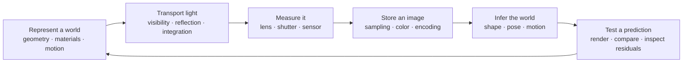

**Read the arrows as contracts.** Geometry supplies positions and orientations. Light transport supplies radiance. A camera converts arriving light into measurements. Image processing changes those measurements. Inference estimates hidden quantities from what remains. Many difficult bugs come from passing the right numbers under the wrong contract: using display-encoded values as linear light, a direction as a point, a pixel displacement as a world velocity, or an interpolated normal as an area vector.

## How to use this volume without losing the thread

The chapters follow problems and prerequisites, not the order in which four instructors presented overlapping topics. We build and move a scene, decide what is visible, calculate its light, understand the camera, and recover information from images. When courses explain the same operation, their explanations meet in one place. The source legend still identifies each course.

The CMU welcome suggests a useful learning loop: answer short conceptual questions, implement missing routines in a modeling, rendering, and animation package, then inspect the results. Its four Scotty3D assignments connect the math to visible output. This volume adapts that loop through worked traces and runnable labs. 

Study a new mechanism in four passes. Identify the question it answers. Draw the quantities and state the assumptions. Work through the equations and a numerical example. Then break one assumption and predict what fails. For example, [[Stereo correspondence and epipolar geometry|stereo triangulation]] is easier to remember after seeing how a one-pixel disparity error can create a large depth error for a distant object.

Symbols are defined near where they are used. A letter may mean something different in a later chapter, so use its local definition. Vectors are usually bold. A superscript $\mathsf T$ means transpose, and $\|\mathbf v\|$ is vector length unless another norm is named. A hat often marks a unit vector (length one). A subscript labels a quantity or component; it does not mean multiplication. When differentiating a scalar equation, we state which quantities stay fixed.

Three habits make the mathematics easier to teach:

- **Name the space.** A position in object coordinates, a position in camera coordinates, and a pixel coordinate describe related things with different numbers.
- **Name the measure.** A density per unit area differs from a density per unit solid angle. An average over pixel area differs from a point sample.
- **Name the ambiguity.** A single brightness value cannot generally determine both material and shape. A single image displacement cannot generally determine full three-dimensional motion.

The vault develops related math in [[Continuous Notes/00 - From Vectors to Images - Integrated Mathematics for Visual Computing#The panel gives us a reason to learn|vectors and geometry]], [[Continuous Notes/00 - From Vectors to Images - Integrated Mathematics for Visual Computing#Keep the promises visible while moving between representations|transforms and quaternions]], and [[Continuous Notes/00 - From Vectors to Images - Integrated Mathematics for Visual Computing#The graphics problem hiding inside a matrix equation|linear systems and decompositions]]. Follow those links for more practice. This volume still includes the definitions and reasoning needed for its subject.

A **derivation** shows why a formula follows from its assumptions. A **trace** follows the values as an algorithm runs. A **laboratory check** tests a prediction in code or a controlled example. Each catches a different problem: a sound derivation can still be coded with the wrong coordinate convention, while one passing example can hide an unstated restriction.

> [!abstract]- Chapter map
> - [[#A scene description becomes an image|A scene description becomes an image]]
> - [[#Mathematical language: points, vectors, and derivatives|Mathematical language: points, vectors, and derivatives]]
> - [[#Coordinate frames, transformations, and pose|Coordinate frames, transformations, and pose]]
> - [[#Curves as controllable functions|Curves as controllable functions]]
> - [[#Surfaces, patches, topology, and parameterization|Surfaces, patches, topology, and parameterization]]
> - [[#Meshes, connectivity, and geometry processing|Meshes, connectivity, and geometry processing]]
> - [[#Lens optics, focus, and image formation|Lens optics, focus, and image formation]]
> - [[#Exposure, sensors, and dynamic range|Exposure, sensors, and dynamic range]]
> - [[#Cameras, projection, and calibration|Cameras, projection, and calibration]]
> - [[#Sampling continuous signals and image formation|Sampling continuous signals and image formation]]
> - [[#Image sampling, filtering, and efficient reconstruction|Image sampling, filtering, and efficient reconstruction]]
> - [[#Color perception, encoding, and display|Color perception, encoding, and display]]
> - [[#Light measurement and radiometry|Light measurement and radiometry]]
> - [[#Reflectance, BRDFs, and shading|Reflectance, BRDFs, and shading]]
> - [[#The rendering equation and light transport|The rendering equation and light transport]]
> - [[#Numerical integration and Monte Carlo estimation|Numerical integration and Monte Carlo estimation]]
> - [[#Rasterization, coverage, and depth|Rasterization, coverage, and depth]]
> - [[#Textures and surface detail|Textures and surface detail]]
> - [[#Visibility queries and ray intersections|Visibility queries and ray intersections]]
> - [[#Acceleration structures and robust queries|Acceleration structures and robust queries]]
> - [[#Scene graphs and articulated geometry|Scene graphs and articulated geometry]]
> - [[#Animation curves and motion paths|Animation curves and motion paths]]
> - [[#Dynamics, forces, and numerical integration|Dynamics, forces, and numerical integration]]
> - [[#Optimization, constraints, and inverse kinematics|Optimization, constraints, and inverse kinematics]]
> - [[#PDEs, fields, and discrete solvers|PDEs, fields, and discrete solvers]]
> - [[#Optical flow and motion from images|Optical flow and motion from images]]
> - [[#Edges, contours, and subpixel localization|Edges, contours, and subpixel localization]]
> - [[#Recognition, templates, and industrial matching|Recognition, templates, and industrial matching]]
> - [[#Pose estimation, transforms, and robust fitting|Pose estimation, transforms, and robust fitting]]
> - [[#Stereo, relative orientation, and reconstruction|Stereo, relative orientation, and reconstruction]]
> - [[#Surface orientation from illumination|Surface orientation from illumination]]
> - [[#Shape from shading and reflectance|Shape from shading and reflectance]]
> - [[#Surface descriptions and Gaussian images|Surface descriptions and Gaussian images]]
> - [[#Photographic composition, history, and communication|Photographic composition, history, and communication]]
> - [[#Photographic workflow and integrated decisions|Photographic workflow and integrated decisions]]

## A scene description becomes an image

### From a triangle to a measured image

Imagine a small workshop scene: a painted metal panel, a glass cover, a bright rectangular lamp, and a camera. We already know how to locate these objects with vectors and matrices. The next question is more demanding: what number should each image sample contain, and why? Keep that scene in mind as the rendering methods change. Rasterization and ray tracing ask about the same scene from different directions. A material model describes what happens when light meets a surface; a sampling method decides which of those interactions we can afford to calculate.


Treat graphics as a sequence of representations: a scene description must supply the right quantities to the image formation and sampling stages that follow.

### Graphics is a chain of representations

Two broad methods decide which scene elements contribute to a pixel. **Rasterization** starts with each primitive and finds the image samples it covers. Triangles work well on parallel graphics processors, so rasterization is useful for interactive rendering. **Ray tracing** starts with an image sample and asks which surfaces a ray hits. It describes visibility and light bouncing between surfaces directly, which helps formulate global illumination. Modern renderers combine the methods. Their central queries run in opposite directions: primitive to pixel, or pixel to scene. [[#CMU-01 - Course Overview|CMU-01]] · [[#CMU-04 - Drawing a Triangle and an Intro to Sampling|CMU-04]] · [[#CMU-08 - Depth and Transparency|CMU-08]] · [[#CMU-12 - Geometric Queries|CMU-12]]

An image pixel is not inherently the color of a mathematical point. It summarizes light from a small region of the image plane. A renderer approximates that summary by sampling coverage, texture, and illumination. This observation connects triangle antialiasing, texture filtering, and Monte Carlo rendering: all are attempts to estimate an integral from a finite set of measurements.


### Ray tracing becomes difficult at the boundaries: precision, footprints, variance, reuse and hybrid execution

The mathematical ray

\[
\mathbf r(t)=\mathbf o+t\mathbf d
\]

is simple. A production ray tracer becomes difficult when finite precision, secondary rays, texture filtering, stochastic sampling, denoising, temporal reuse, acceleration structures and rasterized passes interact.

Ray Tracing Gems is valuable because its chapters live at these boundaries: robust self-intersection avoidance, precision, multi-hit traversal, load balancing, nested volumes, adaptive ray-traced shadows, sampling transformations, many-light importance sampling, ray-cone/ray-differential filtering, denoising, hybrid rendering, volumetric transport, path reuse and radiance caching.

#### A secondary ray should not immediately hit the surface that spawned it

Suppose a ray intersects a surface at computed position

\[
\widehat{\mathbf p}.
\]

In exact arithmetic, a reflected ray begins on the surface and leaves it. Floating-point reconstruction can place the computed point microscopically on the wrong side. The acceleration structure may then report the same surface at a tiny positive parameter, producing acne, black speckles or recursive self-hits.

The naive fix

~~~
origin = p + epsilon * normal
~~~

is not scale invariant. A scene containing microscopic and kilometer-scale geometry cannot have one universally sensible world-space epsilon.

The robust concept is:

\[
\boxed{
\text{offset far enough to cross the numerical uncertainty interval,
not an arbitrary visual distance}
}
\]

The sign of the offset must also agree with the side of the interface into which the new ray travels. Reflection, transmission and nested-medium logic must use a consistent geometric-normal convention.

This generalizes beyond ray tracing: tolerances should be connected to scale and numerical error whenever possible rather than copied as magic constants.

#### A ray query includes an interval

A ray is not only origin and direction. Its valid parameter interval

\[
t\in[t_{\min},t_{\max}]
\]

can encode self-hit exclusion, nearest-hit search, continuation after a previous hit, a finite sensor range or a shadow segment ending at a light.

For a point light at \(\mathbf l\), a shadow ray from \(\mathbf p\) has

\[
\mathbf d=\mathbf l-\mathbf p,
\qquad
D=\|\mathbf d\|.
\]

After normalization, the useful ray ends at distance \(D\). A blocker farther away is irrelevant.

An engine ray type should therefore carry interval semantics explicitly rather than letting every caller invent a different distance test.

#### A mathematical ray has zero width; an image sample does not

Texture filtering exposes a mismatch between visibility mathematics and sampled images. A mathematical ray is one-dimensional, but a pixel represents a finite sensor region. The corresponding bundle of camera paths has a finite footprint on surfaces.

Rasterization estimates texture-coordinate derivatives from neighboring fragments. Ray tracing does not automatically receive the same local 2D neighborhood.

Two practical approximations are **ray differentials** and **ray cones**.

A ray differential tracks small changes of origin and direction with respect to image-space coordinates:

\[
\frac{\partial \mathbf o}{\partial x},
\quad
\frac{\partial \mathbf o}{\partial y},
\quad
\frac{\partial \mathbf d}{\partial x},
\quad
\frac{\partial \mathbf d}{\partial y}.
\]

After intersection, those derivatives induce a surface/texture Jacobian such as

\[
\frac{\partial(u,v)}{\partial(x,y)},
\]

which can drive mip selection and anisotropic filtering.

A ray cone stores a cheaper approximation to footprint size/spread as the ray propagates.

The tradeoff is:

~~~
ray differentials:
    directional footprint
    richer state
    more propagation work

ray cones:
    compact footprint approximation
    cheaper
    less directional information
~~~

The general sampling principle is:

\[
\boxed{
\text{filter width should reflect the sample footprint in signal space}
}
\]

Mipmapping is therefore not merely a texture-memory optimization. It is an anti-aliasing response to finite footprint.

#### Importance sampling changes variance only if the weight stays correct

For

\[
I=\int_\Omega f(x)\,dx
\]

and samples \(X_i\sim p\),

\[
\widehat I_N=
\frac1N
\sum_{i=1}^{N}
\frac{f(X_i)}{p(X_i)}.
\]

Changing \(p\) can reduce variance without changing the target, provided support and weights remain correct.

This matters for many-light rendering. A renderer may choose lights according to power, distance, a spatial hierarchy or another proxy. Whatever selection policy is used, the estimator must account for its sampling probability.

A useful invariant is:

~~~
selection policy says how a sample was chosen
weight says how that choice is corrected
~~~

If the policy changes and the probability in the weight does not, the renderer changes its estimator, often unintentionally.

#### Clamping and regularization trade bias for variance

Rare paths can produce huge contributions and visible fireflies.

Clamping

\[
\widetilde f=\min(f,C)
\]

reduces variance but changes expectation whenever values above \(C\) have nonzero probability:

\[
\mathbb E[\widetilde f]\neq\mathbb E[f].
\]

This does not make clamping forbidden. Real-time rendering frequently accepts controlled bias. It means the trade should be named correctly.

Path regularization makes a similar compromise by modifying difficult later scattering behavior to obtain a lower-variance estimator.

The general relation is

\[
\boxed{
\text{less variance may require more bias}
}
\]

and “looks cleaner” is not evidence that the estimator stayed unchanged.

#### Denoising is inference from a noisy measurement

A low-sample ray-traced component can be viewed schematically as

\[
Y=X+\varepsilon,
\]

where \(X\) is desired signal and \(\varepsilon\) is sampling noise.

A denoiser estimates \(X\) from \(Y\) plus features such as:

~~~
depth
normal
motion
material/roughness
albedo
history
sample count
variance
~~~

Spatial filtering assumes nearby compatible samples describe related signal. Temporal filtering assumes reprojected history remains valid.

Both can fail at disocclusions, thin geometry, rapid motion, changing light, specular highlights, transparency and bad motion vectors.

This is why denoising belongs inside the rendering estimator pipeline rather than being treated as an independent beautification filter.

#### Temporal reuse changes the statistics

History reuse can reduce variance dramatically, but reused samples are not fresh IID measurements.

A history sample may have been generated under a previous:

- camera pose,
- visibility state,
- material state,
- proposal distribution,
- light configuration.

Temporal accumulation therefore needs validity tests based on signals such as depth, normal, object/material identity, motion reprojection and history age.

Rejecting too aggressively discards useful information. Accepting too loosely causes ghosting and stale illumination.

The mathematics volume's warning about correlated/adaptive samples applies directly: the variance story must match the process that actually generated the accumulated data.

#### Hybrid rendering is a deliberate decomposition, not an embarrassing halfway state

A renderer may use rasterization for primary visibility, G-buffer generation, particles and efficient opaque geometry, and ray tracing for reflections, difficult shadows, indirect illumination or selected transparency/volume queries.

The real question is not “rasterized or ray traced?” but:

> Which representation/query gives the best cost-quality trade for each subproblem under the frame budget?

A frame may be:

~~~
raster primary visibility
    ↓
G-buffer
    ↓
ray-traced shadow/reflection/GI
    ↓
spatiotemporal filtering
    ↓
lighting/composition
    ↓
TAA/upscaling/presentation
~~~

This raises the value of a render graph because raster and ray passes share resources, coordinate conventions, motion vectors, material interpretation and lifetime dependencies.

#### Ray tracing performance is scheduling and memory behavior too

Rays are independently specifiable, but GPU lanes can diverge because neighboring rays traverse different BVH branches, hit different materials or terminate at different depths.

Irregular BVH and geometry access can also weaken locality.

Practical systems therefore use ideas such as:

- coherent ray generation,
- ray sorting/compaction,
- wavefront path tracing,
- work queues,
- material grouping,
- path-state compaction,
- load balancing.

A production ray tracer is not just an intersection function. It is a scheduler for irregular parallel work.

#### How the MIT lectures and Ray Tracing Gems fit together

The MIT graphics sequence supplies the conceptual chain:

\[
\text{ray casting}
\rightarrow
\text{ray tracing}
\rightarrow
\text{acceleration}
\rightarrow
\text{shading}
\rightarrow
\text{sampling}
\rightarrow
\text{Monte Carlo}
\rightarrow
\text{rasterization/shadows}
\]

Ray Tracing Gems adds the production pressure:

\[
\boxed{
\text{precision}
+
\text{footprints}
+
\text{variance}
+
\text{history}
+
\text{divergence}
+
\text{hybrid dependencies}
}
\]

Those two layers belong in one narrative: first understand what the renderer computes, then understand why a correct-looking mathematical formula can still fail in a real-time implementation.

Source basis: MIT 6.837 Computer Graphics and Ray Tracing Gems, especially its sections on intersections/efficiency, sampling, denoising/filtering, hybrid systems and global illumination.


### MIT graphics gap closure: the renderer is one continuous numerical model from shape to motion to light to pixels

The ray-tracing section above closes an important production gap, but the MIT 6.837 sequence is valuable precisely because it refuses to treat rendering as an isolated API exercise. Curves, transformations, hierarchy, color, animation, differential equations, collisions, shading, sampling, global illumination, rasterization and shadows are all different views of one problem:

\[
\boxed{
\text{represent a changing world continuously}
\rightarrow
\text{approximate it discretely}
\rightarrow
\text{produce a finite image}
}
\]

The deep connection is numerical. Geometry is sampled into vertices. Curves are sampled into segments. Motion is sampled in time. Textures are sampled in image space. Illumination is sampled in direction/path space. Rasterization samples coverage. A camera samples radiance. A display reconstructs emitted light from finite pixels.

Once this common structure is visible, many engine rules stop looking arbitrary.

#### Parametric curves are functions whose derivatives are geometric information

A parametric curve is

\[
\mathbf p(t)=
\begin{bmatrix}
x(t)\\
y(t)\\
z(t)
\end{bmatrix},
\qquad
t\in[a,b].
\]

The first derivative

\[
\mathbf p'(t)
\]

gives tangent direction and speed with respect to parameter t.

The second derivative

\[
\mathbf p''(t)
\]

describes how that tangent changes.

A cubic Bézier curve with control points \(\mathbf P_0,\mathbf P_1,\mathbf P_2,\mathbf P_3\) is

\[
\mathbf B(t)
=
(1-t)^3\mathbf P_0
+
3(1-t)^2t\mathbf P_1
+
3(1-t)t^2\mathbf P_2
+
t^3\mathbf P_3.
\]

Its endpoint properties are immediate:

\[
\mathbf B(0)=\mathbf P_0,
\qquad
\mathbf B(1)=\mathbf P_3.
\]

Its derivative is

\[
\mathbf B'(t)
=
3(1-t)^2(\mathbf P_1-\mathbf P_0)
+
6(1-t)t(\mathbf P_2-\mathbf P_1)
+
3t^2(\mathbf P_3-\mathbf P_2).
\]

Therefore

\[
\mathbf B'(0)=3(\mathbf P_1-\mathbf P_0),
\qquad
\mathbf B'(1)=3(\mathbf P_3-\mathbf P_2).
\]

This explains why the inner control points determine endpoint tangents even though the curve generally does not pass through them.

For an engine, derivatives matter because a curve is rarely only a visible line. It can drive:

- camera motion,
- animation paths,
- rails,
- roads,
- particle emitters,
- ribbon orientation,
- procedural modeling,
- motion blur,
- arc-length parameterization.

A camera following \(\mathbf B(t)\) can use a normalized tangent

\[
\mathbf T(t)=
\frac{\mathbf B'(t)}
{\|\mathbf B'(t)\|}
\]

as one orientation axis.

But parameter t does not usually correspond to constant world-space speed.

The speed is

\[
v(t)=\|\mathbf B'(t)\|.
\]

Arc length from 0 to t is

\[
s(t)=\int_0^t\|\mathbf B'(u)\|\,du.
\]

If the camera should move at constant physical speed, the engine should advance approximately uniformly in s, not uniformly in t.

This often requires a lookup table:

~~~text
sample t values
    ↓
accumulate segment lengths
    ↓
store approximate cumulative arc length
    ↓
desired distance s
    ↓
binary search/interpolate table
    ↓
recover t
~~~

The general lesson is:

\[
\boxed{
\text{parameter uniformity}
\neq
\text{spatial uniformity}
}
\]

This same distinction appears in texture parameterization and animation timing.

#### de Casteljau is both an evaluator and a geometric proof

Cubic Bézier evaluation can be written as repeated interpolation.

First level:

\[
\mathbf Q_0=(1-t)\mathbf P_0+t\mathbf P_1
\]

\[
\mathbf Q_1=(1-t)\mathbf P_1+t\mathbf P_2
\]

\[
\mathbf Q_2=(1-t)\mathbf P_2+t\mathbf P_3.
\]

Second level:

\[
\mathbf R_0=(1-t)\mathbf Q_0+t\mathbf Q_1
\]

\[
\mathbf R_1=(1-t)\mathbf Q_1+t\mathbf Q_2.
\]

Final:

\[
\mathbf B(t)=(1-t)\mathbf R_0+t\mathbf R_1.
\]

This construction proves the convex-hull property because every stage is an interpolation of points already inside the previous convex hull.

It also gives subdivision naturally. Evaluating at a split parameter produces control points for two smaller Bézier curves.

That is useful for adaptive tessellation:

~~~text
curve segment
    ↓
estimate flatness/error
    ↓
if acceptable:
    emit line/patch
else:
    subdivide with de Casteljau
    recurse
~~~

The important engine pattern is adaptive work based on error, not fixed work based on habit.

#### Continuity between curve segments has levels

Two curve pieces can meet with different continuity guarantees.

\(C^0\) continuity means positions agree:

\[
\mathbf B_1(1)=\mathbf B_2(0).
\]

\(C^1\) continuity means first derivatives also agree:

\[
\mathbf B_1'(1)=\mathbf B_2'(0).
\]

Geometric \(G^1\) continuity only requires tangent directions to agree up to positive scaling:

\[
\mathbf B_2'(0)=\lambda\mathbf B_1'(1),
\qquad
\lambda>0.
\]

This distinction matters visually.

A road or camera path can look directionally smooth under \(G^1\) while speed changes because derivative magnitudes differ.

Animation, camera rails, and physically meaningful trajectories often care about more than geometric appearance.

#### Hierarchical modeling is repeated change of basis

A scene graph is often introduced as a parent-child tree. The deeper model is composition of coordinate transforms.

Let

\[
M_{world}^{child}
=
M_{world}^{parent}
M_{parent}^{child}.
\]

For a chain

~~~text
world
  ↓
vehicle
  ↓
wheel
  ↓
brake-caliper
~~~

the final transform is

\[
M_{world}^{caliper}
=
M_{world}^{vehicle}
M_{vehicle}^{wheel}
M_{wheel}^{caliper}.
\]

The multiplication order encodes the change-of-basis sequence.

This is why transform order is not cosmetic.

If the convention uses column vectors,

\[
\mathbf p_{world}
=
M_{world}^{object}
\mathbf p_{object}.
\]

Then composing translation and rotation in the wrong order changes the pivot/orbit behavior.

A useful debugging technique is to draw basis vectors at each node:

~~~text
X axis = red line
Y axis = green line
Z axis = blue line
origin = point
~~~

A wrong transform then becomes visible as a wrong basis, not merely as a mysteriously misplaced mesh.

#### A scene graph and a transform-update graph are related but not identical

Logical hierarchy describes ownership or semantic relationship.

Transform dependency describes mathematical dependency.

A production engine may flatten transform data for update efficiency while retaining a logical entity hierarchy for editor purposes.

For example:

~~~text
Editor hierarchy:
Car
 ├─ Body
 ├─ FrontLeftWheel
 └─ FrontRightWheel

Runtime transform arrays:
parentIndex[]
localMatrix[]
worldMatrix[]
dirtyBits[]
~~~

The hot update can traverse arrays in topological order.

The editor can still present the tree.

Again:

\[
\boxed{
\text{logical abstraction}
\neq
\text{physical data layout}
}
\]

This connects MIT hierarchical modeling directly to the data-oriented C++ discussion.

#### Skinning is weighted coordinate transformation

Linear blend skinning transforms a rest-pose vertex by several joint transforms.

For vertex position \(\mathbf p\),

\[
\mathbf p'
=
\sum_{j=1}^{k}
w_j
M_j
\mathbf p,
\]

with

\[
\sum_j w_j=1.
\]

In practice each joint matrix often combines current pose with inverse bind pose:

\[
M_j
=
M_{world,j}^{current}
\left(M_{world,j}^{bind}\right)^{-1}.
\]

The inverse bind transform maps the vertex from mesh bind space into the joint's bind-local frame, after which the current joint transform carries it into the current posed frame.

The weighted sum is simple and GPU-friendly, but it has well-known artifacts such as collapsing volume around twisting joints.

That artifact is not a bug in matrix multiplication. It comes from linearly blending transformed positions produced by different rigid transformations.

Dual-quaternion skinning and other methods attempt to preserve rotational behavior better.

The engine lesson is to know what approximation the skinning representation makes.

#### Normals cannot always use the same matrix as positions

A transformed tangent \(\mathbf t\) and normal \(\mathbf n\) should remain perpendicular:

\[
\mathbf n^\top\mathbf t=0.
\]

Under a linear transform A,

\[
\mathbf t'=A\mathbf t.
\]

We want a transformed normal \(\mathbf n'\) such that

\[
{\mathbf n'}^\top A\mathbf t=0.
\]

Choosing

\[
\mathbf n'=(A^{-1})^\top\mathbf n
\]

gives

\[
{\mathbf n'}^\top A\mathbf t
=
\mathbf n^\top A^{-1}A\mathbf t
=
\mathbf n^\top\mathbf t
=
0.
\]

Therefore the normal matrix is inverse-transpose of the relevant linear transform when nonuniform scale/shear is present.

This derivation is better than memorizing the phrase inverse-transpose because it explains the invariant being preserved.

#### Color values are not all in the same mathematical space

An RGB triplet can represent several different things:

~~~text
linear scene radiance-like value
encoded display value
texture data
albedo parameter
normal-map vector encoding
HDR intermediate
post-tonemapped image
~~~

Arithmetic such as interpolation and lighting belongs in a linear-light domain.

If values are gamma encoded, naive averaging is wrong.

For two encoded colors \(c_1,c_2\), generally

\[
decode\left(
\frac{c_1+c_2}{2}
\right)
\neq
\frac{decode(c_1)+decode(c_2)}{2}.
\]

This is why texture formats and framebuffer transfer functions matter.

Color management is not a final export concern; it is part of numerical correctness throughout the pipeline.

#### The rendering equation and BRDF are only meaningful under consistent units and spaces

The rendering equation is

\[
L_o(\mathbf x,\omega_o)
=
L_e(\mathbf x,\omega_o)
+
\int_{\Omega}
f_r(\mathbf x,\omega_i,\omega_o)
L_i(\mathbf x,\omega_i)
(\mathbf n\cdot\omega_i)^+
d\omega_i.
\]

Each factor has a role:

- \(L_o\): outgoing radiance,
- \(L_e\): emitted radiance,
- \(f_r\): BRDF,
- \(L_i\): incident radiance,
- cosine term: projected-area factor,
- solid-angle differential: directional integration measure.

A renderer that mixes encoded color values, inconsistent normals, and arbitrary light units can still produce attractive images, but the equation no longer describes what the code is computing.

The point of physically based rendering is not realism by naming. It is maintaining enough consistent semantics that parameters behave predictably.

#### Animation turns the world into an ODE problem

Many animation systems can be expressed as ordinary differential equations.

For particle position x and velocity v:

\[
\dot{\mathbf x}=\mathbf v,
\]

\[
m\dot{\mathbf v}=\mathbf F(\mathbf x,\mathbf v,t).
\]

Equivalently,

\[
\dot{\mathbf v}
=
\frac{\mathbf F}{m}.
\]

The continuous equations do not directly tell the computer how to advance one frame.

A numerical integrator approximates that evolution.

##### Explicit Euler

\[
\mathbf x_{n+1}
=
\mathbf x_n+h\mathbf v_n,
\]

\[
\mathbf v_{n+1}
=
\mathbf v_n+h\mathbf a_n.
\]

It is simple and first-order accurate, but it can inject energy into oscillatory systems.

##### Semi-implicit Euler

Update velocity first:

\[
\mathbf v_{n+1}
=
\mathbf v_n+h\mathbf a_n,
\]

then position using the new velocity:

\[
\mathbf x_{n+1}
=
\mathbf x_n+h\mathbf v_{n+1}.
\]

For many game-physics systems, this small change has much better qualitative energy behavior than explicit Euler while remaining cheap.

This is why two methods with nearly identical code can behave very differently.

##### Backward Euler

Backward Euler evaluates the derivative at the future state:

\[
\mathbf x_{n+1}
=
\mathbf x_n
+
h f(\mathbf x_{n+1},t_{n+1}).
\]

Because the unknown future state appears on both sides, the step is implicit and often requires solving a system.

Its advantage is strong stability for stiff systems.

The trade is numerical damping and solve cost.

##### Verlet-style position integration

A simple position Verlet form is

\[
\mathbf x_{n+1}
=
2\mathbf x_n
-
\mathbf x_{n-1}
+
h^2\mathbf a_n.
\]

It stores previous position rather than explicit velocity.

Constraint-based cloth and particle systems often like Verlet-style formulations because positional constraints can be applied directly.

The deeper point is:

\[
\boxed{
\text{integration scheme is part of the simulated model}
}
\]

Changing integrator can change observed energy, damping, stability, and phase behavior even when the force equations remain identical.

#### Time step is a numerical parameter, not merely frame duration

If the render frame takes \(\Delta t\), it does not follow that the physics integrator should always advance by exactly that variable step.

Large variable steps can destabilize simulation.

A fixed-step accumulator uses:

~~~text
accumulator += realFrameDelta

while accumulator >= h:
    simulate(h)
    accumulator -= h

render interpolated state
~~~

This separates simulation step size h from render cadence.

The simulation then has more predictable numerical behavior and deterministic-replay potential.

The remaining interpolation fraction is

\[
\alpha=
\frac{accumulator}{h}.
\]

Visual state can be interpolated between the previous and current simulation states.

#### A mass-spring system exposes stiffness

For a spring between positions \(\mathbf x_i\) and \(\mathbf x_j\),

\[
\mathbf d=\mathbf x_j-\mathbf x_i,
\qquad
\ell=\|\mathbf d\|.
\]

Hooke's law force magnitude is

\[
F=-k(\ell-\ell_0).
\]

A vector force can be

\[
\mathbf F_i
=
k(\ell-\ell_0)
\frac{\mathbf d}{\ell},
\]

with opposite force on j.

As stiffness k increases, explicit integration often requires smaller h for stability.

This is the practical meaning of a stiff system: some modes evolve on a much faster time scale than the overall motion.

Integrator choice and time step therefore cannot be chosen independently from physical parameters.

#### Collision detection and collision response are different problems

Detection asks whether objects overlap or will contact.

Response asks what change in velocity/position should follow.

For a simple frictionless impulse between two bodies with contact normal \(\mathbf n\), relative contact velocity is

\[
\mathbf v_r
=
\mathbf v_B-\mathbf v_A.
\]

Its normal component is

\[
v_n=\mathbf v_r\cdot\mathbf n.
\]

If \(v_n\ge0\), the bodies are already separating along the normal and a new closing impulse is usually unnecessary.

For point masses with inverse masses \(m_A^{-1}\) and \(m_B^{-1}\), coefficient of restitution e, the scalar impulse magnitude is

\[
j
=
-\frac{(1+e)v_n}
{m_A^{-1}+m_B^{-1}}.
\]

Then

\[
\mathbf v_A'
=
\mathbf v_A
-
j m_A^{-1}\mathbf n,
\]

\[
\mathbf v_B'
=
\mathbf v_B
+
j m_B^{-1}\mathbf n.
\]

Rigid bodies add rotational terms because an impulse away from the center of mass changes angular velocity.

The full denominator contains effective mass contributions from inertia tensors and contact-arm cross products.

The conceptual lesson is:

\[
\boxed{
\text{contact response acts on relative velocity through effective mass}
}
\]

not simply by reversing one object's velocity.

#### Restitution is not a generic bounce multiplier

Restitution relates pre- and post-collision normal relative velocity in an idealized contact:

\[
v_n'
=
-e v_n.
\]

Using high restitution for tiny resting contacts can create jitter because numerical noise becomes repeated bounce energy.

Production solvers often suppress restitution below a velocity threshold.

This is an example of a physically motivated model requiring numerical policy.

#### Friction is constrained tangential impulse

After solving the normal impulse, compute tangential relative velocity:

\[
\mathbf v_t
=
\mathbf v_r
-
(\mathbf v_r\cdot\mathbf n)\mathbf n.
\]

If nonzero, tangent direction is

\[
\mathbf t=
\frac{\mathbf v_t}{\|\mathbf v_t\|}.
\]

A candidate tangential impulse can be derived through tangential effective mass, then clamped according to Coulomb friction:

\[
|j_t|
\le
\mu j_n.
\]

The normal impulse creates the bound on friction impulse.

This explains why friction cannot be modeled correctly as an arbitrary global velocity damping term.

#### Position correction and velocity correction solve different errors

A velocity impulse can stop future penetration but does not necessarily remove overlap already present because of discrete stepping.

Engines often need positional correction, split impulses, Baumgarte-style stabilization, or position-level constraint solves.

But aggressive correction injects energy or causes jitter.

The solver therefore balances:

~~~text
remove overlap fast enough to avoid visible sinking
versus
avoid adding excessive artificial energy
~~~

This is why contact resolution is iterative numerical optimization, not a one-line bounce formula.

#### Sampling unifies rasterization and ray tracing

A pixel value conceptually averages a continuous image signal over a footprint.

For pixel region A,

\[
I_A
=
\frac{1}{|A|}
\int_A I(x,y)\,dx\,dy.
\]

One sample at the pixel center estimates that integral poorly when signal frequencies exceed the sampling rate.

Aliasing appears because high-frequency variation is reconstructed as lower-frequency structure.

Supersampling, MSAA, texture filtering, mipmapping, TAA, stochastic path samples, and ray differentials are all responses to the same basic problem: finite samples approximate a continuous integral.

This is the central MIT sampling connection.

#### Mipmapping is prefiltered integration over scale

A mip chain stores progressively low-pass-filtered versions of a texture.

If a projected pixel footprint covers many texels, reading only the finest level samples a high-frequency signal too sparsely.

Choosing a coarser mip level approximates integrating the texture over a larger footprint.

Trilinear filtering interpolates between mip levels to reduce transitions between discrete scales.

Anisotropic filtering goes further because the projected footprint is often elongated, not square.

The correct abstraction is:

\[
\boxed{
\text{texture lookup should approximate footprint integration}
}
\]

not merely nearest color retrieval.

#### Rasterization is an analytic visibility shortcut plus sampling

For a triangle projected to screen, rasterization determines which pixels/samples lie inside the projected primitive and interpolates attributes across it.

Barycentric coordinates express a point as

\[
\mathbf p
=
\lambda_0\mathbf p_0
+
\lambda_1\mathbf p_1
+
\lambda_2\mathbf p_2,
\]

with

\[
\lambda_0+\lambda_1+\lambda_2=1.
\]

Attributes can be interpolated from those weights.

But perspective changes the correct interpolation rule.

For an attribute a stored at clip-space vertices with w values, perspective-correct interpolation uses quantities related to

\[
\frac{a_i}{w_i}
\quad\text{and}\quad
\frac{1}{w_i}
\]

then divides after interpolation:

\[
a
=
\frac{
\sum_i \lambda_i \frac{a_i}{w_i}
}{
\sum_i \lambda_i \frac{1}{w_i}
}.
\]

This is why naive screen-space linear interpolation makes textures visibly warp.

#### Depth is also a convention-sensitive quantity

Depth buffering depends on projection convention and representation.

Precision is not uniformly distributed in world-space distance.

Perspective projection makes near geometry consume more representational precision.

Reverse-Z techniques exploit floating-point distribution and projection mapping to improve useful depth precision.

The durable lesson is that a depth value is not just distance. It is the result of a projection mapping plus a depth-range convention.

#### Shadow mapping is another sampling problem

A shadow map samples visibility from the light's viewpoint.

The scene is projected into a finite depth texture.

A camera-visible point is transformed into light space and compared against stored light-space depth.

Artifacts follow from finite sampling and numerical mismatch:

- shadow acne,
- peter-panning,
- aliasing,
- perspective undersampling,
- cascade transitions,
- temporal instability.

Bias trades self-shadow error against detached-shadow error.

PCF averages multiple binary comparisons to approximate filtered visibility.

Cascaded shadow maps allocate more light-space resolution near the camera where screen-space error is more noticeable.

Again:

\[
\boxed{
\text{shadow quality}
=
\text{visibility approximation}
+
\text{sampling allocation}
+
\text{numerical robustness}
}
\]

#### Image-based lighting turns the environment into an integral

An environment map provides incident radiance over direction.

Diffuse irradiance at normal n is

\[
E(\mathbf n)
=
\int_{\Omega^+}
L_i(\omega)
(\mathbf n\cdot\omega)
\,d\omega.
\]

Rather than evaluate this expensive integral per shading point from raw environment samples, renderers precompute approximations such as irradiance maps or spherical-harmonic coefficients.

Specular IBL is roughness dependent because a rough microfacet BRDF integrates a broader range of directions than a smooth mirror-like surface.

Prefiltered environment maps approximate this directional convolution at different roughness levels.

This is the same strategy used throughout graphics:

~~~text
expensive continuous integral
    ↓
precompute/filter
    ↓
small runtime lookup
~~~

#### Output devices complete the numerical pipeline

The renderer eventually produces values that a physical display converts into emitted light.

That conversion includes:

- transfer functions,
- peak luminance,
- black level,
- color primaries,
- white point,
- bit depth,
- local/global tone behavior,
- HDR metadata in relevant systems.

A physically meaningful HDR internal value cannot simply be copied into an 8-bit display buffer.

Tone mapping performs a mapping from scene-referred radiometric range into display-referred range.

The creative and technical choices are intertwined because the mapping controls highlight compression, contrast, colorfulness, and adaptation.

The rendering pipeline is therefore not finished at lighting.

It is finished only when the display-facing signal is produced under a known color/transfer convention.

#### The MIT sequence is a dependency graph, not a list of disconnected lectures

The most useful reading of the course is:

\[
\boxed{
\begin{array}{c}
\text{curves/surfaces}\\
\downarrow\\
\text{transforms/hierarchy}\\
\downarrow\\
\text{animation + ODE integration}\\
\downarrow\\
\text{collision constraints}\\
\downarrow\\
\text{camera/visibility}\\
\downarrow\\
\text{shading + texture}\\
\downarrow\\
\text{sampling}\\
\downarrow\\
\text{global illumination}\\
\downarrow\\
\text{raster/ray execution}\\
\downarrow\\
\text{display}
\end{array}
}
\]

A game engine repeatedly traverses this dependency graph every frame.

That is why the best curriculum narrative introduces mathematics where it becomes operational: derivatives when curves need tangents, inverse-transpose when normals must remain perpendicular, differential equations when motion must advance, impulses when contact changes momentum, probability when illumination is sampled, and signal processing when pixels and textures alias.

Source integration basis: MIT 6.837 Computer Graphics lecture sequence covering curves/surfaces, transformations, hierarchical modeling, color, animation/skinning, particle systems and ODE solvers, mass-spring systems, collisions, ray casting/tracing and acceleration, shading, texture mapping, sampling/mipmaps, Monte Carlo/global illumination, image-based rendering/lighting, rasterization, real-time shadows, and output devices.


### Algorithmic scope and debugging the image pipeline

The first lecture treats graphics as the math and algorithms behind images, not as a tour of drawing software. Its examples introduce a shared toolkit: functions describe shape, transforms set pose, time-stepping rules evolve state, and sampling converts continuous pictures into pixels. Rasterization and ray-based rendering handle visibility in opposite directions, from primitive to pixel and from pixel to scene. A renderer can combine both. [[#MITG-01 - Introduction|MITG-01]] · [[#MITG-09 - Ray casting|MITG-09]] · [[#MITG-17 - Rasterization|MITG-17]] (00:19:00–00:45:00; 00:10:00–00:25:00; 00:10:00–00:30:00)

When an image looks wrong, find the first representation that went wrong. Is the shape incorrect? Did transforms compose in the wrong order? Did the simulation become unstable or the ray hit the wrong surface? Was the lighting approximation poor? Did a high-frequency signal alias, or did the system read linear intensity as a display code? These questions make debugging more useful than treating the final pixel as a mystery.

### The first lecture's scope: algorithms behind pictures

The recording opens with course setup, then maps out what “graphics” includes. Solomon contrasts a film frame that may take hours to simulate and render with an interactive game that must meet a budget of roughly 30 frames per second. This is an algorithmic constraint. A film renderer can spend more time on simulation, sampling, or lighting because it computes frames in advance. An interactive renderer must choose approximations before each frame's deadline. It may improve motion, lighting, or resolution, but usually cannot maximize all three at once. [[#MITG-01 - Introduction|MITG-01]] (00:17:29–00:18:23)

The examples extend beyond entertainment. A computer-aided manufacturing model describes a shape before it is built. Ray calculations can answer architectural questions about light and heat. Medical scans become 3D data that people can rotate or slice. Augmented reality combines a camera view with a virtual object, linking rendering to scene understanding. Scientific visualization presents fluid or structural simulations for engineering analysis. These applications share a task: represent, transform, analyze, and present visual information. [[#MITG-01 - Introduction|MITG-01]] (00:18:41–00:21:12; 00:22:22–00:25:32)

The course focuses on algorithms, representations, and the software and hardware that turn a scene into pixels. It does not teach drawing technique or tour design applications. “Graphics pipeline” is a teaching map: describe shapes, set their pose and motion, specify materials and light, then render. Real systems do not all follow one fixed sequence. The lecturer notes that a renderer can combine ray tracing and rasterization, giving each method different work. [[#MITG-01 - Introduction|MITG-01]] (00:25:35–00:29:32; 00:33:06–00:37:02)

The tractor composite in the first lecture raises a useful question: what information is needed to make its image? At minimum, describe the vehicle, character, and background; specify a camera view and surface appearance; and decide which scene elements contribute to each pixel. Artists may describe a shape as a curve, patch, or rig. The computer may use triangles and samples instead. **Tessellation** bridges these forms by approximating a high-level curve or surface with simpler primitives. Later steps also convert between forms: material settings become light-response calculations, 3D objects become image samples, and encoded pixel values become light from a display. The recurring challenge is to make each conversion useful, efficient, and visually adequate. [[#MITG-01 - Introduction|MITG-01]] (00:33:20–00:36:55)

### Learning path and conventions

Coordinates use a pinhole camera with image plane at focal length $f$. Capital letters such as $X,Y,Z$ denote a 3-D point in camera coordinates; lowercase $x,y$ denote its image coordinates. A dot denotes differentiation with respect to time. Surface height is $z(x,y)$ and its slopes are $p=\partial z/\partial x$ and $q=\partial z/\partial y$. Image brightness is $E(x,y,t)$. Vectors are bold only where ambiguity requires it; a hat denotes a unit vector. A matrix transpose is written $^T$. In every derivation, units and coordinate conventions matter: the notes sometimes choose the image plane at $f$ and sometimes discuss normalized image coordinates, so a scale factor $f$ must not be silently dropped.

### What an image can and cannot tell us

A useful way to reason about any inverse problem is to write $\mathbf{y}=F(\mathbf{x})$, where $\mathbf{x}$ is the unknown parameter vector and $\mathbf{y}$ is what the sensor measures. Near a candidate solution $\mathbf{x}_0$, a small error propagates approximately as $\delta\mathbf{y}=J\delta\mathbf{x}$, where $J$ is the Jacobian of $F$. If some direction in parameter space changes the measurements very little, recovering that direction amplifies noise. If $J$ is rank deficient, some combinations cannot be recovered at all. A solvable equation is therefore not necessarily a stable measurement procedure.

### Lecture 1’s demonstrations: vision is judged by the task it enables

The opening lecture supplies the through-line that the notes’ later derivations formalize. Horn begins with the perceptual puzzle that a flat printed face still suggests three-dimensional shape. A uniform material can look darker where its surface turns away from a nearby light and brighter where it faces the light. In the nose example, that shading conveys slope, yet there are two slope variables and only one brightness observation. A sequence of algorithm iterations on an oblate ellipsoid makes the global issue visible: intermediate reconstructions develop ridges and isolated conical points before moving toward the intended shape. The point is not that one image uniquely determines a surface; it is that the reconstruction process must expose what assumptions and additional constraints make its answer plausible. [[#MITV-01 - Introduction to Machine Vision|MITV-01]] (video 00:22:32–00:25:10)

The course overview then closes the loop between image evidence and action. A machine-vision system receives a scene under illumination, forms an image, estimates a description, and may use that description to act in the world. A robot grasp is a particularly clear acceptance check: if the estimated object identity and pose cause the gripper to approach correctly, that is stronger feedback than an unverified label. In one demonstrated work cell, one camera supplies object identity and orientation while an interrupted beam gives the missing depth cue; the robot then backs off, reorients, and grasps. A surveyor-style crosshair carried by the robot provides a sharply localizable point for estimating the transformation between the camera’s coordinates and the robot base. This connects the introductory application to later exterior orientation and calibration. [[#MITV-01 - Introduction to Machine Vision|MITV-01]] (video 00:25:11–00:26:40, 00:44:56–00:46:14)

The truck-approach demonstrations make the time-to-contact idea concrete. As the vehicle approaches, the image expands; a plotted computed time-to-contact tracks the known value. The vehicle approaches the truck door rather than the center, so its focus of expansion is off-center and reveals oblique travel. In a second time-lapse, manually moving the camera in nominal 10 mm increments introduces more measurement noise. These examples highlight both a useful invariance—ratio-based TTC does not require focal length in this setup—and practical sensitivity to camera motion and measurement accuracy. Horn also shows an analog chip calculating FOE nearly instantaneously and recounts cooling an overheating prototype with an ice-filled cooler and aquarium pump. This makes clear that computational constraints and physical implementation shape the algorithm, not just abstract mathematics. [[#MITV-01 - Introduction to Machine Vision|MITV-01]] (video 00:26:42–00:32:46)

A camera obscura in Santa Monica serves as an intuitive pinhole-camera model: light passes through a small opening into a dark room and projects an inverted scene on the opposite wall. The brightness discussion warns against treating pixel values as direct reflectance. The Moon looks bright without a nearby white reference even though the lecture says it reflects about 11 percent of incoming sunlight; apparent brightness depends on context. Similarly, inverse-square falloff for a point source does not mean that a uniformly lit extended wall looks one-quarter as bright from twice the distance: each pixel then represents a larger wall area, offsetting the per-source falloff. Foreshortening changes illumination per unit surface area by the cosine of the incident angle, but reflectance can be more complex.

 For an ideal thin lens with focal length $f$, pupil diameter $D$, and scene radiance $L$ at field angle $\alpha$, sensor-plane irradiance is:
 
  $$E_{\mathrm{img}}=(\pi/4)L(D/f)^2\cos^4\alpha$$ 
  
  under fixed-pupil geometric-optics assumptions. The fourth power combines projection and distance factors; this is image-plane irradiance, not the irradiance on the surface. The normal’s two degrees of freedom versus one brightness measurement motivates photometric stereo and the course’s recurring constraint-counting argument. [[#MITV-01 - Introduction to Machine Vision|MITV-01]] (video 00:51:15–00:52:27, 01:05:34–01:13:48)

### A photograph is a model of a view

The course opens by distinguishing viewpoint from focal length. Perspective comes from where the camera is located. For a pinhole model, a 3D point $(X,Y,Z)$ projects to image coordinates proportional to

$$
x=f\frac{X}{Z},\qquad y=f\frac{Y}{Z},
$$

## A correct image must survive the viewer — perceptual rendering and XR

The workshop image is only the beginning of the measurement. Light passes through a camera or display, reaches an eye and is interpreted under changing gaze, contrast and motion. This full XR foundation is integrated here before later camera and rendering algorithms. Source claims remain explicitly distinguished from measured or implemented results.

---
tags:
  - continuous-notes
  - xr
  - independent-series
series: XR Foundations
source: XR01
curriculum: outside-3000-part-plan
---

# XR: From Light to Perception - Seeing and Representing Reality

> Independent XR series, outside the 3,000-part curriculum. Chunk 1 is accepted as XR01. Future sources will extend this same file. Main-curriculum coverage remains Parts 1–147 / M001–M009. Institutional provenance is discussed in the source record.

## Prologue - A perfect scene can still make a poor experience

Imagine a bright fence in a virtual world. Its geometry is correct, and the GPU draws every triangle. When you move your head, however, the thin bars shimmer. When you look at the fence, its detail takes a moment to become sharp. A filter reduces the noise but leaves a faint trail behind moving objects.

These problems have different causes. Correct geometry is only the first step toward a convincing image.

A virtual scene must pass through several systems:

1. The renderer estimates the light coming from the scene.
2. It stores those estimates as image samples.
3. Reconstruction combines the samples into an output image.
4. The display turns encoded values into emitted light.
5. The headset's optics change where that light goes and how sharply it is focused.
6. The eye and brain turn the received light into a visual experience.

Eye tracking adds a feedback path. It tells the renderer where the user is looking, so the renderer can choose where to spend more work.

**Extended reality**, or XR, is the umbrella term we use for virtual reality, augmented reality, and related mixed-reality systems. This chapter explains the visual foundations. Later sources will explain the complete system that produces an XR experience.

### Figure X0 — A qualitative picture of the XR loop

![[Visual Recall/xr_perception_pipeline.png]]

**Read the illustration:** connect scene light, display, eye, and rendering decisions. The foveal inset suggests uneven detail sensitivity; the binocular inset reminds us that pointing and focusing are separate demands. This AI-generated teaching collage is qualitative: it is not a calibrated optical ray diagram or an anatomical measurement. Use Figures X1–X4 and their equations for the precise claims.

[[Visual Recall/XR - Light, Vision and Perception - Visual Recall#Figure-linked short notes|Return to the compact XR notes]].

## Light must become a quantity before it becomes a color

Before asking what color a pixel should be, ask a simpler question: **what physical quantity are we trying to represent?**

[[Light spectra and radiometry|Light]] is electromagnetic radiation. We use different models for different questions.

- A wave model explains interference and diffraction.
- A photon model describes individual energy exchanges.
- A ray model simplifies the path of light when we do not need the full wave behavior.

A ray is not a tiny RGB-colored particle. It is a way to describe a direction of propagation.

For an ideal wave traveling along one coordinate, we can write:

$$
E(x,t)=E_0\cos(kx-\omega t+\phi).
$$

The equation describes an oscillation. Its symbols mean:

| Symbol | Meaning | Unit |
|---|---|---|
| $E(x,t)$ | an electric-field component at position $x$ and time $t$ | volts per meter |
| $E_0$ | the field's amplitude | volts per meter |
| $k$ | angular wavenumber | radians per meter |
| $\omega$ | angular frequency | radians per second |
| $\phi$ | starting phase | radians |

**Phase** tells us where the oscillation is within its cycle. Wavelength $\lambda$ is the distance over which the wave repeats. Frequency $\nu$ is the number of cycles per second.

In a vacuum, the relationships are:

$$
c=\lambda\nu,\qquad
k=\frac{2\pi}{\lambda},\qquad
\omega=2\pi\nu.
$$

Here $c$ is the vacuum speed of light. In a material, the wave's wavelength and phase velocity can differ from their vacuum values.

For green light with a wavelength of $550\,\mathrm{nm}$:

$$
\nu=\frac{c}{\lambda}
\approx 5.45\times10^{14}\,\mathrm{Hz}.
$$

A photon at that wavelength carries energy:

$$
E_{\mathrm{photon}}=h\nu=\frac{hc}{\lambda}
\approx 3.61\times10^{-19}\,\mathrm{J}
\approx 2.25\,\mathrm{eV}.
$$

The symbol $h$ is Planck's constant. An electronvolt, written $\mathrm{eV}$, is an energy unit. It is not a measure of brightness.

This very high frequency is the light wave's oscillation frequency. It is not the much slower flicker frequency of a display whose brightness changes over time.

### Why three RGB values cannot describe a complete spectrum

Most light contains many wavelengths. A **spectral distribution**, $S(\lambda)$, describes how the relevant light quantity varies with wavelength.

A simplified receptor response is:

$$
R_i=\int S(\lambda)s_i(\lambda)\,d\lambda.
$$

Read this as: add the contribution from each wavelength, weighted by receptor $i$'s sensitivity $s_i(\lambda)$.

Different spectra can give the same color-match responses. This is called **metamerism**. It explains how a display with three primaries can match many perceived colors without reproducing every wavelength in the original scene.

The match has limits. It depends on the observer and viewing conditions. Matching color responses does not automatically match focus, adaptation, or binocular appearance.

RGB values therefore need an [[Interpretation contract]]. We must know their primaries, white point, transfer function, and scale before we know what they mean.

### Four light quantities that should not be confused

**Radiometry** measures radiation as physical energy or power. **Photometry** weights visible radiation using a standardized visual-sensitivity convention.

| Quantity | What to ask | Unit |
|---|---|---|
| Radiant energy | How much electromagnetic energy is present? | joule, $\mathrm{J}$ |
| Radiant flux | How much energy passes per second? | watt, $\mathrm{W}$ |
| Irradiance | How much radiant power arrives per unit surface area? | $\mathrm{W/m^2}$ |
| Radiance | How much directional power passes per projected area and solid angle? | $\mathrm{W/(m^2\,sr)}$ |
| Luminous flux | What is the photometrically weighted flux? | lumen, $\mathrm{lm}$ |
| Illuminance | How much luminous flux arrives per unit area? | lux, $\mathrm{lx}$ |
| Luminance | What is the photometric directional quantity? | $\mathrm{cd/m^2}$, also called nits |

A **solid angle** measures angular extent in three dimensions. Its unit is the steradian, $\mathrm{sr}$. It is not the same as an ordinary angle measured in degrees.

Radiance uses projected area:

$$
L=\frac{d^2\Phi}{dA\cos\theta\,d\Omega}.
$$

Here $\Phi$ is radiant flux, $A$ is surface area, $\theta$ is the angle to the surface normal, and $\Omega$ is solid angle. The factor $\cos\theta$ appears because a tilted surface presents less area to that direction.

Photopic weighting uses the visual-sensitivity function $V(\lambda)$. The familiar luminous-efficacy convention uses $683\,\mathrm{lm/W}$ under its specified conditions.

For an XR engineer, the practical distinction is this: **pixel values, emitted luminance, and electrical power are different quantities**. Reducing shader work does not prove an equal reduction in display power. Reducing display luminance does not prove that less geometry was processed.

## Materials turn incoming light into outgoing light

Once light reaches a material, several things can happen:

- Reflection sends some light back from the surface.
- Transmission lets some light pass through.
- Absorption converts some energy into other forms.
- Scattering redistributes light among directions.

For a passive system with all relevant reflected, transmitted, and absorbed energy included:

$$
R+T+A=1.
$$

Here $R$, $T$, and $A$ are fractions of the incoming energy. Emission, fluorescence, or gain need additional accounting.

[[Reflectance and rendering equation|A material's appearance]] depends on direction, not just on an RGB color. The **bidirectional reflectance distribution function**, or BRDF, describes how incoming illumination from one direction contributes to reflected light in another.

An ideal Lambertian diffuse surface has:

$$
f_r=\frac{\rho}{\pi}.
$$

The symbol $\rho$ is diffuse reflectance. The factor $\pi$ normalizes the cosine-weighted contribution over the hemisphere. It is not an arbitrary graphics constant.

For surface reflection, the rendering equation is:

$$
L_o(x,\omega_o)=L_e(x,\omega_o)+
\int_{\Omega^+}
f_r(x,\omega_i,\omega_o)L_i(x,\omega_i)
\max(\mathbf n\cdot\omega_i,0)\,d\omega_i.
$$

Read it in two pieces:

1. The surface may emit light: $L_e$.
2. It may reflect incoming light: the integral.

$L_o$ is outgoing radiance, $L_i$ is incoming radiance, and $f_r$ is the BRDF. The normal $\mathbf n$ determines which incoming directions lie above the surface. In this equation, $\omega_i$ and $\omega_o$ name directions; they are not the wave frequency used earlier.

Visibility belongs to the incoming-light calculation. If an object blocks a light source, that blocked contribution must not be treated as visible illumination. Transmission and subsurface transport need models beyond this surface-reflection form.

A renderer approximates these contributions through material evaluation, light sampling, visibility tests, and sometimes ray or path sampling.

A **Monte Carlo estimator** estimates an integral from sampled contributions. Fewer samples can increase noise. A systematic approximation can also introduce bias.

This gives us our first performance lesson: if we shade the full image and blur it afterward, we have not avoided the shading work.

**Teaching checkpoint:** ask what a framebuffer channel represents, which rendering operation produced it, and how the display converts it into light.

## The eye is an optical instrument with neural processing inside it

The eye does more than focus light onto a surface.

[[Optical focus and binocular conflict|The cornea]] and crystalline lens help focus incoming light. The iris changes the size of the pupil. The retina receives the focused light and begins neural processing.

A few anatomical names are useful:

| Term | Meaning |
|---|---|
| Macula | a central retinal region important for detailed vision |
| Fovea | a specialized region within the macula |
| Foveola | a smaller central region within the fovea |
| Optic disc | the region where nerve fibers leave the eye; it lacks ordinary photoreceptor sampling |

These names describe parts of the eye. They are not names for rendering-resolution tiers.

[[Retinal encoding and receptive fields|Rods and cones]] are photoreceptors. Rods support sensitive low-light vision. Cones support daylight and color vision through overlapping spectral responses conventionally called L, M, and S.

Those cone labels do not mean that the retina contains red, green, and blue framebuffer pixels.

**Phototransduction** is the conversion of absorbed light into changes in electrical signaling. Neural stages then combine and process those signals.

### Why a uniform patch and an edge produce different responses

A **receptive field** is the input region that influences a cell's response.

A useful center-surround model compares a narrow central region with a broader surrounding region:

$$
K(x,y)=A_cG_{\sigma_c}(x,y)-A_sG_{\sigma_s}(x,y),
$$

where a normalized Gaussian is:

$$
G_\sigma(x,y)=
\frac{1}{2\pi\sigma^2}
e^{-(x^2+y^2)/(2\sigma^2)}.
$$

$A_c$ and $A_s$ control the center and surround gains. The widths $\sigma_c$ and $\sigma_s$ set their spatial scales, with the center narrower than the surround.

If the gains are equal and both Gaussians integrate to one, their responses to a uniform image cancel. An edge affects the center and surround differently, so it can produce a response.

Unequal gains or finite, unnormalized kernels do not automatically cancel a constant input.

This is a teaching model of spatial filtering. It is not a complete retina simulator.

Central acuity also depends on optics, neural processing, adaptation, and the task. **Cortical magnification** describes the greater cortical representation devoted to some parts of the visual field. It helps explain why uniform rendering detail can be wasteful, but it does not uniquely determine a GPU sampling policy.

## Angles connect display samples to a viewer

A pixel count does not tell us how large the image appears. The same display looks different when viewed close up or from far away.

[[Visual angle and calibrated rays|Visual angle]] connects physical size to viewing geometry.

For a centered object of width $W$, viewed perpendicularly from distance $D$:

$$
\theta=2\tan^{-1}\left(\frac{W}{2D}\right).
$$

For a sufficiently small angle measured in radians:

$$
\theta\approx\frac{W}{D}.
$$

One degree contains 60 arcminutes. One arcminute contains 60 arcseconds. Pixels are image samples; these angular units describe how large those samples appear.

Consider a display that is $0.53\,\mathrm{m}$ wide, viewed from $0.60\,\mathrm{m}$, with 1920 horizontal pixels. Its horizontal field of view is about $47.66^\circ$.

Its average pixels per degree, or PPD, is:

$$
\mathrm{PPD}_{\mathrm{average}}
=\frac{1920}{47.66}
\approx40.29.
$$

### Why the center does not have that exact average density

Equal distances on a flat screen do not correspond to equal angular distances across the whole view.

Let pixel pitch be $p=W/N$, where $N$ is the number of pixel columns. For the planar projection:

$$
x=D\tan\theta.
$$

Differentiating gives:

$$
\frac{dx}{d\theta}=D\sec^2\theta.
$$

After converting from pixels per radian to pixels per degree:

$$
\mathrm{PPD}_{\mathrm{local}}(\theta)
=\frac{D}{p}\sec^2\theta\frac{\pi}{180}.
$$

For our example, the center's local density is about 37.94 PPD. The average is about 40.29 PPD. Both are correct, but they answer different questions.

We therefore should not call half the average PPD an exactly calibrated central Nyquist limit.

### Measuring distance from gaze

**Eccentricity** means angular distance from the gaze direction.

For unit-length gaze and pixel directions, $\mathbf d_g$ and $\mathbf d_p$:

$$
e=\cos^{-1}\left(
\operatorname{clamp}(\mathbf d_g\cdot\mathbf d_p,-1,1)
\right).
$$

The dot product gives the cosine of their angular separation. Clamping prevents a small floating-point error from sending the input outside the valid range of inverse cosine.

The result is in radians. Clamping does not fix a wrongly calibrated ray.

A displacement of 0.3 in normalized UV coordinates is not automatically $0.3^\circ$. UV coordinates describe positions within an image. Their angular meaning depends on projection and optics.

A pinhole camera maps directions using ratios such as $X/Z$ and $Y/Z$. Headset lenses can distort that mapping. Use calibrated rays, or a validated approximation, when sizing an angular quality region.

## Focus and stereo can disagree even when the images are sharp

A sharp image can still provide inconsistent depth cues. To understand why, separate refraction, accommodation, and vergence.

### Refraction changes a ray's direction

For an ideal interface, Snell's law is:

$$
n_1\sin\theta_1=n_2\sin\theta_2.
$$

$n_1$ and $n_2$ are the refractive indices of the two materials. The angles $\theta_1$ and $\theta_2$ are measured from the surface normal.

Refractive index is related to phase velocity $v$ by:

$$
n=\frac{c}{v}.
$$

A ray entering glass with refractive index 1.5 from air at $30^\circ$ bends to about $19.47^\circ$ from the normal.

When light travels from a higher-index material to a lower-index material, total internal reflection can occur beyond:

$$
\theta_c=\sin^{-1}\left(\frac{n_2}{n_1}\right),
\qquad n_1>n_2.
$$

AR waveguides may also use diffraction and coupling structures. Snell's law alone does not explain their entire design.

### Accommodation changes focus

For an ideal converging thin lens, using positive distances for the real object and real image:

$$
\frac1f=\frac1{d_o}+\frac1{d_i}.
$$

$f$ is focal length, $d_o$ object distance, and $d_i$ image distance.

Optical power is:

$$
P=\frac1f.
$$

With focal length measured in meters, the power is measured in diopters. A focal length of $0.25\,\mathrm{m}$ corresponds to 4 diopters.

**Accommodation** is the eye's adjustment of focusing power. The thin-lens model gives useful intuition; it is not a complete anatomical model of the eye.

### Vergence changes where the eyes point

**Vergence** is the coordinated rotation of the eyes to look at a binocular target.

For symmetric eyes separated by $b$, looking at a centered target at distance $z$, total convergence is:

$$
\gamma=2\tan^{-1}\left(\frac{b}{2z}\right).
$$

With $b=0.064\,\mathrm{m}$, convergence is about $3.67^\circ$ at one meter and $14.59^\circ$ at a quarter meter.

Now consider a headset whose optical image plane appears two meters away. Its approximate accommodation demand is 0.5 diopters. A virtual object rendered at a quarter meter can instead suggest a vergence distance associated with a 4-diopter focus demand.

The cues disagree. This is **vergence–accommodation conflict**.

Adding more shading detail does not directly remove that mismatch.

**Binocular fusion** combines corresponding information from the two eyes. **Stereoacuity** measures sensitivity to disparity in a defined task. **Panum's fusional area** describes a condition-dependent range of disparities that can be fused.

These are not fixed universal comfort limits. Incompatible inputs can produce rivalry, suppression, or double vision. Visual-performance and comfort claims still need an appropriate experiment.

### Figure X1 — Two simultaneous depth demands

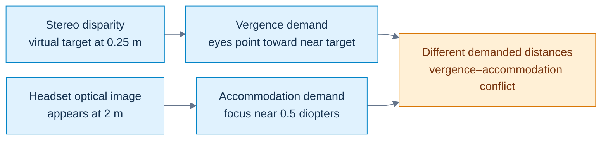

**Caption:** the two rows are simultaneous cues, not successive steps in a light ray. With the chapter's symmetric-eye model and $b=0.064\,\mathrm m$, the near target asks for about $14.59^\circ$ total convergence. A real target at that distance would have an approximate 4-diopter accommodation demand; the headset's 2-meter optical image instead asks for about 0.5 diopters. These are demands, not measurements of an observer's actual response or universal comfort limits. Increasing resolution does not directly reconcile them.

**Recall:** vergence changes pointing; accommodation changes focusing power. [[Visual Recall/XR - Light, Vision and Perception - Visual Recall#Figure-linked short notes|Brief and figure index]].

## Visibility is about contrast, conditions and tasks

“Can the user see it?” is not one question. The answer depends on what we ask the user to do.

[[Visual acuity and eccentricity|Visual acuity]] describes fine-detail performance under specified conditions. We should distinguish:

| Task | Question |
|---|---|
| Detection | Is something present? |
| Resolution | Can the separate features be distinguished? |
| Vernier alignment | Are two features slightly misaligned? |
| Recognition | Which letter or object is this? |

Vernier alignment is a form of hyperacuity. It can reveal small positional differences that a simple receptor-spacing argument misses.

Clinical 20/20 notation is not a universal pixel-resolution specification for the eye.

### Acuity changes with eccentricity

The **minimum angle of resolution**, or MAR, describes a resolvable angular feature under a chosen task.

A full grating cycle, one bar, and a letter gap are not the same feature. State the convention before converting MAR into cycles per degree.

A useful approximation is:

$$
\mathrm{MAR}(e)=\mathrm{MAR}_0+me.
$$

Here $e$ is eccentricity, $\mathrm{MAR}_0$ is the central value, and $m$ is a fitted slope. If the feature-size convention stays fixed, the corresponding frequency scale varies roughly as:

$$
f_{\max}(e)\propto\frac1{\mathrm{MAR}_0+me}.
$$

This model captures a useful trend: coarser detail can often be used farther from gaze. It does not describe every visual task.

Use consistent angular units, and fit the model for the intended conditions. Do not treat its slope as a universal property of every observer.

### Contrast describes a difference relative to its surroundings

[[Contrast sensitivity adaptation and masking|Contrast]] tells us how strongly one intensity differs from another.

For bright and dark grating bars, Michelson contrast is:

$$
C_M=\frac{L_{\max}-L_{\min}}{L_{\max}+L_{\min}}.
$$

The denominator must be positive. Bars with luminances of 120 and 40 nits give:

$$
C_M=\frac{120-40}{120+40}=0.5.
$$

For a target against a positive background, Weber contrast is:

$$
C_W=\frac{L_{\mathrm{target}}-L_{\mathrm{background}}}
{L_{\mathrm{background}}}.
$$

A target at 110 nits against a 100-nit background gives $C_W=0.1$.

These formulas describe different stimulus arrangements. Use the one that matches the experiment.

A **contrast sensitivity function**, or CSF, describes sensitivity to patterns at different frequencies and under different conditions. It is not generally flat.

An optical MTF asks how much contrast survives the optics. A visual CSF asks how sensitive the observer is to the received contrast. These describe different stages.

### Adaptation, masking, crowding, and attention

**Adaptation** changes sensitivity with illumination and viewing history. Photopic vision is broadly cone-dominated; scotopic vision is rod-dominated; mesopic vision lies between them. These are useful regimes, not sharp switches.

A **just-noticeable difference**, or JND, is tied to a chosen discrimination criterion. Over some operating ranges, Weber's law approximates that threshold with:

$$
\frac{\Delta I}{I}=k.
$$

$I$ is the baseline stimulus, $\Delta I$ the threshold change, and $k$ a fitted fraction. The relation is not valid for all intensities and tasks.

**Masking** changes a target's visibility because other structure is present. **Crowding** makes recognition harder because nearby features interfere. A peripheral letter that is easy to identify alone may be difficult to identify among other letters.

**Attention** concerns what the observer prioritizes. **Gaze** concerns where the eyes point. **Saliency** describes features that tend to attract attention. These concepts are related, but one cannot stand in for another.

Peripheral vision still supports motion, layout, recognition, and depth judgments. A blur level that is acceptable for one grating task may be unacceptable for a navigation or training task.

The teaching lesson is simple: **define the user's task before deciding what detail can be removed.**

## A gaze sample needs a time as well as a direction

A gaze tracker gives more than a location. It gives an observation made at some time and delivered later.

[[Eye movements and display-time gaze|Eye movements]] also differ:

- A fixation is a period of relatively stable gaze, not complete stillness.
- A saccade rapidly redirects gaze.
- A microsaccade is a small fixation-related movement.
- Smooth pursuit follows a moving target.
- The vestibulo-ocular reflex helps compensate for head motion.

These movements do not share one motion pattern.

Suppose gaze moves steadily at $20^\circ/\mathrm{s}$. Predicting 30 milliseconds ahead with a constant-velocity model gives:

$$
\Delta\theta
=(20^\circ/\mathrm{s})(0.030\,\mathrm{s})
=0.6^\circ.
$$

That can be useful if the motion stays steady. It can fail during a saccade, where acceleration and braking change rapidly.

**Saccadic suppression** changes visual sensitivity around rapid eye movements. It does not make arbitrary rendering errors invisible. A degraded frame may arrive after the suppression has weakened or after the eye has landed.

### Sampling rate is not latency

A 90 Hz gaze stream has nominal sample intervals of:

$$
T_s=\frac1{90}\,\mathrm{s}\approx11.11\,\mathrm{ms}.
$$

That interval does not tell us the age of the observation when it reaches the display.

Follow the timing chain: acquisition, timestamping, delivery, scheduling, rendering, scanout, then pixel response. The quality region should cover the gaze relevant at visible display time.

Evaluate prediction separately around fixation, pursuit, saccade onset, and gaze landing. A low mean error can hide occasional large errors at the moment they matter most.

### Screen motion is not always retinal motion

[[Spatiotemporal sampling and retinal motion|Retinal image velocity]] describes movement across the retina.

In a simplified common angular coordinate frame:

$$
\omega_{\mathrm{retinal}}
\approx\omega_{\mathrm{scene}}-\omega_{\mathrm{eye}}.
$$

During pursuit, the eye may follow a target closely enough that the target moves little on the retina, even while it moves across the screen.

Motion also turns spatial variation into temporal variation. For a grating moving at velocity $v$:

$$
I(x,t)=\cos\!\left(2\pi f_x(x-vt)\right).
$$

At a fixed coordinate, its temporal frequency is:

$$
f_t=|v|f_x.
$$

A pattern at 10 cycles per degree moving at 20 degrees per second produces 200 cycles per second of variation at that coordinate.

A 90 Hz frame sampler has a nominal Nyquist frequency of 45 Hz. This describes the samples, not a universal human flicker limit.

Display persistence, emission waveform, eye motion, luminance, and contrast also affect what is seen. A screenshot cannot capture all of those effects.

## Sampling is a question of what remains distinguishable

[[Continuous signals and discrete samples|A signal]] is a function describing variation over a domain.

An image $I(x,y)$ varies across position. A gaze trace $\mathbf g(t)$ varies over time. Both can be analyzed as signals, but their units and filtering requirements differ.

**Sampling** chooses locations at which values are recorded. **Quantization** restricts the values we can store. The earlier [[Quantization and compressed weights]] notes develop that second process.

For uniform time sampling:

$$
x[n]=x(nT_s),\qquad f_s=\frac1{T_s}.
$$

$T_s$ is the sample interval, $f_s$ the sampling frequency, and $n$ an integer sample index.

More color bits cannot recover spatial observations that were never taken. More pixels do not automatically fix coarse amplitude quantization.

For nearest uniform quantization with step $\Delta$, and no clipping:

$$
|e_q|\leq\frac{\Delta}{2}.
$$

Under an additional uniform-error and weak-correlation assumption:

$$
\operatorname{Var}(e_q)=\frac{\Delta^2}{12}.
$$

That statistical model is not exact for every image. Smooth gradients can produce structured banding. Dithering can make the error less coherent, but it does not restore missing original information.

### Two different signals can give identical samples

Sample a cosine at rate $f_s$:

$$
x[n]=\cos\left(2\pi\frac{f_0}{f_s}n\right).
$$

Now replace its frequency $f_0$ with $f_0+mf_s$, where $m$ is an integer:

$$
x_m[n]
=\cos\left(2\pi\frac{f_0}{f_s}n+2\pi mn\right).
$$

For integer $m$ and $n$, the extra phase is a whole number of cycles. It changes no sample.

This is [[Sampling aliasing and reconstruction|aliasing]]: different original signals become indistinguishable after sampling.

%22%20viewBox%3D%220%200%20350%20165%22%20width%3D%22100%25%22%20xmlns%3D%22http%3A%2F%2Fwww.w3.org%2F2000%2Fsvg%22%3E%3Cline%20x1%3D%2220%22%20x2%3D%22338%22%20y1%3D%2282%22%20y2%3D%2282%22%20stroke%3D%22currentColor%22%20stroke-opacity%3D%22.3%22%2F%3E%3Cline%20x1%3D%2220%22%20y1%3D%2237%22%20x2%3D%2220.79%22%20y2%3D%2237.93497352202054%22%20stroke%3D%22%23C88445%22%20stroke-width%3D%221%22%20opacity%3D%22.72%22%2F%3E%3Cline%20x1%3D%2220%22%20y1%3D%2237%22%20x2%3D%2220.79%22%20y2%3D%2237.04995562671135%22%20stroke%3D%22%234F9F96%22%20stroke-width%3D%221.5%22%20opacity%3D%22.85%22%2F%3E%3Cline%20x1%3D%2220.79%22%20y1%3D%2237.93497352202054%22%20x2%3D%2221.58%22%20y2%3D%2240.701041844220846%22%20stroke%3D%22%23C88445%22%20stroke-width%3D%221%22%20opacity%3D%22.72%22%2F%3E%3Cline%20x1%3D%2220.79%22%20y1%3D%2237.04995562671135%22%20x2%3D%2221.58%22%20y2%3D%2237.1997115928614%22%20stroke%3D%22%234F9F96%22%20stroke-width%3D%221.5%22%20opacity%3D%22.85%22%2F%3E%3Cline%20x1%3D%2221.58%22%20y1%3D%2240.701041844220846%22%20x2%3D%2222.37%22%20y2%3D%2245.183262715873944%22%20stroke%3D%22%23C88445%22%20stroke-width%3D%221%22%20opacity%3D%22.72%22%2F%3E%3Cline%20x1%3D%2221.58%22%20y1%3D%2237.1997115928614%22%20x2%3D%2222.37%22%20y2%3D%2237.44893540275491%22%20stroke%3D%22%234F9F96%22%20stroke-width%3D%221.5%22%20opacity%3D%22.85%22%2F%3E%3Cline%20x1%3D%2222.37%22%20y1%3D%2245.183262715873944%22%20x2%3D%2223.16%22%20y2%3D%2251.19538023320901%22%20stroke%3D%22%23C88445%22%20stroke-width%3D%221%22%20opacity%3D%22.72%22%2F%3E%3Cline%20x1%3D%2222.37%22%20y1%3D%2237.44893540275491%22%20x2%3D%2223.16%22%20y2%3D%2237.79707371720901%22%20stroke%3D%22%234F9F96%22%20stroke-width%3D%221.5%22%20opacity%3D%22.85%22%2F%3E%3Cline%20x1%3D%2223.16%22%20y1%3D%2251.19538023320901%22%20x2%3D%2223.95%22%20y2%3D%2258.4875645877823%22%20stroke%3D%22%23C88445%22%20stroke-width%3D%221%22%20opacity%3D%22.72%22%2F%3E%3Cline%20x1%3D%2223.16%22%20y1%3D%2237.79707371720901%22%20x2%3D%2223.95%22%20y2%3D%2238.243353582104554%22%20stroke%3D%22%234F9F96%22%20stroke-width%3D%221.5%22%20opacity%3D%22.85%22%2F%3E%3Cline%20x1%3D%2223.95%22%20y1%3D%2258.4875645877823%22%20x2%3D%2224.740000000000002%22%20y2%3D%2266.7567935889619%22%20stroke%3D%22%23C88445%22%20stroke-width%3D%221%22%20opacity%3D%22.72%22%2F%3E%3Cline%20x1%3D%2223.95%22%20y1%3D%2238.243353582104554%22%20x2%3D%2224.740000000000002%22%20y2%3D%2238.78678414453756%22%20stroke%3D%22%234F9F96%22%20stroke-width%3D%221.5%22%20opacity%3D%22.85%22%2F%3E%3Cline%20x1%3D%2224.740000000000002%22%20y1%3D%2266.7567935889619%22%20x2%3D%2225.53%22%20y2%3D%2275.6594445628088%22%20stroke%3D%22%23C88445%22%20stroke-width%3D%221%22%20opacity%3D%22.72%22%2F%3E%3Cline%20x1%3D%2224.740000000000002%22%20y1%3D%2238.78678414453756%22%20x2%3D%2225.53%22%20y2%3D%2239.42615885276046%22%20stroke%3D%22%234F9F96%22%20stroke-width%3D%221.5%22%20opacity%3D%22.85%22%2F%3E%3Cline%20x1%3D%2225.53%22%20y1%3D%2275.6594445628088%22%20x2%3D%2226.32%22%20y2%3D%2284.8255733788191%22%20stroke%3D%22%23C88445%22%20stroke-width%3D%221%22%20opacity%3D%22.72%22%2F%3E%3Cline%20x1%3D%2225.53%22%20y1%3D%2239.42615885276046%22%20x2%3D%2226.32%22%20y2%3D%2240.160058135028684%22%20stroke%3D%22%234F9F96%22%20stroke-width%3D%221.5%22%20opacity%3D%22.85%22%2F%3E%3Cline%20x1%3D%2226.32%22%20y1%3D%2284.8255733788191%22%20x2%3D%2227.11%22%20y2%3D%2293.87428724844177%22%20stroke%3D%22%23C88445%22%20stroke-width%3D%221%22%20opacity%3D%22.72%22%2F%3E%3Cline%20x1%3D%2226.32%22%20y1%3D%2240.160058135028684%22%20x2%3D%2227.11%22%20y2%3D%2240.986852551404965%22%20stroke%3D%22%234F9F96%22%20stroke-width%3D%221.5%22%20opacity%3D%22.85%22%2F%3E%3Cline%20x1%3D%2227.11%22%20y1%3D%2293.87428724844177%22%20x2%3D%2227.9%22%20y2%3D%22102.4295724882796%22%20stroke%3D%22%23C88445%22%20stroke-width%3D%221%22%20opacity%3D%22.72%22%2F%3E%3Cline%20x1%3D%2227.11%22%20y1%3D%2240.986852551404965%22%20x2%3D%2227.9%22%20y2%3D%2241.90470641152344%22%20stroke%3D%22%234F9F96%22%20stroke-width%3D%221.5%22%20opacity%3D%22.85%22%2F%3E%3Cline%20x1%3D%2227.9%22%20y1%3D%22102.4295724882796%22%20x2%3D%2228.69%22%20y2%3D%22110.13591953510674%22%20stroke%3D%22%23C88445%22%20stroke-width%3D%221%22%20opacity%3D%22.72%22%2F%3E%3Cline%20x1%3D%2227.9%22%20y1%3D%2241.90470641152344%22%20x2%3D%2228.69%22%20y2%3D%2242.911581850281394%22%20stroke%3D%22%234F9F96%22%20stroke-width%3D%221.5%22%20opacity%3D%22.85%22%2F%3E%3Cline%20x1%3D%2228.69%22%20y1%3D%22110.13591953510674%22%20x2%3D%2229.48%22%20y2%3D%22116.67309592491051%22%20stroke%3D%22%23C88445%22%20stroke-width%3D%221%22%20opacity%3D%22.72%22%2F%3E%3Cline%20x1%3D%2228.69%22%20y1%3D%2242.911581850281394%22%20x2%3D%2229.48%22%20y2%3D%2244.00524335240932%22%20stroke%3D%22%234F9F96%22%20stroke-width%3D%221.5%22%20opacity%3D%22.85%22%2F%3E%3Cline%20x1%3D%2229.48%22%20y1%3D%22116.67309592491051%22%20x2%3D%2230.27%22%20y2%3D%22121.7694533539912%22%20stroke%3D%22%23C88445%22%20stroke-width%3D%221%22%20opacity%3D%22.72%22%2F%3E%3Cline%20x1%3D%2229.48%22%20y1%3D%2244.00524335240932%22%20x2%3D%2230.27%22%20y2%3D%2245.183262715873944%22%20stroke%3D%22%234F9F96%22%20stroke-width%3D%221.5%22%20opacity%3D%22.85%22%2F%3E%3Cline%20x1%3D%2230.27%22%20y1%3D%22121.7694533539912%22%20x2%3D%2231.060000000000002%22%20y2%3D%22125.21321585546245%22%20stroke%3D%22%23C88445%22%20stroke-width%3D%221%22%20opacity%3D%22.72%22%2F%3E%3Cline%20x1%3D%2230.27%22%20y1%3D%2245.183262715873944%22%20x2%3D%2231.060000000000002%22%20y2%3D%2246.44302444309394%22%20stroke%3D%22%234F9F96%22%20stroke-width%3D%221.5%22%20opacity%3D%22.85%22%2F%3E%3Cline%20x1%3D%2231.060000000000002%22%20y1%3D%22125.21321585546245%22%20x2%3D%2231.85%22%20y2%3D%22126.86128001799077%22%20stroke%3D%22%23C88445%22%20stroke-width%3D%221%22%20opacity%3D%22.72%22%2F%3E%3Cline%20x1%3D%2231.060000000000002%22%20y1%3D%2246.44302444309394%22%20x2%3D%2231.85%22%20y2%3D%2247.78173154799861%22%20stroke%3D%22%234F9F96%22%20stroke-width%3D%221.5%22%20opacity%3D%22.85%22%2F%3E%3Cline%20x1%3D%2231.85%22%20y1%3D%22126.86128001799077%22%20x2%3D%2232.64%22%20y2%3D%22126.6451615591515%22%20stroke%3D%22%23C88445%22%20stroke-width%3D%221%22%20opacity%3D%22.72%22%2F%3E%3Cline%20x1%3D%2231.85%22%20y1%3D%2247.78173154799861%22%20x2%3D%2232.64%22%20y2%3D%2249.19641176603648%22%20stroke%3D%22%234F9F96%22%20stroke-width%3D%221.5%22%20opacity%3D%22.85%22%2F%3E%3Cline%20x1%3D%2232.64%22%20y1%3D%22126.6451615591515%22%20x2%3D%2233.43%22%20y2%3D%22124.57384114723953%22%20stroke%3D%22%23C88445%22%20stroke-width%3D%221%22%20opacity%3D%22.72%22%2F%3E%3Cline%20x1%3D%2232.64%22%20y1%3D%2249.19641176603648%22%20x2%3D%2233.43%22%20y2%3D%2250.683924153345856%22%20stroke%3D%22%234F9F96%22%20stroke-width%3D%221.5%22%20opacity%3D%22.85%22%2F%3E%3Cline%20x1%3D%2233.43%22%20y1%3D%22124.57384114723953%22%20x2%3D%2234.22%22%20y2%3D%22120.73339121517746%22%20stroke%3D%22%23C88445%22%20stroke-width%3D%221%22%20opacity%3D%22.72%22%2F%3E%3Cline%20x1%3D%2233.43%22%20y1%3D%2250.683924153345856%22%20x2%3D%2234.22%22%20y2%3D%2252.24096606043567%22%20stroke%3D%22%234F9F96%22%20stroke-width%3D%221.5%22%20opacity%3D%22.85%22%2F%3E%3Cline%20x1%3D%2234.22%22%20y1%3D%22120.73339121517746%22%20x2%3D%2235.010000000000005%22%20y2%3D%22115.28339927403744%22%20stroke%3D%22%23C88445%22%20stroke-width%3D%221%22%20opacity%3D%22.72%22%2F%3E%3Cline%20x1%3D%2234.22%22%20y1%3D%2252.24096606043567%22%20x2%3D%2235.010000000000005%22%20y2%3D%2253.86408046489326%22%20stroke%3D%22%234F9F96%22%20stroke-width%3D%221.5%22%20opacity%3D%22.85%22%2F%3E%3Cline%20x1%3D%2235.010000000000005%22%20y1%3D%22115.28339927403744%22%20x2%3D%2235.8%22%20y2%3D%22108.4503363531613%22%20stroke%3D%22%23C88445%22%20stroke-width%3D%221%22%20opacity%3D%22.72%22%2F%3E%3Cline%20x1%3D%2235.010000000000005%22%20y1%3D%2253.86408046489326%22%20x2%3D%2235.8%22%20y2%3D%2255.5496636468387%22%20stroke%3D%22%234F9F96%22%20stroke-width%3D%221.5%22%20opacity%3D%22.85%22%2F%3E%3Cline%20x1%3D%2235.8%22%20y1%3D%22108.4503363531613%22%20x2%3D%2236.59%22%20y2%3D%22100.51814613722988%22%20stroke%3D%22%23C88445%22%20stroke-width%3D%221%22%20opacity%3D%22.72%22%2F%3E%3Cline%20x1%3D%2235.8%22%20y1%3D%2255.5496636468387%22%20x2%3D%2236.59%22%20y2%3D%2257.293973190084074%22%20stroke%3D%22%234F9F96%22%20stroke-width%3D%221.5%22%20opacity%3D%22.85%22%2F%3E%3Cline%20x1%3D%2236.59%22%20y1%3D%22100.51814613722988%22%20x2%3D%2237.38%22%20y2%3D%2291.8164458628444%22%20stroke%3D%22%23C88445%22%20stroke-width%3D%221%22%20opacity%3D%22.72%22%2F%3E%3Cline%20x1%3D%2236.59%22%20y1%3D%2257.293973190084074%22%20x2%3D%2237.38%22%20y2%3D%2259.09313629123329%22%20stroke%3D%22%234F9F96%22%20stroke-width%3D%221.5%22%20opacity%3D%22.85%22%2F%3E%3Cline%20x1%3D%2237.38%22%20y1%3D%2291.8164458628444%22%20x2%3D%2238.17%22%20y2%3D%2282.7068292790319%22%20stroke%3D%22%23C88445%22%20stroke-width%3D%221%22%20opacity%3D%22.72%22%2F%3E%3Cline%20x1%3D%2237.38%22%20y1%3D%2259.09313629123329%22%20x2%3D%2238.17%22%20y2%3D%2260.943158358274204%22%20stroke%3D%22%234F9F96%22%20stroke-width%3D%221.5%22%20opacity%3D%22.85%22%2F%3E%3Cline%20x1%3D%2238.17%22%20y1%3D%2282.7068292790319%22%20x2%3D%2238.96%22%20y2%3D%2273.56784084364237%22%20stroke%3D%22%23C88445%22%20stroke-width%3D%221%22%20opacity%3D%22.72%22%2F%3E%3Cline%20x1%3D%2238.17%22%20y1%3D%2260.943158358274204%22%20x2%3D%2238.96%22%20y2%3D%2262.83993187957173%22%20stroke%3D%22%234F9F96%22%20stroke-width%3D%221.5%22%20opacity%3D%22.85%22%2F%3E%3Cline%20x1%3D%2238.96%22%20y1%3D%2273.56784084364237%22%20x2%3D%2239.75%22%20y2%3D%2264.77924554357095%22%20stroke%3D%22%23C88445%22%20stroke-width%3D%221%22%20opacity%3D%22.72%22%2F%3E%3Cline%20x1%3D%2238.96%22%20y1%3D%2262.83993187957173%22%20x2%3D%2239.75%22%20y2%3D%2264.77924554357097%22%20stroke%3D%22%234F9F96%22%20stroke-width%3D%221.5%22%20opacity%3D%22.85%22%2F%3E%3Cline%20x1%3D%2239.75%22%20y1%3D%2264.77924554357095%22%20x2%3D%2240.54%22%20y2%3D%2256.70624799665413%22%20stroke%3D%22%23C88445%22%20stroke-width%3D%221%22%20opacity%3D%22.72%22%2F%3E%3Cline%20x1%3D%2239.75%22%20y1%3D%2264.77924554357097%22%20x2%3D%2240.54%22%20y2%3D%2266.75679358896188%22%20stroke%3D%22%234F9F96%22%20stroke-width%3D%221.5%22%20opacity%3D%22.85%22%2F%3E%3Cline%20x1%3D%2240.54%22%20y1%3D%2256.70624799665413%22%20x2%3D%2241.33%22%20y2%3D%2249.684316600656516%22%20stroke%3D%22%23C88445%22%20stroke-width%3D%221%22%20opacity%3D%22.72%22%2F%3E%3Cline%20x1%3D%2240.54%22%20y1%3D%2266.75679358896188%22%20x2%3D%2241.33%22%20y2%3D%2268.76818536454631%22%20stroke%3D%22%234F9F96%22%20stroke-width%3D%221.5%22%20opacity%3D%22.85%22%2F%3E%3Cline%20x1%3D%2241.33%22%20y1%3D%2249.684316600656516%22%20x2%3D%2242.120000000000005%22%20y2%3D%2244.005243352409295%22%20stroke%3D%22%23C88445%22%20stroke-width%3D%221%22%20opacity%3D%22.72%22%2F%3E%3Cline%20x1%3D%2241.33%22%20y1%3D%2268.76818536454631%22%20x2%3D%2242.120000000000005%22%20y2%3D%2270.80895507758154%22%20stroke%3D%22%234F9F96%22%20stroke-width%3D%221.5%22%20opacity%3D%22.85%22%2F%3E%3Cline%20x1%3D%2242.120000000000005%22%20y1%3D%2244.005243352409295%22%20x2%3D%2242.91%22%20y2%3D%2239.90501861265596%22%20stroke%3D%22%23C88445%22%20stroke-width%3D%221%22%20opacity%3D%22.72%22%2F%3E%3Cline%20x1%3D%2242.120000000000005%22%20y1%3D%2270.80895507758154%22%20x2%3D%2242.91%22%20y2%3D%2272.87457170895692%22%20stroke%3D%22%234F9F96%22%20stroke-width%3D%221.5%22%20opacity%3D%22.85%22%2F%3E%3Cline%20x1%3D%2242.91%22%20y1%3D%2239.90501861265596%22%20x2%3D%2243.7%22%20y2%3D%2237.5540246732188%22%20stroke%3D%22%23C88445%22%20stroke-width%3D%221%22%20opacity%3D%22.72%22%2F%3E%3Cline%20x1%3D%2242.91%22%20y1%3D%2272.87457170895692%22%20x2%3D%2243.7%22%20y2%3D%2274.96044907318961%22%20stroke%3D%22%234F9F96%22%20stroke-width%3D%221.5%22%20opacity%3D%22.85%22%2F%3E%3Cline%20x1%3D%2243.7%22%20y1%3D%2237.5540246732188%22%20x2%3D%2244.49%22%20y2%3D%2237.04995562671135%22%20stroke%3D%22%23C88445%22%20stroke-width%3D%221%22%20opacity%3D%22.72%22%2F%3E%3Cline%20x1%3D%2243.7%22%20y1%3D%2274.96044907318961%22%20x2%3D%2244.49%22%20y2%3D%2277.06195600090295%22%20stroke%3D%22%234F9F96%22%20stroke-width%3D%221.5%22%20opacity%3D%22.85%22%2F%3E%3Cline%20x1%3D%2244.49%22%20y1%3D%2237.04995562671135%22%20x2%3D%2245.28%22%20y2%3D%2238.4137577492116%22%20stroke%3D%22%23C88445%22%20stroke-width%3D%221%22%20opacity%3D%22.72%22%2F%3E%3Cline%20x1%3D%2244.49%22%20y1%3D%2277.06195600090295%22%20x2%3D%2245.28%22%20y2%3D%2279.17442662118088%22%20stroke%3D%22%234F9F96%22%20stroke-width%3D%221.5%22%20opacity%3D%22.85%22%2F%3E%3Cline%20x1%3D%2245.28%22%20y1%3D%2238.4137577492116%22%20x2%3D%2246.07%22%20y2%3D%2241.58875909077229%22%20stroke%3D%22%23C88445%22%20stroke-width%3D%221%22%20opacity%3D%22.72%22%2F%3E%3Cline%20x1%3D%2245.28%22%20y1%3D%2279.17442662118088%22%20x2%3D%2246.07%22%20y2%3D%2281.29317072096806%22%20stroke%3D%22%234F9F96%22%20stroke-width%3D%221.5%22%20opacity%3D%22.85%22%2F%3E%3Cline%20x1%3D%2246.07%22%20y1%3D%2241.58875909077229%22%20x2%3D%2246.86%22%20y2%3D%2246.44302444309395%22%20stroke%3D%22%23C88445%22%20stroke-width%3D%221%22%20opacity%3D%22.72%22%2F%3E%3Cline%20x1%3D%2246.07%22%20y1%3D%2281.29317072096806%22%20x2%3D%2246.86%22%20y2%3D%2283.41348415851577%22%20stroke%3D%22%234F9F96%22%20stroke-width%3D%221.5%22%20opacity%3D%22.85%22%2F%3E%3Cline%20x1%3D%2246.86%22%20y1%3D%2246.44302444309395%22%20x2%3D%2247.650000000000006%22%20y2%3D%2252.774837825141745%22%20stroke%3D%22%23C88445%22%20stroke-width%3D%221%22%20opacity%3D%22.72%22%2F%3E%3Cline%20x1%3D%2246.86%22%20y1%3D%2283.41348415851577%22%20x2%3D%2247.650000000000006%22%20y2%3D%2285.53065930775301%22%20stroke%3D%22%234F9F96%22%20stroke-width%3D%221.5%22%20opacity%3D%22.85%22%2F%3E%3Cline%20x1%3D%2247.650000000000006%22%20y1%3D%2252.774837825141745%22%20x2%3D%2248.44%22%20y2%3D%2260.32108466542281%22%20stroke%3D%22%23C88445%22%20stroke-width%3D%221%22%20opacity%3D%22.72%22%2F%3E%3Cline%20x1%3D%2247.650000000000006%22%20y1%3D%2285.53065930775301%22%20x2%3D%2248.44%22%20y2%3D%2287.63999551039369%22%20stroke%3D%22%234F9F96%22%20stroke-width%3D%221.5%22%20opacity%3D%22.85%22%2F%3E%3Cline%20x1%3D%2248.44%22%20y1%3D%2260.32108466542281%22%20x2%3D%2249.230000000000004%22%20y2%3D%2268.76818536454634%22%20stroke%3D%22%23C88445%22%20stroke-width%3D%221%22%20opacity%3D%22.72%22%2F%3E%3Cline%20x1%3D%2248.44%22%20y1%3D%2287.63999551039369%22%20x2%3D%2249.230000000000004%22%20y2%3D%2289.73680951257343%22%20stroke%3D%22%234F9F96%22%20stroke-width%3D%221.5%22%20opacity%3D%22.85%22%2F%3E%3Cline%20x1%3D%2249.230000000000004%22%20y1%3D%2268.76818536454634%22%20x2%3D%2250.02%22%20y2%3D%2277.76512590066686%22%20stroke%3D%22%23C88445%22%20stroke-width%3D%221%22%20opacity%3D%22.72%22%2F%3E%3Cline%20x1%3D%2249.230000000000004%22%20y1%3D%2289.73680951257343%22%20x2%3D%2250.02%22%20y2%3D%2291.8164458628444%22%20stroke%3D%22%234F9F96%22%20stroke-width%3D%221.5%22%20opacity%3D%22.85%22%2F%3E%3Cline%20x1%3D%2250.02%22%20y1%3D%2277.76512590066686%22%20x2%3D%2250.81%22%20y2%3D%2286.93804399909708%22%20stroke%3D%22%23C88445%22%20stroke-width%3D%221%22%20opacity%3D%22.72%22%2F%3E%3Cline%20x1%3D%2250.02%22%20y1%3D%2291.8164458628444%22%20x2%3D%2250.81%22%20y2%3D%2293.87428724844177%22%20stroke%3D%22%234F9F96%22%20stroke-width%3D%221.5%22%20opacity%3D%22.85%22%2F%3E%3Cline%20x1%3D%2250.81%22%20y1%3D%2286.93804399909708%22%20x2%3D%2251.6%22%20y2%3D%2295.90576474687262%22%20stroke%3D%22%23C88445%22%20stroke-width%3D%221%22%20opacity%3D%22.72%22%2F%3E%3Cline%20x1%3D%2250.81%22%20y1%3D%2293.87428724844177%22%20x2%3D%2251.6%22%20y2%3D%2295.90576474687262%22%20stroke%3D%22%234F9F96%22%20stroke-width%3D%221.5%22%20opacity%3D%22.85%22%2F%3E%3Cline%20x1%3D%2251.6%22%20y1%3D%2295.90576474687262%22%20x2%3D%2252.39%22%20y2%3D%22104.29564007945831%22%20stroke%3D%22%23C88445%22%20stroke-width%3D%221%22%20opacity%3D%22.72%22%2F%3E%3Cline%20x1%3D%2251.6%22%20y1%3D%2295.90576474687262%22%20x2%3D%2252.39%22%20y2%3D%2297.90636797006657%22%20stroke%3D%22%234F9F96%22%20stroke-width%3D%221.5%22%20opacity%3D%22.85%22%2F%3E%3Cline%20x1%3D%2252.39%22%20y1%3D%22104.29564007945831%22%20x2%3D%2253.18%22%20y2%3D%22111.75903393956438%22%20stroke%3D%22%23C88445%22%20stroke-width%3D%221%22%20opacity%3D%22.72%22%2F%3E%3Cline%20x1%3D%2252.39%22%20y1%3D%2297.90636797006657%22%20x2%3D%2253.18%22%20y2%3D%2299.87165507856513%22%20stroke%3D%22%234F9F96%22%20stroke-width%3D%221.5%22%20opacity%3D%22.85%22%2F%3E%3Cline%20x1%3D%2253.18%22%20y1%3D%22111.75903393956438%22%20x2%3D%2253.97%22%20y2%3D%22117.9858096319191%22%20stroke%3D%22%23C88445%22%20stroke-width%3D%221%22%20opacity%3D%22.72%22%2F%3E%3Cline%20x1%3D%2253.18%22%20y1%3D%2299.87165507856513%22%20x2%3D%2253.97%22%20y2%3D%22101.79726264351618%22%20stroke%3D%22%234F9F96%22%20stroke-width%3D%221.5%22%20opacity%3D%22.85%22%2F%3E%3Cline%20x1%3D%2253.97%22%20y1%3D%22117.9858096319191%22%20x2%3D%2254.760000000000005%22%20y2%3D%22122.71721736097089%22%20stroke%3D%22%23C88445%22%20stroke-width%3D%221%22%20opacity%3D%22.72%22%2F%3E%3Cline%20x1%3D%2253.97%22%20y1%3D%22101.79726264351618%22%20x2%3D%2254.760000000000005%22%20y2%3D%22103.6789153345772%22%20stroke%3D%22%234F9F96%22%20stroke-width%3D%221.5%22%20opacity%3D%22.85%22%2F%3E%3Cline%20x1%3D%2254.760000000000005%22%20y1%3D%22122.71721736097089%22%20x2%3D%2255.550000000000004%22%20y2%3D%22125.75664641789545%22%20stroke%3D%22%23C88445%22%20stroke-width%3D%221%22%20opacity%3D%22.72%22%2F%3E%3Cline%20x1%3D%2254.760000000000005%22%20y1%3D%22103.6789153345772%22%20x2%3D%2255.550000000000004%22%20y2%3D%22105.5124354122177%22%20stroke%3D%22%234F9F96%22%20stroke-width%3D%221.5%22%20opacity%3D%22.85%22%2F%3E%3Cline%20x1%3D%2255.550000000000004%22%20y1%3D%22125.75664641789545%22%20x2%3D%2256.34%22%20y2%3D%22126.97779521645792%22%20stroke%3D%22%23C88445%22%20stroke-width%3D%221%22%20opacity%3D%22.72%22%2F%3E%3Cline%20x1%3D%2255.550000000000004%22%20y1%3D%22105.5124354122177%22%20x2%3D%2256.34%22%20y2%3D%22107.29375200334587%22%20stroke%3D%22%234F9F96%22%20stroke-width%3D%221.5%22%20opacity%3D%22.85%22%2F%3E%3Cline%20x1%3D%2256.34%22%20y1%3D%22126.97779521645792%22%20x2%3D%2257.13%22%20y2%3D%22126.3299196769648%22%20stroke%3D%22%23C88445%22%20stroke-width%3D%221%22%20opacity%3D%22.72%22%2F%3E%3Cline%20x1%3D%2256.34%22%20y1%3D%22107.29375200334587%22%20x2%3D%2257.13%22%20y2%3D%22109.01891013966477%22%20stroke%3D%22%234F9F96%22%20stroke-width%3D%221.5%22%20opacity%3D%22.85%22%2F%3E%3Cline%20x1%3D%2257.13%22%20y1%3D%22126.3299196769648%22%20x2%3D%2257.92%22%20y2%3D%22123.8399418649713%22%20stroke%3D%22%23C88445%22%20stroke-width%3D%221%22%20opacity%3D%22.72%22%2F%3E%3Cline%20x1%3D%2257.13%22%20y1%3D%22109.01891013966477%22%20x2%3D%2257.92%22%20y2%3D%22110.68407953869104%22%20stroke%3D%22%234F9F96%22%20stroke-width%3D%221.5%22%20opacity%3D%22.85%22%2F%3E%3Cline%20x1%3D%2257.92%22%20y1%3D%22123.8399418649713%22%20x2%3D%2258.71%22%20y2%3D%22119.61133126157213%22%20stroke%3D%22%23C88445%22%20stroke-width%3D%221%22%20opacity%3D%22.72%22%2F%3E%3Cline%20x1%3D%2257.92%22%20y1%3D%22110.68407953869104%22%20x2%3D%2258.71%22%20y2%3D%22112.28556310793981%22%20stroke%3D%22%234F9F96%22%20stroke-width%3D%221.5%22%20opacity%3D%22.85%22%2F%3E%3Cline%20x1%3D%2258.71%22%20y1%3D%22119.61133126157213%22%20x2%3D%2259.5%22%20y2%3D%22113.81980515339463%22%20stroke%3D%22%23C88445%22%20stroke-width%3D%221%22%20opacity%3D%22.72%22%2F%3E%3Cline%20x1%3D%2258.71%22%20y1%3D%22112.28556310793981%22%20x2%3D%2259.5%22%20y2%3D%22113.81980515339464%22%20stroke%3D%22%234F9F96%22%20stroke-width%3D%221.5%22%20opacity%3D%22.85%22%2F%3E%3Cline%20x1%3D%2259.5%22%20y1%3D%22113.81980515339463%22%20x2%3D%2260.29%22%20y2%3D%22106.70602680991585%22%20stroke%3D%22%23C88445%22%20stroke-width%3D%221%22%20opacity%3D%22.72%22%2F%3E%3Cline%20x1%3D%2259.5%22%20y1%3D%22113.81980515339464%22%20x2%3D%2260.29%22%20y2%3D%22115.28339927403744%22%20stroke%3D%22%234F9F96%22%20stroke-width%3D%221.5%22%20opacity%3D%22.85%22%2F%3E%3Cline%20x1%3D%2260.29%22%20y1%3D%22106.70602680991585%22%20x2%3D%2261.08%22%20y2%3D%2298.56560487081052%22%20stroke%3D%22%23C88445%22%20stroke-width%3D%221%22%20opacity%3D%22.72%22%2F%3E%3Cline%20x1%3D%2260.29%22%20y1%3D%22115.28339927403744%22%20x2%3D%2261.08%22%20y2%3D%22116.67309592491051%22%20stroke%3D%22%234F9F96%22%20stroke-width%3D%221.5%22%20opacity%3D%22.85%22%2F%3E%3Cline%20x1%3D%2261.08%22%20y1%3D%2298.56560487081052%22%20x2%3D%2261.870000000000005%22%20y2%3D%2289.73680951257336%22%20stroke%3D%22%23C88445%22%20stroke-width%3D%221%22%20opacity%3D%22.72%22%2F%3E%3Cline%20x1%3D%2261.08%22%20y1%3D%22116.67309592491051%22%20x2%3D%2261.870000000000005%22%20y2%3D%22117.98580963191907%22%20stroke%3D%22%234F9F96%22%20stroke-width%3D%221.5%22%20opacity%3D%22.85%22%2F%3E%3Cline%20x1%3D%2261.870000000000005%22%20y1%3D%2289.73680951257336%22%20x2%3D%2262.660000000000004%22%20y2%3D%2280.58651584148426%22%20stroke%3D%22%23C88445%22%20stroke-width%3D%221%22%20opacity%3D%22.72%22%2F%3E%3Cline%20x1%3D%2261.870000000000005%22%20y1%3D%22117.98580963191907%22%20x2%3D%2262.660000000000004%22%20y2%3D%22119.21862584235528%22%20stroke%3D%22%234F9F96%22%20stroke-width%3D%221.5%22%20opacity%3D%22.85%22%2F%3E%3Cline%20x1%3D%2262.660000000000004%22%20y1%3D%2280.58651584148426%22%20x2%3D%2263.45%22%20y2%3D%2271.49495862648422%22%20stroke%3D%22%23C88445%22%20stroke-width%3D%221%22%20opacity%3D%22.72%22%2F%3E%3Cline%20x1%3D%2262.660000000000004%22%20y1%3D%22119.21862584235528%22%20x2%3D%2263.45%22%20y2%3D%22120.36880739593414%22%20stroke%3D%22%234F9F96%22%20stroke-width%3D%221.5%22%20opacity%3D%22.85%22%2F%3E%3Cline%20x1%3D%2263.45%22%20y1%3D%2271.49495862648422%22%20x2%3D%2264.24000000000001%22%20y2%3D%2262.83993187957164%22%20stroke%3D%22%23C88445%22%20stroke-width%3D%221%22%20opacity%3D%22.72%22%2F%3E%3Cline%20x1%3D%2263.45%22%20y1%3D%22120.36880739593414%22%20x2%3D%2264.24000000000001%22%20y2%3D%22121.43380060197387%22%20stroke%3D%22%234F9F96%22%20stroke-width%3D%221.5%22%20opacity%3D%22.85%22%2F%3E%3Cline%20x1%3D%2264.24000000000001%22%20y1%3D%2262.83993187957164%22%20x2%3D%2265.03%22%20y2%3D%2254.9810898603352%22%20stroke%3D%22%23C88445%22%20stroke-width%3D%221%22%20opacity%3D%22.72%22%2F%3E%3Cline%20x1%3D%2264.24000000000001%22%20y1%3D%22121.43380060197387%22%20x2%3D%2265.03%22%20y2%3D%22122.4112409092277%22%20stroke%3D%22%234F9F96%22%20stroke-width%3D%221.5%22%20opacity%3D%22.85%22%2F%3E%3Cline%20x1%3D%2265.03%22%20y1%3D%2254.9810898603352%22%20x2%3D%2265.82%22%20y2%3D%2248.245001866629266%22%20stroke%3D%22%23C88445%22%20stroke-width%3D%221%22%20opacity%3D%22.72%22%2F%3E%3Cline%20x1%3D%2265.03%22%20y1%3D%22122.4112409092277%22%20x2%3D%2265.82%22%20y2%3D%22123.29895815577913%22%20stroke%3D%22%234F9F96%22%20stroke-width%3D%221.5%22%20opacity%3D%22.85%22%2F%3E%3Cline%20x1%3D%2265.82%22%20y1%3D%2248.245001866629266%22%20x2%3D%2266.61%22%20y2%3D%2242.911581850281394%22%20stroke%3D%22%23C88445%22%20stroke-width%3D%221%22%20opacity%3D%22.72%22%2F%3E%3Cline%20x1%3D%2265.82%22%20y1%3D%22123.29895815577913%22%20x2%3D%2266.61%22%20y2%3D%22124.09498138734403%22%20stroke%3D%22%234F9F96%22%20stroke-width%3D%221.5%22%20opacity%3D%22.85%22%2F%3E%3Cline%20x1%3D%2266.61%22%20y1%3D%2242.911581850281394%22%20x2%3D%2267.4%22%20y2%3D%2239.20245676671807%22%20stroke%3D%22%23C88445%22%20stroke-width%3D%221%22%20opacity%3D%22.72%22%2F%3E%3Cline%20x1%3D%2266.61%22%20y1%3D%22124.09498138734403%22%20x2%3D%2267.4%22%20y2%3D%22124.79754323328191%22%20stroke%3D%22%234F9F96%22%20stroke-width%3D%221.5%22%20opacity%3D%22.85%22%2F%3E%3Cline%20x1%3D%2267.4%22%20y1%3D%2239.20245676671807%22%20x2%3D%2268.19%22%20y2%3D%2237.27175700451692%22%20stroke%3D%22%23C88445%22%20stroke-width%3D%221%22%20opacity%3D%22.72%22%2F%3E%3Cline%20x1%3D%2267.4%22%20y1%3D%22124.79754323328191%22%20x2%3D%2268.19%22%20y2%3D%22125.40508383060092%22%20stroke%3D%22%234F9F96%22%20stroke-width%3D%221.5%22%20opacity%3D%22.85%22%2F%3E%3Cline%20x1%3D%2268.19%22%20y1%3D%2237.27175700451692%22%20x2%3D%2268.98%22%20y2%3D%2237.1997115928614%22%20stroke%3D%22%23C88445%22%20stroke-width%3D%221%22%20opacity%3D%22.72%22%2F%3E%3Cline%20x1%3D%2268.19%22%20y1%3D%22125.40508383060092%22%20x2%3D%2268.98%22%20y2%3D%22125.91625428724363%22%20stroke%3D%22%234F9F96%22%20stroke-width%3D%221.5%22%20opacity%3D%22.85%22%2F%3E%3Cline%20x1%3D%2268.98%22%20y1%3D%2237.1997115928614%22%20x2%3D%2269.77000000000001%22%20y2%3D%2238.98931433407515%22%20stroke%3D%22%23C88445%22%20stroke-width%3D%221%22%20opacity%3D%22.72%22%2F%3E%3Cline%20x1%3D%2268.98%22%20y1%3D%22125.91625428724363%22%20x2%3D%2269.77000000000001%22%20y2%3D%22126.32991967696482%22%20stroke%3D%22%234F9F96%22%20stroke-width%3D%221.5%22%20opacity%3D%22.85%22%2F%3E%3Cline%20x1%3D%2269.77000000000001%22%20y1%3D%2238.98931433407515%22%20x2%3D%2270.56%22%20y2%3D%2242.56619939802614%22%20stroke%3D%22%23C88445%22%20stroke-width%3D%221%22%20opacity%3D%22.72%22%2F%3E%3Cline%20x1%3D%2269.77000000000001%22%20y1%3D%22126.32991967696482%22%20x2%3D%2270.56%22%20y2%3D%22126.64516155915149%22%20stroke%3D%22%234F9F96%22%20stroke-width%3D%221.5%22%20opacity%3D%22.85%22%2F%3E%3Cline%20x1%3D%2270.56%22%20y1%3D%2242.56619939802614%22%20x2%3D%2271.35%22%20y2%3D%2247.78173154799866%22%20stroke%3D%22%23C88445%22%20stroke-width%3D%221%22%20opacity%3D%22.72%22%2F%3E%3Cline%20x1%3D%2270.56%22%20y1%3D%22126.64516155915149%22%20x2%3D%2271.35%22%20y2%3D%22126.86128001799077%22%20stroke%3D%22%234F9F96%22%20stroke-width%3D%221.5%22%20opacity%3D%22.85%22%2F%3E%3Cline%20x1%3D%2271.35%22%20y1%3D%2247.78173154799866%22%20x2%3D%2272.14%22%20y2%3D%2254.41918258561604%22%20stroke%3D%22%23C88445%22%20stroke-width%3D%221%22%20opacity%3D%22.72%22%2F%3E%3Cline%20x1%3D%2271.35%22%20y1%3D%22126.86128001799077%22%20x2%3D%2272.14%22%20y2%3D%22126.97779521645792%22%20stroke%3D%22%234F9F96%22%20stroke-width%3D%221.5%22%20opacity%3D%22.85%22%2F%3E%3Cline%20x1%3D%2272.14%22%20y1%3D%2254.41918258561604%22%20x2%3D%2272.93%22%20y2%3D%2262.202737356483865%22%20stroke%3D%22%23C88445%22%20stroke-width%3D%221%22%20opacity%3D%22.72%22%2F%3E%3Cline%20x1%3D%2272.14%22%20y1%3D%22126.97779521645792%22%20x2%3D%2272.93%22%20y2%3D%22126.99444846167472%22%20stroke%3D%22%234F9F96%22%20stroke-width%3D%221.5%22%20opacity%3D%22.85%22%2F%3E%3Cline%20x1%3D%2272.93%22%20y1%3D%2262.202737356483865%22%20x2%3D%2273.72%22%20y2%3D%2270.80895507758157%22%20stroke%3D%22%23C88445%22%20stroke-width%3D%221%22%20opacity%3D%22.72%22%2F%3E%3Cline%20x1%3D%2272.93%22%20y1%3D%22126.99444846167472%22%20x2%3D%2273.72%22%20y2%3D%22126.91120277927223%22%20stroke%3D%22%234F9F96%22%20stroke-width%3D%221.5%22%20opacity%3D%22.85%22%2F%3E%3Cline%20x1%3D%2273.72%22%20y1%3D%2270.80895507758157%22%20x2%3D%2274.51%22%20y2%3D%2279.88020971806611%22%20stroke%3D%22%23C88445%22%20stroke-width%3D%221%22%20opacity%3D%22.72%22%2F%3E%3Cline%20x1%3D%2273.72%22%20y1%3D%22126.91120277927223%22%20x2%3D%2274.51%22%20y2%3D%22126.72824299548309%22%20stroke%3D%22%234F9F96%22%20stroke-width%3D%221.5%22%20opacity%3D%22.85%22%2F%3E%3Cline%20x1%3D%2274.51%22%20y1%3D%2279.88020971806611%22%20x2%3D%2275.30000000000001%22%20y2%3D%2289.0395509268104%22%20stroke%3D%22%23C88445%22%20stroke-width%3D%221%22%20opacity%3D%22.72%22%2F%3E%3Cline%20x1%3D%2274.51%22%20y1%3D%22126.72824299548309%22%20x2%3D%2275.30000000000001%22%20y2%3D%22126.4459753267812%22%20stroke%3D%22%234F9F96%22%20stroke-width%3D%221.5%22%20opacity%3D%22.85%22%2F%3E%3Cline%20x1%3D%2275.30000000000001%22%20y1%3D%2289.0395509268104%22%20x2%3D%2276.09%22%20y2%3D%2297.90636797006657%22%20stroke%3D%22%23C88445%22%20stroke-width%3D%221%22%20opacity%3D%22.72%22%2F%3E%3Cline%20x1%3D%2275.30000000000001%22%20y1%3D%22126.4459753267812%22%20x2%3D%2276.09%22%20y2%3D%22126.06502647797946%22%20stroke%3D%22%234F9F96%22%20stroke-width%3D%221.5%22%20opacity%3D%22.85%22%2F%3E%3Cline%20x1%3D%2276.09%22%20y1%3D%2297.90636797006657%22%20x2%3D%2276.88%22%20y2%3D%22106.11220577405484%22%20stroke%3D%22%23C88445%22%20stroke-width%3D%221%22%20opacity%3D%22.72%22%2F%3E%3Cline%20x1%3D%2276.09%22%20y1%3D%22126.06502647797946%22%20x2%3D%2276.88%22%20y2%3D%22125.5862422507884%22%20stroke%3D%22%234F9F96%22%20stroke-width%3D%221.5%22%20opacity%3D%22.85%22%2F%3E%3Cline%20x1%3D%2276.88%22%20y1%3D%22106.11220577405484%22%20x2%3D%2277.67%22%20y2%3D%22113.31607584665419%22%20stroke%3D%22%23C88445%22%20stroke-width%3D%221%22%20opacity%3D%22.72%22%2F%3E%3Cline%20x1%3D%2276.88%22%20y1%3D%22125.5862422507884%22%20x2%3D%2277.67%22%20y2%3D%22125.01068566592485%22%20stroke%3D%22%234F9F96%22%20stroke-width%3D%221.5%22%20opacity%3D%22.85%22%2F%3E%3Cline%20x1%3D%2277.67%22%20y1%3D%22113.31607584665419%22%20x2%3D%2278.46000000000001%22%20y2%3D%22119.21862584235531%22%20stroke%3D%22%23C88445%22%20stroke-width%3D%221%22%20opacity%3D%22.72%22%2F%3E%3Cline%20x1%3D%2277.67%22%20y1%3D%22125.01068566592485%22%20x2%3D%2278.46000000000001%22%20y2%3D%22124.33963460294015%22%20stroke%3D%22%234F9F96%22%20stroke-width%3D%221.5%22%20opacity%3D%22.85%22%2F%3E%3Cline%20x1%3D%2278.46000000000001%22%20y1%3D%22119.21862584235531%22%20x2%3D%2279.25%22%20y2%3D%22123.57457896300792%22%20stroke%3D%22%23C88445%22%20stroke-width%3D%221%22%20opacity%3D%22.72%22%2F%3E%3Cline%20x1%3D%2278.46000000000001%22%20y1%3D%22124.33963460294015%22%20x2%3D%2279.25%22%20y2%3D%22123.57457896300791%22%20stroke%3D%22%234F9F96%22%20stroke-width%3D%221.5%22%20opacity%3D%22.85%22%2F%3E%3Cline%20x1%3D%2279.25%22%20y1%3D%22123.57457896300792%22%20x2%3D%2280.04%22%20y2%3D%22126.202926282791%22%20stroke%3D%22%23C88445%22%20stroke-width%3D%221%22%20opacity%3D%22.72%22%2F%3E%3Cline%20x1%3D%2279.25%22%20y1%3D%22123.57457896300791%22%20x2%3D%2280.04%22%20y2%3D%22122.71721736097089%22%20stroke%3D%22%234F9F96%22%20stroke-width%3D%221.5%22%20opacity%3D%22.85%22%2F%3E%3Cline%20x1%3D%2280.04%22%20y1%3D%22126.202926282791%22%20x2%3D%2280.83000000000001%22%20y2%3D%22126.99444846167472%22%20stroke%3D%22%23C88445%22%20stroke-width%3D%221%22%20opacity%3D%22.72%22%2F%3E%3Cline%20x1%3D%2280.04%22%20y1%3D%22122.71721736097089%22%20x2%3D%2280.83000000000001%22%20y2%3D%22121.7694533539912%22%20stroke%3D%22%234F9F96%22%20stroke-width%3D%221.5%22%20opacity%3D%22.85%22%2F%3E%3Cline%20x1%3D%2280.83000000000001%22%20y1%3D%22126.99444846167472%22%20x2%3D%2281.62%22%20y2%3D%22125.91625428724362%22%20stroke%3D%22%23C88445%22%20stroke-width%3D%221%22%20opacity%3D%22.72%22%2F%3E%3Cline%20x1%3D%2280.83000000000001%22%20y1%3D%22121.7694533539912%22%20x2%3D%2281.62%22%20y2%3D%22120.73339121517746%22%20stroke%3D%22%234F9F96%22%20stroke-width%3D%221.5%22%20opacity%3D%22.85%22%2F%3E%3Cline%20x1%3D%2281.62%22%20y1%3D%22125.91625428724362%22%20x2%3D%2282.41%22%20y2%3D%22123.01314744859505%22%20stroke%3D%22%23C88445%22%20stroke-width%3D%221%22%20opacity%3D%22.72%22%2F%3E%3Cline%20x1%3D%2281.62%22%20y1%3D%22120.73339121517746%22%20x2%3D%2282.41%22%20y2%3D%22119.61133126157216%22%20stroke%3D%22%234F9F96%22%20stroke-width%3D%221.5%22%20opacity%3D%22.85%22%2F%3E%3Cline%20x1%3D%2282.41%22%20y1%3D%22123.01314744859505%22%20x2%3D%2283.2%22%20y2%3D%22118.40576474687265%22%20stroke%3D%22%23C88445%22%20stroke-width%3D%221%22%20opacity%3D%22.72%22%2F%3E%3Cline%20x1%3D%2282.41%22%20y1%3D%22119.61133126157216%22%20x2%3D%2283.2%22%20y2%3D%22118.40576474687265%22%20stroke%3D%22%234F9F96%22%20stroke-width%3D%221.5%22%20opacity%3D%22.85%22%2F%3E%3Cline%20x1%3D%2283.2%22%20y1%3D%22118.40576474687265%22%20x2%3D%2283.99000000000001%22%20y2%3D%22112.28556310793971%22%20stroke%3D%22%23C88445%22%20stroke-width%3D%221%22%20opacity%3D%22.72%22%2F%3E%3Cline%20x1%3D%2283.2%22%20y1%3D%22118.40576474687265%22%20x2%3D%2283.99000000000001%22%20y2%3D%22117.11936833022483%22%20stroke%3D%22%234F9F96%22%20stroke-width%3D%221.5%22%20opacity%3D%22.85%22%2F%3E%3Cline%20x1%3D%2283.99000000000001%22%20y1%3D%22112.28556310793971%22%20x2%3D%2284.78%22%20y2%3D%22104.90686370876675%22%20stroke%3D%22%23C88445%22%20stroke-width%3D%221%22%20opacity%3D%22.72%22%2F%3E%3Cline%20x1%3D%2283.99000000000001%22%20y1%3D%22117.11936833022483%22%20x2%3D%2284.78%22%20y2%3D%22115.75499813337069%22%20stroke%3D%22%234F9F96%22%20stroke-width%3D%221.5%22%20opacity%3D%22.85%22%2F%3E%3Cline%20x1%3D%2284.78%22%20y1%3D%22104.90686370876675%22%20x2%3D%2285.57000000000001%22%20y2%3D%2296.57628381891664%22%20stroke%3D%22%23C88445%22%20stroke-width%3D%221%22%20opacity%3D%22.72%22%2F%3E%3Cline%20x1%3D%2284.78%22%20y1%3D%22115.75499813337069%22%20x2%3D%2285.57000000000001%22%20y2%3D%22114.31568339934351%22%20stroke%3D%22%234F9F96%22%20stroke-width%3D%221.5%22%20opacity%3D%22.85%22%2F%3E%3Cline%20x1%3D%2285.57000000000001%22%20y1%3D%2296.57628381891664%22%20x2%3D%2286.36%22%20y2%3D%2287.63999551039362%22%20stroke%3D%22%23C88445%22%20stroke-width%3D%221%22%20opacity%3D%22.72%22%2F%3E%3Cline%20x1%3D%2285.57000000000001%22%20y1%3D%22114.31568339934351%22%20x2%3D%2286.36%22%20y2%3D%22112.80461976679099%22%20stroke%3D%22%234F9F96%22%20stroke-width%3D%221.5%22%20opacity%3D%22.85%22%2F%3E%3Cline%20x1%3D%2286.36%22%20y1%3D%2287.63999551039362%22%20x2%3D%2287.15%22%20y2%3D%2278.4693406922469%22%20stroke%3D%22%23C88445%22%20stroke-width%3D%221%22%20opacity%3D%22.72%22%2F%3E%3Cline%20x1%3D%2286.36%22%20y1%3D%22112.80461976679099%22%20x2%3D%2287.15%22%20y2%3D%22111.22516217485826%22%20stroke%3D%22%234F9F96%22%20stroke-width%3D%221.5%22%20opacity%3D%22.85%22%2F%3E%3Cline%20x1%3D%2287.15%22%20y1%3D%2278.4693406922469%22%20x2%3D%2287.94%22%20y2%3D%2269.44540022823463%22%20stroke%3D%22%23C88445%22%20stroke-width%3D%221%22%20opacity%3D%22.72%22%2F%3E%3Cline%20x1%3D%2287.15%22%20y1%3D%22111.22516217485826%22%20x2%3D%2287.94%22%20y2%3D%22109.58081741438394%22%20stroke%3D%22%234F9F96%22%20stroke-width%3D%221.5%22%20opacity%3D%22.85%22%2F%3E%3Cline%20x1%3D%2287.94%22%20y1%3D%2269.44540022823463%22%20x2%3D%2288.73%22%20y2%3D%2260.94315835827416%22%20stroke%3D%22%23C88445%22%20stroke-width%3D%221%22%20opacity%3D%22.72%22%2F%3E%3Cline%20x1%3D%2287.94%22%20y1%3D%22109.58081741438394%22%20x2%3D%2288.73%22%20y2%3D%22107.87523634194754%22%20stroke%3D%22%234F9F96%22%20stroke-width%3D%221.5%22%20opacity%3D%22.85%22%2F%3E%3Cline%20x1%3D%2288.73%22%20y1%3D%2260.94315835827416%22%20x2%3D%2289.52000000000001%22%20y2%3D%2253.315920461308934%22%20stroke%3D%22%23C88445%22%20stroke-width%3D%221%22%20opacity%3D%22.72%22%2F%3E%3Cline%20x1%3D%2288.73%22%20y1%3D%22107.87523634194754%22%20x2%3D%2289.52000000000001%22%20y2%3D%22106.11220577405484%22%20stroke%3D%22%234F9F96%22%20stroke-width%3D%221.5%22%20opacity%3D%22.85%22%2F%3E%3Cline%20x1%3D%2289.52000000000001%22%20y1%3D%2253.315920461308934%22%20x2%3D%2290.31%22%20y2%3D%2246.88063166977515%22%20stroke%3D%22%23C88445%22%20stroke-width%3D%221%22%20opacity%3D%22.72%22%2F%3E%3Cline%20x1%3D%2289.52000000000001%22%20y1%3D%22106.11220577405484%22%20x2%3D%2290.31%22%20y2%3D%22104.29564007945834%22%20stroke%3D%22%234F9F96%22%20stroke-width%3D%221.5%22%20opacity%3D%22.85%22%2F%3E%3Cline%20x1%3D%2290.31%22%20y1%3D%2246.88063166977515%22%20x2%3D%2291.10000000000001%22%20y2%3D%2241.90470641152344%22%20stroke%3D%22%23C88445%22%20stroke-width%3D%221%22%20opacity%3D%22.72%22%2F%3E%3Cline%20x1%3D%2290.31%22%20y1%3D%22104.29564007945834%22%20x2%3D%2291.10000000000001%22%20y2%3D%22102.4295724882796%22%20stroke%3D%22%234F9F96%22%20stroke-width%3D%221.5%22%20opacity%3D%22.85%22%2F%3E%3Cline%20x1%3D%2291.10000000000001%22%20y1%3D%2241.90470641152344%22%20x2%3D%2291.89%22%20y2%3D%2238.594916169399085%22%20stroke%3D%22%23C88445%22%20stroke-width%3D%221%22%20opacity%3D%22.72%22%2F%3E%3Cline%20x1%3D%2291.10000000000001%22%20y1%3D%22102.4295724882796%22%20x2%3D%2291.89%22%20y2%3D%22100.51814613722988%22%20stroke%3D%22%234F9F96%22%20stroke-width%3D%221.5%22%20opacity%3D%22.85%22%2F%3E%3Cline%20x1%3D%2291.89%22%20y1%3D%2238.594916169399085%22%20x2%3D%2292.68%22%20y2%3D%2237.08879722072777%22%20stroke%3D%22%23C88445%22%20stroke-width%3D%221%22%20opacity%3D%22.72%22%2F%3E%3Cline%20x1%3D%2291.89%22%20y1%3D%22100.51814613722988%22%20x2%3D%2292.68%22%20y2%3D%2298.5656048708105%22%20stroke%3D%22%234F9F96%22%20stroke-width%3D%221.5%22%20opacity%3D%22.85%22%2F%3E%3Cline%20x1%3D%2292.68%22%20y1%3D%2237.08879722072777%22%20x2%3D%2293.47%22%20y2%3D%2237.448935402754906%22%20stroke%3D%22%23C88445%22%20stroke-width%3D%221%22%20opacity%3D%22.72%22%2F%3E%3Cline%20x1%3D%2292.68%22%20y1%3D%2298.5656048708105%22%20x2%3D%2293.47%22%20y2%3D%2296.57628381891672%22%20stroke%3D%22%234F9F96%22%20stroke-width%3D%221.5%22%20opacity%3D%22.85%22%2F%3E%3Cline%20x1%3D%2293.47%22%20y1%3D%2237.448935402754906%22%20x2%3D%2294.26%22%20y2%3D%2239.66036539705989%22%20stroke%3D%22%23C88445%22%20stroke-width%3D%221%22%20opacity%3D%22.72%22%2F%3E%3Cline%20x1%3D%2293.47%22%20y1%3D%2296.57628381891672%22%20x2%3D%2294.26%22%20y2%3D%2294.55459977176534%22%20stroke%3D%22%234F9F96%22%20stroke-width%3D%221.5%22%20opacity%3D%22.85%22%2F%3E%3Cline%20x1%3D%2294.26%22%20y1%3D%2239.66036539705989%22%20x2%3D%2295.05%22%20y2%3D%2243.631192604065824%22%20stroke%3D%22%23C88445%22%20stroke-width%3D%221%22%20opacity%3D%22.72%22%2F%3E%3Cline%20x1%3D%2294.26%22%20y1%3D%2294.55459977176534%22%20x2%3D%2295.05%22%20y2%3D%2292.50504137351572%22%20stroke%3D%22%234F9F96%22%20stroke-width%3D%221.5%22%20opacity%3D%22.85%22%2F%3E%3Cline%20x1%3D%2295.05%22%20y1%3D%2243.631192604065824%22%20x2%3D%2295.84%22%20y2%3D%2249.19641176603655%22%20stroke%3D%22%23C88445%22%20stroke-width%3D%221%22%20opacity%3D%22.72%22%2F%3E%3Cline%20x1%3D%2295.05%22%20y1%3D%2292.50504137351572%22%20x2%3D%2295.84%22%20y2%3D%2290.43215915635761%22%20stroke%3D%22%234F9F96%22%20stroke-width%3D%221.5%22%20opacity%3D%22.85%22%2F%3E%3Cline%20x1%3D%2295.84%22%20y1%3D%2249.19641176603655%22%20x2%3D%2296.63000000000001%22%20y2%3D%2256.12476365805253%22%20stroke%3D%22%23C88445%22%20stroke-width%3D%221%22%20opacity%3D%22.72%22%2F%3E%3Cline%20x1%3D%2295.84%22%20y1%3D%2290.43215915635761%22%20x2%3D%2296.63000000000001%22%20y2%3D%2288.34055543719123%22%20stroke%3D%22%234F9F96%22%20stroke-width%3D%221.5%22%20opacity%3D%22.85%22%2F%3E%3Cline%20x1%3D%2296.63000000000001%22%20y1%3D%2256.12476365805253%22%20x2%3D%2297.42%22%20y2%3D%2264.12834492143493%22%20stroke%3D%22%23C88445%22%20stroke-width%3D%221%22%20opacity%3D%22.72%22%2F%3E%3Cline%20x1%3D%2296.63000000000001%22%20y1%3D%2288.34055543719123%22%20x2%3D%2297.42%22%20y2%3D%2286.23487409933313%22%20stroke%3D%22%234F9F96%22%20stroke-width%3D%221.5%22%20opacity%3D%22.85%22%2F%3E%3Cline%20x1%3D%2297.42%22%20y1%3D%2264.12834492143493%22%20x2%3D%2298.21000000000001%22%20y2%3D%2272.87457170895699%22%20stroke%3D%22%23C88445%22%20stroke-width%3D%221%22%20opacity%3D%22.72%22%2F%3E%3Cline%20x1%3D%2297.42%22%20y1%3D%2286.23487409933313%22%20x2%3D%2298.21000000000001%22%20y2%3D%2284.11979028193392%22%20stroke%3D%22%234F9F96%22%20stroke-width%3D%221.5%22%20opacity%3D%22.85%22%2F%3E%3Cline%20x1%3D%2298.21000000000001%22%20y1%3D%2272.87457170895699%22%20x2%3D%2299%22%20y2%3D%2282.00000000000004%22%20stroke%3D%22%23C88445%22%20stroke-width%3D%221%22%20opacity%3D%22.72%22%2F%3E%3Cline%20x1%3D%2298.21000000000001%22%20y1%3D%2284.11979028193392%22%20x2%3D%2299%22%20y2%3D%2282.00000000000001%22%20stroke%3D%22%234F9F96%22%20stroke-width%3D%221.5%22%20opacity%3D%22.85%22%2F%3E%3Cline%20x1%3D%2299%22%20y1%3D%2282.00000000000004%22%20x2%3D%2299.79%22%20y2%3D%2291.1254282910431%22%20stroke%3D%22%23C88445%22%20stroke-width%3D%221%22%20opacity%3D%22.72%22%2F%3E%3Cline%20x1%3D%2299%22%20y1%3D%2282.00000000000001%22%20x2%3D%2299.79%22%20y2%3D%2279.8802097180661%22%20stroke%3D%22%234F9F96%22%20stroke-width%3D%221.5%22%20opacity%3D%22.85%22%2F%3E%3Cline%20x1%3D%2299.79%22%20y1%3D%2291.1254282910431%22%20x2%3D%22100.58%22%20y2%3D%2299.8716550785653%22%20stroke%3D%22%23C88445%22%20stroke-width%3D%221%22%20opacity%3D%22.72%22%2F%3E%3Cline%20x1%3D%2299.79%22%20y1%3D%2279.8802097180661%22%20x2%3D%22100.58%22%20y2%3D%2277.76512590066685%22%20stroke%3D%22%234F9F96%22%20stroke-width%3D%221.5%22%20opacity%3D%22.85%22%2F%3E%3Cline%20x1%3D%22100.58%22%20y1%3D%2299.8716550785653%22%20x2%3D%22101.37%22%20y2%3D%22107.87523634194754%22%20stroke%3D%22%23C88445%22%20stroke-width%3D%221%22%20opacity%3D%22.72%22%2F%3E%3Cline%20x1%3D%22100.58%22%20y1%3D%2277.76512590066685%22%20x2%3D%22101.37%22%20y2%3D%2275.65944456280879%22%20stroke%3D%22%234F9F96%22%20stroke-width%3D%221.5%22%20opacity%3D%22.85%22%2F%3E%3Cline%20x1%3D%22101.37%22%20y1%3D%22107.87523634194754%22%20x2%3D%22102.16%22%20y2%3D%22114.80358823396352%22%20stroke%3D%22%23C88445%22%20stroke-width%3D%221%22%20opacity%3D%22.72%22%2F%3E%3Cline%20x1%3D%22101.37%22%20y1%3D%2275.65944456280879%22%20x2%3D%22102.16%22%20y2%3D%2273.56784084364241%22%20stroke%3D%22%234F9F96%22%20stroke-width%3D%221.5%22%20opacity%3D%22.85%22%2F%3E%3Cline%20x1%3D%22102.16%22%20y1%3D%22114.80358823396352%22%20x2%3D%22102.95%22%20y2%3D%22120.36880739593423%22%20stroke%3D%22%23C88445%22%20stroke-width%3D%221%22%20opacity%3D%22.72%22%2F%3E%3Cline%20x1%3D%22102.16%22%20y1%3D%2273.56784084364241%22%20x2%3D%22102.95%22%20y2%3D%2271.49495862648425%22%20stroke%3D%22%234F9F96%22%20stroke-width%3D%221.5%22%20opacity%3D%22.85%22%2F%3E%3Cline%20x1%3D%22102.95%22%20y1%3D%22120.36880739593423%22%20x2%3D%22103.74000000000001%22%20y2%3D%22124.3396346029402%22%20stroke%3D%22%23C88445%22%20stroke-width%3D%221%22%20opacity%3D%22.72%22%2F%3E%3Cline%20x1%3D%22102.95%22%20y1%3D%2271.49495862648425%22%20x2%3D%22103.74000000000001%22%20y2%3D%2269.44540022823469%22%20stroke%3D%22%234F9F96%22%20stroke-width%3D%221.5%22%20opacity%3D%22.85%22%2F%3E%3Cline%20x1%3D%22103.74000000000001%22%20y1%3D%22124.3396346029402%22%20x2%3D%22104.53%22%20y2%3D%22126.55106459724509%22%20stroke%3D%22%23C88445%22%20stroke-width%3D%221%22%20opacity%3D%22.72%22%2F%3E%3Cline%20x1%3D%22103.74000000000001%22%20y1%3D%2269.44540022823469%22%20x2%3D%22104.53%22%20y2%3D%2267.4237161810833%22%20stroke%3D%22%234F9F96%22%20stroke-width%3D%221.5%22%20opacity%3D%22.85%22%2F%3E%3Cline%20x1%3D%22104.53%22%20y1%3D%22126.55106459724509%22%20x2%3D%22105.32000000000001%22%20y2%3D%22126.91120277927223%22%20stroke%3D%22%23C88445%22%20stroke-width%3D%221%22%20opacity%3D%22.72%22%2F%3E%3Cline%20x1%3D%22104.53%22%20y1%3D%2267.4237161810833%22%20x2%3D%22105.32000000000001%22%20y2%3D%2265.43439512918951%22%20stroke%3D%22%234F9F96%22%20stroke-width%3D%221.5%22%20opacity%3D%22.85%22%2F%3E%3Cline%20x1%3D%22105.32000000000001%22%20y1%3D%22126.91120277927223%22%20x2%3D%22106.11%22%20y2%3D%22125.40508383060089%22%20stroke%3D%22%23C88445%22%20stroke-width%3D%221%22%20opacity%3D%22.72%22%2F%3E%3Cline%20x1%3D%22105.32000000000001%22%20y1%3D%2265.43439512918951%22%20x2%3D%22106.11%22%20y2%3D%2263.4818538627701%22%20stroke%3D%22%234F9F96%22%20stroke-width%3D%221.5%22%20opacity%3D%22.85%22%2F%3E%3Cline%20x1%3D%22106.11%22%20y1%3D%22125.40508383060089%22%20x2%3D%22106.9%22%20y2%3D%22122.09529358847652%22%20stroke%3D%22%23C88445%22%20stroke-width%3D%221%22%20opacity%3D%22.72%22%2F%3E%3Cline%20x1%3D%22106.11%22%20y1%3D%2263.4818538627701%22%20x2%3D%22106.9%22%20y2%3D%2261.57042751172044%22%20stroke%3D%22%234F9F96%22%20stroke-width%3D%221.5%22%20opacity%3D%22.85%22%2F%3E%3Cline%20x1%3D%22106.9%22%20y1%3D%22122.09529358847652%22%20x2%3D%22107.69%22%20y2%3D%22117.1193683302248%22%20stroke%3D%22%23C88445%22%20stroke-width%3D%221%22%20opacity%3D%22.72%22%2F%3E%3Cline%20x1%3D%22106.9%22%20y1%3D%2261.57042751172044%22%20x2%3D%22107.69%22%20y2%3D%2259.70435992054168%22%20stroke%3D%22%234F9F96%22%20stroke-width%3D%221.5%22%20opacity%3D%22.85%22%2F%3E%3Cline%20x1%3D%22107.69%22%20y1%3D%22117.1193683302248%22%20x2%3D%22108.48%22%20y2%3D%22110.68407953869087%22%20stroke%3D%22%23C88445%22%20stroke-width%3D%221%22%20opacity%3D%22.72%22%2F%3E%3Cline%20x1%3D%22107.69%22%20y1%3D%2259.70435992054168%22%20x2%3D%22108.48%22%20y2%3D%2257.88779422594514%22%20stroke%3D%22%234F9F96%22%20stroke-width%3D%221.5%22%20opacity%3D%22.85%22%2F%3E%3Cline%20x1%3D%22108.48%22%20y1%3D%22110.68407953869087%22%20x2%3D%22109.27000000000001%22%20y2%3D%22103.05684164172577%22%20stroke%3D%22%23C88445%22%20stroke-width%3D%221%22%20opacity%3D%22.72%22%2F%3E%3Cline%20x1%3D%22108.48%22%20y1%3D%2257.88779422594514%22%20x2%3D%22109.27000000000001%22%20y2%3D%2256.1247636580525%22%20stroke%3D%22%234F9F96%22%20stroke-width%3D%221.5%22%20opacity%3D%22.85%22%2F%3E%3Cline%20x1%3D%22109.27000000000001%22%20y1%3D%22103.05684164172577%22%20x2%3D%22110.06%22%20y2%3D%2294.55459977176528%22%20stroke%3D%22%23C88445%22%20stroke-width%3D%221%22%20opacity%3D%22.72%22%2F%3E%3Cline%20x1%3D%22109.27000000000001%22%20y1%3D%2256.1247636580525%22%20x2%3D%22110.06%22%20y2%3D%2254.41918258561607%22%20stroke%3D%22%234F9F96%22%20stroke-width%3D%221.5%22%20opacity%3D%22.85%22%2F%3E%3Cline%20x1%3D%22110.06%22%20y1%3D%2294.55459977176528%22%20x2%3D%22110.85000000000001%22%20y2%3D%2285.530659307753%22%20stroke%3D%22%23C88445%22%20stroke-width%3D%221%22%20opacity%3D%22.72%22%2F%3E%3Cline%20x1%3D%22110.06%22%20y1%3D%2254.41918258561607%22%20x2%3D%22110.85000000000001%22%20y2%3D%2252.774837825141724%22%20stroke%3D%22%234F9F96%22%20stroke-width%3D%221.5%22%20opacity%3D%22.85%22%2F%3E%3Cline%20x1%3D%22110.85000000000001%22%20y1%3D%2285.530659307753%22%20x2%3D%22111.64%22%20y2%3D%2276.36000448960614%22%20stroke%3D%22%23C88445%22%20stroke-width%3D%221%22%20opacity%3D%22.72%22%2F%3E%3Cline%20x1%3D%22110.85000000000001%22%20y1%3D%2252.774837825141724%22%20x2%3D%22111.64%22%20y2%3D%2251.19538023320904%22%20stroke%3D%22%234F9F96%22%20stroke-width%3D%221.5%22%20opacity%3D%22.85%22%2F%3E%3Cline%20x1%3D%22111.64%22%20y1%3D%2276.36000448960614%22%20x2%3D%22112.43%22%20y2%3D%2267.42371618108328%22%20stroke%3D%22%23C88445%22%20stroke-width%3D%221%22%20opacity%3D%22.72%22%2F%3E%3Cline%20x1%3D%22111.64%22%20y1%3D%2251.19538023320904%22%20x2%3D%22112.43%22%20y2%3D%2249.684316600656516%22%20stroke%3D%22%234F9F96%22%20stroke-width%3D%221.5%22%20opacity%3D%22.85%22%2F%3E%3Cline%20x1%3D%22112.43%22%20y1%3D%2267.42371618108328%22%20x2%3D%22113.22%22%20y2%3D%2259.09313629123331%22%20stroke%3D%22%23C88445%22%20stroke-width%3D%221%22%20opacity%3D%22.72%22%2F%3E%3Cline%20x1%3D%22112.43%22%20y1%3D%2249.684316600656516%22%20x2%3D%22113.22%22%20y2%3D%2248.245001866629316%22%20stroke%3D%22%234F9F96%22%20stroke-width%3D%221.5%22%20opacity%3D%22.85%22%2F%3E%3Cline%20x1%3D%22113.22%22%20y1%3D%2259.09313629123331%22%20x2%3D%22114.01%22%20y2%3D%2251.71443689206022%22%20stroke%3D%22%23C88445%22%20stroke-width%3D%221%22%20opacity%3D%22.72%22%2F%3E%3Cline%20x1%3D%22113.22%22%20y1%3D%2248.245001866629316%22%20x2%3D%22114.01%22%20y2%3D%2246.880631669775184%22%20stroke%3D%22%234F9F96%22%20stroke-width%3D%221.5%22%20opacity%3D%22.85%22%2F%3E%3Cline%20x1%3D%22114.01%22%20y1%3D%2251.71443689206022%22%20x2%3D%22114.80000000000001%22%20y2%3D%2245.594235253127295%22%20stroke%3D%22%23C88445%22%20stroke-width%3D%221%22%20opacity%3D%22.72%22%2F%3E%3Cline%20x1%3D%22114.01%22%20y1%3D%2246.880631669775184%22%20x2%3D%22114.80000000000001%22%20y2%3D%2245.59423525312737%22%20stroke%3D%22%234F9F96%22%20stroke-width%3D%221.5%22%20opacity%3D%22.85%22%2F%3E%3Cline%20x1%3D%22114.80000000000001%22%20y1%3D%2245.594235253127295%22%20x2%3D%22115.59%22%20y2%3D%2240.98685255140492%22%20stroke%3D%22%23C88445%22%20stroke-width%3D%221%22%20opacity%3D%22.72%22%2F%3E%3Cline%20x1%3D%22114.80000000000001%22%20y1%3D%2245.59423525312737%22%20x2%3D%22115.59%22%20y2%3D%2244.388668738427825%22%20stroke%3D%22%234F9F96%22%20stroke-width%3D%221.5%22%20opacity%3D%22.85%22%2F%3E%3Cline%20x1%3D%22115.59%22%20y1%3D%2240.98685255140492%22%20x2%3D%22116.38000000000001%22%20y2%3D%2238.08374571275638%22%20stroke%3D%22%23C88445%22%20stroke-width%3D%221%22%20opacity%3D%22.72%22%2F%3E%3Cline%20x1%3D%22115.59%22%20y1%3D%2244.388668738427825%22%20x2%3D%22116.38000000000001%22%20y2%3D%2243.26660878482256%22%20stroke%3D%22%234F9F96%22%20stroke-width%3D%221.5%22%20opacity%3D%22.85%22%2F%3E%3Cline%20x1%3D%22116.38000000000001%22%20y1%3D%2238.08374571275638%22%20x2%3D%22117.17%22%20y2%3D%2237.00555153832527%22%20stroke%3D%22%23C88445%22%20stroke-width%3D%221%22%20opacity%3D%22.72%22%2F%3E%3Cline%20x1%3D%22116.38000000000001%22%20y1%3D%2243.26660878482256%22%20x2%3D%22117.17%22%20y2%3D%2242.2305466460088%22%20stroke%3D%22%234F9F96%22%20stroke-width%3D%221.5%22%20opacity%3D%22.85%22%2F%3E%3Cline%20x1%3D%22117.17%22%20y1%3D%2237.00555153832527%22%20x2%3D%22117.96000000000001%22%20y2%3D%2237.797073717209024%22%20stroke%3D%22%23C88445%22%20stroke-width%3D%221%22%20opacity%3D%22.72%22%2F%3E%3Cline%20x1%3D%22117.17%22%20y1%3D%2242.2305466460088%22%20x2%3D%22117.96000000000001%22%20y2%3D%2241.28278263902913%22%20stroke%3D%22%234F9F96%22%20stroke-width%3D%221.5%22%20opacity%3D%22.85%22%2F%3E%3Cline%20x1%3D%22117.96000000000001%22%20y1%3D%2237.797073717209024%22%20x2%3D%22118.75%22%20y2%3D%2240.42542103699212%22%20stroke%3D%22%23C88445%22%20stroke-width%3D%221%22%20opacity%3D%22.72%22%2F%3E%3Cline%20x1%3D%22117.96000000000001%22%20y1%3D%2241.28278263902913%22%20x2%3D%22118.75%22%20y2%3D%2240.425421036992105%22%20stroke%3D%22%234F9F96%22%20stroke-width%3D%221.5%22%20opacity%3D%22.85%22%2F%3E%3Cline%20x1%3D%22118.75%22%20y1%3D%2240.42542103699212%22%20x2%3D%22119.54%22%20y2%3D%2244.78137415764474%22%20stroke%3D%22%23C88445%22%20stroke-width%3D%221%22%20opacity%3D%22.72%22%2F%3E%3Cline%20x1%3D%22118.75%22%20y1%3D%2240.425421036992105%22%20x2%3D%22119.54%22%20y2%3D%2239.660365397059856%22%20stroke%3D%22%234F9F96%22%20stroke-width%3D%221.5%22%20opacity%3D%22.85%22%2F%3E%3Cline%20x1%3D%22119.54%22%20y1%3D%2244.78137415764474%22%20x2%3D%22120.33%22%20y2%3D%2250.68392415334599%22%20stroke%3D%22%23C88445%22%20stroke-width%3D%221%22%20opacity%3D%22.72%22%2F%3E%3Cline%20x1%3D%22119.54%22%20y1%3D%2239.660365397059856%22%20x2%3D%22120.33%22%20y2%3D%2238.98931433407515%22%20stroke%3D%22%234F9F96%22%20stroke-width%3D%221.5%22%20opacity%3D%22.85%22%2F%3E%3Cline%20x1%3D%22120.33%22%20y1%3D%2250.68392415334599%22%20x2%3D%22121.12%22%20y2%3D%2257.887794225945164%22%20stroke%3D%22%23C88445%22%20stroke-width%3D%221%22%20opacity%3D%22.72%22%2F%3E%3Cline%20x1%3D%22120.33%22%20y1%3D%2238.98931433407515%22%20x2%3D%22121.12%22%20y2%3D%2238.413757749211605%22%20stroke%3D%22%234F9F96%22%20stroke-width%3D%221.5%22%20opacity%3D%22.85%22%2F%3E%3Cline%20x1%3D%22121.12%22%20y1%3D%2257.887794225945164%22%20x2%3D%22121.91000000000001%22%20y2%3D%2266.09363202993343%22%20stroke%3D%22%23C88445%22%20stroke-width%3D%221%22%20opacity%3D%22.72%22%2F%3E%3Cline%20x1%3D%22121.12%22%20y1%3D%2238.413757749211605%22%20x2%3D%22121.91000000000001%22%20y2%3D%2237.93497352202054%22%20stroke%3D%22%234F9F96%22%20stroke-width%3D%221.5%22%20opacity%3D%22.85%22%2F%3E%3Cline%20x1%3D%22121.91000000000001%22%20y1%3D%2266.09363202993343%22%20x2%3D%22122.7%22%20y2%3D%2274.96044907318976%22%20stroke%3D%22%23C88445%22%20stroke-width%3D%221%22%20opacity%3D%22.72%22%2F%3E%3Cline%20x1%3D%22121.91000000000001%22%20y1%3D%2237.93497352202054%22%20x2%3D%22122.7%22%20y2%3D%2237.554024673218805%22%20stroke%3D%22%234F9F96%22%20stroke-width%3D%221.5%22%20opacity%3D%22.85%22%2F%3E%3Cline%20x1%3D%22122.7%22%20y1%3D%2274.96044907318976%22%20x2%3D%22123.49000000000001%22%20y2%3D%2284.11979028193406%22%20stroke%3D%22%23C88445%22%20stroke-width%3D%221%22%20opacity%3D%22.72%22%2F%3E%3Cline%20x1%3D%22122.7%22%20y1%3D%2237.554024673218805%22%20x2%3D%22123.49000000000001%22%20y2%3D%2237.27175700451692%22%20stroke%3D%22%234F9F96%22%20stroke-width%3D%221.5%22%20opacity%3D%22.85%22%2F%3E%3Cline%20x1%3D%22123.49000000000001%22%20y1%3D%2284.11979028193406%22%20x2%3D%22124.28%22%20y2%3D%2293.19104492241843%22%20stroke%3D%22%23C88445%22%20stroke-width%3D%221%22%20opacity%3D%22.72%22%2F%3E%3Cline%20x1%3D%22123.49000000000001%22%20y1%3D%2237.27175700451692%22%20x2%3D%22124.28%22%20y2%3D%2237.08879722072778%22%20stroke%3D%22%234F9F96%22%20stroke-width%3D%221.5%22%20opacity%3D%22.85%22%2F%3E%3Cline%20x1%3D%22124.28%22%20y1%3D%2293.19104492241843%22%20x2%3D%22125.07000000000001%22%20y2%3D%22101.79726264351615%22%20stroke%3D%22%23C88445%22%20stroke-width%3D%221%22%20opacity%3D%22.72%22%2F%3E%3Cline%20x1%3D%22124.28%22%20y1%3D%2237.08879722072778%22%20x2%3D%22125.07000000000001%22%20y2%3D%2237.00555153832527%22%20stroke%3D%22%234F9F96%22%20stroke-width%3D%221.5%22%20opacity%3D%22.85%22%2F%3E%3Cline%20x1%3D%22125.07000000000001%22%20y1%3D%22101.79726264351615%22%20x2%3D%22125.86%22%20y2%3D%22109.58081741438403%22%20stroke%3D%22%23C88445%22%20stroke-width%3D%221%22%20opacity%3D%22.72%22%2F%3E%3Cline%20x1%3D%22125.07000000000001%22%20y1%3D%2237.00555153832527%22%20x2%3D%22125.86%22%20y2%3D%2237.02220478354208%22%20stroke%3D%22%234F9F96%22%20stroke-width%3D%221.5%22%20opacity%3D%22.85%22%2F%3E%3Cline%20x1%3D%22125.86%22%20y1%3D%22109.58081741438403%22%20x2%3D%22126.65%22%20y2%3D%22116.21826845200145%22%20stroke%3D%22%23C88445%22%20stroke-width%3D%221%22%20opacity%3D%22.72%22%2F%3E%3Cline%20x1%3D%22125.86%22%20y1%3D%2237.02220478354208%22%20x2%3D%22126.65%22%20y2%3D%2237.138719982009235%22%20stroke%3D%22%234F9F96%22%20stroke-width%3D%221.5%22%20opacity%3D%22.85%22%2F%3E%3Cline%20x1%3D%22126.65%22%20y1%3D%22116.21826845200145%22%20x2%3D%22127.44%22%20y2%3D%22121.4338006019739%22%20stroke%3D%22%23C88445%22%20stroke-width%3D%221%22%20opacity%3D%22.72%22%2F%3E%3Cline%20x1%3D%22126.65%22%20y1%3D%2237.138719982009235%22%20x2%3D%22127.44%22%20y2%3D%2237.354838440848496%22%20stroke%3D%22%234F9F96%22%20stroke-width%3D%221.5%22%20opacity%3D%22.85%22%2F%3E%3Cline%20x1%3D%22127.44%22%20y1%3D%22121.4338006019739%22%20x2%3D%22128.23000000000002%22%20y2%3D%22125.01068566592491%22%20stroke%3D%22%23C88445%22%20stroke-width%3D%221%22%20opacity%3D%22.72%22%2F%3E%3Cline%20x1%3D%22127.44%22%20y1%3D%2237.354838440848496%22%20x2%3D%22128.23000000000002%22%20y2%3D%2237.67008032303517%22%20stroke%3D%22%234F9F96%22%20stroke-width%3D%221.5%22%20opacity%3D%22.85%22%2F%3E%3Cline%20x1%3D%22128.23000000000002%22%20y1%3D%22125.01068566592491%22%20x2%3D%22129.02%22%20y2%3D%22126.8002884071386%22%20stroke%3D%22%23C88445%22%20stroke-width%3D%221%22%20opacity%3D%22.72%22%2F%3E%3Cline%20x1%3D%22128.23000000000002%22%20y1%3D%2237.67008032303517%22%20x2%3D%22129.02%22%20y2%3D%2238.08374571275636%22%20stroke%3D%22%234F9F96%22%20stroke-width%3D%221.5%22%20opacity%3D%22.85%22%2F%3E%3Cline%20x1%3D%22129.02%22%20y1%3D%22126.8002884071386%22%20x2%3D%22129.81%22%20y2%3D%22126.72824299548307%22%20stroke%3D%22%23C88445%22%20stroke-width%3D%221%22%20opacity%3D%22.72%22%2F%3E%3Cline%20x1%3D%22129.02%22%20y1%3D%2238.08374571275636%22%20x2%3D%22129.81%22%20y2%3D%2238.594916169399085%22%20stroke%3D%22%234F9F96%22%20stroke-width%3D%221.5%22%20opacity%3D%22.85%22%2F%3E%3Cline%20x1%3D%22129.81%22%20y1%3D%22126.72824299548307%22%20x2%3D%22130.60000000000002%22%20y2%3D%22124.79754323328191%22%20stroke%3D%22%23C88445%22%20stroke-width%3D%221%22%20opacity%3D%22.72%22%2F%3E%3Cline%20x1%3D%22129.81%22%20y1%3D%2238.594916169399085%22%20x2%3D%22130.60000000000002%22%20y2%3D%2239.202456766718086%22%20stroke%3D%22%234F9F96%22%20stroke-width%3D%221.5%22%20opacity%3D%22.85%22%2F%3E%3Cline%20x1%3D%22130.60000000000002%22%20y1%3D%22124.79754323328191%22%20x2%3D%22131.39%22%20y2%3D%22121.08841814971852%22%20stroke%3D%22%23C88445%22%20stroke-width%3D%221%22%20opacity%3D%22.72%22%2F%3E%3Cline%20x1%3D%22130.60000000000002%22%20y1%3D%2239.202456766718086%22%20x2%3D%22131.39%22%20y2%3D%2239.905018612655965%22%20stroke%3D%22%234F9F96%22%20stroke-width%3D%221.5%22%20opacity%3D%22.85%22%2F%3E%3Cline%20x1%3D%22131.39%22%20y1%3D%22121.08841814971852%22%20x2%3D%22132.18%22%20y2%3D%22115.75499813337068%22%20stroke%3D%22%23C88445%22%20stroke-width%3D%221%22%20opacity%3D%22.72%22%2F%3E%3Cline%20x1%3D%22131.39%22%20y1%3D%2239.905018612655965%22%20x2%3D%22132.18%22%20y2%3D%2240.701041844220846%22%20stroke%3D%22%234F9F96%22%20stroke-width%3D%221.5%22%20opacity%3D%22.85%22%2F%3E%3Cline%20x1%3D%22132.18%22%20y1%3D%22115.75499813337068%22%20x2%3D%22132.97%22%20y2%3D%22109.01891013966478%22%20stroke%3D%22%23C88445%22%20stroke-width%3D%221%22%20opacity%3D%22.72%22%2F%3E%3Cline%20x1%3D%22132.18%22%20y1%3D%2240.701041844220846%22%20x2%3D%22132.97%22%20y2%3D%2241.58875909077229%22%20stroke%3D%22%234F9F96%22%20stroke-width%3D%221.5%22%20opacity%3D%22.85%22%2F%3E%3Cline%20x1%3D%22132.97%22%20y1%3D%22109.01891013966478%22%20x2%3D%22133.76%22%20y2%3D%22101.16006812042829%22%20stroke%3D%22%23C88445%22%20stroke-width%3D%221%22%20opacity%3D%22.72%22%2F%3E%3Cline%20x1%3D%22132.97%22%20y1%3D%2241.58875909077229%22%20x2%3D%22133.76%22%20y2%3D%2242.56619939802613%22%20stroke%3D%22%234F9F96%22%20stroke-width%3D%221.5%22%20opacity%3D%22.85%22%2F%3E%3Cline%20x1%3D%22133.76%22%20y1%3D%22101.16006812042829%22%20x2%3D%22134.55%22%20y2%3D%2292.50504137351562%22%20stroke%3D%22%23C88445%22%20stroke-width%3D%221%22%20opacity%3D%22.72%22%2F%3E%3Cline%20x1%3D%22133.76%22%20y1%3D%2242.56619939802613%22%20x2%3D%22134.55%22%20y2%3D%2243.63119260406585%22%20stroke%3D%22%234F9F96%22%20stroke-width%3D%221.5%22%20opacity%3D%22.85%22%2F%3E%3Cline%20x1%3D%22134.55%22%20y1%3D%2292.50504137351562%22%20x2%3D%22135.34%22%20y2%3D%2283.41348415851566%22%20stroke%3D%22%23C88445%22%20stroke-width%3D%221%22%20opacity%3D%22.72%22%2F%3E%3Cline%20x1%3D%22134.55%22%20y1%3D%2243.63119260406585%22%20x2%3D%22135.34%22%20y2%3D%2244.78137415764472%22%20stroke%3D%22%234F9F96%22%20stroke-width%3D%221.5%22%20opacity%3D%22.85%22%2F%3E%3Cline%20x1%3D%22135.34%22%20y1%3D%2283.41348415851566%22%20x2%3D%22136.13%22%20y2%3D%2274.26319048742663%22%20stroke%3D%22%23C88445%22%20stroke-width%3D%221%22%20opacity%3D%22.72%22%2F%3E%3Cline%20x1%3D%22135.34%22%20y1%3D%2244.78137415764472%22%20x2%3D%22136.13%22%20y2%3D%2246.01419036808091%22%20stroke%3D%22%234F9F96%22%20stroke-width%3D%221.5%22%20opacity%3D%22.85%22%2F%3E%3Cline%20x1%3D%22136.13%22%20y1%3D%2274.26319048742663%22%20x2%3D%22136.92000000000002%22%20y2%3D%2265.43439512918941%22%20stroke%3D%22%23C88445%22%20stroke-width%3D%221%22%20opacity%3D%22.72%22%2F%3E%3Cline%20x1%3D%22136.13%22%20y1%3D%2246.01419036808091%22%20x2%3D%22136.92000000000002%22%20y2%3D%2247.326904075089494%22%20stroke%3D%22%234F9F96%22%20stroke-width%3D%221.5%22%20opacity%3D%22.85%22%2F%3E%3Cline%20x1%3D%22136.92000000000002%22%20y1%3D%2265.43439512918941%22%20x2%3D%22137.71%22%20y2%3D%2257.293973190084%22%20stroke%3D%22%23C88445%22%20stroke-width%3D%221%22%20opacity%3D%22.72%22%2F%3E%3Cline%20x1%3D%22136.92000000000002%22%20y1%3D%2247.326904075089494%22%20x2%3D%22137.71%22%20y2%3D%2248.716600725962536%22%20stroke%3D%22%234F9F96%22%20stroke-width%3D%221.5%22%20opacity%3D%22.85%22%2F%3E%3Cline%20x1%3D%22137.71%22%20y1%3D%2257.293973190084%22%20x2%3D%22138.5%22%20y2%3D%2250.18019484660532%22%20stroke%3D%22%23C88445%22%20stroke-width%3D%221%22%20opacity%3D%22.72%22%2F%3E%3Cline%20x1%3D%22137.71%22%20y1%3D%2248.716600725962536%22%20x2%3D%22138.5%22%20y2%3D%2250.18019484660535%22%20stroke%3D%22%234F9F96%22%20stroke-width%3D%221.5%22%20opacity%3D%22.85%22%2F%3E%3Cline%20x1%3D%22138.5%22%20y1%3D%2250.18019484660532%22%20x2%3D%22139.29000000000002%22%20y2%3D%2244.388668738427896%22%20stroke%3D%22%23C88445%22%20stroke-width%3D%221%22%20opacity%3D%22.72%22%2F%3E%3Cline%20x1%3D%22138.5%22%20y1%3D%2250.18019484660535%22%20x2%3D%22139.29000000000002%22%20y2%3D%2251.714436892060206%22%20stroke%3D%22%234F9F96%22%20stroke-width%3D%221.5%22%20opacity%3D%22.85%22%2F%3E%3Cline%20x1%3D%22139.29000000000002%22%20y1%3D%2244.388668738427896%22%20x2%3D%22140.08%22%20y2%3D%2240.16005813502867%22%20stroke%3D%22%23C88445%22%20stroke-width%3D%221%22%20opacity%3D%22.72%22%2F%3E%3Cline%20x1%3D%22139.29000000000002%22%20y1%3D%2251.714436892060206%22%20x2%3D%22140.08%22%20y2%3D%2253.315920461308934%22%20stroke%3D%22%234F9F96%22%20stroke-width%3D%221.5%22%20opacity%3D%22.85%22%2F%3E%3Cline%20x1%3D%22140.08%22%20y1%3D%2240.16005813502867%22%20x2%3D%22140.87%22%20y2%3D%2237.67008032303517%22%20stroke%3D%22%23C88445%22%20stroke-width%3D%221%22%20opacity%3D%22.72%22%2F%3E%3Cline%20x1%3D%22140.08%22%20y1%3D%2253.315920461308934%22%20x2%3D%22140.87%22%20y2%3D%2254.98108986033521%22%20stroke%3D%22%234F9F96%22%20stroke-width%3D%221.5%22%20opacity%3D%22.85%22%2F%3E%3Cline%20x1%3D%22140.87%22%20y1%3D%2237.67008032303517%22%20x2%3D%22141.66000000000003%22%20y2%3D%2237.02220478354208%22%20stroke%3D%22%23C88445%22%20stroke-width%3D%221%22%20opacity%3D%22.72%22%2F%3E%3Cline%20x1%3D%22140.87%22%20y1%3D%2254.98108986033521%22%20x2%3D%22141.66000000000003%22%20y2%3D%2256.70624799665414%22%20stroke%3D%22%234F9F96%22%20stroke-width%3D%221.5%22%20opacity%3D%22.85%22%2F%3E%3Cline%20x1%3D%22141.66000000000003%22%20y1%3D%2237.02220478354208%22%20x2%3D%22142.45%22%20y2%3D%2238.24335358210459%22%20stroke%3D%22%23C88445%22%20stroke-width%3D%221%22%20opacity%3D%22.72%22%2F%3E%3Cline%20x1%3D%22141.66000000000003%22%20y1%3D%2256.70624799665414%22%20x2%3D%22142.45%22%20y2%3D%2258.48756458778227%22%20stroke%3D%22%234F9F96%22%20stroke-width%3D%221.5%22%20opacity%3D%22.85%22%2F%3E%3Cline%20x1%3D%22142.45%22%20y1%3D%2238.24335358210459%22%20x2%3D%22143.24%22%20y2%3D%2241.282782639029186%22%20stroke%3D%22%23C88445%22%20stroke-width%3D%221%22%20opacity%3D%22.72%22%2F%3E%3Cline%20x1%3D%22142.45%22%20y1%3D%2258.48756458778227%22%20x2%3D%22143.24%22%20y2%3D%2260.32108466542281%22%20stroke%3D%22%234F9F96%22%20stroke-width%3D%221.5%22%20opacity%3D%22.85%22%2F%3E%3Cline%20x1%3D%22143.24%22%20y1%3D%2241.282782639029186%22%20x2%3D%22144.03%22%20y2%3D%2246.01419036808101%22%20stroke%3D%22%23C88445%22%20stroke-width%3D%221%22%20opacity%3D%22.72%22%2F%3E%3Cline%20x1%3D%22143.24%22%20y1%3D%2260.32108466542281%22%20x2%3D%22144.03%22%20y2%3D%2262.20273735648384%22%20stroke%3D%22%234F9F96%22%20stroke-width%3D%221.5%22%20opacity%3D%22.85%22%2F%3E%3Cline%20x1%3D%22144.03%22%20y1%3D%2246.01419036808101%22%20x2%3D%22144.82%22%20y2%3D%2252.24096606043564%22%20stroke%3D%22%23C88445%22%20stroke-width%3D%221%22%20opacity%3D%22.72%22%2F%3E%3Cline%20x1%3D%22144.03%22%20y1%3D%2262.20273735648384%22%20x2%3D%22144.82%22%20y2%3D%2264.12834492143485%22%20stroke%3D%22%234F9F96%22%20stroke-width%3D%221.5%22%20opacity%3D%22.85%22%2F%3E%3Cline%20x1%3D%22144.82%22%20y1%3D%2252.24096606043564%22%20x2%3D%22145.61%22%20y2%3D%2259.70435992054176%22%20stroke%3D%22%23C88445%22%20stroke-width%3D%221%22%20opacity%3D%22.72%22%2F%3E%3Cline%20x1%3D%22144.82%22%20y1%3D%2264.12834492143485%22%20x2%3D%22145.61%22%20y2%3D%2266.09363202993343%22%20stroke%3D%22%234F9F96%22%20stroke-width%3D%221.5%22%20opacity%3D%22.85%22%2F%3E%3Cline%20x1%3D%22145.61%22%20y1%3D%2259.70435992054176%22%20x2%3D%22146.4%22%20y2%3D%2268.09423525312731%22%20stroke%3D%22%23C88445%22%20stroke-width%3D%221%22%20opacity%3D%22.72%22%2F%3E%3Cline%20x1%3D%22145.61%22%20y1%3D%2266.09363202993343%22%20x2%3D%22146.4%22%20y2%3D%2268.09423525312731%22%20stroke%3D%22%234F9F96%22%20stroke-width%3D%221.5%22%20opacity%3D%22.85%22%2F%3E%3Cline%20x1%3D%22146.4%22%20y1%3D%2268.09423525312731%22%20x2%3D%22147.19%22%20y2%3D%2277.06195600090305%22%20stroke%3D%22%23C88445%22%20stroke-width%3D%221%22%20opacity%3D%22.72%22%2F%3E%3Cline%20x1%3D%22146.4%22%20y1%3D%2268.09423525312731%22%20x2%3D%22147.19%22%20y2%3D%2270.1257127515582%22%20stroke%3D%22%234F9F96%22%20stroke-width%3D%221.5%22%20opacity%3D%22.85%22%2F%3E%3Cline%20x1%3D%22147.19%22%20y1%3D%2277.06195600090305%22%20x2%3D%22147.98000000000002%22%20y2%3D%2286.23487409933338%22%20stroke%3D%22%23C88445%22%20stroke-width%3D%221%22%20opacity%3D%22.72%22%2F%3E%3Cline%20x1%3D%22147.19%22%20y1%3D%2270.1257127515582%22%20x2%3D%22147.98000000000002%22%20y2%3D%2272.18355413715558%22%20stroke%3D%22%234F9F96%22%20stroke-width%3D%221.5%22%20opacity%3D%22.85%22%2F%3E%3Cline%20x1%3D%22147.98000000000002%22%20y1%3D%2286.23487409933338%22%20x2%3D%22148.77%22%20y2%3D%2295.23181463545374%22%20stroke%3D%22%23C88445%22%20stroke-width%3D%221%22%20opacity%3D%22.72%22%2F%3E%3Cline%20x1%3D%22147.98000000000002%22%20y1%3D%2272.18355413715558%22%20x2%3D%22148.77%22%20y2%3D%2274.26319048742653%22%20stroke%3D%22%234F9F96%22%20stroke-width%3D%221.5%22%20opacity%3D%22.85%22%2F%3E%3Cline%20x1%3D%22148.77%22%20y1%3D%2295.23181463545374%22%20x2%3D%22149.56%22%20y2%3D%22103.6789153345771%22%20stroke%3D%22%23C88445%22%20stroke-width%3D%221%22%20opacity%3D%22.72%22%2F%3E%3Cline%20x1%3D%22148.77%22%20y1%3D%2274.26319048742653%22%20x2%3D%22149.56%22%20y2%3D%2276.36000448960628%22%20stroke%3D%22%234F9F96%22%20stroke-width%3D%221.5%22%20opacity%3D%22.85%22%2F%3E%3Cline%20x1%3D%22149.56%22%20y1%3D%22103.6789153345771%22%20x2%3D%22150.35%22%20y2%3D%22111.2251621748583%22%20stroke%3D%22%23C88445%22%20stroke-width%3D%221%22%20opacity%3D%22.72%22%2F%3E%3Cline%20x1%3D%22149.56%22%20y1%3D%2276.36000448960628%22%20x2%3D%22150.35%22%20y2%3D%2278.46934069224699%22%20stroke%3D%22%234F9F96%22%20stroke-width%3D%221.5%22%20opacity%3D%22.85%22%2F%3E%3Cline%20x1%3D%22150.35%22%20y1%3D%22111.2251621748583%22%20x2%3D%22151.14000000000001%22%20y2%3D%22117.55697555690618%22%20stroke%3D%22%23C88445%22%20stroke-width%3D%221%22%20opacity%3D%22.72%22%2F%3E%3Cline%20x1%3D%22150.35%22%20y1%3D%2278.46934069224699%22%20x2%3D%22151.14000000000001%22%20y2%3D%2280.58651584148419%22%20stroke%3D%22%234F9F96%22%20stroke-width%3D%221.5%22%20opacity%3D%22.85%22%2F%3E%3Cline%20x1%3D%22151.14000000000001%22%20y1%3D%22117.55697555690618%22%20x2%3D%22151.93%22%20y2%3D%22122.4112409092277%22%20stroke%3D%22%23C88445%22%20stroke-width%3D%221%22%20opacity%3D%22.72%22%2F%3E%3Cline%20x1%3D%22151.14000000000001%22%20y1%3D%2280.58651584148419%22%20x2%3D%22151.93%22%20y2%3D%2282.70682927903191%22%20stroke%3D%22%234F9F96%22%20stroke-width%3D%221.5%22%20opacity%3D%22.85%22%2F%3E%3Cline%20x1%3D%22151.93%22%20y1%3D%22122.4112409092277%22%20x2%3D%22152.72%22%20y2%3D%22125.58624225078844%22%20stroke%3D%22%23C88445%22%20stroke-width%3D%221%22%20opacity%3D%22.72%22%2F%3E%3Cline%20x1%3D%22151.93%22%20y1%3D%2282.70682927903191%22%20x2%3D%22152.72%22%20y2%3D%2284.82557337881912%22%20stroke%3D%22%234F9F96%22%20stroke-width%3D%221.5%22%20opacity%3D%22.85%22%2F%3E%3Cline%20x1%3D%22152.72%22%20y1%3D%22125.58624225078844%22%20x2%3D%22153.51000000000002%22%20y2%3D%22126.95004437328866%22%20stroke%3D%22%23C88445%22%20stroke-width%3D%221%22%20opacity%3D%22.72%22%2F%3E%3Cline%20x1%3D%22152.72%22%20y1%3D%2284.82557337881912%22%20x2%3D%22153.51000000000002%22%20y2%3D%2286.93804399909699%22%20stroke%3D%22%234F9F96%22%20stroke-width%3D%221.5%22%20opacity%3D%22.85%22%2F%3E%3Cline%20x1%3D%22153.51000000000002%22%20y1%3D%22126.95004437328866%22%20x2%3D%22154.3%22%20y2%3D%22126.44597532678117%22%20stroke%3D%22%23C88445%22%20stroke-width%3D%221%22%20opacity%3D%22.72%22%2F%3E%3Cline%20x1%3D%22153.51000000000002%22%20y1%3D%2286.93804399909699%22%20x2%3D%22154.3%22%20y2%3D%2289.03955092681042%22%20stroke%3D%22%234F9F96%22%20stroke-width%3D%221.5%22%20opacity%3D%22.85%22%2F%3E%3Cline%20x1%3D%22154.3%22%20y1%3D%22126.44597532678117%22%20x2%3D%22155.09%22%20y2%3D%22124.09498138734403%22%20stroke%3D%22%23C88445%22%20stroke-width%3D%221%22%20opacity%3D%22.72%22%2F%3E%3Cline%20x1%3D%22154.3%22%20y1%3D%2289.03955092681042%22%20x2%3D%22155.09%22%20y2%3D%2291.12542829104304%22%20stroke%3D%22%234F9F96%22%20stroke-width%3D%221.5%22%20opacity%3D%22.85%22%2F%3E%3Cline%20x1%3D%22155.09%22%20y1%3D%22124.09498138734403%22%20x2%3D%22155.88%22%20y2%3D%22119.99475664759062%22%20stroke%3D%22%23C88445%22%20stroke-width%3D%221%22%20opacity%3D%22.72%22%2F%3E%3Cline%20x1%3D%22155.09%22%20y1%3D%2291.12542829104304%22%20x2%3D%22155.88%22%20y2%3D%2293.19104492241847%22%20stroke%3D%22%234F9F96%22%20stroke-width%3D%221.5%22%20opacity%3D%22.85%22%2F%3E%3Cline%20x1%3D%22155.88%22%20y1%3D%22119.99475664759062%22%20x2%3D%22156.67000000000002%22%20y2%3D%22114.31568339934331%22%20stroke%3D%22%23C88445%22%20stroke-width%3D%221%22%20opacity%3D%22.72%22%2F%3E%3Cline%20x1%3D%22155.88%22%20y1%3D%2293.19104492241847%22%20x2%3D%22156.67000000000002%22%20y2%3D%2295.2318146354537%22%20stroke%3D%22%234F9F96%22%20stroke-width%3D%221.5%22%20opacity%3D%22.85%22%2F%3E%3Cline%20x1%3D%22156.67000000000002%22%20y1%3D%22114.31568339934331%22%20x2%3D%22157.46%22%20y2%3D%22107.2937520033458%22%20stroke%3D%22%23C88445%22%20stroke-width%3D%221%22%20opacity%3D%22.72%22%2F%3E%3Cline%20x1%3D%22156.67000000000002%22%20y1%3D%2295.2318146354537%22%20x2%3D%22157.46%22%20y2%3D%2297.24320641103809%22%20stroke%3D%22%234F9F96%22%20stroke-width%3D%221.5%22%20opacity%3D%22.85%22%2F%3E%3Cline%20x1%3D%22157.46%22%20y1%3D%22107.2937520033458%22%20x2%3D%22158.25%22%20y2%3D%2299.22075445642912%22%20stroke%3D%22%23C88445%22%20stroke-width%3D%221%22%20opacity%3D%22.72%22%2F%3E%3Cline%20x1%3D%22157.46%22%20y1%3D%2297.24320641103809%22%20x2%3D%22158.25%22%20y2%3D%2299.22075445642905%22%20stroke%3D%22%234F9F96%22%20stroke-width%3D%221.5%22%20opacity%3D%22.85%22%2F%3E%3Cline%20x1%3D%22158.25%22%20y1%3D%2299.22075445642912%22%20x2%3D%22159.04000000000002%22%20y2%3D%2290.43215915635754%22%20stroke%3D%22%23C88445%22%20stroke-width%3D%221%22%20opacity%3D%22.72%22%2F%3E%3Cline%20x1%3D%22158.25%22%20y1%3D%2299.22075445642905%22%20x2%3D%22159.04000000000002%22%20y2%3D%22101.16006812042829%22%20stroke%3D%22%234F9F96%22%20stroke-width%3D%221.5%22%20opacity%3D%22.85%22%2F%3E%3Cline%20x1%3D%22159.04000000000002%22%20y1%3D%2290.43215915635754%22%20x2%3D%22159.83%22%20y2%3D%2281.29317072096785%22%20stroke%3D%22%23C88445%22%20stroke-width%3D%221%22%20opacity%3D%22.72%22%2F%3E%3Cline%20x1%3D%22159.04000000000002%22%20y1%3D%22101.16006812042829%22%20x2%3D%22159.83%22%20y2%3D%22103.05684164172578%22%20stroke%3D%22%234F9F96%22%20stroke-width%3D%221.5%22%20opacity%3D%22.85%22%2F%3E%3Cline%20x1%3D%22159.83%22%20y1%3D%2281.29317072096785%22%20x2%3D%22160.62%22%20y2%3D%2272.18355413715554%22%20stroke%3D%22%23C88445%22%20stroke-width%3D%221%22%20opacity%3D%22.72%22%2F%3E%3Cline%20x1%3D%22159.83%22%20y1%3D%22103.05684164172578%22%20x2%3D%22160.62%22%20y2%3D%22104.9068637087667%22%20stroke%3D%22%234F9F96%22%20stroke-width%3D%221.5%22%20opacity%3D%22.85%22%2F%3E%3Cline%20x1%3D%22160.62%22%20y1%3D%2272.18355413715554%22%20x2%3D%22161.41%22%20y2%3D%2263.48185386277022%22%20stroke%3D%22%23C88445%22%20stroke-width%3D%221%22%20opacity%3D%22.72%22%2F%3E%3Cline%20x1%3D%22160.62%22%20y1%3D%22104.9068637087667%22%20x2%3D%22161.41%22%20y2%3D%22106.70602680991595%22%20stroke%3D%22%234F9F96%22%20stroke-width%3D%221.5%22%20opacity%3D%22.85%22%2F%3E%3Cline%20x1%3D%22161.41%22%20y1%3D%2263.48185386277022%22%20x2%3D%22162.20000000000002%22%20y2%3D%2255.549663646838695%22%20stroke%3D%22%23C88445%22%20stroke-width%3D%221%22%20opacity%3D%22.72%22%2F%3E%3Cline%20x1%3D%22161.41%22%20y1%3D%22106.70602680991595%22%20x2%3D%22162.20000000000002%22%20y2%3D%22108.45033635316128%22%20stroke%3D%22%234F9F96%22%20stroke-width%3D%221.5%22%20opacity%3D%22.85%22%2F%3E%3Cline%20x1%3D%22162.20000000000002%22%20y1%3D%2255.549663646838695%22%20x2%3D%22162.99%22%20y2%3D%2248.71660072596246%22%20stroke%3D%22%23C88445%22%20stroke-width%3D%221%22%20opacity%3D%22.72%22%2F%3E%3Cline%20x1%3D%22162.20000000000002%22%20y1%3D%22108.45033635316128%22%20x2%3D%22162.99%22%20y2%3D%22110.13591953510675%22%20stroke%3D%22%234F9F96%22%20stroke-width%3D%221.5%22%20opacity%3D%22.85%22%2F%3E%3Cline%20x1%3D%22162.99%22%20y1%3D%2248.71660072596246%22%20x2%3D%22163.78%22%20y2%3D%2243.266608784822544%22%20stroke%3D%22%23C88445%22%20stroke-width%3D%221%22%20opacity%3D%22.72%22%2F%3E%3Cline%20x1%3D%22162.99%22%20y1%3D%22110.13591953510675%22%20x2%3D%22163.78%22%20y2%3D%22111.75903393956438%22%20stroke%3D%22%234F9F96%22%20stroke-width%3D%221.5%22%20opacity%3D%22.85%22%2F%3E%3Cline%20x1%3D%22163.78%22%20y1%3D%2243.266608784822544%22%20x2%3D%22164.57%22%20y2%3D%2239.426158852760416%22%20stroke%3D%22%23C88445%22%20stroke-width%3D%221%22%20opacity%3D%22.72%22%2F%3E%3Cline%20x1%3D%22163.78%22%20y1%3D%22111.75903393956438%22%20x2%3D%22164.57%22%20y2%3D%22113.31607584665414%22%20stroke%3D%22%234F9F96%22%20stroke-width%3D%221.5%22%20opacity%3D%22.85%22%2F%3E%3Cline%20x1%3D%22164.57%22%20y1%3D%2239.426158852760416%22%20x2%3D%22165.36%22%20y2%3D%2237.35483844084846%22%20stroke%3D%22%23C88445%22%20stroke-width%3D%221%22%20opacity%3D%22.72%22%2F%3E%3Cline%20x1%3D%22164.57%22%20y1%3D%22113.31607584665414%22%20x2%3D%22165.36%22%20y2%3D%22114.80358823396352%22%20stroke%3D%22%234F9F96%22%20stroke-width%3D%221.5%22%20opacity%3D%22.85%22%2F%3E%3Cline%20x1%3D%22165.36%22%20y1%3D%2237.35483844084846%22%20x2%3D%22166.15%22%20y2%3D%2237.13871998200925%22%20stroke%3D%22%23C88445%22%20stroke-width%3D%221%22%20opacity%3D%22.72%22%2F%3E%3Cline%20x1%3D%22165.36%22%20y1%3D%22114.80358823396352%22%20x2%3D%22166.15%22%20y2%3D%22116.21826845200142%22%20stroke%3D%22%234F9F96%22%20stroke-width%3D%221.5%22%20opacity%3D%22.85%22%2F%3E%3Cline%20x1%3D%22166.15%22%20y1%3D%2237.13871998200925%22%20x2%3D%22166.94%22%20y2%3D%2238.78678414453755%22%20stroke%3D%22%23C88445%22%20stroke-width%3D%221%22%20opacity%3D%22.72%22%2F%3E%3Cline%20x1%3D%22166.15%22%20y1%3D%22116.21826845200142%22%20x2%3D%22166.94%22%20y2%3D%22117.55697555690605%22%20stroke%3D%22%234F9F96%22%20stroke-width%3D%221.5%22%20opacity%3D%22.85%22%2F%3E%3Cline%20x1%3D%22166.94%22%20y1%3D%2238.78678414453755%22%20x2%3D%22167.73000000000002%22%20y2%3D%2242.23054664600884%22%20stroke%3D%22%23C88445%22%20stroke-width%3D%221%22%20opacity%3D%22.72%22%2F%3E%3Cline%20x1%3D%22166.94%22%20y1%3D%22117.55697555690605%22%20x2%3D%22167.73000000000002%22%20y2%3D%22118.81673728412608%22%20stroke%3D%22%234F9F96%22%20stroke-width%3D%221.5%22%20opacity%3D%22.85%22%2F%3E%3Cline%20x1%3D%22167.73000000000002%22%20y1%3D%2242.23054664600884%22%20x2%3D%22168.52%22%20y2%3D%2247.32690407508964%22%20stroke%3D%22%23C88445%22%20stroke-width%3D%221%22%20opacity%3D%22.72%22%2F%3E%3Cline%20x1%3D%22167.73000000000002%22%20y1%3D%22118.81673728412608%22%20x2%3D%22168.52%22%20y2%3D%22119.99475664759066%22%20stroke%3D%22%234F9F96%22%20stroke-width%3D%221.5%22%20opacity%3D%22.85%22%2F%3E%3Cline%20x1%3D%22168.52%22%20y1%3D%2247.32690407508964%22%20x2%3D%22169.31%22%20y2%3D%2253.86408046489332%22%20stroke%3D%22%23C88445%22%20stroke-width%3D%221%22%20opacity%3D%22.72%22%2F%3E%3Cline%20x1%3D%22168.52%22%20y1%3D%22119.99475664759066%22%20x2%3D%22169.31%22%20y2%3D%22121.0884181497186%22%20stroke%3D%22%234F9F96%22%20stroke-width%3D%221.5%22%20opacity%3D%22.85%22%2F%3E%3Cline%20x1%3D%22169.31%22%20y1%3D%2253.86408046489332%22%20x2%3D%22170.1%22%20y2%3D%2261.5704275117203%22%20stroke%3D%22%23C88445%22%20stroke-width%3D%221%22%20opacity%3D%22.72%22%2F%3E%3Cline%20x1%3D%22169.31%22%20y1%3D%22121.0884181497186%22%20x2%3D%22170.1%22%20y2%3D%22122.09529358847657%22%20stroke%3D%22%234F9F96%22%20stroke-width%3D%221.5%22%20opacity%3D%22.85%22%2F%3E%3Cline%20x1%3D%22170.1%22%20y1%3D%2261.5704275117203%22%20x2%3D%22170.89000000000001%22%20y2%3D%2270.12571275155825%22%20stroke%3D%22%23C88445%22%20stroke-width%3D%221%22%20opacity%3D%22.72%22%2F%3E%3Cline%20x1%3D%22170.1%22%20y1%3D%22122.09529358847657%22%20x2%3D%22170.89000000000001%22%20y2%3D%22123.01314744859502%22%20stroke%3D%22%234F9F96%22%20stroke-width%3D%221.5%22%20opacity%3D%22.85%22%2F%3E%3Cline%20x1%3D%22170.89000000000001%22%20y1%3D%2270.12571275155825%22%20x2%3D%22171.68%22%20y2%3D%2279.17442662118108%22%20stroke%3D%22%23C88445%22%20stroke-width%3D%221%22%20opacity%3D%22.72%22%2F%3E%3Cline%20x1%3D%22170.89000000000001%22%20y1%3D%22123.01314744859502%22%20x2%3D%22171.68%22%20y2%3D%22123.83994186497131%22%20stroke%3D%22%234F9F96%22%20stroke-width%3D%221.5%22%20opacity%3D%22.85%22%2F%3E%3Cline%20x1%3D%22171.68%22%20y1%3D%2279.17442662118108%22%20x2%3D%22172.47%22%20y2%3D%2288.34055543719124%22%20stroke%3D%22%23C88445%22%20stroke-width%3D%221%22%20opacity%3D%22.72%22%2F%3E%3Cline%20x1%3D%22171.68%22%20y1%3D%22123.83994186497131%22%20x2%3D%22172.47%22%20y2%3D%22124.57384114723955%22%20stroke%3D%22%234F9F96%22%20stroke-width%3D%221.5%22%20opacity%3D%22.85%22%2F%3E%3Cline%20x1%3D%22172.47%22%20y1%3D%2288.34055543719124%22%20x2%3D%22173.26000000000002%22%20y2%3D%2297.24320641103826%22%20stroke%3D%22%23C88445%22%20stroke-width%3D%221%22%20opacity%3D%22.72%22%2F%3E%3Cline%20x1%3D%22172.47%22%20y1%3D%22124.57384114723955%22%20x2%3D%22173.26000000000002%22%20y2%3D%22125.21321585546244%22%20stroke%3D%22%234F9F96%22%20stroke-width%3D%221.5%22%20opacity%3D%22.85%22%2F%3E%3Cline%20x1%3D%22173.26000000000002%22%20y1%3D%2297.24320641103826%22%20x2%3D%22174.05%22%20y2%3D%22105.51243541221768%22%20stroke%3D%22%23C88445%22%20stroke-width%3D%221%22%20opacity%3D%22.72%22%2F%3E%3Cline%20x1%3D%22173.26000000000002%22%20y1%3D%22125.21321585546244%22%20x2%3D%22174.05%22%20y2%3D%22125.75664641789545%22%20stroke%3D%22%234F9F96%22%20stroke-width%3D%221.5%22%20opacity%3D%22.85%22%2F%3E%3Cline%20x1%3D%22174.05%22%20y1%3D%22105.51243541221768%22%20x2%3D%22174.84%22%20y2%3D%22112.80461976679109%22%20stroke%3D%22%23C88445%22%20stroke-width%3D%221%22%20opacity%3D%22.72%22%2F%3E%3Cline%20x1%3D%22174.05%22%20y1%3D%22125.75664641789545%22%20x2%3D%22174.84%22%20y2%3D%22126.202926282791%22%20stroke%3D%22%234F9F96%22%20stroke-width%3D%221.5%22%20opacity%3D%22.85%22%2F%3E%3Cline%20x1%3D%22174.84%22%20y1%3D%22112.80461976679109%22%20x2%3D%22175.63%22%20y2%3D%22118.81673728412603%22%20stroke%3D%22%23C88445%22%20stroke-width%3D%221%22%20opacity%3D%22.72%22%2F%3E%3Cline%20x1%3D%22174.84%22%20y1%3D%22126.202926282791%22%20x2%3D%22175.63%22%20y2%3D%22126.55106459724509%22%20stroke%3D%22%234F9F96%22%20stroke-width%3D%221.5%22%20opacity%3D%22.85%22%2F%3E%3Cline%20x1%3D%22175.63%22%20y1%3D%22118.81673728412603%22%20x2%3D%22176.42000000000002%22%20y2%3D%22123.29895815577919%22%20stroke%3D%22%23C88445%22%20stroke-width%3D%221%22%20opacity%3D%22.72%22%2F%3E%3Cline%20x1%3D%22175.63%22%20y1%3D%22126.55106459724509%22%20x2%3D%22176.42000000000002%22%20y2%3D%22126.8002884071386%22%20stroke%3D%22%234F9F96%22%20stroke-width%3D%221.5%22%20opacity%3D%22.85%22%2F%3E%3Cline%20x1%3D%22176.42000000000002%22%20y1%3D%22123.29895815577919%22%20x2%3D%22177.21%22%20y2%3D%22126.06502647797944%22%20stroke%3D%22%23C88445%22%20stroke-width%3D%221%22%20opacity%3D%22.72%22%2F%3E%3Cline%20x1%3D%22176.42000000000002%22%20y1%3D%22126.8002884071386%22%20x2%3D%22177.21%22%20y2%3D%22126.95004437328865%22%20stroke%3D%22%234F9F96%22%20stroke-width%3D%221.5%22%20opacity%3D%22.85%22%2F%3E%3Cline%20x1%3D%22177.21%22%20y1%3D%22126.06502647797944%22%20x2%3D%22178%22%20y2%3D%22127%22%20stroke%3D%22%23C88445%22%20stroke-width%3D%221%22%20opacity%3D%22.72%22%2F%3E%3Cline%20x1%3D%22177.21%22%20y1%3D%22126.95004437328865%22%20x2%3D%22178%22%20y2%3D%22127%22%20stroke%3D%22%234F9F96%22%20stroke-width%3D%221.5%22%20opacity%3D%22.85%22%2F%3E%3Cline%20x1%3D%22178%22%20y1%3D%22127%22%20x2%3D%22178.79000000000002%22%20y2%3D%22126.06502647797942%22%20stroke%3D%22%23C88445%22%20stroke-width%3D%221%22%20opacity%3D%22.72%22%2F%3E%3Cline%20x1%3D%22178%22%20y1%3D%22127%22%20x2%3D%22178.79000000000002%22%20y2%3D%22126.95004437328865%22%20stroke%3D%22%234F9F96%22%20stroke-width%3D%221.5%22%20opacity%3D%22.85%22%2F%3E%3Cline%20x1%3D%22178.79000000000002%22%20y1%3D%22126.06502647797942%22%20x2%3D%22179.58%22%20y2%3D%22123.29895815577913%22%20stroke%3D%22%23C88445%22%20stroke-width%3D%221%22%20opacity%3D%22.72%22%2F%3E%3Cline%20x1%3D%22178.79000000000002%22%20y1%3D%22126.95004437328865%22%20x2%3D%22179.58%22%20y2%3D%22126.8002884071386%22%20stroke%3D%22%234F9F96%22%20stroke-width%3D%221.5%22%20opacity%3D%22.85%22%2F%3E%3Cline%20x1%3D%22179.58%22%20y1%3D%22123.29895815577913%22%20x2%3D%22180.37%22%20y2%3D%22118.81673728412594%22%20stroke%3D%22%23C88445%22%20stroke-width%3D%221%22%20opacity%3D%22.72%22%2F%3E%3Cline%20x1%3D%22179.58%22%20y1%3D%22126.8002884071386%22%20x2%3D%22180.37%22%20y2%3D%22126.5510645972451%22%20stroke%3D%22%234F9F96%22%20stroke-width%3D%221.5%22%20opacity%3D%22.85%22%2F%3E%3Cline%20x1%3D%22180.37%22%20y1%3D%22118.81673728412594%22%20x2%3D%22181.16%22%20y2%3D%22112.80461976679072%22%20stroke%3D%22%23C88445%22%20stroke-width%3D%221%22%20opacity%3D%22.72%22%2F%3E%3Cline%20x1%3D%22180.37%22%20y1%3D%22126.5510645972451%22%20x2%3D%22181.16%22%20y2%3D%22126.202926282791%22%20stroke%3D%22%234F9F96%22%20stroke-width%3D%221.5%22%20opacity%3D%22.85%22%2F%3E%3Cline%20x1%3D%22181.16%22%20y1%3D%22112.80461976679072%22%20x2%3D%22181.95000000000002%22%20y2%3D%22105.51243541221781%22%20stroke%3D%22%23C88445%22%20stroke-width%3D%221%22%20opacity%3D%22.72%22%2F%3E%3Cline%20x1%3D%22181.16%22%20y1%3D%22126.202926282791%22%20x2%3D%22181.95000000000002%22%20y2%3D%22125.75664641789545%22%20stroke%3D%22%234F9F96%22%20stroke-width%3D%221.5%22%20opacity%3D%22.85%22%2F%3E%3Cline%20x1%3D%22181.95000000000002%22%20y1%3D%22105.51243541221781%22%20x2%3D%22182.74%22%20y2%3D%2297.2432064110381%22%20stroke%3D%22%23C88445%22%20stroke-width%3D%221%22%20opacity%3D%22.72%22%2F%3E%3Cline%20x1%3D%22181.95000000000002%22%20y1%3D%22125.75664641789545%22%20x2%3D%22182.74%22%20y2%3D%22125.21321585546244%22%20stroke%3D%22%234F9F96%22%20stroke-width%3D%221.5%22%20opacity%3D%22.85%22%2F%3E%3Cline%20x1%3D%22182.74%22%20y1%3D%2297.2432064110381%22%20x2%3D%22183.53%22%20y2%3D%2288.34055543719106%22%20stroke%3D%22%23C88445%22%20stroke-width%3D%221%22%20opacity%3D%22.72%22%2F%3E%3Cline%20x1%3D%22182.74%22%20y1%3D%22125.21321585546244%22%20x2%3D%22183.53%22%20y2%3D%22124.57384114723953%22%20stroke%3D%22%234F9F96%22%20stroke-width%3D%221.5%22%20opacity%3D%22.85%22%2F%3E%3Cline%20x1%3D%22183.53%22%20y1%3D%2288.34055543719106%22%20x2%3D%22184.32%22%20y2%3D%2279.17442662118091%22%20stroke%3D%22%23C88445%22%20stroke-width%3D%221%22%20opacity%3D%22.72%22%2F%3E%3Cline%20x1%3D%22183.53%22%20y1%3D%22124.57384114723953%22%20x2%3D%22184.32%22%20y2%3D%22123.83994186497132%22%20stroke%3D%22%234F9F96%22%20stroke-width%3D%221.5%22%20opacity%3D%22.85%22%2F%3E%3Cline%20x1%3D%22184.32%22%20y1%3D%2279.17442662118091%22%20x2%3D%22185.11%22%20y2%3D%2270.12571275155808%22%20stroke%3D%22%23C88445%22%20stroke-width%3D%221%22%20opacity%3D%22.72%22%2F%3E%3Cline%20x1%3D%22184.32%22%20y1%3D%22123.83994186497132%22%20x2%3D%22185.11%22%20y2%3D%22123.01314744859503%22%20stroke%3D%22%234F9F96%22%20stroke-width%3D%221.5%22%20opacity%3D%22.85%22%2F%3E%3Cline%20x1%3D%22185.11%22%20y1%3D%2270.12571275155808%22%20x2%3D%22185.9%22%20y2%3D%2261.57042751172014%22%20stroke%3D%22%23C88445%22%20stroke-width%3D%221%22%20opacity%3D%22.72%22%2F%3E%3Cline%20x1%3D%22185.11%22%20y1%3D%22123.01314744859503%22%20x2%3D%22185.9%22%20y2%3D%22122.09529358847655%22%20stroke%3D%22%234F9F96%22%20stroke-width%3D%221.5%22%20opacity%3D%22.85%22%2F%3E%3Cline%20x1%3D%22185.9%22%20y1%3D%2261.57042751172014%22%20x2%3D%22186.69%22%20y2%3D%2253.86408046489318%22%20stroke%3D%22%23C88445%22%20stroke-width%3D%221%22%20opacity%3D%22.72%22%2F%3E%3Cline%20x1%3D%22185.9%22%20y1%3D%22122.09529358847655%22%20x2%3D%22186.69%22%20y2%3D%22121.08841814971862%22%20stroke%3D%22%234F9F96%22%20stroke-width%3D%221.5%22%20opacity%3D%22.85%22%2F%3E%3Cline%20x1%3D%22186.69%22%20y1%3D%2253.86408046489318%22%20x2%3D%22187.48000000000002%22%20y2%3D%2247.32690407508932%22%20stroke%3D%22%23C88445%22%20stroke-width%3D%221%22%20opacity%3D%22.72%22%2F%3E%3Cline%20x1%3D%22186.69%22%20y1%3D%22121.08841814971862%22%20x2%3D%22187.48000000000002%22%20y2%3D%22119.99475664759068%22%20stroke%3D%22%234F9F96%22%20stroke-width%3D%221.5%22%20opacity%3D%22.85%22%2F%3E%3Cline%20x1%3D%22187.48000000000002%22%20y1%3D%2247.32690407508932%22%20x2%3D%22188.27%22%20y2%3D%2242.230546646008904%22%20stroke%3D%22%23C88445%22%20stroke-width%3D%221%22%20opacity%3D%22.72%22%2F%3E%3Cline%20x1%3D%22187.48000000000002%22%20y1%3D%22119.99475664759068%22%20x2%3D%22188.27%22%20y2%3D%22118.81673728412608%22%20stroke%3D%22%234F9F96%22%20stroke-width%3D%221.5%22%20opacity%3D%22.85%22%2F%3E%3Cline%20x1%3D%22188.27%22%20y1%3D%2242.230546646008904%22%20x2%3D%22189.06%22%20y2%3D%2238.786784144537584%22%20stroke%3D%22%23C88445%22%20stroke-width%3D%221%22%20opacity%3D%22.72%22%2F%3E%3Cline%20x1%3D%22188.27%22%20y1%3D%22118.81673728412608%22%20x2%3D%22189.06%22%20y2%3D%22117.55697555690608%22%20stroke%3D%22%234F9F96%22%20stroke-width%3D%221.5%22%20opacity%3D%22.85%22%2F%3E%3Cline%20x1%3D%22189.06%22%20y1%3D%2238.786784144537584%22%20x2%3D%22189.85%22%20y2%3D%2237.138719982009235%22%20stroke%3D%22%23C88445%22%20stroke-width%3D%221%22%20opacity%3D%22.72%22%2F%3E%3Cline%20x1%3D%22189.06%22%20y1%3D%22117.55697555690608%22%20x2%3D%22189.85%22%20y2%3D%22116.21826845200138%22%20stroke%3D%22%234F9F96%22%20stroke-width%3D%221.5%22%20opacity%3D%22.85%22%2F%3E%3Cline%20x1%3D%22189.85%22%20y1%3D%2237.138719982009235%22%20x2%3D%22190.64000000000001%22%20y2%3D%2237.35483844084848%22%20stroke%3D%22%23C88445%22%20stroke-width%3D%221%22%20opacity%3D%22.72%22%2F%3E%3Cline%20x1%3D%22189.85%22%20y1%3D%22116.21826845200138%22%20x2%3D%22190.64000000000001%22%20y2%3D%22114.80358823396355%22%20stroke%3D%22%234F9F96%22%20stroke-width%3D%221.5%22%20opacity%3D%22.85%22%2F%3E%3Cline%20x1%3D%22190.64000000000001%22%20y1%3D%2237.35483844084848%22%20x2%3D%22191.43%22%20y2%3D%2239.42615885276047%22%20stroke%3D%22%23C88445%22%20stroke-width%3D%221%22%20opacity%3D%22.72%22%2F%3E%3Cline%20x1%3D%22190.64000000000001%22%20y1%3D%22114.80358823396355%22%20x2%3D%22191.43%22%20y2%3D%22113.31607584665416%22%20stroke%3D%22%234F9F96%22%20stroke-width%3D%221.5%22%20opacity%3D%22.85%22%2F%3E%3Cline%20x1%3D%22191.43%22%20y1%3D%2239.42615885276047%22%20x2%3D%22192.22%22%20y2%3D%2243.26660878482263%22%20stroke%3D%22%23C88445%22%20stroke-width%3D%221%22%20opacity%3D%22.72%22%2F%3E%3Cline%20x1%3D%22191.43%22%20y1%3D%22113.31607584665416%22%20x2%3D%22192.22%22%20y2%3D%22111.75903393956433%22%20stroke%3D%22%234F9F96%22%20stroke-width%3D%221.5%22%20opacity%3D%22.85%22%2F%3E%3Cline%20x1%3D%22192.22%22%20y1%3D%2243.26660878482263%22%20x2%3D%22193.01000000000002%22%20y2%3D%2248.71660072596257%22%20stroke%3D%22%23C88445%22%20stroke-width%3D%221%22%20opacity%3D%22.72%22%2F%3E%3Cline%20x1%3D%22192.22%22%20y1%3D%22111.75903393956433%22%20x2%3D%22193.01000000000002%22%20y2%3D%22110.13591953510671%22%20stroke%3D%22%234F9F96%22%20stroke-width%3D%221.5%22%20opacity%3D%22.85%22%2F%3E%3Cline%20x1%3D%22193.01000000000002%22%20y1%3D%2248.71660072596257%22%20x2%3D%22193.8%22%20y2%3D%2255.54966364683884%22%20stroke%3D%22%23C88445%22%20stroke-width%3D%221%22%20opacity%3D%22.72%22%2F%3E%3Cline%20x1%3D%22193.01000000000002%22%20y1%3D%22110.13591953510671%22%20x2%3D%22193.8%22%20y2%3D%22108.45033635316138%22%20stroke%3D%22%234F9F96%22%20stroke-width%3D%221.5%22%20opacity%3D%22.85%22%2F%3E%3Cline%20x1%3D%22193.8%22%20y1%3D%2255.54966364683884%22%20x2%3D%22194.59%22%20y2%3D%2263.481853862770386%22%20stroke%3D%22%23C88445%22%20stroke-width%3D%221%22%20opacity%3D%22.72%22%2F%3E%3Cline%20x1%3D%22193.8%22%20y1%3D%22108.45033635316138%22%20x2%3D%22194.59%22%20y2%3D%22106.70602680991598%22%20stroke%3D%22%234F9F96%22%20stroke-width%3D%221.5%22%20opacity%3D%22.85%22%2F%3E%3Cline%20x1%3D%22194.59%22%20y1%3D%2263.481853862770386%22%20x2%3D%22195.38%22%20y2%3D%2272.18355413715572%22%20stroke%3D%22%23C88445%22%20stroke-width%3D%221%22%20opacity%3D%22.72%22%2F%3E%3Cline%20x1%3D%22194.59%22%20y1%3D%22106.70602680991598%22%20x2%3D%22195.38%22%20y2%3D%22104.90686370876674%22%20stroke%3D%22%234F9F96%22%20stroke-width%3D%221.5%22%20opacity%3D%22.85%22%2F%3E%3Cline%20x1%3D%22195.38%22%20y1%3D%2272.18355413715572%22%20x2%3D%22196.17000000000002%22%20y2%3D%2281.29317072096835%22%20stroke%3D%22%23C88445%22%20stroke-width%3D%221%22%20opacity%3D%22.72%22%2F%3E%3Cline%20x1%3D%22195.38%22%20y1%3D%22104.90686370876674%22%20x2%3D%22196.17000000000002%22%20y2%3D%22103.05684164172581%22%20stroke%3D%22%234F9F96%22%20stroke-width%3D%221.5%22%20opacity%3D%22.85%22%2F%3E%3Cline%20x1%3D%22196.17000000000002%22%20y1%3D%2281.29317072096835%22%20x2%3D%22196.96%22%20y2%3D%2290.43215915635803%22%20stroke%3D%22%23C88445%22%20stroke-width%3D%221%22%20opacity%3D%22.72%22%2F%3E%3Cline%20x1%3D%22196.17000000000002%22%20y1%3D%22103.05684164172581%22%20x2%3D%22196.96%22%20y2%3D%22101.16006812042826%22%20stroke%3D%22%234F9F96%22%20stroke-width%3D%221.5%22%20opacity%3D%22.85%22%2F%3E%3Cline%20x1%3D%22196.96%22%20y1%3D%2290.43215915635803%22%20x2%3D%22197.75%22%20y2%3D%2299.22075445642898%22%20stroke%3D%22%23C88445%22%20stroke-width%3D%221%22%20opacity%3D%22.72%22%2F%3E%3Cline%20x1%3D%22196.96%22%20y1%3D%22101.16006812042826%22%20x2%3D%22197.75%22%20y2%3D%2299.220754456429%22%20stroke%3D%22%234F9F96%22%20stroke-width%3D%221.5%22%20opacity%3D%22.85%22%2F%3E%3Cline%20x1%3D%22197.75%22%20y1%3D%2299.22075445642898%22%20x2%3D%22198.54000000000002%22%20y2%3D%22107.29375200334596%22%20stroke%3D%22%23C88445%22%20stroke-width%3D%221%22%20opacity%3D%22.72%22%2F%3E%3Cline%20x1%3D%22197.75%22%20y1%3D%2299.220754456429%22%20x2%3D%22198.54000000000002%22%20y2%3D%2297.2432064110382%22%20stroke%3D%22%234F9F96%22%20stroke-width%3D%221.5%22%20opacity%3D%22.85%22%2F%3E%3Cline%20x1%3D%22198.54000000000002%22%20y1%3D%22107.29375200334596%22%20x2%3D%22199.33%22%20y2%3D%22114.31568339934344%22%20stroke%3D%22%23C88445%22%20stroke-width%3D%221%22%20opacity%3D%22.72%22%2F%3E%3Cline%20x1%3D%22198.54000000000002%22%20y1%3D%2297.2432064110382%22%20x2%3D%22199.33%22%20y2%3D%2295.23181463545373%22%20stroke%3D%22%234F9F96%22%20stroke-width%3D%221.5%22%20opacity%3D%22.85%22%2F%3E%3Cline%20x1%3D%22199.33%22%20y1%3D%22114.31568339934344%22%20x2%3D%22200.12%22%20y2%3D%22119.99475664759072%22%20stroke%3D%22%23C88445%22%20stroke-width%3D%221%22%20opacity%3D%22.72%22%2F%3E%3Cline%20x1%3D%22199.33%22%20y1%3D%2295.23181463545373%22%20x2%3D%22200.12%22%20y2%3D%2293.1910449224185%22%20stroke%3D%22%234F9F96%22%20stroke-width%3D%221.5%22%20opacity%3D%22.85%22%2F%3E%3Cline%20x1%3D%22200.12%22%20y1%3D%22119.99475664759072%22%20x2%3D%22200.91%22%20y2%3D%22124.09498138734409%22%20stroke%3D%22%23C88445%22%20stroke-width%3D%221%22%20opacity%3D%22.72%22%2F%3E%3Cline%20x1%3D%22200.12%22%20y1%3D%2293.1910449224185%22%20x2%3D%22200.91%22%20y2%3D%2291.12542829104306%22%20stroke%3D%22%234F9F96%22%20stroke-width%3D%221.5%22%20opacity%3D%22.85%22%2F%3E%3Cline%20x1%3D%22200.91%22%20y1%3D%22124.09498138734409%22%20x2%3D%22201.70000000000002%22%20y2%3D%22126.4459753267812%22%20stroke%3D%22%23C88445%22%20stroke-width%3D%221%22%20opacity%3D%22.72%22%2F%3E%3Cline%20x1%3D%22200.91%22%20y1%3D%2291.12542829104306%22%20x2%3D%22201.70000000000002%22%20y2%3D%2289.03955092681036%22%20stroke%3D%22%234F9F96%22%20stroke-width%3D%221.5%22%20opacity%3D%22.85%22%2F%3E%3Cline%20x1%3D%22201.70000000000002%22%20y1%3D%22126.4459753267812%22%20x2%3D%22202.49%22%20y2%3D%22126.95004437328865%22%20stroke%3D%22%23C88445%22%20stroke-width%3D%221%22%20opacity%3D%22.72%22%2F%3E%3Cline%20x1%3D%22201.70000000000002%22%20y1%3D%2289.03955092681036%22%20x2%3D%22202.49%22%20y2%3D%2286.93804399909706%22%20stroke%3D%22%234F9F96%22%20stroke-width%3D%221.5%22%20opacity%3D%22.85%22%2F%3E%3Cline%20x1%3D%22202.49%22%20y1%3D%22126.95004437328865%22%20x2%3D%22203.28%22%20y2%3D%22125.58624225078832%22%20stroke%3D%22%23C88445%22%20stroke-width%3D%221%22%20opacity%3D%22.72%22%2F%3E%3Cline%20x1%3D%22202.49%22%20y1%3D%2286.93804399909706%22%20x2%3D%22203.28%22%20y2%3D%2284.82557337881919%22%20stroke%3D%22%234F9F96%22%20stroke-width%3D%221.5%22%20opacity%3D%22.85%22%2F%3E%3Cline%20x1%3D%22203.28%22%20y1%3D%22125.58624225078832%22%20x2%3D%22204.07000000000002%22%20y2%3D%22122.41124090922777%22%20stroke%3D%22%23C88445%22%20stroke-width%3D%221%22%20opacity%3D%22.72%22%2F%3E%3Cline%20x1%3D%22203.28%22%20y1%3D%2284.82557337881919%22%20x2%3D%22204.07000000000002%22%20y2%3D%2282.70682927903198%22%20stroke%3D%22%234F9F96%22%20stroke-width%3D%221.5%22%20opacity%3D%22.85%22%2F%3E%3Cline%20x1%3D%22204.07000000000002%22%20y1%3D%22122.41124090922777%22%20x2%3D%22204.86%22%20y2%3D%22117.55697555690608%22%20stroke%3D%22%23C88445%22%20stroke-width%3D%221%22%20opacity%3D%22.72%22%2F%3E%3Cline%20x1%3D%22204.07000000000002%22%20y1%3D%2282.70682927903198%22%20x2%3D%22204.86%22%20y2%3D%2280.58651584148426%22%20stroke%3D%22%234F9F96%22%20stroke-width%3D%221.5%22%20opacity%3D%22.85%22%2F%3E%3Cline%20x1%3D%22204.86%22%20y1%3D%22117.55697555690608%22%20x2%3D%22205.65%22%20y2%3D%22111.22516217485816%22%20stroke%3D%22%23C88445%22%20stroke-width%3D%221%22%20opacity%3D%22.72%22%2F%3E%3Cline%20x1%3D%22204.86%22%20y1%3D%2280.58651584148426%22%20x2%3D%22205.65%22%20y2%3D%2278.46934069224697%22%20stroke%3D%22%234F9F96%22%20stroke-width%3D%221.5%22%20opacity%3D%22.85%22%2F%3E%3Cline%20x1%3D%22205.65%22%20y1%3D%22111.22516217485816%22%20x2%3D%22206.44%22%20y2%3D%22103.67891533457723%22%20stroke%3D%22%23C88445%22%20stroke-width%3D%221%22%20opacity%3D%22.72%22%2F%3E%3Cline%20x1%3D%22205.65%22%20y1%3D%2278.46934069224697%22%20x2%3D%22206.44%22%20y2%3D%2276.36000448960628%22%20stroke%3D%22%234F9F96%22%20stroke-width%3D%221.5%22%20opacity%3D%22.85%22%2F%3E%3Cline%20x1%3D%22206.44%22%20y1%3D%22103.67891533457723%22%20x2%3D%22207.23000000000002%22%20y2%3D%2295.23181463545357%22%20stroke%3D%22%23C88445%22%20stroke-width%3D%221%22%20opacity%3D%22.72%22%2F%3E%3Cline%20x1%3D%22206.44%22%20y1%3D%2276.36000448960628%22%20x2%3D%22207.23000000000002%22%20y2%3D%2274.2631904874266%22%20stroke%3D%22%234F9F96%22%20stroke-width%3D%221.5%22%20opacity%3D%22.85%22%2F%3E%3Cline%20x1%3D%22207.23000000000002%22%20y1%3D%2295.23181463545357%22%20x2%3D%22208.02%22%20y2%3D%2286.23487409933321%22%20stroke%3D%22%23C88445%22%20stroke-width%3D%221%22%20opacity%3D%22.72%22%2F%3E%3Cline%20x1%3D%22207.23000000000002%22%20y1%3D%2274.2631904874266%22%20x2%3D%22208.02%22%20y2%3D%2272.18355413715565%22%20stroke%3D%22%234F9F96%22%20stroke-width%3D%221.5%22%20opacity%3D%22.85%22%2F%3E%3Cline%20x1%3D%22208.02%22%20y1%3D%2286.23487409933321%22%20x2%3D%22208.81%22%20y2%3D%2277.06195600090288%22%20stroke%3D%22%23C88445%22%20stroke-width%3D%221%22%20opacity%3D%22.72%22%2F%3E%3Cline%20x1%3D%22208.02%22%20y1%3D%2272.18355413715565%22%20x2%3D%22208.81%22%20y2%3D%2270.12571275155827%22%20stroke%3D%22%234F9F96%22%20stroke-width%3D%221.5%22%20opacity%3D%22.85%22%2F%3E%3Cline%20x1%3D%22208.81%22%20y1%3D%2277.06195600090288%22%20x2%3D%22209.60000000000002%22%20y2%3D%2268.09423525312714%22%20stroke%3D%22%23C88445%22%20stroke-width%3D%221%22%20opacity%3D%22.72%22%2F%3E%3Cline%20x1%3D%22208.81%22%20y1%3D%2270.12571275155827%22%20x2%3D%22209.60000000000002%22%20y2%3D%2268.09423525312738%22%20stroke%3D%22%234F9F96%22%20stroke-width%3D%221.5%22%20opacity%3D%22.85%22%2F%3E%3Cline%20x1%3D%22209.60000000000002%22%20y1%3D%2268.09423525312714%22%20x2%3D%22210.39000000000001%22%20y2%3D%2259.704359920541606%22%20stroke%3D%22%23C88445%22%20stroke-width%3D%221%22%20opacity%3D%22.72%22%2F%3E%3Cline%20x1%3D%22209.60000000000002%22%20y1%3D%2268.09423525312738%22%20x2%3D%22210.39000000000001%22%20y2%3D%2266.09363202993342%22%20stroke%3D%22%234F9F96%22%20stroke-width%3D%221.5%22%20opacity%3D%22.85%22%2F%3E%3Cline%20x1%3D%22210.39000000000001%22%20y1%3D%2259.704359920541606%22%20x2%3D%22211.18%22%20y2%3D%2252.24096606043551%22%20stroke%3D%22%23C88445%22%20stroke-width%3D%221%22%20opacity%3D%22.72%22%2F%3E%3Cline%20x1%3D%22210.39000000000001%22%20y1%3D%2266.09363202993342%22%20x2%3D%22211.18%22%20y2%3D%2264.12834492143483%22%20stroke%3D%22%234F9F96%22%20stroke-width%3D%221.5%22%20opacity%3D%22.85%22%2F%3E%3Cline%20x1%3D%22211.18%22%20y1%3D%2252.24096606043551%22%20x2%3D%22211.97%22%20y2%3D%2246.01419036808071%22%20stroke%3D%22%23C88445%22%20stroke-width%3D%221%22%20opacity%3D%22.72%22%2F%3E%3Cline%20x1%3D%22211.18%22%20y1%3D%2264.12834492143483%22%20x2%3D%22211.97%22%20y2%3D%2262.20273735648384%22%20stroke%3D%22%234F9F96%22%20stroke-width%3D%221.5%22%20opacity%3D%22.85%22%2F%3E%3Cline%20x1%3D%22211.97%22%20y1%3D%2246.01419036808071%22%20x2%3D%22212.76000000000002%22%20y2%3D%2241.28278263902918%22%20stroke%3D%22%23C88445%22%20stroke-width%3D%221%22%20opacity%3D%22.72%22%2F%3E%3Cline%20x1%3D%22211.97%22%20y1%3D%2262.20273735648384%22%20x2%3D%22212.76000000000002%22%20y2%3D%2260.32108466542287%22%20stroke%3D%22%234F9F96%22%20stroke-width%3D%221.5%22%20opacity%3D%22.85%22%2F%3E%3Cline%20x1%3D%22212.76000000000002%22%20y1%3D%2241.28278263902918%22%20x2%3D%22213.55%22%20y2%3D%2238.24335358210455%22%20stroke%3D%22%23C88445%22%20stroke-width%3D%221%22%20opacity%3D%22.72%22%2F%3E%3Cline%20x1%3D%22212.76000000000002%22%20y1%3D%2260.32108466542287%22%20x2%3D%22213.55%22%20y2%3D%2258.48756458778233%22%20stroke%3D%22%234F9F96%22%20stroke-width%3D%221.5%22%20opacity%3D%22.85%22%2F%3E%3Cline%20x1%3D%22213.55%22%20y1%3D%2238.24335358210455%22%20x2%3D%22214.34%22%20y2%3D%2237.02220478354207%22%20stroke%3D%22%23C88445%22%20stroke-width%3D%221%22%20opacity%3D%22.72%22%2F%3E%3Cline%20x1%3D%22213.55%22%20y1%3D%2258.48756458778233%22%20x2%3D%22214.34%22%20y2%3D%2256.706247996654135%22%20stroke%3D%22%234F9F96%22%20stroke-width%3D%221.5%22%20opacity%3D%22.85%22%2F%3E%3Cline%20x1%3D%22214.34%22%20y1%3D%2237.02220478354207%22%20x2%3D%22215.13%22%20y2%3D%2237.67008032303517%22%20stroke%3D%22%23C88445%22%20stroke-width%3D%221%22%20opacity%3D%22.72%22%2F%3E%3Cline%20x1%3D%22214.34%22%20y1%3D%2256.706247996654135%22%20x2%3D%22215.13%22%20y2%3D%2254.9810898603352%22%20stroke%3D%22%234F9F96%22%20stroke-width%3D%221.5%22%20opacity%3D%22.85%22%2F%3E%3Cline%20x1%3D%22215.13%22%20y1%3D%2237.67008032303517%22%20x2%3D%22215.92000000000002%22%20y2%3D%2240.160058135028734%22%20stroke%3D%22%23C88445%22%20stroke-width%3D%221%22%20opacity%3D%22.72%22%2F%3E%3Cline%20x1%3D%22215.13%22%20y1%3D%2254.9810898603352%22%20x2%3D%22215.92000000000002%22%20y2%3D%2253.31592046130899%22%20stroke%3D%22%234F9F96%22%20stroke-width%3D%221.5%22%20opacity%3D%22.85%22%2F%3E%3Cline%20x1%3D%22215.92000000000002%22%20y1%3D%2240.160058135028734%22%20x2%3D%22216.71%22%20y2%3D%2244.388668738427995%22%20stroke%3D%22%23C88445%22%20stroke-width%3D%221%22%20opacity%3D%22.72%22%2F%3E%3Cline%20x1%3D%22215.92000000000002%22%20y1%3D%2253.31592046130899%22%20x2%3D%22216.71%22%20y2%3D%2251.714436892060206%22%20stroke%3D%22%234F9F96%22%20stroke-width%3D%221.5%22%20opacity%3D%22.85%22%2F%3E%3Cline%20x1%3D%22216.71%22%20y1%3D%2244.388668738427995%22%20x2%3D%22217.5%22%20y2%3D%2250.18019484660544%22%20stroke%3D%22%23C88445%22%20stroke-width%3D%221%22%20opacity%3D%22.72%22%2F%3E%3Cline%20x1%3D%22216.71%22%20y1%3D%2251.714436892060206%22%20x2%3D%22217.5%22%20y2%3D%2250.1801948466054%22%20stroke%3D%22%234F9F96%22%20stroke-width%3D%221.5%22%20opacity%3D%22.85%22%2F%3E%3Cline%20x1%3D%22217.5%22%20y1%3D%2250.18019484660544%22%20x2%3D%22218.29000000000002%22%20y2%3D%2257.29397319008429%22%20stroke%3D%22%23C88445%22%20stroke-width%3D%221%22%20opacity%3D%22.72%22%2F%3E%3Cline%20x1%3D%22217.5%22%20y1%3D%2250.1801948466054%22%20x2%3D%22218.29000000000002%22%20y2%3D%2248.716600725962586%22%20stroke%3D%22%234F9F96%22%20stroke-width%3D%221.5%22%20opacity%3D%22.85%22%2F%3E%3Cline%20x1%3D%22218.29000000000002%22%20y1%3D%2257.29397319008429%22%20x2%3D%22219.08%22%20y2%3D%2265.43439512918957%22%20stroke%3D%22%23C88445%22%20stroke-width%3D%221%22%20opacity%3D%22.72%22%2F%3E%3Cline%20x1%3D%22218.29000000000002%22%20y1%3D%2248.716600725962586%22%20x2%3D%22219.08%22%20y2%3D%2247.32690407508949%22%20stroke%3D%22%234F9F96%22%20stroke-width%3D%221.5%22%20opacity%3D%22.85%22%2F%3E%3Cline%20x1%3D%22219.08%22%20y1%3D%2265.43439512918957%22%20x2%3D%22219.87%22%20y2%3D%2274.2631904874268%22%20stroke%3D%22%23C88445%22%20stroke-width%3D%221%22%20opacity%3D%22.72%22%2F%3E%3Cline%20x1%3D%22219.08%22%20y1%3D%2247.32690407508949%22%20x2%3D%22219.87%22%20y2%3D%2246.01419036808091%22%20stroke%3D%22%234F9F96%22%20stroke-width%3D%221.5%22%20opacity%3D%22.85%22%2F%3E%3Cline%20x1%3D%22219.87%22%20y1%3D%2274.2631904874268%22%20x2%3D%22220.66%22%20y2%3D%2283.41348415851616%22%20stroke%3D%22%23C88445%22%20stroke-width%3D%221%22%20opacity%3D%22.72%22%2F%3E%3Cline%20x1%3D%22219.87%22%20y1%3D%2246.01419036808091%22%20x2%3D%22220.66%22%20y2%3D%2244.781374157644734%22%20stroke%3D%22%234F9F96%22%20stroke-width%3D%221.5%22%20opacity%3D%22.85%22%2F%3E%3Cline%20x1%3D%22220.66%22%20y1%3D%2283.41348415851616%22%20x2%3D%22221.45000000000002%22%20y2%3D%2292.50504137351564%22%20stroke%3D%22%23C88445%22%20stroke-width%3D%221%22%20opacity%3D%22.72%22%2F%3E%3Cline%20x1%3D%22220.66%22%20y1%3D%2244.781374157644734%22%20x2%3D%22221.45000000000002%22%20y2%3D%2243.63119260406585%22%20stroke%3D%22%234F9F96%22%20stroke-width%3D%221.5%22%20opacity%3D%22.85%22%2F%3E%3Cline%20x1%3D%22221.45000000000002%22%20y1%3D%2292.50504137351564%22%20x2%3D%22222.24%22%20y2%3D%22101.1600681204283%22%20stroke%3D%22%23C88445%22%20stroke-width%3D%221%22%20opacity%3D%22.72%22%2F%3E%3Cline%20x1%3D%22221.45000000000002%22%20y1%3D%2243.63119260406585%22%20x2%3D%22222.24%22%20y2%3D%2242.566199398026164%22%20stroke%3D%22%234F9F96%22%20stroke-width%3D%221.5%22%20opacity%3D%22.85%22%2F%3E%3Cline%20x1%3D%22222.24%22%20y1%3D%22101.1600681204283%22%20x2%3D%22223.03%22%20y2%3D%22109.01891013966494%22%20stroke%3D%22%23C88445%22%20stroke-width%3D%221%22%20opacity%3D%22.72%22%2F%3E%3Cline%20x1%3D%22222.24%22%20y1%3D%2242.566199398026164%22%20x2%3D%22223.03%22%20y2%3D%2241.58875909077231%22%20stroke%3D%22%234F9F96%22%20stroke-width%3D%221.5%22%20opacity%3D%22.85%22%2F%3E%3Cline%20x1%3D%22223.03%22%20y1%3D%22109.01891013966494%22%20x2%3D%22223.82000000000002%22%20y2%3D%22115.75499813337069%22%20stroke%3D%22%23C88445%22%20stroke-width%3D%221%22%20opacity%3D%22.72%22%2F%3E%3Cline%20x1%3D%22223.03%22%20y1%3D%2241.58875909077231%22%20x2%3D%22223.82000000000002%22%20y2%3D%2240.701041844220846%22%20stroke%3D%22%234F9F96%22%20stroke-width%3D%221.5%22%20opacity%3D%22.85%22%2F%3E%3Cline%20x1%3D%22223.82000000000002%22%20y1%3D%22115.75499813337069%22%20x2%3D%22224.61%22%20y2%3D%22121.08841814971868%22%20stroke%3D%22%23C88445%22%20stroke-width%3D%221%22%20opacity%3D%22.72%22%2F%3E%3Cline%20x1%3D%22223.82000000000002%22%20y1%3D%2240.701041844220846%22%20x2%3D%22224.61%22%20y2%3D%2239.90501861265599%22%20stroke%3D%22%234F9F96%22%20stroke-width%3D%221.5%22%20opacity%3D%22.85%22%2F%3E%3Cline%20x1%3D%22224.61%22%20y1%3D%22121.08841814971868%22%20x2%3D%22225.4%22%20y2%3D%22124.797543233282%22%20stroke%3D%22%23C88445%22%20stroke-width%3D%221%22%20opacity%3D%22.72%22%2F%3E%3Cline%20x1%3D%22224.61%22%20y1%3D%2239.90501861265599%22%20x2%3D%22225.4%22%20y2%3D%2239.20245676671809%22%20stroke%3D%22%234F9F96%22%20stroke-width%3D%221.5%22%20opacity%3D%22.85%22%2F%3E%3Cline%20x1%3D%22225.4%22%20y1%3D%22124.797543233282%22%20x2%3D%22226.19%22%20y2%3D%22126.7282429954831%22%20stroke%3D%22%23C88445%22%20stroke-width%3D%221%22%20opacity%3D%22.72%22%2F%3E%3Cline%20x1%3D%22225.4%22%20y1%3D%2239.20245676671809%22%20x2%3D%22226.19%22%20y2%3D%2238.594916169399085%22%20stroke%3D%22%234F9F96%22%20stroke-width%3D%221.5%22%20opacity%3D%22.85%22%2F%3E%3Cline%20x1%3D%22226.19%22%20y1%3D%22126.7282429954831%22%20x2%3D%22226.98000000000002%22%20y2%3D%22126.80028840713857%22%20stroke%3D%22%23C88445%22%20stroke-width%3D%221%22%20opacity%3D%22.72%22%2F%3E%3Cline%20x1%3D%22226.19%22%20y1%3D%2238.594916169399085%22%20x2%3D%22226.98000000000002%22%20y2%3D%2238.083745712756375%22%20stroke%3D%22%234F9F96%22%20stroke-width%3D%221.5%22%20opacity%3D%22.85%22%2F%3E%3Cline%20x1%3D%22226.98000000000002%22%20y1%3D%22126.80028840713857%22%20x2%3D%22227.77%22%20y2%3D%22125.01068566592491%22%20stroke%3D%22%23C88445%22%20stroke-width%3D%221%22%20opacity%3D%22.72%22%2F%3E%3Cline%20x1%3D%22226.98000000000002%22%20y1%3D%2238.083745712756375%22%20x2%3D%22227.77%22%20y2%3D%2237.67008032303518%22%20stroke%3D%22%234F9F96%22%20stroke-width%3D%221.5%22%20opacity%3D%22.85%22%2F%3E%3Cline%20x1%3D%22227.77%22%20y1%3D%22125.01068566592491%22%20x2%3D%22228.56%22%20y2%3D%22121.4338006019739%22%20stroke%3D%22%23C88445%22%20stroke-width%3D%221%22%20opacity%3D%22.72%22%2F%3E%3Cline%20x1%3D%22227.77%22%20y1%3D%2237.67008032303518%22%20x2%3D%22228.56%22%20y2%3D%2237.354838440848496%22%20stroke%3D%22%234F9F96%22%20stroke-width%3D%221.5%22%20opacity%3D%22.85%22%2F%3E%3Cline%20x1%3D%22228.56%22%20y1%3D%22121.4338006019739%22%20x2%3D%22229.35000000000002%22%20y2%3D%22116.21826845200134%22%20stroke%3D%22%23C88445%22%20stroke-width%3D%221%22%20opacity%3D%22.72%22%2F%3E%3Cline%20x1%3D%22228.56%22%20y1%3D%2237.354838440848496%22%20x2%3D%22229.35000000000002%22%20y2%3D%2237.13871998200925%22%20stroke%3D%22%234F9F96%22%20stroke-width%3D%221.5%22%20opacity%3D%22.85%22%2F%3E%3Cline%20x1%3D%22229.35000000000002%22%20y1%3D%22116.21826845200134%22%20x2%3D%22230.14000000000001%22%20y2%3D%22109.58081741438401%22%20stroke%3D%22%23C88445%22%20stroke-width%3D%221%22%20opacity%3D%22.72%22%2F%3E%3Cline%20x1%3D%22229.35000000000002%22%20y1%3D%2237.13871998200925%22%20x2%3D%22230.14000000000001%22%20y2%3D%2237.02220478354208%22%20stroke%3D%22%234F9F96%22%20stroke-width%3D%221.5%22%20opacity%3D%22.85%22%2F%3E%3Cline%20x1%3D%22230.14000000000001%22%20y1%3D%22109.58081741438401%22%20x2%3D%22230.93%22%20y2%3D%22101.79726264351612%22%20stroke%3D%22%23C88445%22%20stroke-width%3D%221%22%20opacity%3D%22.72%22%2F%3E%3Cline%20x1%3D%22230.14000000000001%22%20y1%3D%2237.02220478354208%22%20x2%3D%22230.93%22%20y2%3D%2237.00555153832527%22%20stroke%3D%22%234F9F96%22%20stroke-width%3D%221.5%22%20opacity%3D%22.85%22%2F%3E%3Cline%20x1%3D%22230.93%22%20y1%3D%22101.79726264351612%22%20x2%3D%22231.72%22%20y2%3D%2293.19104492241826%22%20stroke%3D%22%23C88445%22%20stroke-width%3D%221%22%20opacity%3D%22.72%22%2F%3E%3Cline%20x1%3D%22230.93%22%20y1%3D%2237.00555153832527%22%20x2%3D%22231.72%22%20y2%3D%2237.08879722072778%22%20stroke%3D%22%234F9F96%22%20stroke-width%3D%221.5%22%20opacity%3D%22.85%22%2F%3E%3Cline%20x1%3D%22231.72%22%20y1%3D%2293.19104492241826%22%20x2%3D%22232.51000000000002%22%20y2%3D%2284.11979028193389%22%20stroke%3D%22%23C88445%22%20stroke-width%3D%221%22%20opacity%3D%22.72%22%2F%3E%3Cline%20x1%3D%22231.72%22%20y1%3D%2237.08879722072778%22%20x2%3D%22232.51000000000002%22%20y2%3D%2237.271757004516914%22%20stroke%3D%22%234F9F96%22%20stroke-width%3D%221.5%22%20opacity%3D%22.85%22%2F%3E%3Cline%20x1%3D%22232.51000000000002%22%20y1%3D%2284.11979028193389%22%20x2%3D%22233.3%22%20y2%3D%2274.96044907318944%22%20stroke%3D%22%23C88445%22%20stroke-width%3D%221%22%20opacity%3D%22.72%22%2F%3E%3Cline%20x1%3D%22232.51000000000002%22%20y1%3D%2237.271757004516914%22%20x2%3D%22233.3%22%20y2%3D%2237.55402467321879%22%20stroke%3D%22%234F9F96%22%20stroke-width%3D%221.5%22%20opacity%3D%22.85%22%2F%3E%3Cline%20x1%3D%22233.3%22%20y1%3D%2274.96044907318944%22%20x2%3D%22234.09%22%20y2%3D%2266.09363202993312%22%20stroke%3D%22%23C88445%22%20stroke-width%3D%221%22%20opacity%3D%22.72%22%2F%3E%3Cline%20x1%3D%22233.3%22%20y1%3D%2237.55402467321879%22%20x2%3D%22234.09%22%20y2%3D%2237.934973522020535%22%20stroke%3D%22%234F9F96%22%20stroke-width%3D%221.5%22%20opacity%3D%22.85%22%2F%3E%3Cline%20x1%3D%22234.09%22%20y1%3D%2266.09363202993312%22%20x2%3D%22234.88%22%20y2%3D%2257.88779422594502%22%20stroke%3D%22%23C88445%22%20stroke-width%3D%221%22%20opacity%3D%22.72%22%2F%3E%3Cline%20x1%3D%22234.09%22%20y1%3D%2237.934973522020535%22%20x2%3D%22234.88%22%20y2%3D%2238.4137577492116%22%20stroke%3D%22%234F9F96%22%20stroke-width%3D%221.5%22%20opacity%3D%22.85%22%2F%3E%3Cline%20x1%3D%22234.88%22%20y1%3D%2257.88779422594502%22%20x2%3D%22235.67000000000002%22%20y2%3D%2250.683924153345636%22%20stroke%3D%22%23C88445%22%20stroke-width%3D%221%22%20opacity%3D%22.72%22%2F%3E%3Cline%20x1%3D%22234.88%22%20y1%3D%2238.4137577492116%22%20x2%3D%22235.67000000000002%22%20y2%3D%2238.98931433407515%22%20stroke%3D%22%234F9F96%22%20stroke-width%3D%221.5%22%20opacity%3D%22.85%22%2F%3E%3Cline%20x1%3D%22235.67000000000002%22%20y1%3D%2250.683924153345636%22%20x2%3D%22236.46%22%20y2%3D%2244.781374157644464%22%20stroke%3D%22%23C88445%22%20stroke-width%3D%221%22%20opacity%3D%22.72%22%2F%3E%3Cline%20x1%3D%22235.67000000000002%22%20y1%3D%2238.98931433407515%22%20x2%3D%22236.46%22%20y2%3D%2239.66036539705984%22%20stroke%3D%22%234F9F96%22%20stroke-width%3D%221.5%22%20opacity%3D%22.85%22%2F%3E%3Cline%20x1%3D%22236.46%22%20y1%3D%2244.781374157644464%22%20x2%3D%22237.25%22%20y2%3D%2240.42542103699211%22%20stroke%3D%22%23C88445%22%20stroke-width%3D%221%22%20opacity%3D%22.72%22%2F%3E%3Cline%20x1%3D%22236.46%22%20y1%3D%2239.66036539705984%22%20x2%3D%22237.25%22%20y2%3D%2240.4254210369921%22%20stroke%3D%22%234F9F96%22%20stroke-width%3D%221.5%22%20opacity%3D%22.85%22%2F%3E%3Cline%20x1%3D%22237.25%22%20y1%3D%2240.42542103699211%22%20x2%3D%22238.04000000000002%22%20y2%3D%2237.79707371720899%22%20stroke%3D%22%23C88445%22%20stroke-width%3D%221%22%20opacity%3D%22.72%22%2F%3E%3Cline%20x1%3D%22237.25%22%20y1%3D%2240.4254210369921%22%20x2%3D%22238.04000000000002%22%20y2%3D%2241.2827826390291%22%20stroke%3D%22%234F9F96%22%20stroke-width%3D%221.5%22%20opacity%3D%22.85%22%2F%3E%3Cline%20x1%3D%22238.04000000000002%22%20y1%3D%2237.79707371720899%22%20x2%3D%22238.83%22%20y2%3D%2237.00555153832527%22%20stroke%3D%22%23C88445%22%20stroke-width%3D%221%22%20opacity%3D%22.72%22%2F%3E%3Cline%20x1%3D%22238.04000000000002%22%20y1%3D%2241.2827826390291%22%20x2%3D%22238.83%22%20y2%3D%2242.23054664600878%22%20stroke%3D%22%234F9F96%22%20stroke-width%3D%221.5%22%20opacity%3D%22.85%22%2F%3E%3Cline%20x1%3D%22238.83%22%20y1%3D%2237.00555153832527%22%20x2%3D%22239.62%22%20y2%3D%2238.08374571275638%22%20stroke%3D%22%23C88445%22%20stroke-width%3D%221%22%20opacity%3D%22.72%22%2F%3E%3Cline%20x1%3D%22238.83%22%20y1%3D%2242.23054664600878%22%20x2%3D%22239.62%22%20y2%3D%2243.26660878482254%22%20stroke%3D%22%234F9F96%22%20stroke-width%3D%221.5%22%20opacity%3D%22.85%22%2F%3E%3Cline%20x1%3D%22239.62%22%20y1%3D%2238.08374571275638%22%20x2%3D%22240.41%22%20y2%3D%2240.98685255140506%22%20stroke%3D%22%23C88445%22%20stroke-width%3D%221%22%20opacity%3D%22.72%22%2F%3E%3Cline%20x1%3D%22239.62%22%20y1%3D%2243.26660878482254%22%20x2%3D%22240.41%22%20y2%3D%2244.38866873842785%22%20stroke%3D%22%234F9F96%22%20stroke-width%3D%221.5%22%20opacity%3D%22.85%22%2F%3E%3Cline%20x1%3D%22240.41%22%20y1%3D%2240.98685255140506%22%20x2%3D%22241.20000000000002%22%20y2%3D%2245.5942352531274%22%20stroke%3D%22%23C88445%22%20stroke-width%3D%221%22%20opacity%3D%22.72%22%2F%3E%3Cline%20x1%3D%22240.41%22%20y1%3D%2244.38866873842785%22%20x2%3D%22241.20000000000002%22%20y2%3D%2245.59423525312735%22%20stroke%3D%22%234F9F96%22%20stroke-width%3D%221.5%22%20opacity%3D%22.85%22%2F%3E%3Cline%20x1%3D%22241.20000000000002%22%20y1%3D%2245.5942352531274%22%20x2%3D%22241.99%22%20y2%3D%2251.71443689206035%22%20stroke%3D%22%23C88445%22%20stroke-width%3D%221%22%20opacity%3D%22.72%22%2F%3E%3Cline%20x1%3D%22241.20000000000002%22%20y1%3D%2245.59423525312735%22%20x2%3D%22241.99%22%20y2%3D%2246.88063166977516%22%20stroke%3D%22%234F9F96%22%20stroke-width%3D%221.5%22%20opacity%3D%22.85%22%2F%3E%3Cline%20x1%3D%22241.99%22%20y1%3D%2251.71443689206035%22%20x2%3D%22242.78%22%20y2%3D%2259.09313629123359%22%20stroke%3D%22%23C88445%22%20stroke-width%3D%221%22%20opacity%3D%22.72%22%2F%3E%3Cline%20x1%3D%22241.99%22%20y1%3D%2246.88063166977516%22%20x2%3D%22242.78%22%20y2%3D%2248.24500186662929%22%20stroke%3D%22%234F9F96%22%20stroke-width%3D%221.5%22%20opacity%3D%22.85%22%2F%3E%3Cline%20x1%3D%22242.78%22%20y1%3D%2259.09313629123359%22%20x2%3D%22243.57000000000002%22%20y2%3D%2267.42371618108315%22%20stroke%3D%22%23C88445%22%20stroke-width%3D%221%22%20opacity%3D%22.72%22%2F%3E%3Cline%20x1%3D%22242.78%22%20y1%3D%2248.24500186662929%22%20x2%3D%22243.57000000000002%22%20y2%3D%2249.68431660065649%22%20stroke%3D%22%234F9F96%22%20stroke-width%3D%221.5%22%20opacity%3D%22.85%22%2F%3E%3Cline%20x1%3D%22243.57000000000002%22%20y1%3D%2267.42371618108315%22%20x2%3D%22244.36%22%20y2%3D%2276.36000448960633%22%20stroke%3D%22%23C88445%22%20stroke-width%3D%221%22%20opacity%3D%22.72%22%2F%3E%3Cline%20x1%3D%22243.57000000000002%22%20y1%3D%2249.68431660065649%22%20x2%3D%22244.36%22%20y2%3D%2251.19538023320902%22%20stroke%3D%22%234F9F96%22%20stroke-width%3D%221.5%22%20opacity%3D%22.85%22%2F%3E%3Cline%20x1%3D%22244.36%22%20y1%3D%2276.36000448960633%22%20x2%3D%22245.15%22%20y2%3D%2285.53065930775318%22%20stroke%3D%22%23C88445%22%20stroke-width%3D%221%22%20opacity%3D%22.72%22%2F%3E%3Cline%20x1%3D%22244.36%22%20y1%3D%2251.19538023320902%22%20x2%3D%22245.15%22%20y2%3D%2252.774837825141766%22%20stroke%3D%22%234F9F96%22%20stroke-width%3D%221.5%22%20opacity%3D%22.85%22%2F%3E%3Cline%20x1%3D%22245.15%22%20y1%3D%2285.53065930775318%22%20x2%3D%22245.94%22%20y2%3D%2294.5545997717653%22%20stroke%3D%22%23C88445%22%20stroke-width%3D%221%22%20opacity%3D%22.72%22%2F%3E%3Cline%20x1%3D%22245.15%22%20y1%3D%2252.774837825141766%22%20x2%3D%22245.94%22%20y2%3D%2254.41918258561604%22%20stroke%3D%22%234F9F96%22%20stroke-width%3D%221.5%22%20opacity%3D%22.85%22%2F%3E%3Cline%20x1%3D%22245.94%22%20y1%3D%2294.5545997717653%22%20x2%3D%22246.73000000000002%22%20y2%3D%22103.05684164172592%22%20stroke%3D%22%23C88445%22%20stroke-width%3D%221%22%20opacity%3D%22.72%22%2F%3E%3Cline%20x1%3D%22245.94%22%20y1%3D%2254.41918258561604%22%20x2%3D%22246.73000000000002%22%20y2%3D%2256.12476365805241%22%20stroke%3D%22%234F9F96%22%20stroke-width%3D%221.5%22%20opacity%3D%22.85%22%2F%3E%3Cline%20x1%3D%22246.73000000000002%22%20y1%3D%22103.05684164172592%22%20x2%3D%22247.52%22%20y2%3D%22110.68407953869101%22%20stroke%3D%22%23C88445%22%20stroke-width%3D%221%22%20opacity%3D%22.72%22%2F%3E%3Cline%20x1%3D%22246.73000000000002%22%20y1%3D%2256.12476365805241%22%20x2%3D%22247.52%22%20y2%3D%2257.88779422594512%22%20stroke%3D%22%234F9F96%22%20stroke-width%3D%221.5%22%20opacity%3D%22.85%22%2F%3E%3Cline%20x1%3D%22247.52%22%20y1%3D%22110.68407953869101%22%20x2%3D%22248.31%22%20y2%3D%22117.11936833022492%22%20stroke%3D%22%23C88445%22%20stroke-width%3D%221%22%20opacity%3D%22.72%22%2F%3E%3Cline%20x1%3D%22247.52%22%20y1%3D%2257.88779422594512%22%20x2%3D%22248.31%22%20y2%3D%2259.70435992054165%22%20stroke%3D%22%234F9F96%22%20stroke-width%3D%221.5%22%20opacity%3D%22.85%22%2F%3E%3Cline%20x1%3D%22248.31%22%20y1%3D%22117.11936833022492%22%20x2%3D%22249.10000000000002%22%20y2%3D%22122.09529358847666%22%20stroke%3D%22%23C88445%22%20stroke-width%3D%221%22%20opacity%3D%22.72%22%2F%3E%3Cline%20x1%3D%22248.31%22%20y1%3D%2259.70435992054165%22%20x2%3D%22249.10000000000002%22%20y2%3D%2261.57042751172041%22%20stroke%3D%22%234F9F96%22%20stroke-width%3D%221.5%22%20opacity%3D%22.85%22%2F%3E%3Cline%20x1%3D%22249.10000000000002%22%20y1%3D%22122.09529358847666%22%20x2%3D%22249.89000000000001%22%20y2%3D%22125.40508383060094%22%20stroke%3D%22%23C88445%22%20stroke-width%3D%221%22%20opacity%3D%22.72%22%2F%3E%3Cline%20x1%3D%22249.10000000000002%22%20y1%3D%2261.57042751172041%22%20x2%3D%22249.89000000000001%22%20y2%3D%2263.481853862770144%22%20stroke%3D%22%234F9F96%22%20stroke-width%3D%221.5%22%20opacity%3D%22.85%22%2F%3E%3Cline%20x1%3D%22249.89000000000001%22%20y1%3D%22125.40508383060094%22%20x2%3D%22250.68%22%20y2%3D%22126.91120277927223%22%20stroke%3D%22%23C88445%22%20stroke-width%3D%221%22%20opacity%3D%22.72%22%2F%3E%3Cline%20x1%3D%22249.89000000000001%22%20y1%3D%2263.481853862770144%22%20x2%3D%22250.68%22%20y2%3D%2265.43439512918948%22%20stroke%3D%22%234F9F96%22%20stroke-width%3D%221.5%22%20opacity%3D%22.85%22%2F%3E%3Cline%20x1%3D%22250.68%22%20y1%3D%22126.91120277927223%22%20x2%3D%22251.47%22%20y2%3D%22126.55106459724504%22%20stroke%3D%22%23C88445%22%20stroke-width%3D%221%22%20opacity%3D%22.72%22%2F%3E%3Cline%20x1%3D%22250.68%22%20y1%3D%2265.43439512918948%22%20x2%3D%22251.47%22%20y2%3D%2267.42371618108322%22%20stroke%3D%22%234F9F96%22%20stroke-width%3D%221.5%22%20opacity%3D%22.85%22%2F%3E%3Cline%20x1%3D%22251.47%22%20y1%3D%22126.55106459724504%22%20x2%3D%22252.26000000000002%22%20y2%3D%22124.33963460294018%22%20stroke%3D%22%23C88445%22%20stroke-width%3D%221%22%20opacity%3D%22.72%22%2F%3E%3Cline%20x1%3D%22251.47%22%20y1%3D%2267.42371618108322%22%20x2%3D%22252.26000000000002%22%20y2%3D%2269.44540022823465%22%20stroke%3D%22%234F9F96%22%20stroke-width%3D%221.5%22%20opacity%3D%22.85%22%2F%3E%3Cline%20x1%3D%22252.26000000000002%22%20y1%3D%22124.33963460294018%22%20x2%3D%22253.05%22%20y2%3D%22120.36880739593414%22%20stroke%3D%22%23C88445%22%20stroke-width%3D%221%22%20opacity%3D%22.72%22%2F%3E%3Cline%20x1%3D%22252.26000000000002%22%20y1%3D%2269.44540022823465%22%20x2%3D%22253.05%22%20y2%3D%2271.49495862648425%22%20stroke%3D%22%234F9F96%22%20stroke-width%3D%221.5%22%20opacity%3D%22.85%22%2F%3E%3Cline%20x1%3D%22253.05%22%20y1%3D%22120.36880739593414%22%20x2%3D%22253.84%22%20y2%3D%22114.8035882339634%22%20stroke%3D%22%23C88445%22%20stroke-width%3D%221%22%20opacity%3D%22.72%22%2F%3E%3Cline%20x1%3D%22253.05%22%20y1%3D%2271.49495862648425%22%20x2%3D%22253.84%22%20y2%3D%2273.56784084364241%22%20stroke%3D%22%234F9F96%22%20stroke-width%3D%221.5%22%20opacity%3D%22.85%22%2F%3E%3Cline%20x1%3D%22253.84%22%20y1%3D%22114.8035882339634%22%20x2%3D%22254.63000000000002%22%20y2%3D%22107.87523634194753%22%20stroke%3D%22%23C88445%22%20stroke-width%3D%221%22%20opacity%3D%22.72%22%2F%3E%3Cline%20x1%3D%22253.84%22%20y1%3D%2273.56784084364241%22%20x2%3D%22254.63000000000002%22%20y2%3D%2275.65944456280883%22%20stroke%3D%22%234F9F96%22%20stroke-width%3D%221.5%22%20opacity%3D%22.85%22%2F%3E%3Cline%20x1%3D%22254.63000000000002%22%20y1%3D%22107.87523634194753%22%20x2%3D%22255.42000000000002%22%20y2%3D%2299.87165507856498%22%20stroke%3D%22%23C88445%22%20stroke-width%3D%221%22%20opacity%3D%22.72%22%2F%3E%3Cline%20x1%3D%22254.63000000000002%22%20y1%3D%2275.65944456280883%22%20x2%3D%22255.42000000000002%22%20y2%3D%2277.76512590066677%22%20stroke%3D%22%234F9F96%22%20stroke-width%3D%221.5%22%20opacity%3D%22.85%22%2F%3E%3Cline%20x1%3D%22255.42000000000002%22%20y1%3D%2299.87165507856498%22%20x2%3D%22256.21000000000004%22%20y2%3D%2291.12542829104277%22%20stroke%3D%22%23C88445%22%20stroke-width%3D%221%22%20opacity%3D%22.72%22%2F%3E%3Cline%20x1%3D%22255.42000000000002%22%20y1%3D%2277.76512590066677%22%20x2%3D%22256.21000000000004%22%20y2%3D%2279.88020971806603%22%20stroke%3D%22%234F9F96%22%20stroke-width%3D%221.5%22%20opacity%3D%22.85%22%2F%3E%3Cline%20x1%3D%22256.21000000000004%22%20y1%3D%2291.12542829104277%22%20x2%3D%22257%22%20y2%3D%2281.99999999999987%22%20stroke%3D%22%23C88445%22%20stroke-width%3D%221%22%20opacity%3D%22.72%22%2F%3E%3Cline%20x1%3D%22256.21000000000004%22%20y1%3D%2279.88020971806603%22%20x2%3D%22257%22%20y2%3D%2281.99999999999997%22%20stroke%3D%22%234F9F96%22%20stroke-width%3D%221.5%22%20opacity%3D%22.85%22%2F%3E%3Cline%20x1%3D%22257%22%20y1%3D%2281.99999999999987%22%20x2%3D%22257.79%22%20y2%3D%2272.87457170895667%22%20stroke%3D%22%23C88445%22%20stroke-width%3D%221%22%20opacity%3D%22.72%22%2F%3E%3Cline%20x1%3D%22257%22%20y1%3D%2281.99999999999997%22%20x2%3D%22257.79%22%20y2%3D%2284.11979028193392%22%20stroke%3D%22%234F9F96%22%20stroke-width%3D%221.5%22%20opacity%3D%22.85%22%2F%3E%3Cline%20x1%3D%22257.79%22%20y1%3D%2272.87457170895667%22%20x2%3D%22258.58000000000004%22%20y2%3D%2264.12834492143506%22%20stroke%3D%22%23C88445%22%20stroke-width%3D%221%22%20opacity%3D%22.72%22%2F%3E%3Cline%20x1%3D%22257.79%22%20y1%3D%2284.11979028193392%22%20x2%3D%22258.58000000000004%22%20y2%3D%2286.23487409933317%22%20stroke%3D%22%234F9F96%22%20stroke-width%3D%221.5%22%20opacity%3D%22.85%22%2F%3E%3Cline%20x1%3D%22258.58000000000004%22%20y1%3D%2264.12834492143506%22%20x2%3D%22259.37%22%20y2%3D%2256.124763658052515%22%20stroke%3D%22%23C88445%22%20stroke-width%3D%221%22%20opacity%3D%22.72%22%2F%3E%3Cline%20x1%3D%22258.58000000000004%22%20y1%3D%2286.23487409933317%22%20x2%3D%22259.37%22%20y2%3D%2288.34055543719128%22%20stroke%3D%22%234F9F96%22%20stroke-width%3D%221.5%22%20opacity%3D%22.85%22%2F%3E%3Cline%20x1%3D%22259.37%22%20y1%3D%2256.124763658052515%22%20x2%3D%22260.16%22%20y2%3D%2249.19641176603643%22%20stroke%3D%22%23C88445%22%20stroke-width%3D%221%22%20opacity%3D%22.72%22%2F%3E%3Cline%20x1%3D%22259.37%22%20y1%3D%2288.34055543719128%22%20x2%3D%22260.16%22%20y2%3D%2290.43215915635754%22%20stroke%3D%22%234F9F96%22%20stroke-width%3D%221.5%22%20opacity%3D%22.85%22%2F%3E%3Cline%20x1%3D%22260.16%22%20y1%3D%2249.19641176603643%22%20x2%3D%22260.95000000000005%22%20y2%3D%2243.631192604065895%22%20stroke%3D%22%23C88445%22%20stroke-width%3D%221%22%20opacity%3D%22.72%22%2F%3E%3Cline%20x1%3D%22260.16%22%20y1%3D%2290.43215915635754%22%20x2%3D%22260.95000000000005%22%20y2%3D%2292.5050413735157%22%20stroke%3D%22%234F9F96%22%20stroke-width%3D%221.5%22%20opacity%3D%22.85%22%2F%3E%3Cline%20x1%3D%22260.95000000000005%22%20y1%3D%2243.631192604065895%22%20x2%3D%22261.74%22%20y2%3D%2239.660365397059834%22%20stroke%3D%22%23C88445%22%20stroke-width%3D%221%22%20opacity%3D%22.72%22%2F%3E%3Cline%20x1%3D%22260.95000000000005%22%20y1%3D%2292.5050413735157%22%20x2%3D%22261.74%22%20y2%3D%2294.5545997717653%22%20stroke%3D%22%234F9F96%22%20stroke-width%3D%221.5%22%20opacity%3D%22.85%22%2F%3E%3Cline%20x1%3D%22261.74%22%20y1%3D%2239.660365397059834%22%20x2%3D%22262.53%22%20y2%3D%2237.448935402754884%22%20stroke%3D%22%23C88445%22%20stroke-width%3D%221%22%20opacity%3D%22.72%22%2F%3E%3Cline%20x1%3D%22261.74%22%20y1%3D%2294.5545997717653%22%20x2%3D%22262.53%22%20y2%3D%2296.57628381891674%22%20stroke%3D%22%234F9F96%22%20stroke-width%3D%221.5%22%20opacity%3D%22.85%22%2F%3E%3Cline%20x1%3D%22262.53%22%20y1%3D%2237.448935402754884%22%20x2%3D%22263.32000000000005%22%20y2%3D%2237.08879722072778%22%20stroke%3D%22%23C88445%22%20stroke-width%3D%221%22%20opacity%3D%22.72%22%2F%3E%3Cline%20x1%3D%22262.53%22%20y1%3D%2296.57628381891674%22%20x2%3D%22263.32000000000005%22%20y2%3D%2298.56560487081055%22%20stroke%3D%22%234F9F96%22%20stroke-width%3D%221.5%22%20opacity%3D%22.85%22%2F%3E%3Cline%20x1%3D%22263.32000000000005%22%20y1%3D%2237.08879722072778%22%20x2%3D%22264.11%22%20y2%3D%2238.594916169399134%22%20stroke%3D%22%23C88445%22%20stroke-width%3D%221%22%20opacity%3D%22.72%22%2F%3E%3Cline%20x1%3D%22263.32000000000005%22%20y1%3D%2298.56560487081055%22%20x2%3D%22264.11%22%20y2%3D%22100.5181461372298%22%20stroke%3D%22%234F9F96%22%20stroke-width%3D%221.5%22%20opacity%3D%22.85%22%2F%3E%3Cline%20x1%3D%22264.11%22%20y1%3D%2238.594916169399134%22%20x2%3D%22264.9%22%20y2%3D%2241.90470641152359%22%20stroke%3D%22%23C88445%22%20stroke-width%3D%221%22%20opacity%3D%22.72%22%2F%3E%3Cline%20x1%3D%22264.11%22%20y1%3D%22100.5181461372298%22%20x2%3D%22264.9%22%20y2%3D%22102.42957248827955%22%20stroke%3D%22%234F9F96%22%20stroke-width%3D%221.5%22%20opacity%3D%22.85%22%2F%3E%3Cline%20x1%3D%22264.9%22%20y1%3D%2241.90470641152359%22%20x2%3D%22265.69%22%20y2%3D%2246.88063166977526%22%20stroke%3D%22%23C88445%22%20stroke-width%3D%221%22%20opacity%3D%22.72%22%2F%3E%3Cline%20x1%3D%22264.9%22%20y1%3D%22102.42957248827955%22%20x2%3D%22265.69%22%20y2%3D%22104.29564007945831%22%20stroke%3D%22%234F9F96%22%20stroke-width%3D%221.5%22%20opacity%3D%22.85%22%2F%3E%3Cline%20x1%3D%22265.69%22%20y1%3D%2246.88063166977526%22%20x2%3D%22266.48%22%20y2%3D%2253.3159204613092%22%20stroke%3D%22%23C88445%22%20stroke-width%3D%221%22%20opacity%3D%22.72%22%2F%3E%3Cline%20x1%3D%22265.69%22%20y1%3D%22104.29564007945831%22%20x2%3D%22266.48%22%20y2%3D%22106.11220577405484%22%20stroke%3D%22%234F9F96%22%20stroke-width%3D%221.5%22%20opacity%3D%22.85%22%2F%3E%3Cline%20x1%3D%22266.48%22%20y1%3D%2253.3159204613092%22%20x2%3D%22267.27%22%20y2%3D%2260.9431583582746%22%20stroke%3D%22%23C88445%22%20stroke-width%3D%221%22%20opacity%3D%22.72%22%2F%3E%3Cline%20x1%3D%22266.48%22%20y1%3D%22106.11220577405484%22%20x2%3D%22267.27%22%20y2%3D%22107.87523634194756%22%20stroke%3D%22%234F9F96%22%20stroke-width%3D%221.5%22%20opacity%3D%22.85%22%2F%3E%3Cline%20x1%3D%22267.27%22%20y1%3D%2260.9431583582746%22%20x2%3D%22268.06%22%20y2%3D%2269.44540022823494%22%20stroke%3D%22%23C88445%22%20stroke-width%3D%221%22%20opacity%3D%22.72%22%2F%3E%3Cline%20x1%3D%22267.27%22%20y1%3D%22107.87523634194756%22%20x2%3D%22268.06%22%20y2%3D%22109.58081741438397%22%20stroke%3D%22%234F9F96%22%20stroke-width%3D%221.5%22%20opacity%3D%22.85%22%2F%3E%3Cline%20x1%3D%22268.06%22%20y1%3D%2269.44540022823494%22%20x2%3D%22268.85%22%20y2%3D%2278.4693406922474%22%20stroke%3D%22%23C88445%22%20stroke-width%3D%221%22%20opacity%3D%22.72%22%2F%3E%3Cline%20x1%3D%22268.06%22%20y1%3D%22109.58081741438397%22%20x2%3D%22268.85%22%20y2%3D%22111.2251621748582%22%20stroke%3D%22%234F9F96%22%20stroke-width%3D%221.5%22%20opacity%3D%22.85%22%2F%3E%3Cline%20x1%3D%22268.85%22%20y1%3D%2278.4693406922474%22%20x2%3D%22269.64%22%20y2%3D%2287.63999551039363%22%20stroke%3D%22%23C88445%22%20stroke-width%3D%221%22%20opacity%3D%22.72%22%2F%3E%3Cline%20x1%3D%22268.85%22%20y1%3D%22111.2251621748582%22%20x2%3D%22269.64%22%20y2%3D%22112.80461976679095%22%20stroke%3D%22%234F9F96%22%20stroke-width%3D%221.5%22%20opacity%3D%22.85%22%2F%3E%3Cline%20x1%3D%22269.64%22%20y1%3D%2287.63999551039363%22%20x2%3D%22270.43%22%20y2%3D%2296.5762838189168%22%20stroke%3D%22%23C88445%22%20stroke-width%3D%221%22%20opacity%3D%22.72%22%2F%3E%3Cline%20x1%3D%22269.64%22%20y1%3D%22112.80461976679095%22%20x2%3D%22270.43%22%20y2%3D%22114.31568339934347%22%20stroke%3D%22%234F9F96%22%20stroke-width%3D%221.5%22%20opacity%3D%22.85%22%2F%3E%3Cline%20x1%3D%22270.43%22%20y1%3D%2296.5762838189168%22%20x2%3D%22271.22%22%20y2%3D%22104.9068637087669%22%20stroke%3D%22%23C88445%22%20stroke-width%3D%221%22%20opacity%3D%22.72%22%2F%3E%3Cline%20x1%3D%22270.43%22%20y1%3D%22114.31568339934347%22%20x2%3D%22271.22%22%20y2%3D%22115.75499813337068%22%20stroke%3D%22%234F9F96%22%20stroke-width%3D%221.5%22%20opacity%3D%22.85%22%2F%3E%3Cline%20x1%3D%22271.22%22%20y1%3D%22104.9068637087669%22%20x2%3D%22272.01%22%20y2%3D%22112.28556310793961%22%20stroke%3D%22%23C88445%22%20stroke-width%3D%221%22%20opacity%3D%22.72%22%2F%3E%3Cline%20x1%3D%22271.22%22%20y1%3D%22115.75499813337068%22%20x2%3D%22272.01%22%20y2%3D%22117.11936833022486%22%20stroke%3D%22%234F9F96%22%20stroke-width%3D%221.5%22%20opacity%3D%22.85%22%2F%3E%3Cline%20x1%3D%22272.01%22%20y1%3D%22112.28556310793961%22%20x2%3D%22272.8%22%20y2%3D%22118.40576474687256%22%20stroke%3D%22%23C88445%22%20stroke-width%3D%221%22%20opacity%3D%22.72%22%2F%3E%3Cline%20x1%3D%22272.01%22%20y1%3D%22117.11936833022486%22%20x2%3D%22272.8%22%20y2%3D%22118.40576474687256%22%20stroke%3D%22%234F9F96%22%20stroke-width%3D%221.5%22%20opacity%3D%22.85%22%2F%3E%3Cline%20x1%3D%22272.8%22%20y1%3D%22118.40576474687256%22%20x2%3D%22273.59000000000003%22%20y2%3D%22123.01314744859505%22%20stroke%3D%22%23C88445%22%20stroke-width%3D%221%22%20opacity%3D%22.72%22%2F%3E%3Cline%20x1%3D%22272.8%22%20y1%3D%22118.40576474687256%22%20x2%3D%22273.59000000000003%22%20y2%3D%22119.61133126157212%22%20stroke%3D%22%234F9F96%22%20stroke-width%3D%221.5%22%20opacity%3D%22.85%22%2F%3E%3Cline%20x1%3D%22273.59000000000003%22%20y1%3D%22123.01314744859505%22%20x2%3D%22274.38%22%20y2%3D%22125.91625428724367%22%20stroke%3D%22%23C88445%22%20stroke-width%3D%221%22%20opacity%3D%22.72%22%2F%3E%3Cline%20x1%3D%22273.59000000000003%22%20y1%3D%22119.61133126157212%22%20x2%3D%22274.38%22%20y2%3D%22120.73339121517745%22%20stroke%3D%22%234F9F96%22%20stroke-width%3D%221.5%22%20opacity%3D%22.85%22%2F%3E%3Cline%20x1%3D%22274.38%22%20y1%3D%22125.91625428724367%22%20x2%3D%22275.17%22%20y2%3D%22126.99444846167472%22%20stroke%3D%22%23C88445%22%20stroke-width%3D%221%22%20opacity%3D%22.72%22%2F%3E%3Cline%20x1%3D%22274.38%22%20y1%3D%22120.73339121517745%22%20x2%3D%22275.17%22%20y2%3D%22121.7694533539912%22%20stroke%3D%22%234F9F96%22%20stroke-width%3D%221.5%22%20opacity%3D%22.85%22%2F%3E%3Cline%20x1%3D%22275.17%22%20y1%3D%22126.99444846167472%22%20x2%3D%22275.96000000000004%22%20y2%3D%22126.20292628279091%22%20stroke%3D%22%23C88445%22%20stroke-width%3D%221%22%20opacity%3D%22.72%22%2F%3E%3Cline%20x1%3D%22275.17%22%20y1%3D%22121.7694533539912%22%20x2%3D%22275.96000000000004%22%20y2%3D%22122.71721736097088%22%20stroke%3D%22%234F9F96%22%20stroke-width%3D%221.5%22%20opacity%3D%22.85%22%2F%3E%3Cline%20x1%3D%22275.96000000000004%22%20y1%3D%22126.20292628279091%22%20x2%3D%22276.75%22%20y2%3D%22123.57457896300791%22%20stroke%3D%22%23C88445%22%20stroke-width%3D%221%22%20opacity%3D%22.72%22%2F%3E%3Cline%20x1%3D%22275.96000000000004%22%20y1%3D%22122.71721736097088%22%20x2%3D%22276.75%22%20y2%3D%22123.57457896300792%22%20stroke%3D%22%234F9F96%22%20stroke-width%3D%221.5%22%20opacity%3D%22.85%22%2F%3E%3Cline%20x1%3D%22276.75%22%20y1%3D%22123.57457896300791%22%20x2%3D%22277.54%22%20y2%3D%22119.21862584235521%22%20stroke%3D%22%23C88445%22%20stroke-width%3D%221%22%20opacity%3D%22.72%22%2F%3E%3Cline%20x1%3D%22276.75%22%20y1%3D%22123.57457896300792%22%20x2%3D%22277.54%22%20y2%3D%22124.33963460294011%22%20stroke%3D%22%234F9F96%22%20stroke-width%3D%221.5%22%20opacity%3D%22.85%22%2F%3E%3Cline%20x1%3D%22277.54%22%20y1%3D%22119.21862584235521%22%20x2%3D%22278.33%22%20y2%3D%22113.3160758466544%22%20stroke%3D%22%23C88445%22%20stroke-width%3D%221%22%20opacity%3D%22.72%22%2F%3E%3Cline%20x1%3D%22277.54%22%20y1%3D%22124.33963460294011%22%20x2%3D%22278.33%22%20y2%3D%22125.01068566592483%22%20stroke%3D%22%234F9F96%22%20stroke-width%3D%221.5%22%20opacity%3D%22.85%22%2F%3E%3Cline%20x1%3D%22278.33%22%20y1%3D%22113.3160758466544%22%20x2%3D%22279.12%22%20y2%3D%22106.11220577405503%22%20stroke%3D%22%23C88445%22%20stroke-width%3D%221%22%20opacity%3D%22.72%22%2F%3E%3Cline%20x1%3D%22278.33%22%20y1%3D%22125.01068566592483%22%20x2%3D%22279.12%22%20y2%3D%22125.58624225078839%22%20stroke%3D%22%234F9F96%22%20stroke-width%3D%221.5%22%20opacity%3D%22.85%22%2F%3E%3Cline%20x1%3D%22279.12%22%20y1%3D%22106.11220577405503%22%20x2%3D%22279.91%22%20y2%3D%2297.90636797006663%22%20stroke%3D%22%23C88445%22%20stroke-width%3D%221%22%20opacity%3D%22.72%22%2F%3E%3Cline%20x1%3D%22279.12%22%20y1%3D%22125.58624225078839%22%20x2%3D%22279.91%22%20y2%3D%22126.06502647797946%22%20stroke%3D%22%234F9F96%22%20stroke-width%3D%221.5%22%20opacity%3D%22.85%22%2F%3E%3Cline%20x1%3D%22279.91%22%20y1%3D%2297.90636797006663%22%20x2%3D%22280.7%22%20y2%3D%2289.0395509268103%22%20stroke%3D%22%23C88445%22%20stroke-width%3D%221%22%20opacity%3D%22.72%22%2F%3E%3Cline%20x1%3D%22279.91%22%20y1%3D%22126.06502647797946%22%20x2%3D%22280.7%22%20y2%3D%22126.4459753267812%22%20stroke%3D%22%234F9F96%22%20stroke-width%3D%221.5%22%20opacity%3D%22.85%22%2F%3E%3Cline%20x1%3D%22280.7%22%20y1%3D%2289.0395509268103%22%20x2%3D%22281.49%22%20y2%3D%2279.88020971806586%22%20stroke%3D%22%23C88445%22%20stroke-width%3D%221%22%20opacity%3D%22.72%22%2F%3E%3Cline%20x1%3D%22280.7%22%20y1%3D%22126.4459753267812%22%20x2%3D%22281.49%22%20y2%3D%22126.7282429954831%22%20stroke%3D%22%234F9F96%22%20stroke-width%3D%221.5%22%20opacity%3D%22.85%22%2F%3E%3Cline%20x1%3D%22281.49%22%20y1%3D%2279.88020971806586%22%20x2%3D%22282.28000000000003%22%20y2%3D%2270.80895507758117%22%20stroke%3D%22%23C88445%22%20stroke-width%3D%221%22%20opacity%3D%22.72%22%2F%3E%3Cline%20x1%3D%22281.49%22%20y1%3D%22126.7282429954831%22%20x2%3D%22282.28000000000003%22%20y2%3D%22126.91120277927222%22%20stroke%3D%22%234F9F96%22%20stroke-width%3D%221.5%22%20opacity%3D%22.85%22%2F%3E%3Cline%20x1%3D%22282.28000000000003%22%20y1%3D%2270.80895507758117%22%20x2%3D%22283.07%22%20y2%3D%2262.20273735648392%22%20stroke%3D%22%23C88445%22%20stroke-width%3D%221%22%20opacity%3D%22.72%22%2F%3E%3Cline%20x1%3D%22282.28000000000003%22%20y1%3D%22126.91120277927222%22%20x2%3D%22283.07%22%20y2%3D%22126.99444846167472%22%20stroke%3D%22%234F9F96%22%20stroke-width%3D%221.5%22%20opacity%3D%22.85%22%2F%3E%3Cline%20x1%3D%22283.07%22%20y1%3D%2262.20273735648392%22%20x2%3D%22283.86%22%20y2%3D%2254.419182585616035%22%20stroke%3D%22%23C88445%22%20stroke-width%3D%221%22%20opacity%3D%22.72%22%2F%3E%3Cline%20x1%3D%22283.07%22%20y1%3D%22126.99444846167472%22%20x2%3D%22283.86%22%20y2%3D%22126.97779521645792%22%20stroke%3D%22%234F9F96%22%20stroke-width%3D%221.5%22%20opacity%3D%22.85%22%2F%3E%3Cline%20x1%3D%22283.86%22%20y1%3D%2254.419182585616035%22%20x2%3D%22284.65000000000003%22%20y2%3D%2247.78173154799849%22%20stroke%3D%22%23C88445%22%20stroke-width%3D%221%22%20opacity%3D%22.72%22%2F%3E%3Cline%20x1%3D%22283.86%22%20y1%3D%22126.97779521645792%22%20x2%3D%22284.65000000000003%22%20y2%3D%22126.86128001799077%22%20stroke%3D%22%234F9F96%22%20stroke-width%3D%221.5%22%20opacity%3D%22.85%22%2F%3E%3Cline%20x1%3D%22284.65000000000003%22%20y1%3D%2247.78173154799849%22%20x2%3D%22285.44%22%20y2%3D%2242.56619939802598%22%20stroke%3D%22%23C88445%22%20stroke-width%3D%221%22%20opacity%3D%22.72%22%2F%3E%3Cline%20x1%3D%22284.65000000000003%22%20y1%3D%22126.86128001799077%22%20x2%3D%22285.44%22%20y2%3D%22126.64516155915149%22%20stroke%3D%22%234F9F96%22%20stroke-width%3D%221.5%22%20opacity%3D%22.85%22%2F%3E%3Cline%20x1%3D%22285.44%22%20y1%3D%2242.56619939802598%22%20x2%3D%22286.23%22%20y2%3D%2238.989314334075004%22%20stroke%3D%22%23C88445%22%20stroke-width%3D%221%22%20opacity%3D%22.72%22%2F%3E%3Cline%20x1%3D%22285.44%22%20y1%3D%22126.64516155915149%22%20x2%3D%22286.23%22%20y2%3D%22126.32991967696483%22%20stroke%3D%22%234F9F96%22%20stroke-width%3D%221.5%22%20opacity%3D%22.85%22%2F%3E%3Cline%20x1%3D%22286.23%22%20y1%3D%2238.989314334075004%22%20x2%3D%22287.02000000000004%22%20y2%3D%2237.19971159286134%22%20stroke%3D%22%23C88445%22%20stroke-width%3D%221%22%20opacity%3D%22.72%22%2F%3E%3Cline%20x1%3D%22286.23%22%20y1%3D%22126.32991967696483%22%20x2%3D%22287.02000000000004%22%20y2%3D%22125.91625428724365%22%20stroke%3D%22%234F9F96%22%20stroke-width%3D%221.5%22%20opacity%3D%22.85%22%2F%3E%3Cline%20x1%3D%22287.02000000000004%22%20y1%3D%2237.19971159286134%22%20x2%3D%22287.81%22%20y2%3D%2237.27175700451693%22%20stroke%3D%22%23C88445%22%20stroke-width%3D%221%22%20opacity%3D%22.72%22%2F%3E%3Cline%20x1%3D%22287.02000000000004%22%20y1%3D%22125.91625428724365%22%20x2%3D%22287.81%22%20y2%3D%22125.40508383060093%22%20stroke%3D%22%234F9F96%22%20stroke-width%3D%221.5%22%20opacity%3D%22.85%22%2F%3E%3Cline%20x1%3D%22287.81%22%20y1%3D%2237.27175700451693%22%20x2%3D%22288.6%22%20y2%3D%2239.20245676671818%22%20stroke%3D%22%23C88445%22%20stroke-width%3D%221%22%20opacity%3D%22.72%22%2F%3E%3Cline%20x1%3D%22287.81%22%20y1%3D%22125.40508383060093%22%20x2%3D%22288.6%22%20y2%3D%22124.79754323328189%22%20stroke%3D%22%234F9F96%22%20stroke-width%3D%221.5%22%20opacity%3D%22.85%22%2F%3E%3Cline%20x1%3D%22288.6%22%20y1%3D%2239.20245676671818%22%20x2%3D%22289.39%22%20y2%3D%2242.91158185028129%22%20stroke%3D%22%23C88445%22%20stroke-width%3D%221%22%20opacity%3D%22.72%22%2F%3E%3Cline%20x1%3D%22288.6%22%20y1%3D%22124.79754323328189%22%20x2%3D%22289.39%22%20y2%3D%22124.09498138734403%22%20stroke%3D%22%234F9F96%22%20stroke-width%3D%221.5%22%20opacity%3D%22.85%22%2F%3E%3Cline%20x1%3D%22289.39%22%20y1%3D%2242.91158185028129%22%20x2%3D%22290.18%22%20y2%3D%2248.24500186662928%22%20stroke%3D%22%23C88445%22%20stroke-width%3D%221%22%20opacity%3D%22.72%22%2F%3E%3Cline%20x1%3D%22289.39%22%20y1%3D%22124.09498138734403%22%20x2%3D%22290.18%22%20y2%3D%22123.29895815577916%22%20stroke%3D%22%234F9F96%22%20stroke-width%3D%221.5%22%20opacity%3D%22.85%22%2F%3E%3Cline%20x1%3D%22290.18%22%20y1%3D%2248.24500186662928%22%20x2%3D%22290.97%22%20y2%3D%2254.98108986033529%22%20stroke%3D%22%23C88445%22%20stroke-width%3D%221%22%20opacity%3D%22.72%22%2F%3E%3Cline%20x1%3D%22290.18%22%20y1%3D%22123.29895815577916%22%20x2%3D%22290.97%22%20y2%3D%22122.41124090922776%22%20stroke%3D%22%234F9F96%22%20stroke-width%3D%221.5%22%20opacity%3D%22.85%22%2F%3E%3Cline%20x1%3D%22290.97%22%20y1%3D%2254.98108986033529%22%20x2%3D%22291.76%22%20y2%3D%2262.839931879571935%22%20stroke%3D%22%23C88445%22%20stroke-width%3D%221%22%20opacity%3D%22.72%22%2F%3E%3Cline%20x1%3D%22290.97%22%20y1%3D%22122.41124090922776%22%20x2%3D%22291.76%22%20y2%3D%22121.43380060197387%22%20stroke%3D%22%234F9F96%22%20stroke-width%3D%221.5%22%20opacity%3D%22.85%22%2F%3E%3Cline%20x1%3D%22291.76%22%20y1%3D%2262.839931879571935%22%20x2%3D%22292.55%22%20y2%3D%2271.49495862648462%22%20stroke%3D%22%23C88445%22%20stroke-width%3D%221%22%20opacity%3D%22.72%22%2F%3E%3Cline%20x1%3D%22291.76%22%20y1%3D%22121.43380060197387%22%20x2%3D%22292.55%22%20y2%3D%22120.36880739593417%22%20stroke%3D%22%234F9F96%22%20stroke-width%3D%221.5%22%20opacity%3D%22.85%22%2F%3E%3Cline%20x1%3D%22292.55%22%20y1%3D%2271.49495862648462%22%20x2%3D%22293.34000000000003%22%20y2%3D%2280.58651584148475%22%20stroke%3D%22%23C88445%22%20stroke-width%3D%221%22%20opacity%3D%22.72%22%2F%3E%3Cline%20x1%3D%22292.55%22%20y1%3D%22120.36880739593417%22%20x2%3D%22293.34000000000003%22%20y2%3D%22119.21862584235524%22%20stroke%3D%22%234F9F96%22%20stroke-width%3D%221.5%22%20opacity%3D%22.85%22%2F%3E%3Cline%20x1%3D%22293.34000000000003%22%20y1%3D%2280.58651584148475%22%20x2%3D%22294.13%22%20y2%3D%2289.73680951257346%22%20stroke%3D%22%23C88445%22%20stroke-width%3D%221%22%20opacity%3D%22.72%22%2F%3E%3Cline%20x1%3D%22293.34000000000003%22%20y1%3D%22119.21862584235524%22%20x2%3D%22294.13%22%20y2%3D%22117.98580963191907%22%20stroke%3D%22%234F9F96%22%20stroke-width%3D%221.5%22%20opacity%3D%22.85%22%2F%3E%3Cline%20x1%3D%22294.13%22%20y1%3D%2289.73680951257346%22%20x2%3D%22294.92%22%20y2%3D%2298.56560487081067%22%20stroke%3D%22%23C88445%22%20stroke-width%3D%221%22%20opacity%3D%22.72%22%2F%3E%3Cline%20x1%3D%22294.13%22%20y1%3D%22117.98580963191907%22%20x2%3D%22294.92%22%20y2%3D%22116.67309592491054%22%20stroke%3D%22%234F9F96%22%20stroke-width%3D%221.5%22%20opacity%3D%22.85%22%2F%3E%3Cline%20x1%3D%22294.92%22%20y1%3D%2298.56560487081067%22%20x2%3D%22295.71000000000004%22%20y2%3D%22106.7060268099162%22%20stroke%3D%22%23C88445%22%20stroke-width%3D%221%22%20opacity%3D%22.72%22%2F%3E%3Cline%20x1%3D%22294.92%22%20y1%3D%22116.67309592491054%22%20x2%3D%22295.71000000000004%22%20y2%3D%22115.28339927403749%22%20stroke%3D%22%234F9F96%22%20stroke-width%3D%221.5%22%20opacity%3D%22.85%22%2F%3E%3Cline%20x1%3D%22295.71000000000004%22%20y1%3D%22106.7060268099162%22%20x2%3D%22296.5%22%20y2%3D%22113.81980515339453%22%20stroke%3D%22%23C88445%22%20stroke-width%3D%221%22%20opacity%3D%22.72%22%2F%3E%3Cline%20x1%3D%22295.71000000000004%22%20y1%3D%22115.28339927403749%22%20x2%3D%22296.5%22%20y2%3D%22113.81980515339463%22%20stroke%3D%22%234F9F96%22%20stroke-width%3D%221.5%22%20opacity%3D%22.85%22%2F%3E%3Cline%20x1%3D%22296.5%22%20y1%3D%22113.81980515339453%22%20x2%3D%22297.29%22%20y2%3D%22119.61133126157216%22%20stroke%3D%22%23C88445%22%20stroke-width%3D%221%22%20opacity%3D%22.72%22%2F%3E%3Cline%20x1%3D%22296.5%22%20y1%3D%22113.81980515339463%22%20x2%3D%22297.29%22%20y2%3D%22112.28556310793982%22%20stroke%3D%22%234F9F96%22%20stroke-width%3D%221.5%22%20opacity%3D%22.85%22%2F%3E%3Cline%20x1%3D%22297.29%22%20y1%3D%22119.61133126157216%22%20x2%3D%22298.08000000000004%22%20y2%3D%22123.83994186497137%22%20stroke%3D%22%23C88445%22%20stroke-width%3D%221%22%20opacity%3D%22.72%22%2F%3E%3Cline%20x1%3D%22297.29%22%20y1%3D%22112.28556310793982%22%20x2%3D%22298.08000000000004%22%20y2%3D%22110.68407953869098%22%20stroke%3D%22%234F9F96%22%20stroke-width%3D%221.5%22%20opacity%3D%22.85%22%2F%3E%3Cline%20x1%3D%22298.08000000000004%22%20y1%3D%22123.83994186497137%22%20x2%3D%22298.87%22%20y2%3D%22126.32991967696488%22%20stroke%3D%22%23C88445%22%20stroke-width%3D%221%22%20opacity%3D%22.72%22%2F%3E%3Cline%20x1%3D%22298.08000000000004%22%20y1%3D%22110.68407953869098%22%20x2%3D%22298.87%22%20y2%3D%22109.01891013966477%22%20stroke%3D%22%234F9F96%22%20stroke-width%3D%221.5%22%20opacity%3D%22.85%22%2F%3E%3Cline%20x1%3D%22298.87%22%20y1%3D%22126.32991967696488%22%20x2%3D%22299.66%22%20y2%3D%22126.9777952164579%22%20stroke%3D%22%23C88445%22%20stroke-width%3D%221%22%20opacity%3D%22.72%22%2F%3E%3Cline%20x1%3D%22298.87%22%20y1%3D%22109.01891013966477%22%20x2%3D%22299.66%22%20y2%3D%22107.2937520033459%22%20stroke%3D%22%234F9F96%22%20stroke-width%3D%221.5%22%20opacity%3D%22.85%22%2F%3E%3Cline%20x1%3D%22299.66%22%20y1%3D%22126.9777952164579%22%20x2%3D%22300.45%22%20y2%3D%22125.75664641789547%22%20stroke%3D%22%23C88445%22%20stroke-width%3D%221%22%20opacity%3D%22.72%22%2F%3E%3Cline%20x1%3D%22299.66%22%20y1%3D%22107.2937520033459%22%20x2%3D%22300.45%22%20y2%3D%22105.51243541221777%22%20stroke%3D%22%234F9F96%22%20stroke-width%3D%221.5%22%20opacity%3D%22.85%22%2F%3E%3Cline%20x1%3D%22300.45%22%20y1%3D%22125.75664641789547%22%20x2%3D%22301.24%22%20y2%3D%22122.71721736097085%22%20stroke%3D%22%23C88445%22%20stroke-width%3D%221%22%20opacity%3D%22.72%22%2F%3E%3Cline%20x1%3D%22300.45%22%20y1%3D%22105.51243541221777%22%20x2%3D%22301.24%22%20y2%3D%22103.67891533457717%22%20stroke%3D%22%234F9F96%22%20stroke-width%3D%221.5%22%20opacity%3D%22.85%22%2F%3E%3Cline%20x1%3D%22301.24%22%20y1%3D%22122.71721736097085%22%20x2%3D%22302.03000000000003%22%20y2%3D%22117.98580963191893%22%20stroke%3D%22%23C88445%22%20stroke-width%3D%221%22%20opacity%3D%22.72%22%2F%3E%3Cline%20x1%3D%22301.24%22%20y1%3D%22103.67891533457717%22%20x2%3D%22302.03000000000003%22%20y2%3D%22101.7972626435162%22%20stroke%3D%22%234F9F96%22%20stroke-width%3D%221.5%22%20opacity%3D%22.85%22%2F%3E%3Cline%20x1%3D%22302.03000000000003%22%20y1%3D%22117.98580963191893%22%20x2%3D%22302.82%22%20y2%3D%22111.75903393956453%22%20stroke%3D%22%23C88445%22%20stroke-width%3D%221%22%20opacity%3D%22.72%22%2F%3E%3Cline%20x1%3D%22302.03000000000003%22%20y1%3D%22101.7972626435162%22%20x2%3D%22302.82%22%20y2%3D%2299.87165507856506%22%20stroke%3D%22%234F9F96%22%20stroke-width%3D%221.5%22%20opacity%3D%22.85%22%2F%3E%3Cline%20x1%3D%22302.82%22%20y1%3D%22111.75903393956453%22%20x2%3D%22303.61%22%20y2%3D%22104.29564007945844%22%20stroke%3D%22%23C88445%22%20stroke-width%3D%221%22%20opacity%3D%22.72%22%2F%3E%3Cline%20x1%3D%22302.82%22%20y1%3D%2299.87165507856506%22%20x2%3D%22303.61%22%20y2%3D%2297.9063679700667%22%20stroke%3D%22%234F9F96%22%20stroke-width%3D%221.5%22%20opacity%3D%22.85%22%2F%3E%3Cline%20x1%3D%22303.61%22%20y1%3D%22104.29564007945844%22%20x2%3D%22304.40000000000003%22%20y2%3D%2295.9057647468726%22%20stroke%3D%22%23C88445%22%20stroke-width%3D%221%22%20opacity%3D%22.72%22%2F%3E%3Cline%20x1%3D%22303.61%22%20y1%3D%2297.9063679700667%22%20x2%3D%22304.40000000000003%22%20y2%3D%2295.90576474687266%22%20stroke%3D%22%234F9F96%22%20stroke-width%3D%221.5%22%20opacity%3D%22.85%22%2F%3E%3Cline%20x1%3D%22304.40000000000003%22%20y1%3D%2295.9057647468726%22%20x2%3D%22305.19%22%20y2%3D%2286.93804399909686%22%20stroke%3D%22%23C88445%22%20stroke-width%3D%221%22%20opacity%3D%22.72%22%2F%3E%3Cline%20x1%3D%22304.40000000000003%22%20y1%3D%2295.90576474687266%22%20x2%3D%22305.19%22%20y2%3D%2293.87428724844186%22%20stroke%3D%22%234F9F96%22%20stroke-width%3D%221.5%22%20opacity%3D%22.85%22%2F%3E%3Cline%20x1%3D%22305.19%22%20y1%3D%2286.93804399909686%22%20x2%3D%22305.98%22%20y2%3D%2277.76512590066653%22%20stroke%3D%22%23C88445%22%20stroke-width%3D%221%22%20opacity%3D%22.72%22%2F%3E%3Cline%20x1%3D%22305.19%22%20y1%3D%2293.87428724844186%22%20x2%3D%22305.98%22%20y2%3D%2291.81644586284439%22%20stroke%3D%22%234F9F96%22%20stroke-width%3D%221.5%22%20opacity%3D%22.85%22%2F%3E%3Cline%20x1%3D%22305.98%22%20y1%3D%2277.76512590066653%22%20x2%3D%22306.77000000000004%22%20y2%3D%2268.76818536454587%22%20stroke%3D%22%23C88445%22%20stroke-width%3D%221%22%20opacity%3D%22.72%22%2F%3E%3Cline%20x1%3D%22305.98%22%20y1%3D%2291.81644586284439%22%20x2%3D%22306.77000000000004%22%20y2%3D%2289.73680951257346%22%20stroke%3D%22%234F9F96%22%20stroke-width%3D%221.5%22%20opacity%3D%22.85%22%2F%3E%3Cline%20x1%3D%22306.77000000000004%22%20y1%3D%2268.76818536454587%22%20x2%3D%22307.56%22%20y2%3D%2260.32108466542283%22%20stroke%3D%22%23C88445%22%20stroke-width%3D%221%22%20opacity%3D%22.72%22%2F%3E%3Cline%20x1%3D%22306.77000000000004%22%20y1%3D%2289.73680951257346%22%20x2%3D%22307.56%22%20y2%3D%2287.63999551039362%22%20stroke%3D%22%234F9F96%22%20stroke-width%3D%221.5%22%20opacity%3D%22.85%22%2F%3E%3Cline%20x1%3D%22307.56%22%20y1%3D%2260.32108466542283%22%20x2%3D%22308.35%22%20y2%3D%2252.77483782514163%22%20stroke%3D%22%23C88445%22%20stroke-width%3D%221%22%20opacity%3D%22.72%22%2F%3E%3Cline%20x1%3D%22307.56%22%20y1%3D%2287.63999551039362%22%20x2%3D%22308.35%22%20y2%3D%2285.53065930775315%22%20stroke%3D%22%234F9F96%22%20stroke-width%3D%221.5%22%20opacity%3D%22.85%22%2F%3E%3Cline%20x1%3D%22308.35%22%20y1%3D%2252.77483782514163%22%20x2%3D%22309.14%22%20y2%3D%2246.44302444309377%22%20stroke%3D%22%23C88445%22%20stroke-width%3D%221%22%20opacity%3D%22.72%22%2F%3E%3Cline%20x1%3D%22308.35%22%20y1%3D%2285.53065930775315%22%20x2%3D%22309.14%22%20y2%3D%2283.4134841585158%22%20stroke%3D%22%234F9F96%22%20stroke-width%3D%221.5%22%20opacity%3D%22.85%22%2F%3E%3Cline%20x1%3D%22309.14%22%20y1%3D%2246.44302444309377%22%20x2%3D%22309.93%22%20y2%3D%2241.58875909077211%22%20stroke%3D%22%23C88445%22%20stroke-width%3D%221%22%20opacity%3D%22.72%22%2F%3E%3Cline%20x1%3D%22309.14%22%20y1%3D%2283.4134841585158%22%20x2%3D%22309.93%22%20y2%3D%2281.29317072096815%22%20stroke%3D%22%234F9F96%22%20stroke-width%3D%221.5%22%20opacity%3D%22.85%22%2F%3E%3Cline%20x1%3D%22309.93%22%20y1%3D%2241.58875909077211%22%20x2%3D%22310.72%22%20y2%3D%2238.413757749211456%22%20stroke%3D%22%23C88445%22%20stroke-width%3D%221%22%20opacity%3D%22.72%22%2F%3E%3Cline%20x1%3D%22309.93%22%20y1%3D%2281.29317072096815%22%20x2%3D%22310.72%22%20y2%3D%2279.17442662118087%22%20stroke%3D%22%234F9F96%22%20stroke-width%3D%221.5%22%20opacity%3D%22.85%22%2F%3E%3Cline%20x1%3D%22310.72%22%20y1%3D%2238.413757749211456%22%20x2%3D%22311.51%22%20y2%3D%2237.04995562671135%22%20stroke%3D%22%23C88445%22%20stroke-width%3D%221%22%20opacity%3D%22.72%22%2F%3E%3Cline%20x1%3D%22310.72%22%20y1%3D%2279.17442662118087%22%20x2%3D%22311.51%22%20y2%3D%2277.06195600090298%22%20stroke%3D%22%234F9F96%22%20stroke-width%3D%221.5%22%20opacity%3D%22.85%22%2F%3E%3Cline%20x1%3D%22311.51%22%20y1%3D%2237.04995562671135%22%20x2%3D%22312.3%22%20y2%3D%2237.55402467321884%22%20stroke%3D%22%23C88445%22%20stroke-width%3D%221%22%20opacity%3D%22.72%22%2F%3E%3Cline%20x1%3D%22311.51%22%20y1%3D%2277.06195600090298%22%20x2%3D%22312.3%22%20y2%3D%2274.96044907318952%22%20stroke%3D%22%234F9F96%22%20stroke-width%3D%221.5%22%20opacity%3D%22.85%22%2F%3E%3Cline%20x1%3D%22312.3%22%20y1%3D%2237.55402467321884%22%20x2%3D%22313.09000000000003%22%20y2%3D%2239.9050186126561%22%20stroke%3D%22%23C88445%22%20stroke-width%3D%221%22%20opacity%3D%22.72%22%2F%3E%3Cline%20x1%3D%22312.3%22%20y1%3D%2274.96044907318952%22%20x2%3D%22313.09000000000003%22%20y2%3D%2272.87457170895706%22%20stroke%3D%22%234F9F96%22%20stroke-width%3D%221.5%22%20opacity%3D%22.85%22%2F%3E%3Cline%20x1%3D%22313.09000000000003%22%20y1%3D%2239.9050186126561%22%20x2%3D%22313.88%22%20y2%3D%2244.00524335240926%22%20stroke%3D%22%23C88445%22%20stroke-width%3D%221%22%20opacity%3D%22.72%22%2F%3E%3Cline%20x1%3D%22313.09000000000003%22%20y1%3D%2272.87457170895706%22%20x2%3D%22313.88%22%20y2%3D%2270.80895507758154%22%20stroke%3D%22%234F9F96%22%20stroke-width%3D%221.5%22%20opacity%3D%22.85%22%2F%3E%3Cline%20x1%3D%22313.88%22%20y1%3D%2244.00524335240926%22%20x2%3D%22314.67%22%20y2%3D%2249.68431660065652%22%20stroke%3D%22%23C88445%22%20stroke-width%3D%221%22%20opacity%3D%22.72%22%2F%3E%3Cline%20x1%3D%22313.88%22%20y1%3D%2270.80895507758154%22%20x2%3D%22314.67%22%20y2%3D%2268.76818536454638%22%20stroke%3D%22%234F9F96%22%20stroke-width%3D%221.5%22%20opacity%3D%22.85%22%2F%3E%3Cline%20x1%3D%22314.67%22%20y1%3D%2249.68431660065652%22%20x2%3D%22315.46000000000004%22%20y2%3D%2256.70624799665427%22%20stroke%3D%22%23C88445%22%20stroke-width%3D%221%22%20opacity%3D%22.72%22%2F%3E%3Cline%20x1%3D%22314.67%22%20y1%3D%2268.76818536454638%22%20x2%3D%22315.46000000000004%22%20y2%3D%2266.75679358896184%22%20stroke%3D%22%234F9F96%22%20stroke-width%3D%221.5%22%20opacity%3D%22.85%22%2F%3E%3Cline%20x1%3D%22315.46000000000004%22%20y1%3D%2256.70624799665427%22%20x2%3D%22316.25%22%20y2%3D%2264.77924554357126%22%20stroke%3D%22%23C88445%22%20stroke-width%3D%221%22%20opacity%3D%22.72%22%2F%3E%3Cline%20x1%3D%22315.46000000000004%22%20y1%3D%2266.75679358896184%22%20x2%3D%22316.25%22%20y2%3D%2264.77924554357097%22%20stroke%3D%22%234F9F96%22%20stroke-width%3D%221.5%22%20opacity%3D%22.85%22%2F%3E%3Cline%20x1%3D%22316.25%22%20y1%3D%2264.77924554357126%22%20x2%3D%22317.04%22%20y2%3D%2273.56784084364286%22%20stroke%3D%22%23C88445%22%20stroke-width%3D%221%22%20opacity%3D%22.72%22%2F%3E%3Cline%20x1%3D%22316.25%22%20y1%3D%2264.77924554357097%22%20x2%3D%22317.04%22%20y2%3D%2262.839931879571786%22%20stroke%3D%22%234F9F96%22%20stroke-width%3D%221.5%22%20opacity%3D%22.85%22%2F%3E%3Cline%20x1%3D%22317.04%22%20y1%3D%2273.56784084364286%22%20x2%3D%22317.83000000000004%22%20y2%3D%2282.70682927903255%22%20stroke%3D%22%23C88445%22%20stroke-width%3D%221%22%20opacity%3D%22.72%22%2F%3E%3Cline%20x1%3D%22317.04%22%20y1%3D%2262.839931879571786%22%20x2%3D%22317.83000000000004%22%20y2%3D%2260.9431583582743%22%20stroke%3D%22%234F9F96%22%20stroke-width%3D%221.5%22%20opacity%3D%22.85%22%2F%3E%3Cline%20x1%3D%22317.83000000000004%22%20y1%3D%2282.70682927903255%22%20x2%3D%22318.62%22%20y2%3D%2291.81644586284455%22%20stroke%3D%22%23C88445%22%20stroke-width%3D%221%22%20opacity%3D%22.72%22%2F%3E%3Cline%20x1%3D%22317.83000000000004%22%20y1%3D%2260.9431583582743%22%20x2%3D%22318.62%22%20y2%3D%2259.09313629123329%22%20stroke%3D%22%234F9F96%22%20stroke-width%3D%221.5%22%20opacity%3D%22.85%22%2F%3E%3Cline%20x1%3D%22318.62%22%20y1%3D%2291.81644586284455%22%20x2%3D%22319.41%22%20y2%3D%22100.51814613723015%22%20stroke%3D%22%23C88445%22%20stroke-width%3D%221%22%20opacity%3D%22.72%22%2F%3E%3Cline%20x1%3D%22318.62%22%20y1%3D%2259.09313629123329%22%20x2%3D%22319.41%22%20y2%3D%2257.29397319008412%22%20stroke%3D%22%234F9F96%22%20stroke-width%3D%221.5%22%20opacity%3D%22.85%22%2F%3E%3Cline%20x1%3D%22319.41%22%20y1%3D%22100.51814613723015%22%20x2%3D%22320.2%22%20y2%3D%22108.45033635316112%22%20stroke%3D%22%23C88445%22%20stroke-width%3D%221%22%20opacity%3D%22.72%22%2F%3E%3Cline%20x1%3D%22319.41%22%20y1%3D%2257.29397319008412%22%20x2%3D%22320.2%22%20y2%3D%2255.54966364683867%22%20stroke%3D%22%234F9F96%22%20stroke-width%3D%221.5%22%20opacity%3D%22.85%22%2F%3E%3Cline%20x1%3D%22320.2%22%20y1%3D%22108.45033635316112%22%20x2%3D%22320.99%22%20y2%3D%22115.2833992740374%22%20stroke%3D%22%23C88445%22%20stroke-width%3D%221%22%20opacity%3D%22.72%22%2F%3E%3Cline%20x1%3D%22320.2%22%20y1%3D%2255.54966364683867%22%20x2%3D%22320.99%22%20y2%3D%2253.86408046489327%22%20stroke%3D%22%234F9F96%22%20stroke-width%3D%221.5%22%20opacity%3D%22.85%22%2F%3E%3Cline%20x1%3D%22320.99%22%20y1%3D%22115.2833992740374%22%20x2%3D%22321.78000000000003%22%20y2%3D%22120.7333912151775%22%20stroke%3D%22%23C88445%22%20stroke-width%3D%221%22%20opacity%3D%22.72%22%2F%3E%3Cline%20x1%3D%22320.99%22%20y1%3D%2253.86408046489327%22%20x2%3D%22321.78000000000003%22%20y2%3D%2252.24096606043571%22%20stroke%3D%22%234F9F96%22%20stroke-width%3D%221.5%22%20opacity%3D%22.85%22%2F%3E%3Cline%20x1%3D%22321.78000000000003%22%20y1%3D%22120.7333912151775%22%20x2%3D%22322.57%22%20y2%3D%22124.57384114723962%22%20stroke%3D%22%23C88445%22%20stroke-width%3D%221%22%20opacity%3D%22.72%22%2F%3E%3Cline%20x1%3D%22321.78000000000003%22%20y1%3D%2252.24096606043571%22%20x2%3D%22322.57%22%20y2%3D%2250.68392415334593%22%20stroke%3D%22%234F9F96%22%20stroke-width%3D%221.5%22%20opacity%3D%22.85%22%2F%3E%3Cline%20x1%3D%22322.57%22%20y1%3D%22124.57384114723962%22%20x2%3D%22323.36%22%20y2%3D%22126.64516155915155%22%20stroke%3D%22%23C88445%22%20stroke-width%3D%221%22%20opacity%3D%22.72%22%2F%3E%3Cline%20x1%3D%22322.57%22%20y1%3D%2250.68392415334593%22%20x2%3D%22323.36%22%20y2%3D%2249.19641176603648%22%20stroke%3D%22%234F9F96%22%20stroke-width%3D%221.5%22%20opacity%3D%22.85%22%2F%3E%3Cline%20x1%3D%22323.36%22%20y1%3D%22126.64516155915155%22%20x2%3D%22324.15000000000003%22%20y2%3D%22126.86128001799071%22%20stroke%3D%22%23C88445%22%20stroke-width%3D%221%22%20opacity%3D%22.72%22%2F%3E%3Cline%20x1%3D%22323.36%22%20y1%3D%2249.19641176603648%22%20x2%3D%22324.15000000000003%22%20y2%3D%2247.781731547998646%22%20stroke%3D%22%234F9F96%22%20stroke-width%3D%221.5%22%20opacity%3D%22.85%22%2F%3E%3Cline%20x1%3D%22324.15000000000003%22%20y1%3D%22126.86128001799071%22%20x2%3D%22324.94%22%20y2%3D%22125.21321585546244%22%20stroke%3D%22%23C88445%22%20stroke-width%3D%221%22%20opacity%3D%22.72%22%2F%3E%3Cline%20x1%3D%22324.15000000000003%22%20y1%3D%2247.781731547998646%22%20x2%3D%22324.94%22%20y2%3D%2246.443024443093904%22%20stroke%3D%22%234F9F96%22%20stroke-width%3D%221.5%22%20opacity%3D%22.85%22%2F%3E%3Cline%20x1%3D%22324.94%22%20y1%3D%22125.21321585546244%22%20x2%3D%22325.73%22%20y2%3D%22121.76945335399111%22%20stroke%3D%22%23C88445%22%20stroke-width%3D%221%22%20opacity%3D%22.72%22%2F%3E%3Cline%20x1%3D%22324.94%22%20y1%3D%2246.443024443093904%22%20x2%3D%22325.73%22%20y2%3D%2245.18326271587404%22%20stroke%3D%22%234F9F96%22%20stroke-width%3D%221.5%22%20opacity%3D%22.85%22%2F%3E%3Cline%20x1%3D%22325.73%22%20y1%3D%22121.76945335399111%22%20x2%3D%22326.52000000000004%22%20y2%3D%22116.67309592491031%22%20stroke%3D%22%23C88445%22%20stroke-width%3D%221%22%20opacity%3D%22.72%22%2F%3E%3Cline%20x1%3D%22325.73%22%20y1%3D%2245.18326271587404%22%20x2%3D%22326.52000000000004%22%20y2%3D%2244.005243352409344%22%20stroke%3D%22%234F9F96%22%20stroke-width%3D%221.5%22%20opacity%3D%22.85%22%2F%3E%3Cline%20x1%3D%22326.52000000000004%22%20y1%3D%22116.67309592491031%22%20x2%3D%22327.31%22%20y2%3D%22110.13591953510686%22%20stroke%3D%22%23C88445%22%20stroke-width%3D%221%22%20opacity%3D%22.72%22%2F%3E%3Cline%20x1%3D%22326.52000000000004%22%20y1%3D%2244.005243352409344%22%20x2%3D%22327.31%22%20y2%3D%2242.91158185028144%22%20stroke%3D%22%234F9F96%22%20stroke-width%3D%221.5%22%20opacity%3D%22.85%22%2F%3E%3Cline%20x1%3D%22327.31%22%20y1%3D%22110.13591953510686%22%20x2%3D%22328.1%22%20y2%3D%22102.42957248827963%22%20stroke%3D%22%23C88445%22%20stroke-width%3D%221%22%20opacity%3D%22.72%22%2F%3E%3Cline%20x1%3D%22327.31%22%20y1%3D%2242.91158185028144%22%20x2%3D%22328.1%22%20y2%3D%2241.90470641152344%22%20stroke%3D%22%234F9F96%22%20stroke-width%3D%221.5%22%20opacity%3D%22.85%22%2F%3E%3Cline%20x1%3D%22328.1%22%20y1%3D%22102.42957248827963%22%20x2%3D%22328.89%22%20y2%3D%2293.87428724844166%22%20stroke%3D%22%23C88445%22%20stroke-width%3D%221%22%20opacity%3D%22.72%22%2F%3E%3Cline%20x1%3D%22328.1%22%20y1%3D%2241.90470641152344%22%20x2%3D%22328.89%22%20y2%3D%2240.98685255140498%22%20stroke%3D%22%234F9F96%22%20stroke-width%3D%221.5%22%20opacity%3D%22.85%22%2F%3E%3Cline%20x1%3D%22328.89%22%20y1%3D%2293.87428724844166%22%20x2%3D%22329.68%22%20y2%3D%2284.82557337881883%22%20stroke%3D%22%23C88445%22%20stroke-width%3D%221%22%20opacity%3D%22.72%22%2F%3E%3Cline%20x1%3D%22328.89%22%20y1%3D%2240.98685255140498%22%20x2%3D%22329.68%22%20y2%3D%2240.16005813502866%22%20stroke%3D%22%234F9F96%22%20stroke-width%3D%221.5%22%20opacity%3D%22.85%22%2F%3E%3Cline%20x1%3D%22329.68%22%20y1%3D%2284.82557337881883%22%20x2%3D%22330.47%22%20y2%3D%2275.65944456280836%22%20stroke%3D%22%23C88445%22%20stroke-width%3D%221%22%20opacity%3D%22.72%22%2F%3E%3Cline%20x1%3D%22329.68%22%20y1%3D%2240.16005813502866%22%20x2%3D%22330.47%22%20y2%3D%2239.42615885276051%22%20stroke%3D%22%234F9F96%22%20stroke-width%3D%221.5%22%20opacity%3D%22.85%22%2F%3E%3Cline%20x1%3D%22330.47%22%20y1%3D%2275.65944456280836%22%20x2%3D%22331.26%22%20y2%3D%2266.75679358896195%22%20stroke%3D%22%23C88445%22%20stroke-width%3D%221%22%20opacity%3D%22.72%22%2F%3E%3Cline%20x1%3D%22330.47%22%20y1%3D%2239.42615885276051%22%20x2%3D%22331.26%22%20y2%3D%2238.78678414453757%22%20stroke%3D%22%234F9F96%22%20stroke-width%3D%221.5%22%20opacity%3D%22.85%22%2F%3E%3Cline%20x1%3D%22331.26%22%20y1%3D%2266.75679358896195%22%20x2%3D%22332.05%22%20y2%3D%2258.48756458778223%22%20stroke%3D%22%23C88445%22%20stroke-width%3D%221%22%20opacity%3D%22.72%22%2F%3E%3Cline%20x1%3D%22331.26%22%20y1%3D%2238.78678414453757%22%20x2%3D%22332.05%22%20y2%3D%2238.243353582104575%22%20stroke%3D%22%234F9F96%22%20stroke-width%3D%221.5%22%20opacity%3D%22.85%22%2F%3E%3Cline%20x1%3D%22332.05%22%20y1%3D%2258.48756458778223%22%20x2%3D%22332.84000000000003%22%20y2%3D%2251.19538023320885%22%20stroke%3D%22%23C88445%22%20stroke-width%3D%221%22%20opacity%3D%22.72%22%2F%3E%3Cline%20x1%3D%22332.05%22%20y1%3D%2238.243353582104575%22%20x2%3D%22332.84000000000003%22%20y2%3D%2237.79707371720901%22%20stroke%3D%22%234F9F96%22%20stroke-width%3D%221.5%22%20opacity%3D%22.85%22%2F%3E%3Cline%20x1%3D%22332.84000000000003%22%20y1%3D%2251.19538023320885%22%20x2%3D%22333.63%22%20y2%3D%2245.18326271587409%22%20stroke%3D%22%23C88445%22%20stroke-width%3D%221%22%20opacity%3D%22.72%22%2F%3E%3Cline%20x1%3D%22332.84000000000003%22%20y1%3D%2237.79707371720901%22%20x2%3D%22333.63%22%20y2%3D%2237.44893540275491%22%20stroke%3D%22%234F9F96%22%20stroke-width%3D%221.5%22%20opacity%3D%22.85%22%2F%3E%3Cline%20x1%3D%22333.63%22%20y1%3D%2245.18326271587409%22%20x2%3D%22334.42%22%20y2%3D%2240.701041844220896%22%20stroke%3D%22%23C88445%22%20stroke-width%3D%221%22%20opacity%3D%22.72%22%2F%3E%3Cline%20x1%3D%22333.63%22%20y1%3D%2237.44893540275491%22%20x2%3D%22334.42%22%20y2%3D%2237.19971159286141%22%20stroke%3D%22%234F9F96%22%20stroke-width%3D%221.5%22%20opacity%3D%22.85%22%2F%3E%3Cline%20x1%3D%22334.42%22%20y1%3D%2240.701041844220896%22%20x2%3D%22335.21000000000004%22%20y2%3D%2237.934973522020535%22%20stroke%3D%22%23C88445%22%20stroke-width%3D%221%22%20opacity%3D%22.72%22%2F%3E%3Cline%20x1%3D%22334.42%22%20y1%3D%2237.19971159286141%22%20x2%3D%22335.21000000000004%22%20y2%3D%2237.04995562671136%22%20stroke%3D%22%234F9F96%22%20stroke-width%3D%221.5%22%20opacity%3D%22.85%22%2F%3E%3Cline%20x1%3D%22335.21000000000004%22%20y1%3D%2237.934973522020535%22%20x2%3D%22336%22%20y2%3D%2237%22%20stroke%3D%22%23C88445%22%20stroke-width%3D%221%22%20opacity%3D%22.72%22%2F%3E%3Cline%20x1%3D%22335.21000000000004%22%20y1%3D%2237.04995562671136%22%20x2%3D%22336%22%20y2%3D%2237%22%20stroke%3D%22%234F9F96%22%20stroke-width%3D%221.5%22%20opacity%3D%22.85%22%2F%3E%3Ccircle%20cx%3D%2220%22%20cy%3D%2237%22%20r%3D%223.5%22%20fill%3D%22%2329384A%22%20stroke%3D%22%23FFFFFF%22%20stroke-width%3D%221.2%22%2F%3E%3Ccircle%20cx%3D%2251.6%22%20cy%3D%2295.90576474687262%22%20r%3D%223.5%22%20fill%3D%22%2329384A%22%20stroke%3D%22%23FFFFFF%22%20stroke-width%3D%221.2%22%2F%3E%3Ccircle%20cx%3D%2283.2%22%20cy%3D%22118.40576474687265%22%20r%3D%223.5%22%20fill%3D%22%2329384A%22%20stroke%3D%22%23FFFFFF%22%20stroke-width%3D%221.2%22%2F%3E%3Ccircle%20cx%3D%22114.80000000000001%22%20cy%3D%2245.594235253127295%22%20r%3D%223.5%22%20fill%3D%22%2329384A%22%20stroke%3D%22%23FFFFFF%22%20stroke-width%3D%221.2%22%2F%3E%3Ccircle%20cx%3D%22146.4%22%20cy%3D%2268.09423525312731%22%20r%3D%223.5%22%20fill%3D%22%2329384A%22%20stroke%3D%22%23FFFFFF%22%20stroke-width%3D%221.2%22%2F%3E%3Ccircle%20cx%3D%22178%22%20cy%3D%22127%22%20r%3D%223.5%22%20fill%3D%22%2329384A%22%20stroke%3D%22%23FFFFFF%22%20stroke-width%3D%221.2%22%2F%3E%3Ccircle%20cx%3D%22209.60000000000002%22%20cy%3D%2268.09423525312714%22%20r%3D%223.5%22%20fill%3D%22%2329384A%22%20stroke%3D%22%23FFFFFF%22%20stroke-width%3D%221.2%22%2F%3E%3Ccircle%20cx%3D%22241.20000000000002%22%20cy%3D%2245.59423525312759%22%20r%3D%223.5%22%20fill%3D%22%2329384A%22%20stroke%3D%22%23FFFFFF%22%20stroke-width%3D%221.2%22%2F%3E%3Ccircle%20cx%3D%22272.8%22%20cy%3D%22118.40576474687256%22%20r%3D%223.5%22%20fill%3D%22%2329384A%22%20stroke%3D%22%23FFFFFF%22%20stroke-width%3D%221.2%22%2F%3E%3Ccircle%20cx%3D%22304.40000000000003%22%20cy%3D%2295.9057647468726%22%20r%3D%223.5%22%20fill%3D%22%2329384A%22%20stroke%3D%22%23FFFFFF%22%20stroke-width%3D%221.2%22%2F%3E%3Ccircle%20cx%3D%22336%22%20cy%3D%2237%22%20r%3D%223.5%22%20fill%3D%22%2329384A%22%20stroke%3D%22%23FFFFFF%22%20stroke-width%3D%221.2%22%2F%3E%3Ctext%20x%3D%2220%22%20y%3D%22151%22%20font-size%3D%2210%22%20fill%3D%22currentColor%22%3ESamples%20at%2010%20Hz%3B%20observation%20duration%201%20second%3C%2Ftext%3E%3Ctext%20x%3D%2220%22%20y%3D%2214%22%20font-size%3D%2210%22%20fill%3D%22%23C88445%22%3E13%20Hz%3C%2Ftext%3E%3Ctext%20x%3D%2283%22%20y%3D%2214%22%20font-size%3D%2210%22%20fill%3D%22%234F9F96%22%3E3%20Hz%3C%2Ftext%3E%3C%2Fsvg%3E)

A 13 Hz cosine and a 3 Hz cosine give the same samples at 10 Hz. Storing those samples with more precision does not tell us which signal generated them.

### Figure X2 — The samples cannot name their original

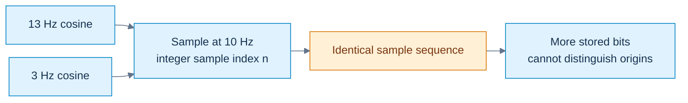

**Caption:** the phase difference at sample $n$ is $2\pi(13-3)n/10=2\pi n$, a whole number of cycles. Equality holds at every integer sample index; the continuous curves differ between samples. This is an exact cosine example, not a statement that all 13 Hz signals look like every 3 Hz signal. To retain a 13 Hz band limit under the ideal strict theorem, use $f_s>26\,\mathrm{Hz}$; for lower-rate output, filter away unsupported content before sampling. Quantization precision cannot undo aliasing.

### What the sampling theorem guarantees

A **band-limited** signal has no frequency content outside a stated bound.

For the appropriate signal class, ideal uniform sampling can guarantee reconstruction when the highest frequency is strictly below half the sampling rate:

$$
f_s>2B.
$$

Here $B$ is the signal's highest frequency under the stated band-limit convention.

The theorem also assumes the required mathematical conditions and ideal reconstruction. At exactly $f_s/2$, phase can cause a problem: the samples of a sine can all land at zero.

Specialized methods or extra knowledge about the signal can change what is recoverable. That knowledge must be stated.

The practical rule for reducing image resolution is: **filter before taking fewer samples**.

After aliases have mixed high-frequency information into lower frequencies, an ordinary blur cannot generally separate them again. [MIT's sampling chapter](https://visionbook.mit.edu/sampling_and_aliasing.html) develops this principle. A finite Gaussian is a practical filter, not an exact ideal cutoff.

## Fourier coordinates reveal what a filter removes

Consider wide stripes and narrow stripes. Wide stripes change brightness slowly across space. Narrow stripes change it quickly.

[[Fourier analysis and spectral phase|Spatial frequency]] measures that repetition rate.

A sinusoidal pattern can be written as:

$$
I(x)=a+b\cos(2\pi fx+\phi).
$$

$a$ is its mean value, $b$ its amplitude, $f$ its frequency, and $\phi$ its phase. Phase positions the bright and dark parts.

Two images can have the same frequency magnitudes but different phase relationships. They need not have the same edges or structures.

### Why complex numbers help

Euler's identity is:

$$
e^{i\theta}=\cos\theta+i\sin\theta,\qquad i^2=-1.
$$

It combines sine and cosine into one convenient representation. The complex values are analysis coordinates; they are not imaginary light emitted by the display.

Using frequency measured in cycles per unit:

$$
X(f)=\int_{-\infty}^{\infty}x(t)e^{-i2\pi ft}\,dt,
$$

and:

$$
x(t)=\int_{-\infty}^{\infty}X(f)e^{i2\pi ft}\,df.
$$

The first equation analyzes the signal into frequencies. The second reconstructs it.

These expressions require suitable mathematical conditions. Some ideal signals need a generalized-function interpretation rather than an ordinary integral.

For a periodic signal, integer-frequency basis functions cancel against one another over a complete period. This property, called **orthogonality**, lets us isolate one coefficient by projecting onto its matching basis function.

### The finite version: DFT and FFT

For $N$ samples, the discrete Fourier transform is:

$$
X[k]=\sum_{n=0}^{N-1}x[n]e^{-i2\pi kn/N}.
$$

Its inverse is:

$$
x[n]=\frac1N\sum_{k=0}^{N-1}X[k]e^{i2\pi kn/N}.
$$

$n$ indexes samples, while $k$ indexes frequency bins. A **bin** is one discrete frequency position in the transform.

For time samples, bin spacing is:

$$
\Delta f=\frac{f_s}{N}.
$$

An **FFT**, or fast Fourier transform, is an efficient algorithm for computing the DFT. It is not a different transform.

A direct DFT needs roughly $O(N^2)$ work. Suitable FFT algorithms reduce this to $O(N\log N)$ by reusing structure. A radix-2 algorithm, for example, splits even and odd samples and combines the smaller transforms.

### Read amplitudes using the stated normalization

The zero-frequency component, called DC, represents the mean under the chosen normalization.

For real input, positive and negative frequency components occur as conjugate pairs. A one-sided amplitude report combines those pairs. Interior bins therefore need a factor of two; DC and an even-length Nyquist bin do not.

The laboratory below uses this convention to recover sine amplitudes. A normalized complex magnitude is not automatically the same number as a full one-sided sine amplitude.

### Why a finite observation spreads a frequency across bins

A DFT treats the finite block as one period of a repeating signal. If the block does not contain a whole number of cycles, joining its ends can create a discontinuity.

The frequency energy then spreads across bins. This is **spectral leakage**.

A window, such as Hann, tapers the endpoints. It reduces some leakage but changes peak width and amplitude scaling.

Smaller bin spacing alone does not guarantee more accurate frequency estimation. Zero-padding gives a more finely sampled spectrum without extending the original observation.

For an image, there are two spatial-frequency axes. Vertical stripes vary horizontally, so their main frequency direction is horizontal. This helps explain why an artifact may be strong in one orientation and weak in another.

### Why spectral replicas give the sampling limit

Ideal sampling multiplies the signal by an impulse train.

A **Dirac delta** is a mathematical distribution with an integral sampling property. It is not an ordinary finite-valued spike.

In frequency coordinates, sampling gives:

$$
X_s(f)=\frac1{T_s}
\sum_{k=-\infty}^{\infty}X(f-kf_s).
$$

The original spectrum is repeated every $f_s$. If it occupies the interval $[-B,B]$, adjacent copies avoid overlap when $f_s>2B$ in this strict form.

If the copies overlap, contributions are mixed. The samples cannot generally tell us how to separate them.

Ideal reconstruction selects the central copy with the proper normalization. Its interpolation kernel is normalized sinc:

$$
\operatorname{sinc}(u)=
\begin{cases}
\dfrac{\sin(\pi u)}{\pi u},&u\ne0,\\
1,&u=0.
\end{cases}
$$

The reconstruction formula is:

$$
x(t)=\sum_n x[n]\,
\operatorname{sinc}\left(\frac{t}{T_s}-n\right).
$$

At each sample position, one sinc contributes one and the others contribute zero. Between samples, their sum reconstructs the signal under the theorem's assumptions.

An ideal sinc extends infinitely in both directions. Practical filters truncate or window it, so they trade accuracy, sharpness, cost, and artifacts.

## A footprint is more meaningful than an isolated pixel center

A pixel represents a region, not just a point. That region is its **footprint**.

[[Convolution and filter footprints|Convolution]] combines input values using a weighting function called a kernel:

$$
y[n]=\sum_k x[k]h[n-k].
$$

$x[k]$ is the input, $h$ is the kernel, and $y[n]$ is the output.

In frequency coordinates:

$$
\mathcal F\{x*h\}=XH.
$$

This means that convolution applies the filter's frequency response to the input spectrum.

A low-pass filter favors low frequencies. A high-pass filter favors changes. A band-pass filter favors a range between them. Not every kernel is a blur.

### A three-sample filter we can understand directly

Take the neighbor weights:

$$
h[-1]=\frac14,\qquad h[0]=\frac12,\qquad h[1]=\frac14.
$$

The output is:

$$
y[n]=\frac14x[n-1]+\frac12x[n]+\frac14x[n+1].
$$

The weights sum to one, so a constant signal stays constant when the boundary rule also preserves constants.

Its angular-frequency response is:

$$
H(\omega)=\frac{1+\cos\omega}{2}.
$$

At $\omega=0$, the gain is one. At $\omega=\pi$, it is zero. The filter preserves the mean and removes the alternating-sample component.

Boundary handling still matters. Clamping, wrapping, and zero-padding can give different results near an image edge.

FFT multiplication without appropriate padding computes circular convolution. Values can wrap around the boundary. For ordinary finite linear convolution of lengths $N$ and $M$, padding to at least $N+M-1$ avoids that wraparound.

A two-dimensional Gaussian is separable: it can be applied as a horizontal pass followed by a vertical pass. A kernel of width $q$ then uses roughly $2q$ contributions per pixel instead of $q^2$, before accounting for overhead and memory costs.

### What happens to a point of light?

[[PSF OTF and MTF|A point-spread function]], or PSF, describes the image produced by an ideal point source.

Under a local linear, shift-invariant model, the observed image is the ideal image convolved with the PSF, plus noise.

**Shift-invariant** means the same response applies when the input moves. Real optics can change across the view, with wavelength, or with focus.

The **optical transfer function**, or OTF, is the Fourier transform of the PSF. After the appropriate normalization, its magnitude is the **modulation transfer function**, or MTF. The OTF also contains phase information.

For a normalized Gaussian PSF:

$$
\mathrm{MTF}(f)=e^{-2\pi^2\sigma^2f^2}.
$$

$\sigma$ is blur width in the chosen spatial units. Frequency $f$ must use the matching reciprocal units.

With $\sigma=1$ pixel:

| Frequency | Remaining contrast amplitude |
|---|---|
| $0.05$ cycles per pixel | about $0.952$ of the original |
| $0.25$ cycles per pixel | about $0.291$ of the original |

High-frequency contrast is reduced much more strongly.

Trying to invert a small transfer value amplifies noise. If the transfer value is zero, that frequency's information has been removed under the model.

### Diffraction is another source of blur

An ideal circular aperture produces an Airy pattern, not an exact Gaussian. The angular radius to its first dark ring is approximately:

$$
\theta_{\mathrm{Airy}}\approx1.22\frac{\lambda}{D_a}.
$$

$\lambda$ is wavelength and $D_a$ is aperture diameter.

For light at $550\,\mathrm{nm}$ through a $3\,\mathrm{mm}$ aperture, this is about 0.77 arcminutes.

This is a diffraction-only estimate, not total human acuity. A smaller aperture can reduce some aberrations and increase depth of field, while also increasing diffraction blur.

### A pixel value can be an average over an area

A simplified ideal image-space target is:

$$
I_{ij}=\frac1{A_{ij}}\iint_{A_{ij}}L(x,y)\,dx\,dy.
$$

$A_{ij}$ is the area represented by pixel $(i,j)$, and $L(x,y)$ is the light-related signal being averaged.

If a white triangle covers 25% of a pixel over black, its box-filtered value is 0.25 in linear light. Evaluating only the center may instead give zero or one.

Real sensors and displays have additional responses. The area-average model gives us a clear target, not the whole physical system.

## Multiresolution work must preserve the right information

[[Multiscale texture filtering|A texel]] belongs to a texture. A pixel belongs to an output image. One output pixel may cover many texels.

A **mipmap** stores filtered versions of a texture at progressively lower resolutions. Each level commonly halves the width and height.

If the relevant footprint scale is $\rho$ texels, a simple level estimate is:

$$
\ell\approx\log_2\rho.
$$

A footprint scale of four texels suggests level two, because $2^2=4$.

The actual footprint may be long and narrow, especially on a surface viewed at a grazing angle. **Anisotropic filtering** accounts for that unequal shape instead of treating it as square.

### Pyramids separate broad structure from detail

A Gaussian pyramid repeatedly filters and downsamples an image.

A Laplacian pyramid stores the difference between a level and an expanded version of the next coarser level. The coarse image contains broad structure; the difference levels contain finer details.

“Laplacian pyramid” does not simply mean applying the continuous Laplace differential operator. It is a multiscale construction used for reconstruction and analysis.

### Reconstruction filters make different tradeoffs

| Method | Basic idea | Main tradeoff |
|---|---|---|
| Nearest neighbor | choose the closest sample | cheap, but blocky |
| Bilinear | blend four nearby samples | inexpensive and smooth, but can blur detail |
| Bicubic | use a wider cubic interpolation | can look sharper, but may overshoot |
| Lanczos | use a windowed-sinc kernel | preserves detail well in some cases, but can ring |
| Learned reconstruction | infer output using a trained model | may produce plausible detail without faithful recovery |

Bilinear weights are nonnegative and sum to one. They preserve constants but cannot recover arbitrary information that was never sampled.

Sharp frequency cutoffs often give oscillating spatial kernels. Near an edge, these can produce bright or dark halos called **ringing**. The persistent overshoot near a discontinuity in Fourier approximations is associated with the **Gibbs phenomenon**.

### Antialiasing methods do not all sample the same work

[[Antialiasing and sample allocation|SSAA]] increases spatial sampling and combines the results at the target resolution. Doubling width and height gives about four times as many samples.

MSAA mainly adds coverage, depth, and stencil sampling around geometry edges. It does not necessarily evaluate every shader independently at every sample. Sample-frequency shader behavior affects the result.

MSAA therefore does not automatically remove all material or shading aliases.

### Filtering before shading can differ from filtering afterward

This matters because shading can be nonlinear.

Take $F(x)=x^2$ and inputs zero and two. Filtering first, then shading, gives:

$$
F\left(\frac{0+2}{2}\right)=F(1)=1.
$$

Shading first, then filtering, gives:

$$
\frac{F(0)+F(2)}2=\frac{0+4}2=2.
$$

The two answers differ.

Real shaders involve normals, BRDFs, lighting, and visibility. Their inputs need filtering that matches the intended footprint and statistics. Blurring the shaded image afterward does not automatically fix those earlier choices.

Contrast enhancement can strengthen detail that remains. It cannot guarantee recovery of every removed frequency.

## Temporal reconstruction is an inference about correspondence

A previous frame can contain useful information. Before reusing it, however, we need to ask: **does this old sample still describe the surface we are seeing now?**

[[Temporal reprojection and history validation|Temporal antialiasing]], or TAA, combines observations across frames.

A simple update is:

$$
H_t=\alpha C_t+(1-\alpha)\widetilde H_{t-1},
\qquad 0<\alpha\leq1.
$$

The symbols mean:

- $C_t$ is the current observation.
- $H_t$ is the updated history.
- $\widetilde H_{t-1}$ is the old history mapped into the current frame.
- $\alpha$ controls how strongly we favor the current observation.

A small $\alpha$ gives more influence to older information. That can reduce noise, but it can also slow the response to change.

For a stationary target, correct alignment, and independent equal-variance noise, the steady-state variance is:

$$
\operatorname{Var}(H)
=\frac{\alpha}{2-\alpha}\operatorname{Var}(C).
$$

The mean age of the contributing information is:

$$
\operatorname{meanAge}=\frac{1-\alpha}{\alpha}
\quad\text{frames}.
$$

These results explain the tradeoff. They do not prove that history is valid after an object moves or a new surface becomes visible.

### Reprojection tries to find the same surface again

**Reprojection** maps old information to the relevant current surface. It may use motion vectors, depth, and camera transforms.

A motion vector must have a clear direction, unit, and jitter convention. Camera motion alone cannot correctly describe independently moving objects.

**Disocclusion** occurs when a previously hidden surface becomes visible. Old history at that location may belong to the object that used to cover it.

### History validation decides whether reuse is justified

Depth, normals, material identity, object identity, motion consistency, and current color neighborhoods can help identify invalid history.

For example, old character colors should not be accumulated into newly exposed background pixels.

Rejecting too little history can create **ghosting**. Rejecting too much can increase noise and flicker. Neighborhood clipping can remove obvious mismatches, but it may also reject legitimate detail.

No single threshold solves that tradeoff for every scene.

### Jitter, TAA, and motion blur solve different problems

**Sample jitter** deliberately changes subpixel positions across frames. This can gather complementary information. The projection and reprojection steps must account for it.

Motion blur instead represents light integrated over an exposure interval. TAA usually tries to estimate an image at a defined frame time from aligned observations.

A long, unvalidated temporal average is not automatically correct motion blur.

Foveation creates another history problem: the sampling quality at a location can change when gaze moves. A low-resolution old sample does not become a high-resolution observation merely because the user now looks there.

History may need to be reset or given less weight at those transitions.

Finally, reducing noise variance does not necessarily remove bias. For an estimator $\hat x$ of a fixed scalar target:

$$
\operatorname{MSE}(\hat x)
=\operatorname{Var}(\hat x)+\operatorname{Bias}(\hat x)^2.
$$

A result can be stable and still be consistently blurred or otherwise wrong.

## Encoded RGB must not masquerade as linear light

Suppose we average black and white. Should the result be the encoded number 0.5?

Only if averaging encoded numbers is the operation we intend. Averaging physical light requires us to use the appropriate linear-light quantity.

[[Color encoding and linear-light operations|A color space]] defines how coordinates relate to colors. Its primaries and white point are part of that definition.

A **transfer function** describes how encoded values relate to a linear or display-related quantity. Linear-sRGB uses the sRGB primaries without the nonlinear sRGB encoding.

Tone mapping, gamut mapping, and transfer encoding are separate operations.

### Decode before physically meaningful averaging

For a normalized sRGB component $C_s$ in the ordinary nonnegative range, the decoded linear component $C_l$ is:

$$
C_l=
\begin{cases}
C_s/12.92,&C_s\leq0.04045,\\
\left(\dfrac{C_s+0.055}{1.055}\right)^{2.4},
&C_s>0.04045.
\end{cases}
$$

To encode it again:

$$
C_s=
\begin{cases}
12.92C_l,&C_l\leq0.0031308,\\
1.055C_l^{1/2.4}-0.055,&C_l>0.0031308.
\end{cases}
$$

These piecewise functions are not exactly a single gamma-2.2 power law.

An equal-weight linear-light average of black and white is:

$$
\frac{0+1}{2}=0.5.
$$

Encoding that result gives approximately 0.735. Averaging the encoded black and white values instead gives 0.5 encoded, which decodes to only about 0.214 linear.

The second result is darker because the arithmetic happened in a different representation.

For physical filtering, use the appropriate linear quantity. For a metric defined in a particular encoded space, follow that metric's specification. “Always linearize everything” is not a complete rule either.

### Figure X3 — Same endpoints, different averaging domain

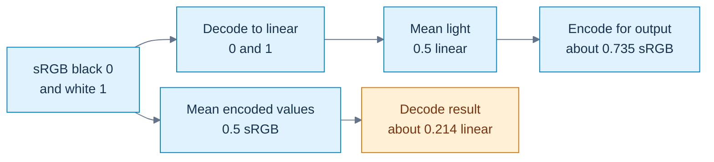

**Caption:** both paths use equal weights and normalized nonnegative sRGB values, but only the upper path computes the linear-light average. The lower result is darker in linear light. The numbers are channel values, not measured nits; actual display luminance also needs calibration. Other encodings require their own transfer functions, and a metric defined in an encoded domain must follow its specification.

### Relative luminance is not an absolute display measurement

For linear RGB using the sRGB primaries and D65 reference-white convention:

$$
Y\approx0.2126R+0.7152G+0.0722B.
$$

$Y$ is relative luminance. D65 identifies the reference white. The result is not automatically a luminance in nits.

CIE XYZ provides standardized tristimulus color-match coordinates. When $X+Y+Z$ is nonzero, chromaticity coordinates are:

$$
x=\frac{X}{X+Y+Z},
\qquad y=\frac{Y}{X+Y+Z}.
$$

They describe color direction without retaining the overall scale.

A **gamut** is the set of colors reproducible under a stated device or model. It is not simply the number of bits in each channel.

### Tone mapping changes the relationship between errors

HDR represents or displays a wider luminance range under specified conditions. Scene-linear values need not stop at one.

A simple illustrative tone mapper is:

$$
T(L)=\frac{L}{1+L},
\qquad L\geq0.
$$

It compresses the range, but it is not a universal appearance-preserving solution.

Because tone mapping is nonlinear, equal errors before mapping need not have equal visible effects afterward. State which stage of the pipeline you evaluate.

### Different kinds of noise need different models

Ideal photon counts follow a Poisson model:

$$
N_\gamma\sim\operatorname{Poisson}(\mu),
\qquad
\mathbb E[N_\gamma]=\operatorname{Var}(N_\gamma)=\mu.
$$

Under that model, the count signal-to-noise ratio grows approximately as $\sqrt{\mu}$.

Electronic read noise, quantization error, Monte Carlo noise, and correlated temporal rendering artifacts have different causes.

Adding Gaussian angular noise can be a useful tracker stress test. It does not automatically reproduce a real eye-camera, exposure, processing, and tracking pipeline.

## Quality numbers need a question they can actually answer

[[Perceptual metrics and display calibration|A reference image]] is a declared comparison target. It is not automatically perfect physical ground truth.

A high-sample offline rendering still assumes geometry, materials, lighting, and transport models.

Keep three questions separate:

1. How closely does the output match the reference?
2. How good does it look to the observer?
3. How well can the observer perform the task?

### Numerical error measures compare values

For $N$ scalar samples:

$$
\mathrm{MSE}=\frac1N\sum_i(I_i-R_i)^2.
$$

$I_i$ is an output value, and $R_i$ the corresponding reference value.

Related measures are:

$$
\mathrm{RMSE}=\sqrt{\mathrm{MSE}},
\qquad
\mathrm{MAE}=\frac1N\sum_i|I_i-R_i|.
$$

State whether $N$ counts pixels, channels, or some other samples. Also state the encoding and domain of the comparison.

Errors $[1,1,1,1]$ and $[0,0,0,2]$ both have $\mathrm{MSE}=1$. One spreads error across all samples; the other concentrates it. Their visual consequences need not be equal.

PSNR is:

$$
\mathrm{PSNR}
=10\log_{10}\left(\frac{P^2}{\mathrm{MSE}}\right).
$$

$P$ is the declared positive peak value, not an arbitrarily chosen maximum from each frame.

With $P=1$, an MSE of 0.001 gives 30 dB. An MSE of 0.0001 gives 40 dB. Zero MSE gives formally infinite PSNR.

These are numerical fidelity measures, not direct perceptual ratings.

### Structural and gaze-aware comparisons add assumptions

SSIM compares local means, variances, and covariance. It uses stabilizing constants and then combines local results. Window choice, color treatment, range, and implementation affect its score.

MS-SSIM performs comparisons at multiple scales. Neither automatically captures all gaze, stereo, and temporal effects.

A simple gaze-weighted error is:

$$
E_w=
\frac{\sum_p w(e_p)\lVert I_p-R_p\rVert^2}
{\sum_p w(e_p)}.
$$

One possible weight is:

$$
w(e)=\beta+e^{-e^2/(2\sigma_e^2)}.
$$

$e$ is eccentricity. $\sigma_e$ controls the angular width of the central emphasis, while $\beta$ supplies residual peripheral weight.

Use matching angular units, nonnegative weights, a positive total weight, and a declared channel convention.

This is an engineering proxy. Changing the weight schedule can change which algorithm wins, because we have changed the definition of quality.

A temporal comparison should also consider correspondence. Comparing current error with warped previous error can be more meaningful than subtracting unrelated screen positions. It still needs validation before it becomes a perceptual predictor.

FovVideoVDP models spatial, temporal, and peripheral factors using display and viewing information. Its JOD-related output is not MSE, PSNR, or a universal probability of detecting an artifact.

Record its version, calibration, intensity convention, timing, and gaze configuration. Check whether it covers the binocular or task effects needed by the experiment. [FovVideoVDP project](https://www.cl.cam.ac.uk/research/rainbow/projects/fovvideovdp/)

## A threshold is evidence from a procedure, not a universal border

[[Psychophysics and threshold inference|Psychophysics]] measures how observers respond to controlled stimuli.

If we say that a distortion is “invisible,” we need to say how we tested that claim.

In a two-alternative forced-choice task, or 2AFC, chance correctness is 0.5 when the alternatives are equally likely.

A **psychometric curve** relates stimulus strength to response probability. Its lower limit, lapse behavior, and slope affect the result. Probability of a correct forced choice is not automatically the same as probability of reporting detection.

### A curve parameter is not always the threshold

For a logistic illustration with guessing level $\gamma$ and lapse rate $\ell$, the value at its midpoint parameter $x_0$ is:

$$
P(x_0)=\gamma+\frac{1-\gamma-\ell}{2}.
$$

That is not always exactly 0.75.

The source also uses this Weibull-like 2AFC form:

$$
F(x)=1-\frac12e^{-(x/\lambda)^k},
\qquad \lambda>0,\quad k>0.
$$

Here $\lambda$ is a fitted scale and $k$ a shape parameter. This $\lambda$ is not the wavelength used in the light section.

If we define threshold $T$ as 75% correct:

$$
F(T)=0.75.
$$

Then:

$$
e^{-(T/\lambda)^k}=\frac12,
$$

so:

$$
T=\lambda(\ln2)^{1/k}.
$$

The criterion determines the threshold. It is not enough to report a fitted parameter without explaining what it means.

### Experimental design determines what the result supports

A **staircase** changes stimulus difficulty in response to prior answers. It can help estimate thresholds efficiently.

**Bootstrap resampling** estimates variability under stated sampling assumptions. It does not capture every systematic bias.

For an equal-variance Gaussian signal-detection model, sensitivity is:

$$
d'=\frac{\mu_{\mathrm{signal}}-\mu_{\mathrm{noise}}}{\sigma}.
$$

This separates sensitivity from aspects of response bias under that model. The means and shared standard deviation refer to the evidence distributions.

A statistically nonsignificant difference is not proof of equivalence. If equivalence is the claim, define an acceptable difference and use an analysis suited to that claim.

Participants, trial counts, training, stimuli, randomization, viewing conditions, and uncertainty all matter.

A software program can reproduce stimuli or check threshold algebra. It cannot independently reproduce a human threshold without human observations or a separately validated model.

## Foveation is allocation under uncertain perception and timing

[[Foveated rendering and uncertainty|Foveation]] changes where computational effort is spent.

Fixed foveated rendering, or FFR, uses a fixed assumed viewing center. Dynamic foveated rendering, or DFR, follows measured or predicted gaze.

Variable-rate shading, or VRS, changes shading evaluation rate through a graphics-pipeline mechanism. It does not necessarily reduce the resolution or cost of every pass.

Other methods can change ray count, geometry detail, texture sampling, or reconstruction quality.

### Smooth transitions help, but they do not restore missing detail

Under a monotonic acuity model, the inner boundary of a peripheral layer is its most demanding location.

A smooth transition can hide a hard boundary. One common blend function is:

$$
s(t)=3t^2-2t^3,\qquad 0\leq t\leq1.
$$

It starts at zero, ends at one, and has zero slope at both endpoints.

It cannot recover frequencies missing from both layers. Gaze uncertainty and motion still matter.

### The quality region must allow for prediction error

If the predicted gaze can miss the display-time fixation by several degrees, a tiny high-quality region can land in the wrong place.

A larger region is more conservative but costs more work. A probabilistic policy needs a calibrated error distribution and a loss measure matched to the task.

A low mean angular error can conceal rare but noticeable errors just after a saccade. A predictor should therefore be evaluated at the moments when the quality allocation depends on it.

### Figure X4 — Aim detail at visible time

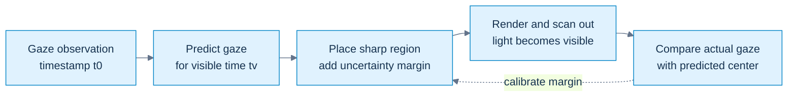

**Caption:** acquisition, delivery, scheduling, rendering, scanout and pixel response separate observation from visible output. In the earlier steady-motion example, a 30 ms prediction horizon at $20^\circ/\mathrm{s}$ corresponds to $0.6^\circ$ displacement; that is not itself the prediction error or a universal margin. For a circular quality region, an illustrative worst-case policy is $r_{\mathrm{quality}}\geq r_{\mathrm{needed}}+\epsilon$, where $\epsilon$ bounds angular center error at visible time and both radii use the same angular units. This containment rule assumes a valid error bound and circular regions; empirical tail errors, calibration and task requirements determine whether that model is useful. Scanout may require time estimates that vary across the image.

**Recall:** sampling interval tells when observations are taken; latency tells how old they are when used. Test gaze landing as well as average prediction error.

### Less shading does not mean the whole frame becomes equally faster

Suppose 40% of the original frame time benefits from an optimization. The other 60% does not.

If the affected work becomes 70% cheaper:

$$
T_{\mathrm{new}}=0.60+0.40(0.30)=0.72.
$$

The frame-time reduction is 28%, not 70%. The speedup is:

$$
S=\frac1{0.72}\approx1.39.
$$

This is an additive, non-overlapping cost model. A real GPU also has overlap, synchronization, bandwidth, scheduling, and other bottlenecks.

Sample-count savings, fewer shader invocations, lower frame time, and lower total energy use are different claims.

## Read research as a chain of questions, methods and bounded conclusions

For each paper, ask four questions:

1. What problem did the authors study?
2. What did they change or measure?
3. What result did the evidence support?
4. Under which conditions might that conclusion stop applying?

The following are reading anchors, not completed replications. Detailed study numbers or model coefficients that were not independently checked remain marked as source-reported in the provenance record.

### Making spatial allocation computationally useful

Guenter and colleagues' 2012 method uses three image layers, reduced peripheral sampling and update rates, smooth composition, and antialiasing.

Its full-scene table reports 27.9 ms for N2 and 4.9/5.9 ms for QA/QB. Those configurations imply about $5.69\times$ and $4.73\times$ speedup.

Figure 5's complete timing paths are about 23–40 ms. The 15 ms label marks an intermediate stage, not final gaze-to-visible completion.

These numbers describe that historical setup. They are not a universal headset budget. Ask which work was removed and which overhead remained. [Original Microsoft paper](https://www.microsoft.com/en-us/research/wp-content/uploads/2012/11/foveated_final15.pdf)

### Keeping resolvable contrast rather than merely blurring the periphery

Patney and colleagues' 2016 work treats contrast, filtering, and temporal stability as design requirements.

Its project reports up to 70% fewer shading evaluations. That is not a claim of 70% lower full-system latency or energy use.

Contrast enhancement strengthens surviving information; it does not prove perfect reconstruction. The earlier example comparing $F(\operatorname{mean}(x))$ with $\operatorname{mean}(F(x))$ explains why filtering stages must be considered separately. It is not the paper's complete shader.

[NVIDIA publication](https://research.nvidia.com/publication/2016-12_towards-foveated-rendering-gaze-tracked-virtual-reality)

### Organizing prior work without making a current novelty claim

Wang, Shi, and Liu's 2023 survey reviews work from 1990–2021.

Use it to classify what a method changes, which perceptual requirement controls the change, and which rendering architecture realizes the savings.

The historical cutoff does not prove that a research gap remains open today. A survey organizes a body of evidence; it is not one new renderer's speed benchmark. [Open survey](https://link.springer.com/article/10.1007/s41095-022-0306-4)

### Matching samples across time and predicting their visible error

The source's Yang/Liu/Salvi 2020 TAA survey emphasizes two responsibilities: gather useful samples and validate historical correspondence. Its bibliographic claim remains source-reported here because the guessed publication URL did not resolve.

FovVideoVDP addresses a different question: which remaining differences are predicted to matter under the stated display conditions?

Together they remind us to check both correspondence and visibility. Implementing a temporal blend does not reproduce either complete publication.

### Binocular depth changes the optimization question

[[Stereoacuity and binocular foveation|Kergaßner, Tariq, and Didyk's 2025 work]] asks how peripheral filtering affects a stereoacuity task.

The author project reports robustness under tested foveation conditions. It does not establish that every peripheral recognition, motion, or comfort task is unaffected.

The source's fitted threshold surface changes with blur and eccentricity. Its exact displayed coefficients still need checking against the paper before implementation.

We can check the 75%-threshold algebra without participants. We cannot reproduce the perceptual finding that way. [Author project](https://sophie-kergassner.github.io/depth-in-periphery.html)

Jiménez Navarro and colleagues' 2026 project studies how each eye's contribution changes across location and viewing context. This is richer than assigning one permanent dominant-eye label.

Eye-asymmetric rendering needs binocular evidence, not only two good monocular error scores. Inspect the model, dataset, and validation conditions before designing a policy. [Dynamic Visual Dominance project](https://dynamicvisualdominance.mpi-inf.mpg.de/)

A measured outcome and an explanation proposed for that outcome are different claims. The result may be well supported even while its mechanism remains uncertain.

## Make the mathematics operational without pretending to run a human study

The laboratory below checks equations and builds a small image-space experiment.

It creates horizontal and vertical sinusoidal patterns. It then computes pixel directions using a specified pinhole model, applies gaze-dependent blur, and compares fixed-center allocation with gaze-following allocation.

The program first computes the full reference image. It therefore does **not** save the original shading work. Its purpose is to connect geometry, filtering, and measurement.

Boundary clamping and the finite filter are explicit. The error scores measure differences from the synthetic reference, not perceptual invisibility.

[[Research validity and ablation|An ablation]] changes or removes one component to examine its effect. For this program:

1. Change the sharp-region radius while keeping blur and metric weights fixed.
2. Change blur while keeping the other settings fixed.
3. Change the metric weights without changing either output image.

The third step is especially important. If it changes the winner, the rendering did not change. Our definition of quality changed.

Later sources can add real tracking, prediction, GPU execution, and system timing. Those systems are not implemented by this toy experiment.

### Diagnose a symptom by the quantity that failed

| Symptom | Possible mechanism | What to check |
|---|---|---|
| A thin fence shimmers in motion | undersampling and changing sample phase | projected frequencies, prefiltering, and temporal behavior |
| The periphery looks washed out | lost contrast or incorrect encoding | linear-light filtering and surviving frequency bands |
| Detail pops after a gaze shift | late quality-region placement | acquisition-to-visible timing and gaze-landing errors |
| A ghost follows a character | invalid history reuse | motion, depth, identity, and disocclusion |
| Sample savings give little speedup | unchanged bottleneck or added overhead | actual shader work and whole-frame profiling |
| A metric improves but the headset looks worse | the metric misses the relevant effect | contrast, flicker, binocular cues, and calibration |
| Sharp stereo gives the wrong depth | disparity, focus, or fusion mismatch | per-eye calibration and a defined depth task |

These are hypotheses to test, not automatic diagnoses. More than one mechanism can be present.

### Complete numerical and image-space laboratory

Save the following complete program and run it with Python 3 and assertions enabled. It uses only the standard library.

Both allocation methods are evaluated using the same true gaze. Changing the metric's gaze as well as the rendering policy would mix two different changes into one comparison.

```python
"""XR01: numerical and image-space witnesses, not perceptual/GPU validation."""
import cmath
import math

def close(a, b, tolerance=1e-10):
    assert abs(a-b) <= tolerance, (a,b)

def decode_srgb(c):
    if not 0 <= c <= 1:
        raise ValueError("laboratory uses normalized nonnegative sRGB")
    return c/12.92 if c <= 0.04045 else ((c+0.055)/1.055)**2.4

def encode_srgb(c):
    if not 0 <= c <= 1:
        raise ValueError("laboratory uses normalized nonnegative linear RGB")
    return 12.92*c if c <= 0.0031308 else 1.055*c**(1/2.4)-0.055

def dft(values):
    n=len(values)
    return [sum(v*cmath.exp(-2j*math.pi*k*i/n)
                for i,v in enumerate(values)) for k in range(n)]

def ray(x,y,width,height,hfov_degrees):
    # Pixel centers; pinhole camera with square pixel pitch on its image plane.
    scale=math.tan(math.radians(hfov_degrees)/2)
    rx=(2*(x+0.5)/width-1)*scale
    ry=(1-2*(y+0.5)/height)*scale*height/width
    length=math.sqrt(rx*rx+ry*ry+1)
    return (rx/length,ry/length,1/length)

def angle(a,b):
    # Inputs are unit directions in a common frame.
    return math.degrees(math.acos(max(-1,min(1,sum(x*y for x,y in zip(a,b))))))

def blur(image):
    # Normalized 3x3 separable kernel, explicit clamped boundary policy.
    height,width=len(image),len(image[0])
    taps=(0.25,0.5,0.25)
    return [[sum(taps[dy+1]*taps[dx+1] *
                 image[min(height-1,max(0,y+dy))][min(width-1,max(0,x+dx))]
                 for dy in (-1,0,1) for dx in (-1,0,1))
             for x in range(width)] for y in range(height)]

def allocate_quality(image, gaze_ray, radius=5):
    # Full reference was computed first: this does NOT avoid original shading.
    height,width=len(image),len(image[0])
    low=blur(image)
    output=[]
    for y in range(height):
        row=[]
        for x in range(width):
            e=angle(ray(x,y,width,height,60),gaze_ray)
            t=max(0,min(1,(e-radius)/5))
            blend=t*t*(3-2*t)
            row.append((1-blend)*image[y][x]+blend*low[y][x])
        output.append(row)
    return output

def metrics(reference, output, gaze_ray, sigma=5, floor=0.05):
    # Scalar linear-light toy data; same true gaze used for all comparisons.
    if sigma <= 0 or floor < 0:
        raise ValueError("invalid metric weights")
    height,width=len(reference),len(reference[0])
    squares=[]
    weighted=total_weight=0.0
    for y in range(height):
        for x in range(width):
            error=(reference[y][x]-output[y][x])**2
            e=angle(ray(x,y,width,height,60),gaze_ray)
            weight=floor+math.exp(-e*e/(2*sigma*sigma))
            squares.append(error)
            weighted+=weight*error
            total_weight+=weight
    mse=sum(squares)/len(squares)
    return mse,weighted/total_weight

def main():
    width,distance,pixels=0.53,0.60,1920
    fov=math.degrees(2*math.atan(width/(2*distance)))
    average_ppd=pixels/fov
    center_ppd=distance/(width/pixels)*math.pi/180
    assert center_ppd < average_ppd
    print(f"planar FOV={fov:.6f} deg; average PPD={average_ppd:.6f}; "
          f"center PPD={center_ppd:.6f}")

    for n in range(30):
        close(math.cos(2*math.pi*13*n/10),math.cos(2*math.pi*3*n/10))
        close(math.sin(math.pi*n),0)
    checker=[float(i%2) for i in range(16)]
    wrong=checker[::2]
    prefiltered=[(checker[i]+checker[i+1])/2 for i in range(0,16,2)]
    assert all(v==0 for v in wrong) and all(v==0.5 for v in prefiltered)

    n=128
    values=[0.5+0.3*math.sin(2*math.pi*7*i/n)+
            0.1*math.sin(2*math.pi*29*i/n) for i in range(n)]
    spectrum=dft(values)
    close(spectrum[0].real/n,0.5)
    close(2*abs(spectrum[7])/n,0.3)
    close(2*abs(spectrum[29])/n,0.1)
    print("DFT interior one-sided amplitudes: bin7=0.3, bin29=0.1")
    for f in (0.05,0.25):
        print(f"Gaussian MTF at {f} cycles/pixel: "
              f"{math.exp(-2*math.pi**2*f*f):.6f}")
    close(decode_srgb(encode_srgb(0.5)),0.5,tolerance=1e-9)
    print(f"linear black/white mean encoded={encode_srgb(0.5):.6f}; "
          f"encoded 0.5 decodes={decode_srgb(0.5):.6f}")

    scale,shape=2.0,3.0
    threshold=scale*math.log(2)**(1/shape)
    close(1-0.5*math.exp(-(threshold/scale)**shape),0.75)
    alpha=0.2
    squared_weight_sum=sum((alpha*(1-alpha)**j)**2 for j in range(1000))
    close(squared_weight_sum,alpha/(2-alpha))
    close(0.6+0.4*0.3,0.72)

    w,h=32,24
    image=[[0.5+0.25*math.sin(2*math.pi*7*x/w)+
            0.15*math.sin(2*math.pi*5*y/h) for x in range(w)] for y in range(h)]
    gaze=ray(23,12,w,h,60)
    fixed=allocate_quality(image,ray(15.5,11.5,w,h,60))
    dynamic=allocate_quality(image,gaze)
    for label,output in (("fixed",fixed),("gaze-following",dynamic)):
        assert all(math.isfinite(v) for row in output for v in row)
        mse,weighted=metrics(image,output,gaze)
        print(f"{label}: MSE={mse:.8f}; weighted MSE={weighted:.8f}")
    flat=[[0.4]*w for _ in range(h)]
    close(metrics(flat,allocate_quality(flat,gaze),gaze)[0],0)
    print("XR01 numerical laboratory: all assertions passed")

if __name__ == "__main__":
    main()
```

The DFT uses 128 samples with frequencies aligned to its bins. This demonstrates the transform and amplitude convention, not a fast algorithm or a general frequency estimator.

The downsampling example begins with alternating zero and one. Taking only even samples gives all zeros. Averaging each pair first gives 0.5. That makes the lost-information problem visible in a very small example.

The image experiment uses a finite $3\times3$ filter and scalar linear-light data. It does not claim that one allocation wins for every image or that its error is invisible to people.

Its basic filter check is that constant input remains constant under the stated boundary and weighting rules.

## Teach the distinctions from a blank board

Use these questions to test explanations, not memorized wording:

1. How does a surface's radiance become display light and then receptor responses? Why is RGB not a wavelength?
2. What distinguishes radiance from irradiance, and luminance from illuminance?
3. How do average PPD and local center PPD differ? How would you obtain an angular direction from an image location?
4. Why can focus and vergence ask for different distances in a headset?
5. How do acuity, contrast sensitivity, masking, crowding, and attention differ?
6. Which time should a gaze prediction describe? How does pursuit change retinal motion?
7. Why do 13 Hz and 3 Hz give the same cosine samples at 10 Hz? What can fail at exactly the Nyquist boundary?
8. What do Fourier magnitude and phase describe? Why does a one-sided amplitude report need a normalization convention?
9. Why must filtering come before downsampling? What information can bilinear interpolation not recover?
10. How are PSF, OTF, and MTF related? What assumptions make that relationship useful?
11. What distinguishes coverage sampling, shading evaluations, reconstruction, and actual work saved?
12. When does temporal accumulation reduce noise? When can its history instead be wrong?
13. How should black and white be averaged in linear light and then encoded?
14. Can equal MSE mean equal appearance? What extra assumptions does a perceptual model add?
15. How is the 75%-correct threshold derived from the fitted curve?
16. How does checking a paper's code differ from reproducing its human-study result?
17. Why does 70% less work in one stage not mean a 70% faster frame?

A few research terms are worth keeping close:

| Term | Meaning |
|---|---|
| Calibration | establishing how measurements or coordinates relate to known references |
| External validity | how far a conclusion applies beyond the tested conditions |
| Uncertainty | what the evidence does and does not establish about an estimate |
| Stereo disparity | a defined difference between corresponding binocular signals, not simply a depth-buffer value |
| Ghosting | old content appearing where it no longer belongs |
| Judder | uneven perceived progression of motion |
| Bootstrap | estimating variability by resampling under stated assumptions |
| Replication | repeating a clearly identified computational or perceptual test |

The [[Keyword Index]] links to the reusable concepts. Their definitions support this chapter; they do not replace the explanations here.

## What the next sources must add

The source previews geometry, tracking, sensor fusion, display pipelines, GPU execution, Vulkan, OpenXR, and ILLIXR. It also previews prediction and replication experiments. Those inputs have not yet been received.

**Six degrees of freedom** means three position components and three rotation components. It does not mean six arbitrary sensor readings.

As the sources arrive, we will extend this same independent file. Later material will deepen earlier definitions and connect the foundations to actual systems.

The 3,000-part curriculum's numbering remains unchanged.

[[Supplementary/Foundations#XR01 - Independent seeing and representation source|Independent source coverage]] · [[Continuous Notes/XR - From Light to Perception - Seeing and Representing Reality#XR - Sampling, contrast transfer and temporal evidence|Deeper reconstructions]] · [[Supplementary/Worked Traces#XR - From geometry to sample loss and evidence|Extended traces]] · [[Supplementary/Sources and Code Anchors#XR01 - Seeing and representing reality|Evidence, corrections and verification]] · [[Dependency Map]] · [[Visual Recall/XR - Light, Vision and Perception - Visual Recall|Visual-recall board]]


## Recovered cumulative reconstruction proofs

These complete proof sections are recovered from the retained pre-cleanup derivation snapshot. They restore the targets of stale navigation links and supplement the teaching already in this volume.

## XR - Sampling, contrast transfer and temporal evidence

### Why local pixels per degree is not the average

Start with a flat screen. Let its width be $W$, its viewing distance $D$, and its number of pixel columns $N$. The viewer looks at the center.

Pixel pitch is $p=W/N$. For a point at angle $\theta$:

$$
x=D\tan\theta.
$$

The angle is in radians. Differentiating gives the amount of screen distance per angular change:

$$
\frac{dx}{d\theta}=D\sec^2\theta.
$$

Divide by pixel pitch to get pixels per radian. Then multiply by $\pi/180$ to get pixels per degree.

At the center:

$$
\mathrm{PPD}_0=\frac{DN}{W}\frac{\pi}{180}.
$$

The average density uses the entire field of view instead:

$$
\mathrm{PPD}_{\mathrm{average}}
=\frac{N}{(360/\pi)\tan^{-1}(W/(2D))}.
$$

With $W=0.53\,\mathrm{m}$, $D=0.60\,\mathrm{m}$, and $N=1920$, the center has about 37.9362 PPD. The average is about 40.2863 PPD.

These numbers answer different questions. They are not conflicting measurements. A different projection or lens distortion requires its own mapping. See [[Visual angle and calibrated rays]].

### Sampling creates ambiguity before reconstruction begins

Take sample index $n$ and change the original frequency from $f_0$ to $f_0+mf_s$, where $m$ is an integer.

The extra phase is $2\pi mn$. At integer sample positions it is a whole number of cycles, so the samples do not change. For a real cosine, negative-frequency equivalence also matters.

In frequency coordinates, sampling repeats the original spectrum every $f_s$. If that spectrum occupies $[-B,B]$, the copies stay separate when:

$$
f_s>2B.
$$

This is the strict band-limited form used here.

Sinc reconstruction can select the original copy under the ideal assumptions. Once copies overlap, later smoothing cannot generally identify which part came from which original frequency.

The boundary case also matters. At $f_s/2$, a sine can give:

$$
\sin(\pi n)=0
$$

for every integer $n$. The continuous signal is nonzero between those observations.

### A normalized filter preserves constants, not arbitrary details

For convolution:

$$
y[n]=\sum_k h[k]x[n-k],
$$

a constant input $x[n]=a$ gives:

$$
y[n]=a\sum_k h[k].
$$

The filter preserves the constant when its weights sum to one and its boundary rule also preserves constants.

The weights $1/4$, $1/2$, and $1/4$ have frequency response:

$$
H(\omega)=\frac{1+\cos\omega}{2}.
$$

The gain is one at $\omega=0$ and zero at $\omega=\pi$.

A balanced difference of two normalized Gaussians instead has zero DC response. Unequal gains do not necessarily cancel.

For the stated continuous Gaussian blur model:

$$
\mathrm{MTF}(f)=e^{-2\pi^2\sigma^2f^2}.
$$

Use matching units for blur width $\sigma$ and frequency $f$. A finite discrete kernel need not have exactly this response.

### Temporal variance and age are conditional results

Assume a constant blend factor $\alpha$, a stationary target, correct alignment, and independent observations with equal noise variance.

The weight given to an observation $j$ frames old is:

$$
w_j=\alpha(1-\alpha)^j.
$$

The weights sum to one. For independent noise, variance uses the sum of squared weights:

$$
\frac{\operatorname{Var}(H)}{\operatorname{Var}(C)}
=\frac{\alpha^2}{1-(1-\alpha)^2}
=\frac{\alpha}{2-\alpha}.
$$

The mean age is:

$$
\operatorname{meanAge}=\frac{1-\alpha}{\alpha}
\quad\text{frames}.
$$

These formulas explain noise reduction and delayed response. They do not prove valid history after disocclusion or a changing target. Correlated errors add covariance terms, and reducing variance does not remove bias. See [[Temporal reprojection and history validation]].

### Psychometric scale is not itself the chosen threshold

Use the illustrative curve:

$$
F(x)=1-\frac12e^{-(x/\lambda)^k},
\qquad \lambda>0,\quad k>0.
$$

Define the threshold $T$ as the stimulus level giving 75% correct:

$$
F(T)=0.75.
$$

Rearrange:

$$
e^{-(T/\lambda)^k}=\frac12.
$$

Taking logarithms gives:

$$
\left(\frac{T}{\lambda}\right)^k=\ln2.
$$

Therefore:

$$
T=\lambda(\ln2)^{1/k}.
$$

The numerical lab verifies $F(T)=0.75$ for illustrative parameters. It does not fit participant responses or validate a paper's fitted coefficients.


## Mathematical language: points, vectors, and derivatives

Build a precise mathematical vocabulary before composing transformations or interpreting numerical results.

### Points, vectors, bases, and linear maps

A **point** names a location. A **vector** describes displacement, direction, or a magnitude-bearing quantity. Subtracting point $p$ from point $q$ gives a displacement $q-p$. Adding vector $v$ to point $p$ gives another point $p+v$. Vectors can be added and scaled freely; scaling a point depends on the coordinate origin. This distinction becomes crucial when a transform should move locations but preserve directions. [[#CMU-02 - Linear Algebra (P)Review|CMU-02]]

A **vector space** is a collection of vectors where addition and scalar multiplication stay within the collection. A **basis** is a set of independent vectors that can express every vector in the space. If the basis vectors are $b_1,\ldots,b_n$, then a vector $v$ can be written as $v=\sum_i c_i b_i$. The coefficients $c_i$ give its coordinates. Change the basis and the coordinates change, even though the geometric vector stays the same. [[#CMU-02 - Linear Algebra (P)Review|CMU-02]]

A linear map $A$ preserves addition and scalar multiplication. Its matrix columns are the images of the basis vectors. Therefore, if $v=\sum_i c_i b_i$, then

$$
Av=A\left(\sum_i c_i b_i\right)=\sum_i c_iA(b_i).
$$

This gives a practical way to read matrix-vector multiplication: transform each basis direction, then combine those results using the original coefficients. The matrix columns show those transformed directions. Matrix products compose maps; with column vectors, the rightmost map acts first. A map is **invertible** if it can be undone. If its columns are linearly dependent, distinct inputs can collapse to the same output. [[#CMU-02 - Linear Algebra (P)Review|CMU-02]]

The determinant of a square matrix measures signed area or volume scaling. Its absolute value gives the scale; a negative sign means orientation reverses. A zero determinant means at least one dimension collapses, so the map has no inverse. An **eigenvector** is a direction that a map scales without turning: $Av=\lambda v$, where $\lambda$ is the scale. Singular-value decomposition gives a more general description:

$$
A=U\Sigma V^T.
$$

The orthogonal matrix $V^T$ rotates or reflects inputs into principal directions. The diagonal matrix $\Sigma$ scales those directions, and orthogonal $U$ maps them into output coordinates. The diagonal values are the **singular values**. This factorization describes stretching and rank loss, and supports least-squares solutions and data transformations. [[#CMU-02 - Linear Algebra (P)Review|CMU-02]] · [[#CMU-05 - Spatial Transformations|CMU-05]]

Principal directions are two perpendicular directions of maximum and minimum bending.

Normal matrix is : $AA^T = A^T A$
Thus, Orthogonal, Symmetric, Skew-Symmetric are children of it.
### Inner products and vector calculus

The Euclidean norm gives vector length: $\|v\|=\sqrt{v\cdot v}$. The dot product $u\cdot v=\sum_i u_iv_i$ measures alignment. For unit vectors it equals the cosine of their angle. In 3D, the cross product $u\times v$ is perpendicular to both inputs. Its length equals the area of their parallelogram, and its direction follows the right-hand rule. These operations support angle tests, projections, surface normals, and lighting. [[#CMU-03 - Vector Calculus (P)Review|CMU-03]]

A derivative gives a local linear approximation. If $f$ maps vectors to vectors, its derivative at $x$ is the **Jacobian matrix** $J_f(x)$. For a small input change,

$$
f(x+\Delta x)\approx f(x)+J_f(x)\Delta x.
$$

For a scalar field $f$, the **gradient** $\nabla f$ collects its partial derivatives. It points in the direction of steepest increase. The change along a unit direction $u$ is $\nabla f\cdot u$. For example, if $f(x,y)=x^2+3y^2$, then its gradient is $(2x,6y)$. At $(1,1)$ the gradient is $(2,6)$. A perpendicular move has zero first-order change. Gradients drive methods such as gradient descent and help find normals to level sets. [[#CMU-03 - Vector Calculus (P)Review|CMU-03]] · [[#CMU-22 - Optimization|CMU-22]]

A **vector field** assigns a vector to each point. Its divergence $\nabla\cdot v$ measures net local outflow. For $v(x,y,z)=(x,y,z)$, divergence is 3: the field expands uniformly. **Curl** measures local circulation. For $v(x,y,z)=(-y,x,0)$, it points along the $z$ axis. The **Laplacian** $\Delta f=\nabla\cdot\nabla f$ compares a function's value with nearby values. A bowl such as $x^2+y^2$ has positive Laplacian; a local peak usually has a negative one. A saddle may have zero Laplacian even though it curves in opposite directions. The Hessian, the matrix of second derivatives, retains more information than the Laplacian's sum. These operators appear in smoothing, curvature, fluid flow, diffusion, and physical animation. [[#CMU-03 - Vector Calculus (P)Review|CMU-03]] · [[#CMU-11 - Digital Geometry Processing|CMU-11]] · [[#CMU-23 - Physically Based Animation and PDEs|CMU-23]]

### Coordinate-free products and the meaning of second derivatives

A gradient depends on the inner product used to measure directions. With the ordinary dot product, $\nabla f$ is defined so that the directional derivative along $u$ is $Df[u]=\nabla f\cdot u$. The same idea works for functions: replace finite vectors with functions and the dot product with an integral. With the $L^2$ inner product $\langle f,g\rangle=\int f(x)g(x)\,dx$, the gradient of $\langle f,g\rangle$ with respect to $f$ is $g$. A small change $h$ to $f$ changes the objective by $\langle h,g\rangle$. Likewise, the gradient of $\|f\|^2=\langle f,f\rangle$ is $2f$, since its first-order change is $2\langle f,h\rangle$. This matches $\nabla_x(x^Tx)=2x$. Function-space gradients let optimization act on images, curves, and fields, not only on lists of numbers. [[#CMU-03 - Vector Calculus (P)Review|CMU-03]] · [[#CMU-22 - Optimization|CMU-22]]

In two dimensions, scalar curl is closely related to the divergence of a field rotated by 90 degrees. Fluid solvers use this relation to switch between velocity and stream-function descriptions and to measure vorticity. For a scalar field $f$, the Laplacian $\Delta f=\nabla\cdot\nabla f$ is the divergence of its gradient. In Cartesian coordinates, it is the sum of second partial derivatives. It is usually negative at a peak and positive at a valley. For $f(x,y)=\cos(3x)+\sin(3y)$, differentiating twice in each coordinate gives $\Delta f=-9\cos(3x)-9\sin(3y)=-9f$. The Laplacian scales this sinusoidal pattern without changing its shape. The same operator appears in smoothing, heat diffusion, waves, mesh fairing, and image processing. [[#CMU-03 - Vector Calculus (P)Review|CMU-03]] · [[#CMU-11 - Digital Geometry Processing|CMU-11]] · [[#CMU-23 - Physically Based Animation and PDEs|CMU-23]]

### A compact glossary of recurring terms

| Term | Meaning in this course context |
| --- | --- |
| Basis | Independent vectors used to express coordinates in a space. |
| Jacobian | Matrix of first derivatives that locally maps input changes to output changes. |
| Hessian | Matrix of second derivatives that describes curvature of a scalar objective. |
| Barycentric coordinates | Nonnegative triangle weights summing to one that locate a point relative to the vertices. |
| Manifold | Space that locally resembles ordinary Euclidean space. |
| Halfedge | Directed mesh edge paired with its opposite, used for neighborhood traversal. |
| Radiance | Light power per projected area per solid angle, carried along a ray. |
| Irradiance | Incoming light power per surface area. |
| BRDF | Directional ratio describing how incoming light is reflected toward an outgoing direction. |
| PDF | Probability density function; probability per unit measure, not probability at an exact continuous point. |
| Bias | Difference between an estimator’s expectation and its target. |
| Variance | Expected squared spread of an estimator around its expectation. |
| Consistency | Convergence to the target as sample count or resolution increases. |
| Stability | Property that numerical errors do not grow uncontrollably under repeated updates. |
| Boundary condition | Constraint specifying a field’s value or flux at a domain edge. |

These terms recur across subfields. A Jacobian can transform texture footprints, describe a camera projection locally, or map joint-angle changes to hand movement. A PDF can describe a hemisphere direction, a light sample, or a discrete alias-table choice. A mesh Laplacian can smooth geometry or discretize heat diffusion. The vocabulary is shared because the computational structures are shared. [[#CMU-02 - Linear Algebra (P)Review|CMU-02]] · [[#CMU-03 - Vector Calculus (P)Review|CMU-03]] · [[#CMU-07 - Perspective Projection and Texture Mapping|CMU-07]] · [[#CMU-11 - Digital Geometry Processing|CMU-11]] · [[#CMU-18 - Monte Carlo Rendering|CMU-18]] · [[#CMU-22 - Optimization|CMU-22]] · [[#CMU-23 - Physically Based Animation and PDEs|CMU-23]]

### Additional geometric and rendering mechanisms from the graphics course

#### Points and vectors obey different operations

A vector space is a set closed under two operations: add two members and get another member, or multiply a member by a scalar and remain in the set. Usual vector laws (commutativity, associativity, distributivity, and so on) make those operations behave consistently. In graphics, vectors commonly represent directions and displacements. Points represent locations. Although both may be stored as triples, they are not interchangeable geometric objects.

The permitted point operations express this distinction:

- Point plus vector gives a point: $Q=P+v$.
- Point minus point gives a vector: $v=Q-P$.
- A point can be formed as an affine combination of points, provided the weights sum to one.

The sum-to-one condition keeps the result independent of an arbitrary choice of origin. If every point is shifted by the same vector $d$, then $\sum_i\alpha_i(P_i+d)=\sum_i\alpha_iP_i+d\sum_i\alpha_i=\sum_i\alpha_iP_i+d$. When $\sum_i\alpha_i=1$, the combination shifts exactly with the geometry. (P3-01)

For two points, $P(t)=(1-t)P_0+tP_1$ has weights that sum to one. At $t=0$ it is $P_0$; at $t=1$ it is $P_1$; at $t=1/2$ it is their midpoint. Rewriting it as $P_0+t(P_1-P_0)$ exposes the vector: $P_1-P_0$ is the displacement from the start point, and $t$ scales that displacement. Both forms trace the same line segment for $0\leq t\leq1$. Values outside that interval extend along the line beyond the segment. (P3-01)

## Coordinate frames, transformations, and pose

Coordinates make geometry computable; the choice of frame and transformation determines what stays invariant.

### Coordinate frames and affine transforms

Graphics uses coordinate frames for objects, worlds, cameras, clips, and screens. A coordinate conversion changes the description, not necessarily the point. Translation is not linear because it moves the origin. Homogeneous coordinates represent a point $(x,y,z)$ as $(x,y,z,1)^T$ and a direction $(v_x,v_y,v_z)$ as $(v_x,v_y,v_z,0)^T$. The last coordinate makes translation affect points but not directions. In two dimensions, translation by $(t_x,t_y)$ is represented by

$$
\begin{bmatrix}1&0&t_x\\0&1&t_y\\0&0&1\end{bmatrix}
\begin{bmatrix}x\\y\\1\end{bmatrix}
=\begin{bmatrix}x+t_x\\y+t_y\\1\end{bmatrix}.
$$

Rotation, reflection, scaling, and shear are linear maps; translation combined with them is affine. A rotation around a pivot $c$ is $T(c)RT(-c)$: shift the pivot to the origin, rotate, then shift back. Applying this transform to $c$ verifies that the pivot remains fixed. Transform order matters. Starting from $(1,0)$, translate by $(2,0)$ then rotate by a quarter-turn to obtain $(0,3)$; rotate first then translate to obtain $(2,1)$. The results differ because matrix multiplication is not commutative. [[#CMU-05 - Spatial Transformations|CMU-05]]

A **scene graph** stores transforms in a hierarchy. Multiply the transforms from the root to a child to get its world transform. **Instancing** reuses one geometry with different transforms, as when a scene contains many copies of one tree. For animation, it can be more sensible to separate rotation and scale than to blend every matrix entry. Singular-value decomposition provides one factorization. **Linear blend skinning** deforms vertices using weighted bone transforms; the result depends on the weights and how rotations are interpolated. [[#CMU-05 - Spatial Transformations|CMU-05]]

### What different transforms preserve

Rigid transforms preserve distances and angles. Their linear parts are orthogonal matrices $R$ satisfying $R^TR=I$. Rotations have determinant 1; reflections have determinant -1. Similarities combine rigid motion with uniform scaling, preserving angles and shape up to size. General affine maps preserve parallel lines and ratios along a line but can change angles, lengths, and area. Projective maps preserve straight lines but not parallelism; parallel lines can meet at a vanishing point.

These properties help choose a representation. To animate a rigid object, keep its rotation separate from translation. For a nonuniformly scaled object, blending matrix entries directly can introduce shear or shrinkage. **Polar decomposition** separates a matrix into an orthogonal part and a symmetric stretch. Interpolating those parts separately preserves a clearer rotation-and-scale meaning. SVD also separates the input and output axes around a diagonal stretch. [[#CMU-05 - Spatial Transformations|CMU-05]]

### Rotation representations compared

For 2D, a complex number $z=x+iy$ represents a point in the plane. Multiplication by $e^{i\theta}=\cos\theta+i\sin\theta$ gives

$$
(x+iy)(\cos\theta+i\sin\theta)=(x\cos\theta-y\sin\theta)+i(x\sin\theta+y\cos\theta),
$$

which is exactly the 2D rotation matrix. This is why complex multiplication combines rotation and scale so compactly: magnitude scales and argument rotates.

In 3D, quaternions extend this idea. Write $q=(w,\mathbf v)$ with scalar $w$ and vector $\mathbf v$. The product is

$$
(w_1,\mathbf v_1)(w_2,\mathbf v_2)=
(w_1w_2-\mathbf v_1\cdot\mathbf v_2,\;w_1\mathbf v_2+w_2\mathbf v_1+\mathbf v_1\times\mathbf v_2).
$$

This formula combines dot and cross products. A unit quaternion maps vector $x$ to $q(0,x)q^{-1}$. Axis-angle rotation uses a half-angle because the quaternion acts on both sides. Spherical interpolation follows the shortest arc; if $q_0\cdot q_1<0$, negate one endpoint before interpolating. Componentwise linear blending can leave the unit sphere, so normalize afterward or use spherical interpolation. [[#CMU-06 - 3D Rotations and Complex Representations|CMU-06]]

### Coordinates make composition possible

A point has a location; a vector has a direction and magnitude. Translation changes a point's location, but it does not change a free direction vector. Treating both as the same three-number tuple is a common source of bugs. Homogeneous coordinates encode both in four coordinates: a point is $(x,y,z,1)$, while a direction is $(x,y,z,0)$. Then translation becomes matrix multiplication without incorrectly translating directions. A homogeneous point with $w\ne 1$ is converted back by dividing $(x,y,z)$ by $w$, the dehomogenization step. The transformations lecture calls attention to the difference between points and vectors and walks through homogeneous coordinates and dehomogenization [[#MITG-04 - Transformations|MITG-04]] (00:05:00–00:20:00; 01:00:00–01:10:00).

Keep the rules of an **affine space** explicit. If $p$ and $q$ are points, subtracting them gives a vector $p-q$. Adding a vector $v$ to a point gives another point, $p+v$. A weighted average such as $(1-\alpha)p+\alpha q$ is also a point. But adding two locations has no coordinate-independent meaning. A coordinate frame assigns numbers to an origin and basis directions; changing the frame changes those numbers, not the point. This lets a scene describe a model in its own coordinates and map it into a room, world, or camera frame. The Fall 2021 lecture distinguishes vectors, basis coordinates, points, and affine frames before introducing matrix notation [[#MITG-04 - Transformations|MITG-04]] (00:06:02–00:17:50; 00:39:08–00:43:20).

In ordinary Cartesian coordinates, a point and a direction may both be written with three components, but the homogeneous fourth component records their different behavior. A direction $(v_x,v_y,v_z)$ becomes $(v_x,v_y,v_z,0)$; a point $(x,y,z)$ becomes $(x,y,z,1)$. Then an affine transform

$$
\begin{bmatrix}A&t\\0&1\end{bmatrix}
\begin{bmatrix}v\\0\end{bmatrix}
=
\begin{bmatrix}Av\\0\end{bmatrix},
\qquad
\begin{bmatrix}A&t\\0&1\end{bmatrix}
\begin{bmatrix}p\\1\end{bmatrix}
=
\begin{bmatrix}Ap+t\\1\end{bmatrix}
$$

automatically applies translation $t$ only to points. A numeric check makes the distinction concrete: translating by $(3,0,0)$ sends point $(1,2,0)$ to $(4,2,0)$, but leaves direction $(1,2,0)$ unchanged. If a direction accidentally receives translation, line directions, normals, or velocities can shift as if they were anchored locations.

For column vectors, an affine transformation can be written

$$
\begin{bmatrix}x'\\y'\\z'\\1\end{bmatrix}=
\begin{bmatrix}A&t\\0&1\end{bmatrix}
\begin{bmatrix}x\\y\\z\\1\end{bmatrix},
$$

where $A$ holds linear effects such as rotation, scale, and shear, and $t$ is translation. Composition is matrix multiplication. If a model point must be scaled, then rotated, then translated, the combined transform is $TRS$ for column-vector convention. The rightmost matrix acts first. Reversing the order changes the result because matrix multiplication is not commutative. For a simple 2D witness, scale $(1,1)$ by two to get $(2,2)$, then translate by $(3,0)$ to get $(5,2)$. If the translation is applied first and then doubled, the result is $(8,2)$. Both are valid chains; they mean different things.

Check the convention with a point instead of memorizing it. With column vectors, let $S=\operatorname{diag}(2,2,1)$ and let $T$ translate by $(3,0,0)$. Then $TS(1,1,0,1)^T=(5,2,0,1)^T$, while $ST(1,1,0,1)^T=(8,2,0,1)^T$. In the first case, scale around the model's local origin, then place it. In the second, translate first, then scale the displacement from the world origin too. In code, write the intended order beside the point: “world translation × object rotation × local point.” This helps catch row/column mismatches and reversed order.

Normals require an extra rule. A tangent vector transforms by $A$, but a normal must remain perpendicular to transformed tangents. If $n\cdot v=0$ and $v'=Av$, we need $n'\cdot v'=0$. Since $n'\cdot Av=(A^Tn')\cdot v$, choosing $A^Tn'=n$ gives $n'=A^{-T}n$. Normalize the result if a unit normal is needed for lighting. For a simple counterexample to using $An$, let $A=\operatorname{diag}(2,1)$, tangent $v=(1,1)$, and normal $n=(1,-1)$. Their original dot product is zero. The transformed tangent is $(2,1)$; the wrong normal $An=(2,-1)$ has dot product $3$, while $A^{-T}n=(1/2,-1)$ has dot product zero. Under uniform scale and rotation, the distinction is less visible; under nonuniform scale or shear it is essential. The 2021 transformation lecture discusses normal transformation and flags the inverse-transpose requirement in its surrounding transform topics [[#MITG-04 - Transformations|MITG-04]] (00:15:00–00:25:00; 01:05:00–01:15:00). The 2012 OCW lecture 03 provides supplemental diagrams and examples on point/vector transformations and normal handling (pp. 15–23, 28–36).

### Figure U1 - Linear maps separate directions stretches and output placement

![[Visual Recall/phase8_svd_geometry.png]]

**Read the figure.** The same input vectors pass through a coordinate change, independent stretches, and output placement. The colored points keep their identities. Read the axis labels: each panel has equal horizontal/vertical scale, while different panels use different ranges. The illustrated map has singular values four and two; rotation factors alone preserve length.

### Matrix composition as a worked graphics pipeline

#### Matrix transforms build reusable models

Model-space coordinates describe one object's own convenient frame. World-space coordinates place many reusable models into a common scene. A soldier model can be translated to a location, rotated to face a direction, and scaled to match its intended size; repeating this operation creates a battlefield from one reusable asset. Transformations therefore separate asset construction from scene placement. (P1-22–26)

For a 2D point p=(x,y), translation by (a,b) gives (x+a,y+b). Scaling by (s_x,s_y) gives (s_x x,s_y y). Rotation by angle θ about the origin gives (x cosθ − y sinθ, x sinθ + y cosθ). At θ=90° counterclockwise, (2,1) becomes (−1,2). A rotation about a center c is performed by translating c to the origin, rotating, then translating back. Order matters: translating then rotating generally differs from rotating then translating. For example, rotate (1,0) by 90° to (0,1), then translate by (2,0) to (2,1); translate first to (3,0), then rotate to (0,3). (P1-22–26)

Homogeneous coordinates encode translation with matrices. Represent (x,y) as column vector (x,y,1). Then

$$
T(a,b)=\begin{bmatrix}1&0&a\\0&1&b\\0&0&1\end{bmatrix},\quad
S(s_x,s_y)=\begin{bmatrix}s_x&0&0\\0&s_y&0\\0&0&1\end{bmatrix},\quad
R(\theta)=\begin{bmatrix}\cos\theta&-\sin\theta&0\\\sin\theta&\cos\theta&0\\0&0&1\end{bmatrix}.
$$

With column vectors, applying A and then B means p' = BAp. The rightmost matrix acts first. This convention should be stated because row-vector conventions reverse the written product order. In 3D, use (x,y,z,1) and 4×4 matrices; translation occupies the last column under the column-vector convention. Rotation, scaling, shear, and reflection extend to 3D, with axis and handedness conventions made explicit. (P1-22–26)

#### Why homogeneous coordinates are useful

A 2×2 matrix can scale or rotate a point because each output coordinate is a weighted sum of the input coordinates. It cannot add the same fixed offset to every point: $ax+by$ always depends on $x$ and $y$. Add a constant coordinate $w=1$ and represent the point as $(x,y,1)^T$. Now the last matrix column contributes constants: the first two rows can produce $x+t_x$ and $y+t_y$, while the final row keeps $w=1$. For example, translating $(2,-1)$ by $(3,2)$ is

$$
\begin{bmatrix}1&0&3\\0&1&2\\0&0&1\end{bmatrix}
\begin{bmatrix}2\\-1\\1\end{bmatrix}
=
\begin{bmatrix}5\\1\\1\end{bmatrix}.
$$

The added coordinate is a calculation device; this affine translation does not change the point's displayed dimension. It also gives translation, scale, and rotation the same 3×3 shape, so they can be multiplied into one matrix. In 3D the same argument uses $(x,y,z,1)^T$ and 4×4 matrices. (P1-22–23)

Uniform scale multiplies both axes by one factor and preserves shape and aspect ratio. Nonuniform scale uses different factors, such as $(2,0.5)$, making an object twice as wide and half as tall. This changes shape. Scaling about the origin also moves points relative to the origin; scaling around a chosen center requires moving the center to the origin first, scaling, and moving it back. (P1-22–23)

#### Rotation from a circle and angle addition

For a point at radius $r$ and angle $\alpha$ from the positive x axis, $x=r\cos\alpha$ and $y=r\sin\alpha$. Rotating counterclockwise by $\theta$ changes the angle to $\alpha+\theta$, so $x'=r\cos(\alpha+\theta)$ and $y'=r\sin(\alpha+\theta)$. Expanding with the angle-addition identities and substituting $r\cos\alpha=x$ and $r\sin\alpha=y$ yields

$$
x'=x\cos\theta-y\sin\theta,\qquad y'=x\sin\theta+y\cos\theta.
$$

That pair of equations is the rotation matrix acting on a column vector. For a quarter-turn, $\cos90^\circ=0$ and $\sin90^\circ=1$, so $(2,1)$ becomes $(-1,2)$. Positive angles are counterclockwise in the lecture's stated OpenGL/right-hand convention; use a negative angle for clockwise motion. In 3D, choose the rotation axis explicitly. Rotation about x leaves x fixed and rotates the yz-plane; about y, it leaves y fixed and rotates xz; about z, it leaves z fixed and rotates xy. The lecture contrasts this right-hand convention with the left-hand convention it attributes to Direct3D. (P1-22–23)

#### Shear, reflection, and affine structure

A shear parallel to x maps $(x,y)$ to $(x+ay,y)$: the horizontal displacement depends on height, while y stays fixed. A shear parallel to y maps $(x,y)$ to $(x,y+bx)$. It slants a shape but keeps straight lines straight and parallel lines parallel. These are affine transformations. The P1-22 speaker momentarily calls shear non-affine, then explicitly corrects that statement; use the corrected classification. Reflection across the x axis changes $(x,y)$ to $(x,-y)$; reflection across y changes it to $(-x,y)$. Reflection across the diagonal $y=x$ swaps the coordinates. In 3D, reflecting across the xy plane negates z; across xz it negates y; across yz it negates x. The coordinate sign that changes is the one normal to the mirror plane. (P1-22–23)

#### Composing operations: order and a numerical trace

With column vectors, the rightmost matrix acts first. Thus $M=TRS$ means scale, then rotate, then translate. Matrix multiplication is associative, so $(TR)S=T(RS)$, but it is not generally commutative: $TR$ and $RT$ usually move a point to different places. This matters because a model's intended placement depends on operation order. A rotation around a model's own center can be made by translating that center to the origin, rotating, then translating back. (P1-23)

Work the lecture's stated triangle example with $S_x=2$, $S_y=1$, a $45^\circ$ counterclockwise rotation, and translation $(3,2)$. For the sample vertex $(1,0,1)^T$, scaling gives $(2,0,1)^T$. Rotation then gives $(\sqrt2,\sqrt2,1)^T$. Translation gives $(3+\sqrt2,2+\sqrt2,1)^T$, approximately $(4.4142,3.4142,1)^T$. The combined matrix is

$$
TRS=\begin{bmatrix}1&0&3\\0&1&2\\0&0&1\end{bmatrix}
\begin{bmatrix}\frac{\sqrt2}{2}&-\frac{\sqrt2}{2}&0\\\frac{\sqrt2}{2}&\frac{\sqrt2}{2}&0\\0&0&1\end{bmatrix}
\begin{bmatrix}2&0&0\\0&1&0\\0&0&1\end{bmatrix}
=\begin{bmatrix}\sqrt2&-\frac{\sqrt2}{2}&3\\\sqrt2&\frac{\sqrt2}{2}&2\\0&0&1\end{bmatrix}.
$$

Multiplying this by the homogeneous sample point reproduces the trace. The transcript's spoken final coordinates appear inconsistent with its declared point and transforms; the arithmetic above is recalculated from those declared inputs, rather than copying the spoken numerical result. It also demonstrates why numerical examples should be checked against their stated operations. (P1-23)

#### From one point to a hierarchy of objects

A model matrix applies the same transform to every vertex in an object's mesh; hundreds or millions of points move together and appear as one translated, rotated, or scaled object. In a hierarchy, child transforms are relative to a parent. For a tank, the body can be placed in the world, then the turret positioned relative to the body and rotated around its own pivot. The turret can turn while the body remains still. This differs from rotating both parts around the world origin. The same idea applies to limbs attached to a torso or wheels attached to a vehicle. (P1-23)

P1-22–23 introduce transforms through the course's legacy PyOpenGL/immediate-mode setting and NumPy matrix arithmetic; they do not teach modern shader-side model matrices. Keep that implementation context separate from contemporary OpenGL core-profile practice. The transform mathematics generalizes, but the API calls and programmable pipeline do not. (P1-22–23)

### Additional geometry notes for coordinate frames

These lecture examples are integrated by topic. The 2009 interface material below is explicitly historical; it is not a modern OpenGL core recipe.

#### A fixed matrix separates parameter, basis, and geometry

Expand the cubic formula by powers of $t$:

$$
C(t)=(1-3t+3t^2-t^3)P_0+(3t-6t^2+3t^3)P_1+(3t^2-3t^3)P_2+t^3P_3.
$$

For 2D or 3D points stored as rows in a $4\times d$ matrix $G$, the same computation is

$$
C(t)=\begin{bmatrix}1&t&t^2&t^3\end{bmatrix}
\begin{bmatrix}1&0&0&0\\-3&3&0&0\\3&-6&3&0\\-1&3&-3&1\end{bmatrix}G.
$$

The first row depends on $t$; the middle matrix is fixed; $G$ holds the four control points. This factorization turns a polynomial curve evaluation into matrix and vector operations, a form that is easy to implement and repeat for many parameter values. It also allows the derivative to be found by differentiating only the parameter basis:

$$
C'(t)=\begin{bmatrix}0&1&2t&3t^2\end{bmatrix}
\begin{bmatrix}1&0&0&0\\-3&3&0&0\\3&-6&3&0\\-1&3&-3&1\end{bmatrix}G.
$$

An equivalent expression obtained by differentiating the Bernstein form is

$$
C'(t)=3(1-t)^2(P_1-P_0)+6t(1-t)(P_2-P_1)+3t^2(P_3-P_2).
$$

Thus $C'(0)=3(P_1-P_0)$ and $C'(1)=3(P_3-P_2)$: endpoint tangent directions are determined by the first and last control-polygon edges. The instructor motivates derivatives as a way to obtain curve properties while preserving a compact representation in terms of only a few control points. (P3-01)

The course overview emphasizes a mix of geometry and matrix mathematics, light and material physics, and software that produces pictures through APIs such as OpenGL and Qt. It describes visual refinement as a substantial part of graphics work: a program that runs may still need careful tuning before its image looks right. The instructor encourages students to discuss and debug collaboratively while requiring submitted code to be each student's own. These are course-method statements, not geometric theorems. (P3-01)

#### Coordinate frames make object motion composable

A coordinate frame is an origin plus a set of independent basis vectors. In 2D, with origin $O$ and basis vectors $U,V$, a point with frame coordinates $(x,y)$ is

$$
P=xU+yV+O.
$$

The familiar Cartesian frame is the special case $U=(1,0)$, $V=(0,1)$, and $O=(0,0)$. A frame can also be skewed: $U$ and $V$ need not be perpendicular, but they must not point along the same line, or coordinates cease to be unique. In 3D, add a third independent basis vector $W$ and coordinate $z$: $P=xU+yV+zW+O$. Every moving object can carry a local frame; articulated figures can use a frame per body part. Transforming between object, parent, world, and camera frames is then a matrix-composition problem. (P3-03)

The P3-03 equations use **row vectors**: a point is written $[x\;y\;1]$ and multiplied by a matrix on the right. The homogeneous $1$ supplies the origin/translation term. For example,

$$
T(a,b)=\begin{bmatrix}1&0&0\\0&1&0\\a&b&1\end{bmatrix},\qquad
[x\;y\;1]T(a,b)=[x+a\;y+b\;1].
$$

Scaling is $S(a,b)=\begin{bmatrix}a&0&0\\0&b&0\\0&0&1\end{bmatrix}$. The row-vector rotation matrix is

$$
R(\theta)=\begin{bmatrix}\cos\theta&\sin\theta&0\\-\sin\theta&\cos\theta&0\\0&0&1\end{bmatrix},
$$

which produces $(x\cos\theta-y\sin\theta,\;x\sin\theta+y\cos\theta)$. A $90^\circ$ positive turn sends $(1,0)$ to $(0,1)$. Translation, scale, and rotation matrices are sparse, and a point on the right-hand side of an operation chain uses the row-vector convention. To apply $A$ and then $B$, compute $pAB$. This order is opposite to the column-vector convention in the earlier P1 teaching draft, where $BAp$ applies $A$ then $B$. The matrices are transposes of one another; the geometry is the same. This is a mathematical vector convention, not a claim about row-major versus column-major memory storage. (P3-03)

Scaling about center $c$ is $T(-c)ST(c)$ in this row-vector notation: subtract the center, scale about the origin, then add the center back. Rotation around a non-origin point uses the same pattern, replacing $S$ with $R$. For example, a square centered at $(2,2)$ should not be scaled directly about $(0,0)$ if the goal is to enlarge it in place; direct scaling moves its center outward too. The same matrix is applied to every vertex/control point, so a polygon or Bezier curve moves as a whole. A scene with many models means many points must be transformed; the lecture connects this regular workload to parallel GPU computation. (P3-03)

In 3D, the homogeneous point is $[x\;y\;z\;1]$. Translation stores $(a,b,c)$ in the final row; scaling uses diagonal factors $(s_x,s_y,s_z,1)$. To rotate around a known axis, leave the coordinate along the axis unchanged and use a 2D sine/cosine rotation on the perpendicular plane. For row vectors:

$$
R_x(\theta)=\begin{bmatrix}1&0&0&0\\0&\cos\theta&\sin\theta&0\\0&-\sin\theta&\cos\theta&0\\0&0&0&1\end{bmatrix},\quad
R_y(\theta)=\begin{bmatrix}\cos\theta&0&-\sin\theta&0\\0&1&0&0\\\sin\theta&0&\cos\theta&0\\0&0&0&1\end{bmatrix},\quad
R_z(\theta)=\begin{bmatrix}\cos\theta&\sin\theta&0&0\\-\sin\theta&\cos\theta&0&0\\0&0&1&0\\0&0&0&1\end{bmatrix}.
$$

A worked check for $R_x(90^\circ)$ sends $(0,1,0)$ to $(0,0,1)$; $R_z(90^\circ)$ sends $(1,0,0)$ to $(0,1,0)$. The lecture catches and fixes a sign in the y-axis example while checking the right-hand cupping direction. Earlier it once says “left-hand rule,” but its concrete rotation checks and repeated convention are right-handed. Do not silently copy a sign without testing a known axis vector. (P3-03)

Rotating around an arbitrary 3D line is not the same as rotating around a point. The next lecture's construction is previewed: translate the axis to the origin, rotate it onto a coordinate axis whose matrix is already known, perform that simple rotation, then undo the alignment and translation in reverse order. That composition is the route to an arbitrary-axis rotation matrix. (P3-03; P3-04)

The 2009 recording frames these transforms through C++ matrix classes and an OpenGL course; it does not demonstrate modern shader-based OpenGL or specify core-profile buffer APIs. Keep its row-vector derivations distinct from contemporary column-vector shader examples, and follow the convention required by the chosen math library/API. (P3-01; P3-03)

#### Homogeneous coordinates turn perspective into a projection

An ordinary 3D point is often embedded as $(x,y,z,1)$. More generally, a homogeneous point $(X,Y,Z,W)$ with $W\ne0$ represents the projected point $(X/W,Y/W,Z/W)$ on the $W=1$ plane. Geometrically, draw a line from the 4D origin through $(X,Y,Z,W)$; where that ray meets $W=1$ gives the normalized coordinates. This projective divide is different from the orthogonal drop-to-$W=1$ projection: perspective uses the line through the origin, which is why farther geometry can appear smaller. The same idea provides a compact mathematical model for a pinhole camera. (P3-04)

The lecture's rational circle illustrates the benefit. Consider homogeneous coordinates

$$
(X,Y,W)=(1-t^2,\;2t,\;1+t^2).
$$

Before dividing by $W$, plotting $(X,Y)$ gives a parabola because $X=1-t^2$ and $Y=2t$. After the projective divide,

$$
x=\frac{1-t^2}{1+t^2},\qquad y=\frac{2t}{1+t^2}.
$$

Then

$$
x^2+y^2=\frac{(1-t^2)^2+4t^2}{(1+t^2)^2}
=\frac{1+2t^2+t^4}{(1+t^2)^2}=1.
$$

So a rationally represented curve projects to a unit circle, even though its unprojected coordinates form a parabola. Rational splines exploit this extra homogeneous coordinate to represent conic shapes such as circles exactly. (P3-04)

This same divide appears in perspective viewing. A pinhole camera projects scene points radially through its center onto an image plane. In the graphics pipeline, projection produces clip coordinates; a later perspective divide by clip $w$ obtains normalized coordinates. Geometry behind the camera can project in front after division, and geometry outside the viewing pyramid must be clipped before rasterization. The lecture previews these ideas but defers the full camera and clipping derivations to later sources. Keep the explanatory $W=1$ plane picture separate from the exact clip-space rules of a particular OpenGL version. (P3-04)

#### Rotation matrices, gimbal lock, and quaternions

The lecture warns that chained rotations can encounter gimbal lock and previews quaternions as another way to represent orientation. More precisely, gimbal lock is a singular configuration of a three-angle Euler parameterization in which two rotation axes align; it is not a failure of matrix multiplication itself. Quaternions can represent and interpolate orientations without that Euler-angle singularity, and can be converted to rotation matrices for rendering. P3-09 develops quaternions. This note corrects the oversimplified causal wording in the 2009 lecture while preserving its motivating issue. (P3-04; P3-09)

#### Quaternions: a compact way to compose orientation

Rotations depend on order. Rotate $(1,0,0)$ by $90^\circ$ around x and then y, and the result differs from doing y then x. In matrix terms, generally $R_yR_x\ne R_xR_y$ (the written order depends on row/column convention). This is why an Euler-angle camera can become awkward: at certain orientations, two of the three parameterized axes align, so one independent rotational degree of freedom is lost. Gimbal lock is a singularity of that three-angle representation; the underlying 3D rotation remains valid. (P3-09)

A quaternion packages one scalar and one 3D vector: $q=(a,\mathbf v)$, or $a+bi+cj+dk$. Its product combines a dot product and a cross product:

$$
(a_1,\mathbf v_1)(a_2,\mathbf v_2)=
(a_1a_2-\mathbf v_1\cdot\mathbf v_2,\ a_1\mathbf v_2+a_2\mathbf v_1+\mathbf v_1\times\mathbf v_2).
$$

The dot product contributes to the scalar part; the oriented cross product contributes to the vector part. Since $\mathbf v_1\times\mathbf v_2=-\mathbf v_2\times\mathbf v_1$, quaternion multiplication is not generally commutative. The conjugate is $q^*=(a,-\mathbf v)$, the norm is $|q|=\sqrt{a^2+\mathbf v\cdot\mathbf v}$, and for nonzero $q$, $q^{-1}=q^*/|q|^2$. For a unit quaternion, inverse and conjugate are the same. These rules let us combine scalar/vector algebra into a representation that can encode 3D orientation. (P3-09)

To encode a rotation by angle $\theta$ around unit axis $\mathbf u$, use

$$
q=\left(\cos\frac{\theta}{2},\ \mathbf u\sin\frac{\theta}{2}\right).
$$

The half-angle is essential: a 3D vector is represented by pure quaternion $p=(0,\mathbf x)$, and the rotated vector is $p'=q p q^{-1}$. Applying q on both sides doubles the half-angle into the intended rotation. For a $90^\circ$ z rotation, $q=(\sqrt2/2,(0,0,\sqrt2/2))$ and $p=(0,(1,0,0))$ gives $p'=(0,(0,1,0))$. The scalar part alone is $\cos(\theta/2)$, so recover the principal angle with $\theta=2\arccos(a)$; normalize the vector part to get its axis when $\sin(\theta/2)\ne0$. The 2009 captions appear to use “cosine of the angle” without consistently showing the half-angle. This note uses the standard half-angle form. Hamilton, not Heisenberg, introduced quaternions; the captions’ “Heisenberg” is likely an ASR error. Hamilton’s 1843 letter and first paper are preserved in [Trinity College Dublin’s historical quaternion archive](https://www.maths.tcd.ie/pub/HistMath/People/Hamilton/QLetter/) and [the archival paper](https://www.maths.tcd.ie/pub/HistMath/People/Hamilton/Quatern1/). (P3-09)

Composition is simple but order still matters. If q1 acts first and q2 second, the combined active rotation is $q_2q_1$, because $q_2(q_1pq_1^{-1})q_2^{-1}=(q_2q_1)p(q_2q_1)^{-1}$. Products of unit quaternions remain unit, aside from numerical drift; renormalize after many updates. A quaternion avoids the Euler-angle gimbal-lock singularity, but it does not make rotations commute, and it does not eliminate representation details: q and −q describe the same orientation. Convert the final quaternion to a 3×3 or 4×4 rotation matrix when feeding a traditional matrix-based renderer. The lecture’s C++ code uses 4×4 matrices after accumulating orientation. (P3-09)

A trackball turns mouse motion into these small rotations. Map a cursor point inside a virtual disk to a point on a virtual sphere: inside the disk, use the sphere surface; outside, clamp or project to the rim. Let the old and new unit vectors be $u_0$ and $u_1$. Their cross product gives the rotation axis; their dot product gives $\cos\theta$. A robust angle is $\operatorname{atan2}(|u_0\times u_1|,u_0\cdot u_1)$. Build the incremental quaternion and multiply it into the accumulated orientation. Repeating this on mouse drags lets the user “grab” and turn the model. A timer can keep applying a small orientation update after release to simulate inertia, as the lecture’s Qt timer example suggests. (P3-09)

## Curves as controllable functions

A curve is a function with a controllable design space; its representation determines interpolation, subdivision, and sampling.

### Interpolating animation curves

Linear interpolation between values $p_0$ and $p_1$ at normalized time $t\in[0,1]$ is $p(t)=(1-t)p_0+tp_1$. It reaches the endpoints but has constant velocity and a velocity jump at the next segment unless neighboring slopes match. Cubic Hermite curves specify endpoint positions and endpoint tangents. A cubic Bezier curve uses four control points; endpoint controls determine tangents, and interior controls bend the path. A spline strings polynomial segments together and may enforce positional, tangent, or acceleration continuity. Matching positions is $C^0$ continuity; matching first derivatives is $C^1$; matching second derivatives is $C^2$. These conditions explain why smooth motion is more than just a sequence of key values. [[#CMU-20 - Introduction to Animation|CMU-20]]

Rotational animation needs a rotation-space interpolation. Interpolating Euler angles can cross a wrap boundary or encounter a gimbal singularity. Interpolating quaternion components follows a chord through four-dimensional space rather than an arc on the unit sphere. Spherical interpolation traces the geodesic, the shortest path on the sphere, and preserves unit length. A chosen easing curve can remap time before interpolation, changing velocity without changing the endpoints. [[#CMU-06 - 3D Rotations and Complex Representations|CMU-06]] · [[#CMU-20 - Introduction to Animation|CMU-20]]

### One cubic polynomial has several design languages

A cubic curve is not tied to one formula. Its coordinates are degree-three polynomials, so the same curve can be specified by four monomial coefficients, by its two endpoint positions and two endpoint tangents (the Hermite form), or by four Bézier control points (the Bernstein form). These are three coordinate systems for the same four-dimensional space of cubic functions. Each makes a different task convenient: coefficients make evaluation and algebra direct; Hermite data make endpoint conditions explicit; Bézier data give an intuitive control polygon and convex-hull bounds. The Fall 2021 lecture moves from the monomial form to endpoint-and-tangent data, then to Bernstein/Bézier data, and asks what each representation makes easy [[#MITG-02 - Cubic curves|MITG-02]] (00:25:00–00:51:00; 01:10:00–01:16:00). Its auto-caption transcript mangles “Hermite” as “air meet”; interpreting that phrase as Hermite fits the described endpoint/tangent data, but is a cautious reconstruction, not a claim that the caption transcribed it correctly.

For endpoint positions $P_0,P_1$ and endpoint derivatives $M_0,M_1$, the Hermite form is

$$
H(t)=(2t^3-3t^2+1)P_0+(t^3-2t^2+t)M_0+(-2t^3+3t^2)P_1+(t^3-t^2)M_1.
$$

The four basis functions are chosen so that plugging in $t=0$ and $t=1$, and differentiating there, returns exactly the supplied positions and tangents. Bézier data instead supplies $P_0,P_1,P_2,P_3$, with the curve endpoints at the first and last controls; the first and last control edges determine the tangents. A change-of-basis matrix converts one representation to another. The curve does not change when the representation changes; what changes is which quantities are directly available to the designer.

### Why endpoint data needs a cubic, and how the conversion works

Write a scalar cubic as $p(t)=at^3+bt^2+ct+d$. There are four unknown coefficients. If the desired information is $p(0)=p_0$, $p(1)=p_1$, $p'(0)=m_0$, and $p'(1)=m_1$, substituting $p$ and $p'(t)=3at^2+2bt+c$ gives

$$
d=p_0,\qquad a+b+c+d=p_1,\qquad c=m_0,\qquad 3a+2b+c=m_1.
$$

These are four independent linear constraints. A quadratic has only three coefficients, so after fitting its two endpoint values and one endpoint derivative, the other endpoint derivative is already determined. That is why a cubic is the lowest degree that can freely satisfy both endpoint positions and both endpoint derivatives. Solving gives

$$
a=2p_0-2p_1+m_0+m_1,\quad
b=-3p_0+3p_1-2m_0-m_1,\quad
c=m_0,\quad d=p_0.
$$

Regroup terms by the four user-supplied values to obtain

$$
p(t)=p_0(2t^3-3t^2+1)+m_0(t^3-2t^2+t)+p_1(-2t^3+3t^2)+m_1(t^3-t^2).
$$

This derivation explains what the Hermite basis functions do: each is a “cardinal” response that turns one datum on while making the other three endpoint constraints zero. For a space curve, apply the same scalar calculation independently to $x(t)$, $y(t)$, and $z(t)$, or treat $p_0,p_1,m_0,m_1$ as vectors and use the same scalar coefficients. The curve's tangent is the vector derivative $\boldsymbol{p}'(t)$; its direction describes the local heading, while its magnitude describes how quickly the parameter traverses the curve. The lecture emphasizes that two different parameterizations can trace the same geometric line with different speeds, so “same shape” does not imply “same animation timing.” [[#MITG-02 - Cubic curves|MITG-02]] (00:35:24–00:50:24)

To make the change of basis explicit, let $\mathbf{h}=(p_0,p_1,m_0,m_1)^T$. Then the monomial coefficients are

$$
\begin{bmatrix}a\b\c\d\end{bmatrix}=
\begin{bmatrix}
2&-2&1&1\\
-3&3&-2&-1\\
0&0&1&0\\
1&0&0&0
\end{bmatrix}\mathbf{h}.
$$

For Bézier controls $\mathbf{P}=(P_0,P_1,P_2,P_3)^T$, expand the Bernstein polynomials to get

$$
\begin{bmatrix}a\b\c\d\end{bmatrix}=
\begin{bmatrix}
-1&3&-3&1\\
3&-6&3&0\\
-3&3&0&0\\
1&0&0&0
\end{bmatrix}\mathbf{P}.
$$

Both matrices act separately on each coordinate. To move directly from Hermite to Bézier data, use the endpoint derivatives: $B'(0)=3(P_1-P_0)=m_0$ and $B'(1)=3(P_3-P_2)=m_1$. Thus

$$
P_0=p_0,\qquad P_1=p_0+\frac{m_0}{3},\qquad
P_2=p_1-\frac{m_1}{3},\qquad P_3=p_1.
$$

The factor of three is not decoration: the derivative of the cubic Bernstein polynomial at an endpoint scales the adjacent control edge by three. For a concrete example, choose $p_0=0$, $p_1=4$, and $m_0=m_1=6$. The monomial coefficients are $a=4$, $b=-6$, $c=6$, and $d=0$, so $p(t)=4t^3-6t^2+6t$. The equivalent Bézier controls are $(0,2,2,4)$. At $t=1/2$, direct polynomial evaluation gives $0.5-1.5+3=2$; Bernstein evaluation gives $\frac18(0)+\frac38(2)+\frac38(2)+\frac18(4)=2$. Both endpoint derivatives are six, as can be checked from either representation.

### The blossom explains both control points and exact subdivision

For $p(t)=at^3+bt^2+ct+d$, define its blossom

$$
F(u,v,w)=a uvw+\frac b3(uv+uw+vw)+\frac c3(u+v+w)+d.
$$

It is symmetric: permuting $u,v,w$ changes nothing. It is affine in each argument separately: holding $v,w$ fixed, changing $u$ from $r$ to $s$ along a line changes $F$ linearly. Finally, on the diagonal it recovers the original cubic: $F(t,t,t)=p(t)$. These three facts characterize the blossom. For example, if $p(t)=2t^3-3t^2+6t+1$, then

$$
F(u,v,w)=2uvw-(uv+uw+vw)+2(u+v+w)+1.
$$

Setting all arguments to $t$ gives $2t^3-3t^2+6t+1$, as required. Evaluating at the four multisets made from zero and one gives the Bézier controls: $P_0=F(0,0,0)$, $P_1=F(0,0,1)$, $P_2=F(0,1,1)$, and $P_3=F(1,1,1)$. For this polynomial the controls are $(1,3,4,6)$. The endpoint derivative checks are $3(3-1)=6$ and $3(6-4)=6$, matching $p'(t)=6t^2-6t+6$. Mixed blossom values therefore encode tangent and shape information without solving a new polynomial each time. [[#MITG-02 - Cubic curves|MITG-02]] (00:51:31–01:00:32)

The de Casteljau algorithm follows from multi-affinity. Start with four controls and repeatedly interpolate neighboring points. For parameter $t$, let $P_i^{(0)}=P_i$ and

$$
P_i^{(r)}(t)=(1-t)P_i^{(r-1)}(t)+tP_{i+1}^{(r-1)}(t).
$$

At level one there are three interpolants, then two, then one. The last is $B(t)$. When $t=1/2$, every step is a midpoint, so the construction is easy to do with a ruler or in code. The left edge of the triangular interpolation table gives the four controls of the left half; the right edge gives those of the right half. In the lecture's labeling, the levels correspond to blossom evaluations such as $F(0,0,1/2)$, $F(0,1/2,1/2)$, and finally $F(1/2,1/2,1/2)=B(1/2)$. Reusing the resulting subcurve control polygons recursively yields adaptive subdivision: stop a piece when its projected control polygon is close enough to its chord, otherwise split it again. The algorithm is exact; only the decision about how many line segments to draw is approximate. [[#MITG-02 - Cubic curves|MITG-02]] (01:00:32–01:10:15)

Here is one complete numerical de Casteljau trace. Let

$$
P_0=(0,0),\; P_1=(1,2),\; P_2=(3,2),\; P_3=(4,0),\quad t=\tfrac12.
$$

First-level midpoints are $Q_0=(0.5,1)$, $Q_1=(2,2)$, and $Q_2=(3.5,1)$. Next, $R_0=(1.25,1.5)$ and $R_1=(2.75,1.5)$. The final midpoint is

$$
B(\tfrac12)=\tfrac12(R_0+R_1)=(2,1.5).
$$

The same calculation splits the curve exactly: the left half has controls $P_0,Q_0,R_0,B(1/2)$; the right half has controls $B(1/2),R_1,Q_2,P_3$. If an application needs a polyline, it can subdivide until each piece is flat enough; the mathematical curve remains smooth and exact between those samples.

The whole evaluation fits in a small standard-library Python function. It accepts 2D or 3D points as tuples and repeatedly interpolates until one point remains:

```python
def lerp(a, b, t):
    return tuple((1 - t) * x + t * y for x, y in zip(a, b))

def de_casteljau(control_points, t):
    level = list(control_points)
    while len(level) > 1:
        level = [lerp(a, b, t) for a, b in zip(level, level[1:])]
    return level[0]

controls = [(0, 0), (1, 2), (3, 2), (4, 0)]
print(de_casteljau(controls, 0.5))  # (2.0, 1.5)
```

The loop is the algorithm's geometric definition: each new row is one fewer point than the previous row. The same intermediate rows can be retained to recover the exact left and right subcurves.

### A curve is a controllable function, not a row of dots

A smooth curve is most usefully represented by a function of a parameter. For a cubic Bézier segment with four control points $P_0$ through $P_3$, the Bernstein form is

$$
B(t)=(1-t)^3P_0+3(1-t)^2tP_1+3(1-t)t^2P_2+t^3P_3,\quad 0\le t\le1.
$$

The four scalar basis weights are nonnegative on this interval and sum to one, so the curve is a weighted average of its control points. This makes the curve lie in their convex hull. At the endpoints, $B(0)=P_0$ and $B(1)=P_3$. Differentiating gives $B'(0)=3(P_1-P_0)$ and $B'(1)=3(P_3-P_2)$; the first and last control edges therefore set the endpoint tangent directions. A control polygon is not the curve itself. It is a compact handle for controlling the curve.

Joining pieces introduces several kinds of smoothness. If the end point of one piece equals the start point of the next, the join is position-continuous ($C^0$). If their tangent vectors agree, including magnitude, the parameterized curve is $C^1$. If tangent directions agree but magnitudes may differ, the curves are geometrically tangent ($G^1$): an observer sees no corner, though the parameter may speed up or slow down at the join. Matching second derivatives asks for still more, often called $C^2$, while geometric curvature matching is the corresponding shape-oriented idea. The distinction matters: a modeler usually cares about visible shape; an animation or numerical method may care about the parameterized derivative. The lecture explicitly contrasts geometric and parametric continuity and relates those constraints to control-point placement [[#MITG-03 - Curves and surfaces|MITG-03]] (00:13:00–00:35:00).

For two Bézier cubics, let the first controls be $P_0,P_1,P_2,P_3$ and the next be $Q_0,Q_1,Q_2,Q_3$. Position continuity is the simple condition $P_3=Q_0$. Tangent continuity requires $3(P_3-P_2)=3(Q_1-Q_0)$; geometric tangent continuity only requires these two vectors to be parallel and point in the same direction. For example, if $P_3=Q_0=(2,0)$, $P_3-P_2=(1,1)$, and $Q_1-Q_0=(2,2)$, the join is G1 but not C1: the path has the same tangent line, but parameter speed doubles on the second segment. This matters if $t$ is time: the drawing can appear smooth while the motion accelerates abruptly. The distinction is also why simply matching endpoints does not prevent a visible corner.

Catmull–Rom splines are another useful interpolating construction: each segment passes through its neighboring data points, and its tangent is estimated from adjacent secants. A common uniform form for the segment from $P_1$ to $P_2$ is

$$
C(t)=\frac12\left(2P_1+(-P_0+P_2)t+(2P_0-5P_1+4P_2-P_3)t^2+(-P_0+3P_1-3P_2+P_3)t^3\right),\quad 0\le t\le1.
$$

It interpolates $P_1$ and $P_2$; differentiating gives endpoint tangents $C'(0)=\frac12(P_2-P_0)$ and $C'(1)=\frac12(P_3-P_1)$. Adjacent segments share these tangent estimates, giving C1 continuity under the uniform parameterization. If data points are unevenly spaced, chordal or centripetal parameter spacing is often used to reduce loops and cusps. This example clarifies the design trade: Hermite asks the user to provide endpoint tangent vectors; Catmull–Rom estimates them from neighboring positions; Bézier uses a control polygon to encode them indirectly. These bases do not define different degrees of freedom so much as different interfaces for choosing them.

One cubic is flexible but global: moving an interior control changes the entire segment. Piecewise curves add local control, but independently designed cubic segments require join constraints. A cubic uniform B-spline addresses this by using overlapping basis functions. Each segment is influenced by a small neighborhood of control points; moving one control point changes a local region rather than the entire curve. With the standard uniform cubic basis, adjacent spans meet with $C^2$ continuity in regular regions. Repeating a knot reduces continuity at that location, which can make a sharper feature. B-spline controls generally do not lie on the resulting curve; they pull it. The 2021 lecture compares the Bézier and B-spline viewpoints, explains knot repetition, and asks why one might prefer local influence and easy continuity to endpoint interpolation [[#MITG-03 - Curves and surfaces|MITG-03]] (00:29:00–00:42:00). The 2012 Bézier/spline deck supplements with basis plots and matrix forms (lecture 01, pp. 25–28, 32–38).

The uniform cubic basis makes those claims calculable. For one span, with local parameter $t\in[0,1]$ and consecutive controls $P_0,P_1,P_2,P_3$,

$$
C(t)=N_0(t)P_0+N_1(t)P_1+N_2(t)P_2+N_3(t)P_3,
$$

$$
N_0=\frac{(1-t)^3}{6},\quad N_1=\frac{3t^3-6t^2+4}{6},\quad
N_2=\frac{-3t^3+3t^2+3t+1}{6},\quad N_3=\frac{t^3}{6}.
$$

All four weights are nonnegative and their sum is one, so the span stays inside the control points' convex hull. At $t=0$, the weights are $(1,4,1,0)/6$, not $(1,0,0,0)$: the span begins at $(P_0+4P_1+P_2)/6$, which demonstrates why a B-spline generally does not interpolate its control points. At $t=1$, the weights are $(0,1,4,1)/6$. The next span slides its four-point window to $P_1,P_2,P_3,P_4$ and therefore begins at the same point.

For example, take $P_0=(0,0)$, $P_1=(1,0)$, $P_2=(2,1)$, and $P_3=(3,1)$. The span begins at $(1,\frac16)$, not at $P_0$ or $P_1$. Its endpoint is $(2,\frac56)$. This may seem inconvenient if a designer expects interpolation, but it is the source of smooth local behavior: each basis weight changes smoothly, and one control affects only the few spans whose basis support includes it.

The matching at a span boundary can be checked by differentiating the basis. At $t=0$, the first derivative is $(P_2-P_0)/2$, and at $t=1$ it is $(P_3-P_1)/2$. The next span starts with the same derivative because its controls are $P_1,P_2,P_3,P_4$. The second derivative at the end of the first span is $P_1-2P_2+P_3$, exactly the second derivative at the start of the next. Thus both first and second derivatives agree: the regular uniform cubic construction is $C^2$. A knot repeated enough times makes the neighboring polynomial pieces share fewer derivative constraints; that is the controlled way to introduce a corner or crease without abandoning the spline representation.

Curvature explains why matching only tangent direction can still look wrong. For a regular planar parameterized curve $\boldsymbol{p}(t)=(x(t),y(t))$, signed curvature is

$$
\kappa(t)=\frac{x'(t)y''(t)-y'(t)x''(t)}
{\left(x'(t)^2+y'(t)^2\right)^{3/2}}.
$$

The numerator measures how quickly the tangent direction turns; the denominator removes the effect of parameter speed. In three dimensions the curvature magnitude is $\|\boldsymbol{p}'\times\boldsymbol{p}''\|/\|\boldsymbol{p}'\|^3$. The unit tangent is $\boldsymbol{T}=\boldsymbol{p}'/\|\boldsymbol{p}'\|$, and differentiating $\boldsymbol{T}\cdot\boldsymbol{T}=1$ shows $\boldsymbol{T}\cdot\boldsymbol{T}'=0$: the tangent changes only perpendicular to itself. Curvature becomes undefined at a cusp where $\boldsymbol{p}'=0$, because there is no unique direction of travel there. Consequently, two curve pieces can satisfy $G^1$ by pointing in the same direction but still change curvature abruptly, producing a visible highlight or zebra-stripe kink. The 2021 lecture uses curvature and reflection stripes to make these continuity differences visible [[#MITG-03 - Curves and surfaces|MITG-03]] (00:19:00–00:28:00).

Subdivision is also an evaluation strategy. For a Bézier segment, de Casteljau produces two exact child polygons. To render a curve, project those controls into the target image and compare their distances to the line segment joining the projected endpoints. If every interior control is within tolerance $\epsilon$, draw the chord; otherwise split and test each child. A pixel-sized $\epsilon$ ties work to visible error: zoomed-out curves need fewer segments, while close-up curves refine. A production implementation also needs a depth limit and a rule for nearly coincident endpoints, because a loop can have a short chord but a long control polygon. This is an approximation of the image, not of the underlying mathematical curve.

Rational splines extend polynomial control by assigning weights. In homogeneous coordinates a rational curve can be expressed as

$$
C(t)=\frac{\sum_i N_i(t)w_iP_i}{\sum_i N_i(t)w_i}.
$$

The denominator is what lets a rational cubic represent a circle exactly; a polynomial cubic cannot represent a circular arc exactly. This motivates NURBS (non-uniform rational B-splines), which combine local spline control with rational weights. The lecture introduces the NURBS name and uses a circle as the telling case [[#MITG-03 - Curves and surfaces|MITG-03]] (00:40:00–00:44:00). A robust way to reason about rational curves is to lift $(x,y)$ to $(wx,wy,w)$, perform ordinary linear operations there, and divide by the final homogeneous coordinate to return to Euclidean space.

### Choosing where to sample a curve

A renderer or modeling tool eventually needs a finite approximation, but uniformly choosing a large number of parameter steps wastes work on nearly straight regions and may still undersample a tight bend. De Casteljau subdivision gives an adaptive alternative. For each subcurve, measure how far its interior controls depart from the endpoint chord in screen space. If the maximum departure is below a pixel tolerance, draw the chord; otherwise split at $t=1/2$ and recurse on each half. A stronger bound accounts for perspective projection and pixel footprint, but the core idea remains: use the control polygon to bound the curve, and spend samples where the bound says the approximation could be visible. The lecture motivates tessellation as a conversion from high-level geometry to a renderable polyline and points out that one cannot know a curve's interesting regions without some sampling [[#MITG-02 - Cubic curves|MITG-02]] (00:08:32–00:13:18; 01:06:40–01:10:15).

An implementation can avoid infinite recursion by including a maximum depth and testing for a degenerate chord. It can also use a flatness measure such as the maximum perpendicular distance of $P_1,P_2$ to the line through $P_0,P_3$. A tiny projected curve may need only one segment; a curve that fills a large part of the image may require many. This ties geometric approximation to viewing conditions: the right tessellation depends on the projected error, not solely on world-space curvature.

### Additional geometry notes for curves

These lecture examples are integrated by topic. The 2009 interface material below is explicitly historical; it is not a modern OpenGL core recipe.

#### Bernstein polynomials turn affine combinations into curves

A curve can be made by varying the affine weights continuously with a parameter $t$. The quadratic Bernstein weights are $(1-t)^2$, $2t(1-t)$, and $t^2$. They sum to one:

$$
(1-t)^2+2t(1-t)+t^2=((1-t)+t)^2=1.
$$

With control points $P_0,P_1,P_2$, the quadratic Bezier curve is

$$
C(t)=(1-t)^2P_0+2t(1-t)P_1+t^2P_2,\qquad 0\leq t\leq1.
$$

It starts at $P_0$ and ends at $P_2$ because the endpoint weights reduce to $(1,0,0)$ and $(0,0,1)$. It is a parabola (or a line in degenerate cases). The middle control point influences the bend; it is not generally a point the curve must pass through. These are affine combinations at every parameter value, so translation of the control points translates the whole curve without changing its shape. (P3-01)

For four control points, the cubic Bernstein weights are

$$
(1-t)^3,\quad 3t(1-t)^2,\quad 3t^2(1-t),\quad t^3.
$$

The binomial coefficients $1,3,3,1$ come from Pascal's triangle; their sum is $(1-t+t)^3=1$. The cubic Bezier curve is their weighted sum of $P_0,P_1,P_2,P_3$. It reaches the first and last control points at the endpoints and bends according to the two interior controls. For example, take $P_0=(0,0)$, $P_1=(1,2)$, $P_2=(3,2)$, $P_3=(4,0)$. At $t=1/2$, the weights are $(1/8,3/8,3/8,1/8)$ and $C(1/2)=(2,1.5)$. This calculation comes directly from the Bernstein formula.

#### Design curves: smooth without passing through every control point

The P3-02 lecture contrasts an **interpolating curve**—which passes through every specified sample—with a **design curve** whose control points shape the result. Interpolation is appropriate when each sample is a required value, but it can be a poor shape-design tool: a small noisy displacement in one sample can produce a large wiggle even when the intended outline is nearly straight. A design curve lets the artist place a small set of handles to steer a smooth result. This distinction complements the affine and Bezier foundations above: both use point combinations, but interpolation constraints and design-control semantics differ. (P3-02)

##### Chaikin corner cutting

For each polygon edge from $P_i$ to $P_{i+1}$, place two new points one-quarter and three-quarters of the way along it:

$$
Q_i=\tfrac34P_i+\tfrac14P_{i+1},\qquad
R_i=\tfrac14P_i+\tfrac34P_{i+1}.
$$

Connect the new points in order and repeat. Each step replaces sharp corners with shorter cut-off edges. The number of points grows with each iteration, so do only as many rounds as needed for the chosen screen scale; an unbounded loop can create vastly more segments than the image can show. The lecture describes the limiting curve as passing through edge midpoints with tangent direction matching the original edge there. For open curves, endpoint handling depends on the chosen variant; the recording does not specify a single boundary rule. (P3-02)

A drawn curve can be approximated by control points and local tangent handles. Chaikin's repeated smoothing can then produce a visually smooth curve from a coarse polygon. Since each span in the construction behaves as a quadratic piece, a curve with an inflection needs a join at that inflection; a single parabola cannot change concavity internally. This is a design rule the lecture motivates by inspecting tangent and curvature changes. (P3-02)

##### de Casteljau: evaluate the Bezier curve by repeated interpolation

P3-01 introduced Bernstein weights and the cubic curve's matrix form. P3-02 gives a geometric method that evaluates the same curve without expanding a polynomial. Start with control points $P_i^{(0)}=P_i$. At each level, interpolate adjacent points by the same parameter $t$:

$$
P_i^{(j)}=(1-t)P_i^{(j-1)}+tP_{i+1}^{(j-1)}.
$$

For a cubic, first form three interpolants, then two, then one. That final point is $C(t)$. This triangular construction is called de Casteljau's algorithm. Each operation is an affine interpolation, so it preserves the geometric meaning of points and behaves consistently under translation and scaling. The lecture emphasizes midpoint ($t=1/2$) because it makes the construction especially visual; the recurrence works for any $t$ in $[0,1]$. Repeated midpoint operations can also split a cubic into two smaller cubic Bezier curves, useful for recursive subdivision and adaptive drawing. (P3-02)

For $P_0=(0,0)$, $P_1=(1,2)$, $P_2=(3,2)$, and $P_3=(4,0)$ at $t=1/2$, the first level is $(0.5,1)$, $(2,2)$, $(3.5,1)$. Interpolating again gives $(1.25,1.5)$ and $(2.75,1.5)$. Their midpoint is $(2,1.5)$, the same result as the cubic Bernstein calculation above. Splitting at this point produces left controls $P_0,(0.5,1),(1.25,1.5),(2,1.5)$ and right controls $(2,1.5),(2.75,1.5),(3.5,1),P_3$. A renderer can recursively split only spans that are still too curved or too large on screen. (P3-02)

Repeated linear interpolation also avoids directly computing high powers of $t$ at every recursive stage; the lecturer presents this as a numerically stable way to evaluate curves and as a basis for subdivision-based methods. A claim in the lecture connects subdivision to rapid cubic-root isolation, but no benchmark or implementation is included here. (P3-02)

##### Joining curve segments and extending to surfaces

A piecewise curve can remain position-continuous when the endpoint of one segment equals the start of the next. To avoid a visible corner, the adjacent tangent directions should also be collinear. For cubic Bezier pieces, endpoint tangents are controlled by the vectors from each endpoint to its neighboring handle; matching direction gives geometric tangent continuity. If their magnitudes are matched under the same parameterization, first derivatives also agree. The lecture highlights collinear, equal-length adjacent handles as a practical smooth-join condition. (P3-02)

The recording previews applying corner cutting to a grid of control points to obtain a surface, then notes limitations and names Catmull–Clark as the common alternative. P3-16–17 later cover subdivision surfaces in detail; this preview is not a full surface algorithm specification. (P3-02; P3-16–17)

#### Smooth curve and patch families

A curve’s control points are design handles, not necessarily samples on the curve. A cubic Bezier curve has four controls $P_0,P_1,P_2,P_3$ and basis weights that sum to one:

$$
B(t)=(1-t)^3P_0+3t(1-t)^2P_1+3t^2(1-t)P_2+t^3P_3,\quad 0\le t\le1.
$$

It interpolates $P_0$ and $P_3$; its endpoint tangents are $B'(0)=3(P_1-P_0)$ and $B'(1)=3(P_3-P_2)$. De Casteljau’s repeated midpoint construction evaluates and splits the curve using only affine interpolation, making it numerically stable and easy to subdivide. As the control polygon is refined, its small segments approximate the smooth curve. If all controls are collinear, every affine combination stays on that line. More generally, the curve remains in the controls’ convex hull. A line cannot cross a Bezier curve more often than it crosses the control polygon (variation diminishing), so the curve does not make extra oscillations beyond its handles. These are design guarantees, not merely visual tendencies. (P3-02, P3-13)

To join two cubic segments at $P_3=Q_0$, positional continuity is $C^0$. For a visually smooth tangent direction, require $P_2,P_3,Q_1$ to be collinear and pointing in the same direction; this is geometric continuity $G^1$. For the same derivative with respect to each segment’s parameter, also require $P_3-P_2=Q_1-Q_0$; this is parametric $C^1$. Higher-order matching constrains more control points. This distinction matters when a curve is used as a path or as a texture/parameter seam: matching direction can remove a visible cusp while still changing speed across the join. (P3-13)

Bezier curves are convenient for isolated, small control nets but awkward to join in long models. B-splines and NURBS solve this by assembling polynomial or rational spans under a knot vector. For a degree-$p$ curve the order is $p+1$; cubic spans therefore have order four. The knot sequence partitions the parameter domain and its repeated values control how neighboring spans meet. A clamped end repeats an endpoint knot $p+1$ times so the curve reaches its endpoint controls. Uniform knots give repeated, evenly spaced spans; nonuniform knots let the designer concentrate parameter intervals or reduce continuity at selected joints. The local-support property means moving one control point affects only nearby spans rather than an entire high-degree polynomial. A NURBS curve is rational, which lets it represent circles and other conics exactly when weights are chosen appropriately. The 2009 captions use the ASR spelling “Beast blind” and compress several knot cases; use the standard term non-uniform rational B-spline and check endpoint multiplicity against the chosen degree. (P3-13)

A tensor-product Bezier patch uses a grid of controls $P_{ij}$ and independent parameters $u,v$:

$$
S(u,v)=\sum_{i=0}^{m}\sum_{j=0}^{n}B_i^m(u)B_j^n(v)P_{ij}.
$$

Think of the surface as applying one curve basis in the u direction and another in v. Its four boundary curves are Bezier curves, and its corner controls are on the patch; interior controls generally only pull the surface. With positive basis weights, each point stays in the control net’s convex hull. Splitting once in each parameter produces four smaller patches while preserving the same surface, a useful adaptive representation. Two neighboring patches need matching boundary curves for $C^0$ continuity. Align tangent control rows for $G^1$; match derivative magnitudes as well for $C^1$. Patch stitching becomes difficult as a model grows, which motivates spline surfaces that encode many smooth spans with a compact net. (P3-13)

The 2009 lecture also previews a three-dimensional Bezier solid: a 3D tensor-product control lattice shapes a volume, like a deformable block of jelly. It is a natural extension of the same basis idea, but surface patches are the common modeling tool. Exact polynomial Bezier subdivision cannot produce a perfect circle; rational quadratic Bezier/NURBS curves can. That is a practical reason CAD systems need rational splines. (P3-13, P3-16)

## Surfaces, patches, topology, and parameterization

Surfaces combine local parameter domains with global topology, so geometry and connectivity must be reasoned about together.

### Curves, surfaces, and local coordinates

A circle can be represented parametrically as $S(t)=(\cos t,\sin t)$ or implicitly as $F(x,y)=x^2+y^2-1=0$. A parameterization generates points and supports traversal. An implicit equation supports inside-outside tests and level-set queries. For a surface parameterized by $S(u,v)$, tangent vectors are $S_u$ and $S_v$; their cross product gives a normal. For an implicit surface $F(x,y,z)=0$, the gradient $\nabla F$ gives a normal when nonzero. Different representations expose different operations naturally. [[#CMU-09 - Introduction to Geometry|CMU-09]]

A manifold is a space that locally resembles ordinary Euclidean space. A curve locally resembles a line; a surface locally resembles a plane. A coordinate chart describes a patch. The tangent space collects directions that remain on a surface to first order. A sphere cannot be mapped globally to one flat chart without seams or distortion, though small patches are locally planar. Singularities occur when a chosen parameterization collapses directions or an implicit gradient vanishes. [[#CMU-09 - Introduction to Geometry|CMU-09]] · [[#CMU-10 - Meshes and Manifolds|CMU-10]]

### Orientability, boundaries, and local neighborhoods

Orientability means one can choose a consistent normal direction over the entire surface. For an orientable mesh, adjacent faces traverse their shared edge in opposite directions. A sphere and a torus are orientable; a Möbius strip is not. A boundary vertex has an open fan of incident faces; an interior vertex has a closed fan. At an interior manifold vertex, the incident faces form one cycle. At a boundary manifold vertex, they form one chain. Multiple disconnected cycles around one vertex signal a nonmanifold configuration.

Euler characteristic can detect topological changes. A closed sphere mesh with $V=8$, $E=18$, and $F=12$ has $8-18+12=2$. A torus has characteristic 0. Splitting an edge in a way that preserves topology adds one vertex, two edges, and one face in a simple triangular setting, leaving $V-E+F$ unchanged. A careless collapse may merge distinct regions and change topology or create a nonmanifold vertex. This makes topological checks useful before and after mesh edits.

### Parameterization distortions

Flattening a curved surface into a plane cannot preserve every geometric property globally. A conformal map preserves local angles but may change area. An area-preserving map retains area but can distort angles. Length-preserving maps are generally impossible for curved regions without special conditions. Texture artists often choose seams to divide a surface into charts and minimize distortion. Geometry-processing algorithms may choose a parameterization to reduce stretch or to make triangles closer to equilateral in the plane. The quality objective should follow the downstream use: texture appearance, finite-element conditioning, or atlas packing each values different properties.

### Surfaces: parameter domains, patches, and meshes

A parametric surface maps a two-dimensional domain into three-dimensional space, $S(u,v)\mapsto\mathbb R^3$. A tensor-product Bézier patch applies a one-dimensional basis independently in both parameters:

$$
S(u,v)=\sum_{i=0}^{3}\sum_{j=0}^{3} b_i^3(u)b_j^3(v)P_{ij}.
$$

where $P_{ij}\in\mathbb{R}^3$ is a $4\times4$ grid of 3D controls and $b_i^3$ are cubic Bernstein basis functions. Fixing $u$ gives a curve in $v$; fixing $v$ gives a curve in $u$. This makes the patch intuitive, but the rectangular parameter domain becomes awkward for complex topology, and stitching many independent patches while preserving derivative continuity can be difficult. The lecture walks through a bicubic patch, relating its rows and columns to families of Bézier curves, then discusses its patch-boundary continuity problem [[#MITG-03 - Curves and surfaces|MITG-03]] (00:47:00–01:01:00). The OCW 2012 lecture 02 is useful supplemental evidence for tensor-product patches and the Utah teapot example (pp. 24–34); its attribution/year must remain explicit.

The two parameter directions also give the local frame of the surface. Differentiate the tensor-product formula term by term:

$$
S_u(u,v)=\sum_{i=0}^{3}\sum_{j=0}^{3}\frac{d b_i^3(u)}{du}b_j^3(v)P_{ij},\qquad
S_v(u,v)=\sum_{i=0}^{3}\sum_{j=0}^{3}b_i^3(u)\frac{d b_j^3(v)}{dv}P_{ij}.
$$

$S_u$ points along the surface as $u$ changes while $v$ stays fixed; $S_v$ points along the other parameter direction. Their cross product $N=S_u\times S_v$ is perpendicular to both, so the unit surface normal is $n=N/\|N\|$. The direction depends on parameter orientation: swapping $u$ and $v$ flips the cross product. If $\|N\|$ is near zero, the parameterization is singular or locally collapsed; normalization then amplifies numerical noise, so a renderer must handle degenerate patches carefully.

For a numerical sanity check, consider the plane $S(u,v)=(u,v,2u+3v)$. Then $S_u=(1,0,2)$, $S_v=(0,1,3)$, and $S_u\times S_v=(-2,-3,1)$. The dot products with both tangent directions are zero: $(-2,-3,1)\cdot(1,0,2)=0$ and $(-2,-3,1)\cdot(0,1,3)=0$. This cross-product construction is the same whether the surface is represented by a patch, a mesh's local triangle, or a limit surface, though the derivative computation differs.

Joining two patches repeats the [[Spline bases and curve evaluation|curve continuity]] problem along an entire boundary. If $S^L(1,v)$ meets $S^R(0,v)$, position continuity requires equality for every boundary parameter $v$. Matching $S^L_u(1,v)$ to $S^R_u(0,v)$ gives parametric first-derivative continuity across the seam; requiring only aligned tangent planes gives geometric smoothness. In a control grid, the boundary rows determine the seam, and the adjacent rows determine cross-boundary tangent direction and scale. A patch can therefore be smooth internally yet show a crack or shading seam when connected to a neighbor with mismatched boundary data.

Subdivision surfaces start from a coarse polygon mesh and repeatedly refine it. A typical step splits faces and edges, then relocates old and new vertices using local weighted averages. Repetition makes a smoother limit surface. Instead of requiring an artist to lay out a clean rectangular patch network, subdivision begins with a mesh whose connectivity can represent complex topology. The 2021 lecture compares Loop subdivision on triangular meshes and Catmull–Clark subdivision on polygonal meshes, emphasizing that the resulting smooth surface is understood as the limit of repeated local rules [[#MITG-03 - Curves and surfaces|MITG-03]] (01:02:00–01:15:00). The key design question is not merely “how many polygons?” but “what limit surface does this connectivity and stencil imply?” Irregular vertices need special care because their local neighborhoods do not resemble a regular grid.

This is a different kind of representation from a single analytic patch. A coarse control cage is both compact and topological: edges say which regions meet, while the subdivision rule defines how the cage smooths. A character's elbow, for example, is awkward to cover with one rectangular patch network but natural as a polygonal mesh whose connectivity follows the limb. Refinement can be delayed until rendering, so the artist edits a manageable cage while the renderer evaluates a smooth limit. The costs are that the final surface may not interpolate the cage vertices and that extraordinary neighborhoods require special handling. The same refinement philosophy appears in adaptive curve drawing: preserve a high-level shape representation and create renderable detail only where the image needs it.

Implicit surfaces use a different representation: a scalar function $F(x,y,z)$ and a level set such as $F(x,y,z)=0$. This can describe shapes without explicitly storing a mesh, but surface sampling and intersection are less direct. A parametric mesh offers explicit points and connectivity; an implicit model offers a compact inside/outside or field-based rule. The 2021 lecture briefly places implicit surfaces alongside patch and subdivision representations [[#MITG-03 - Curves and surfaces|MITG-03]] (01:13:00–01:17:00). The trade is between ease of expressing shape and ease of the later operation: rendering needs intersections or samples, while modeling needs intuitive control.

## Meshes, connectivity, and geometry processing

Meshes turn continuous shape into explicit data structures whose neighborhoods support edits, queries, and simulation.

### Mesh topology and data structures

A triangle mesh stores vertices, edges, and faces. Geometry gives vertex positions; topology gives connectivity. A surface vertex is manifold when its incident faces form one disk-like fan, or one half-disk fan at a boundary. A bow-tie vertex where two fans meet only at one vertex violates the manifold condition even if all individual triangles are valid. Algorithms that assume one coherent local sheet can fail on such a mesh. [[#CMU-10 - Meshes and Manifolds|CMU-10]]

An indexed-face array stores a list of vertex indices per triangle. It is compact for drawing but neighboring-face queries need extra work. A halfedge data structure stores each directed edge with a twin halfedge, the next halfedge around a face, and pointers to incident vertices and faces. It makes local traversal explicit. Boundary handling must be consistent, either with boundary halfedges or an exterior face. Orientation requires adjacent faces to traverse their shared edge in opposite directions. [[#CMU-10 - Meshes and Manifolds|CMU-10]]

For a closed, connected, orientable surface, Euler characteristic is $\chi=V-E+F$. For genus $g$, $\chi=2-2g$: a sphere-like surface has characteristic 2 and a torus has 0. In a closed triangular mesh every edge belongs to two faces, so counting face-edge incidences gives $3F=2E$. These identities help check connectivity, but do not by themselves prove manifoldness. [[#CMU-10 - Meshes and Manifolds|CMU-10]]

### Geometry processing and mesh edits

Smoothing reduces local variation. The umbrella Laplacian at vertex $p_i$ is the neighbor average minus the current point:

$$
\Delta p_i=\frac1{|N(i)|}\sum_{j\in N(i)}p_j-p_i.
$$

Moving vertices in this direction removes high-frequency noise but also shrinks convex shapes because neighbor averages fall inside the surface. Cotangent weights improve the connection to the continuous Laplace-Beltrami operator. For an edge $ij$ opposite angles $\alpha$ and $\beta$, a common weight is $w_{ij}=\tfrac12(\cot\alpha+\cot\beta)$. Negative weights can occur around obtuse triangles, and poor mesh quality affects the approximation. Denoising therefore requires more than averaging; constraints or feature-aware weights may be needed to preserve a silhouette. [[#CMU-11 - Digital Geometry Processing|CMU-11]]

An edge flip replaces the diagonal shared by two triangles with the other diagonal of their quadrilateral. It preserves the same planar patch when the four vertices are coplanar and the quadrilateral is convex; for a non-convex quadrilateral, the alternate diagonal does not triangulate the same patch. The flip also must satisfy the mesh’s manifold and orientation constraints. An edge split inserts a new vertex and subdivides incident faces, increasing sampling. An edge collapse merges endpoints and removes faces, simplifying the mesh but possibly changing shape or violating manifoldness. Each operation has topological preconditions and geometric quality checks. Subdivision repeatedly refines faces and repositions vertices according to a scheme. Loop subdivision targets triangular meshes; Catmull-Clark handles polygonal faces. Repeated refinement approaches a smooth limit surface, unless boundary or crease rules preserve sharp features. [[#CMU-11 - Digital Geometry Processing|CMU-11]]

Parameterization maps a surface patch into a plane. It supports texture coordinates and planar computation, but necessarily trades distortion in angle, area, or scale. Remeshing changes the sampling layout to improve triangle shape or local resolution. The mesh is not merely an approximation to a shape: its connectivity, attributes, and refinement rule influence the operations possible and the limit surface obtained. [[#CMU-11 - Digital Geometry Processing|CMU-11]]

### Local editing and quality measures

Triangle quality can be measured by minimum angle, aspect ratio, or area relative to edge lengths. Long thin triangles lead to poor interpolation and unstable numerical operators. Edge flips can improve local minimum angles in planar triangulations. Edge splits add resolution where error or curvature is high; collapses remove redundant detail. Remeshing combines these operations to achieve target edge lengths and better-shaped elements. A boundary or crease must be protected when edits would otherwise move it.

Smoothing with Laplacian displacement is a form of diffusion on a graph. For a graph Laplacian matrix $L$, vertex coordinate matrix $X$, and step size $\tau$, explicit smoothing is $X_{k+1}=X_k-\tau LX_k$. Large $\tau$ can oscillate or destabilize; repeated small steps attenuate high-frequency modes more gradually. Low-frequency shape modes decay too, which explains shrinkage. Solving an implicit step, such as $(I+\tau L)X_{k+1}=X_k$, can improve stability while still smoothing. Feature constraints, volume-preserving updates, or curvature-aware weights can reduce unwanted shape loss. [[#CMU-11 - Digital Geometry Processing|CMU-11]]

### A local connectivity structure makes edits explicit

A polygon mesh combines geometry, such as vertex positions, with topology, such as which vertices bound each face. Keeping the two separate matters: the same connectivity can be embedded with different coordinates, and moving coordinates does not by itself change which faces are adjacent. A triangle soup stores three positions per triangle. It is simple input for a rasterizer, but shared vertices and their attributes are duplicated, and a neighborhood query must scan every face. An indexed mesh stores positions once and stores each triangle as three indices. This removes duplication but does not automatically make reverse adjacency fast. If a billion-face indexed mesh is queried for the few faces touching one vertex, a direct scan still checks a billion triples.

Incidence matrices make adjacency explicit. A vertex-edge matrix has a row for each edge and a column for each vertex; a one marks that the edge touches the vertex. An edge-face matrix marks which faces use which edges. These tables can answer neighborhood questions, but most entries are zero. Sparse formats store only nonzero entries. A coordinate map stores row, column, and value triples and is convenient to build or edit. A row list chains nonzero entries by row. Compressed column storage packs values and row indices into arrays and uses a cumulative offset array to locate each column’s range. The latter is efficient for matrix-vector products, but awkward for frequent insertions. Connectivity storage, like numerical storage, is a workload choice. [[#CMU-10 - Meshes and Manifolds|CMU-10]]

A half-edge encodes directed adjacency with a small set of pointers. Every undirected edge becomes two oppositely directed half-edges. Each half-edge stores its twin (the opposite direction along the same edge), its next half-edge around the same face, the vertex it leaves, and references to its edge and face. Each face, edge, and vertex stores one representative half-edge. To list a face’s vertices, begin at its representative and repeatedly follow `next` until returning to the start. To circle a vertex, follow `twin.next`: cross the current edge to the neighboring face, then advance along that face to the next outgoing edge. For an interior manifold vertex this walks one complete fan. The method is efficient because it visits the local ring rather than scanning the whole mesh.

The pointer rules are topology invariants: following `twin` twice returns to the original half-edge; no half-edge is its own twin; and every half-edge belongs to a closed `next` cycle. Twin pairs encode undirected edges, `next` cycles encode faces, and `twin.next` cycles encode vertex neighborhoods. These invariants yield a manifold connectivity structure. They do not guarantee good coordinates. One may scramble the vertex positions so faces intersect, assign a quotient surface too few distinct positions so it collapses to a line or point, or have a geometrically skinny triangle whose connectivity remains valid. Debug connectivity and geometric quality as separate layers. [[#CMU-10 - Meshes and Manifolds|CMU-10]]

The half-edge representation supports local edits by changing a bounded set of pointers. An edge flip replaces the shared diagonal of two triangles with the other diagonal of their quadrilateral; it changes connectivity but creates or deletes no elements. Performing the flip twice restores the original connectivity. An edge split inserts a vertex on an edge and replaces two incident triangles with four, so new faces, edges, half-edges, and a vertex must be allocated and connected. An edge collapse identifies the edge’s endpoints and removes the two incident triangles and other now-invalid elements. Each operation must restore every twin, next-cycle, face, edge, and vertex reference. Starting with the common case of an interior edge with exactly two incident triangles keeps the operation small and clear. A subdivision modeler uses these local operations to edit a coarse control cage; subdivision then generates a smoother surface. [[#CMU-10 - Meshes and Manifolds|CMU-10]]

### A mesh processing failure as a query problem

Suppose a geometry-processing operation downsamples a shape and then reconstructs it. The reconstructed surface may drift from the original. A signed-distance or closest-point query can measure this deviation. Sampling points on the original, finding nearest points on the reconstructed mesh, and accumulating distances creates an error metric. The result depends on sample density: sparse points may miss a narrow feature. Thus mesh quality, query acceleration, and numerical integration meet in one practical evaluation workflow. [[#CMU-12 - Geometric Queries|CMU-12]]

### Why a mesh can be treated like a signal

A scalar image is sampled over a 2D grid. A mesh surface is sampled over a graph-like neighborhood. Vertex positions, normals, or colors are fields defined on that mesh. A discrete Laplacian compares each vertex’s value with its neighbors, analogous to a spatial high-pass operator on an image. Low-frequency variation corresponds to broad shape; high-frequency variation can correspond to noise or fine detail. Downsampling a mesh can remove detail and cause shape drift, just as downsampling an image can remove texture or create aliasing. A robust simplification method should preserve features that matter to downstream queries, not merely reduce vertex count.

For a mesh scalar field $f$, a weighted discrete Laplacian at vertex $i$ has form $(Lf)_i=\sum_{j\in N(i)}w_{ij}(f_i-f_j)$. If neighboring values are equal, the Laplacian is zero. If one vertex differs sharply, the Laplacian magnitude is large. This operator can smooth color or geometry, estimate curvature, or build a diffusion process. The weights define what “neighbor influence” means and may account for edge length, angles, or local area. [[#CMU-03 - Vector Calculus (P)Review|CMU-03]] · [[#CMU-11 - Digital Geometry Processing|CMU-11]]


### Differential coordinates preserve local shape while solving for new global positions

Directly editing vertex positions makes global coordinates the primitive. Botsch and coauthors show another useful view: represent local shape through **differential coordinates**, modify those local quantities, then reconstruct positions by solving a sparse system.

For a piecewise-linear scalar function \(f\) on a triangle mesh, its gradient is constant inside each triangle. Apply that independently to the three coordinate functions of the embedding,

\[
p:S\rightarrow\mathbb R^3,
\]

and each face \(T\) has a \(3\times3\) Jacobian \(J_T\) built from the gradients of \(p_x,p_y,p_z\). A desired local rotation/scale/shear can be represented by a matrix \(M_T\), giving a target gradient

\[
J'_T=M_TJ_T.
\]

The modified gradients generally no longer integrate exactly to one globally continuous surface. Reconstruction therefore asks for vertex positions whose gradients match the targets in least squares:

\[
E(p')
=
\int_S
\|\nabla p'-J'\|^2\,dA.
\]

The Euler–Lagrange equation has Poisson form,

\[
\Delta p'
=
\operatorname{div}J',
\]

which becomes a sparse linear system after discretization. Handle and fixed-region positional constraints remove the null modes and make the solution correspond to the user’s intended edit.

This gives a deeper interpretation of “Poisson mesh editing.” The linear solve is not smoothing by itself. The right-hand side encodes a desired **local differential field**; the solve finds the globally coherent surface closest to it. If the target field is inconsistent, the least-squares solution distributes the mismatch over the surface according to the operator and constraints.

Laplacian editing uses per-vertex differential coordinates

\[
\delta_i=\Delta p_i
\]

instead of per-face gradients. Transform them to \(\delta_i'=M_i\delta_i\), then seek positions whose Laplacians match those targets. In the continuous formulation Botsch et al. minimize

\[
E(p')
=
\int_S
\|\Delta p'-\delta'\|^2\,dA,
\]

leading to a bi-Laplacian equation

\[
\Delta^2p'
=
\Delta\delta'.
\]

The distinction matters. A first-order gradient formulation and a second-order Laplacian/shell formulation have different smoothness behavior at the boundary of the deformed region, different conditioning, and different sensitivity to constraints. “Both solve a sparse matrix” does not make them the same deformation model.

Rotations need special treatment. If one simply keeps the original Laplacian vector while rotating a handle by ninety degrees, local details resist rotation because the differential vector is expressed in the old frame. The source therefore propagates local transformations and applies them to gradients/Laplacians before reconstruction. Polar decomposition is useful here because rotation should be interpolated differently from scale/shear. A globally linear solver can thus participate in a geometrically nonlinear editing workflow by updating the local target frames.

This is also why the cotangent operator matters beyond smoothing. On irregular meshes, the uniform graph Laplacian depends strongly on valence and sampling density. Botsch et al. explicitly note improved deformation behavior from the cotangent discretization. The operator, mass weighting, constraints, and local-frame update together define the edit; none should be hidden behind the generic label “Laplacian deformation.”

Source basis: Botsch, Kobbelt, Pauly, Alliez, and Lévy, *Polygon Mesh Processing*, Chapter 9, especially §§9.4.1–9.4.3 on gradient-based deformation, Laplacian coordinates, Poisson/bi-Laplacian reconstruction, local transformations, and the relationship to shell-based deformation.

### Parameterization distortion is a singular-value statement about the surface map

The current parameterization section says that angle, area, and scale cannot generally all be preserved. The differential-geometry formulation makes that trade measurable.

Let a local parameterization map a 2D parameter domain to a surface. Its Jacobian maps infinitesimal parameter-space directions into tangent vectors on the surface. Locally, a tiny circle in parameter space becomes an ellipse whose principal stretches are the two singular values

\[
\sigma_1,\sigma_2.
\]

Those two numbers separate the common distortion goals.

A map is locally **conformal** when it preserves angles. Equivalently, the two principal stretches are equal:

\[
\sigma_1=\sigma_2.
\]

A tiny circle stays a circle, though its radius may change. It is **area preserving** when

\[
\sigma_1\sigma_2=1,
\]

so the determinant of the local metric/Jacobian preserves area, though a circle may become an ellipse. It is locally **isometric** when both are true:

\[
\sigma_1=\sigma_2=1.
\]

That preserves both angles and lengths locally. A general curved surface cannot be flattened isometrically; only special developable geometry permits it without cutting or distortion.

This turns UV quality into a local tensor measurement rather than a visual judgement. A texture can tolerate different errors depending on its content. Fine directional line art is sensitive to angular/shear distortion; a density map may care more about area; repeated texel detail may expose stretch. The correct objective follows the downstream signal.

Least-squares conformal maps formulate conformality as a least-squares condition on the gradients of the two UV coordinate functions. Harmonic/barycentric parameterizations solve related sparse systems under boundary constraints. The boundary treatment is not a cosmetic detail: fixing a poor boundary polygon can force interior distortion even when the interior solver is exact.

When a parameterization method reports one scalar “distortion,” ask which invariant it measures and in which map direction. Literature alternates between studying \(S\rightarrow\Omega\) and its inverse \(\Omega\rightarrow S\). Singular values invert under map inversion, so formulas can appear contradictory when the convention is unstated.

Source basis: *Polygon Mesh Processing*, Chapter 5, especially conformal mapping and §5.5’s distortion analysis in terms of the first fundamental form and singular values.

### Signed distance as a geometric signal

For a surface $S$, signed distance field $d(x)$ returns the shortest distance to the surface, positive outside and negative inside under one sign convention. The zero level set recovers the surface: $S=\{x:d(x)=0\}$. Near a smooth surface, the gradient of a true signed distance has unit length and points along the normal. This makes distance fields useful for collision margins, shape blending, and volumetric rendering. However, at points with multiple equally close surface points, distance may not be differentiable. In a mesh, approximate signed distance uses closest-point queries and inside-outside classification, combining geometric search with topology assumptions. [[#CMU-09 - Introduction to Geometry|CMU-09]] · [[#CMU-12 - Geometric Queries|CMU-12]]

### Subdivision masks and quadric error become executable rules

#### Subdivision masks and quadric error are computable rules, not labels

#### Loop subdivision: old vertices and new edge points

Subdivision repeatedly replaces a coarse mesh by a finer one and moves its vertices according to local weighted averages. The aim is a predictable smooth limit surface: the control mesh remains a compact description, while each refinement step supplies more triangles to represent the limit. Loop subdivision is designed for triangle meshes. One step splits every triangle into four: each old triangle retains one corner triangle near each old vertex, and a central triangle fills the middle. The new edge points must be placed with weights that account for the two triangles sharing an interior edge. [[#CMU-11 - Digital Geometry Processing|CMU-11]] (PDF pp. 25–26; video 00:34:30–00:37:00)

For an interior edge with endpoints $a$ and $b$, let $c$ and $d$ be the vertices opposite the edge in its two incident triangles. The new point is

$$
e_{ab}=\frac{3}{8}a+\frac{3}{8}b+\frac{1}{8}c+\frac{1}{8}d.
$$

Here each lowercase letter denotes a 3D position vector. The weights sum to one, so translating all four vertices by the same vector translates the result by that vector; this is an affine average. The two edge endpoints receive more influence than the opposite corners. For a flat square split along a diagonal, the diagonal’s four surrounding vertices are symmetric around its midpoint, so this rule places the new point at that midpoint. On a curved neighborhood, it shifts the point according to both incident faces, which helps produce a smooth limit instead of merely inserting geometric midpoints.

Old vertices also move. Let $S$ be an old vertex, let $n$ be its degree (the number of incident edges, equivalently the number of neighboring vertices in a manifold triangle fan), and let $P_0,\ldots,P_{n-1}$ be its neighboring positions. The Fall 2020 lecture gives this simple Loop weight:

$$
S'=(1-n\beta)S+\beta\sum_{i=0}^{n-1}P_i,
\qquad
\beta=\begin{cases}
3/16,&n=3,\\
3/(8n),&n\ne3.
\end{cases}
$$

$S'$ is the updated old vertex. The coefficient on $S$ is chosen so that all coefficients sum to one. This is Warren’s simplified Loop old-vertex weight: for valence $n>3$, $\beta=3/(8n)$, with the valence-three value $3/16$. Loop’s original weight is $\beta_n=\frac1n\left(\frac58-\left(\frac38+\frac14\cos\frac{2\pi}{n}\right)^2\right)$. The two agree at valences three and six but differ at other valences; for $n=4$, Warren gives $3/32$, while the original gives $31/256$. The Fall 2020 lecture uses the simpler Warren form above, so code and explanations should name and apply one convention consistently. For degree six, $\beta=3/48=1/16$, and the old vertex weight is $1-6/16=10/16=5/8$. Thus the center retains five eighths of its position and gives one sixteenth to each of six neighbors. At degree three, the three neighbors each receive $3/16$, and the old vertex receives $1-9/16=7/16$.

A small numeric trace makes the rule concrete. Work in a 2D plane embedded in 3D, take a degree-three old vertex $S=(0,0,0)$, and let its three neighbors be $P_0=(1,0,0)$, $P_1=(0,1,0)$, and $P_2=(-1,0,0)$. Their sum is $(0,1,0)$. The updated position is therefore

$$
S'=\frac{7}{16}(0,0,0)+\frac{3}{16}(0,1,0)
=\left(0,\frac{3}{16},0\right).
$$

The point moves toward the weighted neighborhood average rather than staying fixed or jumping to one neighbor. A smooth regular patch usually uses interior masks. At a boundary, the interior edge formula does not apply because there is only one incident face. A common boundary-preserving Loop variant places a new boundary-edge point at the midpoint of its endpoints and updates a boundary vertex with the cubic boundary mask

$$
S'=\frac{3}{4}S+\frac{1}{8}S_{-}+\frac{1}{8}S_{+},
$$

where $S_{-}$ and $S_{+}$ are the two boundary neighbors. This is a one-dimensional smoothing rule along the boundary curve. It preserves the boundary as a curve while refining it. These boundary masks are a standard extension; the lecture’s displayed weights emphasize the interior triangle rules and its ordinary Loop construction, so a boundary implementation should state explicitly which edge and vertex conventions it uses. [[#CMU-11 - Digital Geometry Processing|CMU-11]]

#### Catmull–Clark: face, edge, and vertex masks

Catmull–Clark subdivision starts from a polygon mesh and turns every old face into quads. For each old face, insert a **face point** at the average of its vertices. For each old edge, insert an **edge point**. For an interior edge with endpoints $A$ and $B$ and adjacent face points $F_1$ and $F_2$, use

$$
E=\frac{A+B+F_1+F_2}{4}.
$$

This differs from an unweighted midpoint because the two face averages participate; the resulting weights remain symmetric across the edge. An edge on a boundary has only one adjacent face, so the interior formula is not defined there. In the common boundary-preserving variant, the new boundary point is the midpoint $(A+B)/2$.

The old vertex update combines three kinds of local average. Let $S$ be the old vertex of valence $n$ (the number of incident edges), let $Q$ be the average of the face points of its $n$ incident faces, and let $R$ be the average of the midpoints of its $n$ incident edges. The new position is

$$
S'=\frac{Q+2R+(n-3)S}{n}.
$$

The coefficient $2$ gives the edge-midpoint average twice the weight of the face-point average; the old position’s coefficient grows with valence. For a regular interior quad vertex, $n=4$, so $S'=(Q+2R+S)/4$. This is not the same as a plain average of the vertex and its neighbors: it incorporates the face averages and the topology around the vertex. Repeating the step creates a smoother surface. Starting from a quad mesh makes the regular valence four natural. Starting from a triangle mesh makes the typical valence six extraordinary for Catmull–Clark, which can produce irregular normal behavior; Loop is tailored to triangles. The course illustrates the difference with reflected lines and caustics: smooth normal variation produces smooth highlights, while many irregular vertices make the highlights appear jagged. [[#CMU-11 - Digital Geometry Processing|CMU-11]] (PDF pp. 22–26; video 00:32:00–00:34:30)

At a boundary vertex, a standard cubic boundary rule is $S'=(6S+S_-+S_+)/8$, with the same meanings of $S$, $S_-$, and $S_+$ as above. Boundary edge points use endpoint midpoints. This rule treats the boundary as a smooth curve and avoids applying the interior face-neighborhood mask where a face is missing. Extraordinary vertices—vertices whose valence differs from the regular valence of the scheme—need not disappear; the masks define their local limit behavior, but continuity and curvature can differ from regular patches. A subdivision implementation must handle these neighborhoods intentionally rather than assuming every vertex has the same number of faces.

#### Quadric error metric: turn nearby planes into a collapse cost

Mesh simplification reduces face count by repeatedly collapsing an edge. A greedy scheme assigns each candidate edge a cost, collapses the cheapest, updates local data, and repeats until it reaches a target size. The cost should estimate how much geometric detail is lost. The quadric error metric (QEM) approximates the distance from the replacement vertex to the planes of nearby triangles. It is a local approximation: it does not measure every possible global change, so implementations also need topology and orientation checks. The Fall 2020 slides derive it from point-to-plane distance and homogeneous coordinates. [[#CMU-11 - Digital Geometry Processing|CMU-11]] (PDF pp. 28–37; video 00:39:36–00:48:00)

A plane is described by a unit normal $n=(a,b,c)$ and a point $p$ on the plane. For query point $x=(x,y,z)$, the signed distance is $n\cdot(x-p)$. Because $n$ has unit length, its absolute value is Euclidean distance. Expanding gives $n\cdot x+d$, where $d=-n\cdot p$. Define homogeneous vectors $U=(x,y,z,1)^T$ and $v=(a,b,c,d)^T$. The plane residual is $v^TU$. Squaring it gives

$$
(v^TU)^2=U^T(vv^T)U.
$$

The fixed $4\times4$ matrix $K=vv^T$ is the plane’s quadric. “Quadric” means a quadratic function of the coordinates; here it is the squared plane residual. For a set of nearby face planes with matrices $K_1,\ldots,K_m$, add them once:

$$
Q(U)=U^T\left(\sum_{r=1}^{m}K_r\right)U.
$$

Each term penalizes distance from one plane. Summing matrices is valid because every plane contributes a quadratic form in the same homogeneous coordinate vector. The sum can therefore be stored as one matrix and evaluated cheaply for many possible replacement positions.

For each triangle, form its plane matrix. At each vertex, sum matrices for incident triangles to get vertex quadric $K_i$. To consider collapsing an edge with endpoint vertices $i$ and $j$, add their quadrics: $K_{ij}=K_i+K_j$. The new point should minimize this sum. Write the candidate position as $x=(x,y,z)^T$ and partition the homogeneous matrix so its cost has the form

$$
Q(x)=x^TAx+2b^Tx+c,
$$

where $A$ is a $3\times3$ symmetric matrix, $b$ is a three-component vector, and $c$ is a scalar, all read from $K_{ij}$. The gradient with respect to $x$ is $2Ax+2b$. At a stationary point it is zero, so solving

$$
Ax=-b
$$

gives the unconstrained minimizing location when $A$ is positive definite. Positive definite means $y^TAy>0$ for every nonzero vector $y$; the quadratic then curves upward in every direction and has one unique minimum. Because $K_{ij}$ is a sum of plane outer products $vv^T$, its $3\times3$ block is $A=\sum_r n_r n_r^T$, so $A$ is positive semidefinite in exact arithmetic; an indefinite $A$ indicates a sign, assembly, or numerical error in this unmodified QEM. If $A$ is singular, the minimizer may be nonunique, but the system remains consistent: $b=\sum_r d_r n_r$ lies in the range of $A$, and the cost is constant along null directions. Near-singularity can still make a direct solve unstable in floating-point arithmetic. A rank-revealing SVD or pseudoinverse can find a minimum-norm solution; a robust simple fallback evaluates the cost at endpoint $i$, endpoint $j$, and their midpoint, then chooses the least-cost candidate. More elaborate implementations can add constraints or solve a constrained minimization problem.

For a numeric cost trace, take three unit-normal planes through the origin: $x=0$, $y=0$, and $z=0$. Their point-to-plane squared distances sum to $Q(x,y,z)=x^2+y^2+z^2$, so $A$ is the identity matrix, $b=(0,0,0)^T$, and $c=0$. A proposed edge-collapse point $(1,2,2)$ has cost $1+4+4=9$. Solving $Ax=-b$ gives the origin, whose cost is zero. In a real mesh, the planes are those of incident triangles, so their intersection may be approximate or empty; the computed point then finds a least-squares compromise rather than an exact shared intersection. Cost priorities can favor a point that is geometrically close to many local planes, but a low cost alone does not guarantee a valid triangle mesh.

The algorithm stores the chosen quadric at the merged vertex as the sum $K_i+K_j$, updates costs for edges touching the changed neighborhood, and selects the next least-cost collapse. A candidate can invert a triangle even if its plane error is small. For each triangle incident to the proposed collapsed vertex, compare its old and proposed oriented normals; if their dot product is negative, the orientation has reversed, so reject that collapse. This protects local face orientation while the QEM handles geometric deviation. The two checks answer different questions: QEM scores shape change, while the normal test rejects a topological/geometric fold. [[#CMU-11 - Digital Geometry Processing|CMU-11]]

### Figure U2 - A half-edge separates face traversal from edge traversal

![[Visual Recall/University Graphics and Vision/halfedge-next-and-twin.png]]

**Read the figure.** Following next walks around one face; following twin crosses its shared edge. The shared edge has opposite directions in the two consistently oriented faces. This drawing omits outer boundary twins and boundary-loop records, so it illustrates the interior invariant rather than a complete boundary representation.

### Additional geometry notes for surfaces and parameterization

#### Subdivision meshes and the topology they need

A regular grid can be refined by corner cutting in two directions. Apply the one-quarter/three-quarter rule along u-edges, then v-edges, connect the new points into a denser quad mesh, and repeat. The number of cells grows quickly, but each refinement uses local averages and the mesh approaches a smooth limit. The source motivates the limit as a patch made from quadratic behavior in both parameter directions. A four-corner cell has the bilinear interpolant

$$
P(u,v)=(1-u)(1-v)P_{00}+u(1-v)P_{10}+(1-u)vP_{01}+uvP_{11}.
$$

At $(u,v)=(0,0)$ the result is $P_{00}$; at $(1,0)$ it is $P_{10}$, and similarly for the other corners. The weights sum to one, so the patch is an affine combination. At $(1/2,1/2)$ all four weights are $1/4$, giving the cell center. This formula is bilinear interpolation over one face; it helps calculate the child grid but should not be mistaken for the complete quadratic subdivision limit. (P3-16)

Regular quad grids are easy to store as an $N\times N$ array: neighboring cells follow from index arithmetic. Real meshes are not always regular quads. A Doo–Sabin-style refinement begins with each face, creates updated points around it, and connects them into a smaller face; adjacent original faces contribute a quad across each shared edge, while the neighborhood around an original vertex becomes a polygon whose side count reflects that vertex’s valence. Repeating the process makes those exceptional polygons shrink, leaving regular quad regions between them. The lecture sketches the construction through face centers and radial midpoints and calls the exceptional neighborhoods extraordinary points. Canonical Doo–Sabin implementations use a specific face-valence-dependent averaging mask; the transcript’s geometric sketch is an intuition for topology and convergence, not a full rule table. (P3-16)

Catmull–Clark, introduced in the next lecture, produces cubic bicubic behavior in regular regions and is widely used in subdivision modeling. Doo–Sabin is associated with biquadratic pieces. In either family, one must keep the surface shape and the connectivity graph together: newly created vertices, face points and edge points change which faces meet at each edge. This is why subdivision is both geometry and a data-structure problem. (P3-16)

A split-edge (half-edge-style) record stores local mesh adjacency. One record represents one oriented side of an edge and points to its vertex, the next oriented edge around its face, and its opposite record across the same geometric edge. The face record points to one boundary edge; the vertex record can point to one incident edge. From these links, an iterator walks a face boundary or a vertex’s one-ring without duplicating vertex coordinates in every polygon. A shared vertex is stored once in a vertex array, while faces reference it through adjacency pointers. When subdivision replaces edges and faces, every reciprocal link must be updated. A stale opposite pointer or broken cycle can cause an invalid walk or crash. The old lecture calls this “pointer hell”; the durable lesson is to state topology invariants and test every adjacency update. Modern libraries may use indexed arrays instead, but they still represent the same relationships. (P3-16)

#### Catmull–Clark and Loop subdivision

Catmull–Clark turns a polygon mesh into a smoother, denser mesh by creating three kinds of local points on every pass:

1. A face point is the average of the face’s corner vertices. For a quad, $F=(V_0+V_1+V_2+V_3)/4$.
2. An interior edge point is the average of the two edge endpoints and the face points on both sides: $E=(V_a+V_b+F_0+F_1)/4$. For a boundary edge, there is only one adjacent face, so production schemes use a boundary rule (often the midpoint or a boundary-curve mask).
3. An updated old vertex point uses its surrounding face and edge neighborhood. For a regular interior vertex of valence $n$, a common Catmull–Clark rule is $V'=(F_{avg}+2E_{avg}+(n-3)V)/n$, where $F_{avg}$ averages adjacent face points and $E_{avg}$ averages edge midpoints. For a regular quad grid ($n=4$), this equals the familiar weighted average of the vertex, its four edge neighbors and four diagonal neighbors.

Once these points exist, connect them consistently: each old face becomes a face around its face point, each old edge creates a quad joining its edge point to nearby face and vertex points, and each old vertex gets a new incident face. A programmer can process faces, edges and vertices in separate passes because the formulas depend on those preceding values. This creates many new faces in one iteration; repeating the same local recipe approaches a smooth limit surface. (P3-16, P3-17)

The valence $n$ is the number of edges incident to a vertex. A regular quad-mesh vertex has valence four; a hand, nose or other irregular modeling feature may have a different valence. These extraordinary vertices have a different local limit behavior and are why the update weights cannot be chosen casually. The lecture reports a valence-dependent constant near $3/n$, but it does not fully derive the standard mask. Use the explicit rule above only for the stated regular interior scheme, and consult the chosen subdivision standard for boundaries and extraordinary points. (P3-17)

For triangle meshes, Loop subdivision splits each triangle into four using edge points and then smooths the old vertices. Starting from an icosahedron gives a useful sphere approximation: 20 triangular faces become 80, then 320, then 1,280. Each new midpoint lies on the chord between old points, inside the sphere; normalize its vector from the center and scale to the radius to project it back onto the sphere. This is a distinct operation from Loop’s smoothing rule: projection gives a faceted sphere with vertices on the sphere, while Loop moves vertices according to a valence-dependent mask to form a smooth limit. The lecturer gives a $5/8$ old vertex plus $3/8$ average of neighboring edge points rule, which is the regular valence-six case, not the universal formula for every triangle vertex. (P3-17)

### As-rigid-as-possible local shape preservation

*Connect to:* meshes and connectivity; Laplacian operators; shape deformation; numerical optimization.

[[Local rigidity and mesh orientation fields|As-Rigid-As-Possible]] (ARAP) surface modeling asks a simple question: when a user moves a few handle vertices, can each small mesh neighborhood move as close to a rigid transform as possible? A rigid transform rotates and translates a patch but does not scale or shear it. A whole surface usually cannot remain exactly rigid while bending around new constraints. ARAP instead finds the deformation whose local patches deviate from rigidity as little as possible.

For each vertex $i$, define a cell from its incident triangles and one-ring neighbors. For an edge from $i$ to neighbor $j$, let the original edge be $\mathbf{e}_{ij}=\mathbf{p}_i-\mathbf{p}_j$ and its deformed version be $\mathbf{e}'_{ij}=\mathbf{p}'_i-\mathbf{p}'_j$. If this neighborhood moved rigidly, some rotation $R_i$ would satisfy $\mathbf{e}'_{ij}=R_i\mathbf{e}_{ij}$ for every neighbor. When it does not, measure the mismatch with

$$E_i=\sum_{j\in N(i)}w_{ij}\|\mathbf{e}'_{ij}-R_i\mathbf{e}_{ij}\|^2.$$

The total energy sums this residual over all cells. The weights matter: uniform weights can make the result depend on how triangles happen to be tessellated. The paper uses cotangent weights, $w_{ij}=\tfrac12(\cot\alpha_{ij}+\cot\beta_{ij})$, for angles opposite edge $(i,j)$. These weights reduce mesh bias and connect the method to the cotangent Laplace–Beltrami operator.

The local rotations are unknown, as are the deformed vertex positions. ARAP alternates between two easier subproblems. First, hold the current positions fixed and find the best rotation for each cell. Form a weighted covariance matrix $S_i=\sum_jw_{ij}\mathbf{e}_{ij}\mathbf{e}'_{ij}{}^T$, compute its singular value decomposition $S_i=U_i\Sigma_iV_i^T$, then set $R_i=V_iU_i^T$. If the determinant is negative, flip the singular-vector sign associated with the smallest singular value so the result is a proper rotation, not a reflection. This is the weighted orthogonal Procrustes problem: the rotation that best aligns the original edges with the deformed edges.

Second, hold the rotations fixed and solve for all vertex positions. Setting the energy gradient to zero gives, for each vertex,

$$\sum_{j\in N(i)}w_{ij}(\mathbf{p}'_i-\mathbf{p}'_j)=\sum_{j\in N(i)}\frac{w_{ij}}{2}(R_i+R_j)(\mathbf{p}_i-\mathbf{p}_j).$$

The left side is the sparse cotangent Laplacian applied to the unknown deformed positions. Handle vertices are fixed to user-specified targets; static anchors remove global translation and rotation ambiguity. The Laplacian matrix depends only on the original mesh and constraints. The method factors it once, then reuses that factorization for each coordinate and each alternating step. It updates the right-hand side as the local rotations change. Because each substep minimizes the same energy over one variable group, the energy does not increase across alternating updates.

A practical example is bending a detailed bar by translating its handle. The user does not specify a handle rotation. Rotation-propagation methods that rely on an input rotation may not know how to twist nearby details. ARAP estimates the neighborhood rotations from the current geometry and finds a smooth field of rotations that best preserves edge lengths. A bar can bend while retaining its grooves and local shape. The result is not a physically simulated material: it is an editing energy that encodes a geometric preference.

**Evidence and limits.** The 2007 paper reports C++ experiments on a Pentium 4 2.16 GHz laptop. Its unoptimized implementation ran interactively at about 10–30 frames per second for regions of interest up to 10,000 vertices, typically using two or three iterations per edit. Reported relative root-mean-square edge-length errors were small in the tested edits, though a twist that constrained the bar's height required some stretching. The nonlinear objective can have local minima, so a reasonable initialization matters; the prior interactive frame is the natural warm start. As the mesh is refined, the anchored Laplacian's condition number and solve cost increase, which can require more iterations. Multiresolution acceleration is a proposed remedy, not a result of this implementation. The paper says the same local-edge energy extends to volumetric cells such as tetrahedra, but its experiments focus on surface editing.

**Source:** Sorkine and Alexa, “As-Rigid-As-Possible Surface Modeling” (2007), complete paper, PDF pp. 1–8. [Primary PDF](https://igl.ethz.ch/projects/ARAP/arap_web.pdf).

### Field-aligned remeshing without a global parameterization

*Connect to:* mesh connectivity and geometry processing; surface curvature; local coordinate fields; multiresolution optimization.

Instant Field-Aligned Meshes creates triangle- or quad-dominant remeshes by solving for two local fields on a surface graph. The first field chooses edge directions. The second places the mesh vertices along those directions. Many global remeshing methods build a globally consistent parameterization before extracting a mesh. This paper instead works with discontinuous local fields and resolves their jumps as it goes. That avoids a global cut-and-parameterize stage and lets the same local operator work on triangle meshes or point clouds.

The input is a graph $G=(V,E)$. A vertex stores a 3D position and a surface normal; edges encode mesh adjacency or, for point clouds, $K$-nearest neighbors. Each edge receives a weight. The algorithm repeatedly updates a field value at one vertex from its neighbors, in a Gauss–Seidel-like local smoothing step. Unlike ordinary Laplacian smoothing, the values have symmetries: an unoriented cross has four equivalent directions, and a six-direction field has six. The algorithm must compare directions after trying the allowed discrete rotations.

For an $s_o$-fold rotationally symmetric orientation field, each vertex stores one tangent representative $o_i$. Its equivalent directions are rotations of $o_i$ by multiples of $2\pi/s_o$. A four-fold field, or 4-RoSy field, is a cross field suited to quad meshing. When comparing two neighbors, the algorithm selects the pair of equivalent rotations with the smallest angular difference, averages the aligned representatives with edge weights, projects back into the tangent plane, and normalizes. The paper uses an **extrinsic** comparison: it measures angle in 3D space instead of first rotating both directions into one vertex's tangent plane. This makes the field respond to the embedded shape. On a cube, for example, it can align to corners and curved features without the user specifying curvature constraints. The paper contrasts this with intrinsic smoothness, which is simpler but may miss surface features unless extra alignment constraints are added.

After edge directions are chosen, a local position field places the lattice. Each vertex stores a representative local parameter position. Neighboring representatives can differ by integer lattice translations; the local comparison searches for the closest compatible representatives in their symmetry-related lattices. Those integer jumps are not an implementation nuisance: they record where the field is discontinuous and how many mesh edges separate neighboring representatives. A scale parameter $\rho$ sets the target edge length. The search is restricted to nearby candidate lattice points rather than solving an unbounded shortest-vector problem. Each local update averages aligned neighbor positions and rounds to the closest lattice representative near the input vertex.

A field can be locally smooth but the repeated Gauss–Seidel updates often get trapped in poor minima. The authors build a multiresolution hierarchy by merging adjacent vertices with similar normals and comparable dual areas. They optimize both fields from the coarsest graph to the original one, using six iterations per level in their reported results. The coarse graph has fewer degrees of freedom and can move across larger regions; its result is then interpolated to the next level as a starting point. The authors explicitly treat this as a practical hypothesis about neighboring levels, not a formal convergence guarantee.

The integer jumps around graph cycles reveal **singularities**. If their composition around a cycle is nonzero, the local field cannot return to its starting representative. In the orientation field, the singularity becomes a non-regular vertex in the output mesh. In the position field, a residual lattice shift inserts or removes an isoline. It can create triangles, pentagons, or T-junctions in a quad-dominant mesh. The method accepts additional singularities when they help improve element isotropy or reduce distortion; it does not try to eliminate all irregular vertices.

The output mesh is extracted from the graph of representative positions and integer jumps. Vertices that appear to represent the same output position are merged, prioritizing short candidate links and skipping conflicts. The output position and normal are weighted combinations of the contributing input samples, with closer samples receiving more weight. A greedy walk extracts faces from the remaining oriented edges. This is intentionally simple, but it can produce non-manifold output for very coarse meshes of detailed or high-genus surfaces. The authors remove offending edges or vertices when manifold output is required, which can leave artifacts. Because the method does not build a volumetric scalar field, holes in regions absent from a point cloud remain holes.

Brush tools constrain edge direction or make a position-field isoline follow a drawn stroke. A singularity attractor edits the integer jumps to move or collapse singularities. This editing operation is currently limited to triangle meshes and should be applied last: it freezes the discrete jumps and then optimizes only the continuous field values.

**Published results and tradeoffs.** The paper reports remeshing a 13-million-vertex scanned dragon into roughly 80,000-vertex outputs in about 67–71 seconds. It remeshes a 4.9-million-point cloud in 34.4 seconds using ten nearest neighbors. Its local method scales near-linearly in the presented tests and is much faster than the compared global methods. It often obtains more uniform elements and better feature alignment than its chosen baselines, but it introduces more singularities. Those are measured comparisons on the paper's inputs and hardware. They do not establish equal quality for every topology or a guarantee of a manifold mesh.

**Source:** Jakob et al., “Instant Field-Aligned Meshes” (2015), complete paper body and conclusion, PDF pp. 1–15. [Primary PDF](https://igl.ethz.ch/projects/instant-meshes/instant-meshes-SA-2015-jakob-et-al-compressed.pdf).

## From a scanned triangle soup to a mesh we can trust

A small 3D scan of a clay cup arrives as a list of triangles. Each triangle has three coordinates, perhaps a normal and a color, but the file does not say which triangle touches which, whether two nearby vertices are meant to be one vertex, or whether the dark circular opening is an intentional rim or a hole in the scan. On screen the soup can look like a cup. A renderer can draw it. Yet a renderer needs only three points per triangle; a geometry algorithm needs to know that one face follows another, which edges are shared, where the boundary runs, and whether the surface has a consistent inside and outside.

This difference between visible shape and encoded structure is the starting point for mesh topology. A polygon mesh carries at least two kinds of information. Geometry gives locations such as $\mathbf x_i\in\mathbb R^3$. Connectivity says which vertices form each edge and face, and how those pieces meet. Moving a vertex changes geometry without necessarily changing connectivity. Joining two coincident but separately indexed vertices changes connectivity even when the rendered coordinates remain almost identical. Many apparently mysterious failures are one of these two edits masquerading as the other.

A triangle soup repeats its three positions for every face. If two triangles are meant to meet, they may still hold separate copies of the same coordinate. This is convenient for interchange and rendering, but it does not offer an explicit edge-to-face or vertex-to-neighbor relation. An indexed face set shares vertex records and stores faces as indices; a halfedge structure adds directed adjacency so an algorithm can walk around a face or a vertex. The halfedge representation gives each undirected interior edge two oppositely directed halfedges. Their `next` and `opposite` relations support local traversal, while a boundary halfedge has no adjacent face or belongs to an explicit boundary loop, depending on the implementation.

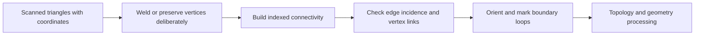

### A mesh is a neighborhood rule as well as a drawing

An abstract triangle is a set of three vertex identities; a geometric triangle is the flat region spanned by three non-collinear positions. A finite simplicial complex contains vertices, edges and triangles, includes every face of each simplex, and requires two simplices to intersect only along a shared face or not at all. For example, if a triangle is present, all three of its edges and all three of its vertices must also be present. Two triangles cannot cross in their interiors and still be a simplicial complex. This is a combinatorial definition; a geometric realization places those elements in space without violating the required intersections.

A surface is locally two-dimensional. Around an interior point there should be a neighborhood that looks like a disk; around a boundary point it should look like a half-disk. In a triangle mesh, a simple edge-incidence test is necessary: an interior edge has exactly two incident triangles, and a boundary edge has exactly one. An edge with three incident triangles is nonmanifold. But edge counts alone are not sufficient. At an interior manifold vertex, the incident triangles must form one circular fan; at a boundary manifold vertex, they must form one fan with two boundary ends. The link of a vertex—roughly, the small ring of directions and faces around it—should be a single cycle or a single interval, respectively.

Picture a bow-tie made of two disks that meet at one shared vertex. Every edge may have only one or two incident triangles, but the shared vertex has two disjoint fans. It is not a manifold point: a tiny neighborhood is two disks touching at a point, not one disk or half-disk. A “butterfly” vertex link test catches this case. Likewise, two sheets that meet along an edge make an edge with more than two incident faces. A connected component is instead a whole island of faces reachable from one another through shared edges (or under a deliberately chosen vertex-adjacency rule). A boundary is not the same as a crack: a legitimate open surface has boundary edges; a crack may be two disconnected edge sets whose positions nearly coincide but whose vertex identities differ.

The distinction between geometry and topology also applies to self-intersection. A connected, manifold mesh can fold through itself in 3D while its abstract adjacency remains manifold. Conversely, a mesh with no visible self-crossing may have a nonmanifold edge or bow-tie vertex. A topology test cannot certify geometric embedding, and an intersection test cannot certify manifold neighborhoods. A robust pipeline reports these separately.

Orientation is a consistent choice of direction for each face. For an oriented triangle $[a,b,c]$, its oriented boundary traverses $a\to b$, $b\to c$, and $c\to a$, with signs fixed by the chosen convention. If two neighboring faces are consistently oriented, they traverse their shared edge in opposite directions. Propagating this condition over a connected component either assigns consistent face orientations or discovers a contradiction, as on a nonorientable surface. In a closed orientable triangle mesh, consistent orientation supports a coherent normal direction. A mesh with a boundary can still be orientable; the boundary simply remains exposed.

Normals depend on geometry and orientation. Swapping two triangle vertices reverses its normal while leaving the triangle's location unchanged. A bag of faces with arbitrary winding can shade inconsistently and makes inside/outside tests unreliable. Orientation propagation can fix a consistent winding when the mesh is orientable, but it cannot decide which side the application wants to call “outside” without an additional convention, such as signed volume for a closed embedded shell or a known camera/seed point. Nonorientable surfaces such as the Möbius strip cannot have a globally consistent face-normal direction, even though each local patch is perfectly regular.

Topology has different failure modes from geometric quality. A zero-area triangle, a needle with a very short edge, an inverted element, or a self-intersection may be geometrically dangerous while the incidence structure remains manifold. A single edge with three incident faces is topologically nonmanifold even if its triangles are all well-shaped. Keep separate diagnostics for incidence, vertex links, orientation, degeneracy, and self-intersection; repairing one does not imply the others are repaired.

### The boundary of a boundary cancels

A useful way to turn connectivity into algebra is to treat a collection of vertices, edges, or triangles as a formal sum called a chain. For a triangle $[a,b,c]$, using integer coefficients and an orientation, define

$$
\partial_2[a,b,c]=[b,c]-[a,c]+[a,b].
$$

The signs encode direction: $-[a,c]$ is the same directed edge as $[c,a]$. The boundary operator extends by addition to a collection of faces. Now apply the edge-boundary operator to each term:

$$
\begin{aligned}
\partial_1\partial_2[a,b,c]
&=([c]-[b])-([c]-[a])+([b]-[a])\\
&=[c]-[b]-[c]+[a]+[b]-[a]=0.
\end{aligned}
$$

Every corner cancels. Informally, the edge boundary of a filled triangle has no leftover endpoint. The same principle applies to a triangulated patch: internal edges are traversed once in each direction by adjacent oriented faces and cancel; only the outside rim remains. This is the chain-level statement $\partial_1\partial_2=0$, “the boundary of a boundary is empty.” It is not a slogan pasted onto a mesh; it follows directly from the fact that each codimension-two face of a simplex occurs twice with opposite sign.

With coefficients modulo two, signs disappear because $1+1=0$. Each edge of a triangle appears twice after taking the boundary twice, so it cancels in pairs. Modulo-two chains are often easier for a first computation: a chain can be represented as a set of simplices, and addition is symmetric difference. But mod two forgets orientation signs and cannot distinguish some orientation-sensitive phenomena. For integer coefficients, the plus and minus directions carry more information.

For a concrete disk, split a square with corners $a,b,c,d$ along diagonal $ac$. Its two faces are $[a,b,c]$ and $[a,c,d]$. Their sum has boundary

$$
\partial([a,b,c]+[a,c,d])=[a,b]+[b,c]+[c,d]+[d,a],
$$

because the shared diagonal appears as $[a,c]$ in one face and $-[a,c]$ in the other. Thus the two-triangle patch has exactly the four-edge square boundary. If the same faces are wrapped and glued so every edge is shared consistently, every edge cancels and the surface is closed. This gives a practical orientation check: accumulate directed edge uses; interior edges should cancel, while boundary edges should occur once with a coherent loop direction.

A chain is a cycle when its boundary is zero. A boundary is a chain that is itself the boundary of a higher-dimensional chain. Every boundary is a cycle because $\partial^2=0$. A loop that bounds a filled disk in the mesh is a 1-cycle that is also a 1-boundary. A loop around a tunnel may be a cycle but not the boundary of any mesh triangles. [[Concepts/Mesh topology and homology|Homology]] records cycles up to the addition of boundaries, which is a compact way of distinguishing loops that can be filled from loops that cannot.

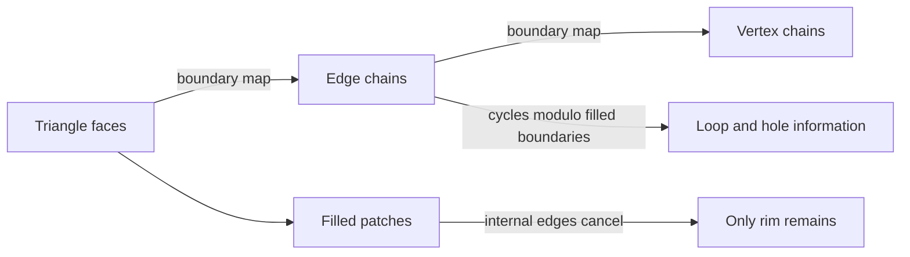

### Euler characteristic is a structural checksum, not a shape score

For a finite triangle mesh, count vertices $V$, edges $E$, and faces $F$. Its Euler characteristic is

$$
\chi=V-E+F.
$$

The alternating signs matter. Splitting one triangle by adding a vertex in its interior produces three triangles and three new edges: $\Delta V=1,\Delta E=3,\Delta F=2$, so $\Delta\chi=1-3+2=0$. Splitting an edge shared by two triangles adds one vertex, three edges and two faces, again preserving $\chi$. These local calculations explain why subdivision changes resolution without changing Euler characteristic. For a valid finite triangulation of the same surface, $\chi$ is independent of how finely it is triangulated.

A two-triangle square disk has four vertices, five edges and two faces, so $\chi=4-5+2=1$. A tetrahedron surface is a sphere triangulation with four vertices, six edges and four faces, giving $\chi=4-6+4=2$. For a torus, take an $n\times m$ periodic grid of vertices with $n,m\ge3$ and split every periodic square along a consistent diagonal. There are $V=nm$ vertices; horizontal and vertical edges contribute $2nm$, the diagonals contribute $nm$, so $E=3nm$; each square contributes two triangles, so $F=2nm$. Therefore $\chi=nm-3nm+2nm=0$. The counts assume periodic identifications form a valid simplicial torus without duplicated/degenerate simplex identities; the lower bound on grid size avoids the pathologies of collapsing too many periodic vertices together.

For a connected, compact, orientable surface with genus $g$ and $b$ boundary loops,

$$
\chi=2-2g-b.
$$

A sphere has $g=0,b=0$ and $\chi=2$. A torus has $g=1,b=0$ and $\chi=0$. A disk has $g=0,b=1$ and $\chi=1$. Here genus counts handles: a cup with one through-tunnel has genus one after it is closed; an open disk removed from a sphere contributes one boundary loop and lowers $\chi$ by one. For a connected nonorientable compact surface with cross-cap count $k$ and $b$ boundary loops, the corresponding formula is $\chi=2-k-b$. A mesh does not reveal which formula applies until connectedness, compactness, manifoldness, orientability, and boundary loops have been checked.

For multiple components, Euler characteristic adds across components. But an unexplained count alone is ambiguous: $\chi=2$ could describe one sphere or two disks; invalid connectivity may also produce a coincidental expected count. The formula is useful as a checksum after structural classification, not as a certificate that a mesh is a sphere. It says nothing about triangle shape, embedded self-intersections, physical dimensions, or whether a small handle is a scan artifact.

The same count can be written using Betti numbers, the number of independent homology classes in each dimension:

$$
\chi=\beta_0-\beta_1+\beta_2.
$$

For a finite 2D complex, $\beta_0$ counts connected components, $\beta_1$ counts independent nonfillable loops, and $\beta_2$ counts independent closed 2D shells. A disk has $(\beta_0,\beta_1,\beta_2)=(1,0,0)$, hence $\chi=1$. A sphere has $(1,0,1)$ and $\chi=2$. A torus has $(1,2,1)$ and $\chi=0$: it has two independent loop directions, around the tube and through the hole. These descriptions assume ordinary homology over a field or the corresponding ranks; torsion information in general integer homology is not represented by Betti numbers alone.


### Homology: ask which loops actually have a filling

The algebra can be understood with a practical question. Imagine a wire loop drawn on a triangulated surface. Is it the edge boundary of some set of triangles? If yes, it can be filled within the represented surface. If not, it winds around a genuine topological feature—or the mesh is missing data or has an invalid neighborhood. Homology groups formalize this question dimension by dimension, but an engineer can first use the idea without needing to memorize group theory.

At dimension zero, vertices are connected by edges. The number of independent groups of vertices after all edges are considered is $\beta_0$, the component count. At dimension one, edge cycles are loops. Loops that bound triangle patches count as trivial; the remaining independent classes contribute to $\beta_1$. At dimension two, a closed collection of oriented triangles with no exposed edge boundary can form a 2-cycle. On a closed orientable surface the whole surface is one such class, contributing $\beta_2=1$; on a disk, the outer rim is exposed so there is no 2-cycle of the whole patch and $\beta_2=0$.

This interpretation also clarifies a common language trap. “Hole” can mean a missing patch in a disk, a tunnel through a solid, a boundary loop, or a cavity in an embedded volume. These are different objects and appear in different dimensions of homology. The cup’s opening is a boundary component of its surface; a tunnel through a closed shell creates a nonfillable loop on the surface. Before reporting “number of holes,” state the represented space and the homology dimension.

A triangle boundary example is a small homology computation. Take the square disk with diagonal $ac$. The outside loop $[a,b]+[b,c]+[c,d]+[d,a]$ is the boundary of the two-face chain $[a,b,c]+[a,c,d]$, so that loop represents zero in $H_1$. On the torus, the loop along one periodic grid direction is not the boundary of a patch of torus triangles by itself; neither is a loop in the independent crossing direction. They generate two independent 1D classes. A contractible little loop around a single vertex is a cycle but is filled by the star patch around that vertex, so it is not an additional handle.

The count relationship $\chi=\sum_p(-1)^p\beta_p$ is useful because it connects a cheap combinatorial statistic to the “cycles that remain after fillings” view. A discrepancy between the count $V-E+F$ and a separately computed Betti-number alternating sum can indicate an implementation error in boundary matrices, an inconsistent simplex ordering, or a mistake in component or boundary treatment. Agreement is still not proof of correct geometry: two wrong calculations can agree, and Euler characteristic is a coarse invariant.


### Alpha complexes turn a union of balls into a finite topological object

A point cloud has no edges, faces, or loops until a scale rule is introduced. One geometric choice places a closed ball of radius \(r\) around every sample. The union

\[
U(r)=
\bigcup_{u\in S} B_u(r)
\]

is a continuous shape whose topology changes as \(r\) grows. Directly storing and analyzing the union is awkward, so computational topology seeks a finite complex with the same relevant topology.

Intersect each ball with its Voronoi cell,

\[
R_u(r)
=
B_u(r)\cap V_u.
\]

Each \(R_u(r)\) is convex. The **alpha complex** is the nerve of this convex cover:

\[
\operatorname{Alpha}(r)
=
\left\{
\sigma\subseteq S
\;\middle|\;
\bigcap_{u\in\sigma}R_u(r)\neq\varnothing
\right\}.
\]

Because every restricted cell lies inside its Voronoi cell, the alpha complex is a subcomplex of the Delaunay complex. The nerve theorem supplies the key bridge: under the convex-cover conditions, the combinatorial nerve has the same homotopy type as the union it represents.

This is more than a convenient point-cloud triangulation. The radius \(r\) becomes an explicit geometric scale. At tiny radius the complex contains isolated vertices. Edges enter as restricted balls meet, then triangles and tetrahedra fill cycles and cavities. The nested family

\[
\operatorname{Alpha}(r_1)
\subseteq
\operatorname{Alpha}(r_2)
\subseteq\cdots
\]

is therefore a natural filtration for persistent homology.

Delaunay sparsity also matters computationally. A Čech complex built from all intersecting ball subsets can become combinatorially large. Alpha complexes retain only simplices compatible with Voronoi/Delaunay geometry, often giving a much smaller complex while still representing the union-of-balls topology.

For scanned geometry, the interpretation must remain honest. Radius is not “noise level” by definition. Nonuniform sampling, anisotropic sensor uncertainty, missing regions, and outliers can make one global radius physically inappropriate. The complex faithfully answers the topology of the chosen union-of-balls model, not the unknown true surface without assumptions.

Source basis: Edelsbrunner and Harer, *Computational Topology: An Introduction*, Chapter III, especially the Delaunay and alpha-complex construction and the union-of-balls/nerve interpretation.

### Persistence asks which features survive scale changes

A scan has noise at several scales. Some short loops arise from tiny ripples; other holes belong to the cup’s structure. A single topology count cannot say whether a loop is a persistent feature or a small perturbation. A filtration makes scale explicit: build a nested sequence of complexes $K_0\subseteq K_1\subseteq\cdots\subseteq K_N$ by increasing a parameter, and track when each component, loop, or shell appears and when it becomes filled or merged.

One useful construction begins with sample points and a distance scale $r$. At a small scale each sample is isolated. As $r$ grows, nearby samples connect; groups merge into components, loops appear when edges close cycles, and loops disappear when filled faces enter. An alpha complex is a computationally efficient subcomplex related to unions of balls around sample points. Another option is a sublevel filtration of a scalar field on an already triangulated surface: assign a value to each vertex and add a simplex when its highest-valued vertex is reached, ensuring all faces of a simplex have already appeared. The choice of function and filtration determines what “scale” means.

A feature has a birth parameter and a death parameter. Their difference, [[Concepts/Persistent homology|persistence]], is its lifetime in the filtration. In a diagram, each feature is a point $(b,d)$ above the diagonal, and its vertical distance $d-b$ is persistence. A tiny noisy loop that appears and fills over a narrow range is often short-lived. The cup’s larger opening-related feature may survive across a much wider range. The diagram is a diagnostic of scale-stability, not a truth oracle: an intentionally small handle can also be short-lived, and a long-lived artifact caused by a systematic scan gap can look significant.

For a tiny explicit example, add three vertices of a triangle first, then its three edges, then its face. The first two edges join the vertices into one component; the third edge closes a loop and creates a 1-cycle; the triangle then fills that cycle. Each isolated vertex births a connected component. As edges merge components, an elder-rule pairing kills the younger component classes; one oldest component remains as an essential ordinary $H_0$ class when the completed triangle is connected. With tied birth values, a fixed tie-breaking order chooses the representative without changing the persistence multiset. The 1D feature is born at the edge that closes the loop and dies when the face arrives. If filtration values are $0,0.1,0.2$ for vertices, edges, and face, respectively, the 1D lifetime is only about $0.1$ in the selected scale. That number is meaningful only relative to units, sampling density and the filtration rule.

In a simplicial filtration, simplex values must be monotone with inclusion: a face cannot arrive after its coface. Persistence algorithms encode the boundary of each simplex as a column in a boundary matrix, then reduce columns in order so repeated lowest rows are eliminated. A zero reduced column corresponds to a cycle-birth event; a nonzero column pairs with the simplex that kills a class. The matrix view explains why adding the triangle kills the loop it bounds. It also makes clear why a boundary operator must satisfy $\partial^2=0$: without that, the algebraic events would not describe cycles and fillings consistently.

Persistence is often presented as robust to small perturbations, but translating that theorem into a mesh cleanup threshold requires care. The theorem concerns a specified function and metric, with a chosen distance between diagrams; it does not say that every short-lived feature is noise or that every significant geometric defect will be detected. An engineering workflow should show the filtration parameter, its physical or normalized units, the sampling assumptions, coefficient field, persistence threshold and a visual or analytic justification. Preserve the persistence diagram or feature list as diagnostic evidence rather than silently deleting geometry.


### Persistence stability says small function perturbations cannot move the diagram arbitrarily far

A persistence diagram is useful as a measurement only if a small perturbation of the measured function does not cause arbitrary topological chaos in the output. Edelsbrunner and Harer make this precise with the bottleneck metric.

For two persistence diagrams \(X\) and \(Y\), augment each with diagonal points so short-lived features can be matched to the diagonal. The bottleneck distance is

\[
W_\infty(X,Y)
=
\inf_{\eta:X\to Y}
\sup_{x\in X}
\|x-\eta(x)\|_\infty,
\]

where \(\eta\) ranges over bijections respecting multiplicity. It asks for the matching whose worst paired displacement is as small as possible.

For monotone filtration functions \(f\) and \(g\) on the same complex, the stability theorem gives

\[
W_\infty(
\operatorname{Dgm}_p(f),
\operatorname{Dgm}_p(g)
)
\le
\|f-g\|_\infty.
\]

A corresponding theorem is developed for tame continuous functions on triangulable spaces. The important claim is quantitative: if every function value moves by at most \(\varepsilon\), then no persistence point needs to move by more than \(\varepsilon\) in bottleneck distance.

This does **not** say every short-persistence feature is noise. It says the representation is stable with respect to perturbations measured in a specified norm of a specified function. A genuine tiny handle can have low persistence. A large systematic scan gap can have high persistence. Choosing a deletion threshold is still a domain decision.

The theorem is nevertheless valuable in a repair pipeline. If two depth reconstructions differ by a known bounded scalar-field perturbation, their persistence diagrams cannot disagree arbitrarily under the theorem’s conditions. Conversely, a diagram change much larger than the known perturbation scale suggests that some assumption changed—domain, filtration, registration, topology construction, or error bound—not merely tiny numerical noise.

A practical validation should therefore store the filtration function and its units alongside the diagram. Comparing diagrams without recording whether \(f\) was height, distance-to-samples, curvature, confidence, or density makes the stability number uninterpretable.

Source basis: *Computational Topology*, Chapter VIII on bottleneck/Wasserstein distances and the stability theorems for filtrations and tame functions.

### Morse functions and Reeb graphs compress how level-set components split and merge

Persistent homology summarizes births and deaths of algebraic features. A **Reeb graph** keeps a different piece of information: how connected components of a scalar function’s level sets evolve.

Given a continuous function

\[
f:X\rightarrow\mathbb R,
\]

two points are considered equivalent when they lie in the same connected component of the same level set. Quotienting \(X\) by that equivalence gives the Reeb graph \(R(f)\). Each point of the graph represents one contour/level-set component.

This is useful for iso-surface extraction. Instead of scanning an entire volume to discover every component of \(f^{-1}(a)\), the Reeb graph can identify how many contour components exist at level \(a\) and provide representatives from which each component can be traced. When the domain is contractible, as in a cube volume, the Reeb graph is a tree and is often called a contour tree.

For a Morse function on a manifold, critical points organize the graph. A local minimum creates a new level-set component; a saddle can merge or split components; a maximum destroys the final local component. On an orientable 2-manifold, minima/maxima correspond to degree-one nodes and the relevant saddles to degree-three nodes. Thus the topology of the scalar field becomes a one-dimensional combinatorial object.

The height function on a torus is the canonical mental model. Starting below the torus gives an empty sublevel set. Passing the lowest critical point creates a disk. A saddle changes it to a cylinder, another saddle changes the connectivity again, and the maximum completes the torus. The critical values mark where topology changes; between them, level-set structure is stable.

Reeb graphs are lossy summaries. They preserve component evolution and some one-dimensional connectivity, not the full topology or metric geometry. Edelsbrunner and Harer show, for example, that \(\beta_0(R(f))=\beta_0(X)\) and \(\beta_1(R(f))\le\beta_1(X)\). A graph is therefore useful for navigation through level sets and segmentation, but it should not replace a full homology/persistence computation when higher-dimensional features matter.

In graphics/vision, choose \(f\) to match the question: height for terrain, scalar density for volumetric imaging, geodesic distance for shape segmentation, curvature-like fields for surface decomposition, or confidence/error fields for reconstruction diagnostics. The graph summarizes **that function on that domain**, not shape in an absolute sense.

Source basis: *Computational Topology*, Chapter VI on Morse functions, piecewise-linear critical points, Reeb graphs/contour trees, and the relationship between graph nodes and critical points.

### The discrete Laplacian turns adjacency into a motion rule

Once neighborhoods are trustworthy, the mesh can approximate differential operators. A scalar function $f_i$ lives at vertex $i$. A simple uniform graph Laplacian compares it with its one-ring neighbors:

$$
(\Delta_{unif}f)_i=\frac{1}{|N(i)|}\sum_{j\in N(i)}(f_j-f_i).
$$

This asks whether the center differs from its neighboring average. It depends only on connectivity, not on edge lengths or triangle areas. On an irregularly sampled planar mesh, a linear coordinate field can have a nonzero uniform Laplacian even though the smooth plane’s Laplacian is zero. That makes the uniform operator useful for connectivity-driven relaxation in some remeshing steps, but a poor substitute for a geometry-aware surface Laplacian in general.

For triangle meshes, a common cotangent discretization uses the angles opposite edge $(i,j)$ in its incident triangles, $\alpha_{ij}$ and $\beta_{ij}$. Let $A_i$ be a chosen local area associated with vertex $i$, such as a mixed Voronoi area or a barycentric area. With one widespread sign convention,

$$
(\Delta f)_i=\frac{1}{2A_i}\sum_{j\in N(i)}(\cot\alpha_{ij}+\cot\beta_{ij})(f_j-f_i).
$$

The weights respond to triangle geometry; this formula follows from integrating the piecewise-linear gradient around a vertex control region. It is widely used for smoothing, parameterization and shape processing. The area denominator is essential when interpreting the result as an averaged operator. An equivalent implementation often builds a stiffness matrix $S$ from edge cotangents and a mass matrix $M$ from vertex areas, then writes $\Delta f=-M^{-1}Sf$ under a positive-semidefinite stiffness convention. Verify the sign convention in the library before assuming a plus or minus in code.

For a numerical weight witness, take an interior edge whose two opposite angles are $45^\circ$ and $45^\circ$. Its cotangent sum is $1+1=2$, so the edge contributes weight $2$ before the shared $1/2$ factor. If one opposite angle is $120^\circ$ and the other is $30^\circ$, the sum is $\cot120^\circ+\cot30^\circ=-1/\sqrt3+\sqrt3=2/\sqrt3>0$. But if both opposite angles are $120^\circ$, the sum is negative. Negative cotangent edge weights are possible on non-Delaunay or obtuse configurations; they can invalidate maximum-principle intuitions and may produce flipped triangles in some algorithms. Do not claim every cotan weight is nonnegative.

The mass matrix connects per-vertex samples to surface area. A diagonal lumped mass matrix might use $M_{ii}=A_i$; a consistent finite-element mass matrix can have off-diagonal entries. Since $M_{ii}$ has units $\mathrm m^2$, while the cotangent stiffness weights are dimensionless, $M^{-1}S$ has units $1/\mathrm m^2$. For a scalar field $f$ with arbitrary field units, $\Delta f$ has units $f/\mathrm m^2$. If $f$ is position $\mathbf x$ in metres, then $\Delta\mathbf x$ has units $1/\mathrm m$. In the diffusion equation $\partial f/\partial t=\lambda\Delta f$, $\lambda$ therefore has units $\mathrm m^2/\mathrm s$ when the Laplacian is unnormalized in physical coordinates.

The stiffness matrix also has an energy interpretation. Define $w_{ij}=(\cot\alpha_{ij}+\cot\beta_{ij})/2$, use one incident angle on a boundary edge, and define the stiffness matrix by $S_{ij}=-w_{ij}$ off the diagonal and $S_{ii}=\sum_j w_{ij}$. Then the piecewise-linear finite-element Dirichlet energy is $E(f)=\frac12 f^T S f=\frac12\sum_{\{i,j\}\in E}w_{ij}(f_i-f_j)^2$, with each undirected edge counted once. Minimizing it makes neighboring values vary less. Applied to vertex positions, it pulls the shape toward a fairer surface. That is the source of the intuitive “move toward the average” behavior, but the precise average depends on the weights and area normalization.

#### Nonnegative energy and nonnegative weights are different promises

In [[PDE fields and discrete Laplacians|mesh-field calculations]], the negative-weight warning raises a fair question: if an edge contributes a negative term, how can the assembled stiffness matrix still have nonnegative energy? Return to one triangle before trusting the matrix.

On a nondegenerate triangle $T$, use three linear basis functions $\phi_a,\phi_b,\phi_c$. Each is one at its own vertex and zero at the other two; between vertices they interpolate linearly. A sampled scalar field becomes $f_h=f_a\phi_a+f_b\phi_b+f_c\phi_c$. Its gradient is constant inside this flat triangle. With positive triangle area $A_T$, define the local stiffness entries by

$$
(S_T)_{ij}=A_T\,\nabla\phi_i\cdot\nabla\phi_j.
$$

Consequently,

$$
f_T^{\mathsf T}S_Tf_T
=A_T\left\|\sum_i f_i\nabla\phi_i\right\|^2\geq0,
\qquad E_T(f)=\tfrac12f_T^{\mathsf T}S_Tf_T.
$$

This is a squared gradient, so its sign does not depend on whether the triangle is acute. Assembling a mesh adds these triangle energies. The usual piecewise-linear finite-element stiffness therefore remains **positive semidefinite**—every field has nonnegative quadratic energy—on nondegenerate triangles even when some cotangent edge weights are negative. A constant field has zero gradient, which explains the zero mode. On a connected mesh, remove or constrain that mode before expecting the stiffness system to be positive definite.

The edge-sum expression above is another way to write the same assembled energy. Its edge terms are not independent knobs: their cotangents come from shared triangle geometry. A negative term can be outweighed by other terms while the full quadratic form stays nonnegative. Arbitrary signed graph weights do not inherit this finite-element guarantee.

Here is an original numerical example. Use coordinates in metres:

$$
a=(0,0),\quad b=(2,0),\quad c=(0.5,0.5),\quad A_T=0.5\,\mathrm{m^2}.
$$

The angle at $c$ is obtuse. For this single triangle, each boundary edge has one opposite cotangent, giving $w_{ab}=-0.25$, $w_{ac}=1.5$, and $w_{bc}=0.5$. The gradients and matrix are

$$
\nabla\phi_a=(-0.5,-1.5),\quad
\nabla\phi_b=(0.5,-0.5),\quad
\nabla\phi_c=(0,2)\quad[\mathrm{m^{-1}}],
$$

$$
S_T=
\begin{bmatrix}
1.25&0.25&-1.5\\
0.25&0.25&-0.5\\
-1.5&-0.5&2
\end{bmatrix}.
$$

Notice the positive off-diagonal entry $S_{ab}=0.25=-w_{ab}$. For $f=(0,1,0)$, the energy is still $E_T=0.125$. The independent gradient check is $\tfrac12(0.5)\|(0.5,-0.5)\|^2=0.125$. Zero row sums also make the matrix annihilate a constant field.

![[Visual Recall/University Graphics and Vision/cotan-energy-positivity.png]]

**Figure — energy and value range are different promises.** The left panel shows the negative boundary-edge weight. The right shows the step derived next: its energy falls even though one sample becomes negative. Both panels use the same triangle and matrix. This is a constructed numerical witness, not a measured mesh-processing benchmark.

#### A stable heat step can still create a negative sample

Evolve the field with $M\dot f=-\kappa Sf$, using a positive diagonal area mass matrix. Here the barycentric lumped choice is $M=(A_T/3)I=(1/6)I\,\mathrm{m^2}$. Take diffusivity $\kappa=1\,\mathrm{m^2/s}$ and timestep $h=0.01\,\mathrm s$. Explicit Euler gives

$$
f^{n+1}=f^n-h\kappa M^{-1}Sf^n,\qquad
Sf^n=(0.25,0.25,-0.5)^{\mathsf T},
$$

$$
f^n=(0,1,0)^{\mathsf T}
\quad\Longrightarrow\quad
f^{n+1}=(-0.015,0.985,0.030)^{\mathsf T}.
$$

The initial samples were nonnegative, but the first updated sample is negative. Decreasing this positive timestep does not change the sign of that first increment: it comes from a negative neighbor coefficient in the update matrix.

The example did not use an energy-unstable step. The eigenvalues of $S_T$ are $0$ and $(7\pm\sqrt{37})/4$. Since $M^{-1}=6I$, the largest decay rate of $\kappa M^{-1}S_T$ is about $19.6241\,\mathrm{s^{-1}}$. Explicit Euler's modal bound is $0<h<2/19.6241\approx0.1019\,\mathrm s$ for contraction of nonconstant modes. Our $0.01\,\mathrm s$ step is inside that interval, and its energy decreases from $0.125$ to $0.104525$.

Here **energy stability** means that the selected energy does not grow under the update. **Positivity preservation** means that nonnegative input values stay nonnegative. A **discrete maximum principle** is a related value-range guarantee; for an averaging update it prevents new values outside the old range. With lumped mass and nonnegative edge weights, explicit diffusion is a convex combination if $h\kappa S_{ii}/M_{ii}\leq1$ at every vertex: neighbor coefficients are nonnegative, the diagonal coefficient is nonnegative, and the row sums to one. A negative edge weight breaks this sufficient averaging argument.

The isolated triangle here has free, natural boundary conditions; its boundary samples can evolve. Pinning all three values would eliminate its dynamics. This demonstrates transient positivity failure, not an interior harmonic maximum on a boundary-only mesh. Zero row sums also conserve total mass-weighted field value in this exact explicit update. Conservation still does not constrain individual signs.

An implicit linear solve can improve the energy-stability restriction without automatically restoring positivity, preserving mesh volume, or preventing flipped triangles. Dissipating an energy, keeping a density nonnegative, maintaining a valid parameterization, and preserving a shape are different tests.

The supplied *Polygon Mesh Processing* develops basis gradients and the cotangent operator in physical PDF pp. 55–60 / printed pp. 43–48; physical p. 58 / printed p. 46 explicitly discusses negative weights. Its smoothing chapter supplies the flow context. The triangle, proof and trace here are an original teaching derivation. For integration, [libigl's cotmatrix documentation](https://github.com/libigl/libigl/blob/main/include/igl/cotmatrix.h) uses the opposite, negative-semidefinite convention: negate that matrix to obtain the positive stiffness $S$ used here.

There is a research reason to keep these properties separate. Wardetzky and colleagues prove a tradeoff between locality, symmetry, linear precision and positive weights for discrete Laplace operators on general triangle meshes in their framework. Their result concerns a stated family and collection of properties; it does not say every useful discretization is unstable. Read the property definitions before choosing a substitute. [*Discrete Laplace Operators: No Free Lunch*](https://www.cs.columbia.edu/cg/pdfs/1180993110-laplacian.pdf).

##### Complete single-triangle energy witness

This standard-library Python program builds the matrix from basis gradients, checks it against the independent matrix above, and reproduces the negative sample with decreasing energy. It also checks the constant mode, orientation relabeling, uniform scaling and rejection of a degenerate triangle. Its selected energy vectors are numerical witnesses; the squared-gradient derivation establishes the general semidefinite claim. This is a planar element laboratory, not a mesh loader, sparse solver or production smoother.

```python
#!/usr/bin/env python3
"""One planar P1 triangle: energy stability does not imply positivity.

Original teaching witness, not a full mesh solver. Standard library only.
"""
import json
import math


def triangle_stiffness(points):
    """Return positive-convention stiffness and area for a finite 2D triangle."""
    if len(points) != 3 or any(len(p) != 2 for p in points):
        raise ValueError("expected three planar vertices")
    if not all(math.isfinite(v) for p in points for v in p):
        raise ValueError("nonfinite coordinate")
    (x0, y0), (x1, y1), (x2, y2) = points
    det = (x1-x0)*(y2-y0) - (x2-x0)*(y1-y0)
    if not math.isfinite(det) or det == 0:
        raise ValueError("unrepresentable or degenerate triangle")
    area = abs(det)/2
    gradients = [((y1-y2)/det, (x2-x1)/det),
                 ((y2-y0)/det, (x0-x2)/det),
                 ((y0-y1)/det, (x1-x0)/det)]
    stiffness = [[area*sum(a*b for a, b in zip(gi, gj))
                  for gj in gradients] for gi in gradients]
    if area == 0 or not all(math.isfinite(v) for row in stiffness for v in row):
        raise ValueError("unrepresentable area or stiffness")
    return stiffness, area


def multiply(matrix, vector):
    return [sum(a*b for a, b in zip(row, vector)) for row in matrix]


def energy(matrix, vector):
    return sum(a*b for a, b in zip(vector, multiply(matrix, vector)))/2


def require(condition, message):
    if not condition:
        raise RuntimeError(message)


def main():
    vertices = [(0., 0.), (2., 0.), (.5, .5)]
    stiffness, area = triangle_stiffness(vertices)
    expected = [[1.25, .25, -1.5], [.25, .25, -.5], [-1.5, -.5, 2.]]
    require(stiffness == expected and area == .5, "independent matrix trace")
    require(multiply(stiffness, [1., 1., 1.]) == [0., 0., 0.], "constant mode")
    for field in ([1., 0., 0.], [0., 1., 0.], [0., 0., 1.], [1., -2., 3.]):
        require(energy(stiffness, field) >= 0, "selected energy witnesses")
    # Uniform scaling leaves 2D P1 stiffness unchanged but scales mass as area.
    scaled, scaled_area = triangle_stiffness([(3*x, 3*y) for x, y in vertices])
    require(all(math.isclose(a, b) for r, s in zip(stiffness, scaled)
                for a, b in zip(r, s)) and scaled_area == 9*area, "scale law")
    reversed_s, _ = triangle_stiffness([vertices[i] for i in [0, 2, 1]])
    require(reversed_s == [[expected[i][j] for j in [0, 2, 1]]
                          for i in [0, 2, 1]], "orientation permutation")
    try:
        triangle_stiffness([(0., 0.), (1., 0.), (2., 0.)])
    except ValueError:
        pass
    else:
        raise RuntimeError("degenerate triangle accepted")
    old = [0., 1., 0.]
    mass, step = area/3, .01  # diffusivity = 1 m^2/s; step in seconds
    new = [u-step*su/mass for u, su in zip(old, multiply(stiffness, old))]
    expected_new = [-.015, .985, .03]
    require(all(math.isclose(a, b) for a, b in zip(new, expected_new)), "step trace")
    require(min(new) < 0 and energy(stiffness, new) < energy(stiffness, old),
            "energy decrease with positivity violation")
    require(math.isclose(sum(new), sum(old)), "mass-weighted mean conservation")
    print(json.dumps({"stiffness": stiffness, "area": area, "new": new,
                      "energy_before": energy(stiffness, old),
                      "energy_after": energy(stiffness, new), "result": "PASS"}))


if __name__ == "__main__":
    main()
```

#### Smoothing is a flow with side effects

A diffusion equation evolves a scalar field by $\partial f/\partial t=\lambda\Delta f$. The same equation applied to mesh positions gives a discrete Laplacian smoothing flow. Explicit Euler with step $h$ updates $X^{n+1}=X^n+h\lambda\Delta X^n$. It is simple, but stability demands a sufficiently small step relative to the mesh and weights. An implicit step solves a sparse system, commonly $(M+h\lambda S)X^{n+1}=MX^n$, which is stable for much larger steps for this linear diffusion model. That numerical stability does not guarantee shape preservation: the mesh can shrink, lose volume, cross itself, or flip triangles.

The cotangent Laplacian applied to coordinates approximates a mean-curvature normal, so the vertices move roughly in the normal direction on a well-behaved mesh. Uniform Laplacian motion also relaxes the tangential distribution of vertices, which can be helpful when regularizing a triangulation. The tradeoff matters: cotangent smoothing can preserve local triangle shapes better, whereas uniform smoothing can improve a poor vertex distribution but distort the represented surface. Both can shrink the object. Boundary vertices require a policy: pin them, slide them along the boundary, use a boundary-aware operator, or allow the boundary to move. A free boundary can retreat or warp even while interior smoothing appears reasonable.

Diffusion removes high-frequency variation; it is not a semantic noise detector. Repeated smoothing blurs sharp features, small handles and high-curvature details along with measurement noise. A feature-aware workflow uses constraints, anisotropic weights, bilateral or robust variants, multiscale inspection, or a remeshing-aware sequence. Compare before/after Hausdorff or sampled point-to-surface error, volume change for closed shells, normal deviation, and topology counts. An implicit solve that succeeds is evidence of a solved linear system, not evidence that the resulting mesh is anatomically or geometrically faithful.

### Remeshing improves elements while preserving the intended surface

Remeshing resamples a surface to improve element type, shape, size distribution, or alignment. A triangle close to equilateral is isotropic and often gives better-conditioned finite-element systems than a needle or cap. In regions with strong directional curvature, aligned anisotropic elements can represent shape with fewer faces. A uniform edge target is not always best: adaptive sizing can place smaller elements near high curvature, sharp creases, or high-error regions, while using larger faces on nearly flat areas.

A common isotropic remeshing loop uses four local operations: split edges that are too long, collapse edges that are too short, flip edges to improve valence or local Delaunay structure, and relocate vertices tangentially or by projection to the reference surface. Each operation solves a different problem. Splitting adds resolution; collapse removes it; flipping changes connectivity without moving the represented vertices; relocation changes geometry. Their order, thresholds, boundary handling and projection policy affect the result. A good remesher maintains correspondence to the source surface, because a sample projected to the wrong nearby sheet can jump across a thin gap or fold-over.

The Delaunay/Voronoi connection explains one quality criterion. A planar Delaunay triangulation tends to maximize the minimum angle among triangulations of the same point set, avoiding very small angles where possible. On a surface, restricted Delaunay and related methods use Voronoi cells intersecting the surface to guide triangulation. These are useful tools, but no triangulation can eliminate all bad angles when the geometry, constraints, or feature layout demands them. Sharp edges and corners need explicit protection; otherwise remeshing may round them or alias them with a misplaced sample.

A surface can be well-shaped as a triangle set yet topologically wrong. Edge splits and face splits that respect the existing complex preserve its topology. An edge flip in a valid two-triangle disk replaces one diagonal with another while retaining the local disk, assuming the quadrilateral is valid and no duplicate edge or forbidden feature is introduced. An edge collapse is more delicate. To preserve topology, the common neighbors of the two endpoints must match the vertices opposite the collapsed edge (the link condition), with additional rules at boundaries. If the condition fails, the operation can pinch a surface, merge components, create a nonmanifold edge, or remove a handle. Test topology before committing each collapse, not only after the whole decimation pass.

### Simplification trades face count against approximation error

A mesh may contain far more triangles than display, storage, or simulation requires. Simplification removes vertices and faces while trying to keep the surface close to its source. An edge collapse merges neighboring vertices and deletes adjacent degenerate faces; a halfedge collapse moves one endpoint to the other and has no free placement choice. A priority queue ranks legal candidates. Geometry quality can be ranked by a local distance, normal change, triangle quality, curvature, color or texture error.

A popular quadric error measure accumulates planes of nearby faces and evaluates the squared distance of a candidate point to those planes. It is fast and compact, but it is an approximation: the associated plane distances can overestimate or underestimate actual mesh-to-mesh distance. Hausdorff-style measurements are more directly tied to worst-case distance but more expensive. The chosen tolerance, metric, sample set and directionality must be recorded. A one-sided distance from source samples to the simplified surface does not bound the reverse distance unless both directions are evaluated.

Topology-preserving collapses preserve the connected surface type under the stated local conditions; they do not preserve geometric details exactly. A narrow tunnel can remain topologically present yet become so thin that it is visually unusable. A sharp crease can be smoothed by vertex relocation. Conversely, a simplifier that allows topology changes may remove tiny handles or components on purpose, but that is a different operation with a different contract. Keep “preserve surface topology” separate from “preserve shape within tolerance.” Both deserve measured error checks.

For the cup scan, suppose the source has a thin handle and a slightly noisy rim. A topology-preserving simplifier should keep the handle loop connected and the opening boundary intact while reducing redundant faces. Its acceptance report might state: component count unchanged; boundary loop count unchanged; Euler characteristic unchanged; no nonmanifold edges or vertices introduced; sampled bidirectional surface error below $0.4\,\mathrm{mm}$; maximum normal change under a declared threshold. These tests still do not prove the simplified cup looks right, but they make its guarantees inspectable. If the handle disappears because a collapse merged opposite sides, the link-condition gate failed or the algorithm intentionally permitted a topology change.

Repair and simplification should not be conflated. A hole-filling patch changes an open boundary into a closed surface, so it intentionally changes topology and needs a modeling assumption about the missing surface. A local repair algorithm may cut a nonmanifold edge into multiple manifold sheets; that can produce valid components but may duplicate geometry. Closing a scan seam by snapping near boundary edges can create foldovers or self-intersections even if the boundary count improves. Repair tools should report each change and expose the inferred intent rather than silently claim the original topology was recovered.


### Surface repair and volumetric repair preserve different kinds of evidence

“Repair the mesh” hides an ill-posed inference problem: the corrupted input does not uniquely determine the surface the author or scanner intended. Botsch et al. therefore distinguish two broad algorithm families whose guarantees and failure modes are fundamentally different.

**Surface-oriented repair** operates directly on the polygons. It can snap nearby boundary elements, stitch gaps with triangle strips, fill holes with a patch, or explicitly split triangles at self-intersections. Because most unaffected polygons survive unchanged, it can preserve local geometry, material attributes, curvature-line connectivity, UVs, and other authored structure. That precision is its strength.

Its weakness is that reliable artifact classification may itself be difficult. Two boundaries close in space may be opposite sides of a legitimate thin feature rather than a gap to close. Large overlaps and self-intersections can be numerically delicate. Surface repair often needs tolerance choices or user guidance because geometry alone may not reveal intent.

**Volumetric repair** first converts the input to a representation that classifies regions/cells as inside, outside, or intersected, using a regular grid, octree, BSP-like partition, Delaunay-based volume, or another spatial decomposition. A surface is then extracted from the repaired volume. Because the intermediate representation encodes a consistent inside/outside field, intersections, inconsistent face orientation, gaps, and open seams can disappear by construction. Morphological operations can remove features below a chosen scale.

That robustness costs information. Voxelization/resampling can alias thin features and sharp edges. Original polygon connectivity and per-element attributes are not automatically preserved. The extracted mesh can contain far more triangles and require subsequent decimation/remeshing. Resolution becomes part of the repair model: a feature smaller than the voxel/octree tolerance can be intentionally or accidentally erased.

This distinction is important for scan pipelines such as Maveb. A local surface repair is suitable when the input is already mostly trustworthy and preserving measured geometry matters. A volumetric reconstruction is attractive when watertightness/topological consistency matters more than retaining every original triangle. A hybrid can use volumetric reasoning to decide topology and then project or optimize the final surface back toward source samples.

A repair report should therefore say **what was inferred**: gaps closed below which tolerance, holes filled under which patch energy, components merged under which proximity rule, handles removed below which scale, and how far output points moved from input evidence. “Watertight” is one property, not proof of fidelity to the intended object.

Source basis: *Polygon Mesh Processing*, Chapter 8, especially the artifact taxonomy, distinction between surface-oriented and volumetric repair, regular/adaptive volumetric approaches, and the trade between robust topology and resampling/detail preservation.

### A repeatable mesh-processing checkpoint

For each input, record component count under the chosen adjacency rule, boundary loops, edge incidence histogram, vertex-link classification, orientation consistency, degenerate face count, and self-intersection status. Then record $V,E,F$, Euler characteristic, and—when needed—Betti numbers or persistence features. This lets later operations state which quantities they should preserve. For a closed orientable connected shell, a computed $\chi=2$ agrees with a sphere only after manifoldness, orientability, and connectedness are established. For a cup surface with a rim, use a surface-with-boundary model; do not label it a closed shell just because the scan looks solid from one camera angle.

A minimal regression set can use: the two-triangle disk, tetrahedron sphere, periodic-grid torus, two disconnected disks, a bow-tie vertex, an edge with three incident faces, a Möbius strip triangulation, and a geometrically self-intersecting but combinatorially manifold example. Expected results should include separate topology and geometry flags. Run subdivision on the disk and verify $\chi$ remains one. Apply a valid edge collapse and verify the component count and Euler characteristic remain as expected. Attempt an invalid collapse at a bow-tie or boundary configuration and confirm it is rejected before mutation.

For discrete operators, test that a constant scalar field has zero Laplacian, that a linear field on a regular planar patch has near-zero cotangent Laplacian at interior vertices, and that the assembled stiffness matrix is symmetric under the stated convention. Check units by scaling all coordinates by $s$: area entries scale as $s^2$, cotangent weights remain unchanged, and the coordinate Laplacian scales as $1/s$. For diffusion, compare explicit and implicit updates at the same total time, measure shrinkage and error, and test at more than one step size. For remeshing and simplification, measure quality, sampled distance, normal deviation, component and boundary changes, and topology invariants before and after.

The scanned soup can now become a trustworthy working mesh, but only in a scoped sense. Explicit adjacency tells us what meets what. Manifold and orientation tests tell us whether local surface rules hold. Chain boundaries reveal which loops enclose faces. Euler characteristic and homology describe coarse global structure. Persistence asks which structures endure as a chosen scale varies. The cotangent Laplacian turns local geometry into a differential update; mass matrices supply area weighting. Remeshing and simplification alter sampling and face count under explicit shape and topology constraints. None of these steps proves all the others. Trust comes from naming each representation, assumption, operation, invariant and measured error separately.

## Lens optics, focus, and image formation

Optics forms an image before a sensor samples it; focus and blur follow from lens geometry and output tolerance.

### How a lens forms an image

A lens bends rays by refraction. In the thin-lens approximation, object distance $u$, image distance $v$, and focal length $f$ satisfy

$$
\frac{1}{f}=\frac{1}{u}+\frac{1}{v}.
$$

This model is useful near the optical axis and for understanding focus, but a real photographic lens is a group of elements whose surfaces and refractive indices are chosen to manage aberrations. When an object lies closer than the focal length, outgoing rays diverge and the eye traces them backward to a virtual image. A magnifying glass exploits that virtual image. A close-up lens adds converging power in front of a camera lens; an extension tube moves the lens away from the sensor and changes the focus range; a macro lens is designed to focus at short distances and often supports near one-to-one image magnification. A teleconverter increases effective focal length while reducing the light reaching the sensor. These accessories change practical focus and exposure behavior, not the basic viewpoint rule. [[#PHOTO-03 - Photography session 03|PHOTO-03]]

Focus is not simply in or out across the whole scene. A point away from the focus distance forms a blur circle on the sensor. If the circle is smaller than a chosen limit, we treat the point as acceptably sharp. The [[Lens optics and depth of field|circle of confusion]] depends on sensor size, enlargement, viewing distance, and the detail we want to see. **Depth of field** is the range of distances whose blur circles stay below that limit. It is a viewing tolerance, not a physical slab with sharp boundaries. A print may look sharp across a room but reveal defocus when enlarged and viewed closely. [[#PHOTO-03 - Photography session 03|PHOTO-03]] · [[#PHOTO-11 - Photography session 11|PHOTO-11]]

The hyperfocal distance is the focus distance that places infinity at the far acceptable depth-of-field boundary. Focusing at or near that distance is useful for landscapes when a foreground and distant background both need acceptable sharpness. Stopping down increases depth of field, but it does not increase all forms of sharpness without limit: a smaller aperture also increases diffraction. Bokeh names the character of defocused highlights and backgrounds, not merely the amount of blur. Out-of-focus lights may be smooth discs, polygonal shapes from the aperture, cat-eye shapes near the field edge, or rings and swirls caused by optical design and vignetting. These appearances can become compositional features. [[#PHOTO-03 - Photography session 03|PHOTO-03]] · [[#PHOTO-04 - Photography session 04|PHOTO-04]]

Real lenses exhibit several aberrations. Spherical aberration occurs when marginal and paraxial rays do not meet at the same focus. Chromatic aberration arises because refractive index varies with wavelength, so colors focus or magnify differently. Coma makes off-axis points form comet-like shapes; astigmatism gives different focus for tangential and sagittal directions; field curvature means a flat subject may not focus uniformly on a flat sensor; distortion bends image geometry into barrel or pincushion forms. Vignetting reduces brightness toward corners. Internal reflections create flare and ghost images. Coatings, element shapes, lens groups, and software correction trade among these defects, size, weight, cost, transmission, and artistic character. A lens used “wrong” by a technical chart can still be useful if its flare, swirl, or distortion suits the image. [[#PHOTO-04 - Photography session 04|PHOTO-04]] · [[#PHOTO-14 - Photography session 14|PHOTO-14]] · [[#PHOTO-17 - Photography session 17|PHOTO-17]]

Diffraction is a wave effect, not a manufacturing defect. Light passing through a finite aperture spreads into a point-spread pattern with a central Airy disc and weaker rings. Stopping down can improve aberrations and increase depth of field, but eventually the growing diffraction blur reduces fine detail. The practical optimum depends on the lens, sensor sampling, intended output size, focus range, and whether depth of field matters more than pixel-level acutance. “Use the sharpest aperture” is not a complete photographic instruction; one must ask which scene details should remain in focus. [[#PHOTO-04 - Photography session 04|PHOTO-04]]

### Focus is determined by a tolerance and an output

Imagine a portrait made with a 300-mm lens at a wide aperture. The eye nearest the camera may be perfectly focused, while the far eye or hair is already outside the acceptable blur range. Whether the portrait “has enough depth of field” depends on how it will be displayed. At a small social-media size, downsampling averages small blur differences away. At a life-size print viewed close, the same differences become visible. Richard Avedon’s large portraits exploit scale and detail; a modest screen preview does not give the same viewing experience. [[#PHOTO-03 - Photography session 03|PHOTO-03]] · [[#PHOTO-16 - Photography session 16|PHOTO-16]]

The thin-lens model gives a simple depth-of-field calculation. Focusing at distance $s$ forms a sharp image at $v_s$. An object at another distance would focus at $v_o$. The sensor stays at $v_s$, so the rays have not yet converged there; they make a blur circle instead. For a fixed lens and acceptable circle diameter $c$, a smaller aperture narrows the ray cone and reduces $c$. Choosing a smaller $c$—for a larger print or closer viewing—also narrows the acceptable depth range. So the hyperfocal distance depends on focal length, aperture, and the chosen blur limit; it is not a property of the lens alone. [[#PHOTO-03 - Photography session 03|PHOTO-03]] · [[#PHOTO-04 - Photography session 04|PHOTO-04]]

There are situations where one focus plane cannot cover a subject. Focus stacking captures multiple focus distances and combines the sharpest local regions. It works best for static scenes because changes in pose, wind, or occlusion complicate alignment. A light-field camera records angular information as well as position, allowing refocusing or an all-in-focus render after capture, but allocating sensor samples across those dimensions reduces conventional spatial resolution. A coded-aperture method can deliberately produce a known blur that software deconvolves across a wider focus range; deconvolution amplifies noise and model errors. The design question is whether the additional computational flexibility is worth the spatial detail and noise cost. [[#PHOTO-11 - Photography session 11|PHOTO-11]] · [[#PHOTO-17 - Photography session 17|PHOTO-17]]

### Deriving the acceptable focus interval

The thin-lens equation gives a convenient way to calculate focus tolerance. Let the camera focus at subject distance $s$, and let the corresponding sharp image distance be $v_s$. If an object instead lies at distance $x$, its ideal image would form at $v_x$. The sensor remains at $v_s$, so the rays from the object have not yet converged to a point when they reach it. For an aperture diameter $D$, similar triangles give the blur-circle diameter $b$ on the sensor:

$$
b = D\frac{|v_s-v_x|}{v_x}.
$$

The thin-lens equation can express each image distance as $v_s=fs/(s-f)$ and $v_x=fx/(x-f)$. Substituting those expressions and using $D=f/N$, where $N$ is the f-number, produces the blur circle for an object distance $x$:

$$
b=\frac{f^2}{N}\frac{|s-x|}{x(s-f)}.
$$

This is a paraxial thin-lens estimate: distances are measured from the lens’s principal plane, the lens is treated as thin, the subject is well outside the focal length, and the blur is judged geometrically on the sensor. Real compound lenses, pupil magnification, focus breathing, diffraction, aberrations, and print enlargement add detail to the model. The equation nevertheless shows the main dependencies: blur grows with aperture diameter, with focal length squared when f-number is held fixed, and with the separation between the focused and unfocused subject distances.

Set the largest acceptable blur to $c$. The near and far depth limits occur where $b=c$. Solving for the object distance gives

$$
D_{\mathrm{near}}=\frac{s(H-f)}{H+s-2f},\qquad
D_{\mathrm{far}}=\frac{s(H-f)}{H-s},
$$

where $H$ is the hyperfocal distance,

$$
H=\frac{f^2}{Nc}+f.
$$

When $s\ge H$, the denominator in the far-distance expression is zero or negative, which means the far acceptable boundary is at infinity. In the common photographic case where $H$ is much larger than $f$, the extra $f$ is small relative to $f^2/(Nc)$, so the approximation $H\approx f^2/(Nc)$ is often used. It is important to know which version is being applied, especially for close-up work where the simple approximations become less reliable.

For a numerical example, take a $50\,\mathrm{mm}$ lens at $f/8$ and choose an acceptable circle of confusion of $0.03\,\mathrm{mm}$. The latter is a conventional full-frame planning value, not a universal sharpness standard; a very large print viewed closely would call for a smaller $c$. The hyperfocal distance is

$$
H=\frac{(50\,\mathrm{mm})^2}{8(0.03\,\mathrm{mm})}+50\,\mathrm{mm}\approx10{,}467\,\mathrm{mm}=10.47\,\mathrm{m}.
$$

Focus at $s=3.00\,\mathrm{m}$, keeping all distances in millimeters while evaluating the formulas. Then

$$
D_{\mathrm{near}}=\frac{3000(10467-50)}{10467+3000-100}\,\mathrm{mm}\approx2.34\,\mathrm{m},
$$

$$
D_{\mathrm{far}}=\frac{3000(10467-50)}{10467-3000}\,\mathrm{mm}\approx4.19\,\mathrm{m}.
$$

So the approximate acceptable interval is $2.34$ to $4.19\,\mathrm{m}$ under the stated assumptions. Focus at $H\approx10.47\,\mathrm{m}$ and the near boundary is approximately $H/2\approx5.23\,\mathrm{m}$ while the far boundary reaches infinity. This result does not say that the landscape is equally sharp at every distance. It says that blur remains under the chosen circle-of-confusion tolerance, which was selected for a particular format and viewing condition. For a foreground flower at $0.5\,\mathrm{m}$ and a mountain at infinity, neither focusing at $3\,\mathrm{m}$ nor using the hyperfocal setting can make the flower and mountain both meet that same criterion with this lens and aperture. The photographer must change aperture, focus strategy, focal length, viewpoint, or use focus stacking, and then judge the resulting diffraction and motion costs. [[#PHOTO-03 - Photography session 03|PHOTO-03]] · [[#PHOTO-04 - Photography session 04|PHOTO-04]]

The Airy pattern supplies another scale for that judgment. For a circular aperture, monochromatic light of wavelength $\lambda$ has a central diffraction-disc diameter to the first dark ring of approximately

$$
d_{\mathrm{Airy}}=2.44\lambda N.
$$

At a green wavelength of $0.55\,\mu\mathrm{m}$ and $f/8$, this idealized diameter is $2.44\times0.55\times8\approx10.7\,\mu\mathrm{m}$. With a $4\,\mu\mathrm{m}$ pixel pitch it spans about $2.7$ pixel intervals; with a $6\,\mu\mathrm{m}$ pitch it spans about $1.8$. At $f/16$ the ideal Airy diameter doubles to roughly $21.5\,\mu\mathrm{m}$. These ratios do not mean that detail smaller than one Airy disc disappears abruptly: sensor sampling, demosaicing, contrast, color wavelength, and output enlargement all affect visibility. They do show why a small-aperture image can look softer at pixel level even when the lens is well corrected.

Diffraction and aberration must not be conflated. Diffraction is the wave-spread limit that remains for a perfect finite aperture and grows as the aperture closes. Aberrations come from the lens’s imperfect geometric and chromatic correction; many are strongest at large apertures and diminish when marginal rays are blocked. A lens can therefore improve as it is stopped down from wide open, then lose fine contrast at very small openings as diffraction dominates. The recorded point-spread function combines these effects with sensor filtering, pixel integration, demosaicing, motion, focus error, and any later sharpening. A useful aperture is the one that gives the desired depth and acceptable blur after the complete capture and viewing chain, not the one that wins an isolated resolution test. [[#PHOTO-04 - Photography session 04|PHOTO-04]]

### Figure U6 - Principal rays explain the thin lens

![[Visual Recall/University Graphics and Vision/thin-lens-rays.png]]

**Read the figure.** The object is $u=150\,\mathrm{mm}$ in front of a converging thin lens with focal length $f=50\,\mathrm{mm}$. The thin-lens relation gives

$$
\frac{1}{f}=\frac{1}{u}+\frac{1}{v},\qquad v=75\,\mathrm{mm}.
$$

With signed transverse magnification $m=-v/u=-0.5$, an object height $h_o=20\,\mathrm{mm}$ produces image height $h_i=mh_o=-10\,\mathrm{mm}$. The minus sign indicates inversion. The drawing uses the same millimeter scale horizontally and vertically. It shows three equivalent principal rays: a ray parallel to the axis refracts through the rear focus $F'$, a ray through the optical center continues undeviated in the thin-lens model, and a ray through the front focus $F$ exits parallel to the axis. Assumptions: paraxial thin lens, air on both sides, real object and real image, and distances $u,v$ displayed as positive magnitudes while image height carries its sign.

### The ideal pinhole and a real lens answer different questions

The pinhole camera is a geometric model: rays pass through one point, so any object distance can form a sharp projection. There is no finite lens focal surface, giving the ideal pinhole infinite geometric depth of field. But it does not capture infinite detail. A real hole has finite diameter and causes geometric blur. Making it smaller reduces that blur but increases diffraction. Together these effects set a practical resolution limit. A pinhole has no refractive lens surfaces, so it avoids chromatic aberration and lens distortion. Its image still has limited field of view and sensor resolution, plus diffraction blur. It models central perspective clearly, but not a full photographic camera. [[#PHOTO-01 - Photography session 01|PHOTO-01]]

A lens’s f-number $N=f/D$ compares focal length $f$ with entrance-pupil diameter $D$. It describes geometric light-cone width and supports DoF reasoning. A real lens absorbs and reflects some light, so equal f-numbers do not guarantee equal transmitted exposure. A T-stop incorporates measured transmission loss: a lens with a geometric f-number $N$ and transmission fraction ($\tau$) has approximately $T=N/\sqrt{\tau}$. For example, if $N=2$ and ($\tau=0.81$), then $T\approx2.22$. Use the f-number to reason about pupil geometry and the T-stop to compare exposure transmission more directly. [[#PHOTO-01 - Photography session 01|PHOTO-01]] · [[#PHOTO-03 - Photography session 03|PHOTO-03]] · [[#PHOTO-04 - Photography session 04|PHOTO-04]]

### Aberrations, field falloff, and correction

Chromatic aberration has two useful forms. Longitudinal aberration puts different wavelengths at different axial focus positions, so colored fringes can appear in front of and behind focus across the frame. Stopping down can hide some of this blur by blocking marginal rays. Lateral chromatic aberration gives different wavelengths different image magnifications; color fringes grow toward the edge of the frame and are often corrected by rescaling color channels in software. That correction cannot recreate information if channels have been clipped or blurred beyond recovery. [[#PHOTO-04 - Photography session 04|PHOTO-04]]

Spherical aberration means rays passing through different pupil radii focus at different axial positions. Coma gives an off-axis point an asymmetric, comet-like blur. Astigmatism makes two perpendicular families of rays from an off-axis point focus at different depths. Field curvature means best focus lies on a curved surface even when the subject and sensor are flat. Geometric distortion changes where points land, while vignetting changes how much light reaches them. A lens can therefore have a sharp center and soft corners, or preserve detail but render straight lines bowed. Many lenses naturally lose corner illumination approximately as $\cos^4\theta$, where $\theta$ is the ray’s angle from the optical axis. Mechanical blockage and pixel-level response can add further falloff. Software brightening of dark corners raises their noise too. [[#PHOTO-04 - Photography session 04|PHOTO-04]]


## Exposure, sensors, and dynamic range

Exposure and sensors set how scene photons become measurable values, with tradeoffs in noise, range, and motion rendering.

### From scene radiance to pixel brightness

Radiometry gives precise names to the different powers in the image-formation chain. Irradiance is incoming power per area, measured in watts per square meter. A point source’s intensity is power per solid angle. A solid angle $\Omega$ is an area cut from a sphere divided by the squared sphere radius; all directions occupy $4\pi$ steradians and a hemisphere occupies $2\pi$. Radiance $L$ is power per projected surface area per solid angle: it describes how much light from a scene patch reaches a particular viewing direction. A camera sensor measures irradiance at its image plane, so the camera model must relate object radiance to sensor irradiance. [[#MITV-07 - Gradient Space, Reflectance Map, Image Irradiance Equation, Gnomonic Projection|MITV-07]] (video 00:26:43–00:40:30)

A pinhole explains perspective but gathers too few photons when made tiny, while a wide pinhole blurs. An ideal thin lens preserves the central ray (and therefore pinhole projection), sends a ray from its focal center out parallel to the optical axis, and sends an incoming parallel bundle through the focal center. Those three rules and similar triangles give focus and magnification. The lens gathers a finite solid angle and focuses rays from an in-focus object patch into a corresponding image patch; an object at another depth blurs because its rays meet on a different plane. Gauss’s point is that no physical lens satisfies the ideal ray rules perfectly. Designers trade defects: a fisheye lens captures a very wide field by squeezing the outer directions toward the image center, introducing radial distortion that calibration must model. [[#MITV-07 - Gradient Space, Reflectance Map, Image Irradiance Equation, Gnomonic Projection|MITV-07]] (video 00:40:32–00:54:59)

Equating the object-side and image-side solid angles, including the cosine foreshortening of each patch and the lens aperture, gives image irradiance

$$
E=\frac{\pi}{4}L\left(\frac{D}{F}\right)^2\cos^4\alpha,
$$

where $D$ is aperture diameter, $F$ is lens-to-image distance, and $\alpha$ is the angle of the chief ray from the optical axis. The factor $(F/D)^2$ is the square of the familiar F-stop, so doubling the F-stop reduces sensor exposure by four. Changing aperture trades exposure against depth of field; a small aperture gives more depth of field but needs longer exposure and can blur moving scenes, while a wide aperture isolates the subject and blurs the background. Crucially, for a fixed aperture and field angle, image irradiance is proportional to scene radiance. This justifies using image gray levels as a proxy for scene brightness under controlled exposure. [[#MITV-07 - Gradient Space, Reflectance Map, Image Irradiance Equation, Gnomonic Projection|MITV-07]] (video 00:55:01–01:09:58)

The $\cos^4\alpha$ term predicts vignetting: off-axis pixels receive less light than central pixels. It is near one for small field angles but matters for a wide-angle lens, and it can be corrected because it is fixed for a given camera/lens setup. The professor’s inexpensive Russian catadioptric telephoto illustrates the consequence: a projected bird against sky had a white, clipped center where all color channels saturated, but blue corners where the lens transmitted less light. A weaker vignette is easy to miss by eye, yet can bias brightness-based shape estimates if left uncorrected. The lecture notes that X-ray imaging has a related cosine-cubed falloff. [[#MITV-07 - Gradient Space, Reflectance Map, Image Irradiance Equation, Gnomonic Projection|MITV-07]] (video 01:05:34–01:09:58)

### Exposure: choosing what the sensor can collect

For a stationary scene, the sensor’s exposure is roughly proportional to image irradiance multiplied by exposure time. Image irradiance is controlled by scene radiance, lens transmission, and aperture. The f-number is

$$
N=\frac{f}{D},
$$

where $f$ is focal length and $D$ is the entrance-pupil diameter. A smaller f-number admits more light. Each full stop changes aperture area by a factor of two; because area scales with diameter squared, adjacent full-stop f-numbers differ by approximately $\sqrt 2$. Shutter time is a second exposure control: doubling it collects about twice the photons from an unchanged scene point, but also doubles motion displacement during exposure. ISO changes how the signal is amplified or encoded; it does not cause the scene to deliver more photons to the sensor. [[#PHOTO-01 - Photography session 01|PHOTO-01]] · [[#PHOTO-02 - Photography session 02|PHOTO-02]] · [[#PHOTO-06 - Photography session 06|PHOTO-06]] · [[#PHOTO-10 - Photography session 10|PHOTO-10]]

The camera’s shutter is not always a single instantaneous gate. A focal-plane shutter has curtains that cross the sensor. At ordinary speeds, the first curtain opens and the second closes after the chosen interval. At high speeds, the second curtain begins before the first has finished, so a moving slit exposes different rows at different times. A global shutter exposes all pixels together; a rolling shutter exposes them sequentially. A fast subject can therefore bend, skew, or stretch in a rolling-shutter image even if the exposure time of each row is short. Shutter speed controls both total exposure and temporal sampling; it is not just a brightness dial. [[#PHOTO-01 - Photography session 01|PHOTO-01]] · [[#PHOTO-08 - Photography session 08|PHOTO-08]]

For handheld images, a common starting heuristic is a shutter time near $1/f$ seconds when focal length is expressed in a 35-mm-equivalent way. It is only a heuristic. Camera motion, subject motion, stabilization, pixel density, viewing size, and the photographer’s technique all change the acceptable limit. A 1/30-second exposure might be stable for a wide lens and a still subject but fail for a moving person; a tripod may remove hand shake but not wind, mirror shock, or motion in the scene. [[#PHOTO-01 - Photography session 01|PHOTO-01]] · [[#PHOTO-10 - Photography session 10|PHOTO-10]]

Exposure is a trade among blur, depth of field, clipping, and noise. Suppose an indoor portrait is too dark at $1/30$ s, $f/2$, ISO 800. The photographer might choose $1/15$ s and risk subject blur, open to $f/1.4$ and accept shallower focus, raise ISO and accept more visible noise, add light, or capture a burst and combine frames. No one setting improves every property. A static room invites a longer exposure or a tripod; a jumping dancer needs a short exposure and more light or higher gain. The best choice follows the intended evidence in the photograph. [[#PHOTO-02 - Photography session 02|PHOTO-02]] · [[#PHOTO-06 - Photography session 06|PHOTO-06]] · [[#PHOTO-10 - Photography session 10|PHOTO-10]] · [[#PHOTO-16 - Photography session 16|PHOTO-16]]

A light meter also encodes an assumption. A reflected-light meter commonly aims to render its average measured patch near a middle tone, historically described with an approximately 18-percent gray reference. Snow filling the frame may be rendered too dark if the meter assumes it is an average scene; a black cat against a black sofa may be rendered too bright. The zone system turns this into a deliberate placement problem: decide which luminance range should correspond to which printable or display tone, then expose and develop accordingly. “Expose to the right” means use as much of the sensor’s range as practical without clipping important highlights, because brighter raw values generally carry a stronger signal relative to read noise. It does not mean blindly overexpose every scene. [[#PHOTO-06 - Photography session 06|PHOTO-06]]

### Sensors turn photons into measurements

A digital sensor measures photoelectric charge. A photon absorbed in a photosensitive region may release an electron; the quantum efficiency is the fraction of incident photons that produce collected charge. A pixel’s well has finite capacity. Once it fills, additional charge cannot be represented faithfully and the pixel clips; charge spill can bloom into nearby regions in some sensor designs. The pixel’s conversion gain and analog-to-digital converter determine how charge becomes code values. An ADC divides a continuous voltage range into discrete bins. Quantization error is the difference between the underlying analog value and the chosen code. [[#PHOTO-08 - Photography session 08|PHOTO-08]]

CCD and CMOS describe different circuit organizations for reading pixels. A CCD shifts charge through the array toward output amplifiers, historically offering uniformity at the cost of power and readout structure. CMOS sensors can place readout circuitry near or within pixels, allowing flexible and efficient readout. Neither word alone guarantees image quality. Sensor area, pixel pitch, quantum efficiency, full-well capacity, read noise, color filters, readout speed, and processing all matter. Back-side illumination moves wiring away from the light-entry side to improve the fraction of light reaching the photosensitive region. Microlenses direct light toward the active part of each pixel. Optical low-pass filters intentionally soften high spatial frequencies before sampling to reduce moiré and false color. [[#PHOTO-08 - Photography session 08|PHOTO-08]]

Most consumer color sensors use a color-filter array, often a Bayer pattern with twice as many green samples as red or blue. Each photosite records one filtered measurement, not a complete RGB triplet. Demosaicing estimates missing channel values using neighboring samples. A naive interpolation can smear color across an edge or create zippering and false color. Better demosaicers detect likely edges and avoid mixing values across them; some combine denoising, edge estimation, and interpolation. Alternative designs include other filter mosaics, three-sensor systems with a beam splitter, and layered sensors such as Foveon-type designs. Every design allocates sensitivity, color fidelity, resolution, and complexity differently. [[#PHOTO-08 - Photography session 08|PHOTO-08]] · [[#PHOTO-12 - Photography session 12|PHOTO-12]] · [[#PHOTO-17 - Photography session 17|PHOTO-17]]

Noise is uncertainty in a measurement. [[Exposure and sensor response|Photon shot noise]] follows the random arrival of photons. If the expected count is $N$, its standard deviation is approximately $\sqrt{N}$, so the shot-noise-limited signal-to-noise ratio is

$$
\mathrm{SNR}\approx\frac{N}{\sqrt{N}}=\sqrt{N}.
$$

Doubling exposure therefore improves shot-noise-limited SNR by $\sqrt 2$, not by two. Four times as many photons doubles SNR. Averaging $K$ independent aligned frames with similar exposure improves SNR by approximately $\sqrt K$, because the wanted signal adds coherently while independent noise grows more slowly. In practice, dark current, read noise, fixed-pattern noise, clipping, motion, and imperfect alignment alter this result. Cooling reduces dark current; dark-frame subtraction can estimate fixed dark patterns; hot-pixel maps can identify persistent outliers. [[#PHOTO-08 - Photography session 08|PHOTO-08]] · [[#PHOTO-10 - Photography session 10|PHOTO-10]]

Dynamic range and SNR are related but different. Dynamic range compares the largest representable signal with the lowest usable signal floor. SNR asks how reliably a particular measurement rises above its noise. A scene can have large dynamic range while its shadows are noisy; a high ISO image may be bright in code values yet contain no more captured photons. Raising analog gain can make a weak signal use more of the ADC range and reduce the relative effect of some downstream noise, but it cannot remove photon shot noise or restore clipped highlights. Larger pixels often collect more photons at equal irradiance and exposure, although sensor size and lens equivalence complicate comparisons. [[#PHOTO-02 - Photography session 02|PHOTO-02]] · [[#PHOTO-08 - Photography session 08|PHOTO-08]] · [[#PHOTO-10 - Photography session 10|PHOTO-10]]

For a more explicit budget, measure signal in collected electrons and let $n$ be the expected photoelectron count in one pixel. Photon arrivals have approximately Poisson statistics, so shot-noise variance is $n$. If the readout contributes an independent root-mean-square error $\sigma_r$ electrons and dark current contributes $\sigma_d$ electrons of uncertainty, a useful first-order model is

$$
\sigma_{\mathrm{total}}^2\approx n+\sigma_r^2+\sigma_d^2,
\qquad
\mathrm{SNR}\approx\frac{n}{\sqrt{n+\sigma_r^2+\sigma_d^2}}.
$$

This model omits correlated pattern noise, quantization, and color-filter effects, but makes the exposure trade concrete. If a pixel collects $400$ photoelectrons and other noise is small, shot noise is about $20$ electrons and SNR is about $20$. Collecting four times as many photons gives $1600$ electrons, about $40$ electrons of shot noise, and SNR about $40$: four times the exposure gives twice the shot-noise-limited SNR. At very low signal, read noise matters more. With $25$ photoelectrons and $5$ electrons rms read noise, shot noise and read noise each have variance $25$, so total noise is about $7.1$ electrons and SNR is only about $3.5$.

The same model explains why a single long exposure can outperform several very short frames at equal total integration time when read noise is important. Four frames each collecting $25$ electrons contribute $100$ electrons of total signal, but incur four readout-noise variances. With $5$ electrons read noise per frame, the combined standard deviation before averaging is $\sqrt{4(25+25)}\approx14.1$ electrons, giving SNR about $7.1$. One exposure collecting the same $100$ electrons has variance approximately $100+25=125$, standard deviation about $11.2$, and SNR about $8.9$. The four-frame method may still be preferable when a long exposure would smear motion, saturate a highlight, or be impractical; modern burst processing also rejects moving objects and defective pixels. The best capture strategy follows the scene’s motion and brightness distribution as well as the sensor noise budget. [[#PHOTO-08 - Photography session 08|PHOTO-08]] · [[#PHOTO-10 - Photography session 10|PHOTO-10]] · [[#PHOTO-17 - Photography session 17|PHOTO-17]]

ISO should be interpreted alongside the pixel’s full-well capacity and the ADC. Full well describes the maximum charge a photosite can hold before saturation. Analog gain multiplies the voltage before digitization, while digital gain multiplies values after the ADC. Raising analog ISO can make a shadow signal occupy more ADC codes and can reduce the relative influence of some downstream electronic noise, but the sensor still received the same photons. If a bright highlight already filled the well, gain cannot restore its missing gradation. A low ISO can preserve highlight headroom in some cameras but may expose shadows to more readout noise; actual sensor response differs, so ISO behavior should be understood as a capture-pipeline property rather than a universal law. [[#PHOTO-06 - Photography session 06|PHOTO-06]] · [[#PHOTO-08 - Photography session 08|PHOTO-08]] · [[#PHOTO-10 - Photography session 10|PHOTO-10]]

RAW data preserve per-photosite measurements before the camera has fully reconstructed color and applied a display tone curve. “RAW” does not mean untouched photons: analog gain, black-level subtraction, defect correction, and packing may already have occurred. A raw converter still must infer color at each location, scale channels for white balance, map camera responses into a working color space, manage highlights, denoise, sharpen, and encode an output. If a raw channel reaches its full-well or ADC limit, later white balance cannot recover that clipped channel; clipped color may appear as a flat patch or a hue shift. JPEG processing makes many of these choices in camera and then quantizes and compresses the rendered image. A raw file offers more control over these decisions, but it cannot undo a missed focus, motion blur, insufficient photon count, or missing spectral illumination. [[#PHOTO-06 - Photography session 06|PHOTO-06]] · [[#PHOTO-08 - Photography session 08|PHOTO-08]] · [[#PHOTO-17 - Photography session 17|PHOTO-17]]

### Equivalent exposures preserve brightness but not the photograph

An exposure value can be shifted among aperture, shutter time, and gain to keep a similar rendered brightness. Consider a baseline image made at $1/125$ s, $f/8$, ISO 100. Opening one stop to $f/5.6$ admits about twice as much light per unit time. To preserve the same sensor exposure, halve the exposure time to approximately $1/250$ s. The resulting average brightness may be similar, but the image is not equivalent in every sense: $f/5.6$ gives shallower depth of field, while $1/250$ s freezes motion more strongly. The aperture-shutter pair changes what spatial and temporal detail the photograph contains.

A similar trade is to raise ISO by one stop and shorten the shutter by one stop. The rendered brightness can remain similar, but the shorter exposure collects about half as many photons. If the original had $N=400$ photoelectrons at a patch, the shot-noise standard deviation is about $20$ and the SNR is $20$. A one-stop-shorter capture yields $N=200$, standard deviation about $14.1$, and SNR around $14.1$. Raising gain may map those 200 electrons to a similar code brightness as the original 400, but the relative photon uncertainty remains larger. This is why “ISO makes the sensor more sensitive” is an incomplete explanation: gain changes representation and can affect readout noise contribution, but photon collection is set by light and exposure. [[#PHOTO-02 - Photography session 02|PHOTO-02]] · [[#PHOTO-08 - Photography session 08|PHOTO-08]] · [[#PHOTO-10 - Photography session 10|PHOTO-10]]

Suppose instead a dark, stationary interior is captured with four aligned frames of the same exposure. If every frame records $N=200$ photoelectrons at one patch and independent shot noise, summing all four gives signal $800$ and noise $\sqrt{4\cdot200}=\sqrt{800}\approx28.3$. The summed SNR is about $28.3$. A single frame’s SNR is $\sqrt{200}\approx14.1$, so the four-frame result doubles SNR, matching $\sqrt4$. If the frames contain subject motion or fail to align, details blur or ghost; the theoretical gain assumes corresponding samples measure the same scene point. This assumption is not a footnote—it determines whether burst photography works. [[#PHOTO-08 - Photography session 08|PHOTO-08]] · [[#PHOTO-10 - Photography session 10|PHOTO-10]] · [[#PHOTO-17 - Photography session 17|PHOTO-17]]

The inverse-square rule is another common source of mistaken exposure intuition. Move a point flash from 2 m to 4 m and its illuminance on the subject falls by a factor of four, or two stops. If the guide number is expressed in meters and equals 40, a subject at 4 m would call for roughly $f/10$ before modifiers and bounce losses; at 2 m, the same flash suggests roughly $f/20$. In practice, a bounce ceiling, umbrella, wall, or diffuser spreads and absorbs light, so the direct guide-number calculation no longer describes the exact setup. It remains a useful baseline for planning. A large window or wall, however, is an extended source: distance may change its apparent size and angle, and therefore shadow softness, even when exposure does not follow the same simple point-source law. [[#PHOTO-15 - Photography session 15|PHOTO-15]] · [[#PHOTO-16 - Photography session 16|PHOTO-16]]

### Choosing an HDR method by what moves

Suppose a room includes a bright window and a person walking through it. Exposure bracketing can record the view outside in a short exposure and the interior in a longer one, but the person occupies different positions across frames. A simple pixelwise merge creates a double person. Motion-aware fusion might select one frame for the person and another for the static walls, but the selection boundary can be visible. A single underexposed burst avoids highlight clipping and improves shadow SNR while keeping each frame visually similar; it still needs alignment and can blur the moving person if the averaging treats motion as noise. A flash might freeze the person while ambient exposure records the window and room, but it changes color and shadow patterns. Each technique solves a different part of the problem. [[#PHOTO-16 - Photography session 16|PHOTO-16]] · [[#PHOTO-17 - Photography session 17|PHOTO-17]]

Global and local tone mapping make different promises. Let an HDR scene contain a bright window, midtone furniture, and dark corners. A global curve compresses every luminance identically: if it keeps window detail, furniture may fall into a narrow range; if it brightens corners, the window may lose separation. A local method estimates broad illumination and detail separately. It can reduce the window-to-room ratio while retaining edges within the furniture, but if it reduces broad contrast too strongly, objects look cut out or “HDR crunchy.” Halos appear when the estimate of broad illumination crosses a strong edge. Edge-preserving filters reduce that failure but may still be sensitive to parameter scale and noise. The rendering should support the scene’s intended percept, not maximize visible detail everywhere. [[#PHOTO-17 - Photography session 17|PHOTO-17]]

A practical panorama example starts with a row of buildings and a nearby fence. If the camera pivots around the lens entrance pupil, corresponding points remain on the same rays and a homography aligns planar projections. If instead the camera rotates around the photographer’s torso, the fence shifts relative to buildings. A global transform may align buildings while doubling the fence at the seam. A narrow-strip sweep can reduce the discrepancy because each strip samples a smaller horizontal field, but it does not reconstruct a single ordinary perspective for every depth. For expansive views, cylindrical projection stores a wide angle gracefully, and a viewer can render an appropriate perspective crop interactively. [[#PHOTO-18 - Photography session 18|PHOTO-18]]

### Stops, EV, and scene ratios

Photographic exposure often uses stops because the eye and practical settings respond naturally to ratios. One stop is a factor of two in exposure; a change of three stops is a factor of eight. An exposure value can be written, for ISO 100, as

$$
EV=\log_2\left(\frac{N^2}{t}\right),
$$

where $N$ is f-number and $t$ is shutter time in seconds. If aperture is fixed, doubling shutter time lowers EV by one; if shutter time is fixed, moving from $f/4$ to approximately $f/5.6$ raises EV by one stop because the aperture area halves. The formula is a compact exposure equivalence, not a statement that scenes should be rendered at a particular brightness. Metering and artistic placement decide how a measured scene maps to tone. [[#PHOTO-01 - Photography session 01|PHOTO-01]] · [[#PHOTO-06 - Photography session 06|PHOTO-06]] · [[#PHOTO-15 - Photography session 15|PHOTO-15]]

The inverse-square relationship also becomes intuitive in stops. If a point source moves from distance $d$ to $2d$, illuminance divides by four, which is two stops less. Move it to $4d$, and illuminance divides by sixteen, four stops less. With an extended source, the model must include how much area each pixel sees and what angular extent the source occupies. This is why a small on-camera flash has a narrow useful range and a nearby softbox gives strong foreground-to-background falloff, while a broad wall or sky can illuminate a scene more evenly. [[#PHOTO-15 - Photography session 15|PHOTO-15]] · [[#PHOTO-16 - Photography session 16|PHOTO-16]]

A shadow ratio can be expressed in stops: if lit and shadowed regions differ by $r$ in luminance, the difference is $\log_2 r$ stops. A five-to-one ratio is about $\log_2 5\approx2.32$ stops. Such a relation can guide fill-light placement. If a portrait’s shadow is too deep, adding a fill source that raises the shadow without overwhelming the key reduces the ratio. A white reflector often provides weaker, more natural fill than a second powered lamp. A black flag does the opposite: it subtracts reflected fill by blocking ambient bounce. [[#PHOTO-15 - Photography session 15|PHOTO-15]] · [[#PHOTO-16 - Photography session 16|PHOTO-16]]

### Meter readings are estimates, not scene knowledge

A reflected-light meter measures light arriving from the scene and cannot know whether a large measured region is white snow, a black coat, or a neutral wall. A simple meter therefore places the measured brightness near a reference middle tone; an 18-percent gray card is a familiar reference, while actual meter calibration constants depend on the device and standard. If a snowfield fills the frame, the automatic exposure may darken it toward gray; a dark subject may be brightened. Exposure compensation tells the camera to shift this placement. Spot metering measures a small chosen region; center-weighted metering favors the frame center; evaluative systems combine zones and may use focus distance, color, contrast, and face detection. The latter still infer subject intent from image evidence and can fail on unusual compositions. [[#PHOTO-06 - Photography session 06|PHOTO-06]]

Aperture-priority lets the photographer choose the pupil and thus depth of field while the camera chooses shutter time. Shutter-priority lets the photographer constrain motion blur while the camera chooses aperture. Program mode chooses both but may allow a dial shift between equivalent exposures; manual mode fixes them and leaves the meter as feedback. Exposure lock freezes a metered result while reframing, and bracketing takes neighboring exposures to reveal a useful placement or support later fusion. These modes distribute decisions between photographer and camera; they do not remove the underlying tradeoffs among motion, depth, highlight clipping, and noise. [[#PHOTO-06 - Photography session 06|PHOTO-06]]

### A blur threshold depends on the intended view

A circle of confusion is not a sensor-only constant. A useful threshold depends on pixel pitch, enlargement or resizing, display or print dimensions, viewing distance, and the observer’s contrast sensitivity. The same defocus disc may cover many sensor pixels yet disappear after a small print is viewed from far away; it may be conspicuous in a large close-viewed print. A practical depth-of-field criterion should therefore state the intended output and viewing conditions, not only the camera format. [[#PHOTO-07 - Photography session 07|PHOTO-07]]


## Cameras, projection, and calibration

A camera maps 3-D structure into measurements, and calibration or pose recovery asks which scene parameters those measurements constrain.

### Rotation and projective cameras

A 2D rotation through angle $\theta$ is

$$
R(\theta)=\begin{bmatrix}\cos\theta&-\sin\theta\\\sin\theta&\cos\theta\end{bmatrix}.
$$

Its columns are orthonormal, so its inverse is its transpose. Three-dimensional orientation has three degrees of freedom, but Euler-angle coordinates suffer from gimbal lock when axes align. Axis-angle specifies a unit axis and a rotation amount. Quaternions encode a rotation with four constrained values and avoid Euler singularities. A unit quaternion for axis $a$ and angle $\theta$ is $q=(\cos(\theta/2),a\sin(\theta/2))$. Quaternion multiplication composes rotations; conjugation supplies the inverse for unit quaternions. Because $q$ and $-q$ encode the same orientation, interpolation must choose a consistent short arc on the unit sphere. Complex numbers play the corresponding role for 2D rotation: multiplying by a unit complex number rotates the plane. [[#CMU-06 - 3D Rotations and Complex Representations|CMU-06]]

Perspective projection maps camera-space point $(X,Y,Z)$ to $(x,y)=(fX/Z,fY/Z)$, where $f$ is focal length. The division by depth makes farther objects appear smaller. Homogeneous coordinates let matrix operations happen before perspective division. A projected vertex’s attributes cannot generally be interpolated linearly in screen space: projection has already divided by depth. If screen barycentric weights are $\lambda_i$ and vertex clip-space denominators are $w_i$, perspective-correct interpolation of attribute $a$ is

$$
a(p)=\frac{\sum_i\lambda_i(a_i/w_i)}{\sum_i\lambda_i(1/w_i)}.
$$

This restores the correct variation across a receding surface. Without it, a checkerboard floor visibly warps toward the horizon. [[#CMU-05 - Spatial Transformations|CMU-05]] · [[#CMU-07 - Perspective Projection and Texture Mapping|CMU-07]]

### Perspective is linear before the divide

A pinhole camera projects by drawing a line from the camera center through a 3D point and finding where it meets the image plane. With the camera at the origin and the image plane one unit along the depth axis, a point $(x,y,z)$ projects to $(x/z,y/z)$. This divide makes perspective non-linear in ordinary 3D coordinates: doubling both object size and camera distance leaves its projected size unchanged. Homogeneous coordinates store that divide as the final coordinate of a linear map. In a simplified camera aligned to the axes,

$$
\begin{bmatrix}x\\y\\z\\1\end{bmatrix}
\longmapsto
\begin{bmatrix}x\\y\\z\\z\end{bmatrix}
\longmapsto
\left(\frac{x}{z},\frac{y}{z},1\right).
$$

The first step is matrix multiplication; the second is dehomogenization, dividing by the last coordinate. Thus the apparent non-linearity is deferred to one final divide. For example, $(6,4,12)$ projects to $(1/2,1/3)$ on the unit image plane. A point twice as far away, $(12,8,24)$, projects to the same pixel. Real camera matrices add orientation, focal length, principal point, and clipping conventions, but this similar-triangles argument is the core of perspective projection. [[#MITG-04 - Transformations|MITG-04]] (00:54:35–01:05:45)

### Perspective projection links 3-D velocity to image flow

For a pinhole camera, a 3-D point $(X,Y,Z)$ projects to the image plane as

$$
x=f\frac{X}{Z},\qquad y=f\frac{Y}{Z}.
$$

Here $Z$ is positive distance along the optical axis under the usual camera convention. Differentiating $x$ with respect to time gives

$$
\dot{x}=f\frac{U Z-XW}{Z^2}=\frac{f}{Z}U-\frac{x}{Z}W,
$$

where $U=\dot X$ and $W=\dot Z$ are the point’s horizontal and optical-axis velocities. Similarly, with $V=\dot Y$,

$$
\dot{y}=\frac{f}{Z}V-\frac{y}{Z}W.
$$

These expressions separate lateral translation from expansion or contraction due to optical-axis motion. For a rigid scene translating along the viewing direction, $U=V=0$ for static world points and $W<0$ while the camera approaches them. Then $\dot{x}=-(x/Z)W$ and $\dot{y}=-(y/Z)W$: image vectors point radially away from the point where the translation axis meets the image plane. This point is the focus of expansion (FOE). It identifies the direction of translation, but perspective projection alone does not reveal absolute distance. [[#MITV-02 - Image Formation, Perspective Projection, Time Derivative, Motion Field|MITV-02]] · [[#MITV-03 - Time to Contact, Focus of Expansion, Direct Motion Vision Methods, Noise Gain|MITV-03]] (notes pp. 9–18)

Suppose a feature at image coordinate $x$ expands away from FOE coordinate $x_0$ so that $x-x_0$ changes at rate $\dot{x}$. The radial expansion model is $\dot{x}=(x-x_0)(-W/Z)$. If the object moves toward the camera at speed $v_c=-W>0$, its time to contact is $\tau=Z/v_c$. Since $\dot{x}/(x-x_0)=v_c/Z$, we obtain

$$
\tau=\frac{x-x_0}{\dot{x}}.
$$

This ratio does not require the physical size of the object or the metric distance $Z$ separately. It does require a correct expansion center and a feature whose motion is dominated by the assumed approach. Rotation, independent object motion, or a moving FOE corrupts the interpretation. Near $x=x_0$, the radial signal is small and the ratio is noise sensitive. [[#MITV-03 - Time to Contact, Focus of Expansion, Direct Motion Vision Methods, Noise Gain|MITV-03]] · [[#MITV-04 - Fixed Optical Flow, Optical Mouse, Constant Brightness Assumption, Closed Form Solution|MITV-04]]

### Camera calibration from straight lines and vanishing points

Under perspective projection, parallel 3-D lines with a common direction converge to a vanishing point in the image. For a line direction $\mathbf{d}$ and camera projection matrix $P$, its vanishing point depends on $P[\mathbf{d};0]$: translation does not affect a direction at infinity. Two or more known or mutually orthogonal directions therefore constrain camera orientation and intrinsic parameters. The practical logic is: detect image lines, estimate their intersections, associate vanishing points with world directions, and solve calibration constraints. [[#MITV-05 - TCC and FOR MontiVision Demos, Vanishing Point, Use of VPs in Camera Calibration|MITV-05]] (notes begin discussion in Lecture 5, PDF pp. 26–32)

A vanishing point is not automatically a precise calibration. Short or nearly parallel image segments make their intersection unstable; clutter and lens distortion bend lines; unknown world-direction relationships add ambiguity. Calibration is strongest when long image lines and independent 3-D directions constrain different degrees of freedom. This is the same conditioning argument seen in optical flow, expressed through a different measurement geometry.

The fourth lecture revisits several earlier results before making that construction explicit. The image solid is a video volume $E(x,y,t)$, and a tracked point follows a brightness-constant curve through it. At each pixel, the brightness-change equation still constrains only one component of two-dimensional flow. A global fixed-flow fit works because it estimates only a small number of unknowns from one equation per pixel. The determinant fails when $E_x$ and $E_y$ have a constant ratio everywhere: then $E(x,y)=f(ax+by)$, so equal-brightness contours satisfy $ax+by=c$ and are parallel straight lines. Sliding along those contours cannot be detected. [[#MITV-04 - Fixed Optical Flow, Optical Mouse, Constant Brightness Assumption, Closed Form Solution|MITV-04]] (video 00:02:03–00:10:59)

The TTC review emphasizes a scale-free quantity. $W/Z=d(\log Z)/dt$ is a fractional depth-change rate, so TTC can be inferred without knowing metric depth or focal length. For a planar surface at constant depth, axial motion gives the simplest model; add two translational image terms for lateral motion and solve three linear equations in $A,B,C$. If the surface is tilted, depth varies linearly with image position and the parameterization can still be arranged into three linear unknowns when motion is restricted along the optical axis. Allow both arbitrary translation and tilted depth, however, and the resulting six-parameter equations become a mixture of linear and quadratic terms. A more flexible locally quadratic surface model adds parameters and can weaken the overdetermination; Horn says the planar approximation is already good except when the surface depth change is comparable to range, such as a nearby truck with one side at $1$ m and another at $4$ m. A truck $50$ m away with only $2$ m depth variation does not warrant that complication. [[#MITV-04 - Fixed Optical Flow, Optical Mouse, Constant Brightness Assumption, Closed Form Solution|MITV-04]] (video 00:11:11–00:25:23)

The calibration argument starts with geometry rather than formulas: all rays from the projection center through a 3-D line form a plane, and that plane intersects the image plane in a line. Equal spacing along the original line does not remain equal in the image because perspective magnification changes with depth. In a parametric line $\mathbf{X}(s)=\mathbf{X}_0+s\mathbf{d}$, projection divides the first two coordinates by depth. As $s$ grows, the image point approaches a finite limit determined only by the line direction, so every parallel 3-D line has the same vanishing point. The point may lie far outside the sensor. A rectangular building has three families of parallel edges; a cube makes three mutually orthogonal direction families explicit. [[#MITV-04 - Fixed Optical Flow, Optical Mouse, Constant Brightness Assumption, Closed Form Solution|MITV-04]] (video 00:54:51–01:02:05, 01:11:39–01:15:00)

The lecture uses a night-time roadside warning camera as a practical case. A monocular phone looking through a police-car window can watch headlights on a straight road; it cannot measure range directly, but the road-direction vanishing point helps estimate camera pan relative to the road, while a second reference can constrain tilt relative to the horizon. For full camera calibration, find three vanishing points from a known cube. Let $P$ be the unknown projection center and $A,B,C$ the measured vanishing points expressed in camera coordinates. The 3-D directions represented by $P-A$, $P-B$, and $P-C$ are orthogonal, so

$$
(P-A)\cdot(P-B)=0,\quad (P-B)\cdot(P-C)=0,\quad (P-C)\cdot(P-A)=0.
$$

These are three quadratic equations in the three coordinates of $P$. Subtracting them pairwise cancels the shared $P\cdot P$ terms, but the three resulting linear equations are dependent: any two define a line and the third adds no independent constraint. Substitution back into one quadratic leaves two candidate projection centers in the generic case. This is a useful warning against equation counting by itself: three equations for three unknowns need not give one unique answer if the equations are nonlinear or dependent. Bezout’s theorem gives a loose maximum of $2^3=8$ isolated solutions for three quadratics; the special shared structure reduces this particular construction to two. A sphere is easier to manufacture accurately than a cube, but its projected conic must be fit precisely and has high noise gain; the cube’s right-angle constraints are stronger despite the difficulty of making one, as illustrated by the one-centimeter cube that had to be accurate to a micron. Finally, real lenses have radial distortion, so the ideal pinhole calibration needs distortion parameters in practical robotics. [[#MITV-04 - Fixed Optical Flow, Optical Mouse, Constant Brightness Assumption, Closed Form Solution|MITV-04]] (video 01:03:21–01:05:27, 01:06:00–01:10:48, 01:10:54–01:12:24, 01:15:13–01:22:47)

The extended vanishing-point derivation gives a particularly geometric view of calibration. In the image coordinate system, each vanishing point $R_i$ is a point on the sensor plane. If the camera projection center is $P$, the direction vector $P-R_i$ points along the corresponding world-parallel family. A rectangular calibration object makes those three directions orthogonal. The pairwise right-angle constraints say that $P$ lies on a sphere whose diameter joins each pair of vanishing points. Two such spheres intersect in a ring; the third leaves two mirror-related points. For a real camera, the projection center must lie on the physical side of the image plane, eliminating the reflected solution. Algebraically, the same result appears by differencing the quadratic constraints: the resulting plane equations are dependent and their intersection is a line perpendicular to the image plane. Its foot is the principal point, while the remaining quadratic locates the center along the perpendicular and gives principal distance $F$. In the symmetric cube view, where the three vanishing points are equally spaced by $V$, the lecture derives $F=V/\sqrt{6}$, explaining why realistic vanishing points often fall beyond the captured frame. [[#MITV-05 - TCC and FOR MontiVision Demos, Vanishing Point, Use of VPs in Camera Calibration|MITV-05]] (video 00:13:14–00:17:15, 00:32:00–00:38:32, 00:42:00–00:46:49)

Vanishing points can also recover a rotation between world and camera axes. Normalize the three center-to-vanishing-point vectors to get camera-frame unit directions for the object’s $x,y,z$ axes. Put those vectors as the rows of a matrix $R$. Its rows are unit length and mutually orthogonal, so $R$ is orthonormal and $R^{-1}=R^T$. The course’s road example needs only the road-direction vanishing point and a horizon cue to estimate camera pan and tilt relative to road and gravity; with all three directions, the full orientation matrix can be constructed and checked by verifying near-zero pairwise dot products. The lecture also shows the practical use in forensic photogrammetry: with the camera model and expected solar angle known, vanishing-point and principal-point geometry can reveal that an old North Pole expedition photograph was cropped. Off-center projection geometry can detect a crop in an ordinary portrait as well. [[#MITV-05 - TCC and FOR MontiVision Demos, Vanishing Point, Use of VPs in Camera Calibration|MITV-05]] (video 00:38:41–00:41:55, 00:47:03–00:57:00)

### Orthographic projection as an engineered measurement choice

Perspective projection is valuable when depth variation encodes motion, yet it is an unwanted nuisance when inspecting parts whose dimensions should not change with working distance. Compound lenses have multiple elements because chromatic aberration and other defects cannot be eliminated with one ideal thin lens. The thick-lens approximation represents the system with front and rear nodal points and principal planes separated by a signed thickness $T$. A negative $T$ can fold a long effective focal length into a shorter telephoto body. Moving one nodal point far away produces telecentric projection. Object-space telecentric lenses make magnification nearly independent of object depth, which suits conveyor measurements and printed-circuit-board inspection. Their field is a cylinder rather than the usual perspective cone, so the optics must be at least as wide as the object and use substantial glass. [[#MITV-08 - Shading, Special Cases, Lunar Surface, Scanning Electron Microscope, Green's Theorem|MITV-08]] (video 01:04:10–01:13:52)

Image-space telecentricity sends rays approximately perpendicular to the sensor. This stabilizes magnification if focusing shifts the image plane and reduces the $\cos^4\alpha$ illumination falloff. The geometry also suits pixel microlenses: each microlens concentrates light from a pixel’s whole area onto its photosensitive region, avoiding inactive circuitry and reducing aliasing through area integration. Oblique rays miss that intended region and can leak into circuitry. Double telecentric systems constrain both sides, at added optical cost. These details explain why industry pays for telecentric lenses when measurement repeatability matters. [[#MITV-08 - Shading, Special Cases, Lunar Surface, Scanning Electron Microscope, Green's Theorem|MITV-08]] (video 01:14:00–01:22:08)

Finally, orthographic projection can be an approximation even without a telecentric lens. If object depth $Z$ differs little from a large mean distance $Z_0$, then perspective coordinates $x=fX/Z$ are approximately $x=(f/Z_0)X$. The scale is nearly constant, giving a linear mapping from world $X,Y$ to image $x,y$ and letting image dimensions measure object dimensions without knowing each point’s exact depth. This approximation simplifies later reconstruction math; it is a deliberate limit on the scene geometry, not a different universal camera law. [[#MITV-08 - Shading, Special Cases, Lunar Surface, Scanning Electron Microscope, Green's Theorem|MITV-08]] (video 01:22:09–01:26:00)

### Interior calibration from known scene points

Interior orientation recovers camera intrinsics such as principal point $(x_0,y_0)$, principal distance $f$, and distortion. Exterior orientation recovers the calibration target’s camera-relative pose: three translations and three rotation parameters. They are solved together because the target’s exact position, rotation, and the lens’s internal projection center cannot normally be measured directly. A rectangular brick and vanishing points can estimate principal point and focal distance, but are not precise enough for high accuracy and do not conveniently model radial lens distortion. Tsai’s approach instead uses corresponding points on a calibration object whose coordinates are known. A planar lithographic target is cheap and accurate; a 3-D object gives additional depth variation but is harder to manufacture and maintain precisely. [[#MITV-21 - Relative Orientation, Binocular Stereo, Structure, Quadrics, Calibration, Reprojection|MITV-21]] (notes pp. 150–159; video 00:13:14–00:33:11)

Radial distortion shifts image coordinates along rays from a distortion center. A polynomial model writes $\Delta x=x(k_1r^2+k_2r^4+\cdots)$ and $\Delta y=y(k_1r^2+k_2r^4+\cdots)$, where $r^2=x^2+y^2$ in coordinates about that center. A positive or negative leading coefficient produces opposite barrel or pincushion curvature. Plumb lines—straight parallel hanging wires—provide a calibration reference because their image bending reveals radial distortion. The lowest-order radial term usually dominates, with higher orders needed near the image edge for demanding optics. The lecture distinguishes modeling ideal-to-distorted coordinates from measured-distorted-to-ideal coordinates; converting the polynomial direction requires series inversion, and the chosen direction affects the later objective. [[#MITV-21 - Relative Orientation, Binocular Stereo, Structure, Quadrics, Calibration, Reprojection|MITV-21]] (notes pp. 150–159; video 00:15:01–00:22:32)

Tangential distortion shifts points perpendicular to the radial direction and historically arose in electromagnetic vacuum-tube imaging devices; a rotationally symmetric lens and modern planar sensor chiefly motivate the radial model. Decentering occurs when the distortion center differs from the principal point. A tilted image plane changes magnification across the field. Extra model terms can absorb these effects, but excessive parameters overfit calibration measurements and produce falsely reassuring residuals. The lecture favors software correction over expensive mechanical adjustment while noting that high-accuracy aerial cameras once used precision adjustments or compensating prism wedges. [[#MITV-21 - Relative Orientation, Binocular Stereo, Structure, Quadrics, Calibration, Reprojection|MITV-21]] (video 00:23:13–00:29:04)

Tsai-style initialization removes parameters algebraically before nonlinear optimization. Perspective projection relates camera-frame coordinates to image coordinates through $fX_C/Z_C$ and $fY_C/Z_C$, offset by the principal point. Radial distortion, focal length, and camera depth all move measurements radially, so divide the two centered image equations to eliminate $f$ and $T_z$ and retain only the image direction. After cross-multiplying, each known 3-D calibration point and measured image point produces a homogeneous linear equation in selected rotation entries and $T_x,T_y$. The approximate principal point is initially taken near the sensor center; observations too close to it are discarded because a small center error causes a large angular-direction error there. [[#MITV-21 - Relative Orientation, Binocular Stereo, Structure, Quadrics, Calibration, Reprojection|MITV-21]] (notes pp. 150–159; video 00:33:11–00:47:00)

For a nonplanar target, this direction-only system has eight displayed unknowns but is homogeneous, so fixing one coefficient (for example $T_y=1$) leaves seven linear unknowns and requires at least seven point matches. More points make an overdetermined least-squares system and permit residual checks. The first two rows of the recovered rotation are approximate; their norms should agree after a shared scale is applied, and their dot product should be near zero. The third row is their cross product, which enforces right-handedness rather than a reflection. The lecture gives a numerically simple “squaring up” correction: adjust the two rows toward orthogonality by adding $k$ times the other vector to each. Near the answer, solve iteratively with $k\approx-(\mathbf{a}\cdot\mathbf{b})/(\|\mathbf{a}\|^2+\|\mathbf{b}\|^2)$ rather than evaluating a quadratic whose leading terms nearly vanish; cross the corrected rows for the third axis. [[#MITV-21 - Relative Orientation, Binocular Stereo, Structure, Quadrics, Calibration, Reprojection|MITV-21]] (video 00:47:11–01:03:41)

A planar target simplifies the linear equations because $Z_S=0$ removes rotation terms. Five correspondences suffice for the five remaining homogeneous unknowns. However, if the chosen normalization coefficient is near zero, the solved values become unstable; check it and normalize by a different coefficient. A planar target also cannot reveal the horizontal-to-vertical sampling aspect ratio if that ratio is unknown, because depth variation is absent. It is useful when precise planar patterns are easy to manufacture, as in machine-vision wheel alignment, but the target should be tilted relative to the optical axis to provide depth variation for the next stage. [[#MITV-21 - Relative Orientation, Binocular Stereo, Structure, Quadrics, Calibration, Reprojection|MITV-21]] (video 01:03:51–01:11:38)

Once the approximate rotation and lateral translation are known, remaining perspective equations estimate $f$ and $T_z$; one correspondence supplies two equations for these two remaining unknowns in the ideal algebra, though practical calibration uses all observations. A target plane perpendicular to the optical axis produces only the ratio $f/T_z$: doubling both leaves image magnification unchanged. Tilting the plane (the lecture shows a 45-degree wheel-alignment target) supplies depth variation and separates focal length from distance. Principal point and distortion are then refined with nonlinear least squares on reprojection error: predict each image point from the full camera model and minimize the sum of squared image-coordinate residuals. Levenberg–Marquardt needs a good initialization because it finds a local minimum; use a nonredundant rotation parameterization such as Gibbs vector when 180-degree relative rotation is excluded, or a unit quaternion with an explicit norm penalty. [[#MITV-21 - Relative Orientation, Binocular Stereo, Structure, Quadrics, Calibration, Reprojection|MITV-21]] (video 01:11:44–01:23:30)

When no analytic covariance is available, estimate noise gain by Monte Carlo: perturb measured image locations with known Gaussian noise, repeat calibration many times, and inspect the spread of recovered parameters. This reveals that the fronto-parallel target’s focal-length/depth ambiguity creates very high gain and that high-order radial coefficients are weakly determined by noise. The lesson is to collect observations that excite each parameter, use a model with only supportable terms, and interpret small training residuals alongside parameter stability. [[#MITV-21 - Relative Orientation, Binocular Stereo, Structure, Quadrics, Calibration, Reprojection|MITV-21]] (notes pp. 150–159; video 01:23:32–01:26:17)

### Exterior orientation: where the camera stands and where it points

Exterior orientation uses known world coordinates for landmarks and their measured image locations to recover a camera’s position and attitude. Each measured image point defines a camera ray through the principal point and focal geometry. For a hypothesized camera center, the known distance from that center to each landmark constrains the center to a sphere; three landmarks give three spheres whose intersections can leave two candidate camera positions. The three rays must then be rotated into correspondence with the known 3-D landmark directions. The lecture derives the distances from triangle geometry using dot products, cross products, and the sine/cosine rules. A mirror ambiguity can place a mathematically valid camera below the terrain; additional landmarks and the fact that the aircraft is above ground resolve it. More correspondences than the minimal three support least squares and a consistency check. [[#MITV-22 - Exterior Orientation, Recovering Position & Orientation, Bundle Adjustment, Object Shape|MITV-22]] (notes pp. 160–170; video 00:00:14–00:12:59)

The same problem is often called camera resection: given 3-D control points and 2-D image points, estimate the six exterior parameters. The image observations are coupled, so simple parameter counting does not make the nonlinear solve trivial. A practical strategy begins with a pose estimate from a small set of control points, then minimizes image-plane reprojection error using many observations. If measurements contain outliers, RANSAC can select consistent subsets. The lecture’s drone mapping example motivates the need: a drone captures overlapping images of terrain; a prior digital terrain model supplies control landmarks, while each image provides their pixel locations. A rough initial pose helps avoid an incorrect local minimum. [[#MITV-22 - Exterior Orientation, Recovering Position & Orientation, Bundle Adjustment, Object Shape|MITV-22]] (video 00:00:43–00:03:52, 00:12:59–00:24:44)

The minimum three-point construction separates position from attitude. For each calibrated image observation, construct a unit camera ray. The angular separations between the three rays are known from their dot products, with a cross product supplying orientation/sign information. The three corresponding world landmarks also have known pairwise distances. The unknown ranges $r_1,r_2,r_3$ from camera center $\mathbf C$ to the landmarks obey the law of cosines; for a pair $i,j$ with known baseline $d_{ij}$ and included ray angle $\gamma_{ij}$,

$$
d_{ij}^2=r_i^2+r_j^2-2r_ir_j\cos\gamma_{ij}.
$$

Three such nonlinear equations determine the three ranges in the generic case. The center is then the intersection of the three spheres centered at the landmarks with radii $r_i$; the intersection can have two mirror solutions. Their physical setting (an aircraft above terrain) and the reversed cyclic order of the image points reject the below-ground mirror. Once $\mathbf C$ is known, subtract it from each landmark coordinate, normalize the three world direction vectors, and align them with the corresponding camera rays. This estimates the rotation, but simply inverting the two stacked direction matrices need not produce a perfectly orthonormal matrix in noisy data; it is an initialization that should be refined. More than three matches allow a least-squares pose fit. [[#MITV-22 - Exterior Orientation, Recovering Position & Orientation, Bundle Adjustment, Object Shape|MITV-22]] (video 00:02:19–00:18:53)

For many overlapping views, bundle adjustment jointly estimates all camera centers and rotations, all unknown 3-D feature coordinates, and potentially interior orientation and radial distortion. Its objective is a sum of image-plane reprojection residuals: project each current 3-D feature estimate through the corresponding camera model and compare the predicted pixel with the measured pixel. The course stresses minimizing where measurement noise lives—in the image plane—rather than an arbitrary 3-D distance. Levenberg–Marquardt is a suitable nonlinear optimizer, but requires a useful starting estimate and can settle into a local minimum. A drone survey of a rarely visited caldera in the African Rift illustrates the payoff: overlapping images plus approximate flight information support a detailed terrain reconstruction. [[#MITV-22 - Exterior Orientation, Recovering Position & Orientation, Bundle Adjustment, Object Shape|MITV-22]] (video 00:19:11–00:24:44)

### Panoramas: geometry before stitching

“Panorama” can mean a wide-format camera image, a stitched set of overlapping frames, a cylindrical or spherical capture, or simply a carefully cropped long aspect ratio. A fixed-back camera gives a planar perspective image, even at a wide field of view. A swing-lens camera rotates a lens and slit across a curved film plane, producing a cylindrical projection in which straight lines need not remain straight. A phone sweep mode often extracts a narrow strip from each frame, reducing the impact of parallax at the cost of a nonstandard horizontal projection. [[#PHOTO-18 - Photography session 18|PHOTO-18]]

To stitch ordinary images into a coherent panorama, rotate the camera around its center of projection, approximately near the lens entrance pupil. If the camera translates instead, nearby objects shift relative to distant backgrounds; this parallax cannot be corrected by a single global warp. When rotation is correct and the scene is static, corresponding scene rays can be reprojected to a common picture plane. A planar projective transform, or homography, maps one image plane to another:

$$
\begin{bmatrix}x'\\y'\\w'\end{bmatrix}
=H\begin{bmatrix}x\\y\\1\end{bmatrix},\qquad
(x_{out},y_{out})=\left(\frac{x'}{w'},\frac{y'}{w'}\right).
$$

Four or more corresponding points can estimate the eight independent parameters of $H$ up to scale; practical systems use many feature matches and robust fitting. After warping, seams still need blending, exposure compensation, and sometimes local ghost handling. [[#PHOTO-18 - Photography session 18|PHOTO-18]]

A single planar projection becomes unwieldy for a very wide view because edges stretch and the result may not fit a natural viewing position. A cylindrical panorama maps rays around a vertical cylinder, stores the unwrapped result as a rectangle, then reprojects to a viewable perspective when the user pans. A spherical panorama extends this to vertical directions, but a rectangular latitude-longitude map stretches near the poles; alternative projections can compress the top and bottom. A panorama is therefore not a neutral “bigger photograph.” Its projection determines which lines stay straight, where scale expands, and how the viewer experiences the field. [[#PHOTO-18 - Photography session 18|PHOTO-18]]

Composition remains relevant across formats. A panoramic image needs a subject path, visual rhythm, and a reason for its width. Extremely thin strips may document a long space yet resist reading as a single composition. Vertical panoramas can connect ground and sky when that relation matters. High-resolution gigapixel mosaics permit inspection of detail but still need a navigable overview. A useful workflow chooses the intended viewing geometry first, captures overlap around the correct pivot, then stitches and crops for the final display. [[#PHOTO-18 - Photography session 18|PHOTO-18]]

### Field of view, image scale, and formats

For a rectilinear lens with focal length $f$ and sensor width $w$, the horizontal field of view is

$$
\theta_h=2\arctan\left(\frac{w}{2f}\right).
$$

This equation makes the interaction between format and focal length explicit. A smaller sensor with the same $f$ records a narrower angle because its image plane samples a smaller portion of the image circle. To compare two formats at the same camera position and framing, the longer focal length on the larger format can be exchanged for a shorter focal length on the smaller format. If framing is held constant and the aperture diameter is also adjusted proportionally, depth-of-field comparisons can become similar, but photon collection and sensor noise still depend on total sensor area, transmission, exposure time, and readout. Claims that one format “has more depth of field” or “gathers more light” should state what is held fixed. [[#PHOTO-01 - Photography session 01|PHOTO-01]] · [[#PHOTO-03 - Photography session 03|PHOTO-03]] · [[#PHOTO-04 - Photography session 04|PHOTO-04]] · [[#PHOTO-10 - Photography session 10|PHOTO-10]]

Perspective can be checked with a simple scene. Put a small cup one meter from the camera and a larger chair several meters behind it. From close up, the cup may dominate the frame. Move backward and use a longer lens to restore the cup’s apparent size; now the chair grows relative to the cup because the distance ratio changed less dramatically from the new viewpoint. The focal length changes the field and image scale, while the move changes the perspective. This distinction also matters in portraits, architecture, panorama capture, and product photography. A “compression” look comes from using a distant viewpoint and framing tightly, not from telephoto glass compressing depth independently. [[#PHOTO-01 - Photography session 01|PHOTO-01]]

### From a camera view transform to viewport pixels

#### A 2D world window mapped to a screen viewport

Viewing starts by choosing which part of the world to show. In 2D, call the selected rectangle the **window**: $x_{min}\leq x\leq x_{max}$ and $y_{min}\leq y\leq y_{max}$. The **viewport** is the destination rectangle in screen coordinates: $u_{min}\leq u\leq u_{max}$ and $v_{min}\leq v\leq v_{max}$. They are both rectangles, but their coordinate units and locations differ. The mapping preserves each point's fractional position in the source window, then scales that fraction to the viewport and offsets it by the viewport's lower coordinate. (P1-25)

For the horizontal coordinate, the fraction of the window's width to the right of the left edge is $(x-x_{min})/(x_{max}-x_{min})$. Multiply it by the viewport width and add $u_{min}$. The vertical formula is analogous:

$$
u=u_{min}+\frac{x-x_{min}}{x_{max}-x_{min}}(u_{max}-u_{min}),\qquad
v=v_{min}+\frac{y-y_{min}}{y_{max}-y_{min}}(v_{max}-v_{min}).
$$

For a concrete mapping, take a world window $[-5,5]\times[-2,2]$ and viewport $[100,900]\times[50,650]$. Point $(0,1)$ is halfway across the window, so $u=100+0.5(800)=500$. It is three quarters of the way up the window, so $v=50+0.75(600)=500$. The world point maps to viewport coordinate $(500,500)$. If the target screen convention has y increasing downward, arrange the viewport's y endpoints or invert the mapping deliberately; mixing conventions flips the image. (P1-25)

The same mapping is an affine transform. Define $s_x=(u_{max}-u_{min})/(x_{max}-x_{min})$, $s_y=(v_{max}-v_{min})/(y_{max}-y_{min})$, $t_x=u_{min}-s_xx_{min}$, and $t_y=v_{min}-s_yy_{min}$. Then $u=s_xx+t_x$, $v=s_yy+t_y$, represented with homogeneous coordinates by

$$
\begin{bmatrix}s_x&0&t_x\\0&s_y&t_y\\0&0&1\end{bmatrix}.
$$

This 2D window-to-viewport mapping answers how a selected planar rectangle fills a screen rectangle. It is distinct from the 3D camera view transform (which changes coordinates relative to a camera) and perspective projection (which maps 3D view geometry into clip coordinates). The lecture calls the destination camera/view space while developing this rectangle map; keep the concepts separate when building the full 3D pipeline. (P1-25)

#### The 3D view transform moves the world around a fixed camera

A view transform expresses world coordinates from the camera's point of view. In the OpenGL convention used in this course, view-space camera position is the origin and the camera looks down negative z. Instead of physically moving the camera in the coordinate calculation, transform the world so the camera lands at the origin. First translate every world point $P$ by $-E$, where $E$ is the camera eye position. For example, with eye $E=(3,4,5)$, world origin $(0,0,0)$ becomes $(-3,-4,-5)$ after this translation. Objects all move because they share this world-to-view operation. Then rotate the translated coordinates so camera right, up, and forward align with the view axes. This is the inverse of the camera's world pose: translation by negative eye followed by a change of basis. (P1-26)

The camera is described by three vectors in world space: **eye** $E$ is its location, **target** $T$ is the point it looks toward, and **up** $U$ supplies an approximate vertical direction. Build an orthonormal camera frame:

$$
F=\frac{T-E}{\|T-E\|},\qquad
R=\frac{F\times U}{\|F\times U\|},\qquad
U'=R\times F.
$$

$F$ points from eye to target. The cross product $F\times U$ gives a direction perpendicular to both, which is camera-right under this handedness; normalization gives it unit length. $U'=R\times F$ corrects the supplied up direction so the three axes are mutually perpendicular. This correction matters because an approximate up vector may not be exactly perpendicular to the viewing direction. If $F$ and $U$ are parallel, the cross product is zero and cannot define right; choose a different approximate up direction. (P1-26; the degenerate case is a mathematical consequence of the cross product.)

For column-vector points and a camera looking along negative z, put the camera basis vectors in the rows of the view rotation: right $R$, corrected up $U'$, and backward $-F$. Combine this with the translation by $-E$:

$$
V=\begin{bmatrix}
R_x&R_y&R_z&-R\cdot E\\
U'_x&U'_y&U'_z&-U'\cdot E\\
-F_x&-F_y&-F_z&F\cdot E\\
0&0&0&1
\end{bmatrix}.
$$

The first row computes $R\cdot(P-E)=R\cdot P-R\cdot E$, so it measures the point's displacement along the camera's right axis after the eye translation. The other rows do the same for up and backward. This also clarifies the signs: a camera-facing point lies along $F$, so its view-space z coordinate is negative, consistent with OpenGL looking down $-z$. The camera-orientation matrix is orthogonal, so its inverse is its transpose; the translation is then composed with that basis change to form the full view matrix. (P1-26)

As a small check, take $E=(3,4,5)$, $F=(0,0,-1)$, $U=(0,1,0)$, so $R=(1,0,0)$ and $U'=(0,1,0)$. The matrix is

$$
V=\begin{bmatrix}1&0&0&-3\\0&1&0&-4\\0&0&1&-5\\0&0&0&1\end{bmatrix}.
$$

It sends the eye $(3,4,5,1)^T$ to the view origin $(0,0,0,1)^T$, and sends target $(3,4,4,1)^T$ to $(0,0,-1,1)^T$. This numeric witness checks both the translation signs and the negative-z viewing direction. (P1-26)

The camera pose transform is not the projection. In a 3D pipeline, model transforms place objects in world space; the view matrix expresses them relative to the camera; a later projection maps view-space geometry into clip space. A view frustum selects the visible volume, clipping handles geometry crossing its boundaries, and normalized device coordinates (NDC) place the clipped result in the canonical cube (lecture states −1 to 1 on each axis) before viewport mapping to screen pixels. The 2D window-to-viewport mapping from P1-25 is a simpler rectangle-to-rectangle case; it does not replace the 3D camera transform or perspective projection. P1-26 focuses on view-space construction and defers detailed projection, screen-space work, and code. (P1-26)

A model matrix moves model-space points into world space. A view matrix expresses the world relative to the camera. A projection matrix maps view-space geometry into clip coordinates; after perspective division, normalized device coordinates are mapped to pixels by the viewport transform. Keep these roles separate: object placement, camera pose, and projection answer different questions. (P1-06–07; P1-22–26)

### Additional geometry notes for meshes

These lecture examples are integrated by topic. The 2009 interface material below is explicitly historical; it is not a modern OpenGL core recipe.

#### From a camera frustum to the image-space cube

A camera has a pose and a lens-like viewing volume. The pose says where the eye is, where it points, and which direction counts as up. The volume says what lies inside the field of view and which depths are retained. The 2009 lecture starts with a pinhole camera: rays pass through one point, so distant objects take less screen space. This is a useful model because perspective follows from a division by depth. A real lens can bend and focus rays, but this course deliberately leaves that richer optics model out. (P3-05–06)

Use two transforms for two different jobs. First, the camera transform moves the eye to the origin and rotates the camera frame into a standard orientation. In this course’s convention the camera looks down negative Z. A practical camera is specified by eye $E$, target $T$, and an approximate up direction $U$. Compute forward $F=\operatorname{normalize}(T-E)$, right $R=\operatorname{normalize}(F\times U)$, then corrected up $U'=R\times F$. The cross products make an orthogonal frame; the input up direction only chooses a roll preference. If $U$ is parallel or nearly parallel to $F$, the cross product is zero or unstable, so choose a fallback up direction. The lecture’s “center of attention” is simply $T$; subtracting $E$ from $T$ gives the viewing direction. (P3-06)

The second operation maps a truncated pyramid (the frustum) to a canonical cube. Let the vertical field of view be $\alpha$, near distance $n$, and far distance $f$, with $0<n<f$. At the near plane, the top edge is $y=n\tan(\alpha/2)$; this is the right-triangle link between the angle and the viewport. A point at camera depth $d=-z$ projects to $y_{screen}\propto y/d$, so twice as far away means half the projected height. This reciprocal-depth effect is exactly what homogeneous coordinates provide: place $-z$ in the output W coordinate, then divide x, y and z by W.

For row points multiplied on the right, the lecture’s perspective matrix (square viewport, camera looks down $-Z$) is

$$
V=\begin{bmatrix}
\cot(\alpha/2)&0&0&0\\
0&\cot(\alpha/2)&0&0\\
0&0&\frac{f+n}{f-n}&-1\\
0&0&\frac{2fn}{f-n}&0
\end{bmatrix}.
$$

For $Q=(x,y,z,1)$ this gives $Q V=(x\cot(\alpha/2),\ y\cot(\alpha/2),\ z\frac{f+n}{f-n}+\frac{2fn}{f-n},\ -z)$. Dividing by W makes the first two coordinates inversely proportional to depth. The depth coefficients are chosen by boundary conditions, not guesswork: set $z=-n$ and require the divided depth to be $+1$; set $z=-f$ and require it to be $-1$. Solving those two linear equations yields the fractions in the matrix. This near-to-$+1$, far-to-$-1$ convention is the lecture’s image-space convention. A modern API may use another clip-depth range or reverse-Z; use that API’s documented convention rather than copying these signs blindly. With a non-square viewport, use a separate horizontal scale. For vertical field of view and aspect ratio $a=\text{width}/\text{height}$, the horizontal scale is the vertical scale divided by $a$.

A numerical check makes the divide visible. Take $n=1$, $f=10$, $\alpha=90^\circ$, and point $(1,0,-2)$. Since $\cot45^\circ=1$, the projected homogeneous point is $(1,0,-2/9,2)$. Divide by W=2: the image-space point is $(0.5,0,-1/9)$. At depth 2, x has halved; the near and far planes still map exactly to +1 and −1. A cube’s nearer face therefore appears larger than its farther face. (P3-05)

In the lecture’s row-vector notation, first orient/translate the camera, then apply projection: $Q'=QCV$. Matrix order matters because the camera must be put in its canonical pose before the frustum is projected. This order is the transpose/reverse-composition counterpart of the column-vector convention used elsewhere in the teaching notes. The course calls the frustum-to-cube stage the “viewing transform”; many current APIs call it the projection matrix, reserving “view” for the camera pose. Keep the names and operation boundaries explicit when reading older OpenGL code. `gluLookAt` and `gluPerspective` were convenience calls in the 2009 fixed-function workflow; they do not replace understanding the matrices, and they are not modern core-profile shader setup. (P3-05–06, P3-08)

#### Clipping as signed distance and interpolation

Projection transforms every point whether it is visible or not. Clipping removes geometry outside a chosen half-space before rasterization. Define a plane by point $P$ and normal $N$. For any query point $Q$, the signed value $d(Q)=N\cdot(Q-P)$ says which side it lies on. Choose $N$ to point inward: $d>0$ is inside, $d<0$ is outside, and $d=0$ is on the plane. Reversing $N$ reverses the signs but not the plane. The common equation $ax+by+cz+d_0=0$ is the same test after expanding the dot product. (P3-06–07)

Suppose a segment goes from $Q_1$ to $Q_2$. Every point on it is $Q(t)=Q_1+t(Q_2-Q_1)$, $0\le t\le1$. Let $d_1=N\cdot(Q_1-P)$ and $d_2=N\cdot(Q_2-P)$. At the crossing, the signed distance is zero:

$$
0=d_1+t(d_2-d_1),\qquad t=\frac{d_1}{d_1-d_2}.
$$

For example, clip against the plane $x=0$ with inside $x\ge0$. If $Q_1=(-2,1,0)$ and $Q_2=(4,1,0)$, then $d_1=-2$, $d_2=4$, and $t=1/3$. The intersection is $(-2,1,0)+(1/3)(6,0,0)=(0,1,0)$. The retained segment is the intersection-to-$Q_2$ part; the rejected part is $Q_1$ to the intersection. If an endpoint already lies on the plane, the formula returns $t=0$ or $t=1$, a useful sanity check. (P3-06)

For a convex polygon, walk its edges in order and classify each endpoint. Keep inside vertices in an inside list and outside vertices in an outside list. When an edge crosses the plane, compute the intersection once and add it to both lists. The in-list remains an ordered polygon boundary; the out-list is the complementary clipped piece for this one plane. To clip to a frustum, repeat the operation plane by plane, feeding each surviving polygon to the next plane. Near/far plus the four side planes form six frustum boundaries. Exact floating-point equality to zero is rare; use a small tolerance and handle points near the boundary consistently so adjacent triangles do not develop cracks. Concave polygons can split into disconnected regions, so first triangulate or decompose them into convex pieces. Triangles are planar by construction; arbitrary polygon vertices must be coplanar for this geometry model. (P3-06)

The lecture’s historical OpenGL pipeline delays clipping until homogeneous clip coordinates because the six canonical comparisons are cheap. For the conventional OpenGL clip cube, a clip point must satisfy $-W\le X,Y,Z\le W$ before perspective division; this rejects points behind the eye as well as outside the frustum. The lecture describes a preliminary $W=0$ test and then the six cube-plane tests, effectively counting seven operations. Treat that as a description of its implementation story, not an API-independent rule: clip-depth conventions differ, and [[Homogeneous clipping and perspective interpolation|homogeneous clipping]] should be done before dividing by W. After division, clipping the normalized cube is mathematically simple but the geometry must already have been handled correctly around the eye plane. (P3-06–07)

Clipping is also a modeling tool. The instructor recounts cutting a strip of polygonal text with a plane, rotating the retained part, and repeating the cut so the text appears to wrap around a building. The same signed-distance test underlies both view-volume rejection and deliberate geometric slicing. (P3-07)

## Sampling continuous signals and image formation

Finite image samples stand in for continuous signals and areas; aliasing appears when the sampling grid cannot represent the variation being measured.

### Frequency, alias, and reconstruction

A sinusoid $f(x)=\cos(2\pi \nu x)$ has frequency $\nu$ cycles per unit distance. Sampling every $\Delta x$ units yields sample rate $f_s=1/\Delta x$. If frequency exceeds $f_s/2$, the sampled sequence can be indistinguishable from a lower-frequency wave. For instance, samples of a sinusoid at exactly integer cycles per sample may all equal 1, making an oscillating signal look constant. This fold-over is aliasing. In images, fine stripes can appear as broad bands or change pattern as the camera shifts.

The sample grid is not the only ingredient; reconstruction determines what continuous image is inferred between samples. Nearest-neighbor reconstruction uses a piecewise constant basis. Bilinear reconstruction uses tent-shaped basis functions in two dimensions. A box filter integrates uniformly over a footprint. A Gaussian filter weights nearby values smoothly, reducing high frequencies but blurring detail. Sharper kernels preserve edges but can introduce ringing near discontinuities. Filter design is a tradeoff among blur, ringing, and alias suppression.

Convolution is a sliding weighted average. For image signal $I$ and kernel $h$, filtered image is $(I*h)(x)=\int I(y)h(x-y)dy$. The kernel’s frequency response states how strongly each sinusoidal frequency survives. A low-pass filter attenuates high frequencies before samples are reduced. Without it, decimation discards samples and aliases unresolved detail. Mipmaps approximate this operation at a sequence of scales. The scale chosen should match the footprint of a pixel mapped into texture space; [[Convolution and filter footprints|anisotropic filtering]] models elongated footprints more accurately than one scalar level. [[#CMU-04 - Drawing a Triangle and an Intro to Sampling|CMU-04]] · [[#CMU-07 - Perspective Projection and Texture Mapping|CMU-07]]

### Raster sampling of a blurred signal

A blurred high-resolution photograph can be downsampled more reliably than a sharp checker pattern because optical blur attenuates high spatial frequencies before the pixel grid records them. This is the same prefiltering principle used by texture mipmaps and pixel reconstruction: remove detail the target grid cannot represent before reducing resolution. [[#CMU-04 - Drawing a Triangle and an Intro to Sampling|CMU-04]] · [[#CMU-07 - Perspective Projection and Texture Mapping|CMU-07]]

### Sampling and aliasing: pixels measure areas, not mathematical points

A continuous image has detail at arbitrarily high spatial frequencies. A pixel is not an infinitely small point detector; ideally it measures an average over an area. If a renderer takes only one point sample per pixel, fine stripes or edges may be mistaken for lower-frequency patterns. This is aliasing: different continuous signals become indistinguishable after insufficient sampling. The familiar symptom is a jagged diagonal or a distant brick pattern that shimmers as the camera moves. The antialiasing lecture motivates the problem through sampled images and high-frequency signals, introduces Fourier-frequency reasoning, and discusses sample placement and reconstruction [[#MITG-15 - Antialiasing|MITG-15]] (00:05:00–00:20:00; 00:25:00–00:55:00; 01:10:00–01:20:00).

The Nyquist principle says a band-limited signal must be sampled at more than twice its maximum frequency to avoid frequency overlap. Real images are not perfectly band-limited, so graphics filters first suppress frequencies that would exceed the pixel grid's capacity, then sample. Supersampling estimates a pixel's footprint with several subpixel rays and averages them. Jittering samples can reduce structured artifacts, but random noise is still error. A reconstruction filter combines samples to form the final pixel; a broad filter can blur detail, while a narrow filter can leave aliasing. Antialiasing is thus a balance between removing unrepresentable frequencies and preserving visible sharpness.

Mipmaps store progressively downsampled texture levels. If a surface projects to a small screen footprint, the renderer samples a lower-resolution level rather than querying a very detailed image and hoping interpolation repairs aliasing. Trilinear filtering blends between two levels; anisotropic filtering handles elongated footprints better than a single isotropic level. The rasterization-II lecture revisits mip-level choice and texture filtering in the context of projected pixels [[#MITG-18 - Rasterization II|MITG-18]] (00:45:00–01:10:00). Sampling is a shared problem in ray tracing, rasterization, textures, shadows, and display; each is a different place where continuous signals meet a finite grid.

### Sampling and reconstruction

A continuous image contains spatial variation at many scales. Fourier analysis represents that variation as a weighted sum of spatial sinusoids. Low spatial frequencies describe broad changes in illumination and shape; high frequencies describe fine edges and texture. A lens and sensor have a modulation transfer function (MTF): the fraction of contrast preserved at each spatial frequency. Resolution is not a single threshold independent of contrast. A system may preserve coarse contrast strongly while attenuating fine patterns until they disappear.

Sampling records the image at discrete sensor locations. If a repeating pattern has a spatial frequency above half the sampling frequency, the Nyquist condition is violated and the pattern can alias into a false lower-frequency pattern. Moiré is a visible beat pattern produced by interference between scene structure and the sensor grid. Temporal aliasing is the same issue across time: a rotating wheel may appear stopped or reversed if sampled too slowly. Optical blur or a low-pass filter can suppress frequencies that the sensor cannot represent. Reconstruction then estimates a continuous-looking image from the samples. Nearest-neighbor, bilinear, bicubic, and more sophisticated filters trade sharpness, ringing, and computational cost. [[#PHOTO-07 - Photography session 07|PHOTO-07]] · [[#PHOTO-08 - Photography session 08|PHOTO-08]]

Sampling is not quantization. Sampling chooses where measurements are taken; quantization chooses which discrete amplitude code represents each measurement. Dithering adds controlled noise or pattern before quantization so that average tonal structure survives with fewer levels. Newspaper halftoning achieves a related effect spatially: varying the size or density of black dots makes an image appear gray from a normal viewing distance. The same logic joins nineteenth-century photoengraving and modern digital printing: a continuous tonal image must be translated into marks that a reproduction process can produce. [[#PHOTO-07 - Photography session 07|PHOTO-07]] · [[#PHOTO-14 - Photography session 14|PHOTO-14]]

### Figure U3 - Two signals can share the same samples

![[Visual Recall/University Graphics and Vision/sampling-and-box-filter.png]]

**Read the figure.** At sample times $t_n=n/8$ seconds, the nine-cycle and one-cycle cosines agree even though the continuous signals differ. The plotted endpoints span eight sample intervals. A box average of width 1/8 attenuates the nine-cycle signal by $\operatorname{sinc}(9/8)$, approximately $-0.1083$; a small alias survives. Prefilter design therefore concerns the whole frequency response, not merely choosing any blur.

### Pixel count, storage, and bandwidth

#### A raster is stored samples, not tiny squares

A raster image is a rectangular grid of samples called pixels. A pixel stores a color value; it does not directly store a tiny physical square. If a raster has width W and height H, it stores WH samples. With three 8-bit RGB channels, each pixel uses 24 bits = 3 bytes, so an uncompressed pixel array needs 3WH bytes before row padding, headers, metadata, or compression. For 4000 by 3000 pixels, that is 12,000,000 pixels and 36,000,000 bytes (about 34.3 MiB). A compressed JPEG may be much smaller, but its file size depends on image content and quality settings. A grayscale 8-bit image uses WH bytes; a 1-bit monochrome image ideally uses WH/8 bytes, apart from padding and file overhead. These are storage calculations, not predictions of perceptual quality. P1-05 works through a 1,365×612 cropped Polyfield frame: 1,365×612 = 835,380 pixel samples. At 60 frames per second that is about 50,122,800 samples each second. For RGB8, the raw pixel payload alone is 835,380×3 = 2,506,140 bytes per frame; a compressed image file can be much smaller, while metadata and headers add file bytes. The lecture inconsistently says 1,635×612 later in the same example; that product is 1,000,620, so use the stated 1,365×612 dimensions for the 835,380 figure. (P1-05; P1-06; P1-03–04)

An animation is a sequence of images shown over time. Resolution controls spatial sampling; frame rate controls temporal sampling. More samples can represent finer spatial or temporal variation, but they also increase bandwidth and processing costs. A displayed image is therefore the end of a chain that begins with numeric data and ends with a perceptual signal. The pixel count is width×height; aspect ratio is width/height. A 16:9, 4:3, or 20:9 display has a different shape even if its pixel count matches another display. Frame rate counts images per second, so resolution and frame rate together determine how many sample colors must be produced and transmitted. This is why selecting 144p, 360p, or 4K video changes both visual detail and data cost. (P1-05; P1-03–07)

## Image sampling, filtering, and efficient reconstruction

Sampling fixes the measurements available; filtering reconstructs a usable image and efficient image operators make those filters practical at scale.

### Animate a pixel by respecting the buffer’s coordinates and lifetime

A CPU pixel buffer is a linear sequence even when the image it represents has two dimensions. For an image with width $W$ and height $H$, the pixel at integer coordinate $(x,y)$ has row-major index

$$
i=yW+x.
$$

This formula assumes tightly packed rows and counts pixels, not bytes. The general layout question is [[Concepts/Matrix storage indexing and strides]]. A padded image instead needs its row stride and pixel format; a four-channel byte buffer is not indexed like an array of complete pixel records. The coordinate check must come before this calculation: require $0\le x<W$ and $0\le y<H$. Checking only that the final index is below $WH$ is insufficient: an $x$ value past the right edge can spill into the next row while still producing an in-range index. Conversely, comparing $x$ to the image height is wrong on a non-square image. The buffer has $WH$ slots, but horizontal and vertical coordinates have different limits.

The pixel-programming episode shows an animation that moves a point beyond its allocated buffer and receives an array-index exception. Its narrated debugging then changes an image-height value to 600 as a temporary fix, while the intended rule is to skip an out-of-bounds write. Preserve that boundary rule, not the unexplained dimension edit. For an image of 800 by 600 pixels, `(799,599)` maps to `479999`; `(800,599)` is invalid even though `599*800+800` equals `480000`, the first index past the allocation. For a clearer row-spill counterexample, `(800,0)` maps numerically to 800, which is inside this allocation but names the first pixel of the next row. The same checks protect negative coordinates before any unsigned conversion. In fixed-width C++ storage code, also check multiplication before forming the allocation size: for positive height, require the width to fit within the maximum representable element count divided by the height, then separately account for bytes per pixel. An overflowed allocation size cannot be repaired by a later coordinate check. [3D Game Programming – Episode 5 – Playing with Pixels!, 00:05:01–00:08:44](https://www.youtube.com/watch?v=dwn_UrItwfw&t=301s)

Animation should be computed in a continuous coordinate space and quantized only when choosing the pixel to write. A useful teaching model is

$$
x(t)=c_x+r_x\sin(2\pi t/T),\qquad y(t)=c_y+r_y\cos(2\pi t/T),
$$

where $T$ is the period and $(c_x,c_y)$ is the center of the screen. Keep $x(t)$ and $y(t)$ as floating-point values through the motion calculation; reject nonfinite values and values outside the chosen integer-conversion range before converting them to pixel coordinates at the raster boundary, then apply the integer bounds test. A floating-to-integer cast is not a clipping operation. This keeps the path calculation separate from the discrete storage grid. The video uses a time remainder and integer conversion to make a periodic motion, but the speaker explicitly says he is unsure how the conversion rounds. The captions therefore support the experiment, not a precise rounding rule or a smoothness guarantee. A real implementation should use a monotonic elapsed-time source, declare whether it quantizes by truncation or rounding, and test wraparound at the period boundary. [00:02:48–00:04:05](https://www.youtube.com/watch?v=dwn_UrItwfw&t=168s)

We can resolve the cast question using the language rules instead of preserving uncertainty from the narration. For finite values in the destination range, Java floating-to-integer conversion truncates toward zero: 3.9 becomes 3, and -3.9 becomes -3. That differs from floor, which maps -3.9 to -4. Near the left edge, truncating -0.2 produces 0; therefore decide whether the continuous sample is outside the image before converting it if negative subpixel locations should be clipped. Java additionally defines behavior for nonfinite and oversized inputs, while C++ makes a floating-to-integer conversion undefined when the truncated result is not representable. Keep the same explicit finite/range checks in a portable teaching algorithm instead of relying on a language-specific exceptional-value conversion. [Java Language Specification, narrowing conversion](https://docs.oracle.com/javase/specs/jls/se21/html/jls-5.html#jls-5.1.3), [C++ draft, floating-integral conversion](https://eel.is/c++draft/conv.fpint).

A changing image also needs a defined policy for old pixels. If every frame represents only the current animation state, clear the pixel buffer once before drawing the new state; otherwise, old samples remain and form trails. If a trail is the intended effect, retain the buffer deliberately and define how it fades or clears. The episode clears all $WH$ pixels before drawing its current contents, then later draws many positions to make a visible tail. This illustrates why clearing belongs to the frame’s rendering policy: clearing inside the loop that creates a trail would erase the very history the effect needs. The reported 13.1 million writes comes from $256\times256$ pixels times 200 repeated draws; it is an arithmetic workload estimate from the tutorial, not a hardware-neutral performance benchmark. [00:09:48–00:13:06](https://www.youtube.com/watch?v=dwn_UrItwfw&t=588s)

The source is a retrieved English VTT caption track, read in full. It does not independently prove what the code finally contained or the runtime speed; the episode itself leaves the temporary dimension adjustment unresolved. The stable lesson is the invariant: map valid coordinates into a known buffer, choose whether the frame is a replacement or accumulated history, then measure the work that policy actually performs.


### Treat a render-order fix as evidence about a frame schedule

A visible black line near a render-distance boundary is a symptom, not a root cause. It could come from missing geometry, a gap between meshes, an incorrect draw order, a depth-test/write mismatch, blending, or a projection/clip convention. In this tutorial, the author responds to a viewer report by moving wall generation out of the floor method, making it a separate `walls` method, and then changing where that method is called in the screen’s render sequence. The captioned result changes as the call order changes: the wall appears in front of the distance limiter when drawn after it. That is a useful debugging observation about this particular scene and renderer path. [3D Game Programming – Episode 18.1 – A Few More Things, 00:00:01–00:05:05](https://www.youtube.com/watch?v=98K5Bm2sApY&t=1s)

The transferable method is to make the frame schedule visible. List the passes or geometry groups in the order they are submitted, then vary one ordering decision while holding the scene fixed. Separating `floor`, `walls`, and `distanceLimiter` into named calls makes that experiment easy to state and repeat. A method boundary can improve the programmer’s ability to isolate work; it does not itself change graphics semantics. The later call order is the intervention being tested.

Do not generalize the result to say that the last submitted object always appears in front in a 3D renderer. With depth testing and depth writes active, depth comparison normally determines which fragment wins; submission order alone does not let a farther opaque surface override a nearer one. If reordering changes the image, inspect the actual depth function and clear value, whether both draws write depth, whether either is transparent or an overlay, and whether the geometry shares the same depth. The video captions do not establish those states, so the exact reason the wall/limiter relationship changed remains open. The correct lesson is to turn render order into an explicit experiment and then inspect the state that mediates its effect.

A two-fragment experiment separates three mechanisms. Declare a conventional depth buffer cleared to 1, a LESS comparison, and depth writes enabled. A red opaque fragment at depth 0.2 followed by a blue opaque fragment at 0.8 leaves red: the second fragment fails the depth comparison. Reverse the submissions and the final pixel is still red. Turn depth testing off and let each opaque write replace the color: now the final color follows submission order. The depth-test mechanism is specified separately from color writes in the [Vulkan fragment-operations specification](https://docs.vulkan.org/spec/latest/chapters/fragops.html#fragops-depth). Neither observation establishes which state the tutorial used.

Transparency is a third case. In linear RGB, put half-opacity red and half-opacity blue over black, using straight-color source-over compositing and no intervening rejection. Red then blue gives $(0.25,0,0.5)$; blue then red gives $(0.5,0,0.25)$. The blending operation is order dependent even though both fragments have the same opacity. A real capture must therefore include color/blend state as well as depth state. Equal-depth fragments, a different comparison, stencil rejection, depth bias, reversed-depth conventions and shader-written depth require their own stated experiment. These numeric examples are original explanations; the video captions do not establish any of those settings.

The code-organization portion is similarly bounded. The source moves wall code to reduce clutter and store a forward value in a class member so the extracted method can access it. That solves the narrated scope error, but a longer-lived member is not automatically the right ownership model; if the value is only needed while building one frame, a parameter or frame-local data object may communicate the lifetime more clearly. The captions describe a small repair in an evolving Java renderer, not a general architecture requirement. (Source `src-b79d721772f4fbacfe25`, caption units `u-1587df8a1f6868718677eec3`, `u-3424fc96be48fb4bc2a01718`, `u-b512eb33526c7caa9701317a`, `u-f5fc74bfc8a9608f0d2cf676`, `u-e96e5ea524660c7a37d89430`.)

The cited material is the retrieved English VTT caption track. It records the presenter’s code changes and described image, but no source tree, depth-state capture, or runtime was independently inspected. Treat the described fix as a reproducible question to investigate, not as proof of the graphics pipeline state.


### Sampling, integral images, and the limits of a box average

Sampling can preserve a continuous signal only under a strong condition: its frequency content must be band-limited below half the sampling frequency. At the Nyquist boundary, phase can make a sinusoid’s samples all equal or alternate in ways that cannot distinguish it from other frequencies; therefore content must be strictly below $f_s/2$. For sample spacing $\Delta$, a sinusoid at frequency $f_0$ has the same samples as frequencies $f_0-kf_s$ for integer $k$, because the phase shift per sample changes by $2\pi k$. Those indistinguishable alternatives are aliases. Once sampled, they have collapsed to the same numbers; no later digital filter can determine which original frequency produced them. Anti-alias filtering must happen before sampling. [[#MITV-16 - Fast Convolution, Low Pass Filter Approximations, Integral Images (US 6,457,032)|MITV-16]] (video 00:01:39–00:09:35)

Pixel-area integration is already a weak low-pass filter. A one-dimensional box average of width $\Delta$, normalized to preserve constant brightness, has frequency response

$$
H_{\rm box}(\omega)=\frac{\sin(\omega\Delta/2)}{\omega\Delta/2}.
$$

It attenuates high frequencies only as $1/\omega$ and its first zero occurs at $2\pi/\Delta$, twice the Nyquist angular frequency $\pi/\Delta$. Repeating the average squares the response, improving the high-frequency decay to $1/\omega^2$ but also attenuating useful passband frequencies. Each additional box average raises the sinc response to another power. This explains why coarse block averaging is computationally attractive but can still alias, especially in images with stone/table boundaries or fine stripes. [[#MITV-16 - Fast Convolution, Low Pass Filter Approximations, Integral Images (US 6,457,032)|MITV-16]] (video 00:09:41–00:11:33, 00:17:04–00:26:33)

The Fourier transform also imposes a boundary condition that is easy to overlook. A discrete Fourier transform treats a finite image as periodically repeated. Unless opposite borders match, the wraparound creates an artificial step, injecting a $1/f$ tail into the spectrum. A smooth apodizing window can fade image edges toward zero before analysis; mirror extension avoids a brightness jump but may still introduce a slope discontinuity, with faster spectral decay. Thus a measured frequency spectrum can reveal the windowing and boundary rule as much as the natural image itself. [[#MITV-16 - Fast Convolution, Low Pass Filter Approximations, Integral Images (US 6,457,032)|MITV-16]] (video 00:27:24–00:31:49)

### Texture mapping is filtering over a changing footprint

A texture is a function over a parameter domain, often the unit square. Each surface point maps to coordinates $(u,v)$ that index the image. A surface may need multiple charts or seams because one planar parameterization cannot cover every shape without distortion. At a receding angle, adjacent screen pixels correspond to unevenly sized and shaped patches of texture. This makes texture lookup another sampling problem. [[#CMU-07 - Perspective Projection and Texture Mapping|CMU-07]]

Nearest lookup selects one texel. Bilinear filtering blends four neighbors and smooths magnification. But when one screen pixel covers many texels, a single lookup aliases. A mipmap stores prefiltered levels at successively lower resolutions. The renderer selects a level based on the projected footprint. Trilinear filtering blends neighboring levels. [[Convolution and filter footprints|Anisotropic filtering]] handles an elongated footprint, such as a floor receding toward the horizon; isotropic mipmapping can overblur because one square level must approximate a long thin region. A checkerboard that alternates faster than the screen can resolve should average toward gray, rather than flicker black and white as the camera moves. Filter before reducing resolution. [[#CMU-07 - Perspective Projection and Texture Mapping|CMU-07]]

### Pixel footprints and texture derivatives

Texture lookup is a mapping from screen coordinates $(x,y)$ to texture coordinates $(u,v)$. Locally, derivatives $\partial u/\partial x$, $\partial v/\partial x$, $\partial u/\partial y$, and $\partial v/\partial y$ describe how a pixel footprint stretches into texture space. The Jacobian of this map transforms an approximately square pixel into a parallelogram in texture coordinates. If its singular values are similar, an isotropic mip level is adequate. If one singular value is much larger, the footprint is elongated; anisotropic filtering samples along the long axis. This local Jacobian also explains why perspective changes texture density so quickly near a horizon.

Nearest filtering can preserve crisp texel blocks during magnification but flickers in minification. Bilinear filtering smooths between texels but still uses a tiny support region. Trilinear filtering first bilinearly filters two mip levels and blends between them according to a fractional level. Anisotropic methods take additional samples along the footprint. Each step spends more computation to better approximate an integral over the pixel footprint. The right filter depends on the projected scale and orientation of texture detail, not on an arbitrary preference for soft images. [[#CMU-07 - Perspective Projection and Texture Mapping|CMU-07]]

### Antialiasing is controlled filtering before and after sampling

A pixel grid samples an underlying continuous image. A ray tracer can answer a query such as “what radiance arrives at image coordinate $(x,y)$?”, but it does not know where to ask, and unqueried detail is lost. Sampling chooses query locations; reconstruction turns those finite values into a displayed image. Quantization is a separate operation: it rounds each real-valued channel to a finite set of codes. Keeping these concepts separate helps diagnose whether an artifact comes from spatial undersampling or limited channel precision. [[#MITG-15 - Antialiasing|MITG-15]] (00:25:11–00:28:52)

When a signal changes faster than the sample grid can distinguish, distinct patterns can produce the same samples. A high-frequency sinusoid sampled at regular intervals may look like a lower-frequency wave. This “alias” explains moiré in brick patterns and the apparent backward rotation of a wheel whose rotation period nearly matches the camera frame interval. At 30 frames per second, a wheel making one revolution in 29 frames moves only one frame’s worth of apparent phase between captures, so the sampled sequence can suggest slow reverse motion. Rolling-shutter cameras add row-by-row time offsets and can shear moving geometry. [[#MITG-15 - Antialiasing|MITG-15]] (00:09:43–00:13:01; 00:29:00–00:30:38)

A 1D function can be treated as a vector with one component per location. Its inner product with another function is an integral: $\langle f,g\rangle=\int f(x)g(x)\,dx$. Fourier analysis measures how strongly a signal aligns with sine and cosine waves at each frequency; the complex exponential $e^{i\omega x}=\cos(\omega x)+i\sin(\omega x)$ packages both measurements. Low frequencies describe broad changes, while high frequencies describe rapid edges and fine texture. Filtering can preserve low frequencies for a blur, preserve high frequencies for edge detail, or isolate a band. [[#MITG-15 - Antialiasing|MITG-15]] (00:36:36–00:50:27)

Sampling repeats a signal’s spectrum at regular frequency intervals. If the original spectrum is band-limited to maximum frequency $f_{max}$, samples spaced at rate $f_s>2f_{max}$ keep those shifted copies from overlapping. The threshold $2f_{max}$ is the Nyquist rate. With no overlap, an ideal low-pass filter can isolate one copy and invert the transform. In the spatial domain, that ideal reconstruction uses the sinc kernel $\operatorname{sinc}(x)=\sin(\pi x)/(\pi x)$, whose infinite extent and negative lobes make exact numerical reconstruction expensive and prone to ringing. Real images contain sharp discontinuities and therefore arbitrarily high-frequency content, so practical graphics uses finite approximations and accepts a tradeoff. [[#MITG-15 - Antialiasing|MITG-15]] (00:58:26–01:07:38)

Supersampling renders multiple subpixel locations and combines their colors. Uniform samples averaged in a box are simple, but the box filter is not an ideal low-pass reconstruction and can leave aliasing. A finite bicubic Mitchell filter includes a useful negative lobe and often reduces visible moiré at comparable effort. Filter choice affects sharpness and ringing as well as error magnitude. For a texture tilted in perspective, one screen pixel may cover a long, narrow footprint in texture space; a square mip level can average the wrong proportions. Elliptical weighted sampling approximates the actual projected footprint more faithfully. [[#MITG-15 - Antialiasing|MITG-15]] (01:08:45–01:19:32)

Text is a difficult special case because glyph strokes are thin and occupy few pixels, yet viewers inspect them closely. Some displays expose separate red, green, and blue subpixels in a known horizontal order. ClearType estimates coverage at those subpixel positions, effectively increasing horizontal brightness resolution. It can improve glyph edges, but only when the renderer knows the subpixel layout; rotating the panel or changing its stripe order can create colored fringes. [[#MITG-15 - Antialiasing|MITG-15]] (01:20:06–01:22:32)

A practical mental checklist is: identify the continuous signal being approximated; estimate its screen-space footprint and frequency; filter before downsampling; use enough samples for the remaining bandwidth; then account for the display’s reconstruction and channel quantization. No single sampling pattern is best for all scenes because geometry, motion, texture scale, contrast, and perception all affect the visible error. [[#MITG-15 - Antialiasing|MITG-15]] (01:22:35–01:23:00)

### Resolution, blur, and display

A sensor pitch of $p$ micrometers corresponds to a one-dimensional sampling frequency of $1/p$ samples per micrometer in the image plane, with Nyquist at half that frequency. But scene detail maps to sensor detail through magnification and focal length. A fine fabric weave may alias in a distant wide shot yet resolve in a close macro image; changing distance, focus, aperture, and output size changes the pattern’s relationship to the pixel grid. An optical low-pass filter blurs before sampling, while post-capture downsampling should apply an appropriate low-pass filter before decimation. Simply throwing away every other row creates new aliasing. [[#PHOTO-07 - Photography session 07|PHOTO-07]] · [[#PHOTO-08 - Photography session 08|PHOTO-08]]

Motion blur can be treated as a point-spread function. If a camera moves linearly during exposure, an idealized distant scene may be convolved with a line segment whose length corresponds to image displacement. A deblurring algorithm can attempt an inverse filter when blur is known, but the inverse amplifies noise where the blur transfer function is weak. Real handheld shake is two-dimensional and may vary across depth; rolling shutter makes each row’s exposure begin at a different time. Optical stabilization shifts a lens group, sensor stabilization moves the sensor, and electronic stabilization crops or warps frames. Each addresses some motion, but none recovers detail lost to severe blur or subject movement. [[#PHOTO-10 - Photography session 10|PHOTO-10]]

### Pyramids trade pixel count against aliasing and feature visibility

If image width and height are each reduced by factor $r$, a level costs roughly $r^2N$ pixels for an original $N$-pixel image. A half-scale pyramid therefore costs $N(1+1/4+1/16+\cdots)=4N/3$, only one third more pixels than a single full-resolution level, while providing progressively cheaper coarse search. Yet halving abruptly can alias high frequencies, and box-averaging $2\times2$ cells loses detail aggressively. The checkerboard (red-black) subsampling pattern keeps one of two pixel colors and forms a regular grid rotated by $45^\circ$; its spacing grows by $\sqrt2$ while sample count halves. One level with that pitch change costs half the previous level, for total pyramid cost approaching $2N$. It reduces scale more gently and cycles back into alignment after another such step. SIFT is a contrasting example: it samples multiple intermediate scales within an octave because a feature may be clearest at one blur level and disappear at another. Scale should be selected by both computational cost and the stability of the visual evidence. [[#MITV-14 - Inspection in PatQuick, Hough Transform, Homography, Position Determination, Multi-Scale|MITV-14]] (video 01:17:34–01:25:31)

### The processing pipeline reconstructs a usable image

A raw file contains minimally processed sensor values, usually before demosaicing and final color rendering. A JPEG is a rendered image: the camera has demosaiced, white-balanced, denoised, sharpened, tone-mapped, converted to a color space, quantized, and compressed. Different raw converters can produce different results because their algorithms and defaults differ. Camera metadata such as focal length, exposure, orientation, and sometimes location can help the converter choose distortion, vignetting, and chromatic-aberration corrections. Re-editing a JPEG repeatedly compounds irreversible quantization and compression; raw or a high-bit-depth intermediate preserves more room for later decisions. [[#PHOTO-17 - Photography session 17|PHOTO-17]]

Gamma-like encoding allocates code values in a way that better matches display behavior and human sensitivity. If display luminance follows approximately $V^{2.5}$, a camera or image encoding can apply a roughly reciprocal power so that the combined system is closer to the desired response. Equal code steps in a nonlinear space approximate more uniform perceptual changes than equal steps in linear radiance, because vision is more sensitive to ratios than to absolute increments. A gamma transform is not itself a complete high-dynamic-range tone mapper. Strong global compression can wash out midtones or desaturate colors. Historical CRT and modern LCD workflows differ in where the encoding and decoding occur, but the system must still account for display characteristics and viewing conditions. [[#PHOTO-17 - Photography session 17|PHOTO-17]]

HDR capture extends the measurable range. Exposure bracketing uses different shutter times to gather long exposures for shadows and short exposures for highlights. For a static scene, align the frames, scale them to a common radiometric basis, reject saturated measurements, and weight longer clean exposures more strongly because they often have better SNR. The method fails when objects move between frames, when camera shake changes alignment, or when noise makes a region appear structurally different. Alternating short- and long-exposure pixels can capture range in one frame but creates demosaicing and spatial-resolution problems. Per-pixel neutral-density filters trade away photons; non-destructive readout can measure bright pixels before saturation but does not automatically improve low-light SNR. [[#PHOTO-17 - Photography session 17|PHOTO-17]]

A robust mobile strategy captures a burst of underexposed frames at the same exposure time. The shared exposure keeps the frames visually similar, making alignment easier; underexposure protects highlights; averaging reduces noise in shadows. After alignment and fusion, shadows can be lifted without highlights already being clipped. This is the core logic behind the HDR+ approach described in the lecture. The general lesson is that computation can trade time and repeated measurements for signal quality, but only if the scene is sufficiently stable and the algorithm knows which pixels correspond. [[#PHOTO-17 - Photography session 17|PHOTO-17]]

Tone mapping compresses an HDR image for a limited display. A global curve maps every pixel of the same luminance the same way. Local tone mapping adapts to neighborhoods, often compressing broad illumination changes while retaining local edges and texture. Human vision also adapts spatially and over time; it does not view all scene luminances simultaneously with one fixed response. Artists have long used high-key and low-key organization to imply dazzling brightness or deep darkness on low-range paper. Local tone mapping can reproduce that cue by preserving local contrast while reducing global contrast, but can create halos and a cartoon-like appearance when pushed too far. A bilateral filter helps by blurring nearby pixels that are similar in intensity while respecting large intensity edges. [[#PHOTO-17 - Photography session 17|PHOTO-17]]

The bilateral filter weights a neighbor according to both spatial distance and intensity difference. In simplified form,

$$
I'(p)=\frac{1}{W_p}\sum_{q\in\mathcal N(p)} I(q)\,w_s(\|p-q\|)\,w_r(|I(p)-I(q)|),
$$

where $w_s$ decreases with spatial distance, $w_r$ decreases with tonal difference, and $W_p$ normalizes the weights. A Gaussian blur has only spatial weights and therefore crosses edges; a bilateral filter can denoise within a region while preserving the boundary. Unsharp masking sharpens by subtracting a blurred version to isolate edge detail, thresholding that detail to avoid amplifying noise, then adding a controlled amount back to the original. Because of thresholding and range-dependent decisions, these are nonlinear operations rather than one fixed convolution. [[#PHOTO-17 - Photography session 17|PHOTO-17]]

JPEG compression exploits spatial frequency and visual sensitivity. It converts RGB into a luma-like channel and two chroma channels, often subsampling chroma because people are more sensitive to fine luminance detail than fine color variation. It divides each channel into $8\times8$ blocks, transforms each block with a discrete cosine transform (DCT), quantizes high-frequency coefficients coarsely, orders coefficients in a zigzag pattern, and entropy-codes repeated zeros and common values. The DCT itself is reversible; quantization discards detail and makes the compression lossy. Repeated recompression, especially after cropping or rotation that shifts block boundaries, can expose block artifacts. Raw capture and lossless working formats are preferable for substantial editing. [[#PHOTO-13 - Photography session 13|PHOTO-13]] · [[#PHOTO-17 - Photography session 17|PHOTO-17]]

### Aligning repeated frames

Image alignment often begins with features: corners, textured patches, or gradients that can be matched between images. If an exposure changes, raw intensity comparisons become less reliable because the same surface can have different pixel values. If a region is saturated, its true brightness is unknown and it cannot provide a stable correspondence. Motion estimation may use optical flow to infer per-pixel displacement, but large motion, occlusion, textureless regions, rolling shutter, and noise can break it. Robust estimators reject inconsistent matches and fit a transform to the rest, but they cannot make a single transform describe a scene with strong parallax. [[#PHOTO-10 - Photography session 10|PHOTO-10]] · [[#PHOTO-17 - Photography session 17|PHOTO-17]] · [[#PHOTO-18 - Photography session 18|PHOTO-18]]

A tripod exposure bracket is comparatively easy to align because the camera stays still, but leaves and water can still move. A handheld burst introduces camera shake, so each frame needs registration. HDR+ uses the same exposure across its burst to make alignment easier; its noise reduction depends on accurate alignment and careful treatment of moving objects. Panorama stitching also uses feature matching, but its correct model depends on camera motion. Rotation around the center of projection supports homographies or cylindrical reprojection; translation through a scene with depth variation requires a richer 3D model or local seams and still may not yield a single seamless image. The algorithm must match the capture geometry. [[#PHOTO-10 - Photography session 10|PHOTO-10]] · [[#PHOTO-17 - Photography session 17|PHOTO-17]] · [[#PHOTO-18 - Photography session 18|PHOTO-18]]

### Image processing: local rules over an image grid

An image can be treated as a sampled function (I(x,y)). A linear filter combines a neighborhood with weights, often written as convolution:

$$
(I*K)(x,y)=\sum_{i,j}K(i,j)I(x-i,y-j).
$$

A blur uses weights that average nearby values; a sharpen filter adds high-frequency detail; an edge detector responds to rapid change. Contrast transforms remap intensity values, while a green-screen key uses color information to estimate which pixels belong to foreground versus background. The image-processing lecture moves among visual editing goals, contrast, local neighborhoods, and edge sharpening [[#MITG-21 - Image processing|MITG-21]] (00:20:00–00:40:00; 00:45:00–01:10:00).

Linear filters are easy to analyze and efficient to implement, but they blur across edges because they treat similar spatial neighbors alike even when they belong to different objects. A bilateral filter adds a similarity weight in color or intensity, so pixels far apart in appearance contribute less even if they are nearby in space. In simplified form,

$$
I'(p)=\frac{1}{Z_p}\sum_q \exp\!\left(-\frac{\|p-q\|^2}{2\sigma_s^2}\right)\exp\!\left(-\frac{\|I(p)-I(q)\|^2}{2\sigma_r^2}\right)I(q),
$$

with normalization Z_p. Spatial scale $\sigma_s$ controls neighborhood reach; range scale $\sigma_r$ controls which intensity differences count as similar. This can smooth noise while preserving boundaries better than a Gaussian blur, though it can create a cartoon-like flatness or halos if parameters are poorly chosen. The lecture explicitly reaches the bilateral filter and edge emphasis [[#MITG-21 - Image processing|MITG-21]] (01:00:00–01:15:00).

### Image processing changes pixels, neighborhoods, and exposure

An image is a sampled grid of color values, often RGB plus alpha. Alpha records foreground coverage or opacity for compositing. For foreground color $C_f$, background $C_b$, and opacity $\alpha\in[0,1]$, the “over” operation is $C=\alpha C_f+(1-\alpha)C_b$. If storing premultiplied color $\tilde C_f=\alpha C_f$, the operation becomes $C=\tilde C_f+(1-\alpha)C_b$. Premultiplication avoids repeatedly multiplying RGB by alpha and reduces colored fringes when partially transparent pixels are filtered. It does not solve a bad matte: in the green-screen example, green light reflected from the screen onto a person’s shoulder makes foreground and background colors overlap, so a hard green threshold either clips the shoulder or leaves a green halo. Layers also need lighting and shadow consistency to look physically integrated. [[#MITG-21 - Image processing|MITG-21]] (00:16:19–00:24:25; 00:20:20–00:23:16)

A pointwise filter maps each pixel independently, $I'(x,y)=f(I(x,y))$. A tone curve remaps brightness values to fit a display’s limited dynamic range or to spread a crowded histogram over more output levels. Contrast-limited adaptive histogram equalization (CLAHE) computes local contrast mappings over neighborhoods and limits histogram peaks so local enhancement does not over-amplify noise. High-dynamic-range capture has the opposite limitation: a camera exposure cannot simultaneously preserve a sunlit window and dark church interior when their luminances span far more range than the sensor. Exposure fusion aligns several exposures and chooses/blends useful values per region. Motion causes ghosting—four exposures of a moving basketball can yield four balls—so registration and motion-aware blending are essential. Even a merged HDR image must be tone-mapped to a display’s smaller brightness range. [[#MITG-21 - Image processing|MITG-21]] (00:34:14–00:42:38)

Neighborhood filters use convolution. For image $I$ and kernel $K$, $(I*K)(x,y)=\sum_{i,j}K(i,j)I(x-i,y-j)$. A kernel whose weights sum to one preserves a constant image. For example, the one-dimensional box $K=[1/3,1/3,1/3]$ replaces each value by the average of it and its neighbors. A blur kernel has positive center-heavy weights; an edge filter such as

$$
K_{lap}=\begin{bmatrix}0&-1&0\\-1&4&-1\\0&-1&0\end{bmatrix}
$$

compares the center with its neighbors and responds to rapid changes (a discrete Laplacian). Convolution flips the kernel as it slides; correlation does not. Symmetric blur kernels look the same under either convention, while directional filters expose the distinction. [[#MITG-21 - Image processing|MITG-21]] (00:50:14–00:53:11)

A direct $n\times n$ image convolution with an $m\times m$ kernel costs $O(n^2m^2)$ multiply-adds. Separable kernels factor as $K(i,j)=a(i)b(j)$, letting us apply one horizontal and one vertical 1D pass in $O(n^2m)$ work. A Gaussian is separable: $G_\sigma(x,y)=g_\sigma(x)g_\sigma(y)$. A repeated box blur also approaches a Gaussian because sums/averages of independent samples become bell-shaped (the central limit effect); repeated simple filters can approximate a smooth Gaussian blur. Fourier methods provide another route for large kernels by transforming convolution into pointwise multiplication. [[#MITG-21 - Image processing|MITG-21]] (00:53:45–00:58:00)

Downsampling must remove detail that the coarser grid cannot represent. If we shrink an image, first low-pass filter it, then sample; otherwise fine stripes fold into false coarse patterns (aliasing). Upsampling interpolates missing samples but cannot recover information that was never captured. Bilinear interpolation is a weighted average of the four nearest texels and can look soft or reveal stair-stepped diagonals. Edge-aware upsampling uses image structure to preserve likely boundaries, but it invents plausible detail rather than recovering uniquely determined frequencies. Moving least squares warps an image by blending control-point transformations with spatial weights, conceptually related to skinning. [[#MITG-21 - Image processing|MITG-21]] (00:46:00–00:50:14)

A bilateral filter decides which neighbors to average using both spatial proximity and color similarity: $w(p,q)=\exp(-\|p-q\|^2/(2\sigma_s^2))\exp(-\|I(p)-I(q)\|^2/(2\sigma_r^2))$. Normalize the weights for each center $p$, then average nearby $I(q)$. The range term suppresses averaging across strong edges while the spatial term keeps influence local. Because weights depend on the center pixel’s value, this is not one fixed convolution and is more expensive; ambiguity between texture/noise and a real edge can create artifacts. A median filter instead replaces a pixel with the neighborhood’s median. Since extreme outliers do not pull a median as they pull an average, it removes isolated speckle noise robustly and can fill small missing regions. [[#MITG-21 - Image processing|MITG-21]] (01:07:54–01:11:14)

A tiny convolution trace: for samples $[0,0,9,0,0]$ and the box kernel $[1/3,1/3,1/3]$, the center output is $(0+9+0)/3=3$, spreading the impulse to neighbors. A median over the same three-sample neighborhood returns $0$ at each adjacent location and discards the isolated spike. That difference explains why a mean blurs energy outward, while a median rejects a sparse outlier. [[#MITG-21 - Image processing|MITG-21]] (00:50:14–00:53:11; 01:10:34–01:11:14)

### Fast image operations: sampling, convolution, and integral images

Image pyramids and multiscale inspection require resampling. If high spatial frequencies are sampled below their Nyquist rate, they fold into lower frequencies as aliasing. A low-pass prefilter suppresses frequencies that cannot be represented at the coarser scale. Repeated block averaging is computationally simple, but its frequency response and warping artifacts differ from an ideal rotationally symmetric filter. The course discusses low-pass approximations, Fourier analysis, and the relationship between discrete impulses and convolution. [[#MITV-16 - Fast Convolution, Low Pass Filter Approximations, Integral Images (US 6,457,032)|MITV-16]] (notes pp. 93–106)

Convolution of image $I$ with kernel $K$ is

$$
(I*K)(x,y)=\sum_{i,j}I(x-i,y-j)K(i,j).
$$

A separable kernel can be applied as two one-dimensional passes, reducing work from roughly $O(whk^2)$ to $O(whk)$ for an image of width $w$, height $h$, and a $k\times k$ kernel. Box filters and repeated box averaging approximate smoother low-pass profiles with simple additions. The exact approximation tradeoff—speed, isotropy, ringing, and blur—must be chosen for the detector rather than treated as interchangeable.

### Sparse differences make wide spline filters cheap

A later Cognex patent asks how to low-pass filter large images cheaply before subsampling. Direct convolution of an $N$-sample signal with an $M$-sample kernel costs roughly $O(NM)$; large support makes repeated multiscale filtering expensive. The trick is to approximate the desired smooth kernel by a piecewise polynomial spline and apply its $(n+1)$st finite difference, where each spline segment has degree $n$. Within a segment, the $(n+1)$st difference is zero. Only the knots and endpoints survive, so the transformed kernel is sparse. Convolve the signal with those few nonzero coefficients, then apply $(n+1)$ cumulative sums to reconstruct the original smoothing response. Differencing and summation are inverse operations (up to boundary/initialization conventions), and their convolution operators commute and associate, which lets the filter be rearranged into an efficient pipeline. [[#MITV-15 - Alignment, PatMax, Distance Field, Filtering and Sub-Sampling (US 7,065,262)|MITV-15]] (video 00:58:49–01:07:42)

For a piecewise quadratic kernel, the third difference is zero across every smooth segment and nonzero only around the joined pieces. In the lecture’s worked discrete example, four taps remain; their magnitudes are $1,3,3,1$ with alternating signs. The expensive broad weighted sum becomes a few additions and subtractions followed by three running-sum passes. Expanding the spline support by a scale parameter $S$ changes the tap spacing, not the tap count, so the arithmetic cost remains nearly constant as the low-pass bandwidth changes. This makes the method useful for approximating broader Gaussian-like smoothers or a practical finite approximation to the ideal sinc low-pass before downsampling. [[#MITV-15 - Alignment, PatMax, Distance Field, Filtering and Sub-Sampling (US 7,065,262)|MITV-15]] (video 01:07:49–01:16:48)

Separable filters can be applied horizontally and vertically as one-dimensional passes. A streaming implementation need not store an entire intermediate image: retain only enough rows for the vertical support, then perform horizontal filtering as those rows become available. A general two-dimensional nonseparable kernel remains harder; this patent’s win is greatest when a good one-dimensional or separable spline approximation suffices. The lecture’s calcite demonstration connects digital and optical prefiltering: a birefringent optical low-pass layer makes two nearly coincident copies of the image, suppressing frequencies the sensor grid cannot represent. Removing it can sharpen detail but creates moiré patterns on fine fabric stripes. Filtering sacrifices some nominal resolution to prevent false low-frequency structure from aliasing. [[#MITV-15 - Alignment, PatMax, Distance Field, Filtering and Sub-Sampling (US 7,065,262)|MITV-15]] (video 01:17:39–01:23:55)

An integral image $S(x,y)$ stores cumulative intensity over the rectangle from the origin through $(x,y)$:

$$
S(x,y)=\sum_{i\le x,\,j\le y}I(i,j).
$$

For a rectangle with corners $(x_1,y_1)$ and $(x_2,y_2)$, its pixel sum is obtained by inclusion-exclusion:

$$
Q=S(x_2,y_2)-S(x_1-1,y_2)-S(x_2,y_1-1)+S(x_1-1,y_1-1).
$$

After a single $O(wh)$ construction pass, each rectangular sum takes constant time. This is powerful for repeated window statistics and box-like filters, but an integral image does not make arbitrary kernels constant-time, and finite integer storage can overflow. [[#MITV-16 - Fast Convolution, Low Pass Filter Approximations, Integral Images (US 6,457,032)|MITV-16]]

### Worked example: four-corner rectangle sum

Suppose a $4\times4$ image has values

$$
I=\begin{bmatrix}1&2&0&1\\0&1&3&1\\2&1&0&0\\1&0&2&2\end{bmatrix}.
$$

For the rectangle covering rows 2–3 and columns 2–3 (one-based indexing), the direct sum is $1+3+1+0=5$. The integral image’s four-corner subtraction returns the same sum: cumulative total through the lower-right corner, minus the rectangle above, minus the rectangle left, plus their overlap. The latter plus term is necessary because the upper-left region was removed twice. This inclusion-exclusion pattern generalizes to higher-dimensional summed-area tables.

### An integral image makes every rectangular sum constant-time

For a one-dimensional grayscale sequence $g[i]$, define a cumulative sum $G[i]=\sum_{k\le i}g[k]$. Then an interval sum is a difference, $\sum_{k=i}^{j}g[k]=G[j]-G[i-1]$, independent of interval length. In two dimensions, the summed-area table is

$$
S(x,y)=\sum_{i\le x,\,j\le y}I(i,j).
$$

For a rectangle with lower-right corner $(x_2,y_2)$ and upper-left corner $(x_1,y_1)$, inclusion–exclusion yields

$$
Q=S(x_2,y_2)-S(x_1-1,y_2)-S(x_2,y_1-1)+S(x_1-1,y_1-1).
$$

The top and left exterior regions are subtracted, then their overlap is restored because it was subtracted twice. After one linear-time construction pass, a box average of any size takes four table lookups and a few arithmetic operations. The same idea works for integrated gradient vectors or histograms of oriented gradients, which supports fast rectangular feature summaries on GPUs. Cumulative values need more dynamic range than individual pixels, so 8-bit source storage does not imply that 8-bit accumulators are safe. [[#MITV-16 - Fast Convolution, Low Pass Filter Approximations, Integral Images (US 6,457,032)|MITV-16]] (video 00:10:39–00:17:04)

### Derivatives and integrals are convolution operators

The impulse $\delta(x)$ is best understood by its sifting property, $\int f(\xi)\delta(x-\xi)\,d\xi=f(x)$. It is a distribution, not an ordinary finite-valued function; a narrow unit-area box or Gaussian can approximate its action in a limiting sense. A finite-difference derivative is convolution with shifted impulses of opposite sign. For step $\epsilon$, one sign convention is

$$
D_\epsilon(x)=\frac{\delta(x+\epsilon/2)-\delta(x-\epsilon/2)}{\epsilon},
$$

which gives a difference quotient when convolved with a signal (the exact sign depends on convolution’s kernel reversal). Convolving this kernel with itself gives a second derivative stencil proportional to $[1,-2,1]/\epsilon^2$. Repeated differences and cumulative sums are inverse operators when boundary conditions and initial values are handled consistently. Their Fourier responses multiply, so a first derivative contributes $j\omega$, a second derivative contributes $-\omega^2$, and integration contributes the reciprocal away from zero frequency. This operator view is what makes convolutional filtering reorderable. [[#MITV-16 - Fast Convolution, Low Pass Filter Approximations, Integral Images (US 6,457,032)|MITV-16]] (video 00:31:51–00:41:20, 00:47:53–00:54:53)

The defocus example is a two-dimensional circular pillbox rather than a one-dimensional box. A unit-area disk in the frequency domain has radial inverse transform proportional to $J_1(2\pi R\rho)/(\pi R\rho)$, where $R$ is disk radius, $\rho$ is radial distance in the conjugate plane, and $J_1$ is the first-order Bessel function. With normalized frequency response $H(\rho)=2J_1(2\pi R\rho)/(2\pi R\rho)$, the first zero occurs where $2\pi R\rho\approx3.8317$; the zeros are not equally spaced as in a one-dimensional sinc. This is the familiar Airy-pattern mathematics behind circular-aperture resolution. In an actual image, sensors record intensity (squared field magnitude), not signed electric-field amplitude. [[#MITV-16 - Fast Convolution, Low Pass Filter Approximations, Integral Images (US 6,457,032)|MITV-16]] (video 01:11:25–01:18:00)

An out-of-focus lens ideally convolves the sharp image with a normalized spatial disk of radius $R$, value $1/(\pi R^2)$ inside the disk. Its Fourier transform therefore has a Bessel-shaped response with zero rings. A student measured a DSLR’s unknown focus-motor step by collecting images at successive lens commands and locating the dark frequency rings; after estimating blur radius, known aperture geometry gave the focus-step scale. Real lenses depart from a uniform disk because chromatic and spherical aberration and astigmatism alter the point-spread function; the blur may differ on either side of best focus. A disk is a useful first model rather than a perfect optical law. Likewise, two sequential defocus operations multiply their frequency responses and generally cannot be replaced by one single disk blur: the product’s zero pattern records both operations. That offers a possible cue for detecting a photographed or manipulated image, although noise and lens imperfections complicate the test. [[#MITV-16 - Fast Convolution, Low Pass Filter Approximations, Integral Images (US 6,457,032)|MITV-16]] (video 01:18:00–01:26:12)

## Color perception, encoding, and display

## Make every color number carry a meaning

The workshop's lamp emits a spectrum: a distribution of energy across wavelength. RGB is a chosen three-number representation of perceived color, not a complete spectrum. Different spectra can produce the same RGB response. Such spectra are called metamers. This is why an RGB renderer cannot reproduce every spectral phenomenon merely by increasing the precision of its three channels.

Radiance measures directional light per projected area and solid angle. Solid angle measures the apparent angular size of a region in three dimensions; its unit is the steradian. Irradiance is incident power per surface area, integrated over incoming directions. The surface cosine appears because an oblique beam spreads over more surface area. With normal $N$, incoming radiance $L_i$ and incoming direction $\omega$, irradiance is

$$
E=\int_{\Omega^+}L_i(\omega)\max(0,N\cdot\omega)\,d\omega.
$$

Now separate a physical sum from a storage encoding. A linear value is proportional to the represented signal; adding two linear light contributions has the intended physical meaning. sRGB uses a piecewise nonlinear encoding for storage and display. Decode color textures before lighting and filtering in a linear working representation. Encode only when the destination requires it. Texture coordinates, roughness, IDs and normals are data with their own meanings; applying an sRGB decode to them changes the intended numbers.

Suppose half the sampled area is black and half is unit white. Its linear average is $0.5$. Encoding that average in sRGB produces approximately $0.735357$. Averaging the encoded endpoint values instead produces encoded $0.5$, which decodes to approximately $0.214041$. The dark result is an arithmetic error in the representation, not a material property. Exposure then scales scene-linear values; tone mapping compresses their range for a chosen display. Tone mapping each contribution before summing generally changes the result because the mapping is nonlinear.

Texture sampling is another integration problem. A distant pixel can cover many texels, which are stored texture samples. Bilinear filtering reconstructs from four nearby texels at one level; it does not average an arbitrarily large footprint. Mip levels supply prefiltered scales, while anisotropic filtering handles footprints stretched much more strongly along one direction. Normal maps add a further complication: averaging encoded normals and renormalizing loses information about variation within the footprint. At small scales that variation can behave like additional roughness. This is why normal filtering and specular antialiasing must agree with the material model.

Implementation-specific passages retain observations from the supplied Kairo/Maveb snapshot. They are not a fresh audit of those repositories. Source exercises and illustrative code are teaching material; only explicitly recorded checks have been executed here.


This pass begins Phase 20. **M115 owns Parts 1901–1923**—light/radiometry, color perception, linear RGB/sRGB, color spaces, HDR, tone mapping and exposure. **M116 owns Parts 1924–1944**—textures as sampled signals, filtering, mipmaps, LOD/derivatives, anisotropy, compression, normal/tangent mapping, height/parallax/displacement.

The conceptual transition from Pass 2 is important:

$$
\text{rasterization tells us WHERE to shade}
$$

and now:

$$
\boxed{\text{radiometry + materials + textures tell us WHAT the numbers mean}}
$$

A renderer can have a mathematically perfect rasterizer and still produce completely wrong images if it adds sRGB values, averages encoded mip texels, interprets a normal map as color, uses irradiance where radiance belongs, or destroys scene-linear HDR before post-processing.

---


---

**Light is not RGB**

Real light is electromagnetic radiation.

At a point, light can be described spectrally by wavelength:

$$
\lambda
$$

and a spectral power distribution such as

$$
L(\lambda).
$$

Visible wavelengths occupy only part of the electromagnetic spectrum.

A physically complete renderer would therefore reason about something like

$$
L(\lambda)
$$

at many wavelengths.

Most real-time renderers do not.

They approximate spectral light with three numbers:

$$
(R,G,B).
$$

This is a drastic compression.

It works because human color vision itself approximately reduces spectral information through three cone-response families.

But:

$$
\boxed{\text{RGB is not light itself}}
$$

and

$$
\boxed{\text{different spectra can produce the same RGB/perceived color}}.
$$

That phenomenon is **metamerism**.

This becomes important whenever spectral effects matter:

- dispersion,
- fluorescence,
- wavelength-dependent IOR,
- thin-film interference,
- unusual illuminants.

Our renderer is fundamentally **tristimulus**, not spectral.

---

**Radiometry: the hierarchy**

There are several related quantities, and confusing them causes major rendering mistakes.

We start with radiant energy.

### Radiant energy

Symbol:

$$
Q
$$

Unit:

$$
\mathrm J
$$

It is simply energy carried by electromagnetic radiation.

---

### Radiant flux

Flux is energy per unit time:

$$
\boxed{
\Phi=\frac{dQ}{dt}
}
$$

Unit:

$$
\mathrm W = \mathrm{J/s}.
$$

A 10 W optical emitter emits ten joules of radiant energy every second.

Flux answers:

> How much total radiant power is flowing?

It says nothing yet about area or direction.

---

**Irradiance**

Suppose flux lands on a surface.

Irradiance is incident flux per unit surface area:

$$
\boxed{
E=\frac{d\Phi}{dA}
}
$$

with units

$$
\mathrm{W/m^2}.
$$

If

$$
100\,\mathrm W
$$

lands uniformly on

$$
10\,\mathrm{m^2},
$$

then

$$
E=10\,\mathrm{W/m^2}.
$$

Irradiance answers:

> How much incoming power reaches this patch?

This quantity integrates incoming light from many directions.

---

**Solid angle**

Before radiance makes sense, we need angular measure.

In 2D, angle in radians is

$$
\theta=\frac{s}{r}.
$$

In 3D, solid angle is

$$
\boxed{
\Omega=\frac{A_{\text{sphere}}}{r^2}
}
$$

where $A_{\text{sphere}}$ is the area cut out on a sphere of radius $r$.

Unit:

$$
\mathrm{sr}
$$

or steradians.

A complete sphere subtends

$$
4\pi
$$

steradians.

A hemisphere subtends

$$
2\pi.
$$

For differential solid angle:

$$
d\omega
=
\sin\theta\,d\theta\,d\phi.
$$

This is why hemisphere integrals later contain

$$
\sin\theta.
$$

---

**Radiance — the central rendering quantity**

Radiance describes power with both **spatial and directional density**.

Formally:

$$
\boxed{
L=
\frac{d^2\Phi}
{dA_\perp\,d\omega}
}
$$

where

$$
dA_\perp
=
dA\cos\theta.
$$

Therefore:

$$
\boxed{
L=
\frac{d^2\Phi}
{\cos\theta\,dA\,d\omega}
}
$$

with units

$$
\mathrm{W\,m^{-2}\,sr^{-1}}.
$$

Interpretation:

> How much radiant power travels through an infinitesimal projected surface area inside an infinitesimal direction range?

This is the quantity most directly associated with a ray.

When a path tracer stores:

```cpp
Vec3 radiance;
```

its conceptual RGB components are approximations to spectral radiance.

---

**Why the cosine appears**

Consider an area patch $dA$.

When viewed head-on:

$$
\theta=0,\qquad\cos\theta=1.
$$

Its projected area is

$$
dA_\perp=dA.
$$

Turn it almost edge-on:

$$
\theta\rightarrow90^\circ.
$$

Then:

$$
\cos\theta\rightarrow0
$$

and its projected area tends toward zero.

This is fundamentally geometric.

The same cosine will reappear in the rendering equation:

$$
L_o=
L_e+
\int_\Omega
f_r
L_i
(\mathbf n\cdot\omega_i)
\,d\omega_i.
$$

Do not think of that cosine as “a Lambert lighting trick.”

It comes from projected area geometry.

---

**Irradiance from radiance**

Incoming radiance may arrive from many directions.

Irradiance is therefore:

$$
\boxed{
E(\mathbf x)
=
\int_{\Omega^+}
L_i(\mathbf x,\omega_i)
(\mathbf n\cdot\omega_i)
\,d\omega_i
}
$$

where

$$
\Omega^+
$$

is the hemisphere above the surface.

If incoming radiance is constant:

$$
L_i=L
$$

over the entire hemisphere, then:

$$
E=
L
\int_{\Omega^+}\cos\theta\,d\omega.
$$

Using

$$
d\omega=\sin\theta\,d\theta\,d\phi,
$$

we get

$$
E=
L
\int_0^{2\pi}
\int_0^{\pi/2}
\cos\theta\sin\theta
\,d\theta\,d\phi.
$$

The inner integral is:

$$
\int_0^{\pi/2}
\cos\theta\sin\theta\,d\theta
=
\frac12.
$$

Therefore:

$$
E=
L(2\pi)\frac12
$$

so:

$$
\boxed{
E=\pi L.
}
$$

That $\pi$ will become important when Lambertian BRDF appears next pass.

---

**Radiance invariance along a vacuum ray**

One of the most powerful properties in rendering is:

$$
\boxed{
L(\mathbf x,\omega)
=
L(\mathbf x+t\omega,\omega)
}
$$

for unobstructed propagation through vacuum.

Radiance does **not** fall with inverse square along a ray.

This initially sounds wrong because we know light intensity falls with distance.

The distinction is crucial.

A point emitter spreads its total flux across a growing sphere:

$$
A=4\pi r^2.
$$

Therefore irradiance on a receiving surface decreases approximately as:

$$
E\propto\frac1{r^2}.
$$

But radiance measures directional density.

As distance grows:

- apparent angular size shrinks,
- geometric projected area relationship changes,

in exactly the way required for radiance to remain unchanged along free propagation.

This is why a distant surface does not become visually dimmer merely because it is farther away, assuming no atmosphere and equal projected appearance.

It occupies fewer pixels, but its radiance per corresponding viewing ray remains the same.

---

**The rendering ray interpretation**

Suppose your camera ray hits a diffuse white wall.

A renderer eventually computes something like:

$$
L_o(\mathbf x,\omega_o).
$$

That radiance travels through empty space to the camera without changing.

Therefore:

```text
surface computes outgoing radiance
           ↓
vacuum transport
           ↓
camera receives same radiance
           ↓
sensor / framebuffer representation
```

This is precisely why radiance is such a convenient quantity for ray/path tracing.

---

**Human color perception**

The retina contains several photoreceptor classes.

For photopic color vision, three cone types dominate:

$$
L,\quad M,\quad S
$$

with different spectral response curves.

A spectral stimulus

$$
S(\lambda)
$$

generates cone responses roughly like:

$$
R_L=
\int S(\lambda)\bar l(\lambda)\,d\lambda,
$$

$$
R_M=
\int S(\lambda)\bar m(\lambda)\,d\lambda,
$$

$$
R_S=
\int S(\lambda)\bar s(\lambda)\,d\lambda.
$$

This maps an effectively enormous-dimensional spectral function to three response values.

Therefore many different spectra map to the same three responses.

Hence metamers.

Rendering with RGB exploits this dimensional reduction.

---

**Tristimulus representation**

A tristimulus system chooses three basis responses.

Common examples include:

$$
XYZ
$$

and

$$
RGB.
$$

CIE XYZ is especially important because it provides a standardized colorimetric space.

RGB spaces choose actual or conceptual red, green and blue primaries.

A color becomes coordinates relative to those basis primaries.

For example:

$$
\mathbf c=
\begin{bmatrix}
R\\G\\B
\end{bmatrix}.
$$

But these numbers are meaningless without knowing:

- primaries,
- white point,
- transfer function.

Thus:

$$
(1,0,0)
$$

in sRGB does not represent the same physical chromaticity as

$$
(1,0,0)
$$

in Display P3.

---

**Linear RGB**

A linear RGB space is one in which arithmetic corresponds linearly to light.

If:

$$
C_2=2C_1,
$$

then conceptually it represents twice the channel contribution.

That means operations such as:

$$
C=C_1+C_2
$$

and

$$
C=kC_1
$$

have sensible physical meaning.

This is what lighting needs.

Your own `KairoRenderer::PBRMaterial` explicitly documents:

```text
BaseColor = non-negative linear RGB
Emissive  = non-negative linear RGB
```

and `KairoRayTracer::Color3f` similarly establishes:

```text
internal color = linear RGB
values may exceed [0,1]
```

That is the correct internal convention.

---

**sRGB is not linear RGB**

sRGB uses the same primaries and D65 white point for both encoded and linear-light forms, but applies a nonlinear transfer function for stored/display-oriented values. Current W3C color specifications describe linear-sRGB as the same primaries/white point with a unity transfer function and sRGB as the encoded form. [W3C](https://www.w3.org/TR/css-color/?utm_source=chatgpt.com)

For encoded component $C_s$, decoding to linear light gives:

$$
\boxed{
C_l=
\begin{cases}
\frac{C_s}{12.92},
&
C_s\le0.04045
\\[6pt]
\left(
\frac{C_s+0.055}{1.055}
\right)^{2.4},
&
C_s>0.04045
\end{cases}
}
$$

The inverse conversion is:

$$
\boxed{
C_s=
\begin{cases}
12.92C_l,
&
C_l\le0.0031308
\\[6pt]
1.055C_l^{1/2.4}-0.055,
&
C_l>0.0031308.
\end{cases}
}
$$

These are the exact piecewise transfer functions used by KairoAssets.

---

**“Gamma 2.2” versus actual sRGB**

You often see:

$$
C_l\approx C_s^{2.2}.
$$

That is an approximation.

sRGB is not exactly a pure $2.2$ power function.

The lower segment is linear, and the upper exponent is 2.4 with offsets.

Interestingly, your repositories currently show both approaches.

`KairoAssets/TextureArtifact.cppm` uses the proper piecewise conversion:

```cpp
value <= 0.04045
    ? value / 12.92
    : pow((value + 0.055) / 1.055, 2.4);
```

while `KairoRayTracer/Color.cppm` currently encodes PPM output using:

```cpp
pow(linear, 1.0f / 2.2f);
```

So the asset pipeline is proper sRGB, while the simple ray-tracer PPM output uses a gamma-2.2 approximation.

That distinction is useful rather than merely academic.

---

**Why lighting in sRGB is wrong**

Suppose two lights independently contribute linear intensity

$$
0.25
$$

each.

Correct linear addition:

$$
0.25+0.25=0.5.
$$

Encode afterward.

But if 0.25 were first converted to an sRGB-like encoded value, roughly:

$$
sRGB(0.25)\approx0.537.
$$

Adding the encoded values gives:

$$
0.537+0.537=1.074.
$$

Clamping produces:

$$
1.
$$

That implies white instead of the correct encoded representation of linear 0.5:

$$
sRGB(0.5)\approx0.735.
$$

Massive error.

Therefore:

$$
\boxed{
\text{decode}
\rightarrow
\text{lighting in linear space}
\rightarrow
\text{tone map}
\rightarrow
\text{display encode}
}
$$

is the correct broad pipeline.

---

**The classic midpoint error**

Imagine averaging black and white texels.

Encoded values:

$$
0,\quad1.
$$

Naive encoded-space average:

$$
0.5.
$$

But decoding sRGB 0.5 gives approximately:

$$
0.214.
$$

So the “average” contains only about 21% linear light.

Correct procedure:

$$
0\rightarrow0_{\text{linear}}
$$

$$
1\rightarrow1_{\text{linear}}
$$

then:

$$
\frac{0+1}{2}=0.5_{\text{linear}}.
$$

Encoding linear 0.5 gives approximately:

$$
\boxed{0.735_{\text{sRGB}}}.
$$

That is a huge practical difference.

This applies to:

- texture filtering,
- mipmap generation,
- image resizing,
- compositing.

---

**Kairo gets this mipmap case right**

The current `BuildTextureMipChainRGBA8()` path explicitly:

1. decodes RGB texels from sRGB,
2. averages them in linear space,
3. re-encodes the mip texel to sRGB.

It also leaves alpha outside the sRGB transfer, which is correct because alpha is coverage/opacity data, not color energy.

This is exactly what we want.

---

**Hardware sRGB formats**

Kairo's Vulkan texture mapping chooses:

```cpp
VK_FORMAT_R8G8B8A8_SRGB
```

for sRGB artifacts and:

```cpp
VK_FORMAT_R8G8B8A8_UNORM
```

for linear ones.

The advantage is that the shader can write:

```glsl
vec3 color = texture(baseColorMap, uv).rgb;
```

and receive a linearized color when using an sRGB texture view.

The color transfer conversion happens as part of texture access.

This prevents every shader from manually implementing:

```glsl
pow(texture(...), 2.2);
```

which would be both wrong and repetitive.

---

**Data textures must not be sRGB**

Imagine roughness value:

$$
r=0.5.
$$

That number means:

> parameter value 0.5.

It does not mean:

> display-encoded gray corresponding to some radiometric intensity.

If you decode it as sRGB:

$$
0.5\rightarrow0.214.
$$

You have just changed the material parameter.

The same problem applies to:

- normal maps,
- metallic maps,
- roughness maps,
- occlusion,
- masks,
- lookup tables.

Thus your KairoAssets validation enforces:

```text
Normal → Linear
Data   → Linear
HDR    → Linear
```

and rejects sRGB for those semantics.

That is a very good invariant.

---

**Primaries**

An RGB color space is defined partly by three chromaticity primaries.

For sRGB they are approximately:

$$
R=(0.640,0.330),
$$

$$
G=(0.300,0.600),
$$

$$
B=(0.150,0.060).
$$

A Display-P3 red primary is different.

Therefore even if both values are linear:

```text
linear-sRGB   (1,0,0)
linear-P3     (1,0,0)
```

they represent different chromaticities.

A transfer function alone does not define a color space.

---

**White points**

The white point specifies which chromaticity should appear neutral.

sRGB uses D65.

Conceptually, white point defines the reference:

$$
R=G=B
$$

that should appear achromatic under the target viewing/colorimetric model.

When converting between spaces with different white points, chromatic adaptation may be required.

This matters in production pipelines involving:

```text
sRGB
Display P3
ACEScg
Rec.2020
XYZ
```

not merely in photo-editing software.

---

**HDR numbers**

Suppose a shader produces:

$$
C=(5.4,1.2,0.3).
$$

This is not “invalid RGB.”

In scene-linear HDR rendering:

$$
C>1
$$

is perfectly ordinary.

The value 1 is not the maximum amount of light in nature.

The constraint:

$$
0\le C\le1
$$

is typically associated with limited output encoding/storage, not with the lighting calculation itself.

This is why floating-point framebuffer formats are useful.

---

**HDR rendering is not the same as HDR display**

These are different concepts.

**Scene-linear HDR rendering**

The renderer allows values like:

$$
0.001,\quad0.5,\quad2,\quad100,\quad10000.
$$

**HDR intermediate buffer**

The framebuffer preserves a useful wide numerical range, usually using floating point.

**HDR display output**

The final output targets HDR transfer functions/gamuts such as PQ/HLG and actual HDR-capable displays.

You can have:

```text
HDR scene-linear rendering
→ tone map
→ normal SDR sRGB monitor
```

and that is still an HDR rendering pipeline internally.

---

**Exposure**

Camera exposure is fundamentally a scale applied before display mapping.

A convenient rendering model is:

$$
\boxed{
C_{\text{exposed}}
=
C_{\text{scene}}2^{EV}
}
$$

where increasing EV by 1 doubles brightness:

$$
EV+1
\Rightarrow
2C.
$$

Reducing by one stop:

$$
EV-1
\Rightarrow
\frac12C.
$$

Your Kairo shader currently performs exactly:

```glsl
hdrColor =
    sceneColor *
    exp2(camera.viewportParameters.y);
```

Since:

$$
\operatorname{exp2}(x)=2^x,
$$

that field is effectively an EV exposure control.

---

**Tone mapping**

Your screen cannot directly represent arbitrarily large scene radiance.

We need:

$$
\boxed{
T:
[0,\infty)
\rightarrow
[0,1]
}
$$

or toward whatever display-referred output range is appropriate.

A simple Reinhard curve is:

$$
\boxed{
T(x)=\frac{x}{1+x}
}
$$

Properties:

$$
T(0)=0,
$$

$$
T(1)=0.5,
$$

$$
T(9)=0.9,
$$

$$
T(x)\rightarrow1
\quad \text{as }x\rightarrow\infty.
$$

So highlights compress smoothly rather than clipping.

---

**Clipping versus tone mapping**

Hard clipping:

$$
T(x)=\min(x,1)
$$

maps:

$$
1\rightarrow1,
$$

$$
2\rightarrow1,
$$

$$
1000\rightarrow1.
$$

All highlight information collapses.

Reinhard:

$$
1\rightarrow0.5,
$$

$$
2\rightarrow0.667,
$$

$$
10\rightarrow0.909,
$$

$$
100\rightarrow0.990.
$$

Relative highlight structure remains.

---

**Filmic tone mapping**

Real film/camera response inspired curves tend to have:

- **toe** near black,
- reasonably linear midtone region,
- **shoulder** compressing highlights.

Conceptually:

```text
output
1 |                   ______
  |                __/
  |             __/
  |          __/
  |       __/
  |    __/
0 |___/
  +-------------------------- input
```

The point is not “make it cinematic.”

The objective is often to preserve:

- midtone contrast,
- highlight rolloff,
- shadow detail,
- acceptable colors.

Common production operators include ACES-inspired fits, Hable/Uncharted-style curves and custom display transforms.

---

**Per-channel tone mapping and hue shifts**

Kairo currently performs:

```glsl
outColor.rgb =
    hdrColor /
    (hdrColor + vec3(1.0));
```

independently per RGB component.

Consider:

$$
C=(100,10,1).
$$

Reinhard gives:

$$
(0.9901,0.9091,0.5).
$$

The channel ratios changed drastically.

Therefore saturation/hue can shift in highlights.

More sophisticated pipelines may operate using luminance/chroma or color-management transforms designed to preserve appearance better.

This will matter if you eventually pursue film-quality rendering.

---

**A subtle current Kairo architecture issue**

Your viewport uses:

```text
RGBA16_FLOAT
```

which is an HDR-capable storage format.

But `triangle.frag` does:

```glsl
hdrColor = ...;
outColor = hdrColor / (hdrColor + 1.0);
```

**before writing into that float target.**

Therefore the target receives approximately:

$$
0\le C<1.
$$

So Kairo has:

```text
HDR lighting arithmetic
        ↓
exposure
        ↓
Reinhard
        ↓
RGBA16F viewport
```

not:

```text
HDR lighting arithmetic
        ↓
RGBA16F scene target
        ↓
post-processing
        ↓
exposure
        ↓
tone mapping
        ↓
display
```

The latter is generally the more flexible production architecture because bloom, exposure adaptation and other HDR operations can consume the real HDR image.

This is an excellent future refactor candidate.

---

**Canonical exact sRGB code**

```cpp
float SRGBToLinear(float encoded)
{
    // sRGB transfer function.
    // Input/output here are normalized floating-point channels.
    if (encoded <= 0.04045f)
        return encoded / 12.92f;

    return std::pow(
        (encoded + 0.055f) / 1.055f,
        2.4f);
}

float LinearToSRGB(float linear)
{
    // Negative display values require a defined gamut/output policy.
    // This simple SDR helper assumes non-negative values.
    linear = std::max(linear, 0.0f);

    if (linear <= 0.0031308f)
        return 12.92f * linear;

    return
        1.055f *
        std::pow(linear, 1.0f / 2.4f)
        - 0.055f;
}
```

The current W3C definition uses this same piecewise relationship rather than a pure 2.2 power. [W3C](https://www.w3.org/TR/2026/CRD-css-color-4-20261009/?utm_source=chatgpt.com)

---


---


Color values depend on physical spectra and encoding conventions, so operations must respect measurement and display stages.

### Color as spectral measurement

Light is electromagnetic radiation described by wavelength and power. A spectrum can be emitted, absorbed, reflected, or transmitted by materials. The eye’s rods and cones and a camera’s sensors respond differently across wavelengths. The perceived or recorded color is a measurement of the spectrum by those responses, not an intrinsic label attached to a surface. [[#CMU-14 - Color|CMU-14]]

Standard color-matching functions convert a spectrum $S(\lambda)$ into tristimulus values:

$$
X=\int S(\lambda)\bar x(\lambda)\,d\lambda,\quad
Y=\int S(\lambda)\bar y(\lambda)\,d\lambda,\quad
Z=\int S(\lambda)\bar z(\lambda)\,d\lambda.
$$

Different spectra can have the same three integrals and therefore look alike to a standard observer under those conditions. They are metamers; changing the illuminant or camera response can reveal their difference. Chromaticity removes overall intensity, with coordinates $x=X/(X+Y+Z)$ and $y=Y/(X+Y+Z)$. A display gamut is the set of colors obtainable from its primaries. CIE diagrams describe relationships among visible colors, while sRGB defines a practical display encoding. [[#CMU-14 - Color|CMU-14]]

RGB is convenient for displays, CMYK for subtractive printing, HSV-like models for intuitive editing, and Y'CbCr for separating luma-like and chroma channels. Chroma can often be sampled more coarsely because visual acuity for color detail is lower than for brightness detail. These models solve different tasks; none is the original spectrum. Gamma encoding stores display values nonlinearly. Physical addition, interpolation, filtering, and compositing should use linear-light values, then encode for display. Averaging encoded black and white values directly yields a darker result than averaging their physical light. [[#CMU-14 - Color|CMU-14]]

### Additive and subtractive mixtures

An additive display emits red, green, and blue light. Increasing all three toward maximum produces white. Printing is subtractive: cyan, magenta, and yellow inks absorb portions of incident white light; combining them ideally absorbs most visible wavelengths and produces dark output. In practice, black ink is added for deeper blacks and efficient neutral printing, giving CMYK. These models describe different physical mechanisms. A color slider that looks intuitive to a designer is not necessarily a model in which arithmetic represents physical mixing. [[#CMU-14 - Color|CMU-14]]

### Chromaticity, gamut, and color conversion

A chromaticity plot can show the visible spectral locus and the triangle spanned by a display’s primaries. Colors outside that triangle are out of gamut. Color conversion between RGB spaces is a linear matrix transform only after values are in the appropriate linear-light representation and white-point assumptions are handled. A nonlinear encoding such as sRGB applies a transfer curve after the matrix conversion.

An image can store sRGB code values for display. If two stored values $c_1,c_2$ are averaged directly, the result does not represent the mean radiance unless the encoding is linear. The correct process is decode, compute in linear light, then re-encode. This applies to texture filtering, physically based light accumulation, image resampling, and alpha compositing. Y'CbCr uses a luma-like channel and color-difference channels. Since human vision resolves brightness detail more finely than chroma detail, chroma subsampling can reduce storage while preserving apparent sharpness. The apostrophe on $Y'$ signals that the quantity is formed from nonlinear encoded components, rather than strict linear luminance. [[#CMU-14 - Color|CMU-14]]

### Color: device values are not perceived color

The human visual system has overlapping cone responses rather than one receptor for each display primary. A screen uses a small set of primaries whose combinations stimulate those cones; many distinct spectra can produce the same cone responses. Those spectra are metamers: perceptually matching colors under a given viewing condition despite different physical spectral distributions. RGB is therefore a device-oriented coordinate system, not a universal description of color. CIE spaces use standard observer response functions to describe color more independently of one particular display. The 2021 color lecture discusses rods and cones, wavelength responses, color matching, metamerism, and color storage [[#MITG-20 - Color|MITG-20]] (00:15:00–00:40:00; 00:45:00–01:05:00).

Color pipelines also need a transfer function. Most display RGB values are nonlinear encodings. If encoded channel values are averaged directly, the result is not generally the average light energy. For example, averaging black and white in a gamma-like encoded space gives a visibly different midpoint than averaging their linear-light values and encoding the result. Correct compositing, filtering, and illumination calculations should use linear-light values; the transfer function maps those values to the device's encoded range. A “gamma correction” is not an aesthetic knob but part of interpreting stored numbers as light. The lecture's discussion of what is stored in practice grounds the distinction between perceived color, physical intensity, and display encoding [[#MITG-20 - Color|MITG-20]] (00:55:00–01:05:00).

With the lecture's approximate gamma value of 2.2, a linear-light intensity of 0.5 is encoded as roughly 0.5^(1/2.2) ≈ 0.73 (about 186 on an 8-bit 0–255 scale). Conversely, interpreting the code value 0.5 as light gives about 0.5^2.2 ≈ 0.22. This is why averaging encoded black and white values to get 0.5 does not produce half the light; it produces only about 22% of full linear intensity. The exact sRGB transfer is piecewise, but the approximate gamma calculation makes the direction and size of the error tangible.

### Output devices close the loop

A pixel array is an abstract grid of color values; a physical output device has to turn those values into light or reflected light. That conversion varies sharply by technology. The 2021 output-device lecture surveys 2D displays, beginning with cathode-ray tubes (CRTs), whose electron beam scans across phosphors, and liquid-crystal displays (LCDs), which modulate light from a backlight. It then discusses LED and plasma displays, digital light processing (DLP) projectors, and electronic ink. These differ in how they generate, modulate, or reflect light, and in properties such as refresh behavior, contrast, viewing angle, and how a pixel is physically composed. The example of phosphor persistence makes the device's time response concrete: a displayed image is not only spatially sampled but emitted through material that may continue glowing after excitation. [[#MITG-22 - Output devices|MITG-22]] (00:11:00–00:27:00; 00:30:00–00:38:00)

The lecture then asks what a “3D display” actually does. A lenticular display uses an optical layer to direct different image samples toward different viewing directions; separate views give each eye a slightly different image and can create a depth cue. This has a resolution cost: dividing a panel's output among multiple views reduces the detail available in any one view. The lecture compares this with projector-based and head-mounted display arrangements, including the Oculus / HMD example, where separate images are placed close to each eye and must be registered to the viewer's geometry. The lesson is not simply a catalog of screens: output technology constrains the image representation, the viewing zone, and the spatial detail that reaches a person. [[#MITG-22 - Output devices|MITG-22]] (00:39:00–00:56:00; 01:00:00–01:08:00)

The OCW 2012 notes page marks its own Output Devices lecture notes as unavailable. That is an archive gap only; the Fall 2021 spoken discussion is available in the video transcript. The distinctions above are drawn from that 2021 transcript, not reconstructed from the 2012 course.

### Color is a three-number perceptual response to a spectrum

A small discrete example makes the compression concrete. Sample a spectrum at four wavelengths and suppose the cone-response matrix is

$$
Q=\begin{bmatrix}1&0.6&0.1&0\\0&0.4&1&0.5\\0.2&1&0.2&0\end{bmatrix}.
$$

For spectrum $s=(1,0,0,0)^T$, cone values are $Qs=(1,0,0.2)^T$. For $s'=(0,0,1,0)^T$, they are $(0.1,1,0.2)^T$, so these are not metamers. But any spectral change $d$ in the nullspace of $Q$ leaves perception unchanged: $Q(s+d)=Qs$ when $Qd=0$. The nullspace exists because four independent spectral samples are projected to only three measurements. Real sensitivity curves are continuous, but the same dimensionality argument applies. [[#MITG-20 - Color|MITG-20]] (00:30:59–00:35:59)

The eye also allocates its sensors unevenly. The lecture connects greater sensitivity to luminance and fine edges than to rapid color changes with engineering choices such as multisample antialiasing, and with processing an image’s brightness channel while leaving chroma detail less finely filtered. A bilateral filter smooths brightness while preserving edges; if applied to a luminance-like component alone, high-frequency color differences can remain, often with a smaller computational cost than filtering three channels. The fovea is cone-dense and supports detailed color vision; the periphery is more rod-dominated and less color-sensitive. Foveated rendering uses eye tracking to spend shading and sampling effort near gaze and reduce it outside. Its practical constraint is latency: gaze can move before the high-quality region catches up. [[#MITG-20 - Color|MITG-20]] (00:14:00–00:23:46)

Color depends on both the illuminant and the material. Their wavelength-dependent interaction determines the spectrum reaching the eye. The same two objects can match under one lamp and differ under another, because a lamp may lack wavelengths that distinguish their reflectances. This is why the “color of an object” cannot always be treated as a fixed RGB triplet independent of lighting. The lecture uses the ambiguous dress photograph to illustrate how the visual system infers illumination from context and can settle on different interpretations when the context is unclear. [[#MITG-20 - Color|MITG-20]] (00:36:08–00:38:42)

### Output devices turn samples into emitted or reflected light

The graphics pipeline ends in hardware that transforms a numeric pixel into light reaching an observer. A CRT scans an electron beam across phosphors; magnetic fields deflect the electrons and therefore shift the beam to the wrong phosphor. An LCD instead modulates a backlight: a first polarizer selects an orientation, liquid-crystal molecules twist or preserve that polarization under an applied voltage, and a second polarizer passes or blocks the result. A color LCD overlays RGB filters on three spatially offset subpixel grids. This geometry explains why text benefits from subpixel antialiasing: ClearType-style rendering adjusts red, green, and blue subpixel coverage separately to make apparent horizontal edge placement finer than one full pixel, provided the display’s RGB order is known. [[#MITG-22 - Output devices|MITG-22]] (00:15:00–00:24:56)

Other devices produce light differently. A direct-view LED wall places emitters at the image locations, giving high brightness but requiring physical space for each emitter. In a plasma panel, an electrical discharge excites gas; returning electrons emit ultraviolet photons that excite a phosphor subpixel. A DLP projector reflects a bright source from a grid of tiny tilting mirrors toward or away from the screen. Each mirror’s fast duty cycle controls average brightness. To produce color, a spinning RGB filter wheel synchronizes with mirror modulation. E-ink uses charged pigment particles in microcapsules: switching voltage moves dark/light particles, and the image persists with little energy until the next update. This makes it readable and power-efficient for static pages but too slow for smooth animation. [[#MITG-22 - Output devices|MITG-22]] (00:25:18–00:37:22)

A static color sample is never independent of device physics. LCD filters spatially offset channels, plasma and LED emit light directly, and a projector’s mirrors redirect rather than create photons. Thus, a pixel is an instruction interpreted by a calibrated output pipeline, not a tiny abstract square that every device reproduces identically. The lecture’s device tour connects display hardware back to the earlier issues of RGB primaries, spatial sampling, persistence, refresh, and power. [[#MITG-22 - Output devices|MITG-22]] (00:18:04–00:37:22)

Three-dimensional output is harder because a conventional flat panel emits essentially one view per location. Stereoscopic displays send a distinct image to each eye, creating binocular disparity while still reflecting from a flat screen. Head-mounted VR places a display close to each eye and updates the view with head motion; mismatched depth cues, latency, vergence, and focus can cause discomfort. Autostereoscopic or lenticular displays direct different pixel columns into different viewing directions, approximating a light field—the radiance $L(x,y,z,\theta,\phi)$ arriving at a position from a direction. A multi-view display must render and allocate resolution across several views, so each view becomes lower resolution and the effect works only from intended angles. [[#MITG-22 - Output devices|MITG-22]] (00:38:30–00:52:05; 00:57:46–01:04:11)

A swept-volume display trades time for depth: a fast rotating mirror or screen shows successive two-dimensional slices at different positions, and persistence of vision fuses them into a volume. It must refresh fast enough to avoid flicker and temporal aliasing, and moving parts create safety and resolution constraints. A static-volume display stacks transparent image planes, but transparent layers make occlusion difficult because rear imagery can leak through. Pepper’s Ghost is a simpler optical illusion: a bright offstage image reflects from angled glass and overlays the real scene. Phone-based augmented reality uses a camera view as a window, then inserts rendered objects; believable registration, lighting and depth alignment are needed for the digital content to sit in the captured world. [[#MITG-22 - Output devices|MITG-22]] (00:52:05–01:08:26)

The design lesson is to match display technology to the task. A static e-reader benefits from persistent reflective pigment; a stadium needs bright direct emitters; precise small text can exploit subpixel geometry; immersive VR needs low-latency per-eye views; and an all-around light-field display spends resolution and computation to support motion parallax. No format erases the physical tradeoffs in brightness, spatial resolution, temporal resolution, viewing angle, occlusion, and interaction. The final device is the last stage of rendering: a numerical image becomes a physical stimulus, with the observer completing the pipeline. [[#MITG-22 - Output devices|MITG-22]] (00:25:18–00:37:22; 00:38:30–01:08:26)

### Color is a measurement and a convention

$$
L(\lambda)\propto E(\lambda)R(\lambda).
$$

A red object under a source that contains little red energy can appear dark because the object cannot reflect wavelengths the source does not provide. This is why an object’s color cannot be described by reflectance alone; illumination matters. A maroon vehicle under narrow sodium lighting can nearly disappear into black, while its appearance changes under daylight. [[#PHOTO-12 - Photography session 12|PHOTO-12]]

Human color vision reduces a continuous spectrum to three cone responses, often labeled long-, medium-, and short-wavelength channels. For sensitivity functions $s_i(\lambda)$, each channel response is an integral:

$$
c_i=\int E(\lambda)R(\lambda)s_i(\lambda)\,d\lambda.
$$

Different spectra can produce the same three responses. Such stimuli are metamers: indistinguishable under one observer and viewing condition despite different physical spectra. Metamerism makes color reproduction possible with a few primaries, but it also creates failures when illumination or observer changes. Maxwell’s color-matching experiment used three adjustable primaries to match a single-wavelength test light. Some test wavelengths could not be matched by adding only nonnegative amounts of the chosen primaries; the experimenter had to add a primary to the test side. This “negative primary” is a mathematical way to express that the test color lies outside the triangle spanned by the display primaries. [[#PHOTO-12 - Photography session 12|PHOTO-12]]

### From scene spectrum to display color

Use a simplified three-channel camera to follow color through the pipeline. At each wavelength, scene illumination and surface reflectance determine the light arriving at the sensor. Each color filter transmits part of that spectrum, then the photosensitive material converts some arriving photons into charge. The raw mosaic therefore gives sparse, differently filtered samples. Demosaicing estimates a red, green, and blue value at every pixel; white balance scales channels; a camera color matrix maps the camera’s sensor responses toward a standard RGB space; tone mapping and a nonlinear transfer curve make the values suitable for a display; JPEG may then subsample chroma and quantize transform coefficients. Errors at one stage can be hidden or magnified later.

Take an example with a white card under a warm indoor lamp. The card reflects broadly, but the lamp’s spectrum is weighted toward longer wavelengths. The raw red channel may be high relative to blue. If the photographer selects the card as neutral, white balance reduces red relative to blue so that the card appears near the chosen reference white. That operation also changes every other object’s channels. If the scene contains a deliberately warm candle flame, full neutralization can erase the warmth the viewer expects. Therefore the algorithm can estimate a neutral illuminant, but choosing how much to compensate is partly a scene interpretation and aesthetic decision. [[#PHOTO-12 - Photography session 12|PHOTO-12]] · [[#PHOTO-13 - Photography session 13|PHOTO-13]]

Now place a red object under a narrowband source with little red energy. The product $E(\lambda)R(\lambda)$ becomes small even though the object’s reflectance is high in red wavelengths. A camera cannot recover missing illumination by white balancing without amplifying noise dramatically. A source with a broad spectrum gives the object energy to reflect; a narrow sodium source does not. This makes light quality distinct from simple white balance. The same reason that some paints and fabrics change appearance between daylight and fluorescent lighting is metamerism: the source spectrum changes the three integrated responses. [[#PHOTO-12 - Photography session 12|PHOTO-12]]

A display gamut example clarifies why color conversion is not just changing numeric labels. Suppose a saturated green object lies outside a printer’s reproducible gamut. There is no exact printer ink mixture for that chromaticity. A rendering intent may pull it toward the printer’s gamut boundary, preserving hue as much as possible, or compress a larger range of colors together so relationships are preserved. If the conversion is done in a perceptually uniform space, geometric compression better approximates a controlled visual change than a straight-line movement in a nonuniform chromaticity diagram. However, the result still depends on paper, ink, viewing illumination, profile, and the chosen intent. [[#PHOTO-13 - Photography session 13|PHOTO-13]]

### Color matrices and nonlinear encodings

A color space conversion between two linear three-channel representations can often be written as a matrix multiplication:

$$
\begin{bmatrix}R_2\\G_2\\B_2\end{bmatrix}
=M\begin{bmatrix}R_1\\G_1\\B_1\end{bmatrix}.
$$

The matrix depends on the source and destination primaries and reference whites. White adaptation may be required when the reference white changes. A nonlinear transfer function is then applied to encode values efficiently for storage and display. Inverting the transfer function returns to a linear-light domain for operations such as physically meaningful blending or averaging. Blending encoded sRGB values directly can produce darker or otherwise incorrect results because equal code-value differences are not equal radiometric differences. [[#PHOTO-13 - Photography session 13|PHOTO-13]] · [[#PHOTO-17 - Photography session 17|PHOTO-17]]

Luma is a weighted combination of gamma-encoded RGB channels in a video or JPEG workflow; it approximates brightness for coding purposes but is not the same quantity as physical luminance. Chroma channels represent color differences and can be spatially subsampled because small color-detail losses are less noticeable than comparable luma losses. A 4:2:0 layout stores one luma value per pixel but one sample of each chroma component for a $2\times2$ block. This is an efficient storage trade, not a sensor architecture. Bayer sampling occurs at capture; JPEG chroma subsampling occurs later in encoding. Confusing them leads to poor diagnosis of color artifacts. [[#PHOTO-08 - Photography session 08|PHOTO-08]] · [[#PHOTO-13 - Photography session 13|PHOTO-13]] · [[#PHOTO-17 - Photography session 17|PHOTO-17]]

### Color photographs are a sequence of measurements and reconstructions

Silicon sensors respond broadly across visible wavelengths; an electron count alone does not identify the photon’s wavelength. Color capture must make separate spectral measurements. In a Bayer camera, red, green, and blue filters select wavelengths at different sites, then demosaicing estimates missing channel values. Green is sampled more densely because spatial detail is especially important to perceived luminance. Other architectures make different compromises: a dichroic prism can route spectral bands by reflection and transmission to three sensors instead of absorbing unwanted bands at each photosite, though real coatings still have losses and the arrangement adds bulk and alignment cost; stacked silicon layers infer color from wavelength-dependent penetration depth but may have different noise behavior; sequential color capture measures filters at different times and can create motion artifacts. These RGB architectures measure a few spectral responses; they do not uniquely identify a continuous spectrum. [[#PHOTO-08 - Photography session 08|PHOTO-08]] · [[#PHOTO-12 - Photography session 12|PHOTO-12]]

The history of color photography makes those assumptions tangible. Maxwell’s 1861 demonstration recorded three filtered monochrome views and recombined them by projection. Ducos du Hauron patented a three-color process in 1868 and published its explanation in 1869. [The Metropolitan Museum’s object record](https://www.metmuseum.org/art/collection/search/286318) distinguishes these dates from later surviving prints. Prokudin-Gorsky made sequential red, green, and blue exposures of scenes in Russia; modern alignment and color rendering can recombine them, though moving subjects can separate into colored ghosts. Early Kinemacolor alternated red and green capture and projection; three-strip Technicolor used beam splitters and separate records; single-strip color film encoded several color layers together. Each method trades capture time, registration, light efficiency, equipment complexity, and color reproduction. [[#PHOTO-08 - Photography session 08|PHOTO-08]]

### Additive and subtractive mixing are different operations

Superimposed lights add their spectral power distributions: two colored beams can combine to produce a brighter stimulus. Layered dyes and filters multiply their wavelength-dependent transmissions: a cyan filter passes much blue and green while suppressing red, and adding yellow suppresses more blue, leaving green. This is why screen primaries are commonly additive while print inks are subtractive. A set of three primaries reproduces only colors in its gamut. If an image color lies outside a printer’s gamut, color management must map it inward. A relative-colorimetric intent preserves in-gamut colorimetry after adapting the source white to the destination white, and clips or moves out-of-gamut colors; a perceptual intent compresses a broader range to preserve relationships. The choice changes the image’s color relationships and should match whether accurate isolated patches or a coherent overall rendering matters more. [[#PHOTO-12 - Photography session 12|PHOTO-12]] · [[#PHOTO-13 - Photography session 13|PHOTO-13]]


## Light measurement and radiometry

Radiometry gives light quantities units and conservation rules, connecting source geometry to energy arriving at surfaces and cameras.

### Radiometry and BRDF

For incoming radiance $L_i$, irradiance at surface point $x$ is

$$
E(x)=\int_\Omega L_i(x,\omega)|n\cdot\omega|\,d\omega.
$$

The projected-area cosine and the solid-angle measure use the quantities defined in the preceding radiometry section. The bidirectional reflectance distribution function, or BRDF, $f_r(x,\omega_i,\omega_o)$ describes how incoming light from direction $\omega_i$ is reflected toward outgoing direction $\omega_o$. It is nonnegative and must conserve energy; for reciprocal materials, swapping incoming and outgoing directions preserves its value. A Lambertian diffuse material has constant $f_r=\rho/\pi$. A mirror concentrates reflection into one direction, and glossy materials concentrate it around a lobe. [[#CMU-16 - The Rendering Equation|CMU-16]]

When a surface point $x$ samples a point $y$ on an area light, direction $\omega=(y-x)/\|y-x\|$. An area element $dA_y$ subtends solid angle

$$
d\omega=\frac{|n_y\cdot(-\omega)|}{\|y-x\|^2}dA_y.
$$

This area-to-solid-angle Jacobian converts a light-point density into a directional density. The distance-squared and light-normal cosine cannot be omitted if the rendering integral is over directions. Probability density must be expressed with respect to the same measure as the integral. [[#CMU-15 - Radiometry|CMU-15]] · [[#CMU-17 - Numerical Integration|CMU-17]] · [[#CMU-18 - Monte Carlo Rendering|CMU-18]]

### Measure, units, and conservation

Radiometric quantities answer different questions. Radiant energy measures an amount of light energy and is measured in joules. Radiant flux is energy per time and is measured in watts. Irradiance is flux arriving on a surface per area. Radiant intensity is flux emitted per solid angle by a point-like source. Radiance is flux per projected area per solid angle. The units track what is being integrated. Integrating radiance over solid angle with a projected-area cosine yields irradiance. Integrating flux over time yields energy.

Solid angle subtends area on a unit sphere. A cone that cuts out spherical area $A$ has solid angle $\Omega=A/r^2$ on a sphere of radius $r$. The full sphere has $4\pi$ steradians; a hemisphere has $2\pi$. A small disk far away subtends approximately its area divided by squared distance, multiplied by the cosine between its normal and the direction of view. This approximation is the same geometry behind inverse-square illumination and the area-to-solid-angle Jacobian.

Radiance is useful because, in a vacuum and absent participating media, it stays constant along a ray. Energy does not disappear merely because a ray changes direction. A surface can redirect radiance, absorb it, or emit it. A BRDF cannot create more outgoing energy than arrives when integrated over directions. These conservation principles catch physically impossible formulas. A diffuse BRDF constant over the hemisphere must be $\rho/\pi$, not just $\rho$, because integrating the cosine over a hemisphere yields $\pi$. [[#CMU-15 - Radiometry|CMU-15]] · [[#CMU-16 - The Rendering Equation|CMU-16]]

### Directional, hemispherical, and area lights

A directional light approximates a source infinitely far away: all rays share a direction and intensity does not vary with distance across a local scene. A point light emits from one location and obeys inverse-square falloff. A hemispherical source distributes light across a broad range of directions and can illuminate a surface more uniformly. An area source spans physical area, so different points on a receiver see different directions and distances. Area lights generally produce softer shadows because each point on the source creates a slightly different shadow boundary. These distinctions are consequences of source geometry and angular measure, not just different shading presets. [[#CMU-15 - Radiometry|CMU-15]]

### Light in a scene: source size, reflection, and shape

Radiometry measures electromagnetic energy without weighting for human vision. Photometry weights light by the visual system’s spectral sensitivity. Radiant power is measured in watts; luminous flux in lumens. Luminous intensity is flux per solid angle, measured in candelas, where one candela is one lumen per steradian. A steradian is the solid angle that subtends an area of $r^2$ on a sphere of radius $r$; the full sphere is $4\pi$ steradians. Luminance describes light per projected area and direction, in candelas per square meter. Illuminance is luminous flux arriving per area, in lux, where one lux is one lumen per square meter. These quantities are not interchangeable: a source’s intensity, a surface’s luminance, and the illumination falling on a subject answer different questions. [[#PHOTO-15 - Photography session 15|PHOTO-15]]

A point source illuminates a surface according to the inverse-square law. Doubling distance spreads the same energy across four times the area, so illuminance falls to one quarter. An extended area source behaves differently at close range. If a camera views a large, uniform surface with the same lens and field of view, doubling distance makes each pixel see four times as much surface area while the solid angle of each patch falls by four; the effects can approximately cancel. This distinction explains why moving a small flash back changes exposure dramatically, while moving away from a large uniformly luminous wall may change little. Real rooms add reflections, boundaries, and finite-source geometry. [[#PHOTO-15 - Photography session 15|PHOTO-15]]

Light-source size and angular spread shape shadows. A small, distant source produces a crisp umbra with a narrow penumbra. A large source sends rays from a wider range of positions, so occlusion changes gradually and shadows soften. Leonardo da Vinci reasoned about umbra and penumbra as a painter’s tool: a region may be completely blocked, fully illuminated, or only partly covered by an extended source. A useful photographic model classifies a light by spatial extent (point, line, or area) and by the directions it emits from each part. A fluorescent tube is spatially long and diffuse; sunlight through a narrow crack is line-like but directional; a softbox is a large source with a controlled angular spread. [[#PHOTO-16 - Photography session 16|PHOTO-16]]

Surfaces also distribute reflected light differently. A Lambertian diffuse surface appears similar from many viewing directions, although its emitted radiance and projected area must be distinguished carefully. A mirror sends light in one direction according to equal incident and reflected angles. Many objects combine diffuse and specular reflection. A microfacet model treats a surface as many tiny facets with slightly different normals; roughness spreads the specular lobe, while a polished surface concentrates it. A goniometric diagram plots reflected intensity as a function of viewing and illumination angles. Brushed metal is anisotropic: the reflection depends on direction along versus across the brushing. [[#PHOTO-15 - Photography session 15|PHOTO-15]]

The BRDF (bidirectional reflectance distribution function) describes how an opaque surface reflects light from an incoming direction to an outgoing direction. A BSSRDF adds the possibility that light enters at one surface point, scatters beneath the surface, and exits at another. Skin, wax, fruit, and translucent materials need subsurface scattering to look natural; a purely surface-based model can make faces look hard and plastic. Fresnel reflection describes how the reflected fraction changes with angle and material. Dielectric highlights tend to take the light source’s color; conductor highlights can carry the metal’s color. At grazing angles, even a diffuse-looking dielectric can show a stronger specular reflection. Powdering translucent colored glass can make it appear pale because many small interfaces scatter light before it is absorbed through a long path. [[#PHOTO-15 - Photography session 15|PHOTO-15]]

The luminance of a sunlit cloud can be several stops above the blue sky; clouds and snow can both be highly reflective, which helps create whiteouts with few reliable horizon cues. A bright scene can still be difficult to photograph if its luminance range exceeds what one exposure can represent. Light measurement is therefore not bookkeeping alone. It predicts shadow strength, required aperture and shutter, flash reach, and how highlights will compress in a finished image. [[#PHOTO-15 - Photography session 15|PHOTO-15]] · [[#PHOTO-16 - Photography session 16|PHOTO-16]]

### Lighting for a photograph

A portrait can be designed around a key light, the brightest or shaping light; a fill light, which controls shadow depth; a rim or accent light, which separates hair or shoulders from the background; and a background light. Moving a lamp changes its direction, apparent size, and shadow. Modifiers—softboxes, umbrellas, reflectors, grids, barn doors, and flags—change source size or the portion of the scene that receives light. A ratio close to one-to-one between key and fill makes a flatter, gentler portrait; a stronger key-to-fill difference creates more dramatic shadows. Broad lighting illuminates the face side turned toward the camera; short lighting emphasizes the less camera-facing side. Rembrandt lighting creates a small triangle of light on the shadowed cheek. Butterfly lighting places a central light above the camera and produces a symmetric glamour pattern. These names are practical shorthand for geometry and mood, not rigid recipes. [[#PHOTO-16 - Photography session 16|PHOTO-16]]

Available light can be shaped without adding a lamp. A wall can bounce light into the shadow side of a face; a white card can fill a hand or cheek. Window light can make a directional key. A large white background can isolate a portrait while leaving texture in the subject. Light can also act as a pictorial or narrative element: a diagonal shaft may structure the composition or imply revelation, danger, or attention. A photographer can read a scene by inspecting shadow direction and softness, specular highlights, catchlights, and brightness ratios before deciding whether to supplement it. [[#PHOTO-16 - Photography session 16|PHOTO-16]]

Special subjects need special control. Shiny objects reflect the room and photographer, so a tent or large diffuse enclosure can create a clean continuous reflection. Food highlights and moisture may need careful arrangement. Grazing light reveals shallow relief and embossed writing because it creates small directional shadows. Architectural interiors often require balancing a dim interior with a bright window; the photographer may make a long exposure for the outside while controlling interior lamps, accepting or managing clipped flames. These are lighting problems intertwined with exposure and composition. [[#PHOTO-16 - Photography session 16|PHOTO-16]]

Flash adds a brief pulse. It can freeze motion if the flash duration is shorter than the subject’s movement interval, fill shadows while exposing for the background, or balance an ambient key with controlled fill. A guide number estimates flash exposure: for a given flash, aperture is approximately the guide number divided by subject distance, with units and zoom setting held consistent. A guide number of 58 at 10 feet suggests about $f/5.8$, near $f/5.6$. The guide number falls with flash zoom because the beam is spread over a wider angle. Flash on the camera axis can flatten shadows and create red-eye; off-camera, bounced, or umbrella-modified flash gives more dimensional control. A focal-plane shutter has a maximum sync speed when the sensor is fully uncovered. High-speed sync emits a rapid pulse train while the shutter slit travels, but reduces effective flash power. [[#PHOTO-16 - Photography session 16|PHOTO-16]]

Flash and ambient light can have different color temperatures. A daylight-balanced flash used at sunset may appear blue unless warmed with an orange gel; a tungsten white balance may make an unfiltered flash blue, while a flash white balance can make tungsten lamps orange. Second-curtain sync fires near the end of a long exposure so motion trails follow a moving subject. Combining ambient and flash can preserve a room’s context while freezing a nearby subject. Computational flash/no-flash methods compare paired images to borrow color or detail, but reflections, shadows, scene motion, and alignment make robust fusion difficult. A burst of same-exposure underexposed frames is often more reliable for static or modest-motion scenes. [[#PHOTO-16 - Photography session 16|PHOTO-16]] · [[#PHOTO-17 - Photography session 17|PHOTO-17]]

### Read the shadows to estimate a light source

A shadow contains information about source angular size. Consider a small object casting a shadow on a nearby wall. A point source gives a crisp boundary because rays come from nearly one direction. A large softbox gives a penumbra because some source positions are blocked while others remain visible. Move the softbox closer while keeping its physical size unchanged and it occupies a larger angular extent; the shadow softens and the subject-to-background falloff changes. Move it farther away and it appears smaller, giving harder shadows. A photographer can therefore alter both shadow softness and illuminance by moving a source, even before changing power. [[#PHOTO-15 - Photography session 15|PHOTO-15]] · [[#PHOTO-16 - Photography session 16|PHOTO-16]]

The direction of a specular highlight tells a different story from diffuse shading. On a matte face, turning toward the key light changes broad tonal regions. On a glossy eye, the catchlight reflects the shape and position of the source. On a polished car, the highlight can show a stripbox, ceiling, or flag even if that modifier is outside the frame. On brushed metal, highlight shape elongates along the surface texture because the BRDF is anisotropic. In a tent-lit trumpet, the photographer chooses what the metal should reflect, effectively using the room itself as a painted illumination pattern. [[#PHOTO-15 - Photography session 15|PHOTO-15]] · [[#PHOTO-16 - Photography session 16|PHOTO-16]]

A reflected-light meter reading from an outdoor scene also folds source, surface, and geometry together. Direct sun is strong, while the blue sky fills shadows from a broad hemisphere. The lit side and the shadow side may differ by only a few stops, less than a viewer intuitively guesses because dark shadows feel dramatic. Under cloud cover, the whole visible sky becomes a giant source; shadows nearly disappear, but local contrast and color saturation change. On snow beneath a bright cloudy sky, sky and ground can have similar luminance and visual cues to the horizon weaken, producing a whiteout. These are consequences of source extent and reflectance, not just exposure. [[#PHOTO-15 - Photography session 15|PHOTO-15]]

### Environment illumination and differential compositing

*Connect to:* light measurement and radiometry; reflectance and BRDFs; the rendering equation and light transport; image formation and compositing.

Debevec's 1998 method begins with a useful division of the scene. Put faraway illumination in an **environment**: the distant world is represented by a high-dynamic-range (HDR) radiance map. Put nearby surfaces in a **local scene**: they need geometry and reflectance estimates because the inserted object can cast shadows on them, reflect from them, or light them. This division is physical, not merely organizational. A distant light source is not blocked by a small inserted object in the same way a nearby wall is. If the new object can substantially change a surface's illumination, that surface belongs in the local model.

A mirror-ball photograph records directions around the probe as reflected directions on the ball. The method places the ball near the object insertion point, captures several exposures, and combines them into an HDR environment map. The map must represent radiance, not the display values in one ordinary exposure. Camera response, exposure, probe location, camera pose, and the synthetic scene's coordinate frame must be aligned well enough that a rendered pixel refers to the same direction and place as the photograph. The probe is a compact measurement of incoming light; it does not by itself describe local walls, their reflectance, or occlusion.

The key compositing step is to predict a *change*. Let $L_b$ be the observed background pixel. Let $L_0$ be the rendered local scene without the inserted object, and let $L_1$ be the same render with it. Then add the modeled change to the photographed pixel:

$$L_{final}=L_b+(L_1-L_0).$$

The difference $L_1-L_0$ includes effects caused by the new object: its visible radiance, its shadow on modeled surfaces, and changes in interreflection that the renderer captures. Subtracting the no-object render removes the model's estimate of the old local contribution; adding the difference preserves the photographed background's original detail. This is **differential rendering**. It is especially useful when the photograph is more detailed than the scene model. The model only has to predict how the insertion changes the image, rather than recreate every pixel in the photograph.

A tiny numerical example makes the bookkeeping concrete. Suppose a photograph has pixel value $L_b=0.40$ in linear radiance units. The local-scene render predicts $L_0=0.10$ before insertion and $L_1=0.22$ after insertion. The modeled change is $0.12$, so the composite becomes $0.52$. The method does not replace the photographed value by $0.22$; that would discard the rest of the photograph's contribution at that pixel. In practice, values must be in compatible linear radiometric units. Applying this arithmetic directly to gamma-encoded display values is not physically correct.

The subtraction can expose model errors. If $L_1-L_0$ is too negative, the composite can fall below zero even though radiance should not. The paper describes a relative alternative, $L_{final}=L_b(L_1/L_0)$, which scales the photographed contribution by the modeled ratio. This avoids some negative results, but it becomes unstable when $L_0$ is near zero and still depends on the model getting the ratio right. It is a compensation strategy, not a substitute for a good local model.

Reflectance estimation is also tied to the same measurement logic. For a diffuse patch with known incident illumination, compare a photograph to a render of the same patch assigned unit diffuse reflectance. In the paper's Lambertian update, if $L_{r1}$ is the observed patch radiance and $L_{r2}$ is the rendered unit-reflectance radiance, update the diffuse reflectance estimate by

$$\rho'_d=\frac{L_{r1}}{L_{r2}}.$$

The render includes indirect illumination, so the ratio can be iterated as the scene's reflectance estimates change. This is a model-fitting loop: render a prediction, compare it with a measurement, and adjust the parameter that scales the diffuse response. It relies on a sufficiently accurate lighting estimate and on the patch being adequately described by a diffuse model.

**Limits and assumptions.** The method needs a registered camera, probe, and local scene. A mirror ball has finite resolution and may include the camera, support, seams, or other artifacts. A probe far from the insertion point may measure the wrong illumination. Incorrect geometry or reflectance produces incorrect shadows and differences; differential compositing can preserve the plate but cannot make the predicted change correct. The paper's demonstrations used the Radiance renderer and two diffuse bounces. Treat the results as evidence for this measured-light compositing setup, not proof that a sparse local model captures every modern material or transport effect.

**Source:** Paul Debevec, “Rendering Synthetic Objects into Real Scenes: Bridging Traditional and Image-based Graphics with Global Illumination and High Dynamic Range Photography” (1998), complete paper, PDF pp. 1–10. [Primary PDF](https://www.pauldebevec.com/Research/IBL/debevec-siggraph98.pdf).

## Reflectance, BRDFs, and shading

## Ask a surface where incoming energy can go

A BRDF is a bidirectional reflectance distribution function. It relates irradiance arriving from one direction to radiance leaving in another. It is not a color by itself. For a diffuse surface with reflectance $\rho$, the Lambert BRDF is $\rho/\pi$. The factor $\pi$ is the integral of the cosine over a hemisphere, so the reflected fraction remains $\rho$ rather than accidentally becoming $\pi\rho$.

A rough metal panel has many unresolved surface slopes. A [[Concepts/Microfacet normal distributions|microfacet model]] describes those slopes statistically. Its normal distribution function $D$ is normalized with projected area:

$$
\int_{\Omega^+} D(m)(N\cdot m)\,d\omega_m=1.
$$

This is not generally the same as requiring $\int D(m)\,d\omega_m=1$. The probability density for sampling ordinary microfacet normals therefore includes the projected cosine. A visible-normal sampler also accounts for which facets can actually be seen from the current direction. [PBRT's microfacet derivation](https://pbr-book.org/4ed/Reflection_Models/Roughness_Using_Microfacet_Theory)

In a single-scattering reflection model, Fresnel $F$ describes interface reflection, masking-shadowing $G$ describes visibility of the facets, and the familiar $DFG/[4(N\cdot L)(N\cdot V)]$ converts the microscopic model to a macroscopic BRDF. A perceptual roughness-to-$\alpha$ mapping is a model convention: the $\alpha=r^2$ convention in these examples should not silently be applied to a library that already expects $\alpha$.

The common metallic-roughness shader is a useful approximation, but adding $(1-F)$-weighted Lambert diffuse to a microfacet lobe does not by itself prove exact physical layering or reciprocity. Conversely, a single-scattering rough-conductor model can lose energy because it omits repeated interreflection between facets. Use numerical integrals, documented model assumptions and controlled images together. A bright highlight alone is neither proof of energy gain nor proof of a correct BRDF: a narrow angular lobe can have values greater than one while its integrated reflectance remains bounded.

### Make the asset and the shader agree

A material travels through several representations: an authored asset, a decoded CPU record, an explicitly packed GPU record, resource bindings, and the shader's interpretation. Each transition can be correct in isolation and still disagree with the next. In glTF's core metallic-roughness workflow, base-color RGB uses sRGB texture encoding, roughness and metallic are linear data in the green and blue channels, and alpha has its own semantics. A shader's preferred premultiplied representation requires an explicit conversion from an asset's straight alpha. [The glTF material specification](https://raw.githubusercontent.com/KhronosGroup/glTF/main/specification/2.0/Specification.adoc) defines those asset encodings. The source below develops those contracts; general buffer ABI and descriptor-lifetime details are taught in [[Continuous Notes/Computing Foundations - From Bits to C++ and Systems APIs#Make a shader record an explicit binary contract]].

Treat a texture index as a reference, not ownership. A recorded draw can still refer to that texture after the CPU has moved on to the next frame. The engine must retain the correct resource generation until every relevant GPU use completes. The corresponding engine lifecycle is developed in [[Continuous Notes/Game Engine - From First Frame to Living Worlds#Let a renderer evolve without losing resource ownership]].

Implementation-specific passages retain observations from the supplied Kairo/Maveb snapshot. They are not a fresh audit of those repositories. Source exercises and illustrative code are teaching material; only explicitly recorded checks have been executed here.


This pass covers the complete transition from **“a material has some sliders”** to a physically interpretable scattering model. M117 owns Parts **1945–1969**: material parameters, diffuse/specular reflection, BRDF definition and constraints, Fresnel/IOR, conductor-versus-dielectric behavior, microfacet theory, GGX/Beckmann, masking-shadowing, Smith geometry, Cook–Torrance, and the $4(N\!\cdot L)(N\!\cdot V)$ denominator. M118 owns Parts **1970–1986**: metallic-roughness and specular-gloss workflows, energy splitting, Disney diffuse, clearcoat, sheen, transmission, refraction, TIR, Beer–Lambert absorption, and emission.

The whole pass can be summarized by one transition:

$$
\boxed{
\text{artist parameters}
\longrightarrow
\text{physically constrained scattering function}
\longrightarrow
\text{outgoing radiance}
}
$$

We will use the convention

$$
N=\text{shading normal},
\qquad
L=\text{direction from surface toward light},
$$

$$
V=\text{direction from surface toward camera},
\qquad
H=\frac{L+V}{\|L+V\|}.
$$

All of these point **away from the surface**. Therefore, for visible front-facing reflection,

$$
N\cdot L>0,
\qquad
N\cdot V>0.
$$

That convention matters because graphics literature sometimes reverses incident directions.

---

**Material parameters are data; the shader is the scattering model**

A common conceptual mistake is to say:

> “Metallic, roughness and base color are the material.”

They are not.

They are **parameters supplied to a mathematical model**.

For example, Kairo currently stores approximately:

```cpp
struct PBRMaterial
{
    Vec3  BaseColor;
    float BaseColorAlpha;

    float Metallic;
    float Roughness;
    float AmbientOcclusion;

    Vec3  Emissive;
    float NormalScale;

    // textures...
};
```

None of these alone says how light interacts with the surface.

The shader decides that.

The same:

$$
\text{roughness}=0.4
$$

could drive GGX, Beckmann, Phong, Charlie sheen, a custom Gaussian lobe, or something completely nonphysical.

So the conceptual separation is:

$$
\boxed{
\text{material}
=
\text{parameters}
}
$$

while

$$
\boxed{
\text{BRDF/BSDF implementation}
=
\text{meaning assigned to those parameters}.
}
$$

That distinction becomes extremely important for asset interchange. A roughness texture only has predictable meaning if producer and consumer agree on the scattering model and roughness parameterization.

---

**Diffuse reflection is not “light multiplied by color”**

Consider light entering a material such as chalk, plastic paint or skin.

Some photons enter the surface, scatter internally, and eventually leave at different locations/directions.

At real-time rendering scales we often approximate that complicated subsurface process as **diffuse reflection at one point**.

The simplest idealization is Lambertian reflection.

Its defining property is:

$$
\boxed{
\text{outgoing radiance is independent of outgoing direction}
}
$$

not that the object “looks equally bright from all directions” in every possible perceptual sense.

The BRDF is constant with direction.

---

**Deriving the Lambertian BRDF**

Let diffuse reflectance or albedo be

$$
\rho.
$$

Physically:

$$
0\le\rho\le1.
$$

Suppose incident irradiance is

$$
E.
$$

A perfectly diffuse surface reflects total exitant power fraction

$$
\rho E.
$$

If outgoing radiance is constant over the hemisphere:

$$
L_o=C.
$$

Exitant radiant exitance is obtained by integrating outgoing radiance:

$$
M=
\int_{\Omega^+}
L_o(\omega_o)
(N\cdot\omega_o)
\,d\omega_o.
$$

Since $L_o=C$,

$$
M=
C
\int_{\Omega^+}
\cos\theta\,d\omega.
$$

From Pass 3,

$$
\int_{\Omega^+}
\cos\theta\,d\omega
=
\pi.
$$

Therefore:

$$
M=\pi C.
$$

But the reflected energy must be:

$$
M=\rho E.
$$

So:

$$
\pi C=\rho E
$$

and therefore:

$$
C=\frac{\rho}{\pi}E.
$$

Thus the Lambert BRDF is

$$
\boxed{
f_{\text{Lambert}}
=
\frac{\rho}{\pi}
}
$$

rather than merely $\rho$.

The $1/\pi$ is not an arbitrary “PBR correction.”

It is the normalization required so integrating the constant diffuse lobe over the hemisphere returns reflectance $\rho$.

---

**Why old shaders often omit $1/\pi$**

A historical real-time shader might compute:

$$
C=
\rho\,L_i\,\max(N\cdot L,0).
$$

That can look perfectly usable because light intensities are artistically tuned around the missing constant.

But a physically interpretable BRDF should be:

$$
C=
\frac{\rho}{\pi}
L_i
(N\cdot L).
$$

If your light intensity conventions were authored around the first equation, suddenly introducing $1/\pi$ makes everything about 3.14 times darker.

This is why physically based rendering is not achieved by swapping one shader function.

The **entire lighting calibration** has to agree.

---

**BRDF definition**

BRDF means:

$$
\text{Bidirectional Reflectance Distribution Function}.
$$

It answers:

> Given radiance arriving from direction $\omega_i$, how much outgoing radiance is generated toward $\omega_o$?

Formally:

$$
\boxed{
f_r(\omega_i,\omega_o)
=
\frac{dL_o(\omega_o)}
{dE_i(\omega_i)}
}
$$

but

$$
dE_i
=
L_i(\omega_i)
(N\cdot\omega_i)
d\omega_i.
$$

Therefore:

$$
\boxed{
f_r(\omega_i,\omega_o)
=
\frac{
dL_o(\omega_o)
}{
L_i(\omega_i)
(N\cdot\omega_i)
d\omega_i
}
}
$$

and consequently:

$$
dL_o
=
f_r
L_i
(N\cdot\omega_i)
d\omega_i.
$$

Integrating all incoming directions gives the reflection part of the rendering equation:

$$
\boxed{
L_o(\omega_o)
=
\int_{\Omega^+}
f_r(\omega_i,\omega_o)
L_i(\omega_i)
(N\cdot\omega_i)
d\omega_i.
}
$$

This equation is the backbone of essentially everything from direct PBR shading to path tracing.

---

**BRDF units**

Radiance units are:

$$
[L]
=
\frac{\mathrm W}
{\mathrm{m^2\,sr}}.
$$

Irradiance units are:

$$
[E]
=
\frac{\mathrm W}{\mathrm{m^2}}.
$$

Therefore:

$$
[f_r]
=
\frac{L}{E}
$$

so:

$$
[f_r]
=
\frac{
\mathrm W\,m^{-2}\,sr^{-1}
}{
\mathrm W\,m^{-2}
}
$$

giving:

$$
\boxed{
[f_r]=\mathrm{sr}^{-1}.
}
$$

That is why a BRDF is not literally a reflectance percentage.

It is a directional density.

---

**BRDF reciprocity**

For passive reciprocal materials under ordinary optical assumptions:

$$
\boxed{
f_r(\omega_i,\omega_o)
=
f_r(\omega_o,\omega_i)
}
$$

This is Helmholtz reciprocity.

If light can travel from direction $A$ to direction $B$ through the material's scattering behavior, reversing the path has the same reflectance.

Lambert satisfies this trivially:

$$
\frac{\rho}{\pi}
=
\frac{\rho}{\pi}.
$$

Cook–Torrance microfacet reflection is also constructed to satisfy reciprocity when its terms are symmetric.

This property becomes especially useful in light transport algorithms because camera paths and light paths can sometimes be reversed mathematically.

---

**BRDF energy conservation**

A surface must not reflect more energy than it receives unless it is actively emitting energy.

For every incoming direction $\omega_i$,

$$
\boxed{
\int_{\Omega^+}
f_r(\omega_i,\omega_o)
(N\cdot\omega_o)
\,d\omega_o
\le1.
}
$$

For Lambert:

$$
f_r=\frac{\rho}{\pi}.
$$

Then:

$$
\int_{\Omega^+}
\frac{\rho}{\pi}
\cos\theta_o
d\omega_o
=
\frac{\rho}{\pi}\pi
=
\rho.
$$

So energy conservation becomes simply:

$$
\rho\le1.
$$

That is why Lambert's normalization works.

---

**Reflectance can be colored**

For RGB:

$$
\rho=
(\rho_r,\rho_g,\rho_b).
$$

Energy conservation applies spectrally; in an RGB approximation we enforce it channel-wise.

For example:

$$
\rho=(0.8,0.2,0.1)
$$

means the material returns much more red-band energy than blue-band energy.

It does not mean the surface creates red light.

It selectively absorbs other wavelengths.

---

**Specular reflection**

For a perfectly smooth mirror, one incident direction maps into exactly one reflected direction.

Let incoming ray direction $I$ point **toward** the surface and normal $N$ point outward.

Reflection is:

$$
\boxed{
R=
I-2(I\cdot N)N
}
$$

If instead using our PBR convention where $L$ points outward toward the light, the incident travel direction is:

$$
I=-L.
$$

For perfect mirror reflection viewed along $V$,

$$
V=R.
$$

Equivalently, the microfacet normal that reflects $L$ into $V$ must align with the half vector:

$$
\boxed{
H=
\frac{L+V}{\|L+V\|}.
}
$$

---

**A perfect mirror BRDF is a delta distribution**

A perfect mirror does not have an ordinary finite-width specular lobe.

All reflected energy goes into one direction.

Mathematically the BRDF contains a Dirac delta.

Informally:

$$
f_{\text{mirror}}
\sim
F\,\delta(\omega_o-R(\omega_i)).
$$

This is why a perfect mirror cannot be correctly represented by “roughness = exactly zero” in a naive finite GGX formula without care.

As roughness approaches zero, the microfacet distribution approaches a delta-like spike.

Kairo therefore clamps real-time roughness to:

$$
0.04
$$

to avoid a numerically singular distribution.

That is a pragmatic real-time choice, not a statement that physically perfect mirrors do not exist.

---

**Fresnel reflection**

When electromagnetic radiation reaches an interface between two media, some energy reflects and some transmits.

The fraction depends on:

$$
\eta_i,\eta_t,
$$

the incoming and transmitted refractive indices, and on incidence angle.

Even perfectly smooth transparent glass reflects some light.

This means:

> “Transparent” does not mean “no reflection.”

At grazing angles, even ordinary glass becomes strongly reflective.

That is Fresnel behavior.

---

**Exact dielectric Fresnel equations**

For nonconductive media, separate light into perpendicular $s$ and parallel $p$ polarizations.

Let:

$$
\theta_i=\text{incident angle},
$$

$$
\theta_t=\text{transmitted angle}.
$$

Then amplitude-independent power reflectances are:

$$
\boxed{
R_s=
\left(
\frac{
\eta_i\cos\theta_i-\eta_t\cos\theta_t
}{
\eta_i\cos\theta_i+\eta_t\cos\theta_t
}
\right)^2
}
$$

and

$$
\boxed{
R_p=
\left(
\frac{
\eta_i\cos\theta_t-\eta_t\cos\theta_i
}{
\eta_i\cos\theta_t+\eta_t\cos\theta_i
}
\right)^2.
}
$$

For unpolarized light:

$$
\boxed{
F=
\frac{R_s+R_p}{2}.
}
$$

These are physically accurate dielectric Fresnel equations.

Real-time rendering usually avoids evaluating them directly.

---

**Fresnel at normal incidence**

At normal incidence:

$$
\theta_i=\theta_t=0.
$$

Therefore:

$$
\cos\theta_i=\cos\theta_t=1.
$$

Both polarization equations collapse to:

$$
\boxed{
F_0=
\left(
\frac{\eta_i-\eta_t}
{\eta_i+\eta_t}
\right)^2.
}
$$

For air:

$$
\eta_i\approx1.
$$

For common glass:

$$
\eta_t\approx1.5.
$$

Then:

$$
F_0=
\left(
\frac{1-1.5}
{1+1.5}
\right)^2
$$

$$
=
\left(
\frac{-0.5}{2.5}
\right)^2
$$

$$
=
0.04.
$$

Thus:

$$
\boxed{F_0\approx4\%}
$$

for IOR 1.5.

That is the origin of the ubiquitous:

```glsl
vec3 F0 = vec3(0.04);
```

It is not a magic PBR constant.

It corresponds to a dielectric around IOR 1.5.

---

**Inverting $F_0$ back into IOR**

For air-to-dielectric:

$$
F_0=
\left(
\frac{1-\eta}
{1+\eta}
\right)^2.
$$

Let:

$$
r=\sqrt{F_0}.
$$

For $\eta>1$,

$$
r=
\frac{\eta-1}{\eta+1}.
$$

Solve:

$$
r(\eta+1)=\eta-1
$$

$$
r\eta+r=\eta-1
$$

$$
\eta-r\eta=1+r
$$

$$
\eta(1-r)=1+r.
$$

Therefore:

$$
\boxed{
\eta=
\frac{1+\sqrt{F_0}}
{1-\sqrt{F_0}}.
}
$$

So $F_0$ and dielectric IOR are simply alternative parameterizations.

---

**Schlick Fresnel**

Schlick's approximation is:

$$
\boxed{
F(\cos\theta)
=
F_0
+
(1-F_0)(1-\cos\theta)^5.
}
$$

In microfacet reflection, use:

$$
\cos\theta=
V\cdot H
$$

or equivalently $L\cdot H$ under ideal reflection geometry.

At normal incidence:

$$
\cos\theta=1
$$

so:

$$
F=F_0.
$$

At grazing incidence:

$$
\cos\theta\rightarrow0
$$

so:

$$
F\rightarrow1.
$$

That reproduces the major physical behavior extremely cheaply.

Kairo currently implements exactly:

```glsl
vec3 FresnelSchlick(float cosTheta, vec3 F0)
{
    return F0 +
           (1.0 - F0) *
           pow(1.0 - cosTheta, 5.0);
}
```

---

**Refractive index**

Refractive index is:

$$
\boxed{
\eta=\frac{c}{v}
}
$$

where $c$ is light speed in vacuum and $v$ is phase velocity in the material.

Typical values are roughly:

$$
\eta_{\text{air}}\approx1.0003,
$$

$$
\eta_{\text{water}}\approx1.33,
$$

$$
\eta_{\text{glass}}\approx1.45-1.6,
$$

$$
\eta_{\text{diamond}}\approx2.42.
$$

IOR controls both:

$$
\text{refraction direction}
$$

and

$$
F_0.
$$

So if a material exposes both arbitrary IOR and arbitrary $F_0$, they may become physically inconsistent unless deliberately treated as artistic parameters.

---

**Dielectrics versus conductors**

A dielectric such as:

```text
plastic
glass
ceramic
wood coating
water
```

allows electromagnetic fields to penetrate substantially before absorption/scattering.

Its interface specular reflection is usually nearly achromatic in visible RGB for many common materials.

Its visible body color generally comes from transmitted light being absorbed/scattered internally.

Thus for an opaque dielectric:

$$
\boxed{
\text{baseColor mainly controls diffuse/body reflection}
}
$$

while:

$$
\boxed{
F_0\text{ is usually low and near-neutral}.
}
$$

A conductor such as:

```text
gold
copper
silver
aluminium
```

has mobile electrons and strongly absorbs transmitted electromagnetic energy.

Its refractive index is complex:

$$
\boxed{
\tilde{\eta}
=
\eta+i\kappa
}
$$

where:

$$
\eta=\text{ordinary refractive-index term},
$$

$$
\kappa=\text{extinction coefficient}.
$$

This produces wavelength-dependent interface reflection.

Consequently metals often have **colored specular reflections**.

---

**Why metals have essentially no ordinary diffuse lobe**

For a dielectric, light can enter the material, scatter, and escape.

That gives body/diffuse reflection.

For a conductor, visible light entering the medium is rapidly absorbed.

Therefore an idealized opaque metal is modeled approximately as:

$$
\boxed{
f_{\text{metal}}
\approx
f_{\text{specular}}
}
$$

with:

$$
f_{\text{diffuse}}\approx0.
$$

This is why metallic-roughness systems multiply diffuse contribution by:

$$
1-\text{metallic}.
$$

---

**Colored $F_0$ for metals**

Instead of:

$$
F_0=(0.04,0.04,0.04),
$$

a metal may have:

$$
F_0=(0.95,0.64,0.54)
$$

or another strongly colored triplet depending on the conductor.

In metallic-roughness rendering, we approximate this through:

$$
\boxed{
F_0=
(1-m)F_{0,\text{dielectric}}
+
mC_{\text{base}}.
}
$$

For:

$$
m=0
$$

we obtain dielectric:

$$
F_0=0.04.
$$

For:

$$
m=1
$$

we obtain:

$$
F_0=C_{\text{base}}.
$$

Current Kairo does exactly:

```glsl
vec3 f0 =
    mix(vec3(0.04),
        baseColor,
        metallic);
```

---

**Microfacet theory**

A rough surface appears macroscopically smooth-ish, but microscopically it consists of many tiny mirror-like facets.

Each microfacet has its own normal:

$$
M.
$$

Every individual microfacet is assumed to reflect specularly.

A visible highlight arises because some subset of those facets happen to have the exact orientation needed to reflect $L$ into $V$.

For perfect reflection that orientation is:

$$
M=H.
$$

Therefore the BRDF asks:

> How many microfacets have normals close to $H$, how much Fresnel reflection do they produce, and how many are visible rather than masked or shadowed?

This gives the three famous microfacet terms:

$$
\boxed{
D\,F\,G.
}
$$

---

**The microfacet normal distribution**

The NDF:

$$
D(M)
$$

describes the statistical distribution of microfacet orientations.

More precisely, $D(M)$ is an area-density-like function over microfacet normals.

A proper isotropic NDF obeys a projected-area normalization:

$$
\boxed{
\int_{\Omega^+}
D(M)(N\cdot M)
\,d\omega_M
=
1.
}
$$

That cosine matters.

$D$ is not simply a probability density over directions.

If you need an actual microfacet-normal PDF sampled proportional to projected microfacet area, then often:

$$
p(M)=D(M)(N\cdot M).
$$

Later, importance sampling will depend on precisely this distinction.

---

**Roughness controls the NDF**

At tiny roughness:

```text
most microfacets ≈ macro normal
```

so:

$$
D(H)
$$

is highly concentrated around:

$$
H=N.
$$

The highlight becomes:

- small,
- sharp,
- intense.

At larger roughness:

```text
microfacet normals distributed broadly
```

so the lobe becomes:

- wider,
- dimmer at the peak,
- visible over more reflection directions.

Energy is being redistributed angularly.

Roughness should not simply “reduce reflection strength.”

---

**GGX / Trowbridge-Reitz**

The isotropic GGX NDF can be written:

$$
\boxed{
D_{\mathrm{GGX}}(N,H,\alpha)
=
\frac{
\alpha^2
}{
\pi
\left[
(N\cdot H)^2(\alpha^2-1)+1
\right]^2
}
}
$$

for:

$$
N\cdot H>0.
$$

Equivalent tangent-angle form:

$$
D(\theta_h)
=
\frac{
\alpha^2
}{
\pi
\cos^4\theta_h
(\alpha^2+\tan^2\theta_h)^2
}.
$$

The first form is much nicer for shader implementation.

Current Kairo:

```glsl
float DistributionGGX(
    vec3 N,
    vec3 H,
    float roughness)
{
    float alpha  = roughness * roughness;
    float alpha2 = alpha * alpha;

    float NdotH =
        max(dot(N, H), 0.0);

    float d =
        NdotH * NdotH *
        (alpha2 - 1.0) + 1.0;

    return alpha2 /
        (Pi * d * d);
}
```

That is the standard GGX structure.

---

**Why GGX became so popular**

GGX has a relatively long tail.

That means noticeably tilted microfacets remain more probable than with distributions such as Beckmann.

Visually this creates:

- broader grazing highlights,
- realistic long specular tails,
- pleasing rough surfaces.

Real surfaces often exhibit this kind of long-tail behavior more convincingly than classical Phong-like distributions.

It also has tractable sampling and masking-shadowing formulas.

That combination made GGX an excellent production choice.

---

**Beckmann distribution**

A classic isotropic Beckmann NDF is:

$$
\boxed{
D_{\mathrm B}(\theta_h)
=
\frac{
\exp\left(
-\tan^2\theta_h/\alpha^2
\right)
}{
\pi\alpha^2\cos^4\theta_h
}.
}
$$

Its tail falls exponentially.

GGX falls much more slowly.

Therefore, far from the normal:

$$
D_{\mathrm{GGX}}
>
D_{\mathrm{Beckmann}}
$$

for comparable roughness in many regions.

In practical visual language:

```text
Beckmann → shorter/tighter tail
GGX      → heavier/longer specular tail
```

Neither is “universally more physically correct.”

They represent different statistical surface models.

---

**Perceptual roughness versus microfacet $\alpha$**

A common production mapping is:

$$
\boxed{
\alpha=r^2
}
$$

where:

$$
r\in[0,1]
$$

is artist-facing roughness.

Why square it?

Because direct use of $\alpha$ tends not to produce a perceptually uniform slider.

Squaring gives artists finer control near the smooth region where small changes strongly alter highlights.

Kairo uses exactly:

```glsl
alpha = roughness * roughness;
```

inside GGX.

Then the formula uses:

$$
\alpha^2.
$$

Therefore shader code may contain:

```glsl
float alpha = roughness * roughness;
float alphaSquared = alpha * alpha;
```

which means:

$$
\alpha^2=r^4.
$$

That is intentional.

Do not “simplify” it because you think roughness was accidentally squared twice.

---

**A roughness naming trap**

Different codebases use names differently.

One engine might call:

```text
roughness = artist parameter r
alpha     = r²
```

another might call:

```text
roughness = alpha
```

and another might pass:

```text
alphaSquared
```

directly.

Therefore seeing:

```cpp
a = roughness * roughness;
a2 = a * a;
```

cannot be judged without knowing parameter semantics.

Many supposed PBR bugs are naming bugs.

---

**Microfacet masking and shadowing**

Imagine a rough surface seen at grazing angle.

Some microfacets oriented toward the camera are blocked by neighboring microfacets.

That is **masking**.

Likewise, some microfacets oriented toward the light cannot receive that light because another microfacet blocks it.

That is **shadowing**.

The NDF $D$ alone counts microfacet orientations regardless of whether those microfacets are actually visible from both directions.

So we need:

$$
\boxed{
G(L,V)
}
$$

with:

$$
0\le G\le1.
$$

---

**Smith masking-shadowing**

Smith theory builds the two-direction geometry function from one-direction visibility terms:

$$
\boxed{
G(L,V)
=
G_1(L)\,G_1(V)
}
$$

for a common separable approximation.

A GGX-compatible exact-ish isotropic $G_1$ can be written:

$$
\boxed{
G_1(V)
=
\frac{
2(N\cdot V)
}{
(N\cdot V)
+
\sqrt{
\alpha^2+
(1-\alpha^2)(N\cdot V)^2
}
}
}
$$

for positive $N\cdot V$.

Equivalent Smith lambda formulations are also common.

The geometric interpretation remains:

$$
G_1(V)
=
\text{fraction of relevant microfacets visible from }V.
$$

---

**Schlick-GGX approximation**

A cheaper approximation is:

$$
\boxed{
G_{\text{Schlick}}(x)
=
\frac{x}
{x(1-k)+k}
}
$$

where:

$$
x=N\cdot V
$$

or:

$$
N\cdot L.
$$

Then:

$$
G=
G_{\text{Schlick}}(N\cdot L)
G_{\text{Schlick}}(N\cdot V).
$$

A common direct-lighting remap is:

$$
\boxed{
k=\frac{(r+1)^2}{8}.
}
$$

That is exactly what current Kairo uses:

```glsl
float k =
    ((roughness + 1.0) *
     (roughness + 1.0)) / 8.0;
```

This is an approximation to Smith GGX, not the NDF itself.

---

**Cook–Torrance microfacet BRDF**

We now combine:

$$
D=\text{microfacet orientation density},
$$

$$
F=\text{Fresnel reflection},
$$

$$
G=\text{masking-shadowing}.
$$

The specular microfacet BRDF is:

$$
\boxed{
f_s(L,V)
=
\frac{
D(H)F(V,H)G(L,V)
}{
4(N\cdot L)(N\cdot V)
}
}
$$

for valid directions in the upper hemisphere.

That is the Cook–Torrance-style microfacet reflection model.

Every term has a geometric or electromagnetic meaning.

---

**Why the denominator exists at all**

This denominator is one of the most memorized and least understood parts of PBR.

It is not:

> “a normalization number somebody discovered experimentally.”

The microfacet model counts surface area in one geometric domain and predicts radiance in another.

Several coordinate/projection conversions are required.

The key ingredients are:

$$
\boxed{
\text{macro-surface projected area}
}
$$

versus:

$$
\boxed{
\text{microfacet projected area}
}
$$

and the transformation between:

$$
\boxed{
\text{half-vector solid angle}
}
$$

and:

$$
\boxed{
\text{reflected outgoing-direction solid angle}.
}
$$

For perfect specular reflection:

$$
H=
\frac{L+V}{\|L+V\|}.
$$

The reflection mapping has the Jacobian:

$$
\boxed{
d\omega_H
=
\frac{
d\omega_V
}{
4|V\cdot H|
}.
}
$$

That factor $4$ is one crucial part of the final denominator.

The remaining projected-area conversions produce the $N\cdot L$ and $N\cdot V$ terms.

After converting microfacet area distribution into reflected outgoing radiance per macroscopic projected area and outgoing solid angle, the factors reduce to:

$$
\boxed{
4(N\cdot L)(N\cdot V)
}.
$$

The half-vector dot factors arising during the intermediate microfacet projection/Jacobian transformation cancel for ideal reflection because:

$$
L\cdot H=V\cdot H.
$$

The result is therefore exactly:

$$
f_s=
\frac{DFG}
{4(N\cdot L)(N\cdot V)}.
$$

The important conceptual memory is:

$$
\boxed{
4N_LN_V
=
\text{geometry/Jacobian normalization required to express microscopic mirror area as a macroscopic BRDF}.
}
$$

---

**Why the denominator becomes numerically dangerous**

At grazing angles:

$$
N\cdot L\rightarrow0
$$

or

$$
N\cdot V\rightarrow0.
$$

The denominator approaches zero.

A naive implementation can produce:

$$
\infty
$$

or:

$$
NaN.
$$

Production code therefore typically checks:

$$
N\cdot L>0,
\qquad
N\cdot V>0
$$

and clamps the denominator:

```glsl
max(
    4.0 * NdotL * NdotV,
    1e-5);
```

Kairo does exactly this.

This epsilon is numerical protection, not part of the physical BRDF.

---

**The rendering equation with Cook–Torrance**

For one point light/directional sample:

$$
L_o
\approx
\left(
f_d+f_s
\right)
L_i
(N\cdot L).
$$

For Lambert + Cook–Torrance:

$$
L_o
=
\left[
k_d\frac{C}{\pi}
+
\frac{DFG}
{4N_LN_V}
\right]
L_iN_L.
$$

The external:

$$
N_L
$$

comes from the rendering equation.

Do not accidentally include another cosine inside the BRDF unless the model itself requires it.

This is one of the most common shader errors.

---

**Material workflow: metallic-roughness**

The metallic-roughness workflow attempts to encode a wide range of opaque materials using relatively intuitive artist parameters:

$$
C_{\text{base}},
\qquad
m,
\qquad
r.
$$

Where:

$$
m=\text{metallic},
\qquad
r=\text{roughness}.
$$

This is the workflow used by glTF's core PBR model and many engines.

Its genius is not that nature literally contains a “metallic slider.”

It is that the slider efficiently selects between two major material classes:

$$
\text{dielectric}
\leftrightarrow
\text{conductor}.
$$

---

**Base-color semantics change with metallic**

For dielectric:

$$
m=0.
$$

Base color represents approximate diffuse/body reflectance:

$$
C_d=C_{\text{base}}.
$$

Specular normal-incidence reflectance remains near:

$$
F_0\approx0.04.
$$

For metal:

$$
m=1.
$$

Diffuse becomes approximately zero.

Base color becomes specular normal-incidence color:

$$
F_0=C_{\text{base}}.
$$

Thus the same input field changes physical role depending on material class.

---

**Metallic should usually be nearly binary**

Most homogeneous real materials are:

$$
m=0
$$

or:

$$
m=1.
$$

Intermediate metallic values are useful around transitions:

- dirty metal,
- rust boundaries,
- antialiased texture edges,
- composite pixels.

But a uniformly “0.43 metallic plastic” is usually not a literal physical material.

It is an interpolation between two models.

This matters for texture authoring.

---

**Roughness semantics**

Roughness controls microfacet orientation spread.

It does **not** fundamentally control how much total specular energy exists.

At lower roughness:

```text
narrow + intense highlight
```

At higher roughness:

```text
broad + weaker peak
```

The lobe redistributes energy over angle.

In practical single-scattering microfacet models, some energy can be lost due to unresolved multiple scattering between facets, especially at high roughness, but the intended semantic remains angular spread.

---

**Metallic and roughness are independent axes**

Consider four material combinations:

| Metallic | Roughness | Appearance |
|---:|---:|---|
| 0 | low | glossy plastic / polished dielectric |
| 0 | high | matte plastic / rough dielectric |
| 1 | low | polished metal |
| 1 | high | rough/brushed-looking isotropic metal |

“Shiny” does not mean “metal.”

A polished black plastic can have a strong clear reflection while still being:

$$
m=0.
$$

That distinction is essential to believable material authoring.

---

**Ambient occlusion input**

Material AO is often interpreted approximately as:

$$
A\in[0,1]
$$

representing reduced accessibility of indirect environmental illumination.

The most important practical rule is:

$$
\boxed{
\text{AO generally should not simply darken direct lights}.
}
$$

A cavity can be strongly occluded from broad environment lighting but still receive a direct flashlight beam.

Kairo currently applies AO around its ambient/environment expression:

```glsl
ambient =
    (... ambient/environment ...)
    * ambientOcclusion;
```

while direct light remains outside that multiplication.

That is the right broad conceptual placement.

---

**Specular-glossiness workflow**

Another PBR parameterization uses:

$$
C_{\text{diffuse}},
$$

$$
C_{\text{specular}},
$$

$$
g=\text{glossiness}.
$$

Glossiness is roughly inverse roughness:

$$
r\approx1-g
$$

though exact conversions depend on the model.

This workflow provides direct artistic control over specular color.

But it makes it easier to author physically inconsistent combinations such as:

```text
bright diffuse
+
very bright specular
```

whose summed reflected energy exceeds one.

Metallic-roughness reduces some of this freedom in exchange for stronger physical plausibility.

---

**Why workflow conversion is lossy**

Suppose a specular-gloss material has:

$$
C_s=(0.2,0.1,0.05)
$$

and a nonzero diffuse color.

Is it:

- a dielectric with unusual specular tint,
- partially metallic,
- a layered material,
- an artistic approximation?

Metallic-roughness has fewer independent degrees of freedom.

Therefore converting from spec-gloss to metallic-roughness can require approximation.

Parameterizations are not always bijections.

---

**The diffuse/specular energy split**

Fresnel tells us fraction:

$$
F
$$

of incident interface energy that reflects specularly.

For an opaque dielectric, the remaining fraction available to enter the material is approximately:

$$
1-F.
$$

Some of that later returns as diffuse/body scattering.

Therefore a common real-time energy split is:

$$
\boxed{
k_s=F
}
$$

and:

$$
\boxed{
k_d=(1-F)(1-m).
}
$$

Then:

$$
f=
k_d\frac{C_{\text{base}}}{\pi}
+
f_s.
$$

The metallic factor ensures:

$$
m=1
\Rightarrow
k_d=0.
$$

---

**Current Kairo real-time shader does this correctly**

Your real-time fragment shader computes:

```glsl
vec3 fresnel = FresnelSchlick(...);

vec3 diffuseWeight =
    (vec3(1.0) - fresnel)
    * (1.0 - metallic);
```

and then:

```glsl
direct +=
    (
        diffuseWeight *
        baseColor / Pi
        +
        specular
    )
    *
    radiance *
    NdotL *
    visibility;
```

That is a coherent direct-light energy split.

---

**A useful repository discrepancy: KairoRayTracer's PBR direct path**

The current ray tracer uses:

```cpp
const Color3f diffuse =
    albedo *
    ((1.0f - metallic) / pi);
```

and then adds the full microfacet specular.

Notice what is absent:

$$
1-F.
$$

So the ray-tracer direct PBR implementation currently uses:

$$
f_d=
(1-m)\frac{C}{\pi}
$$

rather than:

$$
f_d=
(1-F)(1-m)\frac{C}{\pi}.
$$

That means its dielectric direct response is less strictly energy-partitioned than the real-time Kairo shader.

It can return diffuse energy without subtracting interface Fresnel energy.

That is a concrete implementation discrepancy worth fixing if you want renderer agreement.

---

**Diffuse normalization again**

If an artist chooses base-color reflectance:

$$
C=(0.8,0.2,0.1),
$$

the BRDF is not:

$$
f_d=C.
$$

It is:

$$
\boxed{
f_d=\frac{C}{\pi}.
}
$$

Why?

Because integrating the lobe must recover:

$$
C.
$$

This is the fundamental interpretation:

$$
\boxed{
\text{base color}
\approx
\text{hemispherical diffuse reflectance}
}
$$

not the BRDF magnitude itself.

---

**Lambert is not perfect for rough diffuse surfaces**

Lambert assumes outgoing diffuse radiance independent of view direction.

Real rough surfaces show effects such as:

- retroreflection,
- grazing-angle changes,
- micro-scale shadowing.

Oren–Nayar models some of this from rough diffuse facets.

Disney/Burley diffuse provides a simpler production-oriented correction.

---

**Disney/Burley diffuse**

A commonly used Burley diffuse term is:

$$
\boxed{
f_d=
\frac{C}{\pi}
F_{D,L}
F_{D,V}
}
$$

where:

$$
F_{D,L}
=
1+
(F_{D90}-1)(1-N\cdot L)^5
$$

and:

$$
F_{D,V}
=
1+
(F_{D90}-1)(1-N\cdot V)^5.
$$

A common Disney definition is:

$$
\boxed{
F_{D90}
=
0.5+
2r(L\cdot H)^2.
}
$$

This creates view/light-angle-dependent rough diffuse response.

When roughness is low and geometry is near normal incidence, behavior remains close to Lambert.

At grazing angles and rougher surfaces, the correction becomes more noticeable.

---

**Why Disney diffuse exists**

The goal is not merely artistic complexity.

Lambert tends to look too flat for many rough materials.

Burley's model was designed from measured/material-fitting observations to capture useful retroreflective and grazing behavior with little computational cost.

Thus:

$$
\boxed{
\text{Lambert}
=
\text{simple physically normalized baseline}
}
$$

while:

$$
\boxed{
\text{Burley diffuse}
=
\text{production-friendly rough diffuse approximation}.
}
$$

---

**Layered materials**

Real materials often contain several scattering layers.

For example, car paint may involve:

```text
air
→ clear varnish
→ colored basecoat
→ metallic flakes / substrate
```

Trying to represent all of that using one GGX lobe is insufficient.

Production models therefore add secondary lobes such as:

$$
\text{clearcoat}
$$

and:

$$
\text{sheen}.
$$

These lobes must ideally obey energy conservation with the base layer.

---

**Clearcoat**

Clearcoat models a thin, smooth dielectric layer above a base material.

Think:

- car paint,
- varnished wood,
- lacquer,
- coated carbon fiber.

The clearcoat lobe generally has:

- low dielectric $F_0$,
- independent roughness/gloss,
- relatively narrow specular behavior,
- reduced underlying-layer energy because some light is reflected by the coat first.

Conceptually:

$$
L=
L_{\text{coat}}
+
(1-F_{\text{coat,in}})
(1-F_{\text{coat,out}})
L_{\text{base}}
$$

in a more careful layered treatment.

Simple real-time models approximate this.

---

**GTR1 clearcoat concept**

Disney clearcoat is commonly represented with a GTR1-like distribution rather than the ordinary GGX/GTR2 distribution.

A common GTR1 NDF is:

$$
D_{\mathrm{GTR1}}
=
\frac{
\alpha^2-1
}{
\pi
\ln(\alpha^2)
\left[
1+(\alpha^2-1)(N\cdot H)^2
\right]
}
$$

for $\alpha\neq1$.

You do not need to memorize this equation for M118.

The important architectural concept is:

$$
\boxed{
\text{one material may contain multiple physically meaningful reflection lobes with different roughness distributions}.
}
$$

Current Kairo's real-time material does not yet expose clearcoat.

---

**Sheen**

Sheen models soft grazing reflection seen in materials such as cloth and fabrics.

Examples:

- velvet,
- satin-like surfaces,
- fibres.

Unlike clearcoat, it is not simply another glossy varnish.

It approximates scattering caused by microfibres and grazing-oriented structures.

A simple Disney-style sheen contribution is related to:

$$
(1-L\cdot H)^5
$$

multiplied by a sheen color/tint.

Thus it tends to appear primarily at grazing configurations.

Current Kairo does not yet expose a sheen lobe.

---

**Why just “adding lobes” can violate energy conservation**

Suppose:

$$
f=
f_{\text{diffuse}}
+
f_{\text{specular}}
+
f_{\text{clearcoat}}
+
f_{\text{sheen}}.
$$

If each lobe independently assumes it can reflect 100% of incoming energy, their sum may exceed one.

Correct layered models account for energy removed by upper layers before lower layers receive illumination.

In real-time engines, this is often approximated rather than solved spectrally/exactly, but you should always ask:

$$
\boxed{
\text{Where did the energy for this additional lobe come from?}
}
$$

That question catches many “looks nice but glows mysteriously” shaders.

---

**Transmission materials**

Until now our BRDF handled only reflection.

But glass sends substantial energy to the opposite side of the surface.

A full surface scattering model that supports reflection and transmission is a **BSDF**:

$$
\text{Bidirectional Scattering Distribution Function}.
$$

It contains:

$$
f_r
$$

for reflection and:

$$
f_t
$$

for transmission.

A BRDF lives on the same hemisphere as outgoing reflection.

A BTDF maps between opposite hemispheres.

The combined object is the BSDF.

---

**Thin transmission**

A thin glass sheet can be approximated as having negligible thickness.

Examples:

- window pane treated as infinitely thin,
- thin plastic film,
- foliage transmission approximations.

The renderer may perform a direction change or even simply straight-through transmission depending on the model, without tracing meaningful internal path length.

Because thickness is absent, volumetric attenuation cannot naturally depend on travel distance through the object.

---

**Volumetric transmission**

A solid glass object has two interfaces:

```text
air → glass
glass → air
```

Between them, light travels through the medium.

Therefore rendering requires:

- entering refraction,
- internal propagation,
- absorption/scattering,
- exiting refraction.

The path length inside the medium changes with geometry and view direction.

A thick green bottle cannot be reproduced correctly using only a surface alpha value.

Its color should become stronger where light travels through more glass.

That requires volumetric attenuation.

---

**Snell's law**

Refraction obeys:

$$
\boxed{
\eta_i\sin\theta_i
=
\eta_t\sin\theta_t.
}
$$

Define:

$$
\eta=
\frac{\eta_i}{\eta_t}.
$$

Then:

$$
\sin\theta_t=
\eta\sin\theta_i.
$$

Since:

$$
\sin^2\theta
=
1-\cos^2\theta,
$$

we obtain:

$$
\sin^2\theta_t
=
\eta^2
(1-\cos^2\theta_i).
$$

Therefore:

$$
\boxed{
\cos\theta_t
=
\sqrt{
1-
\eta^2
(1-\cos^2\theta_i)
}.
}
$$

That square root will appear directly in the vector formula.

---

**Deriving the refraction vector**

Let $I$ be normalized incident travel direction pointing toward the surface.

Let $N$ point into the incident medium.

Define:

$$
c_i=-N\cdot I.
$$

Split incident direction into tangential and normal components.

Tangential component:

$$
I_\parallel
=
I+c_iN.
$$

Its magnitude is:

$$
\sin\theta_i.
$$

Snell scales the tangential component by:

$$
\eta=\frac{\eta_i}{\eta_t}.
$$

Therefore transmitted tangential component is:

$$
T_\parallel=
\eta(I+c_iN).
$$

The transmitted normal magnitude is:

$$
c_t=
\sqrt{
1-\eta^2(1-c_i^2)
}.
$$

The transmitted vector points into the other medium, so normal component is:

$$
-c_tN.
$$

Thus:

$$
T=
\eta(I+c_iN)-c_tN.
$$

Collect $N$:

$$
\boxed{
T=
\eta I+
(\eta c_i-c_t)N.
}
$$

with:

$$
\boxed{
c_t=
\sqrt{
1-\eta^2(1-c_i^2)
}.
}
$$

This is the standard vector refraction equation.

---

**Canonical refraction implementation**

```cpp
std::optional<Vec3> Refract(
    const Vec3& incident,
    const Vec3& normal,
    float etaIncident,
    float etaTransmitted)
{
    // incident points toward the interface.
    // normal points into the incident medium.

    const float eta =
        etaIncident / etaTransmitted;

    const float cosIncident =
        std::clamp(
            -Dot(normal, incident),
            0.0f,
            1.0f);

    // Snell:
    // sin²(theta_t)
    const float sin2Transmitted =
        eta * eta *
        (1.0f -
         cosIncident * cosIncident);

    // No real transmitted angle exists.
    if (sin2Transmitted > 1.0f)
        return std::nullopt;

    const float cosTransmitted =
        std::sqrt(
            1.0f -
            sin2Transmitted);

    return Normalize(
        eta * incident +
        (
            eta * cosIncident -
            cosTransmitted
        ) * normal);
}
```

The `nullopt` case is total internal reflection.

---

**Total internal reflection**

Suppose light travels from high IOR to low IOR:

$$
\eta_i>\eta_t.
$$

From Snell:

$$
\sin\theta_t
=
\frac{\eta_i}{\eta_t}
\sin\theta_i.
$$

For sufficiently large $\theta_i$, the right side exceeds 1.

But:

$$
\sin\theta_t\le1.
$$

Therefore no real transmitted direction exists.

All energy reflects.

The threshold is the critical angle:

$$
\boxed{
\theta_c=
\arcsin
\left(
\frac{\eta_t}{\eta_i}
\right)
}
$$

for:

$$
\eta_i>\eta_t.
$$

For glass-to-air:

$$
\eta_i=1.5,
\qquad
\eta_t=1.
$$

Then:

$$
\theta_c=
\arcsin(2/3)
\approx41.8^\circ.
$$

At greater internal incidence angles:

$$
\boxed{
F=1
}
$$

and refraction disappears.

---

**KairoRayTracer already implements this behavior**

Its Whitted glass path computes an attempted refraction vector.

If the vector is effectively zero/invalid:

```cpp
fresnel = 1.0f;
```

so all energy goes to reflection.

Otherwise it uses Schlick Fresnel to mix:

$$
L=
F L_{\text{reflection}}
+
(1-F)L_{\text{refraction}}.
$$

This is a proper conceptual reflection/transmission split for a simple glass model.

---

**Fresnel and transmission energy**

For an ideal lossless dielectric interface:

$$
\boxed{
F+T=1.
}
$$

Therefore:

$$
T=1-F.
$$

This is why Kairo's Whitted glass uses:

```cpp
reflected * fresnel +
refracted * (1.0f - fresnel)
```

However, a rigorous radiance-domain BTDF contains additional refractive-index factors because radiance is not invariant across refractive interfaces in exactly the same form as in equal-index free-space propagation.

For basic Whitted rendering, the simple mixture is common.

For physically rigorous path tracing, the $\eta^2$ transport factors and chosen radiance/importance transport mode matter.

We will revisit that in the path-tracing passes.

---

**Nested dielectric problem**

A simple renderer often assumes:

```text
outside = air
inside  = object's IOR
```

Then entering uses:

$$
\eta=
\frac1{\eta_m},
$$

and exiting:

$$
\eta=
\eta_m.
$$

That works for one isolated glass object.

But suppose:

```text
air
→ glass
→ water
→ glass
→ air
```

You need to know the current medium.

A robust path tracer tracks a **medium stack** or equivalent interface IOR information.

Kairo's current Whitted glass path handles a simple air/object entering/exiting case, not a general nested-medium system.

That distinction will matter in Phase 21.

---

**Beer–Lambert absorption**

Light traveling through an absorbing medium decays exponentially.

For extinction/absorption coefficient:

$$
\sigma_a
$$

and distance:

$$
d,
$$

transmittance is:

$$
\boxed{
T(d)=e^{-\sigma_a d}.
}
$$

For RGB:

$$
\boxed{
T(d)
=
\left(
e^{-\sigma_r d},
e^{-\sigma_g d},
e^{-\sigma_b d}
\right).
}
$$

Then:

$$
L_{\text{exit}}
=
T(d)
L_{\text{entry}}.
$$

---

**Why absorption is exponential**

Consider differential path length $dx$.

Assume fractional radiance loss is proportional to current radiance:

$$
dL=-\sigma_aL\,dx.
$$

Divide:

$$
\frac{dL}{L}
=
-\sigma_a dx.
$$

Integrate:

$$
\ln L
=
-\sigma_a x+C.
$$

Therefore:

$$
L(x)
=
L_0e^{-\sigma_a x}.
$$

So Beer–Lambert is not an arbitrary fog fade.

It follows from constant proportional attenuation per unit distance.

---

**Thickness creates color**

Suppose:

$$
\sigma_a=
(0.2,1.0,2.0).
$$

At:

$$
d=0.1
$$

transmittance is approximately:

$$
T=
(0.980,\;0.905,\;0.819).
$$

At:

$$
d=2
$$

it becomes:

$$
T=
(0.670,\;0.135,\;0.018).
$$

The material becomes dramatically more reddish as thickness increases because blue/green are absorbed faster.

This is why colored glass should not simply use:

```text
alpha = 0.3
```

independent of thickness.

---

**Thin versus volume again**

For a thin transmission approximation, there may be no meaningful $d$.

Then Beer–Lambert cannot generate thickness-dependent coloration.

For a volumetric solid:

$$
d=
\text{distance between entry and exit interfaces}.
$$

Now absorption emerges naturally.

This is the fundamental semantic distinction between:

$$
\boxed{\text{surface transparency}}
$$

and:

$$
\boxed{\text{participating/absorbing material volume}}.
$$

---

**Emissive materials**

Emission contributes radiance independent of incident lighting:

$$
\boxed{
L_o=
L_e+
L_{\text{reflected}}
+
L_{\text{transmitted}}.
}
$$

For a purely emissive material:

$$
L_o=L_e.
$$

An emissive surface therefore does not need a light shining on it to be visible.

Your Kairo real-time shader does:

```glsl
vec3 emissive =
    emissiveFactor *
    texture(emissiveMap, uv).rgb;
```

then adds it:

```glsl
hdrColor =
    ambient +
    direct +
    emissive;
```

Conceptually that is correct.

---

**Emissive does not automatically mean “lights the scene”**

This distinction is extremely important.

A raster shader can display a glowing emissive billboard by adding:

$$
L_e
$$

to its own output.

But neighboring objects receive no illumination unless the renderer explicitly uses that emitting geometry in its lighting algorithm.

In path tracing, an emissive surface can naturally illuminate other surfaces **if paths sample/reach it appropriately**.

In real-time rasterization, emissive lighting usually needs:

- baked GI,
- probes,
- voxel/radiance caches,
- screen-space techniques,
- ray tracing,
- explicit converted lights.

Therefore:

$$
\boxed{
\text{visibly emissive}
\neq
\text{automatically a scene light}.
}
$$

---

**Current Kairo real-time direct-light equation**

Your current shader effectively evaluates:

$$
L_o
=
\left[
(1-F)(1-m)
\frac{C}{\pi}
+
\frac{DFG}{4N_LN_V}
\right]
L_iN_LV_s
$$

where:

$$
V_s
$$

is shadow visibility.

Its code corresponds to:

```glsl
H =
    normalize(V + L);

F =
    FresnelSchlick(
        max(dot(H, V), 0.0),
        F0);

D =
    DistributionGGX(
        N,
        H,
        roughness);

G =
    GeometrySchlickGGX(
        NdotV,
        roughness)
    *
    GeometrySchlickGGX(
        NdotL,
        roughness);

specular =
    D * G * F /
    max(
        4.0 *
        NdotV *
        NdotL,
        epsilon);

kD =
    (1.0 - F) *
    (1.0 - metallic);

BRDF =
    kD *
    baseColor / PI
    +
    specular;

Lo +=
    BRDF *
    radiance *
    NdotL *
    visibility;
```

That is the complete core of contemporary direct-light metallic-roughness PBR.

---

**Why $H$ matters**

Given $L$ and $V$, which microfacet normal would reflect one into the other?

The law of reflection requires equal incident and outgoing angles around the microfacet normal.

Therefore the facet normal must bisect them.

Hence:

$$
\boxed{
H=
\frac{L+V}{\|L+V\|}.
}
$$

GGX then asks:

$$
D(H)=
\text{how statistically likely is that required facet orientation?}
$$

Fresnel asks:

$$
F(V\cdot H)=
\text{how much does that facet reflect?}
$$

Smith asks:

$$
G(L,V)=
\text{is that facet visible to both light and viewer?}
$$

That is the most intuitive interpretation of the entire Cook–Torrance equation.

---

**One photon-story interpretation**

Imagine incident energy arriving from $L$.

First, only microfacets with normals around $H$ can redirect it toward $V$.

That population is represented by:

$$
D.
$$

Second, each qualifying facet reflects only a Fresnel fraction:

$$
F.
$$

Third, some qualifying facets are hidden from either light or viewer:

$$
G.
$$

Finally, because these facets are described statistically over microscopic area but our BRDF measures outgoing radiance over macroscopic projected area and solid angle, we divide by:

$$
4N_LN_V.
$$

Therefore:

$$
\boxed{
f_s=
\frac{
\text{available correctly oriented facets}
\times
\text{interface reflectance}
\times
\text{visibility}
}{
\text{macro/micro geometric conversion}
}
}
$$

which is far easier to reason about than memorizing $DFG/4NLNV$.

---

**Why Fresnel must also reduce diffuse**

Suppose dielectric Fresnel at some angle is:

$$
F=0.8.
$$

That means 80% of incoming interface energy reflects immediately.

Only roughly:

$$
20\%
$$

can enter the material.

If you simultaneously compute full-strength diffuse:

$$
C/\pi
$$

you effectively allow the same incident energy to be used twice.

Thus:

$$
k_d=1-F
$$

is not cosmetic.

It represents the energy that escaped immediate specular reflection.

For metals we additionally multiply:

$$
1-m
$$

because opaque metallic material has essentially no diffuse body-scattering channel.

---

**A numerical PBR trace with consistent directions**

Take $N=(0,0,1)$ and unit directions $L,V$ with $N\cdot L=0.8$, $N\cdot V=0.9$, and $L\cdot V=0.8818$. These values are geometrically attainable. For example, choose $L=(0.6,0,0.8)$ and choose $V$ with $V_z=0.9$ and azimuth satisfying $0.6V_x+0.72=0.8818$.

The half vector is $H=(L+V)/\|L+V\|$. Its dot products are constrained:

$$
V\cdot H=\sqrt{(1+L\cdot V)/2}=0.97,
\qquad N\cdot H=\frac{0.8+0.9}{2(0.97)}\approx0.876289.
$$

They cannot be chosen independently. The supplied example's value $N\cdot H=0.95$ was incompatible with its other dot products; the following trace corrects that geometry.

For linear base color $C=(0.8,0.2,0.1)$, metallic $m=0$, perceptual roughness $r=0.5$, and dielectric $F_0=0.04$, use $\alpha=r^2=0.25$. Schlick Fresnel gives $F=0.04+0.96(0.03)^5\approx0.0400000233$. With $h=N\cdot H$, GGX gives

$$
D=\frac{0.0625}{\pi[1-0.9375h^2]^2}\approx0.253554.
$$

For this example's separable Schlick geometry approximation, $k=(r+1)^2/8=0.28125$, $G_1(x)=x/[x(1-k)+k]$, and $G=G_1(0.8)G_1(0.9)\approx0.905994$. Therefore

$$
f_s=\frac{DFG}{4(0.8)(0.9)}\approx0.003191,
\qquad f_{d,r}=(1-F)\frac{0.8}{\pi}\approx0.244462.
$$

The red BRDF is approximately $0.247652\,\mathrm{sr}^{-1}$. Multiplying by unit incident radiance and $N\cdot L=0.8$ gives approximately $0.198122$ in the incident radiance units. This illustrates this particular real-time approximation; it does not establish exact reciprocity or conservation for every layered material.

---

**A metal version of the same surface**

Let:

$$
m=1.
$$

Then:

$$
k_d=0.
$$

And:

$$
F_0=C_{\text{base}}
=
(0.8,0.2,0.1).
$$

At near-normal half-vector angle:

$$
F\approx F_0.
$$

So specular becomes strongly red.

The material is now interpreted as a red/copper-like conductor rather than red plastic.

Same baseColor.

Different metallic classification.

Completely different optical meaning.

---

**Roughness does not alter $F_0$**

A subtle but critical distinction:

$$
F_0
$$

comes from material interface optical properties.

Roughness controls microfacet orientation distribution.

Changing roughness from:

$$
0.1\rightarrow0.9
$$

should broaden the specular lobe.

It should not fundamentally convert a 4% dielectric interface into a 40% one.

Some approximations modify effective grazing behavior or compensate for multiple scattering, but the material's basic Fresnel $F_0$ and geometric roughness are separate physical concepts.

---

**Current Kairo environment lighting is not a full PBR IBL solution**

Current real-time Kairo computes reflected direction:

$$
R=\operatorname{reflect}(-V,N)
$$

and picks environment mip based approximately on:

$$
\text{LOD}
=
r\times(\text{mipCount}-1).
$$

That is a useful rough reflection approximation.

However a full split-sum GGX IBL pipeline normally requires:

$$
\text{GGX-prefiltered environment}
$$

plus:

$$
\text{BRDF integration LUT}.
$$

Simply sampling an ordinary mipmapped environment does not exactly integrate:

$$
\int
L_i(\omega_i)
f_s(\omega_i,\omega_o)
(N\cdot\omega_i)
d\omega_i.
$$

That is beyond the exact M118 scope, but it matters when judging the physical accuracy of the present renderer.

---

**A coherent reference implementation**

The following compact GLSL separates semantic parameters from the actual BRDF and makes each physical term visible:

```glsl
const float PI = 3.14159265359;

float GGXDistribution(
    float NdotH,
    float perceptualRoughness)
{
    // Artist-facing roughness is mapped to microfacet alpha.
    float alpha =
        perceptualRoughness *
        perceptualRoughness;

    float alpha2 =
        alpha * alpha;

    float d =
        NdotH * NdotH *
        (alpha2 - 1.0) +
        1.0;

    return
        alpha2 /
        max(
            PI * d * d,
            1e-7);
}

float SchlickGGXGeometry1(
    float NdotX,
    float perceptualRoughness)
{
    // Common direct-light approximation to Smith GGX.
    float r =
        perceptualRoughness +
        1.0;

    float k =
        (r * r) / 8.0;

    return
        NdotX /
        max(
            NdotX * (1.0 - k) + k,
            1e-7);
}

float SmithGeometry(
    float NdotL,
    float NdotV,
    float perceptualRoughness)
{
    return
        SchlickGGXGeometry1(
            NdotL,
            perceptualRoughness)
        *
        SchlickGGXGeometry1(
            NdotV,
            perceptualRoughness);
}

vec3 FresnelSchlick(
    float VdotH,
    vec3 F0)
{
    float x =
        1.0 -
        clamp(VdotH, 0.0, 1.0);

    float x5 =
        x * x * x * x * x;

    return
        F0 +
        (vec3(1.0) - F0) *
        x5;
}

vec3 EvaluateMetallicRoughnessBRDF(
    vec3 N,
    vec3 V,
    vec3 L,
    vec3 baseColor,
    float metallic,
    float roughness)
{
    float NdotL =
        max(dot(N, L), 0.0);

    float NdotV =
        max(dot(N, V), 0.0);

    if (NdotL <= 0.0 ||
        NdotV <= 0.0)
    {
        return vec3(0.0);
    }

    vec3 H =
        normalize(L + V);

    float NdotH =
        max(dot(N, H), 0.0);

    float VdotH =
        max(dot(V, H), 0.0);

    // Dielectric interface ≈ 4% at normal incidence.
    // Metallic workflow replaces this by colored conductor reflectance.
    vec3 F0 =
        mix(
            vec3(0.04),
            baseColor,
            metallic);

    float D =
        GGXDistribution(
            NdotH,
            roughness);

    float G =
        SmithGeometry(
            NdotL,
            NdotV,
            roughness);

    vec3 F =
        FresnelSchlick(
            VdotH,
            F0);

    vec3 specular =
        D * G * F /
        max(
            4.0 *
            NdotL *
            NdotV,
            1e-6);

    // Energy not immediately reflected at the interface can contribute
    // to dielectric body/diffuse scattering.
    vec3 diffuseWeight =
        (vec3(1.0) - F) *
        (1.0 - metallic);

    vec3 diffuse =
        diffuseWeight *
        baseColor /
        PI;

    // This function returns the BRDF itself.
    // The caller still multiplies by incident radiance and NdotL.
    return
        diffuse +
        specular;
}
```

Then one direct-light sample is:

```glsl
vec3 brdf =
    EvaluateMetallicRoughnessBRDF(
        N,
        V,
        L,
        baseColor,
        metallic,
        roughness);

vec3 outgoing =
    brdf *
    incidentRadiance *
    max(dot(N, L), 0.0) *
    visibility;
```

Notice the separation:

$$
\boxed{
\text{BRDF}
}
$$

versus:

$$
\boxed{
L_i(N\cdot L).
}
$$

This separation becomes vital in Monte Carlo rendering.

---

**What Kairo implements today versus what this pass teaches**

| Feature | Current Kairo real-time | Kairo ray tracer | Full theory in this pass |
|---|---:|---:|---:|
| Lambert diffuse | Yes as PBR diffuse | Yes | Yes |
| $1/\pi$ normalization | Yes | Yes | Yes |
| Schlick Fresnel | Yes | Yes | Yes |
| Dielectric $F_0=0.04$ | Yes | Yes/PBR | Yes |
| Explicit dielectric IOR | No in real-time material | Yes | Yes |
| Metallic colored $F_0$ | Yes | Yes | Yes |
| GGX NDF | Yes | Yes | Yes |
| Smith-style masking | Schlick approximation | Schlick approximation | Yes |
| Cook–Torrance | Yes | Yes | Yes |
| Diffuse reduced by $1-F$ | Yes | Not in current direct PBR path | Yes |
| Metallic-roughness | Yes | Yes | Yes |
| Specular-gloss workflow | No | No | Yes |
| Disney/Burley diffuse | No | No | Yes |
| Clearcoat | No | No | Yes |
| Sheen | No | No | Yes |
| Refraction | No real-time | Whitted glass | Yes |
| TIR | No real-time | Yes | Yes |
| Beer–Lambert absorption | No | No | Yes |
| Volumetric transmission | No | Simplified glass interfaces | Yes |
| Emissive | Yes | Yes | Yes |

That table is useful because it separates **mastery** from **current implementation**.

Knowing a clearcoat equation does not mean Kairo currently supports clearcoat.

---

**Failure modes you should now be able to diagnose**

A plastic surface looks metallic even with $m=0$: inspect whether baseColor has accidentally become $F_0$, whether the diffuse lobe was removed, or whether dielectric $F_0$ is too high.

A metal looks chalky: inspect whether diffuse remains nonzero for $m=1$.

A rough material becomes much darker as roughness increases: inspect microfacet multiple-scattering loss, environment prefiltering, and whether roughness is incorrectly reducing total specular amplitude instead of redistributing it.

Highlights explode into NaNs: inspect $N_L$, $N_V$, roughness near zero and the Cook–Torrance denominator.

Every dielectric seems to reflect exactly 4% regardless of actual optical IOR: the renderer is using the simplified metallic-roughness fixed-$F_0$ convention rather than an IOR-controlled dielectric model.

Glass never becomes mirror-like at grazing angles: Fresnel is missing.

Glass never exhibits TIR from inside: the refraction equation or medium transition is wrong.

Thick colored glass looks identical to thin glass: Beer–Lambert/path-length absorption is missing.

A red metal has white highlights: conductor $F_0$ has incorrectly been treated as neutral dielectric reflection.

A matte dielectric returns more energy than it receives: inspect whether full Lambert diffuse was added alongside full Fresnel specular without the $(1-F)$ split.

---

**The deepest conceptual connection**

The entire BRDF can now be reconstructed as a physical narrative.

Incident radiance arrives:

$$
L_i.
$$

Projected surface geometry contributes:

$$
N\cdot L.
$$

At the interface, Fresnel decides how much reflects:

$$
F.
$$

For rough specular reflection, only microfacets aligned with:

$$
H
$$

can reflect into the camera.

Their statistical abundance is:

$$
D(H).
$$

Some are hidden from light/view:

$$
G.
$$

Conversion from microscopic mirror area to macroscopic directional reflectance contributes:

$$
4N_LN_V.
$$

Therefore:

$$
f_s=
\frac{DFG}{4N_LN_V}.
$$

The energy not immediately reflected by a dielectric is approximately:

$$
1-F.
$$

That can participate in body scattering:

$$
f_d=
(1-F)(1-m)\frac{C}{\pi}.
$$

Then:

$$
\boxed{
L_o
=
\left[
(1-F)(1-m)
\frac{C}{\pi}
+
\frac{DFG}
{4N_LN_V}
\right]
L_iN_L
}
$$

for a single unobstructed direct-light sample.

That one equation is the center of Pass 4.

---

**Transmission extends the same energy story**

At a dielectric interface:

$$
F
$$

goes into reflection.

Approximately:

$$
1-F
$$

crosses the boundary.

Snell determines its new direction:

$$
\eta_i\sin\theta_i
=
\eta_t\sin\theta_t.
$$

If no transmitted solution exists:

$$
F=1
$$

through total internal reflection.

If the transmitted path travels inside a material for distance $d$, then:

$$
L\rightarrow
L
e^{-\sigma_a d}.
$$

Thus reflection, refraction and absorption are not separate visual tricks.

They are one energy-transport story:

$$
\boxed{
\text{interface split}
\rightarrow
\text{direction change}
\rightarrow
\text{medium attenuation}.
}
$$

---

**Research-quality validation strategy**

For PBR research, screenshot comparison is too weak.

A controlled validation suite should render canonical spheres or planes while varying exactly one parameter.

One sequence holds:

$$
m=0
$$

and sweeps:

$$
r=
0.05,\,
0.1,\,
0.2,\,
0.4,\,
0.8,\,
1.0.
$$

Another fixes roughness and compares:

$$
m=0
\quad\text{versus}\quad
m=1.
$$

Another sweeps camera angle toward grazing incidence to verify:

$$
F\rightarrow1.
$$

A dielectric suite changes:

$$
\eta=
1.1,\,
1.33,\,
1.5,\,
2.0
$$

and checks measured/analytic $F_0$.

Transmission tests should vary geometric thickness and verify:

$$
\ln T
$$

is linear with distance:

$$
\ln T=-\sigma_a d.
$$

That gives falsifiable tests rather than “this sphere looks realistic.”

---


| Concept | Equation / invariant |
|---|---|
| BRDF | $f_r=dL_o/dE_i$ |
| BRDF units | $\mathrm{sr}^{-1}$ |
| Rendering equation reflection | $L_o=\int f_rL_i(N\cdot\omega_i)d\omega_i$ |
| Reciprocity | $f_r(i,o)=f_r(o,i)$ |
| Conservation | $\int f_r(N\cdot o)d\omega_o\le1$ |
| Lambert | $f_d=\rho/\pi$ |
| Mirror reflection | $R=I-2(I\cdot N)N$ |
| Half vector | $H=(L+V)/\|L+V\|$ |
| Dielectric $F_0$ | $((\eta_i-\eta_t)/(\eta_i+\eta_t))^2$ |
| Schlick | $F=F_0+(1-F_0)(1-V\cdot H)^5$ |
| Common glass | $\eta\approx1.5\Rightarrow F_0\approx0.04$ |
| Conductor IOR | $\tilde{\eta}=\eta+i\kappa$ |
| GGX alpha | $\alpha=r^2$ |
| GGX NDF | $D=\alpha^2/[\pi((N_H)^2(\alpha^2-1)+1)^2]$ |
| Smith | $G\approx G_1(L)G_1(V)$ |
| Cook–Torrance | $f_s=DFG/(4N_LN_V)$ |
| Metallic $F_0$ | $F_0=\text{mix}(0.04,C,m)$ |
| Diffuse weight | $k_d=(1-F)(1-m)$ |
| PBR direct light | $L_o=(f_d+f_s)L_iN_L$ |
| Burley diffuse | Lambert-like $C/\pi$ with grazing/roughness correction |
| Clearcoat | secondary dielectric specular layer |
| Sheen | grazing/fibre-oriented secondary lobe |
| Snell | $\eta_i\sin\theta_i=\eta_t\sin\theta_t$ |
| Refraction vector | $T=\eta I+(\eta c_i-c_t)N$ |
| TIR | $1-\eta^2(1-c_i^2)<0$ |
| Critical angle | $\theta_c=\arcsin(\eta_t/\eta_i)$ |
| Beer–Lambert | $T=e^{-\sigma_a d}$ |
| Emission | $L_o=L_e+\text{scattered radiance}$ |

The curriculum explicitly treats this M117/M118 block as the foundation for physically interpretable materials and image-fidelity work, which is exactly why these terms need to be derivable rather than remembered as shader snippets.

### Blank-page mastery test

From no notes, reconstruct:

$$
\frac{\rho}{\pi}
$$

from the hemisphere integral.

Then derive:

$$
F_0=
\left(
\frac{\eta_i-\eta_t}
{\eta_i+\eta_t}
\right)^2
$$

and calculate why IOR $1.5$ gives about $0.04$.

Then explain every symbol in:

$$
\boxed{
f_s=
\frac{
D(H)F(V,H)G(L,V)
}{
4(N\cdot L)(N\cdot V)
}
}
$$

without saying “because that's the PBR formula.”

Then reconstruct:

$$
k_d=(1-F)(1-m)
$$

and explain why both factors exist.

Finally derive refraction:

$$
T=
\eta I+
\left[
\eta(-N\cdot I)
-
\sqrt{
1-\eta^2
(1-(N\cdot I)^2)
}
\right]N
$$

and explain exactly when the square root becomes imaginary and why that means total internal reflection.

If you can do those five derivations, then M117/M118 have moved from **shader familiarity** into **graphics-model mastery**.


This closes **Phase 20**. M119 owns **Parts 1987–1995**: glTF PBR representation and texture transforms, GPU material layouts, std140/std430, padding, bindless resources, material sorting and shader specialization. M120 owns **Parts 1996–2000**: reference-sphere validation, systematic PBR failure diagnosis, artistic versus physical material models, implementing the complete GGX metallic-roughness BRDF, and being able to defend every term and know when that model is the wrong one.

The transition from Pass 4 is:

$$
\boxed{
\text{we know the BRDF}
}
$$

to:

$$
\boxed{
\text{how do real assets encode it, how does CPU memory reach GPU memory correctly, how do thousands of materials scale, and how do we prove the resulting renderer is actually correct?}
}
$$

This is where “I can write a PBR shader” becomes “I can build and validate a PBR material system.”

---

### PARTS 1987–1995
### glTF → GPU material representation → scalable binding architecture

---

**Why glTF matters**

A renderer does not normally receive:

```text
red metal with roughness 0.27
```

directly from the artist.

The data passes through an asset format.

For modern real-time graphics, glTF 2.0 is one of the most important interchange formats.

Its core material model is **metallic-roughness PBR**. The format deliberately stores declarative material parameters while allowing the renderer's exact BRDF implementation some flexibility. [Khronos Registry](https://registry.khronos.org/glTF/specs/2.0/glTF-2.0.html?utm_source=chatgpt.com)

That means glTF says approximately:

$$
\text{this material has these semantic inputs}
$$

rather than:

$$
\text{execute this shader source}.
$$

That is a very healthy architecture.

---

**Core glTF metallic-roughness representation**

A simplified material might look conceptually like:

```json
{
  "pbrMetallicRoughness": {
    "baseColorFactor": [1.0, 0.766, 0.336, 1.0],
    "metallicFactor": 1.0,
    "roughnessFactor": 0.25
  }
}
```

The important inputs are:

$$
C_{\text{base}},
\qquad
m,
\qquad
r.
$$

Defaults in core glTF are:

$$
C_{\text{base}}=(1,1,1,1),
$$

$$
m=1,
$$

$$
r=1.
$$

The material may additionally contain:

$$
\text{normalTexture},
$$

$$
\text{occlusionTexture},
$$

$$
\text{emissiveTexture},
$$

$$
\text{emissiveFactor},
$$

$$
\text{alphaMode},
$$

$$
\text{alphaCutoff},
$$

$$
\text{doubleSided}.
$$

Kairo's current persistent `MaterialArtifactData` already tracks essentially this same core set.

---

**Factor × texture semantics**

glTF generally treats factors and texture values multiplicatively.

For base color:

$$
\boxed{
C_{\text{base,final}}
=
C_{\text{base,factor}}
\odot
C_{\text{base,texture}}
}
$$

where $\odot$ denotes component-wise multiplication.

For roughness:

$$
\boxed{
r=
r_{\text{factor}}
r_{\text{texture}}
}
$$

and metallic:

$$
\boxed{
m=
m_{\text{factor}}
m_{\text{texture}}.
}
$$

If the texture is missing, the texture contribution behaves as 1.

That is why a fallback white texture is such a convenient GPU implementation:

$$
1\times\text{factor}
=
\text{factor}.
$$

Current Kairo does precisely that for several absent material channels.

---

**glTF color-space semantics are part of the material contract**

From Pass 3:

Base color texture RGB is sRGB-encoded and must be converted to linear light before lighting.

Metallic and roughness are data and must remain linear.

Core glTF explicitly requires base-color RGB to use sRGB encoding, while the metallic-roughness texture is linear. [Khronos Registry](https://registry.khronos.org/glTF/specs/2.0/glTF-2.0.html?utm_source=chatgpt.com)

Therefore:

$$
\boxed{
\text{same PNG container}
\neq
\text{same numerical interpretation}.
}
$$

This is why Kairo's resolver takes:

```cpp
TextureSemantic
```

rather than treating every material texture identically.

---

**Metallic-roughness channel packing**

glTF packs two material parameters into one texture:

$$
G=\text{roughness},
$$

$$
B=\text{metallic}.
$$

The red and alpha channels are ignored for metallic-roughness calculations. [Khronos Registry](https://registry.khronos.org/glTF/specs/2.0/glTF-2.0.html?utm_source=chatgpt.com)

So Kairo's current fragment shader correctly does:

```glsl
vec4 metallicRoughness =
    texture(metallicRoughnessMap, inTexCoord);

float metallic =
    material.factors.x *
    metallicRoughness.b;

float roughness =
    material.factors.y *
    metallicRoughness.g;
```

Note the order:

$$
\boxed{
G=\text{roughness},\qquad B=\text{metallic}.
}
$$

Swapping these is a classic glTF importer bug.

---

**Why texture packing is useful**

Suppose metallic and roughness were two independent R8 images.

Each sampling operation potentially means:

- another descriptor,
- another texture lookup,
- another memory access/cache footprint.

Packing them into channels allows:

$$
\text{one sample}
\rightarrow
\text{two parameters}.
$$

This is especially attractive because material maps often share the same UV parameterization.

A common engine-specific packing goes even further:

```text
R = AO
G = roughness
B = metallic
```

often called ORM.

Core glTF does not formally define metallic-roughness R as AO, though AO images can share texture storage in authoring pipelines if the separate glTF texture references point to the same image appropriately.

---

**Base color semantics change with metallic again**

From Pass 4:

If:

$$
m=0,
$$

base color approximates diffuse/body reflectance.

If:

$$
m=1,
$$

base color approximates conductor $F_0$.

The glTF specification explicitly follows this interpretation and uses:

$$
F_{0,\text{dielectric}}=0.04.
$$

Its reference model simplifies to:

$$
c_{\text{diff}}
=
\operatorname{lerp}(C_{\text{base}},0,m)
$$

and:

$$
F_0=
\operatorname{lerp}(0.04,C_{\text{base}},m).
$$ :chatgpt-content-reference{index="4"}


That is exactly the model Kairo is implementing.

---

**glTF alpha is straight, not premultiplied**

The glTF base-color texture's stored RGB is not premultiplied by alpha. :chatgpt-content-reference{index="5"}

Therefore the imported texture represents:

$$
(C,\alpha)
$$

not:

$$
(\alpha C,\alpha).
$$

That matches Kairo's current transparent blend state:

$$
C_o
=
\alpha_sC_s+
(1-\alpha_s)C_d.
$$

If you converted glTF textures to premultiplied alpha during import without changing the blend model, you would darken edges by effectively multiplying alpha twice.

---

**Vertex color multiplies base color too**

If glTF primitive data includes:

$$
\texttt{COLOR_0},
$$

the resulting color is another multiplier on the material base color. [Khronos Registry](https://registry.khronos.org/glTF/specs/2.0/glTF-2.0.html?utm_source=chatgpt.com)

Kairo currently computes:

```glsl
baseColorAlpha =
    vec4(inColor, 1.0) *
    material.baseColorFactor *
    sampledBase;
```

Therefore:

$$
\boxed{
C_{\text{final}}
=
C_{\text{vertex}}
C_{\text{factor}}
C_{\text{texture}}
}
$$

which is correct for this interpretation.

---

**Normal texture semantic**

A glTF normal texture contains tangent-space normal data.

Its RGB is linear data, not sRGB color.

The sampled RGB is converted roughly via:

$$
N_t=2C-1.
$$

The normal scale affects X/Y components before normalization. [Khronos Registry](https://registry.khronos.org/glTF/specs/2.0/glTF-2.0.pdf?utm_source=chatgpt.com)

Kairo already follows this:

```glsl
vec3 tangentNormal =
    texture(normalMap, inTexCoord).xyz *
    2.0 - 1.0;

tangentNormal.xy *= normalScale;
```

This is another place where the asset format and shader math line up cleanly.

---

**Occlusion strength nuance**

glTF defines occlusion strength such that:

$$
\boxed{
AO_{\text{final}}
=
1+
s(AO_{\text{sample}}-1)
}
$$

where $s\in[0,1]$. [Khronos Registry](https://registry.khronos.org/glTF/specs/2.0/glTF-2.0.html?initialSessionID=262-7493612-7323838\&ld=ASXXSCTFRDirect\&utm_source=chatgpt.com)

Notice what this means.

If:

$$
s=0,
$$

then:

$$
AO_{\text{final}}=1.
$$

No occlusion effect.

If:

$$
s=1,
$$

then:

$$
AO_{\text{final}}
=
AO_{\text{sample}}.
$$

A simple multiplication:

$$
s\cdot AO_{\text{sample}}
$$

is **not the same equation**.

Current Kairo effectively does:

```glsl
ambientOcclusion =
    clamp(
        factor *
        texture(occlusionMap, uv).r,
        0.0,
        1.0);
```

That means Kairo's current `AmbientOcclusion` factor behaves as a scalar multiplier, not exactly as glTF's specified occlusion-strength interpolation.

This is a concrete glTF-fidelity mismatch.

For a sample:

$$
AO=0.3,
\quad
s=0.5,
$$

glTF says:

$$
AO_f=
1+0.5(0.3-1)
=
0.65.
$$

Kairo-style multiplication gives:

$$
0.15.
$$

That is dramatically darker.

So this should be fixed if strict glTF appearance matching is the target.

---

**Texture-coordinate sets**

glTF textures can choose which UV channel to use.

A texture info may reference:

$$
\texttt{TEXCOORD_0},
$$

$$
\texttt{TEXCOORD_1},
$$

and so forth.

Your `GltfTextureBinding` already stores:

```cpp
std::uint32_t TexCoord = 0;
```

which means the importer preserves the source UV-set selection.

But the current renderer material interface only exposes a single:

```text
inTexCoord
```

for the main shader path.

So the source artifact can represent multiple UV selections, but the real-time shader path currently does not expose arbitrary per-texture UV-set selection.

That is a real current architecture gap.

---

**KHR_texture_transform**

Texture coordinates often need more than “pick UV set 0 or 1.”

The Khronos `KHR_texture_transform` extension supports:

$$
\text{offset},
$$

$$
\text{rotation},
$$

$$
\text{scale},
$$

and optionally a `texCoord` override. [GitHub](https://github.com/KhronosGroup/glTF/blob/main/extensions/2.0/Khronos/KHR_texture_transform/README.md?utm_source=chatgpt.com)

Conceptually:

$$
\boxed{
UV'
=
T_{\text{offset}}
R_{\theta}
S
UV
}
$$

using homogeneous 2D coordinates.

Let:

$$
p=
\begin{bmatrix}
u\\v\\1
\end{bmatrix}.
$$

Scale:

$$
S=
\begin{bmatrix}
s_u&0&0\\
0&s_v&0\\
0&0&1
\end{bmatrix}.
$$

Rotation:

$$
R=
\begin{bmatrix}
\cos\theta&-\sin\theta&0\\
\sin\theta&\cos\theta&0\\
0&0&1
\end{bmatrix}.
$$

Translation:

$$
T=
\begin{bmatrix}
1&0&o_u\\
0&1&o_v\\
0&0&1
\end{bmatrix}.
$$

Then:

$$
\boxed{
p'=TRSp.
}
$$

The extension explicitly describes this affine form. [GitHub](https://github.com/KhronosGroup/glTF/blob/main/extensions/2.0/Khronos/KHR_texture_transform/README.md?utm_source=chatgpt.com)

---

**Why order matters in UV transforms**

Matrix multiplication is not commutative.

Usually:

$$
TRS
\neq
SRT.
$$

Consider UV:

$$
(0.2,0.4).
$$

If you scale first then offset:

$$
UV'=S UV+O.
$$

If you offset first:

$$
UV'=S(UV+O).
$$

The offset itself gets scaled.

So material importers must implement the extension's defined operation rather than applying “roughly the same transform.”

---

**Texture atlas interpretation**

Suppose a texture atlas is:

```text
+---------+---------+
| brick   | metal   |
+---------+---------+
| wood    | fabric  |
+---------+---------+
```

To access only the upper-right quadrant:

$$
scale=(0.5,0.5)
$$

and:

$$
offset=(0.5,0).
$$

Then:

$$
UV_{\text{atlas}}
=
0.5UV+
(0.5,0).
$$

Texture transforms therefore let many materials share one large texture allocation while remapping local UVs into subregions.

---

**Current Kairo texture-transform gap**

Your current `GltfTextureBinding` contains:

```cpp
Uri
MimeType
EmbeddedBytes
TexCoord
Scale
```

but that `Scale` is used for normal/occlusion strength semantics, not the full KHR texture transform.

It does not currently carry:

$$
\text{offset}[2],
$$

$$
\text{rotation},
$$

$$
\text{UV scale}[2].
$$

And your persistent `MaterialArtifactData` reduces texture slots to asset handles.

So `KHR_texture_transform` is currently not represented end-to-end.

A production extension would likely require per-texture metadata such as:

```cpp
struct TextureBinding
{
    TextureHandle Texture;

    uint32_t TexCoordSet;

    Vec2 Offset{0.0f, 0.0f};
    Vec2 Scale{1.0f, 1.0f};

    float Rotation = 0.0f;
};
```

Then the shader receives either:

$$
UV'
$$

already transformed by the vertex shader, or the parameters necessary to transform it per texture.

---

**Material sorting**

Before bindless rendering, the simplest optimization is to reorder draws to reduce expensive state changes.

Suppose scene submission order is:

```text
material A
material B
material A
material C
material B
material A
```

That may require six material switches.

Sort by material:

```text
A
A
A
B
B
C
```

Now only three material bindings.

Similarly, sort by:

$$
\text{pipeline},
$$

then:

$$
\text{material},
$$

then perhaps:

$$
\text{mesh}.
$$

---

**Draw sort keys**

A renderer can compress render state into a 64-bit key.

Conceptually:

```text
[ pass ]
[ pipeline ]
[ material ]
[ depth bucket ]
[ mesh ]
```

For example:

```cpp
uint64_t MakeOpaqueSortKey(
    uint8_t pass,
    uint16_t pipeline,
    uint16_t material,
    uint16_t depthBucket)
{
    return
        (uint64_t(pass)        << 56) |
        (uint64_t(pipeline)    << 40) |
        (uint64_t(material)    << 24) |
        uint64_t(depthBucket);
}
```

Sorting integer keys is extremely fast.

The exact bit allocation is engine-specific.

The key idea is:

$$
\boxed{
\text{render order becomes an explicit optimization policy}.
}
$$

---

**State sorting versus depth sorting**

Opaque rendering wants:

$$
\text{front-to-back}
$$

to improve early-Z.

But state optimization wants:

$$
\text{group identical material/pipeline}.
$$

These goals conflict.

Suppose sorting perfectly front-to-back creates:

$$
1000
$$

pipeline switches.

A material-first sort may produce only:

$$
10
$$

pipeline switches but more overdraw.

The best ordering depends on whether the scene is:

- CPU submission limited,
- fragment limited,
- pipeline-switch limited,
- overdraw limited.

A renderer often combines coarse depth buckets with state sorting.

---

**Transparent sorting is fundamentally different**

Transparent source-over generally requires:

$$
\text{back-to-front}.
$$

Therefore you cannot freely sort transparents by material without changing visual results.

Current Kairo handles this distinction:

Opaque/masked draws retain submission order.

Transparent draws are collected and stable-sorted by decreasing squared camera distance.

That is a visibility-correctness priority.

This means “sort all materials by pipeline” is not a universal optimization.

Render semantics come first.

---

**Current Kairo does not yet material-sort opaque draws**

Current opaque path effectively does:

```cpp
for each draw in submission order:
    if not Blend:
        drawOne(...)
```

Each draw performs:

```cpp
BindMaterial(...)
BindPipeline(...)
BindVertexBuffers(...)
BindIndexBuffer(...)
DrawIndexed(...)
```

So a scene alternating materials can cause repeated descriptor changes.

An immediate next optimization could group opaque draws by:

$$
\text{pipeline class}
\rightarrow
\text{material}
\rightarrow
\text{mesh/depth}.
$$

That should be benchmarked rather than assumed beneficial.

---

**Shader specialization**

Suppose your universal material shader contains:

```glsl
if (hasNormalMap) { ... }

if (hasClearcoat) { ... }

if (hasTransmission) { ... }

if (hasSheen) { ... }

if (isDoubleSided) { ... }
```

Advantages:

$$
\text{one shader/pipeline family}.
$$

Disadvantages:

- more branches,
- more live variables,
- more texture descriptors,
- register pressure,
- potentially divergent control flow.

Alternative:

compile variants:

```text
OPAQUE_NORMALMAP
OPAQUE_NO_NORMALMAP
TRANSMISSION
CLEARCOAT
...
```

Now work can be specialized.

But permutation count can explode.

---

**Specialization decisions belong on a spectrum**

Some properties fundamentally change the pipeline:

$$
\text{alpha blend vs opaque}
$$

because blend state and depth-write state differ.

This often deserves a distinct pipeline.

Some properties drastically alter shader structure:

$$
\text{transmission}
$$

or:

$$
\text{skin deformation}.
$$

These may justify variants.

Some are tiny:

$$
\text{baseColorFactor present}
$$

which should simply remain data.

The design question is:

$$
\boxed{
\text{when does removing runtime flexibility save enough GPU work to justify another compiled variant?}
}
$$

---

**Vulkan specialization constants**

Vulkan/SPIR-V also supports specialization constants.

Conceptually shader:

```glsl
layout(constant_id = 0)
const bool UseClearcoat = false;
```

At pipeline creation, the engine supplies:

$$
\texttt{UseClearcoat=true}.
$$

The shader compiler can often optimize away unreachable branches as though they were compile-time constants.

This offers a middle ground between:

- maintaining many source files,
- keeping every feature dynamic.

But each specialized value set still contributes to pipeline identity/compilation pressure.

---

**The dangerous shader permutation equation**

Suppose independent binary features are:

$$
n=15.
$$

Naively:

$$
2^{15}
=
32768
$$

variants.

If you add 5 roughness-model options:

$$
32768\times5
=
163840.
$$

And then:

- MSAA state,
- render-target format,
- vertex layout,
- shadow mode

can multiply pipeline count further.

This is why serious engines classify features instead of turning every checkbox into `#define`.

---

**Kairo's current specialization boundary**

Current Kairo already has meaningful hard variants:

$$
\text{static opaque},
$$

$$
\text{static transparent},
$$

$$
\text{skinned opaque},
$$

$$
\text{skinned transparent},
$$

$$
\text{shadow static},
$$

$$
\text{shadow skinned},
$$

$$
\text{debug line}.
$$

But normal mapping, metallic, roughness, AO and emissive remain one shared shader path.

That is a sensible small-engine boundary.

---

**Current descriptor architecture: precise audit**

Today, each Kairo draw gets a descriptor set containing approximately:

$$
\text{camera UBO},
$$

$$
\text{shadow sampler},
$$

five material textures,

$$
\text{material UBO},
$$

$$
\text{environment sampler},
$$

and optionally a skin UBO.

The descriptor pool is rebuilt when the material descriptors are marked dirty, and Kairo deliberately rebuilds at a fence-safe frame boundary.

This is correct and easy to reason about.

But it scales roughly with draw/material count rather than becoming one persistent global material/resource table.

That gives us the architectural progression:

```text
today:
per-draw descriptor sets

next:
deduplicate material descriptor sets

then:
material GPU array + material IDs

then:
large texture descriptor table

then:
GPU-generated draw + material IDs

eventually:
fully GPU-driven material submission
```

---

### PARTS 1996–2000
### How to prove a PBR renderer is actually correct

---

**“Looks good” is not validation**

Suppose your sphere looks shiny.

That proves almost nothing.

A wrong BRDF can look convincing under:

- one environment,
- one exposure,
- one camera,
- one material,
- one tone mapper.

You need controlled invariants.

M120 exists because PBR bugs can compensate for each other.

For example:

```text
forgot 1/pi
+
lights authored too dim
```

may look correct.

Or:

```text
roughness accidentally squared twice
+
environment mip selection too sharp
```

may look plausible.

Validation must isolate terms.

---

**Reference sphere matrix**

The standard diagnostic scene is a grid of spheres.

Columns:

$$
m=0\rightarrow1.
$$

Rows:

$$
r=0.05\rightarrow1.
$$

Or more commonly, separate dielectric and metal grids.

For example:

| Sphere | Metallic | Roughness |
|---|---:|---:|
| A | 0 | 0.05 |
| B | 0 | 0.25 |
| C | 0 | 0.50 |
| D | 0 | 1.00 |
| E | 1 | 0.05 |
| F | 1 | 0.25 |
| G | 1 | 0.50 |
| H | 1 | 1.00 |

Use identical:

- camera,
- geometry,
- light,
- exposure,
- tone mapper.

Only one parameter changes.

Then visual changes have interpretable causes.

---

**Why spheres are useful**

A sphere contains a continuum of surface normals.

Across one object, you see:

$$
N\cdot L
$$

from nearly:

$$
0
$$

to:

$$
1,
$$

and:

$$
N\cdot V
$$

across many angles.

So one sphere tests:

- normal incidence,
- grazing incidence,
- highlight width,
- Fresnel growth,
- roughness behavior.

A flat plane cannot expose all that at once.

---

**But spheres alone are insufficient**

A sphere does not thoroughly expose:

- tangent seams,
- mirrored UV behavior,
- thin geometry,
- alpha coverage,
- anisotropic footprints,
- texture transforms,
- transmission thickness.

So a proper validation suite also needs:

```text
sphere
plane
UV-seamed mesh
mirrored-UV mesh
normal-map test
metal/roughness ramp
emissive patch
glass slab
thick glass object
```

Conceptually.

The principle is:

$$
\boxed{
\text{one canonical scene per invariant}.
}
$$

---

**Numerical reference tests**

Do not validate only images.

Test the BRDF functions directly.

For example, Fresnel:

$$
F(1)=F_0.
$$

At grazing:

$$
F(0)=1.
$$

Therefore:

```cpp
TEST(FresnelNormalIncidence)
{
    Vec3 F0{0.04f};

    Vec3 F =
        FresnelSchlick(
            1.0f,
            F0);

    EXPECT_NEAR(F.x, 0.04f);
}
```

And:

```cpp
TEST(FresnelGrazing)
{
    Vec3 F =
        FresnelSchlick(
            0.0f,
            Vec3{0.04f});

    EXPECT_NEAR(F.x, 1.0f);
}
```

These are much more diagnostic than screenshot tests.

---

**GGX invariants**

For valid parameters:

$$
D\ge0.
$$

Likewise:

$$
0\le F\le1
$$

for ordinary reflectance input.

And:

$$
0\le G\le1.
$$

The resulting shader should remain finite:

$$
\neg\operatorname{isnan}(f),
$$

$$
\neg\operatorname{isinf}(f).
$$

Randomized tests can sample millions of valid directions and check these properties.

That catches singularities far more effectively than a few screenshots.

---

**BRDF reciprocity numerical test**

Generate random upper-hemisphere directions:

$$
L,V.
$$

Evaluate:

$$
f(L,V)
$$

and:

$$
f(V,L).
$$

For an isotropic reciprocal BRDF they should be approximately equal:

$$
\boxed{
f(L,V)
\approx
f(V,L).
}
$$

Within floating-point tolerance.

If not, something is wrong in:

- half-vector construction,
- geometry function,
- directional convention,
- dot products.

---

**Energy-conservation integration test**

For fixed incident $L$, numerically integrate:

$$
R=
\int_{\Omega^+}
f_r(L,V)
(N\cdot V)
d\omega_V.
$$

Then require:

$$
R\le1+\epsilon.
$$

Monte Carlo estimate:

$$
R
\approx
\frac1N
\sum_{k=1}^N
\frac{
f(L,V_k)
(N\cdot V_k)
}{
p(V_k)
}.
$$

This directly tests the physical constraint.

We will derive this estimator formally in Phase 21.

---

**Current Kairo testing gap**

Your current ray-tracer tests do have a PBR smoke test:

```text
PBR image renders finite pixels
```

and deterministic-render tests.

These are valuable for regression stability.

But they do not yet constitute a **reference-sphere BRDF validation suite**.

They verify approximately:

$$
\text{renderer executes},
$$

$$
\text{pixels are finite},
$$

$$
\text{image is nonblack}.
$$

They do not prove:

$$
\text{Fresnel is physically correct},
$$

$$
\text{roughness mapping is correct},
$$

$$
\text{energy is conserved},
$$

$$
\text{real-time and ray-traced material semantics match}.
$$

M120's next logical repository contribution is exactly such a test suite.

---

**Common PBR bug: wrong gamma**

Suppose base color stored sRGB:

$$
0.5.
$$

Correct linear value:

$$
\approx0.214.
$$

If you treat 0.5 as linear:

$$
\text{surface albedo}
$$

is more than twice as large as intended.

Symptoms:

- midtones too bright,
- diffuse materials washed out,
- material references don't match DCC tools.

If you decode twice:

$$
0.214
\rightarrow
\text{another nonlinear decode}
$$

the material becomes severely too dark.

The debugging question is not:

> “Does this texture look too dark?”

It is:

$$
\boxed{
\text{What numerical color space is this resource in at every boundary?}
}
$$

---

**Gamma diagnostic**

Use a base-color texture containing:

$$
0.5_{\text{sRGB}}.
$$

Expected linear sample:

$$
\approx0.214.
$$

Add a viewport debug mode that directly outputs sampled linear value into a float capture.

If you see:

$$
0.5,
$$

sRGB decode is missing.

If you see around:

$$
0.038,
$$

you likely decoded twice.

This turns “something is dark” into a numeric test.

---

**Common PBR bug: normal map treated as color**

Neutral tangent normal:

$$
(0.5,0.5,1)
$$

should decode to:

$$
(0,0,1).
$$

If sRGB decode runs first:

$$
0.5\rightarrow0.214
$$

therefore:

$$
2(0.214)-1=-0.572.
$$

The decoded normal becomes approximately:

$$
(-0.572,-0.572,1)
$$

before normalization.

Symptoms:

- entire surface appears tilted,
- lighting changes strangely across UV islands,
- neutral normal texture is not neutral.

Kairo's texture semantics currently prevent this by requiring normal maps to be linear.

---

**Common PBR bug: forgetting normalization**

After interpolation:

$$
\|N\|\neq1.
$$

After tangent-space scaling:

$$
\|N_t\|\neq1.
$$

After TBN transformation:

$$
\|N_w\|
$$

may drift.

Then:

$$
N\cdot L
$$

no longer equals cosine.

A dot product of nonunit vectors mixes angle with vector length.

Symptoms include:

- too bright highlights,
- strange terminator behavior,
- view-dependent intensity changes.

Normalize aggressively at semantic boundaries.

---

**Common PBR bug: flipped green normal channel**

Different normal-map conventions may interpret tangent-space Y differently.

One map may represent:

$$
+Y
$$

where another renderer expects:

$$
-Y.
$$

Symptom:

bumps appear as dents and vice versa along one axis.

A diagnostic normal map with a known directional slope is far better than random stone texture.

---

**Common PBR bug: tangent-space disagreement**

Even if normal RGB is correct, the tangent basis used by the renderer may disagree with the baker.

Typical symptom:

- seams around mirrored UV islands,
- lighting discontinuities across triangles,
- baked detail shifting around the mesh.

The solution is not “normalize harder.”

The tangent-generation convention must match.

For glTF assets this is often one reason to preserve provided tangent data.

Your current artifact can store tangent direction + handedness, but the Vulkan mesh path previously inspected reconstructs basis derivatives in the fragment shader.

That creates potential baker/render tangent mismatch.

---

**Common roughness bug: channel swap**

glTF:

$$
G=\text{roughness},
$$

$$
B=\text{metallic}.
$$

If swapped, a material whose metallic blue channel is 1 suddenly becomes roughness 1.

Symptoms can be spectacularly confusing:

- metals become matte,
- dielectric regions become metallic,
- changing one texture channel seems to affect unrelated properties.

Always build a diagnostic texture:

```text
G gradient
B constant
```

then invert it.

---

**Common roughness bug: wrong domain**

Artist parameter:

$$
r.
$$

Microfacet slope parameter:

$$
\alpha=r^2.
$$

GGX then uses:

$$
\alpha^2.
$$

If shader accidentally interprets input texture as already-$\alpha$ and squares again, effective response becomes:

$$
r^4
$$

too early.

If an implementation expected:

$$
\alpha=r^2
$$

but received raw $r$, highlights become substantially different.

The only cure is explicit naming:

```cpp
perceptualRoughness
alpha
alphaSquared
```

not three variables all called `roughness`.

---

**Roughness ramp test**

Render one row of spheres with:

$$
r=
0.05,\,
0.1,\,
0.2,\,
0.4,\,
0.6,\,
0.8,\,
1.0.
$$

Expected qualitative behavior:

highlight width increases monotonically.

Peak intensity generally decreases as energy spreads.

Fresnel at corresponding local angle should not mysteriously change because $F_0$ is independent of roughness.

If roughness changes overall base color dramatically, something else is coupled incorrectly.

---

**Common $F_0$ bug: using base color for every material**

Suppose red plastic:

$$
C_{\text{base}}=(0.8,0.05,0.05)
$$

and:

$$
m=0.
$$

Incorrect:

$$
F_0=C_{\text{base}}.
$$

Now its specular highlight becomes bright red.

But dielectric specular reflection should mostly reflect the illuminant/interface color, approximately neutral for ordinary plastic.

Correct:

$$
F_0\approx(0.04,0.04,0.04).
$$

Diffuse carries the red.

For metal:

$$
m=1,
$$

base color *does* become colored $F_0$.

---

**Common $F_0$ bug: 0.04 interpreted as sRGB**

The physical constant:

$$
0.04
$$

is a **linear reflectance**.

If you encode or decode it incorrectly through sRGB, its numerical value changes.

That would change material IOR-equivalent behavior.

Shader constants representing physical reflectance should live in linear space.

---

**Common energy bug**

Incorrect:

$$
f=
\frac{C}{\pi}
+
f_s.
$$

Correct dielectric energy split is closer to:

$$
f=
(1-F)
\frac{C}{\pi}
+
f_s.
$$

For metallic workflow:

$$
f=
(1-F)(1-m)
\frac{C}{\pi}
+
f_s.
$$

As noted in Pass 4, your current real-time Kairo shader uses the energy split, but current ray-tracer direct PBR uses:

$$
(1-m)C/\pi
$$

without multiplying diffuse by $(1-F)$.

That means the two renderers do not currently implement exactly the same BRDF.

A cross-renderer reference sphere test should expose that.

---

**Common environment-lighting bug**

A material looks correct under direct point light but wrong under environment lighting.

That usually means direct BRDF and IBL use inconsistent models.

For GGX IBL you generally need an environment prefiltered according to roughness and a BRDF integration term.

Simply sampling an ordinary mipmapped environment at:

$$
LOD=r\cdot L_{\max}
$$

is an approximation, which is what current Kairo does.

So if direct-light reference spheres match but environment reference spheres do not, the BRDF may be correct while the IBL integration is approximate.

Do not “fix” GGX to compensate for an IBL shortcut.

---

**Common tone-mapping bug masquerading as PBR error**

Suppose rough metallic highlights clip heavily.

You may conclude:

> specular BRDF is too bright.

But the actual BRDF may be correct and the tone mapper may be crushing highlights.

Therefore validation should capture:

$$
\text{pre-exposure scene-linear HDR}
$$

when possible.

Compare BRDF numerically **before tone mapping**.

Current Kairo tone maps inside `triangle.frag`, which makes this harder.

That is another reason to move tone mapping into a later post pass.

---

**Artistic material models versus physical models**

A physically based model tries to preserve constraints such as:

$$
\text{energy conservation},
$$

$$
\text{reciprocity},
$$

$$
\text{consistent response across lighting}.
$$

An artistic model prioritizes direct control.

For example:

```text
specularPower = 128
specularColor = pink
rimLight = blue
```

may look excellent for a stylized game.

It is not automatically inferior.

The key distinction is:

$$
\boxed{
\text{physical model}
\rightarrow
\text{predictability under changing illumination}
}
$$

versus:

$$
\boxed{
\text{artistic model}
\rightarrow
\text{intentional controllability}
}
$$

depending on the project's visual goal.

---

**Why PBR became dominant**

With old ad-hoc shading, an asset might be tuned under one studio light.

Move it outdoors and it looks wrong.

PBR constrains material parameters so the renderer interprets them consistently.

A copper material should remain recognizably copper under:

- daylight,
- overcast sky,
- indoor light,
- dark environment.

This improves:

- asset reuse,
- artist iteration,
- interchange,
- realism.

It does not mean the renderer exactly simulates every photon.

---

**When Lambert + GGX is insufficient**

The standard metallic-roughness model works extremely well for many opaque surfaces.

It is not enough for:

$$
\text{skin},
$$

$$
\text{wax},
$$

$$
\text{hair},
$$

$$
\text{cloth},
$$

$$
\text{car paint},
$$

$$
\text{iridescence},
$$

$$
\text{thin film},
$$

$$
\text{anisotropic brushed metal},
$$

$$
\text{volumetric glass}.
$$

Different physics demand different models.

PBR means:

$$
\boxed{
\text{physically interpretable model appropriate to the phenomenon}
}
$$

not:

$$
\boxed{
\text{use GGX for everything}.
}
$$

---

**Complete GGX metallic-roughness implementation**

Now we rebuild the entire shader cleanly.

```glsl
const float PI = 3.14159265358979323846;

// -----------------------------------------------------------------------------
// Schlick Fresnel.
//
// F0 is normal-incidence reflectance.
// VdotH controls the angle at the microscopic reflecting interface.
// -----------------------------------------------------------------------------
vec3 FresnelSchlick(
    float VdotH,
    vec3 F0)
{
    float oneMinus =
        1.0 - clamp(VdotH, 0.0, 1.0);

    float oneMinus2 =
        oneMinus * oneMinus;

    float oneMinus5 =
        oneMinus2 *
        oneMinus2 *
        oneMinus;

    return
        F0 +
        (vec3(1.0) - F0) *
        oneMinus5;
}

// -----------------------------------------------------------------------------
// GGX / Trowbridge-Reitz normal distribution.
//
// perceptualRoughness is the artist/glTF parameter.
// alpha = roughness^2 is the microfacet slope parameter.
// -----------------------------------------------------------------------------
float DistributionGGX(
    float NdotH,
    float perceptualRoughness)
{
    float alpha =
        perceptualRoughness *
        perceptualRoughness;

    float alpha2 =
        alpha * alpha;

    float denominator =
        NdotH * NdotH *
        (alpha2 - 1.0) +
        1.0;

    return
        alpha2 /
        max(
            PI *
            denominator *
            denominator,
            1e-7);
}

// -----------------------------------------------------------------------------
// One-direction Schlick approximation to Smith GGX masking.
// -----------------------------------------------------------------------------
float GeometrySchlickGGX(
    float NdotX,
    float perceptualRoughness)
{
    float r =
        perceptualRoughness +
        1.0;

    // Direct-light remapping.
    float k =
        (r * r) /
        8.0;

    return
        NdotX /
        max(
            NdotX *
            (1.0 - k) +
            k,
            1e-7);
}

// -----------------------------------------------------------------------------
// Joint light/view visibility.
// -----------------------------------------------------------------------------
float GeometrySmith(
    float NdotL,
    float NdotV,
    float perceptualRoughness)
{
    return
        GeometrySchlickGGX(
            NdotL,
            perceptualRoughness)
        *
        GeometrySchlickGGX(
            NdotV,
            perceptualRoughness);
}

struct MaterialSample
{
    vec3 baseColor;
    float metallic;
    float roughness;
    float ao;
    vec3 emissive;
};

struct BRDFResult
{
    vec3 diffuse;
    vec3 specular;
    vec3 fresnel;
};

BRDFResult EvaluateBRDF(
    vec3 N,
    vec3 V,
    vec3 L,
    MaterialSample material)
{
    BRDFResult result;

    result.diffuse  = vec3(0.0);
    result.specular = vec3(0.0);
    result.fresnel  = vec3(0.0);

    float NdotL =
        max(dot(N, L), 0.0);

    float NdotV =
        max(dot(N, V), 0.0);

    if (NdotL <= 0.0 ||
        NdotV <= 0.0)
    {
        return result;
    }

    vec3 H =
        normalize(L + V);

    float NdotH =
        max(dot(N, H), 0.0);

    float VdotH =
        max(dot(V, H), 0.0);

    // Metallic workflow:
    //
    // dielectric:
    //     neutral 4% interface reflectance
    //
    // conductor:
    //     colored F0 from base color
    vec3 F0 =
        mix(
            vec3(0.04),
            material.baseColor,
            material.metallic);

    vec3 F =
        FresnelSchlick(
            VdotH,
            F0);

    float D =
        DistributionGGX(
            NdotH,
            material.roughness);

    float G =
        GeometrySmith(
            NdotL,
            NdotV,
            material.roughness);

    vec3 specular =
        D * G * F /
        max(
            4.0 *
            NdotL *
            NdotV,
            1e-6);

    // Energy reaching diffuse body scattering:
    //
    // 1-F:
    // energy not immediately reflected at interface.
    //
    // 1-metallic:
    // conductors have no ordinary diffuse body lobe.
    vec3 kD =
        (vec3(1.0) - F) *
        (1.0 - material.metallic);

    vec3 diffuse =
        kD *
        material.baseColor /
        PI;

    result.diffuse =
        diffuse;

    result.specular =
        specular;

    result.fresnel =
        F;

    return result;
}

vec3 EvaluateDirectLight(
    vec3 N,
    vec3 V,
    vec3 L,
    vec3 incidentRadiance,
    float visibility,
    MaterialSample material)
{
    float NdotL =
        max(dot(N, L), 0.0);

    if (NdotL <= 0.0)
        return vec3(0.0);

    BRDFResult brdf =
        EvaluateBRDF(
            N,
            V,
            L,
            material);

    // Rendering equation:
    //
    // Lo = f(L,V) Li (N dot L)
    return
        (
            brdf.diffuse +
            brdf.specular
        )
        *
        incidentRadiance
        *
        NdotL
        *
        visibility;
}
```

That is approximately the central real-time BRDF Kairo uses today.

---

**Term-by-term defense: `N`**

$$
N
$$

is the normalized shading normal.

Why needed?

It defines the local surface hemisphere and all cosine projections.

Alternative?

For flat geometric rendering, use geometric normal.

For normal mapping, use perturbed shading normal while retaining geometric normal for certain visibility and robustness decisions.

For hair, cloth or anisotropic materials, a full tangent frame may matter more than one normal alone.

---

**Term-by-term defense: `V`**

$$
V
$$

points from surface toward camera.

It appears in:

$$
N\cdot V,
$$

$$
H,
$$

$$
V\cdot H.
$$

Without $V$, the material could not have view-dependent Fresnel or specular reflection.

A Lambert-only diffuse shader does not require $V$, which is why old diffuse lighting often ignores camera position.

---

**Term-by-term defense: `L`**

$$
L
$$

points from surface toward light.

The rendering equation multiplies by:

$$
N\cdot L.
$$

This is projected-area irradiance.

It is not part of Fresnel.

It is not GGX roughness.

It comes from geometry of incoming flux on the macroscopic surface.

---

**Term-by-term defense: `H`**

$$
H=
\frac{L+V}{\|L+V\|}
$$

is the microscopic mirror normal that would reflect $L$ into $V$.

It exists because microfacet BRDFs ask:

> what fraction of microscopic facets have the exact orientation needed?

If your model is not microfacet specular reflection, $H$ may not be the right construct.

Lambert does not need it.

---

**Term-by-term defense: $D$**

$$
D(H)
$$

asks:

> how much microscopic area has normals around $H$?

GGX gives long specular tails.

Beckmann gives shorter exponential tails.

Charlie-like distributions can better serve sheen.

Anisotropic GGX replaces scalar roughness by direction-dependent:

$$
\alpha_x,\alpha_y.
$$

Therefore:

$$
\boxed{
D\text{ is where the assumed microscopic surface slope statistics live.}
}
$$

---

**Term-by-term defense: $F$**

$$
F
$$

is interface reflection.

At normal incidence:

$$
F=F_0.
$$

At grazing:

$$
F\rightarrow1.
$$

Schlick is an approximation.

If you require:

- exact dielectric polarization behavior,
- spectral conductors,
- thin-film interference,

you need a more sophisticated Fresnel model.

Thus:

$$
\boxed{
F\text{ is electromagnetic interface physics.}
}
$$

---

**Term-by-term defense: $G$**

$$
G
$$

accounts for microscopic masking and shadowing.

Without it, rough surfaces at grazing angles can reflect impossible amounts because the NDF counts facets that cannot simultaneously see the light and viewer.

Smith GGX is a physically motivated model.

Schlick-GGX is a cheaper approximation.

Thus:

$$
\boxed{
G\text{ is microscopic visibility.}
}
$$

---

**Term-by-term defense: denominator**

$$
4(N\cdot L)(N\cdot V)
$$

converts the microscopic facet distribution/reflection geometry into the macroscopic BRDF domain.

It arises from projected-area and reflection-mapping Jacobians.

It is not a tweakable artist parameter.

If you replace it arbitrarily, the result is no longer the same microfacet derivation.

---

**Term-by-term defense: $1/\pi$**

Lambert:

$$
f_d=
\frac{\rho}{\pi}.
$$

The factor normalizes the constant hemispherical BRDF so total reflected diffuse energy equals:

$$
\rho.
$$

It exists because:

$$
\int_{\Omega^+}\cos\theta\,d\omega=\pi.
$$

Again, not an artist parameter.

---

**Term-by-term defense: $1-F$**

If Fresnel reflects fraction:

$$
F,
$$

only approximately:

$$
1-F
$$

remains available to enter a dielectric and participate in body scattering.

This is the energy split.

Without it, diffuse and specular can double-use incident energy.

---

**Term-by-term defense: $1-m$**

For opaque metallic conductor:

$$
\text{diffuse}\approx0.
$$

Therefore:

$$
1-m
$$

kills the diffuse lobe as material becomes metallic.

This is a workflow approximation mixing conductor and dielectric models.

It is not a fundamental law of electromagnetism called “metalness.”

---

**Term-by-term defense: roughness**

Roughness controls statistical microfacet slope.

In Kairo/glTF-style GGX:

$$
\alpha=r^2.
$$

It changes $D$ and $G$.

It should not independently multiply final specular intensity just to make rough objects darker.

If a rough surface loses energy due to single-scattering microfacet approximation, the physically principled response is multiple-scattering compensation—not arbitrary intensity fading.

---

**Term-by-term defense: metallic**

Metallic chooses an interpolation between:

$$
\text{dielectric behavior}
$$

and:

$$
\text{conductor behavior}.
$$

At $m=0$:

$$
F_0\approx0.04,
$$

diffuse exists.

At $m=1$:

$$
F_0=C_{\text{base}},
$$

diffuse vanishes.

Intermediate values are practical material mixing/antialiasing territory.

---

**Term-by-term defense: AO**

AO approximates reduced indirect-light accessibility.

It should normally affect indirect/environment lighting more strongly than direct lights.

It is not:

$$
\text{shadow map}.
$$

It contains no light-specific visibility information.

Thus multiplying all lighting by AO is physically dubious.

---

**Term-by-term defense: emissive**

Emission adds:

$$
L_e.
$$

It is independent of incident illumination.

But in raster rendering, adding emissive to the current pixel does not automatically propagate it to other objects.

For physically propagated emission you need a global illumination/light transport mechanism.

---

**Alternative model: Oren–Nayar**

Use when:

$$
\text{diffuse surface is microscopically rough}
$$

and Lambert looks too flat.

Examples:

- concrete,
- plaster,
- clay.

Oren–Nayar produces angle-dependent diffuse behavior and retroreflection.

---

**Alternative model: Disney/Burley diffuse**

Use when you want a production-friendly rough diffuse approximation with moderate cost.

It improves:

- grazing response,
- rough diffuse appearance,

without requiring full Oren–Nayar complexity.

---

**Alternative model: anisotropic GGX**

Use for surfaces with directional roughness:

- brushed metal,
- machined surfaces,
- hair-like grooves.

Instead of:

$$
\alpha
$$

use:

$$
\alpha_x,\alpha_y.
$$

Now tangent and bitangent become physically meaningful scattering axes.

---

**Alternative model: clearcoat**

Use for layered dielectric coating:

- varnish,
- car paint,
- lacquer.

Add a secondary dielectric specular lobe and attenuate lower layers accordingly.

---

**Alternative model: sheen/cloth**

Use for fibre-driven grazing reflection:

- velvet,
- fabric,
- cloth.

Ordinary GGX specular does not capture the characteristic soft edge sheen well.

---

**Alternative model: BTDF/transmission**

Use when energy crosses the surface.

The ordinary BRDF is only same-side reflection.

Glass needs:

$$
\text{BSDF}
=
\text{BRDF}
+
\text{BTDF}.
$$

Then Snell, Fresnel, TIR and possibly Beer-Lambert absorption become essential.

---

**Alternative model: subsurface scattering**

Use when light travels noticeable distances inside material before exiting.

Examples:

- skin,
- wax,
- marble,
- milk.

A local surface BRDF cannot capture spatial transport.

You need BSSRDF/diffusion/random-walk style models.

---

**Alternative model: spectral rendering**

Use when RGB approximation is inadequate:

- dispersion,
- iridescence,
- spectral conductor accuracy,
- fluorescent effects.

Then:

$$
L(\lambda)
$$

must be represented at multiple wavelengths rather than three RGB channels.

---

**Reference-sphere implementation architecture**

A useful engine validation harness should produce a fixed grid programmatically.

For example:

```cpp
struct ReferenceMaterial
{
    float Metallic;
    float Roughness;
    Vec3 BaseColor;
};

std::vector<ReferenceMaterial>
BuildPBRReferenceGrid()
{
    constexpr float roughnesses[] =
    {
        0.05f,
        0.15f,
        0.30f,
        0.50f,
        0.75f,
        1.00f
    };

    std::vector<ReferenceMaterial> result;

    for (float metallic : {0.0f, 1.0f})
    {
        for (float roughness : roughnesses)
        {
            result.push_back(
            {
                .Metallic = metallic,
                .Roughness = roughness,
                .BaseColor =
                    metallic > 0.5f
                    ? Vec3{0.95f, 0.64f, 0.54f}
                    : Vec3{0.50f, 0.18f, 0.08f}
            });
        }
    }

    return result;
}
```

Every render should lock:

$$
\text{camera},
\text{light},
\text{exposure},
\text{resolution},
\text{tone mapping}.
$$

If any of those change, comparisons become contaminated.

---

**Better than screenshots: intermediate render modes**

Kairo already has some diagnostic shading modes.

Extend them.

A serious PBR debugger should be able to visualize:

```text
baseColor
normal
metallic
roughness
AO
F0
F
D
G
specular BRDF
diffuse BRDF
NdotL
NdotV
shadow visibility
scene-linear HDR
final tone-mapped color
```

One at a time.

Then a bad final image can be bisected exactly like a black frame.

For example:

$$
D\text{ wrong}
$$

is immediately distinguishable from:

$$
F_0\text{ wrong}.
$$

---

**Cross-renderer oracle**

You have something unusually valuable:

$$
\text{KairoRenderer}
$$

and:

$$
\text{KairoRayTracer}.
$$

Use them as mutual test oracles.

For a scene restricted to:

- one sphere,
- one directional light,
- no shadows,
- no environment,
- same camera,
- same GGX equations,
- same color space,
- same exposure,

the raster renderer and direct ray tracer should numerically agree closely for corresponding visible surface points.

If they do not:

$$
\boxed{
\text{that difference is evidence}.
}
$$

And we already know one candidate difference:

Ray tracer diffuse currently lacks the real-time shader's:

$$
1-F
$$

energy reduction.

That is exactly the sort of discrepancy a reference harness should catch.

---

**Validation at one surface point**

Choose:

$$
N=(0,0,1),
$$

$$
V=(0,0,1),
$$

and light:

$$
L=
\operatorname{normalize}(1,0,1).
$$

Then:

$$
N\cdot L
=
\frac1{\sqrt2}
\approx0.7071.
$$

Compute:

$$
H=
\operatorname{normalize}(L+V).
$$

Now independently calculate:

$$
N_H,
$$

$$
V_H,
$$

$$
D,
F,
G,
$$

$$
f_d,
f_s.
$$

Hard-code the expected floating-point result into a unit test.

This is much stronger than “sphere looks about right.”

---

**Property-based BRDF test**

Randomly generate:

$$
r\in[0.04,1],
$$

$$
m\in[0,1],
$$

$$
C\in[0,1]^3,
$$

valid upper-hemisphere $L,V$.

Then assert:

```cpp
CHECK(IsFinite(D));
CHECK(IsFinite(G));
CHECK(IsFinite(F));
CHECK(IsFinite(BRDF));

CHECK(D >= 0.0f);

CHECK(All(F >= 0.0f));
CHECK(All(F <= 1.0f));

CHECK(G >= 0.0f);
CHECK(G <= 1.0f);
```

Then reciprocity:

```cpp
BRDF a =
    Evaluate(N, L, V, material);

BRDF b =
    Evaluate(N, V, L, material);

CHECK(Near(a, b, epsilon));
```

This gives thousands of corner cases essentially for free.

---

**Image regression tests**

After numerical tests, render deterministic reference images.

Compare:

$$
I_{\text{new}}
$$

with:

$$
I_{\text{reference}}.
$$

Metrics can include:

$$
RMSE
=
\sqrt{
\frac1N
\sum_i
(I_i-R_i)^2
},
$$

and perceptual metrics such as SSIM.

But raw RGB image comparisons should ideally occur:

$$
\boxed{
\text{in a known linear color domain}
}
$$

rather than comparing unknown tone-mapped screenshots.

---

**Why image tests need tolerances**

GPU rendering can vary slightly across:

- hardware,
- drivers,
- compiler optimizations,
- floating-point contraction.

Exact bitwise equality can be too strict for cross-platform rasterization.

So define tolerances.

For deterministic CPU ray tracing, exact or tighter comparisons may be possible.

This lets the ray tracer act as a stronger numerical oracle than GPU screenshots.

---

**Complete production material path**

We can now reconstruct the whole Phase-20 dataflow:

```text
ARTIST / DCC
     ↓
glTF material
     ↓
baseColorFactor
metallicFactor
roughnessFactor
normal/occlusion/emissive
alpha policy
texture UV sets/transforms
     ↓
asset importer
     ↓
semantic classification
     ↓
sRGB color textures
linear data textures
normal maps
mip generation
     ↓
persistent engine artifact
     ↓
runtime material
     ↓
GPU material record
     ↓
std140 / std430 ABI
     ↓
descriptor set or bindless indices
     ↓
fragment shader
     ↓
sample textures
     ↓
decode normal
     ↓
build N, V, L, H
     ↓
D / F / G
     ↓
Cook–Torrance
     +
normalized diffuse
     ↓
direct + indirect + emission
     ↓
scene-linear HDR
     ↓
post/exposure/tone map
     ↓
display
```

Every arrow is an opportunity for a bug.

That is why physically based rendering is a **system**, not a 20-line fragment shader.

---

**Current Kairo Phase-20 audit**

| System | Current state |
|---|---|
| Metallic-roughness core | Implemented |
| Base-color sRGB semantics | Implemented through texture semantics/formats |
| Metallic-roughness G/B channels | Implemented |
| Normal map linear semantics | Implemented |
| Normal scale | Implemented |
| Emissive | Implemented |
| AO | Implemented, but strength equation does not exactly match glTF |
| glTF alpha modes | Imported |
| glTF double-sided flag | Stored, but raster pipeline currently culls nothing globally |
| glTF UV set index | Artifact stores it; renderer path does not fully exploit per-texture UV sets |
| `KHR_texture_transform` | Not represented end-to-end |
| Material GPU block | 64-byte four-`vec4` layout |
| std140-safe packing | Effectively yes |
| std430 material array | Not current architecture |
| Per-draw descriptor sets | Current architecture |
| Bindless texture table | Not current architecture |
| Opaque material sorting | Not currently performed |
| Transparent depth sorting | Implemented |
| Hard shader variants | opaque/blend × static/skinned etc. |
| General feature specialization | Limited |
| Reference sphere validation | Not yet comprehensive |
| PBR smoke tests | Present |
| Quantitative BRDF reciprocity/energy tests | Not currently evident |
| Real-time/ray-tracer BRDF agreement | Not exact today |
| HDR material target before tone map | Not preserved; tone map currently in material shader |

That is a very concrete completion state rather than abstract theory.

---

**The best architecture upgrade from this pass**

If we were evolving Kairo specifically from the knowledge in M119/M120, the most coherent next material architecture would be:

```text
PBRMaterial asset
        ↓
MaterialID
        ↓
std430 MaterialGPU[]
        ↓
each MaterialGPU stores:
    factors
    flags
    texture indices
    UV transform indices
        ↓
global texture descriptor array
        ↓
draw contains:
    meshID
    materialID
        ↓
shader:
    material = materials[materialID]
    texture = textures[material.textureIndex]
```

This architecture naturally connects to Pass 2's:

$$
\text{GPU-driven indirect rendering}.
$$

You would no longer need one descriptor set per draw.

---

**But do not prematurely bindless everything**

The current Kairo approach has major advantages:

$$
\text{simple lifetime model},
$$

$$
\text{easy validation},
$$

$$
\text{easy debugging},
$$

$$
\text{clear descriptor ownership}.
$$

Bindless introduces:

- feature queries,
- non-uniform indexing,
- large descriptor tables,
- slot allocation,
- lifetime/reuse rules,
- streaming synchronization.

The correct engineering rule is:

$$
\boxed{
\text{upgrade architecture when measured scale justifies the complexity}.
}
$$

Not because “bindless is modern.”

---

**Research bridge**

This phase gives you a very strong experimental protocol for renderer/image-fidelity research.

Suppose two reconstruction methods produce slightly different image residuals.

Before concluding:

> method A reconstructs geometry better,

you must normalize rendering semantics:

$$
\text{same color space},
$$

$$
\text{same BRDF},
$$

$$
\text{same roughness convention},
$$

$$
\text{same tangent basis},
$$

$$
\text{same texture filtering},
$$

$$
\text{same exposure},
$$

$$
\text{same tone mapper}.
$$

Otherwise your error metric may be measuring:

$$
\text{renderer mismatch}
$$

rather than:

$$
\text{scene representation mismatch}.
$$

The curriculum explicitly treats M119/M120 as the material and validation bridge for physically interpretable image fidelity.

---


| Concept | Reconstruction |
|---|---|
| glTF core material | metallic-roughness |
| base color | diffuse for dielectric, $F_0$ for metal |
| dielectric $F_0$ | 0.04 in core model |
| MR texture | G = roughness, B = metallic |
| base color texture | sRGB RGB, linear alpha |
| normal/MR/AO | linear data |
| factor × texture | material scalar/vector multiplies sampled value |
| texture transform | $UV'=TRS\,UV$ |
| std140 | extended alignment, conservative 16-byte aggregate layout |
| std430 | base alignment, tighter arrays/structs |
| padding | part of CPU↔GPU ABI |
| Kairo material GPU block | 4 vec4 = 64 bytes |
| bindless | resource table + shader indices instead of rebinding per object |
| descriptor indexing | runtime/nonuniform resource indexing + related descriptor features |
| material sorting | reduce pipeline/descriptor/state changes |
| transparent sorting | correctness often dominates material batching |
| shader specialization | move expensive structural choices from runtime branch to pipeline variant |
| permutation danger | feature dimensions multiply |
| reference spheres | isolate roughness/metallic/Fresnel behavior |
| gamma bug | wrong transfer domain |
| normal bug | wrong linearity/basis/normalization/channel orientation |
| roughness bug | wrong channel or wrong $r\leftrightarrow\alpha$ interpretation |
| $F_0$ bug | dielectric and conductor semantics confused |
| quantitative validation | invariants + reciprocity + energy integration + image regression |
| artistic model | control prioritized |
| physical model | predictive, constrained behavior prioritized |
| GGX | appropriate for many opaque microfacet surfaces, not all materials |

---

### Final Phase-20 reconstruction gate

You should now be able to start from this glTF-like description:

```json
{
  "baseColorFactor": [0.8, 0.2, 0.05, 1.0],
  "metallicFactor": 0.0,
  "roughnessFactor": 0.3
}
```

and explain, without skipping any boundary:

$$
\text{asset bytes}
$$

to:

$$
\text{linear shader parameters}
$$

to:

$$
F_0=0.04
$$

to:

$$
\alpha=r^2
$$

to:

$$
H=\frac{L+V}{\|L+V\|}
$$

to:

$$
D_{\mathrm{GGX}}
$$

to:

$$
F_{\mathrm{Schlick}}
$$

to:

$$
G_{\mathrm{Smith}}
$$

to:

$$
f_s=
\frac{DFG}{4N_LN_V}
$$

plus:

$$
f_d=
(1-F)(1-m)\frac{C}{\pi}
$$

then:

$$
L_o=
(f_d+f_s)L_iN_L,
$$

and finally explain exactly how those numbers are packed into CPU/GPU memory and which texture descriptor the shader reads.

Then you should be able to take a wrong image and determine whether the error is:

$$
\text{asset semantic},
$$

$$
\text{color space},
$$

$$
\text{UV transform},
$$

$$
\text{GPU layout},
$$

$$
\text{descriptor binding},
$$

$$
\text{normal frame},
$$

$$
\text{roughness mapping},
$$

$$
F_0,
$$

$$
D,
$$

$$
F,
$$

$$
G,
$$

$$
\text{energy split},
$$

$$
\text{IBL},
$$

or:

$$
\text{tone mapping}.
$$

At that point, you no longer merely “know PBR.”

You can **reconstruct, implement, transport, optimize and validate the entire material pipeline**.


Reflectance describes how incoming light is redirected, linking material response to visible shading.

### BRDF examples and angular response

The bidirectional reflectance distribution function (BRDF) describes a surface location and two directions: incoming light and outgoing view. Lambertian response is independent of those directions: once incoming irradiance is known, outgoing radiance is the same for every view direction. A mirror reflects only the direction that obeys equality of incidence and reflection angles; mathematically, its response is concentrated as a delta distribution. A glossy surface spreads reflection around that direction. Fresnel reflection varies with angle and refractive indices; dielectrics generally reflect more at grazing incidence. Microfacet models approximate a collection of tiny mirror-like facets and combine their distribution, masking, and Fresnel response.

An ideal delta-direction event is difficult for a sampler that draws arbitrary directions: the chance of sampling exactly one direction is zero. This is why path samplers need to represent specular events specially, and why a smooth density cannot describe every material. The rendering equation does not change; its integrand may contain both smooth lobes and singular contributions. [[#CMU-16 - The Rendering Equation|CMU-16]] · [[#CMU-18 - Monte Carlo Rendering|CMU-18]]

### Color under ultraviolet illumination

Two inks may look identical in visible daylight because their reflected spectra produce similar cone responses. Under ultraviolet illumination, a fluorescent ink may emit visible light while another ink does not. The pair then becomes distinguishable. This is useful in counterfeit detection for banknotes, passports, or security marks. The example demonstrates the limits of RGB: a stored triplet cannot predict appearance under arbitrary spectra if the material’s spectral behavior was discarded. [[#CMU-14 - Color|CMU-14]]

### Lambertian versus perfect specular reflection

For a Lambertian material, $f_r=\rho/\pi$. If incoming radiance is constant across the hemisphere, irradiance is $\pi L$, because the cosine-weighted hemisphere integral is $\pi$. Then outgoing radiance is $L_o=(\rho/\pi)(\pi L)=\rho L$, independent of viewing direction. For a perfect mirror, only one reflected incoming direction contributes, so an integral over arbitrary directions is a poor direct numerical representation. A ray can instead reflect deterministically. These contrasting examples show why material models determine sampling strategies. [[#CMU-16 - The Rendering Equation|CMU-16]] · [[#CMU-18 - Monte Carlo Rendering|CMU-18]]

### Shading links geometry to light

At a visible surface point, a shader combines material response with incoming illumination. A simple diffuse model follows Lambert's cosine law: a light contributes in proportion to

$$
\max(0,n\cdot l).
$$

where (n) is a unit surface normal and (l) points from the surface toward the light. A point light's intensity also falls with distance; an idealized model uses inverse-square attenuation 1/r^2. Specular response adds a bright highlight near the mirror-reflection direction. In a Blinn–Phong model, with view vector (v), one uses half-vector $h=(l+v)/\|l+v\|$ and a term $\max(0,n\cdot h)^s$. The exponent (s) controls highlight width: a larger exponent yields a tighter highlight. This is an empirical model, not a full physical account, but it lets a renderer assign visible cues to matte, shiny, or metallic-looking surfaces.

A more general material description is a BRDF f_r(x,ω_i,ω_o), the ratio relating incoming light from direction ω_i to outgoing light toward ω_o. It is constrained by energy conservation and reciprocity for physically plausible materials. The shading lecture builds a model from light direction, attenuation, diffuse and specular components, then asks what a material description must explain [[#MITG-13 - Shading|MITG-13]] (00:15:00–00:30:00; 00:50:00–01:10:00). The key separation is between geometry (where the point and normal are) and material (how the point scatters light). A bright pixel can result from a bright source, a facing normal, a reflective material, or several of these at once.

For a diffuse Lambertian surface with albedo ρ, the BRDF is f_r=ρ/π. The 1/π normalizes the reflected energy over the hemisphere: for unit incoming radiance, integrating f_r(n·ω) over all outgoing directions returns ρ. This example shows why a BRDF is not merely a brightness multiplier. It has to describe how energy is distributed with direction.

## The rendering equation and light transport

## Follow one path without losing its probability

A ray query answers where a line segment or half-line meets geometry. A renderer uses many such queries to evaluate light transport. At a diffuse panel hit, the camera path can sample another direction. At the lamp, it can collect emission. At glass, it must also know which two media meet at the boundary. Reflection, transmission and medium absorption are different terms in that transport calculation.

The sampling density must match the integration measure. If a lamp point is sampled uniformly over area $A$, its area density is $1/A$. Seen from a shading point at distance $r$, that becomes directional density

$$
p_\omega=\frac{r^2}{A\lvert n_\ell\cdot(-\omega)\rvert}.
$$

If one of several lights is first chosen with probability $q_\ell$, multiply by $q_\ell$ as well. For $A=2\,\mathrm{m^2}$, $r=4\,\mathrm m$, light cosine $1/2$ and $q_\ell=1/3$, the final density is $16/3\,\mathrm{sr}^{-1}$. A density greater than one is valid; it is probability per unit solid angle. Omitting the discrete selection probability makes the result depend incorrectly on the number of lights.

[[Concepts/Multiple importance sampling|Multiple importance sampling]], or MIS, combines estimates produced by different sampling techniques. For one light sample and one BSDF sample, power weights use their squared densities at the same possible contribution. BSDF means bidirectional scattering distribution function; unlike BRDF, the wider term also includes transmission. Both techniques must contribute their estimators. Multiplying the light estimate by a weight below one and omitting the BSDF counterpart generally loses expected energy. When a BSDF-sampled continuation reaches an emitter, the renderer must use the complementary weight when the light technique could also have generated that path. A delta event, such as ideal mirror reflection, uses a separate discrete-event treatment rather than an ordinary finite solid-angle density. [PBRT's complete path integrator](https://pbr-book.org/4ed/Light_Transport_I_Surface_Reflection/A_Better_Path_Tracer)


#### First-use completion — construct the two estimators and prove what MIS preserves

At this hit point the desired reflected direct-light integral is
$$
I=\int_{\Omega}F(\omega)\,d\omega,\qquad
F(\omega)=L_i(\omega)\,f_s(\omega_o,\omega)\,
  |n\cdot\omega|\,V(\omega).
$$
Here $\omega$ is the incoming solid-angle direction, $L_i$ is incoming radiance in that direction, $f_s$ is the scattering function evaluated between the outgoing and incoming directions, $n$ is the surface normal, and $V$ is the visibility indicator (one if the sampled light path is unobstructed, zero otherwise). The absolute cosine is appropriate for a declared scattering domain that includes transmission; reflective-only code may instead use the positive hemisphere. Every probability density in the following formula is **per unit solid angle** at this same shading point. A light's area density cannot be compared numerically to a BSDF's directional density until the area-to-direction Jacobian has been applied.

Two algorithms can sample this integral. A **light sampler** chooses an emitter, a point on it, and the direction $\omega_L$; it must account for the discrete probability of selecting the emitter, area density on the chosen surface, and the change of measure from area to solid angle. A **BSDF sampler** chooses a direction $\omega_B$ based on the material's scattering distribution, and then traces that direction to discover whether it reaches a light. Their directional probability densities are $p_L(\omega)$ and $p_B(\omega)$. Neither technique needs to be uniformly good: light sampling helps with small visible emitters, while BSDF sampling helps with narrow glossy lobes.

With one independently generated sample from each technique, define complementary weights $w_L(\omega)$ and $w_B(\omega)$ such that $w_L+w_B=1$ wherever the integrand can contribute. The combined estimate is
$$
\widehat I=
 \frac{w_L(\omega_L)F(\omega_L)}{p_L(\omega_L)}
 +\frac{w_B(\omega_B)F(\omega_B)}{p_B(\omega_B)}.
$$
The essential derivation is an expectation, not an appeal to intuition:
$$
\begin{aligned}
\mathbb E[\widehat I]
&=\int p_L(\omega)\frac{w_L(\omega)F(\omega)}{p_L(\omega)}d\omega+
  \int p_B(\omega)\frac{w_B(\omega)F(\omega)}{p_B(\omega)}d\omega\\
&=\int [w_L(\omega)+w_B(\omega)]F(\omega)d\omega
=I.
\end{aligned}
$$
This cancellation assumes every nonzero contribution has support from at least one technique, densities are evaluated in a compatible measure, the chosen weights sum to one on supported paths, and the samples belong to the distributions claimed. A missing BSDF estimator breaks the second integral, so it is not enough to copy only the MIS weight into the light estimator. When the implementation uses one next-event-estimation sample and a BSDF-sampled continuation instead of explicitly drawing two samples in one function, the emitter-hit logic must still account for the *complementary* contribution at the correct path vertex.

A common **power heuristic** for one sample from each technique is
$$
w_L=\frac{p_L^2}{p_L^2+p_B^2},\qquad
w_B=\frac{p_B^2}{p_L^2+p_B^2}.
$$
The exponent 2 is a heuristic choice to suppress large weights from poorly matched samplers; it is not required by the unbiasedness proof. If the two techniques take $n_L$ and $n_B$ samples, the weights must account for their sample counts (for example by comparing $n_Lp_L$ and $n_Bp_B$), and each group is averaged with its corresponding sample count. The zero-density cases require an explicit policy: where $p_L=0$ but $p_B>0$, assign all weight to B. Where *both* densities are zero and $F\ne0$, neither estimator can represent the contribution and the sampling design is incomplete.

A small numerical check makes the measures and weights visible. On $x\in(0,1)$, let $F(x)=1$, $p_L(x)=2x$, and $p_B(x)=2(1-x)$. Both are normalized densities. At $x=0.25$, the densities are $0.5$ and $1.5$, so $w_L=0.1$ and $w_B=0.9$. A light-technique observation at this point contributes $0.1/0.5=0.2$; a BSDF-technique observation there contributes $0.9/1.5=0.6$. These are *per-sample terms*, not a demand that a single realization sum to one. Their expected values, integrated under their respective sampling densities, sum to the true $I=1$. The [first-use C++ witness](../tools/labs/first_use_contract_lab.cpp) checks the same decomposition for $F(x)=x^2$, whose true integral is $1/3$, by independent quadrature of both expected contributions.

```text
direct_light_from_light_sample:
    choose emitter and point; compute direction, visibility, scattering
    convert emitter-selection × area PDF to solid-angle pL
    evaluate BSDF directional PDF pB for that same direction
    return F(direction) * power_weight(pL, pB) / pL

emission_from_bsdf_sample:
    trace a direction drawn from the BSDF PDF pB
    if it reaches a light also sampleable by NEE, evaluate pL for that path
    return F(direction) * power_weight(pB, pL) / pB
    # For unsupported competing techniques or delta events, apply the
    # separately declared event/measure policy rather than 0/0 weighting.
```

The pseudocode names the two probability contributions; it is not a drop-in path tracer. A real BSDF continuation carries throughput, medium state, visibility, path history, and an emission term that is already scaled consistently. For example, a perfectly specular delta event is a discrete probability mass and cannot be divided or compared as if it were an ordinary finite density over solid angle. A light directly visible from the camera, an environment emitter, and a path that reaches emission after several bounces need explicitly defined emission-handling branches to prevent both omission and double counting. Those implementation distinctions are required **here**, when MIS first affects the result, rather than being left as a promise of a future pass.

**Scope of the retained path-loop examples.** The supplied direct-light skeletons use `max(dot(normal, wi), 0)` and therefore implement reflective-hemisphere next-event estimation. A general BSDF with rough transmission can also contribute from the other hemisphere. It needs the appropriate absolute cosine, BSDF support, medium transition and visibility treatment. Keeping the reflective-only condition while advertising a complete transmissive estimator can omit light paths. The source code is retained for study, with this limitation made explicit.

Throughput $\beta$ stores the accumulated multiplicative transport weight along the camera path. At an ordinary sampled surface event it acquires $f\lvert N\cdot\omega\rvert/p_\omega$. For Lambert reflection sampled with cosine density, this simplifies to reflectance $\rho$. The cancellation is a useful implementation witness, not permission to omit densities for unrelated materials.

[[Concepts/Russian roulette path termination|Russian roulette]] chooses whether to continue a path. With survival probability $s>0$, multiply surviving throughput by $1/s$. Its conditional expectation is unchanged because $s(\beta/s)=\beta$. Roulette changes variance and cost; a hard bounce cap still removes longer paths and generally introduces truncation bias. Refractive transport additionally needs a consistent index-of-refraction convention and medium state. A medium stack describes properly nested closed volumes; overlapping non-nested boundaries need a more explicit policy.

### A missing region cannot be repaired by taking more samples there

Take the first five cells, in row-major order, of a jittered $3\times3$ pixel grid. Four cells are never visited. Let the pixel integrand be $g(x,y)=y$, with rows counted upward from zero. The first three selected cells have expected $y=1/6$, and the next two have expected $y=1/2$. Equal averaging therefore gives

$$
\mathbb E[\widehat I]=\frac{3(1/6)+2(1/2)}5=0.3,
$$

while the full pixel integral is $1/2$. More repeated samples in those same cells converge to $0.3$. The fix is a sampling design that covers the target domain with the appropriate weights, not simply more samples. This example corrects the supplied non-square-grid discussion.

![[Visual Recall/Integrated Geometry and Engine/rendering-representation-witnesses.png]]

The figure compares three distinct errors: interpolating the wrong projected quantity, averaging encoded light values, and omitting part of the sampling domain. Each panel uses the numerical witness derived above. The right panel numbers rows from bottom to top; another row orientation changes the biased value but does not restore full support.

For a reproducible renderer, associate random dimensions with pixel, sample and bounce identity rather than worker identity. Scheduling can then change without intentionally changing the sample set. Bitwise equality additionally requires a stable arithmetic and reduction order. A stochastic convergence plot should state its metric: ordinary finite-variance independent sampling gives mean-square error proportional to $1/N$ and root-mean-square error proportional to $1/\sqrt N$. A noisy reference, correlated samples or estimator bias can obscure those slopes.

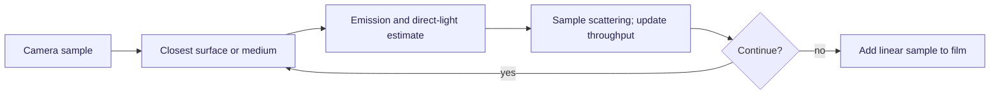

The arrow from scattering back to the next interaction carries a ray, throughput, medium state and sampling history. Losing any of those can change the represented transport, even when every individual intersection test is correct.

Implementation-specific passages retain observations from the supplied Kairo/Maveb snapshot. They are not a fresh audit of those repositories. Source exercises and illustrative code are teaching material; only explicitly recorded checks have been executed here.

**Visibility queries become a renderer**

Once we know:

$$
\text{what surface a ray reaches},
$$

we can ask:

> How much radiance returns along that ray?

Define a function conceptually:

```cpp
Color TraceRay(Ray ray, int depth);
```

This is not merely intersection.

It is light transport.

Classic recursive ray tracing is usually associated with Turner Whitted's 1980 renderer.

---

**Whitted recursion**

For a camera ray:

$$
R_c.
$$

Find nearest hit.

If miss:

$$
L=L_{\text{environment}}.
$$

If hit:

- evaluate local/direct lighting;
- shoot shadow rays;
- if mirror, shoot reflection ray;
- if glass, shoot reflection and refraction rays;
- recurse.

Conceptually:

$$
\boxed{
L=
L_{\text{local}}
+
k_rL_{\text{reflect}}
+
k_tL_{\text{refract}}.
}
$$

Current Kairo's `TraceWhitted()` follows exactly this architecture.

---

**Current Kairo TraceWhitted structure**

Conceptually:

```cpp
Color TraceWhitted(
    Scene scene,
    Ray ray,
    uint32_t depth)
{
    if (depth > MaxDepth)
        return black;

    hit = scene.Intersect(ray);

    if (!hit)
        return environment;

    if (emissive)
        return emission;

    if (mirror)
        return Trace(reflectionRay);

    if (glass)
        return
            F * Trace(reflectionRay)
            +
            (1-F) * Trace(refractionRay);

    return DirectLighting(hit);
}
```

That is textbook Whitted recursion.

---

**Direct illumination**

For one point light:

$$
P_L.
$$

Surface hit:

$$
P.
$$

Light direction:

$$
L=
\frac{P_L-P}
{\|P_L-P\|}.
$$

Distance:

$$
d=
\|P_L-P\|.
$$

Lambert cosine:

$$
N\cdot L.
$$

Point-light attenuation:

$$
\propto
\frac1{d^2}.
$$

So a simple contribution can be:

$$
\boxed{
L_o
=
\rho
L_{\text{light}}
\frac{
\max(N\cdot L,0)
}{
d^2
}
}
$$

for a non-normalized historical Lambert model, or physically:

$$
\boxed{
L_o
=
\frac{\rho}{\pi}
L_i
(N\cdot L).
}
$$

Current Whitted Kairo path is intentionally a simpler local Lambert-style model, while the PBR integrator contains the normalized BRDF machinery.

---

**Why inverse square appears for point lights**

A point source emits power over spherical area:

$$
A=4\pi r^2.
$$

If total flux is fixed, power per area scales as:

$$
\frac1{4\pi r^2}.
$$

Hence:

$$
\boxed{
E\propto\frac1{r^2}.
}
$$

This is not radiance attenuation along one free-space ray.

It is geometric spreading of a point emitter's total power over a growing sphere.

That distinction from Pass 3 matters.

---

**Shadow rays**

Without a shadow query, the shader knows geometric relation to a light but not whether light actually reaches the surface.

Define:

$$
R_s(t)=P'+tL.
$$

For point light:

$$
t_{\max}=d-\epsilon.
$$

If any geometry intersects within this segment:

$$
V(P,L)=0.
$$

Otherwise:

$$
V(P,L)=1.
$$

Then:

$$
\boxed{
L_o
=
V(P,L)
f_r
L_i
(N\cdot L).
}
$$

Visibility is therefore multiplicative.

A shadow is not fundamentally “darkness painted onto the surface.”

It is:

$$
\boxed{\text{zero contribution from an occluded light transport path}.}
$$

---

**Kairo's shadow query**

Current Whitted point-light code:

$$
\texttt{shadow origin}
=
P+\epsilon N
$$

then:

$$
\texttt{Occluded(ray,d-\epsilon)}.
$$

Current directional-light query uses:

$$
t_{\max}\approx\infty
$$

because directional lights are treated as infinitely distant.

That is the correct distinction.

---

**Mirror reflection ray**

Incoming travel direction:

$$
I.
$$

Surface normal:

$$
N.
$$

Reflection:

$$
\boxed{
R=
I-2(I\cdot N)N.
}
$$

Then:

$$
R_r(t)
=
P'+tR.
$$

For a perfect mirror, local diffuse lighting is not used.

Returned radiance comes from whatever that reflected ray reaches:

$$
\boxed{
L_o(P,V)
=
F\,L_i(P,R)
}
$$

in the idealized mirror direction.

Kairo's mirror path recursively traces the reflected ray and multiplies by material albedo/tint.

---

**Refraction ray**

From Pass 4:

$$
\eta=
\frac{\eta_i}{\eta_t}.
$$

With normalized incoming travel direction $I$ and appropriately oriented normal $N$:

$$
c_i=-N\cdot I.
$$

Then:

$$
\boxed{
T=
\eta I+
(\eta c_i-c_t)N
}
$$

where:

$$
c_t
=
\sqrt{
1-\eta^2(1-c_i^2)
}.
$$

If square-root argument becomes negative:

$$
\boxed{\text{total internal reflection}.}
$$

Kairo's current glass path already detects absence of a valid refraction direction and sets Fresnel:

$$
F=1.
$$

---

**Glass branches into two recursive rays**

At an ideal dielectric interface, both reflected and refracted paths contribute.

Whitted rendering therefore evaluates:

$$
L_{\text{reflect}}
$$

and:

$$
L_{\text{refract}}.
$$

Then combines:

$$
\boxed{
L=
F L_{\text{reflect}}
+
(1-F)L_{\text{refract}}.
}
$$

Kairo does exactly this using Schlick Fresnel.

This is deterministic branching.

Later path tracing will often *sample* one branch probabilistically rather than recursively tracing both every time.

That difference matters enormously for complexity.

---

**Why recursion needs a depth limit**

Imagine two perfect parallel mirrors.

Ray reflects:

```text
mirror A
→ mirror B
→ mirror A
→ mirror B
→ ...
```

Infinite recursion.

Or glass can generate a branching tree.

If each bounce spawns two rays:

$$
N_d\approx2^d.
$$

At depth 20:

$$
2^{20}
=
1,048,576
$$

possible leaves for just one primary ray in the worst theoretical case.

Therefore Whitted renderers impose:

$$
\boxed{
d\le d_{\max}.
}
$$

Current Kairo returns black when:

$$
\texttt{depth > MaxDepth}.
$$

---

**A fixed recursion limit is biased**

Suppose we stop at depth 5.

There may still be nonzero radiance arriving from deeper paths.

We discard it.

Thus:

$$
\boxed{
\text{hard depth truncation introduces bias}.
}
$$

It may be tiny and acceptable for Whitted rendering.

Later path tracing often combines a minimum depth with **Russian roulette**, which probabilistically terminates paths while preserving expectation.

That comes in later passes.

---

**Why Whitted rendering looked revolutionary**

It naturally produces:

- hard shadows,
- mirror reflections,
- refraction,
- recursive reflective/refractive objects.

Those effects are difficult to express in basic local raster shading.

Ray tracing makes them geometrically direct:

```text
Want reflection?
Trace reflected ray.

Want shadow?
Trace ray to light.

Want refraction?
Trace transmitted ray.
```

This elegance is why ray tracing is conceptually so compelling.

---

**Whitted limitations**

The major limitation is which light paths it evaluates.

Whitted tracing efficiently follows:

$$
E
$$

camera/emission paths plus deterministic specular chains and explicitly sampled direct lights.

But it generally does not simulate arbitrary diffuse interreflection.

Imagine:

```text
light
→ red wall
→ white wall
→ camera
```

The white wall should receive red indirect bounce.

A standard Whitted renderer evaluates direct light at the white wall and misses this path.

Similarly, soft global illumination, complex glossy transport and many caustic/diffuse path combinations are absent.

Whitted's recursion structure is **hand-selected transport**, not a general solution to the rendering equation.

---

**The rendering equation**

The general local surface reflection equation is:

$$
\boxed{
L_o(x,\omega_o)
=
L_e(x,\omega_o)
+
\int_{\Omega^+}
f_r(x,\omega_i,\omega_o)
L_i(x,\omega_i)
(\mathbf n\cdot\omega_i)
\,d\omega_i.
}
$$

Every term deserves to be understood as a physical quantity rather than syntax.

This equation is the bridge from Whitted ray tracing to path tracing.

---

**Outgoing radiance**

$$
L_o(x,\omega_o)
$$

means:

> Radiance leaving surface point $x$ along outgoing direction $\omega_o$.

For the camera ray, $\omega_o$ typically points from the surface toward the camera.

Units:

$$
\frac{\mathrm W}
{\mathrm{m^2\,sr}}.
$$

The entire renderer ultimately estimates this quantity for each camera sample.

---

**Emitted radiance**

$$
L_e(x,\omega_o)
$$

is light generated by the surface itself.

Examples:

- glowing panel,
- area light,
- sun model,
- emissive geometry.

A nonemissive surface has:

$$
L_e=0.
$$

An emissive surface contributes even if no other light reaches it.

Thus:

$$
\boxed{
\text{outgoing radiance}
=
\text{emission}
+
\text{reflected incoming radiance}.
}
$$

---

**Incident radiance**

$$
L_i(x,\omega_i)
$$

means radiance arriving at $x$ from direction $\omega_i$.

Where does it come from?

Trace a ray from $x$ along $\omega_i$.

Suppose it first reaches point $y$.

Then, ignoring participating media:

$$
\boxed{
L_i(x,\omega_i)
=
L_o(y,-\omega_i).
}
$$

This is the recursive heart of global illumination.

Incident light at one surface is outgoing light from another.

Thus the rendering equation is recursive.

---

**The BRDF term**

$$
f_r(x,\omega_i,\omega_o)
$$

answers:

> Of the radiance arriving from $\omega_i$, how efficiently is it scattered toward $\omega_o$?

Units:

$$
\mathrm{sr}^{-1}.
$$

For Lambert:

$$
f_r=
\frac{\rho}{\pi}.
$$

For GGX:

$$
f_r=
f_d+
f_s.
$$

This term contains material scattering.

It does **not** contain visibility to another surface.

Visibility is embedded indirectly in $L_i$, because incoming radiance depends on what the ray in that direction actually sees.

---

**Cosine foreshortening**

The integral multiplies by:

$$
\boxed{
\cos\theta_i
=
N\cdot\omega_i.
}
$$

Why?

A surface patch of physical area $dA$ presents projected area:

$$
dA_\perp
=
dA\cos\theta.
$$

At grazing incidence, a beam hits less projected area.

Thus incoming irradiance is:

$$
dE
=
L_i
\cos\theta_i
d\omega_i.
$$

The cosine belongs to geometry, not the BRDF.

This is exactly the same projected-area reasoning from Pass 3.

---

**Hemisphere integral**

Why integrate over a hemisphere?

Only directions above the surface can contribute to ordinary reflection:

$$
N\cdot\omega_i>0.
$$

Thus:

$$
\Omega^+
=
\{
\omega:
N\cdot\omega>0
\}.
$$

In spherical coordinates:

$$
\theta\in[0,\pi/2],
$$

$$
\phi\in[0,2\pi).
$$

Differential solid angle:

$$
\boxed{
d\omega
=
\sin\theta\,d\theta\,d\phi.
}
$$

Therefore rendering equation can be written:

$$
L_o
=
L_e
+
\int_0^{2\pi}
\int_0^{\pi/2}
f_r
L_i
\cos\theta
\sin\theta
\,d\theta\,d\phi.
$$

That is a 2D integral over infinitely many incoming directions.

---

**Why we cannot evaluate the integral exactly**

For arbitrary scenes:

$$
L_i(x,\omega_i)
$$

is a highly complicated function.

Each direction may hit:

- different object,
- different material,
- emitter,
- environment,
- another reflective surface.

Analytic integration is generally impossible.

Even evaluating many regular directions quickly becomes prohibitively expensive.

We need numerical integration.

This is where Monte Carlo enters.

---

**Monte Carlo integration begins with expectation**

Suppose we want:

$$
I=
\int_D f(x)\,dx.
$$

Imagine sampling $X$ from uniform distribution over domain $D$.

If domain measure is:

$$
|D|,
$$

uniform density is:

$$
p(x)=\frac1{|D|}.
$$

Expectation:

$$
E[f(X)]
=
\int_D
f(x)p(x)\,dx.
$$

Substitute:

$$
=
\frac1{|D|}
\int_D f(x)\,dx.
$$

Therefore:

$$
I=
|D|E[f(X)].
$$

Approximate expectation with sample mean:

$$
E[f(X)]
\approx
\frac1N
\sum_{i=1}^{N}
f(X_i).
$$

Thus:

$$
\boxed{
I
\approx
\frac{|D|}{N}
\sum_i f(X_i).
}
$$

That is basic uniform Monte Carlo integration.

---

**General importance-sampled Monte Carlo derivation**

Now sample from any PDF:

$$
p(x)>0
$$

wherever:

$$
f(x)\neq0.
$$

Start:

$$
I=
\int_D f(x)\,dx.
$$

Multiply and divide by $p(x)$:

$$
I=
\int_D
\frac{f(x)}{p(x)}
p(x)\,dx.
$$

But this is exactly expectation under $p$:

$$
\boxed{
I=
E_p
\left[
\frac{f(X)}{p(X)}
\right].
}
$$

Estimate expectation with samples:

$$
\boxed{
\hat I_N
=
\frac1N
\sum_{i=1}^{N}
\frac{
f(X_i)
}{
p(X_i)
}.
}
$$

This is the general Monte Carlo estimator.

This equation is one of the most important formulas in all physically based rendering.

---

**Why divide by the PDF?**

Suppose you intentionally sample one region more frequently.

Without compensation, that region contributes too much merely because you visited it more often.

The factor:

$$
\frac1{p(x)}
$$

compensates for sampling frequency.

High-probability samples receive lower weight.

Low-probability samples receive higher weight.

That keeps the estimator unbiased.

Sampling strategy changes **variance**, not expected answer, assuming support and weights are correct.

---

**Rendering equation Monte Carlo estimator**

Define integrand:

$$
g(\omega_i)
=
f_r(\omega_i,\omega_o)
L_i(\omega_i)
(N\cdot\omega_i).
$$

Then:

$$
L_o
=
L_e+
\int_{\Omega^+}
g(\omega_i)
\,d\omega_i.
$$

Sample:

$$
\omega_i\sim p(\omega).
$$

Estimator:

$$
\boxed{
\hat L_o
=
L_e
+
\frac1N
\sum_{k=1}^{N}
\frac{
f_r(\omega_k,\omega_o)
L_i(\omega_k)
(N\cdot\omega_k)
}{
p(\omega_k)
}.
}
$$

This is the central path-tracing estimator.

Everything in the next few passes is largely about choosing better:

$$
p(\omega).
$$

---

**Probability density is not probability**

For continuous variables:

$$
p(x)
$$

is a **density**.

Probability of exactly one real-valued point is zero.

Probability over an interval:

$$
P(a\le X\le b)
=
\int_a^b
p(x)\,dx.
$$

Likewise directional PDF:

$$
p(\omega)
$$

has units:

$$
\mathrm{sr}^{-1}.
$$

Probability of sampling a small solid-angle patch:

$$
dP
=
p(\omega)d\omega.
$$

This distinction is critical.

---

**PDF normalization**

A valid PDF must satisfy:

$$
p(x)\ge0
$$

and:

$$
\boxed{
\int_Dp(x)\,dx=1.
}
$$

For directions over hemisphere:

$$
\boxed{
\int_{\Omega^+}
p(\omega)d\omega
=
1.
}
$$

Later, uniform hemisphere sampling will therefore have:

$$
p(\omega)
=
\frac1{2\pi}
$$

because hemisphere solid angle is:

$$
2\pi.
$$

That is Part 2031, technically next pass, but you can already see how it follows.

---

**PDF units matter**

Suppose:

$$
f_r
$$

has units:

$$
\mathrm{sr}^{-1}.
$$

Incoming radiance:

$$
L_i
$$

has:

$$
\mathrm{W\,m^{-2}\,sr^{-1}}.
$$

Cosine is dimensionless.

Directional PDF:

$$
p(\omega)
$$

has:

$$
\mathrm{sr}^{-1}.
$$

Estimator term:

$$
\frac{
f_rL_i\cos\theta
}{
p
}
$$

has:

$$
\frac{
(\mathrm{sr}^{-1})
(\mathrm{W\,m^{-2}\,sr^{-1}})
}{
\mathrm{sr}^{-1}
}
$$

which yields:

$$
\mathrm{W\,m^{-2}\,sr^{-1}}.
$$

Exactly radiance.

Units are a powerful way to catch missing PDF factors.

---

**Uniform sampling versus importance sampling**

Suppose integrand contains a tiny bright region.

Uniform sampling wastes most samples where contribution is near zero.

Instead choose:

$$
p(x)
\propto|f(x)|.
$$

Then more samples land where the integral has significant magnitude.

The theoretically ideal PDF for nonnegative $f$ is:

$$
p^*(x)
=
\frac{f(x)}
{\int f}.
$$

Then:

$$
\frac{f(x)}{p^*(x)}
=
\int f
$$

is constant and variance becomes zero.

Of course if we already knew:

$$
\int f,
$$

we would not need Monte Carlo.

But this tells us the principle:

$$
\boxed{
\text{sample proportional to expected contribution}.
}
$$

That principle drives:

- cosine hemisphere sampling,
- GGX sampling,
- light sampling,
- environment importance sampling,
- MIS.

---

**Variance**

Monte Carlo estimator is random.

Its variance for independent identically distributed samples decreases approximately as:

$$
\boxed{
\operatorname{Var}(\hat I_N)
=
\frac{
\operatorname{Var}(f(X)/p(X))
}{
N
}.
}
$$

Standard deviation therefore falls as:

$$
\boxed{
\sigma_N
\propto
\frac1{\sqrt N}.
}
$$

To halve noise standard deviation:

$$
\frac1{\sqrt{N_2}}
=
\frac12
\frac1{\sqrt{N_1}}
$$

so:

$$
N_2=4N_1.
$$

Thus:

$$
\boxed{
2\times \text{cleaner}
\approx
4\times\text{samples}.
}
$$

Monte Carlo convergence is slow.

That is why sampling quality matters so much.

---

**Why path tracing is recursive Monte Carlo**

At first bounce:

$$
L_i(x,\omega_i)
$$

is unknown.

Trace ray along:

$$
\omega_i.
$$

It hits:

$$
y.
$$

Then:

$$
L_i(x,\omega_i)
=
L_o(y,-\omega_i).
$$

But $L_o(y,\cdot)$ itself contains another integral.

So the estimator recursively samples:

$$
\text{camera}
\rightarrow
x_1
\rightarrow
x_2
\rightarrow
x_3
\rightarrow\cdots
$$

Each bounce accumulates factors:

$$
f_r
\frac{\cos\theta}{p}.
$$

That accumulated multiplicative value becomes path **throughput**.

We will derive that carefully in Pass 7.

---

**How Whitted and path tracing differ conceptually**

Whitted rendering asks:

```text
What special deterministic rays should I spawn?
```

For example:

- one mirror direction,
- one refraction direction,
- explicit rays to lights.

Path tracing asks:

$$
\boxed{
\text{How can I construct an unbiased stochastic estimator of the rendering equation?}
}
$$

That is a much deeper shift.

A mirror reflection still has a special delta-distribution treatment, but diffuse and glossy transport become samples of an integral rather than hand-coded effect branches.

---

**Whitted direct lighting as a special sampling strategy**

A point light occupies a delta direction from a surface:

$$
\omega_L.
$$

Whitted explicitly evaluates that direction.

For a diffuse material, it computes something like:

$$
f_r(\omega_L,\omega_o)
L_i(\omega_L)
(N\cdot\omega_L)
V.
$$

This can be understood as a specialized estimator for direct illumination.

So Whitted is not completely alien to rendering-equation thinking.

It evaluates a restricted set of path families explicitly.

Path tracing generalizes the sampling process to many more directions and transport events.

---

**One-bounce rendering equation example**

Suppose Lambertian surface:

$$
\rho=0.8.
$$

Uniform environment radiance:

$$
L_i=2.
$$

Then:

$$
f_r=
\frac{0.8}{\pi}.
$$

Rendering equation:

$$
L_o
=
\int_{\Omega^+}
\frac{0.8}{\pi}
(2)
\cos\theta
d\omega.
$$

Constants out:

$$
=
\frac{1.6}{\pi}
\int_{\Omega^+}
\cos\theta d\omega.
$$

We know:

$$
\int_{\Omega^+}
\cos\theta d\omega
=
\pi.
$$

Therefore:

$$
\boxed{
L_o=1.6.
}
$$

This is our ground truth.

Now sample uniformly over hemisphere:

$$
p=\frac1{2\pi}.
$$

A one-sample estimator is:

$$
\hat L_o
=
\frac{
(0.8/\pi)(2)\cos\theta
}{
1/(2\pi)
}.
$$

Simplify:

$$
\boxed{
\hat L_o
=
3.2\cos\theta.
}
$$

It varies wildly with sampled angle.

Expected value is still 1.6.

This variance motivates cosine-weighted sampling.

---

**Preview of cosine-weighted sampling**

If instead:

$$
p(\omega)
=
\frac{\cos\theta}{\pi},
$$

then:

$$
\hat L_o
=
\frac{
(\rho/\pi)L_i\cos\theta
}{
\cos\theta/\pi
}
$$

and everything cancels:

$$
\boxed{
\hat L_o
=
\rho L_i.
}
$$

For the constant environment:

$$
=
0.8\times2
=
1.6.
$$

Every sample gives exactly the same answer.

Zero variance for this idealized case.

That is why sampling distribution should resemble the integrand.

We derive how to generate these directions in Pass 7.

---

**Current Kairo already contains the future**

Interestingly, current `PathIntegrator.cppm` already has:

```cpp
CosineHemisphereDirection(...)
```

and a MIS power heuristic.

Its cosine sampler constructs:

$$
r=\sqrt{\xi_2},
$$

$$
\phi=2\pi\xi_1,
$$

$$
x=r\cos\phi,
$$

$$
z=r\sin\phi,
$$

$$
y=\sqrt{1-\xi_2}.
$$

That is exactly the cosine-weighted hemisphere distribution we will derive next pass.

So the codebase is ahead of the current theoretical boundary.

That is useful: the next pass lets us reverse-engineer why those exact square roots appear.

---

**A robust Ray API design**

The current generic `Ray` only stores:

```cpp
Origin
Direction
```

and query APIs separately pass max distance/bias semantics.

For a rendering-focused ray interface, I would prefer explicitly carrying the interval:

```cpp
struct Ray
{
    Vec3 Origin;
    Vec3 Direction;

    float TMin = 0.0f;
    float TMax =
        std::numeric_limits<float>::infinity();

    [[nodiscard]]
    Vec3 At(float t) const noexcept
    {
        return Origin +
               Direction * t;
    }

    [[nodiscard]]
    bool Contains(float t) const noexcept
    {
        return
            t >= TMin &&
            t <= TMax;
    }
};
```

Why?

Because the interval is a property of the **query**.

It makes impossible states harder to represent.

A shadow ray naturally carries:

$$
[\epsilon,d-\epsilon].
$$

A primary ray:

$$
[\epsilon,\infty).
$$

A closest-hit traversal can tighten `TMax`.

However, keeping the geometry ray type minimal and passing query ranges separately is also valid architecture. The important thing is that intervals exist somewhere explicit.

---

**Better hit record for future Kairo**

As path tracing becomes more advanced, I would evolve:

```cpp
struct SurfaceHit
{
    float T;

    Vec3 Position;

    // True orientation from geometry.
    Vec3 GeometricNormal;

    // Potentially interpolated / normal mapped orientation.
    Vec3 ShadingNormal;

    Vec2 UV;

    // Triangle barycentrics when applicable.
    Vec3 Barycentrics;

    uint32_t PrimitiveIndex;
    uint32_t MaterialIndex;

    bool FrontFace;
};
```

Then maintain invariant:

$$
N_s\cdot N_g\ge0.
$$

And use geometric normal for:

- side classification,
- robust origin offset,
- medium boundary decisions.

Use shading normal primarily for:

- BRDF evaluation.

This separation becomes important enough that it is worth designing early.

---

**BVH traversal skeleton**

A stripped-down closest-hit implementation:

```cpp
std::optional<Hit>
TraceClosest(
    const Ray& inputRay,
    const BVH& bvh)
{
    if (bvh.nodes.empty())
        return std::nullopt;

    Ray ray = inputRay;

    std::optional<Hit> closest;

    // Local stack avoids recursive function-call overhead.
    std::array<uint32_t, 64> stack{};
    uint32_t stackSize = 0;

    stack[stackSize++] = 0; // root

    while (stackSize > 0)
    {
        const uint32_t nodeIndex =
            stack[--stackSize];

        const BVHNode& node =
            bvh.nodes[nodeIndex];

        float nodeNear = 0.0f;

        if (!IntersectAABB(
                ray,
                node.bounds,
                nodeNear))
        {
            continue;
        }

        // Since ray.tMax shrinks whenever a closer primitive is found,
        // far nodes naturally become rejectable.
        if (nodeNear > ray.tMax)
            continue;

        if (node.IsLeaf())
        {
            for (uint32_t i = 0;
                 i < node.primitiveCount;
                 ++i)
            {
                const uint32_t primitiveIndex =
                    bvh.primitiveIndices[
                        node.firstPrimitive + i];

                auto hit =
                    IntersectPrimitive(
                        ray,
                        primitiveIndex);

                if (hit &&
                    hit->t < ray.tMax)
                {
                    closest = hit;

                    // Tighten the query.
                    ray.tMax = hit->t;
                }
            }

            continue;
        }

        float leftNear;
        float rightNear;

        const bool hitLeft =
            IntersectAABB(
                ray,
                bvh.nodes[node.left].bounds,
                leftNear);

        const bool hitRight =
            IntersectAABB(
                ray,
                bvh.nodes[node.right].bounds,
                rightNear);

        // Push farther child first because stack is LIFO.
        // The nearer child is processed immediately.
        if (hitLeft && hitRight)
        {
            if (leftNear < rightNear)
            {
                stack[stackSize++] =
                    node.right;

                stack[stackSize++] =
                    node.left;
            }
            else
            {
                stack[stackSize++] =
                    node.left;

                stack[stackSize++] =
                    node.right;
            }
        }
        else if (hitLeft)
        {
            stack[stackSize++] =
                node.left;
        }
        else if (hitRight)
        {
            stack[stackSize++] =
                node.right;
        }
    }

    return closest;
}
```

This is conceptually very close to your actual KairoSpatial traversal.

---

**Any-hit traversal skeleton**

Shadow query does not need any closest tracking:

```cpp
bool TraceAny(
    const Ray& ray,
    const BVH& bvh)
{
    std::array<uint32_t, 64> stack{};
    uint32_t stackSize = 0;

    stack[stackSize++] = 0;

    while (stackSize)
    {
        const BVHNode& node =
            bvh.nodes[
                stack[--stackSize]];

        if (!IntersectAABB(
                ray,
                node.bounds))
        {
            continue;
        }

        if (node.IsLeaf())
        {
            for (uint32_t i = 0;
                 i < node.primitiveCount;
                 ++i)
            {
                if (IntersectPrimitive(
                        ray,
                        node.Primitive(i)))
                {
                    // Nothing else matters.
                    return true;
                }
            }
        }
        else
        {
            stack[stackSize++] =
                node.left;

            stack[stackSize++] =
                node.right;
        }
    }

    return false;
}
```

This difference looks small in code.

Across billions of shadow queries it is enormous.

---

**The complete Whitted trace**

Now put M121 and M122 together:

```cpp
Color TraceWhitted(
    const Scene& scene,
    const Ray& ray,
    uint32_t depth)
{
    if (depth >= scene.maxDepth)
        return Color::Black();

    const auto hit =
        scene.IntersectClosest(ray);

    if (!hit)
        return scene.Environment(ray.Direction);

    const Material& material =
        scene.Material(hit->MaterialID);

    if (material.IsEmissive())
        return material.Emission;

    // ---------------------------------------------------------
    // Perfect mirror.
    // ---------------------------------------------------------
    if (material.IsMirror())
    {
        const Vec3 reflection =
            Reflect(
                ray.Direction,
                hit->GeometricNormal);

        Ray child =
            SpawnRay(
                *hit,
                reflection);

        return
            material.Reflectance *
            TraceWhitted(
                scene,
                child,
                depth + 1);
    }

    // ---------------------------------------------------------
    // Ideal dielectric.
    // ---------------------------------------------------------
    if (material.IsGlass())
    {
        const bool entering =
            hit->FrontFace;

        const float etaI =
            entering ? 1.0f : material.IOR;

        const float etaT =
            entering ? material.IOR : 1.0f;

        const Vec3 N =
            hit->FaceForwardNormal();

        const Vec3 reflection =
            Reflect(
                ray.Direction,
                N);

        const float F =
            Fresnel(...);

        Color result =
            F *
            TraceWhitted(
                scene,
                SpawnRay(
                    *hit,
                    reflection),
                depth + 1);

        auto transmission =
            Refract(
                ray.Direction,
                N,
                etaI / etaT);

        if (transmission)
        {
            result +=
                (1.0f - F) *
                TraceWhitted(
                    scene,
                    SpawnTransmissionRay(
                        *hit,
                        *transmission),
                    depth + 1);
        }

        return result;
    }

    // ---------------------------------------------------------
    // Local/direct surface shading.
    // ---------------------------------------------------------
    Color Lo =
        material.Emission;

    for (const Light& light :
         scene.Lights())
    {
        LightSample sample =
            light.Sample(hit->Position);

        if (sample.NdotL <= 0.0f)
            continue;

        Ray shadow =
            SpawnShadowRay(
                *hit,
                sample.Direction,
                sample.Distance);

        if (scene.Occluded(shadow))
            continue;

        const Color fr =
            EvaluateBRDF(
                material,
                *hit,
                -ray.Direction,
                sample.Direction);

        Lo +=
            fr *
            sample.Radiance *
            sample.NdotL;
    }

    return Lo;
}
```

This is already a respectable ray tracer.

But it is not yet a path tracer.

---

**Rendering equation as code**

The equation:

$$
L_o
=
L_e+
\int
f_rL_i\cos\theta\,d\omega
$$

maps conceptually to:

```cpp
Color IntegrateSurface(
    SurfaceHit hit,
    Vec3 wo)
{
    Color result =
        hit.material.Emission;

    for all incoming directions wi:
    {
        Color Li =
            TraceRayFromSurface(
                hit,
                wi);

        Color fr =
            hit.material.BRDF(
                wi,
                wo);

        result +=
            fr *
            Li *
            max(
                Dot(hit.normal, wi),
                0.0f)
            *
            dOmega;
    }

    return result;
}
```

The impossible phrase is:

```text
for all incoming directions
```

because there are infinitely many.

Monte Carlo replaces that infinite loop with random samples.

---

**Monte Carlo rendering equation as code**

```cpp
Color EstimateSurfaceRadiance(
    const SurfaceHit& hit,
    Vec3 wo,
    RNG& rng,
    uint32_t sampleCount)
{
    Color result =
        hit.Material.Emission;

    for (uint32_t s = 0;
         s < sampleCount;
         ++s)
    {
        DirectionSample sample =
            SampleIncomingDirection(
                hit,
                rng);

        const Vec3 wi =
            sample.Direction;

        const float pdf =
            sample.Pdf;

        if (pdf <= 0.0f)
            continue;

        const float cosine =
            std::max(
                Dot(
                    hit.ShadingNormal,
                    wi),
                0.0f);

        if (cosine <= 0.0f)
            continue;

        const Color fr =
            EvaluateBRDF(
                hit,
                wi,
                wo);

        Ray nextRay =
            SpawnRay(
                hit,
                wi);

        const Color Li =
            TracePath(nextRay, rng);

        result +=
            fr *
            Li *
            (cosine / pdf);
    }

    return
        result /
        static_cast<float>(
            sampleCount);
}
```

The most important line is:

```cpp
fr * Li * cosine / pdf
```

because it is literally:

$$
\boxed{
\frac{
f_rL_i(N\cdot\omega_i)
}{
p(\omega_i)
}
}.
$$

That is the rendering equation turned into an estimator.

---

**PDF and measure must match**

A subtle but critical future issue:

A PDF can be defined with respect to:

- area,
- solid angle,
- projected solid angle,
- length,
- discrete probability.

These are not interchangeable.

For example:

$$
p_A(y)
$$

in:

$$
\mathrm{m}^{-2}
$$

is not the same thing as:

$$
p_\omega(\omega)
$$

in:

$$
\mathrm{sr}^{-1}.
$$

When sampling an area light, we will need the transformation:

$$
\boxed{
p_\omega
=
p_A
\frac{r^2}
{|N_L\cdot(-\omega)|}
}
$$

in a later pass.

A huge fraction of path-tracing bugs are really **wrong measure/PDF bugs**.

---

**Discrete versus continuous PDF**

Suppose you choose one of four lights uniformly.

Discrete probability:

$$
P(L_i)=\frac14.
$$

Then sample a point on that selected area light using area density:

$$
p_A(x|L_i).
$$

The total sampling density is a product:

$$
\boxed{
p=
P(L_i)
p_A(x|L_i).
}
$$

Later, converting to solid angle adds another Jacobian.

This is why path tracing requires serious probability reasoning.

It is not “random rays until image appears.”

---

**Ray tracing cost multiplication**

Suppose:

$$
1920\times1080
$$

image:

$$
2.07\text{ million pixels}.
$$

At:

$$
64\text{ samples/pixel},
$$

primary samples:

$$
132.7\text{ million}.
$$

If average path length is 6:

$$
796\text{ million path segments}.
$$

Add direct-light shadow rays and you can exceed:

$$
1\text{ billion ray queries}.
$$

If every query tested:

$$
1\text{ million triangles},
$$

brute force would be on order:

$$
10^{15}
$$

primitive tests.

This is why:

$$
\boxed{
\text{sampling strategy}
+
\text{BVH quality}
+
\text{intersection throughput}
}
$$

are all first-class rendering concerns.

---

**Kairo's current acceleration statistics are extremely useful**

`RenderStats` tracks:

$$
\text{PrimaryRays},
$$

$$
\text{ShadowRays},
$$

$$
\text{ReflectionRays},
$$

$$
\text{BVHVisitedNodes},
$$

$$
\text{BVHTestedPrimitives}.
$$

Then derives:

$$
\boxed{
\text{PrimitiveTestsPerRay}
=
\frac{
\text{tested primitives}
}{
\text{total rays}
}
}
$$

and:

$$
\boxed{
\text{NodesVisitedPerRay}
=
\frac{
\text{visited nodes}
}{
\text{total rays}
}.
}
$$

These are exactly the kinds of metrics you need to compare:

- brute force,
- median BVH,
- SAH BVH,
- Morton ordering.

Do not judge acceleration structures on FPS alone.

---

**A BVH correctness experiment**

Kairo already has an `AccelerationDifference` render/debug mode.

The essential invariant is:

$$
\boxed{
\operatorname{ClosestHit}_{\text{BVH}}(r)
=
\operatorname{ClosestHit}_{\text{brute}}(r)
}
$$

for every ray.

For any-hit:

$$
\boxed{
\operatorname{AnyHit}_{\text{BVH}}(r,t_{\max})
=
\operatorname{AnyHit}_{\text{brute}}(r,t_{\max}).
}
$$

This should be tested with randomized rays through adversarial scenes:

- nearly parallel rays,
- rays originating inside boxes,
- degenerate/flat AABBs,
- triangles at large coordinates,
- rays hitting shared triangle edges.

Acceleration may change performance.

It must not change geometry truth.

---

**A camera-ray validation experiment**

For image center:

$$
u=v=0.5
$$

assert:

$$
D\approx F.
$$

For symmetric left/right pixels:

$$
D_L\cdot R
=
-
D_R\cdot R.
$$

For symmetric top/bottom:

$$
D_T\cdot U
=
-
D_B\cdot U.
$$

All directions should satisfy:

$$
\|D\|\approx1.
$$

This gives a deterministic proof of camera geometry.

---

**A triangle test suite**

For triangle:

$$
A=(0,0,-5),
$$

$$
B=(1,0,-5),
$$

$$
C=(0,1,-5),
$$

ray:

$$
O=(0.25,0.25,0),
$$

$$
D=(0,0,-1).
$$

Expected:

$$
t=5.
$$

Hit position:

$$
(0.25,0.25,-5).
$$

Barycentrics:

$$
\lambda_A=0.5,
$$

$$
\lambda_B=0.25,
$$

$$
\lambda_C=0.25.
$$

If your Möller–Trumbore implementation cannot reproduce that, stop before debugging path tracing.

---

**Ray bias validation**

Construct two coplanar/adjacent triangles.

Shoot primary ray onto first triangle.

Then spawn:

$$
+\epsilon N
$$

shadow/reflection ray.

Measure whether:

- self-hit disappears,
- genuine nearby geometry still intersects.

Sweep scene scale over:

$$
10^{-3},
1,
10^3,
10^6.
$$

A fixed epsilon will usually break somewhere.

Kairo's absolute+relative bias should be tested over that scale range.

That is much more meaningful than selecting `0.001` because a tutorial used it.

---

**Rendering equation versus Whitted in path notation**

A light transport path can be described:

$$
C
\rightarrow
S_1
\rightarrow
S_2
\rightarrow
\dots
\rightarrow
L
$$

where:

$$
C=\text{camera},
$$

$$
L=\text{light},
$$

and each $S_i$ is a surface interaction.

Whitted efficiently handles classes like:

```text
camera
→ diffuse surface
→ directly sampled light
```

and:

```text
camera
→ mirror
→ mirror
→ diffuse
→ light
```

where specular chains are deterministic.

But arbitrary:

```text
camera
→ diffuse
→ diffuse
→ diffuse
→ light
```

requires sampling indirect directions.

Path tracing exists to estimate all such transport families under the rendering equation.

---

**Important distinction: recursive ray tracing is not automatically path tracing**

Both may use a recursive function.

That is irrelevant.

Whitted:

```cpp
if mirror:
    recurse reflection

if glass:
    recurse reflection/refraction

otherwise:
    direct lighting
```

Path tracer:

```cpp
sample scattering event according to BSDF/PDF
update throughput
recurse/iterate
```

The distinction is mathematical:

$$
\boxed{
\text{Whitted = deterministic selected ray families}
}
$$

versus:

$$
\boxed{
\text{path tracing = stochastic estimator of light-transport integral}.
}
$$

---

**Important distinction: ray tracing is an intersection mechanism**

“Ray tracing” itself means geometric ray-scene querying.

You can build:

- Whitted renderer,
- path tracer,
- ray-traced shadows inside raster renderer,
- ray-traced reflections,
- BVH collision system,

all from ray intersection.

So:

$$
\boxed{
\text{ray tracing}
\neq
\text{path tracing}.
}
$$

Path tracing uses ray tracing as one of its core mechanisms.

---

**Current Kairo architecture audit**

| Concept | Current implementation |
|---|---|
| Ray representation | KairoGeometry `Origin + t Direction` |
| Direction convention | expected normalized |
| Camera model | pinhole |
| Camera ray mapping | FOV-derived unit film plane |
| Subpixel samples | renderer/sampler layer; camera accepts continuous $u,v$ |
| Ray interval | not stored directly in generic `Ray`; query-specific max distances/biases used |
| Self-hit prevention | absolute + relative ray bias |
| Sphere intersection | quadratic analytic |
| Triangle intersection | Möller–Trumbore |
| Triangle UV | barycentric interpolation |
| Vertex normal interpolation | yes |
| Separate geometric/shading normal in `SurfaceHit` | no |
| Front/back explicit field | no; inferred when needed |
| Brute-force traversal | retained as correctness oracle |
| BVH | KairoSpatial |
| BVH leaf size | 4 |
| BVH split options | median, SAH, Morton ordering |
| Closest-hit traversal | near-child-first, shrinks closest distance |
| Any-hit traversal | dedicated early-out path |
| Shadow ray | any-hit |
| Mirror recursion | yes |
| Glass reflection/refraction | yes |
| Fresnel | Schlick |
| TIR | handled |
| Recursion depth limit | yes |
| Basic path integrator | already exists |
| Cosine hemisphere sampler | already exists |
| MIS power heuristic | already exists |
| Full theory coverage | continues in Passes 7–8 |

---

**The central conceptual reconstruction**

You should now be able to start from one pixel:

$$
(i,j)
$$

and reconstruct:

$$
(i,j)
\rightarrow
(u,v)
\rightarrow
(x_f,y_f)
\rightarrow
D
\rightarrow
R(t)=O+tD
$$

then:

$$
R
\rightarrow
\text{BVH AABB traversal}
\rightarrow
\text{triangle intersection}
\rightarrow
t
\rightarrow
\text{barycentrics}
\rightarrow
P,N,UV,\text{material}
$$

then:

$$
\text{material}
\rightarrow
\text{direct light}
\rightarrow
\text{shadow ray}
$$

and if appropriate:

$$
\text{reflection/refraction ray}
\rightarrow
\text{recursive hit}.
$$

Then you should understand why that does **not** yet solve arbitrary indirect light.

The general solution begins with:

$$
L_o=
L_e+
\int_{\Omega^+}
f_rL_i\cos\theta\,d\omega.
$$

And computationally:

$$
\boxed{
\int f(x)\,dx
=
E
\left[
\frac{f(X)}{p(X)}
\right]
}
$$

so:

$$
\boxed{
\hat I_N
=
\frac1N
\sum_{k=1}^{N}
\frac{
f(X_k)
}{
p(X_k)
}.
}
$$

Those two boxed equations are the gateway from ray tracing into path tracing.

---

**PASS 6 RECALL SHEET**

| Concept | Reconstruction |
|---|---|
| Ray | $P(t)=O+tD$ |
| Unit direction | $t$ becomes distance |
| Pinhole camera | one origin, different film-plane directions |
| Film half-height | $\tan(FOV_y/2)$ |
| Film half-width | aspect × half-height |
| Pixel center | $(i+0.5,j+0.5)$ |
| Subpixel sample | $(i+\xi_x,j+\xi_y)$ |
| Ray interval | $t\in[t_{\min},t_{\max}]$ |
| Shadow max distance | light distance minus bias |
| Self-hit fix | offset origin + meaningful $t_{\min}$ |
| Sphere | quadratic in $t$ |
| Plane | $t=N\cdot(P_0-O)/(N\cdot D)$ |
| Triangle | Möller–Trumbore |
| Barycentric | $w=1-u-v$ |
| Geometric normal | true primitive orientation |
| Shading normal | interpolation/normal-map orientation |
| Front face | $D\cdot N_g<0$ |
| Brute force | $O(N)$ primitive tests/ray |
| AABB | three intersected slabs |
| BVH | hierarchy of cheap bounds |
| SAH | expected traversal/intersection-cost proxy |
| Closest hit | minimize valid $t$ |
| Any hit | stop on first blocker |
| Whitted | direct + deterministic reflection/refraction recursion |
| Shadow ray | explicit visibility to light |
| Mirror | $R=I-2(I\cdot N)N$ |
| Refraction | Snell-derived transmitted direction |
| TIR | no real transmitted direction |
| Hard recursion limit | finite but biased truncation |
| Rendering equation | $L_o=L_e+\int f_rL_i\cos\theta\,d\omega$ |
| $L_o$ | outgoing radiance |
| $L_e$ | emitted radiance |
| $L_i$ | incident radiance |
| BRDF | angular scattering density |
| Cosine | projected-area term |
| Hemisphere | directions above surface |
| MC estimator | $\frac1N\sum f(X)/p(X)$ |
| PDF | probability density, not point probability |
| Directional PDF units | $\mathrm{sr}^{-1}$ |
| Monte Carlo noise | standard deviation $\propto1/\sqrt N$ |

---

**Blank-page mastery gate**

Without looking back, derive the camera ray:

$$
D=
\operatorname{normalize}
\left[
F+
(2u-1)a\tan\frac{\theta}{2}R
+
(1-2v)\tan\frac{\theta}{2}U
\right].
$$

Then derive ray-sphere intersection from:

$$
\|O+tD-C\|^2=r^2.
$$

Then reconstruct Möller–Trumbore sufficiently to explain why:

$$
u\ge0,\qquad
v\ge0,\qquad
u+v\le1
$$

is the inside-triangle condition.

Then derive AABB slab intersection as:

$$
t_{\text{enter}}
=
\max(t_x^-,t_y^-,t_z^-),
$$

$$
t_{\text{exit}}
=
\min(t_x^+,t_y^+,t_z^+).
$$

Then explain why closest-hit BVH traversal benefits from near-first child ordering while shadow rays should use any-hit early termination.

Then write:

$$
L_o=
L_e+
\int_{\Omega^+}
f_rL_i(N\cdot\omega_i)d\omega_i
$$

and explain every term with units.

Finally start from:

$$
I=\int f(x)\,dx
$$

and derive:

$$
\boxed{
\hat I_N
=
\frac1N
\sum_i
\frac{f(X_i)}{p(X_i)}
}
$$

without memorizing it.

If you can do those derivations, you have crossed the key boundary from **“ray tracer implementation knowledge”** to **“light-transport reasoning.”**


### Next — Pass 7: M123 + M124, Parts 2031–2069

This is where the Monte Carlo machinery becomes a practical path tracer: **uniform sphere/hemisphere sampling, cosine-weighted sampling, local tangent bases, inverse-CDF/sample transformations, GGX importance sampling, variance and importance-sampling theory, MIS motivation and balance/power heuristics, light sampling versus BRDF sampling, path throughput, Russian roulette, next-event estimation, point/area/environment-light sampling, area↔solid-angle PDF conversion, environment CDF/alias sampling, progressive accumulation, noise/fireflies/clamping, and path-event classification.**


This pass is the point where the rendering equation from Pass 6 becomes an actual practical path tracer.


The central equation from Pass 6 was

$$
L_o(x,\omega_o)
=
L_e(x,\omega_o)
+
\int_{\Omega^+}
f_r(x,\omega_i,\omega_o)
L_i(x,\omega_i)
\left(n\cdot\omega_i\right)
\,d\omega_i.
$$

Monte Carlo turned this into

$$
\boxed{
\hat L_o
=
L_e+
\frac{1}{N}
\sum_{k=1}^{N}
\frac{
f_r(\omega_k,\omega_o)
L_i(\omega_k)
|n\cdot\omega_k|
}{
p(\omega_k)
}
}
$$

and nearly everything in Pass 7 is about one question:

$$
\boxed{
\text{How should we choose }p(\omega)\text{ so that this estimator is cheap, correct, and low variance?}
}
$$

---

**Sampling a direction is sampling a point on a sphere**

A unit direction

$$
\omega=(x,y,z)
$$

satisfies

$$
x^2+y^2+z^2=1.
$$

Using spherical coordinates around a chosen normal axis,

$$
x=\sin\theta\cos\phi,
$$

$$
y=\cos\theta,
$$

$$
z=\sin\theta\sin\phi.
$$

I am using $+Y$ as the local normal axis here because your current `CosineHemisphereDirection()` does exactly that.

The differential solid angle is

$$
\boxed{
d\omega=\sin\theta\,d\theta\,d\phi.
}
$$

That $\sin\theta$ is the source of many sampling formulas that otherwise look mysterious.

---

**Why choosing $\theta$ uniformly is not uniform on a sphere**

A common first attempt is

$$
\theta=\pi\xi_1,
\qquad
\phi=2\pi\xi_2,
$$

with

$$
\xi_1,\xi_2\sim U[0,1).
$$

That is **not** uniform in solid angle.

Near the poles, many values of $\phi$ describe points that are physically very close together.

The area element of the unit sphere is

$$
dA=d\omega
=
\sin\theta\,d\theta\,d\phi.
$$

When

$$
\theta\rightarrow0,
$$

$$
\sin\theta\rightarrow0.
$$

So equal increments of $\theta$ do not correspond to equal surface area.

Uniform $\theta$ causes clustering near the poles.

This is one of the first rules of sampling:

$$
\boxed{
\text{uniform parameter values do not imply uniform geometric measure.}
}
$$

---

**Uniform sphere sampling**

The total solid angle of a sphere is

$$
4\pi.
$$

Therefore a uniform spherical-direction PDF is

$$
\boxed{
p_{\text{sphere}}(\omega)
=
\frac{1}{4\pi}.
}
$$

To generate such a direction, observe that

$$
z=\cos\theta.
$$

From

$$
d\omega
=
\sin\theta\,d\theta\,d\phi,
$$

and

$$
dz=-\sin\theta\,d\theta,
$$

we get

$$
d\omega=d\phi\,dz
$$

up to sign/orientation.

Therefore uniform solid angle corresponds to uniform:

$$
\phi\in[0,2\pi)
$$

and uniform:

$$
z\in[-1,1].
$$

Let

$$
\xi_1,\xi_2\sim U[0,1).
$$

Choose

$$
\boxed{
z=1-2\xi_1
}
$$

and

$$
\boxed{
\phi=2\pi\xi_2.
}
$$

The radius of the horizontal circle is

$$
r=\sqrt{1-z^2}.
$$

Therefore

$$
\boxed{
\omega=
\left(
r\cos\phi,
z,
r\sin\phi
\right).
}
$$

Every equal-solid-angle patch receives the same probability.

---

**Uniform hemisphere sampling**

For a hemisphere around $+Y$,

$$
y=\cos\theta\in[0,1].
$$

Hemisphere solid angle is

$$
2\pi.
$$

Thus

$$
\boxed{
p_{\text{hemisphere}}
=
\frac{1}{2\pi}.
}
$$

Let:

$$
\xi_1,\xi_2\sim U[0,1).
$$

Use

$$
\boxed{
y=\xi_1
}
$$

and

$$
\phi=2\pi\xi_2.
$$

Then

$$
r=\sqrt{1-y^2}.
$$

So:

```cpp
Vec3 SampleUniformHemisphere(
    float xi1,
    float xi2)
{
    const float y = xi1;

    const float phi =
        2.0f * Pi * xi2;

    const float radius =
        std::sqrt(
            std::max(
                0.0f,
                1.0f - y * y));

    return
    {
        radius * std::cos(phi),
        y,
        radius * std::sin(phi)
    };
}
```

Its PDF is always:

```cpp
1.0f / (2.0f * Pi)
```

for directions in the upper hemisphere.

---

**Uniform hemisphere sampling is correct but often inefficient**

Suppose we have a Lambertian surface:

$$
f_r=\frac{\rho}{\pi}.
$$

Its rendering-equation integrand contains

$$
f_rL_i\cos\theta.
$$

Even if incoming radiance were constant,

$$
L_i=C,
$$

the integrand varies as

$$
\cos\theta.
$$

Near the normal:

$$
\cos\theta\approx1.
$$

Near grazing:

$$
\cos\theta\approx0.
$$

Uniform hemisphere sampling spends just as many samples near grazing as near the normal even though those grazing samples contribute much less.

That is legal.

It is merely wasteful.

---

**Cosine-weighted hemisphere sampling**

For Lambertian transport, a much better PDF is

$$
\boxed{
p(\omega)
=
\frac{\cos\theta}{\pi}.
}
$$

First verify normalization:

$$
\int_{\Omega^+}
\frac{\cos\theta}{\pi}
\,d\omega
$$

$$
=
\frac1\pi
\int_0^{2\pi}
\int_0^{\pi/2}
\cos\theta
\sin\theta
\,d\theta\,d\phi.
$$

Inner integral:

$$
\int_0^{\pi/2}
\cos\theta\sin\theta\,d\theta
=
\frac12.
$$

Outer integral:

$$
2\pi.
$$

Therefore:

$$
\frac1\pi
(2\pi)
\frac12
=
1.
$$

So it is a valid PDF.

---

**Deriving the cosine-weighted sampling formula**

Marginal distribution in $\theta$ is proportional to

$$
\cos\theta\sin\theta.
$$

Normalized angular PDF is:

$$
p_\theta(\theta)
=
2\cos\theta\sin\theta.
$$

CDF:

$$
F(\theta)
=
\int_0^\theta
2\sin t\cos t\,dt.
$$

Since:

$$
\frac{d}{dt}\sin^2t
=
2\sin t\cos t,
$$

we get:

$$
\boxed{
F(\theta)
=
\sin^2\theta.
}
$$

Set:

$$
\xi=F(\theta)
=
\sin^2\theta.
$$

Therefore:

$$
\sin\theta
=
\sqrt{\xi},
$$

and:

$$
\cos\theta
=
\sqrt{1-\xi}.
$$

Let:

$$
r=\sin\theta=\sqrt{\xi_2}.
$$

Choose:

$$
\phi=2\pi\xi_1.
$$

Then:

$$
x=r\cos\phi,
$$

$$
z=r\sin\phi,
$$

$$
y=\sqrt{1-\xi_2}.
$$

Thus:

$$
\boxed{
\omega_{\text{local}}
=
\left(
\sqrt{\xi_2}\cos(2\pi\xi_1),
\sqrt{1-\xi_2},
\sqrt{\xi_2}\sin(2\pi\xi_1)
\right).
}
$$

This is exactly the structure currently present in Kairo's `CosineHemisphereDirection()`.

The square root is not arbitrary.

It comes directly from inverting the CDF.

---

**Equivalent disk interpretation**

Cosine-weighted hemisphere sampling can also be understood as:

$$
\text{uniform disk}
\rightarrow
\text{project upward onto hemisphere}.
$$

Sample a uniform unit disk:

$$
r=\sqrt{\xi_1},
$$

$$
\phi=2\pi\xi_2.
$$

Then:

$$
x=r\cos\phi,
$$

$$
z=r\sin\phi.
$$

Lift onto sphere:

$$
y=\sqrt{1-x^2-z^2}.
$$

The resulting hemisphere density becomes:

$$
\frac{\cos\theta}{\pi}.
$$

This geometric view is often easier to remember than the CDF derivation.

---

**Why the square root appears in uniform disk sampling**

A disk has area element:

$$
dA=r\,dr\,d\phi.
$$

If we chose:

$$
r=\xi
$$

uniformly, samples would cluster near the center.

Disk area within radius $r$ is:

$$
A(r)=\pi r^2.
$$

Normalized CDF:

$$
F(r)=r^2.
$$

Set:

$$
\xi=r^2.
$$

Therefore:

$$
\boxed{
r=\sqrt{\xi}.
}
$$

Again:

$$
\boxed{
\text{inverse CDF produces the square root.}
}
$$

Sampling formulas should be reconstructed from measure, not memorized.

---

**Local coordinates are not world coordinates**

The formulas above assume the hemisphere is oriented around:

$$
N_{\text{local}}=(0,1,0).
$$

But the actual surface normal might be:

$$
N=(0.3,0.8,-0.52).
$$

We need an orthonormal basis:

$$
T,
N,
B.
$$

Then local direction:

$$
\omega_l=(x,y,z)
$$

becomes world direction:

$$
\boxed{
\omega_w
=
xT+
yN+
zB.
}
$$

This is the same tangent-frame idea from normal mapping, now used in reverse: instead of transforming a normal into world space, we transform a sampled direction.

---

**Constructing a robust basis**

Given unit normal:

$$
N.
$$

Choose a helper axis not nearly parallel to $N$.

For example:

```cpp
Vec3 BuildTangent(Vec3 n)
{
    const Vec3 helper =
        std::abs(n.y) < 0.999f
        ? Vec3{0, 1, 0}
        : Vec3{1, 0, 0};

    return Normalize(
        Cross(helper, n));
}
```

Then:

$$
T=\operatorname{normalize}(H\times N)
$$

and:

$$
B=N\times T.
$$

Kairo currently does approximately:

```cpp
tangent =
    abs(normal.y) < 0.999
        ? normalize(cross(Up, normal))
        : UnitX;

bitangent =
    normalize(cross(normal, tangent));
```

Then:

```cpp
world =
    normalize(
        tangent * x +
        normal  * y +
        bitangent * z);
```

That is exactly Part 2034.

---

**Why the helper-axis test exists**

If:

$$
N\approx(0,1,0)
$$

and helper is also:

$$
(0,1,0),
$$

then:

$$
H\times N\approx0.
$$

Normalization becomes unstable or undefined.

So we deliberately choose an axis sufficiently different from the normal.

This small numerical detail is one of those things that separates “formula works on paper” from “renderer survives every normal.”

---

**Sampling Lambertian BRDFs**

Lambert BRDF:

$$
f_r=\frac{\rho}{\pi}.
$$

Cosine PDF:

$$
p(\omega_i)
=
\frac{n\cdot\omega_i}{\pi}.
$$

Path throughput update is:

$$
\frac{
f_r
(n\cdot\omega_i)
}{
p(\omega_i)
}.
$$

Substitute:

$$
\frac{
(\rho/\pi)
(n\cdot\omega_i)
}{
(n\cdot\omega_i)/\pi
}.
$$

Everything cancels:

$$
\boxed{
\beta_{\text{new}}
=
\beta_{\text{old}}\rho.
}
$$

This is why a cosine-sampled Lambert bounce can reduce to:

```cpp
throughput *= albedo;
```

There is no missing $\pi$.

The:

$$
1/\pi,
\quad
\cos\theta,
\quad
\cos\theta/\pi
$$

cancel exactly.

Current Kairo's recursive indirect term:

```cpp
indirect =
    albedo *
    TracePath(nextRay) /
    survivalProbability;
```

implicitly relies on precisely this cancellation.

That is mathematically legitimate for a cosine-sampled ideal Lambert bounce.

---

**Importance sampling**

General Monte Carlo variance is determined by:

$$
Y=
\frac{f(X)}{p(X)}.
$$

For estimator:

$$
\hat I=\frac1N\sum Y_i.
$$

Variance:

$$
\operatorname{Var}[\hat I]
=
\frac{1}{N}
\operatorname{Var}[Y].
$$

Now:

$$
E[Y^2]
=
\int
\left(
\frac{f(x)}{p(x)}
\right)^2
p(x)\,dx.
$$

Therefore:

$$
E[Y^2]
=
\boxed{
\int
\frac{f(x)^2}{p(x)}
\,dx.
}
$$

So:

$$
\boxed{
\operatorname{Var}(Y)
=
\int
\frac{f(x)^2}{p(x)}
\,dx
-
I^2.
}
$$

This equation explains importance sampling more rigorously than “sample bright things more.”

If $f(x)$ is large but $p(x)$ is tiny, then:

$$
\frac{f(x)^2}{p(x)}
$$

can become enormous.

That produces variance and potentially fireflies.

---

**Ideal importance distribution**

For a nonnegative integrand, the zero-variance distribution is:

$$
\boxed{
p^*(x)
=
\frac{
f(x)
}{
\int f
}.
}
$$

Then:

$$
\frac{f(x)}{p^*(x)}
=
\int f
=
I.
$$

Every sample gives exactly:

$$
I.
$$

Variance:

$$
0.
$$

We cannot normally use this because its normalization contains the integral we are trying to estimate.

But the principle is fundamental:

$$
\boxed{
p(x)\text{ should resemble }|f(x)|.
}
$$

---

**Why cosine sampling reduces Lambert variance**

For constant incoming radiance:

$$
L_i=C.
$$

Lambert integrand:

$$
g(\omega)
=
\frac{\rho}{\pi}
C
\cos\theta.
$$

Therefore:

$$
g(\omega)\propto\cos\theta.
$$

Cosine PDF:

$$
p(\omega)
=
\frac{\cos\theta}{\pi}.
$$

Thus:

$$
g/p
=
\rho C
$$

is constant.

Zero variance.

If incoming illumination is not constant, variance remains, but cosine sampling still matches one major factor of the integrand.

---

**Sampling GGX: what are we actually sampling?**

For Cook–Torrance:

$$
f_s=
\frac{D(H)F(H)G}{4N_LN_V}.
$$

The lobe is strongly influenced by:

$$
D(H).
$$

Therefore, rather than choosing incoming direction $\omega_i$ uniformly, we can sample a **microfacet half-vector** $H$ according to the GGX normal distribution and reflect the outgoing/view vector around it.

The chain is:

$$
\xi_1,\xi_2
\rightarrow
H
\rightarrow
\omega_i.
$$

That introduces a change-of-variables PDF.

---

**GGX NDF**

For isotropic GGX:

$$
D(H)
=
\frac{
\alpha^2
}{
\pi
[
(N\cdot H)^2(\alpha^2-1)+1
]^2
}.
$$

The projected microfacet normal density is:

$$
\boxed{
p_H(H)
=
D(H)(N\cdot H).
}
$$

Why the cosine?

Because $D$ describes microfacet area per macro projected area, and converting it into a proper directional sampling density includes projected orientation.

---

**Deriving isotropic GGX half-vector sampling**

One common sampling formulation is:

$$
\phi=2\pi\xi_1
$$

and:

$$
\tan^2\theta_h
=
\frac{
\alpha^2\xi_2
}{
1-\xi_2
}.
$$

Therefore:

$$
\tan\theta_h
=
\alpha
\sqrt{
\frac{\xi_2}{1-\xi_2}
}.
$$

From:

$$
1+\tan^2\theta
=
\frac1{\cos^2\theta},
$$

we get:

$$
\cos^2\theta_h
=
\frac1{
1+
\alpha^2
\frac{\xi}{1-\xi}
}.
$$

Multiply numerator and denominator by:

$$
1-\xi.
$$

Then:

$$
\boxed{
\cos^2\theta_h
=
\frac{
1-\xi
}{
1+(\alpha^2-1)\xi
}.
}
$$

Hence:

$$
\boxed{
\cos\theta_h
=
\sqrt{
\frac{
1-\xi_2
}{
1+(\alpha^2-1)\xi_2
}
}.
}
$$

Then:

$$
\sin\theta_h
=
\sqrt{
1-\cos^2\theta_h
}.
$$

Local half-vector:

$$
H_l=
(
\sin\theta_h\cos\phi,
\cos\theta_h,
\sin\theta_h\sin\phi
).
$$

Transform it into the surface basis.

---

**Half-vector to sampled light direction**

Suppose:

$$
V
$$

points away from the surface toward the camera.

A microfacet normal:

$$
H
$$

reflects $-V$ into incoming-light direction:

$$
\boxed{
L=
\operatorname{reflect}(-V,H).
}
$$

Then reject if:

$$
N\cdot L\le0.
$$

But this transformation changes probability density.

The reflection Jacobian gives:

$$
\boxed{
p_L(L)
=
\frac{
p_H(H)
}{
4|V\cdot H|
}.
}
$$

Thus if:

$$
p_H=D(H)(N\cdot H),
$$

then:

$$
\boxed{
p_L
=
\frac{
D(H)(N\cdot H)
}{
4|V\cdot H|
}.
}
$$

For a GGX importance-sampled BRDF estimator, this PDF—not merely $D$—belongs in the denominator.

---

**Why ordinary NDF sampling wastes samples**

Suppose view direction is highly grazing.

You sample a microfacet normal $H$ according to:

$$
D(H)(N\cdot H).
$$

Some sampled microfacets are geometrically invisible from $V$.

Others reflect $-V$ below the macroscopic surface:

$$
N\cdot L<0.
$$

Those samples contribute zero.

At grazing angles this waste can become significant.

Ordinary NDF sampling samples **all microfacets**.

But the camera only sees a subset.

This motivates visible-normal sampling.

---

**Visible Normal Distribution Function**

The GGX visible-normal distribution conditions the microfacet distribution on visibility from the outgoing direction.

Conceptually:

$$
\boxed{
p_{\text{VNDF}}(H|V)
\propto
D(H)
G_1(V,H)
\frac{
V\cdot H
}{
N\cdot V
}.
}
$$

The exact normalized form for visible microfacet normals can be expressed approximately as:

$$
\boxed{
D_V(H)
=
\frac{
G_1(V)
(V\cdot H)
D(H)
}{
N\cdot V
}
}
$$

for valid visible normals.

This automatically suppresses microfacets the viewer cannot see.

The result is much lower wasted-sample rate, particularly for:

- rough surfaces,
- grazing views,
- GGX's long tails.

This is why modern production GGX samplers generally prefer VNDF sampling over blindly sampling the bare NDF.

---

**Heitz-style GGX VNDF idea**

The classic practical strategy can be understood geometrically.

First stretch the view vector by roughness:

$$
V_h=
\operatorname{normalize}
(
\alpha_xV_x,
\alpha_yV_y,
V_z
).
$$

Then construct a basis around the stretched view.

Then sample a projected disk corresponding to visible slopes.

Then warp the disk sample according to the visible projected hemisphere.

Then reconstruct the normal in stretched space.

Finally unstretch:

$$
H=
\operatorname{normalize}
(
\alpha_xH_x,
\alpha_yH_y,
\max(0,H_z)
).
$$

The details are subtler than ordinary inverse-CDF GGX sampling because the distribution is view-dependent.

The important conceptual distinction is:

$$
\boxed{
\text{NDF sampling: sample surface normals that exist}
}
$$

versus:

$$
\boxed{
\text{VNDF sampling: sample surface normals that exist and are visible from }V.
}
$$

---

**Importance sampling cannot optimize every term simultaneously**

The full integrand is:

$$
f_r(\omega_i,\omega_o)
L_i(\omega_i)
\cos\theta_i.
$$

BRDF importance sampling approximates:

$$
f_r\cos\theta.
$$

It knows nothing about:

$$
L_i.
$$

Light importance sampling approximates bright incoming radiance:

$$
L_i.
$$

It knows less about the BRDF.

Suppose a tiny bright area light illuminates a diffuse wall.

BRDF sampling may never randomly hit the tiny light.

Suppose instead a highly glossy surface sees a huge environment.

Uniformly/light-sampling the environment may frequently choose directions outside the narrow specular lobe.

Neither strategy is universally best.

That is why we need **multiple importance sampling**.

---

**MIS motivation**

Suppose we have two estimators for the same integral.

Technique A:

$$
p_A(x)
$$

is good in one region.

Technique B:

$$
p_B(x)
$$

is good somewhere else.

Rather than choose only one technique, sample from both and weight each contribution.

The weights must satisfy:

$$
\boxed{
w_A(x)+w_B(x)=1
}
$$

where both techniques can generate the same contribution.

Then the combined estimator remains correct if designed properly.

---

**Balance heuristic**

For technique $i$ using $n_i$ samples and PDF $p_i(x)$, the balance weight is:

$$
\boxed{
w_i(x)
=
\frac{
n_i p_i(x)
}{
\sum_j n_jp_j(x)
}.
}
$$

For one sample from light sampling and one from BRDF sampling:

$$
n_L=n_B=1.
$$

Then:

$$
\boxed{
w_L
=
\frac{
p_L
}{
p_L+p_B
}
}
$$

and:

$$
\boxed{
w_B
=
\frac{
p_B
}{
p_L+p_B
}.
}
$$

Notice:

$$
w_L+w_B=1.
$$

---

**Power heuristic**

A commonly used MIS weighting is:

$$
\boxed{
w_i
=
\frac{
(n_ip_i)^\beta
}{
\sum_j(n_jp_j)^\beta
}.
}
$$

Usually:

$$
\beta=2.
$$

For one sample from each:

$$
\boxed{
w_L
=
\frac{
p_L^2
}{
p_L^2+p_B^2
}.
}
$$

Kairo's current helper is exactly:

```cpp
float PowerHeuristic(
    float pdfA,
    float pdfB)
{
    const float a2 = pdfA * pdfA;
    const float b2 = pdfB * pdfB;

    return
        a2 /
        max(a2 + b2, epsilon);
}
```

That is the canonical two-technique, one-sample-each power heuristic.

---

**Why power heuristic often works better than balance**

Suppose:

$$
p_A=100p_B.
$$

Balance heuristic gives:

$$
w_A
=
\frac{100}{101}
\approx0.9901.
$$

Power heuristic:

$$
w_A
=
\frac{10000}{10001}
\approx0.9999.
$$

The power heuristic more aggressively favors the sampling technique that considers the sample likely.

This suppresses high-variance contributions from techniques that accidentally stumble into regions they sample poorly.

---

**MIS does not mean “multiply a sample by a heuristic”**

MIS requires that multiple techniques are genuinely capable of sampling the same contribution and that each PDF is evaluated in the same measure.

A correct two-technique direct-light estimator is schematically:

$$
\hat L=
\underbrace{
\frac{
f(x_L)
}{
p_L(x_L)
}
w_L(x_L)
}_{\text{light-sampled}}
+
\underbrace{
\frac{
f(x_B)
}{
p_B(x_B)
}
w_B(x_B)
}_{\text{BSDF-sampled}}.
$$

Both techniques must exist.

Simply calculating:

$$
w_L
=
\frac{p_L^2}{p_L^2+p_B^2}
$$

and multiplying only the light-sampled estimator by $w_L$ while never evaluating the corresponding BSDF estimator generally reduces expected energy.

That is bias.

---

**Important current-Kairo observation**

Current `DirectLambert()` computes an area-light sample and evaluates:

$$
p_L
=
\frac{r^2}
{A\cos\theta_L}
$$

and:

$$
p_B=
\frac{\cos\theta_x}{\pi}.
$$

Then:

$$
w=
\frac{p_L^2}{p_L^2+p_B^2}.
$$

That is the correct shape for an MIS power weight.

However, the current path integrator does not have a matching direct-light BSDF-sampling MIS branch at that point.

Its ordinary bounce can eventually hit emissive geometry, but the current `AreaLight` is a separate light object rather than necessarily a sampled emissive primitive, and no symmetric MIS weight is applied when an indirect ray reaches emission.

Therefore the current area-light weighting is best understood as an **incomplete MIS scaffold**, not a full unbiased two-technique MIS estimator.

This is a concrete mathematical upgrade target.

---

**Light sampling versus BRDF sampling**

Consider a small area light visible from a diffuse surface.

The solid angle subtended by the light may be:

$$
10^{-4}\,\text{sr}.
$$

Hemisphere:

$$
2\pi\approx6.28\,\text{sr}.
$$

Probability that a random uniform hemisphere direction lands on the light is approximately:

$$
\frac{10^{-4}}{6.28}
\approx1.6\times10^{-5}.
$$

You could wait tens of thousands of samples for one useful light hit.

Directly sampling the light guarantees the sample lands on it.

That is why next-event estimation is so powerful.

---

**The opposite case: sharp glossy BRDF**

Suppose a roughness:

$$
r=0.03.
$$

The GGX lobe is extremely narrow.

An enormous area light occupies much of the hemisphere.

Uniformly sampling the light can produce many directions for which:

$$
f_s\approx0.
$$

A GGX/VNDF BRDF sample naturally points near the reflection direction.

Thus BRDF sampling wins.

MIS adapts between the two.

---

**Path throughput**

A path is:

$$
x_0\rightarrow x_1\rightarrow x_2\rightarrow\dots
$$

where:

$$
x_0=\text{camera}.
$$

At each bounce the scattering estimator contributes:

$$
\frac{
f_r
|\cos\theta|
}{
p
}.
$$

Define path throughput:

$$
\boxed{
\beta_0=1.
}
$$

After bounce $k$:

$$
\boxed{
\beta_{k+1}
=
\beta_k
\frac{
f_k|\cos\theta_k|
}{
p_k
}.
}
$$

Therefore:

$$
\boxed{
\beta_n
=
\prod_{k=1}^{n}
\frac{
f_k|\cos\theta_k|
}{
p_k
}.
}
$$

It means:

> How much weight does radiance encountered later in this path have when transported back toward the camera?

---

**Why throughput is multiplicative**

Suppose first surface reflects:

$$
50\%
$$

of relevant energy.

Second reflects:

$$
20\%.
$$

Then only:

$$
0.5\times0.2=0.1
$$

remains.

Path transport is sequential attenuation/scattering.

Thus multiplicative accumulation is natural.

A path tracer often has:

```cpp
Color radiance = 0;
Color beta     = 1;
```

where `radiance` accumulates arrived/emitted/direct energy, while `beta` carries future path weight.

These are conceptually different variables.

---

**The iterative path-tracing loop**

A clean diffuse/glossy path tracer is usually easier to reason about iteratively than recursively:

```cpp
Color TracePath(
    Ray ray,
    RNG& rng)
{
    Color L = Color::Black();

    // Throughput from camera to current vertex.
    Color beta = Color::White();

    bool previousWasDelta = true;

    for (uint32_t bounce = 0;
         bounce < MaxDepth;
         ++bounce)
    {
        const auto hit =
            scene.Intersect(ray);

        if (!hit)
        {
            // Environment radiance reaching this path.
            L += beta *
                 scene.Environment(
                     ray.Direction);
            break;
        }

        const Material& material =
            scene.Material(
                hit->MaterialID);

        // Surface emission.
        L += beta *
             material.Emission;

        // Direct-light next-event estimation would happen here.

        BSDFSample s =
            SampleBSDF(
                material,
                *hit,
                -ray.Direction,
                rng);

        if (!s.Valid ||
            s.Pdf <= 0.0f)
        {
            break;
        }

        const float cosine =
            std::abs(
                Dot(
                    hit->ShadingNormal,
                    s.Wi));

        beta *=
            s.F *
            (cosine / s.Pdf);

        ray =
            SpawnRay(
                *hit,
                s.Wi);

        // Russian roulette after a few bounces...
    }

    return L;
}
```

That is the skeleton behind essentially every conventional unidirectional path tracer.

---

**Adding emitted radiance along a path**

Suppose the path reaches an emitter at bounce $k$.

Its emitted radiance is:

$$
L_e.
$$

Camera contribution is:

$$
\boxed{
\Delta L
=
\beta_kL_e.
}
$$

Why multiply by throughput?

Because the emitter's radiance has already passed through all preceding BRDF interactions.

For example:

$$
C\rightarrow\text{red wall}\rightarrow\text{light}.
$$

The light is white.

But the path is filtered by the red wall's reflectance.

So camera receives:

$$
\beta L_e.
$$

---

**Emission double-counting with NEE**

Once next-event estimation is introduced, a path can discover an emitter in two ways.

First:

$$
\text{explicit light sample from current vertex}.
$$

Second:

$$
\text{BSDF sample that happens to hit that same light}.
$$

If we fully add both without MIS, we double count that transport path.

A robust MIS path tracer therefore tracks enough context to weight emissive hits appropriately.

Common logic is approximately:

$$
\text{primary/emitter hit after delta event}
\Rightarrow
\text{full emission},
$$

while a non-delta BSDF hit on a light gets an MIS weight against the corresponding light-sampling PDF.

This detail becomes critical once you stop using purely diffuse educational transport.

---

**Throughput update $f\cos/p$**

The update:

$$
\boxed{
\beta
\leftarrow
\beta
\frac{
f_r(\omega_i,\omega_o)
|\cos\theta_i|
}{
p(\omega_i)
}
}
$$

is not a heuristic.

It is the Monte Carlo estimator.

If this factor is wrong, the renderer is mathematically solving a different integral.

Each piece comes from somewhere specific:

$$
f_r
$$

is material scattering,

$$
|\cos\theta|
$$

is projected area,

$$
p
$$

corrects for how frequently the sample was chosen.

---

**Lambert cancellation in throughput**

Again, for Lambert:

$$
f=\frac{\rho}{\pi}.
$$

Cosine sampling:

$$
p=\frac{\cos\theta}{\pi}.
$$

Thus:

$$
\frac{f\cos\theta}{p}
=
\rho.
$$

This is why current Kairo's diffuse bounce code can use:

```cpp
indirect =
    albedo *
    TracePath(nextRay);
```

before Russian-roulette compensation.

The simplification is specific to:

$$
\boxed{
\text{Lambert BRDF + cosine-weighted PDF}.
}
$$

Do not carry that shortcut into GGX unless you derive a corresponding cancellation.

---

**Maximum bounce depth**

A practical path tracer often has:

$$
d_{\max}.
$$

Stopping deterministically at a fixed depth causes bias because paths that should continue are discarded.

However, a maximum depth still serves useful purposes:

$$
\text{bug containment},
$$

$$
\text{bounded runtime},
$$

$$
\text{stack/resource safety},
$$

$$
\text{debug reproducibility}.
$$

Production renderers may set it high and rely primarily on Russian roulette for normal termination.

---

**Russian roulette path termination**

Suppose throughput has become:

$$
\beta=(0.03,0.02,0.01).
$$

Most future contributions are likely small.

Continuing every path wastes computation.

Russian roulette probabilistically terminates a path.

Let survival probability be:

$$
p_s.
$$

Draw:

$$
\xi\sim U[0,1).
$$

If:

$$
\xi>p_s,
$$

terminate.

If path survives, compensate:

$$
\boxed{
\beta
\leftarrow
\frac{\beta}{p_s}.
}
$$

---

**Why Russian roulette remains unbiased**

Suppose continuation contribution without roulette would be:

$$
C.
$$

With roulette:

$$
X=
\begin{cases}
C/p_s, & \text{with probability }p_s\\
0, & \text{with probability }1-p_s.
\end{cases}
$$

Expected value:

$$
E[X]
=
p_s\frac{C}{p_s}
+
(1-p_s)0
$$

$$
=
C.
$$

Therefore:

$$
\boxed{
E[X]=C.
}
$$

No bias.

Variance increases somewhat, but expected computation decreases.

This is the classic variance-versus-cost tradeoff.

---

**Choosing survival probability**

A common choice is based on maximum throughput component:

$$
p_s
=
\operatorname{clamp}
(
\max(\beta_r,\beta_g,\beta_b),
p_{\min},
p_{\max}
).
$$

Why maximum channel?

Suppose:

$$
\beta=(0.9,0.01,0.01).
$$

Average throughput is only:

$$
0.3067.
$$

Terminating based on average could prematurely kill an important red path.

Maximum component better respects the strongest remaining spectral channel.

Typical upper clamp:

$$
0.95
$$

ensures even bright paths eventually terminate.

---

**Current Kairo Russian roulette**

Kairo currently computes:

$$
p_s
=
\max(
r_{\text{albedo}},
g_{\text{albedo}},
b_{\text{albedo}},
0.15
)
$$

then clamps:

$$
p_s\le0.95.
$$

Roulette begins at:

$$
\text{depth}\ge2.
$$

On survival, indirect radiance is divided by:

$$
p_s.
$$

The compensation is correct in principle.

The limitation is that it uses the **current surface albedo**, not accumulated path throughput.

Once materials become glossy, metallic, transmissive or importance-sampled in more complex ways, survival probability should usually derive from actual:

$$
\beta.
$$

---

**Why Russian roulette should not begin immediately**

At bounce 0 or 1, throughput is often still significant.

Terminating very short paths increases noise badly.

Also direct/first-bounce transport is perceptually dominant.

Therefore common policy:

$$
\text{never roulette first few bounces}.
$$

Then enable it after:

$$
2,\ 3,\ 5
$$

or another chosen depth.

Current Kairo starts at depth 2.

That is a sensible educational default.

---


Suppose current path hits diffuse surface $x$.

A pure BSDF path tracer chooses a random outgoing bounce direction.

Eventually it may hit a light.

If lights are small, this is inefficient.

Next-event estimation explicitly asks:

$$
\boxed{
\text{Can I connect this surface directly to a sampled light point right now?}
}
$$

At each non-delta surface:

1. select a light;
2. sample a point/direction on that light;
3. test shadow visibility;
4. evaluate BRDF;
5. divide by light PDF;
6. optionally MIS-weight against BSDF sampling.

That direct connection is a one-segment path extension toward an emitter.

---

**Direct-light estimator**

Suppose light-sampled direction is:

$$
\omega_i.
$$

Directional light PDF:

$$
p_L(\omega_i).
$$

Then:

$$
\boxed{
\hat L_{\text{direct}}
=
\frac{
L_i(\omega_i)
f_r(\omega_i,\omega_o)
|n_x\cdot\omega_i|
V(x,\omega_i)
}{
p_L(\omega_i)
}.
}
$$

With MIS:

$$
\boxed{
\hat L_{\text{direct}}
=
w_L
\frac{
L_i f_r\cos\theta_xV
}{
p_L
}.
}
$$

This is the mathematically complete expression.

---

**Area-light sampling**

Consider rectangular area light parameterized by:

$$
P_L(u,v)
=
P_0+
uU+
vV.
$$

Suppose:

$$
u,v\in[-1/2,1/2].
$$

Light area is:

$$
\boxed{
A=
\|U\times V\|.
}
$$

Sampling uniformly on area means:

$$
p_A(y)
=
\frac1A.
$$

That PDF has units:

$$
\mathrm{m}^{-2}.
$$

But our rendering equation integrates over **solid angle** at the shading point.

So we must transform measures.

---

**Area-to-solid-angle differential relationship**

Let surface point be:

$$
x.
$$

Sampled light point:

$$
y.
$$

Distance:

$$
r=\|y-x\|.
$$

Direction:

$$
\omega=
\frac{y-x}{r}.
$$

Emitter normal:

$$
n_y.
$$

A small light patch:

$$
dA_y
$$

subtends solid angle:

$$
\boxed{
d\omega
=
\frac{
|n_y\cdot(-\omega)|
}{
r^2
}
dA_y.
}
$$

This is geometry.

Projected emitter area is:

$$
dA_y\cos\theta_y,
$$

and angular size falls as:

$$
1/r^2.
$$

---

**Converting the PDF**

Probability must remain invariant:

$$
p_A(y)dA
=
p_\omega(\omega)d\omega.
$$

Therefore:

$$
p_\omega
=
p_A
\frac{dA}{d\omega}.
$$

Using:

$$
d\omega
=
\frac{
\cos\theta_y
}{
r^2
}
dA,
$$

we get:

$$
\boxed{
p_\omega
=
p_A
\frac{
r^2
}{
|\cos\theta_y|
}.
}
$$

For uniform area:

$$
p_A=\frac1A.
$$

Thus:

$$
\boxed{
p_\omega
=
\frac{
r^2
}{
A|n_y\cdot(-\omega)|
}.
}
$$

This is exactly the formula current Kairo computes as:

```cpp
lightPdf =
    lightDistance * lightDistance /
    (lightArea * lightFacing);
```

The PDF conversion itself is correct.

---

**Area-light estimator after conversion**

If emitter has radiance:

$$
L_e(y,-\omega),
$$

then direct estimator is:

$$
\boxed{
\hat L_d
=
\frac{
L_e
f_r
|n_x\cdot\omega|
V
}{
p_\omega
}.
}
$$

Substitute:

$$
p_\omega
=
\frac{r^2}{A\cos\theta_y}.
$$

Then:

$$
\hat L_d
=
L_e
f_r
\cos\theta_x
V
\frac{
A\cos\theta_y
}{
r^2
}.
$$

The familiar geometric term emerges:

$$
\boxed{
G(x,y)
=
\frac{
\cos\theta_x\cos\theta_y
}{
r^2
}.
}
$$

So area sampling and the geometric form of light transport are simply two representations of the same quantity.

---

**Current Kairo area-light caveat**

Kairo currently calculates:

$$
p_\omega
=
\frac{r^2}{A\cos\theta_y}
$$

for MIS weighting.

But the contribution itself uses approximately:

$$
\text{Intensity}
\frac1{r^2}
\cos\theta_x
$$

without dividing the estimator by:

$$
p_\omega.
$$

Therefore its `AreaLight` behaves more like a collection of soft point-light samples than a rigorously defined radiance-emitting area source.

That is fine for an educational renderer if documented, but it is not the same estimator as physically defined area-light Monte Carlo integration.

For rigorous NEE, choose clear emitter semantics such as:

$$
L_e\quad[\mathrm{W\,m^{-2}\,sr^{-1}}]
$$

and evaluate:

$$
L_e f_r\cos\theta_x/p_\omega.
$$

---

**Current Kairo area sample pattern caveat**

The current code computes:

$$
u=
\frac{
(sample\bmod2)+0.5
}{2}
-0.5
$$

and analogous $v$.

That creates a fixed:

$$
2\times2
$$

stratified pattern.

For:

$$
Samples=4,
$$

that is reasonable.

For:

$$
Samples>4,
$$

the `% 2` logic repeats the same four positions.

So increasing `AreaLight::Samples` beyond four does not generate additional distinct sample locations.

A scalable sampler should generate arbitrary stratification or random/low-discrepancy 2D points.

---

**Point-light sampling**

A point light has zero area.

From point $x$, there is exactly one direction:

$$
\omega_L
=
\frac{
P_L-x
}{
\|P_L-x\|
}.
$$

This is a delta-direction light sampling event.

There is no finite ordinary solid-angle PDF like:

$$
1/(4\pi)
$$

for sampling the point light itself.

It is a discrete/delta event.

Its contribution for radiant intensity $I$ is approximately:

$$
L_i
\propto
\frac{
I
}{
r^2
}.
$$

Then:

$$
L_d
=
f_r
L_i
\cos\theta
V.
$$

Kairo's `PointLight::Intensity` is explicitly documented in candela, so inverse-square attenuation is appropriate for its basic photometric interpretation.

---

**Delta lights and MIS**

A delta point light cannot be hit by randomly selecting an arbitrary continuous BSDF direction with nonzero probability.

Probability of selecting exactly one direction from a continuum is zero.

Therefore ordinary finite-PDF MIS comparison with a continuous BSDF sampler must treat delta distributions specially.

This is why rendering code usually labels sampling events:

$$
\text{delta}
$$

versus:

$$
\text{non-delta}.
$$

You should never attempt to “evaluate the point-light PDF as a huge number.”

It belongs to a different measure/distribution class.

---

**Environment lighting**

An environment map defines radiance for every direction:

$$
L_{\text{env}}(\omega).
$$

There is no finite light position.

A ray that escapes geometry returns:

$$
\boxed{
L_i=
L_{\text{env}}(\omega).
}
$$

Current Kairo does exactly this in `Scene::SampleEnvironment()`.

If environment texture exists, direction is converted into equirectangular coordinates:

$$
u=
\frac12+
\frac{
\operatorname{atan2}(z,x)
}{
2\pi
},
$$

$$
v=
\frac12-
\frac{
\arcsin(y)
}{
\pi
}.
$$

That is equivalent to latitude-longitude mapping.

---

**Uniform environment sampling**

One straightforward NEE strategy samples a uniform sphere direction:

$$
p_\omega
=
\frac1{4\pi}.
$$

Then test whether the direction is above the shading normal:

$$
n\cdot\omega>0.
$$

Evaluate:

$$
\frac{
L_{\text{env}}(\omega)
f_r
(n\cdot\omega)
}{
1/(4\pi)
}.
$$

This is unbiased.

But HDR environment maps often contain tiny, extremely bright features such as the sun.

Uniform sampling wastes almost all samples in dark sky regions.

---

**Uniform UV sampling is not uniform sphere sampling**

An equirectangular map uses:

$$
u=\frac{\phi}{2\pi},
\qquad
v=\frac{\theta}{\pi}.
$$

A texel spans:

$$
d\phi\,d\theta.
$$

Its spherical solid angle is:

$$
\boxed{
d\omega
=
\sin\theta
\,d\theta\,d\phi.
}
$$

Therefore texels near the equator represent much larger solid angle than texels near the poles.

If you uniformly choose map texels, you do **not** uniformly sample directions.

This is a classic environment-map bug.

---

**PDF of uniform UV sampling**

Since:

$$
d\phi=2\pi\,du,
$$

$$
d\theta=\pi\,dv,
$$

we get:

$$
d\omega
=
2\pi^2
\sin\theta
\,du\,dv.
$$

If:

$$
p_{uv}=1
$$

on the unit square, then:

$$
p_\omega
=
p_{uv}
\left|
\frac{
du\,dv
}{
d\omega
}
\right|.
$$

Thus:

$$
\boxed{
p_\omega
=
\frac{
1
}{
2\pi^2\sin\theta
}.
}
$$

The apparent singularity near poles reflects how many UV samples get packed into tiny solid angle there.

This is why one must always know the PDF's measure.

---

**Environment importance sampling**

A better environment sampler chooses directions roughly proportional to radiance contribution.

For a latitude-longitude texel at row corresponding to $\theta$, use weight:

$$
\boxed{
w_{ij}
=
Y_{ij}
\sin\theta_j
}
$$

where:

$$
Y_{ij}
$$

is luminance.

Why multiply by:

$$
\sin\theta?
$$

Because each texel's solid angle is proportional to it.

Sampling only by pixel luminance would over-represent polar texels relative to their actual angular area.

---

**Environment luminance**

A simple linear-RGB luminance approximation may be:

$$
Y
=
0.2126R+
0.7152G+
0.0722B.
$$

The exact coefficients depend on RGB primaries/working space.

For importance sampling, what matters most is a scalar proportional to expected energy.

Then:

$$
w_{ij}
=
Y_{ij}\sin\theta_j.
$$

Normalize all weights:

$$
P_{ij}
=
\frac{
w_{ij}
}{
\sum_{kl}w_{kl}
}.
$$

Now texels containing bright sun pixels receive much higher probability.

---

**Cumulative distribution function sampling**

For a 1D discrete distribution:

$$
p_0,p_1,\dots,p_{n-1},
$$

build cumulative:

$$
C_0=p_0,
$$

$$
C_1=p_0+p_1,
$$

$$
\dots
$$

$$
C_{n-1}=1.
$$

Draw:

$$
\xi\in[0,1).
$$

Find smallest index $i$ where:

$$
C_i>\xi.
$$

This can be located with binary search:

$$
O(\log n).
$$

For a 2D environment map, typically build:

$$
\boxed{
\text{marginal CDF over rows}
}
$$

plus:

$$
\boxed{
\text{conditional CDF over columns within each row}.
}
$$

---

**2D environment CDF construction**

For each row $j$, compute:

$$
w_{ij}
=
Y_{ij}\sin\theta_j.
$$

Row sum:

$$
W_j=
\sum_iw_{ij}.
$$

Build conditional distribution:

$$
P(i|j)
=
\frac{w_{ij}}{W_j}.
$$

Then marginal row distribution:

$$
P(j)
=
\frac{W_j}{\sum_kW_k}.
$$

Sampling:

$$
j\sim P(j),
$$

then:

$$
i\sim P(i|j).
$$

Joint probability:

$$
\boxed{
P(i,j)=P(j)P(i|j).
}
$$

Then jitter within the chosen texel and convert the discrete texel probability to a continuous directional PDF.

---

**Why texel probability is not yet a solid-angle PDF**

Suppose selected texel probability is:

$$
P_{ij}.
$$

If we sample uniformly inside that texel, UV density is:

$$
p_{uv}
=
P_{ij}
WH
$$

because texel UV area is:

$$
\frac1{WH}.
$$

Then:

$$
p_\omega
=
\frac{
p_{uv}
}{
2\pi^2\sin\theta
}.
$$

Therefore:

$$
\boxed{
p_\omega
=
\frac{
P_{ij}WH
}{
2\pi^2\sin\theta
}.
}
$$

The $\sin\theta$ in the importance weights and the conversion are not redundant; one handles texel solid angle during discrete selection, the other converts from UV density into directional density.

---

**Alias-table sampling**

CDF lookup costs:

$$
O(\log N)
$$

with binary search.

Alias method preprocesses a discrete distribution into two arrays, conceptually:

$$
\text{probability}[i],
$$

$$
\text{alias}[i].
$$

Sampling then requires:

1. choose one column uniformly;
2. draw one random threshold;
3. choose either column or alias.

Runtime:

$$
\boxed{O(1).}
$$

Preprocessing is:

$$
O(N).
$$

This is valuable for:

- thousands of lights,
- large environment distributions,
- repeated sampling over many rays.

---

**Alias-table intuition**

Imagine every bin should contain exactly average probability mass:

$$
1/N.
$$

Some original outcomes are underfull.

Some are overfull.

During preprocessing, use excess probability from overfull bins to top up underfull bins.

Each final column stores:

$$
\text{primary outcome}
$$

plus possibly:

$$
\text{alias outcome}.
$$

At sampling time, one uniform column and one coin flip reproduce the original nonuniform distribution.

The method trades preprocessing and memory for constant-time sampling.

---

**Current Kairo environment status**

Current Kairo:

$$
\text{can sample an environment when a ray misses}.
$$

It supports:

$$
\text{constant environment color}
$$

or:

$$
\text{lat-long texture}.
$$

What it does **not yet implement** is environment next-event estimation.

There is currently no:

$$
\text{uniform directional environment sampler},
$$

$$
\text{luminance}\times\sin\theta\text{ importance distribution},
$$

$$
\text{CDF},
$$

or:

$$
\text{alias table}
$$

in `Environment.cppm`.

Therefore bright HDR environment illumination can only be discovered by ordinary bounce directions.

That is a major variance opportunity.

---

**Multiple samples per pixel**

A pixel estimate after $N$ samples is:

$$
\boxed{
\bar X_N
=
\frac1N
\sum_{i=1}^NX_i.
}
$$

Each $X_i$ may include randomness from:

- subpixel location,
- BSDF direction,
- light sample,
- Russian roulette,
- environment sample,
- lens sample in future,
- time sample in future.

More samples reduce estimator variance:

$$
\operatorname{Var}(\bar X_N)
=
\frac{\sigma^2}{N}
$$

for independent samples.

Standard deviation:

$$
\boxed{
\sigma_{\bar X}
=
\frac{\sigma}{\sqrt N}.
}
$$

---

**Current Kairo pixel sampling**

Kairo's renderer uses `StratifiedPixelSample()`.

For:

$$
N>1,
$$

it computes grid side:

$$
s=
\left\lceil
\sqrt N
\right\rceil.
$$

Sample index determines stratum:

$$
s_x=i\bmod s,
$$

$$
s_y=\lfloor i/s\rfloor.
$$

Then adds deterministic hashed jitter inside each stratum.

This is better distributed than purely independent random points.

It also remains deterministic from:

$$
(x,y,\text{sample},\text{seed}).
$$

That is excellent for testing.

---

**Subtle stratification issue for non-square sample counts**

Suppose:

$$
N=5.
$$

Then:

$$
s=\lceil\sqrt5\rceil=3.
$$

Grid has:

$$
9
$$

possible cells.

But only first 5 are populated.

Taking the first five cells gives zero probability to four cells. For a generic pixel integrand, equal averaging then estimates the mean over the selected region rather than the full pixel. This can introduce bias, rather than only a less symmetric noise pattern.

So current sampling is a practical compact stratification method, not a mathematically perfect $N$-sample stratification for every arbitrary $N$.

Common production choices use square sample counts, Latin-hypercube methods, Sobol, PMJ, blue noise or other low-discrepancy sequences.

Those come later in the curriculum.

---

**Progressive accumulation**

Instead of rendering:

$$
1024
$$

samples in one blocking call, render:

$$
1
$$

sample per pixel repeatedly.

After pass 1:

$$
\bar X_1=X_1.
$$

After pass 2:

$$
\bar X_2=\frac{X_1+X_2}{2}.
$$

After $n$:

$$
\boxed{
\bar X_n
=
\frac1n
\sum_{k=1}^nX_k.
}
$$

This enables:

- progressively improving preview,
- stopping whenever quality is sufficient,
- adaptive sampling,
- interactive renderer feedback.

---

**Online mean update**

You do not need to store all samples.

Given previous mean:

$$
\mu_{n-1},
$$

new sample:

$$
x_n,
$$

update:

$$
\boxed{
\mu_n
=
\mu_{n-1}
+
\frac{
x_n-\mu_{n-1}
}{
n
}.
}
$$

Derivation:

$$
\mu_n
=
\frac{
(n-1)\mu_{n-1}+x_n
}{
n
}
$$

$$
=
\mu_{n-1}
+
\frac{x_n-\mu_{n-1}}{n}.
$$

This is numerically and operationally useful for progressive rendering.

---

**Current Kairo progressive renderer**

Kairo's `RenderProgressive(scene, passes)` currently runs one-sample-per-pixel render passes with incremented seeds.

It sums each completed pass image:

$$
S=
\sum_{k=1}^{P}I_k
$$

and finally divides by:

$$
P.
$$

This is mathematically equivalent to the arithmetic mean.

The limitation is architectural: it only computes the final average after the requested pass batch and does not maintain per-pixel online sample count/variance as first-class state.

The comments themselves describe future inspectable intermediate images.

---

**Per-pixel variance**

A pixel with samples:

$$
x_1,\dots,x_n
$$

has sample variance:

$$
\boxed{
s^2
=
\frac{
1
}{
n-1
}
\sum_i
(x_i-\bar x)^2.
}
$$

For RGB we can track variance separately per channel, or often track luminance variance to drive adaptive sampling.

High variance means:

$$
\text{pixel estimate remains statistically unstable}.
$$

Low variance means:

$$
\text{additional samples are producing similar results}.
$$

---

**Why naive variance computation can be numerically poor**

Computing:

$$
E[x^2]-E[x]^2
$$

can suffer catastrophic cancellation when values are large but variance is small.

Welford's online algorithm is robust.

Maintain:

$$
n,\mu,M_2.
$$

For new sample $x$:

$$
n\leftarrow n+1,
$$

$$
\delta=x-\mu,
$$

$$
\mu\leftarrow\mu+\delta/n,
$$

$$
\delta_2=x-\mu,
$$

$$
M_2\leftarrow M_2+\delta\delta_2.
$$

Then:

$$
\boxed{
s^2=
\frac{M_2}{n-1}.
}
$$

---

**A useful film accumulator**

```cpp
struct PixelStatistics
{
    uint64_t count = 0;

    Color mean = Color::Black();
    Color m2   = Color::Black();

    void AddSample(const Color& x)
    {
        ++count;

        const Color delta =
            x - mean;

        mean +=
            delta /
            static_cast<float>(count);

        const Color delta2 =
            x - mean;

        m2 +=
            delta * delta2;
    }

    Color Variance() const
    {
        if (count < 2)
            return Color::Black();

        return
            m2 /
            static_cast<float>(count - 1);
    }

    Color StandardError() const
    {
        if (count < 2)
            return Color::Black();

        return Sqrt(
            Variance() /
            static_cast<float>(count));
    }
};
```

This would be a natural evolution of Kairo's current `Film`, which presently stores only the final `Color3f` per pixel.

---

**Variance enables adaptive sampling**

Suppose pixel A has estimated standard error:

$$
0.001.
$$

Pixel B:

$$
0.25.
$$

Spending another 1000 samples equally on both is wasteful.

Adaptive sampling allocates more work to high-variance pixels.

A termination criterion might compare:

$$
\frac{
\text{standard error}
}{
|\text{mean}|+\epsilon
}
$$

against a threshold.

This is more advanced than current M124 requirements, but it follows directly from per-pixel variance.

---

**Noise versus bias**

An estimator can have:

$$
\text{variance}
$$

and:

$$
\text{bias}.
$$

Bias:

$$
\boxed{
\operatorname{Bias}
=
E[\hat I]-I.
}
$$

Variance:

$$
\boxed{
E[
(\hat I-E[\hat I])^2
].
}
$$

Unbiased noisy path tracer:

$$
E[\hat I]=I
$$

but finite images fluctuate.

A biased renderer may look smooth but converge to the wrong answer.

---

**Mean-squared error decomposition**

A useful identity is:

$$
\boxed{
MSE
=
\operatorname{Var}
+
\operatorname{Bias}^2.
}
$$

This explains why small controlled bias may sometimes be acceptable in production.

A slightly biased estimator with dramatically lower variance may produce lower visible error at finite rendering time.

But that must be a conscious engineering decision.

---

**Sources of bias**

A hard maximum bounce depth introduces bias.

Contribution clamping introduces bias.

An incorrect MIS scheme introduces bias.

Denoising can introduce reconstruction bias.

Approximate BRDFs are model bias relative to real physics.

Finite precision can introduce numerical errors.

Russian roulette, however, **does not inherently introduce bias** when survival compensation is correct.

That distinction matters.

---

**Fireflies**

Fireflies are isolated extremely bright samples.

They usually arise when:

$$
\boxed{
\frac{f(x)}{p(x)}
}
$$

becomes very large for a rare event.

Suppose:

$$
f(x)=1000
$$

but:

$$
p(x)=10^{-6}.
$$

Then weight:

$$
10^9.
$$

Even if event happens once in millions of samples, one occurrence can dominate a pixel average.

---

**Common firefly sources**

A glossy BRDF randomly landing on a tiny intense light is a classic case.

A bright HDR sun pixel sampled with a nearly uniform environment PDF is another.

Near-specular caustic paths can create extremely concentrated transport.

Shading-normal mismatches can cause artificial BRDF amplification.

Near-zero PDFs, malformed roughness, invalid normals or bad Jacobians can create numerical fireflies rather than legitimate statistical ones.

The correct first response is:

$$
\boxed{
\text{find why }f/p\text{ is huge}.
}
$$

Not immediately clamp the pixel.

---

**Clamping**

One firefly suppression technique:

$$
C'=
\min(C,C_{\max})
$$

componentwise or by luminance.

This reduces variance.

But:

$$
E[C']\neq E[C]
$$

whenever contributions above threshold genuinely occur.

Therefore clamping is biased.

The image usually becomes too dark in transport regions depending on rare high-energy paths.

---

**Why clamping can still be useful**

In interactive rendering or game-oriented offline preview, a tiny amount of bias may be preferable to obvious fireflies.

A better hierarchy of fixes is conceptually:

First fix incorrect PDFs/Jacobians/BRDFs.

Then improve importance sampling.

Then use NEE and MIS.

Then improve environment/light distributions.

Then, only if necessary, use carefully controlled clamping.

Clamping should be treated as a variance-management compromise, not as the mathematical solution.

---

**Path-space intuition**

Instead of thinking one bounce at a time, think of a whole path:

$$
\boxed{
\bar x
=
(x_0,x_1,\dots,x_k).
}
$$

Where:

$$
x_0=\text{camera},
$$

$$
x_k=\text{emitter/environment}.
$$

A path contribution roughly contains products of:

$$
\text{emission},
$$

$$
\text{BRDF/BSDF values},
$$

$$
\text{geometry terms},
$$

$$
\text{visibility},
$$

divided by path-sampling density.

Thus rendering can be viewed as integration over a gigantic **path space** rather than merely directions at one surface.

This is the conceptual foundation for:

- bidirectional path tracing,
- vertex connection and merging,
- Metropolis light transport.

We are not implementing those now, but the mental model starts here.

---

**Path notation and event classes**

A common shorthand uses:

$$
E=\text{emitter},
$$

$$
D=\text{diffuse},
$$

$$
G=\text{glossy},
$$

$$
S=\text{specular/delta},
$$

$$
C=\text{camera}.
$$

A simple direct diffuse path:

$$
CDE.
$$

A mirror reflection:

$$
CSE.
$$

Diffuse interreflection:

$$
CDDE.
$$

Caustic-like path:

$$
CDSSE
$$

depending on direction convention/path ordering.

Path-space classification helps explain why some algorithms handle certain transport well and others poorly.

---

**Specular delta distributions**

A perfect mirror reflects into exactly one outgoing direction.

Its BRDF cannot be represented as an ordinary smooth finite function.

It contains a Dirac delta distribution.

Informally:

$$
f_s
\propto
\delta(
\omega_i-\omega_r
).
$$

Why does this matter?

Because probability of selecting exactly the mirror direction using a continuous hemisphere sampler is zero.

Therefore perfect-specular events require specialized deterministic/delta sampling.

---

**Delta event versus very glossy event**

Rough GGX with:

$$
r=0.01
$$

is still technically a finite-width continuous distribution.

Perfect mirror:

$$
r=0
$$

in ideal mathematical form becomes a delta.

These behave differently in MIS.

For a delta event, there is usually only one valid transport direction.

The sampled BSDF event is treated with discrete probability rather than ordinary finite solid-angle density in the same way.

You must not evaluate the perfect mirror using a naïve:

$$
p_\omega=\text{finite number}
$$

as though it were diffuse.

---

**Diffuse event**

A diffuse event scatters over an entire hemisphere.

For Lambert:

$$
f=\rho/\pi.
$$

A continuum of directions has nonzero contribution.

Cosine-weighted sampling works well.

This is a **non-delta continuous event**.

---

**Glossy event**

A glossy BRDF such as GGX rough reflection also has continuous support over a range of directions, but concentrated around specular configurations.

It is non-delta as long as roughness is nonzero.

A GGX VNDF sampler is appropriate.

Thus:

$$
\text{diffuse}
$$

and:

$$
\text{glossy}
$$

are both continuous, but their ideal PDFs differ drastically.

---

**Why event classification matters for NEE**

At a diffuse surface:

$$
\text{sample lights explicitly}.
$$

At a rough glossy surface:

$$
\text{sample lights + BSDF with MIS}.
$$

At a perfect mirror surface:

there is usually no need to perform ordinary direct-light NEE toward arbitrary lights because only one outgoing direction is supported by the BSDF delta.

This is why path tracers often carry flags such as:

```cpp
BSDF_Diffuse
BSDF_Glossy
BSDF_Specular
BSDF_Reflection
BSDF_Transmission
```

They control both sampling and MIS logic.

---

**Glass as probabilistic event selection**

At an ideal dielectric interface, Fresnel gives reflection probability:

$$
F.
$$

Transmission energy fraction:

$$
1-F.
$$

Whitted tracing spawned both reflection and refraction rays.

Path tracing can instead select **one** branch.

Draw:

$$
\xi\sim U[0,1).
$$

If:

$$
\xi<F,
$$

choose reflection.

Otherwise choose transmission.

This avoids exponential ray branching.

---

**Why choosing probability equal to Fresnel is elegant**

Suppose reflected contribution factor contains:

$$
F.
$$

Sampling reflection with probability:

$$
p_r=F.
$$

Monte Carlo weight includes:

$$
\frac{F}{p_r}
=
\frac{F}{F}
=
1.
$$

Similarly transmission:

$$
p_t=1-F,
$$

and in the simplest lossless conceptual case:

$$
\frac{1-F}{p_t}=1.
$$

So Fresnel factor cancels selection probability.

This dramatically stabilizes ideal dielectric event sampling.

---

**Glass pseudocode**

```cpp
BSDFSample SampleIdealGlass(
    Vec3 wo,
    Vec3 n,
    float etaI,
    float etaT,
    RNG& rng)
{
    const float cosTheta =
        std::clamp(
            Dot(wo, n),
            0.0f,
            1.0f);

    const float F =
        FresnelDielectric(
            cosTheta,
            etaI,
            etaT);

    const float eta =
        etaI / etaT;

    const auto wt =
        Refract(
            -wo,
            n,
            eta);

    // Total internal reflection.
    if (!wt)
    {
        return
        {
            .Wi = Reflect(-wo, n),
            .Probability = 1.0f,
            .IsDelta = true,
            .IsTransmission = false
        };
    }

    if (Random01(rng) < F)
    {
        return
        {
            .Wi = Reflect(-wo, n),
            .Probability = F,
            .IsDelta = true,
            .IsTransmission = false
        };
    }

    return
    {
        .Wi = *wt,
        .Probability = 1.0f - F,
        .IsDelta = true,
        .IsTransmission = true
    };
}
```

The full radiance-domain transmission throughput requires careful refractive-index factors.

That belongs to the next pass together with nested media and explicit IOR tracking.

Do not simplify full dielectric transport to “just $1-F$” once we derive the BTDF rigorously.

---

**Total internal reflection in event selection**

If refraction has no real solution:

$$
\sin^2\theta_t>1,
$$

then:

$$
F=1.
$$

Reflection probability becomes:

$$
p_r=1.
$$

Transmission probability:

$$
p_t=0.
$$

So event selection naturally becomes deterministic mirror reflection.

No special arbitrary fallback is needed beyond recognizing TIR.

---

**Current Kairo Path mode versus theory**

This is the most important repository audit in this pass.

Current `TracePath()` only has a special material branch for:

```cpp
MaterialType::Emissive
```

There is no branch for:

```cpp
Mirror
Glass
PBR
```

inside the current path integrator.

After direct lighting, every non-emissive surface receives:

```cpp
CosineHemisphereDirection(hit.Normal)
```

and the next bounce is weighted approximately by:

```cpp
albedo / survivalProbability
```

Therefore current Kairo **Path mode effectively treats every non-emissive surface as diffuse Lambertian for indirect transport**, even when the material record says Mirror, Glass or PBR.

The Whitted integrator handles mirror/glass properly.

The direct PBR integrator handles GGX direct illumination.

But the path integrator has not yet unified those into a general BSDF transport system.

That is the largest architectural gap exposed by M123/M124.

---

**What a general Kairo BSDF layer should look like**

Instead of the path integrator knowing material types directly, introduce an abstraction conceptually like:

```cpp
struct BSDFSample
{
    Vec3 Wi;

    Color F;

    float Pdf;

    bool IsDelta;
    bool IsReflection;
    bool IsTransmission;
};

Color EvaluateBSDF(
    const Material& material,
    const SurfaceHit& hit,
    Vec3 wo,
    Vec3 wi);

float PdfBSDF(
    const Material& material,
    const SurfaceHit& hit,
    Vec3 wo,
    Vec3 wi);

BSDFSample SampleBSDF(
    const Material& material,
    const SurfaceHit& hit,
    Vec3 wo,
    RNG& rng);
```

Then the integrator operates generically:

```cpp
sample = SampleBSDF(...);

beta *=
    sample.F *
    abs(dot(N, sample.Wi)) /
    sample.Pdf;
```

Mirror returns delta reflection.

Glass returns Fresnel-selected delta reflection/transmission.

Lambert returns cosine-sampled diffuse.

PBR returns GGX/VNDF reflection plus diffuse mixture.

That architecture is where the renderer should move.

---

**Sampling a mixture BSDF**

Suppose metallic-roughness dielectric material contains:

$$
f=
f_d+f_s.
$$

One simple sampling strategy chooses diffuse with probability:

$$
p_d
$$

and specular with:

$$
p_s=1-p_d.
$$

If diffuse selected:

$$
\omega_i\sim p_d^{\text{dir}}.
$$

If specular:

$$
\omega_i\sim p_s^{\text{dir}}.
$$

The complete mixture PDF for an obtained direction is:

$$
\boxed{
p(\omega)
=
p_d\,p_d^{\text{dir}}(\omega)
+
p_s\,p_s^{\text{dir}}(\omega).
}
$$

You must evaluate the **full BSDF**:

$$
f_d+f_s
$$

and divide by the **mixture PDF**, not merely the PDF of the branch you happened to choose if both lobes have support there.

This is a common implementation error.

---

**Mixture probability should approximate lobe energy**

Choosing:

$$
p_d=0.5,
\quad
p_s=0.5
$$

is simple.

But if a metal has:

$$
f_d\approx0,
$$

half the samples are wasted.

Better choose lobe probabilities based on expected diffuse/specular energy.

For metallic:

$$
p_s\rightarrow1.
$$

For diffuse dielectric:

$$
p_d
$$

can be larger while still preserving nonzero specular selection.

This is another form of importance sampling.

---

**Full next-event estimation architecture**

At each non-delta path vertex $x$:

Choose a light index:

$$
j\sim P_{\text{light}}(j).
$$

Sample that light:

$$
s_L.
$$

Its complete light PDF is:

$$
\boxed{
p_L
=
P_{\text{light}}(j)
p(\omega|j).
}
$$

Evaluate:

$$
f_r,
\quad
L_i,
\quad
\cos\theta,
\quad
V.
$$

Evaluate BSDF PDF for the same direction:

$$
p_B.
$$

Apply:

$$
w_L=
\frac{p_L^2}{p_L^2+p_B^2}.
$$

Then add:

$$
\boxed{
L
\mathrel{+}=
\beta
w_L
\frac{
f_rL_i\cos\theta V
}{
p_L
}.
}
$$

That is the light-sampling side of MIS NEE.

---

**Matching BSDF-emitter MIS**

When the BSDF-sampled path later reaches a light/environment, evaluate the light technique's PDF for that same direction.

Suppose previous BSDF PDF was:

$$
p_B.
$$

Equivalent light PDF:

$$
p_L.
$$

Then:

$$
w_B
=
\frac{
p_B^2
}{
p_B^2+p_L^2
}.
$$

Emission contribution:

$$
\boxed{
L
\mathrel{+}=
\beta
w_B
L_e.
}
$$

If previous event was delta:

$$
w_B=1
$$

because ordinary light sampling could not generate that delta path in the same way.

This is the symmetry missing from many half-implemented MIS renderers.

---

**Environment NEE with MIS**

At a diffuse/glossy surface, sample environment direction:

$$
\omega_L
\sim
p_{\text{env}}.
$$

Trace shadow ray to infinity.

If unoccluded:

$$
L_i=
L_{\text{env}}(\omega_L).
$$

Evaluate:

$$
p_B=
\operatorname{PdfBSDF}(\omega_L).
$$

Then:

$$
w_L
=
\frac{
p_{\text{env}}^2
}{
p_{\text{env}}^2+p_B^2
}.
$$

Contribution:

$$
\boxed{
L_d
=
\beta
w_L
\frac{
L_{\text{env}}
f_r
\cos\theta
}{
p_{\text{env}}
}.
}
$$

If the subsequent BSDF ray misses the scene and sees the environment, perform the symmetric BSDF-side weighting.

That is how HDR skies can become both efficient and unbiased.

---

**Per-pixel firefly diagnostics**

A mature renderer should not just show a final noisy image.

Track at least conceptually:

$$
\max |L_{\text{sample}}|,
$$

$$
\max |\beta|,
$$

$$
\min p_{\text{BSDF}},
$$

$$
\min p_{\text{light}},
$$

$$
\text{bounce where max occurred},
$$

$$
\text{event class}.
$$

If one pixel has:

$$
10^6
$$

sample radiance while neighbors are around:

$$
2,
$$

you want to know whether it was caused by:

```text
GGX sample at bounce 4,
environment sun,
pdf = 1.2e-8
```

rather than merely seeing a white dot.

Path debugging needs transport metadata.

---

**Progressive convergence experiment**

For one fixed scene, render:

$$
1,\ 4,\ 16,\ 64,\ 256,\ 1024
$$

samples per pixel.

Use a very high-sample reference:

$$
R.
$$

Compute RMSE:

$$
RMSE_N
=
\sqrt{
\frac1M
\sum_p
\|I_N(p)-R(p)\|^2
}.
$$

For independent Monte Carlo, error should roughly trend:

$$
\boxed{
RMSE\propto N^{-1/2}
}
$$

until other errors dominate.

If error plateaus at a nonzero level, suspect **bias**, not ordinary Monte Carlo noise.

That is an extremely important debugging distinction.

---

**Noise pattern can diagnose sampling**

Uniform random sampling creates white-noise-like high-frequency variation.

Stratification suppresses low-frequency clustering in finite sample sets.

Low-discrepancy sequences create more even coverage.

Blue-noise sequences push error toward frequencies that are less visually objectionable.

The estimator can remain mathematically correct while the *spatial structure* of finite-sample error changes dramatically.

That will matter later for real-time rendering.

---

**Current Kairo progressive testing**

The current tests verify that progressive path rendering:

$$
\text{produces finite pixels}
$$

and:

$$
\text{is deterministic for the same seeds}.
$$

That is good infrastructure.

What is still absent is a real convergence test checking:

$$
\text{error decreases with sample count}
$$

and a per-pixel variance estimator.

Those are natural M124 additions.

---

**Research-quality variance comparison**

To compare sampling strategies, hold everything fixed except the sampler.

For example render the same scene using:

$$
\text{uniform hemisphere},
$$

$$
\text{cosine hemisphere},
$$

$$
\text{GGX NDF},
$$

$$
\text{GGX VNDF},
$$

$$
\text{light sampling},
$$

$$
\text{MIS}.
$$

Measure at fixed:

$$
\text{ray count}
$$

rather than merely fixed SPP.

Why?

A technique that launches three shadow rays per bounce costs more than one that launches none.

Quality per sample and quality per unit time are different metrics.

The meaningful research quantity is often:

$$
\boxed{
\text{error versus compute budget}.
}
$$

---

**Variance and BVH cost interact**

Suppose method A requires:

$$
100
$$

samples for target variance but each sample costs:

$$
5
$$

rays.

Method B needs:

$$
200
$$

samples but costs:

$$
1
$$

ray each.

Then:

$$
A=500\text{ rays},
$$

$$
B=200\text{ rays}.
$$

So “lower variance per sample” does not automatically mean faster rendering.

Integrator design must optimize:

$$
\boxed{
\text{variance}\times\text{cost}
}
$$

or an equivalent time-normalized metric.

This becomes very important with complex MIS and next-event estimation.

---

**Path tracing is probability bookkeeping**

At this stage the core renderer is no longer difficult because ray intersection is mysterious.

The hard part is maintaining a consistent probability story.

For every random choice you must be able to answer:

$$
\text{What was sampled?}
$$

$$
\text{Under what measure?}
$$

$$
\text{What was its PDF?}
$$

$$
\text{Did another technique also sample this event?}
$$

$$
\text{If yes, what is the MIS weight?}
$$

$$
\text{How does this choice update throughput?}
$$

If you cannot answer those questions for every bounce, the integrator is not yet trustworthy.

---

**A more complete Kairo-style path-loop target**

```cpp
Color TracePath(
    const Scene& scene,
    Ray ray,
    RNG& rng)
{
    Color L =
        Color::Black();

    Color beta =
        Color::White();

    float previousBsdfPdf = 0.0f;
    bool previousDelta = true;

    for (uint32_t bounce = 0;
         bounce < MaxDepth;
         ++bounce)
    {
        const auto hit =
            scene.Intersect(ray);

        if (!hit)
        {
            const Color Le =
                scene.SampleEnvironment(
                    ray.Direction);

            if (bounce == 0 ||
                previousDelta)
            {
                L += beta * Le;
            }
            else
            {
                const float lightPdf =
                    scene.EnvironmentPdf(
                        ray.Direction);

                const float w =
                    PowerHeuristic(
                        previousBsdfPdf,
                        lightPdf);

                L +=
                    beta *
                    Le *
                    w;
            }

            break;
        }

        const Material& material =
            scene.Materials[
                hit->MaterialIndex];

        // -----------------------------------------------------
        // Emissive surface hit.
        // -----------------------------------------------------
        if (IsEmitter(material))
        {
            const Color Le =
                material.Emission;

            if (bounce == 0 ||
                previousDelta)
            {
                L += beta * Le;
            }
            else
            {
                const float lightPdf =
                    scene.PdfEmitterHit(
                        ray,
                        *hit);

                const float w =
                    PowerHeuristic(
                        previousBsdfPdf,
                        lightPdf);

                L +=
                    beta *
                    Le *
                    w;
            }
        }

        const Vec3 wo =
            -ray.Direction;

        // -----------------------------------------------------
        // Next-event estimation for non-delta BSDFs.
        // -----------------------------------------------------
        if (!IsPureDelta(material))
        {
            LightSample light =
                scene.SampleLight(
                    *hit,
                    rng);

            if (light.Valid &&
                light.Pdf > 0.0f)
            {
                const float cosTheta =
                    std::max(
                        Dot(
                            hit->ShadingNormal,
                            light.Wi),
                        0.0f);

                if (cosTheta > 0.0f &&
                    !scene.Occluded(
                        SpawnShadowRay(
                            *hit,
                            light.Wi,
                            light.Distance)))
                {
                    const Color f =
                        EvaluateBSDF(
                            material,
                            *hit,
                            wo,
                            light.Wi);

                    const float bsdfPdf =
                        PdfBSDF(
                            material,
                            *hit,
                            wo,
                            light.Wi);

                    const float w =
                        light.IsDelta
                        ? 1.0f
                        : PowerHeuristic(
                            light.Pdf,
                            bsdfPdf);

                    L +=
                        beta *
                        f *
                        light.Radiance *
                        (cosTheta *
                         w /
                         light.Pdf);
                }
            }
        }

        // -----------------------------------------------------
        // Continue path by BSDF sampling.
        // -----------------------------------------------------
        BSDFSample bsdf =
            SampleBSDF(
                material,
                *hit,
                wo,
                rng);

        if (!bsdf.Valid ||
            bsdf.Pdf <= 0.0f)
        {
            break;
        }

        const float cosine =
            bsdf.IsDelta
            ? 1.0f
            : std::abs(
                Dot(
                    hit->ShadingNormal,
                    bsdf.Wi));

        beta *=
            bsdf.F *
            (cosine /
             bsdf.Pdf);

        if (!IsFinite(beta) ||
            MaxComponent(beta) <= 0.0f)
        {
            break;
        }

        previousBsdfPdf =
            bsdf.Pdf;

        previousDelta =
            bsdf.IsDelta;

        ray =
            SpawnRay(
                *hit,
                bsdf.Wi,
                bsdf.IsTransmission);

        // -----------------------------------------------------
        // Russian roulette.
        // -----------------------------------------------------
        if (bounce >= 3)
        {
            const float survival =
                std::clamp(
                    MaxComponent(beta),
                    0.05f,
                    0.95f);

            if (Random01(rng) >
                survival)
            {
                break;
            }

            beta /= survival;
        }
    }

    return L;
}
```

There are still subtleties around delta BSDF conventions, transmission Jacobians, shading normals, nested media and light-selection PDFs, but this architecture is qualitatively closer to a complete modern path tracer than current `TracePath()`.

---

**The deepest connection: every “rendering trick” is a sampling strategy**

A hard shadow ray is a very specialized light sample.

An area-light shadow ray is a sample from emitter area.

A cosine bounce is a BRDF-oriented sample.

GGX sampling is specular-lobe importance sampling.

Environment CDF sampling is incoming-radiance importance sampling.

MIS combines multiple distributions because no one proposal distribution tracks the entire integrand perfectly.

Russian roulette samples path length.

Subpixel jitter samples the pixel footprint.

Even glass Fresnel selection samples between discrete transport events.

Thus the path tracer can be understood as:

$$
\boxed{
\text{a carefully constructed sequence of random variables whose expectation equals the rendering equation.}
}
$$

That is the real conceptual leap of M123/M124.

---

**Current Kairo M123/M124 audit**

| Concept | Current Kairo |
|---|---|
| Subpixel stratification | Yes |
| Uniform sphere sampler | Not exposed in current path code |
| Uniform hemisphere sampler | Not current path strategy |
| Cosine hemisphere sampler | Yes |
| Surface-basis transform | Yes |
| Lambert importance sampling | Yes |
| GGX NDF sampling | No in `PathIntegrator` |
| GGX VNDF sampling | No |
| Power heuristic function | Yes |
| Complete two-sided MIS | No |
| Diffuse path throughput | Implicit via Lambert/cosine cancellation |
| Generic `f*cos/pdf` path loop | No |
| Maximum depth | Yes |
| Russian roulette | Yes |
| Survival from accumulated throughput | No; current surface albedo used |
| Point-light NEE | Yes |
| Directional/spot NEE | Yes |
| Area-light sampling | Fixed sample grid |
| Correct area→solid-angle PDF formula | Computed |
| Physically complete area-light estimator | Not yet |
| Environment miss radiance | Yes |
| Environment NEE | No |
| Environment importance map | No |
| CDF/alias sampler | No |
| Multiple samples/pixel | Yes |
| Progressive passes | Yes |
| Online per-pixel mean | Not yet |
| Per-pixel variance | Not yet |
| Firefly instrumentation | Not yet |
| Explicit delta/glossy/diffuse event types | Not in path integrator |
| Fresnel path-event selection | Whitted only, not current Path mode |
| Mirror transport in Path mode | Not yet |
| Glass transport in Path mode | Not yet |
| PBR/GGX indirect transport | Not yet |

This is an excellent place to draw the line between “features whose source code exists somewhere in the renderer” and “features integrated into a mathematically unified path tracer.”

---

**PASS 7 RECONSTRUCTION SHEET**

| Concept | Core equation |
|---|---|
| Uniform sphere | $p=1/(4\pi)$ |
| Uniform hemisphere | $p=1/(2\pi)$ |
| Uniform sphere sample | $z=1-2\xi,\;\phi=2\pi\xi$ |
| Cosine hemisphere | $p=\cos\theta/\pi$ |
| Cosine sample | $r=\sqrt{\xi},\;\phi=2\pi\xi$ |
| Local→world | $\omega=xT+yN+zB$ |
| Lambert | $f=\rho/\pi$ |
| Lambert+cosine cancellation | $f\cos/p=\rho$ |
| MC variance term | $\int f^2/p-I^2$ |
| Ideal importance PDF | $p^*\propto|f|$ |
| GGX half-vector PDF | $p_H=D(H)(N\cdot H)$ |
| Reflection Jacobian | $p_L=p_H/(4|V\cdot H|)$ |
| VNDF | condition GGX normals on visibility from $V$ |
| Balance MIS | $w_i=n_ip_i/\sum n_jp_j$ |
| Power MIS | $w_i=(n_ip_i)^2/\sum(n_jp_j)^2$ |
| Throughput | $\beta\leftarrow\beta f|\cos\theta|/p$ |
| Emission contribution | $L\leftarrow L+\beta L_e$ |
| Russian roulette | survive with $p_s$, then $\beta\leftarrow\beta/p_s$ |
| NEE | explicitly sample a light at current vertex |
| Uniform area PDF | $p_A=1/A$ |
| Area→solid-angle | $p_\omega=p_A r^2/|\cos\theta_L|$ |
| Point light | delta direction, inverse-square intensity |
| Uniform environment | $p_\omega=1/(4\pi)$ |
| Lat-long solid angle | $d\omega=2\pi^2\sin\theta\,du\,dv$ |
| Env importance weight | $w_{ij}=Y_{ij}\sin\theta_j$ |
| CDF sampling | invert cumulative probability |
| Alias sampling | $O(1)$ discrete sampling after preprocessing |
| Pixel mean | $\bar X_N=N^{-1}\sum X_i$ |
| Online mean | $\mu_n=\mu_{n-1}+(x_n-\mu_{n-1})/n$ |
| Sample variance | $s^2=M_2/(n-1)$ |
| Monte Carlo noise | $\sigma\propto1/\sqrt N$ |
| MSE | variance + bias² |
| Firefly | rare huge $f/p$ contribution |
| Clamping | lowers variance but introduces bias |
| Delta specular | probability mass concentrated on exact direction |
| Glass selection | reflection with $F$, transmission with $1-F$ |

The curriculum explicitly places M123 and M124 as the sampling, MIS, throughput, NEE, variance and path-event foundation before the later production path-tracer work.

**Blank-page mastery gate**

From no notes, derive uniform-sphere sampling by starting from:

$$
d\omega=\sin\theta\,d\theta\,d\phi
$$

and showing why:

$$
z=\cos\theta
$$

must be uniform.

Then derive cosine hemisphere sampling from:

$$
p_\theta=2\cos\theta\sin\theta
$$

until you get:

$$
\sin\theta=\sqrt{\xi}.
$$

Then show why Lambert plus cosine sampling yields:

$$
\frac{
(\rho/\pi)\cos\theta
}{
\cos\theta/\pi
}
=
\rho.
$$

Then derive:

$$
\operatorname{Var}
\left[
\frac{f(X)}{p(X)}
\right]
=
\int\frac{f^2}{p}-I^2
$$

and use it to explain importance sampling.

Then reconstruct GGX half-vector sampling and explain why converting:

$$
H\rightarrow L
$$

requires:

$$
\frac1{4|V\cdot H|}.
$$

Then derive the balance and power MIS heuristics and explain why weighting only the light-sampled half of a two-technique MIS scheme is incomplete.

Then reconstruct:

$$
\beta_{k+1}
=
\beta_k
\frac{
f_k|\cos\theta_k|
}{
p_k
}.
$$

Then prove Russian roulette is unbiased:

$$
E[X]=
p_s(C/p_s)=C.
$$

Then derive:

$$
d\omega
=
\frac{
\cos\theta_L
}{
r^2
}
dA
$$

and therefore:

$$
p_\omega
=
p_A
\frac{
r^2
}{
\cos\theta_L
}.
$$

Then explain why environment-map importance weights require:

$$
Y\sin\theta.
$$

Finally explain the difference between:

$$
\text{diffuse},
\quad
\text{glossy},
\quad
\text{delta specular},
$$

and why ideal glass can choose reflection with probability $F$ and transmission with probability $1-F$ without tracing both branches.

If you can reconstruct all of those pieces, then Monte Carlo path tracing is no longer “random rays.” It is a controlled probability estimator whose every random choice has a measure, a PDF, a transport factor and a reason.


### Next — Pass 8: M125 + M126, Parts 2070–2100

That is the **production path-tracer completion pass**: nested dielectric media and IOR stacks, TIR in the path integrator, colored-throughput Russian roulette, deterministic/stratified/low-discrepancy/blue-noise streams, multithreaded tile scheduling, per-thread RNGs, false-sharing-safe film accumulation, HDR output, debug passes, convergence/reference tests, rays/sec and BVH profiling, packet/wavefront/GPU ray architectures, then a complete end-to-end path tracer with fault isolation across geometry, PDF, BRDF, visibility and accumulation.


Pass 8 completes **Phase 21 — Ray Tracing, Monte Carlo Light Transport, Sampling, BVH Rendering, and Path Tracing**.


The curriculum explicitly positions M125 as the “make transport survive real materials, real randomness and real CPU execution” module and M126 as the “prove it, profile it, restructure it for parallel hardware, and know exactly where it is broken” module.

Pass 7 gave us:

$$
\beta_{k+1}
=
\beta_k
\frac{
f_k|\cos\theta_k|
}{
p_k
}
$$

and:

$$
L
\leftarrow
L+
\beta L_e
$$

plus NEE and MIS.

Now we make that system survive scenes like:

```text
camera
  ↓
air
  ↓
water
  ↓
glass shell
  ↓
air bubble
  ↓
glass
  ↓
water
```

while hundreds of millions of rays are generated by many CPU/GPU workers without races, repeated random patterns, broken accumulation, incorrect PDFs, or untraceable rendering errors.

---

### PARTS 2070–2089

**Why simple glass breaks the moment media are nested**

The Whitted renderer we inspected earlier essentially assumes:

$$
\text{outside medium}=\text{air},
$$

and:

$$
\text{inside medium}=\text{material.IOR}.
$$

So when entering glass:

$$
\eta_i=1,
\qquad
\eta_t=1.5.
$$

When leaving:

$$
\eta_i=1.5,
\qquad
\eta_t=1.
$$

That works for:

```text
air → isolated glass object → air.
```

But now place the glass object under water.

Correct transition is:

$$
\text{water}
\rightarrow
\text{glass}.
$$

Therefore:

$$
\eta_i\approx1.333,
$$

$$
\eta_t\approx1.5.
$$

If the renderer still uses:

$$
1\rightarrow1.5,
$$

Snell's law is wrong.

So are:

- refraction direction,
- Fresnel reflectance,
- total-internal-reflection conditions.

The visible result can be substantially wrong even though the glass shader “looks plausible.”

---

**Refraction depends on a pair of media**

Snell's law:

$$
\boxed{
\eta_i\sin\theta_i
=
\eta_t\sin\theta_t.
}
$$

The quantity needed in the vector refraction equation is:

$$
\boxed{
\eta=
\frac{\eta_i}{\eta_t}.
}
$$

The important conceptual shift is:

$$
\boxed{
\text{IOR is not solely a property of the surface interaction.}
}
$$

It describes a **medium**.

The interface tells us which medium exists on each side.

A physically useful surface boundary therefore conceptually contains something like:

```cpp
struct MediumInterface
{
    MediumID Outside;
    MediumID Inside;
};
```

rather than merely:

```cpp
float MaterialIOR;
```

---

**Properly nested dielectric media**

Consider:

$$
\text{air}=1.0003,
$$

$$
\text{water}=1.333,
$$

$$
\text{glass}=1.5.
$$

A camera ray starts in air.

Medium state:

```text
[air]
```

It enters water:

```text
[air, water]
```

Transition:

$$
1.0\rightarrow1.333.
$$

It enters a glass object submerged in the water:

```text
[air, water, glass]
```

Transition:

$$
1.333\rightarrow1.5.
$$

It exits glass back into water:

```text
[air, water]
```

Transition:

$$
1.5\rightarrow1.333.
$$

Then leaves water:

```text
[air]
```

Transition:

$$
1.333\rightarrow1.0.
$$

That is the intuition behind an **IOR stack**.

---

**Why a stack works only for properly nested closed volumes**

A simple stack assumes interfaces obey properly nested topology.

For example:

```text
air
 └─ water
     └─ glass
         └─ air bubble
```

Every entry has a corresponding exit in reverse order.

Then push/pop is well defined.

But arbitrary overlapping meshes can look like:

```text
object A enters
object B enters
object A exits
object B exits
```

which is not a proper stack nesting.

Production renderers therefore often distinguish:

$$
\text{geometric object identity}
$$

from:

$$
\text{medium interface identity}
$$

and may require explicit medium priorities or robust boundary semantics.

For our Kairo progression, a stack is still the correct next architecture because it handles the common closed-nested case cleanly.

---

**A path needs medium state**

A production path state can contain:

```cpp
struct MediumStack
{
    std::array<MediumID, 8> IDs{};
    uint32_t Count = 1;

    MediumID Current() const
    {
        return IDs[Count - 1];
    }
};
```

Start with:

```cpp
IDs[0] = Air;
```

When a transmission event enters a dielectric volume:

```cpp
push(interiorMedium);
```

When it exits:

```cpp
pop();
```

Reflection does **not** change the medium.

This distinction is essential.

---

**Front-face information becomes mandatory**

We previously noted that Kairo's current `SurfaceHit` stores:

```cpp
Position
Normal
UV
PrimitiveIndex
MaterialIndex
```

but does not preserve separate:

$$
N_g,
$$

$$
N_s,
$$

or:

$$
\text{FrontFace}.
$$

That becomes a real architectural limitation now.

To update a medium stack correctly, the path tracer must know whether the ray crossed:

$$
\text{outside}\rightarrow\text{inside}
$$

or:

$$
\text{inside}\rightarrow\text{outside}.
$$

Use the geometric normal:

$$
\boxed{
\text{frontFace}
=
D\cdot N_g<0.
}
$$

Not the normal-mapped shading normal.

A normal map must never cause the renderer to suddenly believe the ray entered a different dielectric volume.

---

**Upgraded hit record**

A production-oriented Kairo hit would benefit from:

```cpp
struct SurfaceHit
{
    float T = Infinity;

    Vec3 Position;

    // True primitive orientation.
    Vec3 GeometricNormal;

    // Smooth/normal-mapped normal used for BSDF evaluation.
    Vec3 ShadingNormal;

    Vec2 UV;
    Vec3 Barycentric;

    uint32_t PrimitiveIndex;
    uint32_t MaterialIndex;

    bool FrontFace;
};
```

Maintain:

$$
N_s\cdot N_g\ge0.
$$

Use:

$$
N_g
$$

for:

- entering/exiting classification,
- origin offset,
- medium crossing.

Use:

$$
N_s
$$

for most BRDF calculations.

That separation prevents an entire class of path-tracing bugs.

---

**Computing $\eta_i$ and $\eta_t$**

Suppose current medium stack is:

```text
[air, water]
```

and hit is front-facing glass boundary.

Then:

$$
\eta_i=
\eta(\text{water})
=
1.333.
$$

Target interior medium:

$$
\eta_t=
1.5.
$$

If the ray instead reaches the back face of that glass shell, current medium is glass:

$$
\eta_i=1.5
$$

and after leaving it the stack underneath says:

$$
\eta_t=1.333.
$$

The previous medium, not automatically air, is the target.

---

**Refraction with tracked media**

Let incoming travel direction be:

$$
I.
$$

Choose geometric interface normal $N$ to oppose the incoming ray.

Then:

$$
\cos\theta_i
=
-N\cdot I.
$$

Ratio:

$$
\eta=
\frac{\eta_i}{\eta_t}.
$$

Compute:

$$
\sin^2\theta_t
=
\eta^2
\left(
1-\cos^2\theta_i
\right).
$$

If:

$$
\sin^2\theta_t\le1,
$$

then:

$$
\cos\theta_t
=
\sqrt{
1-\sin^2\theta_t
}.
$$

Transmission direction:

$$
\boxed{
T
=
\eta I+
(
\eta\cos\theta_i-\cos\theta_t
)N.
}
$$

---

**Total internal reflection**

If:

$$
\eta_i>\eta_t,
$$

a sufficiently grazing incident ray cannot refract.

Condition:

$$
\boxed{
\sin^2\theta_t>1.
}
$$

Then no real $\cos\theta_t$ exists.

The correct path event becomes:

$$
\boxed{
\text{reflection probability}=1.
}
$$

No transmission event occurs.

And crucially:

$$
\boxed{
\text{the medium stack must not change.}
}
$$

The ray did not cross the interface.

---

**Critical angle**

From Snell:

$$
\eta_i\sin\theta_c
=
\eta_t.
$$

Therefore:

$$
\boxed{
\theta_c
=
\arcsin
\left(
\frac{\eta_t}{\eta_i}
\right)
}
$$

when:

$$
\eta_i>\eta_t.
$$

For glass:

$$
\eta_i=1.5,
$$

to air:

$$
\eta_t=1,
$$

we get:

$$
\theta_c
=
\arcsin(2/3)
\approx41.81^\circ.
$$

For glass to water:

$$
\theta_c
=
\arcsin
\left(
\frac{1.333}{1.5}
\right)
\approx62.7^\circ.
$$

Notice the enormous difference.

A renderer that assumes every glass exit goes to air will produce TIR where real submerged glass should transmit.

That is not a subtle error.

---

**Fresnel must use the correct medium pair too**

At normal incidence, dielectric Fresnel:

$$
\boxed{
F_0
=
\left(
\frac{
\eta_i-\eta_t
}{
\eta_i+\eta_t
}
\right)^2.
}
$$

Air to glass:

$$
F_0
=
\left(
\frac{1-1.5}{1+1.5}
\right)^2
=
0.04.
$$

Water to glass:

$$
F_0
=
\left(
\frac{1.333-1.5}{1.333+1.5}
\right)^2
\approx0.00347.
$$

Only about:

$$
0.35\%.
$$

That is radically different from 4%.

This explains why submerged interfaces can almost disappear visually.

Using fixed:

$$
F_0=0.04
$$

for every dielectric interface is only valid for approximately air-to-$1.5$-IOR surfaces.

---

**Glass event selection with medium state**

A path tracer should calculate:

$$
F(\eta_i,\eta_t,\theta_i).
$$

Then:

$$
P(\text{reflection})=F,
$$

$$
P(\text{transmission})=1-F.
$$

If TIR:

$$
F=1.
$$

If reflection chosen:

medium stack unchanged.

If transmission chosen:

medium state crosses the boundary.

That order matters.

You should not push/pop the medium before knowing whether the path actually transmitted.

---

**A useful medium-aware dielectric sample**

```cpp
struct DielectricSample
{
    Vec3 Wi;

    bool Reflection = false;
    bool Transmission = false;
    bool Delta = true;

    float EventProbability = 1.0f;

    // The medium the ray will occupy after transmission.
    MediumID NextMedium;
};

DielectricSample SampleDielectric(
    const SurfaceHit& hit,
    const Ray& ray,
    MediumStack& media,
    const Material& material,
    RNG& rng)
{
    const Vec3 Ng =
        hit.GeometricNormal;

    const bool entering =
        hit.FrontFace;

    // Orient the interface normal against incident travel.
    const Vec3 N =
        entering ? Ng : -Ng;

    const MediumID currentMedium =
        media.Current();

    const MediumID targetMedium =
        entering
            ? material.InteriorMedium
            : media.BelowTop();

    const float etaI =
        GetMedium(currentMedium).IOR;

    const float etaT =
        GetMedium(targetMedium).IOR;

    const float eta =
        etaI / etaT;

    const float cosThetaI =
        std::clamp(
            Dot(-ray.Direction, N),
            0.0f,
            1.0f);

    const float sin2ThetaT =
        eta * eta *
        (1.0f -
         cosThetaI * cosThetaI);

    // Total internal reflection.
    if (sin2ThetaT > 1.0f)
    {
        return
        {
            .Wi =
                Reflect(
                    ray.Direction,
                    N),

            .Reflection = true,
            .EventProbability = 1.0f,
            .NextMedium = currentMedium
        };
    }

    const float F =
        FresnelDielectric(
            cosThetaI,
            etaI,
            etaT);

    if (rng.NextFloat() < F)
    {
        return
        {
            .Wi =
                Reflect(
                    ray.Direction,
                    N),

            .Reflection = true,
            .EventProbability = F,
            .NextMedium = currentMedium
        };
    }

    const Vec3 transmitted =
        Refract(
            ray.Direction,
            N,
            eta);

    return
    {
        .Wi = transmitted,
        .Transmission = true,
        .EventProbability = 1.0f - F,
        .NextMedium = targetMedium
    };
}
```

Then update the stack only after `Transmission == true`.

---

**Refractive throughput has an extra subtlety**

For reflection in the same medium, radiance transport is comparatively simple.

Across a refractive interface, solid angle changes according to Snell's law.

Radiance across media obeys an optical invariant involving:

$$
\eta^2.
$$

Consequently a rigorous BSDF implementation must include an appropriate squared-IOR factor for transmission depending on whether it is transporting **radiance** or its adjoint/importance.

A common camera-to-light radiance-transport convention introduces a factor proportional to:

$$
\boxed{
\left(
\frac{\eta_i}{\eta_t}
\right)^2
}
$$

inside the specular-transmission throughput.

The exact placement depends on your BSDF direction and transport-mode conventions.

The engineering rule is more important than memorizing one isolated expression:

$$
\boxed{
\text{pick one transport convention and apply its } \eta^2 \text{ factor consistently everywhere}.
}
$$

Do not copy a refraction vector from one renderer and a BTDF weight from another renderer whose $\omega_i/\omega_o$ conventions differ.

---

**Russian roulette with colored throughput**

Pass 7's generic throughput:

$$
\beta=
(\beta_r,\beta_g,\beta_b).
$$

Suppose:

$$
\beta=
(0.9,0.03,0.01).
$$

Using luminance alone may say this path is relatively dim.

But the red channel remains very important.

A common roulette survival estimate is:

$$
\boxed{
p_s=
\operatorname{clamp}
(
\max(\beta_r,\beta_g,\beta_b),
p_{\min},
p_{\max}
).
}
$$

For the example:

$$
p_s\approx0.9.
$$

On survival:

$$
\boxed{
\beta\leftarrow\frac{\beta}{p_s}.
}
$$

That keeps every color channel unbiased.

---

**Why roulette cannot divide each channel by a different probability**

For the ordinary shared RGB path described here, use one survival decision and divide every channel by the same survival probability. Independent channel roulette is a different estimator and requires its own compensation and bookkeeping; it is not mathematically impossible.

A path is one geometric transport event.

If red survived while green died, you would conceptually have separate spectral paths with different directions/visibility histories.

RGB path tracing normally keeps one common path event and one common survival probability.

The color remains in:

$$
\beta.
$$

---

**Refraction and roulette**

An advanced subtlety appears with refractive $\eta^2$ scaling.

Throughput magnitude can jump because of a change in transport measure rather than because the path has become physically more or less important.

A production renderer may maintain an auxiliary refractive scale when deciding roulette probability so an $\eta^2$ convention does not cause pathological termination behavior.

The key principle is:

$$
\boxed{
\text{roulette probability should estimate future contribution, not blindly react to representation artifacts}.
}
$$

---

**Deterministic random-number streams per pixel**

Suppose renderer uses one global RNG protected by a mutex.

Thread A processes pixel 10 first this run.

Thread B processes it first next run.

Random-number consumption order changes.

The image changes.

That makes debugging miserable.

Instead derive random streams from stable identity:

$$
\boxed{
(\text{pixel},\text{sample},\text{dimension},\text{global seed}).
}
$$

Then the same pixel/sample receives the same random sequence regardless of:

- thread count,
- tile order,
- scheduling.

Current Kairo already moves strongly in this direction.

Path RNG seed is built from:

$$
x,
y,
sample,
SampleSeed.
$$

So a path's random sequence is tied to the pixel/sample rather than to the worker thread.

That is excellent for reproducibility.

---

**Current Kairo RNG**

Current seed:

```cpp
rng =
    x      * 73856093u ^
    y      * 19349663u ^
    sample * 83492791u ^
    SampleSeed * 2654435761u ^
    0x9e3779b9u;
```

Then `TracePath()` advances a local xorshift state.

This gives:

$$
\boxed{
\text{thread-schedule-independent local randomness}.
}
$$

That property is arguably better for deterministic rendering than a pure per-thread stateful RNG.

---

**The weakness of sequential per-path RNG consumption**

Suppose bounce code currently consumes random dimensions as:

```text
dimension 0 → BSDF x
dimension 1 → BSDF y
dimension 2 → Russian roulette
```

Later you add light sampling before BSDF:

```text
dimension 0 → light x
dimension 1 → light y
dimension 2 → BSDF x
dimension 3 → BSDF y
dimension 4 → roulette
```

Every later random number changes.

This makes before/after debugging difficult.

A more sophisticated sampler gives named/stable dimensions:

```cpp
Sample1D(pixel, sample, Dimension::LightSelection);
Sample2D(pixel, sample, Dimension::LightUV);
Sample2D(pixel, sample, Dimension::BSDF);
Sample1D(pixel, sample, Dimension::Roulette);
```

Counter-based RNGs and Sobol samplers are especially useful here because a sample can be addressed by:

$$
(\text{sample index},\text{dimension})
$$

without depending on consumption order.

---

**Correlated random samples**

Two random numbers can each look uniform individually and still be badly correlated together.

Suppose:

$$
\xi_2=\xi_1.
$$

Every 2D sample lies on:

$$
y=x.
$$

Marginals are uniform.

2D distribution is terrible.

For a disk sampler this can produce directional streaks.

For area lights it can produce banding.

For lens samples it can create structured bokeh artifacts.

Rendering needs good **multidimensional** sample structure, not merely a histogram that looks flat in each dimension.

---

**Correlation between pixels**

Suppose every pixel uses exactly the same subpixel jitter pattern.

Edges can develop coherent structured artifacts.

Independent randomness converts the structure into noise, but pure white noise is itself not always ideal perceptually.

This is why rendering sampling eventually moves toward:

$$
\text{stratification},
$$

$$
\text{low discrepancy},
$$

$$
\text{blue noise}.
$$

These control where error energy appears.

---

**Stratified pixel sampling**

Divide pixel into:

$$
n_x\times n_y
$$

cells.

For a $2\times2$ example:

```text
+-----+-----+
|  •  | •   |
+-----+-----+
|   • |  •  |
+-----+-----+
```

Draw one jittered sample per cell.

Compared with four independent random samples, stratification guarantees broad pixel coverage.

For one dimension split into $N$ strata:

$$
x_i=
\frac{i+\xi_i}{N}.
$$

This reduces clustering.

Current Kairo's `StratifiedPixelSample()` implements this principle with deterministic hashed jitter.

---

**Non-square Kairo sample counts**

Current implementation chooses:

$$
s=
\left\lceil\sqrt N\right\rceil.
$$

Then uses sample index to select one cell in an $s\times s$ grid.

For:

$$
N=16,
$$

excellent:

$$
4\times4.
$$

For:

$$
N=5,
$$

it constructs a conceptual:

$$
3\times3
$$

grid but only fills five cells.

The sample set therefore does not cover all strata symmetrically.

This can be an incorrect Monte Carlo estimator for the full pixel: equal averaging over a fixed subset of strata leaves part of the pixel with zero sampling probability. It is unbiased only under additional assumptions, or with a sampling design and weights that cover the complete pixel. Randomize the subset uniformly with correct weights, use a complete stratification, or use another full-support sampler.

Square SPP values work especially naturally with this implementation.

---

**Low-discrepancy sampling**

Random samples can cluster.

A low-discrepancy sequence deliberately fills space evenly.

For a sample set $x_1,\dots,x_N$, discrepancy measures deviation between:

$$
\text{fraction of samples in a region}
$$

and:

$$
\text{region's volume}.
$$

Roughly:

$$
\boxed{
\text{low discrepancy}
=
\text{few large holes and few clusters}.
}
$$

Common families include:

$$
\text{Van der Corput},
$$

$$
\text{Halton},
$$

$$
\text{Hammersley},
$$

$$
\text{Sobol}.
$$

---

**Van der Corput sequence**

Take integer $n$, write it in base 2, reverse its digits after the radix point.

For example:

$$
n=1:
1_2
\rightarrow
0.1_2
=
0.5.
$$

$$
n=2:
10_2
\rightarrow
0.01_2
=
0.25.
$$

$$
n=3:
11_2
\rightarrow
0.11_2
=
0.75.
$$

$$
n=4:
100_2
\rightarrow
0.001_2
=
0.125.
$$

So sequence begins approximately:

$$
0.5,\ 0.25,\ 0.75,\ 0.125,\ 0.625,\dots
$$

Notice how it progressively fills gaps.

That is very different from independent random clustering.

---

**Halton**

Halton uses radical inverse with different prime bases for each dimension.

Dimension 0:

$$
\text{base }2.
$$

Dimension 1:

$$
\text{base }3.
$$

Dimension 2:

$$
\text{base }5.
$$

and so on.

It is simple and effective at low dimensions, but higher-dimensional correlations can become problematic.

Rendering can require dozens or hundreds of dimensions because each bounce consumes multiple random values.

That is why Sobol and scrambling are common modern choices.

---

**Sobol sampling**

Sobol is a digital low-discrepancy sequence designed for high-dimensional integration.

One major advantage is that samples can be addressed by:

$$
(\text{sample index},\text{dimension}).
$$

This fits rendering perfectly.

Conceptually:

```cpp
float u =
    Sobol(sampleIndex, dimension);
```

Then dimension assignment remains stable even if work scheduling changes.

Scrambling, such as Owen-style scrambling, helps decorrelate sequences between pixels while preserving useful low-discrepancy structure.

---

**Low discrepancy is not simply “better randomness”**

For Monte Carlo, pure independent randomness gives classic:

$$
O(N^{-1/2})
$$

root-mean-square convergence.

Quasi-Monte-Carlo low-discrepancy sampling can achieve much better behavior for sufficiently smooth, lower-effective-dimensional integrands.

But rendering integrands contain discontinuities from:

- visibility,
- texture edges,
- delta events.

So real performance depends strongly on scene/integrator structure.

You benchmark.

You do not assume Sobol beats everything in every rendering regime.

---

**Blue-noise sampling**

White noise has energy spread across frequencies.

Humans are especially sensitive to low-frequency noise such as:

- blotches,
- bands,
- large clusters.

Blue-noise distributions suppress low-frequency error and push energy toward higher spatial frequencies.

Visually:

```text
white noise:
clusters + holes

blue noise:
even local spacing, no obvious grid
```

The rendered estimator may have similar average numerical error, yet blue-noise error often looks much less objectionable.

That is crucial for low-sample real-time rendering.

---

**Low discrepancy versus blue noise**

Low-discrepancy sequences optimize integration uniformity over sample count/dimensions.

Blue noise optimizes spatial/frequency distribution of error.

They solve overlapping but distinct problems.

A renderer may want:

$$
\text{low discrepancy across path dimensions}
$$

while simultaneously using:

$$
\text{blue-noise scrambling across image pixels}.
$$

These ideas are complementary.

---

**Threaded tile rendering**

Path tracing is embarrassingly parallel at a high level:

$$
\text{each pixel/sample can usually be evaluated independently}.
$$

Instead of launching a thread per pixel, divide the image into tiles.

For example:

$$
16\times16.
$$

Each worker repeatedly obtains a tile and renders all pixels inside it.

Advantages include:

- good cache locality,
- manageable work units,
- low scheduling overhead,
- no pixel-level synchronization.

Kairo already uses this architecture.

---

**Current Kairo tile scheduler**

The renderer computes tile count and creates:

$$
\texttt{nextTile}
$$

as:

```cpp
std::atomic<uint32_t>
```

Each worker executes:

```cpp
tileIndex =
    nextTile.fetch_add(
        1,
        memory_order_relaxed);
```

until all tiles are consumed.

This is a **dynamic work queue implemented with an atomic counter**.

It is simple and effective.

---

**Why dynamic work allocation matters for path tracing**

Two image tiles can have wildly different cost.

Tile A may see:

```text
empty sky.
```

Each path:

$$
1\text{ intersection + miss}.
$$

Tile B may see:

```text
glass + mirrors + complex BVH region + many shadow rays.
```

Each pixel may require many bounces and intersection queries.

Static assignment:

```text
thread 0 gets fixed image quarter
thread 1 gets another quarter
```

can leave one worker busy long after others finish.

Dynamic tiles allow idle workers to take more work.

That reduces tail latency.

---

**Tile-size tradeoff**

If tile is enormous:

$$
512\times512,
$$

there may be too few tasks.

Load imbalance increases.

If tile is tiny:

$$
1\times1,
$$

the atomic work-distribution overhead becomes comparable to rendering work.

Good tile size balances:

$$
\text{locality},
$$

$$
\text{load granularity},
$$

$$
\text{scheduling overhead}.
$$

For CPU path tracing, values around:

$$
8\times8,
\ 16\times16,
\ 32\times32
$$

are common experiment points.

The correct Kairo size should be benchmarked.

---

**Per-thread RNGs**

A traditional multithreaded renderer assigns each worker its own RNG state.

This eliminates locks.

Conceptually:

```cpp
ThreadState
{
    RNG rng;
    Stats stats;
};
```

But this has a reproducibility problem.

If thread scheduling changes, pixel A may be evaluated by a different worker and receive a different random stream.

Kairo's per-pixel/sample seed design avoids this.

So for Kairo, I would distinguish:

$$
\boxed{
\text{worker-local storage for speed}
}
$$

from:

$$
\boxed{
\text{pixel/sample-addressed randomness for determinism}.
}
$$

The RNG object can be local to a worker/path, but the seed should come from stable path identity.

---

**Thread-local statistics**

Kairo does another smart thing:

Each worker gets:

```cpp
RenderStats& localStats =
    workerStats[workerIndex];
```

and updates it without atomics.

After all workers join, statistics are reduced.

That avoids atomic increments for every ray.

Given potentially billions of ray events, atomically incrementing a global counter per intersection would be disastrous.

---

**But current workerStats can false-share**

`workerStats` is:

```cpp
std::vector<RenderStats>
```

with structs adjacent in memory.

Thread 0 repeatedly writes:

```text
workerStats[0]
```

Thread 1 repeatedly writes:

```text
workerStats[1].
```

Even though they are logically different objects, fields may reside on the same:

$$
64\text{-byte cache line}.
$$

If so, each core's write invalidates the other's cached line.

This is **false sharing**.

No actual data is shared logically, but cache coherence behaves as though it is.

---

**Cache-coherence intuition**

Imagine cache line contains:

```text
[ thread0 counter | thread1 counter ]
```

Core 0 modifies its half.

The coherence protocol must gain exclusive ownership of the entire line.

Core 1's copy becomes invalid.

Core 1 modifies its half.

Ownership moves back.

The line “ping-pongs” between cores.

Performance can collapse.

The fix is separate cache lines.

---

**Padded thread state**

A simple design:

```cpp
struct alignas(64) WorkerStats
{
    RenderStats Value;

    // Padding may be added automatically because
    // of alignment / size rounding.
};
```

Or use:

```cpp
alignas(
    std::hardware_destructive_interference_size)
```

when appropriate and supported.

You should benchmark before optimizing, but highly updated per-thread counters are classic false-sharing candidates.

---

**False sharing in the film**

Kairo writes pixels directly into one row-major:

```cpp
std::vector<Color3f>
```

but tile ownership means no two workers intentionally write the same pixel.

That avoids data races.

However, two simultaneously rendered neighboring tiles can touch different pixels located on the same cache line near their boundary.

This is possible false sharing.

Usually it is much less severe than sharing one hot counter line because each pixel is written relatively infrequently.

A tile-local accumulation buffer followed by a contiguous commit can eliminate even that if profiling says it matters.

---

**Kairo's current film write pattern is good**

Inside one `renderPixel()`:

```cpp
Color3f accumulated = Black();

for samples:
    accumulated += Trace(...);

film.SetPixel(
    x,
    y,
    accumulated / spp);
```

So the shared film is written:

$$
\boxed{\text{once per pixel}}
$$

rather than once per sample.

That minimizes contention and memory traffic.

Very good CPU architecture.

---

**Film sample accumulation**

For sample colors:

$$
X_1,\dots,X_N,
$$

the target pixel is:

$$
\bar X_N=
\frac1N
\sum_iX_i.
$$

Three common architectures are:

```text
sum + sample count
online running mean
mean + M2 variance statistics
```

For adaptive path tracing, the third is best because it supports convergence estimates.

---

**Accumulation must happen in linear HDR space**

Do **not** tone map each sample and average:

$$
\frac1N
\sum
T(X_i).
$$

Tone mapping is nonlinear, so:

$$
\boxed{
T\left(
\frac1N\sum X_i
\right)
\neq
\frac1N
\sum T(X_i).
}
$$

Correct pipeline:

$$
\boxed{
\text{sample radiance}
\rightarrow
\text{linear accumulation}
\rightarrow
\text{mean}
\rightarrow
\text{exposure}
\rightarrow
\text{tone map}
\rightarrow
\text{display encoding}.
}
$$

---

**Floating-point accumulation precision**

`Color3f` is three 32-bit floats.

Float has approximately:

$$
24
$$

bits of significand precision.

Relative machine epsilon around unity is roughly:

$$
10^{-7}.
$$

Now imagine accumulated sum becomes:

$$
10^6.
$$

Trying to add:

$$
10^{-3}
$$

may no longer affect the float because the representable spacing near $10^6$ is too coarse.

That means many tiny samples can disappear numerically after very large contributions.

---

**Catastrophic accumulation scenario**

Suppose samples are:

$$
10^8,
1,
1,
1,
\dots
$$

A large firefly pushes sum to around:

$$
10^8.
$$

Float spacing near that magnitude is multiple units.

Subsequent contributions of order:

$$
1
$$

can lose precision.

This is another reason fireflies hurt numerics in addition to visual variance.

---

**Double accumulation**

A simple offline CPU renderer can maintain:

```cpp
struct AccumColor
{
    double r;
    double g;
    double b;
};
```

even if BRDF/intersection math remains float.

At final output convert to float.

This dramatically improves long-running progressive accumulation for modest CPU memory cost.

For:

$$
4K
=
8.29\text{ million pixels},
$$

RGB float accumulation:

$$
8.29M\times12
\approx99.5\text{ MB}.
$$

RGB double:

$$
8.29M\times24
\approx199\text{ MB}.
$$

That is not free, but very plausible for offline CPU rendering.

---

**Kahan compensated summation**

If doubles are too expensive, compensated summation tracks lost low-order terms.

For scalar:

```cpp
void KahanAdd(
    float x,
    float& sum,
    float& compensation)
{
    const float y =
        x - compensation;

    const float t =
        sum + y;

    compensation =
        (t - sum) - y;

    sum = t;
}
```

This significantly reduces error in long sums.

It costs extra arithmetic/state.

Again:

$$
\boxed{\text{benchmark and choose based on render duration/dynamic range}.}
$$

---

**Current Kairo internal HDR representation**

`Color3f` explicitly documents:

$$
\boxed{\text{linear RGB values may exceed }1.}
$$

That is exactly right.

The film therefore stores scene-referred HDR values before display conversion.

Current `SaveHDR()` writes this linear film directly to Radiance RGBE.

So unlike the earlier real-time Kairo shader we inspected, the ray tracer does preserve pre-tone-map HDR internally.

That is an important positive distinction.

---

**Radiance RGBE format**

RGBE stores:

```text
R mantissa
G mantissa
B mantissa
shared exponent
```

Conceptually:

$$
(R,G,B)\times2^E.
$$

The shared exponent gives huge dynamic range with compact 32 bits/pixel.

Current Kairo's `EncodeRGBE()` finds:

$$
M=\max(R,G,B),
$$

uses `frexp` to split magnitude into mantissa/exponent, and encodes RGB relative to that exponent.

This preserves values far above:

$$
1.
$$

---

**RGBE precision limitation**

RGBE has only 8-bit mantissa channels and one shared exponent.

Suppose:

$$
R=10000,
$$

$$
G=0.01.
$$

The exponent needed for red also determines green's precision.

Small channels relative to the maximum can lose accuracy.

For serious production compositing, OpenEXR with:

$$
16\text{-bit half}
$$

or:

$$
32\text{-bit float}
$$

channels is typically more flexible.

Kairo's RGBE support is still a major improvement over 8-bit PNG/PPM because it preserves scene dynamic range.

---

**HDR output versus display output**

HDR output should preserve:

$$
L_{\text{linear}}.
$$

No Reinhard.

No gamma 2.2.

No clamping to:

$$
[0,1].
$$

Display output needs:

$$
\text{exposure}
\rightarrow
\text{tone mapping}
\rightarrow
\text{transfer encoding}.
$$

Kairo respects this distinction:

`SaveHDR()` writes the linear film.

`SavePPM()` performs Reinhard and then approximate gamma encoding.

Good separation.

---

**Tone mapping**

A path tracer may produce:

$$
C=(12,\ 3,\ 0.8).
$$

A display cannot directly represent this in ordinary SDR.

Exposure first:

$$
\boxed{
C_e=
2^{EV}C.
}
$$

Then tone map.

Simple Reinhard:

$$
\boxed{
T(x)=\frac{x}{1+x}.
}
$$

For:

$$
x=12,
$$

$$
T(12)=12/13\approx0.923.
$$

For:

$$
x=0.8,
$$

$$
T(0.8)\approx0.444.
$$

Then encode to display space.

---

**Why exposure belongs before tone mapping**

Exposure is linear scaling:

$$
C_e=kC.
$$

Changing exposure represents camera/display adaptation.

If you apply exposure after tone mapping, the nonlinear curve has already compressed highlight relationships.

Correct conceptual sequence:

$$
\boxed{
C_{\text{scene}}
\rightarrow
2^{EV}
\rightarrow
T(C)
\rightarrow
\text{sRGB/display encoding}.
}
$$

---

**Debug mode: normals**

Current `TraceNormal()` outputs:

$$
\boxed{
C=
0.5N+0.5.
}
$$

So:

$$
N=(-1,-1,-1)
\rightarrow
(0,0,0)
$$

and:

$$
N=(1,1,1)
\rightarrow
(1,1,1).
$$

This bypasses materials and lighting.

It diagnoses:

- wrong winding,
- flipped normals,
- interpolation errors,
- transform errors.

A beauty image can hide those behind shadows and textures.

Normal output cannot.

---

**Debug mode: albedo**

Kairo's debug path directly returns:

```cpp
EvaluateAlbedo(scene, hit)
```

This isolates:

$$
\text{material texture/factor interpretation}
$$

from lighting.

If the beauty image is wrong but albedo is correct, look downstream at:

- BRDF,
- light,
- visibility,
- exposure.

If albedo itself is wrong, do not touch GGX.

Debugging should proceed in causal order.

---

**Debug mode: depth**

Kairo computes:

$$
d_n
=
1-
\frac{
t-d_{\text{near}}
}{
d_{\text{far}}-d_{\text{near}}
}
$$

clamped to:

$$
[0,1].
$$

Near:

$$
\text{white}.
$$

Far:

$$
\text{black}.
$$

This verifies:

- camera rays,
- closest-hit selection,
- BVH traversal,
- intersection distances.

Because Kairo normalizes ray directions, hit $t$ is actual world-space distance, which makes the depth visualization meaningful.

---

### PARTS 2090–2100

**BVH traversal heatmap**

A normal image shows what the ray hit.

A traversal heatmap shows how much work was required.

Current Kairo counts:

$$
\text{BVHVisitedNodes}
$$

for a single ray and maps approximately:

$$
h=
\operatorname{clamp}
\left(
\frac{
N_{\text{visited}}
}{
32
},
0,1
\right).
$$

Then produces a blue→red-style diagnostic mapping.

This lets you see regions where BVH structure performs poorly.

---

**What traversal heatmaps reveal**

Imagine most image is dark blue:

$$
5\text{ nodes/ray}
$$

but one cluster is red:

$$
50\text{ nodes/ray}.
$$

Possible causes include:

- overlapping child bounds,
- poor split heuristic,
- giant primitives,
- badly distributed geometry,
- too-large leaves.

The beauty image does not reveal these.

Performance diagnostics need their own visualization.

---

**Kairo's AccelerationDifference mode is especially good**

Current Kairo computes the BVH hit and brute-force hit.

It compares:

$$
\text{primitive ID},
$$

$$
t,
$$

$$
\text{material},
$$

$$
UV.
$$

Agreement:

$$
\text{black}.
$$

Mismatch:

$$
\text{red}.
$$

That is exactly how acceleration structures should be developed:

$$
\boxed{
\text{optimize against an obviously correct oracle}.
}
$$

Do not debug the BVH and triangle intersection simultaneously.

---

**Deterministic rendering tests**

For the same:

$$
\text{scene},
\text{seed},
\text{sample count},
\text{configuration},
$$

a deterministic CPU renderer should ideally produce the same image.

Kairo already tests repeated renders of:

$$
\text{Whitted},
\text{PBR},
\text{Path}
$$

for exact equality under identical settings.

This is very valuable.

A stochastic renderer does not have to be nondeterministic.

The samples can be pseudo-random but reproducible.

---

**Thread-count determinism**

An even stronger test is:

$$
I_{\text{1 thread}}
=
I_{\text{8 threads}}.
$$

Kairo currently tests this for Whitted.

Because Path mode derives RNG state from pixel/sample identity rather than worker identity, it is architecturally well positioned to pass the same test for Path mode too.

I would explicitly add:

```cpp
TEST_CASE(
    "Path render is invariant to thread count")
{
    Scene a = MakeScene();
    Scene b = a;

    a.Settings.ThreadCount = 1;
    b.Settings.ThreadCount = 8;

    a.Settings.SampleSeed =
        b.Settings.SampleSeed = 12345;

    const Film A =
        Renderer{}.Render(a).Image;

    const Film B =
        Renderer{}.Render(b).Image;

    RequireImagesNear(
        A,
        B,
        0.0f);
}
```

That proves work scheduling does not alter sampling.

---

**Cross-platform determinism is harder**

Exact equality across:

- CPU architectures,
- compilers,
- optimization flags

is more difficult because floating-point expression contraction and evaluation order may differ.

For same binary/machine:

$$
0\text{-tolerance}
$$

may be appropriate.

Across platforms, use tight numerical tolerances.

Determinism should be scoped precisely.

---

**Reference-image testing**

A reference-image test stores a known-correct result:

$$
R.
$$

Render:

$$
I.
$$

Compare.

Simple RMSE:

$$
\boxed{
RMSE
=
\sqrt{
\frac1N
\sum_i
(I_i-R_i)^2
}.
}
$$

Maximum absolute error:

$$
\boxed{
E_{\max}
=
\max_i|I_i-R_i|.
}
$$

You often want both.

A tiny RMSE can hide one catastrophic wrong pixel.

---

**Compare in linear space**

If one image is tone-mapped/gamma-encoded and the other isn't, your metric is meaningless.

For renderer correctness, compare:

$$
\boxed{\text{linear HDR radiance}}
$$

whenever possible.

Display-space reference images are useful for final presentation regression, but they mix:

- integrator,
- exposure,
- tone mapper,
- transfer function.

That makes root-cause isolation harder.

---

**Reference images for a stochastic integrator**

A 4-SPP path image should not necessarily equal a high-SPP reference.

Instead use either deterministic same-sample regression or statistical convergence.

For code regression:

same seed + same SPP should remain stable.

For physical correctness:

compare increasing SPP against a high-quality reference.

Those are different tests.

---

**Monte Carlo convergence test**

Suppose ground-truth/reference image is:

$$
R.
$$

Render:

$$
I_1,\ I_4,\ I_{16},\ I_{64},\ I_{256}.
$$

Compute errors:

$$
E_N.
$$

For ordinary Monte Carlo we expect approximately:

$$
\boxed{
E_N
\propto
\frac1{\sqrt N}.
}
$$

Thus quadrupling samples should approximately halve stochastic error.

---

**Do not assert strict monotonic error per single realization**

Because rendering is stochastic, it is possible:

$$
E_{64}>E_{16}
$$

for one particular random sample set even when the estimator is perfectly correct.

A robust convergence test can:

- use nested sample prefixes,
- average across several seeds,
- test approximate slope statistically,
- assert high-SPP error is substantially below low-SPP error rather than every step monotonically improving.

The mathematical convergence trend matters more than one accidental fluctuation.

---

**Log-log convergence slope**

Take:

$$
\log E_N
$$

versus:

$$
\log N.
$$

If:

$$
E\propto N^{-1/2},
$$

then:

$$
\log E
=
-\frac12\log N+C.
$$

Expected slope for root-mean-square error with finite variance and independent samples:

$$
\boxed{-0.5.}
$$

Mean-square error instead has expected slope $-1$. Correlated sampling, heavy tails and reference noise can change the observed curve; a plateau is a diagnostic clue, not proof of a particular bug.

This is a surprisingly powerful test.

If the curve stops dropping and plateaus:

$$
\boxed{
\text{you likely hit bias}.
}
$$

Examples:

- wrong BRDF,
- incorrect MIS,
- fixed-depth truncation,
- clamping,
- missing indirect path family.

---

**Measuring rays per second**

Basic metric:

$$
\boxed{
RPS
=
\frac{
N_{\text{rays}}
}{
t_{\text{seconds}}
}.
}
$$

Kairo already computes this from `TotalRays(stats)` and `RenderMilliseconds`.

But there is a current problem.

---

**Current Kairo Path rays/sec is incomplete**

`TotalRays()` currently counts:

$$
\text{PrimaryRays}
+
\text{ShadowRays}
+
\text{ReflectionRays}.
$$

Current `PathIntegrator.cppm` increments:

$$
\text{ShadowRays}
$$

but does not increment a counter for ordinary indirect bounce rays.

Its recursive call:

```cpp
TracePath(
    scene,
    bounceRay,
    depth + 1,
    ...)
```

is therefore a real ray traversal that is absent from `TotalRays()`.

So for Path mode:

$$
\boxed{
\text{current RaysPerSecond denominator is undercounted}.
}
$$

That should be corrected before treating path-tracer RPS as a benchmark.

---

**Better ray statistics**

Conceptually track:

```cpp
PrimaryRays
ShadowRays
DiffuseBounceRays
GlossyBounceRays
SpecularRays
TransmissionRays
```

Then:

$$
\text{TotalRays}
=
\sum.
$$

Also track:

$$
\text{PrimitiveTests/s},
$$

$$
\text{AABBTests/s},
$$

$$
\text{NodesVisited/ray}.
$$

Because two ray tracers can have identical RPS while one executes twice as many BVH tests per ray.

---

**Benchmark the same workload**

Rays/sec only means something when workload is controlled.

A primary camera ray through empty sky is far cheaper than a diffuse path ray through dense geometry.

Measure:

$$
\text{same scene},
$$

$$
\text{same resolution},
$$

$$
\text{same SPP},
$$

$$
\text{same depth},
$$

$$
\text{same compiler mode}.
$$

Separate build time from traversal time when comparing BVHs.

---

**Current CPU BVH traversal has a major easy optimization**

KairoSpatial currently creates:

```cpp
std::vector<SpatialIndex> stack;
stack.reserve(64);
```

inside every `Raycast()`.

That likely means a heap allocation for every ray.

At:

$$
10^8
$$

rays, even an excellent allocator cannot make this free.

Replace with a fixed local stack:

```cpp
std::array<SpatialIndex, 64> stack;
uint32_t stackSize = 0;
```

for normal binary BVH depth, with a safe overflow fallback/assertion.

This is probably one of the highest-value straightforward CPU traversal optimizations in the current code.

---

**Current closest-hit path allocates hit storage unnecessarily**

`SpatialRaycastResult` currently does:

```cpp
result.Hits.push_back(*hit);
```

every time a closer primitive is discovered.

But `Scene::Intersect()` only needs:

$$
\text{Closest}.
$$

Therefore the general spatial query API is paying for a dynamic hit vector even when the ray tracer wants one hit.

A specialized:

```cpp
RaycastClosest()
```

that stores only:

```cpp
bool hit;
SpatialRayHit closest;
```

would remove allocation and memory writes.

General APIs are convenient.

Hot paths deserve specialized variants.

---

**Duplicate AABB testing**

Current closest traversal tests a node when popped.

For an internal node, it then tests both child AABBs to determine near/far ordering.

Those children are pushed.

When a child is later popped, its AABB is tested again.

So child bounds can be evaluated twice.

A traversal stack can instead store:

```cpp
{ nodeIndex, tNear }
```

and avoid repeating a test already performed at the parent.

This trades stack size for fewer slab tests.

Benchmark it.

---

**Precompute inverse direction**

AABB slab intersection repeatedly computes:

$$
\frac1{D_x},
\quad
\frac1{D_y},
\quad
\frac1{D_z}.
$$

A ray traversal can precompute:

$$
\boxed{
invD=
(1/D_x,1/D_y,1/D_z)
}
$$

and signs once.

Then each box intersection becomes mostly:

- subtract,
- multiply,
- min/max.

Across dozens of AABB tests per ray, that matters.

Handle zero/near-zero components carefully.

---

**Node memory layout**

Traversal performance is often memory-bound.

A BVH node should be compact.

Each unnecessary byte means fewer nodes per cache line.

Potential improvements include:

$$
\text{32-byte nodes},
$$

$$
\text{implicit child indices},
$$

$$
\text{leaf bit packing},
$$

$$
\text{contiguous depth-first layout}.
$$

A sophisticated CPU renderer may use:

$$
BVH4
$$

or:

$$
BVH8
$$

instead of binary BVH so SIMD lanes test several child boxes simultaneously.

---

**BVH4/BVH8 intuition**

Binary node:

$$
2
$$

children.

An AVX2 CPU has:

$$
8
$$

float lanes.

Testing one child at a time wastes SIMD width.

A wide BVH can test:

$$
4
$$

or:

$$
8
$$

AABBs together.

This can improve:

- SIMD utilization,
- traversal depth,
- memory efficiency.

The tradeoff is more complex building/traversal and potentially looser bounds.

---

**Triangle intersection optimization**

Möller–Trumbore currently recomputes:

$$
E_1=B-A,
$$

$$
E_2=C-A
$$

for every test unless geometry representation has them precomputed.

For static ray-tracing meshes, store triangle data optimized for intersection rather than only traditional raster vertex/index representation.

Possible representations precompute:

$$
A,
E_1,E_2
$$

or use specialized watertight intersection formulations.

The best representation depends on memory bandwidth and SIMD strategy.

---

**Watertight triangle intersection**

Möller–Trumbore can produce precision inconsistencies on shared edges.

Two adjacent triangles may disagree about whether a ray exactly on their common edge intersects.

This can create tiny cracks.

Production ray tracers often use **watertight ray-triangle intersection** algorithms designed so adjacent triangles agree under floating-point arithmetic.

That becomes important for:

- distant geometry,
- large coordinate magnitudes,
- shadow rays,
- thin meshes.

---

**TLAS and BLAS**

Suppose a mesh has:

$$
100,000
$$

triangles and appears:

$$
500
$$

times.

Flattening all instances produces:

$$
50\text{ million}
$$

triangles in one BVH.

Instead use:

$$
\boxed{
BLAS=\text{bottom-level acceleration structure per mesh}
}
$$

and:

$$
\boxed{
TLAS=\text{top-level structure over instances}.
}
$$

Ray first intersects instance bounds.

Then transforms into local space and traverses mesh BLAS.

This is also the basic organization used by modern hardware ray-tracing APIs.

---

**Packet ray tracing**

A CPU SIMD core can process multiple rays together.

A packet:

$$
R_0,R_1,R_2,R_3
$$

for SSE-like 4-wide processing, or larger vectors for AVX.

Store origins as structure of arrays:

```text
Ox = [Ox0 Ox1 Ox2 Ox3 ...]
Oy = [Oy0 Oy1 Oy2 Oy3 ...]
Oz = [...]
```

Then AABB computations operate on multiple rays in one SIMD instruction.

---

**Why primary rays make good packets**

Neighboring primary pixels have coherent directions.

They tend to traverse similar BVH nodes.

Therefore a packet can traverse:

$$
\text{one node}
$$

for many rays simultaneously.

This improves SIMD utilization.

Shadow rays toward the same light can also be coherent.

---

**Why diffuse path rays destroy packet coherence**

After a diffuse bounce:

$$
\omega_i
$$

is randomly sampled.

Neighboring camera paths can fly in completely different directions.

Then within one packet:

```text
ray 0 → left subtree
ray 1 → right subtree
ray 2 → miss
ray 3 → left
```

SIMD lanes diverge.

Eventually packet tracing can spend time processing inactive lanes.

This is one reason packet tracing is more naturally effective for coherent primary/secondary rays than for deep diffuse path tracing.

---

**Megakernel path tracing**

The simplest GPU design:

One GPU thread owns one path.

It performs:

```text
generate ray
intersect
shade
sample light
shadow
sample BSDF
repeat
```

inside one large shader/kernel.

This is called a **megakernel** architecture.

Advantages:

- simple path state,
- low queue traffic,
- straightforward control flow.

Disadvantage:

Different threads take different branches and bounce counts.

SIMT divergence can become severe.

---

**SIMT divergence preview**

Suppose a GPU warp/wave contains:

```text
lane 0 → diffuse
lane 1 → mirror
lane 2 → glass
lane 3 → miss
...
```

The GPU may have to execute multiple branch paths while masking inactive lanes.

So although each ray is independent logically, executing all ray types together can waste hardware throughput.

Phase 22 will go extremely deep into exactly this SIMT behavior.

---

**Wavefront path tracing**

Wavefront rendering decomposes one giant path kernel into stages.

Conceptually:

```text
Ray Queue
   ↓
Intersection stage
   ↓
Hit Queue / Miss Queue
   ↓
Material shading stage
   ↓
Shadow Queue
   ↓
BSDF continuation Queue
   ↓
Intersection stage again
```

Instead of letting a warp contain arbitrary path states, work is regrouped by operation.

---

**Wavefront advantage**

Suppose 1,000,000 active paths exist.

After intersection:

$$
400k
$$

hit diffuse,

$$
100k
$$

hit glass,

$$
500k
$$

miss.

Wavefront compaction can process homogeneous batches.

That improves:

- branch coherence,
- resource utilization,
- specialization opportunities.

Especially on GPUs.

---

**Wavefront cost**

Queues require:

- memory for path state,
- atomic/parallel append,
- compaction,
- synchronization,
- more global memory traffic.

So wavefront is not automatically faster.

For short coherent workloads, a megakernel may win.

For deeply divergent, complex BSDF workloads, wavefront often becomes attractive.

Again:

$$
\boxed{\text{measure}.}
$$

---

**Path state for wavefront rendering**

Each active path needs something like:

```cpp
struct PathState
{
    Ray Ray;

    Color Throughput;
    Color Radiance;

    RNGState RNG;

    uint32_t PixelIndex;
    uint32_t Depth;

    MediumStack Media;

    float PreviousPdf;
    uint32_t Flags;
};
```

Millions of these states exist simultaneously.

Memory layout becomes crucial.

---

**AoS versus SoA path state**

Array of structures:

```text
Ray, beta, RNG, depth
Ray, beta, RNG, depth
Ray, beta, RNG, depth
```

Structure of arrays:

```text
RayOrigins[]
RayDirections[]
BetaR[]
BetaG[]
BetaB[]
Depth[]
...
```

GPU/SIMD stages often benefit from SoA because each stage touches only a subset of fields.

Intersection needs:

$$
O,D.
$$

It does not care about:

$$
\text{radiance accumulator}.
$$

Loading giant AoS path records wastes bandwidth.

---

**GPU path tracing architecture**

A compute/software GPU tracer generally needs:

$$
\text{camera sample generation},
$$

$$
\text{GPU BVH/acceleration traversal},
$$

$$
\text{material buffers},
$$

$$
\text{texture sampling},
$$

$$
\text{light sampling structures},
$$

$$
\text{path state},
$$

$$
\text{RNG/low-discrepancy state},
$$

$$
\text{film accumulation}.
$$

Hardware RT APIs replace much of the explicit triangle/BVH traversal machinery, but not:

- BSDF logic,
- PDFs,
- MIS,
- light sampling,
- path-state scheduling.

The difficult Monte Carlo reasoning survives hardware acceleration completely.

---

**Hardware ray tracing is not a path tracer**

Hardware may accelerate:

$$
\boxed{
\text{ray → acceleration structure → triangle hit}
}
$$

but it does not automatically solve:

$$
L_o=
L_e+
\int fL\cos\theta\,d\omega.
$$

You still design:

- BSDF sampling,
- light selection,
- MIS,
- Russian roulette,
- media,
- accumulation.

Hardware acceleration makes visibility queries faster.

The integrator remains your algorithm.

---

**A small physically based path tracer — architecture**

Now we combine everything from Passes 6–8.

We need:

```text
Camera
Sampler
Scene/BVH
Hit records
BSDF system
Light sampler
Environment sampler
Medium state
MIS
Russian roulette
Film accumulator
```

The execution per camera sample is:

$$
\text{camera}
\rightarrow
\text{closest hit}
\rightarrow
\text{emission}
\rightarrow
\text{NEE}
\rightarrow
\text{BSDF event}
\rightarrow
\text{throughput}
\rightarrow
\text{medium update}
\rightarrow
\text{roulette}
\rightarrow
\text{next ray}.
$$

---

**Core BSDF interface**

```cpp
enum class BSDFEvent : uint32_t
{
    None         = 0,
    Diffuse      = 1 << 0,
    Glossy       = 1 << 1,
    Delta        = 1 << 2,
    Reflection   = 1 << 3,
    Transmission = 1 << 4
};

struct BSDFSample
{
    Vec3 Wi;

    Color F;

    // Directional density in sr^-1 for continuous lobes.
    // For delta events this field follows the renderer's
    // chosen discrete/delta convention.
    float Pdf = 0.0f;

    BSDFEvent Event =
        BSDFEvent::None;

    float Eta = 1.0f;

    [[nodiscard]]
    bool IsDelta() const
    {
        return HasFlag(
            Event,
            BSDFEvent::Delta);
    }
};
```

Evaluate:

```cpp
Color EvaluateBSDF(...);
```

PDF:

```cpp
float PdfBSDF(...);
```

Sampling:

```cpp
BSDFSample SampleBSDF(...);
```

Those three operations should agree mathematically.

---

**Why Evaluate/Pdf/Sample agreement matters**

Suppose `SampleBSDF()` generates GGX directions according to:

$$
p_{\text{GGX}}.
$$

But `PdfBSDF()` accidentally returns cosine PDF:

$$
\frac{N\cdot L}{\pi}.
$$

Then:

$$
\frac{f\cos}{p}
$$

is wrong.

Your result may still look glossy.

It will not converge to the rendering equation.

One of the most important integrator invariants is:

$$
\boxed{
\text{the PDF reported for a generated sample must equal the distribution that actually generated it}.
}
$$

---

**Light sample record**

```cpp
struct LightSample
{
    Vec3 Wi;

    Color Radiance;

    float Distance;

    // Complete PDF including light-selection probability.
    float Pdf;

    bool Delta;
};
```

If there are $N$ lights chosen uniformly:

$$
P(\text{choose light})
=
\frac1N.
$$

Then if an area light directional PDF is:

$$
p_\omega,
$$

complete PDF is:

$$
\boxed{
p_L=
\frac1N p_\omega.
}
$$

Forgetting the light-selection probability produces an estimator scaled by light count.

Classic bug.

---

**Complete MIS-ready path loop**

```cpp
Color TracePath(
    const Scene& scene,
    Ray ray,
    Sampler& sampler)
{
    Color L =
        Color::Black();

    Color beta =
        Color::White();

    MediumStack media =
        MediumStack::Air();

    // Data needed to MIS-weight a light/environment
    // reached by the previous BSDF sample.
    float previousBSDFPdf = 0.0f;
    bool previousWasDelta = true;

    for (uint32_t bounce = 0;
         bounce < MaxDepth;
         ++bounce)
    {
        //-----------------------------------------------------
        // 1. Closest visibility query.
        //-----------------------------------------------------
        const auto hit =
            scene.IntersectClosest(ray);

        //-----------------------------------------------------
        // 2. Environment miss.
        //-----------------------------------------------------
        if (!hit)
        {
            const Color Le =
                scene.EnvironmentRadiance(
                    ray.Direction);

            if (bounce == 0 ||
                previousWasDelta)
            {
                L +=
                    beta * Le;
            }
            else
            {
                const float lightPdf =
                    scene.EnvironmentPdf(
                        ray.Direction);

                const float weight =
                    PowerHeuristic(
                        previousBSDFPdf,
                        lightPdf);

                L +=
                    beta *
                    Le *
                    weight;
            }

            break;
        }

        const Material& material =
            scene.Material(
                hit->MaterialIndex);

        const Vec3 wo =
            -ray.Direction;

        //-----------------------------------------------------
        // 3. Surface emission.
        //-----------------------------------------------------
        if (material.IsEmitter())
        {
            const Color Le =
                material.Emission;

            if (bounce == 0 ||
                previousWasDelta)
            {
                L +=
                    beta * Le;
            }
            else
            {
                const float lightPdf =
                    scene.PdfLightHit(
                        ray,
                        *hit);

                const float weight =
                    PowerHeuristic(
                        previousBSDFPdf,
                        lightPdf);

                L +=
                    beta *
                    Le *
                    weight;
            }
        }

        //-----------------------------------------------------
        // 4. Explicit direct-light sample.
        //
        // Skip ordinary NEE for pure delta BSDFs because an
        // arbitrary light direction has zero BSDF support.
        //-----------------------------------------------------
        if (!material.IsPureDelta())
        {
            const LightSample light =
                scene.SampleOneLight(
                    *hit,
                    sampler);

            if (light.Pdf > 0.0f)
            {
                const float cosTheta =
                    std::max(
                        Dot(
                            hit->ShadingNormal,
                            light.Wi),
                        0.0f);

                if (cosTheta > 0.0f)
                {
                    const Ray shadow =
                        SpawnShadowRay(
                            *hit,
                            light.Wi,
                            light.Distance);

                    if (!scene.Occluded(shadow))
                    {
                        const Color f =
                            EvaluateBSDF(
                                material,
                                *hit,
                                wo,
                                light.Wi,
                                media);

                        const float bsdfPdf =
                            PdfBSDF(
                                material,
                                *hit,
                                wo,
                                light.Wi,
                                media);

                        const float misWeight =
                            light.Delta
                            ? 1.0f
                            : PowerHeuristic(
                                light.Pdf,
                                bsdfPdf);

                        L +=
                            beta *
                            f *
                            light.Radiance *
                            (
                                cosTheta *
                                misWeight /
                                light.Pdf
                            );
                    }
                }
            }
        }

        //-----------------------------------------------------
        // 5. Sample the BSDF to continue the path.
        //-----------------------------------------------------
        BSDFSample bs =
            SampleBSDF(
                material,
                *hit,
                wo,
                media,
                sampler);

        if (!bs.IsValid())
            break;

        //-----------------------------------------------------
        // 6. Throughput update.
        //-----------------------------------------------------
        if (bs.IsDelta())
        {
            // Delta BSDF routines normally return an F/PDF
            // convention already designed for the exact event.
            beta *=
                bs.F /
                bs.Pdf;
        }
        else
        {
            const float cosine =
                std::abs(
                    Dot(
                        hit->ShadingNormal,
                        bs.Wi));

            if (cosine <= 0.0f ||
                bs.Pdf <= 0.0f)
            {
                break;
            }

            beta *=
                bs.F *
                (cosine / bs.Pdf);
        }

        if (!IsFinite(beta) ||
            MaxComponent(beta) <= 0.0f)
        {
            break;
        }

        //-----------------------------------------------------
        // 7. Update medium ONLY after transmission.
        //-----------------------------------------------------
        if (HasFlag(
                bs.Event,
                BSDFEvent::Transmission))
        {
            UpdateMediumStack(
                media,
                *hit,
                material);
        }

        previousWasDelta =
            bs.IsDelta();

        previousBSDFPdf =
            bs.Pdf;

        //-----------------------------------------------------
        // 8. Spawn robustly offset next ray.
        //-----------------------------------------------------
        ray =
            SpawnSurfaceRay(
                *hit,
                bs.Wi,
                HasFlag(
                    bs.Event,
                    BSDFEvent::Transmission));

        //-----------------------------------------------------
        // 9. Russian roulette.
        //-----------------------------------------------------
        if (bounce >= 3)
        {
            const float survival =
                std::clamp(
                    MaxComponent(beta),
                    0.05f,
                    0.95f);

            if (sampler.Next1D(
                    SampleDimension::Roulette) >
                survival)
            {
                break;
            }

            beta /=
                survival;
        }
    }

    return L;
}
```

There are convention-level details still to settle for exact delta-BSDF and refractive-$\eta^2$ weighting, but the **architecture** is now complete.

---

**Camera sample to film**

Outside the integrator:

```cpp
for pixel:
{
    PixelStatistics stats;

    for sampleIndex:
    {
        const Vec2 jitter =
            sampler.Pixel2D(
                pixel,
                sampleIndex);

        const Ray primary =
            camera.GenerateRay(
                (x + jitter.x) / width,
                (y + jitter.y) / height);

        const Color sample =
            TracePath(
                scene,
                primary,
                sampler);

        stats.AddSample(sample);
    }

    film[pixel] =
        stats.mean;
}
```

Everything is accumulated in:

$$
\boxed{\text{linear HDR}.}
$$

Only the final presentation path tone maps.

---

**Geometry fault isolation**

Suppose output is wrong.

First ask whether the rays hit the correct surfaces.

Render:

$$
\text{depth},
$$

$$
\text{primitive ID},
$$

$$
\text{barycentric},
$$

$$
\text{normal}.
$$

Run:

$$
BVH
$$

versus:

$$
\text{brute force}.
$$

If those differ, stop.

There is no point debugging GGX while geometry is incorrect.

---

**PDF fault isolation**

Suppose geometry is correct but brightness is unstable or biased.

Verify sampler distribution.

For hemisphere PDF:

$$
\int p(\omega)d\omega
\stackrel{?}{=}1.
$$

Histogram generated samples.

Check:

$$
p_{\text{returned}}
=
p_{\text{actual generator}}.
$$

For area light verify:

$$
p_\omega=
p_A\frac{r^2}{\cos\theta_L}.
$$

For mixtures verify:

$$
p=
\sum_i q_i p_i.
$$

For selected lights include:

$$
P(\text{light choice}).
$$

A PDF bug often causes:

- brightness scaling errors,
- fireflies,
- nonconvergence.

---

**BRDF fault isolation**

Use known directions.

Test:

$$
f\ge0.
$$

For reciprocal BRDF:

$$
f(\omega_i,\omega_o)
\approx
f(\omega_o,\omega_i).
$$

Numerically integrate hemispherical reflectance:

$$
\int
f(\omega_i,\omega_o)
\cos\theta_i
d\omega_i
\le1+\epsilon.
$$

Use reference spheres.

Use white-furnace tests.

If the BSDF itself is wrong, no sampler can repair it.

---

**White furnace test**

Place material inside a uniform unit-radiance environment:

$$
L_i=1.
$$

For a perfectly energy-conserving opaque material with no absorption in the considered model, outgoing result should not exceed expected energy bounds and should exhibit predictable behavior.

This is especially useful for:

- microfacet energy conservation,
- layered materials,
- transmission models.

If roughness changes cause unexplained brightness gain/loss, the furnace test exposes it.

---

**Visibility fault isolation**

Disable occlusion temporarily.

If direct lighting becomes correct, investigate shadow rays.

Check:

$$
t_{\min},
t_{\max},
$$

$$
\text{origin bias},
$$

$$
\text{any-hit BVH},
$$

$$
\text{light distance}.
$$

Compare:

$$
\operatorname{Occluded}_{BVH}
$$

against brute force.

Visibility bugs often look like BRDF bugs because they simply remove or add radiance.

---

**Accumulation fault isolation**

Render one deterministic sample and inspect it directly.

Then render the same sample through progressive accumulation.

They should agree.

Verify:

$$
\mu_n=
\frac1n
\sum X_i.
$$

Make sure tone mapping is not inside the accumulation loop.

Check sample count.

Check whether pass restarts accidentally reuse identical sample sequences.

Check for NaN/Inf.

A perfectly correct path contribution can be destroyed by incorrect accumulation.

---

**The complete diagnostic matrix**

| Failure domain | Diagnostic evidence | Typical symptom |
|---|---|---|
| Camera/geometry | depth, primitive ID, barycentrics | warped/missing geometry |
| BVH | acceleration-difference mode | random missing/incorrect hits |
| Normal | normal pass | inverted or discontinuous lighting |
| Material input | albedo/roughness/F0 pass | wrong colors/material classification |
| PDF | histogram + normalization + returned-PDF check | wrong brightness, fireflies |
| BRDF | reciprocity/energy/reference spheres | systematically wrong shading |
| Visibility | shadow brute force vs BVH | light leaks, acne, black patches |
| MIS | compare light-only, BSDF-only, MIS | energy loss/gain, strange noise |
| Medium state | visualize medium ID/IOR | wrong nested glass/TIR |
| RNG | seed/dimension visualization | stripes, repeating noise |
| Accumulation | sample vs running mean | brightness drift, nonconvergence |
| Tone mapping | inspect linear HDR first | highlight/color errors only in final output |
| Performance | rays, nodes, primitive tests, cache profile | correct image but slow |

That table is essentially the practical meaning of Part 2100.

---

**Kairo Phase-21 implementation audit**

Kairo already has a surprisingly strong foundation.

It has:

$$
\text{pinhole camera rays},
$$

$$
\text{sphere/triangle intersection},
$$

$$
\text{BVH + brute-force oracle},
$$

$$
\text{SAH and Morton modes},
$$

$$
\text{any-hit shadows},
$$

$$
\text{Whitted reflection/refraction},
$$

$$
\text{cosine path bouncing},
$$

$$
\text{Russian roulette},
$$

$$
\text{area-light PDF calculation},
$$

$$
\text{power heuristic helper},
$$

$$
\text{stratified deterministic pixel samples},
$$

$$
\text{multithreaded dynamic tile scheduling},
$$

$$
\text{linear HDR film},
$$

$$
\text{Radiance RGBE output},
$$

$$
\text{normal/albedo/depth/BVH/debug modes},
$$

$$
\text{deterministic regression tests}.
$$

But several things separate it from a fully physically based production path tracer.

The important gaps are not “write more ray tracing.”

They are architectural.

---

**Highest-value Kairo corrections from Phase 21**

The current `PathIntegrator` should stop treating every non-emissive material as Lambert.

Introduce a real BSDF interface.

Then integrate:

$$
\text{Mirror}
$$

as delta reflection,

$$
\text{Glass}
$$

as Fresnel-selected reflection/transmission,

$$
\text{PBR}
$$

as diffuse + GGX sampling.

Preserve geometric and shading normals separately.

Introduce medium-interface state.

Turn current one-sided MIS scaffold into symmetric NEE/BSDF MIS.

Turn area-light sampling into a properly normalized estimator rather than a set of point-light-like samples.

Add environment importance sampling.

Then fix path-ray accounting before benchmarking.

Those are the conceptual completion steps.

---

**Highest-value CPU-performance corrections**

Before exotic packet tracing, the current CPU BVH path has several likely low-hanging wins:

$$
\boxed{
\text{remove per-ray heap stack allocation}
}
$$

then:

$$
\boxed{
\text{remove unnecessary closest-hit vector accumulation}
}
$$

then:

$$
\boxed{
\text{avoid duplicate child AABB tests}
}
$$

then:

$$
\boxed{
\text{precompute invDir/sign}
}
$$

then evaluate:

$$
\text{compact node layout},
$$

$$
\text{BVH4/8},
$$

$$
\text{SIMD packet traversal}.
$$

Do not jump directly to GPU because CPU code is “too slow” if the CPU hot loop still allocates a vector per ray.

---

**Performance hierarchy**

A path tracer's runtime can be thought of approximately as:

$$
T
\approx
N_{\text{paths}}
\times
E[\text{bounces/path}]
\times
(
C_{\text{BVH}}
+
C_{\text{intersection}}
+
C_{\text{shading}}
+
C_{\text{sampling}}
).
$$

Sampling improvements reduce:

$$
N_{\text{paths}}
$$

needed for quality.

Russian roulette reduces:

$$
E[\text{bounces/path}].
$$

BVH improvements reduce:

$$
C_{\text{BVH}}.
$$

SIMD/GPU improves throughput of the inner operations.

Therefore rendering performance is not “optimize triangle intersection.”

It is a multiplicative systems problem.

---

**The Phase-21 mental model**

You should now see path tracing as three coupled machines.

The first is the **geometric query machine**:

$$
Ray
\rightarrow
BVH
\rightarrow
Hit.
$$

The second is the **probability machine**:

$$
Sample
\rightarrow
PDF
\rightarrow
BSDF/Light event
\rightarrow
MIS
\rightarrow
Throughput.
$$

The third is the **execution machine**:

$$
Millions\ of\ paths
\rightarrow
Threads/SIMD/GPU
\rightarrow
Film
\rightarrow
Statistics.
$$

A renderer is only correct and useful if all three agree.

---

**PASS 8 RECALL SHEET**

| Concept | Core reconstruction |
|---|---|
| Nested media | path carries current medium state |
| IOR transition | $\eta=\eta_i/\eta_t$ |
| Front face | derive from geometric normal |
| TIR | $\eta^2(1-\cos^2\theta_i)>1$ |
| Critical angle | $\arcsin(\eta_t/\eta_i)$ |
| Fresnel $F_0$ | $((\eta_i-\eta_t)/(\eta_i+\eta_t))^2$ |
| Glass selection | reflection $F$, transmission $1-F$ |
| Medium update | only after transmission |
| Colored RR | survival based on path throughput, often max RGB |
| RR compensation | $\beta\leftarrow\beta/p_s$ |
| Deterministic RNG | index by pixel/sample/dimension/seed |
| Correlation | uniform marginals can still produce bad joint samples |
| Stratification | one jittered sample per stratum |
| Low discrepancy | minimize holes/clumps in integration domain |
| Van der Corput | reversed radical digits |
| Sobol | dimension-addressable digital low-discrepancy sequence |
| Blue noise | suppress low-frequency spatial error |
| Tile rendering | contiguous image work units |
| Dynamic scheduling | workers atomically fetch next tile |
| False sharing | different variables on same cache line |
| Film | accumulate linear HDR samples |
| Precision | float sum can lose small increments at large magnitude |
| HDR output | preserve scene radiance before tone mapping |
| Tone mapping | exposure → nonlinear compression → display encoding |
| Normal pass | $0.5N+0.5$ |
| Depth pass | isolate camera/closest-hit geometry |
| BVH heatmap | visualize traversal cost |
| Determinism test | same seed/config → same samples |
| Reference image | numerical regression against trusted result |
| MC convergence | error approximately $N^{-1/2}$ |
| Rays/sec | rays divided by render seconds, but ray accounting must be complete |
| Packet tracing | SIMD multiple coherent rays |
| Wavefront | queue paths by processing stage |
| GPU megakernel | one thread owns entire path |
| GPU wavefront | separate intersection/shading/shadow queues |
| Path tracer | visibility + BSDF/light PDFs + MIS + throughput + media + accumulation |
| Fault isolation | geometry → PDF → BRDF → visibility → accumulation |

---

**Blank-page mastery gate**

From memory, start with a ray entering **glass while already underwater** and explain why:

$$
\eta_i\neq1.
$$

Track the medium state through:

$$
\text{air}
\rightarrow
\text{water}
\rightarrow
\text{glass}
\rightarrow
\text{water}.
$$

Then derive:

$$
\sin^2\theta_t
=
\left(
\frac{\eta_i}{\eta_t}
\right)^2
(
1-\cos^2\theta_i
)
$$

and identify exactly when TIR occurs and why the medium stack does not change.

Then prove colored Russian roulette preserves expectation.

Then explain why a renderer seeded by **thread ID** can change when thread scheduling changes, while Kairo's pixel/sample seeding is much more deterministic.

Then distinguish:

$$
\text{random},
$$

$$
\text{stratified},
$$

$$
\text{low discrepancy},
$$

$$
\text{blue noise}
$$

without calling them synonyms.

Then explain how two threads can corrupt performance while writing completely different variables due to cache-line false sharing.

Then explain why:

$$
\frac1N\sum T(X_i)
$$

is not equal to:

$$
T\left(
\frac1N\sum X_i
\right).
$$

Then design a deterministic convergence test and explain why a stochastic 64-SPP result need not be strictly closer to reference than 16 SPP on every single run.

Then inspect Kairo's current RPS statistic and recognize why Path mode undercounts ordinary bounce rays.

Then explain why per-ray `std::vector` allocation in BVH traversal is a larger immediate optimization target than jumping straight to GPU ray tracing.

Finally, reconstruct a complete camera-to-light path:

$$
\text{pixel sample}
\rightarrow
\text{camera ray}
\rightarrow
\text{BVH}
\rightarrow
\text{surface}
\rightarrow
\text{emission/NEE}
\rightarrow
\text{BSDF sample}
\rightarrow
\frac{f\cos}{p}
\rightarrow
\text{MIS}
\rightarrow
\text{medium transition}
\rightarrow
\text{roulette}
\rightarrow
\text{next bounce}
\rightarrow
\text{linear film}
\rightarrow
\text{HDR/tone mapping}.
$$

If you can reconstruct that chain and identify where every PDF, visibility term, medium transition and probability entered, then you understand **path tracing as an engine system**, not merely as recursive ray code.


**Phase 21 is now complete: M121–M126, Parts 2001–2100.**

### Next — Pass 9: M127 + M128 + M129, Parts 2101–2156

That begins **Phase 22 — GPU Architecture, SIMT Execution, Memory Hierarchy, Compute, and Parallel GPU Algorithms**: CPU latency architecture versus GPU throughput architecture, SMs/CUs, warps/wavefronts/SIMT execution, occupancy, registers and spilling, shared/threadgroup memory, coalescing, cache hierarchy, divergence and reconvergence, dispatch dimensions, synchronization/barriers/atomics, prefix scans/reductions/histograms/compaction, and the mapping of graphics/compute workloads onto actual GPU execution hardware.


Renderers evaluate light transport by tracing how emission and reflection contribute along paths to an image.

### Rendering equation and numerical integration

At surface point $x$, outgoing radiance in direction $\omega_o$ consists of emitted light and reflected incoming light:

$$
L_o(x,\omega_o)=L_e(x,\omega_o)+\int_\Omega f_r(x,\omega_i,\omega_o)L_i(x,\omega_i)|n\cdot\omega_i|\,d\omega_i.
$$

$L_e$ is emitted radiance, $L_i$ incoming radiance, $f_r$ the BRDF, $n$ the normal, and $\Omega$ the hemisphere above the surface. The cosine accounts for projected area. Visibility determines whether geometry blocks a sampled direction. Incoming radiance depends on radiance leaving other surfaces, so the equation is recursive. Expanding it produces paths of light bounces: direct light reaches a surface then camera; indirect light includes more interactions. The transport equation remains the same for every material; material response changes through the BRDF. Fresnel reflection makes many dielectrics more reflective at grazing angles. [[#CMU-16 - The Rendering Equation|CMU-16]]

An integral accumulates a continuous range of contributions. Midpoint quadrature evaluates the center of each interval; trapezoidal quadrature joins endpoint samples; Simpson’s rule fits a quadratic. These deterministic rules work well for smooth low-dimensional functions. Visibility boundaries create discontinuities, and multidimensional light paths become expensive for tensor grids: $m$ samples per dimension require $m^d$ evaluations in dimension $d$. [[#CMU-17 - Numerical Integration|CMU-17]]

Monte Carlo integration uses random samples. If $X$ is drawn from density $p(x)$, then

$$
\int f(x)\,dx=\mathbb E\left[\frac{f(X)}{p(X)}\right]\approx\frac1N\sum_{i=1}^N\frac{f(X_i)}{p(X_i)}.
$$

The weighting follows from expectation: $\mathbb E[f(X)/p(X)]=\int (f(x)/p(x))p(x)dx=\int f(x)dx$. Density must be positive wherever $f$ contributes and measured in the same domain as the integral. The estimator is unbiased, but random error remains. For independent samples $Y_i=f(X_i)/p(X_i)$, variance of the mean is $\operatorname{Var}(Y)/N$, so standard deviation decreases as $1/\sqrt N$. Four times as many samples roughly halves noise. [[#CMU-17 - Numerical Integration|CMU-17]] · [[#CMU-18 - Monte Carlo Rendering|CMU-18]]

For a small numerical trace, integrate $f(x)=x^2$ over the unit interval; the exact answer is $1/3$. Uniform samples $0.2,0.5,0.9$ produce mean square $(0.04+0.25+0.81)/3=0.3667$. The discrepancy is sampling error. A proposal density $p(x)$ that resembles the integrand makes weighted samples less variable. For $f(x)=2x$, the exact integral is 1. Uniform sampling has contribution $2X$ and variance $1/3$. Sampling instead from $p(x)=2x$ makes $f(X)/p(X)=1$ for almost every sample, yielding zero variance. Real rendering integrals are more complex, but the example explains [[Monte Carlo rendering estimators and variance|importance sampling]]. [[#CMU-18 - Monte Carlo Rendering|CMU-18]] · [[#CMU-19 - Variance Reduction|CMU-19]]

### From the rendering equation to paths

Use operator notation $L=L_e+KL$, where $K$ represents one reflection-and-visibility step. Substitution yields $L=L_e+KL_e+K^2L_e+K^3L_e+\cdots$. The term $L_e$ is direct emission at the point. $KL_e$ includes paths that reflect once before reaching emission. $K^2L_e$ includes two reflections, and so on. Path tracing estimates this infinite series by following random directions and accumulating weighted contributions. Absorption and energy loss usually make long-path contributions diminish, but some environments preserve light for many bounces.

Direct-light sampling selects a source and tests visibility to it. If the source is small, sampling a random hemisphere direction may almost never hit it. Conversely, sampling only the light may miss glossy paths where material response concentrates energy. The path formulation clarifies that the challenge is to place probability mass on path configurations that carry large contribution. [[#CMU-16 - The Rendering Equation|CMU-16]] · [[#CMU-18 - Monte Carlo Rendering|CMU-18]] · [[#CMU-19 - Variance Reduction|CMU-19]]

### One-bounce Monte Carlo estimator

For a surface point, estimate reflected radiance by sampling directions $\omega_i$ from density $p(\omega_i)$ and evaluating the BRDF, incoming radiance, and cosine. For $N$ samples, the estimate is

$$
\widehat L_o=L_e+\frac1N\sum_{k=1}^N\frac{f_r(x,\omega_k,\omega_o)L_i(x,\omega_k)|n\cdot\omega_k|}{p(\omega_k)}.
$$

Each symbol has a specific role: $L_e$ emits from the surface; $f_r$ redirects incoming light; $L_i$ is the radiance arriving from the sampled direction; $n$ is the surface normal; $p$ is the directional sampling density; and the cosine is projected area. Visibility is included in $L_i$ by making it zero when geometry blocks that direction. If the PDF is expressed per unit area rather than per unit solid angle, it must first be converted. [[#CMU-16 - The Rendering Equation|CMU-16]] · [[#CMU-18 - Monte Carlo Rendering|CMU-18]]

The estimator is an expectation written as a sample average. If directions are drawn uniformly over a hemisphere, the probability density per unit solid angle is $1/(2\pi)$, because the hemisphere has solid angle $2\pi$. Substituting that density into the one-sample contribution multiplies the integrand by $2\pi$. The cosine still matters: a ray arriving nearly tangent to a surface contributes little projected flux, while a ray arriving near the normal contributes more. This gives a useful importance distribution. Since $\int_{H^2}\cos\theta\,d\omega=\pi$, the density $p(\omega)=\cos\theta/\pi$ is normalized. Sampling with this density cancels the cosine in the estimator, leaving $\pi L_i$ for each sampled direction. The code becomes simpler and, when incident radiance is roughly constant, the samples are allocated in proportion to the part of the integrand that matters. [[#CMU-18 - Monte Carlo Rendering|CMU-18]]

Another proposal samples a finite area light directly. Let $x$ be the shaded point and $y$ a point on the emitter. Write $r=\|y-x\|$ for their distance, and let $\theta_y$ be the angle between the emitter's normal and the direction from $y$ toward $x$. A patch of emitter area $dA_y$ subtends solid angle

$$
d\omega = \frac{\cos\theta_y}{r^2}\,dA_y.
$$

This is a [[Probability density and change of measure|change of variables]]: the same visible set of light samples is being described on the emitter surface instead of as directions at $x$. Therefore the integrand must acquire the Jacobian $\cos\theta_y/r^2$. The surface's own projected-area cosine at $x$ remains as well, along with visibility, which is zero when an occluder blocks the segment. With uniform area samples, the estimator multiplies the average by the emitter area. This avoids wasting most rays on empty sky when the emitter subtends only a small part of the hemisphere. In the lecture's square-light / blocker / ground-plane comparison, 100 uniform hemisphere samples are grainy, while 100 area-light samples produce a much smoother shadow and illumination field; the area-light result remains strong at 16 samples, and even its one-sample result compares favorably to uniform sampling. The lesson is about variance per unit computation, not a guarantee that every single random estimate will look clean. [[#CMU-18 - Monte Carlo Rendering|CMU-18]]

The path version multiplies a throughput term by the sampled BRDF, cosine, and inverse density at each bounce. A path contribution might be written $C= L_e\prod_{j=1}^b f_j|n_j\cdot\omega_j|/p_j$. Here $b$ is bounce count, and each factor belongs to one interaction. Long paths can have very small throughput; Russian roulette terminates them stochastically and compensates survivors by dividing by continuation probability. This is an estimator design choice, not a physical event that must occur in the scene. [[#CMU-18 - Monte Carlo Rendering|CMU-18]] · [[#CMU-19 - Variance Reduction|CMU-19]]

Why does path tracing recurse? At one surface, the rendering equation asks for incoming radiance from every direction. A ray in one sampled direction either reaches an emitter or hits another surface; in the second case, the next surface has the same integral to evaluate. Thus one random path is a chain of surface interactions from the camera toward an emitter. Even a single path estimate has the correct expected value when every sampled direction is weighted by its probability density, but individual paths are noisy; averaging many independent paths reduces variance. Limiting paths to direct illumination gives hard, dark regions wherever a surface receives no direct source. Adding indirect bounces fills some of those regions. Longer paths matter selectively: a glass lantern may look black if paths stop before the sequence of reflection and refraction events that transports light through it, while four-bounce paths can reveal its glass structure. [[#CMU-18 - Monte Carlo Rendering|CMU-18]]

Russian roulette makes path termination probabilistic. Suppose a candidate path has contribution $C$ and the renderer keeps it with probability $q$. On a surviving path, use $C/q$; on a terminated path, use zero. The expected result is

$$
q\frac{C}{q}+(1-q)0=C.
$$

The estimate therefore remains unbiased even though some paths are skipped. A deterministic rule such as “discard every contribution below a threshold” would systematically remove dim light and bias the answer. In the lecture's example, more aggressive termination shortens rendering time while making shadows noisier; the useful setting depends on how much remaining throughput the scene carries and how much variance the renderer can tolerate. [[#CMU-18 - Monte Carlo Rendering|CMU-18]]

### Bidirectional path construction

Camera-only path tracing launches a path from the camera and samples successive surface directions. This is effective when important paths are easy to find from the camera side. It struggles with difficult light connections, such as a small opening that admits illumination into a room or a caustic where light focuses through specular events. Bidirectional path tracing also launches subpaths from emitters and connects light-side and camera-side vertices. It can discover a connection even when neither a camera-only nor a light-only random walk would likely create the entire path.

The estimator must account for the probability of generating a path by every strategy that could have produced it. Multiple importance weights compare those path densities so the same contribution is not overcounted. Path length is itself a sampling decision: short paths often represent direct illumination; longer ones capture more indirect transport but may have diminishing contribution and higher cost. Russian roulette can end long low-throughput paths without a fixed bounce cutoff. [[#CMU-19 - Variance Reduction|CMU-19]]

### Metropolis light transport as a path-space walk

Metropolis-Hastings sampling creates a Markov chain whose states are light paths. From current path $x$, propose new path $y$ with transition density $T(y|x)$ and accept it with probability

$$
\alpha(x,y)=\min\left(1,\frac{\pi(y)T(x|y)}{\pi(x)T(y|x)}\right),
$$

where $\pi$ is the target path-contribution distribution. The ratio corrects for asymmetric proposal probabilities. Rejected proposals keep the current path, maintaining the desired stationary distribution. In rendering, path mutations can explore regions where image contribution is large, reusing promising paths rather than restarting from scratch. This can help with rare, high-energy transport, but chains need sufficient exploration and careful normalization; correlation among samples changes variance behavior. [[#CMU-19 - Variance Reduction|CMU-19]]

### Photon mapping and radiosity

Photon mapping traces particles of light from sources and stores where they hit surfaces. At a shading point, nearby photon contributions estimate incoming illumination. The estimate is a density estimate: using too large a neighborhood blurs detail, while too small a neighborhood has high variance. Photon maps can represent caustics that camera-side random paths rarely find. They are often biased at finite neighborhood radius, with bias decreasing as the estimate is refined.

Radiosity divides diffuse surfaces into patches and solves for energy exchange among them. A form factor describes what fraction of energy leaving one patch reaches another. The discrete system couples all patches; dense systems can be expensive, while spatial hierarchy or iterative methods reduce work. Radiosity assumes diffuse response and typically solves a global energy balance, whereas path tracing samples individual transport paths. These approaches target related light transport from different numerical angles. [[#CMU-19 - Variance Reduction|CMU-19]]

### Recursive light paths: shadows, mirrors, glass, and sampled effects

A shadow query asks whether any blocker lies between a surface point and a light. This is a binary visibility test, so a shadow ray can stop at its first valid hit instead of finding the closest blocker. The local illumination may still contain an ambient term, but ambient light in this basic model is a constant hack that prevents completely black unlit regions; it is not a simulation of bounced light. A point light yields hard shadow boundaries. An area light is a continuum of positions, each with a different visibility result; sampling $M$ positions and averaging estimates the lit fraction. Fully blocked samples form the umbra, fully visible samples the lit region, and a mixture forms the penumbra. If a shadow ray starts exactly at the hit, floating-point error may report the surface itself as a blocker, creating self-shadow speckles. Start at $p+\epsilon n$ or require a candidate parameter $t>\epsilon$, with $\epsilon$ chosen relative to scene scale. [[#MITG-11 - Ray tracing|MITG-11]] (00:07:40–00:20:20)

For an ideal mirror, reflect the incoming direction across the surface normal. Given a unit normal $n$ and incident unit direction $d$ pointing toward the surface, the outgoing direction is

$$
r=d-2(d\cdot n)n.
$$

The formula subtracts twice the normal projection, flipping its sign while leaving the tangential component unchanged. A secondary ray from the hit point travels along $r$; its returned radiance contributes to the original hit color. This is recursive: the reflected ray may strike another mirror and launch another ray. Real surfaces are imperfect. Fresnel reflection describes the increase in reflectance at grazing angles, where a surface looks more mirror-like. Schlick's inexpensive approximation is $F(\theta)=F_0+(1-F_0)(1-\cos\theta)^5$, where $F_0$ is the normal-incidence reflectance. It retains the angle trend with only a dot product and a fifth power. [[#MITG-11 - Ray tracing|MITG-11]] (00:20:20–00:30:20)

Refraction changes direction across an interface because light travels at different speeds in different materials. Snell's law is $n_i\sin\theta_i=n_t\sin\theta_t$, where $n_i,n_t$ are refractive indices and angles are measured relative to the normal. To compute the new vector without inverse trigonometric functions, take unit incident direction $i$ pointing toward the viewer in the lecture's convention and a suitably oriented unit normal $n$. Define $\eta=n_i/n_t$ and $c=i\cdot n$. The transmitted direction can be written

$$
t=-\eta i+\left(\eta c-\sqrt{1-\eta^2(1-c^2)}\right)n.
$$

The tangential component is scaled according to Snell's law; the normal component is chosen to keep $\|t\|=1$ and point into the second medium. The sign convention for $i$ and $n$ must be consistent—many implementations use an incident vector pointing toward the surface and flip the normal when exiting. As a worked case, for air to glass with $\eta=1/1.5$ and incidence angle $30^\circ$, Snell gives $\sin\theta_t=(1/1.5)\cdot0.5=1/3$, so $\theta_t\approx19.47^\circ$: the ray bends toward the normal. From glass to air at a sufficiently grazing angle, the square-root radicand becomes negative; there is no real transmitted direction, and the event is total internal reflection. Fiber optics use repeated internal reflections to guide light. [[#MITG-11 - Ray tracing|MITG-11]] (00:30:20–00:54:55)

Reflection and refraction are only some of the possible branches. Rainbows require wavelength-dependent refraction plus internal reflection in water droplets; tracing only one RGB ray cannot reproduce the full dispersion without modeling several wavelengths. Caustics—bright focused patterns from curved reflective or refractive surfaces—are hard for camera-launched paths because the important light paths occupy a small set of directions. The lecture also uses ray tracing as a forward model for lens design and caustic shaping: alter a glass surface, trace rays through it, and optimize the resulting pattern. These effects distinguish recursive specular paths from general global illumination. [[#MITG-11 - Ray tracing|MITG-11]] (00:54:55–01:03:20)

Sampling adds realistic variation and computational cost. Perturbing a perfect mirror ray can approximate a rough or brushed surface, but a single independent random direction per pixel appears as white noise. Repeating samples and averaging reduces variance. Choosing random points on an area light estimates soft shadows; choosing positions in a lens aperture gives depth of field; sampling scene time gives motion blur; multiple samples within a pixel reduce jagged edges. If each branch creates $b$ new rays to depth $k$, a full ray tree may contain $1+b+b^2+\dots+b^k$ rays, so costs grow rapidly. Renderers cap recursion depth or terminate branches whose remaining energy is negligible. This still leaves unequal work across pixels: a small background ray may hit many detailed objects while another hits a simple surface, so static allocation can leave processors idle. [[#MITG-11 - Ray tracing|MITG-11]] (01:03:20–01:19:04)

### Global illumination solves a coupled light transport problem

Direct lighting accounts for light that reaches a surface from explicit sources. It misses the red tint that a red wall contributes to a nearby floor, soft indirect fill, and many caustics. Backward ray tracing starts at the eye because rays that reach the eye are the ones worth computing, but physical light travels from source to eye. Reversing path direction is valid for ordinary reciprocal reflection; it does not mean the algorithm has simulated every light path. [[#MITG-16 - Global illumination|MITG-16]] (00:04:49–00:16:10)

Using the rendering equation defined earlier, outgoing radiance at a surface point depends on emitted radiance and the visible hemisphere of incoming reflected radiance. Its terms are the BRDF, incoming radiance, surface normal, and projected-area cosine. Because incoming radiance itself comes from other surfaces’ outgoing radiance, this integral couples positions and directions throughout the scene. A finite approximation can be solved as a large linear system (radiosity is one family), but general high-dimensional scenes make this expensive. [[#MITG-16 - Global illumination|MITG-16]] (00:16:12–00:26:33)

Monte Carlo rendering estimates the integral by random samples. If directions $\omega_j$ are drawn from a probability density $p(\omega)$, an unbiased estimate is

$$
\widehat L_o=L_e+\frac1N\sum_{j=1}^{N}\frac{f_r(x,\omega_j,\omega_o)L_i(x,\omega_j)\max(0,n\cdot\omega_j)}{p(\omega_j)}.
$$

The division by $p$ compensates for where samples are concentrated: sampling a region twice as often must not make that region count twice as much. Direct light sampling is usually added explicitly because a small, bright source is unlikely to be hit by a random hemisphere direction. [[#MITG-16 - Global illumination|MITG-16]] (00:26:50–00:31:34; 01:16:00–01:19:14)

A naïve recursive integrator takes many samples at each bounce, so work grows exponentially: 100 directions at each of two bounces means roughly $100^2$ paths. Path tracing takes one sampled continuation at each hit, then averages many independent paths per pixel. Each path is noisy, but cost grows approximately linearly with path count rather than with a branch factor at every bounce. With $N$ independent samples, Monte Carlo standard error typically decreases as $1/\sqrt{N}$; four times as many samples roughly halves noise. Bright, rare paths cause shot noise, which is especially visible around glossy reflections or small sources. [[#MITG-16 - Global illumination|MITG-16]] (00:27:02–00:43:35)

Irradiance caching and photon mapping reuse work with different coordinates. Irradiance caching stores expensive indirect-light estimates at selected image pixels and interpolates nearby values, while checking that hit geometry and normals are similar. It adds samples around image-space edges where indirect illumination changes quickly. Its error can show the cache spacing in smooth regions. Photon mapping first emits photons forward from light sources, storing position and energy at surface hits; a camera pass then gathers nearby photon records. This puts reusable samples in scene space instead of current-view image space. Neither method is exact: each trades time for blur, density artifacts, or biased reconstruction. [[#MITG-16 - Global illumination|MITG-16]] (00:43:35–01:00:00)

Subsurface scattering requires a broader material response than a BRDF. A BSSRDF relates incoming light at one surface point and direction to outgoing light at another point and direction. This models light entering skin or wax and emerging nearby, so the path can move laterally inside the material. [[#MITG-16 - Global illumination|MITG-16]] (01:00:00–01:02:57)

Sampling plans matter because the integration domain is high dimensional: each bounce adds more coordinates. A regular grid can be effective in low dimensions, but grid cost scales like $m^d$ for $m$ samples per axis in dimension $d$, and regular patterns can alias against scene structure. Random Monte Carlo error has a weaker dimension dependence but converges slowly. Importance sampling chooses a density proportional to expected contribution—such as the BRDF lobe—then divides by that density to remain unbiased. A bright source outside the chosen lobe can still be missed, so hybrid samplers combine BRDF sampling with direct-light samples or broader exploration. Stratification divides the domain into cells and jitters one sample per cell to avoid accidentally leaving large regions empty. [[#MITG-16 - Global illumination|MITG-16]] (01:03:01–01:22:37)

### Additional geometry notes for cameras

These lecture examples are integrated by topic. The 2009 interface material below is explicitly historical; it is not a modern OpenGL core recipe.

#### Rotate around an arbitrary line by aligning it to a known axis

A 3D rotation needs an axis, which is a line specified by a point $P=(x_p,y_p,z_p)$ and direction $V=(x_v,y_v,z_v)$. The coordinate-axis rotation matrices from P3-03 are easy to construct, so transform the arbitrary axis until it coincides with the z axis, rotate by the desired angle $\alpha$, then undo those alignment transforms. For row vectors, the sequence is

$$
M=T(-P)\,R_y(-\theta)\,R_x(\phi)\,R_z(\alpha)\,R_x(-\phi)\,R_y(\theta)\,T(P).
$$

A row point is multiplied on the right: $Q'=QM$. The rightmost operation in this written row-vector product happens last. Reading from the left, the point is first translated so the axis passes through the origin. Then a y rotation removes the direction's x component, placing the axis in the yz plane. An x rotation removes its y component, aligning it with +z. After $R_z(\alpha)$, reverse the x and y alignments and translate the axis back. Seven 4×4 matrices can be composed into one matrix that performs the rotation. This is an example of using simple transformations as building blocks for a less obvious one. (P3-04)

For direction $V$, a robust choice of alignment angles is

$$
\theta=\operatorname{atan2}(x_v,z_v),\qquad
\phi=\operatorname{atan2}\left(y_v,\sqrt{x_v^2+z_v^2}\right).
$$

The lecture derives these angles from right triangles and corrects its diagram/sign setup while teaching. `atan2` preserves quadrant information more reliably than a one-argument inverse tangent. If the axis is already parallel to y, the first angle is unnecessary; if the direction is zero, it does not define an axis at all. These are useful implementation edge cases beyond the chalkboard walkthrough. (P3-04)

Example: let the axis pass through $P=(1,2,0)$ in direction $V=(0,1,1)$, and rotate $Q=(2,2,0)$ by $90^\circ$. Here $\theta=0$ and $\phi=45^\circ$. Translate $Q$ relative to the axis to get $(1,0,0)$. The x alignment leaves that point unchanged; the z-axis quarter-turn changes it to $(0,1,0)$. Undoing the x alignment gives $(0,\frac{1}{\sqrt2},-\frac{1}{\sqrt2})$. Translating back yields

$$
Q'=(1,2+\tfrac{1}{\sqrt2},-\tfrac{1}{\sqrt2})\approx(1,2.707,-0.707).
$$

A direct right-hand check gives the same result: the unit axis is $(0,1/\sqrt2,1/\sqrt2)$, and rotating the offset $(1,0,0)$ by $90^\circ$ adds its cross product $(0,1/\sqrt2,-1/\sqrt2)$. This independently checks the sequence and sign convention. (P3-04; numeric example derived from the source construction.)

#### Color and the simplified local-lighting model

A physical surface does not simply “have” a color independent of illumination. Light has a spectrum; a material absorbs and reflects portions of it; the eye integrates the resulting spectrum. The course reduces this continuous process to three RGB channels because it is practical for graphics hardware. In normalized RGB, each channel ranges from 0 to 1: red is $(1,0,0)$, green $(0,1,0)$, blue $(0,0,1)$, white $(1,1,1)$, black $(0,0,0)$. Equal channel values lie along the gray diagonal. An 8-bit-per-channel buffer stores $256^3=2^{24}$ RGB combinations. RGB is additive light: red plus green light can appear yellow. Pigments and printing are better described with subtractive CMY/CMYK, so mixing crayon colors is not the same operation as adding display light. HLS/HSL and HSV-like models rearrange color coordinates into hue and intensity/saturation controls that are easier for a person to choose. HSL lightness and HSV value are not the same coordinate, despite the lecture’s shorthand. (P3-08)

The full light-transport problem contains repeated bounces: a wall illuminates a table, the table illuminates another wall, and those contributions continue. Physically based global illumination can approximate this energy exchange, but the introductory fixed-function model makes a deliberately simple local approximation. It treats background illumination as a constant ambient term, a point light as a source with a position and RGB color, and a material as a set of per-channel response coefficients. This is a teaching model, not an accurate description of metals, glass, or all real surfaces. (P3-08)

For diffuse reflection, let $N$ be a unit surface normal and $L$ a unit direction from the surface toward the light. Lambert’s cosine law gives the orientation factor $N\cdot L=\cos\theta$. When the light grazes the surface, the cosine approaches zero; when it faces the normal, it is one. The useful rendering form clamps the back-facing case: $D=\max(0,N\cdot L)$. If $N=(0,1,0)$ and $L=(0.6,0.8,0)$, then $D=0.8$. A red diffuse material with coefficient $k_d=0.6$ under unit red light contributes $1\times0.6\times0.8=0.48$ red before ambient and specular terms. A unit normal matters: otherwise the dot product also scales by vector lengths and ceases to be the cosine. Polygon normals can be found from the cross product of two edges; reverse edge order reverses the normal. (P3-08)

Ambient light is a shortcut for many indirect bounces. It brightens surfaces even when the explicit point light does not reach them, but because it is constant it cannot create realistic spatially varying indirect illumination or cast shadows. The lecture’s per-channel local model can be written in an explanatory normalized form:

$$
C_{out}=k_a\odot C_{ambient}+k_d\odot C_{light}\,\max(0,N\cdot L)+k_s\odot C_{light}\,\max(0,N\cdot H)^m.
$$

Here each RGB triple is evaluated channel by channel, $\odot$ means component-wise multiplication, $k_a,k_d,k_s$ are material ambient/diffuse/specular responses, and $C_{light}$ colors the direct light. The first term is constant ambient, the second is Lambertian diffuse, and the third makes a view-dependent highlight. Clamp the final channels to the supported range. Exact coefficient names and multiplication order vary across legacy APIs; the equation captures the lecture’s simplified model. (P3-08)

For a shiny highlight, classical Phong compares the view direction $V$ with the ideal reflected direction $R$ and raises their cosine to a gloss exponent. The power makes the peak narrow: for $0\le c\le1$, $c^{100}$ drops far more quickly away from $c=1$ than $c^5$. Blinn’s practical variant uses the halfway direction $H=\operatorname{normalize}(L+V)$ and the factor $\max(0,N\cdot H)^m$. The halfway vector is easy to compute and yields the Blinn–Phong model used in many introductory renderers. A larger exponent $m$ narrows the highlight and makes the object look glossier; it does not mean the material is physically more reflective at every angle. The highlight is tinted by the light and scaled by a specular material coefficient. (P3-08)

This model explains why a plastic toy can look convincing but a metal or dielectric is harder: it compresses complex microfacet behavior into a few tunable values. The instructor maps those values to creative controls. A texture changes surface color; bump mapping perturbs the normal used by the lighting calculation, changing apparent small-scale relief without changing the silhouette; moving the light changes $L$ and highlight position; changing $m$ alters gloss. The orange example makes the normal role intuitive: perturb normals over a smooth orange-colored sphere and the light response starts to resemble textured peel. (P3-08)

#### Shadow representations: geometry, volumes, and depth maps

A shadow is a visibility question from the light. A surface point is directly lit if the segment from that point toward a light source is unobstructed. Three representation choices in the 2009 lectures answer that question in different spaces: project a fake shadow polygon onto a floor, construct a 3D shadow volume and count crossings, or render a depth map from the light and compare depths. (P3-18, P3-19)

For a point light $L$, object point $P$, and receiver plane through $Q$ with normal $N$, the ray from the light through the object is $X(t)=L+t(P-L)$. A projected shadow point lies on the plane, so

$$
N\cdot(X(t)-Q)=0,\qquad t=\frac{N\cdot(Q-L)}{N\cdot(P-L)}.
$$

Then $X=L+t(P-L)$. If the denominator is zero, the line is parallel to the plane (or lies wholly in it), so there is no unique projected point. For a simple numeric check, let the floor be $z=0$, light $L=(0,0,4)$, and object point $P=(1,0,2)$. Along the ray the z coordinate is $4+t(2-4)=4-2t$. Setting it to zero gives $t=2$, so the projected point is $(2,0,0)$, farther from the light’s vertical axis than the object because the light ray diverges. The projected polygon can be drawn dark and offset slightly from the floor to avoid z-fighting. It is efficient and useful for contact shadows, but it cannot cast a shadow over a curved body or arbitrary receiver because its construction assumes one plane. A fuzzy texture or an ellipse under a character is a deliberate approximation, not a visibility solution. (P3-18)

A shadow volume is the region behind a caster as seen from a light. For a polygonal caster, extrude its silhouette away from the light and close the resulting shape. To test a camera ray, count each entry into the volume as +1 and each exit as −1. If the ray reaches the visible surface with count zero, it is outside all volumes and lit; a positive count means it is inside at least one shadow. The crossing sign can be determined from the ray direction’s dot product with the volume face normal. This supports arbitrary receiving geometry, but every caster polygon may create one or more extra faces. Overlapping volumes lead to many crossings, so the stencil/counting method may be manageable while volume construction, storage and fill work become expensive. (P3-18)

An area light has extent. A point in the umbra is blocked from every part of the source; a point in the penumbra sees some of it. A single point-light projection cannot express that gradual transition. Repeated or layered shadow volumes can approximate partial coverage, but at a high geometry cost. This explains why shadows are a balance between accurate visibility and practical sampling or storage. (P3-18)

Shadow mapping stores the closest depth visible from a light in a depth texture. During the eye-view pass, transform each visible point into the light’s clip space, divide by its homogeneous $w$, map x/y into the light’s texture coordinates and compare its light-space depth with the stored depth at that location. If the point is farther than the stored blocker, it is in shadow. If it is nearer or equal (within a bias), the light is visible. For example, if the map stores depth $0.42$ and the receiver’s projected depth is $0.67$, the receiver lies behind the surface seen by the light and is shadowed. With depth increasing away from the light, “farther” is a larger value; exact comparisons depend on the depth convention. A small depth bias avoids self-shadowing caused by quantization and interpolation, but too much bias detaches shadows from casters. (P3-18, P3-19)

The lecture’s 2009 derivation walks between eye and light image spaces with inverse view/projection matrices. It emphasizes retaining homogeneous $w$: once a clip point is divided by $w$, that scale is lost and cannot simply be inverted to recover the same homogeneous point. Reconstruct in homogeneous coordinates, transform back through inverse projection and view, then project into the other camera’s space. This makes the coordinate relationship explicit; a typical modern shadow-map shader instead computes light-space coordinates directly from the world-space position before the eye-space projection. (P3-19)

Shadow maps have two coupled resolution limits. A narrow light frustum clips casters or receivers outside its stored view; a very wide frustum spreads a fixed number of texels across more world area, so a single texel covers a larger region and shadows look blocky. Higher resolution helps but costs memory and rendering work. Several lights generally need several maps. Point lights may need multiple views around the source, while a directional light can use an orthographic view; these choices constrain coverage. A point mapped between texel centers also creates aliasing. Percentage-closer filtering (PCF) compares a neighborhood of depth samples and averages the visibility results. A 4×4 filter averages sixteen binary comparisons; if four samples are lit, the fractional result is 4/16. This softens jagged boundaries and can suggest an area light, but ordinary PCF blurs the visibility edge rather than physically integrating all directions from a source. (P3-19)

**OpenGL era note.** The 2009 lecturer speaks of an OpenGL function for shadow maps and discusses the fixed-function transform pipeline. That is historical context. In modern programmable OpenGL, a common route is to render a depth texture from the light, pass light-space coordinates to a shader, and use a GLSL shadow sampler with depth comparison; the official [OpenGL Shading Language 4.60 specification](https://registry.khronos.org/OpenGL/specs/gl/GLSLangSpec.4.60.pdf) defines these shadow sampler comparisons. Thus the geometric algorithm remains relevant while the API path has changed. (P3-19)

#### Source video index

The transcript references use these playlist positions and exact video URLs.

| Source ID | Video |
|---|---|
| P3-01 | [Introduction to Computer Graphics](https://www.youtube.com/watch?v=01YSK5gIEYQ) |
| P3-02 | [Curves in the Plane](https://www.youtube.com/watch?v=0NbD-c0Ctdk) |
| P3-03 | [Moving Objects in Space](https://www.youtube.com/watch?v=wArGifkRD2A) |
| P3-04 | [Rotations About an Arbitrary Axis](https://www.youtube.com/watch?v=gRVxv8kWl0Q) |
| P3-05 | [The Camera Transform](https://www.youtube.com/watch?v=mpTl003EXCY) |
| P3-06 | [Clipping](https://www.youtube.com/watch?v=og7hOFypKpQ) |
| P3-07 | [Depth Buffers and Ray Tracing](https://www.youtube.com/watch?v=Xks1v4GNUiY) |
| P3-08 | [Color and Shading](https://www.youtube.com/watch?v=TEjDYtkLRdQ) |
| P3-09 | [Quaternions](https://www.youtube.com/watch?v=mHVwd8gYLnI) |
| P3-10 | [Shading and Texturing](https://www.youtube.com/watch?v=Is6D5rnWEvs) |
| P3-11 | [The Hierarchical Modeling System](https://www.youtube.com/watch?v=D8ZYHXom0qk) |
| P3-12 | [Scan Conversion](https://www.youtube.com/watch?v=23HEwdcphg4) |
| P3-13 | [Curves and Surfaces](https://www.youtube.com/watch?v=FTg1DUr7bhY) |
| P3-14 | [Visible Surface Algorithms](https://www.youtube.com/watch?v=hmlWFi1TdbI) |
| P3-15 | [Ray Tracing](https://www.youtube.com/watch?v=Ahp6LDQnK4Y) |
| P3-16 | [Subdivision Surfaces Part 1](https://www.youtube.com/watch?v=9uscFr2Hht0) |
| P3-17 | [Subdivision Surfaces Part 2](https://www.youtube.com/watch?v=THiF7-QxKXk) |
| P3-18 | [Shadows Part 1](https://www.youtube.com/watch?v=kmdRmXuOjIY) |
| P3-19 | [Shadows Part 2](https://www.youtube.com/watch?v=qiJhB0fOY6I) |
| P3-20 | [Camera Motion](https://www.youtube.com/watch?v=HAJv25Afsz8) |
| P3-21 | [Branches in Computer Graphics](https://www.youtube.com/watch?v=NEIJW3ZJ1GE) |

### A programmable, differentiable rendering system

*Connect to:* Monte Carlo rendering; optimization; inverse rendering; physical light transport; CPU/GPU execution.

Mitsuba 2 is a renderer-system paper, not a new surface representation. Its central design problem is how to add different execution modes—scalar, vectorized, GPU, spectral, polarized, and differentiable—without maintaining separate copies of every sampling and shading algorithm. The authors build generic renderer code on Enoki, a C++ array and program-transformation library. A developer writes operations on array-like values; compile-time types choose how those values are represented and which transformations apply. The same high-level algorithm can then be retargeted to scalar values, CPU packets, or GPU arrays.

On the GPU, ordinary eager execution would launch a kernel for each small arithmetic operation. A path tracer performs many simple operations between irregular scene queries, so launch and memory-transfer overhead can dominate. Enoki instead records operations symbolically in a single-static-assignment graph. Reading or otherwise observing the array triggers just-in-time (JIT) compilation of the accumulated graph into a GPU kernel. The first rendering may pay the compilation cost; identical kernels can be cached for later iterations. The approach fuses small operations while allowing a large renderer to build its graph at runtime, without describing the entire codebase in advance.

A renderer's control flow is irregular. Different rays hit different materials and take different branches. Enoki uses **masks** to mark which lanes of a vector are active. A vectorized branch computes only for lanes that satisfy its condition. To avoid synchronizing the GPU for every step, code should keep many operations vertical (per-lane) and use horizontal reductions such as `all(mask)` sparingly. Dynamic method dispatch is more difficult because a vector of rays may point to many material objects. Enoki groups lanes by unique object pointer, calls that material's method for its active subset, then scatters results back. Gather and scatter also need special derivative rules: in reverse mode, a gather's gradient becomes a scatter-add, while a scatter's gradient becomes a gather.

Differentiable rendering creates a second systems problem: reverse-mode [[Automatic differentiation and backpropagation|automatic differentiation]] (AD) must retain intermediate values until the output loss is known. A wavefront renderer can store large intersection records and sampled values; at image-scale sample counts, the memory cost can reach multiple gigabytes. Enoki simplifies its computation graph at JIT boundaries. It collapses interior nodes by multiplying derivative weights along paths, trading extra arithmetic for fewer stored nodes. A greedy rule collapses low-cost nodes first. This makes the method a hybrid of forward and reverse differentiation rather than a strict traversal of the original graph. The authors' Cornell Box measurement shows JIT alone lowers runtime substantially; graph simplification further reduces memory from 2.43 GiB to 1.36 GiB in the reported setting, with a small timing change. This is a benchmark of their 2019 implementation, not a current performance promise.

The system can also change the *meaning* of its radiance values without duplicating the renderer. For polarization, it represents light with Stokes vectors and material transformations with Mueller matrices. Each Mueller matrix is tied to incident and outgoing reference frames, so those frames must be rotated consistently when light scatters. The renderer uses Mueller-matrix values throughout to keep its interfaces symmetric, even though this performs some unnecessary arithmetic. The paper demonstrates a dielectric between crossed linear polarizers: the glass changes the polarization state so some light passes the second filter. It also enables spectrum-aware transport rather than treating every ray as three fixed RGB numbers; the paper's renderer samples four wavelengths per ray across 360–830 nm by default.

#### Differentiable caustics and media

A differentiable renderer can optimize a scene parameter to make a rendered image match a target. For caustics, one example changes a refractive height field so focused light forms a desired image. Another changes a spatially varying refractive index. In a gradient-index medium, rays curve because the index varies with position. The paper writes the ray equation as

$$\frac{d^2\mathbf{x}}{dt^2}=n(\mathbf{x})\nabla n(\mathbf{x}).$$

The implementation integrates this equation with a Leapfrog step while tracing light. Gradient descent then updates the height field or index grid from the image error. These demonstrations show that a general renderer can support inverse design with a custom differentiable simulation; the authors explicitly say their height-field results do not match purpose-built methods in contrast and precision.

For a scattering medium, the radiative transfer equation (RTE) accounts for light lost to absorption or scattering out of the ray and gained from light scattered into it. In simplified notation,

$$L(\mathbf{x},\omega)=\int_0^\infty T_r(\mathbf{x},\mathbf{x}_t)\int_{S^2}\sigma_s(\mathbf{x}_t)L(\mathbf{x}_t,\omega')f_p(\omega,\omega')\,d\omega'\,dt,$$

where $\sigma_s$ is the scattering coefficient, $f_p$ is the phase function, and $T_r=\exp(-\int_0^t\sigma_t(\mathbf{x}_s)ds)$ is transmittance, with extinction $\sigma_t=\sigma_a+\sigma_s$. Sampling the distance to the next event normally uses a parameter-dependent probability distribution. Directly differentiating through that sampling transform can fail when it becomes discontinuous—for example, when the sampled event leaves the volume bounds. The paper's solution is to differentiate the integral before changing variables into primary-sample space, then detach the sampling transform and its probability from the AD graph. This keeps the derivative on the integrand while avoiding an invalid derivative through a discontinuous sampling map.

The authors initially explored delta tracking, which supports unbiased event sampling but can take a variable number of steps and create incoherent GPU execution. They use regular ray marching instead. This gives more coherent GPU work but introduces a small rendering bias. Their smoke-density experiment is synthetic: one view is ambiguous and creates artifacts; matching nine views constrains the density better. Their translucent-slab experiment is also simplified: extinction is homogeneous and monochromatic, while voxel albedo varies. Differentiable rendering improves on a naive color-to-albedo initialization because multiple scattering couples neighboring voxel values.

#### Coherent bundles for Markov-chain rendering

Mitsuba 2's vectorization also supports a path-sampling method designed for coherence. A conventional packet tracer may launch many rays together, but their paths quickly diverge into different branches and memory locations. Markov-chain Monte Carlo light transport explores nearby points in **primary sample space**, the random numbers that define a path. The paper's coherent pseudo-marginal Metropolis light transport (CPMMLT) smooths the target function by convolving it with a Gaussian in that space:

$$\pi(\mathbf{u})=\int_U G(\boldsymbol\delta)f(\mathbf{u}-\boldsymbol\delta)\,d\boldsymbol\delta.$$

It estimates this smoothed target with a bundle of nearby paths, evaluating them together in vector lanes. The Gaussian width trades exploration against coherence: nearby samples are more likely to take similar path branches, so the CPU's vector units and caches do more useful work. The method uses pseudo-marginal MCMC: an unbiased estimate of the smoothed target can be used while preserving the chain's target distribution. The paper then weights the bundle's contributions to reconstruct an unbiased estimate of the original, unblurred image. In its tests, CPMMLT evaluates about two to six times more rays per second than the PSSMLT baseline, depending on the scene. Those tests ran on 28-core Intel Xeon Gold 6132 machines; the result is specific to that hardware and comparison.

**Practical limits.** Reverse-mode AD stores state and may run out of memory as resolution, samples, and path depth grow. Rendering losses have poor local minima, so parameter initialization matters. Ray marching trades a small bias for GPU coherence. The 2019 paper's software and interfaces are historical: describe the architecture and evidence from the paper, but do not treat its Enoki/Mitsuba 2 API as the current Mitsuba 3 or Dr.Jit API. Its examples demonstrate system flexibility; they do not establish that every inverse-rendering problem is well posed or that one view determines a unique scene.

**Source:** Nimier-David et al., “Mitsuba 2: A Retargetable Forward and Inverse Renderer” (2019), full substantive paper, PDF pp. 1–16. [Primary PDF](https://rgl.s3.eu-central-1.amazonaws.com/media/papers/NimierDavidVicini2019Mitsuba2_7.pdf).

## From Random Samples to Deliberate Computation

A renderer, a vision system, and an interactive engine all make decisions with incomplete information. A renderer approximates a light integral using a finite set of random paths. A vision model estimates a scene quantity from a finite set of measurements. An engine chooses which query or simulation step to spend its next millisecond on. The word “uncertainty” can refer to several different things in these settings: randomness in the scene or sensor, lack of knowledge about a fixed scene parameter, variation in a numerical estimator, and uncertainty caused by a model that may be wrong. The first scientific step is to say which of these is being represented.

A useful mental pipeline is:


The feedback arrow is where ordinary estimation begins to differ from active sampling. If the next observation depends on what earlier observations suggested, the sampling policy becomes part of the data generating process. The estimator and its uncertainty statement must account for that process.

### A probability model is a space of possible observations

A probability space consists of a sample space $\Omega$, a collection of events $\mathcal F$ to which probabilities can be assigned, and a probability measure $P$. An outcome $\omega\in\Omega$ is one possible realization of the experiment. An event is a set of outcomes. The event collection is a sigma-algebra: it contains the whole sample space and is closed under complements and countable unions, so the probability statements built from these operations are defined. A random variable $X$ is a measurable function of the outcome, $X:\Omega\to\mathbb R$; it assigns a value to every possible outcome before the experiment is run. Measurability means, for example, that the outcomes satisfying $X\le a$ form an event in $\mathcal F$ for every real threshold $a$. The observed data $x$ are the value recorded after one outcome occurred. This distinction is more than capitalization: the random variable is the object whose distribution we reason about; the data are the realized evidence available to us.

For a camera measuring a noisy pixel, one possible model is $X=\mu+\epsilon$, where $\mu$ is the ideal pixel radiance and $\epsilon$ is measurement or sampling noise. If the observation is recorded as $x=0.43$, then $X$ was random under the model before sampling and $x$ is now fixed in the dataset. The model does not become true merely because it is written down. A clipped sensor, a wrong exposure model, correlated denoiser residuals, or a changing scene can violate it.

Independence is also a model statement. For events $A$ and $B$, independence means $P(A\cap B)=P(A)P(B)$. Two events can be disjoint yet dependent; disjoint events with positive probability cannot be independent. In graphics, two random samples generated from independent pseudorandom streams may be modeled as independent, while adjacent pixels filtered from shared samples are usually correlated. Reusing the same path samples across two frames can be useful for temporal stability, but the frame estimates are no longer independent replicates. The variance of a difference then depends on covariance, not merely on the two marginal variances.

For data $X_1,\ldots,X_n$, the familiar IID assumption says that these random variables are independent and identically distributed. Identical distribution means each draw has the same law; independence means observing one does not change the modeled law of another. A repeated stationary rendering experiment might satisfy this approximation if each path is drawn independently from the same sampling distribution and scene state. A sequence of adaptive samples generally does not have identical unconditional distributions: the algorithm changes its sampling distribution as its history changes. It may still have a well-defined conditional law at each step, but then the proof must use that conditional law.

A parameter such as the true mean radiance $\mu$ or a fixed click probability $p$ is usually treated as unknown but fixed in frequentist inference. Randomness describes what data the procedure would produce if repeated under the same conditions; the parameter itself does not fluctuate. Bayesian inference instead assigns a prior distribution to a parameter and updates it after seeing data. The likelihood is the probability or density of the observed data considered as a function of the parameter; it is not a probability distribution over parameter values by itself. Combining it with the prior and normalizing gives the posterior. That is a different probability model and a different interpretation of intervals. A posterior distribution is not a free upgrade to a confidence interval: its meaning depends on the prior and likelihood.

### Counts, means, and spread have distinct jobs

For a Bernoulli observation $X_i\in\{0,1\}$, success may represent a pixel path that hits a light source, a classifier that detects an object, or a user who clicks a recommendation. Let $X_i=1$ denote success and $X_i=0$ failure. If $P(X_i=1)=p$, then the success count $S=\sum_{i=1}^n X_i$ has mean $np$ and variance $np(1-p)$ under independent trials. The sample proportion $\hat p=S/n$ estimates $p$.

Consider the eight observed outcomes

$$
1,\ 1,\ 0,\ 1,\ 0,\ 0,\ 1,\ 0.
$$

There are four successes in eight observations, so $S=4$, $n=8$, and $\hat p=4/8=0.5$. If the observations are IID Bernoulli with mean $p$, then $E[\hat p]=p$; the estimator is unbiased at every fixed sample size. Its variance is $p(1-p)/n$, which is unknown because $p$ is unknown. Plugging in $\hat p$ gives estimated variance $0.5(0.5)/8=0.03125$ and estimated standard error $\sqrt{0.03125}\approx0.177$. This standard error describes repeated-sample variation under the Bernoulli model; it is not the uncertainty in the truth of an individual success.

The ordinary unbiased sample variance of the eight binary values is

$$
s^2=\frac{1}{n-1}\sum_{i=1}^{n}(X_i-\bar X)^2
=\frac{2}{7}\approx0.286.
$$

Each value is $0.5$ away from the mean, so the sum of squared deviations is $8(0.5)^2=2$. Dividing by $n-1$ estimates the population variance without bias under IID sampling; dividing by $n$ would produce the empirical second central moment $0.25$. For the standard error of the mean, use $s/\sqrt n=\sqrt{0.286/8}\approx0.189$. These two variance numbers answer different questions: $s^2$ estimates spread of one observation, while $s^2/n$ estimates variance of the sample mean.

Expectation is the distribution-weighted average. For a discrete variable, $E[X]=\sum_x xP(X=x)$; for a continuous variable with density $f$, it is $E[X]=\int xf(x)\,dx$. Variance is $\operatorname{Var}(X)=E[(X-E[X])^2]$ and measures squared spread. Standard deviation is the square root of variance and returns to the units of the measurement. Linearity of expectation does not require independence: $E[X+Y]=E[X]+E[Y]$. Variance of a sum does require attention to covariance: $\operatorname{Var}(X+Y)=\operatorname{Var}(X)+\operatorname{Var}(Y)+2\operatorname{Cov}(X,Y)$.

In rendering, averaging two correlated estimates can be less effective than averaging two independent ones. If the two estimates have equal variance $\sigma^2$ and correlation $\rho$, their average has variance $\sigma^2(1+\rho)/2$. At $\rho=0$, variance halves; at $\rho=1$, averaging gives no variance reduction. Temporal reuse deliberately introduces correlation to reduce flicker. That is a design choice whose image quality cannot be described by independent-sample formulas alone.

### Monte Carlo estimates an expectation by sampling

Suppose the quantity of interest can be written as an expectation $I=E[g(X)]$. Draw IID samples $X_1,\ldots,X_n$ from the modeled distribution and use

$$
\hat I_n=\frac{1}{n}\sum_{i=1}^n g(X_i).
$$

If $E|g(X)|<\infty$, then $E[\hat I_n]=I$: the estimator is unbiased. If $\operatorname{Var}(g(X))<\infty$, then $\operatorname{Var}(\hat I_n)=\operatorname{Var}(g(X))/n$. Under the law of large numbers, the estimate converges to $I$ in probability (and under standard IID integrability conditions, almost surely). Unbiasedness is a finite-sample expectation identity. Consistency is an asymptotic convergence property. Neither says that a particular finite estimate must be close to the answer; an unbiased estimator can have enormous variance.

A simple integral makes the construction visible. The target $I=\int_0^1 x\,dx=1/2$ equals $E[U]$ when $U\sim\operatorname{Uniform}(0,1)$. If ten independent uniform samples happen to be approximately

$$
0.05,\ 0.15,\ 0.25,\ 0.35,\ 0.45,\ 0.55,\ 0.65,\ 0.75,\ 0.85,\ 0.95,
$$

their mean is $0.50$. Their sample variance is approximately $0.0917$ and the estimated standard error of the mean is $\sqrt{0.0917/10}\approx0.096$. Treating those as random IID uniform draws, a large-sample normal interval using $1.96$ standard errors would be roughly $0.50\pm0.19$, or $[0.31,0.69]$. This is a noisy estimate even though the observed mean equals the exact integral. The sequence above is evenly spaced for arithmetic clarity, not evidence of independent random sampling; a randomized stratified estimator would need its own variance calculation.

For IID observations with finite variance, a central-limit approximation says the standardized sample mean approaches a standard normal distribution as $n$ grows. This motivates the approximate interval $\hat I_n\pm1.96\,s_g/\sqrt n$ for a nominal 95% interval, where $s_g$ is the sample standard deviation of $g(X_i)$. It is an approximation, not an exact finite-sample coverage guarantee. Heavy tails, very small sample sizes, correlated samples, adaptive stopping, and a misspecified sampling model can all invalidate the usual interval. There is no universal sample count such as “30” that repairs every distribution or dependence problem.

A rigorous finite-sample alternative follows from assumptions such as boundedness. If $Y_i\in[a,b]$ are independent with common mean $\mu$, Hoeffding's inequality gives

$$
P(|\bar Y_n-\mu|\ge\epsilon)\le2\exp\left(-\frac{2n\epsilon^2}{(b-a)^2}\right).
$$

Solving this bound yields a two-sided interval radius $(b-a)\sqrt{\log(2/\alpha)/(2n)}$ with coverage at least $1-\alpha$. For the Bernoulli example, $a=0,b=1,n=8,\alpha=0.05$, so the radius is $\sqrt{\log(40)/16}\approx0.480$. The resulting interval is approximately $[0.020,0.980]$, clipped to the parameter range $[0,1]$. It is much wider than a normal approximation at this small sample size, but its guarantee relies only on independent bounded observations and the stated mean model. Tighter intervals are possible with more assumptions or exact binomial methods.

### Confidence and credible intervals answer different questions

A frequentist $1-\alpha$ confidence procedure is a rule that maps random data to a random set $C(X)$. Its coverage statement is $P_\theta(\theta\in C(X))\ge1-\alpha$ for each parameter value $\theta$ in the model. Before observing data, the interval is random and the fixed parameter is covered with the stated long-run frequency. After one interval has been calculated, the frequentist statement does not assign probability $0.95$ to the fixed parameter lying inside that particular interval.

A Bayesian credible interval is calculated from a posterior distribution. Given observed data $x$, a $1-\alpha$ credible set $C(x)$ is chosen so that $P(\Theta\in C(x)\mid X=x)=1-\alpha$. Here $\Theta$ is modeled as random under the prior and likelihood. The statement is conditional on the observed data and depends on that prior/model. A 95% credible interval need not have 95% frequentist coverage across repeated datasets; frequentist coverage is a separate property to check.

For the eight Bernoulli observations above, a uniform prior $p\sim\operatorname{Beta}(1,1)$ gives posterior $p\mid x\sim\operatorname{Beta}(5,5)$. A Beta$(a,b)$ density on $0<p<1$ is proportional to $p^{a-1}(1-p)^{b-1}$. The four successes and four failures contribute likelihood $p^4(1-p)^4$, so multiplying prior and likelihood changes the two exponents from zero to four and produces the stated posterior. The posterior mean is $5/10=0.5$. A credible interval is obtained by taking posterior quantiles of that Beta distribution. The frequentist Hoeffding interval we just computed is instead derived from a sampling guarantee that holds for every fixed $p$. They may have different widths and interpretations while using the same observed count. Neither interval can be described correctly by its “95%” label alone.

A common failure is to calculate a posterior after choosing a prior but report it as a confidence interval without qualification. Another is to select a frequentist interval after many repeated looks and quote the single-look coverage as if nothing had been selected. Each procedure must include how the data were generated, how the interval was chosen, and whether optional stopping or multiple comparisons were part of that rule.

### Sampling selection changes the uncertainty story

Stopping when the data look favorable can bias a naïve summary. Let $X_i$ be IID Bernoulli$(p)$ trials. Observe one trial; stop immediately if it succeeds, otherwise observe exactly one more trial and then stop. The stopping time $N$ is therefore either one or two. The reported sample mean is $1$ after an immediate success, $1/2$ after failure then success, and $0$ after two failures. Its expectation is $p+(1-p)p/2$, which is $0.28$ when $p=0.2$, rather than $0.2$. The estimator is biased upward under this stopping rule. The reason is selection: the sample size and the reported data are linked by the success condition. The fixed-$n$ identity $E[\bar X_n]=p$ does not apply automatically to $\bar X_N$. If we instead stop at the first success with no two-trial cap, the stopped mean is $1/N$, not always one.

The same effect appears in adaptive systems. If a renderer keeps allocating paths to a pixel until its current estimate crosses a brightness threshold, then reports the stopped mean without an appropriate sequential method, the selected estimate can be biased. If a vision pipeline examines many candidate boxes and reports the one with the highest noisy score, that winning score is upward-selected even when each individual score estimator is unbiased. If an engine repeatedly checks a collision confidence interval and stops the first time it excludes zero, ordinary fixed-time coverage no longer automatically applies to the stopped interval.

Not every data-dependent policy destroys unbiasedness. Some carefully designed sequential estimators remain unbiased, and time-uniform confidence sequences provide coverage simultaneously over all sample counts under stated assumptions. But optional stopping cannot be ignored. The analysis has to match the actual stopping rule, not only the estimator that would have been used at a predetermined sample count.

Sample selection is also present in an adaptive query policy. An active vision system may inspect regions with high current uncertainty more often. A [[Concepts/Bandit exploration and regret|bandit]] may display the apparently better recommendation more frequently. These actions change which outcomes become observable. An offline average over the observed outcomes does not automatically estimate the average outcome under a different policy or over the full population. The missing observations require a model and, often, correction weights.

### Importance weighting corrects selection only with support

Suppose the target distribution over outcomes is $P$, but samples are drawn from a proposal distribution $Q$. If $Q$ assigns positive probability wherever $P$ assigns positive probability and the required expectation exists, then

$$
E_P[f(X)]=E_Q\left[f(X)\frac{p(X)}{q(X)}\right].
$$

The ratio $p/q$ is an importance weight. It corrects for how sampling differs from the target. The support condition matters: if $q(x)=0$ where $p(x)f(x)$ contributes nonzero mass, the target contribution is never observed and no finite weight can recover it. Tiny $q(x)$ preserves formal unbiasedness if nonzero, but can create huge weights and huge variance.

Use a two-point example. The target chooses $a$ or $b$ with probability $1/2$ each, and $f(a)=1,f(b)=0$, so the target expectation is $I=1/2$. Choose a proposal with $Q(a)=0.1,Q(b)=0.9$. The weighted sample is $Y=f(X)P(X)/Q(X)$: it equals $5$ with probability $0.1$ when $X=a$, and $0$ with probability $0.9$ when $X=b$. Then $E_Q[Y]=0.1(5)+0.9(0)=0.5$, exactly the target, but $E_Q[Y^2]=2.5$ and $\operatorname{Var}_Q(Y)=2.5-0.25=2.25$. One draw is usually zero and occasionally five. If $Q(a)$ were zero, the estimator would miss the whole nonzero target contribution and be biased.

In a bandit, suppose an arm's reward $r\in[0,1]$ is observed only when it is selected with conditional probability $q>0$. The importance-weighted observation $\hat r=\mathbf 1\{A=a\}r/q$ has conditional expectation $r$ when the reward is fixed for that round and the action is randomized according to $q$. Its second moment is $r^2/q$ and its variance is $r^2(1-q)/q$. Thus reducing the probability of an arm increases the variance of its counterfactual reward estimate. If $q=0$, there is no information about that arm from that round. Exploration probability is therefore not a cosmetic add-on: it controls the amount of information and the stability of weighted estimates.

For bounded logged rewards, inverse propensity weighting can give an unbiased estimate of a target policy's value when the logging probability is known, the target policy has support under the logging policy, and the relevant conditional model is correct. Large or misspecified propensity weights can make the estimate unusably noisy. Clipping weights may reduce variance but generally introduces bias. “We reweighted it” is not enough; report overlap, maximum weights, effective sample size, and the estimator's assumptions.

### Confidence bounds drive exploration under explicit assumptions

A stochastic $k$-armed bandit has $k$ actions, or arms. Each arm $i$ has a stationary reward distribution with mean $\mu_i$. At round $t$, the policy chooses $A_t$ using past observations, receives a reward $X_t$ from the selected arm, and does not observe the rewards that unselected arms would have produced. The optimal mean is $\mu^*=\max_i\mu_i$ and the gap of arm $i$ is $\Delta_i=\mu^*-\mu_i$. The expected cumulative regret through $n$ rounds is

$$
R_n=n\mu^*-E\left[\sum_{t=1}^n X_t\right]
=\sum_i\Delta_i E[T_i(n)],
$$

where $T_i(n)$ counts how often arm $i$ was selected. Regret is a measure of reward forgone while learning and acting; it is not the same as the probability of naming the best arm at the end.

For an arm with $T_i$ observations and empirical mean $\hat\mu_i$, a simple upper confidence index has the form

$$
U_i=\hat\mu_i+\sqrt{\frac{2\sigma^2\log(1/\delta)}{T_i}},
$$

when the centered reward noise is $\sigma$-subgaussian and the confidence event has been made valid for the relevant comparisons. If an arm has not been tried, its index is set to $+\infty$ or the policy explicitly samples each arm once. UCB chooses the arm with the largest index. A high index can come from a high observed mean or from a wide uncertainty bonus due to few samples.

A subgaussian variable is one whose moment-generating function has Gaussian-like upper growth: for centered $X$, $E[e^{\lambda X}]\le e^{\lambda^2\sigma^2/2}$ for all real $\lambda$. Independent subgaussian observations give an exponential tail bound for their sample mean. Bounded rewards are subgaussian with a scale related to their range, but finite variance alone does not imply the same tail behavior. Heavy-tailed observations need different robust estimators or concentration assumptions. A confidence formula used outside its distributional assumptions can be overconfident.

Here is a two-arm index calculation. Let $\delta=0.05$ and use the simple radius above with $\sigma=1$. Arm A has observations $1,1,0,1$, so $T_A=4$ and $\hat\mu_A=0.75$. Its bonus is $\sqrt{2\log(20)/4}\approx1.225$ and its index is about $1.975$. Arm B has one observation $0$, so $T_B=1$, $\hat\mu_B=0$, bonus $\sqrt{2\log(20)}\approx2.448$, and index $2.448$. Even though A's observed mean is higher, the policy selects B because its uncertainty is larger. After additional samples from B, the bonus shrinks and the evidence can favor A. The numerical radius is deliberately conservative and the two-arm example does not prove a full UCB guarantee.

There is a technical wrinkle: the number $T_i(t)$ of samples from an arm is random and chosen using past rewards. A fixed-sample concentration inequality cannot simply be applied once and assumed valid at every random time. Standard bandit analyses handle this by reasoning about the pre-generated reward sequence for each arm and taking a union bound over possible sample counts, or by using a time-uniform confidence sequence. The confidence level must also account for repeated decisions and arms. A single-look 95% interval does not automatically remain a 95% guarantee after hundreds of adaptive looks.

UCB-style analysis often proves that a suboptimal arm is played only while either its own empirical mean is unusually high or the optimal arm's index is unusually low. Once enough observations reduce the suboptimal arm's bonus, it should stop beating the optimal arm's index except on a low-probability event. The regret decomposition then converts expected suboptimal pulls into reward loss. The assumptions include a fixed reward distribution per arm, an appropriate tail bound, and a defined horizon or a valid horizon-free variant. When those assumptions change, the bound must change too.

For Bernoulli rewards, the variance depends on the mean. If rewards are near zero or one, a variance-aware confidence bound can be much tighter than a generic range-based bound. KL-UCB uses the Bernoulli relative entropy

$$
d(p,q)=p\log\frac pq+(1-p)\log\frac{1-p}{1-q}
$$

to define an upper confidence endpoint by solving $T_i\,d(\hat\mu_i,q)\le\log f(t)$ for the largest plausible $q$. Because this divergence is asymmetric, the interval width can differ above and below the observed mean. Such an improvement is earned by the Bernoulli model; it should not be applied to continuous HDR pixel values or arbitrary engine rewards without the corresponding likelihood model.

### Cumulative regret and best-arm identification are different goals

Suppose a diagnostic system can spend a fixed budget of 100 measurements deciding which of two sensors is more accurate. A cumulative-reward objective would reward it for repeatedly using the sensor with better expected performance while it learns. A best-arm identification objective instead rewards correctly naming the better sensor after exploration. The second may rationally sample both arms even near the end; the first may exploit one arm to harvest reward. The optimal allocation need not be the same.

Best-arm identification can be fixed confidence: stop at a data-dependent time and return an arm with error probability at most $\delta$, while trying to minimize the expected number of samples. Or it can be fixed budget: after $n$ samples, minimize the probability that the selected arm is suboptimal. Fixed-confidence algorithms such as track-and-stop combine an allocation rule with a stopping statistic that accumulates evidence against alternatives. Fixed-budget algorithms such as sequential halving repeatedly sample active arms and eliminate the lower half. These are pure-exploration tasks: there is no reward for early exploitation except insofar as it yields information.

The confidence level $\delta$ controls a probability of error under the specified environment class, not the probability that an arbitrary answer is correct in every possible world. A guarantee for Gaussian unit-variance arms does not automatically apply to skewed, drifting rewards or dependent observations. The stopping rule and allocation jointly determine the guarantee. If several arms are exactly tied, some formulations cannot stop with finite expected samples while retaining a uniform soundness guarantee over a rich class, because an arbitrarily small change could make another arm uniquely best.

Choosing among rendering strategies can be a pure-exploration task if the final output is a decision, such as which of two sampling distributions has lower estimated variance for a target class. But optimizing the decision criterion is not the same as estimating the final image without bias. A policy can correctly learn which strategy usually reduces a chosen loss while its output estimator remains biased due to incorrect weights, missing support, clamping, or data-dependent termination. The decision's utility and the image estimator's mathematical target must be specified separately.

### Stationarity and reproducibility are part of the experiment

A stationary bandit assumes that arm $i$ keeps the same reward distribution over time. A renderer that changes scene lighting mid-run, a sensor whose calibration drifts, or a vision stream with seasonal domain shifts violates stationarity. A standard UCB algorithm may then retain old observations that no longer predict current rewards. A useful alternative may be a sliding window, discounting, change detection, or a comparator that is allowed to switch arms. Each addresses a different drift model and adds its own assumptions.

For an environment with at most $m-1$ change points, tracking regret compares the learner to the best arm sequence with at most that many switches. Restarting UCB at known change points is conceptually simple; unknown change points require detecting change or forgetting old evidence. In a nonstationary world, “the best arm” is time-indexed and the comparator must be explicit. No-regret relative to one fixed arm can be a meaningless target if the optimal action changes halfway through the data.

Reproducibility requires more than a random seed. Record the scene and sensor version, data ordering, random-number generator and stream assignment, policy version, candidate set, stopping criterion, reward definition, and any rejected or missing observations. In adaptive experiments, also retain selection probabilities and decision history so weighted estimates can be audited. A fixed seed makes one run repeatable; it does not make a dependent sample sequence IID or prove that uncertainty intervals are calibrated.

### A compute budget needs a reward that matches the real goal

A bandit can allocate an engine's limited query budget among actions, but “reward” must have a defined operational meaning. Possible choices include reduction in mean squared image error, reduction in a task-specific detection loss, information gain about a parameter, improvement in expected frame time, or a utility that balances image quality against latency. These objectives can rank actions differently. A perceptual quality metric may reward edge detail differently from radiometric accuracy. A query that helps a collision classification may have no value to the final rendered image.

To use a bandit model, specify the actions, context, observable reward, horizon, and whether action rewards are stationary and conditionally independent. If the same query is evaluated by re-rendering with a fresh random seed, one can estimate its expected utility; if action choice changes the future data or cache state, the environment is structured and history-dependent. If context changes with the pixel, object, or time step, a contextual bandit may be more appropriate than a single global arm mean. If the metric is observed only for the selected action, counterfactual reward estimation needs support and propensity correction.

Most importantly, adaptive compute allocation does not automatically preserve an unbiased image estimate. Suppose pixels are divided into regions and a controller samples high-variance regions more often. At a predetermined sample count, if each correctly weighted contribution has conditional expectation equal to the target given the past, averaging those contributions is unbiased by iterated expectation. A random per-pixel stopping count requires an additional argument; the conditional-mean property alone does not make the stopped sample average unbiased. If the controller instead oversamples bright regions and pools all raw values as though they came from the target distribution, it estimates the proposal-weighted image, not the target image. If it stops each pixel when a noisy confidence interval looks narrow, fixed-budget error formulas may no longer apply. If it clamps rare high contributions, it trades bias for variance reduction.

A safer architecture separates two contracts. The estimator contract states the quantity being estimated, sampling distribution, weights, support conditions, stopping rule, and uncertainty calculation. The controller contract states how compute is allocated according to observed information and which utility it tries to improve. The controller can be adaptive while the estimator remains unbiased, but that requires a proof or a valid sequential estimator—not an assumption that “more samples where needed” is harmless. Online optimization and statistical correctness are connected, yet they are not identical problems.

### An experiment design checklist in the language of science

Before running an adaptive rendering, vision, or engine experiment, write down the target quantity $\theta$ and the population or scene distribution over which it is defined. State which variables are random and which are fixed unknown parameters. Describe how one observation is sampled, whether observations are independent, and what data are missing when an action is not chosen. Decide whether the goal is estimating a mean, reducing a variance, making a one-time choice, or repeatedly earning reward.

Then name the estimator and its finite-sample expectation. List the assumptions used for its variance and confidence interval. If there is a confidence interval, say whether it is exact, asymptotic, or a concentration bound, and whether the coverage is pointwise or uniform over parameters. If the policy adaptively changes samples or stops, use an analysis that covers those decisions. If importance weights are used, check support and weight tails. If the environment drifts, define a nonstationary comparator or a change model. Finally, log enough information to replay and audit the choices.

These steps are not paperwork around the algorithm. They define the result. “The estimate is unbiased” means its expected value equals the specified target under the specified law. “The interval is 95%” means a named coverage or posterior probability statement under a named model. “The policy learns the best action” means a particular regret or identification result under assumptions about reward distributions and observations. When those sentences are made precise, uncertainty becomes a usable engineering quantity: it tells us what evidence we have, what remains unknown, and what an additional query can legitimately improve.

### References for deeper source checks

- Larry Wasserman, *All of Statistics*, Chapters 1–8 and 11, for probability foundations, estimation, concentration, convergence, intervals, bootstrap, and Bayesian interpretation.
- Tor Lattimore and Csaba Szepesvári, *Bandit Algorithms*, Chapters 4–7, 10–11, 31, and 33, for stochastic bandit assumptions, confidence-based exploration, importance weighting, nonstationarity, and pure exploration.
- Eric Veach, *Robust Monte Carlo Methods for Light Transport Simulation* (1997 dissertation), especially the Monte Carlo integration chapter, for unbiasedness, importance sampling, adaptive sample placement, and rendering estimators: [Stanford dissertation](https://graphics.stanford.edu/papers/veach_thesis/).
- Peter Auer, Nicolò Cesa-Bianchi, and Paul Fischer, “Finite-time Analysis of the Multiarmed Bandit Problem” (2002), for a foundational finite-time UCB analysis: [publication record](https://www2.compute.dtu.dk/pubdb/pubs/2088-full.html).
- William R. Thompson, “On the Likelihood That One Unknown Probability Exceeds Another in View of the Evidence of Two Samples” (1933), an early sequential allocation treatment: [Biometrika record](https://academic.oup.com/biomet/article-abstract/25/3-4/285/200862).

### A worked image-budget example: allocate samples without changing the target

Imagine an image simplified to two equally important regions, A and B. Their true mean radiances are $0.2$ and $0.8$, so the target whole-image mean is $(0.2+0.8)/2=0.5$. A compute controller estimates that B is more interesting and samples region A with probability $q_A=0.1$ and region B with $q_B=0.9$. If it simply averages observed radiances, its expected output is $0.1(0.2)+0.9(0.8)=0.74$. This is not noisy around the target $0.5$; it converges to the wrong target because the sampling policy changed the region mixture.

The desired region distribution is $p_A=p_B=0.5$. An importance weight for an observation in region $j$ is $p_j/q_j$. Thus, an A observation is weighted by $0.5/0.1=5$, and a B observation by $0.5/0.9\approx0.556$. The one-sample weighted random variable is $Y=1.0$ with probability $0.1$ and $Y\approx0.444$ with probability $0.9$. Its expectation is $0.1(1.0)+0.9(0.444)\approx0.5$. The estimator recovers the original whole-image mean despite allocating most samples to B. This example assumes each region's value is fixed and observed without additional noise; a real renderer has within-region path variance as well, which contributes extra variance.

A stratified design can avoid some of the weight instability by reserving samples in each region and combining regional estimates with the known pixel-area weights: $\hat I=0.5\bar X_A+0.5\bar X_B$. With at least one correctly sampled observation from each region and unbiased regional sample means, the combined estimate is unbiased regardless of the unequal sample counts. Its variance is $0.25\operatorname{Var}(\bar X_A)+0.25\operatorname{Var}(\bar X_B)$ if the region samples are independent. Spending more samples in a region with larger variance can reduce the total variance efficiently, but the sample allocation itself must be included if it depends on observed values. Keeping a small exploration floor also prevents the controller from permanently abandoning a region whose early samples happened to look quiet.

This makes the roles clear. The estimator decides how observations represent the target image. The controller decides where another observation is worth its cost. A controller may use a bandit to learn which region tends to yield more error reduction per unit time, while the final pixel estimate still uses area-correct weights. If reward is defined as immediate reduction in a perceptual loss, however, that reward may be noisy, nonstationary, and dependent on prior denoising state. UCB's guarantee is about maximizing cumulative expected reward under its bandit model; it does not imply a radiometrically unbiased image, a calibrated pixelwise interval, or a globally optimal perceptual image.

The same separation applies in vision. If a system selects uncertain image patches for labeling, it can use the resulting data to improve a classifier, but naïvely averaging only the selected labels estimates the selected-patch distribution. Population-level metrics require either representative sampling, known inclusion probabilities with valid weights, or a justified model-based adjustment. If an engine prioritizes collision checks near suspected contacts, the hit rate among queried pairs is not the scene-wide collision rate. Active computation can improve decisions while making naïve descriptive summaries less representative.

A final nuance is that a reward itself can be estimated. Suppose action A costs 1 ms and reduces estimated error by $0.02$ with high variance, while action B costs 3 ms and reduces it by $0.05$ with low variance. “Maximize error reduction” selects B by mean reward; “maximize reduction per millisecond” may select A; “minimize error subject to a frame-time cap” is a constrained objective. If actions alter caches or future variance, their reward depends on history and may not be stationary. Naming the utility and horizon is part of the scientific model, not a presentation detail.

For reproducibility, preserve at least a replayable trace of chosen actions, conditional selection probabilities, reward observations, sample counts, stopping times, and estimator weights. With this trace, one can separately check the controller's decisions and recompute the estimator. A seed alone cannot reveal whether support was missing, whether confidence was repeatedly checked, or whether a renderer's next sample distribution depended on a previous noisy estimate.

## Numerical integration and Monte Carlo estimation

Numerical integration approximates transport quantities, and sampling choices determine bias, variance, and convergence.

### Variance reduction for rendering

Variance is the spread of estimates around their expected value. Bias is systematic error in that expectation. Consistency means estimates approach the target as sample count grows. An unbiased method can look noisy; a visually smooth method can be biased. Clamping rare bright samples may reduce visible fireflies but changes the expected image. The right question is both what result the method converges to and how quickly it converges. [[#CMU-19 - Variance Reduction|CMU-19]]

Uniform hemisphere sampling often misses a small bright light. Importance sampling chooses the light’s solid angle more frequently and divides by its density. BSDF sampling chooses directions favored by the material. [[Monte Carlo rendering estimators and variance|Multiple importance sampling]] combines both strategies with weights that sum to one, so a strategy that rarely finds a contribution is not trusted disproportionately. Bidirectional path tracing grows paths from light and camera and joins them. Metropolis light transport mutates high-contribution paths to explore nearby regions. These techniques target rare or important light paths that naive sampling may miss. [[#CMU-19 - Variance Reduction|CMU-19]]

Sample patterns change the spectrum of error. Stratified sampling divides the domain into cells and ensures each cell is represented. Low-discrepancy sequences spread points evenly in low dimensions. Blue-noise patterns avoid large clumps without a periodic grid. Poisson-disk sampling enforces minimum separation. CDF sampling maps uniform random numbers to an arbitrary distribution; alias tables accelerate repeated draws from discrete weights. Photon mapping stores light paths for local density estimation, while finite-element radiosity discretizes energy exchange among surface patches. Each method has different memory, bias, and convergence tradeoffs. [[#CMU-19 - Variance Reduction|CMU-19]]

The function being integrated has its own variance; a sampling method cannot change that function. What the renderer can change is the variance of its estimator: the randomness in the numerical answer across repeated runs or samples. This distinction is visible with a checkerboard function that is 0 on black cells and 1 on white cells. Over equal black and white area, its mean is $1/2$ and its variance is $1/4$. That variance belongs to the integrand. A different estimator can reduce uncertainty in the integral by guaranteeing representation of both cell colors. It cannot make the checkerboard itself less variable. [[#CMU-19 - Variance Reduction|CMU-19]]

Bias and consistency are separate tests. An estimator is unbiased when its expected result equals the true integral at a fixed sample count. It is consistent when the probability of a fixed-sized error tends toward zero as sample count grows. A fixed grid that is refined into smaller cells can converge to an image integral and thus be consistent, yet the grid estimate at any finite resolution is not a random variable centered on the exact answer. Conversely, picking one uniformly random image point and multiplying its color by image area is unbiased: averaging that estimator over many repeated trials gives the integral. But if the procedure permanently uses just one point, its estimate does not converge as its sample budget increases because it has no increasing budget. Standard Monte Carlo with more independent points is both. This vocabulary matters because consistency says the method can get there, while unbiasedness says it is centered correctly before it gets there. [[#CMU-19 - Variance Reduction|CMU-19]]

Importance sampling has an ideal limit that explains why matching the proposal to the integrand helps. For a nonnegative integrand $f(x)$ with integral $I$, the density $p(x)=f(x)/I$ makes every weighted sample $f(X)/p(X)$ equal to $I$. One sample would then suffice. But constructing that density requires knowing $I$, the unknown answer, so it is a useful ideal rather than a practical recipe. Rendering uses approximations: sample a glossy material near its reflected direction, use cosine weighting for diffuse response, or sample a point light exactly rather than hope a random hemisphere ray finds it. Area-light sampling and material sampling can succeed in different cases. Multiple importance sampling (MIS) combines them. With two proposal densities $p_1,p_2$, and fractions $n_1/N,n_2/N$ of the total samples, the balance heuristic divides a sample's integrand value by the combined density $(n_1/N)p_1(x)+(n_2/N)p_2(x)$. Contributions from both strategies then estimate the same integral without trusting a strategy that rarely reaches an important region. A scene grid spanning point-to-area lights and near-mirror-to-diffuse materials demonstrates why neither light-only nor material-only sampling is uniformly best. [[#CMU-19 - Variance Reduction|CMU-19]]

Some lighting paths are so narrow that ordinary eye-originating path tracing almost never finds them. In a glossy coffee-cup example, a bright source reflects from the curved cup and forms a caustic ring on a diffuse table. A path from the eye to the table to the mirror-like cup to a point source is valid, but after a random diffuse bounce the exact direction needed at a perfect mirror has zero probability under a continuous directional distribution; the subsequent point source also occupies zero solid angle. A real light and surface may be merely small and glossy rather than mathematical deltas, yet the same path may remain extremely rare. A disco-ball scene makes the compounding difficulty visible: a camera ray must find a tiny bright region on a wall, then a tiny region of the mirrored ball that reflects the source. Raising samples from 16 to 128 to 8,192 eventually reveals the caustic, but this spends work on paths that carry almost no light. [[#CMU-19 - Variance Reduction|CMU-19]]

Bidirectional path tracing samples partial paths from both ends. One subpath starts at the camera; another starts at a light. Connecting their endpoints can find transport arrangements that either one-sided strategy misses, such as a path that must reach a point source or a pinhole camera. Each connection needs a weight based on the probability of producing that same full path under the competing sampling strategies. Different combinations of camera-side and light-side path lengths reveal different effects; a glass egg may show its transmitted illumination for a particular split even when neighboring splits do not. Bidirectional tracing still has geometric failures: if the only path passes through a barely open door, most sampled endpoints connect through a wall and contribute zero. [[#CMU-19 - Variance Reduction|CMU-19]]

Metropolis light transport addresses rare but high-value regions by sampling dependent paths. From current path $x$, propose path $y$ with transition density $T(y\mid x)$ and accept it with probability

$$
\alpha(x,y)=\min\!\left(1,\frac{\pi(y)T(x\mid y)}{\pi(x)T(y\mid x)}\right),
$$

 where $\pi$ is the target path-contribution density. For symmetric proposals, the transition-density factors cancel, leaving the capped ratio of new to old target density; for an asymmetric proposal, omitting these factors biases the chain. Rejected proposals retain the current path. Repeated states spend more samples in high-contribution regions. This is a Markov chain, so consecutive samples are dependent; the mutation must be able to reach every relevant region (ergodicity), and an initial transient must not be mistaken for the target distribution. Gaussian local mutations with occasional global proposals can help the chain escape isolated regions, provided the proposal probabilities are included in $T$. The lecture illustrates the idea by walking over an image: visit bright pixels more often and accumulated counts reconstruct downtown Pittsburgh; in rendering, mutate a discovered bright light path to find nearby bright paths. This can lower variance for caustics such as light refracting into and out of a swimming pool, at the cost of chain setup and correlation. [[#CMU-19 - Variance Reduction|CMU-19]]

Sampling layout matters in addition to the probability density. Purely random points are uniform in distribution but can clump and leave large holes in a finite realization. Stratification divides the domain into $N$ bins and draws one random point in each. It keeps each region represented, and cannot have larger variance than the corresponding unstratified estimator under the stated partition because each bin's contribution is estimated separately. This works on intervals, image pixels, or a projected light patch on a hemisphere. Low-discrepancy samples instead try to make the fraction of points in each region match its area. Their discrepancy measures the worst mismatch over a chosen family of regions. Koksma's theorem relates integration error to sample discrepancy times the total variation of the integrand; discontinuities make this bound loose or infinite for some rendering integrands, so it is guidance rather than a blanket guarantee. Halton points use radical inverses: write an integer in a base and reflect its digits across the decimal point, using different prime bases for dimensions. Hammersley sequences add a coordinate $i/N$ and the remaining radical-inverse coordinates; they often look more even, but require knowing $N$ in advance. Regular grids have low discrepancy for many boxes yet can alias badly: shifting a grid relative to a sinusoid can change an average from nearly one to nearly zero. [[#CMU-19 - Variance Reduction|CMU-19]]

Blue-noise sample patterns seek good spatial and frequency behavior together. A pattern with no preferred direction is isotropic; one without strong periodic peaks avoids locking to features of a particular scale. In a Fourier spectrum, radius represents spatial frequency and angle represents direction. A square grid has strong spectral peaks at frequencies aligned with its axes. A blue-noise pattern has a ring associated with minimum point separation, while higher frequencies are more evenly represented. This helps a high-frequency zone-plate image average toward gray without visible directional bands, though no finite sample set eliminates every artifact. Poisson-disk sampling enforces a minimum distance by rejecting new points whose disks overlap existing samples. Lloyd relaxation moves sites toward centroids of their Voronoi cells, the regions closest to each site, and can produce an even more regular pattern; weighted cells allocate more samples to bright regions in an environment map. These methods cost preprocessing but can pay off when a sample pattern is reused across many pixels or frames. [[#CMU-19 - Variance Reduction|CMU-19]]

Large discrete distributions also need an efficient sampler. A cumulative distribution function (CDF) stores cumulative event weights; binary search draws one event in $O(\log n)$ time after preprocessing. An alias table transforms the distribution into $n$ equal-width columns, each containing at most two event labels and a threshold. Sampling chooses a column uniformly and makes one threshold comparison to select its primary or alias event, giving $O(1)$ work per draw after setup. This is useful for repeated environment-map sampling. Two other global-illumination methods illustrate different tradeoffs: photon mapping traces energy from lights and stores photon hits in a spatial structure such as a $k$-d tree, then gathers nearby photons at eye-visible points, which is effective for caustics and participating media but biased at finite photon radius/count; finite-element radiosity divides diffuse surfaces into patches and solves a linear system for equilibrium exchange, but cannot represent general glossy transport and needs suitable mesh elements. No finite sampling strategy can certify that an unseen bright path does not exist: an arbitrarily tiny opening can connect a dark camera room to an arbitrarily bright source. [[#CMU-19 - Variance Reduction|CMU-19]]

Russian roulette terminates paths randomly rather than truncating every path at the same bounce. If a contribution $C$ continues with probability $q$, a surviving path carries $C/q$. Expected contribution remains $q(C/q)+(1-q)0=C$, preserving expectation while reducing work. Too small a continuation probability creates large weights and can increase variance. [[#CMU-18 - Monte Carlo Rendering|CMU-18]] · [[#CMU-19 - Variance Reduction|CMU-19]]

### Error of quadrature

For a smooth function, midpoint and trapezoidal rules become more accurate as intervals shrink. Midpoint’s leading error depends on second derivative; Simpson’s rule uses pairs of intervals and a quadratic approximation, giving higher order accuracy when the function is sufficiently smooth. However, a visibility function can jump from 0 to 1 at a silhouette, and glossy reflections create narrow peaks. Smoothness assumptions matter. More quadrature samples in a uniform grid may waste most work away from a narrow peak.

In multiple dimensions, tensor-product grids grow exponentially. With $m$ positions along each of $d$ axes, the number of evaluations is $m^d$. Monte Carlo’s standard error depends roughly on $1/\sqrt{N}$ regardless of dimension under broad conditions, making it useful for high-dimensional paths. Quasi-Monte Carlo sequences can exploit low-dimensional regularity to improve convergence, but arbitrary high-dimensional integrands and discontinuities can reduce the advantage. The numerical method should match the domain structure. [[#CMU-17 - Numerical Integration|CMU-17]] · [[#CMU-18 - Monte Carlo Rendering|CMU-18]] · [[#CMU-19 - Variance Reduction|CMU-19]]

### Importance sampling and support

Sampling density $p(x)$ must have support everywhere the integrand contributes. If $p(x)=0$ where $f(x)\ne0$, the estimator cannot see that contribution and becomes biased. If $p$ is tiny where $f$ is large, a rare sample receives a huge weight $f/p$, producing high variance. Choosing $p$ proportional to $|f|$ is ideal for a nonnegative known integrand, but renderers only approximate it because full integrand values include unknown visibility and future bounces.

A cosine-weighted hemisphere sampler chooses directions with density $p(\omega)=\cos\theta/\pi$. Since Lambertian BRDF includes a cosine factor, the sample weight simplifies and variance drops relative to uniform directions. A light sampler instead chooses points on emitters, with area density converted to solid-angle density using distance and light-normal cosine. These two samplers are complementary. [[#CMU-18 - Monte Carlo Rendering|CMU-18]] · [[#CMU-19 - Variance Reduction|CMU-19]]

Multiple importance sampling with two techniques uses a weight such as

$$
w_j(x)=\frac{n_jp_j(x)}{n_1p_1(x)+n_2p_2(x)},
$$

where $p_j$ is technique $j$’s density and $n_j$ its sample count. The weights sum to one. If a light-sampled direction is unlikely under the BSDF sampler but likely under the light sampler, the light technique receives most of the weight. If a direction lies under both distributions, they share the contribution. This avoids choosing one strategy that performs well for one material-light configuration and poorly for another. [[#CMU-19 - Variance Reduction|CMU-19]]

### Variance is visible as image noise

For random variable $Y$, variance is $\operatorname{Var}(Y)=\mathbb E[(Y-\mathbb E[Y])^2]$. The sample mean of $N$ independent observations has variance $\operatorname{Var}(Y)/N$. An image estimator produces one such random estimate per pixel; neighboring estimates may be correlated if they share samples or paths. Noise appears as spatially varying error. A more efficient estimator reduces variance per unit computation, not only variance per sample.

Stratification reduces the chance that a whole part of the domain receives no sample. Low-discrepancy point sets reduce large-scale holes. Blue-noise distributions avoid both clumping and periodic structure. Importance sampling places samples based on expected contribution. MIS combines samplers. Russian roulette trades variable work for unbiased termination. Denoising can reduce visible noise by exploiting image structure, but if it changes the expected signal, it introduces bias. The design question is where the estimator’s error goes and what assumptions are used to suppress it. [[#CMU-19 - Variance Reduction|CMU-19]]

### Sampling a nonuniform probability distribution

Suppose a toy density on $[0,1]$ is $p(x)=3(1-x)^2$. Its cumulative distribution is

$$
F(x)=\int_0^x3(1-t)^2dt=1-(1-x)^3.
$$

Given uniform random number $U\in[0,1]$, set $U=F(x)$ and invert: $x=1-(1-U)^{1/3}$. Values concentrate near zero where density is higher. This inverse-CDF method transforms uniform random bits into samples from the target distribution. It also shows that a sampling method is a [[Probability density and change of measure|change of variables]]: the density and Jacobian must be accounted for when estimating an integral. [[#CMU-17 - Numerical Integration|CMU-17]]

### Bias and consistency in image estimators

An estimator that takes a fixed regular grid of $m\times m$ image samples and sums them can converge to the correct area integral as the grid is refined, yet a fixed coarse grid may systematically miss a thin feature. It is consistent in the limit but not an unbiased random estimate for one finite random draw. Conversely, choosing one random pixel sample and multiplying by image area is unbiased for the integral, but its variance may be high and it never becomes more informative if the sample count stays at one. These examples separate asymptotic convergence from finite-sample correctness. [[#CMU-19 - Variance Reduction|CMU-19]]

Point lights and perfect mirrors form a pathological case for some path-sampling strategies: important paths occupy an extremely small or zero-measure subset of direction space. A continuous random direction almost surely misses the exact mirror direction. Real systems approximate ideal sources and materials with finite distributions, but can still have sharp peaks. Better sampling, bidirectional path construction, or explicit handling of delta events is needed. [[#CMU-19 - Variance Reduction|CMU-19]]

### A sample-count budget comparison

Suppose a pixel estimate has standard deviation $\sigma=0.2$ with 100 independent samples. Its expected standard error is $0.2/\sqrt{100}=0.02$. To reach 0.01 with the same estimator, use about 400 samples. If importance sampling reduces per-sample standard deviation from 0.2 to 0.1, 100 samples give standard error 0.01. This comparison shows why algorithmic variance reduction can be more valuable than simply increasing sample count. It also shows the limit: the square-root law is gradual, so halving error by brute force quadruples work. [[#CMU-18 - Monte Carlo Rendering|CMU-18]] · [[#CMU-19 - Variance Reduction|CMU-19]]

### Reservoir resampling for direct-light estimates

*Connect to:* the rendering equation and light transport; Monte Carlo integration; importance sampling; temporal accumulation and visibility.

Direct illumination at a surface point can be written as an integral over the light-emitting surfaces. For a light point $x$ and shading point $y$, the integrand contains the surface response (the BSDF), emitted radiance, a geometry term with distance and cosine factors, and visibility:

$$L(y,\omega)=\int_A \rho(y,\overrightarrow{yx}\leftrightarrow\omega)\,L_e(x\to y)\,G(x\leftrightarrow y)\,V(x\leftrightarrow y)\,dA_x.$$

The hard part is that a sample can be bright before visibility and contribute nothing after a shadow ray finds an occluder. In a scene with thousands of lights, tracing a visibility ray to every source is too expensive. Importance sampling tries to draw more often from parts of the integral that matter. If a proposal density is $p(x)$, a Monte Carlo estimate is

$$\widehat L=\frac{1}{N}\sum_{i=1}^N\frac{f(x_i)}{p(x_i)},\qquad x_i\sim p.$$

The proposal must be nonzero wherever the integrand can be nonzero. A proposal that tracks the integrand well tends to reduce variance, but the ideal proposal includes visibility, which is costly to know before tracing the ray.

**Resampled importance sampling (RIS)** uses an easy proposal $p$ to generate a pool of $M$ candidates. Each candidate receives weight $w_i=\widehat p(x_i)/p(x_i)$, where $\widehat p$ approximates the target distribution. Pick one candidate with probability $w_i/\sum_jw_j$. The estimator is

$$\widehat L_{RIS}=\frac{f(y)}{\widehat p(y)}\left(\frac{1}{M}\sum_{j=1}^M\frac{\widehat p(x_j)}{p(x_j)}\right).$$

The selected sample $y$ is more likely to come from important regions. The average-weight term corrects for the fact that the selected sample only approximates the target distribution. With a valid proposal and target support, this estimator is unbiased: its expected value equals the integral, even though an individual frame may be noisy.

A **weighted reservoir** stores just one selected sample, the running sum of weights, and the number of candidates. For each new candidate, add its weight to the total and replace the stored sample with probability $w_i/w_{sum}$. After processing any prefix of the stream, each candidate has probability proportional to its weight of being the stored sample. This gives a compact implementation: memory does not grow with the candidate count, although generating and weighting candidates still costs work proportional to $M$.

The key reuse trick follows from the reservoir's state. To merge reservoirs, treat each reservoir's selected sample as one new candidate with weight equal to its accumulated weight. The resulting reservoir is equivalent to processing all original candidate streams together, even though those streams were discarded. Thus one pixel can reuse a sample selected for a neighboring pixel using only compact reservoir records. Repeating this across $k$ neighbors and $n$ rounds lets each pixel benefit from roughly $knM$ original proposals while the reuse work scales like $O(nk+M)$ per pixel.

Temporal reuse carries the final reservoir from a previous frame to a reprojected pixel in the current frame. Motion vectors estimate where the same surface point moved. Spatial reuse combines reservoirs from nearby pixels. Visibility reuse tests the chosen sample before sharing it; discarding an occluded sample can prevent its propagation across a local region. These operations exploit correlation between nearby pixels: adjacent points often have similar lighting and material response, so a useful light sample for one may be useful for another.

There is a catch: adjacent pixels do not necessarily have the same sampling distribution or even the same valid sample domain. A sample below one pixel's surface hemisphere can have zero probability there but be valid at its neighbor. An occluded sample may be discarded at one location but visible at another. If the standard RIS correction assumes every proposal distribution covers the whole target support, reusing samples with different support silently drops valid contributions and darkens the result.

The paper derives the problem explicitly. Let $p_i(x)$ be the proposal distribution that produced candidate $i$, and define $Z(y)=\{i:p_i(y)>0\}$. Under the standard mixed-candidate RIS weight, the conditional expected weight for output $y$ is

$$\mathbb{E}[W\mid y]=\frac{1}{p(y)}\frac{|Z(y)|}{M}.$$

If every candidate distribution is positive wherever the target is positive, then $|Z(y)|=M$ and the correction is right. If only some distributions support $y$, the factor is smaller than one, so the estimate is biased dark. A seemingly simple fix is to divide by the count of supporting distributions. That restores the expected value, but can have enormous variance when a proposal is nonzero yet extremely small in part of the domain.

Instead, the authors assign each proposal a mixture weight using the balance heuristic:

$$m_i(y)=\frac{p_i(y)}{\sum_j p_j(y)}.$$

These weights sum to one wherever the mixture has support, and they downweight proposals that are numerically tiny rather than treating every nonzero proposal equally. The unbiased reservoir-combination procedure must evaluate whether a reused sample is supported at each candidate's source pixel. When visibility forms part of that support test, checking it can require extra shadow rays. This is why the method includes both variants: the cheaper **biased** algorithm heuristically rejects neighbors with different depth or normal and accepts some darkening; the **unbiased** algorithm spends more time to evaluate support correctly.

The paper's implementation begins with 32 light candidates per pixel, samples emissive triangles by power and samples any environment map for 25% of candidates. It uses five random spatial neighbors within a 30-pixel radius, two spatial passes, and reprojects the previous frame for temporal reuse. The unbiased variant uses three neighbors and one spatial pass to keep cost comparable. The biased variant stores four reservoirs per pixel; temporal reservoir count is clamped so old history cannot grow without bound. These values describe the tested renderer, not universal defaults.

**Published evidence and limits.** The authors tested in Falcor on an RTX 2080 Ti (Titan RTX for their largest Amusement Park scene), with thousands to millions of emissive triangles. Against their high-sample reference, the paper reports one to two orders of magnitude lower error at comparable rendering budgets. On interactive budgets, the biased version generally has lower variance but visibly loses energy near shadow boundaries, highlights, and complex geometry. At longer render times, bias dominates and the unbiased version can become more accurate. Reuse is weakest at disocclusions, lighting boundaries, rapidly moving lights, and complex geometry. The original method targets direct lighting at the primary camera-hit surface; it does not automatically solve reuse for arbitrary multi-bounce paths. It is an algorithm for sampling contributions inside the renderer, not a post-process that averages final pixel colors.

**Source:** Bitterli et al., “Spatiotemporal [[Reservoir resampling and ReSTIR|Reservoir Resampling]] for Real-Time Ray Tracing with Dynamic Direct Lighting” (2020), full paper and appendices A–B, PDF pp. 1–17. [Primary PDF](https://benedikt-bitterli.me/restir/bitterli20restir.pdf).

### Reuse paths across geometry LoD changes

*Connect to:* multiscale geometry and level of detail; Monte Carlo path tracing; ReSTIR reservoirs; UV parameterization; temporal reprojection.

A distant object often needs a simpler mesh than a nearby one. A **level of detail (LoD)** is one of several representations of the same object, chosen according to viewing scale. LoD reduces geometric cost and can reduce subpixel detail that would otherwise cause aliasing and noisy path-tracing estimates. But changing LoD changes mesh topology. A temporal path-reuse method that identifies a surface point by triangle ID and barycentric coordinates then fails: triangle 240 on one mesh is not necessarily the same surface location as triangle 240 on another.

Real-Time Level-of-Detail Rendering with ReSTIR replaces that assumption with an explicit vertex map $\tau$ between surface points on two LoD meshes. The authors assume the meshes share a consistent UV texture space. With a non-overlapping UV map $\Phi_1$ on the source and $\Phi_2$ on the target, map a surface point by preserving its UV coordinate:

$$\tau(\mathbf{x})=\Phi_2^{-1}(\Phi_1(\mathbf{x})).$$

This uses the UV parameterization as a common address for corresponding locations. It does not require the two meshes to share vertices, triangle counts, or topology.

UV coordinates can overlap, however. A UV value may refer to several world-space points, such as the same texture reused on both sides of a symmetric object. A shift mapping used by ReSTIR needs a one-to-one correspondence over the points it reuses. The paper collects all surface points from each LoD that share a UV coordinate, then forms a partial matching. Its practical algorithm repeatedly pairs the closest unmatched points in world space and removes both from further matching. Unmatched points have no mapping, so reuse can fail for them. This is safer than treating one UV coordinate as a unique world point when it is not.

The mapping changes area and therefore sample density. Let $q=(u,v)$ be a UV coordinate, and let $\Phi_k^{-1}$ map UV coordinates to surface $S_k$, for $k\in\{1,2\}$. Define $\bar{\mathbf{u}}_k=\partial\Phi_k^{-1}/\partial u$ and $\bar{\mathbf{v}}_k=\partial\Phi_k^{-1}/\partial v$; these tangent vectors give world-space displacement per unit change in each UV coordinate. The surface-area Jacobian is

$$\left|\det\frac{\partial\tau}{\partial\mathbf{x}}\right|=\frac{|\bar{\mathbf{u}}_2\times\bar{\mathbf{v}}_2|}{|\bar{\mathbf{u}}_1\times\bar{\mathbf{v}}_1|}.$$

$$\left|\det\frac{\partial\tau}{\partial\mathbf{x}}\right|=\frac{|\bar{\mathbf{u}}_2\times\bar{\mathbf{v}}_2|}{|\bar{\mathbf{u}}_1\times\bar{\mathbf{v}}_1|}.$$

This ratio compares the world-space area represented by the same small UV patch on the two meshes. It multiplies the usual shift-mapping Jacobian for each mapped path vertex. Without this correction, a path could be over- or under-counted simply because one LoD allocates more surface area to that UV region.

In path reuse, a path has several vertices: the first surface hit, later scattering points, and a reconnection vertex where a shifted path rejoins the sampled path. During temporal reuse, 3DGUT-LOD first maps the previous frame's primary hit with $\tau$ and reprojects it into the current image. It then applies the existing hybrid shift to the rest of the path and uses $\tau$ for the reconnection vertex. The mapping data needed by the shift are stored in the path reservoir: object identity and UV coordinates for the primary hit and reconnection vertex. The Jacobian correction includes $|\partial\tau/\partial\mathbf{x}_i|$ for every vertex mapped across LoD. The paper finds that mapping only the primary hit or only the reconnection point increases noise; both roles need the LoD-aware correspondence.

Spatial reuse is simpler in their setup because every ray in one frame sees the same LoD for an object. The challenging transition occurs between frames. The authors implement the method in Falcor, render at 1920×1080 on an RTX 3090 with an AMD Ryzen 9 5900X, and compare against path tracing and reservoir splatting without the new mapping. Their tests include a rock with animated focus and four LoDs, Sponza statues, terrain, chess pieces, and a coastal cliff. At a LoD switch, ordinary reservoir splatting loses temporal history and becomes noisy; the new mapping allows reuse to continue with a smaller, brief quality loss. Path tracing has no reuse and remains noisier at the same time budget. The paper also tests mirrored and overlapping UVs; the one-to-one matching restores reuse where a naive UV inverse would give up.

**Limits.** This method depends on UV parameterizations that correspond across LoDs. Missing, inconsistent, heavily distorted, or degenerate UV maps can break the surface correspondence or lower image quality. The greedy world-space pairing is a practical matching heuristic, not a proof of semantic correspondence for arbitrary remeshes. Their implementation switches one LoD per object per frame; it does not choose a different LoD for every ray within one frame. The source demonstrates image-space sample reuse across mesh-topology changes, not a general guarantee that all coarse meshes preserve the same physical surface or material detail.

**Source:** Wang et al., “Real-Time Level-of-Detail Rendering with ReSTIR” (SIGGRAPH 2026), complete paper, PDF pp. 1–8. [Primary PDF](https://research.nvidia.com/labs/rtr/publication/wang2026levelOfDetail/wang2026levelOfDetail.pdf).

#### What the companion presentations add

The captioned 3D Gaussian Splatting presentation adds an accessible overview of the paper's pipeline: initialize from a structure-from-motion point cloud, optimize anisotropic Gaussians, and render the scene. It highlights that elongated splats can represent thin structures such as bicycle spokes. It also reports more than 100 frames per second in shown scenes, a 7,000-iteration run taking about six minutes, and an ablation using random rather than structure-from-motion initialization. These are claims made in the presentation and depend on its test setup; the paper's experiments remain the detailed evidence. [Presentation](https://www.youtube.com/watch?v=T_kXY43VZnk).

The 2D Gaussian Splatting presentation foregrounds the reason for a planar primitive: its normal is geometrically meaningful. It also walks through perspective-correct ray/disc intersection, a low-pass filter for small or oblique splats, ray-wise depth concentration, normal consistency, and depth-based mesh extraction. The automatic captions are imperfect, so the paper and its supplement carry the formal definitions and equations. [Presentation](https://www.youtube.com/watch?v=oaHCtB6yiKU).

The Instant Field-Aligned Meshes presentation shows the method as two coupled fields: an orientation field guides edge direction and a position field controls vertex placement. It briefly demonstrates feature alignment, point-cloud input, interactive orientation/position brushes, and very large remeshing. Its claim of processing a 372-million-triangle mesh in about nine minutes is a reported demo result, not an independent benchmark. [Presentation](https://www.youtube.com/watch?v=U6wtw6W4x3I).

### Figure U14 - A reservoir selects a candidate by its weight

![[Visual Recall/University Graphics and Vision/reservoir-selection.png]]

*The conditional selection probabilities match the displayed candidate weights. The picture explains reservoir selection only; correct lighting estimates also require the method normalization and support assumptions.*

## Rasterization, coverage, and depth

## Decide which samples a triangle owns

A pixel is an image location. A sample is a position at which we test coverage or evaluate an image contribution. A fragment is candidate raster work produced by a primitive; tests can discard it, and blending can combine its result with an older value. These words describe different stages. The distinction explains why drawing two triangles can create more fragments than final pixels, and why a covered sample need not cause a stored color change. The Vulkan specification defines raster coverage in terms of sample locations. [Khronos rasterization specification](https://docs.vulkan.org/spec/latest/chapters/primsrast.html)

Start with the panel's triangle vertices. The vertex shader produces homogeneous clip coordinates $(x_c,y_c,z_c,w_c)$. Homogeneous means that coordinates carry a common scale: the eventual three-dimensional coordinate is obtained by dividing by $w_c$. Clip against the chosen volume before that division. An edge crossing $w_c=0$ would otherwise produce unbounded screen coordinates. For the usual Vulkan depth convention, the six clip inequalities include $0\le z_c\le w_c$; an alternative depth convention requires corresponding changes.

After clipping and projection, an edge function answers which side of each triangle edge contains a sample. For $A=(x_A,y_A)$, $B=(x_B,y_B)$ and sample $P=(x,y)$, choose

$$
E_{AB}(P)=(x_B-x_A)(y-y_A)-(y_B-y_A)(x-x_A).
$$

The sign is an orientation test. If a triangle is counterclockwise in this coordinate system, its interior lies on the nonnegative side of all three directed edges. A shared edge needs a consistent inclusion rule: otherwise adjacent triangles can both own a boundary sample or neither can own it. A top-left rule is one such tie-breaking convention. Its exact sign test depends on whether screen $y$ increases upward or downward. Do not transplant a code condition without that convention.

The same edge functions produce barycentric coordinates, which are weights describing position inside the triangle. For $A=(0,0)$, $B=(4,0)$, $C=(0,4)$ and $P=(1,1)$, the weights are $(1/2,1/4,1/4)$. They sum to one and reconstruct $P$. This is why coverage and interpolation share arithmetic.

Projection changes these weights. An attribute that varies linearly across the original triangle must be reconstructed using

$$
a(P)=\frac{\sum_i\lambda_i a_i/w_i}{\sum_i\lambda_i/w_i},
$$

where $\lambda_i$ are screen barycentrics and $w_i$ are the vertex clip coordinates. With two endpoints $u=(0,1)$ and $w=(1,4)$, the screen midpoint has $u=0.2$, not $0.5$. The division is the reason a checkerboard stays attached to a receding panel rather than sliding across it.

**Depth has a different interpolation contract.** The normalized depth values $z_{c,i}/w_i$ interpolate affinely in screen barycentrics. Do not take those already-divided depth values and apply the generic attribute formula a second time. Recovering camera distance from the stored depth is a separate inverse-projection operation. This distinction prevents a subtle software-rasterizer bug.

### Give depth an explicit meaning

Let $d>0$ be camera-axis distance, with near plane $n$ and far plane $f$. Conventional zero-to-one depth is

$$
z(d)=\frac{f}{f-n}-\frac{fn}{(f-n)d}.
$$

This maps $n$ to zero and $f$ to one. It does not store distance in metres. [[Concepts/Reversed-Z depth contracts|Reversed depth]] stores $1-z(d)$; with an infinite far plane it becomes $n/d$. Floating-point values become more closely spaced near zero, which pairs usefully with the reciprocal-distance mapping. Reversing a uniformly spaced fixed-point buffer alone does not create more precision. [Nathan Reed's depth precision analysis](https://developer.nvidia.com/blog/visualizing-depth-precision/)

For a reversed camera depth path, clear to zero and use the intended greater-depth comparison. A conservative occlusion pyramid then usually stores a region's minimum depth, rather than the maximum used in the corresponding conventional-depth construction. Empty samples, projected bounds crossing the near plane, and equality rules must remain conservative. An object should be culled only when the bound proves that every candidate sample fails; an uncertain bound must remain visible.


Read this diagram as a logical dependency chain. Hardware can overlap, combine, or move work where API rules permit it. It is not a promise that every GPU executes these boxes as six separate serial units.

Implementation-specific passages retain observations from the supplied Kairo/Maveb snapshot. They are not a fresh audit of those repositories. Source exercises and illustrative code are teaching material; only explicitly recorded checks have been executed here.


**SYSTEM QUESTION:** How does a GPU take a few indexed 3D vertices and deterministically decide **which framebuffer samples belong to which triangle, what values exist at those samples, and whether those samples survive depth testing?**

The original contract gives the exact chain: rasterization motivation → vertex/index records → topology and assembly → shader invocation → input layouts → MVP → clip position → homogeneous clipping → perspective division → NDC → viewport → triangle setup → edge functions → coverage → barycentrics → perspective interpolation → fragment derivatives → early/late depth → precision → reversed-Z.

---

**What rasterization is actually solving**

Suppose a triangle exists mathematically in continuous 3D space.

Its vertices might be

$$
P_0=(-1,-1,-5),\qquad
P_1=(1,-1,-5),\qquad
P_2=(0,1,-5).
$$

Your display, however, is not continuous. It might be a grid such as

$$
1920\times1080
$$

containing discrete pixel locations, and potentially several **samples per pixel** if multisampling is enabled.

There is therefore a fundamental conversion:

$$
\boxed{\text{continuous geometric primitive}
\longrightarrow
\text{discrete covered samples}}
$$

That conversion is rasterization.

A rasterizer does **not** fundamentally answer:

> “What color is this triangle?”

That is shading.

It answers something closer to:

> “For this projected triangle, which sample locations lie inside it, and what interpolated primitive data should each generated fragment receive?”

The logical pipeline we are constructing is:

$$
\text{vertex/index memory}
\rightarrow
\text{primitive assembly}
\rightarrow
\text{vertex processing}
\rightarrow
\text{clip coordinates}
\rightarrow
\text{clipping}
\rightarrow
\text{perspective divide}
\rightarrow
\text{NDC}
\rightarrow
\text{viewport}
\rightarrow
\text{triangle setup}
\rightarrow
\text{coverage}
\rightarrow
\text{interpolation}
\rightarrow
\text{fragment invocation}
\rightarrow
\text{depth test}.
$$

Keep four words separate throughout this phase:

| Term | Meaning |
|---|---|
| **Pixel** | A discrete image location/storage location. |
| **Sample** | A point where coverage/depth may be evaluated. One pixel can have multiple samples. |
| **Fragment** | Candidate rasterized work generated from a primitive for one pixel/sample region. |
| **Framebuffer value** | The value eventually stored after tests/blending/etc. |

A fragment is therefore not automatically a final pixel.

---

**Parts 1802–1814 — what enters the graphics pipeline**

A vertex should be mentally understood as an **attribute record**, not as “a position.”

A useful CPU representation is:

```cpp
struct Vertex
{
    Vec3 position;   // Geometry, object/local space.
    Vec3 normal;     // Surface direction.
    Vec2 uv;         // Texture parameterization.
    Vec3 color;      // Optional authored data.
};
```

A GPU vertex fetch operation conceptually receives an index $i$ and reads fields such as

$$
\text{position}[i],\quad
\text{normal}[i],\quad
\text{uv}[i].
$$

The position is only one member of a vertex record.

This distinction becomes extremely important when vertices share a geometric location but require different attributes. A cube has eight geometric corner positions, but a hard-edged textured cube commonly needs more than eight rendering vertices because one corner can require several different normals or UV coordinates.

So:

$$
\text{geometric point} \neq \text{rendering vertex}.
$$

---

**Indexed geometry and why indices exist**

Consider two triangles making a quad:

$$
v_0=(-1,-1),\;
v_1=(1,-1),\;
v_2=(1,1),\;
v_3=(-1,1).
$$

Without indices:

```text
Triangle 0: v0 v1 v2
Triangle 1: v0 v2 v3
```

Six complete vertex records must be referenced.

With indexing:

```cpp
vertices = { v0, v1, v2, v3 };

indices = {
    0, 1, 2,
    0, 2, 3
};
```

Now four vertex records plus six small integer references describe the mesh.

This provides two different savings.

The obvious saving is **memory/bandwidth**: shared vertices do not need duplicate attribute records.

The subtler saving is **vertex shader work**.

Modern hardware normally contains a small cache of transformed vertices. If index $2$ was recently processed and appears again, the previous vertex shader result may be reused instead of invoking the vertex shader again.

Conceptually:

```text
index stream
0 1 2 0 2 3
    │   │
    └───┴─ recently transformed vertices may be reused
```

This is the **post-transform cache** idea from Part 1804.

It is important not to form the wrong abstraction:

> Indexed rendering does not promise “the vertex shader executes exactly once per unique index for the entire draw.”

Cache capacity is finite. Reuse depends on locality and implementation.

The practical mesh-optimization goal is therefore often to reorder triangles so recently used vertices are referenced again soon.

---

**Index formats**

Typical index widths are:

$$
16\text{-bit} \quad \text{or} \quad 32\text{-bit}.
$$

A 16-bit unsigned index can address

$$
2^{16}=65536
$$

possible vertex indices.

Its major advantage is bandwidth.

For $3\,000\,000$ indices:

$$
3\,000\,000\times2 = 6\text{ MB}
$$

versus

$$
3\,000\,000\times4 = 12\text{ MB}.
$$

The index stream is consumed heavily during rendering, so this is not necessarily trivial.

The downside is obviously the maximum vertex range per indexed region.

Your current Kairo implementation chooses the straightforward 32-bit path.

`KairoRenderer/Mesh.cppm`, current main:

```text
23–29   MeshVertex contains Position, Color, Normal, TexCoord
39–46   Mesh owns vector<MeshVertex> and vector<uint32_t>
61      IndexBytes = indexCount * sizeof(uint32_t)
```

and `VulkanTriangle.cppm` currently binds:

```cpp
vkCmdBindIndexBuffer(..., VK_INDEX_TYPE_UINT32);
vkCmdDrawIndexed(...);
```

at approximately lines **716–718** of the current file.

So this is a concrete instance of:

$$
\boxed{\text{theory: indexed geometry}
\rightarrow
\text{Kairo: uint32 index buffer}
\rightarrow
\text{Vulkan indexed draw}}
$$

---

**Primitive topology**

An index stream alone does not say how indices form primitives.

The **topology** supplies that interpretation.

For a triangle list,

```text
0 1 2 | 3 4 5 | 6 7 8
```

means three independent triangles.

For a strip,

```text
0 1 2 3 4
```

constructs overlapping triangles:

$$
(0,1,2),\quad
(1,2,3),\quad
(2,3,4)
$$

with winding conventions adjusted appropriately.

Triangle strips historically saved vertex/index bandwidth, but indexed triangle lists are generally simpler to construct, reorder, cull, batch and process in modern engines.

Kairo currently explicitly uses

```cpp
VK_PRIMITIVE_TOPOLOGY_TRIANGLE_LIST
```

when creating its mesh pipeline.

That corresponds directly to Parts 1805–1808.

---

**Primitive assembly**

Suppose the index buffer contains

```text
12 27 31
```

for a triangle-list draw.

Primitive assembly conceptually performs

$$
i_0=12,\quad i_1=27,\quad i_2=31
$$

and associates the outputs of those vertex shader invocations into one triangle.

Primitive assembly therefore bridges:

$$
\text{independent processed vertices}
\rightarrow
\text{topological primitives}.
$$

This matters because later operations—clipping, culling and rasterization—operate on the **primitive**, not isolated vertices.

---

**Vertex buffer layouts**

There are two major memory organizations.

An interleaved or Array-of-Structures representation is:

```text
Vertex 0: position normal uv color
Vertex 1: position normal uv color
Vertex 2: position normal uv color
...
```

or in C++:

```cpp
struct Vertex
{
    Vec3 position;
    Vec3 normal;
    Vec2 uv;
    Vec3 color;
};

std::vector<Vertex> vertices;
```

A separate-stream / Structure-of-Arrays style representation is:

```text
positions: P0 P1 P2 P3 ...
normals:   N0 N1 N2 N3 ...
uvs:       U0 U1 U2 U3 ...
colors:    C0 C1 C2 C3 ...
```

Neither is universally superior.

If every shader consumes every attribute, interleaving gives convenient spatial locality.

If one pass needs only positions—for example a shadow/depth pass—separate streams can avoid dragging normals, UVs and colors through memory.

Modern engines therefore often use several streams:

```text
stream 0: position
stream 1: normal + tangent + UV
stream 2: skin weights/joints
```

rather than dogmatically choosing pure AoS or pure SoA.

Your Kairo mesh path currently uses an interleaved base vertex stream.

The actual current Vulkan declaration is:

```cpp
meshBinding.binding   = 0;
meshBinding.stride    = sizeof(MeshVertex);
meshBinding.inputRate = VK_VERTEX_INPUT_RATE_VERTEX;
```

with locations:

```text
0 -> R32G32B32 position
1 -> R32G32B32 color
2 -> R32G32B32 normal
3 -> R32G32    UV
```

in `VulkanTriangle.cppm` lines approximately **447–458**.

There is a second vertex stream when skinning data exists.

That is a good real example of a hybrid layout.

---

**Vertex input formats are interpretation contracts**

A GPU buffer is fundamentally bytes.

Suppose memory contains:

```text
00 00 80 3F ...
```

Those bytes do not intrinsically mean “1.0.”

The pipeline vertex format tells hardware how to interpret them.

For example:

```cpp
VK_FORMAT_R32G32B32_SFLOAT
```

means:

```text
three consecutive 32-bit IEEE float components
```

whereas a packed normalized 8-bit format could mean:

```text
four 8-bit integers
mapped into [0,1]
```

before being exposed to the shader.

Therefore vertex input consists of at least:

$$
\boxed{\text{buffer}+\text{stride}+\text{offset}+\text{format}+\text{location}}
$$

A classic corruption bug occurs when these contracts disagree.

For example:

```cpp
struct Vertex
{
    Vec3 position;   // offset 0
    Vec3 normal;     // offset 12
    Vec2 uv;         // offset 24
};
```

but Vulkan is told

```text
normal offset = 16
```

Then the GPU faithfully reads incorrect bytes.

There is no semantic notion of “normal” at this stage. Hardware sees offsets and formats.

---

**Parts 1815–1818 — the coordinate-space chain**

Now we reach the central transformation spine.

For a local/object-space position

$$
\mathbf p_o=
\begin{pmatrix}
x\\y\\z\\1
\end{pmatrix},
$$

the conventional transformation is

$$
\boxed{
\mathbf p_c
=
PVM\mathbf p_o
}
$$

assuming column-vector notation.

The spaces are:

$$
\boxed{
\text{object}
\xrightarrow{M}
\text{world}
\xrightarrow{V}
\text{view}
\xrightarrow{P}
\text{clip}
}
$$

Do not collapse these into “MVP transforms the vertex.”

Each transition answers a different question.

---

### Object → world

$$
\mathbf p_w=M\mathbf p_o.
$$

The model matrix places one object's authored coordinates into the common world.

A chair model may have a vertex

$$
(0.3,1.0,-0.2)
$$

relative to the chair's own origin.

After the model transformation it might occupy

$$
(12.3,1.0,-8.2)
$$

in the scene.

---

### World → view

$$
\mathbf p_v=V\mathbf p_w.
$$

The view transformation expresses the world relative to the camera.

Rather than thinking:

> “The camera moved.”

The matrix interpretation is usually easier:

> “Transform the world into the camera's coordinate frame.”

---

### View → clip

$$
\mathbf p_c=P\mathbf p_v.
$$

The projection matrix does something more interesting than “make things smaller with distance.”

It creates a **homogeneous representation** in which later division by $w_c$ produces perspective.

The result is

$$
\mathbf p_c=
(x_c,y_c,z_c,w_c).
$$

This is **clip space**.

It is not NDC.

That distinction is absolutely essential.

---

**Your actual vertex shader**

Current `KairoRenderer/shaders/triangle.vert` performs:

```glsl
const vec4 worldPosition =
    draw.model * vec4(inPosition, 1.0);

gl_Position =
    camera.projection * camera.view * worldPosition;
```

lines approximately **40–41**.

Therefore the actual Kairo path is:

```text
MeshVertex.Position
        ↓
draw.model
        ↓
worldPosition
        ↓
camera.view
        ↓
view
        ↓
camera.projection
        ↓
gl_Position = clip coordinates
```

The shader also explicitly forwards:

```text
vertex color
normal
world-space position
light clip position
UV
```

to the fragment stage.

That will become critical when we discuss interpolation.

---

**Why clip coordinates have four components**

Perspective projection cannot be represented as a plain 3×3 Euclidean linear transform.

The trick of projective geometry is to delay division.

We construct something approximately of the form

$$
x_c = s_xx_v,
$$

$$
y_c = s_yy_v,
$$

and

$$
w_c \propto -z_v
$$

for the common right-handed camera convention.

Then

$$
x_{\text{ndc}}
=
\frac{x_c}{w_c}
\approx
\frac{s_xx_v}{-z_v}.
$$

So as distance increases, projected size decreases.

The perspective effect therefore occurs specifically because:

$$
\boxed{x_{\text{ndc}} = x_c/w_c}
$$

and similarly for $y$.

The projection matrix prepares the numerator and denominator.

The divide creates perspective.

---

**Why clipping must happen before perspective division**

This is one of the most important conceptual points in M109.

Consider a triangle crossing the camera/near plane.

One vertex may have a valid positive homogeneous $w$; another may approach

$$
w\rightarrow0.
$$

If you divide first,

$$
x/w
$$

can explode toward infinity.

A triangle that is geometrically ordinary in projective space turns into absurd screen coordinates.

Therefore the logical order is:

$$
\boxed{
\text{clip-space primitive}
\rightarrow
\text{homogeneous clipping}
\rightarrow
\text{perspective divide}
}
$$

not:

$$
\text{divide}
\rightarrow
\text{try to clip giant screen triangle}.
$$

The current Vulkan specification defines the usual clip volume as

$$
-w_c\le x_c\le w_c,
$$

$$
-w_c\le y_c\le w_c,
$$

$$
0\le z_c\le w_c
$$

unless the optional negative-one-to-one depth convention is enabled. [Khronos Registry](https://registry.khronos.org/vulkan/specs/latest-ratified/pdf/vkspec.pdf?utm_source=chatgpt.com)

Notice that every inequality is expressed in terms of the homogeneous coordinate $w_c$.

That is why the stage is called **homogeneous clipping**.

---

**Clip planes as signed functions**

Each clipping boundary can be written as

$$
d(\mathbf v)\ge0.
$$

For example, the left plane

$$
x_c\ge-w_c
$$

becomes

$$
x_c+w_c\ge0.
$$

Define

$$
d_L(\mathbf v)=x_c+w_c.
$$

Similarly:

$$
d_R=w_c-x_c,
$$

$$
d_B=y_c+w_c,
$$

$$
d_T=w_c-y_c,
$$

$$
d_N=z_c,
$$

$$
d_F=w_c-z_c.
$$

Then a point is inside a particular plane when its corresponding $d$ is non-negative.

This unifies clipping into one operation.

---

**Clipping an edge against a plane**

Suppose edge endpoints are $A$ and $B$.

Their signed plane values are

$$
d_A=d(A),\qquad
d_B=d(B).
$$

The segment is

$$
P(t)=A+t(B-A),\quad t\in[0,1].
$$

Because a clip-plane function is linear,

$$
d(P(t))
=
d_A+t(d_B-d_A).
$$

At the intersection,

$$
d(P(t))=0.
$$

Therefore

$$
d_A+t(d_B-d_A)=0
$$

and

$$
\boxed{
t=
\frac{d_A}{d_A-d_B}
}.
$$

Then

$$
\boxed{
P=A+t(B-A)
}.
$$

That formula is the entire mathematical core of polygon clipping against one linear half-space.

---

**Canonical clipping code**

```cpp
struct ClipVertex
{
    Vec4 position;     // x_c, y_c, z_c, w_c

    // These are outputs produced by the pre-rasterization stage.
    // When clipping introduces a new vertex, they must be interpolated
    // consistently along the original primitive edge.
    Vec3 worldPosition;
    Vec3 normal;
    Vec2 uv;
};

template<class PlaneDistance>
std::vector<ClipVertex> ClipAgainstPlane(
    std::span<const ClipVertex> input,
    PlaneDistance distance)
{
    std::vector<ClipVertex> output;

    if (input.empty())
        return output;

    ClipVertex previous = input.back();
    float dPrevious = distance(previous.position);
    bool previousInside = dPrevious >= 0.0f;

    for (const ClipVertex& current : input)
    {
        const float dCurrent = distance(current.position);
        const bool currentInside = dCurrent >= 0.0f;

        // Crossing the plane means one endpoint is inside and the
        // other is outside. Generate the intersection vertex.
        if (currentInside != previousInside)
        {
            const float denominator = dPrevious - dCurrent;

            // dPrevious / (dPrevious - dCurrent)
            // is obtained by solving d(A + t(B-A)) = 0.
            const float t = dPrevious / denominator;

            ClipVertex intersection;

            intersection.position =
                previous.position +
                t * (current.position - previous.position);

            intersection.worldPosition =
                previous.worldPosition +
                t * (current.worldPosition - previous.worldPosition);

            intersection.normal =
                previous.normal +
                t * (current.normal - previous.normal);

            intersection.uv =
                previous.uv +
                t * (current.uv - previous.uv);

            output.push_back(intersection);
        }

        if (currentInside)
            output.push_back(current);

        previous       = current;
        dPrevious      = dCurrent;
        previousInside = currentInside;
    }

    return output;
}
```

This is essentially Sutherland–Hodgman clipping applied in homogeneous space.

For a complete Vulkan-style view volume, apply six planes sequentially.

The output polygon may contain more than three vertices and is then triangulated.

---

**Perspective divide**

Once a primitive has survived clipping, its clip-space positions undergo:

$$
\boxed{
x_d=\frac{x_c}{w_c},\qquad
y_d=\frac{y_c}{w_c},\qquad
z_d=\frac{z_c}{w_c}
}
$$

where the subscript $d$ denotes normalized device coordinates.

This is the perspective divide defined by Vulkan's coordinate transformation stage. [Khronos Registry](https://registry.khronos.org/vulkan/specs/latest-ratified/pdf/vkspec.pdf?utm_source=chatgpt.com)

Typical Vulkan NDC is

$$
x_d,y_d\in[-1,1]
$$

and

$$
z_d\in[0,1].
$$

Do not confuse that with traditional OpenGL's historical

$$
z\in[-1,1].
$$

This distinction becomes particularly important when building projection matrices.

---

**NDC is not screen space**

NDC is still resolution independent.

A vertex at

$$
(0,0)
$$

is the center regardless of whether the target is:

```text
800×600
1920×1080
3840×2160
```

The viewport transformation maps NDC into actual framebuffer coordinates.

For viewport width $W$, height $H$, origin $(x_0,y_0)$:

$$
x_f=x_0+\frac{W}{2}(x_d+1),
$$

$$
y_f=y_0+\frac{H}{2}(y_d+1)
$$

for a positive-height Vulkan viewport.

The formal Vulkan form is

$$
x_f=\frac{p_x}{2}x_d+o_x,
$$

$$
y_f=\frac{p_y}{2}y_d+o_y,
$$

$$
z_f=p_z z_d+o_z.
$$ :chatgpt-content-reference{index="4"}


---

**The Vulkan Y problem and what Kairo actually does**

Framebuffer $y$ normally grows downward.

Mathematical camera coordinates normally treat positive $y$ as upward.

There are several ways to reconcile that.

One is a negative Vulkan viewport height.

Another is modifying the projection matrix.

Your current `Camera.cppm` chooses the second strategy.

Current lines roughly 115–140:

```cpp
Mat4f projection = Perspective(...);

// Vulkan positive-height viewport.
// Flip clip-space Y once.
projection(1u, 1u) *= -1.0f;
```

That is a good example of why coordinate-space conventions must be traced rather than guessed.

Your pipeline is effectively:

```text
world Y-up
    ↓
view
    ↓
projection
    ↓
explicit clip-space Y flip
    ↓
positive-height Vulkan viewport
    ↓
framebuffer coordinates
```

If you later introduced a negative-height viewport without removing this projection flip, you would flip twice.

That is a classic “everything is upside down” bug.

---

**M110 begins — screen-space triangle setup**

After viewport transformation, suppose the projected triangle is

$$
v_0=(2,2),\quad
v_1=(8,3),\quad
v_2=(4,9).
$$

The rasterizer needs to answer:

> Which sample locations lie within this triangle?

It does not perform a point-in-polygon test from scratch for every sample.

Triangles admit an extremely efficient affine representation using **edge equations**.

---

**Edge functions**

For directed edge $a\rightarrow b$, define

$$
\boxed{
E_{ab}(p)
=
(b_x-a_x)(p_y-a_y)
-
(b_y-a_y)(p_x-a_x)
}
$$

This is a 2D cross product.

Geometrically,

$$
E_{ab}(p)
$$

is proportional to the signed area of the parallelogram formed by

$$
b-a
$$

and

$$
p-a.
$$

Its sign says which side of the directed line $p$ lies on.

It can be expanded into

$$
E(x,y)=Ax+By+C.
$$

Specifically,

$$
A=-(b_y-a_y),
$$

$$
B=b_x-a_x,
$$

$$
C=(b_y-a_y)a_x-(b_x-a_x)a_y.
$$

Now something wonderful happens.

Moving one pixel in $x$:

$$
E(x+1,y)=E(x,y)+A.
$$

Moving one pixel in $y$:

$$
E(x,y+1)=E(x,y)+B.
$$

So once an edge equation has been evaluated at one location, nearby samples can be evaluated through additions instead of recomputing everything.

This is why edge equations map beautifully to hardware rasterizers.

---

**Triangle orientation and signed area**

Take

$$
v_0,v_1,v_2.
$$

The doubled signed triangle area is

$$
\boxed{
A_2=E_{v_0v_1}(v_2)
}.
$$

If

$$
A_2>0
$$

under our chosen $y$-up convention, the vertices are counter-clockwise.

If

$$
A_2<0,
$$

they are clockwise.

If

$$
A_2=0,
$$

the triangle is degenerate.

Three points lie on one line.

No finite-area region exists to rasterize.

This same area quantity will shortly become the denominator of barycentric coordinates.

So one determinant drives:

$$
\text{orientation},
\quad
\text{degeneracy},
\quad
\text{coverage},
\quad
\text{barycentrics}.
$$

That is a very important unification.

---

**Inside-triangle tests**

Assume the triangle orientation has been normalized consistently.

A sample $p$ is inside when it lies on the interior side of all three edges.

Conceptually:

$$
E_{01}(p)\ge0,
$$

$$
E_{12}(p)\ge0,
$$

$$
E_{20}(p)\ge0.
$$

That gives a complete triangle point test.

The rasterizer therefore computes a bounding rectangle:

$$
x_{\min}=
\lfloor\min(x_0,x_1,x_2)\rfloor,
$$

etc.,

then only visits samples inside that box.

This converts a theoretical scan over the entire framebuffer into work approximately proportional to the triangle's screen footprint.

---

**Why `>= 0` is not sufficient**

Imagine two adjacent triangles sharing exactly one edge.

Triangle A says the shared edge belongs to it.

Triangle B also says the shared edge belongs to it.

Then shared-edge pixels can be shaded twice.

If instead both use a strict test,

$$
E>0,
$$

neither triangle owns the exact boundary.

Then cracks can appear.

Hardware therefore needs a deterministic ownership convention.

The common convention is the **top-left rule**.

Samples exactly on particular top/left boundary edges count as covered; samples exactly on the complementary bottom/right edges do not.

The crucial invariant is:

$$
\boxed{
\text{a shared edge is owned by exactly one adjacent triangle}
}
$$

rather than the wording “top” or “left” itself.

Hardware typically evaluates this using fixed-point/subpixel edge equations so neighboring primitives agree bit-for-bit about the shared edge.

This is one reason naive CPU rasterizers using arbitrary floating-point epsilons can disagree with GPU output at triangle boundaries.

---

**Pixel centers**

A pixel is an area.

Rasterization uses one or more **sample positions** within that area.

Under conventional single-sample rasterization, a logical pixel at integer coordinate

$$
(i,j)
$$

is normally tested at something equivalent to its center,

$$
(i+0.5,j+0.5).
$$

So asking whether pixel $(7,10)$ is covered does not usually mean evaluating the edge equations at

$$
(7,10).
$$

It means evaluating at the specified sample location inside that pixel.

That half-pixel detail is enough to generate visibly shifted rasterization when implemented incorrectly.

---

**MSAA sample positions**

With 4× MSAA, a pixel conceptually contains four coverage samples:

```text
+----------------+
|    •       •   |
|                |
|       pixel    |
|                |
| •          •   |
+----------------+
```

Their precise locations are implementation-defined or queryable depending on the graphics API/features.

Rasterization now produces a **coverage mask** such as

```text
sample 0 = covered
sample 1 = covered
sample 2 = not covered
sample 3 = covered
```

or binary

```text
1011
```

rather than a single yes/no pixel decision.

This is why MSAA improves geometric edge quality: coverage is measured more finely even if the fragment shader is not necessarily executed independently for every sample.

We will go much deeper into this in M111.

---

**Barycentric coordinates emerge directly from the same edge equations**

For triangle

$$
v_0,v_1,v_2
$$

and point $p$, define

$$
A=E_{12}(v_0).
$$

Then

$$
\boxed{
\lambda_0=
\frac{E_{12}(p)}{A}
}
$$

$$
\boxed{
\lambda_1=
\frac{E_{20}(p)}{A}
}
$$

$$
\boxed{
\lambda_2=
\frac{E_{01}(p)}{A}
}
$$

with

$$
\lambda_0+\lambda_1+\lambda_2=1.
$$

The geometry is beautiful.

Each numerator is the area of a subtriangle opposite one vertex.

Therefore at $v_0$:

$$
\lambda_0=1,\quad
\lambda_1=0,\quad
\lambda_2=0.
$$

At the centroid:

$$
\lambda_0=
\lambda_1=
\lambda_2=
\frac13.
$$

The same rasterization state has therefore simultaneously answered:

> Is this point inside?

and:

> Where inside the triangle is it?

---

**Affine attribute interpolation**

Suppose vertex colors are

$$
C_0=(1,0,0),
$$

$$
C_1=(0,1,0),
$$

$$
C_2=(0,0,1).
$$

For affine interpolation:

$$
\boxed{
C(p)=
\lambda_0C_0+
\lambda_1C_1+
\lambda_2C_2
}
$$

At the centroid:

$$
C=
\frac13(1,0,0)
+
\frac13(0,1,0)
+
\frac13(0,0,1)
$$

giving

$$
C=
\left(
\frac13,\frac13,\frac13
\right).
$$

That works perfectly when the quantity truly varies affinely in screen space.

But ordinary perspective-projected attributes do not.

This creates one of rasterization's most important traps.

---

**Why naive screen-space interpolation is wrong**

Imagine an edge in 3D with endpoints

$$
A,\qquad B
$$

at different depths.

A texture coordinate varies linearly along the actual 3D edge.

After perspective projection, however, equal intervals in world/view space do **not** become equal intervals on screen.

Perspective performs approximately

$$
x'=\frac{x}{z}.
$$

That division is nonlinear.

Therefore if you calculate screen barycentrics and directly perform

$$
u=
\lambda_0u_0+
\lambda_1u_1+
\lambda_2u_2,
$$

the result is generally not the texture coordinate corresponding to the original projected 3D point.

This causes the classic affine-texture “swimming” or warping seen in early software renderers and some older consoles.

---

**Deriving perspective-correct interpolation**

Let the original primitive-space barycentric weights be

$$
\alpha_i.
$$

A pre-projection varying $a$ satisfies

$$
a=
\sum_i\alpha_i a_i.
$$

After perspective division, the screen-space barycentrics become different values

$$
\lambda_i.
$$

The relationship is

$$
\alpha_i
=
\frac{\lambda_i/w_i}
{\sum_j\lambda_j/w_j}.
$$

Substitute that into the attribute equation:

$$
a=
\sum_i
a_i
\frac{\lambda_i/w_i}
{\sum_j\lambda_j/w_j}.
$$

The denominator is shared:

$$
\boxed{
a(p)
=
\frac{
\displaystyle
\sum_i\lambda_i\frac{a_i}{w_i}
}{
\displaystyle
\sum_i\lambda_i\frac1{w_i}
}
}
$$

This is the perspective-correct interpolation equation.

The implementation interpretation is even more important than memorizing it.

At every vertex, think of storing:

$$
\frac{a_i}{w_i}
$$

and

$$
\frac1{w_i}.
$$

Rasterization linearly interpolates those screen-space quantities.

Then reconstruct:

$$
a=
\frac{a/w}{1/w}.
$$

So:

$$
\boxed{
\text{interpolate reciprocal }w
}
$$

is not some random graphics trick.

It is what mathematically undoes the projective distortion introduced by dividing coordinates by $w$.

---

**A numerical example**

Suppose two endpoints have

$$
u_0=0,\qquad w_0=1
$$

and

$$
u_1=1,\qquad w_1=4.
$$

At the screen midpoint,

$$
\lambda_0=\lambda_1=0.5.
$$

Naive interpolation gives

$$
u_{\text{naive}}
=
0.5(0)+0.5(1)=0.5.
$$

Perspective-correct interpolation instead computes

$$
\frac{u_0}{w_0}=0,
$$

$$
\frac{u_1}{w_1}=0.25,
$$

and

$$
\frac1{w_0}=1,\qquad
\frac1{w_1}=0.25.
$$

Therefore

$$
u=
\frac{
0.5(0)+0.5(0.25)
}{
0.5(1)+0.5(0.25)
}
$$

$$
=
\frac{0.125}{0.625}
$$

$$
=
0.2.
$$

Not

$$
0.5.
$$

That is a massive difference.

The nearer endpoint occupies more of the apparent screen-space perspective relationship.

---

**Canonical interpolation code**

```cpp
template<typename T>
T PerspectiveInterpolate(
    const T& a0,
    const T& a1,
    const T& a2,
    float w0,
    float w1,
    float w2,
    float lambda0,
    float lambda1,
    float lambda2)
{
    // Interpolate reciprocal homogeneous W.
    const float reciprocalW =
        lambda0 / w0 +
        lambda1 / w1 +
        lambda2 / w2;

    // Interpolate attribute/W in screen space.
    const T numerator =
        a0 * (lambda0 / w0) +
        a1 * (lambda1 / w1) +
        a2 * (lambda2 / w2);

    // Recover the original varying.
    return numerator / reciprocalW;
}
```

That one function connects Parts 1832–1835.

---

**`smooth`, `noperspective`, and `flat`**

There are conceptually three useful interpolation behaviors.

The normal perspective mode is equivalent to:

```glsl
smooth
```

and uses the equation we derived.

`noperspective` instead performs plain framebuffer-space interpolation:

$$
a=
\lambda_0a_0+
\lambda_1a_1+
\lambda_2a_2.
$$

That can be desirable for screen-space quantities.

`flat` performs no interpolation at all. One provoking vertex supplies the primitive's value.

Integer varyings are generally flat because interpolating discrete IDs such as

```text
material ID = 17
object ID = 42
```

would make no semantic sense.

---

**Fragment shader invocation**

Once a covered location survives enough rasterization setup, the implementation can generate a fragment shader invocation.

Conceptually the shader receives interpolated inputs:

```glsl
layout(location=0) in vec3 inColor;
layout(location=1) in vec3 inNormal;
layout(location=2) in vec3 inWorldPosition;
layout(location=3) in vec4 inLightClipPosition;
layout(location=4) in vec2 inTexCoord;
```

That is exactly the current `triangle.frag` interface in your Kairo renderer.

The fragment shader does **not** receive the three original vertices.

The rasterizer has already transformed those per-vertex outputs into per-fragment interpolated values.

That distinction separates the pre-rasterization and post-rasterization stages.

---

**Screen-space derivatives**

Now consider:

```glsl
dFdx(value)
dFdy(value)
```

These are not symbolic calculus operations performed by a compiler.

The GPU executes fragment work in small neighboring groups—traditionally reasoned about as $2\times2$ quads.

Suppose a varying $f$ has values approximately

```text
f00    f10

f01    f11
```

Then a horizontal derivative can be approximated through neighboring invocation differences such as

$$
\frac{\partial f}{\partial x}
\approx
f_{10}-f_{00},
$$

and vertically,

$$
\frac{\partial f}{\partial y}
\approx
f_{01}-f_{00}.
$$

Vulkan/SPIR-V formally defines fine/coarse derivative behavior over derivative groups/quads; ordinary derivative instructions may use an implementation-selected fine or coarse form. Implicit-LOD texture sampling itself relies on coordinate derivatives. [Khronos Registry](https://registry.khronos.org/vulkan/specs/latest/pdf/vkspec.pdf?utm_source=chatgpt.com)

This is why fragments outside the actual primitive can sometimes exist as **helper invocations**: a neighboring live fragment may need their values to calculate derivatives.

They participate in computation but must not produce ordinary framebuffer side effects.

---

**What your Kairo fragment shader actually uses derivatives for**

This is one of the strongest repository mappings in this pass.

Current `triangle.frag`, lines approximately **121–136**:

```glsl
const vec3 geometricNormal = normalize(inNormal);

const vec3 dpdx = dFdx(inWorldPosition);
const vec3 dpdy = dFdy(inWorldPosition);

const vec2 duvdx = dFdx(inTexCoord);
const vec2 duvdy = dFdy(inTexCoord);

const float determinant =
    duvdx.x * duvdy.y -
    duvdx.y * duvdy.x;
```

Then it reconstructs a tangent:

```glsl
tangent =
    (dpdx * duvdy.y -
     dpdy * duvdx.y) /
    determinant;
```

This is solving the local differential system

$$
dP
=
T\,du+B\,dv.
$$

Across screen $x$:

$$
P_x
=
T\,u_x+B\,v_x
$$

and across screen $y$:

$$
P_y
=
T\,u_y+B\,v_y.
$$

Write this as

$$
\begin{bmatrix}
P_x & P_y
\end{bmatrix}
=
\begin{bmatrix}
T & B
\end{bmatrix}
\begin{bmatrix}
u_x & u_y\\
v_x & v_y
\end{bmatrix}.
$$

The UV Jacobian determinant is

$$
D=u_xv_y-u_yv_x.
$$

Solving gives

$$
\boxed{
T=
\frac{
P_xv_y-P_yv_x
}{D}
}
$$

which is exactly what your shader implements.

It checks

$$
|D|>10^{-8}
$$

before dividing.

So the code is not merely “using dFdx for normal maps.”

It is solving a local $2\times2$ coordinate transformation between screen-space variation and texture-space variation.

That is the math-to-code bridge your curriculum is asking for.

---

**Derivative failure cases**

If UVs collapse locally,

$$
D\approx0,
$$

the tangent basis becomes singular.

Examples include degenerate UV triangles, duplicated UV coordinates and extremely compressed texture parameterization.

Then

$$
1/D
$$

becomes enormous and the tangent can explode numerically.

Your shader handles this by leaving the geometric normal in place when

$$
|D|\le10^{-8}.
$$

There is another important failure mode: derivatives inside highly divergent control flow.

If neighboring invocations do not execute compatible paths, derivative availability and meaning become tricky. Shader languages and APIs impose specific derivative-group rules; this is why derivative-based operations should not be casually hidden behind arbitrary per-fragment branches.

---

**Depth testing — what problem it solves**

Suppose two triangles project onto the same sample.

Triangle A produced depth

$$
z_A=0.3.
$$

Triangle B produced

$$
z_B=0.7.
$$

Under conventional Vulkan depth where smaller values are closer, A should win.

The depth buffer stores visibility history.

Conceptually:

```cpp
if (incomingDepth < storedDepth)
{
    storedDepth = incomingDepth;
    writeColor();
}
```

Without a depth buffer, visibility would depend almost entirely on draw order.

---

**Depth buffer representation**

Your current Kairo implementation uses

```cpp
VK_FORMAT_D32_SFLOAT
```

in `VulkanDepth.cppm`.

So each depth sample has a 32-bit floating-point depth component.

The image is created with

```cpp
VK_IMAGE_USAGE_DEPTH_STENCIL_ATTACHMENT_BIT
```

and resides in device-local memory.

Current `VulkanTriangle` rendering clears depth to:

```cpp
depthClear.depthStencil = { 1.0f, 0u };
```

and uses viewport:

```cpp
minDepth = 0.0f;
maxDepth = 1.0f;
```

The pipeline currently performs:

```cpp
depth.depthTestEnable  = VK_TRUE;
depth.depthWriteEnable = VK_TRUE;
depth.depthCompareOp   = VK_COMPARE_OP_LESS;
```

around current lines **541–545**.

Therefore Kairo currently means:

```text
nearer → smaller depth
farther → larger depth

clear = 1
accept incoming if incoming < stored
```

That is conventional depth, not reversed-Z.

---

**Depth comparison functions**

Common comparisons conceptually include

```text
NEVER
LESS
EQUAL
LESS_OR_EQUAL
GREATER
NOT_EQUAL
GREATER_OR_EQUAL
ALWAYS
```

The choice is not cosmetic.

For conventional Z:

$$
\text{clear}=1,\qquad
\text{compare}=LESS
$$

is typical.

For reversed-Z:

$$
\text{clear}=0,\qquad
\text{compare}=GREATER
$$

or `GREATER_OR_EQUAL` is typical.

If you reverse the projection but forget the comparison function, almost everything disappears.

If you reverse the compare function but forget to change the clear value, nearly everything also disappears.

These parameters form one invariant.

---

**Depth write control**

Depth **testing** and depth **writing** are separate.

Opaque rendering normally uses:

```text
depth test  = enabled
depth write = enabled
```

because the nearest opaque surface should occlude later geometry.

Transparent rendering commonly uses:

```text
depth test  = enabled
depth write = disabled
```

because transparent fragments should generally be tested against opaque geometry without making the first transparent surface permanently hide every transparent layer behind it.

Your Kairo pipeline already reflects this distinction.

Its opaque pipeline is created with depth writes enabled, while the transparent path requests depth writes disabled.

That becomes important in Pass 2 when we cover transparency ordering.

---

**Early versus late depth testing**

The conceptual pipeline might be drawn:

```text
rasterize
  ↓
fragment shader
  ↓
depth test
```

but that can waste enormous work.

Suppose an expensive fragment shader executes 200 instructions and the resulting fragment is completely hidden behind existing geometry.

If the GPU already knows its depth will fail, it would prefer:

```text
rasterize
  ↓
depth test
  ↓
if visible → execute shader
```

That is **early depth testing**.

Vulkan explicitly models early-fragment-test and late-fragment-test pipeline stages: early tests occur before fragment shading, late tests after it. [Khronos Registry](https://registry.khronos.org/VulkanSC/specs/1.0-extensions/man/html/VkPipelineStageFlagBits2KHR.html?utm_source=chatgpt.com)

But whether an implementation can perform the optimization depends on shader behavior.

Things such as writing fragment depth, certain side effects, sample-mask manipulation or discard behavior can constrain what may safely happen early.

Your current Kairo fragment shader performs:

```glsl
if (alphaMask && alpha < cutoff)
    discard;
```

so you should not imagine the implementation as a simplistic immutable stage diagram.

Real GPUs often separate:

```text
early rejection
fragment execution
late/commit tests
```

and use hierarchical visibility optimizations around them.

---

**Why perspective depth is nonlinear**

This is the foundation of Parts 1844–1845.

Let positive camera distance be

$$
d=-z_v>0.
$$

For a finite near plane $n$ and far plane $f$, conventional Vulkan-style normalized depth can be expressed as

$$
\boxed{
z(d)
=
\frac{f}{f-n}
-
\frac{fn}{(f-n)d}
}
$$

Check the near plane:

$$
d=n.
$$

Then

$$
z(n)=
\frac{f}{f-n}
-
\frac{f}{f-n}
=0.
$$

Check the far plane:

$$
d=f.
$$

Then

$$
z(f)=
\frac{f}{f-n}
-
\frac{n}{f-n}
=1.
$$

So:

$$
n\rightarrow0,
\qquad
f\rightarrow1.
$$

But note the $1/d$ term.

Depth is not linear with world-space distance.

---

**Why most conventional depth precision sits near the camera**

Differentiate:

$$
z(d)=A-\frac{B}{d}
$$

where

$$
B=\frac{fn}{f-n}.
$$

Then

$$
\boxed{
\frac{dz}{dd}
=
\frac{B}{d^2}
}
$$

The change in depth value per metre therefore falls roughly as

$$
\frac1{d^2}.
$$

Far away, huge changes in world distance produce tiny depth-buffer differences.

That is where Z-fighting comes from.

Two surfaces can have different actual distances but quantize to effectively the same depth value.

---

**Your camera settings show why this matters**

Current `CameraPose` defaults include approximately:

$$
n=0.1
$$

and

$$
f=5000.
$$

The ratio is

$$
\frac fn=50000.
$$

For those values, conventional depth gives approximately:

| Distance $d$ | Conventional depth |
|---:|---:|
| $0.1$ | $0$ |
| $1$ | $0.900018$ |
| $10$ | $0.9900198$ |
| $100$ | $0.99901998$ |
| $1000$ | $0.999919998$ |
| $5000$ | $1$ |

Look at what happened.

The first 10 metres consumed nearly the entire numerical interval.

Everything from hundreds to thousands of metres is crushed extremely close to 1.

This is why casually reducing the near plane from

$$
0.1
$$

to

$$
0.001
$$

can destroy depth precision.

The near plane is not only a clipping parameter.

It is a precision-control parameter.

---

**Reversed-Z**

Reversed-Z swaps the mapping:

$$
\boxed{
\text{near}\rightarrow1
}
$$

$$
\boxed{
\text{far}\rightarrow0
}
$$

For finite far plane, one suitable depth mapping is

$$
\boxed{
z_R(d)
=
-\frac{n}{f-n}
+
\frac{fn}{(f-n)d}
}
$$

Check:

$$
z_R(n)=1,
$$

$$
z_R(f)=0.
$$

Notice also:

$$
z_R(d)=1-z_{\text{conventional}}(d).
$$

For your $0.1$ to $5000$ camera:

| Distance | Reversed depth |
|---:|---:|
| $0.1$ | $1$ |
| $1$ | $0.099982$ |
| $10$ | $0.0099802$ |
| $100$ | $0.0009800$ |
| $1000$ | $0.0000800$ |
| $5000$ | $0$ |

With an infinite far plane,

$$
f\rightarrow\infty,
$$

this simplifies beautifully:

$$
\boxed{
z_R(d)=\frac nd
}
$$

which yields

$$
d=n\rightarrow1
$$

and

$$
d\rightarrow\infty\rightarrow0.
$$

---

**Why reversed-Z helps floating-point depth so much**

A common incomplete explanation is:

> “Reversed-Z has more precision.”

That is not enough.

If the depth buffer were uniformly spaced fixed-point values, merely replacing $z$ with $1-z$ would not magically create more representable levels.

The important interaction is:

$$
\boxed{
\text{projective }1/d\text{ depth distribution}
+
\text{floating-point relative precision}
}
$$

IEEE floating point has dense representable numbers near zero.

Conventional depth sends distant geometry toward

$$
1,
$$

where floating-point values are relatively coarse in absolute spacing.

Reversed-Z sends distant geometry toward

$$
0,
$$

where floating-point representation provides progressively smaller absolute spacing.

Those two nonlinearities partially counteract each other.

This is why:

$$
\boxed{\text{reversed-Z + floating-point depth}}
$$

is particularly powerful.

Your existing `D32_SFLOAT` format is therefore already a good format for adopting reversed-Z.

---

**Converting Kairo to reversed-Z**

At a conceptual level you would need one coherent change set.

Current state:

```cpp
clearDepth = 1.0f;
compare    = VK_COMPARE_OP_LESS;
projection = conventional depth;
```

Reversed state:

```cpp
clearDepth = 0.0f;
compare    = VK_COMPARE_OP_GREATER;
projection = reversed-Z depth mapping;
```

If using an infinite reversed projection, the far-plane term can often disappear from the perspective projection entirely.

But do not blindly patch only those two Vulkan values.

You must audit every place that assumes:

```text
smaller depth = closer
```

including shadow maps, depth reconstruction, linear-depth debug views, SSAO/SSR later, occlusion systems, Hi-Z reduction direction and any manual depth comparison shader.

For example, your current shadow shader performs:

```glsl
projected.z - receiverBias > storedDepth
```

for shadow-map comparison.

That shadow pipeline currently has its own conventional depth semantics.

Changing camera depth and changing shadow depth are separable decisions.

That is exactly the sort of cross-system assumption that breaks when reversed-Z is treated as a one-line optimization.

---

**A minimal CPU representation of M109 + M110**

Here is the core mechanism in one coherent skeleton.

```cpp
struct RasterVertex
{
    // Homogeneous position produced by vertex processing.
    Vec4 clip;

    // Varyings produced by the vertex shader.
    Vec3 worldPosition;
    Vec3 normal;
    Vec2 uv;
};

struct ScreenVertex
{
    Vec2 screen;

    // Retain reciprocal W because perspective interpolation needs it.
    float invW;

    // Pre-divided varyings.
    Vec3 worldPositionOverW;
    Vec3 normalOverW;
    Vec2 uvOverW;

    // Depth after projection.
    float depth;
};

ScreenVertex ToScreen(
    const RasterVertex& v,
    float viewportWidth,
    float viewportHeight)
{
    const float invW = 1.0f / v.clip.w;

    const Vec3 ndc{
        v.clip.x * invW,
        v.clip.y * invW,
        v.clip.z * invW
    };

    ScreenVertex out{};

    out.screen.x =
        (ndc.x * 0.5f + 0.5f) * viewportWidth;

    out.screen.y =
        (ndc.y * 0.5f + 0.5f) * viewportHeight;

    out.depth = ndc.z;

    out.invW = invW;

    out.worldPositionOverW =
        v.worldPosition * invW;

    out.normalOverW =
        v.normal * invW;

    out.uvOverW =
        v.uv * invW;

    return out;
}

float Edge(
    Vec2 a,
    Vec2 b,
    Vec2 p)
{
    return
        (b.x - a.x) * (p.y - a.y) -
        (b.y - a.y) * (p.x - a.x);
}

void ShadeSample(
    const ScreenVertex& v0,
    const ScreenVertex& v1,
    const ScreenVertex& v2,
    Vec2 sample,
    float& storedDepth)
{
    const float area =
        Edge(v0.screen, v1.screen, v2.screen);

    // Degenerate projected triangle.
    if (std::abs(area) < 1.0e-8f)
        return;

    const float l0 =
        Edge(v1.screen, v2.screen, sample) / area;

    const float l1 =
        Edge(v2.screen, v0.screen, sample) / area;

    const float l2 =
        Edge(v0.screen, v1.screen, sample) / area;

    // Simplified educational coverage test.
    // Production rasterization additionally implements exact
    // top-left ownership and subpixel rules.
    if (l0 < 0.0f ||
        l1 < 0.0f ||
        l2 < 0.0f)
    {
        return;
    }

    const float invW =
        l0 * v0.invW +
        l1 * v1.invW +
        l2 * v2.invW;

    const float w =
        1.0f / invW;

    const Vec2 uv =
        (
            l0 * v0.uvOverW +
            l1 * v1.uvOverW +
            l2 * v2.uvOverW
        ) * w;

    const Vec3 worldPosition =
        (
            l0 * v0.worldPositionOverW +
            l1 * v1.worldPositionOverW +
            l2 * v2.worldPositionOverW
        ) * w;

    // Depth handling shown conventionally here.
    // Exact hardware interpolation semantics are pipeline-defined.
    const float depth =
        l0 * v0.depth +
        l1 * v1.depth +
        l2 * v2.depth;

    if (depth >= storedDepth)
        return;

    storedDepth = depth;

    // Fragment shading would now consume things such as:
    // worldPosition
    // normal
    // uv
}
```

This is not yet our full production CPU rasterizer—that belongs especially to M114—but every central mechanism from this pass is now visible as executable machinery.

---

**What hardware does differently**

A production GPU does not literally run the nested C++ loop above.

The conceptual stages remain valid, but implementations aggressively optimize them.

Triangle setup hardware generates edge equations.

Screen coordinates commonly use fixed/subpixel representations to make edge ownership stable.

Triangles may be distributed into tiles.

Coverage may operate on hierarchical blocks rather than one isolated sample at a time.

Depth may be rejected hierarchically before full fragment execution.

Interpolation coefficients may be set up once per primitive.

Fragment execution occurs in SIMD/SIMT groups.

Texture LOD selection reuses quad derivatives.

Hidden-surface rejection can eliminate huge amounts of later work.

That is an important distinction:

$$
\boxed{
\text{logical pipeline}
\neq
\text{literal sequential silicon pipeline}
}
$$

The API guarantees observable behavior, not that the GPU contains one physical box corresponding to every diagram arrow.

---

**Full repository trace for this pass**

The curriculum specifically names `VulkanTriangle.cppm`, the shader directory and `VulkanDepth.cppm` for M109/M110.

I inspected current `main` rather than relying on those filenames alone.

| Concept | Current Kairo evidence |
|---|---|
| Vertex record | `Mesh.cppm:23–29` — position/color/normal/UV |
| Indexed mesh | `Mesh.cppm:39–49,61` — `vector<uint32_t>` indices |
| GPU vertex format | `VulkanTriangle.cppm:447–458` |
| Triangle-list topology | around `459–462`, plus pipeline assembly |
| Vertex/index binding | around `712–718` |
| Indexed draw | `vkCmdDrawIndexed` around `718` |
| Model transform | `triangle.vert:40` |
| View/project transform | `triangle.vert:41` |
| Clip output | `gl_Position` at `triangle.vert:41` |
| Interpolated fragment inputs | `triangle.frag:3–7` |
| Screen derivatives | `triangle.frag:122–125` |
| Tangent reconstruction | `triangle.frag:126–136` |
| Viewport | `VulkanTriangle.cppm:269–277` |
| Depth format | `VulkanDepth.cppm` → `VK_FORMAT_D32_SFLOAT` |
| Depth clear | `VulkanTriangle.cppm` → `1.0f` |
| Depth comparison | around `541–545` → `LESS` |
| Camera projection | `Camera.cppm:115–140` |
| Vulkan Y correction | `Camera.cppm:136–139` |

So your current real path is approximately:

```text
Mesh.cppm
CPU MeshVertex[] + uint32 indices
        ↓
VulkanHostBuffer
        ↓
VkVertexInputAttributeDescription
        ↓
vkCmdBindVertexBuffers
vkCmdBindIndexBuffer
        ↓
vkCmdDrawIndexed
        ↓
triangle.vert
object position
        ↓ model
world
        ↓ view
view
        ↓ projection
clip / gl_Position
        ↓
fixed-function clipping
        ↓
perspective divide
        ↓
NDC
        ↓
viewport
        ↓
triangle setup / coverage
        ↓
perspective interpolation
        ↓
triangle.frag
        ↓
D32 depth test
        ↓
color/object-ID attachments
```

That is the real theory-to-repository mapping.

---

**Failure modes you should now be able to diagnose**

This is the one list I want you to retain from the lesson because each symptom maps to a specific raster stage.

1. **Exploding triangle across the screen:** likely bad projection, invalid $w$, clipping failure, NaNs or wrong coordinate convention.
2. **Mesh shape correct but textures warp with depth:** affine interpolation used where perspective-correct interpolation was required.
3. **Hairline cracks between adjacent triangles:** inconsistent edge ownership/top-left implementation, floating-point coverage disagreement or mismatched vertices.
4. **Half-pixel shift:** sample-center/viewport convention error.
5. **Everything vertically inverted:** Vulkan viewport/projection Y convention mismatch; in Kairo specifically, remember `projection(1,1) *= -1`.
6. **Geometry disappears after enabling depth:** wrong clear value, wrong compare operator, projection-depth convention mismatch or invalid depth range.
7. **Distant coplanar objects flicker:** depth precision/Z-fighting, often worsened by an excessively tiny near plane.
8. **Normal map suddenly produces garbage on one triangle:** UV Jacobian determinant near zero, derivative/tangent reconstruction degeneracy.
9. **Some vertices appear to contain garbage:** vertex stride/offset/format disagreement.
10. **Large indexed mesh has surprising VS cost:** poor index locality/post-transform-cache reuse.
11. **One triangle is missing around the near plane:** clipping or projection convention error rather than necessarily backface culling.
12. **Reversed-Z attempt produces a blank frame:** projection, clear value and comparison direction were not changed as one invariant.

---

**The deepest conceptual connection of this pass**

There is one chain worth reconstructing without notes:

$$
\boxed{
\text{3D triangle}
}
$$

becomes

$$
\boxed{
PVMp
}
$$

which gives homogeneous

$$
(x_c,y_c,z_c,w_c),
$$

which is clipped using inequalities containing $w_c$,

then divided:

$$
(x_c/w_c,\;y_c/w_c,\;z_c/w_c),
$$

then mapped into framebuffer coordinates,

then converted into three linear edge equations,

those edge equations simultaneously determine

$$
\text{coverage}
$$

and

$$
\text{barycentric coordinates},
$$

those barycentrics interpolate

$$
a/w
$$

and

$$
1/w
$$

to reconstruct perspective-correct attributes,

the resulting fragment can compute spatial derivatives from neighboring invocations,

and its projected $z$ competes against persistent depth-buffer state.

That is rasterization as one mathematical machine.

Not a collection of API calls.

---

**Research bridge**

A strong falsifiable experiment for this phase would be a **CPU/GPU raster agreement harness**.

Build a small reference rasterizer with configurable:

```text
floating vs fixed-point edges
top-left convention
sample locations
affine vs perspective interpolation
conventional vs reversed depth
```

Then render carefully designed adversarial triangles:

```text
near-plane crossings
subpixel slivers
shared edges
very large coordinates
almost-degenerate triangles
huge depth ratios
UV degeneracy
```

Against Kairo Vulkan output.

Measure:

$$
\text{coverage disagreement rate},
$$

$$
\text{depth disagreement},
$$

$$
\text{interpolant error},
$$

and boundary disagreement spatially.

The interesting research/debug question is not:

> “Does my CPU rasterizer look similar?”

It is:

> “Which API/hardware rasterization conventions account for every remaining disagreement after mathematical equivalence is enforced?”

That gives you an actual validation instrument for later Metal↔Vulkan comparisons rather than screenshot eyeballing.

---

**PASS 1 RECALL SHEET**

| Cue | What you must reconstruct |
|---|---|
| **Problem** | Continuous triangles must become deterministic discrete sample coverage and interpolated fragment state. |
| **Input** | Vertex bytes + vertex format/layout + index bytes + topology. |
| **Core chain** | object → world → view → clip → clipping → divide → NDC → viewport → triangle setup → coverage → interpolation → fragment → depth |
| **Clip test** | Vulkan default: $-w\le x\le w,\ -w\le y\le w,\ 0\le z\le w$. |
| **Clip intersection** | $t=d_A/(d_A-d_B)$. |
| **Perspective divide** | $x_d=x_c/w_c,\ y_d=y_c/w_c,\ z_d=z_c/w_c$. |
| **Edge function** | $E_{ab}(p)=(b-a)\times(p-a)$. |
| **Area** | $A_2=E_{01}(v_2)$. Zero means degenerate. |
| **Barycentrics** | Opposite-edge areas divided by total area. |
| **Perspective interpolation** | $a=\frac{\sum\lambda_i a_i/w_i}{\sum\lambda_i/w_i}$. |
| **Coverage invariant** | Shared boundary must belong to exactly one primitive → top-left rule. |
| **Derivative model** | Neighboring fragment invocations approximate screen derivatives. |
| **Conventional depth** | near→0, far→1, clear 1, compare LESS. |
| **Reversed-Z** | near→1, far→0, clear 0, compare GREATER. |
| **Infinite reversed depth** | $z=n/d$. |
| **Kairo today** | D32 float, clear 1, LESS → conventional Z. |
| **Kairo derivative use** | `dFdx/dFdy` world position + UV → reconstruct tangent basis. |
| **Precision insight** | Projection already produces $1/d$-like depth; reversed-Z exploits float precision near zero. |

---

**Blank-screen reconstruction challenge**

Without looking upward, rebuild this entire diagram:

```text
MeshVertex bytes
       +
index bytes
       +
topology
       ↓
vertex fetch
       ↓
vertex shader
       ↓
M
       ↓
world
       ↓
V
       ↓
view
       ↓
P
       ↓
(xc,yc,zc,wc)
       ↓
homogeneous clipping
       ↓
divide by wc
       ↓
NDC
       ↓
viewport
       ↓
screen triangle
       ↓
3 edge equations
       ↓
coverage + barycentrics
       ↓
(a/w, 1/w) interpolation
       ↓
fragment inputs
       ↓
dFdx/dFdy / texture LOD etc.
       ↓
depth comparison
       ↓
surviving fragment
```

Then derive, from memory:

$$
t=\frac{d_A}{d_A-d_B},
$$

$$
E_{ab}(p),
$$

$$
\lambda_0,\lambda_1,\lambda_2,
$$

$$
a=
\frac{\sum\lambda_i a_i/w_i}
{\sum\lambda_i/w_i},
$$

$$
z_{\text{conv}}(d)
=
\frac{f}{f-n}
-
\frac{fn}{(f-n)d},
$$

and

$$
z_{\text{reverse},\infty}(d)
=
\frac nd.
$$

If you can derive those and explain where each quantity physically exists in Kairo/Vulkan, then M109/M110 are becoming reconstructable rather than merely recognizable.

**Repository status:** verified against the current connected `swayam8624/KairoRenderer` main branch during this pass.
**Mastery gap deliberately deferred:** complete CPU rasterizer, exact MSAA/resolve behavior, stencil/culling/render-target semantics and pipeline-level black-frame reconstruction belong to M111/M114 in **Pass 2**, not because they are being pruned but because they are outside Parts 1801–1845.

**Depth gate: passed for Pass 1.**

**Next: Pass 02 — M111–M114, Parts 1846–1900: stencil, culling/winding, MSAA, blending/transparency, Hi-Z/early-Z, GPU-driven rendering foundations, then the full CPU rasterizer ↔ Vulkan pipeline correspondence.**


### + M113 + M114


The mastery cards deliberately group those 55 parts into four systems: M111 owns framebuffer/raster-output mechanics, M112 owns blending/transparency/visibility efficiency, M113 owns submission and programmable GPU execution/state, and M114 forces us to reconstruct the entire pipeline in software and debug it from first principles.

We finished Pass 1 at:

$$
\text{triangle}
\rightarrow
\text{coverage}
\rightarrow
\text{interpolants}
\rightarrow
\text{fragment candidate}
\rightarrow
\text{depth}.
$$

Now the question becomes much larger:

$$
\boxed{
\text{What happens to that fragment candidate before it becomes persistent framebuffer state?}
}
$$

And then:

$$
\boxed{
\text{How do we submit enough geometry to feed that machinery efficiently?}
}
$$

---

### Stencil, culling, scissor/viewports, attachments, load/store, MSAA

---

**Depth alone is not enough: the stencil buffer**

A depth buffer stores a geometric ordering quantity.

A stencil buffer stores something fundamentally different:

$$
\boxed{\text{small integer state associated with framebuffer samples}}
$$

Usually the stencil value is 8 bits:

$$
s\in[0,255].
$$

Stencil is not intrinsically:

- an object ID,
- a mask,
- a shadow flag,
- an outline marker,
- a portal number.

It is simply integer state that the raster pipeline can compare and modify according to rules.

You assign the semantics.

Conceptually, each sample may contain:

```text
color     = RGBA
depth     = z
stencil   = uint8
```

For packed depth-stencil formats, depth and stencil may physically share one image format, such as `D24_UNORM_S8_UINT` or `D32_SFLOAT_S8_UINT`.

Your current Kairo viewport does **not** have stencil.

It uses:

```cpp
VK_FORMAT_D32_SFLOAT
```

for its depth attachment.

That contains depth only.

So M111 stencil theory is currently **canonical theory rather than implemented Kairo behavior**.

---

**The stencil test**

For an incoming fragment, define:

$$
s_a = \text{stored stencil value},
$$

$$
s_r = \text{stencil reference}.
$$

The pipeline can compare them using operations analogous to depth:

$$
s_r \stackrel{?}{<,>,=,\neq,\dots} s_a.
$$

But stencil also has masks.

A more accurate conceptual comparison is

$$
(s_r \land M_c)
\quad\text{compare}\quad
(s_a \land M_c),
$$

where $M_c$ is the compare mask.

The Vulkan stencil test is explicitly per sample, and Vulkan maintains separate front-face and back-face stencil state. [docs.vulkan.org](https://docs.vulkan.org/spec/latest/chapters/fragops.html?utm_source=chatgpt.com)

That last fact matters enormously.

Stencil configuration is not necessarily:

```text
one operation for the whole triangle
```

but potentially:

```text
front-facing polygons → one policy
back-facing polygons  → another policy
```

which enables techniques such as stencil shadow volumes.

---

**Stencil has three different update paths**

Suppose a fragment arrives.

Three major events can occur:

```text
stencil test fails
depth test fails
depth test passes
```

Stencil lets you specify an operation for each.

Conceptually:

```cpp
if (!StencilTest())
{
    stencil = StencilFailOp(stencil);
}
else if (!DepthTest())
{
    stencil = DepthFailOp(stencil);
}
else
{
    stencil = PassOp(stencil);
}
```

Typical operations include:

```text
KEEP
ZERO
REPLACE
INCREMENT
DECREMENT
INVERT
INCREMENT_AND_WRAP
DECREMENT_AND_WRAP
```

This gives stencil its power.

It is not merely a boolean mask.

It is a tiny state machine attached to every sample.

---

**Example: drawing an outline using stencil**

Imagine drawing an object with an outline.

First pass:

```text
draw object normally
depth test enabled
stencil reference = 1
on successful fragment:
    stencil = 1
```

The object's visible pixels now have:

$$
s=1.
$$

Second pass:

Render a slightly enlarged version of the object, but only where

$$
s\neq1.
$$

That means the enlarged geometry appears only outside the original object's stencil footprint.

Result:

```text
enlarged colored silhouette
minus
original object area
=
outline
```

The important point is not memorizing the trick.

The important point is understanding the stencil machine:

$$
\text{geometry generates samples}
\rightarrow
\text{stencil classifies existing sample state}
\rightarrow
\text{pipeline conditionally permits/modifies fragments}.
$$

---

**Stencil write masks**

Suppose the stored stencil byte is

```text
10101100
```

and you only want to modify its lower four bits.

Use a write mask:

```text
00001111
```

Conceptually:

$$
s_{\text{new}}
=
(s_{\text{old}}\land\neg M_w)
\;|\;
(s_{\text{op}}\land M_w).
$$

That lets different subsystems share stencil bits.

For example:

```text
bits 0–2 : portal region
bit 3    : selection mask
bits 4–7 : lighting classification
```

Whether sharing stencil like this is wise depends heavily on engine complexity, but mathematically the facility exists.

---

**Backface culling**

A closed opaque surface normally has one side facing outward.

For many meshes, triangles facing away from the camera cannot contribute visible pixels.

Rasterizing them wastes:

- triangle setup,
- coverage testing,
- potential fragment work,
- bandwidth.

So we classify each triangle by projected orientation.

From Pass 1, projected signed area is:

$$
A_2 =
(x_1-x_0)(y_2-y_0)
-
(y_1-y_0)(x_2-x_0).
$$

Its sign determines winding under a particular coordinate convention.

For example:

$$
A_2>0
$$

may mean counter-clockwise.

Then the pipeline can declare:

```text
front face = CCW
cull mode  = back
```

and discard triangles classified as back-facing before fragment rasterization.

---

**Winding is a convention, not physical truth**

The triangle

$$
(v_0,v_1,v_2)
$$

and triangle

$$
(v_0,v_2,v_1)
$$

contain the same geometric points.

But their orientation is reversed.

So the renderer needs a convention:

```text
counter-clockwise projected ordering = front-facing
```

or

```text
clockwise projected ordering = front-facing.
```

Vulkan exposes this with `frontFace`.

Your Kairo pipeline currently sets:

```cpp
rasterizer.frontFace = VK_FRONT_FACE_COUNTER_CLOCKWISE;
```

but also:

```cpp
rasterizer.cullMode = VK_CULL_MODE_NONE;
```

Therefore the declared front-face convention currently does **not eliminate either side** in your main mesh path.

Both sides rasterize.

That is effectively two-sided rasterization.

---

**Why negative-scale transforms can reverse winding**

Suppose a model matrix has scale

$$
S=
\begin{bmatrix}
-1&0&0\\
0&1&0\\
0&0&1
\end{bmatrix}.
$$

Its determinant is

$$
\det S=-1.
$$

That means it reverses orientation.

A triangle that was CCW in object space can become CW after transformation.

This is why mirrored transforms can unexpectedly interact with face culling.

The deeper invariant is:

$$
\boxed{
\det(M_{3\times3})<0
\Rightarrow
\text{orientation reversal}
}
$$

although projection and viewport conventions also participate in final screen winding.

So a broken culling bug cannot always be solved by flipping `frontFace`. You must understand the entire transform chain.

---

**Two-sided rendering**

Some surfaces genuinely require both sides:

```text
leaves
cloth
paper
thin sheets
some particles
debug geometry
```

Then backface culling can be disabled.

But two-sided rendering introduces another question:

> What should the surface normal mean on the back side?

Suppose the front normal is

$$
N.
$$

For a back-facing fragment, you may want

$$
N'=-N.
$$

Shader languages provide mechanisms such as `gl_FrontFacing` that let the fragment shader distinguish orientation.

A typical two-sided shading policy is:

```glsl
vec3 N = normalize(inNormal);

if (!gl_FrontFacing)
    N = -N;
```

This is not universally correct—for physically thin materials you may want a specialized BSDF—but it demonstrates that “disable culling” is only the first half of two-sided rendering.

---

**Scissor testing**

A viewport and scissor are commonly confused.

The **viewport** transforms normalized device coordinates into framebuffer coordinates.

The **scissor** rejects fragments outside a rectangular framebuffer region.

So:

$$
\boxed{\text{viewport = coordinate transformation}}
$$

while

$$
\boxed{\text{scissor = rectangular coverage restriction}}.
$$

If your viewport is

```text
0,0 → 1920×1080
```

but your scissor is

```text
400,200 → 800×600,
```

geometry still transforms relative to the viewport but fragments outside the 800×600 rectangle are discarded.

Scissors are extremely useful for:

```text
UI clipping
split-screen regions
editor panes
partial clears
shadow atlas regions
damage regions
```

without writing custom shader clipping code.

---

**Kairo viewport and scissor**

Your current `VulkanTriangle::Record` dynamically configures:

```cpp
viewport.width    = viewportExtent.width;
viewport.height   = viewportExtent.height;
viewport.minDepth = 0.0f;
viewport.maxDepth = 1.0f;

scissor.extent = viewportExtent;

vkCmdSetViewport(...);
vkCmdSetScissor(...);
```

So today:

$$
\text{viewport rectangle}
=
\text{scissor rectangle}.
$$

That means the scissor is not currently performing an interesting crop.

But because viewport/scissor are dynamic pipeline state, you can change them without rebuilding the graphics pipeline.

---

**Attachments: persistent destinations of rasterization**

A render pass may write several outputs.

A fragment shader might emit:

```glsl
layout(location = 0) out vec4 color;
layout(location = 1) out uint objectID;
```

These map to color attachments.

Meanwhile fixed-function depth testing updates a depth attachment.

So conceptually a framebuffer might be:

```text
Attachment 0:
RGBA16F HDR color

Attachment 1:
R32_UINT object ID

Attachment 2:
D32_FLOAT depth
```

That is almost exactly your current editor viewport.

Kairo's `VulkanViewportTarget` currently creates:

$$
\text{color} = \texttt{R16G16B16A16_SFLOAT},
$$

$$
\text{objectID} = \texttt{R32_UINT},
$$

$$
\text{depth} = \texttt{D32_SFLOAT}.
$$

This is a very good example of why “the framebuffer” is not synonymous with “the final color image.”

A framebuffer is a set of images participating together in rendering.

---

**Why the object-ID attachment is integer**

Suppose object ID 16,777,217 were encoded into an RGB color.

You would now depend on:

```text
color encoding
rounding
format conversion
possibly gamma transfer
possibly blending
possibly filtering
```

to preserve identity.

That is terrible.

Kairo instead uses:

```cpp
VK_FORMAT_R32_UINT
```

and writes an actual integer.

That gives semantic integrity:

$$
\boxed{\text{identity remains integer data}}
$$

rather than masquerading as color.

This is an important production principle.

---

**Load operations**

When a render pass begins, what should an attachment's existing contents mean?

Vulkan gives operations conceptually equivalent to:

```text
LOAD
CLEAR
DONT_CARE
```

`LOAD` means:

> Preserve the previous contents because this pass needs them.

`CLEAR` means:

> Initialize the attachment to a known value.

`DONT_CARE` means:

> Previous contents do not matter.

This is not only semantic.

On tile-based architectures especially, avoiding unnecessary attachment preservation can save memory traffic.

---

**Store operations**

At the end of the pass, you similarly decide:

```text
STORE
DONT_CARE
```

`STORE` means later work needs the generated contents.

`DONT_CARE` means the attachment can be discarded after its current purpose has been fulfilled.

This is one of the simplest places where knowing future resource lifetime directly turns into GPU bandwidth optimization.

---

**Kairo's load/store decisions tell us its dataflow**

Current viewport attachments:

```text
HDR color:
load  = CLEAR
store = STORE

Object ID:
load  = CLEAR
store = STORE

Depth:
load  = CLEAR
store = DONT_CARE
```

Why?

Color must survive because the editor samples/presents it later.

Object ID must survive because picking can copy a pixel to a readback buffer later.

Depth only needs to participate during rasterization in that pass.

The viewport does not currently sample it later.

Therefore:

$$
\boxed{
\text{depth persistence after this pass has no value}
}
$$

and `DONT_CARE` is appropriate.

That is exactly the sort of resource-lifetime reasoning a render graph will automate later.

---

**MSAA changes the framebuffer from one sample to many**

At 1×:

```text
one pixel
└── one coverage/depth/color sample
```

At 4× MSAA:

```text
one pixel
├── sample 0
├── sample 1
├── sample 2
└── sample 3
```

Each sample has an exact sample location.

Rasterization tests primitive coverage against those sample positions, producing a coverage mask. Vulkan describes multisampling precisely this way: each framebuffer pixel has `rasterizationSamples` exact sample points, each attachment holds per-sample color/depth/stencil state, and the resulting multisampled color can later be resolved to a single-sample image. [docs.vulkan.org](https://docs.vulkan.org/spec/latest/chapters/primsrast.html?utm_source=chatgpt.com)

So MSAA is not:

> “Render the image bigger and shrink it.”

That is supersampling.

---

**A 4× MSAA edge example**

Suppose a pixel contains four samples:

```text
•      •

   / triangle boundary

•      •
```

and the triangle covers three.

Coverage mask:

```text
1110
```

Three depth samples may now pass.

If fragment shading is performed once at pixel frequency, the result can conceptually be replicated to covered color samples.

On resolve, suppose three samples contain red:

$$
(1,0,0)
$$

and one contains background black:

$$
(0,0,0).
$$

A simple box resolve gives

$$
C=
\frac{3(1,0,0)+(0,0,0)}4
=
(0.75,0,0).
$$

The edge therefore appears partially covered rather than as a binary staircase.

---

**MSAA resolve**

A multisampled attachment cannot in general be treated exactly like a normal single-sample image.

For presentation you typically need:

$$
N\text{-sample image}
\rightarrow
1\text{-sample image}.
$$

For color, a typical resolve is effectively an averaging process.

Depth/stencil resolves are more nuanced because averaging depth has no universal visibility interpretation.

APIs therefore provide separate depth/stencil resolve semantics where supported.

Your current Kairo viewport is explicitly:

```cpp
image.samples = VK_SAMPLE_COUNT_1_BIT;
```

for all three attachments.

So Kairo currently has:

$$
\boxed{\text{no MSAA in this viewport path}}
$$

and therefore no resolve attachment or resolve pass here.

---

**Supersampling versus multisampling**

Suppose final target resolution is

$$
1920\times1080.
$$

For 4× supersampling, you could render approximately

$$
3840\times2160
$$

and downsample.

Everything runs at the higher resolution:

```text
coverage
depth
fragment shader
texture sampling
post-process intermediates
```

This produces excellent quality but is expensive.

4× MSAA instead stores multiple coverage/depth/color samples per pixel while often avoiding 4× full fragment shading.

Thus:

$$
\boxed{
\text{SSAA attacks general high-frequency shading + geometry aliasing}
}
$$

whereas

$$
\boxed{
\text{MSAA primarily attacks polygon-edge coverage aliasing}
}
$$

and is much cheaper when fragment shading is expensive.

It does not magically fix shader aliasing inside a triangle.

A high-frequency normal map can still shimmer under MSAA.

That is the domain of mipmapping, anisotropic filtering, TAA, supersampling and other sampling strategies later.

---

### Blending, transparency, alpha testing, overdraw, early-Z, queries, Hi-Z

---

**Blending is a framebuffer recurrence**

Suppose a new fragment produces source color

$$
C_s
$$

and the framebuffer currently stores destination color

$$
C_d.
$$

A general blend operation can be written

$$
\boxed{
C_{\text{out}}
=
\operatorname{Op}
\left(
F_s C_s,
F_d C_d
\right)
}
$$

where $F_s$ and $F_d$ are configurable factors.

For ADD:

$$
C_{\text{out}}
=
F_sC_s+F_dC_d.
$$

Vulkan exposes exactly this model: source/destination RGB and alpha factors plus separate blend operations per color attachment. [docs.vulkan.org](https://docs.vulkan.org/spec/latest/chapters/framebuffer.html?utm_source=chatgpt.com)

This means blending is not fundamentally a “transparency feature.”

It is a programmable recurrence on framebuffer state.

Transparency is one important use.

---

**Standard straight-alpha source-over**

Let

$$
\alpha_s
$$

be source opacity.

For straight/unassociated RGB, the standard color equation is

$$
\boxed{
C_{\text{out}}
=
\alpha_s C_s
+
(1-\alpha_s)C_d
}
$$

The corresponding output alpha is

$$
\boxed{
\alpha_{\text{out}}
=
\alpha_s+
(1-\alpha_s)\alpha_d
}
$$

which expands to

$$
\alpha_s+\alpha_d-\alpha_s\alpha_d.
$$

This is the Porter-Duff source-over operator.

The Vulkan configuration is:

```cpp
srcColor = SRC_ALPHA;
dstColor = ONE_MINUS_SRC_ALPHA;
colorOp  = ADD;

srcAlpha = ONE;
dstAlpha = ONE_MINUS_SRC_ALPHA;
alphaOp  = ADD;
```

And that is precisely what the current Kairo transparent pipeline uses.

So your current renderer is a concrete straight-alpha source-over implementation.

---

**A numerical blend trace**

Suppose the framebuffer currently stores blue:

$$
C_d=(0,0,1)
$$

and a 25% opaque red fragment arrives:

$$
C_s=(1,0,0),\qquad \alpha_s=0.25.
$$

Then

$$
C_{\text{out}}
=
0.25(1,0,0)
+
0.75(0,0,1)
$$

so

$$
\boxed{
C_{\text{out}}
=
(0.25,0,0.75)
}
$$

The important conceptual point:

The source RGB $(1,0,0)$ does **not** mean the final contribution is full red.

Alpha scales its contribution during blending.

---

**Premultiplied alpha**

Instead of storing

$$
(C,\alpha),
$$

store

$$
(\alpha C,\alpha).
$$

Define

$$
C'_s=\alpha_s C_s.
$$

Then source-over becomes

$$
\boxed{
C'_{\text{out}}
=
C'_s+(1-\alpha_s)C'_d
}
$$

which uses

```text
source factor      = ONE
destination factor = ONE_MINUS_SRC_ALPHA
```

rather than multiplying source RGB by alpha during the blend.

---

**Why premultiplied alpha is more than an optimization**

Consider a transparent texel.

Straight-alpha representation could contain

$$
C=(1,0,0),\qquad \alpha=0.
$$

That texel is “fully transparent red.”

Another could contain

$$
C=(0,1,0),\qquad \alpha=0.
$$

They are visually identical in isolation.

But interpolate those RGB values during texture filtering and hidden color can leak into partially transparent edge texels.

In premultiplied representation:

$$
\alpha=0
\Rightarrow
\alpha C=(0,0,0).
$$

Transparent texels have a canonical zero contribution.

That makes interpolation and filtering behave much more naturally.

This is one of the deepest reasons production compositing systems often prefer premultiplied alpha.

However, every layer must agree.

If the texture/shader already outputs premultiplied RGB but the blend state still uses `SRC_ALPHA`, you multiply by alpha twice:

$$
C_{\text{contribution}}
=
\alpha(\alpha C)
=
\alpha^2C.
$$

The result becomes too dark.

Your current Kairo pipeline is **straight alpha**, so do not start premultiplying shader output unless you change the blending state too.

---

**Additive blending**

Set

$$
F_s=1,\qquad F_d=1.
$$

Then

$$
\boxed{
C_{\text{out}}=C_s+C_d
}
$$

This is useful for phenomena where contributions accumulate:

```text
glows
energy effects
light-like particles
some bloom accumulation
```

On HDR floating-point targets this can exceed 1:

$$
(2.1,0.7,4.4)
$$

which is perfectly reasonable before tone mapping.

Additive blending is mathematically commutative:

$$
A+B=B+A,
$$

so pure additive transparent particles are much less sensitive to ordering than source-over transparency.

---

**Multiplicative blending**

Suppose:

$$
C_{\text{out}}=C_sC_d
$$

component-wise.

Then a source value of 1 leaves the destination unchanged:

$$
1\cdot C_d=C_d,
$$

while zero blacks it out.

This has historically been useful for modulation, darkening and certain decal/effect models.

One blend-state representation can be:

```text
source factor      = DST_COLOR
destination factor = ZERO
```

giving

$$
C_sC_d.
$$

Again, “blending” is much broader than transparency.

---

**Why ordinary transparency is order dependent**

Take black background and two 50%-opaque layers:

Red:

$$
R=(1,0,0),\quad \alpha=0.5.
$$

Blue:

$$
B=(0,0,1),\quad \alpha=0.5.
$$

Red over background:

$$
C_1=(0.5,0,0).
$$

Then blue over that:

$$
C_2
=
0.5(0,0,1)+0.5(0.5,0,0)
$$

$$
=
(0.25,0,0.5).
$$

Reverse the order.

Blue first:

$$
C'_1=(0,0,0.5).
$$

Then red:

$$
C'_2
=
0.5(1,0,0)+0.5(0,0,0.5)
$$

$$
=
(0.5,0,0.25).
$$

Therefore

$$
\boxed{
R\operatorname{over}B
\neq
B\operatorname{over}R
}
$$

and ordinary alpha transparency requires approximate back-to-front ordering.

---

**Why transparent geometry usually does not write depth**

Imagine:

```text
front transparent pane
rear transparent pane
```

If the front pane writes depth, the rear pane can fail the depth test entirely.

But physically we need both contributions.

So a common configuration is:

```text
depth test  = ON
depth write = OFF
```

This allows transparent geometry to respect opaque occluders while not preventing later transparent layers from contributing.

Your Kairo transparent pipeline does exactly this:

```cpp
m_TransparentPipeline =
    CreatePipeline(...,
                   depthWrite = VK_FALSE,
                   alphaBlend = true);
```

The opaque path uses depth writes.

---

**Kairo's current transparency sorting**

Current Kairo collects blended draws and stable-sorts them using approximate camera distance:

$$
d^2=\|T_{\text{model}}-P_{\text{camera}}\|^2.
$$

Larger distance is drawn first.

That is a reasonable object-level approximation.

But imagine two long transparent objects that intersect.

Object A's origin may be farther from the camera even though half of A is in front of B and half is behind it.

There exists no single object ordering that solves the geometry.

That is why order-independent transparency is a research/advanced-rendering topic, rather than something sorting can completely solve.

---

**Alpha testing / cutouts**

Some materials are not really translucent.

A leaf texture might represent:

```text
leaf     → fully opaque
outside  → fully empty
```

Instead of blending partial opacity, use a threshold:

$$
\text{if }\alpha < \alpha_c
\Rightarrow
\text{discard}.
$$

For example:

$$
\alpha_c=0.5.
$$

Then pixels become binary:

$$
\text{opaque or absent}.
$$

Advantages include:

```text
depth writes remain useful
sorting becomes much easier
hidden geometry can be rejected
```

The cost is aliasing around thin edges.

Your current `triangle.frag` implements exactly this for its mask mode:

```glsl
if (maskMode && baseColorAlpha.a < cutoff)
    discard;
```

So Kairo already has all three broad alpha semantics:

```text
opaque
masked/cutout
blended
```

---

**Alpha-to-coverage**

Suppose 4× MSAA gives four coverage bits.

Instead of converting alpha into framebuffer blending, alpha-to-coverage converts alpha approximately into a sample mask.

For example:

$$
\alpha\approx0.5
$$

might produce coverage of roughly two of four samples.

Conceptually:

```text
alpha 0.0 → 0000
alpha 0.25 → perhaps 1000
alpha 0.5 → perhaps 1010
alpha 0.75 → perhaps 1110
alpha 1.0 → 1111
```

Actual patterns are implementation-dependent and may use dithering.

The key benefit for foliage is that covered samples can still participate normally in depth.

So alpha-to-coverage can provide antialiased cutout edges without conventional translucent depth-write problems.

But it needs multisampling.

Your present 1× Kairo viewport cannot benefit meaningfully from alpha-to-coverage.

---

**Overdraw**

Suppose one final pixel is shaded by six opaque triangles before the nearest visible result survives.

The display shows one color.

The GPU may have performed six fragment shader executions.

Define an intuitive overdraw factor:

$$
O=
\frac{\text{fragment/sample work generated}}
{\text{visible output work}}.
$$

Large $O$ means enormous wasted work.

Common causes include:

```text
dense foliage
particles
large overlapping UI
poor draw ordering
very high geometric density
full-screen effects
```

Overdraw is particularly painful when fragment shaders are expensive.

---

**Fill rate and bandwidth are not the same thing**

“Fill rate” informally describes the ability to process/write large numbers of fragments or samples.

But the bottleneck might actually be:

$$
\text{shader ALU},
$$

$$
\text{texture bandwidth},
$$

$$
\text{attachment bandwidth},
$$

$$
\text{ROP/blending throughput},
$$

or some combination.

Consider Kairo's viewport.

Approximate attachment sizes:

$$
RGBA16F = 8\text{ bytes},
$$

$$
R32UI = 4\text{ bytes},
$$

$$
D32F = 4\text{ bytes}.
$$

That is roughly

$$
16\text{ bytes/sample}
$$

of attachment state before considering reads, compression, caches or tiling.

At 3840×2160:

$$
8\,294\,400\text{ pixels}.
$$

At 60 fps:

$$
8.2944\times10^6
\times16
\times60
\approx7.96\times10^9
$$

or almost

$$
\boxed{8\text{ GB/s}}
$$

of raw per-frame attachment traffic for a single write of each value.

With 4× samples, naive raw traffic would approach:

$$
\approx32\text{ GB/s}.
$$

Real architectures use compression and tiles to avoid much of this, but the estimate explains why unnecessary overdraw and multisampling can be expensive.

---

**Early-Z and front-to-back opaque ordering**

Suppose a nearby wall covers almost the entire screen.

If you draw 100 objects behind the wall first, their fragments may shade and later become hidden.

If you draw the wall first, subsequent fragments can often fail depth early.

Thus for opaque geometry:

$$
\boxed{
\text{front-to-back sorting}
\rightarrow
\text{better opportunity for early depth rejection}
}
$$

This competes with state sorting.

If switching material pipelines is expensive, you may choose:

```text
perfect depth sorting but many pipeline switches
```

or

```text
material batching but more overdraw.
```

Production renderers solve a multi-objective optimization rather than using one universal sort.

---

**Early-Z is not an absolute promise**

We discussed early versus late depth in Pass 1.

The fragment pipeline may contain operations that constrain early testing, such as explicit depth writes or certain fragment-side effects.

Vulkan's fragment pipeline defines depth/stencil testing as part of per-fragment operations and exposes explicit early/late fragment-test execution stages. [docs.vulkan.org](https://docs.vulkan.org/spec/latest/chapters/fragops.html?utm_source=chatgpt.com)

Modern implementations also use hierarchical rejection before individual sample tests.

So “early-Z” should be understood as a family of implementations that avoid fragment work when visibility can be proven, not one mandatory little hardware block.

---

**Occlusion queries**

An occlusion query asks approximately:

> How many samples survived visibility testing for this draw?

A common use is:

```text
draw cheap bounding proxy
→ query visible sample count
→ skip expensive object next frame if zero
```

The danger is synchronization.

If the CPU does:

```text
issue query
wait immediately
decide what to draw
```

you can force CPU/GPU serialization.

The GPU may have to finish enormous amounts of queued work before the CPU receives the result.

Production use therefore often accepts latency:

```text
frame N query
frame N+1 or N+2 result
```

and uses conservative logic so temporary stale visibility does not cause popping.

---

**Hierarchical Z**

Testing every incoming sample against full-resolution depth is already useful, but many pixels can often be rejected in blocks.

Imagine an 8×8 block.

If every stored depth within that block is closer than an incoming primitive, the entire block can be discarded.

A Hi-Z structure stores coarse conservative summaries.

For conventional Z:

```text
near = 0
far  = 1
depth test = LESS
```

one useful conservative level stores the maximum depth of a region:

$$
H=\max(z_1,\dots,z_n).
$$

Suppose an incoming object's nearest possible depth over the block is

$$
z_{\text{near,obj}}.
$$

If

$$
z_{\text{near,obj}}\ge H,
$$

then since every existing sample satisfies

$$
z_i\le H\le z_{\text{near,obj}},
$$

the object is behind every stored depth value.

Reject the whole block.

---

**Reversed-Z reverses the Hi-Z reduction direction**

Under reversed-Z:

```text
near = 1
far  = 0
depth test = GREATER
```

the conservative bound flips.

A useful hierarchy stores

$$
H_R=\min(z_1,\dots,z_n).
$$

If the candidate object's nearest/highest depth satisfies

$$
z_{\text{near,obj}}\le H_R,
$$

then every existing sample is at least as near as the candidate, so it cannot pass `GREATER`.

This illustrates an important lesson from Pass 1:

> Reversed-Z is not merely a projection matrix change.

Any subsystem interpreting depth ordering must be audited.

Hi-Z is one of them.

---

### Instancing, batching, indirect drawing, GPU culling, mesh shaders, execution cost, data binding, PSOs and permutations

---

**Why draw-call overhead exists**

Suppose you have 50,000 identical rocks.

A naive renderer performs:

```cpp
for (const Rock& rock : rocks)
{
    BindPipeline();
    BindMesh();
    BindMaterial();
    SetTransform(rock.transform);
    DrawIndexed();
}
```

Even if each rock contains little geometry, the CPU must repeatedly:

```text
select state
encode commands
validate objects
write/update descriptors or constants
call API
manage command-buffer state
```

A draw call is not fundamentally expensive because “function calls are slow.”

It is expensive because it represents **submission and state-management work**.

If GPU geometry work becomes tiny but CPU submission remains one command per object, the renderer becomes CPU-bound.

---

**Instanced rendering**

If many objects use the same mesh and pipeline, issue one draw:

$$
\boxed{
\text{one mesh}
+
N\text{ instance records}
}
$$

instead of $N$ independent draws.

A conceptual instance record:

```cpp
struct InstanceData
{
    Mat4 model;
    Vec4 color;
};
```

Then the vertex shader receives an instance index:

$$
i=\text{InstanceIndex}.
$$

It fetches

$$
M_i
$$

and computes

$$
p_w=M_i p_o.
$$

One indexed draw can now request:

```text
indexCount   = mesh indices
instanceCount = 50,000
```

and the vertex workload becomes logically

$$
\text{each mesh vertex}
\times
\text{each instance}.
$$

---

**Instance buffers**

One way to supply per-instance data is another vertex-input stream whose rate is:

```cpp
VK_VERTEX_INPUT_RATE_INSTANCE
```

Rather than incrementing once per vertex, the record advances once per instance.

Conceptually:

```text
binding 0:
Vertex 0
Vertex 1
Vertex 2
...

binding 1:
Instance 0 transform
Instance 1 transform
Instance 2 transform
...
```

The vertex invocation sees:

```text
mesh attributes from binding 0
+
instance attributes from binding 1
```

Large modern engines often instead store instance data in structured/storage buffers because those scale better and allow GPU-side indexing, culling and compaction.

---

**Batching is broader than instancing**

Instancing requires meaningful commonality.

Usually:

```text
same mesh
same pipeline
often same material family
```

Batching is the broader strategy of reorganizing work so fewer submissions/state switches are needed.

You may batch by:

```text
pipeline
material
mesh
render pass
texture set
depth bucket
```

But batching has costs.

Suppose two objects are spatially far apart.

Combining them into one monolithic batch may destroy culling granularity.

One invisible object can no longer be removed independently.

Therefore:

$$
\boxed{
\text{submission efficiency}
\leftrightarrow
\text{culling granularity}
}
$$

is a real design trade-off.

---

**Indirect drawing**

In ordinary drawing the CPU records parameters directly:

```cpp
vkCmdDrawIndexed(
    cmd,
    indexCount,
    instanceCount,
    firstIndex,
    vertexOffset,
    firstInstance);
```

Indirect drawing moves those parameters into GPU-visible memory.

For indexed drawing, the conceptual command record is:

```cpp
struct DrawIndexedIndirectCommand
{
    uint32_t indexCount;
    uint32_t instanceCount;
    uint32_t firstIndex;
    int32_t  vertexOffset;
    uint32_t firstInstance;
};
```

Then:

```cpp
vkCmdDrawIndexedIndirect(..., indirectBuffer, ...);
```

causes the device to read drawing parameters from the buffer.

Vulkan defines indirect commands precisely this way: draw parameters are fetched by the device from a buffer during execution rather than embedded in the command recording itself. [docs.vulkan.org](https://docs.vulkan.org/refpages/latest/refpages/source/vkCmdDrawIndirect.html?utm_source=chatgpt.com)

Why is that transformative?

Because the **GPU itself can write that buffer**.

---

**GPU-driven rendering**

Now imagine this pipeline:

```text
scene instances
      ↓
compute shader
      ↓
frustum/occlusion/LOD culling
      ↓
visible instance list
      ↓
indirect command buffer
      ↓
graphics draw consumes buffer
```

No CPU readback is required.

The GPU decides:

$$
\text{what survives}
$$

and directly emits the work description consumed by rendering.

That is the core idea of GPU-driven rendering.

The CPU submits a broad workload once.

The GPU specializes it every frame.

---

**Compute-driven culling example**

Suppose we have one million instances.

Each instance stores:

```cpp
struct Instance
{
    BoundingSphere bounds;
    Mat4 transform;
    uint32_t meshID;
};
```

A compute invocation handles one instance.

Conceptually:

```glsl
uint i = gl_GlobalInvocationID.x;

if (i >= instanceCount)
    return;

Instance instance = instances[i];

if (!IntersectsFrustum(instance.bounds))
    return;

uint slot = atomicAdd(visibleCount, 1);

visibleInstances[slot] = i;
```

Now the compute pass has compacted the visible set.

A later stage constructs indirect draw commands.

The architecture has changed from:

$$
CPU\rightarrow\text{one command per object}
$$

to:

$$
CPU\rightarrow\text{dispatch}
\rightarrow
GPU\text{ visibility}
\rightarrow
GPU\text{ command data}
\rightarrow
GPU\text{ draws}.
$$

---

**Synchronization cannot disappear**

Suppose compute writes:

```text
indirectCommands[]
```

and graphics immediately consumes it.

The memory dependency must be declared.

Conceptually:

```text
compute shader WRITE
        ↓ barrier
indirect-command READ
```

With modern Vulkan synchronization2 terminology, the destination stage for consuming indirect commands is `DRAW_INDIRECT`, and indirect command data uses `INDIRECT_COMMAND_READ`. Khronos' synchronization examples explicitly show a shader-write → draw-indirect-read barrier for this pattern. [docs.vulkan.org](https://docs.vulkan.org/spec/latest/chapters/synchronization.html?utm_source=chatgpt.com)

This is an important GPU-programming principle:

$$
\boxed{
\text{GPU-generated data does not imply automatically synchronized data}
}
$$

Computation and ordering are separate responsibilities.

---

**Multi-draw indirect**

Suppose the indirect buffer contains:

```text
command 0
command 1
command 2
...
command 9999
```

With multi-draw indirect, one recorded API command can execute many of these records.

This further reduces CPU submission work.

Vulkan's `multiDrawIndirect` feature controls whether a single indirect command may execute more than one draw record; otherwise the indirect draw count is restricted to zero or one. [docs.vulkan.org](https://docs.vulkan.org/spec/latest/chapters/features.html?utm_source=chatgpt.com)

The GPU-driven pipeline then becomes approximately:

```text
compute:
    generate 7,842 visible draw records

graphics:
    execute those 7,842 records from one indirect buffer
```

Khronos' current GPU-driven material describes MDI precisely as the bridge from compute-generated visibility to GPU-side graphics submission. [docs.vulkan.org](https://docs.vulkan.org/samples/latest/samples/performance/multi_draw_indirect/README.html?utm_source=chatgpt.com)

---

**Mesh shaders change the pre-rasterization model**

The classic path is:

```text
vertex/index buffer
      ↓
fixed-function vertex fetch
      ↓
primitive assembly
      ↓
vertex shader
      ↓
optional tessellation/geometry stages
      ↓
rasterizer
```

Mesh shaders replace much of this front end with workgroup-programmable geometry generation.

Conceptually:

```text
workgroup
  reads meshlet data
  performs culling
  generates vertices
  generates primitive indices
        ↓
rasterizer
```

Khronos describes `VK_EXT_mesh_shader` as a compute-like programmable mechanism that can replace the traditional pre-rasterization vertex/primitive pipeline, with mesh shaders producing vertices and primitives directly for rasterization. [docs.vulkan.org](https://docs.vulkan.org/features/latest/features/proposals/VK_EXT_mesh_shader.html?utm_source=chatgpt.com)

---

**Meshlets**

Mesh shaders become much easier to understand if you first understand meshlets.

Instead of one giant indexed mesh:

```text
500,000 triangles
```

partition it into small clusters, for example:

```text
meshlet:
≤ 64 vertices
≤ 126 triangles
bounding sphere
normal cone
material
```

Now each cluster becomes a convenient unit for:

```text
frustum culling
cone/backface culling
LOD
parallel processing
```

A mesh shader workgroup can process one meshlet.

It loads its compact local vertex/index data, rejects the entire cluster if invisible, and otherwise emits the required vertices and primitives.

This creates much finer control over geometry processing than the traditional “feed vertices one by one through fixed assembly” model.

---

**Task shaders**

Task shaders are an optional stage before mesh shaders.

Their mental model is:

```text
task workgroup
    ↓
coarse analysis / culling / LOD
    ↓
decide how many mesh workgroups exist
    ↓
emit payload
    ↓
mesh shader workgroups
```

A task shader might inspect a collection of meshlets and decide:

```text
meshlets 0–11 invisible → launch nothing
meshlet 12 visible       → launch one mesh group
meshlet 13 high detail   → launch several groups
```

Current Khronos documentation emphasizes exactly this role: task shaders can perform coarse culling and dynamically emit mesh shader groups via a workgroup-level payload. [docs.vulkan.org](https://docs.vulkan.org/features/latest/features/proposals/VK_EXT_mesh_shader.html?utm_source=chatgpt.com)

Important: mesh shaders are **not automatically faster**.

The extension documentation itself warns that their flexibility can incur platform-dependent cost and that optimized traditional pipelines may remain faster for some workloads. [docs.vulkan.org](https://docs.vulkan.org/features/latest/features/proposals/VK_EXT_mesh_shader.html?utm_source=chatgpt.com)

That is the right engineering attitude.

---

**Raster-order dependencies**

The GPU wants to execute fragments aggressively in parallel.

But some operations fundamentally care about ordering.

Suppose fragment B reads the color produced by fragment A at the same pixel and then writes another value.

If the two overlap, ordinary independent fragment execution has a data hazard:

$$
A\rightarrow B
$$

must be enforced.

Typical examples include:

```text
framebuffer feedback
certain order-dependent compositing algorithms
per-pixel linked structures
some programmable blending algorithms
```

You cannot assume:

> “Triangle A was submitted before triangle B, therefore every fragment of A finishes first.”

Graphics APIs expose explicit mechanisms for ordering/synchronization where required. Vulkan's current specification includes rasterization-order attachment access and fragment interlock mechanisms for cases where same-pixel ordering must be constrained. [Khronos Registry](https://registry.khronos.org/vulkan/specs/latest/pdf/vkspec.pdf?utm_source=chatgpt.com)

The performance lesson is important:

$$
\boxed{
\text{ordering constraints reduce freedom for parallel execution}
}
$$

so use them only when the algorithm genuinely requires them.

---

**Shader divergence**

GPUs execute nearby shader invocations in groups.

Suppose 32 lanes execute:

```glsl
if (materialType == METAL)
    DoMetal();
else
    DoGlass();
```

If every lane takes `METAL`, the group runs efficiently.

If half take each branch, hardware may need to execute:

```text
DoMetal()
with glass lanes masked

then

DoGlass()
with metal lanes masked
```

Useful lane utilization falls.

This is branch divergence.

The important distinction from CPU branch prediction is:

$$
\boxed{
\text{GPU divergence is primarily about lanes disagreeing}
}
$$

rather than predicting one control path incorrectly.

A branch can be perfectly predictable and still divergent.

---

**Divergence is not “branches are bad”**

Consider:

```glsl
if (distance > maxRange)
    return;
```

If nearly the entire wave takes the same path, this branch may be cheap and save huge work.

Conversely, replacing the branch with both computations and selecting afterward could be worse.

The correct question is:

$$
\text{How coherent is this branch across executing lanes?}
$$

not:

\[
\text{Can I remove every `if`?}
\]

This becomes particularly important with material megashaders.

---

**Register pressure**

Every active shader invocation needs temporary storage.

Suppose a shader uses many live values:

```text
positions
normals
several BRDF intermediates
many texture coordinates
large temporary arrays
```

The compiler may require more registers per invocation.

An SM/CU contains a finite register file.

If each invocation consumes $R$ registers and there are $R_{\text{total}}$ registers available, the rough upper bound on concurrently resident invocations is constrained by

$$
N
\le
\frac{R_{\text{total}}}{R}.
$$

So increasing registers per thread can reduce occupancy.

If pressure becomes severe, values may spill into slower memory.

Therefore a shader optimization that reduces instruction count while doubling register pressure can actually become slower.

This is why GPU performance cannot be reasoned from source-code operation count alone.

---

**Shader constant data**

Not all shader data changes at the same frequency.

Conceptually:

```text
per frame:
camera
time
global environment

per pass:
shadow matrix
render mode

per material:
base color
roughness
texture handles

per object:
model matrix
object ID

per instance:
instance transform
```

Grouping data by update frequency matters for:

```text
CPU update cost
descriptor churn
cache behavior
binding architecture
GPU bandwidth
```

This is the beginning of production renderer data architecture.

---

**Uniform buffers**

A uniform buffer is intended for relatively small read-only shader data shared across many invocations.

Conceptually:

```glsl
layout(binding = 0) uniform Camera
{
    mat4 view;
    mat4 projection;
    vec4 cameraPosition;
};
```

Every vertex/fragment invocation can read the same camera state.

Your Kairo renderer has exactly this concept.

Its `CameraUniform` currently contains:

```text
view matrix
projection matrix
lighting data
camera position
light VP
shadow parameters
viewport parameters
scene parameters
light arrays
background
```

and is uploaded into a Vulkan uniform buffer.

---

**Storage buffers**

Storage buffers are more general.

They can hold large arrays and can support reads and writes depending on shader/API configuration.

For GPU-driven rendering:

```glsl
layout(std430, binding = 4) readonly buffer Instances
{
    InstanceData instances[];
};
```

could store hundreds of thousands of instances.

A compute shader could write:

```glsl
layout(std430, binding = 5) buffer VisibleList
{
    uint visible[];
};
```

The philosophical difference is useful:

$$
\text{uniform buffer}
\approx
\text{small structured shared constants}
$$

whereas

$$
\text{storage buffer}
\approx
\text{general shader-visible structured memory}.
$$

Modern APIs blur the exact performance distinction, but the usage model remains valuable.

Your current main Kairo mesh path does not yet depend on storage-buffer-driven instance/draw generation.

---

**Push constants**

Push/root constants target very small, frequently changing data.

Instead of updating a buffer allocation or descriptor for every draw, small bytes can be embedded into command state.

Your current Kairo renderer uses exactly this.

Its `MeshPushConstants` is:

```cpp
struct MeshPushConstants
{
    std::array<float, 32> Values{};
};
```

That is:

$$
32\times4=128\text{ bytes}.
$$

It carries approximately:

```text
model matrix
normal matrix columns
shadow-receive flag / tint/object ID fields
```

and is sent with:

```cpp
vkCmdPushConstants(...)
```

for each draw.

This is a textbook example of dividing data by update frequency:

```text
camera/lights → uniform buffer
object transform → push constants
textures/material → descriptor set
mesh geometry → vertex/index buffers
```

---

**Render-state objects**

A modern graphics pipeline contains a large amount of state:

```text
shader stages
vertex input
topology
rasterization
culling
front-face
depth test
stencil
multisampling
blending
attachment formats
pipeline layout
```

Older APIs historically allowed much of this to be changed individually as mutable global state.

Modern explicit APIs push toward immutable or semi-immutable pipeline objects.

Why?

Because the driver can compile a coherent hardware configuration ahead of draw time.

The cost is pipeline creation complexity and potentially huge numbers of state combinations.

---

**Pipeline state caching**

Suppose pipeline creation involves:

```text
shader translation
hardware code generation
state validation
linking
internal representation construction
```

Doing that during a frame can cause a visible hitch.

Vulkan therefore has pipeline caches that let pipeline-construction results be reused between related pipelines and, when serialized appropriately, between application runs. [docs.vulkan.org](https://docs.vulkan.org/spec/latest/chapters/pipelines.html?utm_source=chatgpt.com)

An important current Kairo detail:

```cpp
vkCreateGraphicsPipelines(
    m_Device,
    VK_NULL_HANDLE,
    ...
);
```

Kairo currently passes:

$$
\boxed{\texttt{VK_NULL_HANDLE}}
$$

as the application pipeline cache.

So **application-provided Vulkan pipeline caching is presently disabled in this path**.

That is not incorrect for a small renderer.

It becomes increasingly relevant as permutation count and pipeline complexity grow.

---

**Shader compilation**

Your `.vert` and `.frag` source is not what Vulkan GPU hardware executes directly.

Your Kairo path loads precompiled:

```text
*.spv
```

files.

At runtime:

```cpp
ReadSpirv(...)
→ vkCreateShaderModule(...)
→ vkCreateGraphicsPipelines(...)
```

So there are multiple compilation levels:

```text
GLSL source
    ↓ compiler outside/around runtime
SPIR-V
    ↓ Vulkan driver
device-specific machine representation
```

The driver-level stage can still be expensive even though GLSL has already become SPIR-V.

That is why pipeline creation can hitch.

---

**Shader permutation explosion**

Suppose your shader supports binary features:

```text
skin?
normal map?
alpha blend?
clearcoat?
shadow receive?
fog?
vertex color?
double sided?
```

Eight binary switches imply up to:

$$
2^8=256
$$

possible variants.

Twenty switches imply:

$$
2^{20}=1\,048\,576.
$$

This is permutation explosion.

Obviously many combinations are invalid or unnecessary, but the combinatorial growth is real.

The engineering problem becomes deciding what should be:

```text
compile-time shader variant
pipeline state
runtime uniform branch
specialization constant
separate pass/material family
```

There is no single correct answer.

---

**Kairo already has a tiny permutation system**

Current `VulkanTriangle` creates separate pipelines for approximately:

```text
static opaque
static transparent
skinned opaque
skinned transparent
static shadow
skinned shadow
debug lines
```

This is already a small permutation matrix.

For the mesh path:

$$
2\text{ skin states}
\times
2\text{ alpha states}
=
4\text{ primary mesh pipelines}.
$$

As you later add:

```text
two-sided
MSAA mode
depth prepass
wireframe
deferred/forward
clearcoat
transmission
```

you will have to decide carefully which dimensions deserve real PSO variants.

This is where engine rendering architecture begins becoming a combinatorial-management problem rather than only a graphics-math problem.

---

**Kairo's current renderer is not GPU-driven yet**

Current `DrawMeshes()` effectively performs:

```text
for every submitted draw
    bind material descriptor
    select static/skinned + opaque/blend pipeline
    push object constants
    bind vertex buffer
    bind index buffer
    vkCmdDrawIndexed
```

So submission granularity remains one indexed draw per mesh draw.

There is no indirect draw in the current `VulkanTriangle` path.

There is no compute-generated visible command buffer in that path.

That gives you a clean future progression:

```text
today:
CPU scene iteration
→ per-object vkCmdDrawIndexed

next:
CPU batching / instancing

then:
GPU instance buffer
→ compute culling
→ indirect command generation
→ MDI/IndirectCount

advanced:
meshlet representation
→ task/mesh shader path
```

That is a real architecture evolution rather than throwing every modern technique into the engine at once.

---

### Black-frame debugging, vertex tracing, complete CPU rasterization, GPU mapping

This is where we prove that we actually understand the previous 100 parts.

---

**A black frame is not one bug**

Suppose the application window appears and nothing renders.

“Graphics are broken” is too vague to be useful.

The frame is a dependency chain:

$$
\text{scene}
\rightarrow
\text{resource upload}
\rightarrow
\text{command recording}
\rightarrow
\text{submission}
\rightarrow
\text{vertex stage}
\rightarrow
\text{clipping}
\rightarrow
\text{rasterization}
\rightarrow
\text{fragment stage}
\rightarrow
\text{depth/stencil}
\rightarrow
\text{attachment}
\rightarrow
\text{presentation}.
$$

A systematic debugger asks:

$$
\boxed{
\text{What is the last stage that can be proven correct?}
}
$$

Do not randomly edit shaders.

Bisect the rendering machine.

---

**The black-frame attack tree**

Use this exact order because each stage removes huge classes of hypotheses.

1. **Prove the frame exists at all.** Clear the target to violent magenta. If magenta never reaches the screen, geometry and shaders are irrelevant; inspect acquire/record/submit/present and render-target routing. In Kairo, that means following `VulkanRendererRuntime::DrawFrame`: wait/retire → acquire → record → submit → present.

2. **Prove the correct render target is being written.** Kairo renders the 3D scene into `VulkanViewportTarget`, then later presents UI to the swapchain. A valid swapchain does not prove the offscreen viewport pass is correct.

3. **Remove geometry complexity.** Draw one hard-coded triangle with no index buffer, no material, no textures, no lighting, no skinning.

4. **Remove depth and culling.** Disable depth and face culling. If the triangle appears, reintroduce those independently.

5. **Replace the fragment shader with constant output.** `outColor = vec4(1,0,1,1);`. If it now appears, rasterization works and the failure is downstream of interpolation/material shading.

6. **Trace one vertex numerically.** Record object, world, view, clip and NDC coordinates. Verify finite $w$, clip inequalities and expected screen position.

7. **Check vertex layout contracts.** Buffer stride, offsets, formats and shader locations must describe the same bytes.

8. **Check draw ranges.** Index count, index type, bound offsets, vertex offsets and actual buffer sizes.

9. **Check attachment compatibility and writes.** Pipeline render-pass compatibility, color write masks, blend state, depth state and final image layouts.

10. **Only then inspect sophisticated systems.** Descriptor contents, material textures, normal maps, shadow passes, HDR exposure and render-graph synchronization.

That is our one deliberate list for the pass because it is meant to become an actual debugging procedure.

---

**Mapping that procedure onto current Kairo**

Your frame begins in:

```text
VulkanRendererRuntime::DrawFrame()
```

Current flow is:

```text
Retire
  ↓
vkWaitForFences

Acquire
  ↓
vkAcquireNextImageKHR

Record
  ↓
RecordFrameCommands()
  ↓
VulkanTriangle::Record()

Submit
  ↓
vkQueueSubmit

Present
  ↓
vkQueuePresentKHR
```

This already gives you a powerful first divide.

If `vkQueuePresentKHR` succeeds but you see only UI background, the swapchain path can be alive while scene rendering into `VulkanViewportTarget` is wrong.

Within `VulkanTriangle::Record()` the scene path is approximately:

```text
rebuild descriptors
update camera uniforms
upload debug vertices
begin command buffer

optional directional shadow pass

begin viewport render pass
set viewport/scissor
DrawMeshes()
DrawDebugLines()
end viewport render pass

optional picking/capture copy

begin presentation pass
draw editor overlay
end pass

end command buffer
```

So a black viewport while UI remains visible strongly narrows the bug.

---

**Broken transform debugging: trace one vertex**

Do not inspect an entire model.

Choose one vertex.

Suppose

$$
p_o=
(1,0,-5,1).
$$

Use identity model and identity view:

$$
M=I,\qquad V=I.
$$

Therefore

$$
p_w=p_o
$$

and

$$
p_v=p_w.
$$

Choose a simple 90° vertical FOV, aspect 1, near 1, far 10.

For a conventional right-handed Vulkan projection, the important relationships are approximately:

$$
x_c=x_v,
$$

$$
y_c=y_v,
$$

$$
w_c=-z_v.
$$

Thus

$$
w_c=5.
$$

A valid Vulkan projection maps the point's depth to about

$$
z_c=\frac{40}{9}\approx4.444.
$$

Therefore:

$$
p_c\approx
(1,0,4.444,5).
$$

Now perspective divide:

$$
x_n=\frac15=0.2,
$$

$$
y_n=0,
$$

$$
z_n=\frac{4.444}{5}\approx0.8889.
$$

All are valid:

$$
-1\le0.2\le1,
$$

$$
-1\le0\le1,
$$

$$
0\le0.8889\le1.
$$

For an 800×600 viewport:

$$
x_f=
\frac{0.2+1}{2}\times800
=
480.
$$

$$
y_f=
\frac{0+1}{2}\times600
=
300
$$

under the simple bottom-left mathematical mapping.

So the vertex should appear around:

$$
\boxed{(480,300)}.
$$

If instead your program gets:

```text
clip w = -5
```

you likely have a sign/convention problem.

If:

```text
w ≈ 0
```

you are near the projection singularity.

If:

```text
z_NDC = -3
```

you have a depth/projection mismatch.

If:

```text
x_NDC = 400
```

you likely have bad matrix data or a missing homogeneous divide.

Tracing one vertex turns “camera broken” into a mathematical diagnosis.

---

**Why this is especially relevant to Kairo**

Current Kairo vertex shader literally gives us the trace:

```glsl
const vec4 worldPosition =
    draw.model * vec4(inPosition, 1.0);

gl_Position =
    camera.projection *
    camera.view *
    worldPosition;
```

So instrumenting one vertex conceptually means extracting:

$$
p_o,
$$

$$
M p_o,
$$

$$
V M p_o,
$$

$$
PVMp_o.
$$

Remember also that Kairo modifies projection Y:

```cpp
projection(1,1) *= -1.0f;
```

because it uses a positive-height Vulkan viewport.

So an apparent Y inversion must be diagnosed with that fact included.

Never debug it as though the projection were a generic textbook matrix.

---

**Complete minimal CPU rasterizer**

Now we reconstruct the rasterizer.

This is deliberately not “pseudocode pretending to be implementation.”

The following C++ is a small coherent triangle rasterizer with:

```text
screen-space triangle setup
top-left edge ownership
pixel-center sampling
depth
barycentrics
perspective-correct interpolation
color output
```

The precondition is that clipping has already happened, because Pass 1 implemented the clip-space stage.

For clarity, this implementation uses a **bottom-left / +Y-up raster coordinate system**. A production framebuffer with top-left storage can flip the row when writing.

```cpp
#include <algorithm>
#include <array>
#include <cmath>
#include <cstdint>
#include <limits>
#include <vector>

struct Vec2
{
    float x{};
    float y{};

    Vec2 operator+(const Vec2& r) const { return { x + r.x, y + r.y }; }
    Vec2 operator-(const Vec2& r) const { return { x - r.x, y - r.y }; }
    Vec2 operator*(float s) const { return { x * s, y * s }; }
};

struct Vec3
{
    float x{};
    float y{};
    float z{};

    Vec3 operator+(const Vec3& r) const
    {
        return { x + r.x, y + r.y, z + r.z };
    }

    Vec3 operator*(float s) const
    {
        return { x * s, y * s, z * s };
    }

    Vec3 operator/(float s) const
    {
        return { x / s, y / s, z / s };
    }
};

struct Vec4
{
    float x{};
    float y{};
    float z{};
    float w{};
};

struct VertexOut
{
    // Clip-space position after the vertex shader.
    Vec4 clip{};

    // Example varying produced by the vertex shader.
    Vec3 color{};
};

struct ScreenVertex
{
    Vec2 position{};

    // Window/NDC depth. For conventional Vulkan depth:
    // near ≈ 0, far ≈ 1.
    float depth{};

    // Perspective interpolation state.
    float invW{};
    Vec3 colorOverW{};
};

struct Framebuffer
{
    int width{};
    int height{};

    std::vector<Vec3> color;
    std::vector<float> depth;

    Framebuffer(int w, int h)
        : width(w),
          height(h),
          color(static_cast<std::size_t>(w * h)),
          depth(static_cast<std::size_t>(w * h), 1.0f)
    {
    }

    std::size_t Index(int x, int y) const
    {
        // Our mathematical raster coordinates use +Y upward.
        // Memory rows use Y downward, so flip here.
        const int storedY = height - 1 - y;

        return static_cast<std::size_t>(
            storedY * width + x);
    }
};

// -----------------------------------------------------------------------------
// Clip → NDC → viewport.
//
// Assumption:
// the triangle has already been clipped against the clip volume,
// therefore clip.w is valid and nonzero.
// -----------------------------------------------------------------------------
ScreenVertex ToScreen(
    const VertexOut& v,
    int width,
    int height)
{
    const float invW = 1.0f / v.clip.w;

    const float ndcX = v.clip.x * invW;
    const float ndcY = v.clip.y * invW;
    const float ndcZ = v.clip.z * invW;

    ScreenVertex result{};

    // [-1,+1] → [0,width]
    result.position.x =
        (ndcX * 0.5f + 0.5f) *
        static_cast<float>(width);

    // [-1,+1] → [0,height]
    result.position.y =
        (ndcY * 0.5f + 0.5f) *
        static_cast<float>(height);

    result.depth = ndcZ;

    // Store reciprocal W so varyings can later be reconstructed
    // with perspective-correct interpolation.
    result.invW = invW;

    result.colorOverW = v.color * invW;

    return result;
}

// -----------------------------------------------------------------------------
// Signed edge equation.
//
// Positive means p lies on one side of directed edge a→b.
// -----------------------------------------------------------------------------
float Edge(
    const Vec2& a,
    const Vec2& b,
    const Vec2& p)
{
    return
        (b.x - a.x) * (p.y - a.y) -
        (b.y - a.y) * (p.x - a.x);
}

// -----------------------------------------------------------------------------
// Top-left ownership.
//
// Convention here:
// +Y points upward and the triangle is normalized to CCW orientation.
//
// For exact GPU agreement a production software rasterizer should normally
// use fixed/subpixel integer edge equations rather than float equality.
// -----------------------------------------------------------------------------
bool IsTopLeft(
    const Vec2& a,
    const Vec2& b)
{
    const float dx = b.x - a.x;
    const float dy = b.y - a.y;

    return
        (dy > 0.0f) ||
        (dy == 0.0f && dx < 0.0f);
}

bool EdgePasses(
    float value,
    bool topLeft)
{
    if (value > 0.0f)
        return true;

    if (value < 0.0f)
        return false;

    // Exact boundary:
    // only the top/left owner includes it.
    return topLeft;
}

void RasterizeTriangle(
    ScreenVertex v0,
    ScreenVertex v1,
    ScreenVertex v2,
    Framebuffer& framebuffer)
{
    float area =
        Edge(v0.position,
             v1.position,
             v2.position);

    // Degenerate projected triangle.
    if (area == 0.0f)
        return;

    // Normalize to CCW according to this rasterizer's convention.
    if (area < 0.0f)
    {
        std::swap(v1, v2);
        area = -area;
    }

    // -------------------------------------------------------------------------
    // Triangle bounding box.
    // -------------------------------------------------------------------------

    const float minXf = std::min({
        v0.position.x,
        v1.position.x,
        v2.position.x
    });

    const float maxXf = std::max({
        v0.position.x,
        v1.position.x,
        v2.position.x
    });

    const float minYf = std::min({
        v0.position.y,
        v1.position.y,
        v2.position.y
    });

    const float maxYf = std::max({
        v0.position.y,
        v1.position.y,
        v2.position.y
    });

    int minX =
        std::max(
            0,
            static_cast<int>(std::floor(minXf)));

    int maxX =
        std::min(
            framebuffer.width - 1,
            static_cast<int>(std::ceil(maxXf)));

    int minY =
        std::max(
            0,
            static_cast<int>(std::floor(minYf)));

    int maxY =
        std::min(
            framebuffer.height - 1,
            static_cast<int>(std::ceil(maxYf)));

    // Each barycentric weight uses the opposite directed edge.
    const bool edge12TopLeft =
        IsTopLeft(v1.position, v2.position);

    const bool edge20TopLeft =
        IsTopLeft(v2.position, v0.position);

    const bool edge01TopLeft =
        IsTopLeft(v0.position, v1.position);

    const float invArea = 1.0f / area;

    // -------------------------------------------------------------------------
    // Raster loop.
    // -------------------------------------------------------------------------
    for (int y = minY; y <= maxY; ++y)
    {
        for (int x = minX; x <= maxX; ++x)
        {
            // Single-sample rasterization:
            // test the pixel center.
            const Vec2 p{
                static_cast<float>(x) + 0.5f,
                static_cast<float>(y) + 0.5f
            };

            const float e0 =
                Edge(
                    v1.position,
                    v2.position,
                    p);

            const float e1 =
                Edge(
                    v2.position,
                    v0.position,
                    p);

            const float e2 =
                Edge(
                    v0.position,
                    v1.position,
                    p);

            // Top-left coverage rule.
            if (!EdgePasses(e0, edge12TopLeft) ||
                !EdgePasses(e1, edge20TopLeft) ||
                !EdgePasses(e2, edge01TopLeft))
            {
                continue;
            }

            // -----------------------------------------------------------------
            // Barycentric coordinates.
            // -----------------------------------------------------------------
            const float lambda0 = e0 * invArea;
            const float lambda1 = e1 * invArea;
            const float lambda2 = e2 * invArea;

            // -----------------------------------------------------------------
            // Depth interpolation.
            //
            // Window/NDC depth is linearly interpolated across the projected
            // triangle.
            // -----------------------------------------------------------------
            const float depth =
                lambda0 * v0.depth +
                lambda1 * v1.depth +
                lambda2 * v2.depth;

            // Reject invalid Vulkan-style depth.
            if (depth < 0.0f || depth > 1.0f)
                continue;

            const std::size_t index =
                framebuffer.Index(x, y);

            // Conventional depth:
            // smaller = nearer.
            if (!(depth < framebuffer.depth[index]))
                continue;

            // -----------------------------------------------------------------
            // Perspective-correct varying interpolation.
            //
            // We interpolate:
            //
            //      color / w
            //      1 / w
            //
            // then divide them.
            // -----------------------------------------------------------------
            const float interpolatedInvW =
                lambda0 * v0.invW +
                lambda1 * v1.invW +
                lambda2 * v2.invW;

            if (std::abs(interpolatedInvW) <
                1.0e-12f)
            {
                continue;
            }

            const Vec3 colorOverW =
                v0.colorOverW * lambda0 +
                v1.colorOverW * lambda1 +
                v2.colorOverW * lambda2;

            const Vec3 finalColor =
                colorOverW /
                interpolatedInvW;

            // -----------------------------------------------------------------
            // Commit successful opaque fragment.
            // -----------------------------------------------------------------
            framebuffer.depth[index] = depth;
            framebuffer.color[index] = finalColor;
        }
    }
}
```

That is a real miniature raster pipeline.

---

**What is still educational rather than hardware-exact in that implementation**

The algorithm is mathematically valid, but a GPU-equivalent reference rasterizer needs stricter engineering.

The edge equations should generally operate in a fixed subpixel representation.

For example, with 8 fractional bits:

$$
x_f=\operatorname{round}(256x).
$$

Then pixel-center coordinates become:

$$
x_{\text{sample}}
=
256x+128.
$$

The edge equation can use 64-bit integers:

$$
E=
(b_x-a_x)(p_y-a_y)
-
(b_y-a_y)(p_x-a_x).
$$

Why?

Because neighboring triangles need to make **exactly identical shared-edge decisions**.

A floating epsilon such as:

```cpp
if (edge >= -1e-6f)
```

does not define a watertight rasterization convention.

It creates scale-dependent ambiguity.

The correct production idea is:

$$
\boxed{
\text{quantized subpixel coordinates}
+
\text{integer edge equations}
+
\text{exact top-left tie breaking}
}
$$

which is much closer to how hardware rasterization is reasoned about.

---

**Incremental edge stepping**

Our educational code recalculates:

$$
E(x,y)
$$

for every pixel.

But because:

$$
E(x,y)=Ax+By+C,
$$

we have:

$$
E(x+1,y)=E(x,y)+A,
$$

$$
E(x,y+1)=E(x,y)+B.
$$

A faster rasterizer computes edge values once at the start of a scan region.

Then moving horizontally only adds precomputed increments.

For the three edges:

```cpp
e0 += stepX0;
e1 += stepX1;
e2 += stepX2;
```

Moving to the next row adds the Y increments.

That turns coverage calculation into cheap integer additions.

The same edge values yield barycentrics.

Thus triangle setup pays once for coefficients and the inner loop becomes extremely regular.

---

**Tile-based raster traversal**

Rather than scan every pixel in the bounding box, partition the screen into tiles such as:

$$
8\times8
$$

or

$$
16\times16.
$$

For each tile, test whether each edge proves:

```text
whole tile outside
whole tile inside
partial overlap
```

Then entire empty blocks can be skipped.

This hierarchical reasoning is conceptually related to Hi-Z.

Modern hardware contains many such coarse/fine stages.

The important mental progression is:

```text
triangle
→ coarse screen region
→ fine coverage
→ samples
```

rather than thinking hardware literally runs a nested `for(y) for(x)` over every bounding-box pixel.

---

**One-for-one mapping: CPU rasterizer → GPU pipeline**

Now we can map every significant CPU operation to GPU machinery.

| CPU reconstruction | Modern GPU/Vulkan equivalent |
|---|---|
| `VertexOut` input | vertex/index buffers + vertex fetch |
| object/world/view/projection math | vertex shader |
| clip-space polygon clipping | fixed-function clipping |
| divide by `w` | perspective divide |
| NDC → screen | viewport transform |
| area determinant | triangle setup/orientation |
| reject backface | culling stage |
| edge equations | rasterizer setup |
| pixel-center test | sample coverage |
| top-left tie | API rasterization convention |
| barycentrics | interpolator |
| `a/w` and `1/w` | perspective-correct varying interpolation |
| fragment function | fragment shader |
| depth compare | depth test |
| stencil state machine | stencil test |
| source/destination recurrence | blend unit |
| write color | color attachment |
| depth array | depth attachment |
| framebuffer arrays | Vulkan framebuffer/image attachments |
| outer triangle loop | draw commands |
| repeated object loop | instancing/batching |
| GPU-generated loop | indirect/GPU-driven drawing |

This is Part 1900.

And it is the point of the entire phase.

The GPU pipeline is no longer a diagram you memorize.

It is a hardware-parallel implementation of mechanisms you could reconstruct yourself.

---

**CPU → Kairo → Vulkan → hardware trace**

For one current Kairo mesh:

```text
Mesh
    contains
    MeshVertex[]
    uint32 indices[]
        ↓
CreateMesh()
        ↓
VulkanHostBuffer vertex buffer
VulkanHostBuffer index buffer
        ↓
RenderScene MeshDraw
        ↓
VulkanTriangle::DrawMeshes
        ↓
select pipeline
        ↓
BindMaterial descriptor set
        ↓
MeshPushConstants:
model / normal data / ID
        ↓
vkCmdBindVertexBuffers
vkCmdBindIndexBuffer
        ↓
vkCmdDrawIndexed
        ↓
vertex fetch
        ↓
triangle.vert
        ↓
worldPosition = M p
        ↓
gl_Position = P V worldPosition
        ↓
clipping
        ↓
perspective divide
        ↓
viewport
        ↓
triangle setup / coverage
        ↓
fragment interpolation
        ↓
triangle.frag
        ↓
PBR + texture evaluation
        ↓
mask discard if necessary
        ↓
depth test
        ↓
optional source-over blend
        ↓
HDR color attachment
+
object-ID attachment
        ↓
viewport color becomes shader-readable
        ↓
editor/presentation path
```

That is the actual machine you are working with now.

---

**One subtle Kairo issue worth understanding: transparent object IDs**

Your viewport has two color outputs:

```text
HDR color
object ID
```

The color attachment can blend.

The object-ID attachment does not use blending.

So a transparent fragment that passes depth testing can write an object ID even though its visible color may only contribute partially.

Because transparent depth writes are disabled, the relationship among:

```text
visible composited surface
object picking identity
draw order
```

is not necessarily trivial.

This is not automatically wrong.

For an editor, picking the nearest submitted transparent object may be desired.

But once transparent overlap becomes complex, picking semantics must be explicitly defined.

Questions arise such as:

```text
Should nearly invisible glass be pickable?
Should alpha < 0.05 count?
Should masked holes write IDs?
Should transparent object picking use a separate pass?
```

That is a real engine-design issue hidden behind what looks like a simple second attachment.

---

**Another Kairo issue: transparent sort key is object-origin distance**

Current sorting uses distance squared from camera to model translation.

That avoids square roots because:

$$
d_1>d_2
\iff
d_1^2>d_2^2
$$

for nonnegative distances.

Good.

But it is not equivalent to true per-fragment ordering.

Consider a wall-sized transparent quad whose origin lies far away but which extends in front of another object's center.

The sort key cannot capture that geometry.

Production renderers therefore combine strategies such as:

```text
object sort
material-specific assumptions
depth peeling
weighted blended OIT
per-pixel linked lists
stochastic transparency
```

depending on cost and quality constraints.

We will revisit those in advanced real-time rendering.

---

**Current Kairo raster-state audit**

The following is what the current Vulkan mesh path actually does, as verified against the connected repository:

| Raster concern | Current Kairo behavior |
|---|---|
| Face culling | disabled (`VK_CULL_MODE_NONE`) |
| Front convention | CCW |
| Polygon mode | fill |
| MSAA | 1× |
| Stencil | absent from viewport D32 target |
| Depth test | enabled |
| Opaque depth write | enabled |
| Transparent depth write | disabled |
| Depth compare | LESS |
| Depth clear | 1.0 |
| Reversed-Z | not implemented |
| Color target | RGBA16F |
| Object-ID target | R32_UINT |
| Depth target | D32_FLOAT |
| Color load/store | CLEAR / STORE |
| ID load/store | CLEAR / STORE |
| Depth load/store | CLEAR / DONT_CARE |
| Transparent blending | straight-alpha source-over |
| Masked alpha | fragment `discard` |
| Viewport/scissor | dynamic |
| Main geometry draw | `vkCmdDrawIndexed` |
| Instancing | not used in main mesh draw |
| Indirect draws | not used in current `VulkanTriangle` path |
| Mesh/task shaders | classic vertex path instead |
| Pipeline cache | application cache currently `VK_NULL_HANDLE` |
| Pipeline variants | static/skinned × opaque/blend + shadow/debug |
| Frame orchestration | acquire → record → submit → present |

This is an unusually useful audit because almost every M111–M113 concept maps directly either to:

$$
\text{implemented}
$$

or

$$
\text{clear next architectural capability}.
$$

---

**How the pipeline state interacts rather than existing independently**

A common weak understanding is to learn:

```text
culling
depth
blending
MSAA
stencil
```

as separate checkboxes.

They interact.

Consider foliage.

If you use alpha blending:

```text
backface culling maybe disabled
depth testing enabled
depth writes often disabled
back-to-front ordering needed
overdraw high
early-Z usefulness reduced
```

If you instead use cutout alpha:

```text
depth writes can remain enabled
sorting becomes easier
but discard introduces aliasing
```

If you add MSAA + alpha-to-coverage:

```text
coverage becomes sample-based
depth can remain per-sample
cutout edges become smoother
bandwidth rises
```

This is the kind of system-level reasoning you need to choose techniques rather than name them.

---

**A production opaque pass**

A typical opaque pass wants something close to:

```text
backface culling       ON
depth test             ON
depth write            ON
blend                  OFF
front-to-back-ish sort
MSAA                    optional
stencil                 technique-dependent
```

because opaque surfaces obey a simple visibility invariant:

$$
\boxed{
\text{nearest visible surface completely replaces farther surfaces}
}
$$

Depth is extraordinarily effective for this case.

---

**A production transparent pass**

Traditional sorted transparency looks more like:

```text
depth test             ON
depth write            OFF
blend                  ON
back-to-front sorting
culling                material-dependent
```

because a transparent surface does not erase all radiance behind it.

This destroys many of the nice ordering freedoms opaque rendering has.

That is why transparent rendering is disproportionately difficult relative to the simple blend equation.

---

**Pipeline permutations versus dynamic state**

Suppose culling changes per material.

You could compile:

```text
opaque_cull_back
opaque_two_sided
transparent_cull_back
transparent_two_sided
...
```

or make cull mode dynamic when supported.

Dynamic state reduces pipeline count.

But there is no universal rule that “more dynamic state is better.”

Hardware/driver implementation, pipeline compilation, command recording and state-change frequency all matter.

The deeper design variable is:

$$
\boxed{
\text{what belongs in immutable pipeline identity}
\quad\text{vs}\quad
\text{runtime command state}
}
$$

This is one of the central Vulkan architecture decisions we will revisit in Phase 23.

---

**Pipeline cache versus engine-level PSO cache**

Do not confuse two caches.

An **engine PSO cache** might map:

```cpp
PipelineKey
→ VkPipeline
```

where `PipelineKey` includes:

```text
shader variant
blend mode
depth mode
cull mode
vertex layout
render target formats
```

This avoids creating duplicate Vulkan pipelines.

A Vulkan `VkPipelineCache`, meanwhile, lets the **driver** reuse internal compilation artifacts during pipeline creation.

They solve different layers:

$$
\boxed{
\text{engine cache}
:
\text{which VkPipeline object have I already made?}
}
$$

$$
\boxed{
\text{driver pipeline cache}
:
\text{can expensive pipeline compilation work be reused?}
}
$$

A mature renderer often has both.

---

**Shader permutations versus runtime branches**

Suppose normal mapping is optional.

Approach A:

```glsl
if (material.hasNormalMap)
    ApplyNormalMap();
```

One shader.

Potential divergence and unnecessary resources.

Approach B:

```text
NORMAL_MAP=0 shader
NORMAL_MAP=1 shader
```

No runtime branch, but another permutation dimension.

If there are 20 such features, compiling every combination becomes impossible.

A production strategy often categorizes features:

```text
large structural feature
→ permutation

small cheap coherent choice
→ runtime uniform branch

material specialization known at pipeline creation
→ specialization constant

entirely separate rendering technique
→ separate pass/shader family
```

This is shader architecture, not merely shader syntax.

---

**GPU-driven rendering changes ownership**

In today's Kairo loop, CPU code decides:

$$
\text{which draws exist}.
$$

In a GPU-driven architecture, CPU decides:

$$
\text{which broad workload exists},
$$

while GPU decides:

$$
\text{which individual instances are visible and emitted}.
$$

That changes ownership and debugging.

Your old debugging question:

> “Did CPU code call DrawIndexed for object 518?”

becomes:

> “Did compute classify instance 518 visible, did it survive compaction, did its indirect record get written, did synchronization make that record visible, and did the indirect draw consume it?”

GPU-driven systems improve throughput.

They also create new observability problems.

A mature implementation therefore needs debugging buffers, counters and capture tools from the start.

---

**Research bridge for Phase 19**

A genuinely useful Phase 19 experiment would compare several raster/submission policies using one identical Kairo scene.

Measure:

$$
T_{\text{CPU submit}},
$$

$$
T_{\text{GPU vertex}},
$$

$$
T_{\text{fragment}},
$$

$$
\text{draw count},
$$

$$
\text{fragment invocations},
$$

$$
\text{overdraw},
$$

$$
\text{visible-instance ratio}.
$$

Construct controlled scenes with:

```text
1,000 objects
10,000 objects
100,000 objects

low overlap
high overlap

one material
many materials

small triangles
large triangles
```

Compare:

```text
baseline per-object draws

CPU batching

instancing

compute culling + indirect draws
```

A falsifiable hypothesis could be:

$$
H:
\text{GPU-driven culling overtakes CPU submission only after a particular object-count/visibility threshold.}
$$

The independent variables would be:

$$
N_{\text{objects}},
$$

$$
\text{visibility fraction},
$$

$$
\text{material diversity}.
$$

The dependent metrics would be frame time broken into CPU submission and GPU stages.

That is far more meaningful than claiming “GPU-driven is faster.”

You find the boundary where it becomes faster.

---

**Phase-19 reconstruction**

You should now be capable of mentally rebuilding:

```text
CPU scene
    ↓
vertex/index/instance data
    ↓
draw command
    ↓
vertex fetch
    ↓
vertex processing
    ↓
clip coordinates
    ↓
clipping
    ↓
perspective divide
    ↓
viewport
    ↓
primitive orientation/culling
    ↓
triangle setup
    ↓
edge equations
    ↓
coverage / MSAA mask
    ↓
barycentrics
    ↓
perspective-correct varyings
    ↓
fragment shader
    ↓
alpha discard
    ↓
stencil/depth
    ↓
blend
    ↓
attachments
    ↓
store/resolve
    ↓
later pass / presentation
```

And alongside that, a second pipeline exists:

```text
CPU scene
     ↓
submission architecture
     ↓
per-object draw
     OR
instanced draw
     OR
indirect command buffer
     OR
GPU-generated draw
     OR
mesh/task workgroups
     ↓
same raster backend
```

That second chain is why rasterization knowledge and GPU architecture are inseparable.

---


| Concept | Reconstruction cue |
|---|---|
| **Stencil** | Integer per-sample state; compare reference vs stored value; separate fail/depth-fail/pass operations. |
| **Face culling** | Projected signed area → winding → front/back classification. |
| **Negative determinant** | Orientation reversal can invert winding. |
| **Two-sided** | Disable culling, then define back-face normal/material semantics. |
| **Viewport** | NDC → framebuffer transform. |
| **Scissor** | Rectangular fragment rejection. |
| **Framebuffer** | Collection of color/depth/stencil attachments participating in rendering. |
| **Load/store** | Is old data needed at pass start? Is new data needed after pass end? |
| **MSAA** | Multiple exact coverage/depth/color samples per pixel; resolve afterward. |
| **SSAA** | Render full shading at higher spatial resolution then filter down. |
| **Blend equation** | $C_o=F_sC_s+F_dC_d$. |
| **Straight source-over** | $C_o=\alpha_sC_s+(1-\alpha_s)C_d$. |
| **Premultiplied source-over** | $C'_o=C'_s+(1-\alpha_s)C'_d$. |
| **Transparency** | Ordinary source-over is order dependent. |
| **Cutout** | Alpha threshold → discard; can retain ordinary depth writes. |
| **Alpha-to-coverage** | Alpha modulates MSAA sample coverage instead of conventional blend opacity. |
| **Overdraw** | Fragment work exceeding visible output work. |
| **Early-Z** | Establish occluder depth first so hidden work can die before expensive shading. |
| **Hi-Z conventional** | Conservative coarse max-depth reasoning for LESS-style depth. |
| **Hi-Z reversed** | Conservative coarse min-depth reasoning for GREATER-style depth. |
| **Instancing** | One geometry draw × many instance records. |
| **Indirect draw** | Draw arguments stored in GPU-readable memory. |
| **GPU-driven** | Compute culls/compacts/generates command data consumed by graphics. |
| **MDI** | Many indirect records consumed by one recorded draw command. |
| **Mesh shader** | Workgroup generates vertex/primitive output directly for rasterizer. |
| **Task shader** | Optional coarse workgroup that emits mesh-shader work. |
| **Divergence** | Lanes disagree about control flow. |
| **Register pressure** | More registers/thread → potentially fewer resident threads / spills. |
| **Uniform buffer** | Shared read-only structured shader constants. |
| **Storage buffer** | Larger/general shader-visible structured memory. |
| **Push constants** | Tiny high-frequency command-state data. |
| **PSO** | Precompiled collection of graphics shader + fixed-function state. |
| **Pipeline cache** | Reuse internal pipeline compilation results. |
| **Permutation explosion** | Independent feature dimensions multiply shader/PSO variants. |
| **Black frame** | Prove pipeline stages in order; find last known-good stage. |
| **Vertex trace** | object → world → view → clip → NDC → screen. |
| **CPU rasterizer** | fixed-point/edge tests → top-left → barycentrics → depth → interpolation. |

---

### What Kairo specifically taught us in this pass

The live implementation is currently a fairly clean traditional forward Vulkan renderer rather than a disguised “modern feature showcase,” which is useful for learning. It has an HDR offscreen color target, integer object picking, conventional D32 depth, no stencil, no MSAA, no backface culling, dynamic viewport/scissor, straight-alpha transparent blending, cutout discard, per-object indexed draws, small hand-created PSO permutations, a large camera/light uniform block, 128-byte per-draw push constants, no application Vulkan pipeline cache in this path, and a frame lifecycle explicitly decomposed into acquire → record → submit → present.

That is an excellent baseline because later phases can introduce GPU-driven draws, render graphs, reversed-Z, Hi-Z, clustered lighting and more sophisticated transparency as measurable architectural changes instead of starting from an opaque engine where everything is already hidden.

### Mastery gate

If you can now explain **why stencil needs three result operations**, derive source-over blending, explain exactly why premultiplied alpha behaves better under filtering, derive why transparency ordering matters, explain why front-to-back benefits opaque rendering but conflicts with back-to-front transparency, derive the Hi-Z reduction direction for conventional and reversed depth, trace a compute-written indirect command through its synchronization into a draw, distinguish instance/uniform/storage/push data, explain why shader permutations explode, and reconstruct the CPU rasterizer from edge equations rather than memorizing its code, then Phase 19 is in good shape.

**Depth gate: passed for Pass 2.**

### Next — Pass 03

**M115 + M116, Parts 1901–1944:** radiometry and color science → radiance/irradiance/solid angle → linear RGB vs sRGB/gamma → HDR/exposure/tone mapping → texture signal theory → sampling/reconstruction → mipmaps/LOD derivatives → anisotropic filtering → compression → tangent-space normal mapping → parallax/displacement foundations.


Rasterization converts projected geometry into covered pixel samples and uses depth to decide which fragment contributes.

### Triangle coverage and sampling

Triangles are convenient primitives because polygons can be triangulated, edges are straight, and attributes can be interpolated across a face. A raster pipeline clips geometry, transforms vertices to screen coordinates, sets up triangles, finds covered sample locations, interpolates attributes, performs depth tests, and updates color samples. [[#CMU-04 - Drawing a Triangle and an Intro to Sampling|CMU-04]] · [[#CMU-08 - Depth and Transparency|CMU-08]]

The exact coverage of a pixel is the fraction of its area lying inside a triangle. For pixel region $P$, the exact coverage is $|P|^{-1}\int_P \mathbf 1_T(x)\,dx$, where $\mathbf 1_T$ is 1 inside the triangle and 0 outside. Computing that integral exactly for every pixel is expensive. A center sample estimates it as either 0 or 1, so a tiny edge shift can flip the whole result. The jagged boundary is aliasing: high spatial frequencies in a sharp edge exceed what the pixel grid can represent. [[#CMU-04 - Drawing a Triangle and an Intro to Sampling|CMU-04]]

Supersampling evaluates multiple points inside one pixel. If there are $N$ subpixel samples $x_i$, estimated coverage is

$$
\widehat c(P)=\frac1N\sum_{i=1}^N\mathbf 1_T(x_i).
$$

Three covered samples out of four estimate coverage as $3/4$. More samples improve the estimate but cost computation. Filtering combines samples into a reconstructed pixel value. This is the same signal-processing problem as sampling a 1D waveform: samples alone do not recover arbitrary frequencies. A signal must be low-pass filtered before downsampling to prevent high frequencies from folding into lower ones. The Nyquist condition says a band-limited signal must be sampled at more than twice its highest frequency. A hard triangle edge is not band-limited, so practical renderers approximate antialiasing with finite sample patterns and reconstruction filters. [[#CMU-04 - Drawing a Triangle and an Intro to Sampling|CMU-04]]

Nearest-neighbor reconstruction can look blocky; a box filter averages a footprint but may ring in frequency space; smoother filters trade sharpness against ringing. A regular grid has even coverage but can produce structured moiré when aligned with image features. Jittered random points make the error less structured; stratification ensures every subregion is represented. Blue-noise patterns avoid large clumps while suppressing low-frequency structure. Sample patterns change the appearance of error, so the most uniform geometric distribution is not always the visually best. [[#CMU-04 - Drawing a Triangle and an Intro to Sampling|CMU-04]] · [[#CMU-19 - Variance Reduction|CMU-19]]

### Barycentric coordinates, depth, and alpha

For triangle vertices $v_0,v_1,v_2$, an interior point can be expressed as $p=\lambda_0v_0+\lambda_1v_1+\lambda_2v_2$, with each $\lambda_i\ge0$ and $\sum_i\lambda_i=1$. The $\lambda_i$ are barycentric coordinates. They interpolate vertex color, normals, or texture coordinates. Perspective projection requires the depth correction described earlier. [[#CMU-04 - Drawing a Triangle and an Intro to Sampling|CMU-04]] · [[#CMU-07 - Perspective Projection and Texture Mapping|CMU-07]]

The z-buffer stores nearest depth per sample. Under a smaller-is-nearer convention, a fragment with new depth $z$ is accepted if $z<z_b$, where $z_b$ is stored depth. Accepted fragments replace both depth and color. For two overlapping opaque triangles at depths 8 and 3, the depth 3 fragment wins regardless of drawing order. Multisampling may store separate depth values at subpixel samples so a partly covered edge can retain correct visibility. [[#CMU-08 - Depth and Transparency|CMU-08]]

Transparency requires compositing because a transparent layer reveals what lies behind it. If foreground color is $C_f$ with opacity $\alpha_f$ and background color is $C_b$, foreground-over-background is

$$
C_{out}=\alpha_fC_f+(1-\alpha_f)C_b.
$$

The operation is order-dependent. **Premultiplied alpha** stores $C'_f=\alpha_fC_f$, making the over operation $C'_{out}=C'_f+(1-\alpha_f)C'_b$. It also avoids colored fringes. For example, a fully transparent red pixel has straight color red and opacity zero. Averaging its straight color with opaque blue creates purple contamination even though the red was invisible. Premultiplied storage turns the transparent red into zero color, so filtering cannot introduce hidden red. [[Depth buffering and visibility order|Opaque visibility]] can use depth order; blended translucent layers usually need back-to-front composition or another order-aware method. [[#CMU-08 - Depth and Transparency|CMU-08]]

### How a triangle reaches the framebuffer

The framebuffer is the array of samples that eventually becomes the displayed image. A color buffer stores color values; a depth buffer stores visibility values. A graphics pipeline turns vertex data into fragments, where a fragment is a candidate contribution to a sample. The following trace links geometry to pixels without treating any one stage as magic.

Start with three triangle vertices in object coordinates. A model transform places the object in the scene. A view transform expresses the scene relative to the camera. Projection maps camera coordinates into a clip-space representation, and clipping discards or cuts geometry outside the view volume. Perspective division converts clip coordinates to normalized device coordinates; viewport mapping scales them to screen pixels. At this point the triangle’s edges can be tested against sample locations. If a sample is covered, barycentric weights interpolate attributes. A depth test rejects a fragment hidden behind another. The accepted sample writes shaded color into the color buffer. Multiple samples per pixel can retain separate edge coverage and depth until a resolve step combines them.

Each coordinate space has a different convenient range and meaning. Object coordinates make a model reusable; world coordinates place all objects together; camera coordinates simplify view direction; clip coordinates make clipping efficient; screen coordinates index buffers. A matrix chain is often written $PVM$, meaning projection times view times model for a column-vector convention. In execution the rightmost model matrix acts first. Reversing the order silently changes the result.

The depth buffer stores projected depth, which is not generally a linear measure of distance from the camera. Perspective projection allocates more representable precision near the camera than far away under common mappings. Two surfaces with nearly equal depth may compare inconsistently, producing z-fighting. Solutions include adjusting near and far clipping planes, using a precision-aware depth format, or offsetting a surface intentionally. The depth representation and comparison rule are part of the rendering pipeline contract, not incidental state. [[#CMU-01 - Course Overview|CMU-01]] · [[#CMU-04 - Drawing a Triangle and an Intro to Sampling|CMU-04]] · [[#CMU-05 - Spatial Transformations|CMU-05]] · [[#CMU-08 - Depth and Transparency|CMU-08]]

### A depth-buffer table trace

For one sample, initialize depth to infinity and color to the background. Process fragment A at depth 8 and color red. Since 8 is nearer than infinity, write red and depth 8. Process fragment B at depth 3 and color blue. Since 3 is nearer than 8, overwrite with blue and depth 3. Process fragment C at depth 6 and color green. Since 6 is farther than 3, discard it. Final state is blue at depth 3. Reordering A and B still leaves B as the visible opaque fragment. If layers have fractional opacity, discarding the farther layer is wrong because it contributes through the foreground. Depth answers the visibility question; alpha compositing answers how visible layers combine.

### Coverage samples and a triangle rasterizer

A triangle’s coverage function is one inside the triangle and zero outside. An ideal pixel value would integrate this indicator over the square footprint of the pixel; for a colored surface, it would integrate the signal over the same footprint. A single sample at the pixel center estimates this integral very cheaply, but it can miss a thin triangle entirely or report full coverage when only a corner is touched. The edge of a triangle is a discontinuity, so it contains arbitrarily high spatial frequencies. The Nyquist–Shannon theorem’s exact reconstruction guarantee assumes a band-limited signal; a hard edge is not band-limited. This is why no finite regular sample rate perfectly solves all rasterization aliasing. [[#CMU-04 - Drawing a Triangle and an Intro to Sampling|CMU-04]]

Supersampling approximates area coverage by taking several tests within a pixel and averaging their results. Suppose four sample points lie in a pixel and two are inside the triangle. The estimated coverage is $2/4=1/2$. The lecture compared one sample, four samples, sixteen samples, and 1,024 samples per pixel on a receding checkerboard. Each denser pattern looked smoother, but even 1,024 samples retained error because the image still has detail beyond that finite rate. A special checkerboard-on-plane example admits an analytic pixel integral, but arbitrary intersecting geometry, overlapping layers, and transparency make exact integration impractical. Sampling is attractive because the same finite-sample procedure works across general scenes. [[#CMU-04 - Drawing a Triangle and an Intro to Sampling|CMU-04]]

For one point $q$ and triangle vertices $p_0,p_1,p_2$, a point-in-triangle test checks whether $q$ lies in the interior half-plane of each directed edge. A half-plane is one side of a line; an oriented edge test can use a 2D determinant or a dot product with the edge’s normal. Consistent vertex order matters because reversing an edge swaps its inside and outside sides. A pixel exactly on a shared edge needs a tie rule. The top-left rule assigns shared boundary samples to exactly one of the adjacent triangles; without it, two triangles can leave a hairline gap or double-draw the same sample. These same signed edge values can be normalized into barycentric coordinates, so coverage and interpolation can share arithmetic. [[#CMU-04 - Drawing a Triangle and an Intro to Sampling|CMU-04]] · [[#CMU-07 - Perspective Projection and Texture Mapping|CMU-07]]

To rasterize a whole triangle, one software strategy walks across pixel rows. The half-plane values for neighboring pixels change predictably, so each next test can update the previous result instead of recomputing every dot product. Row traversal also improves memory coherence: nearby framebuffer locations are accessed together. Modern graphics hardware instead evaluates many candidate samples in parallel inside a triangle’s bounding box. This trades extra tests for wide parallel execution and dedicated triangle-test hardware. A long, skinny triangle exposes the weakness: its rectangular bounding box may contain huge empty regions. Tiling adds a coarse test: reject a block wholly outside, accept a block wholly inside, and perform fine tests only on boundary blocks. A recursive hierarchy repeats this process at multiple scales, though traversal overhead can outweigh the saved work for common triangles. The design lesson is to match query granularity to hardware and geometry: exact tests only where coarse tests leave uncertainty. [[#CMU-04 - Drawing a Triangle and an Intro to Sampling|CMU-04]]

### Modeling a cube by hand

The course introduction builds a cube centered at the origin with side length 2. Its coordinates are all sign combinations of $(1,1,1)$. Each edge joins vertices differing in one coordinate. To draw the cube from a camera at $c=(2,3,5)$, transform its vertices into camera coordinates, project them to the image plane, then draw each of the 12 edges. This exercise separates modeling from rendering: the cube is a list of vertices and edges, while a picture requires a camera and projection. It also makes the hidden pipeline concrete—changing camera position alters every projected coordinate even when the cube model stays the same. [[#CMU-01 - Course Overview|CMU-01]]

### A cube drawing pipeline

Take a cube centered at the origin, with corners at every combination of $x,y,z\in\{-1,1\}$. To make an image, enumerate its twelve edges. For each edge, transform both endpoints from object coordinates to camera coordinates. Let the camera be at $c=(2,3,5)$ and look toward the origin. Build an orthonormal camera frame: viewing direction from camera to target, right direction from a cross product with the up vector, and camera-up from the cross of those two. Project each endpoint through the perspective divide, then rasterize the resulting screen-space line. The object description is unchanged if the camera moves; only the view transform changes. This separates model, camera, and image construction. [[#CMU-01 - Course Overview|CMU-01]]

This toy task also exposes hidden conventions. If camera-up is nearly parallel to view direction, their cross product is nearly zero, so the camera frame is ill-conditioned. If an edge crosses the near clipping plane, clipping must trim it rather than projecting an endpoint behind the camera. If several edges overlap, visibility needs depth reasoning. A simple cube becomes an entry point to coordinate frames, projection, clipping, rasterization, and visibility.

### Opaque sample update

The following pseudocode states the invariant for a z-buffer. `nearer` must match the chosen depth convention, and clearing depth must use the corresponding far value.

```text
for each covered sample s of triangle T:
    z_new = interpolate_depth(T, s)
    if nearer(z_new, depth[s]):
        depth[s] = z_new
        color[s] = shade(T, s)
```

The triangle’s coverage rule determines which samples reach this loop. The interpolation rule determines the candidate depth. The depth convention determines `nearer`. If any one of these differs from the rest of the pipeline, visible artifacts appear. Multisampling runs the update per subpixel sample. Transparent blending needs a different update because a fragment contributes without fully replacing the stored color. [[#CMU-04 - Drawing a Triangle and an Intro to Sampling|CMU-04]] · [[#CMU-08 - Depth and Transparency|CMU-08]]

### A final numerical checkpoint: coverage, color, and accumulation

Imagine a black triangle covers exactly one quarter of a white pixel’s area. The physically averaged linear-light color is three quarters white and one quarter black, or 0.75. If the renderer uses four uniformly distributed subpixel samples and exactly one lands inside the triangle, the Monte Carlo estimate is also 0.75. With only one center sample, the result is either 0 or 1, depending on which side of the edge the sample lands. Both sampling schemes estimate the same target, but their variance differs. This tiny construction connects exact area integration, multisampling, and Monte Carlo estimation.

Now suppose the white value is stored in a nonlinear display encoding. The estimate should still average physical light in linear space. Decode the four sample colors to linear values, average to 0.75, and encode once for display. Averaging encoded values directly changes the brightness because encoding is nonlinear. If the triangle is translucent, multiply each sample’s foreground color by opacity before averaging, then composite with the background in premultiplied form. The order of operations follows the meanings of the stored quantities: coverage determines where the surface exists, radiance determines its physical contribution, alpha determines how layers combine, and display encoding happens after those operations. [[#CMU-04 - Drawing a Triangle and an Intro to Sampling|CMU-04]] · [[#CMU-08 - Depth and Transparency|CMU-08]] · [[#CMU-14 - Color|CMU-14]] · [[#CMU-17 - Numerical Integration|CMU-17]]

### Rasterization and depth

Rasterization starts with projected primitives and asks which pixels they cover. A triangle's projected vertices define edge functions; evaluating the signs at a pixel sample determines whether it lies inside. Interpolated barycentric coordinates then carry depth and attributes across the triangle. A depth buffer stores the closest depth encountered so far. For a candidate fragment at depth (z), keep it if it is nearer than the saved value, then update that value. This resolves visibility without explicitly constructing a global sort of all surfaces. The rasterization lectures discuss triangle coverage, interpolation, depth testing, and the cost of arranging the work over screen tiles [[#MITG-17 - Rasterization|MITG-17]] · [[#MITG-18 - Rasterization II|MITG-18]] (00:10:00–00:35:00; , 00:20:00–00:50:00).

The z-buffer is simple and order-independent when depth values compare consistently, but precision is not uniform in camera distance under a perspective projection. Nearly equal depths can produce z-fighting. Reversing near/far choices, increasing precision, or moving the near plane can help; a depth buffer does not solve transparency ordering automatically. Rasterization also brings sampling back: a triangle may cover only part of a pixel, so single-sample coverage creates jagged edges. Multisample antialiasing evaluates geometric coverage at several sample positions while often shading the triangle less frequently than full supersampling. It improves edge coverage, but does not automatically antialias every shader signal or texture.

A tiled renderer bins primitives into screen-space tiles, then processes the primitives relevant to each tile. This improves locality and parallel scheduling: a tile's pixel region can be worked on with nearby data and an independent depth buffer. The 2021 rasterization lecture discusses the reordering and tiling of work, including space-filling curves as an ordering strategy [[#MITG-17 - Rasterization|MITG-17]] (00:05:00–00:20:00; 00:45:00–01:10:00). Its algorithmic point is that spatial coherence is a performance resource: pixels near each other usually touch many of the same primitives and memory.

### Rasterization converts projected triangles into depth-tested fragments

A ray tracer spends work on rays that might hit many objects. A rasterizer streams triangles and asks which screen samples each projected triangle covers. This is useful under a hard frame deadline: at 30 frames per second, the entire frame budget is about $1/30$ second, and missed deadlines are visible as stutter or latency. A typical pipeline transforms each triangle to camera/clip space, clips it to the view volume, projects vertices to the screen, generates fragments, shades them, depth-tests them, then presents a completed color buffer. Modern systems mix rasterization with ray tracing, but the pipeline makes the real-time tradeoffs explicit. [[#MITG-17 - Rasterization|MITG-17]] (00:01:29–00:05:12; 00:19:32–00:25:26)

Projection maps a 3D triangle to a 2D triangle under the usual perspective camera, which lets scan conversion work in screen space. The vertex shader transforms one vertex at a time; the fragment stage handles candidate pixel samples generated by triangles. A fragment is a candidate sample associated with a primitive, not necessarily a final visible pixel. A million overlapping triangles can generate a million fragments even if they all land on one screen pixel. The depth test is what decides whether a fragment survives. [[#MITG-17 - Rasterization|MITG-17]] (00:20:39–00:23:50; 01:06:31–01:08:30)

For a triangle with projected vertices $v_0,v_1,v_2$, each oriented edge defines a signed linear function $E_i(x,y)=a_i x+b_i y+c_i$. Choose a consistent winding so the interior satisfies all three inequalities $E_i(x,y)\ge 0$. A simple scan converter tests pixels in a bounding rectangle and evaluates these edge functions. The rectangle limits work, though a long diagonal triangle can have a large bounding rectangle and few covered pixels. Robust rasterizers also define exact shared-edge ownership rules so adjacent triangles neither leave cracks nor shade the same sample twice. [[#MITG-17 - Rasterization|MITG-17]] (00:38:09–00:45:53)

Depth buffering stores the nearest depth at each pixel. A candidate fragment passes when its depth is nearer than the recorded value; the color and depth are then updated. It avoids sorting triangles globally, unlike the painter’s algorithm, which draws far surfaces first and nearer ones over them. Three overlapping bars can form a cyclic ordering, so no single global sort works. Limited depth precision can cause Z-fighting: nearly coplanar surfaces quantize to indistinguishable or fluctuating depth values. Double buffering keeps the image being scanned out separate from the one currently being rendered; swapping buffers presents a completed frame at once. [[#MITG-17 - Rasterization|MITG-17]] (00:24:14–00:25:23; 00:32:00–00:33:50; 01:11:22–01:14:03)

Clipping removes or splits geometry outside the [[Camera view and clip-space pipeline|view frustum]] before perspective division, preventing division-by-zero and behind-camera degeneracies. Frustum culling tests a whole object bound before streaming its triangles. Homogeneous rasterization retains 3D structure longer: each triangle edge and the eye define a plane, and candidate samples are tested against the three oriented half-spaces. This rejects regions behind the eye without first dividing coordinates by depth. Clipping can still be faster when it removes whole primitives early; the choice depends on where work runs and the hardware. [[#MITG-17 - Rasterization|MITG-17]] (00:55:00–01:04:35)

The Z buffer need store only depth evidence, not the name of the object at a pixel. Shading can often run independently across fragments because the BRDF evaluation uses local position, normal, material, and light data. Shadows and reflections require extra passes or buffers because a single forward triangle stream does not automatically answer what is visible from a light or reflected viewpoint. The next topics therefore add screen-space attributes and specialized passes rather than assuming every ray-tracing operation transfers directly. [[#MITG-17 - Rasterization|MITG-17]] (01:05:23–01:08:30; 01:14:05–01:16:38)

### Perspective changes the interpolation weights inside a rasterized triangle

Rasterization finds a screen point first, but texture coordinates belong to the original 3D triangle. Linear barycentric weights in the projected triangle do not equal the weights in 3D: perspective division is nonlinear. Let the camera transform the homogeneous vertices into $q_i=Cp_i=(x_i',y_i',z_i',w_i')$. For a 3D point $p=\sum_i\lambda_i p_i$, the transformed point is $Cp=\sum_i\lambda_i q_i$. After perspective division, the screen coordinate is the ratio of weighted sums, not the weighted average of divided vertex coordinates. [[#MITG-18 - Rasterization II|MITG-18]] (00:15:01–00:24:05)

A practical fragment recipe is: form the projected homogeneous vertex columns $Q=[q_0\ q_1\ q_2]$ in the coordinate convention used by the screen mapping. For fragment homogeneous screen coordinate $r=(x,y,1)^T$, solve $Q\mu\propto r$ using $\mu=Q^{-1}r$. Normalize the three entries: $\lambda_i=\mu_i/(\mu_0+\mu_1+\mu_2)$. These are the perspective-correct 3D barycentrics. Then interpolate a texture coordinate or other vertex attribute $a=\sum_i\lambda_i a_i$. The per-triangle inverse can be precomputed; each fragment needs a matrix-vector multiply and normalization. The same weights interpolate depth and material attributes consistently. [[#MITG-18 - Rasterization II|MITG-18]] (00:18:01–00:34:11)

Antialiasing is costly in a raster pipeline because shading can be much more expensive than deciding whether a sample is covered. Supersampling renders a larger image and filters it down. Multisampling instead stores multiple subpixel coverage and depth samples but evaluates the shader once for a pixel, sharing that color across covered samples. This concentrates extra work at object boundaries, where coverage changes sharply, while avoiding repeated BRDF work across a smoothly shaded interior. It is an approximation: strong texture or lighting variation inside a pixel may still need multiple shading samples. [[#MITG-18 - Rasterization II|MITG-18]] (00:35:09–00:53:00)

Mipmapping stores a pyramid of prefiltered textures. Choosing only the nearest level can cause a discontinuity as an object moves through a level threshold. Trilinear filtering blends the two neighboring mip levels; each lookup is bilinear in UV, so a trilinear lookup conceptually combines eight texel values. For a tilted triangle, the screen pixel footprint maps to a stretched ellipse in UV. Let $J=\partial(u,v)/\partial(x,y)$; its four partial derivatives describe how one screen pixel expands and rotates in texture space. The [[Singular value decomposition|singular directions]] of $J$ estimate major and minor footprint axes. [[Convolution and filter footprints|Anisotropic filtering]] approximates this ellipse with several circular/mip samples, improving detail along the short axis without aliasing along the long one. [[#MITG-18 - Rasterization II|MITG-18]] (00:53:00–01:03:20)

Transparency complicates a single nearest-depth buffer because multiple layers contribute. A simple approximation draws opaque geometry first, then transparent surfaces with depth testing enabled but depth writes disabled. This lets a transparent window be occluded by a nearer opaque object while allowing multiple transparent layers to blend, though overlapping transparent surfaces still require careful order or more elaborate per-pixel fragment storage. A deferred shading pass stores visible depth and material/BRDF parameters first, then shades only the surface that survived visibility. A pre-Z pass writes depth before expensive shading; tile-based rendering limits active buffers to screen regions, which is especially useful on memory-limited mobile hardware. [[#MITG-18 - Rasterization II|MITG-18]] (01:16:39–01:22:02)

## From measured samples to parallel GPU execution

The triangle pipeline needs an explicit shader-memory ABI and a model of parallel work before an API call is meaningful. This full existing teaching chapter connects alignment, buffers, invocation scheduling, synchronization, arithmetic intensity and reusable GPU algorithms to those pixel calculations.

## Make a shader record an explicit binary contract

The CPU writes bytes; the shader interprets them using offsets, strides, scalar widths and layout rules. A [[Concepts/Shader buffer ABI|shader ABI]], or application binary interface, is that agreement at the byte boundary. A C++ field name does not communicate its intended offset to a GPU. The same is true of a C++ `bool`: its representation is not an automatic portable shader representation. Prefer an explicit integer flag and verify the complete packed record.

Alignment is the set of byte addresses at which a value may begin. Size is how much storage represents the value. Array stride is the distance from the start of one element to the next. These quantities can differ. Under ordinary extended-alignment `std140` rules, a `vec3` begins at a 16-byte-aligned offset but its three float components occupy 12 bytes. A following scalar can occupy the fourth slot when the layout rules permit it. Treating every `vec3` as an unconditional 16-byte payload gives wrong predictions for some legal structures. Inspect compiler-generated member offsets and array strides, and assert the corresponding CPU offsets.

For the GLSL block `float exposure; vec3 color; float roughness; vec2 uvScale;`, the ordinary member offsets are $0,16,28,32$ and the block's rounded structure extent is 48 bytes. This is a layout calculation, not proof that an arbitrary C++ type has that representation. Arrays of floats have stride 16 under `std140` and stride 4 under ordinary base-alignment `std430`. Vulkan's permitted uniform-block layouts depend on enabled features; feature promotion to a core API version does not make every optional feature automatically enabled. [Khronos shader memory layout guide](https://docs.vulkan.org/guide/latest/shader_memory_layout.html)

Texture descriptor indexing changes how a shader finds an image; it does not remove resource lifetime or synchronization obligations. A descriptor is a binding record. An index into a table is an identifier. Neither means the allocation remains alive until a pending draw finishes. Track generation, ownership and completion independently. The material-facing interpretation remains in [[Continuous Notes/University - Worlds, Images and Inference - Graphics, Vision and Photography#Ask a surface where incoming energy can go]].

## Let many invocations cooperate without inventing a global clock

A GPU dispatch launches many invocations: individual executions of a kernel. A workgroup is a set of invocations that can use a common shared-memory region and workgroup synchronization. A subgroup is a smaller execution collective exposed by an API. NVIDIA often calls its hardware collective a warp, while other vendors use wave terminology. Width and supported operations must be queried or constrained; 32 lanes is an example, not a portable constant.

SIMT means single instruction, multiple threads. Many logical invocations execute instructions through grouped hardware. If lanes disagree on a branch, hardware may execute different paths with different active-lane masks. This is divergence. Its cost depends on the actual paths, reconvergence, compiler lowering and hardware. Removing a useful branch can increase work, so measure the kernel rather than memorizing that every branch is expensive.

Latency is how long an individual operation takes. Throughput is how much work completes per unit time. A GPU can hide a memory wait by issuing ready work from another resident group. Occupancy measures the fraction of a relevant hardware residency limit occupied by active work; it is not a direct measure of useful work completed. Registers, shared memory, group size and implementation-specific allocation granularity constrain residency. More occupancy can help a latency-bound kernel and still lose to a lower-occupancy kernel that performs less work.

Coalescing combines suitable nearby lane accesses into fewer memory transactions. Shared-memory bank conflicts arise when concurrent accesses need conflicting service from the same hardware bank. These are different mechanisms. A padded transpose tile can remove a bank conflict while leaving global access unchanged. Texture caches and unified physical memory likewise do not remove the need to reason about access patterns.

### Scan turns local counts into nonoverlapping output regions

Suppose four visible objects emit $c=(2,0,3,1)$ records. The [[Concepts/Prefix scan and stream compaction|exclusive prefix sum]] is $o=(0,2,2,5)$. Object $i$ owns the interval $[o_i,o_i+c_i)$. These intervals do not overlap; their total output size is six. This explains why scan appears in visibility compaction, mesh generation, radix sorting and variable-length expansion. The mathematics is an allocation proof, not just a trick for adding numbers.

For large arrays, first scan blocks locally, scan their totals, then add each block's offset. If all workgroups cannot synchronize within the dispatch, use separate dispatch phases with explicit dependencies. A dispatch boundary by itself is not a universal memory-visibility guarantee. The consumer must wait for the relevant producer writes in the API's execution and memory model. In Vulkan, stage and access scopes identify those producer and consumer operations. [Khronos synchronization specification](https://docs.vulkan.org/spec/latest/chapters/synchronization.html)


Atomicity, ordering and rendezvous answer different questions. An atomic addition prevents that counter update from being torn or lost. Memory ordering governs visibility and order of related operations. A workgroup barrier makes the participating invocations meet at a synchronization point and establishes the specified memory effects. An atomic counter does not by itself establish that unrelated payload writes are ready for a reader. A workgroup barrier does not make another workgroup finish.

Consider a final partially filled group in a tiled matrix multiply. Some lanes represent out-of-range matrix elements. They should write neutral zero values into their assigned shared slots and still participate in every required group barrier. Returning before a barrier that the other lanes reach can violate the synchronization contract. After consuming a shared tile, another barrier may be needed before any lane overwrites it for the next iteration. The first barrier protects consumers from incomplete loads; the second protects slower consumers from premature reuse.

### Load a partial matrix tile with two different bounds

The supplied tiled multiplication excerpt uses a placeholder `valid` for both input loads. That placeholder is not a sufficient complete bounds rule. Let the left matrix have shape $M\times K$ and the right matrix shape $K\times N$. For tile width $T$, row $r$, column $c$, inner-dimension base $b$, and local coordinates $(l_x,l_y)$, the two legal-load predicates are

$$
\text{left valid}:\quad r<M\ \land\ b+l_x<K,
\qquad
\text{right valid}:\quad b+l_y<K\ \land\ c<N.
$$

A thread whose output column is out of range can still need to load a left-hand element for another thread's valid output. Similarly, an out-of-range output row does not by itself make its right-hand load unnecessary. Mask the two loads separately, write zero for each missing element, and let every participating thread reach both barriers. Finally store only when $r<M$ and $c<N$. A zero-padded last tile makes the full inner tile loop valid without reading past either input.

```metal
// Illustrative tile body, with T x T participating threads.
// lhsTile and rhsTile are threadgroup arrays declared by the kernel.
for (uint base = 0; base < K; base += T) {
    lhsTile[local.y][local.x] =
        (row < M && base + local.x < K)
        ? lhs[row * K + base + local.x] : 0.0f;
    rhsTile[local.y][local.x] =
        (base + local.y < K && column < N)
        ? rhs[(base + local.y) * N + column] : 0.0f;
    threadgroup_barrier(mem_flags::mem_threadgroup);
    for (uint j = 0; j < T; ++j)
        sum += lhsTile[local.y][j] * rhsTile[j][local.x];
    threadgroup_barrier(mem_flags::mem_threadgroup);
}
if (row < M && column < N)
    output[row * N + column] = sum;
```

This is a kernel fragment with explicit assumptions, not a standalone compiled Metal program. CPU emulation of its load masks and arithmetic is recorded separately; that check does not establish Metal compilation, GPU synchronization or device behavior.

The following supplied GPU lessons retain implementation-specific examples as source observations. Their Kairo and Maveb claims describe the supplied snapshot; this integration has not established that they match today's repositories or tested their kernels on a GPU.


Implementation-specific passages retain observations from the supplied Kairo/Maveb snapshot. They are not a fresh audit of those repositories. Source exercises and illustrative code are teaching material; only explicitly recorded checks have been executed here.

**Material representation has several layers**

A healthy engine should distinguish at least these domains:

```text
authoring/interchange material
        ↓
persistent engine artifact
        ↓
runtime renderer-neutral material
        ↓
GPU material record
        ↓
shader representation
```

These do **not** need to have identical C++ structs.

For Kairo today:

```text
glTF material
    ↓
GltfMaterialData
    ↓
MakeGltfPBRMaterial()
    ↓
PBRMaterial
    ↓
MaterialUniform + descriptors
    ↓
GLSL MaterialData
```

That is already the correct broad layering.

The danger begins when one layer's ABI accidentally leaks into another.

---

**GPU data layout is an ABI**

Suppose C++ contains:

```cpp
struct Material
{
    Vec3 baseColor;
    float roughness;
    float metallic;
};
```

and GLSL says:

```glsl
layout(std140) uniform Material
{
    vec3 baseColor;
    float roughness;
    float metallic;
};
```

You cannot assume:

```text
same field names
→ same bytes.
```

CPU and GPU must agree on:

$$
\text{offset},
$$

$$
\text{alignment},
$$

$$
\text{stride},
$$

$$
\text{matrix order},
$$

$$
\text{scalar size}.
$$

This is a binary ABI contract.

---

**Alignment versus size**

These are different concepts.

A scalar `float` has size:

$$
4
$$

bytes.

Its alignment is typically:

$$
4.
$$

A `vec4` has:

$$
16\text{-byte size}
$$

and:

$$
16\text{-byte alignment}.
$$

A `vec3` contains 12 bytes of useful numeric data but frequently carries 16-byte alignment requirements in GPU interface layouts.

That mismatch is where many CPU/GPU struct bugs begin.

---

**std140**

`std140` is the traditional extended-alignment layout used especially for uniform blocks.

The broad rules to internalize are:

| Type | Typical std140 base alignment |
|---|---:|
| `float` / `int` | 4 |
| `vec2` | 8 |
| `vec3` | 16 |
| `vec4` | 16 |
| arrays | element alignment/stride rounded to vec4-like 16-byte boundaries |
| structs | maximum member alignment, rounded to a 16-byte boundary |
| matrices | treated essentially as aligned vector arrays |

Vulkan documentation refers to std140 as **extended alignment**. [docs.vulkan.org](https://docs.vulkan.org/guide/latest/shader_memory_layout.html?utm_source=chatgpt.com)

The primary characteristic is conservative 16-byte padding for aggregates such as arrays and structures.

---

**Example std140 struct**

Consider:

```glsl
layout(std140) uniform Example
{
    float exposure;
    vec3  color;
    float roughness;
    vec2  uvScale;
};
```

Start offset:

$$
0.
$$

`exposure`:

$$
\text{offset}=0,\quad\text{size}=4.
$$

Next `vec3` requires:

$$
16\text{-byte alignment}.
$$

So we jump:

$$
4\rightarrow16.
$$

`color` begins at:

$$
16.
$$

This immediately introduces 12 bytes between the first float and the vector.

Depending on exact member-layout rules and representation, relying on packing around `vec3` is notoriously error-prone.

A much safer CPU-side shape is:

```cpp
struct alignas(16) MaterialGPU
{
    std::array<float, 4> colorAndExposure;
    std::array<float, 4> params;
};
```

which exactly mirrors:

```glsl
vec4 colorAndExposure;
vec4 params;
```

---

**Why Kairo's current material block is smart**

Kairo shader:

```glsl
layout(set = 0, binding = 7) uniform MaterialData
{
    vec4 baseColorFactor;
    vec4 emissiveAndNormalScale;
    vec4 factors;
    vec4 flags;
} material;
```

That is:

$$
4\times16=64\text{ bytes}.
$$

CPU:

```cpp
struct MaterialUniform
{
    std::array<float, 16> Values{};
};
```

also:

$$
16\times4=64\text{ bytes}.
$$

There are no:

- `vec3` packing questions,
- bool representation questions,
- irregular offsets,
- nested arrays.

This is deliberately boring, which is excellent for an ABI.

---

**Kairo's actual 64-byte mapping**

Current packing is essentially:

$$
\texttt{Values[0..3]}
=
(\text{baseRGB},\alpha).
$$

$$
\texttt{Values[4..7]}
=
(\text{emissiveRGB},\text{normalScale}).
$$

$$
\texttt{Values[8..11]}
=
(\text{metallic},
\text{roughness},
\text{AO},
\text{alphaCutoff}).
$$

$$
\texttt{Values[12..15]}
=
(\text{alphaMode},
\text{doubleSided},
\text{unused},\text{unused}).
$$

That maps exactly onto four shader `vec4`s.

This is a very robust GPU-data layout.

---

**Why GPU-side booleans are awkward**

A CPU `bool` may occupy:

$$
1\text{ byte}.
$$

A shader boolean in an interface block may obey entirely different representation/alignment requirements.

Therefore sending:

```cpp
bool doubleSided;
```

directly into a raw GPU buffer is risky.

Kairo instead converts:

```cpp
DoubleSided
```

into:

$$
0.0\text{ or }1.0
$$

inside a float slot.

This is simple and portable.

For packed material tables, integers/bitfields are also common.

---

**std430**

`std430` is Vulkan/GLSL's **base alignment** layout.

It relaxes some std140 aggregate padding.

The biggest practical difference is arrays and structures of scalar/small-vector values.

For example, under std140:

```glsl
float values[4];
```

commonly has:

$$
16\text{-byte stride}.
$$

Thus four floats may consume:

$$
64\text{ bytes}.
$$

Under std430:

$$
\text{stride}=4
$$

is possible, so the same array uses:

$$
16\text{ bytes}.
$$

Vulkan documents std430 as base alignment, and Vulkan 1.2's `uniformBufferStandardLayout` feature allows std430-style layout for uniform buffers as well; storage buffers commonly use it already. [docs.vulkan.org](https://docs.vulkan.org/guide/latest/shader_memory_layout.html?utm_source=chatgpt.com)

---

**Why std430 matters for large material arrays**

Suppose you want:

$$
100,000
$$

materials.

Each material contains many scalars.

If every scalar/array element is unnecessarily promoted to 16-byte stride, memory waste becomes substantial.

For huge structured material tables, std430 is much more appropriate.

A modern material SSBO could look like:

```glsl
layout(std430, set = 1, binding = 0)
readonly buffer MaterialTable
{
    MaterialGPU materials[];
};
```

Then each draw carries:

$$
\texttt{materialIndex}
$$

instead of rebinding one UBO/descriptor set per material.

That is a major architectural improvement toward GPU-driven rendering.

---

**Example production material GPU record**

A scalable representation might be:

```cpp
struct alignas(16) MaterialGPU
{
    // 16 bytes
    float BaseColorR;
    float BaseColorG;
    float BaseColorB;
    float BaseColorA;

    // 16 bytes
    float EmissiveR;
    float EmissiveG;
    float EmissiveB;
    float NormalScale;

    // 16 bytes
    float Metallic;
    float Roughness;
    float AO;
    float AlphaCutoff;

    // 16 bytes
    uint32_t BaseColorTexture;
    uint32_t NormalTexture;
    uint32_t MetallicRoughnessTexture;
    uint32_t EmissiveTexture;

    // 16 bytes
    uint32_t OcclusionTexture;
    uint32_t Flags;
    uint32_t TexCoordMask;
    uint32_t Reserved;
};
```

Total:

$$
80\text{ bytes}.
$$

The key change is that textures are no longer Vulkan handles inside the struct.

They are **indices into a resource table**.

That is the bridge to bindless rendering.

---

**Padding is part of the format**

Suppose CPU believes:

```text
roughness offset = 12
```

but shader believes:

```text
roughness offset = 16.
```

Then the shader does not get a subtly inaccurate roughness.

It reads **different bytes**.

A float bit pattern from some unrelated field may become:

$$
-3.4\times10^{20}
$$

or:

$$
NaN.
$$

This can then propagate into:

$$
D_{\text{GGX}}
$$

and the entire framebuffer.

So GPU layout mismatches are not “serialization bugs.”

They are shader execution corruption.

---

**Compile-time layout defense**

For explicit CPU GPU structures, use assertions:

```cpp
struct alignas(16) MaterialGPU
{
    float BaseColor[4];
    float EmissiveNormal[4];
    float Factors[4];
    float Flags[4];
};

static_assert(
    sizeof(MaterialGPU) == 64);

static_assert(
    alignof(MaterialGPU) == 16);

static_assert(
    offsetof(MaterialGPU, BaseColor) == 0);

static_assert(
    offsetof(MaterialGPU, EmissiveNormal) == 16);

static_assert(
    offsetof(MaterialGPU, Factors) == 32);

static_assert(
    offsetof(MaterialGPU, Flags) == 48);
```

That turns a silent rendering bug into a compile-time failure.

Even better, generate CPU/shader layouts from one schema where possible.

---

**Why `std::array<float,16>` is robust but not expressive**

Kairo currently avoids ABI mistakes with:

```cpp
std::array<float,16>
```

which is good.

But:

```cpp
uniform.Values[10]
```

does not explain itself.

The long-term better pattern is to retain both:

$$
\text{explicit semantic field names}
$$

and:

$$
\text{layout guarantees}.
$$

For example:

```cpp
struct alignas(16) MaterialGPU
{
    Vec4f BaseColorFactor;
    Vec4f EmissiveNormalScale;
    Vec4f Factors;
    Vec4f Flags;
};
```

provided `Vec4f` is explicitly guaranteed to be 16 bytes/aligned as needed.

Then shader and CPU become mechanically readable.

---

**Bindless: what problem are we solving?**

Current Kairo has approximately:

```text
draw 0
→ bind descriptor set for material 0
→ draw

draw 1
→ bind descriptor set for material 1
→ draw

draw 2
→ bind descriptor set for material 2
→ draw
```

Every set contains several texture descriptors plus material UBO state.

This is perfectly reasonable for a compact renderer.

But at very large scene scales, explicit per-material rebinding becomes expensive and complicates GPU-driven submission.

Bindless-style rendering changes the model to:

```text
one large texture/resource table
+
material contains integer indices
+
shader dynamically chooses resources
```

---

**Bindless conceptual model**

Suppose:

```glsl
layout(set = 0, binding = 0)
uniform sampler2D textures[];
```

Material record:

```glsl
struct MaterialGPU
{
    uint baseColorTexture;
    uint normalTexture;
    uint mrTexture;
};
```

Then:

```glsl
MaterialGPU m =
    materials[materialIndex];

vec4 base =
    texture(
        textures[
            nonuniformEXT(
                m.baseColorTexture)],
        uv);
```

Now thousands of materials can coexist without rebinding a different descriptor set for every draw.

---

**Why `nonuniformEXT` exists**

Imagine one GPU wave processes fragments from different materials.

Lane 0 chooses texture:

$$
17
$$

while lane 1 chooses:

$$
42.
$$

The descriptor index is not uniform across the wave.

Vulkan descriptor indexing explicitly provides support for non-uniform dynamic indexing of descriptor arrays, along with runtime arrays, partially bound arrays and update-after-bind behavior. [docs.vulkan.org](https://docs.vulkan.org/refpages/latest/refpages/source/VK_EXT_descriptor_indexing.html?utm_source=chatgpt.com)

The shader/feature declarations must tell the implementation that indexing can differ across invocations.

This is not merely syntax.

It changes assumptions the compiler may make about descriptor selection.

---

**Descriptor indexing capabilities**

A Vulkan bindless-like design may rely on capabilities such as:

$$
\texttt{runtimeDescriptorArray},
$$

$$
\texttt{descriptorBindingPartiallyBound},
$$

$$
\texttt{descriptorBindingVariableDescriptorCount},
$$

$$
\texttt{shaderSampledImageArrayNonUniformIndexing},
$$

and possibly:

$$
\texttt{updateAfterBind}.
$$

These features must be queried and enabled; they are not magical properties of declaring `sampler2D[]`. [docs.vulkan.org](https://docs.vulkan.org/guide/latest/extensions/VK_EXT_descriptor_indexing.html?utm_source=chatgpt.com)

---

**Partially bound arrays**

Suppose your shader declares capacity for:

$$
100,000
$$

textures.

But currently only:

$$
11,000
$$

exist.

Without suitable descriptor-indexing behavior, descriptor validity requirements can force every declared slot to be populated.

With partially bound descriptors, unused dynamically unreferenced entries can remain invalid/unpopulated under the extension's rules. [docs.vulkan.org](https://docs.vulkan.org/spec/latest/chapters/descriptorsets.html?utm_source=chatgpt.com)

That makes large resource tables practical.

---

**Update-after-bind**

Ordinarily, descriptor contents are treated as stable while pending GPU work may use them.

Update-after-bind relaxes some of those rules.

This is useful for streaming:

```text
frame running
    ↓
new texture finishes loading
    ↓
descriptor table slot updated
```

without rebuilding every material.

But this flexibility introduces strict lifetime/synchronization responsibilities. Vulkan's descriptor-indexing documentation emphasizes that descriptor updates and resource lifetime still need precise correctness rules. [docs.vulkan.org](https://docs.vulkan.org/tutorial/latest/Building_a_Simple_Engine/Advanced_Topics/Descriptor_Indexing_UpdateAfterBind.html?utm_source=chatgpt.com)

“Bindless” does not mean “lifetime-less.”

---

**A bindless handle is not ownership**

Suppose material stores:

$$
\text{textureIndex}=317.
$$

If texture 317 is destroyed while a command buffer still references that index, the integer remains 317.

It has not become safe.

A scalable renderer therefore needs some policy around:

- descriptor-slot lifetime,
- deferred destruction,
- frame fences,
- generation counters,
- residency,
- streaming.

The hard part of bindless architecture is often resource lifetime, not shader syntax.

---

**Descriptor indexing and GPU-driven rendering fit together**

From Pass 2:

GPU-driven rendering wants the GPU to generate draw commands.

If each generated draw requires the CPU to bind a unique material descriptor set, we lose much of the point.

Instead:

```text
draw command
contains materialID
        ↓
shader
loads MaterialGPU[materialID]
        ↓
MaterialGPU
contains texture indices
        ↓
descriptor table
```

Now the entire rendering decision can stay on GPU-visible data.

This is why:

$$
\boxed{
\text{bindless resources}
+
\text{material tables}
+
\text{indirect draws}
}
$$

form such a common modern architecture.

---


### + M129

Phase 22 begins by changing the question again.

In Phase 21 we asked:

$$
\boxed{\text{How do I construct a correct Monte Carlo estimator?}}
$$

Now the question is:

$$
\boxed{\text{How do I make millions of copies of useful work execute efficiently on throughput hardware?}}
$$


The curriculum's own repository anchors are unusually useful here because Maveb already contains a real Metal Gaussian pipeline with **Blelloch scan, subgroup operations, threadgroup barriers, radix histograms, prefix sums and stable key/value scatter**. So this pass is not merely explaining textbook GPU algorithms—we can reverse-engineer code you already have.

---

### GPU EXECUTION ARCHITECTURE

**CPU and GPU optimization start from different goals**

A modern high-performance CPU is strongly optimized for **low latency on relatively few instruction streams**.

It invests substantial silicon in things such as sophisticated branch prediction, speculative/out-of-order execution, large caches, powerful individual cores and mechanisms for extracting instruction-level parallelism from comparatively narrow serial programs.

A GPU spends vastly more of its resources on arithmetic throughput.

Instead of saying:

> Make one thread finish this operation as soon as physically possible.

the GPU philosophy is closer to:

> Keep an enormous number of arithmetic lanes busy, and when some work stalls, immediately run other work.

The distinction is:

$$
\boxed{
\text{CPU}\approx\text{latency-oriented}
}
$$

versus:

$$
\boxed{
\text{GPU}\approx\text{throughput-oriented}.
}
$$

Neither statement is absolute. CPUs have SIMD and many cores; GPUs have caches and sophisticated schedulers. It is the architectural emphasis that differs.

---

**A simple latency versus throughput example**

Imagine a memory operation takes notionally:

$$
400
$$

cycles before the requested data is ready.

A CPU might try to avoid waiting by using caches, prefetchers, out-of-order execution and other independent instructions from the same few threads.

A GPU instead may have many groups of threads ready.

Warp A issues a memory load and stalls.

Rather than waiting 400 cycles, the scheduler can issue:

$$
B,\ C,\ D,\ E,\dots
$$

provided those groups are ready.

Hence:

$$
\boxed{
\text{GPU latency hiding is primarily achieved by having other independent execution groups resident}.
}
$$

This is the origin of the occupancy discussion later.

---

**Compute unit / streaming multiprocessor concept**

Different vendors use different terminology.

NVIDIA commonly talks about an SM, or streaming multiprocessor.

AMD commonly uses compute-unit/wave terminology.

Apple exposes Metal execution abstractions rather than requiring you to reason in exact vendor-internal units.

Generically, call it a **compute unit**.

A compute unit contains some combination of execution lanes, warp/wave scheduling hardware, a large register file, fast shared/threadgroup memory, load/store hardware, special-function units and caches/interfaces to the wider GPU memory system.

Many workgroups can potentially reside on one compute unit simultaneously.

The central hierarchy is:

```text id="5kw7e9"
GPU
    compute units
        resident workgroups
            subgroups / warps / waves
                lanes / invocations
```

These levels are not interchangeable.

---

**SIMT**

GPU shader programming exposes what appears to be many scalar threads:

```cpp id="e937zu"
kernel void Compute(uint id)
{
    output[id] =
        input[id] * 2.0f;
}
```

Each invocation appears independent.

But hardware typically groups several invocations and issues the same instruction across their lanes.

This is **Single Instruction, Multiple Threads**:

$$
\boxed{\text{SIMT}.}
$$

Each lane has its own logical registers and IDs, but the subgroup often shares instruction issue.

---

**SIMT versus CPU SIMD**

This distinction matters.

Your `KairoSIMD` implementation explicitly executes:

$$
8
$$

floats with AVX2:

```cpp id="qpohrx"
_mm256_add_ps(...)
```

and:

$$
16
$$

with AVX-512:

```cpp id="6vk2sf"
_mm512_add_ps(...)
```

There the programmer explicitly says:

$$
\boxed{\text{perform one vector operation across N lanes}.}
$$

On the GPU, you write something that appears scalar:

```metal id="2o38s4"
kernel void add(
    device const float* a,
    device const float* b,
    device float* out,
    uint id [[thread_position_in_grid]])
{
    out[id] =
        a[id] + b[id];
}
```

Hardware groups many such invocations.

So:

$$
\boxed{
\text{SIMD: vector lanes explicit in the programming model}
}
$$

while:

$$
\boxed{
\text{SIMT: scalar-looking invocations grouped by execution hardware}.
}
$$

This distinction explains divergence.

---

**Warp, wavefront and subgroup**

The hardware execution group has different names.

Conceptually:

$$
\boxed{
W=\{\text{lane}_0,\dots,\text{lane}_{S-1}\}.
}
$$

The width:

$$
S
$$

is hardware/platform dependent.

Do not write an engine assuming:

$$
S=32
$$

unless your target guarantees it.

In cross-platform shader terminology, **subgroup** is the safest conceptual name.

Metal calls corresponding operations `simdgroup` operations.

Vulkan has subgroup operations.

CUDA historically talks about warps.

AMD literature commonly talks about wavefronts.

---

**Maveb already exposes this hierarchy explicitly**

Your Gaussian shader takes:

```metal id="z8wxwy"
uint lane
    [[thread_index_in_simdgroup]],

uint simdGroup
    [[simdgroup_index_in_threadgroup]],

uint simdWidth
    [[threads_per_simdgroup]],

uint threadsPerGroup
    [[threads_per_threadgroup]]
```

That means the shader can distinguish:

$$
\text{global invocation},
$$

$$
\text{threadgroup-local invocation},
$$

$$
\text{subgroup},
$$

$$
\text{lane within subgroup}.
$$

That is the complete execution hierarchy M127 is trying to teach.

---

**Invocation IDs**

For a one-dimensional dispatch, global index is conceptually:

$$
\boxed{
i=
gG+l
}
$$

where:

$$
g=\text{workgroup index},
$$

$$
G=\text{threads per workgroup},
$$

$$
l=\text{local thread index}.
$$

GPU APIs usually provide this already as a global invocation ID.

In Metal:

```metal id="0x8pi8"
uint index
    [[thread_position_in_grid]]
```

is exactly that.

---

**KairoGPU's vector kernel is the canonical 1D mapping**

Current KairoGPU:

```metal id="v6nvzv"
kernel void kairo_vector_multiply(
    device const float* lhs,
    device const float* rhs,
    device float* output,
    constant uint& count,
    uint index [[thread_position_in_grid]])
{
    if (index < count)
        output[index] =
            lhs[index] * rhs[index];
}
```

The mapping is perfect:

$$
\boxed{
\text{one invocation}
\leftrightarrow
\text{one array element}.
}
$$

No invocation communicates with another.

This is the easiest class of GPU workload.

---

**Workgroups / threadgroups**

Invocations are organized into workgroups.

For one workgroup:

$$
T=
T_xT_yT_z.
$$

All invocations in the group can generally:

$$
\text{share threadgroup/shared memory}
$$

and:

$$
\text{synchronize at workgroup barriers}.
$$

Different workgroups must be considered independent during one dispatch.

There is no ordinary barrier inside a kernel that says:

> Wait until every workgroup on the entire GPU reaches this point.

That restriction drives many multi-dispatch algorithms.

---

**Why workgroups exist**

Suppose 256 threads need to collaboratively reduce 256 values.

If those threads belong to one workgroup, they can place values into fast threadgroup storage:

```metal id="et2xom"
threadgroup float scratch[256];
```

then synchronize:

```metal id="yx8mk8"
threadgroup_barrier(
    mem_flags::mem_threadgroup);
```

and collaboratively operate on the array.

Without workgroup locality, every intermediate exchange would need slower device memory plus more complicated synchronization.

---

**Dispatch grids**

A dispatch consists of many workgroups or a requested grid of threads.

For a 1D array of $N$ elements with workgroup width $G$, conventional APIs dispatch:

$$
\boxed{
N_g=
\left\lceil
\frac NG
\right\rceil
}
$$

groups.

For example:

$$
N=1000,
\qquad
G=256.
$$

Then:

$$
N_g=
\lceil3.90625\rceil
=
4.
$$

Total threads:

$$
4\times256=1024.
$$

Therefore 24 invocations are outside valid input range and must perform:

```cpp id="9wj2yb"
if (id >= count)
    return;
```

This is called **over-dispatch**.

---

**Metal's `dispatchThreads`**

Metal also provides a dispatch interface where the requested logical thread-grid size is explicit:

```objc id="d2ts06"
dispatchThreads(
    MTLSizeMake(count, 1, 1),
    threadsPerThreadgroup);
```

KairoGPU uses exactly this for vector addition and multiplication.

It still has:

```metal id="ccmw1t"
if (index < count)
```

which is harmless defensive correctness.

---

**Workgroup scheduling**

A workgroup is assigned to some compute unit.

Multiple workgroups may be resident on that unit.

Within them, the hardware schedules subgroups.

The essential scheduling object is usually the subgroup/warp/wave rather than an individual invocation.

Conceptually:

```text id="r4h73i"
cycle:
    choose ready warp
    issue instruction

later:
    warp stalls on memory
    choose another ready warp
```

This explains why GPU performance can remain excellent despite high individual memory latency.

---

**Latency hiding**

Imagine each subgroup performs:

```text id="6d38i1"
load
wait
multiply
store
```

If only one subgroup is resident, memory latency directly stalls the execution unit.

If 16 are resident:

```text id="bnfz56"
warp 0 → load, stalls
warp 1 → execute
warp 2 → execute
...
```

By the time the scheduler returns to warp 0, its load may be ready.

Thus:

$$
\boxed{
\text{latency hiding requires enough independent ready work}.
}
$$

This is one major role of occupancy.

---

**GPU occupancy**

Occupancy is roughly:

$$
\boxed{
O=
\frac{
\text{resident active subgroups}
}{
\text{hardware maximum resident subgroups}
}.
}
$$

A workgroup consumes finite per-compute-unit resources.

The number of simultaneously resident groups is constrained by the minimum of several limits:

$$
N_{\text{resident groups}}
\le
\min
\left(
N_{\text{thread limit}},
N_{\text{register limit}},
N_{\text{shared-memory limit}},
N_{\text{group limit}}
\right).
$$

Conceptually:

$$
N_{\text{reg}}
=
\left\lfloor
\frac{
R_{\text{CU}}
}{
R_{\text{thread}}
T_{\text{group}}
}
\right\rfloor.
$$

And:

$$
N_{\text{shared}}
=
\left\lfloor
\frac{
S_{\text{CU}}
}{
S_{\text{group}}
}
\right\rfloor.
$$

Whichever is smallest can become the occupancy bottleneck.

---

**Occupancy example**

Imagine a hypothetical compute unit with:

$$
65536
$$

register units available.

A kernel uses:

$$
R_t=64
$$

registers/thread.

Workgroup:

$$
T=256.
$$

Registers/group:

$$
64\times256=16384.
$$

Register limit allows:

$$
65536/16384=4
$$

resident groups.

If the compiler increases register usage to:

$$
128
$$

per thread:

$$
128\times256=32768,
$$

so only:

$$
2
$$

groups fit.

Without changing one line of dispatch code, occupancy has potentially halved.

---

**Occupancy is not synonymous with performance**

A kernel at:

$$
100\%
$$

occupancy is not automatically faster than one at:

$$
50\%.
$$

Suppose lowering register usage to increase occupancy forces values to spill into memory.

You gained resident warps but added expensive memory traffic.

Or a compute-heavy kernel may already have enough instruction-level parallelism to hide latency with fewer warps.

Thus:

$$
\boxed{
\text{occupancy is a constraint/diagnostic, not a score to maximize blindly}.
}
$$

M132 will return to this tradeoff in even more detail.

---

**Registers**

Every invocation has logical private variables:

```metal id="t9jsa8"
float sum;
float3 position;
float4 color;
```

The compiler tries to place these in registers.

Registers are extremely fast.

But the physical register file is finite.

That means a deceptively innocent shader variable has a system-level cost:

$$
\boxed{
\text{registers/thread}
\times
\text{resident threads}
\le
\text{register-file capacity}.
}
$$

---

**Register pressure**

Register pressure increases from long-lived values, large unrolled loops, large temporary expressions, complex material/path states and local arrays whose indexing cannot be optimized well.

Consider:

```cpp id="g2gruk"
float a0, a1, a2, a3;
float b0, b1, b2, b3;
float c0, c1, c2, c3;
```

If all remain live simultaneously, compiler must retain them.

If some can be recomputed or have shorter live ranges, registers can be released/reused.

Shader optimization is therefore partly **lifetime engineering**.

---

**Register spilling**

When register demand exceeds what the compiler/hardware can comfortably allocate, some values may spill into a thread-private address space that is physically backed by lower-level memory/cache.

Instead of:

```text id="i9imdl"
register → ALU
```

you can get:

```text id="x9gdnc"
load spill
ALU
store spill
```

This is enormously slower.

Hence a kernel can become slower when you “optimize” it by aggressively unrolling everything.

---

**Shared / threadgroup memory**

Threadgroup memory is fast on-chip storage shared by all invocations of one workgroup.

KairoGPU's tiled matrix multiplication uses:

```metal id="mmlugb"
threadgroup float lhs_tile[16][16];
threadgroup float rhs_tile[16][16];
```

That is the canonical shared-memory use case.

Why?

Without tiling, computing:

$$
C_{ij}
=
\sum_{k=0}^{K-1}
A_{ik}B_{kj}
$$

requires every output thread to repeatedly fetch rows and columns from device memory.

With a:

$$
16\times16
$$

tile, each workgroup cooperatively loads chunks of $A$ and $B$ once, then reuses those values many times.

---

**KairoGPU matrix multiplication**

Current kernel:

```metal id="tun1bn"
const uint row =
    group.y * 16 + local.y;

const uint column =
    group.x * 16 + local.x;

float sum = 0.0f;

for (uint base = 0;
     base < K;
     base += 16)
{
    lhs_tile[local.y][local.x] =
        valid
        ? lhs[row * K +
              base + local.x]
        : 0.0f;

    rhs_tile[local.y][local.x] =
        valid
        ? rhs[
            (base + local.y) *
            columns +
            column]
        : 0.0f;

    threadgroup_barrier(
        mem_flags::mem_threadgroup);

    for (uint offset = 0;
         offset < 16;
         ++offset)
    {
        sum +=
            lhs_tile[local.y][offset] *
            rhs_tile[offset][local.x];
    }

    threadgroup_barrier(
        mem_flags::mem_threadgroup);
}
```

Each loaded tile element is reused by many threads.

That increases arithmetic intensity dramatically.

---

**Why there are two barriers**

The first:

```metal id="lzwp5h"
threadgroup_barrier(...)
```

guarantees every thread has finished loading its tile entries before any thread reads the shared tile.

The second guarantees no thread begins overwriting the shared arrays for the next $K$-tile while another is still using the current one.

Without either barrier, you have a race.

---

**Shared-memory bank conflicts**

Shared/threadgroup memory is physically partitioned into banks so multiple lanes can access it simultaneously.

Conceptually:

$$
\text{bank}(address)
=
(address/\text{wordSize})\bmod B
$$

for some hardware-dependent bank count $B$.

If many lanes access different addresses mapping to the same bank, accesses can serialize.

That is a **bank conflict**.

If lanes access different banks, accesses can proceed in parallel.

---

**Why transpose-like accesses can create bank conflicts**

Imagine a 2D shared array:

```cpp id="32aupj"
float tile[32][32];
```

and each lane reads:

```cpp id="dov08i"
tile[lane][constantColumn]
```

depending on bank mapping, stride:

$$
32\times4\text{ bytes}
$$

may align repeatedly to the same bank.

A classic mitigation is padding:

```cpp id="ucsz3u"
float tile[32][33];
```

The extra column changes row stride and therefore bank mapping.

Do not blindly apply CPU cache-line intuition here; shared-memory banks are a distinct hardware organization.

---

### MEMORY, DIVERGENCE, SUBGROUPS, ATOMICS & ORDERING

**Device/global memory**

Device memory is the large memory space holding things such as:

$$
\text{vertex buffers},
\text{textures},
\text{material arrays},
\text{Gaussian records},
\text{BVHs},
\text{scan buffers}.
$$

It is huge compared with registers/threadgroup storage.

It is also much higher latency.

GPU programming therefore revolves around:

$$
\boxed{
\text{use device memory efficiently and reuse data closer to computation whenever possible}.
}
$$

---

**Unified memory does not remove GPU memory behavior**

On Apple silicon, CPU and GPU can share physical system memory.

That eliminates some discrete-GPU PCIe transfer problems.

It does **not** mean:

> GPU memory access patterns no longer matter.

The GPU still has:

- caches,
- transaction widths,
- load/store units,
- coalescing behavior,
- cache-line effects.

A random gather remains far more expensive than a contiguous stream merely because CPU and GPU share DRAM.

---

**GPU caches**

A simplified hierarchy might be conceptualized as:

```text id="q2nq6h"
registers
    ↓
threadgroup/shared memory
    ↓
local/on-chip cache
    ↓
larger shared cache
    ↓
device DRAM
```

Exact organizations vary heavily between GPUs.

Therefore engine code should optimize for universal principles:

$$
\text{locality},
$$

$$
\text{reuse},
$$

$$
\text{coalesced transactions},
$$

rather than assuming one vendor's exact cache dimensions.

---

**Constant / uniform memory**

Some shader data is identical across many lanes:

```text id="xfh30n"
camera matrix
frame constants
light count
viewport size
```

GPU architectures and APIs provide read-only/uniform access mechanisms optimized for this use case.

If every lane requests the same address, the hardware may broadcast/cached-deliver efficiently.

Contrast that with:

```cpp id="7e3tbt"
constants[laneID]
```

where each lane accesses a different location.

The first is genuinely uniform.

The second merely happens to reside in a buffer named `constant`.

---

**Texture cache**

Textures are usually sampled with strong 2D spatial locality.

Neighboring fragment invocations tend to access neighboring texels.

Texture hardware is therefore optimized around:

- spatial locality,
- dedicated caching,
- address modes,
- filtering.

Texture cache behavior differs from a plain linear-buffer cache.

This is why an image should often be represented as an actual texture when you need image-sampling semantics rather than manually implementing filtered random buffer reads.

---

**Memory coalescing**

Suppose subgroup lanes read:

$$
A[i+\text{lane}].
$$

Addresses are contiguous:

```text id="4d98r5"
lane 0 → A[100]
lane 1 → A[101]
lane 2 → A[102]
...
```

The memory system may service many lane requests with a small number of transactions.

This is coalescing.

Conceptually:

$$
\boxed{
\text{many lane accesses}
\rightarrow
\text{few wide memory transactions}.
}
$$

This is ideal.

---

**KairoGPU vector multiply has excellent access locality**

Thread:

$$
i
$$

loads:

$$
lhs[i],
\quad
rhs[i]
$$

and writes:

$$
out[i].
$$

Adjacent threads use adjacent values.

So memory traffic is approximately:

```text id="r4zgcd"
lane 0 → lhs[0]
lane 1 → lhs[1]
...
```

This is almost the ideal streaming GPU workload.

It is a useful baseline against which irregular workloads can be compared.

---

**Alignment**

Suppose a memory transaction naturally covers some aligned region.

A contiguous access beginning exactly at the region boundary can require fewer transactions than one straddling boundaries.

For example, conceptually:

```text id="yfpnbu"
aligned:
|----------transaction----------|
[ lane data .................... ]

misaligned:
|----------T0----------|
               [ lane data ............ ]
                    |----------T1----------|
```

The exact transaction width depends on hardware.

The universal principle is:

$$
\boxed{
\text{naturally aligned contiguous data makes coalescing easier}.
}
$$

---

**Strided access**

Consider:

$$
A[\text{lane}\times32].
$$

Adjacent lanes now read values separated by:

$$
32
$$

elements.

Instead of touching one compact cache region, a subgroup may touch dozens of cache lines.

Bandwidth efficiency collapses.

This is why a matrix should be tiled or transposed appropriately rather than having every thread walk a poorly oriented column directly from global memory.

---

**AoS versus SoA**

Suppose:

```cpp id="4azajn"
struct Particle
{
    Vec3 Position;
    Vec3 Velocity;
    float Mass;
    float Lifetime;
};
```

Array of structures:

```text id="9euomv"
P0 V0 M0 L0
P1 V1 M1 L1
...
```

If a kernel only needs positions, it loads irrelevant fields or jumps with a large structure stride.

Structure of arrays:

```text id="atbpdt"
Positions[]
Velocities[]
Masses[]
Lifetimes[]
```

lets adjacent lanes stream only the required field.

SoA often improves GPU bandwidth.

But if every invocation uses the full record, AoS may be perfectly reasonable.

Data layout must match access pattern.

---

**Gather-like access**

Suppose:

```cpp id="yx7r08"
value =
    objects[
        indices[id]
    ];
```

`indices[id]` may be arbitrary.

Adjacent lanes might fetch completely unrelated addresses.

That is a gather.

Examples include:

- BVH traversal,
- indirect particle lists,
- mesh adjacency,
- sorted Gaussian references.

These patterns are often cache-latency dominated.

GPU algorithms therefore frequently **sort or bin data first** to make later gathers more coherent.

This is exactly what your Gaussian pipeline is doing.

---

**Maveb Gaussian sorting is a locality transformation**

The Gaussian pipeline generates entries keyed by:

$$
(\text{depth},\text{tile ID})
$$

and sorts them so entries for one tile become contiguous.

Then the composite kernel can process one pixel/tile range without globally searching all Gaussians.

So sorting is not merely:

> I need things alphabetically ordered.

It transforms an irregular gather problem into a locally traversable range problem.

That is an important GPU-design pattern.

---

**Branch divergence**

Suppose lanes encounter:

```cpp id="86rlbx"
if (material == Glass)
    TraceGlass();
else
    TraceDiffuse();
```

If every lane selects Glass, subgroup runs one path efficiently.

If half choose Glass and half Diffuse, hardware must execute both instruction paths with different active masks.

Conceptually:

```text id="c7d0fn"
execute Glass:
    lanes 0,2,5 active
    others disabled

execute Diffuse:
    remaining lanes active
```

That is divergence.

---

**Divergence cost**

A simple mental model is:

$$
T_{\text{divergent}}
\approx
T_A+T_B
$$

rather than:

$$
\max(T_A,T_B).
$$

Real hardware control flow is more sophisticated, but this captures the danger.

If each lane enters a different deep path, SIMD/SIMT utilization can collapse.

This is exactly why wavefront path tracing regrouped rays by material/event in Pass 8.

---

**Uniform branching is cheap**

This:

```cpp id="3mrjt7"
if (frameDebugMode == 3)
```

is often uniform across an entire dispatch.

Every lane chooses the same branch.

Therefore:

$$
\boxed{
\text{branch instruction}
\neq
\text{divergence}.
}
$$

The expensive thing is differing control flow across lanes of one subgroup.

---

**Last-workgroup bounds divergence**

A check like:

```metal id="jynsrg"
if (index >= count)
    return;
```

typically diverges only in the final partially occupied subgroup/workgroup.

For large arrays, this cost is tiny.

Do not contort algorithms to eliminate a single tail bounds check.

---

**Reconvergence**

After divergent branches:

```cpp id="x2i0x6"
if (condition)
    A();
else
    B();

C();
```

lanes eventually reconverge at `C()`.

GPU control-flow hardware/compiler tracks active masks and reconvergence structure.

The programmer mainly needs to understand that divergent branches consume execution time until reconvergence.

---

**Predication**

For a tiny branch such as:

```cpp id="whgcgz"
if (x > 0)
    y = a;
else
    y = b;
```

compiler may execute both simple possibilities and select with a predicate rather than actually branching.

Conceptually:

$$
y=
condition?a:b.
$$

Predication avoids branch-control overhead but executes some unnecessary instructions.

It is excellent for short branches.

Terrible for giant expensive branches.

---

**Subgroup vote operations**

Subgroup operations let lanes cooperate without going through threadgroup memory.

Examples conceptually:

$$
\operatorname{any}(predicate),
$$

$$
\operatorname{all}(predicate),
$$

$$
\operatorname{ballot}(predicate).
$$

Suppose a ray subgroup wants to know:

> Does any ray remain active?

A subgroup-wide `any` can answer quickly.

Ballot returns an active-bit mask useful for compaction/ranking.

---

**Subgroup shuffle**

Shuffle allows one lane to read a value held in another lane's register.

Conceptually:

```cpp id="kjzl1q"
x =
    shuffle(value, sourceLane);
```

No shared memory array.

No ordinary load/store.

This makes reductions and scans inside a subgroup extremely efficient.

For example:

$$
x_i
\leftarrow
x_i+x_{i+16}
$$

then offsets 8,4,2,1 can reduce a subgroup.

---

**Cross-API subgroup terminology**

Your codebase spans several worlds.

`KairoSIMD` exposes explicit CPU vectors.

Metal exposes `simdgroup` intrinsics.

Vulkax's backend capability model already contains:

```cpp id="1hu377"
Feature::Subgroups
```

alongside:

```cpp id="4aem6v"
Compute
StorageBuffers
StorageImages
Atomics
Float16
```

That is the correct engine-level approach:

$$
\boxed{
\text{treat subgroup capability as a backend capability, not as an assumption}.
}
$$

---

**Maveb uses real subgroup reductions**

Its radix histogram performs:

```metal id="z1r98r"
const uint matches =
    digit == bucket ? 1 : 0;

const uint total =
    simd_sum(matches);

if (lane == 0)
    simdCounts[
        simdGroup][bucket] =
        total;
```

This is beautiful.

Instead of every thread performing a global atomic increment:

```text id="nh6bpq"
atomic histogram[bucket]++
```

each subgroup first aggregates:

$$
\boxed{
\text{one count per bucket per subgroup}.
}
$$

That drastically reduces contention.

This single kernel demonstrates M128 parts 2128, 2130 and 2133 in real production-like code.

---

**Atomic operations**

An atomic read-modify-write guarantees that competing threads do not lose updates.

For example:

```cpp id="xpapkm"
atomic_fetch_add(counter, 1);
```

Two threads cannot both read 5 and both write 6.

Atomic result becomes:

$$
7.
$$

Without atomicity:

$$
5\rightarrow6
$$

could occur twice with one increment lost.

---

**Atomics are not free serialization breakers**

Suppose:

$$
1,000,000
$$

threads all increment one counter.

The operation is correct.

But all accesses contend on the same memory location.

At some level they must serialize.

Thus:

$$
\boxed{
\text{atomics solve correctness, not scalability}.
}
$$

The algorithm should reduce contention.

---

**Atomic contention**

Compare:

```cpp id="3nct9g"
atomicAdd(globalCounter, 1);
```

executed by every thread,

against:

```text id="oah6qe"
each subgroup counts locally
one lane adds subgroup count
```

For subgroup size $S$:

atomic count falls roughly from:

$$
N
$$

to:

$$
N/S.
$$

Aggregate at workgroup level and it may drop further to:

$$
N/T_{\text{group}}.
$$

This is a fundamental pattern:

$$
\boxed{
\text{aggregate locally, atomically merge globally}.
}
$$

---

**Maveb does this explicitly**

Its parallel radix histogram first computes:

```metal id="l7udrw"
simd_sum(matches)
```

then stores subgroup-level counts into:

```metal id="af4u60"
threadgroup uint
simdCounts[32][16];
```

After a barrier, only a small set of threads combines subgroup counts into one group histogram.

That avoids a global atomic for every key.

Exactly what M128 asks you to understand.

---

**Atomic memory ordering**

Atomicity and memory ordering are separate.

Maveb often uses:

```metal id="7dyn47"
memory_order_relaxed
```

because it needs the counter update itself to be atomic but does not necessarily require that operation to impose ordering on unrelated memory writes.

General rule:

$$
\boxed{
\text{atomic operation}
\neq
\text{global synchronization barrier}.
}
$$

If another memory dependency exists, it must be expressed separately.

---

**Workgroup barrier**

Maveb's scan uses:

```metal id="jow2md"
threadgroup_barrier(
    mem_flags::mem_threadgroup);
```

This provides a synchronization point for invocations of one threadgroup and visibility of relevant threadgroup-memory writes.

It does **not** synchronize another workgroup somewhere else on the GPU.

That is perhaps the most important synchronization boundary in compute programming.

---

**Barrier convergence requirement**

Suppose:

```cpp id="sp9bsz"
if (localIndex < 10)
{
    threadgroup_barrier(...);
}
```

but the workgroup contains 256 invocations.

Only 10 reach the barrier.

The others do not.

That is fundamentally invalid synchronization logic.

Workgroup barriers generally need to be reached coherently by all participating workgroup threads.

This is why scan code places barriers outside conditional bodies even when only some lanes update data.

Maveb does exactly this correctly.

---

**No device-wide barrier inside a normal workgroup kernel**

Suppose group 0 computes a partial result and group 1 needs it.

You cannot generally do:

```cpp id="o1fakh"
device_barrier_for_every_workgroup();
```

mid-dispatch.

Workgroups can execute in any order and may not all be resident simultaneously.

Trying to implement a global spin barrier can deadlock:

resident groups wait for unscheduled groups that cannot start because the resident groups are occupying all resources.

The correct structure is often:

$$
\boxed{
\text{dispatch A}
\rightarrow
\text{global dependency}
\rightarrow
\text{dispatch B}.
}
$$

---

**Maveb's scan is a real multi-dispatch global synchronization algorithm**

Its pipeline performs conceptually:

```text id="0mnqgj"
dispatch:
    scan each 256-element block

dispatch:
    scan block sums

dispatch:
    add block offsets
```

No workgroup barrier could perform this entire global scan by itself because block 7 cannot safely synchronize with block 2.

The dispatch boundary becomes the algorithmic phase boundary.

On different graphics APIs, the precise execution/memory dependency mechanism differs, but the architecture remains:

$$
\boxed{
\text{global synchronization}
\Rightarrow
\text{kernel/dispatch phase decomposition}.
}
$$

---

### GENERAL COMPUTE & PARALLEL ALGORITHMS

**Compute shaders are general GPU kernels**

A compute shader does not need:

- vertices,
- triangles,
- rasterization,
- framebuffer coverage.

It says:

$$
\boxed{
\text{run this kernel over a logical N-dimensional grid}.
}
$$

That makes GPUs useful for:

- image processing,
- physics,
- simulation,
- sorting,
- scans,
- culling,
- ML,
- Gaussian splatting preprocessing.

KairoGPU's vector operations and matrix multiply are already pure compute workloads.

Maveb's Gaussian preparation is an entire compute pipeline.

---

**Workgroup size is an algorithmic choice**

You cannot choose:

$$
T=256
$$

just because “256 is standard.”

Workgroup size affects:

$$
\text{subgroup packing},
$$

$$
\text{register consumption},
$$

$$
\text{shared-memory consumption},
$$

$$
\text{occupancy},
$$

$$
\text{synchronization cost},
$$

$$
\text{data locality}.
$$

The ideal size depends on the kernel.

---

**Current Kairo/Maveb dispatch policy**

KairoGPU vector kernels choose:

```objc id="ozt45h"
width =
    MIN(
        pipeline.maxTotalThreadsPerThreadgroup,
        256);
```

Maveb's generic `dispatch1D()` similarly caps at:

$$
256.
$$

This guarantees the group size does not exceed a pipeline limit.

However, neither current code path queries:

```text id="p4wrmn"
threadExecutionWidth
```

when choosing the generic group width.

So:

$$
\boxed{
256\text{ is a valid cap, not yet an architecture-tuned choice}.
}
$$

A more tuned Metal implementation would consider both maximum group size and execution-width/subgroup characteristics.

---

**1D decomposition**

For:

```text id="zugmms"
vector length = N
```

map:

$$
\boxed{
\text{thread }i
\rightarrow
\text{element }i.
}
$$

Kairo's vector add/multiply are textbook examples.

Global ID:

$$
i.
$$

Bounds:

$$
i<N.
$$

Memory:

$$
A[i],B[i],C[i].
$$

This has excellent coalescing and essentially no inter-thread communication.

---

**2D decomposition**

For an image:

$$
W\times H
$$

thread:

$$
(x,y)
$$

handles pixel:

$$
(x,y).
$$

Linear index:

$$
\boxed{
i=yW+x.
}
$$

Typical group:

$$
16\times16,
$$

or:

$$
8\times8,
$$

depending on workload and hardware.

KairoGPU's matrix multiplication uses:

$$
16\times16=256
$$

threads per group.

---

**Kairo matrix dispatch geometry**

Host:

```cpp id="dgqe6p"
dispatchThreadgroups(
    {
        ceil(columns / 16),
        ceil(rows / 16),
        1
    },

    {
        16,
        16,
        1
    });
```

Shader:

$$
row=
group_y16+local_y,
$$

$$
column=
group_x16+local_x.
$$

This is exact 2D decomposition.

---

**3D decomposition**

A volume:

$$
W\times H\times D
$$

maps naturally to invocation coordinate:

$$
(x,y,z).
$$

Linear index:

$$
\boxed{
i=
x+
yW+
zWH.
}
$$

This appears in:

- voxel grids,
- TSDF volumes,
- fluid simulation,
- 3D cellular grids,
- volumetric lighting.

A group might be:

$$
8\times8\times4
=
256
$$

threads, for example.

But local neighborhood access pattern should determine the shape.

---

**Over-dispatch bounds**

For arbitrary dimensions:

$$
G_x=
\left\lceil\frac{W}{T_x}\right\rceil,
$$

$$
G_y=
\left\lceil\frac{H}{T_y}\right\rceil.
$$

Then shader:

```cpp id="ivlz2y"
if (x >= width ||
    y >= height)
{
    return;
}
```

Current Maveb Gaussian composite has exactly:

```metal id="zvkv4c"
if (pixel.x >= width ||
    pixel.y >= height)
{
    return;
}
```

This is standard and correct.

---

**Reduction**

A reduction converts:

$$
x_0,x_1,\dots,x_{N-1}
$$

into one value:

$$
\boxed{
R=
x_0\oplus x_1\oplus\dots
}
$$

where $\oplus$ is associative enough for the required application:

$$
+,\min,\max,\dots
$$

Serial:

$$
O(N)
$$

latency.

Parallel tree:

$$
O(\log N)
$$

dependency depth with:

$$
O(N)
$$

total work.

---

**Tree reduction**

For eight values:

```text id="uxlrwn"
a b c d e f g h
\ /   \ /   \ /
 A     B     C     D
   \ /         \ /
    E           F
         \ /
          R
```

At each step active thread count halves.

Mathematically:

$$
s^{(0)}_i=x_i
$$

then:

$$
s^{(k+1)}_i
=
s^{(k)}_{2i}
+
s^{(k)}_{2i+1}.
$$

After:

$$
\log_2N
$$

steps:

$$
s^{(\log N)}_0
=
\sum_i x_i.
$$

---

**Threadgroup reduction**

```metal id="zq2h7f"
threadgroup float scratch[256];

scratch[local] =
    value;

threadgroup_barrier(...);

for (uint stride = 128;
     stride > 0;
     stride >>= 1)
{
    if (local < stride)
        scratch[local] +=
            scratch[local + stride];

    threadgroup_barrier(...);
}

if (local == 0)
    blockSums[group] =
        scratch[0];
```

This reduces 256 values into one block sum.

Then another dispatch reduces block sums.

---

**Warp/subgroup-level reduction**

Inside one subgroup, shared memory and barriers can often be avoided.

Conceptually:

```cpp id="ywrrrk"
value +=
    shuffle_down(value, 16);

value +=
    shuffle_down(value, 8);

value +=
    shuffle_down(value, 4);

value +=
    shuffle_down(value, 2);

value +=
    shuffle_down(value, 1);
```

or use a native collective:

```metal id="jheza8"
simd_sum(value)
```

Maveb uses `simd_sum()` in its histogram.

This is exactly Part 2144 realized in code.

---

**Prefix sum / scan**

Given:

$$
x=
[3,1,4,0,2].
$$

Inclusive scan:

$$
[3,4,8,8,10].
$$

Exclusive scan:

$$
\boxed{
[0,3,4,8,8].
}
$$

Exclusive relation:

$$
y_i=
\sum_{j<i}x_j.
$$

Why is this so powerful?

Because $y_i$ tells element $i$ exactly how many preceding contributions exist.

That converts local counts/predicates into globally unique output offsets.

---

**Scan is the allocator of parallel algorithms**

Suppose every object emits:

$$
c_i
$$

output records.

If:

$$
c=[2,0,3,1],
$$

exclusive scan:

$$
o=[0,2,2,5].
$$

Then:

```text id="9j7ww5"
object 0 writes [0,1]
object 1 writes nothing
object 2 writes [2,3,4]
object 3 writes [5]
```

No atomics are required for each output record.

This pattern appears everywhere:

- compaction,
- binning,
- variable output generation,
- mesh processing,
- Gaussian tile expansion.

---

**Maveb Gaussian counts use exactly this pattern**

A projected Gaussian overlaps some number of screen tiles.

Gaussian $i$ computes:

$$
c_i=
\text{number of tile entries it needs}.
$$

The scan produces:

$$
offset_i=
\sum_{j<i}c_j.
$$

Then Gaussian $i$ writes its tile records starting at:

$$
offset_i.
$$

This gives each Gaussian a unique contiguous output region with no global append atomic for every tile.

That is an extremely good real-world scan example.

---

**Blelloch exclusive scan**

The Blelloch algorithm has two phases:

$$
\boxed{
\text{upsweep}
}
$$

and:

$$
\boxed{
\text{downsweep}.
}
$$

For power-of-two $N$.

Upsweep constructs partial sums.

For stride:

$$
1,2,4,\dots,N/2
$$

combine tree children.

At the end root contains total sum.

Then set root:

$$
0.
$$

Downsweep propagates exclusive prefixes toward leaves.

Total work:

$$
O(N).
$$

Parallel depth:

$$
O(\log N).
$$

That makes it **work-efficient** compared with some simpler $O(N\log N)$ scan methods.

---

**Maveb implements Blelloch almost literally**

Current `aetherGaussianScanBlocks`:

```metal id="4ie3j5"
threadgroup uint scratch[256];

scratch[localIndex] =
    valid
    ? counts[index]
    : 0;

threadgroup_barrier(...);
```

Upsweep:

```metal id="5188rr"
for (uint stride = 1;
     stride < 256;
     stride <<= 1)
{
    const uint element =
        (localIndex + 1) *
        stride * 2 - 1;

    if (element < 256)
        scratch[element] +=
            scratch[
                element - stride];

    threadgroup_barrier(...);
}
```

Then:

```metal id="sz0hjf"
if (localIndex == 0)
{
    blockSums[groupIndex] =
        scratch[255];

    scratch[255] = 0;
}
```

Then downsweep:

```metal id="67v40p"
for (uint stride = 128;
     stride > 0;
     stride >>= 1)
{
    ...
}
```

This is not “scan-like.”

It is recognizably a textbook work-efficient Blelloch exclusive scan.

---

**Why zeroing the root makes the scan exclusive**

Before zeroing, root contains:

$$
\sum_i x_i.
$$

For exclusive scan, first output must be:

$$
0.
$$

By setting root to zero and distributing left-prefix values during downsweep, each leaf receives the sum of all values strictly before it.

That is the mathematical purpose of:

```metal id="t9o8ez"
scratch[255] = 0;
```

---

**Hierarchical scan**

One workgroup can only scan a bounded number of elements.

For arbitrary $N$:

First scan each block independently.

Store each block's total.

Scan those block totals.

Then add each block's prefix to every element in that block.

Symbolically:

$$
\boxed{
\text{local scan}
\rightarrow
\text{scan block sums}
\rightarrow
\text{add block offsets}.
}
$$

This is Part 2147.

---

**Maveb's three stages**

Maveb has kernels:

```text id="r92vsu"
aetherGaussianScanBlocks
aetherGaussianScanBlockSums
aetherGaussianAddBlockOffsets
```

This is exactly the hierarchical decomposition.

But there is one scaling caveat.

---

**Current Maveb block-sum scan is serial**

`aetherGaussianScanBlockSums` contains:

```metal id="qa2bts"
if (index != 0)
    return;

for (uint block = 0;
     block < blockCount;
     ++block)
{
    ...
}
```

So one GPU invocation serially scans all block sums.

For moderate Gaussian counts this may be perfectly adequate.

For huge numbers of blocks, it becomes a bottleneck.

A fully scalable scan recursively applies another parallel scan to the block-sums array.

Thus Maveb currently has:

$$
\boxed{
\text{parallel local scan}
+
\text{serial second level}
+
\text{parallel offset add}.
}
$$

A useful optimization target if profiling shows the second stage mattering.

---

**Stream compaction**

Given:

$$
x=[a,b,c,d,e]
$$

and keep predicate:

$$
p=[1,0,1,1,0].
$$

Wanted output:

$$
[a,c,d].
$$

We cannot have every surviving thread perform:

```cpp id="ddkrn5"
output[atomicAdd(counter,1)] =
    value;
```

without contention.

Instead scan predicate.

Exclusive scan:

$$
s=
[0,1,1,2,3].
$$

Then if:

$$
p_i=1,
$$

write:

$$
\boxed{
output[s_i]=x_i.
}
$$

Result:

$$
a\rightarrow0,
$$

$$
c\rightarrow1,
$$

$$
d\rightarrow2.
$$

No collisions.

---

**Predicate–scan–scatter**

This is such an important general GPU pattern that it should be memorized structurally:

$$
\boxed{
\text{predicate}
\rightarrow
\text{exclusive scan}
\rightarrow
\text{scatter}.
}
$$

Predicate determines whether/how many outputs.

Scan allocates unique positions.

Scatter writes.

For variable expansion, replace binary predicate:

$$
0/1
$$

with count:

$$
0,1,2,\dots
$$

which is exactly what Gaussian tile expansion does.

---

**Parallel histogram**

Suppose every item has category:

$$
d_i\in[0,R).
$$

Histogram:

$$
H_b=
|\{i:d_i=b\}|.
$$

Naive GPU implementation:

```cpp id="mdso8e"
atomicAdd(
    histogram[digit],
    1);
```

Correct.

Potentially terrible.

If many items fall in bucket 0:

$$
\text{everyone contends on }H_0.
$$

---

**Histogram contention mitigation**

Better hierarchy:

$$
\text{lane}
\rightarrow
\text{subgroup histogram}
\rightarrow
\text{workgroup histogram}
\rightarrow
\text{global histogram}.
$$

Each level reduces how frequently global memory must be updated.

This is exactly what Maveb's radix histogram does.

It has:

```metal id="ctu20l"
threadgroup uint
simdCounts[32][16];
```

For each radix bucket, each subgroup computes:

```metal id="6uv2yi"
simd_sum(matches)
```

and lane 0 stores one result.

Then a handful of local threads combine subgroup counts.

Very little contention.

---

**Radix sort**

Radix sort sorts integer-like keys by processing fixed-width digit groups.

Suppose key has:

$$
K
$$

bits.

Choose:

$$
b
$$

bits per pass.

Radix:

$$
R=2^b.
$$

Number of passes:

$$
\boxed{
P=
\left\lceil
\frac Kb
\right\rceil.
}
$$

For:

$$
b=4,
$$

radix:

$$
R=16.
$$

A 64-bit key requires:

$$
16
$$

passes.

Exactly what Maveb's parallel radix path does.

---

**Radix digit extraction**

For pass $p$:

$$
shift=bp.
$$

Digit:

$$
\boxed{
d_p(key)
=
(key\gg shift)
\&
(R-1).
}
$$

For four-bit digits:

$$
R-1=15=0xF.
$$

Maveb:

```metal id="ugtp35"
const uint component =
    pass < 8
    ? key.x
    : key.y;

return
    (
        component >>
        ((pass & 7) * 4)
    )
    & 15;
```

That is literally Part 2153.

---

**One radix pass**

A stable radix pass has three conceptual stages:

$$
\boxed{
\text{histogram}
\rightarrow
\text{prefix offsets}
\rightarrow
\text{stable scatter}.
}
$$

Histogram says how many values belong to each digit.

Prefix tells where each bucket begins.

Scatter places each item at:

$$
\text{bucketBase}
+
\text{rankWithinBucket}.
$$

Stability is essential for least-significant-digit radix sorting.

---

**Why stability matters**

Suppose first pass sorts lower digit.

Second pass sorts next digit.

If second pass arbitrarily scrambles values having equal second digit, it destroys ordering established by the lower digit.

Stable sorting preserves earlier passes within equal current digit.

Therefore after all passes:

$$
\boxed{\text{all digits collectively determine correct ordering}.}
$$

---

**Maveb parallel radix histogram**

Each item computes digit:

$$
d.
$$

For every bucket:

```metal id="45mfzb"
matches =
    digit == bucket
    ? 1
    : 0;

total =
    simd_sum(matches);
```

So subgroup produces count of how many lanes belong to each of 16 buckets.

After workgroup consolidation:

$$
H_{g,b}
$$

contains count for:

$$
\text{group }g,
\text{ bucket }b.
$$

---

**Radix offset stage**

Maveb's current `aetherGaussianRadixOffsets` runs one invocation:

```metal id="akbc8n"
if (index != 0)
    return;
```

then computes bucket/group prefix positions.

Conceptually:

$$
offset[g,b]
=
\sum_{b'<b}
\sum_{g'}H[g',b']
+
\sum_{g'<g}H[g',b].
$$

This gives the global starting destination of group $g$'s entries in bucket $b$.

Again, this stage is serial today.

It is correct but eventually becomes a scalability candidate.

---

**Stable parallel scatter**

Within a subgroup Maveb computes:

```metal id="bypw71"
prefix =
    simd_prefix_exclusive_sum(
        matches);
```

If current lane belongs to bucket $b$, `prefix` says:

$$
\text{number of earlier lanes in same subgroup with digit }b.
$$

Then it adds counts from earlier subgroups in the same workgroup:

$$
rank_{\text{local}}
=
rank_{\text{subgroup}}
+
\sum_{s'<s}
count[s',b].
$$

Final destination:

$$
\boxed{
dst=
groupOffset[g,b]
+
rank_{\text{local}}.
}
$$

This is a very elegant practical use of subgroup scan.

---

**Maveb's radix sort is a direct fusion of M128 and M129**

One kernel uses:

$$
\text{SIMT lanes},
$$

$$
\text{subgroup IDs},
$$

$$
\text{subgroup reduction},
$$

$$
\text{subgroup exclusive scan},
$$

$$
\text{threadgroup memory},
$$

$$
\text{threadgroup barrier},
$$

$$
\text{coalesced buffers},
$$

$$
\text{histogram},
$$

$$
\text{stable scatter}.
$$

This is exactly why these curriculum topics belong in one phase.

They are not isolated tricks.

They compose into real algorithms.

---

**Maveb's 64-bit logical sorting key**

`GenerateKeys` creates:

```metal id="e9dtbb"
keys[destination] =
    uint2(
        as_type<uint>(
            gaussianDepth),
        tileID);
```

So:

$$
key.x=\text{depth bits},
$$

$$
key.y=\text{tile ID}.
$$

The parallel radix algorithm processes:

$$
key.x
$$

for passes:

$$
0\dots7
$$

and then:

$$
key.y
$$

for passes:

$$
8\dots15.
$$

Because it is stable least-significant-digit sorting, the final major key is:

$$
\boxed{\text{tile ID}}
$$

while previously established depth order remains inside equal tile IDs.

Therefore final ordering is effectively:

$$
\boxed{
\text{tile-major, depth-ordered within tile}.
}
$$

That is precisely what Gaussian compositing needs.

This is a beautiful architecture.

---

**Why reinterpreting positive float depth as uint works here**

IEEE-754 positive finite floats have bit patterns whose unsigned integer ordering preserves numerical ordering.

So for positive depth:

$$
d_1<d_2
$$

corresponds to:

$$
bits(d_1)<bits(d_2).
$$

That makes:

```metal id="brslup"
as_type<uint>(depth)
```

usable as a sortable depth key.

This trick would not directly work for arbitrary signed floating-point values without a sign-aware key transform.

The assumption that valid projected depth is positive matters.

---

**Key–value sorting**

Sorting geometry usually needs to retain identity.

If:

$$
key_i=\text{sorting key},
$$

and:

$$
value_i=\text{Gaussian index},
$$

then sorting keys alone destroys the mapping.

Therefore every scatter writes both:

```metal id="oxmxax"
outputKeys[destination] =
    inputKeys[index];

outputValues[destination] =
    inputValues[index];
```

This is key-value sorting.

After sort:

$$
\boxed{
(\text{sorted key},\text{original payload identity})
}
$$

remain paired.

Maveb's `keysA/keysB` and `valuesA/valuesB` buffers implement exactly this double-buffered key-value radix architecture.

---

**Ping-pong sorting buffers**

A radix pass cannot generally overwrite its input while arbitrary entries are being scattered.

So use:

$$
A\rightarrow B
$$

on pass 0,

$$
B\rightarrow A
$$

on pass 1,

and alternate.

Maveb:

```cpp id="w6g26n"
even
    ? input = keysA
    : input = keysB;

even
    ? output = keysB
    : output = keysA;
```

This is another standard GPU pattern.

#### First-use completion — a stable radix pass is a permutation, not an in-place edit

Ping-pong storage is not only a pattern for alternating GPU kernels. Here it is a **correctness requirement** of a scatter algorithm. A radix pass examines one digit of each key, counts how many entries belong to each digit value, computes each digit's starting output offset, and distributes records into distinct destinations. If the output aliases the input, an early thread may overwrite a record another thread has not yet read. A barrier at the end of the scatter cannot undo that overwrite. The input snapshot must remain readable until *every* output index has been assigned and its value written.

For a least-significant-digit (LSD) radix sort, stability makes successive passes compose correctly. A pass on bit 0 preserves input order among all zeros and separately among all ones. The following pass on bit 1 must preserve the preceding bit-0 ordering within its own zero/one groups. That is why simply partitioning without a stable scatter does not produce a correctly sorted multi-bit key. For four labeled records in arrival order
$$
[3_A,\ 1_B,\ 2_C,\ 0_D],
$$
the bit-0 pass writes $[2_C,0_D,3_A,1_B]$. The bit-1 pass writes $[0_D,1_B,2_C,3_A]$. If the original array also contained $2_E$ after $2_C$, the final sorted order must still put $2_C$ before $2_E$. The stable property is observable independently of whether the integer keys look sorted.

For an exclusive scan on the binary pass, let $z_i=1$ if key $i$ has a zero in the selected bit, and $0$ otherwise; let $Z=\sum_i z_i$. For a zero-bit item, its destination is $\sum_{j<i}z_j$. For a one-bit item, its destination is $Z+\sum_{j<i}(1-z_j)$. Both formulas are exclusive prefixes, so no two records receive the same destination and the within-group order is preserved. A GPU implementation normally computes block-local histograms and prefixes, scans the block totals, then scatters with the block prefix added to the local rank. The scan of block totals needs its own inter-dispatch or globally coordinated synchronization; a threadgroup barrier only orders threads within one group.

```cpp
#include <array>
#include <cstddef>
#include <cstdint>
#include <utility>

// Each record carries an identity, so we can verify stability for equal keys.
struct SortRecord {
    std::uint32_t key;
    std::uint32_t identity;
};

// Two stable one-bit passes sort a two-bit key into ascending order.
template <std::size_t N>
std::array<SortRecord, N> sort_two_bits(std::array<SortRecord, N> input)
{
    std::array<SortRecord, N> scratch{};
    auto* read = &input;
    auto* write = &scratch;

    for (unsigned bit = 0; bit != 2; ++bit) {
        std::size_t zeroCount = 0;
        for (const SortRecord& record : *read)
            zeroCount += ((record.key >> bit) & 1u) == 0u;

        std::size_t zeroOut = 0;
        std::size_t oneOut = zeroCount;
        for (const SortRecord& record : *read) {
            // Exclusive ranks: disjoint destinations, stable in each group.
            const bool one = ((record.key >> bit) & 1u) != 0u;
            (*write)[one ? oneOut++ : zeroOut++] = record;
        }

        // Swap the roles, not the contents of the two allocations.
        std::swap(read, write);
    }
    return *read; // May be either allocation when pass count changes.
}
```

The code intentionally exposes the scan's simple serial reference implementation: counting zeros plus per-group running offsets is equivalent to exclusive prefix ranks in input order. It is **not** pretending to be an efficient GPU parallel scan. The GPU version must provide disjoint outputs at every level, global offsets that are ready before scatter, correct device memory visibility between dispatches, and allocation lifetimes extending through the final consumer. Histogram, scan, scatter and indirect consumption are distinct phases even if a backend fuses some operations.

**Buffer parity is part of the API contract.** After an even number of complete passes, the final records are back in the original allocation; after an odd number, they reside in scratch. Returning the original pointer unconditionally can silently return stale data. If a later renderer pass expects one fixed buffer, either expose the actual final-buffer handle or perform an explicit copy after an odd pass and account for its cost. A frame allocator must not recycle the scratch range merely because its CPU-side pointer was swapped: the GPU may still be reading it. The same two-buffer idea is used for Jacobi-style iterative updates, where each iteration must read the previous state rather than partially updated neighbors, but the *reason* for alternation is the dependency of the particular algorithm, not the mere existence of two resources.

A reproducible regression sorts repeated keys with distinct identities and checks both ascending keys and stable identity order; the [first-use C++ witness](../tools/labs/first_use_contract_lab.cpp) contains that check. GPU performance must be assessed separately: record histogram throughput, scan cost, scatter bandwidth, allocation pressure, command dependencies, and the amount of synchronization. A serial fallback can be correct without being fast; a parallel path can be fast and still be wrong if one prefix or visibility edge is missing. We do not need another teaching pass to establish these properties.

---

**Parallel versus serial radix fallback in Maveb**

Current Maveb has two paths.

When relevant compute pipelines support at least:

$$
256
$$

threads/group, it runs:

$$
16
$$

parallel 4-bit passes.

Otherwise it uses a one-thread serial fallback with:

$$
8
$$

8-bit passes.

Parallel path:

$$
R=16,
\quad
P=16.
$$

Serial fallback:

$$
R=256,
\quad
P=8.
$$

This makes sense because a huge 256-bin local histogram is acceptable in one serial invocation but much more expensive to parallelize per workgroup.

---

**Bitonic sort**

Bitonic sort is a comparison network rather than digit-based sort.

It creates bitonic sequences—sequences that monotonically increase then decrease—and repeatedly merges them.

A common compare-exchange condition uses:

$$
partner=i\oplus j.
$$

Each stage compares:

$$
a_i
$$

against:

$$
a_{i\oplus j}.
$$

The network topology is deterministic.

Complexity:

$$
\boxed{
O(N\log^2N)
}
$$

comparisons.

---

**Why bitonic sort is still useful on GPUs**

Radix sort is usually preferable for large integer keys.

Bitonic sort remains useful when:

- arrays are small,
- size is bounded,
- data fits in threadgroup memory,
- deterministic comparison structure is desirable,
- arbitrary comparable keys are required.

Its fixed communication pattern maps well to SIMD/SIMT.

For sorting millions of simple integer keys, radix generally wins.

For 32 or 64 values inside one workgroup, bitonic can be beautifully simple.

---

**Parallel algorithm design principle**

There is a recurring transformation:

Serial:

```cpp id="x1rcxl"
for each item:
    if useful:
        output.push_back(item);
```

GPU-naive:

```cpp id="di1gjk"
if useful:
    output[
        atomicAdd(counter,1)
    ] = item;
```

GPU-scalable:

```text id="0aznm5"
predicate/count
    ↓
parallel scan
    ↓
unique offsets
    ↓
scatter
```

This transition appears in:

- compaction,
- particle spawning,
- Gaussian tile entry generation,
- visible-object lists,
- clustered lighting,
- meshlet generation.

Once scan becomes intuitive, a huge amount of GPU algorithm design becomes intuitive.

---

**KairoGPU matrix multiplication also illustrates arithmetic intensity**

Naive matrix multiplication repeatedly reads global memory.

For each output element:

$$
C_{ij}
=
\sum_k A_{ik}B_{kj}.
$$

Naively approximately:

$$
2K
$$

global loads for:

$$
2K
$$

floating operations.

With a $16\times16$ tile, each workgroup loads:

$$
256
$$

A values and:

$$
256
$$

B values for a tile step.

Those values feed:

$$
256\times16
$$

multiply-add pairs.

Global memory bytes are reused across many arithmetic operations.

Thus shared-memory tiling increases:

$$
\boxed{
\text{arithmetic intensity}
=
\frac{
\text{operations}
}{
\text{bytes transferred}
}.
}
$$

That will become a central roofline-model concept in Pass 10/M132.

---

**One major KairoGPU improvement: execution-width-aware group selection**

Current vector kernels use:

$$
\min(
\texttt{maxTotalThreadsPerThreadgroup},
256
).
$$

A more informed Metal setup can consider:

$$
W=
\texttt{threadExecutionWidth}.
$$

Then choose group size:

$$
T=kW
$$

for integer $k$, while satisfying register/threadgroup-memory constraints.

You still benchmark.

But this reduces the chance of dispatching groups that leave an awkward partial SIMD group.

---

**One major Maveb scan improvement: fully parallel second level**

Current pipeline:

$$
N
\rightarrow
N/256
$$

block sums.

Then a single thread scans those block sums.

For:

$$
N=1,000,000,
$$

block count is around:

$$
3907.
$$

A single thread looping over 3907 entries may not dominate the whole frame.

For:

$$
N=100,000,000,
$$

block count:

$$
390625.
$$

Now the serial second level becomes serious.

A recursive hierarchical scan would process block sums in parallel:

$$
390625
\rightarrow
1526
\rightarrow
6
\rightarrow
1.
$$

Then propagate offsets downward.

That is the general scalable version.

---

**One major Maveb radix improvement: parallel global bucket-prefix stage**

Similarly, current `aetherGaussianRadixOffsets` performs the entire group/bucket prefix with one thread.

The parallel histogram and scatter scale well; the prefix stage eventually becomes the serial fraction.

A fully scalable implementation can scan per-bucket group counts in parallel and then compute bucket bases.

This is a classic manifestation of Amdahl's law:

$$
\boxed{
\text{parallelizing 99% does not make the remaining serial 1% disappear}.
}
$$

We will revisit that logic when discussing GPU performance modeling.

---

**Why Maveb's local subgroup logic is already strong**

The interesting point is that you do **not** need to rewrite the entire pipeline.

The local mechanics are already sophisticated:

$$
\texttt{simd_sum},
$$

$$
\texttt{simd_prefix_exclusive_sum},
$$

$$
\text{threadgroup-local aggregation},
$$

$$
\text{stable scatter}.
$$

The scalability bottleneck is now in global phase construction.

That is exactly the sort of distinction GPU performance work requires:

$$
\boxed{
\text{find the actual serial/global bottleneck instead of optimizing already-fast local math}.
}
$$

---

**GPU algorithm correctness invariant**

Parallel algorithms are easiest to trust when you can write down ownership.

For scan-based allocation:

$$
output_i
=
[offset_i,\ offset_i+count_i).
$$

For any:

$$
i<j,
$$

exclusive scan guarantees:

$$
offset_i+count_i
\le
offset_j.
$$

Therefore output intervals do not overlap.

That is the proof of race freedom.

Do not merely say:

> Threads probably write different locations.

Derive why.

---

**Histogram race-freedom**

If many threads update shared histogram bins nonatomically:

$$
H[d_i]++,
$$

there is a race.

Maveb avoids that within each subgroup by using:

$$
\operatorname{simd\_sum}(digit==bucket).
$$

Only one lane writes the subgroup count:

```metal id="yjtusl"
if (lane == 0)
    simdCounts[...] = total;
```

Distinct subgroups write distinct rows.

No collision.

After barrier, a small set of threads reads those rows.

That is explicit ownership again.

---

**Radix scatter race-freedom**

Every element receives:

$$
destination=
groupOffset[g,b]
+
rankWithinGroup.
$$

`groupOffset` assigns disjoint bucket/group ranges.

`rankWithinGroup` is unique among items in that group/bucket because it comes from prefix counts.

Therefore:

$$
destination_i
\neq
destination_j
$$

for distinct elements.

No atomic is needed.

That is what good GPU algorithms do:

$$
\boxed{
\text{replace synchronization with mathematically unique ownership whenever possible}.
}
$$

---

**Why atomics are sometimes still best**

Scan requires multiple phases and temporary buffers.

If only 20 threads occasionally append something, one atomic append may be much cheaper.

If 50 million threads append, scan becomes attractive.

Thus:

$$
\boxed{
\text{atomics versus scan is a workload-scale/contention tradeoff}.
}
$$

Pass 10's M130 starts precisely with this decision for append buffers and spatial bins.

---

**GPU architecture audit of your current code**

| Topic | Current repository evidence |
|---|---|
| Simple 1D compute | KairoGPU vector add/multiply |
| Global invocation ID | `thread_position_in_grid` |
| 2D workgroup decomposition | KairoGPU 16×16 matrix multiply |
| Threadgroup memory | matrix tiles + Gaussian scan scratch |
| Workgroup barriers | matrix multiply + Blelloch scan |
| Max group-size query | `maxTotalThreadsPerThreadgroup` |
| Execution-width-aware sizing | not currently used |
| Subgroup IDs/lane IDs | Maveb Gaussian radix kernels |
| Subgroup reduction | `simd_sum` |
| Subgroup scan | `simd_prefix_exclusive_sum` |
| Device-memory buffers | extensive Kairo/Maveb use |
| Storage capability abstraction | Vulkax backend features |
| Atomics | Gaussian counters |
| Local-before-global aggregation | radix histogram |
| Blelloch scan | `aetherGaussianScanBlocks` |
| Hierarchical scan | block scan + block sums + add offsets |
| Fully parallel higher scan level | not yet; second stage serial |
| Variable-output allocation | Gaussian tile counts → scan → offsets |
| Histogram | radix group histogram |
| Radix sort | 16 parallel 4-bit passes |
| Stable scatter | yes |
| Key-value sorting | `uint2` keys + Gaussian index values |
| Ping-pong buffers | keysA/B + valuesA/B |
| Large global prefix | currently serial offset kernel |
| Bitonic sort | conceptual curriculum topic, not needed in current Gaussian path |

That is a very meaningful implementation baseline.

---

**Reconstruct the Maveb Gaussian GPU pipeline as a parallel algorithm**

The pipeline can now be understood without looking at code names.

Each Gaussian is projected.

For Gaussian $i$, determine how many screen tiles it overlaps:

$$
c_i.
$$

Exclusive scan:

$$
o_i=
\sum_{j<i}c_j.
$$

Now Gaussian $i$ owns:

$$
[o_i,o_i+c_i).
$$

It generates one key/value entry per overlapped tile.

Key:

$$
(\text{depth bits},\text{tile ID}).
$$

Value:

$$
\text{Gaussian index}.
$$

Stable LSD radix sort first resolves all depth digits and then all tile digits.

Result:

```text id="387b66"
tile 0:
    nearest/farthest ordered Gaussians

tile 1:
    ordered Gaussians

...
```

Range construction records:

$$
[start_t,end_t)
$$

for each tile.

Composite kernel for each pixel reads only the Gaussian range relevant to its tile and blends in sorted order.

That is a complete GPU pipeline built from:

$$
\boxed{
\text{map}
\rightarrow
\text{count}
\rightarrow
\text{scan}
\rightarrow
\text{expand}
\rightarrow
\text{radix sort}
\rightarrow
\text{range construction}
\rightarrow
\text{parallel composite}.
}
$$

This is exactly what the abstract parallel-algorithm curriculum is preparing you to build.

---

**The fundamental GPU thinking shift**

CPU programmer often asks:

> What is the next operation?

GPU programmer must increasingly ask:

> What is the data-parallel ownership structure?

Instead of:

```cpp id="yllozt"
for each Gaussian:
    for each tile:
        append()
```

you derive:

$$
count_i,
$$

$$
offset_i,
$$

$$
\text{scatter region}_i.
$$

Instead of:

```cpp id="qfd2y3"
for each key:
    insert into sorted vector
```

you derive:

$$
digit,
$$

$$
histogram,
$$

$$
prefix,
$$

$$
rank,
$$

$$
scatter.
$$

The important GPU skill is not syntax.

It is:

$$
\boxed{
\text{turning dependency-heavy serial ownership into explicit parallel ownership}.
}
$$

---

**PASS 9 RECONSTRUCTION SHEET**

| Concept | Reconstruction |
|---|---|
| CPU emphasis | low-latency powerful threads |
| GPU emphasis | throughput across massive parallel work |
| Compute unit | scheduling + ALUs + register file + shared memory |
| SIMT | scalar-looking invocations execute in groups |
| Subgroup | hardware execution group |
| Lane | invocation inside subgroup |
| Workgroup | collaboration/synchronization domain |
| Global ID | group × group-size + local ID |
| Latency hiding | issue another ready subgroup while one stalls |
| Occupancy | resident subgroups / hardware maximum |
| Register pressure | live per-thread state consumes register file |
| Spill | logical register moved to slower private memory |
| Threadgroup memory | fast group-local explicitly managed storage |
| Bank conflict | simultaneous accesses collide on same shared-memory bank |
| Device memory | large high-latency storage |
| Coalescing | adjacent lane accesses collapse into few memory transactions |
| Stride | spreads lanes across transactions/cache lines |
| Gather | indirect/random addresses |
| Divergence | subgroup lanes take different control paths |
| Reconvergence | lanes regroup after branch |
| Predication | execute/select small branches without full control divergence |
| Vote | subgroup-wide any/all/ballot |
| Shuffle | register exchange between subgroup lanes |
| Atomic | indivisible RMW operation |
| Contention | many lanes serialize on same atomic location |
| Local aggregation | reduce locally before one global update |
| Workgroup barrier | synchronize one group, not entire GPU |
| Device-wide phase | separate dispatch + appropriate API dependency |
| 1D decomposition | one thread per linear element |
| 2D decomposition | one thread per pixel/matrix coordinate |
| 3D decomposition | one thread per voxel |
| Reduction | many values → one |
| Scan | every element gets prefix aggregate |
| Blelloch | upsweep + root zero + downsweep |
| Hierarchical scan | block scan → block-sum scan → offset add |
| Compaction | predicate → scan → scatter |
| Histogram | count items per bucket |
| Radix digit | $(key>>shift)\&(R-1)$ |
| Radix pass | histogram → prefix → stable scatter |
| LSD stability | preserves previous less-significant ordering |
| Bitonic | deterministic $O(N\log^2N)$ comparison network |
| Key-value sort | reorder key and payload together |
| Maveb key | depth bits + tile ID |
| Maveb final order | tile-major, depth-ordered within tile |

---

**Blank-page mastery gate**

Start with this innocent kernel:

```cpp id="d6k0c3"
output[id] =
    input[id] * 2;
```

and explain all of the invisible hardware underneath it: invocation, local ID, workgroup, subgroup, lane, scheduler, resident warps, register allocation, device-memory transaction and eventual store.

Then explain why a 400-cycle memory load does not necessarily stall the entire GPU for 400 cycles.

Derive conceptual occupancy from register and shared-memory limits, and explain why maximum occupancy is not equivalent to maximum performance.

Then compare:

$$
A[i]
$$

against:

$$
A[32i]
$$

for a subgroup of lanes and explain why the second can produce far more memory transactions.

Then distinguish:

$$
\text{CPU SIMD}
$$

from:

$$
\text{GPU SIMT}.
$$

Then explain why this is cheap:

```cpp id="lgnm0f"
if (id < count)
```

at only the dispatch tail, while this can be catastrophic:

```cpp id="nhzbj0"
if (material[id] == Glass)
    LongGlassPath();
else
    LongDiffusePath();
```

when mixed inside one subgroup.

Then explain why:

```cpp id="hbs55l"
threadgroup_barrier()
```

cannot implement a device-wide barrier.

Then take:

$$
[2,0,3,1]
$$

and derive exclusive scan:

$$
[0,2,2,5].
$$

Use those offsets to allocate unique variable-size output regions without atomics.

Then reconstruct Blelloch scan from the upsweep and downsweep trees.

Then derive stream compaction:

$$
predicate
\rightarrow
scan
\rightarrow
scatter.
$$

Then derive one radix pass:

$$
digit
\rightarrow
histogram
\rightarrow
bucket prefix
\rightarrow
local rank
\rightarrow
stable scatter.
$$

Finally reconstruct your own Maveb Gaussian pipeline:

$$
\text{project Gaussian}
\rightarrow
\text{tile-overlap count}
\rightarrow
\text{exclusive scan}
\rightarrow
\text{generate depth/tile key-value entries}
\rightarrow
\text{stable radix sort}
\rightarrow
\text{tile ranges}
\rightarrow
\text{sorted compositing}.
$$

If you can explain why the current radix histogram uses `simd_sum`, why the scatter uses `simd_prefix_exclusive_sum`, why a threadgroup barrier is required between subgroup-count publication and group aggregation, why the final destination addresses are race-free, and why processing depth digits before tile digits produces **tile-major/depth-minor final ordering**, then you are no longer just writing compute shaders.

You are reasoning in **parallel algorithm structure**.


### Next — Pass 10: M130 + M131 + M132, Parts 2157–2200

That finishes Phase 22: **GPU hash tables and spatial binning, atomic append versus scan construction, indirect buffers and GPU-driven frustum/Hi-Z/LOD pipelines, particle free lists/compaction/sorting, ping-pong and multi-buffering, CPU–GPU pipelining, command processors and asynchronous compute, transfer/upload/readback behavior, persistent/ring buffers and suballocation, transient aliasing, timestamps/profiling zones, then occupancy-versus-throughput, arithmetic intensity and roofline analysis, bandwidth/compute bottlenecks, fast math, FP16, subgroup matrix concepts, race debugging and principled GPU algorithm redesign.**


Once the program has several modules, each module must provide enough information for its consumers to compile and link. A **[[Concepts/Build graph usage requirements|usage requirement]]** is build information a consumer needs because it uses a target: an include directory, a required language feature, a compile definition, or another dependency exposed through the interface.

This is why a build system should express relationships between targets. If `Renderer` exposes a public header that includes a public `Math` header, the consumer must be able to find that header through the build interface. Hiding every relationship in global include paths makes the project appear healthy until a clean build or an independent consumer exposes the missing dependency.

In CMake, `PUBLIC`, `PRIVATE`, and `INTERFACE` describe how requirements apply to the target and its consumers. They are not C++ access specifiers and do not hide header declarations from a determined reader. Exact propagation also depends on the command, target kind, and linking situation; static-library implementation dependencies deserve particular attention when following the final link. Use the [current command documentation](https://cmake.org/cmake/help/latest/command/target_link_libraries.html) when checking a specific build.

A clean experiment is to create a tiny consumer that includes one public engine header and links the advertised target, without adding the engine's internal directories by hand. If that consumer fails, the public build contract is incomplete even when the engine's own tests happen to compile. The later build-tool chapter develops the target graph, presets, toolchain inputs, reproducibility, profiling, and the complete path from source content to a runtime package.

The recurring lesson is that a working program is an agreement across time and boundaries. Bytes need an interpretation. Objects need valid lifetimes. Handles need identities and validity intervals. Asynchronous results need publication rules. Modules need build requirements. Once those agreements are explicit, the graphics and engine stories can depend on them without repeatedly rediscovering the same hidden assumptions.


## Build, document, measure, and reproduce the program

Repository-specific passages below describe the supplied Kairo snapshot. They have not been revalidated against a current checkout; code fragments retain their stated surrounding context and are not all standalone tested programs. Numerical and contract explanations are taught independently of those implementation observations.

### CMake Target Semantics, Usage Requirements, Presets, Ninja DAGs, Toolchains, Clang/MSVC Portability, C++ Modules, Repository Pinning, Reproducible Superbuilds, CI Matrices, Test Architecture, Crash/Logging/Profiling Hooks, Portable Engine Boundaries, and the Complete Source→Editor→Package→Runtime Ownership Graph

This pass **closes Phase 16**.


Pass 14 ended with something like:

$$
\text{correct source code}
+
\text{correct persistent data}.
$$

Pass 15 asks a much nastier question:

$$
\boxed{
\text{Can another machine, OS, compiler and CI worker actually reconstruct the same engine correctly?}
}
$$

Because an architecture that only builds on one developer's machine is not yet an architecture.

The other core question is:

$$
\boxed{
\text{How do we prove that the thing we built is actually the thing we intended to build?}
}
$$

That is why CMake, repository pinning, tests, CI, diagnostics and ownership diagrams belong in the same phase. They are all parts of **reproducibility**.

---

### THE BUILD GRAPH ITSELF

**The CMake target model**

The most important conceptual correction is this:

> Modern CMake should be thought of primarily as a **target graph generator**, not as a collection of global compiler flags.

Suppose the project has:

```text
KairoMath
KairoGeometry
KairoSpatial
KairoPhysicsEngine
KairoAssets
KairoRenderer
KairoEngineCore
KairoPlayer
```

The real build model is a graph:

$$
G=(V,E)
$$

where a vertex is a CMake target and an edge means one target has a usage/build/link relationship with another.

For example:

$$
KairoGeometry\rightarrow KairoMath
$$

$$
KairoSpatial\rightarrow KairoGeometry
$$

$$
KairoPhysicsEngine\rightarrow KairoSpatial
$$

$$
KairoPlayer\rightarrow KairoRenderer.
$$

That graph is what CMake eventually lowers into Ninja, Make, Visual Studio or another generator's rules.

The crucial mental shift is that a target is not merely:

```text
"a library file."
```

A target is a structured bundle of:

```text
sources
compile features
compile definitions
include requirements
link requirements
generated sources
module interfaces
platform-specific properties
transitive usage requirements.
```

---

**Target-local state beats global state**

Old-school CMake often looks like:

```cmake
include_directories(...)
add_definitions(...)
link_libraries(...)
set(CMAKE_CXX_FLAGS ...)
```

These mutate directory/global state.

Now imagine you add:

```text
KairoEditor
KairoPlayer
KairoTools
```

and only one target needs some definition.

Global state leaks it into all of them.

Modern target style instead:

```cmake
add_library(KairoRenderer)

target_compile_features(
    KairoRenderer
    PUBLIC cxx_std_23
)

target_compile_definitions(
    KairoRenderer
    PRIVATE
        KAIRO_RENDERER_INTERNAL_DIAGNOSTICS=1
)

target_link_libraries(
    KairoRenderer
    PUBLIC
        KairoMath
        KairoAssets
)
```

Everything is attached to the owning target.

This gives you locality:

$$
\boxed{
\text{the build specification follows architectural ownership}.
}
$$

---

**Build graph versus source architecture**

A CMake graph can expose architectural mistakes.

Suppose low-level:

```text
KairoMath
```

links:

```text
KairoRenderer.
```

You should immediately ask why.

Likewise if:

```text
KairoAssets
```

requires:

```text
KairoEditor.
```

your dependency direction is probably broken.

The build graph therefore acts as an **executable architecture document**.

If a dependency is absent from CMake, the code ideally cannot quietly use it.

---

**Current Kairo superbuild**

Your top-level `KairoGameEngine` CMake explicitly treats the project as a **sibling-repository workspace**.

It expects something like:

```text
Kairo/
├── KairoGameEngine/
├── KairoMath/
├── KairoGeometry/
├── KairoSpatial/
├── KairoPhysicsEngine/
├── KairoAssets/
├── KairoECS/
├── KairoReflection/
├── KairoEngineCore/
├── KairoRenderer/
└── ...
```

Then the integration repository calls:

```cmake
add_subdirectory(...)
```

for those sibling source trees.

This is important because there is only one physical checkout of each component in the integration workspace.

You explicitly migrated away from nested duplicated submodules.

That substantially simplifies local development.

---

**`add_library()` does not necessarily mean an archive**

CMake targets may represent:

```text
STATIC
SHARED
MODULE
OBJECT
INTERFACE
IMPORTED
ALIAS.
```

An `INTERFACE` target does not produce a library binary; it exists to carry usage requirements. Official CMake documentation describes interface libraries precisely as linkable usage-requirement targets rather than ordinary compiled artifacts. [cmake.org](https://cmake.org/cmake/help/latest/command/add_library.html?utm_source=chatgpt.com)

Your current:

```cmake
add_library(
    KairoGameEngine
    INTERFACE
)
```

is therefore not supposed to create:

```text
libKairoGameEngine.a.
```

It creates a convenience architectural umbrella.

---

**Current Kairo umbrella target**

You have conceptually:

```cmake
target_link_libraries(
    KairoGameEngine
    INTERFACE
        KairoAssets
        KairoECS
        KairoReflection
        KairoEngineCore
        KairoSceneECSBridge
        KairoRenderer
        KairoPhysicsEngine
)
```

This says:

> A consumer linking the KairoGameEngine umbrella inherits this engine integration surface.

That is reasonable **at the top boundary**.

But low-level targets should not link `KairoGameEngine` just because it is convenient.

Otherwise:

```text
KairoSpatial
```

would transitively gain visibility into:

```text
Renderer
Assets
ECS
EngineCore
Physics.
```

That destroys architectural discipline.

The umbrella belongs at the composition edge.

---

**Target properties are the build-system equivalent of component metadata**

Think of:

```cmake
target_compile_features
target_compile_definitions
target_link_libraries
target_sources
```

as assigning structured properties to a target.

CMake then computes the transitive closure of those properties.

This is similar to our ECS/system dependency thinking:

$$
Target_A
\rightarrow
Target_B
$$

can imply:

$$
Requirements(B)
\rightarrow
A.
$$

The difference is build-time rather than runtime.

---

**PUBLIC, PRIVATE and INTERFACE**

This is probably the most important modern-CMake concept to know perfectly.

For a target A depending on B:

```cmake
target_link_libraries(
    A
    PRIVATE B
)
```

means:

$$
A\ uses\ B
$$

but:

$$
Consumers(A)
$$

do **not** automatically inherit B as part of A's usage requirements.

---

**PRIVATE dependency**

Imagine:

```cpp
// A.cpp

#include <zstd.h>

void InternalCompression()
{
    ...
}
```

but A's public API exposes no zstd concepts.

Then:

```cmake
target_link_libraries(
    A
    PRIVATE zstd
)
```

makes sense.

B is implementation detail.

---

**PUBLIC dependency**

Suppose A's public interface exposes B:

```cpp
// exported API

MeshBounds ComputeBounds(
    const kairo::math::Vec3f* vertices);
```

If consumers of A must also satisfy B's usage requirements to compile/use A correctly, B is effectively part of A's public contract.

Then:

```cmake
target_link_libraries(
    A
    PUBLIC KairoMath
)
```

is appropriate.

CMake propagates PUBLIC and INTERFACE usage requirements transitively to consumers. That is how `INTERFACE_LINK_LIBRARIES`, include requirements, definitions, and compile features flow through the target graph. [cmake.org](https://cmake.org/cmake/help/latest/prop_tgt/INTERFACE_LINK_LIBRARIES.html?utm_source=chatgpt.com)

---

**INTERFACE dependency**

Suppose target A itself does not need B to build, but users of A do.

An `INTERFACE` library is the clearest example:

```cmake
add_library(
    KairoGameEngine
    INTERFACE
)

target_link_libraries(
    KairoGameEngine
    INTERFACE
        KairoRenderer
        KairoPhysicsEngine
)
```

There is no KairoGameEngine object code needing those libraries.

The **consumers** do.

So:

$$
INTERFACE
=
\text{consumer requirement only}.
$$

---

**Truth table**

The easiest way to remember scope is:

| Scope | Used to build target itself? | Propagated to consumers? |
|---|---:|---:|
| PRIVATE | yes | no |
| PUBLIC | yes | yes |
| INTERFACE | no | yes |

This applies conceptually to:

```text
link libraries
include directories
compile definitions
compile features
source/interface sets.
```

The exact property plumbing differs, but this mental model is excellent.

---

**Why incorrect PUBLIC creates dependency contagion**

Suppose:

```text
Renderer PUBLIC Physics
```

even though Physics is needed only inside one `.cpp`.

Then:

```text
Editor
→ Renderer
→ Physics
```

inherits Physics.

Later some editor code casually uses Physics because it "just works."

Now a build-system mistake created architectural coupling.

Therefore:

$$
\boxed{
PUBLIC\ is\ architectural\ API.
}
$$

Do not use PUBLIC because linking failed and you want the error to disappear.

---

**Why incorrect PRIVATE also fails**

Opposite problem:

```text
A's public interface genuinely exposes B
```

but B is marked PRIVATE.

A's own build succeeds.

A downstream consumer may fail because it lacks B's includes, module BMIs, compile definitions or link requirements.

Therefore scope describes **semantic ownership**.

Not "whatever gets today's build green."

---

**Current Kairo example: native framework transitivity**

`KairoRenderer` contains Objective-C++ Metal implementation code on macOS.

The final executable may be pure C++.

If the renderer's static archive requires:

```text
Foundation.framework
Metal.framework
AppKit.framework
QuartzCore.framework
libobjc
```

those final-link requirements have to reach consumers.

Your renderer marks the native link contract PUBLIC.

That is appropriate because:

$$
\text{consumer linking KairoRenderer}
$$

must satisfy that final link environment.

Even though the consumer does not call Objective-C directly.

---

**Public compile definitions**

Current renderer exports backend capability definitions such as:

```text
KAIRO_RENDERER_HAS_VULKAN_BACKEND
KAIRO_RENDERER_HAS_OPENGL_BACKEND
```

and platform-specific capabilities.

If public headers/module interfaces use these definitions to alter exposed contract, PUBLIC may make sense.

If a definition only changes `.cpp` internals, it should be PRIVATE.

Again:

$$
\text{Does the consumer need this to interpret the target's interface?}
$$

That is the test.

---

**Imported and alias targets**

An imported target represents something CMake does **not build here**.

Example:

```cmake
find_package(Vulkan REQUIRED)
```

might provide:

```text
Vulkan::Vulkan.
```

That is effectively an imported target.

It carries:

```text
library location
include requirements
link requirements
possibly per-config locations.
```

CMake documentation explicitly treats IMPORTED targets as externally provided targets with `IMPORTED_*` and `INTERFACE_*` properties. [cmake.org](https://cmake.org/cmake/help/latest/command/add_library.html?utm_source=chatgpt.com)

---

**Why imported targets beat raw library paths**

Bad:

```cmake
target_link_libraries(
    Renderer
    PRIVATE
    "/usr/local/lib/libvulkan.so"
)
```

This bakes in:

```text
one machine
one filesystem
one platform.
```

Better:

```cmake
target_link_libraries(
    Renderer
    PRIVATE
    Vulkan::Vulkan
)
```

Now the package finder/toolchain determines actual location.

The consuming target expresses a semantic dependency.

---

**Alias targets**

Alias:

```cmake
add_library(
    Kairo::SceneECSBridge
    ALIAS
    KairoSceneECSBridge
)
```

does not create another library.

It gives another stable target name.

Common convention:

```text
Namespace::Target.
```

Benefits include:

```text
clear ownership
package-like naming
easy typo detection
consistent consumer syntax.
```

Official CMake treats alias targets as alternate target names rather than separate build artifacts. [cmake.org](https://cmake.org/cmake/help/latest/command/add_library.html?utm_source=chatgpt.com)

---

**Alias naming is useful even internally**

Instead of:

```cmake
target_link_libraries(
    Game
    PRIVATE KairoRenderer
)
```

a future installed/exported API might prefer:

```cmake
target_link_libraries(
    Game
    PRIVATE Kairo::Renderer
)
```

This visually communicates:

> this is a CMake target contract, not a raw linker filename.

---

**CMake presets**

A preset is a versioned named build configuration.

Instead of telling every developer:

```bash
cmake -S . -B build/foo \
  -G Ninja \
  -DCMAKE_BUILD_TYPE=Debug \
  -DBUILD_TESTING=ON \
  -DKAIRO_GAME_ENGINE_BUILD_EDITOR=ON \
  -DKAIRO_GAME_ENGINE_BUILD_RAYTRACER=ON \
  ...
```

you write:

```bash
cmake --preset dev-clang
```

Official CMake distinguishes checked-in `CMakePresets.json` for project-wide shared configuration from `CMakeUserPresets.json` for developer-local settings that generally should not be committed. [cmake.org](https://cmake.org/cmake/help/latest/manual/cmake-presets.7.html?utm_source=chatgpt.com)

---

**Current Kairo presets**

Your current file defines profiles including roughly:

```text
dev
dev-clang
release
ci-clang
ci-sanitized
ci-msvc
compute-stack-clang.
```

This is good because each name describes an **intent**.

`ci-sanitized` means:

```text
Debug
ASan + UBSan
no heavyweight editor/raytracer paths
```

while:

```text
release
```

turns testing/validation features down appropriately.

---

**Preset inheritance**

Current:

```text
dev-clang
```

inherits:

```text
dev
```

then adds:

```text
Clang toolchain
separate binary directory.
```

This avoids duplicating 20 settings.

Conceptually:

$$
P_{child}
=
P_{parent}
+
Overrides.
$$

---

**Why binary directories should differ**

Do not use one build directory for:

```text
GCC Debug
Clang Release
MSVC
ASan.
```

Compiler and configuration-specific artifacts are not interchangeable.

Current Kairo uses:

```text
build/dev
build/dev-clang
build/release
build/ci-clang
...
```

which is correct.

---

**Developer-local compiler path**

You do **not** want this in checked-in presets:

```text
/opt/homebrew/Cellar/llvm/23.1.4/bin/clang++.
```

That path belongs to one machine.

Instead Kairo's toolchain accepts:

```text
KAIRO_CXX_COMPILER
```

from environment or locates Homebrew LLVM dynamically.

This cleanly separates:

$$
\text{shared build intent}
$$

from:

$$
\text{machine-local toolchain location}.
$$

---

**Command-line override**

Presets are defaults, not absolute prison.

You can do:

```bash
cmake --preset ci-clang \
  -DKAIRO_GAME_ENGINE_BUILD_RAYTRACER=OFF
```

CMake permits command-line settings to override preset variables. [cmake.org](https://cmake.org/cmake/help/git-stage/guide/tutorial/Configuration%20and%20Cache%20Variables.html?utm_source=chatgpt.com)

Your CI does this on macOS for a known current Clang/frontend limitation.

That is a legitimate targeted override.

---

**Ninja build scheduling**

CMake does not generally compile source files itself.

With Ninja generator:

```text
CMake
  |
  | generates
  v
build.ninja
  |
  v
Ninja
  |
  v
compiler/linker/custom commands.
```

Ninja is intentionally a low-level dependency-graph executor. It tries to do the minimum work needed and executes independent edges in parallel. [ninja-build.org](https://ninja-build.org/manual.html?utm_source=chatgpt.com)

---

**Build edge model**

A simple compile relationship:

```text
foo.cpp
  |
  v
foo.o
```

and:

```text
bar.cpp
  |
  v
bar.o
```

then:

```text
foo.o + bar.o
      |
      v
   executable.
```

Ninja can compile `foo.cpp` and `bar.cpp` concurrently because neither depends on the other.

Graph:

$$
foo.cpp\rightarrow foo.o
$$

$$
bar.cpp\rightarrow bar.o
$$

$$
(foo.o,bar.o)\rightarrow Game.
$$

---

**Parallelism is graph-limited**

Suppose 100 translation units are independent.

Ninja can run many simultaneously.

But if:

```text
GeneratedHeader
      ↓
A.cpp
      ↓
B.cpp
      ↓
C.cpp
```

the dependency chain constrains parallelism.

Critical-path build time approximately depends on:

$$
\boxed{
\max_{\text{path}}
\sum_i Cost(edge_i)
}
$$

rather than only total work.

This is why build architecture matters.

---

**Incorrect dependency declaration causes flaky clean builds**

Suppose shader code generation creates:

```text
generated_shader.hpp
```

but consumer target does not depend on generator.

Incremental build may succeed because stale generated file exists.

Fresh CI build fails.

This is a classic underspecified build DAG.

Ninja is deliberately strict: missing dependency edges can lead to incorrect concurrent scheduling. Its manual even provides `missingdeps` diagnostics for generated-file dependency problems. [ninja-build.org](https://ninja-build.org/manual.html?utm_source=chatgpt.com)

---

**Current Kairo shader build edges**

Renderer uses explicit:

```cmake
add_custom_command(
    OUTPUT ...
    COMMAND glslangValidator ...
    DEPENDS shader-source
)
```

then:

```cmake
add_custom_target(
    KairoRendererShaders
    DEPENDS generated SPIR-V files
)
```

and:

```cmake
add_dependencies(
    KairoRenderer
    KairoRendererShaders
)
```

That explicitly represents:

$$
ShaderSource
\rightarrow
SPIRV
\rightarrow
RendererTarget.
$$

Correct build graph thinking.

---

**Over-serialization of build graph**

The opposite mistake is:

```cmake
add_dependencies(A B)
```

when no true ordering exists.

That prevents parallelism.

If:

```text
A and B are independent
```

but build graph says:

$$
B\rightarrow A,
$$

Ninja must wait.

Use dependency edges only when correctness requires them.

---

**C++ modules change build scheduling**

Headers permit:

```text
A.cpp
B.cpp
C.cpp
```

to compile independently after preprocessing dependencies are known.

C++ modules introduce BMIs.

If:

```cpp
// B.cppm
export module B;
```

and:

```cpp
// A.cppm
export module A;
import B;
```

then:

$$
BMI_B
$$

must exist before A can compile.

CMake scans module imports and communicates dynamic ordering to the underlying build tool. CMake's C++ module support was introduced in 3.28 specifically because module compilation requires build-order discovery that ordinary header workflows do not. [cmake.org](https://cmake.org/cmake/help/git-stage/manual/cmake-cxxmodules.7.html?utm_source=chatgpt.com)

---

**Compiler toolchains**

A toolchain is more than:

```text
clang++.
```

It includes some combination of:

```text
C compiler
C++ compiler
linker
archiver
standard library
target triple
sysroot
SDK
platform frameworks
runtime libraries.
```

CMake's toolchain abstraction exists so these choices can be established early, especially for non-default or cross-compilation builds. [cmake.org](https://cmake.org/cmake/help/latest/manual/cmake-toolchains.7.html?highlight=toolchains\&utm_source=chatgpt.com)

---

**Why compiler selection must happen early**

CMake interrogates the compiler during configuration.

It learns:

```text
compiler ID
compiler version
ABI
supported features
platform defaults.
```

Changing compiler after a build directory is configured is unsafe.

That is why:

```text
one build dir per toolchain
```

is a strong rule.

---

**Current Kairo Clang toolchain**

Your toolchain does several good things.

It first checks:

```text
KAIRO_CXX_COMPILER
```

environment override.

On macOS it can discover Homebrew LLVM without hard-coding:

```text
/opt/homebrew
```

or:

```text
/usr/local.
```

Then it derives matching:

```text
clang
clang++
Objective-C++ driver
```

from one LLVM installation.

That avoids an ugly mixed toolchain such as:

```text
Homebrew clang++ compile
Apple clang Objective-C++
different linker assumptions.
```

---

**SDK/toolchain consistency**

A C++ object is not compiled in isolation.

Especially on macOS:

```text
compiler frontend
SDK headers
libc++
linker
Objective-C runtime
frameworks
debug info format
```

must cooperate.

Your current toolchain even pins Debug DWARF behavior because newer upstream Clang output can trigger diagnostic incompatibilities with Apple's linker.

This is exactly what "toolchain portability" means in practice.

Not just:

> install clang.

---

**Cross compilation**

Suppose host:

$$
x86_64\ Linux
$$

target:

$$
ARM64\ Linux.
$$

Compiler must use:

```text
target triple
target sysroot
target libraries.
```

CMake toolchain can define:

```cmake
set(
    CMAKE_SYSTEM_NAME
    Linux
)

set(
    CMAKE_SYSTEM_PROCESSOR
    arm64
)

set(
    CMAKE_CXX_COMPILER
    clang++
)

set(
    CMAKE_CXX_COMPILER_TARGET
    aarch64-linux-gnu
)
```

The target architecture is part of the build identity.

---

**Toolchain fingerprints matter for reproducibility**

Two developers can build the same source SHA using:

```text
Clang 18
Clang 23
```

and get different:

```text
warnings
code generation
module behavior
debug info
optimizer behavior.
```

Therefore a truly reproducible build record should capture:

```text
compiler
version
standard library
CMake
Ninja
dependency SHAs
configuration.
```

Source commit alone is not complete provenance.

---

**Clang versus MSVC compatibility**

"Valid C++23" is not enough to guarantee both toolchains compile the same code today.

Differences arise from:

```text
feature implementation maturity
diagnostics
extensions
preprocessor
module implementation
warning policy
linker behavior
runtime library
Windows ABI.
```

This is why CI must actually build with multiple compilers.

---

**Warning syntax differs**

Clang/GCC:

```cmake
-Wall
-Wextra
-Wpedantic
```

MSVC:

```cmake
/W4
```

Kairo's CMake selects appropriate warning options by compiler ID.

That is correct.

Do not feed:

```text
-Wall
```

to MSVC and assume CMake will translate it.

---

**Diagnostic suppression should be narrow**

Current renderer has an excellent example.

D3D12 implementation intentionally uses explicit alignment that produces MSVC warning:

```text
C4324
```

for padding.

Rather than disabling C4324 globally:

```cmake
add_compile_options(/wd4324)
```

you apply it only to:

```text
detail/Direct3D12Backend.cpp.
```

That preserves the warning everywhere else.

Principle:

$$
\boxed{
\text{suppress the warning at the narrowest justified scope}.
}
$$

---

**Vendor/compiler quirks need explicit gates**

Current Kairo also contains a very specific macOS LLVM 23 workaround for source-location exhaustion in a massive module graph.

It disables one host integration route only for:

```text
Apple platform
Clang
version >=23 and <24.
```

Other compilers/platforms retain the path.

That is vastly better than:

```text
disable feature everywhere.
```

This is how portability should work:

$$
\text{smallest capability-conditioned deviation}.
$$

---

**Never use compiler name as a substitute for capability forever**

Initially:

```cmake
if(MSVC)
...
endif()
```

is often necessary.

But when possible, test actual capability.

For example:

```text
supports feature?
library available?
header available?
backend available?
```

because compilers evolve.

The long-term abstraction should be:

$$
Capability
$$

rather than:

$$
VendorName.
$$

---

**C++ modules in multi-target builds**

Now we combine:

```text
targets
PUBLIC/PRIVATE
Ninja
compiler differences
dependency ordering.
```

A C++ module interface:

```cpp
export module Kairo.Math;

export struct Vec3
{
    ...
};
```

produces a compiled module interface/BMI.

If another target imports:

```cpp
import Kairo.Math;
```

the build system must know:

1. which target provides it,
2. how that target is compiled,
3. which BMI belongs to the current compiler/configuration,
4. that provider must be available before consumer module compiles.

---

**CMake `FILE_SET CXX_MODULES`**

Current Kairo uses patterns like:

```cmake
target_sources(
    KairoSceneECSBridge
    PUBLIC
    FILE_SET CXX_MODULES
    BASE_DIRS
        ${CMAKE_CURRENT_SOURCE_DIR}/Runtime
    FILES
        Runtime/KairoSceneECSBridge.cppm
)
```

CMake 3.28 added module dependency scanning support; files in `CXX_MODULES` file sets participate in module scanning and ordering. [cmake.org](https://cmake.org/cmake/help/git-stage/manual/cmake-cxxmodules.7.html?utm_source=chatgpt.com)

This is exactly why your root requires:

```cmake
cmake_minimum_required(
    VERSION 3.28
)
```

rather than an older version.

---

**Module BMI is compiler-specific**

Do not treat a Clang BMI as a portable artifact consumable by MSVC.

In general:

$$
BMI=
F(
Compiler,
CompilerVersion,
Flags,
Source,
Dependencies,
Configuration
).
$$

This means BMI should live in build tree/cache, not be checked into source control as universal binaries.

---

**Modules reduce textual inclusion but introduce stronger build dependencies**

Header model:

```text
A.cpp preprocesses header B
```

Module model:

```text
B must compile to BMI
then A consumes BMI.
```

This can improve compile isolation but creates more explicit graph ordering.

Large chains:

```text
M1 → M2 → M3 → M4 → M5
```

reduce available parallelism.

So module architecture still benefits from shallow dependency layering.

---

**Module cycles remain architectural cycles**

If:

```cpp
module A;
import B;
```

and:

```cpp
module B;
import A;
```

you have not found a "modules problem."

You have an architectural cycle.

Fix by:

```text
extracting shared contracts
moving bridge upward
splitting responsibility.
```

Exactly the same principles from M091.

---

**Public modules and target dependencies**

If an exported module interface exposes types or requirements from another target, that dependency is generally part of the consumer-facing contract.

For example:

```cpp
export module Renderer.Scene;

export import Kairo.Math;
```

is obviously public.

Even without `export import`, if exported signatures use types whose definitions/usage requirements are required downstream, the target dependency must be modeled accordingly.

PUBLIC/PRIVATE remains architectural even with modules.

Modules do not remove transitive dependency design.

---

### REPRODUCIBILITY, CI, TESTING, DIAGNOSTICS, PROFILING AND THE COMPLETE ENGINE FLOW

**Git submodule commit pinning**

A Git submodule fundamentally records:

```text
path
repository URL/config
exact commit object.
```

The important part for reproducibility is the commit.

Not:

```text
"main branch."
```

Because:

$$
main(t_1)
\neq
main(t_2).
$$

If your integration project says:

```text
KairoRenderer main
```

two clones at different dates may build different engines.

Pin:

$$
KairoRenderer@SHA.
$$

---

**Why commit pinning matters**

Suppose EngineCore expects renderer API:

```cpp
SubmitScene(
    RenderScene&);
```

Renderer main changes tomorrow to:

```cpp
SubmitFrame(
    FrameDescription&);
```

A fresh CI clone now fails despite GameEngine source being unchanged.

The integration state was never fully specified.

A reproducible workspace must define:

$$
\boxed{
EngineState=
\{Repo_i,SHA_i\}_{i=1}^{N}.
}
$$

---

**Current Kairo has moved beyond ordinary submodules**

Your repository includes a migration script explicitly removing old nested component submodules.

Current architecture instead uses sibling repositories plus:

```text
workspace.lock.
```

This is important.

The curriculum atom says "Git submodule commit pinning," but the underlying principle is **commit-pinned multi-repository composition**.

Kairo currently implements the principle without using active nested submodules.

---

**Current `workspace.lock`**

It records exact full 40-hex SHAs:

```text
KairoMath          <SHA>
KairoGeometry      <SHA>
KairoSpatial       <SHA>
KairoPhysicsEngine <SHA>
...
```

This is functionally the same integration guarantee as submodule gitlinks:

$$
RepoName
\rightarrow
ExactCommit.
$$

In some ways it is easier to reason about in your sibling-workspace model.

---

**Why full SHA, not short SHA**

Short SHAs are contextual prefixes.

They may become ambiguous as repository history grows.

A reproducibility lock should use full commit ID.

Current Kairo validates:

```text
40 lowercase hex characters.
```

That is good.

---

**Lock verification must also detect dirty trees**

Suppose repository HEAD exactly matches locked SHA but developer modified one file.

Then:

$$
HEAD=LockedSHA
$$

yet actual source is different.

So reproducible state requires:

$$
HEAD_i=LockedSHA_i
$$

and:

$$
WorkingTree_i=Clean.
$$

Your `verify_workspace_lock.sh` checks both.

This is an important detail many "reproducible" scripts miss.

---

**Materialization algorithm**

Your materializer roughly performs:

```text
read lock entry
      ↓
repo exists?
  no → clone
  yes → reject meaningful dirty changes
      ↓
fetch commit
      ↓
verify commit object exists
      ↓
checkout --detach exact SHA
      ↓
verify HEAD == expected SHA.
```

This is much stronger than:

```bash
git clone repo
git checkout main
```

---

**Detached HEAD is desirable in CI**

CI does not need to accidentally track a branch tip.

It wants exactly:

```text
commit X.
```

Detached HEAD communicates:

> this checkout represents immutable integration input.

That is appropriate for build workers.

---

**Reproducible superbuilds**

A **superbuild** composes many projects into one coordinated build.

Your KairoGameEngine root is effectively a superbuild.

It:

```text
materializes component repos
sets component options
adds component subdirectories
builds integration bridges
builds player/editor/samples
runs cross-component tests.
```

The key property is:

$$
\boxed{
\text{one configuration creates one coherent component graph}.
}
$$

---

**Why standalone CI is not enough**

Suppose:

```text
KairoRenderer tests pass.
KairoEngineCore tests pass.
```

But Renderer changed a public module contract that EngineCore integration bridge expects.

Each repo independently green.

Combined engine broken.

Therefore you need:

```text
component CI
+
superbuild CI.
```

They test different boundaries.

---

**Current dual strategy**

Your repositories do both.

Examples:

```text
KairoECS CI
KairoRenderer CI
KairoEngineCore CI
```

test standalone component correctness.

Then:

```text
KairoGameEngine Build, Test, and Package
```

materializes locked component versions and tests the integrated stack.

Excellent architecture.

---

**Immutable dependency fallback**

KairoRenderer also defines pinned commit SHAs for standalone dependencies.

If it is built inside superbuild:

```text
TARGET KairoMath already exists
```

so reuse.

If standalone:

```text
local source path?
sibling?
otherwise FetchContent exact pinned SHA.
```

This allows:

$$
StandaloneRenderer
$$

and:

$$
IntegratedRenderer
$$

without tracking dependency branch heads.

That is good reproducibility.

---

**Reproducibility has levels**

A useful hierarchy is:

**Source reproducibility**

Exact source SHAs known.

**Dependency reproducibility**

Third-party versions pinned.

**Toolchain reproducibility**

Compiler/CMake/Ninja/SDK known.

**Configuration reproducibility**

Preset/options known.

**Artifact reproducibility**

Same bytes produced.

Kairo is strong on the first four.

Bit-for-bit artifact reproducibility is a further bar and may require eliminating timestamps, absolute paths, nondeterministic archive ordering, linker build IDs, etc.

Do not claim more than you prove.

---

**Build provenance record**

A strong release could emit:

```text
KairoGameEngine SHA
workspace.lock hash
CMake version
Ninja version
compiler ID/version
platform/SDK
preset
configuration flags
dependency package versions.
```

Then any artifact can be traced to its exact build recipe.

This is extremely valuable for research reproducibility too.

---

**Continuous-integration matrices**

A CI matrix answers:

> Which combinations of environment do we prove?

Current top-level superbuild matrix includes approximately:

```text
Ubuntu + Clang
Ubuntu + Clang + ASan/UBSan
macOS + upstream/Homebrew Clang
Windows + MSVC.
```

This is meaningful coverage.

It is not simply four duplicate jobs.

Each axis catches different defects.

---

**Why Linux Clang matters**

It catches:

```text
POSIX assumptions
Clang diagnostics
Linux linker behavior
case-sensitive filesystem behavior
OpenGL/Vulkan Linux runtime issues.
```

---

**Why macOS LLVM matters**

It catches:

```text
Apple frameworks
Objective-C++
Metal
MoltenVK
Darwin linker semantics
macOS module/toolchain behavior.
```

---

**Why Windows MSVC matters**

It catches:

```text
MSVC language conformance differences
Windows filesystem/path behavior
D3D12
Windows linker/import-library semantics
different standard library implementation.
```

A project that compiles only with Clang has not proven portable C++.

---

**Sanitizer lane**

ASan:

```text
heap buffer overflow
use-after-free
stack errors
```

UBSan:

```text
undefined shifts
bad casts
signed overflow classes
alignment violations
```

depending on instrumentation.

These are orthogonal to normal Release build tests.

Current `ci-sanitized` removes some heavyweight targets to keep the sanitizer lane focused and tractable.

That is reasonable.

---

**CI matrix explosion**

Suppose you test:

$$
3\ OS
\times
3\ compilers
\times
3\ build\ modes
\times
4\ backends
=
108
$$

jobs.

That becomes expensive.

Choose representative combinations.

You do not need full Cartesian product every commit.

You can have:

```text
PR matrix
nightly extended matrix
release matrix.
```

Optimization problem:

$$
\max Coverage
$$

subject to:

$$
CI\ Cost\le Budget.
$$

---

**Fail-fast false**

Your main matrix uses:

```yaml
fail-fast: false
```

That is useful.

If Linux fails, still learn whether Windows/macOS pass.

One CI run produces a cross-platform failure map.

For portability work, that diagnostic value is often worth extra runner time.

---

**CI dependency installation is part of the test**

Current CI explicitly installs:

```text
Ninja
Clang
GLFW
Vulkan SDK/libraries
glslang
Xvfb
etc.
```

A clean runner therefore exercises bootstrap assumptions.

A developer machine may accidentally have hidden dependencies installed.

CI reveals them.

---

**Unit tests versus integration tests**

A unit test tries to isolate a small behavior.

Example ECS:

```cpp
TEST_CASE(
    "destroyed entity handle is stale")
{
    Registry registry;

    Entity a =
        registry.Create();

    registry.Destroy(a);

    REQUIRE_FALSE(
        registry.IsAlive(a));
}
```

No renderer.

No window.

No project loading.

No GPU.

This is a unit-level invariant test.

---

**Unit tests should localize failures**

If sparse-set invariant breaks, you want:

```text
KairoECS tests fail.
```

Not:

```text
KairoPlayer cannot render sample project.
```

The latter is too far from cause.

Unit tests provide fault localization.

---

**Integration tests**

An integration test deliberately crosses boundaries.

Example:

```text
Scene
    ↓
SceneECSBridge
    ↓
ECS
```

Current:

```text
KairoSceneECSBridgeTests
```

does exactly this class of test.

Another:

```text
Physics debug data
    ↓
Renderer bridge
```

is integration.

---

**Integration tests validate contracts, not implementation details**

Suppose:

```text
AssetRegistry
+
SceneLoader
+
RendererAdapter.
```

An integration test should verify:

```text
the same stable asset reaches renderer correctly.
```

It should not assert internal vector capacities unless those are contract.

This keeps tests robust during refactoring.

---

**Test pyramid for engine code**

A practical distribution:

```text
many fast unit tests

fewer subsystem integration tests

fewer full player/editor smoke tests

very few expensive hardware/content acceptance tests.
```

Why?

Fast unit tests run continuously.

Full GPU tests are slower and more environment-sensitive.

Every test layer has a role.

---

**Smoke tests**

A smoke test asks:

$$
\boxed{
\text{Does the major path basically start and function?}
}
$$

It does not prove every detail.

Example:

```text
launch KairoPlayer
load project
initialize renderer
execute one/few frames
exit successfully.
```

That is much broader than a unit test.

---

**Current shared-content smoke**

Your superbuild uses:

```text
KairoSharedContentPlayerSmoke.
```

It chooses a deterministic backend by platform rather than letting `auto` choose unpredictably.

Linux/macOS CI window constraints are handled explicitly.

This is good smoke-test design.

---

**Why smoke tests may legitimately skip**

Renderer smoke tests use:

```text
SKIP_RETURN_CODE 77.
```

Suppose a CI machine lacks required GPU/display capability.

That is not necessarily:

```text
test passed.
```

Nor necessarily:

```text
engine code failed.
```

It may be:

```text
environment cannot execute this test.
```

A distinct skip state is honest.

Never report unavailable-hardware tests as passes.

---

**Validation test versus smoke test**

Current Kairo distinguishes:

```text
KairoSharedContentProjectValidation
```

from:

```text
KairoSharedContentPlayerSmoke.
```

Validation asks:

> Is project structurally valid?

Smoke asks:

> Can runtime execute it?

This separation is excellent.

One can run headlessly even when GPU/window tests cannot.

---

**Deterministic test fixtures**

A deterministic fixture should behave identically across runs.

Avoid:

```text
download current latest model
use current time
random unseeded values
depend on user's home directory
depend on current network response.
```

Prefer:

```text
committed fixture
exact checksum
seeded PRNG
fixed paths
known expected outputs.
```

---

**Current Kairo content fixtures**

Your repository has:

```text
TestContent/Compatibility/committed/
```

containing known assets such as glTF/HDR fixtures and malformed input.

It also has checksum verification scripts.

This is exactly the correct strategy for deterministic compatibility tests.

---

**Why checksums matter for test content**

Imagine fixture file silently changes.

Tests may begin producing different results.

Without provenance you may think:

> engine regression.

But actual change was fixture.

Checksum gate verifies:

$$
FixtureBytes=
ExpectedFixtureBytes.
$$

Thus the input itself is controlled.

---

**Malformed fixtures are first-class test assets**

A good test corpus includes not only happy data.

Examples:

```text
invalid JSON
truncated binary
missing dependency
unsupported schema version
out-of-range count
path traversal
cycle.
```

A robust engine must prove:

$$
\text{invalid input}
\rightarrow
\text{controlled failure}.
$$

Not:

$$
\text{crash/UB}.
$$

Your compatibility tree includes malformed content, which is good.

---

**Randomness in deterministic tests**

If algorithm needs randomness:

```cpp
std::mt19937 rng(
    0x12345678);
```

Record seed.

On failure:

```text
seed=0x12345678
```

allows exact replay.

Property-based tests can use many seeds, but failing seed must be reported.

---

**Time**

Avoid:

```cpp
auto now =
    system_clock::now();
```

inside deterministic test semantics.

Inject:

```cpp
FakeClock.
```

Your logger's monotonic sequence numbers rather than wall-clock timestamps are a nice example of making diagnostics testable and deterministic.

---

**Crash reporting and structured logging**

These are related but distinct.

Structured logging answers:

> What happened before the failure?

Crash reporting answers:

> What failed at process level, where, and in what environment?

A serious engine eventually wants both.

---

**Structured logging**

Bad log:

```text
failed
```

Better:

```text
severity=error
category=assets.import
asset=f03b...
importer=kairo.texture.stb
message="invalid mip payload"
```

Structure lets tooling filter/search.

A log record can conceptually be:

```cpp
struct LogRecord
{
    Severity Severity;
    StringID Category;
    uint64_t Sequence;
    std::string Message;

    // optional fields
    std::vector<Field>
        Fields;
};
```

---

**Current Kairo Logger**

Current `EngineCore::Logger` has:

```text
Trace
Debug
Info
Warning
Error
Critical
```

and stores:

```text
Sequence
Severity
Category
Message.
```

It is:

```text
thread-safe
bounded
backend-neutral.
```

Very sensible foundation.

It deliberately does not force:

```text
stdout
file
network telemetry.
```

The host can snapshot and forward records.

---

**Deterministic sequence numbers**

Instead of attaching wall-clock timestamp as primary identity, Kairo increments:

$$
Sequence=1,2,3,\dots
$$

This gives deterministic event ordering per logger instance.

For runtime production you may additionally attach:

```text
monotonic timestamp
wall-clock timestamp
thread ID
frame number
run ID.
```

But sequence is a strong ordering key.

---

**Bounded logging**

Unbounded logger:

```text
runs 8 hours
writes millions of messages
memory grows indefinitely.
```

Kairo evicts oldest record when capacity is reached.

That is appropriate for in-memory diagnostic history.

Persistent sinks may use rolling files.

---

**Crash reporting**

No dedicated `CrashReporter`/`CoreDiagnostics.cppm` equivalent was found in the inspected current repositories even though the curriculum lab card names a `CoreDiagnostics.cppm` target concept.

So for Part 1597, this is partly **target architecture**, not a claim about current implementation.

A crash system generally needs platform-specific hooks:

```text
Windows:
unhandled exception / minidump

Linux:
signals + external dump tooling

macOS:
Mach/CrashReporter integration or external service.
```

Be extremely careful doing complex work inside POSIX signal handlers.

---

**Crash-report payload**

Useful crash metadata:

```text
build ID
workspace.lock hash
Git SHA
platform
compiler
exception/signal
thread
stack
recent structured log ring
active scene
last frame number
renderer backend
GPU/driver info
possibly recent profiler breadcrumbs.
```

The crash artifact becomes reproducibility evidence.

---

**Do not allocate wildly in a crash handler**

At crash time:

```text
heap may be corrupted
locks may be held
threads may be suspended.
```

Calling arbitrary engine code can deadlock or crash again.

A robust crash architecture pre-allocates/minimizes in-process work and delegates symbolization/upload to a safer postmortem helper where possible.

---

**Breadcrumbs**

Before risky transitions:

```text
"loading scene X"
"submitting frame 731"
"reloading shader Y"
```

record lightweight breadcrumbs.

Crash report can reveal the last known logical path even when stack is low-level.

This is particularly useful for asynchronous engines.

---

**Runtime profiling hooks**

Logging tells:

```text
what happened.
```

Profiling tells:

```text
where time/resources went.
```

A profiling hook should have extremely low overhead when disabled.

Typical API:

```cpp
ProfileScope scope{
    "Physics.Broadphase"
};
```

or macro:

```cpp
KAIRO_PROFILE_SCOPE(
    "Physics.Broadphase");
```

---

**RAII profile scope**

```cpp
class ProfileScope
{
public:
    ProfileScope(
        Profiler& profiler,
        StringID name)
        : m_Profiler(&profiler),
          m_Name(name),
          m_Start(
              Clock::now())
    {}

    ~ProfileScope() noexcept
    {
        m_Profiler->Record(
            m_Name,
            Clock::now() -
                m_Start);
    }

private:
    Profiler* m_Profiler;
    StringID m_Name;
    TimePoint m_Start;
};
```

Then:

```cpp
void PhysicsWorld::Step(...)
{
    ProfileScope profile{
        profiler,
        "Physics.Step"
    };

    ...
}
```

No forgotten end marker.

---

**Current Kairo has subsystem profiling but no unified profiler abstraction**

Current PhysicsWorld exposes:

```text
PhysicsStepProfile
```

with timing for:

```text
whole step
broadphase
narrowphase
solver.
```

RenderGraph exposes:

```text
RenderPassProfile
RenderGraphExecutionProfile
```

with per-pass and total milliseconds.

BVH exposes:

```text
BuildMilliseconds.
```

So profiling instrumentation exists in important subsystems.

But no single cross-engine tracing/profiler API was found in the inspected Core/integration repos.

That is the next architectural step.

---

**CPU profiling clocks**

Use:

```cpp
std::chrono::steady_clock
```

for durations.

Not:

```cpp
system_clock
```

because wall clock can jump due to:

```text
NTP
manual adjustment
timezone
daylight saving.
```

Duration measurement requires monotonic time.

Your PhysicsWorld and RenderGraph already use `steady_clock`.

Good.

---

**GPU profiling is different**

CPU timing:

```text
submit command buffer
```

does not measure actual GPU execution.

For GPU passes you need backend timestamp queries.

Conceptually:

```text
write GPU timestamp before pass
execute pass
write GPU timestamp after pass
resolve after GPU completion.
```

Then:

$$
T_{GPU}
=
(T_{end}-T_{begin})
\times TimestampPeriod.
$$

CPU and GPU timelines are separate.

---

**Profiling spans need hierarchy**

Frame:

```text
Frame
├── Input
├── Physics
│   ├── Broadphase
│   ├── Narrowphase
│   └── Solver
├── Animation
├── RenderExtract
└── Render
    ├── Shadow
    ├── GBuffer
    └── Lighting
```

A span model lets tools reconstruct nesting and thread activity.

Record:

```text
span ID
parent span ID
thread
start
end
category.
```

---

**Multithreaded profiling**

With jobs:

```text
thread A runs physics chunk
thread B runs animation chunk
thread C builds render commands.
```

Per-thread scopes need a shared monotonic clock domain.

Then visualization can show:

```text
worker0 █████
worker1   ███████
worker2 ███   ███
```

and expose:

```text
idle gaps
contention
critical path.
```

---

**Profiling should not become global hidden dependency**

Avoid every module directly calling:

```cpp
GlobalProfiler::Get().
```

A lightweight hook interface or compile-time macro layer can keep foundational modules independent.

Example:

```cpp
struct ProfileSink
{
    virtual void Record(
        const ProfileEvent&) = 0;
};
```

or a no-op backend.

Again:

$$
\text{instrumentation mechanism}
\neq
\text{telemetry product}.
$$

---

**Portable boundaries without lowest-common-denominator design**

This atom is extremely important.

A common portability mistake is:

> Vulkan, Metal and D3D12 differ. Therefore expose only the tiny intersection of all three.

You end up with:

```text
Renderer API from 2005
```

unable to use modern capabilities.

That is **lowest-common-denominator abstraction**.

Do not do this.

---

**Another portability mistake**

The opposite failure:

```cpp
if (backend == Vulkan)
{
    use VkImage...
}
else if (backend == Metal)
{
    use id<MTLTexture>...
}
```

through every higher-level subsystem.

Now no abstraction exists.

You need a middle path.

---

**Separate semantic intent from backend capability**

High-level rendering API can express intent:

```cpp
struct TextureDesc
{
    TextureDimension Dimension;
    PixelFormat Format;
    TextureUsage Usage;
    uint32_t Width;
    uint32_t Height;
};
```

Then backend maps to:

```text
VkImage
MTLTexture
ID3D12Resource.
```

The semantic model should be rich enough for modern hardware.

---

**Capabilities instead of pretending equality**

Expose:

```cpp
struct RenderCapabilities
{
    bool RayTracing = false;
    bool MeshShaders = false;
    bool VariableRateShading = false;

    uint32_t MaxBindlessTextures = 0;
};
```

Then high-level renderer chooses algorithm:

```cpp
if (caps.MeshShaders)
{
    UseMeshletPath();
}
else
{
    UseIndexedDrawPath();
}
```

Portable architecture does **not** mean identical algorithm everywhere.

It means capability-sensitive policy above clean backend mechanisms.

---

**Feature tiers**

Instead of dozens of backend checks:

```text
Tier 0:
basic rasterization

Tier 1:
compute + modern descriptors

Tier 2:
bindless

Tier 3:
ray tracing.
```

Then game/rendering policy can target tiers.

Backend maps hardware/API capabilities to tier.

This reduces conditional complexity.

---

**Backend-specific escape hatches**

Sometimes you genuinely need a platform-specific extension.

A portable engine can expose:

```text
generic core
+
optional extension interfaces.
```

For example:

```cpp
IRenderDevice
```

plus:

```cpp
IMetalRenderDeviceExtensions
```

accessible only where appropriate.

This is better than polluting every generic API with Metal-only fields.

---

**Portability applies beyond rendering**

Filesystem:

```text
project-relative semantic path
```

above:

```text
Windows/Unix filesystem mechanics.
```

Threading:

```text
JobSystem
```

above:

```text
OS thread primitives.
```

Input:

```text
gameplay actions
```

above:

```text
keyboard/gamepad APIs.
```

Assets:

```text
AssetID
```

above:

```text
filesystem path.
```

The repeated pattern is:

$$
\boxed{
SemanticContract
+
CapabilityModel
+
BackendAdapter.
}
$$

---

**Current Kairo renderer demonstrates this direction**

You have high-level:

```text
RenderScene
MeshDraw
TextureHandle
GraphicsBackend
RenderGraph
```

and backend-specific:

```text
VulkanRenderer
MetalRenderer
Direct3D12Renderer
OpenGLRenderer.
```

Compilation includes Metal only on Apple, D3D12 only on Windows, while Vulkan/OpenGL remain broad.

Backend capability definitions are exported.

That is a good basis for portable-not-neutered architecture.

---

**Current Kairo M095/M096 audit**

| Topic | Current state |
|---|---|
| Target-oriented CMake | Strongly implemented |
| Modern PUBLIC/PRIVATE/INTERFACE use | Implemented |
| Integration INTERFACE umbrella | Implemented |
| Alias targets | Present |
| Imported package targets | Used through find_package dependencies |
| Presets | Implemented |
| Ninja | Standard Kairo preset generator |
| Toolchain file | Implemented for Clang |
| MSVC CI | Implemented |
| macOS upstream LLVM CI | Implemented |
| C++23 modules | Heavily implemented |
| CMake CXX_MODULES file sets | Implemented |
| Module/compiler quirks | Explicitly handled |
| Old nested submodules | Migrated away |
| Exact repository commit pinning | Implemented via `workspace.lock` |
| Dirty-tree verification | Implemented |
| Workspace materialization | Implemented |
| Component CI | Implemented across repos |
| Integration superbuild CI | Implemented |
| Linux/macOS/Windows matrix | Implemented |
| Sanitizer lane | Implemented |
| Unit tests | Extensive |
| Integration tests | Extensive |
| Runtime smoke tests | Implemented |
| Content checksum fixtures | Implemented |
| Malformed-content fixtures | Present |
| Structured in-memory logging | Implemented |
| Dedicated crash-report subsystem | Not found |
| Physics profiling | Implemented |
| RenderGraph profiling | Implemented |
| BVH build timing | Implemented |
| Unified cross-engine profiler/tracing | Not found |
| Portable multi-backend renderer | Strongly implemented |
| Full source→package→runtime boundary | Present and increasingly explicit |

---

**One important CMake improvement**

Your top-level root uses some global:

```cmake
add_compile_options(...)
add_link_options(...)
```

for sanitizer enablement.

That is understandable for a superbuild because sanitizers intentionally need broad coverage.

But a more target-oriented architecture can define:

```cmake
add_library(
    KairoSanitizers
    INTERFACE
)

target_compile_options(
    KairoSanitizers
    INTERFACE
        -fsanitize=address,undefined
        -fno-omit-frame-pointer
)

target_link_options(
    KairoSanitizers
    INTERFACE
        -fsanitize=address,undefined
        -fno-omit-frame-pointer
)
```

then link participating targets:

```cmake
target_link_libraries(
    KairoEngineCore
    PRIVATE
    KairoSanitizers
)
```

Why?

Because the sanitizer configuration becomes a named usage requirement instead of ambient global state.

For a whole-engine sanitizer build your current global approach is functional; the interface-target pattern scales better when you need selective instrumentation.

---

**One reproducibility improvement**

`workspace.lock` records source SHAs.

A next-level lock could also record third-party/toolchain provenance, for example:

```text
cmake minimum 3.28
ninja minimum 1.11
glad v0.1.36
Catch2 v3.5.4
compiler-family expectations
Vulkan SDK compatibility range.
```

Not necessarily in the same file.

But a release provenance artifact should capture the whole input closure.

Because:

$$
\text{Repo SHAs}
$$

alone do not uniquely define:

$$
\text{Binary Artifact}.
$$

---

**One module-build improvement**

As the module graph grows, measure:

```text
number of BMI edges
module critical path
module fan-in
module fan-out.
```

A target can become a build bottleneck even if runtime architecture is clean.

For example:

```text
CoreHugeModule
```

imported by 80 modules means every change can rebuild enormous portions of the tree.

Module architecture should minimize unnecessary re-exporting and keep foundational interfaces stable.

---

**One diagnostics improvement**

You already have:

```text
Logger
PhysicsStepProfile
RenderGraphExecutionProfile
BVHBuildStats.
```

A natural next layer is one common diagnostics transport.

For example:

```cpp
struct ProfileEvent
{
    std::string_view Category;
    std::string_view Name;

    uint64_t Thread;
    uint64_t Frame;

    TimePoint Begin;
    TimePoint End;
};
```

Subsystems emit to a sink.

Then editor can show:

```text
CPU timeline
physics phases
render passes
jobs
asset loads.
```

without making every subsystem depend on ImGui or one third-party profiler.

---

**One crash-reporting improvement**

Add a thin Core diagnostics layer that captures:

```text
build provenance
current project
run ID
recent Logger ring
last frame
last profile breadcrumbs.
```

Platform backend creates:

```text
minidump / crash artifact.
```

Postmortem helper performs:

```text
symbolization
compression
optional upload.
```

Keep crash implementation platform-specific while crash metadata format remains portable.

---

**Reconstruction challenge — CMake scope**

Suppose:

```text
A.cpp internally uses B
A's public module API never exposes B.
```

Use:

```cmake
PRIVATE B.
```

Suppose A's exported API requires B's public types/usage requirements.

Use:

```cmake
PUBLIC B.
```

Suppose A is an INTERFACE convenience target forwarding B.

Use:

```cmake
INTERFACE B.
```

If you cannot justify the scope from architectural semantics, do not choose it based on linker error experimentation.

---

**Reconstruction challenge — Ninja DAG**

Given:

```text
shader.vert
shader.frag
Renderer.cppm
Player.cpp
```

and:

```text
Renderer imports compiled shader artifacts
Player depends on Renderer
```

derive:

$$
shader.vert
\rightarrow
vert.spv
$$

$$
shader.frag
\rightarrow
frag.spv
$$

$$
(vert.spv,frag.spv)
\rightarrow
Renderer
$$

$$
Renderer
\rightarrow
Player.
$$

Then explain which edges can execute concurrently and where critical path lies.

---

**Reconstruction challenge — modules**

Given:

```cpp
export module A;
import B;
```

explain why:

$$
BMI_B
$$

must exist before A compilation.

Explain why BMIs are compiler/configuration specific.

Explain why checked-in universal BMIs are a bad idea.

Explain why module dependency cycle is architecture problem rather than an include-guard problem.

That is Part 1590.

---

**Reconstruction challenge — reproducible workspace**

State the invariant:

$$
\forall R_i:
HEAD(R_i)=LockSHA(R_i)
$$

and:

$$
WorkingTree(R_i)=Clean.
$$

Then add:

$$
Toolchain
=
ExpectedToolchain
$$

and:

$$
Configuration
=
ExpectedPreset.
$$

Only then can you accurately call a build:

```text
the locked integration state.
```

Your verify script actually enforces the first two conditions.

---

**Reconstruction challenge — test types**

Given an ECS generation bug:

```text
unit test.
```

Given Scene→ECS conversion:

```text
integration test.
```

Given startup sample project through KairoPlayer:

```text
smoke test.
```

Given known glTF with checksum:

```text
deterministic fixture.
```

Given Vulkan test unavailable on a CI worker:

```text
skip/unavailable
```

not fake success.

The terminology matters because each test answers a different question.

---

**Reconstruction challenge — portable renderer**

Explain why both are wrong:

```text
generic API exposes only 1990s OpenGL-level features
```

and:

```text
engine logic directly manipulates VkImage/MTLTexture everywhere.
```

Correct model:

$$
SemanticAPI
+
Capabilities
+
BackendAdapters.
$$

The high-level algorithm may differ per capability.

Portability does not require identical execution path.

---

**Reconstruction challenge — complete ownership**

Take one texture and state the owner at each step:

$$
PNG
$$

owned by project filesystem.

$$
AssetID
$$

owned by asset metadata model.

$$
DerivedArtifact
$$

owned/cached by DDC/import layer.

$$
TextureAssetHandle
$$

stored by persistent scene/material.

$$
TextureHandle
$$

owned by renderer runtime table.

$$
VkImage/MTLTexture
$$

owned by concrete backend.

$$
InFlightGPUUse
$$

owned logically by submitted work until completion.

If you can trace that without conflating any identities, you have understood Phase 16.

---

**Exact coverage — M095 + M096**

| Part | Topic | Covered |
|---:|---|---|
| 1583 | CMake target model | ✓ |
| 1584 | PUBLIC, PRIVATE, INTERFACE dependencies | ✓ |
| 1585 | Imported and alias targets | ✓ |
| 1586 | CMake presets | ✓ |
| 1587 | Ninja build scheduling | ✓ |
| 1588 | Compiler toolchains | ✓ |
| 1589 | Clang versus MSVC compatibility | ✓ |
| 1590 | C++ modules in multi-target builds | ✓ |
| 1591 | Git submodule commit pinning | ✓ |
| 1592 | Reproducible superbuilds | ✓ |
| 1593 | Continuous-integration matrices | ✓ |
| 1594 | Unit versus integration tests | ✓ |
| 1595 | Smoke tests | ✓ |
| 1596 | Deterministic test fixtures | ✓ |
| 1597 | Crash reporting and structured logging | ✓ |
| 1598 | Runtime profiling hooks | ✓ |
| 1599 | Portable boundary without lowest-common-denominator abstraction | ✓ |
| 1600 | Complete source→editor→packaged-runtime ownership/data flow | ✓ |


At this point the entire engine architecture from Parts 1501–1600 can be compressed into two invariants.

The first is the **dependency invariant**:

$$
\boxed{
Foundation
\leftarrow
Subsystems
\leftarrow
Bridges
\leftarrow
Player/Editor/Game
}
$$

with the build system enforcing that direction through target dependencies, modules, CMake usage requirements and composition roots.

The second is the **identity/lifetime invariant**:

$$
\boxed{
PersistentIdentity
\neq
RuntimeHandle
\neq
StorageAddress
\neq
BackendResource
}
$$

with explicit bridges connecting them.

And now we can append the reproducibility invariant:

$$
\boxed{
BuildArtifact
=
F(
ExactSourceCommits,
Dependencies,
Toolchain,
Configuration,
GeneratedInputs
).
}
$$

If any input to $F$ is implicit, the build is not fully reproducible.

Your current Kairo ecosystem is already quite mature at this boundary: it has an exact sibling-workspace lock, clean-tree verification, component CI plus superbuild CI, Clang/MSVC/macOS coverage, sanitizer lanes, deterministic content fixtures, C++ module file sets, explicit platform backend compilation, structured logging, and several subsystem-level profiling instruments. The two clearest missing production layers are **one unified profiling/tracing transport and a dedicated crash-report pipeline tied to build provenance and recent structured diagnostics**.

**Pass 16 starts Phase 17 at Part 1601: rigid-body dynamics from first principles.** We leave engine/tooling architecture and go directly into the physics mathematics: particles versus rigid bodies, translational/rotational state, center of mass, mass/inverse mass, density, momentum, Newton's laws, forces, torques, inertia tensors, coordinate-space transformation of inertia, and the numerical integration machinery that turns those laws into an actual physics engine.


## Reconstruct the representation and lifetime proofs

## C++ - Assignment as a resource transaction

The [[Assignment and exception guarantees|strong guarantee]] requires a defined observable state before the operation and an unchanged promised state if preparation fails. Let D0 be the destination's original owned allocation/value and S the source. The teaching byte owner's copy assignment follows:

1. Construct replacement R from S without changing D0. Allocation failure propagates while D0 and S retain their original state.
2. Non-throwing swap transfers R's value into the destination and D0 into the temporary. This is the commit point: no remaining step can fail under the stated byte-copy/release contract.
3. Destroy R, releasing the former destination D0 exactly once.

Self-copy is explicitly guarded; an alternative copy-and-swap without that guard could still be safe but allocate unnecessarily. This proof assumes a non-throwing swap, safe release, and copy preparation that does not mutate its source. It does not establish whole-object strong guarantees for arbitrary memberwise assignment or a copy operation with external side effects.

For the failure-injection witness, initial owners A/B each hold one allocation. An injected exception before the new allocation succeeds leaves two owners/two live allocations and B's old byte9. Moving A into C then leaves A empty while C owns A's allocation. Moving C into B releases B's previous allocation before adoption, leaving one allocation. Destroying/resetting its final owner leaves zero. The source remains a live empty object throughout its moved-from interval.

### Why no-throw properties matter to growth

Suppose source element0 is moved and changed, then moving element1 throws. The partially populated new buffer can be cleaned up, but cleanup alone does not restore element0's old value. Copying that preserves source state can support rollback where available; a genuinely non-throwing move avoids that transfer failure. If copying is unavailable and moving may throw, consult the exact operation's exceptional-effects contract. move_if_noexcept encodes the relevant construction-expression choice, not a universal rollback theorem.

### Isolating sink counts from growth

With spare destination capacity and a Probe type whose copy/move constructors are instrumented: lvalue→value parameter→element gives one copy/one move; xvalue→parameter→element gives two moves; same-type prvalue→parameter→element gives direct parameter construction/one move. Cache growth would add transfer of old elements. Optional named-result NRVO is independent of these parameter routes, so record it separately instead of silently adding it to a fixed portable count.

## C++ - Qualification safety and borrow intervals

### Why nested const needs an intermediate guard

This is a hypothetical proof by contradiction, not legal code to run. Suppose `int**` could convert to `const int**`:

```cpp
const int immutable = 7;
int* mutable_path = nullptr;
int** outer = &mutable_path;
// const int** injected = outer; // actual C++ rejects this
// *injected = &immutable;       // hypothetical mutation of mutable_path
// *mutable_path = 9;            // would write an actually const object
```

Step one establishes a const object. Step two gives the mutable pointer a mutable type. The hypothetical conversion lets a const-object address enter that mutable pointer through an alias. The final write would violate the first promise without an explicit cast. Therefore adding const only at the deepest level is not safe. `const int* const*` makes the intermediate pointer read-only through that path, rejecting the injection assignment. This explains the safety requirement; the general language rule is qualification decomposition, not a special ban against double pointers. See [[Multilevel pointer qualification]].

### A borrow's access interval is an intersection

Let $L_o$ denote times at which the referent is live, $L_s$ times at which its storage/access relationship is valid, and $L_i$ times at which the path still names the intended logical entity. Under the API's mutation and synchronization contract, the admissible access times satisfy:

$$
L_{\mathrm{access}}\subseteq L_o\cap L_s\cap L_i.
$$

These are sets of times, not byte counts or durations to add. Const/type/bounds/permissions still add independent obligations. Reallocation can end the old storage relationship; destruction ends the old object's live interval; slot assignment can preserve the live object while ending its association with a logical entity. A non-null bit pattern establishes none of those intervals.

For an epoch witness, save $e_b$ when borrowing and compare with the live pool epoch $e_p$ before access. Acceptance requires $e_b=e_p$, but that test is meaningful only if the epoch owner remains live, every invalidating mutation advances the counter, equality cannot falsely recur through wrap, and mutation cannot race between check and use. A single-threaded epoch implements a conservative API contract, not a proof of ownership or lock-free safety. See [[Borrow contracts and pool epochs]] and the inline [[Continuous Notes/Computing Foundations - From Bits to C++ and Systems APIs#When a valid borrow stops naming the intended thing|slot trace]].

### Forwarding reconstructed from collapsing

For an lvalue argument of type int to deduced `T&&`, deduction chooses `T=int&`; applying `&&` to that substituted reference collapses to `int&`. For an int prvalue, deduction chooses `T=int`; the parameter is `int&&`. In the body the parameter's name is an lvalue in both cases. `std::forward<T>` uses the deduced T to restore the original category; unconditional move discards that distinction. This derivation requires the forwarding pattern, not merely any spelling containing two ampersands.

## C++ - Conventional record layout and identity horizon

This proof extends [[Continuous Notes/Computing Foundations - From Bits to C++ and Systems APIs#Bringing the object model back to bytes|the inline layout explanation]], not a universal class-layout algorithm. Assume an ordinary ABI with member size/alignment pairs, no bases, virtual machinery, overlap, packing or stronger requested alignment. For nonnegative offset x and positive required alignment a:

$$
\operatorname{roundUp}(x,a)=a\left\lceil\frac{x}{a}\right\rceil.
$$

Place each member at its rounded-up offset, advance by its size, then round the complete extent to the ABI's class alignment. For char/double/char with sizes 1/8/1 and alignments 1/8/1: first offset0; double roundUp(1,8)=8; final char offset16; extent17; size roundUp(17,8)=24. Reordering double/char/char gives offsets0/8/9, extent10 and size16. Adjacent array elements then begin at aligned multiples of the complete size. This is a target model to measure, not the meaning of standard-layout.

A generation counter of G bits has 2^G possible bit patterns. If one slot is reused r times per second, a wrap horizon under steady reuse is:

$$
T=\frac{2^G}{r}.
$$

T is in seconds when r is reuses/second. This predicts counter wrap, not guaranteed collision freedom: a retained old handle may match again after wrap, and a handle from another registry can match sooner. Reserve invalid states, width choice and reuse/quarantine policy can change the horizon. A validity check must include the owning registry and live slot state.

Neither proof makes a C++ object's physical address its semantic identity. Neither grants pointer arithmetic across adjacent non-array members.

Extended mathematical and logical derivations live here under durable concept headings. Update an existing derivation when a later chunk adds assumptions, a more general form, limiting cases, or corrections.

Each derivation records:

- the main-note chunk that first requires it;
- definitions, domains, units, conventions, and assumptions;
- every non-obvious step;
- dimensional, sign, boundary, and limiting-case checks;
- links to later chunks that deepen or reuse it.

## M001 - Positional value, masks, fields, and De Morgan

**Introduced by:** [[Continuous Notes/Computing Foundations - From Bits to C++ and Systems APIs#From a signal to an interpretation|C001 / M001]]

### Unsigned positional value and base conversion

For bits $b_i\in\{0,1\}$, an unsigned $N$-bit pattern means

$$
V=\sum_{i=0}^{N-1}b_i2^i.
$$

Euclidean division gives $n=2q+r$, with $r\in\{0,1\}$. Therefore $r=b_0$; repeating on $q$ exposes $b_1,b_2,\ldots$, so remainders arrive LSB-first. Decoding left-to-right uses the Horner recurrence $v\leftarrow2v+b$.

Check for `10101101`: $128+32+8+4+1=173$. Repeated division of 173 returns remainders `1,0,1,1,0,1,0,1`, whose reverse is `10101101`.

### Contiguous masks, extraction, and insertion

A width-$w$ low mask is

$$
L_w=2^w-1
$$

because $2^w$ is `1` followed by $w$ zeros and subtracting one borrows through them to produce $w$ ones. Moving the field to offset $s$ gives $M=L_w\ll s$.

Extraction first normalizes, then isolates:

$$
extract(x,s,w)=(x\gg s)\land L_w.
$$

Insertion must preserve every position outside $M$. The term $x\land\neg M$ clears exactly the destination; $(v\land L_w)\ll s$ encodes only values representable by the field. Since their 1-bits cannot overlap outside the destination,

$$
insert(x,v,s,w)=(x\land\neg M)\lor((v\land L_w)\ll s).
$$

Implementation checks: $w>0$, $s+w\le N$, shifts are smaller than the carrier width, and complement is evaluated at carrier width. A semantic API must choose whether an oversized $v$ is rejected or truncated.

### De Morgan by exhaustive truth assignment

For two Boolean inputs there are only four assignments. Evaluating both sides on `(0,0)`, `(0,1)`, `(1,0)`, and `(1,1)` yields identical result columns:

| A | B | not (A and B) | (not A) or (not B) | not (A or B) | (not A) and (not B) |
|---:|---:|---:|---:|---:|---:|
| 0 | 0 | 1 | 1 | 1 | 1 |
| 0 | 1 | 1 | 1 | 0 | 0 |
| 1 | 0 | 1 | 1 | 0 | 0 |
| 1 | 1 | 0 | 0 | 0 | 0 |

Thus

$$
\neg(A\land B)=\neg A\lor\neg B,
\qquad
\neg(A\lor B)=\neg A\land\neg B.
$$

The same identities apply lane-by-lane to fixed-width bit vectors, provided the complement width is fixed.

## M002 - Signed representations, adders, and arithmetic policies

**Introduced by:** [[Continuous Notes/Computing Foundations - From Bits to C++ and Systems APIs#Arithmetic becomes a policy|C002 / M002]]

### Finite ranges and signed encodings

An $N$-bit carrier has $2^N$ patterns. Unsigned positional interpretation maps them bijectively to $[0,2^N-1]$. Signed magnitude and one's complement each reserve separate positive and negative zero patterns, leaving range

$$
-(2^{N-1}-1)\le x\le2^{N-1}-1.
$$

Two's complement instead interprets the high bit with weight $-2^{N-1}$, producing

$$
-2^{N-1}\le x\le2^{N-1}-1.
$$

Zero occupies one pattern, so the recovered pattern becomes the extra negative endpoint. Consequently, the positive counterpart of $-2^{N-1}$ cannot fit in the same signed type.

### Two's-complement negation and subtraction

In the residue ring modulo $2^N$, $-x$ is represented by $2^N-x$. Since the all-ones word is $2^N-1$,

$$
2^N-x=(2^N-1-x)+1=\sim x+1.
$$

Therefore

$$
A-B=A+(-B)=A+\sim B+1.
$$

The low $N$ result bits are identical whether interpreted as the unsigned residue or an in-range signed result; flags and the chosen type supply the interpretation.

### Full adder, carry, and signed overflow

For inputs $A,B,C_{in}$, the sum bit is

$$
S=A\oplus B\oplus C_{in}.
$$

Carry occurs when at least two inputs are 1:

$$
C_{out}=(A\land B)\lor(C_{in}\land(A\oplus B)).
$$

For bit position $i$, define generate $G_i=A_i\land B_i$ and propagate $P_i=A_i\oplus B_i$. Then

$$
C_{i+1}=G_i\lor(P_i\land C_i).
$$

Ripple carry evaluates this recurrence sequentially across positions; carry-lookahead or prefix networks expand and combine the terms in parallel.

Signed addition overflows precisely when operand signs match and the result sign differs:

$$
V=\neg(A\oplus B)\land(A\oplus R)\land signBit.
$$

Carry and overflow may disagree because they answer unsigned and signed representability questions about the same result bits.

### Multiplication, division, and policy choices

Binary multiplication decomposes into selected partial products:

$$
A\times B=\sum_i B_i(A\ll i).
$$

Unsigned long division maintains

$$
D=Qd+R,\qquad 0\le R<d,
$$

by shifting each dividend bit into $R$, subtracting $d$ when possible, and setting the corresponding quotient bit.

When a result cannot fit, the correct response is a semantic choice: modulo residue, explicit checked failure, wider intermediate, boundary saturation, or arbitrary precision. Saturation is not generally associative, so parallel reordering can change results.

## Definitions and proof steps behind the compact equations

### Why an N-bit complement subtracts from all ones

Each bit of x contributes either 0 or its weight $2^i$. Complementing replaces that contribution by $2^i-b_i2^i$. Summing over all positions gives:

$$
\operatorname{NOT}_N(x)=\sum_{i=0}^{N-1}(1-b_i)2^i
=\left(\sum_{i=0}^{N-1}2^i\right)-x=(2^N-1)-x.
$$

Adding one produces the residue representing negation. For x=0, the intermediate is $2^N$, so reducing modulo $2^N$ returns zero. This is why the equality for negation must specify modular width instead of pretending every signed positive counterpart fits.

### Why insertion preserves all other bits

Consider one position i. If mask bit $M_i=0$, then $(x\land\operatorname{NOT}_N(M))_i=x_i$ and the encoded new field contributes zero there. The output is therefore $x_i$. If $M_i=1$, clearing contributes zero and the encoded new field supplies its bit. These two cases cover every position, proving preservation outside the field and replacement inside it.

### How two half adders make a full adder

First compute $t=A\oplus B$ and $g=A\land B$. Then add incoming carry c to t: $S=t\oplus c$ and $h=t\land c$. The outgoing carry is $g\lor h$, so:

$$
S=A\oplus B\oplus c,\qquad c'=(A\land B)\lor(c\land(A\oplus B)).
$$

If A and B are both 1, g already supplies carry. If exactly one is 1, c determines whether the total reaches two. If both are 0, a single c cannot create carry. This explains the majority rule without treating the formula as a memorized symbol string.

### C++ common-type decision after promotion

For signed type S and unsigned type U: if U has at least S's rank, use U; otherwise use S only if S represents every U value; otherwise use the unsigned counterpart of S. Integer rank orders conversion preference; it is not merely a count of storage bytes. Consequently, int −1 versus unsigned int 1 usually converts −1 to unsigned, while a sufficiently wide signed long long can retain −1 when compared with unsigned int.

These decisions occur before arithmetic or comparison. They also explain why casting the final result cannot repair an earlier signed overflow. A wider destination is useful only if the operation itself was performed safely.

## M003 - Byte order, layout, and translation

**Introduced by:** [[Continuous Notes/Computing Foundations - From Bits to C++ and Systems APIs#Where the bytes live|C003 / M003]].

### Base-256 decomposition and codec inverse

Assume n octets, unsigned $0\le x<256^n$, and digits $0\le d_i<256$. Euclidean division by 256 yields a low digit and quotient. Repeating produces:

$$
d_i=\left\lfloor x/256^i\right\rfloor\bmod256,\qquad
x=\sum_{i=0}^{n-1}d_i256^i.
$$

Little-endian stream element i is $d_i$; big-endian element i is $d_{n-1-i}$. Decoding LE attaches weight $256^i$ to byte i. Decoding BE starts at zero and applies $v_{j+1}=256v_j+b_j$; after j bytes it equals the weighted sum of the prefix. After n bytes, both recover x under their matching order. Fixed n preserves leading zero bytes.

For four octets, swapping sends digit i to position 3−i:

$$
\operatorname{swap}_{32}(x)=\sum_{i=0}^{3}d_i256^{3-i},\qquad
\operatorname{swap}_{32}(\operatorname{swap}_{32}(x))=x.
$$

This is a byte permutation, not intra-byte bit reversal. Host-to-wire conversion is conditional on the format contract.

### Alignment rounding without hiding overflow

Let p be a nonnegative byte offset and A a positive alignment. Write $p=qA+r$, $0\le r<A$. If r=0, p is aligned; otherwise the minimal larger multiple is $(q+1)A$. Define padding $\delta$:

$$
\delta=(A-(p\bmod A))\bmod A,\qquad
\operatorname{alignUp}(p,A)=p+\delta,\qquad 0\le\delta<A.
$$

This proves minimality and idempotence. At finite unsigned maximum M, require $\delta\le M-p$ before adding. For $A=2^k$, the bottom k bits encode r. Adding A−1 and clearing those bits gives:

$$
\operatorname{alignUp}(p,A)=(p+A-1)\mathbin{\&}\operatorname{NOT}_N(A-1).
$$

The mask formula requires nonzero power-of-two A and an addition fitting the N-bit carrier. The delta method can accept a highest aligned p even when p+A−1 would overflow. An aligned numeric offset neither allocates storage nor establishes pointer validity.

### Member offsets and tail padding

For an illustrative record with member sizes $s_j$, alignments $a_j$, no special overlap/base rules, and stated ABI placement convention, let $e_0=0$ be the first unused offset:

$$
o_j=\operatorname{alignUp}(e_j,a_j),\qquad
e_{j+1}=o_j+s_j,\qquad
\text{internal padding}_j=o_j-e_j.
$$

For complete-record alignment A and final member end E:

$$
S=\operatorname{alignUp}(E,A),\qquad
\text{tail padding}=S-E.
$$

Sizes/alignments 1/4/1 give offsets 0/4/8, E=9, A=4, S=12. Array element i starts at base+iS; if base and S are multiples of A, every element remains aligned. This models specified ABI assumptions, not a rule overriding compiler layout. Observe standard-layout records with sizeof, alignof, and offsetof.

### Page decomposition and offset preservation

For page size $P=2^k$, Euclidean division gives a unique quotient VPN and remainder o:

$$
VA=VPN\,P+o,\qquad VPN=\lfloor VA/P\rfloor,\qquad 0\le o<P.
$$

A process-specific valid mapping supplies physical frame PFN and permissions:

$$
PA=PFN\,P+o.
$$

PFN×P has zero low k bits, so addition is equivalently OR after shifting. Offset is unchanged; only page identity changes. Mapping need not be invertible: several virtual pages can share one frame. Width, permissions, residence, and legality require separate checks.

For positive access length L, bytes starting at VA cross the page boundary iff $L>P-o$, assuming a representable address range. At o=4094 and L=4 with P=4096, two bytes occupy each page. Both mappings must permit access.

### Translation reach and record footprint

T TLB entries for page size P have illustrative reach T×P bytes; real hierarchy, associativity, and mixed page sizes complicate that bound. One GiB requires $2^{30}/2^{12}=262144$ pages at 4 KiB, or $2^{30}/2^{21}=512$ at 2 MiB.

Shrinking N records saves $N(S_{\mathrm{old}}-S_{\mathrm{new}})$ bytes. A 24→16 byte change saves eight million bytes for one million records. This is footprint arithmetic, not measured throughput: hot fields, cache boundaries, prefetching, and access patterns still matter.

[[Alignment and padding]] · [[Pages and page offsets]] · [[TLB]] · [[Serialization]]

## M004 - Floating-point fields, spacing, and rounding

**Introduced by:** [[Continuous Notes/Computing Foundations - From Bits to C++ and Systems APIs#A stretching ruler for real-valued quantities|M004, Parts 61–76]].

### Normal value from fraction positions

Let $t$ be the stored fraction width, $f_j$ the digit at fractional position $j$ (weight $2^{-j}$), and $F$ the unsigned integer represented by those digits. Multiplying their fractional sum by $2^t$ gives the integer field:

$$
\sum_{j=1}^{t}f_j2^{-j}=\frac{F}{2^t}.
$$

Normalization contributes the implicit leading one. Stored exponent $E$ and bias $B$ give $e=E-B$. Thus $x=(-1)^S(1+F/2^t)2^e$. For binary32, $t=23,B=127$, valid normal fields $1\le E\le254$ imply $-126\le e\le127$. For binary64, $t=52,B=1023$ and $1\le E\le2046$ imply $-1022\le e\le1023$.

Minimum normal uses $F=0,e=e_{\min}$; maximum finite uses $F=2^t-1,e=e_{\max}$:

$$
x_{\min,\mathrm{normal}}=2^{e_{\min}},\qquad
x_{\max}=(2-2^{-t})2^{e_{\max}}.
$$

These are mathematical format values, not a promise about every C++ floating type.

### Subnormal lattice and boundary continuity

For $E=0$, use effective exponent $e_{\min}$ and leading zero, not one:

$$
x=(-1)^S(F/2^t)2^{e_{\min}}=(-1)^S F\,2^{e_{\min}-t}.
$$

A lattice here means values occur at integer multiples of a common step. Binary32 step is $2^{-126-23}=2^{-149}$; binary64 step is $2^{-1022-52}=2^{-1074}$.

At $F=2^t-1$, the largest positive subnormal is $2^{e_{\min}}-2^{e_{\min}-t}$. The next value is the smallest normal $2^{e_{\min}}$. Their gap is exactly the same subnormal step. The next normal also increments its $F$ by one, so its gap is the same. This proves boundary continuity without calling every tiny result an underflow exception.

### Spacing, epsilon, and nearest-rounding error

In normal binade $[2^e,2^{e+1})$, consecutive values differ only by $F\to F+1$ (except the last transition to the next binade). Subtract their formulas:

$$
\Delta(e)=\left(\frac{F+1-F}{2^t}\right)2^e=2^{e-t}.
$$

Since $p=t+1$, $\Delta(e)=2^{e-(p-1)}$. At $e=0$ this is epsilon $2^{-t}$. At an ordinary power-of-two boundary above the minimum-normal edge, the lower gap belongs to exponent $e-1$ and is half the upper gap.

For an exact positive value $z$ in a normal binade, nearest rounding has absolute error at most $\Delta(e)/2$. Since $z\ge2^e$:

$$
\frac{|\operatorname{fl}(z)-z|}{|z|}
\le\frac{2^{e-t-1}}{2^e}=2^{-p}=u.
$$

Here $\operatorname{fl}$ denotes rounding to the destination format. Scope: no overflow, normal-range nearest rounding; subnormal relative precision needs separate treatment. “Machine epsilon” in this vault means upward spacing at 1, while unit roundoff $u$ is its half. Literature sometimes uses different epsilon conventions, so name the definition.

### Guard, round, sticky and even ties

Let retained significand integer be $q$. Guard $G$ is first discarded bit, round $R$ second, sticky $T$ ORs all later bits, and $L=q\bmod2$. If $G=0$, the discarded tail is below half a retained step. If $G=1$ and $R$ or $T$ is 1, it is above half. If $G=1,R=T=0$, it is exactly half: increment odd $q$, retain even $q$.

$$
\operatorname{increment}=G\land(R\lor T\lor L).
$$

The increment is on retained magnitude; sign/direction logic is additionally required for directed rounding. A carry can renormalize the significand and increase exponent. The toy midpoint 1.875 at three significant bits rounds to 2, not to an unnormalized stored significand.

### A zero-collapsed representation key

For a finite binary32 raw word $b$, let $m=b\mathbin{\&}\texttt{0x7FFFFFFF}$ and $C=2^{31}$. Define key $K=C-m$ for negative patterns, $K=C+m$ otherwise. Both zeros map to $C$. Larger magnitudes on the negative side decrease the key; larger positive values increase it. Distance is the unsigned absolute key difference.

Check: negative minimum subnormal has key $C-1$, zero $C$, positive minimum subnormal $C+1$: distance across the two nonzero neighbors is 2. Reject NaNs/infinities rather than assigning a misleading numerical metric. This is a defined testing convention, not the only possible ULP convention.

### Scaling a norm and a determinant

For finite vector components with $m=\max(|x|,|y|)>0$, factor $m^2$ before squaring:

$$
\sqrt{x^2+y^2}=m\sqrt{(x/m)^2+(y/m)^2}.
$$

The ratios have magnitude at most one. Intermediate overflow from $x^2$ is avoided; final overflow and other accuracy issues remain possible. Zero and non-finite inputs require explicit branches. Do not treat a teaching identity as a fully specified library implementation.

For an invertible 2×2 matrix $A$, $\det(cA)=c^2\det(A)$. For a consistent induced norm, $\kappa(A)=\|A\|\|A^{-1}\|$, and nonzero scalar $c$ gives $\kappa(cA)=|c|\|A\|\cdot|c|^{-1}\|A^{-1}\|=\kappa(A)$. An absolute determinant cutoff changes with scale even though this conditioning measure does not. General singularity/conditioning methods await later mathematics.

### Representation equality versus numerical equality

Binary32 zeros differ only by sign, but numerical equality identifies them. NaN ordinary equality identifies neither itself nor another NaN, even when raw words are equal. A raw-bit serializer, a numeric comparison, a hash policy, and a canonical format must therefore state separate contracts. Mapping every NaN to one quiet pattern loses payload/signaling information deliberately; it is not a lossless representation conversion.

## M005 - Representation error, cancellation, and rounding graphs

**Introduced by:** [[Continuous Notes/Computing Foundations - From Bits to C++ and Systems APIs#When arithmetic meets uncertainty|M005]].

### Termination in a base and exact one-tenth error

A finite fractional base-$B$ expansion has value $m/B^k$. Reducing $p/q$ means $q$ must divide $B^k$. Conversely, if every prime in $q$ divides $B$, choose $k$ large enough that $q$ divides $B^k$; multiply numerator and denominator to get a finite expansion. In binary this means $q=2^j$.

For binary32 word 3DCCCCCD: stored exponent 123 gives $e=-4$; fraction is 4CCCCD, and the hidden-one integer is $2^{23}+F=13421773$. Thus value is $13421773\,2^{-27}$. Subtract exact one tenth with a common denominator:

$$
\frac{13421773}{134217728}-\frac1{10}
=\frac{10(13421773)-134217728}{10(134217728)}
=\frac{2}{1342177280}=\frac1{671088640}.
$$

This is an exact rational calculation; computing both sides with rounded 0.1 is not the same reference.

### Cancellation bound and exact subtraction

For intended values $a,b$ and relative operand errors bounded by $\eta$, expansion gives perturbed difference $a-b+a\delta_a-b\delta_b$. Triangle inequality gives absolute error at most $\eta(|a|+|b|)$. Divide by $|a-b|$ only when nonzero. Additional final subtraction rounding must be analyzed separately.

Sterbenz's exact-difference lemma concerns nearby stored values in a suitable radix format with gradual underflow. For nonnegative $x,y$ with $x/2\le y\le2x$, the difference is representable. The appropriate common-exponent integer significands have enough trailing-zero/range structure after cancellation to fit the smaller result. It says nothing about the unknown real operands' initial rounding errors; changing subnormal semantics can remove its assumptions.

The attachment's binary pair is 1753/1024 and 1751/1024, hence difference $2^{-9}$, not its stated longer pattern. For desired decimal 1.00000006, the nearest binary32 word is 3F800001, so subtracting stored 1 is exactly $2^{-23}$ although the desired difference is $6\times10^{-8}$.

### Rounding products and summation bounds

Let local factors satisfy $|\delta_i|\le u$, with $nu<1$. The standard product-of-factors bound writes a relevant product (and supported inverse-factor variant) as $1+\theta_n$, $|\theta_n|\le\gamma_n=nu/(1-nu)$. The denominator accounts for interaction terms; for small $nu$ it approximates $nu$. It is a tool applied to dependency paths, not a universal bound obtained solely by counting source operators.

For sequential sum $s=\sum_i x_i$, each input travels through at most $n-1$ rounded additions. Expanding the computed expression attaches factors to terms; triangle inequality yields:

$$
|\widehat s-s|\le\gamma_{n-1}\sum_i|x_i|.
$$

Assume nearest normal-range arithmetic and no range failure. The ratio $\sum_i|x_i|/|s|$ exposes sensitivity when terms cancel. Balanced trees reduce maximum path length; they do not eliminate input uncertainty or promise the smallest error on every example.

### FMA witness and distributive witness

Put $p=2^{-23}$, $a=b=1+p$, $c=-(1+2p)$. The exact product is $1+2p+p^2$. Separate binary32 product rounding removes $p^2$, so the next addition gives zero. A fused operation subtracts before that rounding and produces representable $p^2=2^{-46}$.

For $a=10^{10},b=1+2^{-23},c=-1$, $b+c=2^{-23}$ exactly. The factored path gives representable $10^{10}2^{-23}=1192.0928955078125$. The separately rounded product $ab$ lies on a 1024-spaced grid and rounds to $10^{10}+1024$; $ac=-10^{10}$, leaving 1024. Compiler contraction changes the graph and must be controlled.

### Capped history is mathematically order-dependent

For positive cap $M$ and observation weight $w>0$, define $W'=\min(M,W+w)$, $c=\min(w,W')$, $r=W'-c$. Then $D'=(Dr+dc)/W'$. Without the cap and with exact totals, induction recovers $D=\sum_iw_id_i/\sum_iw_i$.

With $M=2,w=1$, ordering 0,1,−1 gives after three observations $D=-1/4$; ordering 0,−1,1 gives $D=+1/4$. All values are dyadic and exact. Thus a cap changes history influence even without roundoff. Batch exact averaging is not an equivalent replacement.

### Tolerance is not an equivalence relation

Absolute closeness at threshold 1 links 0 to 0.75 and 0.75 to 1.5, but not 0 to 1.5. Nontransitivity prevents treating this predicate as mathematical equality for arbitrary grouping/hashing. Numeric equality and bit identity also differ at signed zero/NaNs. Choose contracts independently.

## Representation choice - Fixed grids, codebooks and low-precision fields

[[Continuous Notes/Computing Foundations - From Bits to C++ and Systems APIs#Choosing what information to keep|Continuous explanation]] supplies the motivation and examples. This companion reconstructs the constraints.

### A scale is an interpretation, not an integer operation

Let signed N-bit raw I range from -2^(N-1) through 2^(N-1)-1, and choose positive S=2^F. Dividing both endpoints by S gives the exact decoded interval. Adjacent raw integers differ by one, hence decoded step is 1/S.

Nearest rounding selects q with |xS-q|≤1/2 when no clipping occurs. Divide by positive S:

$$
\left|x-\frac qS\right|\le\frac1{2S}.
$$

The symmetric range requirement M must fit the positive endpoint, which is one raw unit smaller in magnitude than the negative endpoint. Thus require M·2^F≤2^(N-1)-1. Taking base-two logarithms yields the scale feasibility interval in the story, with integer floor/ceiling and F≥0. A requested maximum error e can instead require 1/(2S)≤e; a requested step and a requested error are not the same condition.

At F=16, raw minimum −2147483648 decodes to −32768; maximum2147483647 decodes to32768−2^-16. Using an approximate endpoint32768 in a conversion check incorrectly accepts a value whose raw code cannot fit.

### Different operand scales require an explicit output scale

For decoded a=A/S_a and b=B/S_b, desired output scale S_o gives:

$$
I_{\mathrm{mul}}=\operatorname{roundPolicy}
  \left(\frac{AB\,S_o}{S_aS_b}\right),
\qquad
I_{\mathrm{div}}=\operatorname{roundPolicy}
  \left(\frac{A\,S_bS_o}{B\,S_a}\right),\quad B\ne0.
$$

With all scales equal S, these reduce to AB/S and AS/B. Intermediate products in the general formula can overflow even when the simplified answer fits; simplify factors carefully or use a proved wider domain. The lab implements only the bounded same-scale case.

For signed nearest-even division, separate sign from unsigned magnitude. Write n=qd+r with 0≤r<d, d>0. Increment q if r>d−r, or if r=d−r and q is odd. Comparing with d−r avoids overflowing 2r. Apply the sign after checking the destination magnitude, including the asymmetric signed minimum. For −5/2, q=2,r=1: tie keeps even2, then sign gives−2. For−7/2, q=3,r=1: tie increments to4, then sign gives−4.

### Affine codebook error and endpoint constraints

Let s>0 and integer zero point z define reconstruction s(q−z). Without clipping, q−z=round(x/s), so multiplication of the nearest-code bound by s gives:

$$
\left|x-s(q-z)\right|\le s/2.
$$

This derivation assumes an ideal scale and rounding operation. Finite scale storage and evaluation add error; clipping invalidates the half-step bound.

An 8-bit unsigned endpoint fit from−1 to1 has s=2/255 and ideal zero point127.5. An integer zero point cannot equal127.5. Choosing128 makes zero exact but reconstructs endpoints−256/255 and254/255. Choosing127 shifts the interval oppositely. Rounding an affine zero point changes endpoint fit; one cannot declare all three targets exact under this uniform grid.

### Metadata changes the compression ratio

For N>0 samples and G>0, code bytes are ceil(N/2), and float32 scales cost4·ceil(N/G). For full groups and even N, divide payload bits by N to get4+32/G bits/sample. Partial groups and odd code counts require the ceiling form.

At N=5,G=32, payload is3+4=7 bytes, versus20 FP32 bytes: approximately2.86× reduction, not6.4×. At large divisible N andG=32, payload approaches0.625 bytes/sample, giving4/0.625=6.4×. Neither figure includes the header.

For a one-bit row with C samples and two binary32 centroids, a separately packed row costs ceil(C/8)+8 bytes before its other metadata. The approximation1+64/C bits/sample ignores final-byte padding.

### Low precision changes the grid, not the decoding principle

A normal binary format with t fraction bits has p=t+1 precision and binade spacing2^(e−t). Binary16 uses t=10,e_min=−14, giving minimum subnormal2^(−14−10)=2^-24. BF16 uses t=7,e_min=−126, giving2^-133 in the ideal interchange format.

Maximum finite uses the largest finite exponent and fraction1−2^-t, so (2−2^-t)2^e_max. This derives65504 for binary16 and(2−2^-7)2^127 for BF16.

In binary32→BF16 nearest-even conversion, the discarded low word d is compared with halfway0x8000. If d is above halfway, increment the high word; at equality, increment only if its low bit is odd. The finite-word bias0x7FFF+L expresses this decision. Classify NaNs first, or a payload only in discarded bits can turn into an infinity encoding.

## External bytes - Bounds, identity and error detection

### Bounds belong to the arithmetic domain of the parser

For unsigned maximum U, a nonzero factor a permits multiplication a·b only when b≤floor(U/a). Do this before evaluating the product. For a span length L and read length n at offset o, require o≤L and n≤L−o; the first comparison protects subtraction.

After a validated header length H, exact payload length P requires P=L−H. This avoids computing H+P before proving it fits. File-schema uint64 values also need representation/resource checks before converting to host size_t or allocating.

### CRC polynomial toy trace

This is a toy unreflected CRC with zero initialization and no final XOR, not the laboratory's CRC-32 parameters. Let message bits1101 mean polynomial x³+x²+1 and generator1011 mean x³+x+1. Append three zero positions and divide with XOR:

```text
1101000 xor 1011000 = 0110000
0110000 xor 0101100 = 0011100
0011100 xor 0010110 = 0001010
0001010 xor 0001011 = 0000001
```

Remainder001 is appended to the original message, giving1101001. Dividing that codeword by1011 yields remainder zero. This works because coefficients lie in GF(2): subtracting a polynomial is XOR, with no borrow. Real named CRC parameters must additionally declare reflection, initialization, final XOR and the message coverage.

### A digest cannot be injective on unrestricted messages

An h-bit digest has2^h outputs. Choose2^h+1 distinct messages. At least two must share an output by the pigeonhole principle. Cryptographic strength concerns difficulty of finding certain collisions/preimages, not mathematical nonexistence.

A changed file and a recomputed untrusted digest can agree. Authentication needs a trusted reference or keyed/signature mechanism; a polynomial remainder alone provides neither identity nor authorization.

[[Supplementary/Code Snippets#Representation codecs and bounded file laboratory|Executable bounded codecs]] · [[Supplementary/Sources and Code Anchors|Verification scope]]


## Source trail for the combined foundations

The original bits and C++ notes are retained as recovery sources. This combined reading volume also includes general API contracts, build/tooling material and recovered inline proofs. See [[Supplementary/Manual Integration - Sources and Verification]] for source boundaries and verification.


---


### GPU pipeline, vertex data, and API state

#### Keep the teaching API and modern buffer model distinct

The P1 recordings introduce OpenGL with stateful setup and immediate-mode calls. Their modern-buffer bridge is a different, current vertex-input model. Treat the immediate-mode examples as a teaching step, not as the modern buffer recipe. The separate 2009 API snapshot below is historical context.

#### Map the logical image pipeline onto GPU work

A hardware pipeline makes the story concrete. CPU-side application code supplies vertex data and draw commands. The GPU processes vertices, assembles primitives, clips them against the view volume, maps them to the viewport, rasterizes triangles into fragments, runs fragment shading, applies depth and other per-sample tests, and writes surviving values into a framebuffer. The exact names and boundaries depend on the API and pipeline configuration. Keep the logical pipeline (why an operation is needed) distinct from the hardware/API pipeline (where it is implemented). The lectures use six logical spaces to follow a point: **model space** is local to one object and its pivot; **world space** places independently made objects into one shared scene; **view space** expresses that scene relative to the camera; **clip space** holds projected homogeneous coordinates before clipping/division; **normalized device coordinates (NDC)** are the normalized post-projection coordinates (OpenGL conventionally uses −1 to +1 on each axis); **screen space** maps NDC into a particular pixel viewport. Model, view, and projection matrices perform different jobs. Do not collapse them into one transform: the model transform places the object, the view transform expresses the world from the camera, and projection shapes the visible frustum and depth perspective. (P1-06–07; P1-22–26)

#### How the six-space story maps onto GPU work

The logical stages explain the coordinate journey; the OpenGL pipeline explains which work is programmable and which the GPU normally performs as fixed-function processing. A simplified correspondence is:

| Logical concern | GPU/API work |
|---|---|
| Define a model | Vertex attributes and draw/primitive input |
| Place model in world, then relative to camera | Vertex shader applies model and view transforms |
| Project and bound the view | Vertex shader produces clip coordinates; clipping tests/intersects primitives against the clip volume |
| Normalize and address the display | Perspective division produces NDC; viewport mapping converts to screen coordinates |
| Find covered samples and shade | Primitive setup and rasterization produce fragments; fragment shader computes candidate color |
| Resolve visibility and framebuffer effects | Per-sample tests such as depth/stencil and blending update the target |

This is a teaching map, not a strict one-to-one mapping: one coordinate space can span more than one GPU operation, and hardware/API stages do not correspond neatly to the six logical names. For example, NDC does not map to the fragment shader; NDC exists after projection and perspective division, before viewport mapping/rasterization. The lecture’s own rough mapping table is misleading on that point, so use the sequence above when reasoning about actual coordinates. (P1-06–08)

At vertex specification, the application provides positions and any attached attributes such as color, normals, and texture coordinates. A vertex shader runs per input vertex and transforms its position through model, view, and projection matrices. Tessellation and geometry shaders are optional programmable stages: tessellation subdivides input patches to add geometry, while a geometry shader can emit, modify, or discard primitives. More triangles can improve detail, but they cost processing; these stages are not automatic performance wins. Primitive assembly groups the resulting vertices into points, lines, or triangles. OpenGL modes include independent lines, line strips/loops, independent triangles, triangle strips that reuse edge vertices, and triangle fans that share a center vertex. (P1-07)

Clipping and face culling solve different problems. Clipping intersects geometry with the view volume; a partly visible triangle can become a polygon with new boundary vertices, while a wholly outside triangle is discarded. Back-face culling rejects triangles based on projected winding when the surface is meant to be one-sided. It can reduce work, but it is not a replacement for depth testing and must respect winding and two-sided surfaces. (P1-07)

#### Clipping, culling, rasterization, and fragments

Clipping intersects primitives with the camera's view volume. A triangle partly outside the volume can become a smaller polygon with new boundary vertices; a wholly outside primitive contributes nothing. Clipping saves later work and prevents invalid projected coordinates from reaching rasterization. The view volume is bounded by near and far depth planes and horizontal and vertical sides.

Back-face culling removes triangles whose winding says they face away from the camera, when the object and rendering setup make that safe. It is a visibility optimization, not a universal substitute for depth testing: thin, open, or two-sided surfaces may need both orientations. Front/back classification depends on vertex winding and the configured convention. (P1-07; P1-11–14)

Rasterization determines which screen samples a projected primitive covers. For a triangle, edge tests identify coverage; interpolated vertex attributes provide values such as color, texture coordinates, and normals across the face. A fragment is a candidate set of per-sample data, including depth and interpolants. It is not automatically a final pixel: depth, stencil, discard, blending, and multisampling can change or reject its contribution. Perspective-correct interpolation matters because ordinary linear interpolation in screen space would distort attributes across a perspective-projected surface. (P1-07; P1-11–14)

#### Vertex attributes and drawing commands

A vertex is a record of values attached to a point in a primitive description. Position is essential, but a vertex can also carry color, normal, texture coordinates, or other shader inputs. A triangle is assembled from three vertex records; neighboring triangles may share positions while needing separate records when their per-vertex attributes differ, as at a sharp normal seam or texture seam. (P1-15–21)

The main attributes answer different questions. **Position** locates the point in the coordinate space expected at that stage; the course begins with three components and later uses homogeneous four-component positions. **Color** gives per-vertex RGB or RGBA values; a triangle with red, green, and blue corners receives interpolated colors across its interior. Alpha participates in transparency/blending when configured. **Normal** is a direction perpendicular to the surface and is used to determine how lighting meets the surface; normalized, interpolated normals help produce smooth shading. **Texture coordinates (UV)** specify where a 2D image is sampled on a surface; interpolation supplies coordinates for fragments, enabling brick, grass, or skin detail without adding more geometry. Position is required to locate geometry; the other attributes depend on the desired appearance. The course examples use normalized color values in [0,1] and mention API-specific texture-origin conventions, which must be matched to the asset and graphics API. (P1-15–16)

OpenGL supports both a legacy immediate-mode interface and programmable vertex/buffer workflows. The early `glBegin`/`glEnd` examples teach primitive assembly and current-state behavior; they are not a modern core-profile recipe. Immediate mode was removed from OpenGL core profiles beginning with OpenGL 3.1 (compatibility profiles may retain it), so use the later VBO/VAO/shader path for modern core OpenGL. Keep those two teaching layers distinct when translating examples or diagnosing why a legacy call is unavailable. (P1-09; P1-15)

Vertex specification is the contract between application memory and the GPU's vertex-processing stage. The application must describe where each attribute begins, how many components it has, the scalar type, stride (distance between successive records), and offset (distance from a record's start). A wrong stride or offset makes the GPU read valid bytes as the wrong values, often producing corrupted geometry rather than a clear error. Interleaved storage places attributes together per vertex; separate arrays keep each attribute in its own stream. The choice affects convenience and data access, not the meaning of a vertex.

A vertex buffer object (VBO) stores the attribute bytes; a vertex array object (VAO) records how those bytes are interpreted (attribute formats, offsets, strides, and associated buffer state); an element/index buffer stores references to reusable vertex records. For a cube, eight corner positions may be shared through indices, but normals or texture coordinates that differ at a seam can require duplicated vertex records. An index buffer lets multiple primitives refer to shared vertex records. For a quad with corners A, B, C, D, two triangles can use indices (A,B,C) and (A,C,D), so the shared diagonal endpoints are stored once. Indexing reduces duplicate data when attributes match; a discontinuity in an attribute may require duplicated vertices even if positions coincide. The draw command also determines primitive type and count, so a correct buffer with an incorrect count or primitive mode still draws the wrong shape. (P1-15–21)

Primitive mode is a connectivity rule over an ordered stream. In the legacy examples, `GL_POINTS` emits one point per vertex; `GL_LINES` groups disjoint pairs (an odd final vertex is unused); `GL_LINE_STRIP` connects each consecutive pair; `GL_LINE_LOOP` adds the closing edge from last back to first. `GL_TRIANGLES` groups independent triples (an incomplete last group contributes no triangle). A triangle fan uses vertex 0 as a shared hub and forms triangles `(0,1,2)`, `(0,2,3)`, …; a triangle strip reuses successive vertices to form `n−2` connected triangles (with alternating winding in standard strip topology). For a strip or fan with 5 vertices, the output has 3 triangles. This reuse helps express a connected surface, but immediate-mode calls still restate vertices; indexed buffers are a separate mechanism for sharing stored vertex records. Choose topology from shape connectivity, not just a desired silhouette: a closed loop outlines a polygon, while a fan is convenient for a disk-like region. (P1-17–19)

A centered cube makes the vertex/primitive distinction concrete. If its edge length is 1, each coordinate is either −0.5 or +0.5, giving 2³ = 8 distinct corners. It has six square faces; splitting each face along a diagonal produces 12 triangles. The course packs each corner as `(x,y,z,r,g,b)` in a NumPy array of shape `(8,6)` and explicitly uses `float32`. Each row has six 4-byte values, so it occupies 24 bytes; all eight rows occupy 192 bytes before any container overhead. This is a compact per-corner record, not yet an indexed buffer draw. The lecture uses different colors on front and back to expose orientation. If two adjacent faces need different colors, normals, or UV coordinates at the same geometric corner, a modern vertex stream may need duplicate records, because a single vertex index refers to one complete attribute tuple. (P1-20)

For example, with corner order `(-.5,-.5,-.5)`, `(+.5,-.5,-.5)`, `(+.5,+.5,-.5)`, `(-.5,+.5,-.5)`, one back face can be submitted as two triples `(0,1,2)` and `(0,2,3)`. The opposite face uses the same X/Y pattern with Z=+.5. Edge faces combine corners from both Z planes. This arithmetic explains why six faces do not imply 24 unique positions: corners are shared geometrically, while triangles repeat the corner references in their own submission order. In immediate mode the coordinates are reissued; in an indexed mesh, the references can be stored as indices, subject to attribute continuity. (P1-20)

The lecture’s cube code makes the indexing step explicit without yet uploading an index buffer. Its vertex array has 8 rows; its index array has 12 rows of 3 integer indices. For one face, `[4,5,6]` and `[4,6,7]` refer to two triangles that share the diagonal corners 4 and 6. The drawing loop selects each face color, visits that face’s two index triples, looks up each index in the vertex array, and emits that record’s XYZ position. That is still legacy immediate mode: it makes 36 `glVertex` calls for 12 triangles. The separate integer indices clarify topology and reveal repeated positions, but the GPU is not reading an element buffer in this sample. The stored per-vertex RGB entries are not what colors the six faces in this loop; a face color is set before its two triangles. (P1-21)

#### Modern-buffer bridge: bytes, stride, offset, and binding

The next trace translates the same `(x,y,z,r,g,b)` float32 row into a modern interleaved vertex buffer. It is an explanatory bridge from the lecture’s data, not a claim that its immediate-mode code performs these API calls. One float32 occupies 4 bytes, so one six-float record occupies `6 × 4 = 24` bytes. The position starts at byte offset 0; RGB starts after the three position floats, at byte offset `3 × 4 = 12`. The stride—the distance in **bytes** from one vertex record to the next—is 24. Component count remains 3; it is not a byte count.

| Vertex record | Byte range in VBO | Position fetch | RGB fetch |
|---|---:|---|---|
| 0 | 0–23 | bytes 0, 4, 8 | bytes 12, 16, 20 |
| 1 | 24–47 | bytes 24, 28, 32 | bytes 36, 40, 44 |
| 4 | 96–119 | bytes 96, 100, 104 | bytes 108, 112, 116 |

For index 4, the index value means “use vertex record 4,” not “jump to byte 4.” With a buffer base at byte 0, the address is `base + index × stride + attribute_offset`: position begins at `0 + 4×24 + 0 = 96`; RGB begins at `0 + 4×24 + 12 = 108`. Each attribute then reads three 4-byte floats. A first indexed triangle `[4,5,6]` therefore fetches three complete records; `[4,6,7]` can reuse records 4 and 6 by referring to their indices again.

In a traditional OpenGL vertex setup, bind a VAO, bind the VBO to `GL_ARRAY_BUFFER`, upload the 192 bytes, then describe the attributes while that buffer is bound: position uses 3 `GL_FLOAT` components, stride 24, offset 0; color uses 3 `GL_FLOAT` components, stride 24, offset 12. Enable both locations. The `glVertexAttribPointer` call records the currently bound array buffer with that attribute’s format in the VAO. Binding another `GL_ARRAY_BUFFER` later does not rewrite the recorded attribute association. By contrast, the `GL_ELEMENT_ARRAY_BUFFER` binding is VAO state: bind the index buffer while the intended VAO is active. At draw time bind that VAO and call `glDrawElements(GL_TRIANGLES, 36, GL_UNSIGNED_INT, 0)` for 36 unsigned indices (12 triangles); the final `0` is a byte offset into the bound element buffer. Use unsigned 32-bit index storage for `GL_UNSIGNED_INT`; the lecture’s signed `int32` NumPy index array is suitable for its Python lookup loop, but convert it for this GPU draw contract. A wrong attribute location, stride, offset, enabled bit, or index type can make the GPU reinterpret valid bytes as incorrect positions or colors. These byte/offset and binding rules follow the [Khronos `glVertexAttribPointer` reference](https://registry.khronos.org/OpenGL-Refpages/gl4/html/glVertexAttribPointer.xhtml), [Khronos `glDrawElements` reference](https://registry.khronos.org/OpenGL-Refpages/gl4/html/glDrawElements.xhtml), and [OpenGL core specification](https://registry.khronos.org/OpenGL/specs/gl/glspec43.core.pdf); the course itself defers this buffer-object path. (P1-08; P1-14; P1-21)

In OpenGL-style APIs, buffer objects own bytes, while a vertex-array configuration records how attributes map those bytes to shader inputs and which index buffer is used. Attribute locations, enabled state, integer-versus-floating interpretation, normalization, and shader input types must agree. This separation makes the data contract inspectable: a VBO owns the numbers, the VAO describes their layout for vertex inputs, and an element buffer supplies the order in which indices form primitives. A cube can reuse its eight positions for multiple faces when attached attributes agree; at hard normal or UV seams, the same geometric corner may need more than one vertex record. A systematic debugging order is: verify the CPU data and units; verify buffer upload size; verify attribute location/type/stride/offset; verify index values and draw count; then inspect shader transformations and output. (P1-08–14; P1-15–21)

#### OpenGL commands configure state; they do not define a scene

OpenGL commands configure state and submit work; the API does not itself define a scene. A typical setup creates a window/context, compiles and links shaders, uploads vertex/index data, configures attribute interpretation, and issues draw calls. A shader compilation or program-link failure must be checked through its log; creating an object handle does not prove the object is usable. Binding changes which object subsequent state-setting calls affect, so a binding mistake can silently configure the wrong resource. The vertex shader transforms each incoming vertex and passes values onward; the fragment shader computes candidate fragment outputs. OpenGL is a specification: it defines function behavior and state, while a platform driver supplies an implementation. Its stateful interface lets commands configure buffers, attributes, shaders, and other drawing settings that later draw calls use. PyOpenGL is a Python binding to that interface; shader programs are written in GLSL and compiled/linked by the graphics implementation, not automatically translated from arbitrary Python code. Pygame creates a window/context in the course setup, while NumPy is used for numeric arrays. The course chooses legacy immediate-mode examples for an easier first pass; this is a pedagogical choice, not the modern programmable workflow. (P1-08)

The setup sequence is concrete: initialize Pygame modules; create a display surface with a chosen width and height and request an OpenGL context; create a clock; enter a loop that polls close/key/resize events, updates application state, clears and draws, swaps buffers, and ticks the clock to pace frames. The display size determines the drawable viewport. If a resizable window changes dimensions, update the viewport to the new drawable size; otherwise NDC-to-pixel mapping can stretch or misplace the image. Double buffering draws into a back buffer while the front buffer is displayed, then swaps them to reduce visible partial frames. Pygame handles platform window/input events; OpenGL commands still perform the drawing. (P1-13–14)

A graphics context owns the OpenGL state used by draw calls. Make a suitable context current before querying state or issuing GL functions; separate windows may have separate contexts and do not automatically share all state. In PyOpenGL, `glGetString` results are bytes, so decode them to print readable version/vendor text. Use exact function signatures and matching data formats. The course's `from OpenGL.GL import *` form avoids prefixes in short examples, while qualified imports reduce name collisions in larger code. (P1-14)

A useful minimal triangle trace is: three 2D positions in a vertex buffer → attribute layout maps two floating-point values to the position input → draw command assembles one triangle → vertex shader emits clip-space positions → clipping and viewport mapping locate it on screen → rasterizer generates covered fragments → fragment shader chooses a color → per-fragment tests and framebuffer operations determine visible samples. Each stage has a different failure signature: no program output, malformed triangle, off-screen geometry, missing fragments, or unexpected occlusion. (P1-08–14)

The course implementation stack separates responsibilities. Pygame creates a window and graphics context; PyOpenGL exposes the OpenGL API to Python; NumPy prepares coordinate and attribute arrays; the platform driver implements the API on the available graphics hardware. The lecture uses immediate-mode `glBegin`/`glEnd` calls as an initial teaching path, where vertex and color calls set state for a primitive. Later programmable shaders are GLSL, not Python. Linux `glxinfo` can report implementation/vendor details, while `glxgears` is only a quick visible-draw check and not a benchmark. An isolated Python virtual environment and requirements file help keep package versions for separate projects from colliding; verify imports after installing. These are the course's setup examples, not a current system compatibility guide. (P1-09–10)

#### Numeric arrays and line interpolation

A normal Python list is a general sequence. Multiplying a list by an integer repeats its elements; adding lists concatenates them. Those operations do not perform component-wise vector arithmetic. A NumPy array represents a regular numeric shape and supports elementwise addition, scalar multiplication, and matrix operations. For example, adding `[1, 2, 3]` and `[4, 5, 6]` as NumPy arrays yields `[5, 7, 9]`, while ordinary list addition joins the two lists. Shape matters: an array containing three 3D points has a 3-by-3 structure, with three rows and three coordinates per row. (P1-04)

NumPy makes the intended numeric structure explicit. `np.array` accepts lists and tuples; `.ndim`, `.shape`, `.size`, and `.dtype` answer different questions: number of axes, length of each axis, total element count, and stored numeric type. A list of three 3D points has shape `(3, 3)`. For GPU vertex data, the lecture explicitly casts coordinates to `np.float32`, because its OpenGL vertex attribute example expects 32-bit floats; NumPy otherwise infers a dtype (often 64-bit for ordinary Python floats). Treat this as a boundary contract for that upload path, not a rule that every NumPy calculation must use float32. RGB values add three more per-vertex components; an alpha component can be added when blending is used. (P1-11–12)

NumPy constructors can build common arrays directly: `np.identity(n)` gives an identity matrix, `np.ones(shape)` and `np.zeros(shape)` fill a chosen shape, `np.linspace(start, stop, count)` chooses a specified number of evenly spaced values, and `np.arange(start, stop, step)` advances by a step while excluding the stop. Verify shape and dtype before sending these arrays to rendering code. (P1-11–12)

Indexing and slicing use zero-based positions. In 2D, `A[r, c]` selects the row/column intersection; `A[1:3, 1:3]` selects rows 1 and 2 and columns 1 and 2 because the stop bound is exclusive. `A[:, 2]` takes column 2 from every row. Slices are usually views into the same storage, so editing a slice can change the original; call `.copy()` when independent values are needed. NumPy arrays are mutable, unlike tuples. This is useful for pulling positions or colors out of a combined record, but the indices and shape must match the chosen vertex layout. (P1-12)

Array `+`, `-`, `*`, `/`, powers, and NumPy universal functions such as `np.sqrt` operate element by element when shapes are compatible. Thus `[1,2,3] * 2` becomes `[2,4,6]` in an array, whereas a Python list repeats. Elementwise multiplication is different from matrix multiplication: `A @ B` (or a dot-product operation) combines rows and columns according to linear algebra. For example,

$$
\begin{bmatrix}1&2\\3&4\end{bmatrix}
\begin{bmatrix}5&6\\7&8\end{bmatrix}
=
\begin{bmatrix}19&22\\43&50\end{bmatrix}.
$$

For graphics, component-wise scaling of a point and multiplication by a transform matrix are different operations; select the one implied by the transform representation. Mismatched array shapes generally cannot be combined elementwise without an explicit compatible layout. (P1-11–12)

A straight edge between endpoints v0 and v1 can be parameterized as p(t) = (1−t)v0 + tv1, for 0≤t≤1. At t=0 the point is v0; at t=1 it is v1; at t=0.5 it is the midpoint. The same weighted interpolation can blend endpoint attributes. If the endpoints have red and blue colors, intermediate points receive mixtures, producing a gradient. This makes a line more than a pair of locations: it defines all intermediate positions and attribute values needed when the line or triangle is rasterized. (P1-04; P1-07)

#### Applying matrices in the recorded OpenGL examples

P1-24 moves from hand-built NumPy matrices to legacy PyOpenGL helpers. The recording uses fixed-function matrix state, not a modern shader/core-profile pipeline. `glLoadIdentity` resets the current matrix; `glTranslatef(x,y,z)`, `glRotatef(angle,x,y,z)`, and `glScalef(x,y,z)` update it. In this API's fixed-function convention the angle is in degrees, while the earlier NumPy rotation helper converts degrees to radians for trigonometric functions. `glPushMatrix` saves the current matrix on a stack and `glPopMatrix` restores it, which supports drawing a child part with a local transform and then returning to the parent's transform. These calls are state changes: their effect depends on which matrix stack is active and what earlier calls did. (P1-24)

The translation demonstration draws the same triangle twice: first in white at its original coordinates, then in red after resetting the matrix and translating by $(2,1.5,0)$. Resetting matters: without it, a later frame or second object may inherit previous transforms and accumulate unintended movement. The scaling example uses factors $(2,0.5,1)$, doubling x, halving y, and leaving z unchanged. This produces a distorted triangle by design. (P1-24)

To rotate a shape about a pivot $c=(c_x,c_y)$ rather than the origin, the intended point transformation is $T(c)R(\theta)T(-c)p$: first subtract the center, rotate, then add the center back. For the lecture's triangle, $c=(0.5,0.5)$. The transcript describes this geometric construction but its spoken translations/signs are ambiguous against the usual column-vector derivation. The source code was not independently inspected, so treat the mathematical pivot recipe as the correct conceptual target and do not infer the exact working call sequence from captions alone. In fixed-function OpenGL, calls postmultiply the current matrix, so the call sequence needed for this point transformation should be checked against that API convention. (P1-24)

### Additional geometry notes for light transport

These lecture examples are integrated by topic. The 2009 interface material below is explicitly historical; it is not a modern OpenGL core recipe.

#### Barycentric coordinates describe a point in a triangle

Let $P_1,P_2,P_3$ be a triangle's vertices. Any point in the triangle can be represented as

$$
P=\alpha_1P_1+\alpha_2P_2+\alpha_3P_3,
\qquad \alpha_1+\alpha_2+\alpha_3=1.
$$

The coefficients are barycentric coordinates. They describe how the point is positioned relative to the three corners. For a nondegenerate triangle, each point in its plane has a unique triple under this sum constraint. If all coefficients are nonnegative, the point is inside or on the triangle. A zero coefficient places it on the edge opposite that vertex; a coefficient of one and the other two zero selects that vertex.

Example: for triangle $P_1=(0,0)$, $P_2=(2,0)$, and $P_3=(0,2)$, choose weights $(0.25,0.5,0.25)$. They sum to one, and

$$
P=0.25(0,0)+0.5(2,0)+0.25(0,2)=(1,0.5).
$$

This coordinate system is useful because the same weights can interpolate attributes attached to the vertices, such as colors, once a triangle's point is known. The lecture spells the spoken name inconsistently in captions; “barycentric coordinates” is the standard term for the construction shown. (P3-01)

#### Organize the graphics program with model, view, and controller roles

The 2009 course uses **model-view-controller (MVC)** to separate responsibilities. The model stores the shape or curve and knows how to draw its geometry. The view is a canvas/window; in the lecture it is based on Qt's `QGLWidget` and owns the camera setup and drawing context. The controller handles user input such as buttons or sliders. If a user presses “draw one more level,” the controller emits a signal; a connected model slot updates the subdivision level; the view is then asked to repaint and calls model draw routines. Separating these roles makes a complex graphics tool easier to change and debug: the model can be drawn in different views, and different controls can update the same model. (P3-04)

Qt's signal/slot mechanism supplies the communication path. The lecture describes a `Q_OBJECT` declaration and Qt's `moc` preprocessing step as needed in that era's C++ build. Those are part of this recording's Qt workflow; the draft does not treat `QGLWidget` or its build details as current Qt/OpenGL setup instructions. (P3-04)

#### Historical snapshot: the 2009 lecture pipeline and API

The P3 recordings describe C++ matrix classes, Qt signals/slots, `QGLWidget`, and an OpenGL-centered course. Their algebra here uses row vectors and matrices multiplied on the right. The P1 draft uses column vectors, and modern shader examples commonly do as well; transpose the matrices and reverse composition order when changing conventions. That algebraic choice is separate from how a matrix's entries are stored in memory. Do not carry a legacy fixed-function call sequence directly into a modern core-profile renderer: the transform mathematics transfers, while the API responsibilities, shaders, and buffer setup differ. These P3-04 captions do not show or test a complete graphics API implementation. (P3-01; P3-03–04)

#### Historical snapshot: the 2009 lecture pipeline and API

These lectures were recorded in 2009 and explicitly use Qt `QGLWidget`, GLU camera helpers, matrix stacks, `glBegin`-era vocabulary, and fixed-function lighting ideas. They are valuable for the mathematics and history. In a current OpenGL core-profile application, immediate mode and the fixed-function matrix/lighting stack are absent; applications provide vertex buffers, shaders, and their own model/view/projection data. The camera/frustum derivations, signed-distance clipping, depth testing, and lighting intuition still transfer, but API calls and some clip-depth conventions do not. No lecture frames or code were independently inspected here, so this section is transcript evidence plus convention-aware explanation, not a claim that a particular code sample was tested. (P3-01, P3-04–08)

#### Rasterization: turn projected polygons into pixel samples

After clipping and perspective division, normalized image coordinates must map to device pixels. For an $N_x$ by $N_y$ viewport, the simple mapping from $[-1,1]^2$ is $x_d=(x_{ndc}+1)N_x/2$ and $y_d=(y_{ndc}+1)N_y/2$, subject to the viewport origin and pixel-center convention. This scaling makes adjacent pixel cells one device unit apart. Rasterization, called scan conversion in the lecture, finds which pixel samples a projected polygon covers and computes attributes such as depth, color, and texture coordinates at those samples. (P3-12)

A scan-line method processes horizontal rows. First split a polygon at its vertex heights so each piece is a trapezoid-like band with two active edges. A triangle is a limiting case where one horizontal end has zero width. For an edge from $(x_1,y_1,z_1)$ to $(x_2,y_2,z_2)$, similar triangles give the change per unit vertical step:

$$
\Delta x/\Delta y=\frac{x_2-x_1}{y_2-y_1},\qquad
\Delta z/\Delta y=\frac{z_2-z_1}{y_2-y_1}.
$$

The edge record stores its current position, its next end row, and these increments. Each scanline advances the current x and z by addition instead of recomputing an intersection from scratch. If the edge begins between scanlines, start at the correct fractional offset. Horizontal edges have $\Delta y=0$ and cannot use these divisions; omit them from the active-edge update or handle them as boundaries under a consistent fill rule. A zero-height polygon contributes no area. (P3-12)

For example, an edge moving from $(2.4,5,0.3)$ to $(5.4,2,0.9)$ changes x by 3 and z by 0.6 while y descends by 3. Each one-row descent therefore advances x by 1 and z by 0.2. Once both intersections of a row are known, fill the span between them. For a planar face with normal $N=(N_x,N_y,N_z)$, one device-pixel step to the right changes the point by $(1,0,\Delta z)$. That displacement lies in the face, so it is perpendicular to the face normal:

$$
N\cdot(1,0,\Delta z)=0\quad\Rightarrow\quad\Delta z/\Delta x=-N_x/N_z.
$$

Thus depth can also advance across the row by a constant addition. If $N_z$ is zero, the projected face is edge-on in this setup and the division is invalid; detect degenerate cases explicitly. These increments make a simple raster loop efficient, but an off-by-one, sign error, or inconsistent boundary convention can create cracks or extra pixels. (P3-12)

The lecture chooses the lower-left corner of each pixel as its sample point to simplify the derivation. This is one sampling convention; real rasterizers use a precisely specified edge rule and sample positions so two triangles sharing an edge neither leave a gap nor both claim the same boundary inconsistently. The source describes the danger directly: a one-pixel error can leave cracks, overpaint neighbors, and corrupt later depth comparisons. Use a top-left or equivalent deterministic fill rule in a hand-written implementation rather than assuming every pixel is represented by its lower-left corner. (P3-12)

The edge/span bookkeeping can carry more than $(x,y,z)$. If vertex colors are supplied, increment R, G, and B just like depth; this is Gouraud interpolation. Carry texture coordinates $(u,v)$ to look up a texture at each covered sample. Carry normals for per-pixel Phong shading, then normalize interpolated normals before lighting. This explains how shading, texturing, depth testing, and rasterization meet: rasterization supplies the per-sample position/attributes, the shader or lighting model evaluates color, and the depth buffer decides whether the sample is visible. The original points and normals may also be retained so a renderer can transform a visible sample back into object/world space for lighting calculations. (P3-10, P3-12)

There is one important perspective detail. The lecture informally describes linearly interpolating texture coordinates across projected triangles. Linear interpolation in screen space is correct for affine quantities, but perspective projection changes spacing. For a perspective-correct attribute, interpolate $u/W$, $v/W$, and $1/W$ across the screen, then recover $u=(u/W)/(1/W)$ and similarly for v. Modern GPU rasterization normally performs this correction for default smooth attributes. If a custom scan converter linearly interpolates u and v directly after perspective division, a receding checkerboard will warp incorrectly. (P3-10, P3-12)

With many polygons, an active-edge organization handles all shapes row by row. For each scanline, add edges that begin there, remove edges that end there, sort active intersections by x, and fill the intervals between boundary pairs. Since edge order usually changes only slightly from one row to the next, the list is nearly sorted and can be repaired cheaply. The lecture calls this family the Watkins algorithm and emphasizes the shared structure: maintain endpoint records, advance their attributes by increments, and process the spans. (P3-12)

Pixels are finite areas, not mathematical points. If a polygon edge crosses only part of a pixel but one corner sample misses it, the binary result produces jagged edges. As the object moves, that jagged boundary changes abruptly and appears to crawl or flicker. Anti-aliasing estimates partial coverage or takes multiple samples and averages them. A simple supersampling example renders at four times the width and height, yielding 16 subpixel samples for each output pixel, then averages those samples. Modern multisampling also improves coverage edges but does not necessarily shade every sub-sample independently; the two methods are related, not identical. The same sampling principle applies to ray tracing: trace multiple rays per pixel and average to reduce jagged edges, at extra cost. (P3-12)

### Figure U10 - Vertex fetch uses a stride and byte offset

![[Visual Recall/University Graphics and Vision/vertex-byte-fetch.png]]

*This checked example uses packed float32 positions and colors, a 24-byte vertex stride, and a color offset of 12 bytes. It illustrates one memory layout, not every GPU format or binding model.*

## Textures and surface detail

### Match a texture footprint to the surface signal

Implementation-specific passages retain observations from the supplied Kairo/Maveb snapshot. They are not a fresh audit of those repositories. Source exercises and illustrative code are teaching material; only explicitly recorded checks have been executed here.

**A texture is a sampled signal**

Suppose there exists an ideal continuous function:

$$
f(u,v).
$$

A digital texture does not store that continuous function.

It stores discrete samples:

$$
f[i,j].
$$

These samples are **texels**.

Therefore:

$$
\boxed{
\text{texture sampling is a signal-reconstruction problem}
}
$$

not merely “look up a color in an image.”

This viewpoint explains:

- nearest filtering,
- bilinear filtering,
- mipmaps,
- anisotropy,
- aliasing.

---

**Texel versus pixel**

A **texel** belongs to a texture.

A **pixel** belongs to an output image.

They are not necessarily one-to-one.

One texel may cover hundreds of pixels during magnification.

Thousands of texels may map into a single pixel during minification.

Therefore:

$$
\boxed{
\text{texel density}
\neq
\text{screen pixel density}
}
$$

and texture filtering exists because we must map between those sampling grids.

---

**UV coordinates**

A texture coordinate commonly uses:

$$
(u,v)\in[0,1]^2.
$$

For width $W$, height $H$, a simple conceptual conversion is:

$$
x=uW,
\qquad
y=vH.
$$

But texels represent cells with centers, so filtering implementations usually account for the half-texel relationship.

A useful conceptual coordinate for bilinear filtering is:

$$
x=uW-\frac12,
$$

$$
y=vH-\frac12.
$$

Then integer texel centers align naturally with the reconstructed samples.

Actual Vulkan normalized-coordinate sampling has precise rules defined in the sampling specification, including coordinate conversion, image dimensions, wrapping and filtering. [docs.vulkan.org](https://docs.vulkan.org/spec/latest/chapters/textures.html?utm_source=chatgpt.com)

---

**Wrapping modes**

What happens if:

$$
u=1.25?
$$

### Repeat

$$
u'=u-\lfloor u\rfloor.
$$

So:

$$
1.25\rightarrow0.25.
$$

---

### Clamp-to-edge

$$
u'=
\operatorname{clamp}(u,0,1).
$$

So:

$$
1.25\rightarrow1.
$$

---

### Mirrored repeat

Intervals alternate direction:

```text
0→1
1→0
0→1
...
```

This avoids the discontinuity that ordinary repetition produces at every tile boundary for some textures.

Your current `TextureSampler` supports:

```text
Repeat
MirroredRepeat
ClampToEdge
```

for U/V.

---

**Nearest sampling**

Nearest chooses the closest stored sample.

Conceptually:

$$
i=\operatorname{round}(x),
$$

$$
j=\operatorname{round}(y).
$$

Then:

$$
C=T[i,j].
$$

Advantages:

- cheap,
- preserves hard pixel-art edges,
- deterministic sample choice.

Disadvantages:

- blocky magnification,
- severe minification aliasing.

---

**Bilinear filtering**

Let texture coordinate map to:

$$
x=i+\alpha,
$$

$$
y=j+\beta
$$

where:

$$
0\le\alpha,\beta<1.
$$

Four texels contribute:

$$
T_{00}=T[i,j],
$$

$$
T_{10}=T[i+1,j],
$$

$$
T_{01}=T[i,j+1],
$$

$$
T_{11}=T[i+1,j+1].
$$

Interpolate horizontally:

$$
A=(1-\alpha)T_{00}+\alpha T_{10},
$$

$$
B=(1-\alpha)T_{01}+\alpha T_{11}.
$$

Then vertically:

$$
\boxed{
C=(1-\beta)A+\beta B.
}
$$

Expanded:

$$
C=
(1-\alpha)(1-\beta)T_{00}
+
\alpha(1-\beta)T_{10}
+
(1-\alpha)\beta T_{01}
+
\alpha\beta T_{11}.
$$

This is a separable triangle filter.

---

**Bilinear does not solve minification**

Suppose a distant surface maps one screen pixel onto a:

$$
64\times64
$$

texel footprint.

That pixel conceptually represents information from:

$$
4096
$$

source texels.

Bilinear filtering samples only four nearby texels.

Four samples cannot represent the average of 4096 high-frequency texels.

This violates sampling theory and causes:

- moiré,
- shimmering,
- temporal crawling,
- unstable fine patterns.

Thus:

$$
\boxed{\text{bilinear filtering is reconstruction, not sufficient prefiltering}}
$$

for heavy minification.

---

**Nyquist intuition**

If the underlying texture contains frequency $f$, the screen sampling rate must be at least:

$$
2f
$$

to represent it without aliasing.

When the texture footprint shrinks on screen, high-frequency components exceed the screen's Nyquist limit.

They must be removed **before sampling**.

This is exactly what mipmaps provide.

---

**Mipmaps**

Mip level 0:

$$
W\times H.
$$

Level 1:

$$
\frac W2\times\frac H2.
$$

Level 2:

$$
\frac W4\times\frac H4.
$$

Eventually:

$$
1\times1.
$$

Example:

```text
1024×1024
512×512
256×256
128×128
64×64
32×32
16×16
8×8
4×4
2×2
1×1
```

Each level is a prefiltered representation suitable for a larger texture footprint.

---

**Total mipmap memory**

For an uncompressed square texture:

$$
1+\frac14+\frac1{16}+\frac1{64}+\cdots
$$

is a geometric series.

Its sum tends toward:

$$
\frac{1}{1-\frac14}
=
\frac43.
$$

Therefore a complete mip chain costs only about:

$$
\boxed{33\%}
$$

more storage than the base image.

This is extraordinarily cheap relative to the quality and cache benefits.

---

**Correct mip generation**

A simplistic color mip takes a 2×2 block:

$$
C_{00},C_{10},C_{01},C_{11}
$$

and averages:

$$
C'=
\frac{
C_{00}+C_{10}+C_{01}+C_{11}
}{4}.
$$

But that average must happen in the **correct domain**.

For color:

```text
sRGB bytes
  ↓ decode
linear RGB
  ↓ average/filter
linear RGB mip
  ↓ encode if stored in sRGB format
sRGB bytes
```

Your KairoAssets implementation does exactly that.

---

**Normal maps cannot be mipmapped like ordinary RGB**

Suppose two normals are:

$$
N_1=(1,0,0),
$$

$$
N_2=(0,1,0).
$$

Their simple average is:

$$
(0.5,0.5,0).
$$

Its length is:

$$
\sqrt{0.5}
\approx0.707.
$$

It is no longer a unit normal.

A basic normal-map mip generator therefore:

1. decodes RGB to vectors,
2. averages vectors,
3. renormalizes,
4. re-encodes.

Your KairoAssets mip builder explicitly does this for normal maps.

That is an excellent example of:

$$
\boxed{
\text{texture semantic determines the correct filtering operation}.
}
$$

---

**Mipmap level selection**

Suppose UV changes by:

$$
\frac{\partial u}{\partial x},
\quad
\frac{\partial v}{\partial x},
\quad
\frac{\partial u}{\partial y},
\quad
\frac{\partial v}{\partial y}.
$$

Convert normalized UV derivatives into base-level texel units:

$$
\mathbf d_x=
\left(
W\frac{\partial u}{\partial x},
H\frac{\partial v}{\partial x}
\right),
$$

$$
\mathbf d_y=
\left(
W\frac{\partial u}{\partial y},
H\frac{\partial v}{\partial y}
\right).
$$

A common isotropic footprint estimate is:

$$
\rho=
\max(
\|\mathbf d_x\|,
\|\mathbf d_y\|
).
$$

Then:

$$
\boxed{
\lambda=\log_2\rho
}
$$

is the desired mip LOD.

Examples:

If:

$$
\rho=1
$$

then:

$$
\lambda=0.
$$

Use base level.

If:

$$
\rho=2
$$

then:

$$
\lambda=1.
$$

If:

$$
\rho=8
$$

then:

$$
\lambda=3.
$$

Vulkan similarly derives implicit LOD from coordinate derivatives, with the exact scale-factor and LOD procedure specified by the API. [docs.vulkan.org](https://docs.vulkan.org/spec/latest/chapters/textures.html?utm_source=chatgpt.com)

---

**Why logarithm appears**

Every mip level halves resolution.

A scale factor of:

$$
2
$$

means one level down.

A scale of:

$$
4=2^2
$$

means two levels down.

A scale of:

$$
8=2^3
$$

means three levels down.

Therefore:

$$
\lambda=\log_2\rho.
$$

The logarithm is not an arbitrary graphics convention.

It follows directly from the geometric mip pyramid.

---

**Trilinear filtering**

Suppose:

$$
\lambda=3.25.
$$

Bilinear sample level 3:

$$
C_3.
$$

Bilinear sample level 4:

$$
C_4.
$$

Then interpolate:

$$
\boxed{
C=
0.75C_3+0.25C_4.
}
$$

This is trilinear filtering:

- bilinear in $u,v$ at first mip,
- bilinear in $u,v$ at second mip,
- linear between mip levels.

Vulkan's `VK_SAMPLER_MIPMAP_MODE_LINEAR` similarly selects neighboring mip levels and interpolates between them. [docs.vulkan.org](https://docs.vulkan.org/tutorial/latest/09_Generating_Mipmaps.html?utm_source=chatgpt.com)

---

**Kairo's current sampler**

Your current Vulkan sampler uses:

```cpp
magFilter  = VK_FILTER_LINEAR;
minFilter  = VK_FILTER_LINEAR;
mipmapMode = VK_SAMPLER_MIPMAP_MODE_LINEAR;
minLod     = 0;
maxLod     = mipLevels - 1;
```

Therefore Kairo already has:

$$
\boxed{\text{bilinear + trilinear mip filtering}}
$$

for ordinary material textures.

---

**Derivatives again**

Last pass we used:

```glsl
dFdx(inTexCoord)
dFdy(inTexCoord)
```

to build a tangent basis.

The texture hardware also needs essentially the same information.

A shader expression:

```glsl
texture(baseColorMap, inTexCoord)
```

normally performs **implicit LOD** lookup in the fragment stage.

The sampler derives how rapidly the UV changes across neighboring fragments and selects an appropriate mip level. Vulkan explicitly states that implicit-LOD image instructions calculate derivatives from neighboring fragment coordinates and use those derivatives for LOD selection. [docs.vulkan.org](https://docs.vulkan.org/spec/latest/chapters/textures.html?utm_source=chatgpt.com)

Thus:

$$
\boxed{
\text{fragment quads}
\rightarrow
UV derivatives
\rightarrow
texture footprint
\rightarrow
LOD
}
$$

is an actual hardware/dataflow connection.

---

**Texture footprint is not generally square**

Consider a floor stretching into the distance.

Near the camera, one pixel might cover:

$$
2\times2
$$

texels.

Farther away, due to foreshortening, one screen pixel might cover an elongated region:

$$
2\times64
$$

texels.

An isotropic mip level sees essentially the largest dimension:

$$
64,
$$

and picks a low-resolution mip suitable for that scale.

But along the short direction, that mip is far too blurry.

This is why trilinear filtering causes distant ground textures to lose detail.

---

**Anisotropic filtering**

Anisotropic filtering recognizes that the footprint can be elongated.

Instead of approximating it as a square/circle, think of an ellipse.

Let major and minor footprint lengths be:

$$
a,\quad b.
$$

Anisotropy ratio:

$$
\boxed{
A=\frac{a}{b}.
}
$$

For:

$$
A=1
$$

the footprint is isotropic.

For:

$$
A=16
$$

it is highly elongated.

Anisotropic filtering samples more intelligently along the long direction while retaining higher resolution across the short direction.

The exact algorithm is implementation dependent in Vulkan, controlled by sampler anisotropy state and hardware limits. [docs.vulkan.org](https://docs.vulkan.org/spec/latest/chapters/textures.html?utm_source=chatgpt.com)

---

**Kairo currently has anisotropy effectively disabled**

Your sampler contains:

```cpp
create.maxAnisotropy = 1.0f;
```

but does not enable:

```cpp
create.anisotropyEnable = VK_TRUE;
```

The zero-initialized structure therefore has anisotropy disabled.

So today:

$$
\boxed{
\text{Kairo = trilinear isotropic filtering}
}
$$

not anisotropic filtering.

A production change would need to:

- query sampler-anisotropy feature support,
- enable it,
- clamp requested anisotropy to device limits.

---

**CPU sampler skeleton**

A simplified software equivalent clarifies the entire hierarchy:

```cpp
struct ImageLevel
{
    int width;
    int height;
    std::vector<Vec4> texels; // Already linearized for this example.
};

struct Texture2D
{
    std::vector<ImageLevel> mipLevels;
};

float Repeat(float x)
{
    return x - std::floor(x);
}

const Vec4& FetchWrapped(
    const ImageLevel& image,
    int x,
    int y)
{
    // Repeat addressing.
    x %= image.width;
    y %= image.height;

    if (x < 0) x += image.width;
    if (y < 0) y += image.height;

    return image.texels[
        static_cast<std::size_t>(y * image.width + x)];
}

Vec4 SampleBilinear(
    const ImageLevel& image,
    Vec2 uv)
{
    // Normalized repeating UV coordinates.
    uv.x = Repeat(uv.x);
    uv.y = Repeat(uv.y);

    // Place integer texel coordinates at texel centers.
    const float x =
        uv.x * static_cast<float>(image.width) - 0.5f;

    const float y =
        uv.y * static_cast<float>(image.height) - 0.5f;

    const int x0 =
        static_cast<int>(std::floor(x));

    const int y0 =
        static_cast<int>(std::floor(y));

    const float tx = x - std::floor(x);
    const float ty = y - std::floor(y);

    const Vec4 c00 =
        FetchWrapped(image, x0,     y0);

    const Vec4 c10 =
        FetchWrapped(image, x0 + 1, y0);

    const Vec4 c01 =
        FetchWrapped(image, x0,     y0 + 1);

    const Vec4 c11 =
        FetchWrapped(image, x0 + 1, y0 + 1);

    const Vec4 row0 =
        c00 * (1.0f - tx) +
        c10 * tx;

    const Vec4 row1 =
        c01 * (1.0f - tx) +
        c11 * tx;

    return
        row0 * (1.0f - ty) +
        row1 * ty;
}

float ComputeMipLOD(
    Vec2 dUVdx,
    Vec2 dUVdy,
    int baseWidth,
    int baseHeight)
{
    // Convert normalized UV derivatives into texel-space derivatives.
    const Vec2 dx{
        dUVdx.x * baseWidth,
        dUVdx.y * baseHeight
    };

    const Vec2 dy{
        dUVdy.x * baseWidth,
        dUVdy.y * baseHeight
    };

    const float rhoX =
        std::sqrt(dx.x * dx.x + dx.y * dx.y);

    const float rhoY =
        std::sqrt(dy.x * dy.x + dy.y * dy.y);

    const float rho =
        std::max(rhoX, rhoY);

    // rho <= 1 means base-level magnification or approximately 1:1 sampling.
    return std::log2(std::max(rho, 1.0f));
}

Vec4 SampleTrilinear(
    const Texture2D& texture,
    Vec2 uv,
    Vec2 dUVdx,
    Vec2 dUVdy)
{
    const auto& base = texture.mipLevels.front();

    float lod =
        ComputeMipLOD(
            dUVdx,
            dUVdy,
            base.width,
            base.height);

    lod = std::clamp(
        lod,
        0.0f,
        static_cast<float>(
            texture.mipLevels.size() - 1));

    const int low =
        static_cast<int>(std::floor(lod));

    const int high =
        std::min(
            low + 1,
            static_cast<int>(
                texture.mipLevels.size() - 1));

    const float t =
        lod - static_cast<float>(low);

    const Vec4 a =
        SampleBilinear(texture.mipLevels[low], uv);

    const Vec4 b =
        SampleBilinear(texture.mipLevels[high], uv);

    return
        a * (1.0f - t) +
        b * t;
}
```

This is not a bit-for-bit Vulkan sampler implementation, but the conceptual pipeline is correct:

$$
UV
\rightarrow
\text{derivatives}
\rightarrow
\lambda
\rightarrow
\text{mip pair}
\rightarrow
\text{bilinear samples}
\rightarrow
\text{LOD interpolation}.
$$

---

**Texture compression**

Uncompressed RGBA8 costs:

$$
4\text{ bytes/texel}.
$$

A 4096×4096 texture requires:

$$
4096^2\times4
\approx67.1\text{ MB}
$$

before mipmaps.

With full mip chain:

$$
67.1\times\frac43
\approx89.5\text{ MB}.
$$

Ten such textures approach:

$$
895\text{ MB}.
$$

This is why GPU texture compression matters.

---

**Block compression**

Many GPU formats compress small blocks independently.

For example, BC1 uses 4×4 blocks.

A block represents:

$$
16\text{ texels}
$$

using 8 bytes.

So:

$$
\frac{8\times8\text{ bits}}
{16}
=
4\text{ bits/texel}.
$$

Compared with RGBA8:

$$
32\text{ bits/texel}.
$$

That is an 8× reduction.

Because blocks are independently decodable, the GPU can still perform random texture access without decompressing the entire image.

---

**Compression is semantic too**

Different texture types prefer different formats.

Examples:

```text
base color:
BC7 / ASTC high-quality color

normal XY:
BC5

single-channel masks:
BC4

mobile:
ASTC / ETC families
```

Why BC5 for normals?

Normal mapping can store:

$$
x,y
$$

and reconstruct:

$$
z=
\sqrt{
\max(
0,
1-x^2-y^2
)
}.
$$

So two high-quality signed-ish channels can be better than wasting general RGBA compression on XYZ.

---

**Kairo currently has no GPU block-compressed texture path**

Your current texture enum supports only:

```text
R8
RG8
RGBA8
RGBA16Float
```

No BCn, ASTC or ETC formats are represented yet.

So this portion of M116 is currently a future asset/runtime capability.

A later production texture artifact should probably encode:

```text
pixel/block format
color space
semantic
mip chain
possibly platform transcoding target
```

rather than assuming raw pixels.

---

**Normal maps**

A geometric normal approximates surface orientation at mesh resolution.

A normal map stores much higher-frequency orientation information.

Typically RGB encodes a tangent-space vector.

Stored value:

$$
C\in[0,1]^3.
$$

Decode:

$$
\boxed{
N_t=2C-1.
}
$$

For the neutral normal:

$$
N_t=(0,0,1).
$$

Its encoded RGB is:

$$
(0.5,0.5,1).
$$

Which explains the characteristic bluish appearance of normal maps.

The glTF specification likewise defines tangent-space normal textures as linear data, maps sampled RGB with $2C-1$, and requires the normal to be normalized before lighting. [Khronos Registry](https://registry.khronos.org/glTF/specs/2.0/glTF-2.0.html?utm_source=chatgpt.com)

---

**Why tangent space**

Suppose the same normal-map texture is used on surfaces facing:

- +X,
- +Y,
- +Z.

If the map stored world-space normals, it could not simply rotate with the object.

Tangent space creates a local surface frame:

$$
T=\text{tangent},
$$

$$
B=\text{bitangent},
$$

$$
N=\text{surface normal}.
$$

A tangent-space map stores perturbations relative to that frame.

Thus the same texture naturally follows:

- object rotation,
- surface orientation,
- UV parameterization.

---

**TBN matrix**

Build:

$$
\boxed{
TBN=
\begin{bmatrix}
T&B&N
\end{bmatrix}
}
$$

Then:

$$
\boxed{
N_{\text{world}}
=
TBN\,N_{\text{tangent}}.
}
$$

For:

$$
N_t=(0,0,1),
$$

we obtain:

$$
N_w=N.
$$

For:

$$
N_t=(1,0,0),
$$

we obtain:

$$
N_w=T.
$$

So the tangent-space vector's XYZ coordinates mean weights along:

$$
T,B,N.
$$

---

**Building tangent and bitangent from geometry + UVs**

Take triangle edges:

$$
E_1=P_1-P_0,
$$

$$
E_2=P_2-P_0.
$$

Texture-coordinate differences:

$$
\Delta UV_1=
(u_1-u_0,v_1-v_0),
$$

$$
\Delta UV_2=
(u_2-u_0,v_2-v_0).
$$

We assume:

$$
E_1=
T\Delta u_1+
B\Delta v_1,
$$

$$
E_2=
T\Delta u_2+
B\Delta v_2.
$$

In matrix form:

$$
\begin{bmatrix}
E_1&E_2
\end{bmatrix}
=
\begin{bmatrix}
T&B
\end{bmatrix}
\begin{bmatrix}
\Delta u_1&\Delta u_2\\
\Delta v_1&\Delta v_2
\end{bmatrix}.
$$

The determinant is:

$$
D=
\Delta u_1\Delta v_2
-
\Delta u_2\Delta v_1.
$$

If:

$$
D=0,
$$

UV mapping is locally singular.

Otherwise:

$$
r=\frac1D.
$$

Then:

$$
\boxed{
T=
r(
E_1\Delta v_2
-
E_2\Delta v_1
)
}
$$

and

$$
\boxed{
B=
r(
E_2\Delta u_1
-
E_1\Delta u_2
).
}
$$

---

**Tangent should be orthogonalized**

Interpolated normals and tangents may cease to be exactly orthogonal.

Given normal $N$, Gram-Schmidt tangent correction:

$$
\boxed{
T'=
\operatorname{normalize}
(
T-N(N\cdot T)
)
}
$$

Then bitangent can be reconstructed as:

$$
B=
h(N\times T')
$$

where:

$$
h\in\{-1,+1\}
$$

is handedness.

This avoids storing an entire bitangent vector.

---

**Bitangent handedness**

Mirrored UV islands reverse texture-space orientation.

The determinant:

$$
D=
\Delta u_1\Delta v_2-
\Delta u_2\Delta v_1
$$

changes sign under such mirroring.

Therefore the tangent frame may be right-handed or left-handed.

A common representation stores tangent:

$$
(T_x,T_y,T_z,h)
$$

where:

$$
h=\pm1.
$$

Then:

$$
\boxed{
B=h(N\times T).
}
$$

If handedness is ignored, normal maps can invert or produce seams on mirrored UV islands.

---

**Canonical tangent construction**

```cpp
struct TangentFrame
{
    Vec3 tangent;
    Vec3 bitangent;
};

TangentFrame BuildTriangleTangentFrame(
    Vec3 p0,
    Vec3 p1,
    Vec3 p2,
    Vec2 uv0,
    Vec2 uv1,
    Vec2 uv2,
    Vec3 normal)
{
    const Vec3 e1 = p1 - p0;
    const Vec3 e2 = p2 - p0;

    const Vec2 dUV1 = uv1 - uv0;
    const Vec2 dUV2 = uv2 - uv0;

    const float determinant =
        dUV1.x * dUV2.y -
        dUV1.y * dUV2.x;

    if (std::abs(determinant) < 1.0e-8f)
    {
        // Degenerate UV parameterization.
        // A production implementation needs a stable fallback basis.
        const Vec3 tangent =
            BuildAnyPerpendicular(normal);

        return
        {
            tangent,
            Normalize(Cross(normal, tangent))
        };
    }

    const float r = 1.0f / determinant;

    Vec3 tangent =
        (e1 * dUV2.y -
         e2 * dUV1.y) * r;

    Vec3 bitangentRaw =
        (e2 * dUV1.x -
         e1 * dUV2.x) * r;

    // Remove any normal-direction component from T.
    tangent =
        Normalize(
            tangent -
            normal * Dot(normal, tangent));

    const float handedness =
        Dot(
            Cross(normal, tangent),
            bitangentRaw) < 0.0f
            ? -1.0f
            : 1.0f;

    const Vec3 bitangent =
        Cross(normal, tangent) *
        handedness;

    return { tangent, bitangent };
}
```

---

**Your current Kairo takes a different but mathematically related route**

Kairo does not currently require stored vertex tangents in its `MeshVertex`.

It has:

```text
Position
Color
Normal
TexCoord
```

Then in `triangle.frag` it reconstructs the tangent basis from derivatives:

```glsl
dpdx = dFdx(inWorldPosition);
dpdy = dFdy(inWorldPosition);

duvdx = dFdx(inTexCoord);
duvdy = dFdy(inTexCoord);
```

and computes:

$$
D=
u_xv_y-u_yv_x.
$$

Then:

$$
\boxed{
T=
\frac{
P_xv_y-P_yv_x
}{D}
}
$$

which is the same 2×2 inversion principle we derived.

The bitangent uses:

```glsl
cross(N, T) * sign(D)
```

to retain orientation.

That is mathematically coherent.

---

**Derivative-based tangent versus authored tangent**

Derivative reconstruction has advantages:

- no tangent vertex attribute,
- handles the actual interpolated UV/world geometry,
- convenient for dynamically generated geometry.

But authored/generated tangents are often preferable when matching a content-authoring tangent convention, especially across seams and baked normal maps.

Normal maps are frequently baked assuming a specific tangent-space generator, commonly MikkTSpace or an equivalent convention.

If your renderer reconstructs a different tangent frame than the baker used, visible seams can appear even if every vector is mathematically “reasonable.”

That will become important once asset fidelity becomes stricter.

---

**Applying a normal map**

A canonical GLSL path:

```glsl
vec3 geometricNormal = normalize(inNormal);

// World-space tangent frame.
vec3 tangent =
    normalize(
        inTangent.xyz -
        geometricNormal *
        dot(geometricNormal, inTangent.xyz));

float handedness =
    inTangent.w;

vec3 bitangent =
    handedness *
    cross(geometricNormal, tangent);

mat3 TBN =
    mat3(
        tangent,
        bitangent,
        geometricNormal);

// Normal-map textures are linear DATA.
// Do not sRGB-decode them.
vec3 tangentNormal =
    texture(normalMap, uv).xyz * 2.0 - 1.0;

// Optional material normal strength.
tangentNormal.xy *= normalScale;

// Re-normalize after scaling.
tangentNormal =
    normalize(tangentNormal);

vec3 shadingNormal =
    normalize(TBN * tangentNormal);
```

The glTF normal-scale convention similarly scales X/Y before normalization. [Khronos Registry](https://registry.khronos.org/glTF/specs/2.0/glTF-2.0.html?utm_source=chatgpt.com)

---

**Height maps**

A height map stores:

$$
h(u,v)
$$

rather than a direction.

It describes scalar surface elevation.

A normal can be derived from its gradient.

Locally, if:

$$
z=h(u,v),
$$

then tangent directions are approximately:

$$
P_u=
(1,0,h_u),
$$

$$
P_v=
(0,1,h_v).
$$

Their cross product is:

$$
P_u\times P_v
=
(-h_u,-h_v,1).
$$

Thus:

$$
\boxed{
N
\propto
\left(
-\frac{\partial h}{\partial u},
-\frac{\partial h}{\partial v},
1
\right).
}
$$

This shows the relationship:

$$
\boxed{
\text{height map}
\rightarrow
\text{gradient}
\rightarrow
\text{normal map}.
}
$$

A normal map essentially stores local differential orientation directly.

---

**Height versus normal information**

Normal maps encode slope.

They generally lose absolute height.

Two height fields can differ by:

$$
h_2(u,v)=h_1(u,v)+100
$$

and have identical gradients:

$$
\nabla h_2=\nabla h_1.
$$

Therefore they yield identical normals.

So:

$$
\boxed{
\text{normal map does not uniquely determine height}.
}
$$

Height contains an integrable scalar field; normals contain local orientation.

---

**Parallax mapping**

Normal mapping changes lighting orientation but does not change where texture features appear as the camera moves.

Parallax mapping uses height to shift UVs according to view direction.

Transform viewing direction into tangent space:

$$
V_t=(V_x,V_y,V_z).
$$

A simple offset model is approximately:

$$
\boxed{
\Delta UV
=
s\,h(u,v)
\frac{(V_x,V_y)}{V_z}
}
$$

where $s$ controls apparent depth.

Then sample using:

$$
UV'=UV-\Delta UV
$$

depending on height convention.

As:

$$
V_z\rightarrow0
$$

at grazing angles, the shift becomes large.

That is where basic parallax approximations break down.

---

**Why parallax mapping is still fake geometry**

Parallax mapping changes texture lookup.

It does **not** move the rasterized surface.

Therefore it cannot correctly change:

- silhouette,
- true occlusion against other objects,
- physical intersection,
- cast-shadow geometry.

A brick wall may appear recessed internally but retain a perfectly flat silhouette.

Steep parallax and parallax occlusion mapping improve self-occlusion and ray-height intersection approximations, but still operate inside the original geometric surface.

---

**Displacement mapping**

Displacement actually changes position:

$$
\boxed{
P'=P+hN.
}
$$

Now the geometry itself moves.

Therefore displacement can affect:

- silhouette,
- depth,
- shadows,
- intersections,
- rasterized coverage.

But if the base mesh is too coarse, displacing only existing vertices cannot represent high-frequency height.

Therefore displacement often requires:

- dense meshes,
- tessellation,
- subdivision,
- mesh shader amplification,
- offline subdivision.

This is why displacement is more expensive but more geometrically correct.

---

**Normal vs parallax vs displacement**

Think of these as increasing levels of geometric commitment:

| Technique | Changes shading normal | Changes texture position | Changes geometry/depth | Changes silhouette |
|---|---:|---:|---:|---:|
| Normal map | Yes | No | No | No |
| Basic parallax | Usually + normal | Yes | No | No |
| POM / steep parallax | Yes | Yes + approximate self-occlusion | No | Usually no |
| Displacement | Yes indirectly | Geometry moves | Yes | Yes |

The best technique depends on viewing distance and geometric importance.

---

**Texture-space filtering is semantic filtering**

This is perhaps the most important M116 principle.

Different textures store different mathematical objects.

**Color map**

Stores radiometric/color quantity.

Correct reduction:

$$
\text{linearize}
\rightarrow
\text{filter}
\rightarrow
\text{encode}.
$$

**Normal map**

Stores directions.

Correct reduction:

$$
\text{decode vectors}
\rightarrow
\text{average}
\rightarrow
\text{renormalize}.
$$

**Roughness**

Stores a material parameter.

A straight arithmetic average may not preserve the appearance of a nonlinear BRDF perfectly.

**Alpha mask**

Simple averaging changes coverage.

Mip generation may need coverage-preserving filtering.

**Height**

Stores scalar geometry.

Its filtering may need to preserve extrema depending on use.

This means:

$$
\boxed{
\text{one generic RGBA mip generator is not physically correct for every texture semantic}.
}
$$

Kairo has already taken a strong first step by storing explicit `TextureSemantic`.

---

**Kairo current texture pipeline audit**

The current pipeline looks approximately like:

```text
asset image
    ↓
semantic classification
    ↓
TextureArtifact
    ├── ColorSpace = SRGB or Linear
    ├── Semantic = Color / Normal / Data / HDR
    ├── PixelFormat
    └── explicit mip chain
            ↓
VulkanTexture2D
    ↓
SRGB artifact
→ VK_FORMAT_*_SRGB

Linear artifact
→ VK_FORMAT_*_UNORM / SFLOAT
            ↓
VkSampler
    ├── linear magnification
    ├── linear minification
    ├── linear mip interpolation
    ├── repeat/mirror/clamp addressing
    └── anisotropy disabled
            ↓
triangle.frag
    ├── baseColorMap
    ├── normalMap
    ├── metallicRoughnessMap
    ├── emissiveMap
    └── occlusionMap
```

That is already a reasonably coherent color/texture architecture.

---

**Kairo's strongest correctness invariants today**

The important ones are:

$$
\boxed{
\text{Material factors are linear}
}
$$

$$
\boxed{
\text{Color textures may be sRGB}
}
$$

$$
\boxed{
\text{Normal/data/HDR textures must be linear}
}
$$

$$
\boxed{
\text{sRGB mip filtering is done in linear light}
}
$$

$$
\boxed{
\text{normal-map mip vectors are renormalized}
}
$$

$$
\boxed{
\text{Vulkan SRGB image formats perform sampling decode}
}
$$

These are exactly the sorts of invariants that prevent “why does everything look subtly wrong?” bugs.

---

**Important gaps in the current Kairo path**

There are also clear next steps.

**Anisotropic filtering**

Currently disabled.

Especially visible on:

- floors,
- roads,
- walls viewed obliquely.

**Texture compression**

No BC/ASTC/ETC artifact/runtime format path yet.

**Authored tangent-space compatibility**

Current tangent frame is derivative generated.

This may diverge from baked tangent-space conventions.

**HDR post pipeline**

Tone mapping currently happens inside the material fragment shader, before the HDR viewport image.

Ideally:

```text
material shading
→ HDR target
→ bloom/exposure/post
→ tone mapper
→ display transform
```

**Color-management expansion**

The current pipeline primarily assumes linear/sRGB semantics rather than a full working-space/display-transform architecture.

For serious film/image-fidelity ambitions, eventually you will care about:

```text
ACEScg-like working spaces
Display P3
Rec.2020
HDR display transforms
gamut mapping
```

but those are deliberately beyond the exact M115 atom list.

---

**A subtle texture bug: double sRGB decode**

Suppose a base-color texture uses:

```text
VK_FORMAT_R8G8B8A8_SRGB.
```

Sampling already returns linear values.

If your shader then does:

```glsl
color = pow(texture(...).rgb, vec3(2.2));
```

you decode it twice.

Result: dramatically too dark.

The rule is:

$$
\boxed{
\text{Know whether transfer decoding is performed by the texture format}
}
$$

before applying manual conversion.

---

**The opposite bug: treating sRGB bytes as linear**

If an ordinary PNG base-color image is uploaded as:

```text
VK_FORMAT_R8G8B8A8_UNORM
```

instead of SRGB, `texture()` returns its encoded values untouched.

Then the renderer multiplies those nonlinear values during lighting.

The result can look:

- too bright in midtones,
- incorrect in blends,
- wrong under mip filtering.

This is why texture semantic and color-space metadata cannot be an afterthought.

---

**A subtle normal-map bug: sRGB decode**

Suppose neutral normal:

$$
(0.5,0.5,1)
$$

is mistakenly treated as sRGB.

Decode 0.5:

$$
0.5\rightarrow0.214.
$$

Then convert to tangent normal:

$$
2(0.214)-1
=
-0.572.
$$

So instead of neutral:

$$
(0,0,1)
$$

you obtain approximately:

$$
(-0.572,-0.572,1).
$$

The whole surface appears tilted.

This is why:

$$
\boxed{\text{normal maps must be linear data}}
$$

is non-negotiable.

---

**LOD bias**

Texture lookup can apply a bias:

$$
\lambda'=\lambda+b.
$$

Positive bias:

$$
b>0
$$

selects lower-resolution mips earlier.

Result:

- blurrier,
- more stable,
- potentially faster.

Negative bias:

$$
b<0
$$

selects sharper mips.

Result:

- sharper,
- potentially more aliasing/shimmering.

Vulkan exposes sampler LOD bias directly in `VkSamplerCreateInfo`. [docs.vulkan.org](https://docs.vulkan.org/spec/latest/chapters/samplers.html?utm_source=chatgpt.com)

This becomes particularly relevant with TAA/upscaling systems where a modest negative bias may be used to recover texture detail, but only if temporal reconstruction controls aliasing.

---

**Texture cache intuition**

Mipmaps are not merely anti-aliasing.

Suppose one distant pixel needs information from a 64×64 base-level footprint.

Without mips, accesses may touch many cache lines and still alias badly.

At the proper mip level, the same represented footprint may correspond to only a few nearby texels.

Therefore mipmapping improves:

$$
\text{quality}
$$

and:

$$
\text{memory locality/bandwidth}.
$$

This is why disabling mipmaps to “make textures sharper” is usually disastrous in large scenes.

---

**Texture compression and cache efficiency**

Compression also reduces bandwidth.

If uncompressed data costs:

$$
32\text{ bits/texel}
$$

and BC1 costs:

$$
4\text{ bits/texel},
$$

then many more texture blocks fit into:

- VRAM,
- caches,
- memory transactions.

Compression therefore improves not just capacity but potentially sampling throughput.

The trade-off is reconstruction error.

---

**Normal map strength**

Your current shader does:

```glsl
tangentNormal.xy *= normalScale;
```

before transforming into world space.

Why X/Y only?

Because:

$$
(x,y)
$$

encode lateral slope relative to the base normal axis.

Scaling them adjusts deviation from:

$$
(0,0,1).
$$

Then the result should be normalized.

The glTF convention similarly applies normal-scale to tangent-space X/Y. [Khronos Registry](https://registry.khronos.org/glTF/specs/2.0/glTF-2.0.html?utm_source=chatgpt.com)

---

**Normal transformations and non-uniform scale**

Suppose model scale is:

$$
S=
\begin{bmatrix}
2&0&0\\
0&1&0\\
0&0&0.5
\end{bmatrix}.
$$

You cannot transform normals using the same matrix as positions.

Normals must remain perpendicular to transformed surface tangent vectors.

The correct normal transform is:

$$
\boxed{
N'
=
(M^{-1})^T N.
}
$$

Your Kairo pipeline already passes a separate normal matrix through push constants.

That becomes especially important when combining world-space derivative tangents with transformed geometric normals.

---

**Why normal mapping needs normalization several times**

Normalization appears in several places:

```text
interpolated geometric normal
    ↓ normalize

tangent after interpolation/derivation
    ↓ normalize/orthogonalize

sampled tangent-space normal
    ↓ decode
    ↓ optional scale
    ↓ normalize

TBN transformation
    ↓
world-space shading normal
    ↓ normalize
```

Skipping any of these can change BRDF behavior because dot products such as:

$$
N\cdot L
$$

assume unit vectors.

---

**Why interpolation destroys normal length**

Take two normals:

$$
N_0=(1,0,0),
$$

$$
N_1=(0,1,0).
$$

At midpoint:

$$
N=
0.5N_0+0.5N_1
=
(0.5,0.5,0).
$$

Length:

$$
\|N\|=
\sqrt{0.5}
\approx0.707.
$$

Therefore interpolated normals must be normalized before lighting.

This is not a numerical accident.

Linear interpolation of unit vectors does not generally stay on the unit sphere.

---

**The full color → texture → lighting dataflow**

For a base-color texture:

```text
PNG/JPEG encoded bytes
       ↓
classified as sRGB color
       ↓
mip generation:
decode → filter → re-encode
       ↓
VK_FORMAT_*_SRGB
       ↓
texture sampling
hardware sRGB → linear conversion
       ↓
linear baseColor
       ↓
BRDF / lighting arithmetic
       ↓
scene-linear HDR
       ↓
exposure
       ↓
tone mapping
       ↓
display-linear SDR/HDR signal
       ↓
display transfer encoding
       ↓
monitor
```

For a normal map:

```text
normal-map bytes
       ↓
classified as linear data
       ↓
linear mip generation:
decode vectors → filter → normalize → re-encode
       ↓
VK_FORMAT_*_UNORM
       ↓
texture sampling
       ↓
[0,1]^3
       ↓
2x - 1
       ↓
tangent-space normal
       ↓
normalScale
       ↓
normalize
       ↓
TBN
       ↓
world-space shading normal
       ↓
BRDF
```

If you can reconstruct these two paths, you understand much of this pass.

---

**Research bridge — image fidelity experiment**

A useful controlled experiment for M115/M116 would deliberately test each “small” color/sampling decision independently.

Build reference scenes containing:

- grayscale ramps,
- black/white checkerboards,
- high-frequency stripes,
- oblique textured planes,
- mirrored UV islands,
- normal-map spheres,
- extreme HDR emitters.

Then compare variants:

```text
correct sRGB decode
vs
treat sRGB as linear

linear mip averaging
vs
encoded-space averaging

normal-map renormalization
vs
raw RGB averaging

trilinear
vs
anisotropic

derivative-generated tangents
vs
authored MikkTSpace tangents

Reinhard
vs
filmic tone mapping
```

Measure:

$$
\text{RMSE},
$$

$$
\text{SSIM},
$$

temporal shimmer,

and, where appropriate, angular normal error:

$$
\boxed{
\theta_{\text{err}}
=
\cos^{-1}
(
N_{\text{ref}}\cdot N_{\text{test}}
)
}.
$$

For Maveb/Vulkax work, this matters because a renderer-validation experiment is meaningless if apparently geometric residuals are actually caused by:

- transfer-function mismatch,
- incorrect mip filtering,
- tangent mismatch,
- exposure/tone-map mismatch.

That is precisely why the curriculum labels M115/M116 as a shading foundation for image-fidelity research.

---

**PASS 3 RECALL SHEET**

| Cue | Reconstruct |
|---|---|
| Radiant energy | $Q$, joules |
| Flux | $\Phi=dQ/dt$, watts |
| Irradiance | $E=d\Phi/dA$, W/m² |
| Solid angle | $\Omega=A/r^2$, steradians |
| Radiance | $L=d^2\Phi/(dA\cos\theta\,d\omega)$ |
| Irradiance from radiance | $E=\int L_i\cos\theta\,d\omega$ |
| Constant hemispherical radiance | $E=\pi L$ |
| Vacuum ray | radiance invariant without absorption/scattering |
| Tristimulus | spectrum → three perceptual/color coordinates |
| Linear RGB | arithmetic proportional to light |
| sRGB decode | piecewise 12.92 / exponent 2.4 function |
| Lighting rule | decode first, compute in linear, encode last |
| Color space | primaries + white point + transfer function |
| HDR | scene values can exceed 1 |
| Exposure | $C'=2^{EV}C$ |
| Reinhard | $T(x)=x/(1+x)$ |
| Texture | sampled 2D signal |
| Texel vs pixel | source texture sample vs framebuffer sample |
| Bilinear | four texels |
| Mipmap | prefiltered pyramid |
| Full mip cost | ~4/3 base-level storage |
| LOD | $\lambda=\log_2\rho$ |
| Trilinear | bilinear at two mips + interpolate between mips |
| Anisotropy | elongated pixel footprint |
| Normal decode | $N_t=2C-1$ |
| Tangent determinant | $D=\Delta u_1\Delta v_2-\Delta u_2\Delta v_1$ |
| Tangent | $T=(E_1\Delta v_2-E_2\Delta v_1)/D$ |
| Bitangent | $B=h(N\times T)$ |
| Height-derived normal | $N\propto(-h_u,-h_v,1)$ |
| Parallax | shifts UV, not geometry |
| Displacement | $P'=P+hN$, changes actual geometry |
| Kairo color semantics | Color may be sRGB; Normal/Data/HDR linear |
| Kairo filtering | bilinear + trilinear; anisotropy currently off |
| Kairo normal frame | reconstructed from fragment derivatives |
| Kairo tone map | exposure + per-channel Reinhard currently inside material shader |

---

**Blank-screen reconstruction gate**

Without looking back, you should be able to rebuild this sequence:

```text
PHYSICAL LIGHT
     ↓
spectral energy
     ↓
RGB approximation
     ↓
radiance arriving at surface
     ↓
BRDF / lighting arithmetic
     ↓
scene-linear HDR RGB
     ↑
     │
base-color texture
sRGB stored
     ↓
decode to linear
     ↓
mip/filter in correct domain
     ↓
linear texture sample
     ┘

scene-linear HDR
     ↓
exposure: × 2^EV
     ↓
tone map
     ↓
display encoding
     ↓
screen
```

Then separately reconstruct:

$$
\mathbf d_x=
(Wu_x,Hv_x),
$$

$$
\mathbf d_y=
(Wu_y,Hv_y),
$$

$$
\rho=
\max(
\|\mathbf d_x\|,
\|\mathbf d_y\|
),
$$

$$
\lambda=\log_2\rho.
$$

And finally:

$$
E_1=T\Delta u_1+B\Delta v_1,
$$

$$
E_2=T\Delta u_2+B\Delta v_2
$$

leading to:

$$
T=
\frac{
E_1\Delta v_2-E_2\Delta v_1
}{
\Delta u_1\Delta v_2-
\Delta u_2\Delta v_1
}.
$$

If those equations, their units/domains, and their corresponding Kairo code paths can be reconstructed, M115/M116 are genuinely understood rather than vocabulary-memorized.


Textures attach spatially varying signals to surfaces, so filtering must follow their projected footprint.

### Texture is a function over a surface

A texture map stores a signal in a two-dimensional parameter domain. A surface point is assigned UV coordinates ((u,v)), and the renderer samples the image or function there. Parameterization is the mapping that flattens a surface to a domain; it inevitably introduces distortion, seams, or both. For a mesh triangle with per-vertex coordinates (u_i,v_i), barycentric interpolation transfers a hit point to texture space. If texture coordinates are outside the unit tile, the sampler needs a policy: repeat, clamp, mirror, or border color.

A sampled texture usually needs interpolation. If the query lies between four texel centers with fractional coordinates $a,b\in[0,1]$, bilinear interpolation blends horizontally and then vertically:

$$
T(u,v)=(1-b)((1-a)T_{00}+aT_{10})+b((1-a)T_{01}+aT_{11}).
$$

For instance, if the four texel values are 0, 1, 1, and 0 in row order, then at the center (a=b=0.5) the two horizontal interpolants are both 0.5, so the final result is 0.5. Nearest-neighbor sampling would instead jump between 0 and 1 at texel boundaries. Bilinear filtering removes that discontinuity, although it cannot recover detail that was lost when the image was sampled.

This produces a continuous-looking signal from discrete texels, but it is still a reconstruction filter. The texture lecture discusses parameterization, texture lookup, and bilinear interpolation, then connects shaders to procedural signals such as Perlin noise [[#MITG-14 - Texture mapping|MITG-14]] (00:25:00–00:45:00; 00:45:00–01:05:00). Procedural textures evaluate a function instead of storing every value, making them resolution-independent and useful for irregular natural patterns. Their high-frequency detail still has to be filtered when projected to a pixel grid.

### Texture coordinates make one surface address many kinds of detail

A triangle mesh describes where a surface is, but that is too coarse a storage scheme for fine color, roughness, or relief. Texture mapping gives each surface point a second address in a two-dimensional parameter domain. For a triangle with 3D corners $p_0,p_1,p_2$ and corresponding texture corners $u_0,u_1,u_2$, a hit point has barycentric weights $(\lambda_0,\lambda_1,\lambda_2)$, with $\lambda_i\ge 0$ and $\sum_i\lambda_i=1$. Reuse those weights in texture space:

$$
p=\sum_{i=0}^2\lambda_i p_i,\qquad u=\sum_{i=0}^2\lambda_i u_i.
$$

The mesh intersection answers where the ray hit in 3D; the second expression answers which texel neighborhood to sample. If $p$ has weights $(1/2,1/4,1/4)$, then the texture lookup is exactly the same weighted average of the three texture corners. This is why texture coordinates are attached to triangle corners rather than inferred from world position. A shared 3D vertex may have two different UV coordinates on opposite sides of a seam. If one vertex had to have only one UV address, seams could not open. [[#MITG-14 - Texture mapping|MITG-14]] (00:15:34–00:21:04)

A UV atlas cuts a curved surface into patches before laying it flat. A triangle itself is planar and can be flattened without stretching, but the neighborhood around a curved vertex generally cannot be flattened while preserving every length and angle. A closed sphere cannot be continuously mapped to one flat disk without a cut or singularity. A designer therefore balances distortion against seam placement: seams hidden behind ears or under a character may be visually safer than a mathematically uniform cut. Leaving more edges connected improves continuity, but concentrates distortion; cutting every triangle removes much of that distortion while producing many discontinuous islands and difficult painting. [[#MITG-14 - Texture mapping|MITG-14]] (00:21:46–00:25:58; 00:35:42–00:36:48)

UV generation is an optimization problem with both geometric and topological choices. Even with the cuts fixed, each mesh vertex contributes two unknowns. A local objective can penalize edge stretch or angle distortion. But a valid atlas must also avoid unintended overlap: if two unrelated triangles occupy the same UV region, they sample the same texture colors. The lecture's Tutte construction fixes the boundary to a convex shape and places each interior UV point at a weighted average of its neighbors. Each condition is linear, so all interior positions can be solved as a sparse linear system. This gives a useful injective starting map under the method's assumptions; later optimization may trade cut length against local distortion while preserving non-overlap. [[#MITG-14 - Texture mapping|MITG-14]] (00:40:22–00:48:52)

Parameterization methods include artist-chosen seams, closed-form cylinder or sphere projections, and automatic optimization. A photo projected from a virtual camera is useful for image-based rendering, where a simple geometric proxy carries photographs from one or more views. It is less suitable for a freely turning object because a projection designed for one camera may stretch or slide under another. A tiled texture can reuse a small image with wraparound coordinates, while a normal map stores a perturbed normal rather than color. Normal mapping gives a low-polygon mesh fine shading variation, often baked from a high-resolution model, but cannot produce the true silhouette, parallax, or mutual occlusion of displaced geometry. [[#MITG-14 - Texture mapping|MITG-14]] (00:37:49–00:40:20; 00:49:49–00:56:41)

A sampled image is a grid of texels (texture pixels), so a non-integer UV coordinate needs reconstruction. Nearest-neighbor lookup picks one texel and creates visible jumps. Bilinear filtering interpolates between four neighbors: interpolate horizontally in the two rows, then vertically between the results. The order gives the same bilinear polynomial. When the texture becomes small on screen, one output pixel covers many texture texels. Sampling only one can alias the pattern into flicker or moiré. A mip pyramid precomputes successively half-sized averages; selecting the level whose texel footprint roughly matches the screen footprint approximates the needed area average. The extra memory is bounded: for a square texture, the level sizes sum to $N^2(1+1/4+1/16+\cdots)=\frac43N^2$, ignoring tiny rounding effects. A surface tilted away from the camera has an elongated, direction-dependent footprint, so isotropic mip selection can blur too much in one direction; [[Convolution and filter footprints|anisotropic filtering]] samples that footprint more selectively. [[#MITG-14 - Texture mapping|MITG-14]] (00:27:06–00:34:15)

Texture maps can hold any per-surface signal, not just RGB: diffuse coefficient, specular strength, roughness, or other BRDF parameters. Normal maps encode direction changes that perturb the normal used by lighting. Store directions in a coordinate frame that rotates with the surface (often tangent space), rather than naïvely storing world-space XYZ values that become invalid when the object moves. A coarse mesh with a normal map can reproduce the lighting of fine bumps from a distance, while remaining visibly flat in silhouette or when occlusion matters. [[#MITG-14 - Texture mapping|MITG-14]] (00:49:49–00:56:41)

A procedural shader computes a surface signal from position or other attributes at shading time. For example, a checker can be built from parity of integer cell coordinates, so it extends indefinitely and has no stored image boundary. Procedural patterns offer compact, resolution-independent definitions, but they still require filtering: a mathematically sharp checkerboard can alias when many cells fall into one pixel. Perlin noise supplies smooth, locally varying values with a controllable spatial scale. Combining octaves at different frequencies creates multiscale structure; thresholding or taking absolute values introduces ridges, and perturbing a sinusoid with noise creates irregular marble veins. These are design functions, not physical laws. [[#MITG-14 - Texture mapping|MITG-14]] (00:57:07–01:13:44)

> **Evidence boundary:** the available transcript runs through 01:14:23; video metadata gives a duration of 01:14:25. This is effectively full caption coverage, but no video frames were reviewed.

### Figure U9 - Homogeneous depth changes interpolation weights

![[Visual Recall/University Graphics and Vision/perspective-interpolation.png]]

**Read the figure.** A screen-space triangle has vertices $A_0=(0,0)$, $A_1=(2,0)$, and $A_2=(0,2)$. At point $P=(0.5,0.5)$, screen-space barycentric weights are $(\lambda_0,\lambda_1,\lambda_2)=(0.5,0.25,0.25)$; they sum to one and reconstruct $P$. The scalar vertex attributes are $a=(0,1,0)$ and clip-space homogeneous coordinates are $w=(1,2,4)$. Affine interpolation gives $\sum_i\lambda_i a_i=0.25$. Perspective-correct interpolation normalizes $\lambda_i/w_i$, yielding weights $(8/11,2/11,1/11)$ and attribute $2/11\approx0.181818$. This example treats the listed $w_i$ as the clip-space denominators used by the rasterizer; values are chosen to make the projective correction visible.


## From a Scene to a Collision Answer: Geometry as a Chain of Contracts

A collision query begins with two meanings hidden behind one question. “Do these things touch?” may mean that their ideal mathematical surfaces share a point; that their filled solids overlap; that their conservative bounds overlap; or that a simulation should create a stable constraint before visible interpenetration occurs. Each answer is useful somewhere, but they are not interchangeable. A renderer may accept a conservative visibility result. A physics solver needs a normal and contact points with a consistent sign convention. A topology edit may require a mathematically correct orientation sign even when the visible difference is microscopic.

The reliable way to build such systems is to follow one scene through a sequence of representations. Keep the question and its contract explicit at every transition:

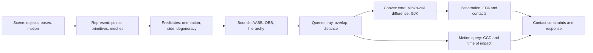

The arrows mean “provides an input contract to,” not “automatically guarantees correctness of.” A good broad phase cannot repair an invalid triangle. A robust orientation predicate cannot recover information already lost when large world coordinates were rounded to a coarse `float`. A Boolean overlap result cannot supply the contact manifold a solver needs.

### The scene is not yet geometry

A scene contains entities, transforms, motion, and policies. A rendered mesh may be only a visual approximation of a physical collider. A collider can be a sphere, capsule, box, convex hull, triangle mesh, or a compound of several shapes. Its transform maps local coordinates into world coordinates; a query may instead transform into local coordinates to reuse a simpler primitive test. Before any arithmetic, a query should establish which coordinate space each input and output uses, what units the ray parameter has, whether the shape is a surface or a filled solid, and whether touching counts as a hit.

For a ray written $x(t)=o+td$, the parameter $t$ is a distance only when $d$ is unit length. Transforming both $o$ and $d$ by an affine inverse preserves the same parameter if the transformed direction is left unnormalized. If code normalizes the local direction, it has changed the parameter scale; a reported local $t$ can no longer be treated as the original world distance without conversion. This small bookkeeping issue is a frequent source of bugs in picking, BVH traversal, and sweep queries.

A mesh itself has two structures. Geometry is the set of positions and derived quantities such as lengths, normals, and areas. Topology records which indexed vertices form edges and faces and which faces share an edge. Two coincident triangles with duplicated indices may look joined but be topologically disconnected; a shared index edge with zero-area triangles has connectivity but defective geometry. For mesh adjacency, half-edge traversal, winding, boundary loops, or manifold checks, the indices and their orientation matter as much as the coordinates. Botsch et al. introduce triangle meshes as piecewise-linear surfaces and distinguish their geometry from connectivity in *Polygon Mesh Processing*, especially the surface representation and mesh data structure chapters (printed pp. 1–28; inspected PDF pages 13–23 for triangle mesh and half-edge context).

The simplest useful representation is deliberately limited. A point is a location; a vector is a displacement. A segment joins two endpoints; a ray has a source and a permitted parameter interval; a plane is represented by a normal $n$ and offset $d$, with signed expression $n\cdot x+d$. A triangle is an ordered triple of positions. A convex polytope can be represented by its vertices (a V-representation) or by intersecting half-spaces (an H-representation). Neither representation is universally superior: vertices make support queries natural; planes make clipping and containment natural. A bounding volume is yet another representation, chosen to make a cheap rejection test possible, not to reproduce every detail of the object.

### Predicates are the decision points

A predicate classifies a geometric relation: left/right/on, inside/outside, overlap/separate, or positive/negative orientation. A construction computes a new value such as an intersection point, projection, normal, or contact witness. The distinction matters because a slightly inaccurate constructed point may remain usable, while a wrong predicate sign can send a whole algorithm down the wrong branch. CGAL documents this distinction explicitly and uses filtered predicates to certify decisions while allowing inexact constructions in some kernels.

For three planar points $A,B,C$, define

$$
\operatorname{orient2D}(A,B,C)=(B_x-A_x)(C_y-A_y)-(B_y-A_y)(C_x-A_x).
$$

The sign says whether $C$ lies left of, right of, or on the directed line $A\rightarrow B$ in the standard Cartesian orientation. Its magnitude is twice the signed triangle area. Reversing two arguments reverses the sign. For $A=(1,1)$, $B=(5,2)$, and $C=(3,5)$, the edge vectors are $(4,1)$ and $(2,4)$, so the determinant is $4\cdot4-1\cdot2=14>0$. The turn is counterclockwise and the area is $7$ square units. If instead $C=(3,3)$, the determinant is $4\cdot2-1\cdot2=6$, still positive. For $C=(3,1.5)$, it is $4\cdot0.5-1\cdot2=0$: exactly collinear in real arithmetic.

In three dimensions, four points define the signed scalar triple product

$$
\operatorname{orient3D}(A,B,C,D)=(B-A)\cdot((C-A)\times(D-A)).
$$

Its absolute value is six times the tetrahedron's volume. Its sign tells which side of the oriented plane $ABC$ contains $D$; zero means coplanar in exact arithmetic. Both determinant tests are predicates, although a floating-point implementation returns an approximation to the determinant before interpreting its sign.

That caveat is essential. Near zero, floating-point rounding can change a sign. Taking an arbitrary fixed epsilon and declaring all values within it “zero” is not a universal cure: orientation in 2D has units of length squared; orientation in 3D has units of length cubed; a squared-distance comparison has units of length squared. The same literal threshold cannot mean the same geometric tolerance for each. Worse, a tolerance deliberately changes the boundary convention, while a robust predicate tries to determine the sign of the represented input exactly.

Jonathan Shewchuk's adaptive predicates use a fast floating-point evaluation and an error bound. If the estimate is safely outside its error interval, its sign is certified. If not, additional precision is spent only on that difficult case. CGAL's exact-predicates/inexact-constructions kernel makes a related engineering trade explicit: decisions can be exact even when newly constructed coordinates are rounded. These mechanisms do not restore source measurements lost before the predicate sees them, and their guarantees depend on the arithmetic and compiler assumptions of the implementation. For simulation contacts, a small length-valued “slop” may be a sensible policy; for winding or mesh topology, substituting that slop for an orientation sign can create inconsistent connectivity.

Degeneracy should likewise be named by contract. A segment with identical endpoints is mathematically degenerate; an application may also choose to treat every segment shorter than a specified length as unusable. A triangle with exactly zero cross product has zero area; a skinny triangle with nonzero area may still be rejected as poor quality for a solver. These are different cases and require different handling. Degenerate geometry should select a documented fallback (for example, point-to-segment distance for a collapsed triangle), not silently fabricate a normal that is then exposed as a valid geometric normal.

### Bounds preserve possibilities

A bound is useful when it is cheap and guaranteed to contain the object. An axis-aligned bounding box (AABB) stores componentwise minima and maxima. A point is inside it when all three coordinates lie in their closed intervals. Two AABBs overlap if and only if their intervals overlap on every axis. This test is inexpensive and is excellent for rejecting pairs that cannot collide. It is not a statement that the enclosed shapes themselves intersect.

An oriented box (OBB) can fit a rotated object more tightly, but it carries axes and half-extents and therefore has more expensive overlap tests. A hierarchy of bounds lets a ray or shape query descend only into promising subtrees. The central broad-phase invariant is one-sided: pruning may leave extra candidates (false positives), but it must not discard a true hit (false negative). Surface area often predicts hierarchy traversal cost better than volume, because a ray intersects boundary area rather than volume; it remains a heuristic, not a guarantee of query speed.

Projection unifies a number of these ideas. Given a direction $n$, a convex shape $K$ projects to an interval whose maximum is $h_K(n)=\max_{x\in K}n\cdot x$ and minimum is $-h_K(-n)$. A support point is any point attaining the maximum. AABB plane classification, the Separating Axis Theorem (SAT), and [[Concepts/GJK and EPA|GJK]] support queries all ask for extreme projections, but use those values for different decisions.

For two convex polytopes, SAT checks candidate axes: if the projected intervals have a gap on any tested separating axis, the shapes are disjoint. For two 3D boxes, the complete candidate set is the three face normals of each box plus nine cross products of one edge direction from each box, for up to 15 axes. A zero cross product gives no direction and is skipped. A nearly zero cross axis is numerically ill-conditioned if normalized; for a Boolean interval separation test, one can compare unnormalized projected values because the common axis scale appears on both sides. If penetration depths are compared across axes, their lengths must be normalized or corrected for that axis scale. A best SAT axis estimates a minimum translation direction for suitable convex polyhedra, but does not itself generate a full contact manifold.

### Queries turn geometry into answers

A ray–plane query substitutes $o+td$ into the plane equation and solves one scalar equation. The denominator $n\cdot d$ identifies parallelism; the numerator measures signed offset. If $n\cdot d$ is small, a huge computed $t$ may be highly sensitive to rounding. A ray–sphere query substitutes the same parameterization into the squared-distance equation and obtains a quadratic. The discriminant distinguishes miss, tangent, and crossing, but the naïve quadratic formula can lose precision when subtracting nearly equal values; stable root evaluation and explicit handling of a ray starting inside are part of the query contract.

A ray–triangle test must combine a plane crossing with triangle containment. Barycentric coordinates express a point as $P=A+u(B-A)+v(C-A)$; for a point in the triangle, $u\ge0$, $v\ge0$, and $u+v\le1$, with boundary inclusion stated explicitly. Möller–Trumbore solves for the same quantities in one determinant-based system. Shared edges pose a special challenge: adjacent triangles should agree about whether a ray exactly on their common edge hits one, both, or neither. “Watertight” is a stronger property than passing ordinary interior-hit examples.

For a ray and AABB, the slab method intersects the parameter intervals induced by each coordinate's min/max planes. The final interval is the maximum of entry parameters and minimum of exit parameters, intersected with the ray's allowed interval. If a direction component is zero, the ray is parallel to that pair of planes: reject if the origin coordinate lies outside the slab, otherwise that axis imposes no finite bound. Blindly multiplying a zero displacement by an infinite reciprocal can produce NaNs. If the origin starts inside the box, the entry parameter may be zero while the exit is positive; whether that means “initial overlap” or “first boundary hit” must be stated, especially for normals.

At mesh scale, a primitive intersection is not yet a scene query. “Any hit” may stop at the first accepted hit; “closest hit” must keep the smallest valid parameter; “all hits” must collect every relevant crossing and may sort them. A BVH traversal must preserve the chosen semantics. Mesh containment by ray parity requires a complete, consistent set of crossings and a rule for shared edges and vertices; a mesh-level API that returns only one closest hit per collider is not enough. A generalized winding number offers another route, but has its own signed-orientation and open-mesh assumptions. Distinguish candidate enumeration from the local geometric test and from the public query result.

Likewise, distinguish overlap, distance, penetration, and time of impact. A Boolean overlap says only that the chosen solids intersect under the chosen boundary convention. A distance query returns a closest-point separation and often witnesses. Penetration depth asks how far one object must be translated to separate them, along a minimizing direction. Time of impact (TOI) asks for the earliest time within a motion interval at which the query shapes first touch. These results need different algorithms and API fields.

### Minkowski difference turns two shapes into one

For sets $A$ and $B$, their Minkowski difference is

$$
A-B=\{a-b\mid a\in A,\ b\in B\}=A\oplus(-B).
$$

It is not set subtraction $A\setminus B$. The origin belongs to $A-B$ exactly when there exist equal points in both shapes, so $A$ and $B$ intersect if and only if $0\in A-B$. If both original shapes are convex, their Minkowski difference is convex too: a convex combination of $a_1-b_1$ and $a_2-b_2$ is the difference between the same convex combinations in $A$ and in $B$.

A support query avoids constructing this potentially enormous difference explicitly:

$$
S_{A-B}(d)=S_A(d)-S_B(-d).
$$

The support point of a sphere centered at $c$ with radius $r$ is $c+r\,d/\|d\|$ for nonzero $d$. For an AABB, each coordinate chooses its minimum or maximum according to the corresponding direction sign. For a capsule (segment Minkowski-summed with a radius-$r$ ball), choose the segment endpoint with larger dot product and add the sphere support displacement. A zero direction is exceptional: every point maximizes the zero dot product, so a deterministic valid support may be returned, but it carries no useful search orientation.

#### Numeric witness: a complete 2D GJK separation trace

Let $A$ be the square with corners $(0,0),(2,0),(2,2),(0,2)$ and let $B$ be the square $(3,0),(4,0),(4,1),(3,1)$. Their true closest points are $(2,0)$ on A and $(3,0)$ on B, so the distance is $1$ and the shapes are disjoint. We compute support on $C=A-B$ with $S_C(d)=S_A(d)-S_B(-d)$.

Start with $d=(1,0)$. The A support can be $(2,2)$ (there is a tie on the right edge); the B support in $-d=(-1,0)$ is $(3,0)$ (tie on the left edge). Therefore $w_1=(-1,2)$. This is a point in the Minkowski difference, not the difference of the closest witnesses.

Choose next direction $d=-w_1=(1,-2)$, toward the origin from that point. The A support is $(2,0)$; the B support in $(-1,2)$ is $(3,1)$. Thus $w_2=(-1,-1)$. The segment from $w_1$ to $w_2$ lies on the left boundary of the difference square. The origin is outside it. Project $O$ onto the segment: with $A_s=w_2=(-1,-1)$ (newest point) and $B_s=w_1=(-1,2)$, $AB=B_s-A_s=(0,3)$ and $AO=(1,1)$. Then $AO\cdot AB=3>0$ and $t=(AO\cdot AB)/(AB\cdot AB)=3/9=1/3$. The closest point is $q=A_s+tAB=(-1,0)$; its distance to the origin is $1$. A distance-GJK implementation can return this distance and recover original-shape witnesses using the same barycentric weight $2/3$ on the pair that generated $w_2$ and $1/3$ on the pair that generated $w_1$.

The separating certificate is the support in direction $-q=(1,0)$. The current simplex has maximum projection $(-1,0)\cdot(1,0)=-1$, strictly below zero, so its convex hull—and therefore the full Minkowski difference, whose support in that direction is no smaller—cannot contain the origin. If shapes are tangent, the certified gap is zero; if a rounded dot product is only approximately zero, the code must distinguish a tolerance policy from a certified sign. This one trace ties the support formula, simplex closest point, separation test, distance, and witness interpolation together.

GJK repeatedly adds support points and retains the simplex feature nearest the origin. In 3D that feature can be a point, segment, triangle, or tetrahedron. For a line, project the origin onto the segment and discard an endpoint if its barycentric weight would be negative. For a triangle, test face and edge Voronoi regions or solve a constrained closest-point problem; retain only the active feature. For a tetrahedron, orient face tests consistently and determine whether the origin is inside or outside each face. The essential invariant is not “always keep four points”; it is “retain a simplex whose convex hull is the current closest region relevant to the origin.”

A simple intersection GJK and distance GJK have different stopping questions. A separated support plane can prove no intersection. A simplex containing the origin can establish overlap, but lower-dimensional contact needs careful treatment. Distance GJK instead reduces the closest point and checks progress or support improvement against a justified convergence condition. Repeated or nearly repeated support points, vanishing triple-cross directions, zero-area triangles, and near-zero tetrahedral volumes need explicit status handling. An iteration cap prevents hangs; reaching it is a failure/uncertain result, not a proof of separation. Tolerance must be tied to scale, units, and the specific comparison.

Gilbert, Johnson, and Keerthi introduced an iterative distance algorithm for convex sets; later implementations refine sub-simplex selection and robustness. The practical principle remains useful: the shape is hidden behind a support mapping, so the same loop works for many convex representations. But convexity is a precondition. A concave mesh must be decomposed into convex pieces or traversed through a hierarchy of triangles or convex proxies.

### EPA converts overlap into a displacement estimate

GJK answers overlap or distance, but penetration response needs direction and depth. The Expanding Polytope Algorithm (EPA) starts from a suitable origin-containing simplex in Minkowski-difference space, expands it into a polytope, selects the face nearest the origin, and queries support along that face's outward normal. If the new support lies only a small gap beyond the face, that face approximates the closest boundary of the Minkowski difference. The face normal gives a candidate translation direction; the distance from the origin to the face approximates the penetration depth.

For a triangular face with vertices $a,b,c$, compute $n=(b-a)\times(c-a)$ and orient it so the face's signed distance $n\cdot a/\|n\|$ is nonnegative under the chosen outward convention. The face's distance is measured to its plane, not to its nearest vertex. The closest face is selected, support is added, and faces visible from the new point are removed; the boundary between removed and retained faces is the horizon, which is stitched to form new faces. Directed-edge orientation and a closed, consistently wound polytope are structural invariants. Duplicate support, degenerate faces, nonmanifold horizons, and iteration exhaustion all need explicit failure outcomes.

EPA is an approximation procedure for penetration depth, not magic contact generation. It expects a valid seed enclosing the origin; a GJK overlap result with only a point, line, or triangle may require a controlled seed-expansion step or another method. Touching and deeply symmetric shapes are particularly awkward. The distance between the origin and the nearest face of an inner polytope is a lower bound on distance to the full Minkowski boundary; the support gap is an upper bound. Convergence is measured by their gap, not by claiming that a finite polytope has become the exact curved boundary. A failure should return an explicit status and, if the engine chooses a fallback normal or depth, mark that estimate as fallback.

EPA can interpolate the original support witnesses stored alongside each Minkowski vertex. On a selected face, barycentric weights $(\lambda_a,\lambda_b,\lambda_c)$ combine the A-side witness points and B-side witness points separately. This yields one pair of approximate contact witnesses. It does not necessarily yield the several spatially separated contacts needed for a stable box-on-box manifold. Feature clipping, persistent feature IDs, and manifold reduction are separate stages. The collision normal's orientation must be documented once—e.g. from A toward B—and held consistent through witnesses, solver impulses, and penetration signs.

### Motion changes the question

Discrete collision detection asks whether shapes overlap at sampled times. A fast object can pass through a thin obstacle between samples. [[Concepts/Continuous collision detection|Continuous collision detection]] asks whether a collision occurs anywhere along the motion interval and, if so, finds the earliest TOI. A swept bound can conservatively generate candidate pairs; it does not by itself calculate TOI.

For pure translation with fixed orientation, relative motion reduces the pair to one moving shape against a stationary one. Let $v=v_A-v_B$. For a sphere swept against another sphere, use relative position $p=c_A-c_B$ and combined radius $R=r_A+r_B$, then solve $\|p+tv\|^2=R^2$ over the step's interval. The first valid root is the TOI. For an AABB swept against another AABB, expand one box by the other's half-extents and sweep a point through the expanded box (Minkowski sum configuration-space reasoning). The face hit determines a normal, with care at initial overlap and corner ties.

For general convex bodies, conservative advancement repeatedly queries distance and moves time forward by a safe fraction based on the current separation and a bound on closing speed. If separation is $d$ and the maximum closing speed along the current separating direction is $v_c>0$, a step no larger than $d/v_c$ is conservative for the assumed motion model; practical algorithms include a safety factor and recompute distance after advancing. Rotating bodies require accounting for angular motion, often through a bound involving angular speed and a radius from the center of rotation. An algorithm that assumes linear translation cannot claim a rotational CCD guarantee.

The process terminates on an overlap/touching criterion, a time interval bound, or a declared iteration/precision limit. “No hit found before the cap” differs from a proof of no collision. CCD also belongs to simulation control: after TOI, the integrator must advance to impact, solve or constrain, then process any remaining time. A query returning a correct TOI is not alone evidence that the entire physics step prevents tunnelling.

### The final contract is observable

A dependable geometry library makes its decisions inspectable. A ray hit should expose its parameter and coordinate space, point, geometric normal validity, primitive/feature identity, and whether the result denotes initial overlap. A shape-pair query should separate overlap state, distance, penetration estimate, witnesses, and failure status instead of overloading a Boolean. A mesh query should state whether it is any-hit, closest-hit, or all-hit and whether results are per collider or per primitive. A CCD result should distinguish hit, no hit within interval, initial overlap, and numerical/iteration failure.

Tests should follow the same chain as the algorithms. Use hand-checkable numeric cases, then symmetry checks (swap A and B and reverse the normal), translation and uniform-scale metamorphic checks, degenerate and near-tangent families, shared-edge rays, and brute-force versus hierarchy comparisons. For optimized SAT/SIMD/BVH paths, retain a simple reference implementation and compare them over reproducible generated cases. Visual debug drawings should show the relevant intermediate state—bounds, candidate axes, simplex, support points, EPA horizon, hit interval, witness pair—and should label coordinate spaces. A picture is useful evidence of a trace, not proof of exhaustive robustness.

The chain is the teaching spine: scene policy determines representations; representation enables predicates; predicates maintain consistency; bounds remove impossible candidates; queries resolve remaining geometry; convex support lifts pairwise collision into origin geometry; GJK measures or classifies; EPA estimates penetration; CCD asks the query across time; and contacts feed the solver. Each layer has a narrow promise. Reliability comes from preserving those promises while moving between them.

### A short laboratory for the contracts

Take two AABBs, $A=[(0,0,0),(2,2,2)]$ and $B=[(1.5,1,2.4),(3,3,4)]$. Their overlap intervals are $[1.5,2]$ on $x$, $[1,2]$ on $y$, and empty on $z$ because $2.4>2$. The broad phase rejects the pair before any triangle or convex test. If the lower $z$ bound changes from $2.4$ to $2$, the boxes touch on a face. A closed-box convention reports overlap; a strict-interior convention reports no positive-volume overlap. Neither convention should be left implicit.

Now shrink the question to two planar triangles. Let $A=(0,0)$, $B=(4,0)$ and examine $C_1=(2,10^{-8})$ and $C_2=(2,-10^{-8})$. Their exact orientation values are $+4\times10^{-8}$ and $-4\times10^{-8}$, respectively, in square coordinate units. A fixed threshold `1e-6` applied to the determinant would collapse both into the same “on” class. It would erase a real side distinction even though the coordinate scale is only a few units. If the entire scene is uniformly scaled by $10^6$, the determinant scales by $10^{12}$, while the geometric turn has not changed. This demonstrates why a dimensional tolerance, an angular quality policy, and an exact-sign predicate answer three different questions.

For SAT, consider intervals $I_A=[-2,1]$ and $I_B=[0,3]$ on a candidate axis. They overlap by one unit; the signed center-distance formula has $|c_B-c_A|=2$ and projected radii $r_A=1.5,r_B=1.5$, so $2<3$. Move $B$ to $[1.1,4.1]$: now the gap is $0.1$ and $2.6>1.5+1.5$ only depending centers: centers are 2.6 and -0.5, separation 3.1, sum radii 3.0, correctly reject by 0.1. On an unnormalized axis $5n$, all projections and radii multiply by five and the Boolean result remains the same; a depth comparison must divide that gap by five. This is the scale consistency a handwritten SAT implementation should preserve.

These hand calculations make good first tests because the expected classification and intermediate values are visible. They do not replace adversarial tests over random rotations, shared edges, very large offsets, or non-finite input. Nor do they establish that a production collision pipeline is complete. They establish a small set of traceable examples against which implementations can be checked.

The geometry-processing book also cautions that mesh samples need consistent neighbourhood structure before they define a meaningful manifold surface. In collision work, this becomes a practical distinction: a set of triangles can be intersected independently without manifold topology, but inside/outside classification, connected surface traversal, and boundary-loop reasoning rely on stronger assumptions. An open sheet has no unambiguous “inside” in the same sense as a closed oriented shell; nonmanifold edges or bow-tie vertices undermine local neighborhood assumptions. Mesh repair is therefore not a cosmetic preprocessing step when later queries depend on topology.

Finally, every algorithm should expose uncertainty in a form callers can preserve. A three-state enum such as separated / touching-or-overlapping / uncertain is sometimes more honest than forcing a difficult near-zero calculation into a Boolean. A richer result can carry a reason: invalid input, degenerate simplex, exhausted iterations, unsupported motion, or a conservative bound. That is not needless API ceremony; it prevents a fallback or timeout from being mistaken for a geometric theorem.


![[Visual Recall/Integrated Geometry and Engine/triangle-nearest-edge.png]]

For $A=(0,0)$, $B=(4,0)$, $C=(1,3)$ and $P=(4,4)$, the unconstrained face coordinates place $P$ outside the triangle. Project onto edge $BC$: $t=((P-B)\cdot(C-B))/\|C-B\|^2=2/3$, so $Q=(2,2)$. The residual is perpendicular to the edge, and the squared distance is $8$. This is an edge solution rather than an interior-face solution.

Repository-specific passages below describe the supplied Kairo snapshot. They have not been revalidated against a current checkout; code fragments retain their stated surrounding context and are not all standalone tested programs. Numerical and contract explanations are taught independently of those implementation observations.

Phase 12 · Computational Geometry, Geometric Predicates, and Closest-Point Reasoning


System question: How does a graphics or physics engine convert mathematical geometry into reliable computational decisions, distances, nearest points, surface coordinates, and collision-query primitives?

This pass develops two connected systems. M067 establishes robust geometric reasoning and the foundational representations of rays, lines, segments, and planes. M068 builds spheres and triangles on top of those foundations, eventually deriving barycentric coordinates, point containment, and closest-point algorithms.

The important distinction throughout is that mathematical geometry describes exact objects, whereas computational geometry must make reliable decisions using finite-precision representations of those objects.

### Geometric Predicates, Rays, Lines, Segments, and Planes

**What computational geometry actually solves**

Imagine a rendering engine containing a camera, a triangular mesh, and a mouse cursor. The user clicks somewhere on the screen, and the engine needs to select the triangle underneath the cursor.

There are several mathematical questions hidden inside this apparently simple operation.

The camera generates a ray from the screen position. The engine asks whether that ray intersects a triangle. To answer, it must represent the ray, determine an intersection parameter, distinguish hits behind the camera from hits in front of it, classify the intersection relative to the triangle, and decide how to handle numerical uncertainty near an edge.

This same machinery appears in rigid-body collision detection, BVH traversal, mesh reconstruction, cloth simulation, Gaussian proxy geometry, scene editing, navigation, and spatial optimization.

The complete progression is:

Geometric representation

Points, vectors, lines, rays, planes, surfaces

Geometric predicates

Which side? Inside? Outside? Intersecting?

Geometric constructions

Projection, nearest point, intersection position

Algorithms and acceleration

Ray casting, collision detection, BVHs, contact generation

**Part 1101 — Geometric predicates versus constructions**

A geometric predicate answers a decision question about geometry. A geometric construction computes a geometric result.

For example, consider three points in two dimensions:

$$
A=(0,0),\quad B=(4,0),\quad C=(2,3)
$$

We want to determine whether $C$ lies to the left or right of the directed line $A\rightarrow B$.

Define:

$$
\operatorname{orient2D}(A,B,C)= (B_x-A_x)(C_y-A_y) - (B_y-A_y)(C_x-A_x)
$$

This expression is the determinant:

$$
\det \begin{pmatrix} B_x-A_x & B_y-A_y\\\ C_x-A_x & C_y-A_y \end{pmatrix}
$$

For our example:

$$
(4)(3)-(0)(2)=12
$$

A positive result indicates counterclockwise orientation, which means $C$ lies to the left of the directed line $A\rightarrow B$ under standard Cartesian-axis conventions.

A negative result indicates clockwise orientation; zero means collinearity.

Orientation is a signed decision. Reversing the order of two inputs reverses the sign.

The actual predicate returns a sign or orientation classification rather than requiring the caller to interpret an arbitrary numerical magnitude.

A construction, meanwhile, might compute the perpendicular projection of $C$ onto the line through $A$ and $B$, obtaining $(2,0)$.

This distinction matters because a small numerical error in a construction may produce a slightly inaccurate point, but a small numerical error in a predicate can reverse an entire algorithmic decision.

For example, a wrong orientation sign can reverse polygon winding, exclude a valid point from a triangle, choose the wrong feature in collision detection, or produce invalid mesh connectivity.

The [CGAL geometry-kernel documentation](https://cgal.geometryfactory.com/CGAL/doc/main/Kernel_23/index.html?utm_source=chatgpt.com) makes this distinction central to designing reliable geometric algorithms.&#x20;

[image](https://www.google.com/s2/favicons?domain=https://cgal.geometryfactory.com\&sz=32)

cgal.geometryfactory.com+1


**Generalizing orientation to 3D**

In three dimensions, four points determine a signed tetrahedral volume.

Let $A,B,C,D\in\mathbb{R}^3$. Define:

$$
\Delta = (B-A)\cdot\big((C-A)\times(D-A)\big)
$$

This is a scalar triple product, equivalent to a $3\times3$ determinant.

Its magnitude equals six times the tetrahedron's volume:

$$
V=\frac{|\Delta|}{6}
$$

Its sign identifies which oriented side of the plane through $A,B,C$ contains $D$.

Its zero value indicates that all four points are coplanar, assuming exact arithmetic.

Why does the factor six appear? A parallelepiped generated by three edge vectors has volume equal to the absolute scalar triple product. The corresponding tetrahedron occupies one-sixth of that parallelepiped.

A numerical determinant is therefore not merely an algebraic formula. Its sign controls orientation and topological decisions in mesh processing, tetrahedralization, collision detection, and spatial reconstruction.

**Part 1102 — Numerical robustness and the epsilon problem**

Now we encounter one of the most important ideas in computational geometry.

A mathematically exact zero and a floating-point value close to zero are different things.

Suppose three nearly collinear points are:

$$
A=(0,0),\quad B=(10^8,10^8),\quad C=(2\times10^8,2\times10^8+\delta)
$$

Their orientation determinant is:

$$
\Delta=10^8\delta
$$

If $\delta$ is sufficiently small, binary floating-point rounding may eliminate the displacement when the coordinates are represented.

Even if the displacement survives, determinant evaluation subtracts potentially large and nearly equal products. This introduces catastrophic cancellation: the resulting difference may have far fewer reliable significant bits than the original operands.

**Absolute versus relative errors**

An absolute-error comparison tests:

$$
|a-b|\le\epsilon_{\mathrm{abs}}
$$

This works when the units and characteristic scale are known.

A relative-error comparison tests:

$$
|a-b|\le\epsilon_{\mathrm{rel}} \max(|a|,|b|)
$$

This is useful across varying magnitudes, but it is inadequate near zero.

A combined comparison uses:

$$
|a-b| \le \epsilon_{\mathrm{abs}} + \epsilon_{\mathrm{rel}}\max(|a|,|b|)
$$

However, this is a numerical policy, not a universal definition of geometric equality.

If your geometry represents a microscopic object and a planetary-scale scene, the same absolute tolerance cannot reliably serve both.

Moreover, different geometric expressions have different physical dimensions.

For example:

| Expression                     | Units when coordinates are in metres |
| ------------------------------ | ------------------------------------ |
| $\|B-A\|$              | $\mathrm m$                      |
| $\|B-A\|^2$            | $\mathrm m^2$                    |
| $\|(B-A)\times(C-A)\|$ | $\mathrm m^2$                    |
| $\operatorname{orient2D}$  | $\mathrm m^2$                    |
| $\operatorname{orient3D}$  | $\mathrm m^3$                    |
| Triangle Gram determinant      | $\mathrm m^4$                    |

Comparing every one of these expressions against the same dimensionless `1e-6` is not mathematically meaningful.

**Numerical degeneracy versus geometric degeneracy**

A segment is mathematically degenerate if its endpoints coincide:

$$
A=B
$$

An approximate degeneracy policy might instead declare it too short to process:

$$
\|B-A\|\le \tau_L
$$

where $\tau_L$ has units of length.

These are different decisions. A segment of length $10^{-7}$ metres is not mathematically degenerate, even if the renderer deliberately treats it as such.

For a triangle, a scale-relative criterion can be constructed using:

$$
\begin{aligned} e_0&=B-A\\\ e_1&=C-A\\\ e_2&=C-B\\\ L^2&=\max(\|e_0\|^2,\|e_1\|^2,\|e_2\|^2) \end{aligned}
$$

Since $\|e_0\times e_1\|^2$ has units of length to the fourth power, a relative area test can use:

$$
\|e_0\times e_1\|^2 \le \tau_{\mathrm{rel}}^2L^4
$$

This is dimensionally consistent. It still represents an approximate policy, not an exact predicate.

A production implementation must additionally handle arithmetic overflow, underflow, non-finite input, and the possibility that subtraction itself loses the geometric information.

**Robust predicates using adaptive precision**

Jonathan Richard Shewchuk's work explains why ordinary fixed-precision determinant evaluation can produce incorrect orientation results and how adaptive arithmetic can avoid this problem.&#x20;

[image](https://www.google.com/s2/favicons?domain=https://www.cs.cmu.edu\&sz=32)

cs.cmu.edu+1


The essential strategy is:

1. Evaluate the determinant using ordinary floating-point arithmetic.
2. Calculate a rigorous bound on the possible rounding error.
3. If the magnitude is greater than the bound, the sign is reliable.
4. Otherwise, perform more precise arithmetic, often using floating-point expansions.
5. Return the reliably determined sign.

A floating-point expansion represents a numerical value as the unevaluated sum of several nonoverlapping floating-point components. This preserves information that would be lost in one ordinary floating-point number.

The efficiency comes from the fact that ordinary, well-separated geometry usually passes the fast first stage. Difficult nearly degenerate cases trigger the more expensive arithmetic.

An important condition is that the predicate implementation's assumptions about floating-point operations and compiler optimization must hold. Arbitrary fast-math transformations can violate those assumptions.

Our engineering distinction: scale-aware tolerances are useful for approximate geometry such as collision slop and editor picking. Exact or adaptively evaluated predicates are appropriate when the sign itself determines topology or a critical branch.

**Parts 1103–1107 — Rays and infinite lines**

A line and a ray share the same parametric equation, but they represent different sets of points.

Let $O$ be an origin, $D$ a direction vector, and $t$ a scalar parameter.

$$
\boxed{P(t)=O+tD}
$$

For an infinite line:

$$
t\in(-\infty,\infty)
$$

For a ray:

$$
t\in[0,\infty)
$$

A ray therefore has a distinguished starting point and extends in only one direction. An infinite line extends in both directions.

**Deriving the parametric equation**

At $t=0$, the position must be $O$.

At $t=1$, the position must be $O+D$.

At $t=2$, the position must be $O+2D$.

These requirements imply an affine relation:

$$
P(t)=O+tD
$$

Importantly, $O$ is a point, while $D$ is a displacement vector. Adding two points is not generally an affine-geometric operation; adding a vector to a point is.

This distinction motivates strongly typed point/vector APIs in large geometry libraries.

**Direction magnitude changes the meaning of $t$**

Consider:

$$
O=(1,2,3),\qquad D=(0,0,5)
$$

Then:

$$
P(2)=(1,2,13)
$$

The actual displacement from the origin has length $10$, not $2$.

In general:

$$
\operatorname{distance}(O,P(t))=|t|\|D\|
$$

Only when $\|D\|=1$ does $t$ measure Euclidean distance.

This matters for intersection results. A ray-triangle routine that returns `t=10` is returning ten parameter units, which are ten metres only if the direction is unit length and coordinates use metres.

Two common ray contracts are valid:

- General-direction ray: preserves arbitrary nonzero $D$; every query accounts for $\|D\|$.
- Unit-direction ray: enforces $\|D\|=1$; parameters represent physical distance.

Neither is universally superior. The first avoids unnecessary normalization and preserves some transformation conventions. The second simplifies distance-based operations.

The critical rule is to avoid mixing them.

**Part 1105 — Ray intervals**

Practical ray tracers often use:

$$
t\in[t_{\min},t_{\max}]
$$

This lets us exclude intersections too close to the origin or farther than a known closest hit.

For example, a shadow ray from point $P$ to a light $L$ should generally search only within the segment joining them, with appropriate endpoint handling.

If $D$ is a normalized direction toward the light:

$$
t_{\max}\approx\|L-P\|
$$

A lower endpoint may be excluded to prevent a surface from reporting an immediate self-hit. The actual treatment should be chosen with attention to geometric error bounds; blindly setting one global ray epsilon is unreliable at widely varying scales.

Ray intervals also permit hit pruning. Suppose a BVH traversal has already found a hit at $t=8$. Geometry farther away cannot improve the closest-hit result, so the traversal can reduce its current upper bound to $8$.

**Your repository: `KairoGeometry/Ray.cppm`**

I inspected the current default branch of [KairoGeometry/Ray.cppm](https://github.com/swayam8624/KairoGeometry/blob/master/Ray.cppm?utm_source=chatgpt.com).

The implementation represents a ray using two `Vector3<T>` values:

```
template<FloatingPoint T>
struct Ray final {
    Vector3<T> Origin = Vector3<T>::Zero();
    Vector3<T> Direction = Vector3<T>::Forward();

    constexpr Vector3<T> GetPoint(T distance) const noexcept {
        return Origin + Direction * distance;
    }
};
```

This is a simplified presentation of the repository's actual representation and evaluation logic.

The object contains no heap allocation, no pointer ownership, and no stored intersection history.

It also does not contain `tMin` or `tMax`. The ray is fundamentally an origin and direction; an intersection interval would need to be supplied by a separate API or query object.

The file's documentation expects a normalized direction for distance/intersection operations, but `FromOriginDirection()` and the direct constructor preserve the input direction. `NormalizeDirection()` is an explicit mutating operation.

There is a subtle API issue here: the representation allows non-unit directions while some API expectations assume unit directions.

A future refinement could make this distinction explicit with a validated unit-ray constructor or a separate ray-query type.

Another useful detail: `FromOriginTarget()` uses safe normalization with a fallback forward vector. That makes the operation total for coincident points, but it changes the semantic question from an undefined direction into a particular valid direction. That may be appropriate for editor tools and inappropriate for a strict geometric solver.

**Parts 1108–1112 — Finite segments, projection, and closest-point derivation**

A segment is defined by endpoints $A$ and $B$.

Set:

$$
D=B-A
$$

Every point on the infinite line through the endpoints is:

$$
Q(t)=A+tD
$$

The finite segment restricts:

$$
0\le t\le1
$$

This normalized parameter convention is especially valuable because it remains meaningful regardless of the segment's length.

**Deriving the closest point from first principles**

Given a query point $P$, find the point $Q(t)$ on the line that minimizes squared distance:

$$
f(t)=\|P-(A+tD)\|^2
$$

Define:

$$
W=P-A
$$

Then:

$$
f(t)=\|W-tD\|^2
$$

Expanding the dot product:

$$
f(t) =(W-tD)\cdot(W-tD)
$$

$$
f(t)=W\cdot W-2t(W\cdot D)+t^2(D\cdot D)
$$

Differentiate with respect to $t$:

$$
f'(t)=-2(W\cdot D)+2t(D\cdot D)
$$

Set the derivative to zero:

$$
-2(W\cdot D)+2t(D\cdot D)=0
$$

Therefore:

$$
\boxed{ t^*=\frac{(P-A)\cdot(B-A)}{\|B-A\|^2} }
$$

The second derivative is:

$$
f''(t)=2\|B-A\|^2
$$

For a nondegenerate segment, this is positive, proving that the stationary point is a minimum.

For an infinite line, $t^*$ is unrestricted.

For a ray beginning at $A$, use:

$$
t_{\mathrm{ray}}=\max(0,t^*)
$$

For a finite segment, use:

$$
\boxed{ t_{\mathrm{segment}}=\operatorname{clamp}(t^*,0,1) }
$$

The nearest point is:

$$
\boxed{ Q=A+t_{\mathrm{segment}}(B-A) }
$$

And the squared distance is:

$$
\boxed{ d^2=\|P-Q\|^2 }
$$

We usually calculate squared distance when comparing candidate points because taking a square root is unnecessary and the squared ordering is identical for finite nonnegative distances.

**Why clamping is mathematically valid**

The unconstrained squared-distance function is a convex quadratic.

Its minimum lies at $t^*$.

When the allowed domain is the interval $[0,1]$, three outcomes are possible:

- When $t^*<0$, the minimum over the interval lies at $t=0$, giving endpoint $A$.
- When $0\le t^*\le1$, the unconstrained minimum is feasible.
- When $t^*>1$, the interval minimum lies at $t=1$, giving endpoint $B$.

Thus clamping is not a heuristic. It is the exact solution to a convex optimization problem with an interval constraint.

**Worked numerical example**

Let:

$$
A=(1,1,0),\quad B=(5,1,0),\quad P=(4,4,0)
$$

Then:

$$
D=(4,0,0),\quad W=(3,3,0)
$$

$$
t^*=\frac{12}{16}=0.75
$$

The parameter is already within the segment's domain.

Therefore:

$$
Q=(1,1,0)+0.75(4,0,0)=(4,1,0)
$$

The distance is:

$$
d=\sqrt{(4-4)^2+(4-1)^2}=3
$$

If we instead choose $P=(9,4,0)$, then:

$$
t^*=\frac{32}{16}=2
$$

Clamping gives $t=1$, so the closest point is endpoint $B=(5,1,0)$, and the distance is $5$.

**Degenerate segments**

If $A=B$, then $D=0$ and the projection formula attempts division by zero.

The mathematically appropriate result is:

$$
Q=A,\qquad d^2=\|P-A\|^2
$$

This is why a geometry library must define the semantics of zero-length segments.

Your [Segment.cppm](https://github.com/swayam8624/KairoGeometry/blob/master/Segment.cppm?utm_source=chatgpt.com) explicitly permits `Start == End` and treats such a segment as a point.

Its `ProjectPointParameter()` computes the dot-product projection, checks for a very short direction using an epsilon-based threshold, and returns zero for the degenerate case. Its `ClosestParameter()` then clamps the result to $[0,1]$.

This is a coherent general-purpose design, although its fixed threshold on a squared length deserves scale-aware review.

**Parts 1113–1118 — Planes: representation, distance, projection, and classification**

A plane is an infinite, flat, two-dimensional surface embedded in three-dimensional space.

One convenient definition uses a point $P_0$ on the plane and a nonzero normal vector $N$.

Every point $X$ on the plane satisfies:

$$
\boxed{N\cdot(X-P_0)=0}
$$

Why? Every displacement vector lying inside the plane is orthogonal to its normal.

Expanding:

$$
N\cdot X-N\cdot P_0=0
$$

Define:

$$
d=-N\cdot P_0
$$

Then:

$$
\boxed{N\cdot X+d=0}
$$

For $N=(a,b,c)$ and $X=(x,y,z)$, this is the familiar plane equation:

$$
ax+by+cz+d=0
$$

The plane is therefore represented by four scalar coefficients $(a,b,c,d)$, although the same plane can be represented by any nonzero scalar multiple of those coefficients.

**Why normal magnitude matters**

The expression:

$$
N\cdot X+d
$$

is a signed algebraic residual.

It becomes a signed Euclidean distance only when $N$ has unit length.

For a general nonzero normal:

$$
\boxed{ s(X)=\frac{N\cdot X+d}{\|N\|} }
$$

For a unit normal $n$:

$$
\boxed{s(X)=n\cdot X+d}
$$

The sign has a geometrical interpretation:

- $s(X)>0$: point lies in the direction of the normal.
- $s(X)<0$: point lies on the opposite side.
- $s(X)=0$: point lies on the plane.

The words front and back are conventions, not universal mathematical facts. A graphics engine must define which orientation it uses.

**Deriving point projection onto a plane**

We want to find the closest point $Q$ on the plane to arbitrary point $P$.

The closest displacement is perpendicular to the plane, so it must be parallel to $N$.

Write:

$$
Q=P-\lambda N
$$

The projected point must satisfy the plane equation:

$$
N\cdot Q+d=0
$$

Substitute:

$$
N\cdot(P-\lambda N)+d=0
$$

Expand:

$$
N\cdot P-\lambda(N\cdot N)+d=0
$$

Rearrange:

$$
\lambda=\frac{N\cdot P+d}{N\cdot N}
$$

Therefore:

$$
\boxed{ Q=P-\frac{N\cdot P+d}{N\cdot N}N }
$$

When $N$ is unit length:

$$
\boxed{Q=P-(N\cdot P+d)N}
$$

Notice the connection to segment projection: in both cases, the optimal point is found by solving an orthogonality constraint.

**Constructing a plane from three points**

Let $A,B,C$ be three noncollinear points.

Construct the edge vectors:

$$
e_0=B-A,\qquad e_1=C-A
$$

The cross product:

$$
N=e_0\times e_1
$$

is perpendicular to both edges, so it is perpendicular to their entire span.

We can normalize:

$$
n=\frac{N}{\|N\|}
$$

and then compute:

$$
d=-n\cdot A
$$

Thus the plane is:

$$
n\cdot X+d=0
$$

This construction fails to define a unique plane if $A,B,C$ are collinear, because their cross product vanishes.

A reliable API should signal this failure, not silently assume an arbitrary normal when exact geometric meaning matters.

**Worked example**

Take a horizontal plane through $P_0=(0,2,0)$ with upward normal:

$$
N=(0,1,0)
$$

The plane equation is:

$$
y-2=0
$$

because $d=-2$.

For query point:

$$
P=(3,7,4)
$$

the signed distance is:

$$
s(P)=7-2=5
$$

The projected point is:

$$
Q=(3,7,4)-5(0,1,0)=(3,2,4)
$$

If the query point were $(3,-1,4)$, its signed distance would be $-3$, and the projection would still lie at $y=2$.

**Plane classification and tolerances**

In a numerical implementation, we often classify a point with a tolerance $\tau$ measured in world-space length units:

$$
\operatorname{classify}(P)= \begin{cases} \text{Positive}, & s(P)>\tau\\\ \text{Negative}, & s(P)<-\tau\\\ \text{OnBoundary}, & |s(P)|\le\tau \end{cases}
$$

This establishes a tolerance region around the plane, not exact mathematical coplanarity.

For robust topological classification, the sign of the corresponding orientation determinant may be preferable, particularly when the plane is itself constructed from input points.

**Your actual `Plane.cppm`**

Your [Plane.cppm](https://github.com/swayam8624/KairoGeometry/blob/master/Plane.cppm?utm_source=chatgpt.com) stores a normal vector and a scalar called `Distance`.

Its `FromPointNormal()` normalizes the supplied normal and derives the offset using the negative dot product.

Its projection method implements the unit-normal formula:

```
return point - Normal * SignedDistanceToPoint(point);
```

This is correct provided `Normal` is unit length.

But `FromNormalDistance()` directly preserves the supplied coefficients and the ordinary constructor also accepts them without normalization.

Consequently, the struct's public representation permits states in which `SignedDistanceToPoint()` is not a true Euclidean signed distance and `ProjectPoint()` is not an orthogonal projection.

There are at least three reasonable designs:

1. Enforce unit normals through validated constructors and preserve that invariant.
2. Permit arbitrary nonzero normals and use the general projection formula.
3. Distinguish an algebraic plane from a normalized-distance plane using separate types.

For a low-level engine, the first or third design is particularly attractive because they make assumptions more explicit.

Another issue: `FromPoints()` uses `SafeNormalize()` with a fallback up vector. For collinear points, the code creates a horizontal-oriented plane instead of reporting that the requested plane is undefined.

That is useful error tolerance for certain UI operations, but potentially dangerous for exact intersection or reconstruction algorithms.

Core result of M067: rays, lines, segments, and planes can all be understood as affine geometry subject to different constraints. Their closest-point algorithms emerge from orthogonality and minimization, while reliable classification requires a separate numerical decision policy.

### Spheres and Triangles

Original Parts 1119–1132

We now move from one-dimensional and infinite planar primitives to finite curved and polygonal geometry.

This is where the foundational mathematics starts becoming directly useful for collision detection, mesh processing, ray tracing, reconstruction, and physics.

**Parts 1119–1122 — Spheres, containment, closest points, and distance**

A sphere is one of the simplest useful geometric primitives because it is rotationally invariant: changing its orientation does not change its shape.

But a critical distinction must be made between the spherical surface and the filled solid ball.

Mathematically, for centre $C\in\mathbb R^3$ and radius $r\ge0$, the spherical surface is:

$$
S=\\{X\in\mathbb R^3:\|X-C\|=r\\}
$$

The closed solid ball is:

$$
B=\\{X\in\mathbb R^3:\|X-C\|\le r\\}
$$

In graphics-engine terminology, `Sphere` often represents the geometric sphere while point containment is interpreted as membership in its enclosed solid.

**Sphere representation in memory**

A conventional value representation is:

```
struct Sphere {
    Vec3 center;
    double radius;
};
```

Conceptually, this stores three coordinates and one radius.

Assuming `Vec3` contains three consecutive doubles without extra alignment padding, the mathematical payload is 32 bytes. Actual `sizeof(Sphere)` depends on the vector type's alignment, layout, and ABI.

There is no need to store a sphere's orientation.

For a valid geometric sphere, require:

$$
r\ge0,\qquad r\in\mathbb R,\qquad C_i\in\mathbb R
$$

In programming terms, these requirements should exclude negative radii, NaNs, and infinities unless the API deliberately uses special sentinel values.

A zero-radius sphere is a valid degenerate point sphere.

**Deriving sphere containment**

A point $P$ lies inside or on a closed sphere when:

$$
\|P-C\|\le r
$$

Both sides are nonnegative, so squaring preserves the comparison:

$$
\boxed{\|P-C\|^2\le r^2}
$$

In coordinates:

$$
(P_x-C_x)^2+ (P_y-C_y)^2+ (P_z-C_z)^2\le r^2
$$

Squared distances eliminate the square root and are often desirable in collision broadphases and containment queries.

However, the equivalence assumes a valid nonnegative radius and arithmetic without problematic overflow. For extreme finite inputs, independently squaring components can overflow even when a carefully scaled norm computation could remain finite.

**Closest point on the spherical surface**

Given $P$, define the centre-to-point vector:

$$
V=P-C
$$

For $P\ne C$, normalize:

$$
\hat V=\frac{V}{\|V\|}
$$

The nearest point on the spherical surface lies in this radial direction:

$$
\boxed{ Q=C+r\frac{P-C}{\|P-C\|} }
$$

Why?

Let any surface point be written:

$$
Q=C+ru
$$

where $u$ is a unit vector.

We wish to minimize:

$$
\|P-Q\|^2 =\|(P-C)-ru\|^2
$$

Expanding:

$$
\|P-C\|^2+r^2-2r(P-C)\cdot u
$$

The first two terms do not depend on $u$.

Therefore minimizing distance means maximizing:

$$
(P-C)\cdot u
$$

By the Cauchy–Schwarz inequality:

$$
(P-C)\cdot u\le\|P-C\|
$$

Equality occurs when $u$ points in the direction of $P-C$.

This derives the radial closest-point formula instead of assuming it from a diagram.

At the exact centre, $P=C$, the direction is undefined. If $r>0$, every point on the sphere is equally close, so the closest point is not unique.

A deterministic implementation might return:

$$
C+(r,0,0)
$$

This is a valid choice, but it is a convention rather than the unique mathematical answer.

**Three different distance functions**

This distinction is especially important for future physics and collision algorithms.

Let:

$$
\rho=\|P-C\|
$$

Then:

Signed distance to the sphere's boundary

$$
\boxed{d_{\mathrm{signed}}=\rho-r}
$$

Negative values indicate the interior, zero the boundary, and positive values the exterior.

Unsigned distance to the spherical surface

$$
\boxed{d_{\mathrm{surface}}=|\rho-r|}
$$

Even a point inside the sphere has a nonzero distance to the surface unless it lies on the boundary.

Distance to the filled solid ball

$$
\boxed{d_{\mathrm{solid}}=\max(0,\rho-r)}
$$

For points inside the filled ball, the nearest point in the solid is the point itself, so distance is zero.

For example, take a sphere of radius $5$ centred at the origin and query $P=(2,0,0)$.

We obtain:

$$
\rho=2
$$

Therefore:

$$
d_{\mathrm{signed}}=-3,\quad d_{\mathrm{surface}}=3,\quad d_{\mathrm{solid}}=0
$$

All three values are correct. They answer different questions.

**Sphere transformations**

Translations preserve shape and radius.

Uniform scaling by $s$ transforms the radius to:

$$
r'=|s|r
$$

But a general affine transformation, including nonuniform scale, does not necessarily preserve spheres.

For example:

$$
A= \begin{pmatrix} 2&0&0\\\ 0&1&0\\\ 0&0&1 \end{pmatrix}
$$

transforms a unit sphere into an ellipsoid with semiaxes $2,1,1$.

An engine that transforms a sphere's centre but leaves its radius unchanged will produce an incorrect world-space bounding shape under scale.

For conservative bounding under a general linear transform $A$, one may use:

$$
r'\ge r\|A\|_2
$$

where $\|A\|_2$ is the largest singular value of the linear transform. This yields a bounding sphere, not necessarily the smallest one for a transformed object with arbitrary existing geometry.

This is one useful connection to the singular-value decomposition material from the earlier linear-algebra phase.

**Your actual `Sphere.cppm`**

Your [KairoGeometry/Sphere.cppm](https://github.com/swayam8624/KairoGeometry/blob/master/Sphere.cppm?utm_source=chatgpt.com) uses the expected centre-and-radius representation.

Its `ContainsPoint()` checks squared distance against squared radius. `ClosestPoint()` chooses the positive X direction when the query is effectively at the centre, while `SignedDistanceToPoint()` computes distance from centre minus radius.

Its `DistanceToPoint()` clamps that signed distance at zero. Thus it computes distance to the filled solid sphere, not the unsigned distance to the spherical surface.

These semantics are coherent, but they should be clearly distinguished in callers. A constraint or surface-projection routine using `DistanceToPoint()` may need the surface distance instead.

The current `IsValid()` checks that the radius is nonnegative; it does not, by itself, verify that all stored values are finite. NaNs and infinities should be covered by explicit validity tests wherever untrusted geometry enters the system.

**Parts 1123–1126 — Triangle representation, edges, normals, and area**

Triangles are foundational in graphics because three noncollinear points define a plane and a bounded convex polygon.

A triangle is represented by vertices:

$$
A,B,C\in\mathbb R^3
$$

Its directed edge vectors include:

$$
e_{AB}=B-A
$$

$$
e_{AC}=C-A
$$

$$
e_{BC}=C-B
$$

The ordering matters because it determines the triangle's orientation.

**Deriving the geometric normal**

The cross product:

$$
N=(B-A)\times(C-A)
$$

is perpendicular to both edge vectors.

If the triangle is nondegenerate, the unit geometric normal is:

$$
\boxed{ n=\frac{(B-A)\times(C-A)} {\|(B-A)\times(C-A)\|} }
$$

Reversing the triangle's winding reverses the normal:

$$
(B-A)\times(C-A) = -\big((C-A)\times(B-A)\big)
$$

Therefore triangles $(A,B,C)$ and $(A,C,B)$ occupy the same geometric region but have opposite oriented normals.

This is important for face culling, surface orientation, normal consistency, volume computation, collision normal direction, and mesh topology.

**Deriving triangle area**

The magnitude of a cross product is:

$$
\|u\times v\|=\|u\|\|v\||\sin\theta|
$$

This equals the area of the parallelogram spanned by $u$ and $v$.

The triangle occupies half that area:

$$
\boxed{ \operatorname{Area}(ABC)= \frac12\|(B-A)\times(C-A)\| }
$$

For:

$$
A=(0,0,0),\quad B=(4,0,0),\quad C=(0,3,0)
$$

we have:

$$
(B-A)\times(C-A)=(0,0,12)
$$

Thus:

$$
\operatorname{Area}=\frac12(12)=6
$$

The area itself is unsigned.

A signed projected area can be computed relative to a chosen orientation. In the XY plane:

$$
A_{\mathrm{signed}}= \frac12\operatorname{orient2D}(A,B,C)
$$

For a spatial triangle, a chosen reference unit normal $n_{\mathrm{ref}}$ gives an oriented area scalar:

$$
A_{\mathrm{oriented}}= \frac12n_{\mathrm{ref}}\cdot ((B-A)\times(C-A))
$$

This may be positive, negative, or zero depending on the reference direction.

A standalone triangle in unrestricted 3D has no universal clockwise/counterclockwise sign without choosing a viewpoint or reference orientation.

**Geometric normals versus shading normals**

A geometric normal is calculated from the actual triangle edges.

A shading normal may instead be interpolated from authored vertex normals to simulate a smooth surface.

These need not agree.

For example, a faceted sphere may be represented by triangles with flat geometric normals but rendered with interpolated normals that approximate a smooth spherical surface.

Geometric normals should generally govern actual plane geometry, orientation decisions, and intersection sidedness. Shading normals are used to influence material-light interaction, subject to shading-normal consistency and energy-handling considerations.

Confusing them can produce errors such as a surface appearing to receive light from a direction incompatible with its actual geometry.

**Part 1127 — Triangle signed orientation**

For a triangle in 2D, orientation follows directly from the determinant:

$$
\Delta= (B_x-A_x)(C_y-A_y) - (B_y-A_y)(C_x-A_x)
$$

Positive means counterclockwise, negative means clockwise, and zero means collinear in exact arithmetic.

For triangles in 3D, the cross-product normal establishes orientation relative to a chosen reference frame or viewing direction.

Given unit reference normal $n_r$:

$$
s=n_r\cdot((B-A)\times(C-A))
$$

Then the sign of $s$ tells us whether the triangle winding agrees with the reference normal.

Consider a camera looking toward a triangle. Whether the winding appears clockwise or counterclockwise also depends on the camera coordinate system and projection conventions, including whether screen Y increases downward.

That is why graphics APIs specify front-face winding conventions.

An engine must not assume that a triangle classified as counterclockwise in world XY coordinates is automatically counterclockwise after arbitrary viewing, clipping, and viewport transformations.

**Part 1128 — Barycentric coordinates from first principles**

Barycentric coordinates are among the most important tools in geometry and rendering.

They express a point as an affine combination of the vertices of a triangle:

$$
\boxed{ P=uA+vB+wC }
$$

subject to:

$$
\boxed{u+v+w=1}
$$

The three coefficients are the barycentric coordinates of $P$ relative to the ordered triangle $(A,B,C)$.

Their importance is not merely mathematical elegance.

They allow us to interpolate:

- Vertex colors
- Texture coordinates
- Normals and tangents
- Surface positions
- Skinning attributes
- Motion vectors
- Custom material properties
- Per-vertex scientific measurements

**Why the coefficients must sum to one**

Suppose all vertex positions are translated by $T$.

The translated interpolated point is:

$$
P'=u(A+T)+v(B+T)+w(C+T)
$$

Expanding:

$$
P'=uA+vB+wC+(u+v+w)T
$$

For the interpolated point to translate by exactly $T$, we require:

$$
u+v+w=1
$$

This is the affine-invariance condition.

It distinguishes barycentric interpolation from an arbitrary linear combination.

**Barycentric coordinates as a basis change**

Let:

$$
e_0=B-A,\qquad e_1=C-A
$$

Since:

$$
u=1-v-w
$$

we can write:

$$
P=(1-v-w)A+vB+wC
$$

Rearranging:

$$
\boxed{P=A+ve_0+we_1}
$$

Thus barycentric coordinates express a point relative to the local two-dimensional basis generated by the triangle edges.

A nondegenerate triangle has linearly independent edge vectors, so every point in its affine plane has unique barycentric coordinates.

**Deriving barycentrics using dot products**

Define the query displacement:

$$
q=P-A
$$

For a point in the triangle's plane:

$$
q=ve_0+we_1
$$

Take the dot product with $e_0$:

$$
q\cdot e_0 = v(e_0\cdot e_0)+w(e_1\cdot e_0)
$$

Similarly:

$$
q\cdot e_1 = v(e_0\cdot e_1)+w(e_1\cdot e_1)
$$

Introduce:

$$
\begin{aligned} d_{00}&=e_0\cdot e_0\\\ d_{01}&=e_0\cdot e_1\\\ d_{11}&=e_1\cdot e_1\\\ d_{20}&=q\cdot e_0\\\ d_{21}&=q\cdot e_1 \end{aligned}
$$

Then:

$$
\begin{pmatrix} d_{00}&d_{01}\\\ d_{01}&d_{11} \end{pmatrix} \begin{pmatrix}v\\\w\end{pmatrix} = \begin{pmatrix}d_{20}\\\d_{21}\end{pmatrix}
$$

This is a two-variable linear system.

Its determinant is:

$$
D=d_{00}d_{11}-d_{01}^2
$$

Using the $2\times2$ inverse formula:

$$
\boxed{ v=\frac{d_{11}d_{20}-d_{01}d_{21}}{D} }
$$

$$
\boxed{ w=\frac{d_{00}d_{21}-d_{01}d_{20}}{D} }
$$

$$
\boxed{u=1-v-w}
$$

The determinant $D$ is the Gram determinant of the two edge vectors.

Because:

$$
D=\|e_0\times e_1\|^2
$$

a nondegenerate triangle has $D>0$ in exact arithmetic.

This connects the barycentric denominator directly to the triangle's area:

$$
D=4\operatorname{Area}^2
$$

When the triangle approaches degeneracy, the local edge basis becomes poorly conditioned and the barycentric calculation becomes numerically sensitive.

**Worked example**

Consider:

$$
A=(0,0),\quad B=(4,0),\quad C=(0,4)
$$

and:

$$
P=(1,1)
$$

Then:

$$
e_0=(4,0),\quad e_1=(0,4),\quad q=(1,1)
$$

We obtain:

$$
d_{00}=16,\quad d_{01}=0,\quad d_{11}=16
$$

$$
d_{20}=4,\quad d_{21}=4
$$

$$
D=16(16)-0=256
$$

Therefore:

$$
v=\frac{16(4)}{256}=0.25
$$

$$
w=\frac{16(4)}{256}=0.25
$$

$$
u=1-0.25-0.25=0.5
$$

So:

$$
\boxed{(u,v,w)=(0.5,0.25,0.25)}
$$

Reconstruct:

$$
P=0.5(0,0)+0.25(4,0)+0.25(0,4)
$$

$$
P=(1,1)
$$

This is an exact mathematical reconstruction.

Barycentric weights describe the point relative to all three triangle vertices, not merely its Cartesian axes.

**Area-based barycentric interpretation**

For a triangle with vertices $A,B,C$ and a point $P$ in its plane, the barycentric coordinates can also be expressed using signed subtriangle areas:

$$
u=\frac{[PBC]}{[ABC]}
$$

$$
v=\frac{[APC]}{[ABC]}
$$

$$
w=\frac{[ABP]}{[ABC]}
$$

Here the brackets denote consistently oriented area.

Why do these work? The areas of the three signed subtriangles add to the area of the original triangle, giving $u+v+w=1$.

These formulas extend algebraically to points outside the triangle, where one or more weights become negative.

For numerical implementations, division by a very small original area creates sensitivity. The exact choice between dot-product and oriented-area formulations depends on the surrounding computation and available robust predicates.

**A subtle 3D issue: barycentrics do not prove coplanarity**

Suppose our triangle is in the XY plane and the query point is:

$$
P=(1,1,100)
$$

The Gram-system barycentric calculation still returns:

$$
(0.5,0.25,0.25)
$$

Why?

Because the system measures dot products with the triangle's in-plane edge vectors. The perpendicular displacement contributes zero to those dot products.

The coordinates reconstruct:

$$
P_{\mathrm{projected}}=(1,1,0)
$$

rather than the original query point.

Therefore, to test whether a 3D point lies on a triangle, we need both:

1. A coplanarity condition.
2. A barycentric containment condition.

This distinction is essential for correctness.

**Barycentric interpolation in rendering**

Let each vertex carry texture coordinates:

$$
T_A=(0,0),\quad T_B=(1,0),\quad T_C=(0,1)
$$

The texture coordinate at barycentric position $(u,v,w)$ is:

$$
T=uT_A+vT_B+wT_C
$$

For our point:

$$
T=(0.25,0.25)
$$

However, a rasterizer cannot generally perform naïve linear interpolation of arbitrary vertex attributes in screen space after perspective projection.

Perspective-correct interpolation uses reciprocal clip-space $w$.

If screen-space barycentric weights are $\lambda_i$ and clip-space homogeneous coordinates have components $w_i^{\mathrm{clip}}$, then an attribute $a$ interpolates as:

$$
\boxed{ a(P)= \frac{ \sum_i\lambda_i a_i/w_i^{\mathrm{clip}} }{ \sum_i\lambda_i/w_i^{\mathrm{clip}} } }
$$

The denominator corrects for the nonlinear perspective division.

This is the connection to rasterization and homogeneous interpolation that will become central in Phase 19.

**Parts 1129–1130 — Point-in-triangle tests**

Once barycentric coordinates have been computed for a point known to lie in the triangle's plane, containment follows from convexity.

A point lies in the closed triangle exactly when:

$$
\boxed{u\ge0,\quad v\ge0,\quad w\ge0}
$$

with:

$$
u+v+w=1
$$

Why?

A convex combination of vertices lies in their convex hull. The triangle itself is precisely the convex hull of its three vertices.

If one weight is negative, the point lies outside the triangle.

If a weight is zero, the point lies on the edge opposite the corresponding vertex.

At a triangle vertex, one weight is one and the other two are zero.

**Edge-half-space containment**

A different formulation uses the orientation of a point relative to each triangle edge.

Let the triangle's oriented normal be:

$$
N=(B-A)\times(C-A)
$$

For a coplanar point $P$, compute:

$$
s_0=N\cdot((B-A)\times(P-A))
$$

$$
s_1=N\cdot((C-B)\times(P-B))
$$

$$
s_2=N\cdot((A-C)\times(P-C))
$$

For consistent winding, a point is in the closed triangle when:

$$
s_0\ge0,\quad s_1\ge0,\quad s_2\ge0
$$

This works because each oriented triangle edge defines an interior half-space.

The formulation is closely related to the edge functions used in triangle rasterizers.

**Why half-space tests are useful**

Barycentric calculations return useful continuous coordinates and therefore support interpolation.

Half-space tests can instead be efficient when we only need classification.

For rasterization, edge functions also support incremental evaluation across adjacent pixels.

For example, an edge equation in screen coordinates has the form:

$$
E(x,y)=ax+by+c
$$

Moving one pixel horizontally changes the value by $a$; moving vertically changes it by $b$.

This enables efficient incremental rasterization without recomputing a cross product for every fragment.

**Boundary conventions**

Should an edge count as inside or outside?

For a single geometric triangle, inclusive containment is often useful.

For two adjacent triangles in a rasterizer, including a shared edge in both triangles can produce double coverage, while excluding it in both can create a gap.

Rasterization therefore commonly uses a consistent ownership rule, such as a top-left edge convention, so shared boundaries are covered deterministically.

The broader lesson is that the inequality itself is only one part of an algorithm. Boundary ownership is part of the API's semantic contract.

**Coplanarity must come first**

For a nondegenerate triangle:

$$
n=\frac{N}{\|N\|}
$$

The signed distance from query point $P$ to the supporting plane is:

$$
s=n\cdot(P-A)
$$

If $|s|$ exceeds an explicitly chosen distance tolerance, the point should not be classified as lying on the triangle surface.

If the query is known to have already been projected onto the plane, this test can be omitted.

Otherwise, omitting it changes the question from:

> Is this point on the triangle?

to:

> Does this point's orthogonal projection lie inside the triangle?

Those questions have different answers.

**Part 1131 — Closest point from a point to a triangle**

This is where nearly everything from M067 and M068 comes together.

We know how to project a point onto a line, clamp that projection to a segment, construct a plane, and calculate barycentric coordinates.

The next problem is:

Given a triangle $ABC$ and any point $P\in\mathbb R^3$, find the point $Q$ belonging to the closed triangular region that minimizes:

$$
\boxed{ \min_{Q\in\triangle ABC}\|P-Q\|^2 }
$$

The answer might lie on the triangle's interior, one of its three edges, or one of its three vertices.

That gives us seven geometric regions.

Conceptual diagram of the triangle's seven nearest-feature regions: one face, three edges, and three vertices. Exact region boundaries extend into the plane perpendicular to the triangle.

These are called Voronoi regions of the triangle's features.

Each region consists of points whose nearest point on the triangle belongs to a particular feature.

**Deriving the vertex-A region**

Let:

$$
AB=B-A,\quad AC=C-A,\quad AP=P-A
$$

Suppose the closest point is vertex $A$.

For this to be true, moving a small distance from $A$ toward either adjacent edge must not decrease squared distance to $P$.

Along edge AB, consider:

$$
Q(t)=A+tAB,\quad t\ge0
$$

The squared distance function is:

$$
f(t)=\|P-A-tAB\|^2
$$

Its derivative at $t=0$ is:

$$
f'(0)=-2AP\cdot AB
$$

For movement away from A to be non-improving, we require:

$$
f'(0)\ge0
$$

Thus:

$$
AP\cdot AB\le0
$$

Applying the same argument to AC yields:

$$
AP\cdot AC\le0
$$

Therefore the vertex-A region satisfies:

$$
\boxed{ AP\cdot AB\le0,\qquad AP\cdot AC\le0 }
$$

This is exactly the first region test used in the conventional closest-point algorithm.

It is not an arbitrary collection of inequalities. It is the first-order optimality condition at a constrained vertex.

**Vertex B and C regions**

Define:

$$
BP=P-B,\qquad CP=P-C
$$

A point belongs to the vertex-B region if moving from B toward either A or C does not improve its distance.

The equivalent dot-product conditions used by the standard algorithm are:

$$
d_3=AB\cdot BP,\qquad d_4=AC\cdot BP
$$

and:

$$
\boxed{d_3\ge0,\quad d_4\le d_3}
$$

For vertex C, define:

$$
d_5=AB\cdot CP,\qquad d_6=AC\cdot CP
$$

The region conditions become:

$$
\boxed{d_6\ge0,\quad d_5\le d_6}
$$

These expressions come from testing the two feasible edge directions at each vertex.

**Edge regions**

For the AB edge, the nearest point must have the form:

$$
Q=A+vAB
$$

with:

$$
0\le v\le1
$$

From our segment-projection derivation:

$$
v=\frac{AP\cdot AB}{AB\cdot AB}
$$

Using the dot products already calculated:

$$
d_1=AB\cdot AP
$$

and:

$$
d_3=AB\cdot BP
$$

But $BP=AP-AB$, so:

$$
d_3=d_1-\|AB\|^2
$$

Therefore:

$$
d_1-d_3=\|AB\|^2
$$

giving:

$$
\boxed{v=\frac{d_1}{d_1-d_3}}
$$

This is the same projection calculation from M067, reused rather than reinvented.

The algorithm also tests whether the point lies in AB's Voronoi region rather than merely projecting onto AB's infinite supporting line.

It defines:

$$
v_c=d_1d_4-d_3d_2
$$

and selects AB when:

$$
v_c\le0,\quad d_1\ge0,\quad d_3\le0
$$

The first condition identifies the correct side of the relevant feature boundary, while the others constrain the projected point between the edge endpoints.

The AC and BC regions are handled similarly.

For AC:

$$
v_b=d_5d_2-d_1d_6
$$

If:

$$
v_b\le0,\quad d_2\ge0,\quad d_6\le0
$$

then:

$$
\boxed{ Q=A+\frac{d_2}{d_2-d_6}AC }
$$

For BC, define:

$$
v_a=d_3d_6-d_5d_4
$$

If:

$$
v_a\le0,\quad d_4-d_3\ge0,\quad d_5-d_6\ge0
$$

then the closest point is:

$$
\boxed{ Q=B+ \frac{d_4-d_3} {(d_4-d_3)+(d_5-d_6)} (C-B) }
$$

**Face region**

If none of the vertex or edge conditions applies, the closest point lies in the triangle's face region.

The intermediate quantities:

$$
v_a,\quad v_b,\quad v_c
$$

are proportional to the barycentric weights.

Let:

$$
D=v_a+v_b+v_c
$$

Then:

$$
u=\frac{v_a}{D},\quad v=\frac{v_b}{D},\quad w=\frac{v_c}{D}
$$

The closest point is therefore:

$$
\boxed{ Q=A+\frac{v_b}{D}(B-A)+\frac{v_c}{D}(C-A) }
$$

For the interior face region, this is the orthogonal projection of $P$ onto the triangle's supporting plane.

Thus the seven-region algorithm is really an efficient constrained-optimization solution that avoids computing a plane projection and then separately repairing every outside-triangle case.

**Full algorithmic execution order**

Closest point on triangle

The branch order selects a valid nearest feature.

1. Check whether P belongs to vertex A's region.
2. Check vertex B's region.
3. Check edge AB's region.
4. Check vertex C's region.
5. Check edge AC's region.
6. Check edge BC's region.
7. Otherwise, calculate the face-region barycentric point.

A properly implemented routine performs a constant number of dot products, vector operations, scalar comparisons, and divisions.

Therefore:

$$
T(n)=O(1),\qquad S(n)=O(1)
$$

for a single triangle query.

For an entire triangle mesh containing $N$ faces, naïvely repeating this operation for every triangle costs $O(N)$ per query. Spatial acceleration structures such as BVHs reduce the amount of geometry that must be examined; that is one of the central subjects of Phase 14.

**Worked closest-point example**

Use:

$$
A=(0,0,0),\quad B=(4,0,0),\quad C=(0,4,0)
$$

and query:

$$
P=(3,3,1)
$$

The point's plane projection is:

$$
P_{\mathrm{plane}}=(3,3,0)
$$

But this point is outside the triangle, since the line BC satisfies:

$$
x+y=4
$$

while the projected point has $x+y=6$.

The closest triangle feature is edge BC.

Parameterize BC:

$$
Q(t)=B+t(C-B)
$$

$$
Q(t)=(4,0,0)+t(-4,4,0)
$$

The projection parameter is:

$$
t=\frac{(P-B)\cdot(C-B)} {\|C-B\|^2}
$$

Now:

$$
P-B=(-1,3,1)
$$

$$
C-B=(-4,4,0)
$$

Thus:

$$
t=\frac{4+12}{16+16}=\frac12
$$

The closest point is:

$$
\boxed{Q=(2,2,0)}
$$

Its squared distance is:

$$
\|P-Q\|^2=1+1+1=3
$$

Therefore:

$$
\boxed{d=\sqrt3}
$$

Notice the conceptual difference: the point's closest location on the infinite plane is $(3,3,0)$, but its closest location on the finite triangle is $(2,2,0)$.

That distinction is fundamental to mesh collision detection.

**Part 1132 — Degenerate triangles**

A triangle is geometrically degenerate when its three vertices fail to span a two-dimensional region.

Common cases include two identical vertices, three identical vertices, three distinct but collinear vertices, or a triangle that is so small or skinny that the chosen floating-point representation cannot process it reliably.

For a mathematically degenerate triangle:

$$
(B-A)\times(C-A)=0
$$

Consequently:

$$
\operatorname{Area}=0
$$

and the barycentric Gram matrix becomes singular.

**Why degeneracy breaks algorithms**

A degenerate triangle does not have a unique geometric plane normal.

Its barycentric coordinates need not be unique because its edge vectors are linearly dependent.

Its plane-construction algorithm may divide by zero during normalization.

Its closest-point face calculation may divide by a vanishing denominator.

An orientation-based point-in-triangle test may lose the ability to distinguish an interior from an exterior.

Numerically, a very skinny but mathematically valid triangle can exhibit similar problems due to poor conditioning.

**Correct fallback for closest-point queries**

Consider:

$$
A=(0,0,0),\quad B=(2,0,0),\quad C=(4,0,0)
$$

The triangle has zero area.

Nevertheless, its closed geometric image is the line segment from $(0,0,0)$ to $(4,0,0)$.

The appropriate nearest-point fallback is to compute the closest point on each of the three edges:

$$
Q_{AB}=\operatorname{closest}(P,AB)
$$

$$
Q_{BC}=\operatorname{closest}(P,BC)
$$

$$
Q_{CA}=\operatorname{closest}(P,CA)
$$

Then choose the candidate with the smallest squared distance.

This also works when all vertices coincide.

More generally, the closest point of a degenerate triangle's convex hull can be recovered from its surviving segments or points.

**Scale-aware degeneracy**

Your code should distinguish exact mathematical degeneracy from practical numerical degeneracy.

Suppose we uniformly scale a valid triangle by $s$.

Its edge lengths scale by $|s|$, while its cross-product magnitude scales by $s^2$.

Its squared cross-product magnitude therefore scales by $s^4$.

A fixed comparison such as:

```
crossProduct.LengthSquared() <= 1e-12
```

will classify some small valid triangles differently from their larger geometrically similar counterparts.

A relative criterion based on the maximum squared edge length $L^2$ instead compares quantities having the same units:

$$
\boxed{ \|AB\times AC\|^2\le\tau^2(L^2)^2 }
$$

This is a better approximate criterion for detecting poor relative triangle quality.

It is not an exact degeneracy predicate, and even this formula needs numerical care if squared edge lengths overflow or underflow.

**Why a fallback normal is not the same as a valid normal**

Suppose a function computes:

```
return SafeNormalize(Cross(edgeAB, edgeAC), Vec3::Up());
```

For a degenerate triangle, the algorithm returns an up vector.

This avoids producing NaN, but it can also conceal the fact that the original geometry supplied no valid normal.

A debug visualization may benefit from such a fallback. A physical collision routine may instead need an explicit invalid-geometry status.

A stronger interface could return:

```
std::optional<Vec3> tryGeometricNormal(const Triangle& triangle);
```

Then the caller must decide what to do when the normal cannot be constructed.

This illustrates an important design principle: robustness is not equivalent to making every invalid input produce an ordinary-looking value.

### Canonical C++23 implementation and repository comparison

**The complete reference lab**

I prepared and compiled an independent, commented C++23 reference implementation that covers the mathematics of M067 and M068.

Geometry Pass 01 — complete C++23 source

Standalone geometry reference and executable assertion tests

The source implements line, ray and segment closest-point queries; plane construction and projection; sphere containment, signed distance and surface projection; triangle area and barycentric reconstruction; point-in-triangle classification; and seven-region closest-point evaluation with degenerate-triangle fallback.

The source separates two ideas that should never be confused: a formula that is mathematically correct for ideal arithmetic, and the input-validation/numerical policies necessary to turn it into a dependable API.

Compilation and initial reference tests passed

Compiled using GCC with C++23, optimization, and standard warning flags. Assertions passed for the covered examples, but this is not a formal proof of numerical robustness.

For an independent reference implementation, I've chosen `double` and explicit `std::optional` failure reporting where a mathematical object is undefined. This makes it suitable as a CPU-side learning and testing reference.

It is not a replacement for Shewchuk-style exact predicates or a complete production numerical kernel.

**Comparison with your actual KairoGeometry implementation**

The source I inspected is on the repository's `master` branch. The following observations are grounded in the current code, rather than inferred from the curriculum.

| Module                                                                                                                | Existing implementation                                                    | Important engineering consideration                        |
| --------------------------------------------------------------------------------------------------------------------- | -------------------------------------------------------------------------- | ---------------------------------------------------------- |
| [Ray.cppm](https://github.com/swayam8624/KairoGeometry/blob/master/Ray.cppm?utm_source=chatgpt.com)                   | Origin, direction, evaluation, normalization and closest-point helpers     | Normalized-ray contract versus arbitrary stored directions |
| [Line.cppm](https://github.com/swayam8624/KairoGeometry/blob/master/Line.cppm?utm_source=chatgpt.com)                 | Infinite-line projection using dot products                                | Scale-aware handling of short directions                   |
| [Segment.cppm](https://github.com/swayam8624/KairoGeometry/blob/master/Segment.cppm?utm_source=chatgpt.com)           | Explicit zero-length segment semantics; parameter clamping                 | Numerical threshold applied to squared segment length      |
| [Plane.cppm](https://github.com/swayam8624/KairoGeometry/blob/master/Plane.cppm?utm_source=chatgpt.com)               | Normal-offset representation, constructors, signed distance and projection | Unit-normal invariants and collinear-point construction    |
| [Sphere.cppm](https://github.com/swayam8624/KairoGeometry/blob/master/Sphere.cppm?utm_source=chatgpt.com)             | Centre-radius representation and radial queries                            | Distinguishing surface from solid; finite-value validation |
| [Triangle.cppm](https://github.com/swayam8624/KairoGeometry/blob/master/Triangle.cppm?utm_source=chatgpt.com)         | Cross-product normals, area, Gram-based barycentrics, containment          | Scale-dependent degeneracy and fallback-normal semantics   |
| [ClosestPoint.cppm](https://github.com/swayam8624/KairoGeometry/blob/master/ClosestPoint.cppm?utm_source=chatgpt.com) | Seven-region closest-point triangle method                                 | Near-degenerate behavior and numerical branch reliability  |

**One particularly important observation**

Your `Triangle.cppm` barycentric method evaluates:

```
const T denominator =
    d00 * d11 - d01 * d01;

if (std::abs(denominator) <= epsilon) {
    return { T(-1), T(-1), T(-1) };
}
```

The numerator and denominator formulas themselves follow the standard Gram-system derivation.

However, the denominator has units of length to the fourth power, whereas the default epsilon comes directly from machine precision multiplied by a constant.

This makes the degeneracy classification dependent on the coordinate scale.

Furthermore, returning `(-1,-1,-1)` gives callers a sentinel that does not satisfy the usual barycentric sum-to-one invariant. This can work if every caller checks for it, but an explicit success/failure result would make misuse harder.

Your `ClosestPoint.cppm` already implements the Ericson-style Voronoi-region method and includes an edge-based fallback when its final face denominator is too small.

That is a useful starting point. The remaining question is how well it behaves on near-degenerate and extreme-scale inputs, particularly because several early region conditions are evaluated before the final denominator guard.

We should test that behavior rather than automatically classify it as incorrect.

**Production-oriented geometry architecture**

For the longer-term Kairo engine, an especially useful separation would be:

```
KairoGeometry
│
├── Primitive Values
│   ├── Ray, Line, Segment
│   ├── Plane, Sphere, Triangle
│   └── Later: AABB, OBB, Capsule, Frustum
│
├── Predicate Layer
│   ├── Orientation and sidedness
│   ├── Containment and overlap
│   └── Numerical robustness policy
│
├── Construction Layer
│   ├── Projection
│   ├── Closest-point queries
│   └── Intersection-point recovery
│
├── Query Layer
│   ├── Finite ray intervals
│   ├── Query results and feature identifiers
│   └── Error/degeneracy reporting
│
└── Validation Layer
    ├── Unit and property tests
    ├── Scale and translation tests
    ├── Adversarial numerical cases
    └── Debug visualizations
```

This architecture becomes valuable when the same mathematical primitives are shared by the renderer, physics engine, mesh tools, spatial accelerators, and reconstruction systems.

**Numerical and implementation decisions that matter in production**

**Memory and execution**

The formulas covered in this pass use small fixed-size data types and can generally execute without dynamic allocation.

For individual editor-picking queries, an array-of-structures representation is convenient because the code naturally operates on one complete primitive.

For millions of primitive queries, the preferred representation may change.

A batch of spheres stored as:

```
struct Sphere {
    Vec3 center;
    float radius;
};

std::vector<Sphere> spheres;
```

offers simple ownership and iteration.

An alternative structure-of-arrays layout separates centres and radii:

```
std::vector<float> centerX;
std::vector<float> centerY;
std::vector<float> centerZ;
std::vector<float> radius;
```

This may improve SIMD utilization when processing large numbers of independent queries, although performance depends on the actual access pattern, vectorization strategy, cache behavior, and target hardware.

For triangle queries, the seven-region algorithm has data-dependent branches. On SIMD CPUs or SIMT GPUs, different lanes may enter different feature regions, potentially reducing throughput.

Possible production adaptations include batching by query type, using mask-based selection, minimizing duplicated calculations, precomputing reusable triangle data, and grouping spatially coherent queries.

But any transformation must preserve the numerical and geometric behavior, particularly near boundaries.

**Coordinate-space discipline**

A query point and a primitive must be expressed in compatible coordinate spaces.

If a triangle is stored in object space and the query arrives in world space, either transform the query into object space or transform the triangle into world space.

The distinction becomes important under nonuniform scale.

Euclidean distances and closest-point locations are not generally preserved by an arbitrary affine transformation. Transforming a world-space query into an object's local space and minimizing an ordinary local Euclidean distance may produce the wrong world-space closest point under nonuniform scaling.

For rigid transformations, which preserve distances, this issue does not arise.

For general affine transforms, use a world-space calculation or account for the induced metric.

Specifically, if $A$ is the linear transformation, a local displacement $\delta x$ has world-space squared distance:

$$
\|\!A\delta x\!\|^2 = \delta x^T A^T A\delta x
$$

Thus $A^TA$ acts as the metric matrix for world-space distance optimization expressed in local coordinates.

This is an important connection between geometry, linear algebra, and engine transform design.

### Research bridge and validation

**A research question worth testing in KairoGeometry**

A useful falsifiable research question is:

How much numerical reliability can KairoGeometry gain from scale-aware degeneracy tests and adaptive predicates without materially increasing typical closest-point and classification costs?

We can investigate this using three variants of the same geometry-query workload.

| Variant              | Numerical policy                                                   |
| -------------------- | ------------------------------------------------------------------ |
| A — Baseline         | Existing fixed-epsilon behavior                                    |
| B — Scale-aware      | Dimensionally consistent, workload-aware thresholds                |
| C — Robust predicate | Certified orientation signs where required, with adaptive fallback |

The experiment would use random and adversarial triangles, including triangles with extremely large coordinates, tiny edges, nearly collinear vertices, and points very close to edges and supporting planes.

It would also include realistic geometry distributions drawn from mesh and reconstruction workloads.

Relevant measurements would include classification disagreements against a high-precision reference, closest-point error, percentage of non-finite results, time per query, tail latency, and sensitivity to scale.

A crucial research distinction is that a tolerant application-level classification is not necessarily expected to agree with an exact mathematical sign. We must define separate ground truths for exact predicates and tolerance-based decisions.

The null hypothesis could be that improved numerical policies provide no meaningful reliability improvement on realistic inputs, or that any improvement comes with unacceptable runtime overhead.

This gives us an actual experimental question, rather than merely the statement that robust geometry is important.

**Reconstruction challenge**

Do these without referring to the derivations.

1. Starting from $Q(t)=A+t(B-A)$, derive the closest-point parameter by minimizing squared distance. Explain why a line uses the unconstrained result, a ray uses a lower bound, and a segment uses clamping.
2. Derive the general projection formula for a plane whose normal is not necessarily normalized. Explain precisely why the simpler formula fails for an arbitrary normal.
3. Prove that the Gram determinant used in triangle barycentrics equals the squared magnitude of the triangle's edge cross product.
4. Explain why barycentric containment alone cannot establish that a 3D point lies on a triangle.
5. Derive the vertex-A condition for the triangle closest-point algorithm, then reconstruct how the three edge regions and face region complete the solution.
6. Explain how a zero-radius sphere, a zero-length segment, and a collinear triangle should behave under different geometry-query APIs.
7. Identify the dimensional mismatch in a fixed-epsilon triangle degeneracy test and propose a scale-aware alternative.
8. Explain when the closest point can be transformed between local and world coordinates without changing the minimization result.

A strong mastery test is to implement a working closest-point-on-triangle routine from an empty source file, without copying the reference implementation, and then construct adversarial cases that challenge your own implementation.

**Compact recall sheet**

M067–M068 · Geometry reconstruction cues

Central model: geometry consists of representations, predicates, constructions, and well-defined numerical contracts.

Ray/line/segment: $P(t)=O+tD$. Their primary distinction is the permitted parameter domain.

Projection: minimize squared distance. The solution follows from orthogonality of the residual and the allowed direction.

Plane: $N\cdot X+d=0$. Signed Euclidean distance requires normalization.

Sphere: centre plus radius. Distinguish signed boundary distance, unsigned surface distance, and distance to the filled solid.

Triangle: ordered vertices determine edge directions, geometric normal, area, winding, and a two-dimensional affine coordinate system.

Barycentrics: $P=uA+vB+wC$, with $u+v+w=1$. Coplanarity is separate from containment.

Closest triangle point: choose among seven feature Voronoi regions: three vertices, three edges, one face.

Degeneracy: avoid assuming that every invalid or poorly conditioned object has a meaningful plane, normal, or inverse.

Numerical principle: tolerances depend on semantics, units, scale, conditioning, and whether exact decisions are required.


Phase 12 · Bounding Volumes, Frusta, Convex Geometry, Support Mapping, and Convex Hulls


Repository targets: `KairoGeometry/AABB.cppm`, `OBB.cppm`, `Capsule.cppm`, and `Frustum.cppm`.

Mastery objective: Understand how an engine represents bounded geometric objects, computes their spatial relationships, derives tight or conservative enclosing volumes, performs hierarchical visibility rejection, and reasons about arbitrary convex shapes.

This pass builds directly on the previous one. We already know how to describe individual geometric primitives and calculate closest points. Now we must answer a much more important systems question:

> When a scene contains millions of geometric primitives, how do we determine where they are, how large they are, whether they could interact, and whether expensive geometric algorithms are even necessary?

The answer begins with bounding volumes and ultimately leads to convex geometry, collision acceleration, BVHs, SAT, and GJK.

### Axis-Aligned Bounding Boxes

Original Parts 1133–1148

**Why bounding volumes exist**

Imagine a scene containing 500,000 triangles.

You want to know whether a ray intersects any triangle.

The naïve approach tests all 500,000 triangles individually. Each intersection can involve cross products, dot products, divisions, multiple branches, and additional memory accesses.

A more efficient approach surrounds groups of triangles with geometrically simpler volumes.

For example, surround 200 triangles with a box. Before checking those triangles, ask whether the ray intersects the box.

If the ray misses the box, it cannot intersect any triangle completely contained inside that box.

One inexpensive test has eliminated 200 potentially expensive tests.

This is the fundamental principle of conservative spatial acceleration:

$$
\boxed{\text{Actual geometry}\subseteq\text{Bounding volume}}
$$

For spatial pruning, a bounding volume must not exclude valid geometry.

It is allowed to include empty space, because this may produce additional candidate tests. But an incorrectly small bound can cause the engine to discard real geometry, creating a false negative.

This distinction between conservative rejection and exact geometric confirmation will become essential throughout the upcoming collision and spatial-acceleration phases.

**Parts 1133–1135 — AABB representations and conversions**

An Axis-Aligned Bounding Box, abbreviated AABB, is a rectangular box whose faces remain parallel to the axes of its defining coordinate system.

In 3D, it has six face planes: two perpendicular to X, two perpendicular to Y, and two perpendicular to Z.

An AABB is not defined by the orientation of an object inside it. It is defined by the minimum and maximum allowed coordinate values.

Min-max representation and the equivalent centre–half-extents representation of the same AABB.

**Min-max representation**

Let:

$$
m=(m_x,m_y,m_z),\qquad M=(M_x,M_y,M_z)
$$

The AABB is the Cartesian product of three closed intervals:

$$
\boxed{ B=[m_x,M_x]\times[m_y,M_y]\times[m_z,M_z] }
$$

For every point $P$ inside the box:

$$
m_x\le P_x\le M_x
$$

and similarly for Y and Z.

A valid nonempty AABB requires:

$$
m_i\le M_i
$$

for every coordinate, with finite coordinates under the usual finite-bounds contract.

Equality on one or more axes is permitted. For example, an AABB with zero Z thickness represents a rectangle lying in a plane.

If all three dimensions are zero, the box represents a point.

These lower-dimensional cases are geometrically valid and need not be confused with an empty AABB.

**Centre–half-extents representation**

An equivalent representation uses centre $C$ and half-extents $E$:

$$
C=(c_x,c_y,c_z)
$$

$$
E=(e_x,e_y,e_z)
$$

with:

$$
e_x,e_y,e_z\ge0
$$

The box contains all points satisfying:

$$
|P_x-c_x|\le e_x
$$

$$
|P_y-c_y|\le e_y
$$

$$
|P_z-c_z|\le e_z
$$

This representation is useful for transformations, support mapping, SAT, and symmetric reasoning around the centre.

**Deriving the conversion**

The centre of each interval is the midpoint:

$$
\boxed{C=\frac{m+M}{2}}
$$

The half-extents are half of the interval widths:

$$
\boxed{E=\frac{M-m}{2}}
$$

Conversely:

$$
\boxed{m=C-E,\qquad M=C+E}
$$

For example, consider:

$$
m=(1,-2,3),\quad M=(7,4,11)
$$

Then:

$$
C=(4,1,7)
$$

and:

$$
E=(3,3,4)
$$

Both representations describe the exact same geometric set.

An implementation should distinguish half-extents from full dimensions. Confusing them produces a box twice as large or half as large as intended.

The basic formulas also raise a numerical issue. Calculating `(min + max) / 2` may overflow even when the midpoint is representable. Computing `min + (max - min) / 2` can avoid that particular overflow but may itself overflow when the interval spans sufficiently extreme values.

For practical scene coordinates, the simpler expressions are often adequate. A fully general numerical geometry library must define its supported coordinate range.

**Parts 1136–1138 — Constructing, expanding, and merging AABBs**

**Constructing an AABB from a set of points**

Given points:

$$
P_0,P_1,\ldots,P_{n-1}
$$

the smallest axis-aligned box containing all points is obtained by taking coordinate-wise extrema:

$$
\boxed{ m_j=\min_i(P_i)_j }
$$

$$
\boxed{ M_j=\max_i(P_i)_j }
$$

for $j\in\\{x,y,z\\}$.

This is the minimal AABB because every valid enclosing AABB must extend at least as far as each minimum and maximum coordinate.

No smaller coordinate interval can contain the extreme points.

A single sequential pass computes all six extrema:

```
AABB bounds = AABB::Empty();

for (const Vec3& point : meshVertices) {
    bounds.expand(point);
}
```

Here `AABB::Empty()` is a sentinel representing an accumulator that has not yet received any valid points.

A common implementation initializes minimum coordinates to positive infinity and maximum coordinates to negative infinity. Your KairoGeometry implementation instead uses the largest and lowest finite representable values.

Both can work when the API handles invalid or empty boxes consistently.

The complexity is:

$$
T(n)=O(n),\qquad S(n)=O(1)
$$

excluding the input data.

This is optimal for an arbitrary unsorted point set because every point could contain a new extreme coordinate.

**Expanding by one point**

Suppose an existing box has corners $m,M$, and we add a new point $P$.

The new bounds are:

$$
m'=\min(m,P)
$$

$$
M'=\max(M,P)
$$

where `min` and `max` are applied independently to each coordinate.

For example:

$$
m=(1,2,3),\quad M=(4,5,6)
$$

and:

$$
P=(-2,3,9)
$$

The expanded box becomes:

$$
m'=(-2,2,3),\quad M'=(4,5,9)
$$

Expansion is monotonic: adding points cannot shrink a box.

This is an invariant we can test automatically.

**Merging two boxes**

Let boxes $A$ and $B$ have extrema:

$$
(m_A,M_A),\quad(m_B,M_B)
$$

The smallest AABB containing both boxes is:

$$
\boxed{ m=\min(m_A,m_B) }
$$

$$
\boxed{ M=\max(M_A,M_B) }
$$

This operation computes the axis-aligned bounding box of their union. It does not compute the geometric union itself.

Two spatially separated boxes will have a merged bounding box containing empty space between them.

This matters enormously in a BVH. Parent nodes contain their children, but their bounds usually also contain empty space.

Tighter parent bounds tend to improve traversal pruning, although the optimal hierarchy also depends on overlap, construction cost, primitive distribution, and query workload.

**Parts 1139–1140 — Surface area and volume**

Let the full box dimensions be:

$$
d=M-m=(d_x,d_y,d_z)
$$

**Volume**

The volume of a rectangular solid is the product of its side lengths:

$$
\boxed{ V=d_xd_yd_z }
$$

Its physical units are cubic length units.

For a valid box with zero thickness along one axis, the volume is zero.

**Surface area**

The box has three pairs of opposite faces.

The XY faces each have area $d_xd_y$. The YZ faces each have area $d_yd_z$. The ZX faces each have area $d_zd_x$.

Therefore:

$$
\boxed{ S=2(d_xd_y+d_yd_z+d_zd_x) }
$$

For a box with dimensions $2,3,4$:

$$
V=2(3)(4)=24
$$

$$
S=2(6+12+8)=52
$$

**Why surface area is often more useful than volume**

In ray tracing and BVH construction, surface area appears in the Surface Area Heuristic (SAH).

A simplified intuition is that, for suitable ray distributions, the likelihood of a ray encountering a bounded region is related to that region's surface area.

A common binary BVH cost model is:

$$
C= C_{\mathrm{traversal}} + \frac{S_L}{S_P}C_L + \frac{S_R}{S_P}C_R
$$

where $S_L,S_R,S_P$ denote left-child, right-child, and parent surface areas. $C_L$ and $C_R$ are estimated costs of processing those children.

These ratios are approximations based on assumptions about rays and the distribution of work, not universal probabilities for every scene and query distribution.

Why not use volume?

Volume alone often gives a poorer approximation of ray encounter probability. Very thin but wide geometry can have little volume while still presenting a large projected target to rays.

We will derive SAH much more formally in Phase 14.

For now, remember that AABB surface area is not merely a geometric convenience; it becomes a cost-model ingredient for spatial acceleration.

**Parts 1141–1143 — Point containment, closest point, and squared distance**

**Containment**

A point lies inside or on the closed AABB when every coordinate belongs to its corresponding interval:

$$
\boxed{ m_i\le P_i\le M_i }
$$

for all three axes.

The test performs six scalar comparisons and has constant time and space complexity.

An epsilon-extended version can test:

$$
m_i-\epsilon\le P_i\le M_i+\epsilon
$$

where the epsilon must have the same units as the coordinates.

Such a test answers whether a point belongs to an expanded tolerance region, not whether it belongs exactly to the mathematical box.

**Deriving the closest point**

Given a point $P$, we want:

$$
\min_{Q\in B}\|P-Q\|^2
$$

Expand:

$$
\|P-Q\|^2= (P_x-Q_x)^2+ (P_y-Q_y)^2+ (P_z-Q_z)^2
$$

The constraints on $Q_x,Q_y,Q_z$ are independent.

Consequently, the minimization separates into three one-dimensional problems.

For each axis, the closest permitted coordinate is:

$$
\boxed{ Q_i=\operatorname{clamp}(P_i,m_i,M_i) }
$$

This is not an arbitrary implementation trick. It is the exact solution of three independent constrained quadratic minimizations.

If a coordinate is inside its interval, retain it. If it falls below the interval, use the minimum endpoint. If it exceeds the interval, use the maximum endpoint.

**Worked example**

Let:

$$
m=(0,0,0),\quad M=(4,3,2)
$$

and:

$$
P=(6,-2,1)
$$

Clamp independently:

$$
Q_x=4,\quad Q_y=0,\quad Q_z=1
$$

Therefore:

$$
\boxed{Q=(4,0,1)}
$$

Squared distance:

$$
d^2=(6-4)^2+(-2-0)^2+(1-1)^2
$$

$$
\boxed{d^2=8}
$$

and:

$$
d=\sqrt8=2\sqrt2
$$

An equivalent formula avoids explicitly storing the nearest point.

Define the outside displacement along each axis:

$$
\delta_i=\max(m_i-P_i,\ 0,\ P_i-M_i)
$$

Then:

$$
\boxed{ d^2(P,B)=\delta_x^2+\delta_y^2+\delta_z^2 }
$$

**Distance to the solid versus distance to its boundary**

The clamp formula returns the nearest point in the filled AABB.

For a point inside the box, the nearest point in the solid is the point itself, and the distance is zero.

This differs from finding the nearest point on the box's surface.

For a point inside the box, the nearest boundary lies along the axis with the smallest distance to one of the six faces.

Its boundary distance is:

$$
\min_i(P_i-m_i,\ M_i-P_i)
$$

This distinction matters in penetration recovery. A physics solver may need the distance and direction to the nearest boundary rather than the distance to the filled solid.

**Parts 1144–1145 — AABB overlap and intersection construction**

Two AABBs overlap if their coordinate intervals intersect on every axis.

Let boxes $A$ and $B$ have minima and maxima $m_A,M_A,m_B,M_B$.

Two intervals are separated on an axis if:

$$
M_{A,i}\<m_{B,i}
$$

or:

$$
M_{B,i}\<m_{A,i}
$$

Consequently, the boxes overlap or touch when:

$$
\boxed{ M_{A,i}\ge m_{B,i} \quad\land\quad M_{B,i}\ge m_{A,i} }
$$

for all three axes.

This is a special case of the Separating Axis Theorem.

For axis-aligned boxes, the three coordinate axes are sufficient. For oriented boxes, additional axes are required.

**Why all three axes must overlap**

An AABB is the Cartesian product of three intervals.

The intersection of two such products is nonempty exactly when each corresponding pair of intervals has nonempty intersection.

Thus three independent interval-overlap tests are both necessary and sufficient.

If any one axis is separated, the boxes are separated in 3D.

**Touching semantics**

Consider:

$$
A_x=[0,2],\quad B_x=[2,5]
$$

Their intersection contains the coordinate $x=2$.

With inclusive inequalities, the intervals overlap at a boundary.

With strict inequalities, they would not count as overlapping.

Both conventions can be useful, but the choice must be deliberate.

Collision candidate generation typically benefits from including touching configurations. Contact-generation code may later distinguish zero penetration from positive penetration.

**Constructing the intersection box**

If the boxes overlap, the exact intersection of two AABBs is another AABB:

$$
\boxed{ m_I=\max(m_A,m_B) }
$$

$$
\boxed{ M_I=\min(M_A,M_B) }
$$

For example:

$$
A=[(0,0,0),(4,4,4)]
$$

$$
B=[(2,1,-1),(6,3,2)]
$$

Their intersection is:

$$
\boxed{I=[(2,1,0),(4,3,2)]}
$$

If any minimum component exceeds the corresponding maximum component, the intersection is empty.

This is different from merging boxes. Merging produces the smallest enclosing AABB; intersection produces the common region.

**Engine implications**

For broadphase collision detection, AABB overlap means two objects might collide, not that their actual geometry intersects.

Two objects can occupy opposite corners of overlapping bounding boxes without touching.

These are false positives from the broadphase, which the narrowphase must resolve.

A correct broadphase must prioritize avoiding false negatives while controlling the number of false-positive candidate pairs.

**Parts 1146–1148 — Transforming AABBs**

An AABB is axis-aligned in its chosen coordinate frame.

After transforming an object, its original local-space AABB may no longer be axis-aligned in world space.

Therefore, transforming an AABB means finding a new axis-aligned box that encloses all transformed points.

This is one of the most important operations in scene graphs, animation, collision broadphases, render culling, and BVH updates.

**Translation**

Let the translation vector be $T$.

Every point transforms as:

$$
P'=P+T
$$

The transformed AABB is:

$$
\boxed{ m'=m+T,\quad M'=M+T }
$$

Translation preserves the box dimensions, volume, and surface area.

**Axis-aligned scale**

Let scaling be:

$$
S=\operatorname{diag}(s_x,s_y,s_z)
$$

with no rotation or shear.

If every scale component is positive:

$$
m'=Sm,\quad M'=SM
$$

If a scale component is negative, minimum and maximum reverse on that axis.

The general component-wise solution is:

$$
\boxed{ m'_i=\min(s_im_i,s_iM_i) }
$$

$$
\boxed{ M'_i=\max(s_im_i,s_iM_i) }
$$

For scale followed by translation, add the translation to both results.

**General affine transformations**

Suppose we have:

$$
\boxed{ P'=AP+T }
$$

where $A$ is a $3\times3$ linear transformation and $T$ is translation.

The matrix $A$ may include rotation, scale, reflection, or shear.

A straightforward method transforms all eight original AABB corners and constructs a new box from their coordinate-wise extrema.

This works because an affine transformation maps the original box to a parallelepiped, and each transformed coordinate is an affine function of the original coordinates. The extrema of an affine function over a convex polytope occur at vertices.

Therefore all eight corners are sufficient to determine the exact enclosing AABB in ideal arithmetic.

This method is used in the bounding-box transformation described by Physically Based Rendering.&#x20;

[image](https://www.google.com/s2/favicons?domain=https://www.pbr-book.org\&sz=32)

pbr-book.org


**The more efficient absolute-matrix method**

We can derive the transformed bounds without enumerating all eight corners.

Write the original box as:

$$
P=C+q
$$

where:

$$
-e_i\le q_i\le e_i
$$

Apply the affine transformation:

$$
P'=A(C+q)+T
$$

Expand:

$$
P'=AC+T+Aq
$$

The transformed centre is:

$$
\boxed{C'=AC+T}
$$

Now consider output coordinate $j$:

$$
(Aq)_j=\sum_{i=0}^{2}A_{ji}q_i
$$

Since each $q_i$ is independently restricted to $[-e_i,e_i]$, the maximum possible magnitude of this coordinate is:

$$
\max |(Aq)_j| = \sum_i|A_{ji}|e_i
$$

Therefore the new half-extents are:

$$
\boxed{ E'=|A|E }
$$

Here $|A|$ means element-wise absolute value, not the matrix determinant or matrix norm.

The final bounds are:

$$
\boxed{ m'=C'-E' }
$$

$$
\boxed{ M'=C'+E' }
$$

This is the absolute-matrix method, and the derivation establishes that it is exact for the enclosing AABB of an affine-transformed box in real arithmetic.

**Worked rotation example**

Consider a two-dimensional rectangle embedded in 3D with half-extents:

$$
E=(2,1,0)
$$

Rotate it $45^\circ$ about the Z axis.

The rotation matrix is:

$$
R= \begin{pmatrix} \cos\theta&-\sin\theta&0\\\ \sin\theta&\cos\theta&0\\\ 0&0&1 \end{pmatrix}
$$

At $\theta=45^\circ$:

$$
|\cos\theta|=|\sin\theta|=\frac{\sqrt2}{2}
$$

Apply the absolute matrix:

$$
E'_x=2\frac{\sqrt2}{2}+1\frac{\sqrt2}{2}
$$

$$
E'_y=2\frac{\sqrt2}{2}+1\frac{\sqrt2}{2}
$$

Therefore:

$$
\boxed{ E'=\left(\frac{3\sqrt2}{2},\frac{3\sqrt2}{2},0\right) }
$$

The original full dimensions were $4\times2$.

After rotation, the world-axis-aligned enclosure has full X and Y dimensions:

$$
3\sqrt2\approx4.243
$$

Rotation has not changed the object's area, but it has increased the area of its axis-aligned enclosure.

This explains why AABBs around rotating objects may become increasingly loose at certain orientations.

Illustrative relative geometry: an object's shape is preserved under rotation, but its axis-aligned bounding enclosure changes.

**Numerical and transform caveats**

The eight-corner method and the absolute-matrix method have the same mathematical result for an affine transform, but floating-point rounding can produce slightly different numerical bounds.

For conservative culling, the implementation may need outward-rounded bounds or carefully chosen expansion margins so arithmetic error does not accidentally exclude the transformed geometry.

The affine assumption is also important. A general projective transform involving homogeneous perspective division does not behave like $P'=AP+T$. Merely transforming eight corners is not always sufficient to obtain safe projected bounds, particularly when geometry crosses a problematic projective plane.

In ordinary engine architecture, world-space BVH/AABB updates should use affine object-to-world transforms. Camera projection belongs to a different stage.

**Your actual `AABB.cppm`**

Your [KairoGeometry/AABB.cppm](https://github.com/swayam8624/KairoGeometry/blob/master/AABB.cppm?utm_source=chatgpt.com) currently implements `TransformAABB()` by transforming all eight corners of the box through `TransformPoint()` and expanding the result.

That is the canonical general affine approach.

The absolute-matrix formula is a worthwhile alternative to implement and benchmark, particularly for very large scene updates, because it replaces eight transformed corners with one centre transform and a compact extents calculation.

We should benchmark the implementations under the same matrix convention and floating-point constraints before asserting a specific performance improvement.

Your implementation also includes the expected containment, closest-point, overlap, intersection, and merging functionality. It provides a good basis for constructing property-based tests that compare the eight-corner and absolute-matrix transform methods.

### Oriented Bounding Boxes

Original Parts 1149–1154

**Why an OBB exists**

An AABB is computationally convenient, but it cannot rotate independently of its coordinate axes.

Imagine a long, thin beam rotated diagonally through a scene.

Its world-space AABB might contain much more empty space than the beam itself.

This increases false positives in spatial searches and collision broadphases.

An Oriented Bounding Box (OBB) represents a rectangular box with its own local orthonormal coordinate frame.

The box rotates with the object while preserving its rectangular shape.

**Parts 1149–1150 — OBB representation and invariants**

An OBB can be represented by:

$$
(C,u_0,u_1,u_2,E)
$$

where:

- $C$ is the world-space centre.
- $u_0,u_1,u_2$ are the three local unit axes expressed in world coordinates.
- $E=(e_0,e_1,e_2)$ contains the nonnegative half-extents.

The word orthonormal means:

$$
\boxed{\|u_i\|=1}
$$

and:

$$
\boxed{u_i\cdot u_j=0\quad(i\ne j)}
$$

For a conventional right-handed frame:

$$
u_0\times u_1=u_2
$$

Although the last condition is useful for frame conventions, an orthonormal basis with reversed handedness also describes the same geometric category of oriented box.

Any point in the box can be written as:

$$
\boxed{ P=C+\alpha_0u_0+\alpha_1u_1+\alpha_2u_2 }
$$

subject to:

$$
|\alpha_i|\le e_i
$$

This is the fundamental OBB equation.

In matrix form, let:

$$
U= \begin{bmatrix} u_0&u_1&u_2 \end{bmatrix}
$$

Then:

$$
P=C+U\alpha
$$

where $\alpha$ is the point's local coordinate vector.

Because $U$ is orthonormal:

$$
\boxed{U^{-1}=U^T}
$$

That property makes OBB coordinate conversion extremely efficient.

**Part 1151 — Transforming a point into OBB local coordinates**

Starting from:

$$
P=C+U\alpha
$$

subtract the centre:

$$
P-C=U\alpha
$$

Multiply by $U^T$:

$$
U^T(P-C)=U^TU\alpha
$$

Since:

$$
U^TU=I
$$

we obtain:

$$
\boxed{\alpha=U^T(P-C)}
$$

Expanding the matrix multiplication:

$$
\boxed{ \alpha_i=(P-C)\cdot u_i }
$$

This is why the OBB local-space transform can be implemented using three dot products.

No general matrix inverse is required.

**Numerical example**

Let:

$$
C=(3,2,0)
$$

and a 45-degree-rotated basis:

$$
u_0=\frac{1}{\sqrt2}(1,1,0)
$$

$$
u_1=\frac{1}{\sqrt2}(-1,1,0)
$$

$$
u_2=(0,0,1)
$$

Suppose:

$$
P=(3+\sqrt2,2+\sqrt2,0)
$$

Then:

$$
P-C=(\sqrt2,\sqrt2,0)
$$

Project onto the first axis:

$$
\alpha_0=(P-C)\cdot u_0=2
$$

The second axis gives:

$$
\alpha_1=0
$$

and the third:

$$
\alpha_2=0
$$

Therefore the point has local coordinates:

$$
\boxed{\alpha=(2,0,0)}
$$

An otherwise complicated world-space position is now a simple local displacement along the box's first axis.

**Parts 1152–1154 — OBB containment, closest point, and distance**

**Containment**

Transform the query point to local coordinates:

$$
\alpha=U^T(P-C)
$$

Then test:

$$
\boxed{ |\alpha_0|\le e_0,\quad |\alpha_1|\le e_1,\quad |\alpha_2|\le e_2 }
$$

This is exactly the AABB containment problem in the box's own orthonormal frame.

**Closest point**

Clamp the local coordinates:

$$
\beta_i=\operatorname{clamp}(\alpha_i,-e_i,e_i)
$$

Transform back to world space:

$$
\boxed{ Q=C+U\beta }
$$

The Euclidean distance is:

$$
\boxed{ d(P,\mathrm{OBB})=\|P-Q\| }
$$

We can perform the minimization in local coordinates because orthonormal transformations preserve Euclidean distances:

$$
\|P-Q\|^2= \|U^T(P-C)-U^T(Q-C)\|^2
$$

This equality would not generally hold for arbitrary nonuniform scaling or shear.

**What breaks when the OBB axes are not orthonormal?**

Suppose the axes are not mutually perpendicular.

Then:

$$
U^TU\ne I
$$

Consequently:

$$
U^{-1}\ne U^T
$$

Using dot products as if they were the inverse transform gives incorrect local coordinates.

Likewise, independently clamping those coordinates no longer solves the correct Euclidean closest-point problem.

The geometric shape may be a general parallelepiped rather than an OBB.

This reveals why the orthonormal-axis invariant is not a minor implementation preference. It is a mathematical precondition for the entire efficient query algorithm.

**Your actual `OBB.cppm`**

Your [KairoGeometry/OBB.cppm](https://github.com/swayam8624/KairoGeometry/blob/master/OBB.cppm?utm_source=chatgpt.com) stores `Center`, an array of three `Axes`, and `HalfExtents`.

`WorldToLocalPoint()` calculates three dot products with the axes. `ClosestPoint()` clamps those local coordinates and transforms the result back into world space.

That is exactly the mathematical approach derived above.

The module also exposes `HasNormalizedAxes()`, `HasOrthogonalAxes()`, and `IsValid()`, which is valuable because these queries depend on valid axes.

One subtle point: its `NormalizeAxes()` operation normalizes the axes individually. Individual normalization does not necessarily make the axes mutually orthogonal.

For example, the two unit vectors:

$$
u_0=(1,0,0)
$$

$$
u_1=(1/\sqrt2,1/\sqrt2,0)
$$

are already normalized but not orthogonal.

Normalizing them again does not repair the frame.

To construct a valid OBB frame from imperfect axes, an explicit orthonormalization procedure, a validated rotation matrix, or a unit quaternion is preferable, depending on the source representation.

**OBB versus AABB in an engine**

The OBB tends to represent rotated elongated geometry more tightly.

But tighter bounds do not automatically mean faster queries.

An AABB is inexpensive to construct, update, overlap-test, and vectorize. An OBB requires a local frame and more arithmetic for many queries.

A dynamic physics engine might use OBBs for accurate box-shaped colliders but AABBs in its broadphase spatial index.

That combination is common in principle:

$$
\text{OBB or shape collider} \rightarrow \text{world-space AABB proxy} \rightarrow \text{broadphase} \rightarrow \text{precise narrowphase}
$$

It avoids paying the cost of OBB-to-OBB testing for every potential pair.

### Capsules

Original Parts 1155–1157

**Why capsules are useful**

A capsule is the solid obtained by sweeping a sphere of radius $r$ along a line segment.

Equivalently, it is the Minkowski sum:

$$
\boxed{ K=[A,B]\oplus B_r }
$$

where $[A,B]$ is the central line segment and $B_r$ is a solid ball of radius $r$ centred at the origin.

The Minkowski sum of sets $X$ and $Y$ is:

$$
X\oplus Y=\\{x+y:x\in X,\ y\in Y\\}
$$

The capsule therefore contains every point whose distance to the central segment is at most $r$.

This is a powerful representation because it turns a three-dimensional rounded volume into a one-dimensional closest-point problem plus a radius.

Capsules are useful for character controllers, collision proxies, limbs, skeletal systems, swept paths, and certain continuous-collision calculations.

Capsule as a segment swept by a radius-r ball. The dashed centreline is its skeletal segment.

**Part 1155 — Segment-plus-radius representation**

A capsule needs:

$$
A,\ B,\ r
$$

with:

$$
r\ge0
$$

No explicit rotational quaternion is necessary when the endpoints are already expressed in the desired coordinate system.

If the endpoints coincide:

$$
A=B
$$

the capsule reduces to a sphere.

If:

$$
r=0
$$

the capsule reduces to its central segment.

If both conditions hold, the capsule becomes a single point.

These are mathematically meaningful degeneracies.

The capsule's axis length is:

$$
L=\|B-A\|
$$

Its complete end-to-end length is:

$$
H=L+2r
$$

For a nondegenerate axis, its volume is the volume of a cylinder plus the volume of two hemispheres:

$$
\boxed{ V=\pi r^2L+\frac43\pi r^3 }
$$

Its surface area is:

$$
\boxed{ S=2\pi rL+4\pi r^2 }
$$

The formulas reduce correctly to sphere formulas when $L=0$.

**Part 1156 — Closest-point computation**

The capsule's geometry is defined relative to its central segment.

Given query point $P$, first find the closest point on the axis segment.

Set:

$$
D=B-A
$$

For $A\ne B$:

$$
t=\operatorname{clamp} \left( \frac{(P-A)\cdot D}{D\cdot D}, 0,1 \right)
$$

Then:

$$
\boxed{Q_{\mathrm{axis}}=A+tD}
$$

This result is the closest point on the capsule's central skeleton.

Next calculate:

$$
V=P-Q_{\mathrm{axis}}
$$

If $V\ne0$, the corresponding radial point on the capsule boundary is:

$$
\boxed{ Q_{\mathrm{surface}} = Q_{\mathrm{axis}} + r\frac{V}{\|V\|} }
$$

For query points outside the capsule, this is the nearest surface point.

For interior queries away from the central axis, it identifies a boundary point along the nearest-segment radial direction; this also gives the nearest boundary point for a standard capsule.

When the query lies exactly on the axis, the radial direction is undefined. A deterministic perpendicular direction is needed, and a special case is required when the segment itself has zero length.

**Part 1157 — Point-to-capsule distance**

The signed distance to a capsule's boundary is:

$$
\boxed{ d_{\mathrm{signed}}(P)= \|P-Q_{\mathrm{axis}}\|-r }
$$

For the filled capsule, unsigned solid distance is:

$$
\boxed{ d_{\mathrm{solid}}(P)= \max(0,d_{\mathrm{signed}}(P)) }
$$

Squared distance to the filled capsule is:

$$
\boxed{ d_{\mathrm{solid}}^2(P)= \left[\max(0,d_{\mathrm{signed}}(P))\right]^2 }
$$

The containment test follows immediately:

$$
\boxed{ P\in K \iff \operatorname{distance}^2(P,[A,B])\le r^2 }
$$

This means a capsule containment query can often avoid square roots completely.

**Worked example**

Consider:

$$
A=(0,0,0),\quad B=(0,4,0),\quad r=1
$$

and query:

$$
P=(3,2,0)
$$

The segment axis is:

$$
D=(0,4,0)
$$

Projection gives:

$$
t=\frac{(3,2,0)\cdot(0,4,0)}{16} =\frac{8}{16}=0.5
$$

The nearest axis point is:

$$
Q_{\mathrm{axis}}=(0,2,0)
$$

Distance from the axis:

$$
\|P-Q_{\mathrm{axis}}\|=3
$$

Therefore:

$$
d_{\mathrm{solid}}=3-1=2
$$

The closest surface point is:

$$
\boxed{Q_{\mathrm{surface}}=(1,2,0)}
$$

And the Euclidean distance from the query to that surface point is exactly $2$.

**The exact-axis degeneracy and an issue in your code**

I inspected [KairoGeometry/Capsule.cppm](https://github.com/swayam8624/KairoGeometry/blob/master/Capsule.cppm?utm_source=chatgpt.com).

The implementation correctly computes the nearest point on the axis and uses a segment projection.

However, when the vector from the axis point to the query is approximately zero, its `ClosestPoint()` method falls back to:

```
return axisPoint + Direction() * Radius;
```

Here `Direction()` is the direction along the capsule's axis.

For a query exactly on the central axis, this can return a point inside the capsule rather than a point on its surface.

For example, let the capsule axis extend from $y=0$ to $y=10$, with radius $1$, and query:

$$
P=(0,5,0)
$$

The nearest axis point is:

$$
Q_{\mathrm{axis}}=P
$$

If the axis direction is $+Y$, the fallback gives:

$$
Q=(0,6,0)
$$

But this point remains inside the capsule. Its actual boundary is one unit away in any perpendicular radial direction.

A valid deterministic boundary point would be:

$$
Q=(1,5,0)
$$

The fallback should therefore construct a stable vector perpendicular to the axis, rather than use the axis direction itself. When the axis is degenerate, the capsule reduces to a sphere and a fixed radial direction can be chosen.

This is a concrete, repository-verified geometry concern worth adding to KairoGeometry's tests.

**Constructing a stable perpendicular vector**

For a nonzero capsule direction $D$, normalize it:

$$
\hat D=\frac{D}{\|D\|}
$$

Choose a coordinate axis $R$ that is not nearly parallel to $\hat D$.

Then compute:

$$
U=\frac{\hat D\times R}{\|\hat D\times R\|}
$$

Because $U\cdot\hat D=0$, the vector $U$ is a valid radial direction.

To avoid near-zero cross products, choose the reference axis using the smallest-magnitude component of $\hat D$.

For example, if $\hat D=(0,1,0)$, choosing $R=(1,0,0)$ gives:

$$
\hat D\times R=(0,0,-1)
$$

This is a valid perpendicular fallback.

The general lesson is that a robust geometric fallback must satisfy the geometric invariant of the result, not merely return a finite vector.

### Frusta, Planes, and Visibility Classification

Original Parts 1158–1163

We now move from representing individual objects to answering whether those objects belong to a spatial viewing region.

This is one of the fundamental steps in a renderer.

The camera does not need to draw every object in the entire world. It primarily needs geometry capable of contributing to the current image.

A view frustum is the region of space corresponding to a camera's viewing volume.

For a conventional finite perspective camera, the frustum resembles a truncated pyramid.

Conceptual finite camera frustum. A perspective camera's viewing volume is bounded by near, far, left, right, top, and bottom planes.

**Part 1158 — Frustum representation by six planes**

A finite perspective frustum can be represented by six oriented plane inequalities.

Let plane $i$ have coefficients:

$$
(n_i,d_i)
$$

with its interior side defined by:

$$
n_i\cdot P+d_i\ge0
$$

Then the frustum is the intersection of six half-spaces:

$$
\boxed{ F=\bigcap_{i=0}^{5} \\{P:n_i\cdot P+d_i\ge0\\} }
$$

The six planes are conventionally called Left, Right, Bottom, Top, Near, and Far.

The critical invariant is consistent orientation. Every normal must point toward the half-space designated as the frustum interior.

**Why a frustum is an intersection of half-spaces**

Imagine a single side plane of the viewing pyramid.

That plane divides all of 3D space into two half-spaces.

Only one contains points potentially visible through that side of the camera.

The left plane excludes points too far left; the right plane excludes points too far right; and the remaining planes impose corresponding constraints.

The points satisfying every constraint form the frustum.

This is an example of an important general fact:

The intersection of convex sets is convex.

Every half-space is convex, so a frustum represented as an intersection of half-spaces is also convex.

That fact will let us use convexity, support maps, and other geometric tools with frusta.

**Deriving frustum planes from a view-projection matrix**

This derivation is essential because it connects the representation to the actual graphics pipeline.

Assume column vectors and a combined matrix:

$$
M=P_{\mathrm{projection}}V_{\mathrm{view}}
$$

A world-space homogeneous point is:

$$
X=(x,y,z,1)^T
$$

Its clip-space coordinates are:

$$
X_c=MX
$$

Write:

$$
X_c=(x_c,y_c,z_c,w_c)^T
$$

For the conventional Vulkan/Metal clip-depth convention used by your current frustum module:

$$
-w_c\le x_c\le w_c
$$

$$
-w_c\le y_c\le w_c
$$

$$
0\le z_c\le w_c
$$

These inequalities define the valid homogeneous clip volume, before perspective division.

**Left clipping plane**

The left boundary is:

$$
x_c\ge-w_c
$$

Rearrange:

$$
w_c+x_c\ge0
$$

Since:

$$
x_c=M_0X,\qquad w_c=M_3X
$$

where $M_i$ means matrix row $i$, we obtain:

$$
\boxed{ (M_3+M_0)X\ge0 }
$$

Therefore the left frustum plane coefficients are:

$$
\boxed{L=M_3+M_0}
$$

**Right clipping plane**

The right constraint is:

$$
x_c\le w_c
$$

Thus:

$$
w_c-x_c\ge0
$$

and:

$$
\boxed{R=M_3-M_0}
$$

**Bottom and top**

Similarly:

$$
y_c\ge-w_c
$$

gives:

$$
\boxed{B=M_3+M_1}
$$

while:

$$
y_c\le w_c
$$

gives:

$$
\boxed{T=M_3-M_1}
$$

**Depth planes**

For zero-to-one clip depth, the two depth inequalities are:

$$
z_c\ge0
$$

and:

$$
w_c-z_c\ge0
$$

Therefore:

$$
\boxed{D_0=M_2}
$$

$$
\boxed{D_1=M_3-M_2}
$$

For a conventional projection, these correspond to the geometric near and far boundaries in the expected order.

However, with reverse-Z projection, their physical near/far roles may exchange even though the algebraic inequalities remain the same.

An engine must distinguish the clip-depth inequality from the physical near/far meaning.

With infinite-far projection, one depth boundary may no longer correspond to a finite geometric plane, and the frustum may not possess eight finite corners.

**Plane normalization**

Each extracted plane is a homogeneous coefficient vector:

$$
(a,b,c,d)
$$

Define:

$$
L=\sqrt{a^2+b^2+c^2}
$$

For nonzero $L$, normalize all four coefficients:

$$
(a',b',c',d')= \frac{(a,b,c,d)}{L}
$$

Dividing the normal without dividing $d$ would change the plane's location.

The normalized plane supports signed-distance queries:

$$
s(P)=a'x+b'y+c'z+d'
$$

It also makes radius-based sphere-frustum tests convenient.

**Other graphics conventions**

The formulas change when clip-space conventions change.

For an OpenGL-style depth range of $[-w_c,w_c]$, the two depth inequalities are:

$$
z_c+w_c\ge0
$$

and:

$$
w_c-z_c\ge0
$$

yielding:

$$
D_0=M_3+M_2,\qquad D_1=M_3-M_2
$$

Matrix orientation also matters. A row-vector convention changes how the same mathematical operation is expressed in storage and indexing.

Therefore copying a plane-extraction routine from another graphics engine without checking its conventions can produce incorrect culling even if the matrix arithmetic compiles perfectly.

**Your actual `Frustum.cppm`**

Your [KairoGeometry/Frustum.cppm](https://github.com/swayam8624/KairoGeometry/blob/master/Frustum.cppm?utm_source=chatgpt.com) documents row-major matrix storage, column-vector multiplication, and a zero-to-one clip-depth convention.

It extracts the planes using the row combinations derived above.

This is a valuable example of code whose correctness depends on architectural conventions beyond the function itself.

The important verification task is to ensure that the actual projection matrices used by the renderer, including any reverse-Z modes, agree with these assumptions and with the semantic names of the extracted planes.

**Part 1159 — Frustum corner representation**

A finite, nondegenerate frustum has eight corner points.

Four belong to the near plane and four to the far plane.

One way to obtain these corners is to invert the combined view-projection matrix and unproject the eight corners of normalized device coordinates.

Another is to intersect triples of frustum planes.

**Deriving three-plane intersection**

Given three planes:

$$
n_1\cdot X+d_1=0
$$

$$
n_2\cdot X+d_2=0
$$

$$
n_3\cdot X+d_3=0
$$

form the matrix:

$$
N= \begin{pmatrix} n_1^T\\\ n_2^T\\\ n_3^T \end{pmatrix}
$$

Then:

$$
NX= -\begin{pmatrix} d_1\\\d_2\\\d_3 \end{pmatrix}
$$

If the determinant is nonzero, the system has a unique solution.

The determinant is:

$$
D=n_1\cdot(n_2\times n_3)
$$

Using the inverse of the row-vector matrix, or equivalently Cramer's rule, gives:

$$
\boxed{ X= \frac{ -d_1(n_2\times n_3) -d_2(n_3\times n_1) -d_3(n_1\times n_2) }{ n_1\cdot(n_2\times n_3) } }
$$

This formula reconstructs a corner without explicitly computing a general $3\times3$ matrix inverse.

For instance, the near-left-bottom corner is the intersection of the Near, Left, and Bottom planes.

**Degenerate intersections**

If:

$$
|D|\approx0
$$

the planes may be linearly dependent or nearly so.

Their intersection may be nonexistent, nonunique, or numerically ill-conditioned.

The algorithm should signal failure rather than blindly dividing by a small determinant.

This is especially relevant when working with infinite-far projections, extreme field-of-view values, or malformed matrices.

Your `Frustum.cppm` uses the triple-plane-intersection formula inside `GetCorners()` and returns `false` when the determinant fails an epsilon-based test.

That is a reasonable failure-reporting interface. The numerical threshold and the handling of intentionally infinite frusta remain important validation concerns.

**Part 1160 — Point containment in a frustum**

With six inward-facing plane inequalities, point containment is:

$$
\boxed{ P\in F \iff n_i\cdot P+d_i\ge0 \quad\forall i }
$$

The algorithm evaluates each plane and stops immediately if any one constraint fails.

This is an $O(1)$ operation because the number of planes is fixed.

The same structure generalizes to a convex polyhedron with $m$ half-spaces, where it takes $O(m)$ operations.

**Worked example**

Consider a box-shaped convex viewing volume:

$$
-1\le x,y,z\le1
$$

Its left plane is:

$$
x+1\ge0
$$

Its right plane is:

$$
-x+1\ge0
$$

and there are corresponding positive and negative constraints for Y and Z.

The point $P=(0.5,-0.5,0.5)$ satisfies all six inequalities.

The point $Q=(2,0,0)$ fails:

$$
-2+1=-1<0
$$

Therefore $Q$ is outside.

The same principle works for an ordinary truncated-pyramid frustum, except its side-plane normals are angled.

**Part 1161 — Classifying a sphere against a plane**

Now imagine a sphere whose centre is slightly outside the frustum.

The sphere itself might still partially enter the viewing volume.

Testing only the centre would incorrectly cull it.

We must account for its radius.

Let a plane have inward unit normal $n$ and offset $d$.

For sphere centre $C$ and radius $r$, the centre's signed distance is:

$$
s=n\cdot C+d
$$

The sphere extends a distance $r$ in both directions along the plane normal.

Therefore the smallest signed distance of any point on the sphere is:

$$
s-r
$$

and the largest is:

$$
s+r
$$

This yields three cases:

$$
\boxed{ \begin{aligned} s<-r&:\quad\text{completely outside}\\\ s>r&:\quad\text{completely on positive side}\\\ -r\le s\le r&:\quad\text{crosses or touches plane} \end{aligned} }
$$

If the normal is not unit length, the corresponding threshold is:

$$
r\|n\|
$$

rather than $r$.

**Worked example**

Take plane:

$$
x=0
$$

with inward normal $n=(1,0,0)$, so the valid side is $x\ge0$.

A sphere with:

$$
C=(-3,0,0),\quad r=2
$$

has:

$$
s=-3
$$

Since:

$$
-3<-2
$$

it is completely outside.

But if:

$$
C=(-1,0,0),\quad r=2
$$

then:

$$
s=-1
$$

The sphere crosses the plane because:

$$
-2\le-1\le2
$$

It must not be rejected based on that plane.

**Frustum-wide sphere testing**

A sphere can be rejected from a convex frustum if any one plane proves that the sphere lies completely outside.

However, passing all six plane tests means only that no individual plane has excluded it.

It does not necessarily prove an exact sphere–frustum intersection.

The sphere can occupy a region outside a frustum corner while coming sufficiently close to each separate plane to pass all six individual tests.

This distinction makes the six-plane algorithm a conservative culling test, not a complete exact-intersection solver.

**Parts 1162–1163 — AABB-plane classification and supporting vertices**

A sphere has the same radius in every direction.

A box does not.

To classify a box against a plane, we need to determine its maximum and minimum projections onto the plane normal.

This introduces the central concept of a support point.

For a box $B$ and direction $n$, its supporting point maximizes:

$$
n\cdot X
$$

over all points $X\in B$.

**Positive and negative vertices**

For an AABB with extrema $m,M$, define the positive vertex $P^+$ component-wise:

$$
\boxed{ P_i^+= \begin{cases} M_i,&n_i\ge0\\\ m_i,&n_i<0 \end{cases} }
$$

Why?

Consider the dot product:

$$
n\cdot P=n_xP_x+n_yP_y+n_zP_z
$$

To maximize the X contribution, choose the largest X coordinate when $n_x>0$, and the smallest X coordinate when $n_x<0$.

The dimensions are independent, so each coordinate can be optimized separately.

The negative vertex $P^-$ makes the opposite choice:

$$
\boxed{ P_i^-= \begin{cases} m_i,&n_i\ge0\\\ M_i,&n_i<0 \end{cases} }
$$

These are respectively the maximum- and minimum-projection corners along the direction $n$.

**Plane classification**

Let the plane be:

$$
n\cdot X+d=0
$$

with positive half-space designated as inside.

If:

$$
n\cdot P^++d<0
$$

then even the box point most favourable to the positive half-space lies outside.

Therefore the entire box is outside.

If:

$$
n\cdot P^-+d>0
$$

then even the least favourable point lies inside, so the entire box is on the positive side.

Otherwise the box straddles or touches the plane.

**Equivalent centre-radius formulation**

For box centre $C$ and half-extents $E$, the maximum absolute projection of its local offsets onto $n$ is:

$$
\boxed{ r=|n_x|e_x+|n_y|e_y+|n_z|e_z }
$$

The centre residual is:

$$
s=n\cdot C+d
$$

Therefore:

$$
s<-r
$$

means entirely outside, and:

$$
s>r
$$

means entirely on the positive side.

This is equivalent to the supporting-vertex classification.

**How your frustum code uses this**

Your `Frustum::IntersectsAABB()` constructs the positive vertex independently for each plane.

It rejects the box when:

```
plane.SignedDistanceToPoint(positive) < 0
```

This is a correct conservative plane-rejection strategy, assuming consistent plane orientation and valid geometric inputs.

It is efficient because it requires no transformed vertices, no general polygon clipping, and no expensive shape-shape contact algorithm.

For an OBB, your code uses the analogous projected-radius formula:

$$
r= e_0|n\cdot u_0| + e_1|n\cdot u_1| + e_2|n\cdot u_2|
$$

This is the appropriate generalization from axis-aligned boxes to oriented boxes.

**Hierarchical frustum culling**

Now connect this to a scene hierarchy.

Suppose a parent BVH node contains ten thousand triangles.

If the parent's bounding box lies completely outside one frustum plane, every child is also outside.

The renderer can reject that entire subtree without visiting its contents.

This is where the algorithms from M069 and M070 become engine architecture rather than isolated geometric functions.

For a large scene, the ideal flow is:

```
Camera view-projection matrix
        ↓
Extract frustum planes
        ↓
Test root spatial bounds
        ↓
Reject completely outside subtrees
        ↓
Descend through surviving bounds
        ↓
Collect potentially visible objects
        ↓
Perform finer visibility and rendering work
```

Frustum culling is not the same as occlusion culling.

An object inside the frustum might still be hidden behind another object. Determining that requires additional information such as depth buffers, hierarchical Z, portals, or explicit visibility structures.

### Convex Polygons, Winding, Area, and Centroids

Original Parts 1164–1169

Up to this point, we have been examining familiar geometric primitives: boxes, capsules, and frusta.

Now we need a more general mathematical framework.

We want to describe geometry that might not fit into a convenient predefined primitive but still has enough structure to support efficient intersection, containment, and optimization algorithms.

That structure is convexity.

**Part 1164 — Convex polygon representation**

A set $K\subseteq\mathbb R^n$ is convex if, for every pair of points $A,B\in K$, the entire segment joining them also belongs to $K$.

Formally:

$$
\boxed{ (1-t)A+tB\in K \quad \forall A,B\in K,\ t\in[0,1] }
$$

This is one of the most consequential definitions in computational geometry.

It says that travelling in a straight line between two points inside the shape never takes us outside it.

A triangle is convex. An AABB is convex. An OBB, sphere, and capsule are convex.

A crescent-shaped region is generally not convex.

Convex

The connecting segment remains inside

Concave

The connecting segment leaves the shape

A convex polygon in two dimensions can be represented by an ordered sequence of vertices:

$$
P_0,P_1,\ldots,P_{n-1}
$$

with successive vertices joined by edges, including the closing edge from $P_{n-1}$ to $P_0$.

The order must describe the polygon boundary consistently. An arbitrary collection of points is not itself an ordered polygon.

For a simple polygon, the boundary does not self-intersect, except that adjacent edges meet at their shared endpoints.

In memory, a polygon might be represented using `std::vector<Vec2>` for a standalone value or a vertex/index buffer for a larger mesh system.

The vector representation supports simple traversal. A half-edge or related topology structure becomes useful when we also need adjacency and efficient topological editing, which we will cover in M071–M072.

**Part 1165 — Polygon winding order**

Winding describes the orientation in which polygon vertices traverse the boundary.

In the conventional Cartesian XY coordinate system, a polygon may be counterclockwise (CCW) or clockwise (CW).

The sign of its oriented area tells us the winding.

However, screen-space Y axes often point downward. Under such a coordinate convention, a sequence that appears clockwise on the screen may have counterclockwise orientation in a mathematical Y-up system.

This is why winding conventions must always specify the coordinate system.

**Why winding matters**

Winding determines which side of an oriented edge is the polygon interior. That affects convexity tests, half-space construction, face normals, clipping algorithms, polygon triangulation, and rasterizer front-face conventions.

Reversing all vertex indices reverses the polygon's orientation without changing its geometric region.

For an oriented polygon, the interior is consistently on the same side of each directed boundary edge.

For a CCW convex polygon, the interior lies to the left of every directed edge.

**Part 1166 — Polygon area using the shoelace formula**

Let a simple polygon have vertices:

$$
P_i=(x_i,y_i)
$$

with cyclic indexing:

$$
P_n=P_0
$$

Its signed area is:

$$
\boxed{ A_s= \frac12 \sum_{i=0}^{n-1} (x_iy_{i+1}-x_{i+1}y_i) }
$$

This is the shoelace formula.

**Where the formula comes from**

Consider the oriented triangle formed by the origin and two consecutive polygon vertices $P_i,P_{i+1}$.

Its signed area is:

$$
A_i=\frac12(x_iy_{i+1}-x_{i+1}y_i)
$$

This expression is the determinant of the vectors from the origin to the two vertices, divided by two.

Now sum over the complete polygon boundary.

For a simple polygon, the signed contributions combine to produce the polygon's oriented area. Regions outside the polygon cancel algebraically as the directed edges traverse the boundary.

Thus:

$$
A_s=\sum_i A_i
$$

The unsigned geometric area is:

$$
\boxed{A=|A_s|}
$$

For a CCW polygon in ordinary Y-up coordinates, $A_s>0$. For a CW polygon, $A_s<0$.

**Worked example**

Consider the rectangle:

$$
P_0=(0,0),\quad P_1=(4,0),\quad P_2=(4,3),\quad P_3=(0,3)
$$

The shoelace sum is:

$$
\begin{aligned} 2A_s={}&(0\cdot0-4\cdot0)\\\ &+(4\cdot3-4\cdot0)\\\ &+(4\cdot3-0\cdot3)\\\ &+(0\cdot0-0\cdot3) \end{aligned}
$$

Therefore:

$$
2A_s=24
$$

and:

$$
\boxed{A_s=12}
$$

This agrees with the rectangle's ordinary area:

$$
4\times3=12
$$

Reversing the vertex sequence gives signed area $-12$, but the geometric area remains $12$.

**Numerical problems**

The formula accumulates products and differences. Large translated coordinates can produce significant cancellation even when the polygon is small.

For example, a tiny polygon located around coordinates of magnitude $10^9$ may be poorly represented by naïve multiplication and summation.

One useful improvement is to translate the polygon close to the origin before evaluating its area, because signed area is translation invariant.

Compensated summation may reduce accumulation error. For topology-critical orientation, certified predicates or exact arithmetic may still be required.

**Part 1167 — Polygon centroid**

The centroid of a uniform-density polygon is its geometric centre of mass.

It is not generally the arithmetic average of the vertices.

For example, adding an extra collinear vertex to one edge does not change the polygon's region, so it should not change its geometric centroid. But it may change the simple average of the vertex coordinates.

Therefore the centroid must account for area rather than vertex count.

**Deriving the centroid formula**

For a region $R$ with area $A$, its centroid is:

$$
C_x=\frac1A\iint_R x\,dA
$$

$$
C_y=\frac1A\iint_R y\,dA
$$

For a triangle with uniform density, the centroid is the average of its three vertices.

The oriented triangle formed by the origin, $P_i$, and $P_{i+1}$ has signed area:

$$
A_i=\frac12k_i
$$

where:

$$
k_i=x_iy_{i+1}-x_{i+1}y_i
$$

Its centroid is:

$$
C_i=\frac{P_i+P_{i+1}}3
$$

Combining the oriented triangle contributions using area weighting:

$$
C=\frac{\sum_i A_iC_i}{\sum_i A_i}
$$

Substitute the expressions:

$$
C= \frac{ \sum_i \frac{k_i}{2}\frac{P_i+P_{i+1}}3 }{ A_s }
$$

Therefore:

$$
\boxed{ C_x= \frac{ \sum_i(x_i+x_{i+1})k_i }{ 6A_s } }
$$

$$
\boxed{ C_y= \frac{ \sum_i(y_i+y_{i+1})k_i }{ 6A_s } }
$$

These formulas are valid for a nondegenerate simple polygon with consistent boundary orientation and uniform area density.

They also work for concave simple polygons through signed-area cancellation.

For a self-intersecting path, the algebraic integrals can represent signed winding-weighted quantities rather than the centroid of the ordinary filled region. That distinction requires an explicit fill rule.

**Worked example**

For the previous $4\times3$ rectangle:

$$
A_s=12
$$

The centroid is:

$$
\boxed{C=(2,1.5)}
$$

The formula correctly gives the centre of the rectangle.

For an irregular polygon, the same calculation weighs larger area contributions more heavily.

**Why zero area must be handled**

The formula divides by:

$$
6A_s
$$

If the polygon is degenerate, the denominator vanishes.

A geometry library must decide whether to report an invalid centroid, return a fallback point, or compute the centroid of a lower-dimensional object such as a polyline.

These are different geometric definitions.

The reference lab uses `std::optional<Vec2>` so a polygon with zero algebraic area does not silently produce a fabricated area centroid.

**Part 1168 — Convexity testing**

A useful convexity test for a simple polygon examines consecutive edge turns.

Let:

$$
e_i=P_{i+1}-P_i
$$

The signed turn at vertex $P_{i+1}$ can be evaluated using:

$$
\boxed{ t_i=\operatorname{orient2D}(P_i,P_{i+1},P_{i+2}) }
$$

For a CCW convex polygon, all nonzero turn signs should be positive.

For a CW convex polygon, they should be negative.

**Why does this work?**

At each convex vertex, the polygon boundary turns consistently in the same orientation without producing an inward reflex angle.

A concave polygon contains at least one reflex vertex, causing a turn in the opposite direction.

For a simple polygon, consistent turns with the appropriate boundary conditions characterize convexity.

**Important caveat: self-intersection**

A polygonal path can make consistently signed turns while still winding around a self-intersecting star shape.

Therefore a local turn-sign test alone is not sufficient for arbitrary self-intersecting vertex sequences.

The polygon must also satisfy the simple-boundary assumption.

A reliable general polygon-validation pipeline should distinguish the validity of the polygon boundary from the convexity of the region it represents.

**Collinearity**

When three consecutive vertices are collinear:

$$
t_i=0
$$

Whether this is allowed depends on the polygon representation contract.

A weakly convex polygon may contain redundant collinear vertices.

A strictly convex polygon generally requires no collinear consecutive vertices and strictly convex interior angles.

The numerical implementation must also decide what to do with points that are nearly collinear.

For geometry-topology decisions, using an arbitrary absolute epsilon as the orientation sign can introduce inconsistencies. Robust predicates are preferable when the classification affects hull construction or mesh topology.

**Part 1169 — Half-space representation of convex geometry**

We previously represented a convex polygon through its vertices.

An alternative is to represent it by the intersection of oriented half-planes.

Let every directed edge define an inward-facing normal $n_i$ and offset $d_i$.

The corresponding half-plane is:

$$
H_i=\\{P:n_i\cdot P+d_i\ge0\\}
$$

Then a closed convex polygon can be represented as:

$$
\boxed{ K=\bigcap_iH_i }
$$

This is known as a half-space or H-representation.

The vertex representation is often called a V-representation.

**Deriving inward normals in 2D**

For a CCW polygon edge:

$$
e=(e_x,e_y)
$$

the interior lies to the left.

A left-facing perpendicular is:

$$
\boxed{n=(-e_y,e_x)}
$$

For edge starting at $A$, the half-space condition is:

$$
n\cdot(P-A)\ge0
$$

Expanding:

$$
n\cdot P-n\cdot A\ge0
$$

Define:

$$
d=-n\cdot A
$$

Then:

$$
n\cdot P+d\ge0
$$

This establishes the half-space representation directly from a consistently oriented polygon boundary.

**H-representation versus V-representation**

The two representations answer different operations efficiently.

With vertices, it is natural to render edges, calculate area, inspect topology, and find extreme vertices.

With half-spaces, it is natural to classify points, clip geometry, and express convex constraints.

Converting between them is itself a computational geometry problem, especially in higher dimensions.

An important connection is that a convex polygon is both the convex hull of its vertices and the intersection of its supporting half-planes.

This duality is foundational for convex optimization and collision detection.

### Support Mapping

Original Parts 1170–1174

**Part 1170 — What a support mapping actually means**

This is one of the most important concepts in Pass 02 because it leads directly into GJK collision detection in M075.

Given a nonempty compact convex shape $K$ and a direction $D$, a support point is a point on the shape maximizing projection along $D$.

Formally:

$$
\boxed{ S_K(D)\in \underset{X\in K}{\operatorname{argmax}} \ D\cdot X }
$$

The maximum projection value is called the support function:

$$
\boxed{ h_K(D)=\max_{X\in K}D\cdot X }
$$

The distinction matters.

The support function returns a scalar.

The support mapping returns a point achieving that scalar.

For a nonzero direction, the support point generally lies on the boundary of the convex shape.

It may not be unique. A direction perpendicular to a box face, for example, has an entire face of maximizers.

A deterministic implementation chooses one valid maximizer.

**Geometric intuition**

Imagine shining parallel light rays toward an object.

The support point in direction $D$ is one of the points furthest along that direction.

Equivalently, move a plane perpendicular to $D$ toward the object until the plane first touches its extreme boundary.

The contact location is a support feature, and any point on that feature maximizing the projection is a support point.

The support direction selects an extreme point. The dashed line illustrates an associated supporting plane in 2D.

**Part 1171 — Support point of a sphere**

Let a sphere have centre $C$ and radius $r$.

Any point on its surface can be written:

$$
X=C+ru
$$

where:

$$
\|u\|=1
$$

We want to maximize:

$$
D\cdot X
$$

Substitute:

$$
D\cdot X=D\cdot C+rD\cdot u
$$

The first term is constant.

The Cauchy–Schwarz inequality gives:

$$
D\cdot u\le\|D\|\|u\|=\|D\|
$$

Equality occurs when:

$$
u=\frac{D}{\|D\|}
$$

Therefore:

$$
\boxed{ S_{\mathrm{sphere}}(D)= C+r\frac{D}{\|D\|} }
$$

for nonzero $D$.

The support function is:

$$
\boxed{ h_{\mathrm{sphere}}(D)=C\cdot D+r\|D\| }
$$

For $D=0$, every point in the sphere has the same projection value, zero. The implementation may return a fixed valid point such as the centre.

The support function is homogeneous for nonnegative scaling:

$$
h_K(\lambda D)=\lambda h_K(D),\qquad\lambda\ge0
$$

This means that normalizing the input direction is not necessary for identifying a support feature, except where a particular formula requires it to construct the point.

**Part 1172 — Support point of an AABB**

Let the AABB have minimum $m$, maximum $M$, and query direction $D$.

We maximize:

$$
D\cdot X=D_xX_x+D_yX_y+D_zX_z
$$

Because the coordinate constraints are independent, each term is maximized independently.

Thus:

$$
\boxed{ S_i(D)= \begin{cases} M_i,&D_i\ge0\\\ m_i,&D_i<0 \end{cases} }
$$

This is exactly the positive-vertex computation used in frustum AABB classification.

We have now connected two previously separate-looking operations:

AABB-plane rejection and AABB support mapping use the same optimization.

A compact implementation is:

```
// Each coordinate chooses the endpoint maximizing dot(direction, point).
Vec3 supportAABB(const AABB& box, Vec3 direction) {
    return {
        direction.x >= 0 ? box.max.x : box.min.x,
        direction.y >= 0 ? box.max.y : box.min.y,
        direction.z >= 0 ? box.max.z : box.min.z
    };
}
```

This executes in constant time with no allocation.

**Part 1173 — Support point of an OBB**

Recall the oriented box representation:

$$
X=C+\alpha_0u_0+\alpha_1u_1+\alpha_2u_2
$$

where:

$$
-e_i\le\alpha_i\le e_i
$$

Take the dot product:

$$
D\cdot X= D\cdot C+ \sum_{i=0}^2\alpha_i(D\cdot u_i)
$$

Each $\alpha_i$ can be chosen independently.

To maximize its contribution, choose:

$$
\alpha_i= \begin{cases} e_i,&D\cdot u_i\ge0\\\ -e_i,&D\cdot u_i<0 \end{cases}
$$

Therefore:

$$
\boxed{ S_{\mathrm{OBB}}(D)= C+\sum_{i=0}^2 u_i e_i\,\operatorname{sgn}_+(D\cdot u_i) }
$$

where $\operatorname{sgn}_+$ uses $+1$ for zero.

This is the oriented equivalent of the AABB supporting-corner rule.

It requires three dot products and a weighted sum of the axes.

The expression also shows why an OBB support mapping is inexpensive despite the shape being rotated.

**Part 1174 — Support point of a capsule**

A capsule is the Minkowski sum of a segment and a sphere:

$$
K=[A,B]\oplus B_r
$$

A useful property of Minkowski sums is:

$$
\boxed{ h_{A\oplus B}(D)=h_A(D)+h_B(D) }
$$

Why?

By definition:

$$
h_{A\oplus B}(D) = \max_{a\in A,b\in B}D\cdot(a+b)
$$

Expand:

$$
=\max_{a,b}(D\cdot a+D\cdot b)
$$

Because $a$ and $b$ can be selected independently:

$$
=\max_a D\cdot a+\max_b D\cdot b
$$

Therefore:

$$
=h_A(D)+h_B(D)
$$

For a segment, the support point is whichever endpoint has the greater projection along $D$:

$$
E= \begin{cases} A,&D\cdot A\ge D\cdot B\\\ B,&D\cdot B>D\cdot A \end{cases}
$$

For the sphere component, the support displacement is:

$$
r\frac{D}{\|D\|}
$$

Thus:

$$
\boxed{ S_{\mathrm{capsule}}(D) = E+r\frac{D}{\|D\|} }
$$

for nonzero $D$.

This is a remarkably simple formula for a three-dimensional rounded shape.

The deeper principle is that a complex convex shape can sometimes be built by combining support maps of simpler shapes.

**Connection to Minkowski difference and GJK**

This result becomes extremely important in the next collision phase.

For two convex sets $A$ and $B$, define their Minkowski difference as:

$$
A-B=A\oplus(-B)
$$

The origin belongs to this difference exactly when the original convex shapes intersect:

$$
\boxed{ A\cap B\ne\varnothing \iff 0\in A-B }
$$

The proof follows directly: $0=a-b$ if and only if $a=b$, meaning the sets share a point.

The support mapping of the Minkowski difference is:

$$
\boxed{ S_{A-B}(D)=S_A(D)-S_B(-D) }
$$

Deriving this:

$$
\begin{aligned} S_{A-B}(D) &=\underset{a\in A,b\in B}{\operatorname{argmax}} D\cdot(a-b) \end{aligned}
$$

The maximizing $a$ is $S_A(D)$, while the minimizing projection of $b$ along $D$ is $S_B(-D)$.

Therefore the support point of the difference can be computed without constructing the difference as a mesh.

This is the mathematical gateway to GJK.

GJK repeatedly requests such support points and updates a simplex to reason about the origin's relationship to the Minkowski difference.

In other words, the support mappings we derived for spheres, AABBs, OBBs, and capsules provide a common interface for a generalized convex-collision algorithm.

### Convex Hulls

Original Parts 1175–1178

**Part 1175 — What is a convex hull?**

Given a set of points:

$$
S=\\{P_0,P_1,\ldots,P_{n-1}\\}
$$

its convex hull is the smallest convex set containing all those points.

Formally:

$$
\boxed{ \operatorname{conv}(S)= \left\{ \sum_{i=0}^{n-1}\lambda_iP_i: \lambda_i\ge0,\; \sum_i\lambda_i=1 \right\} }
$$

The coefficients are nonnegative and sum to one, so every point in the hull is a convex combination of the input points.

This generalizes triangle barycentric coordinates.

A triangle is the convex hull of its three vertices.

A tetrahedron is the convex hull of four affinely independent points in 3D.

A polygon's convex hull discards inward concavities while retaining the outer convex envelope.

Convex hulls are useful for simplified collision proxies, bounding geometry, mesh processing, spatial reasoning, and initializing more advanced geometric algorithms.

Interior points do not contribute vertices to the outer convex hull. A point set and its hull are not the same representation.

**Part 1176 — Graham scan: full algorithmic derivation**

Graham scan constructs the convex hull of a two-dimensional point set by ordering points around a pivot and removing turns incompatible with the convex boundary.

Its typical time complexity is:

$$
\boxed{O(n\log n)}
$$

because sorting dominates the linear scan.

**Choose a pivot**

Select the point with the smallest Y coordinate.

If multiple points share the same Y coordinate, choose the smallest X coordinate.

Call this point $P_0$.

This point is guaranteed to lie on the convex hull because no input point lies below it.

The tie-breaking convention makes the pivot selection deterministic.

**Sort points by polar angle**

For every other point $P_i$, consider the displacement:

$$
V_i=P_i-P_0
$$

Sort the points by their angle around $P_0$.

Because $P_0$ is the bottommost point, the other vectors lie in the upper half-plane under the chosen coordinate convention, which allows orientation comparisons to order their angles.

A comparator can use:

$$
\operatorname{orient2D}(P_0,A,B)
$$

If the orientation is positive, $A$ precedes $B$ in increasing counterclockwise angle.

If it is negative, $B$ precedes $A$.

If it is zero, the two points lie on the same ray from the pivot, so distance provides a tie-breaker.

For a hull containing only extreme boundary vertices, keeping the farther point of collinear same-ray candidates is important.

The ordering must satisfy the strict-weak-ordering requirement of the sorting algorithm.

Using approximate epsilon comparisons carelessly can violate comparator transitivity and cause incorrect or undefined sorting behavior.

This is another reason exact or certified orientation predicates matter in computational geometry.

**Build a stack**

Start with the pivot and process the angularly sorted points.

Maintain a stack containing the current candidate hull boundary.

Whenever a new point $P$ arrives, examine the last two stack points $A,B$.

Compute:

$$
\Delta=\operatorname{orient2D}(A,B,P)
$$

If:

$$
\Delta>0
$$

the path makes a counterclockwise turn and is consistent with the chosen CCW hull orientation.

If:

$$
\Delta<0
$$

the path makes a clockwise turn and the middle point $B$ cannot remain on the desired convex boundary at that stage.

Pop $B$ and test again with the preceding stack edge.

If:

$$
\Delta=0
$$

the points are collinear. For a hull containing only extreme vertices, the middle point can also be removed under the appropriate ordering convention.

This repeats until the candidate produces an acceptable turn or the stack has too few points to form a turn.

Then push the candidate.

**Why popping is justified**

Suppose the current candidate chain contains points $A,B$, followed by new point $P$.

If $A\rightarrow B\rightarrow P$ makes a clockwise turn while constructing a CCW convex boundary, the chain bends inward relative to the boundary orientation.

Keeping $B$ would violate convexity.

The algorithm removes it and reevaluates the earlier boundary.

This is not merely a greedy guess. The angular ordering and orientation invariant ensure that discarded points do not need to reappear as extreme vertices in the eventual convex hull.

**Worked trace**

Consider points:

$$
\begin{aligned} A&=(0,0)\\\ B&=(4,0)\\\ C&=(4,4)\\\ D&=(0,4)\\\ E&=(2,1)\\\ F&=(2,2) \end{aligned}
$$

The convex hull should be the square $A,B,C,D$.

The bottommost-leftmost pivot is $A$.

The points are ordered by angle from the pivot. In one valid processing order:

$$
B,E,C,F,D
$$

The algorithm starts with:

$$
[A,B]
$$

When $E$ arrives, the turn from $A$ to $B$ to $E$ is positive, so $E$ is temporarily retained.

When $C$ arrives:

$$
\operatorname{orient2D}(B,E,C)
$$

is negative.

Therefore $E$ is removed.

The algorithm then verifies that the chain $A,B,C$ forms a positive turn.

Later, $F$ is also removed as subsequent outer boundary points establish that it lies inside the convex hull.

The final hull is:

$$
\boxed{[A,B,C,D]}
$$

The interior points were allowed to enter the working stack temporarily. The algorithm removed them once enough later geometric information became available.

**Important edge cases**

If all points coincide, the hull is a single point.

If all distinct points are collinear, the minimal hull can be represented by the two extreme endpoints.

If there are duplicate points, they should be handled deliberately before angular sorting.

If several points share the same polar angle from the pivot, the tie-breaking and collinear-point policy must be consistent.

For topology-sensitive use, nearly collinear points are especially dangerous because a wrong orientation sign can make the algorithm remove an actual extreme vertex or retain an invalid one.

**Part 1177 — Andrew's monotone chain**

Andrew's monotone chain is another $O(n\log n)$ algorithm for the two-dimensional convex hull.

It shares the stack-based turn-removal idea with Graham scan, but organizes the points differently.

Instead of sorting by angle from one pivot, it sorts points lexicographically by X and then Y.

After sorting, it constructs a lower hull and an upper hull separately.

**Lexicographic sorting**

Sort points such that:

$$
A\<B
$$

if:

$$
A_x\<B_x
$$

or, when X coordinates are equal:

$$
A_y\<B_y
$$

This gives a left-to-right ordering.

Duplicate points are removed or handled explicitly.

**Construct the lower hull**

Process points in ascending lexicographic order.

For each new point $P$, inspect the last two points in the current lower hull.

While:

$$
\operatorname{orient2D}(A,B,P)\le0
$$

remove the last point $B$, then repeat.

Once the last turn is acceptable, append $P$.

The invariant is that the retained chain has strictly positive consecutive turns when the policy removes collinear boundary points.

**Construct the upper hull**

Process the sorted points in reverse order.

Apply the same orientation-and-pop rule.

The reverse traversal constructs the upper convex boundary.

Finally, concatenate the lower and upper hulls, omitting duplicated endpoints.

**Why the algorithm works**

The lexicographic order establishes a progression across the point set.

At each step, the lower-hull stack maintains the extreme convex chain among points processed so far.

A non-left turn indicates that the current middle point is unnecessary for the lower convex envelope.

The same reasoning applies to the upper chain in reverse order.

Every point enters and leaves each stack at most once.

Therefore, after sorting:

$$
T_{\mathrm{scan}}(n)=O(n)
$$

The sorting step is:

$$
T_{\mathrm{sort}}(n)=O(n\log n)
$$

Thus total complexity is:

$$
\boxed{T(n)=O(n\log n)}
$$

and auxiliary stack storage is:

$$
\boxed{S(n)=O(n)}
$$

The CGAL convex-hull documentation discusses the Graham–Andrew family and its $O(n\log n)$ construction.&#x20;

[image](https://www.google.com/s2/favicons?domain=https://doc.cgal.org\&sz=32)

doc.cgal.org


**C++23 implementation**

Here is the central monotone-chain implementation from the reference lab, with its computational structure preserved.

```

std::vector<Vec2> convexHull(std::vector<Vec2> points) {
    // Sort lexicographically: increasing X, then increasing Y.
    // Geometry coordinates must be finite for this comparator.
    std::sort(points.begin(), points.end(),
        [](const Vec2& a, const Vec2& b) {
            return a.x < b.x ||
                   (a.x == b.x && a.y < b.y);
        });

    // Remove exact duplicate coordinates.
    points.erase(
        std::unique(points.begin(), points.end(),
            [](const Vec2& a, const Vec2& b) {
                return a.x == b.x && a.y == b.y;
            }),
        points.end()
    );

    // A point or a pair of points is already its own hull.
    if (points.size() <= 1)
        return points;

    std::vector<Vec2> lower;
    std::vector<Vec2> upper;

    // Lower hull, moving left to right.
    for (const Vec2& p : points) {
        while (lower.size() >= 2) {
            const Vec2& a = lower[lower.size() - 2];
            const Vec2& b = lower.back();

            // A non-left turn makes the middle point unnecessary
            // for an extreme-vertex-only convex boundary.
            if (orient2D(a, b, p) > 0)
                break;

            lower.pop_back();
        }

        lower.push_back(p);
    }

    // Upper hull, moving right to left.
    for (auto it = points.rbegin();
         it != points.rend(); ++it) {

        const Vec2& p = *it;

        while (upper.size() >= 2) {
            const Vec2& a = upper[upper.size() - 2];
            const Vec2& b = upper.back();

            if (orient2D(a, b, p) > 0)
                break;

            upper.pop_back();
        }

        upper.push_back(p);
    }

    // Both chains contain the extreme left/right endpoints.
    // Remove one duplicate from each before concatenation.
    lower.pop_back();
    upper.pop_back();

    lower.insert(
        lower.end(),
        upper.begin(),
        upper.end()
    );

    return lower;
}

```

The code assumes a compatible `Vec2` type and `orient2D()` operation.

The `orient2D()` routine in the independently compiled reference lab uses ordinary floating-point arithmetic; it is suitable for teaching the algorithm but does not guarantee exact orientation signs for arbitrary finite input.

For a production hull builder requiring strong topological correctness, that predicate layer is a critical point of improvement.

**Graham scan versus monotone chain**

Both algorithms have the same asymptotic time complexity.

Graham scan organizes points angularly around a pivot. Andrew's algorithm organizes them lexicographically and constructs two chains.

Monotone chain often provides a particularly straightforward implementation for general unordered point sets because its sorting and stack invariants are easy to inspect.

However, neither should be chosen solely from its theoretical complexity.

For small point sets, constant factors and memory allocation can dominate.

For large sets, robust predicates, cache behavior, sorting performance, and the intended handling of collinear boundary points matter.

If a polygon boundary is already provided in a useful order, other algorithms may avoid a full sort.

**Part 1178 — Extending convex hulls into 3D**

A 3D convex hull is the smallest convex set containing a collection of spatial points.

For points:

$$
P_i\in\mathbb R^3
$$

it is still defined by convex combinations:

$$
\boxed{ \operatorname{conv}(S)= \left\{ \sum_i\lambda_iP_i: \lambda_i\ge0,\quad\sum_i\lambda_i=1 \right\} }
$$

But the boundary is no longer an ordered polygonal chain.

Instead, a full-dimensional polyhedral hull has faces, edges, and vertices.

A typical implementation represents the hull using an indexed polygon mesh, commonly triangulating its facets for geometric processing.

**Geometry of a convex polyhedron**

Every boundary face has an outward-pointing normal.

For a face containing $A,B,C$:

$$
N=(B-A)\times(C-A)
$$

The normal orientation should be chosen consistently outward.

For every other point $P$ inside or on the hull, an outward-oriented face satisfies:

$$
\boxed{ N\cdot(P-A)\le0 }
$$

The sign reverses when the face winding is reversed.

This condition gives a geometric test for whether a candidate face is compatible with being a supporting face of the convex hull.

In exact arithmetic, all points must lie on or behind every outward-facing hull plane.

**Initial tetrahedron**

A common incremental or Quickhull-style implementation begins by finding four affinely independent points.

These define a nondegenerate tetrahedron.

The four points must not be coplanar, which can be tested through the signed tetrahedral volume:

$$
\boxed{ \Delta= (B-A)\cdot((C-A)\times(D-A)) }
$$

For a full-dimensional tetrahedron:

$$
\Delta\ne0
$$

This is the 3D orientation predicate introduced in Pass 01.

Its sign determines the orientation of the four points.

If all input points are coplanar, the problem reduces to constructing a planar convex hull in the relevant plane.

If they are collinear, it reduces to finding extreme endpoints.

If all coincide, the hull is a point.

This dimension classification must be handled before attempting an ordinary 3D surface construction.

**Incremental hull construction**

Assume we already have a valid convex polyhedron and want to insert a new point $P$.

There are two possibilities.

If $P$ lies inside or on every supporting half-space of the current hull, adding it does not change the convex hull.

If $P$ lies outside, the hull must expand.

Some existing faces are visible from $P$, meaning $P$ lies on the exterior side of their planes.

Those visible faces will no longer belong to the boundary of the expanded hull.

The algorithm must identify the boundary separating visible faces from nonvisible faces.

This boundary is called the horizon.

**What the horizon means**

Imagine a solid object viewed from a point outside it.

Some faces are visible, while others are hidden behind the object's silhouette.

The horizon is the boundary between these regions.

During convex hull expansion, the horizon edges define where new triangular faces must be attached.

The conceptual operation is:

Existing convex polyhedron

Find a point outside

Identify visible faces

Trace horizon edges

Remove visible faces and connect horizon to new point

Expanded convex hull

Each new face joins one horizon edge to the inserted point.

Its winding must be chosen so its normal points outward.

The resulting mesh must remain a closed, consistently oriented, convex surface.

**Topological invariants**

A valid full-dimensional convex polyhedron requires coherent face adjacency and consistently oriented edges.

Each edge of a closed manifold triangulated hull normally belongs to exactly two triangular faces.

Adjacent faces must traverse their shared edge in opposite directions.

No face should have zero area under an exact nondegenerate representation, although coplanar points may require a deliberate triangulation policy.

For a convex polyhedron topologically equivalent to a sphere, Euler's formula applies:

$$
\boxed{V-E+F=2}
$$

where $V$, $E$, and $F$ are counts of vertices, edges, and faces.

For a purely triangular closed hull:

$$
3F=2E
$$

because each triangular face contributes three edge incidences, and every edge belongs to two faces.

Combining this with Euler's formula gives:

$$
\boxed{F=2V-4}
$$

and:

$$
\boxed{E=3V-6}
$$

for a full-dimensional triangulated convex polyhedron with $V\ge4$.

These are valuable structural sanity checks in a hull builder.

They are not substitutes for checking convexity, self-intersection, edge consistency, or duplicate topology.

**Quickhull and other approaches**

Quickhull maintains a growing hull and processes points outside its current boundary.

It uses visible faces, horizon construction, and assignment of remaining points to candidate outside sets.

Maintaining face-to-point conflict information can avoid repeatedly testing every point against every face.

In three dimensions, favourable input distributions may yield efficient practical performance, while worst-case costs can be quadratic for common Quickhull-style strategies.

Other approaches include incremental insertion, divide-and-conquer construction, and algorithms based on lifting or duality.

The most appropriate choice depends on the required numerical robustness, point count, degeneracy distribution, update frequency, and whether the hull is static or dynamic.

**Numerical degeneracy in 3D**

Three-dimensional hull construction is particularly sensitive to orientation errors.

Suppose a candidate point lies almost exactly on a hull face.

A tiny sign error may cause the algorithm to classify the point on the wrong side.

That can corrupt the visible-face set, disconnect the horizon, produce inconsistent face winding, or generate an invalid nonmanifold mesh.

For robust hull construction, certified 3D orientation predicates are therefore much more important than their small algebraic formulas might suggest.

The appropriate response is not necessarily to increase every epsilon.

A consistent exact-predicate or filtered-predicate approach is often preferable when the sign controls topological modifications.

**Support mapping on a convex hull**

If the convex hull is represented by vertices:

$$
V_0,\ldots,V_{h-1}
$$

its support mapping can be implemented by finding:

$$
\boxed{ S(D)=\underset{V_i}{\operatorname{argmax}}\ D\cdot V_i }
$$

A brute-force scan costs:

$$
O(h)
$$

where $h$ is the number of hull vertices.

For a fixed small hull, this may be perfectly reasonable.

For larger convex polyhedra with adjacency data, support searches can sometimes exploit directional coherence and hill-climbing strategies that move through neighbouring vertices toward greater projection.

Such approaches require care with ties, numerical error, and the possibility of incomplete or invalid adjacency information.

This support interface lets arbitrary convex hulls participate in the same GJK-style collision algorithms as spheres, boxes, and capsules.

### C++23 Reference Lab and Verification

**Complete Pass 02 source**

I've prepared a standalone C++23 reference implementation for the complete conceptual scope of this pass.

Geometry Pass 02 — C++23 reference implementation

Independent source covering bounds, transforms, spatial queries, support maps, polygons, and 2D convex hulls

It includes actual implementations of AABB construction, merging, overlap and intersection; corner-based and absolute-matrix affine bounds; OBB local transforms and point queries; capsule distance, support, and axis fallback; six-plane conservative frustum classification; three-plane intersection; support mappings; shoelace area; polygon centroid; convexity tests; Graham scan; and Andrew's monotone chain.

The file does not yet implement a production 3D convex-hull builder; the algorithmic architecture and invariants for that are covered above.

Compilation and reference assertions passed

Compiled with GCC C++23, optimization and warnings. The tests include affine-bounds equivalence, box queries, OBB coordinate transformations, capsule axis-surface correctness, frustum rejection, and convex hull results.

The code is a reference teaching implementation, not a certified exact-geometry kernel. Its orientation, three-plane conditioning, finite-input policies, and floating-point robustness would require further engineering for arbitrary production inputs.

**Connecting the algorithms to your own repositories**

The most important engineering connections extend beyond `KairoGeometry`.

For KairoGameEngine and KairoSpatial, the AABB representation becomes the basic unit of broadphase queries, BVH nodes, scene culling, and hierarchical visibility.

For KairoPhysicsEngine, OBBs and capsules provide practical collision primitives. Their support mappings provide a bridge to generalized convex collision.

For Maveb, bounding geometry becomes important when organizing reconstruction regions, mesh proxies, Gaussian spatial groups, and camera-visible scene content. The specific implementation path should be checked against the current Maveb repository before attributing any one bounding strategy to it.

For Vulkax and deformable simulation, conservative spatial bounds can help identify potentially interacting regions before more precise tests. The trade-off between tight bounds and update cost becomes especially relevant for rapidly deforming geometry.

The unifying idea is that the best bounding structure is not necessarily the tightest one; it is the structure that minimizes total query, update, memory, and synchronization cost for the actual workload.

AABB transformation has a different cost profile from OBB updates. A capsule may approximate a moving limb more closely than a box. A convex hull may capture arbitrary shape better but require more expensive support searches or construction.

Understanding these trade-offs is what connects geometric mathematics to an actual engine architecture.

### Production Reliability and Research

**What needs numerical and performance validation**

A production-grade geometry layer should be tested using geometric invariants, not merely a handful of manually selected inputs.

For AABBs, transforming all eight corners and using the absolute-matrix method should produce equivalent bounds within the chosen floating-point error policy. The transformed box should contain every transformed original corner.

For OBBs, local-to-world and world-to-local transforms should round-trip under an orthonormal frame. Validity checks should reject invalid half-extents and nonorthogonal axes.

For capsules, nearest-surface results should actually lie on the surface, including queries at the central axis, near endpoints, and in the degenerate sphere case.

For frusta, all plane normals must follow a consistent inward-facing convention. Reverse-Z and infinite-far projection variants require independent tests.

For convex polygons, reversing winding should reverse signed area but preserve unsigned area and centroid. Convex hull results should contain all input points and have consistently oriented boundary turns.

For hull algorithms, tests should include duplicates, collinear data, almost-collinear data, extreme coordinate magnitudes, and adversarial numerical configurations.

**Research bridge**

A useful research direction for this phase is:

Can workload-adaptive bounding volumes reduce total broadphase and visibility-query cost compared with a fixed AABB-only representation?

Consider a workload containing static meshes, rotating rigid objects, moving capsules, and deformable geometry.

A possible experiment would compare AABB-only bounds, OBB-oriented bounds, capsule proxies, and selected convex-hull proxies.

The independent variables would include the primitive type, aspect ratio, angular motion, deformation frequency, and spatial density.

The dependent measurements would include update cost, overlap candidate count, false-positive rate, query latency, and memory consumption.

The experiment must account for the fact that an apparently tighter representation may be more expensive to maintain.

For example, repeatedly rebuilding convex hull proxies for rapidly deforming objects could cost more than the collision work they save.

A useful hypothesis would be that dynamically selecting bounding-volume representations from measured workload characteristics reduces total cost without increasing false negatives.

A fair comparison would need identical underlying geometry and trajectories, a common exact or sufficiently validated geometric reference for candidate correctness, and measurements that include both construction and query costs.

This is directly related to your broader interest in contact-work-aware spatial partitioning: the system should adapt based on the cost of useful work, rather than optimizing one isolated geometric property.

### Reconstruction and Mastery Gate

**Reconstruction challenge**

The strongest way to verify understanding is to rebuild these mechanisms from a blank file.

For the AABB system, derive both representations, build the minimal enclosing bounds from arbitrary points, prove why independent clamping gives the nearest point, and derive the absolute-matrix transform formula without referring to the lesson.

For OBBs, derive the world-to-local transform using the transpose of an orthonormal matrix, then explain why the approach fails if the axes contain shear or lose orthogonality.

For capsules, derive the signed distance formula from segment projection, then explain how to construct a valid nearest surface point for an axis-centred query.

For frusta, begin with homogeneous clip inequalities and derive all six plane coefficient combinations. Explain the difference between conventional and reverse-Z physical near/far semantics.

For polygons, derive the shoelace area formula and centroid equation, including why the centroid is not generally the average of the vertices.

For convex hulls, implement both Graham scan and monotone chain, and justify the orientation tests, stack removals, complexity, and collinear-point policy.

Finally, derive the support mapping of a capsule from the Minkowski-sum identity, and show why:

$$
S_{A-B}(D)=S_A(D)-S_B(-D)
$$

holds.

If you can reconstruct those operations and explain their numerical failure modes, you have the principal foundations needed for advanced convex collision algorithms.

**Compact recall sheet**

M069–M070 · Core reconstruction cues

AABB: Cartesian product of intervals. Min-max and centre–half-extents representations are equivalent.

Bounds operations: coordinate-wise extrema for construction and merge; interval intersection for overlap; clamp for nearest solid point.

Affine transform:

$$
\boxed{C'=AC+T,\qquad E'=|A|E}
$$

OBB: local coordinates are dot products with orthonormal axes. Containment and closest-point queries reduce to a local AABB problem.

Capsule: segment plus ball. Signed distance equals nearest-segment distance minus radius.

Frustum: intersection of inward-facing half-spaces. Extract plane constraints from clip-space inequalities.

Convexity: every segment between points of the set remains inside the set.

Polygon area: shoelace determinant sum.

Centroid: signed-area-weighted combination of boundary triangle centroids.

Support map:

$$
\boxed{S_K(D)\in\arg\max_{x\in K}D\cdot x}
$$

Convex hull: smallest convex set containing the input. Orientation predicates decide which points remain on the boundary.

Major numerical risks: nonfinite bounds, invalid OBB frames, scale-dependent thresholds, nearly collinear hull points, singular plane intersections, and silent fallback geometry.


Theoretical and implementation teaching coverage, not a claim of independently demonstrated mastery.

| Mastery unit                                                  | Original parts                                 | Status                                   |
| ------------------------------------------------------------- | ---------------------------------------------- | ---------------------------------------- |
| M069 — AABBs, OBBs, capsules                                  | 1133–1157                                      | Taught                                   |
| M070 — Frusta, convex polygons, support mapping, convex hulls | 1158–1178                                      | Taught                                   |
| Executable reference implementation                           | C++23                                          | Compiled and basic assertions passed     |
| Production numerical robustness                               | Adversarial and certified-predicate validation | Further validation required              |
| 3D convex hull                                                | Conceptual algorithm and invariants            | Full implementation remains a deeper lab |

Next — Pass 03: M071 + M072, Parts 1179–1200.

We move into Voronoi regions, simplex geometry, tetrahedral barycentrics, signed tetrahedral volume, line-line and segment-segment closest approaches, plane-plane and three-plane intersections, mesh topology, half-edge and winged-edge structures, manifold and nonmanifold geometry, adjacency, robust orientation, adversarial testing, and final geometry-library invariants.

That will complete Phase 12's foundational geometry system and prepare us for Phase 13: intersections, SAT, GJK, EPA, and continuous collision detection.


Phase 12 · Advanced Computational Geometry, Simplex Mathematics, Mesh Topology, and Robust Geometric Algorithms

M071 + M072

Phase 12 final pass

Original Parts 1179–1200

M071: Voronoi regions, simplices, tetrahedral barycentrics, signed volumes, closest approaches, plane intersections, and fundamental mesh topology.

M072: Boundary and adjacency structures, geometric degeneracy, robust predicates, adversarial testing, and production geometry-library contracts.

Repository: `KairoGeometry/Distance.cppm`, `Segment.cppm`, `Triangle.cppm`, and the existing geometry tests.

This pass completes the foundations required before moving into explicit collision and intersection algorithms in Phase 13.

We need to understand a crucial transition:

Geometry is not merely a collection of positions. It is a mathematical system combining distance, orientation, connectivity, dimensionality, and numerical decisions.

A mesh can contain perfectly reasonable-looking triangle positions but invalid connectivity. A closest-point algorithm can return a finite vector while violating its minimization condition. A mathematically nondegenerate tetrahedron can become numerically singular. A collision algorithm can report the wrong result because a single orientation sign was incorrectly evaluated.

To understand and debug these problems, we must connect several mathematical and computational layers rather than learn isolated formulas.

### PART I — M071: Voronoi Regions and Simplex Geometry

**Part 1179 — Voronoi regions and nearest-feature reasoning**

In Pass 01, we derived the seven-region closest-point algorithm for a triangle.

We found that the nearest point may belong to its interior, one of its three edges, or one of its three vertices.

The deeper concept behind that algorithm is a partition of space into regions where a particular geometric feature determines the closest point.

For a finite set of sites $s_1,\ldots,s_n$, the ordinary Voronoi cell of site $s_i$ is:

$$
V_i=\\{x:\|x-s_i\|\le\|x-s_j\|\ \forall j\\}
$$

That means every location in the cell is at least as close to $s_i$ as to any other site.

But for a triangle or a convex polytope, the corresponding closest-feature regions are slightly different. The sites are no longer merely isolated points: we classify the closest feature as a vertex, an edge, a face, or a higher-dimensional interior.

**The nearest-point optimization problem**

Let $K\subseteq\mathbb R^n$ be a nonempty closed convex set.

Given a query point $P$, define:

$$
\boxed{ Q^*=\underset{Q\in K}{\operatorname{argmin}}\frac12\|P-Q\|^2 }
$$

The factor $1/2$ is included because it simplifies differentiation without changing the minimizer.

For any nonempty closed convex set in Euclidean space, this nearest point exists and is unique.

Why unique?

Suppose there were two distinct minimizers $Q_1,Q_2$ at the same distance from $P$.

Since $K$ is convex, their midpoint:

$$
Q_m=\frac{Q_1+Q_2}{2}
$$

also belongs to $K$.

By the strict convexity of squared Euclidean distance, the midpoint would be closer to $P$ than the two distinct minimizers, contradicting their optimality.

Thus the minimizer is unique.

This proof applies to the nearest point in the filled convex set, including its interior.

For a point strictly inside a solid convex object, the nearest point in the solid is the query point itself. The nearest point on the object's boundary is a different optimization problem and may not be unique.

**The fundamental projection optimality condition**

The nearest-point solution satisfies:

$$
\boxed{ (P-Q^*)\cdot(X-Q^*)\le0 \qquad\forall X\in K }
$$

This condition says that from the nearest point $Q^*$, every feasible direction toward the convex set makes an angle of at least $90^\circ$ with the vector pointing toward the query $P$.

We can derive it.

Choose any feasible $X\in K$, and construct:

$$
Q(t)=Q^*+t(X-Q^*)
$$

For $0\le t\le1$, this remains inside $K$ by convexity.

Define:

$$
f(t)=\frac12\|P-Q(t)\|^2
$$

Because $Q^*$ minimizes distance, moving from $t=0$ into the feasible set cannot immediately decrease $f$.

Therefore:

$$
f'(0^+)\ge0
$$

Differentiating:

$$
f'(0)=-(P-Q^*)\cdot(X-Q^*)
$$

Thus:

$$
(P-Q^*)\cdot(X-Q^*)\le0
$$

This is the projection optimality condition.

It is both necessary and sufficient for a convex set.

**Why this explains triangle closest-point algorithms**

If the nearest point lies on a triangle's face interior, then movement along both positive and negative in-plane directions is feasible.

The residual $P-Q^*$ must therefore be orthogonal to the triangle's plane.

If it lies on an edge interior, movement in both directions along the edge is feasible, so the residual must be orthogonal to the edge. But movement toward the triangle's interior must not decrease the distance.

If the nearest point lies at a vertex, only certain directions into the triangle are feasible. The residual must satisfy the corresponding directional inequalities.

These are exactly the dot-product conditions we derived for the triangle's seven Voronoi regions.

The algorithm is not a collection of unrelated if-statements. It is an optimized active-constraint solver.

**Connection to constrained optimization**

Suppose a convex shape can be represented by constraints:

$$
g_i(Q)\le0
$$

The closest-point problem becomes:

$$
\min_Q \frac12\|P-Q\|^2
$$

subject to those inequalities.

The Karush–Kuhn–Tucker framework introduces multipliers $\lambda_i\ge0$ for active constraints.

At the optimum, the stationarity condition is:

$$
Q^*-P+\sum_i\lambda_i\nabla g_i(Q^*)=0
$$

along with feasibility and complementary slackness:

$$
\lambda_i g_i(Q^*)=0
$$

For a polygon or polyhedron, the active constraints identify the feature containing the closest point.

A face has one active supporting-plane constraint. An edge of a full-dimensional 3D polyhedron commonly has two independent active face constraints. A vertex can have three or more active constraints.

This optimization viewpoint becomes extremely useful in GJK and contact generation.

**The relationship to GJK**

The Gilbert–Johnson–Keerthi algorithm works with the Minkowski difference of two convex shapes and attempts to find the point of that difference closest to the origin, or determine that the origin lies inside.

Its internal simplex updates are therefore nearest-point operations subject to convex-combination constraints.

When GJK decides whether to retain or discard a simplex vertex, it is reasoning about which simplex features can participate in the closest point to the origin.

This is directly connected to the Voronoi-region tests from our triangle algorithm.

In Phase 13 we will use this observation to derive GJK rather than treating it as a mysterious collection of cross products and direction updates.

**Part 1180 — Simplex geometry: point, segment, triangle, tetrahedron**

A simplex is the simplest possible polytope of a given dimension.

An $n$-simplex is the convex hull of $n+1$ affinely independent vertices.

0-simplex

Point

1-simplex

Segment

2-simplex

Triangle

3-simplex

Tetrahedron

A 0-simplex consists of one point. A 1-simplex consists of two distinct endpoints and the segment between them. A 2-simplex is a nondegenerate filled triangle. A 3-simplex is a nondegenerate solid tetrahedron.

**Affine independence**

Vertices $P_0,\ldots,P_n$ are affinely independent if the displacement vectors:

$$
P_1-P_0,\ldots,P_n-P_0
$$

are linearly independent.

For a segment, this requires distinct endpoints.

For a triangle, the two edge vectors must not be collinear.

For a tetrahedron, three edge vectors must span three-dimensional space.

Why this matters: the simplex must have the intended dimension. Four points that all lie in one plane do not define a 3-simplex, even though there are four vertices.

**Barycentric coordinates in general dimensions**

Every point $X$ in the affine hull of a nondegenerate simplex can be written uniquely as:

$$
\boxed{ X=\sum_{i=0}^{n}\lambda_iP_i,\qquad \sum_{i=0}^{n}\lambda_i=1 }
$$

Inside the closed simplex:

$$
\lambda_i\ge0
$$

for every vertex.

The nonnegative barycentric coefficients define a convex combination.

The affine-sum condition ensures translation invariance, while nonnegativity restricts the point to the convex hull.

**Simplex faces and dimensions**

A tetrahedron has four triangular faces, six edges, and four vertices.

Each triangular face is a 2-simplex.

Each edge is a 1-simplex.

Each vertex is a 0-simplex.

The entire tetrahedron is a 3-simplex.

This nested structure explains why a nearest-point algorithm for a tetrahedron naturally considers a smaller simplex when the query is outside one of its faces.

It also explains the simplex update process in GJK: when one barycentric coordinate cannot participate in a feasible nearest point, the algorithm can discard the corresponding vertex and continue on a lower-dimensional face.

**Why a simplex is ideal for collision algorithms**

Simplices have few vertices, and their geometry can be expressed through linear algebra.

For a triangle, two independent edge vectors span the affine plane.

For a tetrahedron, three independent edge vectors span three-dimensional space.

This permits compact barycentric calculations, feature classification, determinant tests, and nearest-point updates.

In three-dimensional GJK, a working simplex needs no more than four vertices to represent a full-dimensional candidate containing the origin.

That fact is closely related to Carathéodory's theorem, which states that a point in the convex hull of a set in $\mathbb R^3$ can be represented as a convex combination of at most four points from that set.

GJK implementations may temporarily process additional algorithmic state, but their fundamental simplex reasoning operates on this small bounded number of vertices.

**Part 1181 — Deriving tetrahedral barycentric coordinates**

Let a tetrahedron have vertices:

$$
A,B,C,D\in\mathbb R^3
$$

We want to express a point $P$ as:

$$
\boxed{ P=\lambda_AA+\lambda_BB+\lambda_CC+\lambda_DD }
$$

subject to:

$$
\lambda_A+\lambda_B+\lambda_C+\lambda_D=1
$$

We need to derive all four coefficients.

**Convert to a local basis**

Eliminate $\lambda_A$:

$$
\lambda_A=1-\lambda_B-\lambda_C-\lambda_D
$$

Substitute into the point equation:

$$
P=A+\lambda_B(B-A)+\lambda_C(C-A)+\lambda_D(D-A)
$$

Define:

$$
e_1=B-A,\quad e_2=C-A,\quad e_3=D-A
$$

and:

$$
r=P-A
$$

Then:

$$
\boxed{ r=\lambda_Be_1+\lambda_Ce_2+\lambda_De_3 }
$$

In matrix form:

$$
\begin{pmatrix} e_{1x}&e_{2x}&e_{3x}\\\ e_{1y}&e_{2y}&e_{3y}\\\ e_{1z}&e_{2z}&e_{3z} \end{pmatrix} \begin{pmatrix} \lambda_B\\\ \lambda_C\\\ \lambda_D \end{pmatrix} = \begin{pmatrix} r_x\\\ r_y\\\ r_z \end{pmatrix}
$$

Thus tetrahedral barycentric coordinates are the solution to a $3\times3$ linear system.

A nondegenerate tetrahedron has an invertible edge matrix.

**Determinant form**

Define the oriented determinant:

$$
\Delta= \det[e_1,e_2,e_3]
$$

Then, using Cramer's rule:

$$
\boxed{ \lambda_B= \frac{\det[r,e_2,e_3]}{\Delta} }
$$

$$
\boxed{ \lambda_C= \frac{\det[e_1,r,e_3]}{\Delta} }
$$

$$
\boxed{ \lambda_D= \frac{\det[e_1,e_2,r]}{\Delta} }
$$

and finally:

$$
\boxed{ \lambda_A=1-\lambda_B-\lambda_C-\lambda_D }
$$

The numerator determinants correspond to oriented sub-tetrahedral volumes.

This is the 3D generalization of the area-based barycentric coordinates derived for triangles.

**Why determinant ratios are geometrically meaningful**

The determinant:

$$
\Delta=\det[B-A,C-A,D-A]
$$

is six times the signed volume of the original tetrahedron.

Replacing one edge-matrix column with the displacement $r=P-A$ produces a determinant proportional to the corresponding sub-tetrahedral volume.

Dividing by the original determinant cancels the volume units and gives a dimensionless weight.

The volume ratios are signed because points outside the tetrahedron may lie across one or more supporting face planes.

This is why negative barycentric weights naturally represent exterior points.

**Worked example: unit tetrahedron**

Choose:

$$
A=(0,0,0)
$$

$$
B=(1,0,0)
$$

$$
C=(0,1,0)
$$

$$
D=(0,0,1)
$$

and query:

$$
P=(0.1,0.2,0.3)
$$

The edge matrix is the identity:

$$
E= \begin{pmatrix} 1&0&0\\\ 0&1&0\\\ 0&0&1 \end{pmatrix}
$$

Therefore:

$$
\Delta=1
$$

The barycentric coefficients are immediately:

$$
\lambda_B=0.1
$$

$$
\lambda_C=0.2
$$

$$
\lambda_D=0.3
$$

and:

$$
\lambda_A=1-0.1-0.2-0.3=0.4
$$

Thus:

$$
\boxed{ (\lambda_A,\lambda_B,\lambda_C,\lambda_D) =(0.4,0.1,0.2,0.3) }
$$

All four weights are positive and sum to one.

Therefore the point lies inside the tetrahedron.

**Containment using tetrahedral barycentrics**

A point lies inside or on a nondegenerate tetrahedron if:

$$
\boxed{ \lambda_A,\lambda_B,\lambda_C,\lambda_D\ge0 }
$$

with the barycentric sum equal to one.

If one weight is zero, the point lies on the opposite triangular face.

If two appropriate weights vanish, it lies on an edge.

If three vanish, it lies at the remaining vertex.

This creates a direct correspondence between the barycentric weights and simplex features.

**Example of an outside point**

Consider:

$$
P=(0.7,0.5,0.2)
$$

Its barycentric coordinates relative to the unit tetrahedron are:

$$
\lambda_B=0.7,\quad\lambda_C=0.5,\quad\lambda_D=0.2
$$

Therefore:

$$
\lambda_A=1-1.4=-0.4
$$

The point lies outside the tetrahedron.

The negative $\lambda_A$ indicates that it lies beyond the triangular face opposite vertex $A$, relative to the simplex's affine-coordinate constraints.

**The numerical problem**

If the tetrahedron is nearly flat:

$$
|\Delta|\approx0
$$

the edge matrix becomes nearly singular.

Small changes to vertex positions or rounding error may create large changes in computed barycentric weights.

A finite nonzero determinant is not enough to guarantee that the solution is numerically reliable.

The condition number of the edge matrix controls how strongly input and arithmetic perturbations can influence the solution.

In a numerical geometry library, we should distinguish:

- A tetrahedron that is mathematically degenerate.
- A valid tetrahedron that is poorly conditioned.
- A tetrahedron that is unsuitable for a chosen numerical precision.
- A tetrahedron with invalid or nonfinite coordinates.

For robust containment, determinant-sign predicates can avoid some of the problems associated with calculating approximate barycentric ratios.

For interpolation, however, actual barycentric values are required, so accurate coordinate computation remains necessary.

**Part 1182 — Signed tetrahedral volume**

The volume of the parallelepiped spanned by three edge vectors is the absolute scalar triple product.

For tetrahedron $ABCD$, define:

$$
a=B-A,\quad b=C-A,\quad c=D-A
$$

The signed determinant is:

$$
\boxed{ \Delta=a\cdot(b\times c) }
$$

The signed tetrahedral volume is:

$$
\boxed{ V_s=\frac16a\cdot(b\times c) }
$$

and unsigned volume is:

$$
\boxed{ V=|V_s| }
$$

The factor $1/6$ arises because a tetrahedron occupies one-sixth of the corresponding parallelepiped.

**Deriving the factor from base area and height**

Take the triangular base $ABC$.

Its area is:

$$
A_{\mathrm{base}}= \frac12\|a\times b\|
$$

Let its unit normal be:

$$
n=\frac{a\times b}{\|a\times b\|}
$$

The signed height of vertex $D$ relative to that base is:

$$
h_s=n\cdot c
$$

The ordinary volume of a pyramid is:

$$
V=\frac13A_{\mathrm{base}}|h_s|
$$

Substituting:

$$
V=\frac13\left(\frac12\|a\times b\|\right) \left|\frac{(a\times b)\cdot c}{\|a\times b\|}\right|
$$

The cross-product magnitudes cancel, giving:

$$
V=\frac16|(a\times b)\cdot c|
$$

which equals the absolute scalar triple product divided by six.

**Orientation and sign**

The sign of the determinant depends on vertex ordering.

Exchanging any two tetrahedron vertices reverses the orientation and the signed volume.

An even permutation preserves the sign.

This allows orientation predicates to distinguish the relative orientation of four spatial points.

For a mathematical tetrahedron, the sign is a topological orientation property, not a physical volume with negative magnitude.

The absolute volume remains nonnegative.

**Affine transformation of volume**

Suppose a tetrahedron is transformed by:

$$
P'=MP+T
$$

where $M$ is a $3\times3$ linear transformation.

Its edge matrix transforms to:

$$
E'=ME
$$

The determinant becomes:

$$
\det(E')=\det(ME)
$$

Using determinant multiplicativity:

$$
\det(E')=\det(M)\det(E)
$$

Therefore:

$$
\boxed{ V_s'=\det(M)V_s }
$$

This is an important result.

Translation does not affect signed volume.

A proper rotation has determinant $+1$, so signed volume is preserved.

A reflection has a negative determinant, so orientation reverses.

Uniform scaling by $s$ changes volume by $s^3$, including orientation reversal for negative $s$.

Nonuniform scaling changes volume by the product of its axis scale factors.

This is useful for verifying transforms, checking mesh orientation, and deriving mass properties.

**Near-zero volume and robust orientation**

The exact 3D orientation predicate evaluates the sign of:

$$
\det[B-A,C-A,D-A]
$$

Its sign may become unreliable under ordinary floating-point evaluation when coordinates nearly cancel.

This is not merely a problem of calculating a slightly inaccurate volume.

A wrong sign can reverse the classification of a point relative to a tetrahedral face or corrupt a convex-hull construction.

Jonathan Shewchuk's adaptive-precision geometric predicates address this class of problem using filtered arithmetic and exact expansion evaluation when necessary.&#x20;

[image](https://www.google.com/s2/favicons?domain=https://people.eecs.berkeley.edu\&sz=32)

people.eecs.berkeley.edu


We will return to the exact-predicate architecture in M072.

### PART II — Closest Approaches Between Lines and Segments

**Part 1183 — Deriving the closest approach between two infinite lines**

In Pass 01, we solved the distance from a point to a line.

Now both geometric objects have a free parameter.

Let the first line be:

$$
L_1(s)=P+sU
$$

and the second:

$$
L_2(t)=Q+tV
$$

where $P,Q$ are points and $U,V$ are nonzero direction vectors.

Both parameters range over all real numbers.

We want the pair of points minimizing their squared separation:

$$
\boxed{ \min_{s,t}\|P+sU-(Q+tV)\|^2 }
$$

**Convert the problem into a quadratic**

Define:

$$
R=P-Q
$$

Then the displacement between the line points is:

$$
W(s,t)=R+sU-tV
$$

The squared-distance objective is:

$$
f(s,t)=W(s,t)\cdot W(s,t)
$$

Expanding:

$$
\begin{aligned} f(s,t) ={}&R\cdot R+2s(U\cdot R)-2t(V\cdot R)\\\ &+s^2(U\cdot U)+t^2(V\cdot V)-2st(U\cdot V) \end{aligned}
$$

Introduce five scalar products:

$$
\begin{aligned} a&=U\cdot U\\\ b&=U\cdot V\\\ c&=U\cdot R\\\ e&=V\cdot V\\\ f_0&=V\cdot R \end{aligned}
$$

The symbol $f_0$ is distinguished from the objective function $f(s,t)$.

Taking partial derivatives gives:

$$
\frac{\partial f}{\partial s} = 2c+2as-2bt
$$

$$
\frac{\partial f}{\partial t} = -2f_0-2bs+2et
$$

At an unconstrained minimum:

$$
as-bt=-c
$$

$$
bs-et=-f_0
$$

Equivalently:

$$
\boxed{ \begin{pmatrix} a&-b\\\ -b&e \end{pmatrix} \begin{pmatrix}s\\\t\end{pmatrix} = \begin{pmatrix}-c\\\f_0\end{pmatrix} }
$$

The matrix is the Gram matrix of $U$ and $-V$.

Its determinant is:

$$
\boxed{\Delta=ae-b^2}
$$

For nonparallel directions, $\Delta>0$ in exact arithmetic.

Solving gives:

$$
\boxed{ s^*=\frac{bf_0-ce}{\Delta} }
$$

$$
\boxed{ t^*=\frac{af_0-bc}{\Delta} }
$$

The closest points are then:

$$
\boxed{ X=P+s^*U,\qquad Y=Q+t^*V }
$$

and:

$$
\boxed{d=\|X-Y\|}
$$

**Geometric interpretation**

At the optimum, the displacement between the nearest points is perpendicular to both line directions.

We can verify this from the derivative conditions:

$$
(X-Y)\cdot U=0
$$

$$
(X-Y)\cdot V=0
$$

Thus the shortest connecting segment between two nonparallel infinite lines is a common perpendicular.

This includes two possibilities.

The lines may intersect, in which case their shortest separation is zero.

Or they may be skew, meaning they are nonparallel but lie in different planes and do not intersect.

In the skew case, the shortest connecting segment has nonzero length and is perpendicular to both lines.

**Cross-product distance formula**

For nonparallel lines, $U\times V$ is perpendicular to both directions.

Its unit direction is:

$$
N=\frac{U\times V}{\|U\times V\|}
$$

The perpendicular separation between the lines is the magnitude of the displacement between their origins projected onto this normal.

Therefore:

$$
\boxed{ d= \frac{|(Q-P)\cdot(U\times V)|} {\|U\times V\|} }
$$

This formula directly computes distance, while the Gram-system solution also produces the closest-point parameters.

The formulas are mathematically equivalent for nonparallel lines, but their numerical behavior can differ.

**Worked example: skew lines**

Consider:

$$
L_1(s)=(s,0,0)
$$

and:

$$
L_2(t)=(0,t,1)
$$

The first is the X axis; the second is a line parallel to the Y axis at height $z=1$.

Set:

$$
P=(0,0,0),\quad U=(1,0,0)
$$

$$
Q=(0,0,1),\quad V=(0,1,0)
$$

Then:

$$
R=(0,0,-1)
$$

The dot products are:

$$
a=1,\quad e=1,\quad b=0,\quad c=0,\quad f_0=0
$$

Therefore:

$$
\Delta=1
$$

and:

$$
s^*=0,\quad t^*=0
$$

The closest points are:

$$
X=(0,0,0)
$$

$$
Y=(0,0,1)
$$

Hence:

$$
\boxed{d=1}
$$

The connecting displacement lies along Z, perpendicular to both line directions.

**Parallel and nearly parallel lines**

When:

$$
U\times V=0
$$

the directions are parallel.

Correspondingly:

$$
\Delta=ae-b^2=0
$$

The $2\times2$ system becomes singular.

The closest-point parameters may not be unique.

For two parallel infinite lines, choose any point on the first and project it onto the second.

For example, take $P$ on the first line. Its closest point on the second is:

$$
t=\frac{(P-Q)\cdot V}{V\cdot V}
$$

The distance between those points equals the distance between the parallel lines.

When the directions are nearly parallel, the determinant is small and the problem becomes ill-conditioned.

Notice that:

$$
ae-b^2 = \|U\|^2\|V\|^2\sin^2\theta
$$

where $\theta$ is the angle between directions.

A useful dimensionless parallelism measure is:

$$
\boxed{ \frac{\Delta}{ae}=\sin^2\theta }
$$

This is more meaningful than comparing $\Delta$, whose units are length to the fourth power when direction vectors carry length units, against a fixed numerical epsilon.

There is still a trade-off: treating two nearly parallel but nonparallel lines as parallel can change their nearest-point solution substantially when the closest parameters lie far from their stored origins.

A robust solver must decide whether it is computing exact geometric relationships, approximate local relationships, or results restricted to a finite numerical domain.

**Part 1184 — Closest points between two finite segments**

Now restrict the lines to finite domains:

$$
S_1(s)=P+sU,\quad 0\le s\le1
$$

$$
S_2(t)=Q+tV,\quad 0\le t\le1
$$

The objective remains:

$$
\boxed{ \min_{0\le s,t\le1} \|R+sU-tV\|^2 }
$$

This is a convex quadratic optimization problem over a square in parameter space.

The unconstrained line-line solution may fall outside that square.

This is why simply computing the infinite-line closest points and independently clamping both parameters is not generally correct.

**Why independent clamping fails**

The parameters are coupled through the term:

$$
-2st(U\cdot V)
$$

Changing $s$ can change the optimal $t$, and changing $t$ can change the optimal $s$.

Suppose the line-line solution has:

$$
s^*<0
$$

If we clamp $s$ to zero, the optimal $t$ must be recomputed for the now-fixed endpoint $P$.

It is not generally the old unconstrained $t^*$.

This is the key constraint-handling issue.

**Deriving the constrained solution**

There are two broad cases.

First, the unconstrained stationary point lies inside the parameter square:

$$
0\le s^*\le1,\qquad0\le t^*\le1
$$

Then it is the global optimum.

Second, the unconstrained stationary point lies outside the square, or the quadratic is singular because of parallel directions.

In this case, at least one global minimizer exists on the boundary of the parameter square.

The boundary consists of four edges:

$$
s=0,\quad s=1,\quad t=0,\quad t=1
$$

Each boundary edge reduces the problem to a point-to-segment closest-point calculation.

For example, fixing $s=0$ leaves:

$$
\min_{0\le t\le1}\|P-(Q+tV)\|^2
$$

which is exactly the projection-and-clamp problem derived in Pass 01.

Therefore a clear reference implementation can evaluate:

- The feasible unconstrained stationary point, if one exists.
- The nearest point on segment 2 to endpoint $P$.
- The nearest point on segment 2 to endpoint $P+U$.
- The nearest point on segment 1 to endpoint $Q$.
- The nearest point on segment 1 to endpoint $Q+V$.

Choosing the candidate with the smallest squared separation gives the global solution in exact arithmetic.

This approach also handles parallel segments, including overlapping ones, because an optimum exists among the examined boundary cases even if a continuum of equally optimal interior pairs exists.

**Why this works mathematically**

The objective is convex because it is the squared norm of an affine function.

Its Hessian is:

$$
H= 2\begin{pmatrix} a&-b\\\ -b&e \end{pmatrix}
$$

For any vector $z=(z_1,z_2)$:

$$
z^THz = 2\|z_1U-z_2V\|^2\ge0
$$

Thus the Hessian is positive semidefinite.

When the unconstrained minimizer is feasible, it is globally optimal.

Otherwise, a constrained global minimizer lies on the boundary.

Each boundary edge is itself a convex one-dimensional optimization problem, solved exactly by projection and clamping.

This gives a proof of the algorithm rather than a heuristic justification.

**Worked example**

Take the first segment:

$$
A=(0,0,0),\quad B=(4,0,0)
$$

and second:

$$
C=(2,3,1),\quad D=(2,-1,1)
$$

Their parametric equations are:

$$
S_1(s)=(4s,0,0)
$$

$$
S_2(t)=(2,3-4t,1)
$$

The first segment lies on the X axis.

The second runs along Y at $x=2,z=1$.

The nearest points must have matching X and Y coordinates if feasible.

Set:

$$
4s=2
$$

giving:

$$
s=\frac12
$$

and:

$$
3-4t=0
$$

giving:

$$
t=\frac34
$$

Both parameters are within their domains.

The nearest points are:

$$
X=(2,0,0)
$$

$$
Y=(2,0,1)
$$

Therefore:

$$
\boxed{d=1}
$$

**Parallel and overlapping segments**

Consider:

$$
S_1=[(0,0,0),(3,0,0)]
$$

$$
S_2=[(1,0,0),(5,0,0)]
$$

The segments overlap along the X interval $[1,3]$.

Their minimum distance is zero.

But the closest-point pair is not unique: any shared point in the overlapping interval is valid.

This has important implications for collision contact generation.

A closest-point routine can correctly return one pair while still being insufficient to construct an entire contact manifold.

For stable resting contact, the solver may need feature intervals, multiple contact points, or persistent feature IDs.

Those concerns appear in M076.

**Degenerate segments**

If the first segment has zero length, it is a point.

Then the problem reduces to point-to-segment distance.

If both have zero length, the distance is ordinary point-to-point distance.

A correct routine should handle these situations explicitly.

The mathematical degeneracy condition is:

$$
\|U\|^2=0
$$

A numerical policy may deliberately treat sufficiently short segments as points, but that threshold must reflect the units and expected workload.

**Part 1185 — Segment-segment distance and its use in collision**

Once we have closest points $X,Y$, the squared distance is:

$$
\boxed{d^2=\|X-Y\|^2}
$$

The ordinary distance is:

$$
\boxed{d=\sqrt{d^2}}
$$

The squared distance is often preferable for overlap tests.

**Capsule-capsule collision**

Two capsules are defined by segments $S_1,S_2$ and radii $r_1,r_2$.

Their filled volumes overlap or touch exactly when:

$$
\boxed{ d(S_1,S_2)\le r_1+r_2 }
$$

Equivalently:

$$
\boxed{ d^2(S_1,S_2)\le(r_1+r_2)^2 }
$$

This turns a 3D shape-shape overlap problem into a segment-segment distance calculation.

For example, suppose the segment-segment distance is $1.2$, with radii $0.5$ and $0.8$.

The combined radius is:

$$
0.5+0.8=1.3
$$

Since:

$$
1.2<1.3
$$

the capsules penetrate.

A typical scalar penetration estimate for this configuration is:

$$
\boxed{ \delta=1.3-1.2=0.1 }
$$

This is useful for contact construction when the closest-axis configuration provides a suitable normal.

**The zero-distance normal problem**

Suppose two capsule central segments intersect.

Then:

$$
X=Y
$$

and:

$$
d=0
$$

A candidate contact normal based on:

$$
n=\frac{X-Y}{\|X-Y\|}
$$

is undefined.

The overlap test remains valid, but contact-normal construction requires an alternative.

Possible policies include using persistent contact information, relative motion, a suitable feature normal, or another well-defined geometric separation direction.

The choice affects solver stability.

This is an example of why distance calculation, Boolean overlap, penetration depth, and contact-manifold generation are different operations.

**Actual KairoGeometry implementation**

Your [KairoGeometry/Segment.cppm](https://github.com/swayam8624/KairoGeometry/blob/master/Segment.cppm?utm_source=chatgpt.com) contains `ClosestPoints()` at approximately lines 395–489 on the inspected `master` branch.

It computes the direction vectors and relative offset, then the dot products:

$$
a=d_1\cdot d_1,\quad e=d_2\cdot d_2,\quad f=d_2\cdot r
$$

For two nondegenerate segments, it calculates:

$$
b=d_1\cdot d_2
$$

$$
\Delta=ae-b^2
$$

It finds a candidate $s$, clamps it, calculates $t$, and then adjusts $s$ when the second parameter falls outside its allowed domain.

This is the efficient coupled-parameter strategy commonly used for segment-segment closest-point queries.

It explicitly handles cases where either or both segments are considered degenerate.

The important numerical concern is:

```
const T denominator = a * e - b * b;

if (std::abs(denominator) > epsilon) {
    // Nonparallel branch.
}
```

The denominator is the Gram determinant, with scale proportional to the fourth power of segment length.

The default epsilon, however, is derived from machine epsilon alone.

Consequently, the decision depends on input scale.

A better parallelism criterion can compare:

$$
\Delta
$$

against a relative threshold proportional to:

$$
ae
$$

with a clear policy for very short segments.

Even that criterion is approximate; for nearly parallel segments, one should test the resulting nearest points against a reliable reference.

**Existing tests and their limitations**

I also inspected `KairoGeometry/tests/GeometryTests.cpp`.

The repository contains a segment-segment case where one segment lies on the X axis and the other lies along Y, with the expected closest points:

$$
(1,0,0),\qquad(1,1,0)
$$

and squared distance:

$$
1
$$

This validates one ordinary configuration.

The repository also contains a certification test that performs 25,000 randomized iterations covering selected sphere/box/capsule overlap symmetries and AABB closest-point containment.

That is useful existing validation infrastructure, but it does not by itself establish segment-segment numerical reliability across nearly parallel, overlapping, very small, very large, or degenerate configurations.

The reference implementation accompanying this pass includes additional segment cases and demonstrates a boundary-candidate formulation for comparison.

### PART III — Intersections of Planes

**Part 1186 — Intersection line of two planes**

Two nonparallel planes intersect along an infinite line.

Let their equations be:

$$
n_1\cdot X+d_1=0
$$

$$
n_2\cdot X+d_2=0
$$

We need to find both a point on the intersection and its direction.

**Deriving the line direction**

A vector $U$ parallel to the intersection line must lie within both planes.

Therefore:

$$
n_1\cdot U=0
$$

$$
n_2\cdot U=0
$$

The cross product is perpendicular to both normals.

Thus:

$$
\boxed{ U=n_1\times n_2 }
$$

If $U=0$, the normals are parallel, so the planes are parallel or coincident rather than intersecting in one unique line.

**Finding one point on the intersection**

We want a point $P$ satisfying:

$$
n_1\cdot P=-d_1
$$

$$
n_2\cdot P=-d_2
$$

For a nonparallel pair, one convenient solution is:

$$
\boxed{ P= \frac{ (d_2n_1-d_1n_2)\times(n_1\times n_2) }{ \|n_1\times n_2\|^2 } }
$$

This particular point is perpendicular to the intersection direction, making it the point on the line closest to the origin.

To verify, let:

$$
U=n_1\times n_2
$$

Use the vector triple-product identity:

$$
a\cdot(b\times c)=(a\times b)\cdot c
$$

and the standard cross-product identities to show that:

$$
n_1\cdot P=-d_1
$$

and:

$$
n_2\cdot P=-d_2
$$

The denominator normalizes the cross-product construction.

The final intersection line is:

$$
\boxed{ L(t)=P+tU }
$$

**Worked example**

Take planes:

$$
x=2
$$

and:

$$
y=3
$$

Their coefficient representations are:

$$
n_1=(1,0,0),\quad d_1=-2
$$

$$
n_2=(0,1,0),\quad d_2=-3
$$

The direction is:

$$
U=n_1\times n_2=(0,0,1)
$$

The point formula yields:

$$
P=(2,3,0)
$$

Therefore:

$$
\boxed{ L(t)=(2,3,t) }
$$

This is exactly the set of points satisfying both plane equations.

**Parallel versus coincident planes**

If:

$$
n_1\times n_2=0
$$

the normals are linearly dependent.

But this does not tell us whether the two planes are distinct parallel planes or the same plane.

For nonzero plane normals, one method is to normalize their coefficient vectors consistently and compare the complete plane equations, accounting for the possibility of opposite normal orientation.

For example:

$$
x=2
$$

and:

$$
2x=4
$$

describe the same plane.

But:

$$
x=2
$$

and:

$$
x=3
$$

describe distinct parallel planes.

A robust geometry API should report these as distinct outcomes:

```
enum class PlanePairKind {
    IntersectingLine,
    ParallelDistinct,
    Coincident,
    InvalidInput
};
```

Returning only an optional line loses the distinction between distinct parallel planes and coincident planes.

That may be acceptable for an API whose only purpose is to obtain a unique intersection line, but a general geometry library benefits from richer query results.

**Part 1187 — Intersection point of three planes**

Three planes can intersect in one point, a common line, a common plane, or no common point, depending on their relationships.

For a unique point, their normal vectors must be linearly independent.

Let:

$$
n_1\cdot X+d_1=0
$$

$$
n_2\cdot X+d_2=0
$$

$$
n_3\cdot X+d_3=0
$$

The system is:

$$
NX=-d
$$

where the rows of $N$ are the three plane normals.

**Determinant criterion**

Define:

$$
\boxed{ \Delta=n_1\cdot(n_2\times n_3) }
$$

If:

$$
\Delta\ne0
$$

the normal matrix is invertible and there is a unique intersection point.

The solution is:

$$
\boxed{ X= \frac{ -d_1(n_2\times n_3) -d_2(n_3\times n_1) -d_3(n_1\times n_2) }{ \Delta } }
$$

**Deriving the formula**

The numerator is a linear combination of three vectors, each perpendicular to two of the plane normals.

Consider the first plane equation.

Take the dot product of the numerator with $n_1$.

The terms containing $n_3\times n_1$ and $n_1\times n_2$ vanish because a vector is orthogonal to its cross product with another vector.

Only the first term remains:

$$
n_1\cdot[-d_1(n_2\times n_3)] =-d_1\Delta
$$

After dividing by $\Delta$:

$$
n_1\cdot X=-d_1
$$

The other two plane equations follow cyclically.

Thus the formula satisfies all three constraints.

**Worked example**

Take:

$$
x=2,\quad y=3,\quad z=4
$$

The normals are the standard basis vectors:

$$
n_1=(1,0,0)
$$

$$
n_2=(0,1,0)
$$

$$
n_3=(0,0,1)
$$

with offsets:

$$
d_1=-2,\quad d_2=-3,\quad d_3=-4
$$

The determinant is:

$$
\Delta=1
$$

and the intersection is:

$$
\boxed{X=(2,3,4)}
$$

**Connection to frustum corners**

In Pass 02, we used this exact formula to construct the eight corners of a finite frustum.

Each corner is the intersection of three planes, such as Left, Bottom, and Near.

The operation is therefore not merely an isolated geometry exercise.

It directly supports camera-frustum debugging, clipping, convex-polyhedron construction, and spatial visualization.

**Numerical conditioning**

When the three normal vectors are nearly linearly dependent, the determinant approaches zero.

The solution may become extremely sensitive to small perturbations in plane coefficients.

A numerical implementation should distinguish detecting an exact rank deficiency from deciding that the system is too ill-conditioned for the desired precision.

A scale-aware determinant check can use a normalized measure such as:

$$
\frac{|\Delta|} {\|n_1\|\|n_2\|\|n_3\|}
$$

This quantity is dimensionless, but it does not provide a complete condition-number guarantee.

For particularly demanding applications, a rank-revealing factorization or carefully designed robust predicate and construction strategy may be more appropriate.

**Part 1188 — The triangle plane equation**

A nondegenerate triangle defines a plane.

Let the vertices be:

$$
A,B,C
$$

Define:

$$
U=B-A,\quad V=C-A
$$

Their cross product is:

$$
N=U\times V
$$

The supporting plane is:

$$
\boxed{ N\cdot(X-A)=0 }
$$

Expanding gives:

$$
\boxed{ N\cdot X-N\cdot A=0 }
$$

Thus:

$$
d=-N\cdot A
$$

and:

$$
\boxed{ N\cdot X+d=0 }
$$

**Why this is not enough for triangle containment**

The supporting plane extends infinitely.

The triangle occupies only a bounded region of that plane.

A point can satisfy the plane equation while lying far outside the triangle.

Therefore a complete triangle containment test requires both coplanarity and a bounded-region condition, usually barycentric or edge-half-space classification.

This is the same distinction we encountered in Pass 01, now expressed as a general principle:

A supporting geometric object and the bounded primitive built from it are not the same set.

**Geometric normal and degeneracy**

The triangle's unit geometric normal is:

$$
n=\frac{N}{\|N\|}
$$

provided:

$$
\|N\|>0
$$

If the triangle vertices are collinear, no unique plane is determined.

This is a genuine mathematical failure, not merely a division-by-zero programming issue.

Returning an arbitrary fallback normal can be useful for visualization, but should not be mistaken for recovering the original triangle's geometry.

Your `Triangle.cppm` uses a cross-product normal and provides a safe-normalization fallback. Its barycentric implementation solves the same Gram system we derived in Pass 01.

In M072, we will revisit how those numerical assumptions should be represented explicitly in an engine library.

### PART IV — M071: Mesh Topology and Connectivity

**Part 1189 — Mesh vertices, edges, and faces are not merely geometric positions**

A triangle mesh contains geometric data and topological data.

These must be understood separately.

Geometry describes where something is located: coordinates, normals, areas, lengths, curvature, and distances.

Topology describes how elements are connected: which vertices form an edge, which edges bound a face, which faces share an edge, and whether the resulting surface has a coherent neighbourhood structure.

Two different meshes can occupy exactly the same geometric positions while having completely different connectivity.

For example, two triangles may visually meet along the same line but have duplicated vertex indices. A renderer may show no visible gap, while a topology algorithm considers the triangles disconnected.

Conversely, two faces might reference the same edge indices but have incompatible winding or degenerate geometric positions.

This difference is particularly important in mesh reconstruction, cloth simulation, collision processing, subdivision, remeshing, and manifold repair.

**Vertices, edges, and faces**

A vertex is a topological element associated with a position and possibly other attributes.

An edge connects two vertices.

A face is a bounded surface element, often a triangle, defined by an ordered sequence of vertices or edges.

For an indexed triangle:

$$
F=(i_0,i_1,i_2)
$$

its directed boundary is:

$$
i_0\rightarrow i_1,\quad i_1\rightarrow i_2,\quad i_2\rightarrow i_0
$$

The ordering defines its orientation.

An undirected edge is identified by the unordered endpoint pair:

$$
\\{i,j\\}
$$

A useful canonical edge key is:

$$
\boxed{ k(i,j)=(\min(i,j),\max(i,j)) }
$$

This allows us to find faces incident to the same undirected edge.

**Incidence and adjacency**

Two elements are incident if one is part of the other. A vertex is incident to an edge that uses it; an edge is incident to a face that contains it.

Two elements are adjacent if they share a relevant incidence relationship.

But the precise definition depends on the query.

Two faces may be edge-adjacent because they share an entire edge.

They may be vertex-adjacent because they share only one vertex.

Those relationships are not interchangeable.

For a cloth simulation or mesh-traversal algorithm, confusing vertex adjacency and edge adjacency can produce incorrect contact exclusions or neighbourhood queries.

**A concrete two-triangle mesh**

Consider four vertices:

$$
\begin{aligned} V_0&=(0,0,0)\\\ V_1&=(1,0,0)\\\ V_2&=(1,1,0)\\\ V_3&=(0,1,0) \end{aligned}
$$

Define two triangles:

$$
F_0=(0,1,2)
$$

$$
F_1=(0,2,3)
$$

Both triangles share the undirected edge 2. Its directed orientation is opposite in the two consistently wound faces.

The shared undirected edge is:

$$
\\{0,2\\}
$$

In $F_0$, the directed boundary traverses it as:

$$
2\rightarrow0
$$

In $F_1$, it traverses it as:

$$
0\rightarrow2
$$

This opposite orientation is what we expect for a consistently oriented surface.

The example has four vertices, five undirected edges, and two faces.

Thus:

$$
V=4,\quad E=5,\quad F=2
$$

Its Euler characteristic is:

$$
\chi=V-E+F=1
$$

That is appropriate for a connected topological disk.

**Part 1190 — Indexed triangle meshes**

A common triangle-mesh representation contains a vertex array and an index array.

For example:

```
struct Vertex {
    Vec3 position;
    Vec3 normal;
    Vec2 uv;
};

std::vector<Vertex> vertices;

std::vector<std::uint32_t> indices = {
    0, 1, 2,
    0, 2, 3
};
```

Every consecutive group of three indices defines one triangle.

For triangle number $f$, its three indices are stored at:

$$
3f,\quad3f+1,\quad3f+2
$$

The representation is compact and maps naturally to GPU indexed drawing.

**Why indexing saves memory**

If every triangle explicitly stores three full vertex records, shared vertices are duplicated.

For a large mesh containing many adjacent triangles, this can be expensive.

An indexed representation allows multiple faces to reference the same vertex data.

Suppose each vertex occupies 32 bytes and a mesh contains 100,000 triangles.

A completely unindexed representation requires:

$$
300,000\times32=9,600,000\text{ bytes}
$$

of vertex records.

If an indexed representation uses 60,000 unique vertex records, that requires:

$$
60,000\times32=1,920,000
$$

bytes of vertex data.

With 300,000 indices of four bytes each:

$$
300,000\times4=1,200,000
$$

additional bytes.

The total is approximately:

$$
3,120,000\text{ bytes}
$$

instead of 9,600,000 bytes, excluding container overhead and other data.

The actual savings depend on sharing, vertex format, index width, and mesh structure.

**Indexed rendering versus topological identity**

A subtle problem appears when an object has hard normal boundaries or UV seams.

A single geometric position may need different shading normals or texture coordinates on different faces.

For example, two faces may share a position but require different UV coordinates.

If a rendering vertex record contains position, normal, and UV, those faces often need distinct vertex records.

This can produce two vertex indices with identical positions.

Geometrically, the surface may remain continuous.

Topologically, the indexed rendering mesh may appear disconnected along the seam unless another connectivity representation records that the vertices correspond to the same underlying geometric or topological vertex.

This motivates separating a rendering vertex from a topological vertex in some advanced mesh-processing systems.

A production DCC pipeline may need multiple attribute domains: per-vertex position, per-corner UV, per-face material, and per-corner normal.

**Memory locality and GPU considerations**

An indexed triangle mesh fits graphics APIs well because the index buffer specifies which vertex records are fetched.

The GPU may reuse recently transformed vertex results through post-transform vertex caching, depending on hardware and pipeline behaviour.

Triangle ordering and index locality can therefore affect performance.

A mesh optimized purely for topological editing may not provide the same memory-access patterns as a mesh optimized for rendering.

This is one reason engines often maintain separate authoring, processing, and runtime mesh representations.

**Part 1191 — Half-edge data structure**

The indexed mesh representation tells us which vertices form each face.

But it does not directly answer questions such as:

- Which face lies across this edge?
- Which edges surround a vertex?
- What is the next edge around a face?
- Which faces form the one-ring neighbourhood of this vertex?
- Which edges are on the mesh boundary?

These questions can be answered by scanning indices, but repeated scanning becomes expensive.

The half-edge data structure stores the missing connectivity explicitly.

**The directed-edge idea**

An undirected mesh edge shared by two faces can be represented as two oppositely directed half-edges.

Suppose two faces share edge $\\{A,B\\}$.

One half-edge runs:

$$
A\rightarrow B
$$

and the other runs:

$$
B\rightarrow A
$$

These form a twin pair.

Each half-edge belongs to an oriented face boundary.

[CS184/284A: Lecture Slides](https://images.openai.com/static-rsc-4/LdXoMoReUJDWQboTFXVax9msgYiH4uAONkFXepPt9uBAax1LtEbQnjRwODfP4xjW6xhyN2dqUlCjk4_q5ugu0OYA8ggDScUVP5zv9ajTYRBc4W7Y_7wK4JjygNR75J6KtdaA5pZ5rI45muKmzksWb0_Y8eLucg-e4t2K7mYP_l0?purpose=inline)

[cs184.eecs.berkeley.edu](https://cs184.eecs.berkeley.edu/sp24/lecture/8-24/mesh-processing-and-geometry-pro?utm_source=chatgpt.com)

Half-edge structure from UC Berkeley's CS184/284A teaching material. Directed half-edges connect face-local traversal with cross-face adjacency.

A typical half-edge stores references to its origin vertex, incident face, next half-edge in the face, previous half-edge, and opposite half-edge.

One compact indexed representation is:

```
struct Halfedge {
    uint32_t origin;
    uint32_t target;
    uint32_t face;
    uint32_t next;
    uint32_t previous;
    uint32_t twin;
};
```

An implementation may omit some fields if they can be derived from other fields.

For instance, if the origin and next link are available, the target can often be obtained from the origin of the next half-edge in a consistently constructed face loop.

Likewise, explicit `previous` pointers trade memory for faster backward traversal.

**Traversal invariants**

For a triangle face, the three half-edges form a directed cycle.

If $h$ is any half-edge on the face:

$$
\boxed{ \operatorname{next}^3(h)=h }
$$

For a nondegenerate triangular face, the three successive half-edges must be distinct.

The previous and next links are inverses:

$$
\boxed{ \operatorname{prev}(\operatorname{next}(h))=h }
$$

When an opposite half-edge exists:

$$
\boxed{ \operatorname{twin}(\operatorname{twin}(h))=h }
$$

The twin reverses the directed endpoints:

$$
\operatorname{origin}(\operatorname{twin}(h)) = \operatorname{target}(h)
$$

and:

$$
\operatorname{target}(\operatorname{twin}(h)) = \operatorname{origin}(h)
$$

For a consistently oriented two-manifold surface, its two incident faces traverse a shared edge in opposite directions.

These are structural invariants that a debug validator should enforce.

**Face traversal**

Start from a face's stored half-edge.

Process it, move to `next`, and repeat until returning to the starting half-edge.

For a triangle, this visits three half-edges.

For a general polygon face, it visits its complete boundary cycle.

This operation costs time proportional to the number of edges bounding the face.

**Cross-face traversal**

Suppose a half-edge belongs to face $F_0$, and its twin belongs to adjacent face $F_1$.

Following `twin` crosses the shared geometric edge into the neighbouring face.

This provides constant-time edge-adjacent face lookup when the twin is available.

**Vertex one-ring traversal**

A particularly useful operation walks all faces or neighbouring vertices incident to one vertex.

If half-edges store their origin vertices and the mesh is consistently oriented, consider an outgoing half-edge:

$$
h:v\rightarrow w
$$

The opposite half-edge runs:

$$
\operatorname{twin}(h):w\rightarrow v
$$

Following `next` on that twin advances to the next outgoing edge from $v$ in the adjacent face.

Thus a typical rotation operator around an interior vertex is:

$$
\boxed{ h_{\mathrm{nextAroundVertex}} = \operatorname{next}(\operatorname{twin}(h)) }
$$

The exact expression depends on whether the implementation stores origin or destination vertices and how its face cycles are oriented.

An equivalent rotation in the opposite direction can use the previous half-edge and then its twin.

Boundary vertices require special handling because an opposite half-edge may be absent or represented by a boundary half-edge with no incident face.

**Boundary representation choices**

There are two common conventions.

One convention stores only face half-edges and represents an absent twin using an invalid handle.

The other explicitly creates an opposite boundary half-edge, assigning it a null face and linking boundary half-edges into oriented boundary cycles.

The second approach is more convenient for walking boundaries uniformly, but requires additional connectivity construction and maintenance.

CGAL's indexed `Surface_mesh` uses two half-edges per edge and represents border status through a half-edge incident to a null face. It also stores connectivity in indexed arrays rather than requiring raw pointer-based nodes.&#x20;

[image](https://www.google.com/s2/favicons?domain=https://doc.cgal.org\&sz=32)

Surface Mesh: User Manual


**Building half-edge connectivity from triangles**

Given an indexed triangle mesh, we can construct connectivity in the following way.

For every face, create three directed half-edges corresponding to its ordered edges and connect their `next`/`prev` links.

Then construct a lookup keyed by undirected edge endpoint pairs:

$$
(\min(i,j),\max(i,j))
$$

For every undirected edge with exactly two incident directed half-edges, verify that the directed endpoints oppose each other.

If so, connect the twin handles.

For an edge with one incident face, classify it as a boundary edge.

For an edge with more than two incident faces, report a nonmanifold edge.

The expected complexity of a hash-based implementation is approximately $O(F)$ for $F$ triangle faces, assuming expected constant-time hash operations.

A map-based implementation using a balanced tree typically costs $O(F\log F)$.

This construction is included in the executable reference lab accompanying the pass.

**Pointers versus integer indices**

Pointer-based half-edge structures are convenient to traverse and mutate, but can produce scattered memory allocation and pointer-chasing overhead.

Index-based structures allow connectivity to be stored contiguously in vectors.

This can improve compactness, serialization, and cache behaviour, though the actual performance depends on access patterns and field layout.

Index-based designs also need to manage invalidation when topology changes.

If an element is deleted and its array slot is reused, an old index might accidentally refer to a different element.

Generation counters, free lists, stable indices, or explicit rebuild boundaries can help manage this issue.

This is a direct connection to the generational-handle and data-oriented engine architecture material from earlier phases.

**Part 1192 — Winged-edge data structure**

The winged-edge structure is another classical representation of polygon-mesh topology.

Like half-edge, it stores connectivity so adjacency queries do not require repeatedly scanning the entire index buffer.

The major conceptual difference is that winged-edge places the primary connectivity record on an edge rather than on a directed half-edge.

A traditional winged-edge record contains:

- The edge's two endpoint vertices.
- Its left and right incident faces relative to a chosen edge orientation.
- The preceding and succeeding boundary edges on the left face.
- The preceding and succeeding boundary edges on the right face.

The four neighbouring boundary edges are its “wings.”

**Why left and right depend on orientation**

Suppose an edge is oriented from $A$ to $B$.

The two incident faces are identified as left and right using the chosen surface orientation convention.

If we reverse the edge direction, left and right exchange their roles.

The predecessor/successor relationships must also be interpreted consistently.

This means edge orientation is part of the winged-edge record's semantic contract.

**A conceptual data structure**

```
struct WingedEdge {
    EdgeId edge;

    VertexId start;
    VertexId end;

    FaceId leftFace;
    FaceId rightFace;

    EdgeId leftPrevious;
    EdgeId leftNext;

    EdgeId rightPrevious;
    EdgeId rightNext;
};
```

This is conceptual code illustrating the traditional fields, not a verified Kairo implementation.

The reference demonstrates what must be stored for face traversal and edge neighbourhood queries.

A production implementation may store equivalent relationships more compactly or use different pointer conventions.

Winged-edge can make edge-centred modelling operations natural, but the larger connectivity record introduces memory and update complexity.

Half-edge often offers a convenient directed traversal model, while winged-edge emphasizes the edge as a shared topological entity.&#x20;

[image](https://www.google.com/s2/favicons?domain=https://www.clear.rice.edu\&sz=32)

clear.rice.edu


**Comparison with half-edge**

Consider a mesh edge shared by two triangles.

In half-edge, the edge has two directed records linked through `twin`.

In winged-edge, the edge has one central record containing both sides and the connectivity needed to traverse their boundaries.

Both can represent the same manifold mesh.

The best choice depends on the editing operations, mesh type, desired memory layout, boundary support, and API ergonomics.

For a primarily static rendering mesh, neither representation may be necessary at runtime.

For an interactive modelling tool performing edge splits, collapses, extrusions, and local neighbourhood operations, explicit topology becomes much more valuable.

**Part 1193 — Manifold versus nonmanifold meshes**

This is one of the most important conceptual topics in the phase.

A two-dimensional surface is locally a manifold if a sufficiently small neighbourhood around each interior point resembles an open disk.

At a boundary point of a manifold-with-boundary, the neighbourhood resembles a half-disk.

This is a local topological condition.

It cannot be established merely by checking whether each edge is shared by at most two faces.

**Edge manifoldness**

In a conventional triangular two-manifold surface:

- An interior edge is incident to exactly two faces.
- A boundary edge is incident to exactly one face.

An edge incident to three or more faces is nonmanifold under this surface model.

For example, imagine three triangular sheets attached along the same geometric edge.

No neighbourhood of an interior point of that edge resembles an ordinary disk or half-disk.

The surface branches.

**The bow-tie vertex problem**

Now consider two triangles sharing exactly one vertex but no edge.

Every edge may have only one incident face.

An edge-incidence validator therefore finds no edge with more than two incident faces.

Nevertheless, the shared vertex is nonmanifold, because its neighbourhood consists of two disconnected surface sectors meeting only at that point.

The triangles share vertex V but form two disconnected incident fans. Edge-incidence checks alone do not detect this nonmanifold vertex.

**The vertex link**

A powerful way to understand local topology is to examine the link of a vertex.

For a triangulated surface, the link of vertex $v$ consists of the edges opposite $v$ in all triangles incident to it, together with their connectivity.

For an interior manifold vertex, the link forms one closed cycle.

For a boundary manifold vertex, the link forms one connected path.

For a bow-tie vertex, the link contains multiple disconnected components.

For a branching nonmanifold configuration, its link may contain a vertex of degree greater than two.

Thus a vertex-manifoldness validator can examine both connectivity and link degrees.

The conditions are, under the ordinary simplicial surface assumptions:

$$
\boxed{ \text{Interior vertex: link is a single cycle} }
$$

$$
\boxed{ \text{Boundary vertex: link is a single path} }
$$

**Why this matters in geometry processing**

Many mesh operations assume an ordinary manifold neighbourhood.

For example, computing an area-weighted vertex normal usually traverses all incident faces.

If the vertex has two disconnected incident fans, averaging their normals may create an artificial smoothing connection between unrelated surfaces.

Similarly, Laplacian smoothing, subdivision, curvature estimation, geodesic propagation, and mesh parameterization may assume a coherent one-ring neighbourhood.

When that assumption fails, the mathematical operator may no longer have its intended meaning.

**Combinatorial versus geometric manifoldness**

There is another distinction.

Two separate surface components may occupy identical geometric coordinates while using different vertex indices.

The indexed mesh may be combinatorially manifold, with separate valid surface components.

But the geometric embedding may self-intersect or coincide.

Conversely, merging those coincident vertices can turn a combinatorially valid mesh into a nonmanifold one.

CGAL's polygon-mesh repair documentation explicitly distinguishes combinatorial manifoldness repair from geometric manifoldness when duplicated vertices share positions.&#x20;

[image](https://www.google.com/s2/favicons?domain=https://doc.cgal.org\&sz=32)

Polygon Mesh Processing: User Manual


This is particularly important for reconstructed meshes, imported CAD models, and cloth simulation.

Two visually overlapping surfaces are not necessarily topologically connected, and two topologically connected regions are not necessarily geometrically well behaved.

### PART V — M072: Boundary Geometry and Adjacency

Original Parts 1194–1200

M071 established what a coherent mesh is. M072 deals with verifying and manipulating that coherence, especially when source geometry is imperfect.

This matters because real geometry is rarely ideal.

CAD importers can produce disconnected shells. Photogrammetry can produce nonmanifold junctions. Reconstruction pipelines may leave holes. Mesh decimation can collapse faces. Geometry from different applications may use incompatible winding and indexing conventions.

A reliable geometry engine must detect these conditions and make deliberate decisions rather than assume that every imported triangle belongs to a perfect closed surface.

**Part 1194 — Boundary edges and boundary loops**

A boundary edge is an edge incident to exactly one surface face, assuming an ordinary indexed triangulated surface with no dangling standalone edges.

In a half-edge structure that stores only face half-edges, this can be recognized by an absent opposite half-edge.

In a half-edge structure that also stores boundary half-edges, the opposite half-edge exists but has no incident surface face.

The latter is the convention used in CGAL's indexed surface-mesh representation.&#x20;

[image](https://www.google.com/s2/favicons?domain=https://doc.cgal.org\&sz=32)

Surface Mesh: User Manual


**Edge-incidence classification**

Construct an undirected edge key:

$$
k(i,j)=(\min(i,j),\max(i,j))
$$

Then count how many face boundaries use that key.

For a valid triangle-surface representation:

$$
\operatorname{incidence}(e)= \begin{cases} 1 & \text{boundary candidate}\\\ 2 & \text{interior edge candidate}\\\ >2 & \text{nonmanifold edge} \end{cases}
$$

An incidence of two still requires checking face orientation if the mesh must be consistently oriented.

If both incident faces traverse the edge in the same direction, the adjacency is not correctly oriented.

**Boundary loops**

For a compact orientable two-manifold surface with boundary, boundary edges form one or more disjoint closed cycles.

A disk-shaped mesh has one boundary cycle.

A mesh shaped like an annulus has two.

A closed sphere-like mesh has none.

An open reconstructed surface may have many boundary cycles corresponding to holes, scanning gaps, or intentional open regions.

To extract boundary cycles, we can walk around the boundary from one boundary half-edge to the next, marking visited half-edges until the traversal returns to its start.

However, that process depends on having coherent boundary orientation and connectivity.

**Why edge incidence alone is insufficient for loops**

Consider a vertex at which two separate boundary loops meet only at a shared vertex.

Every edge may still have exactly one or two incident faces.

Nevertheless, the boundary graph branches at that vertex and the surface is nonmanifold there.

A boundary-loop extractor that assumes each boundary vertex has one incoming and one outgoing boundary half-edge may encounter multiple valid-looking candidates and choose an arbitrary continuation.

Thus boundary-loop extraction should be preceded by a vertex-link or manifoldness check, or explicitly support nonmanifold branching as a separate case.

**Applications to mesh reconstruction**

Suppose Maveb reconstructs a surface with a missing patch.

One way to identify candidate hole regions is to locate the mesh's boundary edges and group them into loops.

Those loops can provide information about hole perimeter, shape, local curvature, nearby surface normals, and possible patch triangulations.

But not every boundary loop is necessarily an accidental hole.

A reconstructed open sheet may intentionally have a boundary. A scanner may never have observed the underside of an object.

A geometry repair system therefore needs more than topology to decide whether a region should be filled.

Topology tells us where the surface ends. It does not, by itself, tell us whether completing that region would accurately represent the underlying object.

**Part 1195 — Face adjacency**

Two triangle faces are edge-adjacent when they share an undirected topological edge.

For the mesh:

$$
F_0=(0,1,2)
$$

$$
F_1=(0,2,3)
$$

the faces are adjacent through edge:

$$
\\{0,2\\}
$$

**Face adjacency table**

For a triangle mesh, a useful representation is:

```
struct FaceAdjacency {
    // One neighbouring face per directed edge of the triangle.
    // INVALID means the corresponding edge is on the boundary.
    std::array<uint32_t, 3> neighbours;
};
```

For each face, entry $j$ refers to the edge from its $j$-th vertex to the next vertex cyclically.

A manifold triangular surface can have at most one neighbouring face across each edge.

Thus a face can have at most three distinct edge-adjacent neighbours.

This representation is compact and useful for many algorithms that traverse triangles rather than individual half-edges.

**Building adjacency**

For every triangle edge, build a canonical undirected edge key.

Store the face index and local edge index associated with that key.

When a second incident face is found, connect the two face adjacency entries if their orientations are consistent.

If a third face appears, the edge is nonmanifold and cannot be represented by a single ordinary neighbour entry without losing information.

This is an important interface design issue: a fixed one-neighbour-per-edge representation implicitly assumes edge-manifold connectivity.

If arbitrary nonmanifold meshes must be supported, a more general incidence list is required.

**Connected components**

Once face adjacency is available, we can find connected surface components using graph traversal.

Treat each face as a graph node.

Create an edge between two graph nodes when the faces share a topological edge.

A breadth-first search (BFS) or depth-first search (DFS) labels connected components.

For a mesh with $F$ faces and $E_a$ adjacency relationships, traversal costs:

$$
\boxed{O(F+E_a)}
$$

For a manifold triangle mesh, each face has at most three edge neighbours, so:

$$
E_a=O(F)
$$

and connected-component discovery is linear in the number of faces.

**Applications**

Face adjacency supports connected-component extraction, flood filling, material-region selection, normal-orientation propagation, local remeshing, region growing, and certain collision filtering operations.

In a cloth simulation, adjacency may help identify local topological neighbours that should not be treated as ordinary self-collision candidates.

But the filtering policy requires care.

Excluding every pair of faces that share any nearby topological relationship can suppress real folds or contacts. A broad adjacency exclusion may remove legitimate self-collision interactions, especially as cloth bends and folds.

Thus the topological adjacency relation and the physical contact-exclusion policy should be separate.

**Part 1196 — Vertex adjacency and one-ring neighbourhoods**

For a vertex $v$, its one-ring vertex neighbourhood consists of the vertices connected to it by edges.

Denote it:

$$
N(v)=\\{u:\\{u,v\\}\in E\\}
$$

The one-ring face neighbourhood contains all faces incident to $v$.

These are related but distinct sets.

**Representing vertex adjacency**

A straightforward structure is:

```
std::vector<std::vector<uint32_t>> vertexNeighbours;
```

where:

```
vertexNeighbours[v]
```

contains the indices of vertices connected to $v$.

This is convenient for algorithms, but allocates a separate dynamic vector for each vertex.

For large static meshes, compressed sparse row (CSR) storage can be more compact.

CSR uses one flat neighbour array and an offsets array.

For example:

```
offsets = [0, 2, 5, 7, 9]

neighbours = [
    1, 2,       // neighbours of vertex 0
    0, 2, 3,    // neighbours of vertex 1
    0, 1,       // neighbours of vertex 2
    1, 2        // neighbours of vertex 3
]
```

The neighbours of vertex $v$ occupy:

$$
[\operatorname{offsets}[v], \operatorname{offsets}[v+1])
$$

This is the same representation principle used in sparse matrices and compressed adjacency graphs.

It is efficient for sequential neighbourhood traversal and reduces per-vertex allocation overhead.

However, dynamically inserting or removing edges can be expensive because the flat adjacency array may need rebuilding.

**Deriving the graph Laplacian**

Vertex adjacency is not only about navigation. It defines discrete operators on the mesh.

Let $x_i$ be a scalar associated with vertex $i$.

A simple uniform graph Laplacian is:

$$
\boxed{ (Lx)_i=\sum_{j\in N(i)}(x_i-x_j) }
$$

This corresponds to the unnormalized graph Laplacian:

$$
L=D-A
$$

where $D$ is the vertex-degree diagonal matrix and $A$ is the graph adjacency matrix.

For vertex positions $P_i$, a simple smoothing update might be:

$$
P_i'=P_i-\lambda(LP)_i
$$

or use a degree-normalized variant.

But mesh geometry processing commonly needs more sophisticated weights, such as cotangent weights, to approximate differential surface operators more faithfully.

We will derive these in the geometry-processing phase.

The key connection for now is that mesh connectivity determines which vertices participate in a discrete differential operator.

A wrong adjacency list changes the mathematical operator itself.

**Degree and valence**

The valence of vertex $v$ is the number of distinct adjacent vertices:

$$
\boxed{\deg(v)=|N(v)|}
$$

For an interior vertex in a regular triangular grid, the valence is commonly six.

For boundary vertices or irregular triangulations, it may differ.

High or low valence affects local geometry quality, subdivision behaviour, numerical conditioning, and neighbourhood traversal cost.

An isolated vertex has valence zero. It may exist in an indexed mesh but is not part of any face.

A validator must decide whether isolated vertices are permitted, ignored, or treated as invalid for a specific operation.

### PART VI — Numerical Robustness and the Geometry Contract

**Part 1197 — Geometric degeneracy and exact-zero assumptions**

We have repeatedly encountered degeneracy, but now we need to unify its treatment.

A degenerate geometric object fails to have the dimension or properties expected by a particular algorithm.

The definition depends on the object and operation.

For a line, a zero direction prevents a unique line from being defined.

For a triangle, collinear vertices prevent a unique supporting plane.

For a tetrahedron, coplanar vertices prevent a nonzero enclosed volume.

For three planes, linearly dependent normals prevent a unique intersection point.

For a mesh, a collapsed edge or invalid face may break topological and geometric operations.

**Exact degeneracy is not approximate degeneracy**

Mathematically, a triangle is degenerate if:

$$
(B-A)\times(C-A)=0
$$

But in floating-point arithmetic, calculating a very small cross product can produce significant relative error.

A numerical routine must decide what it means by “too degenerate to process.”

That threshold should be linked to the physical dimensions and numerical conditioning of the operation.

For a triangle, the cross-product squared magnitude has units of length to the fourth power.

For a tetrahedron, the signed-volume determinant has units of length cubed.

Using one dimensionless epsilon across these quantities is inconsistent.

**Conditioning versus rounding error**

Conditioning describes the sensitivity of the mathematical problem to small input changes.

Rounding error describes numerical error introduced by representing and computing the problem in finite precision.

These are different issues.

Suppose a tetrahedron is nearly flat.

Even an algorithm that performs its arithmetic extremely accurately may produce large changes in barycentric coordinates when its vertices are perturbed slightly.

That is an ill-conditioned mathematical problem.

Separately, an unstable implementation may add significant rounding error beyond the sensitivity inherent in the problem.

A good numerical method seeks to avoid unnecessary instability, but it cannot eliminate the ill-conditioning of the underlying geometry.

**Translation and scale**

A robust computational geometry routine should be tested under transformations that preserve the intended mathematical answer.

For example, translating every point involved in a closest-point problem by $T$ should translate the result by $T$, without changing the distance.

For uniform scale $s>0$, distances should scale by $s$, and squared distances by $s^2$.

Triangle areas should scale by $s^2$.

Tetrahedron volumes should scale by $s^3$.

Barycentric coordinates should remain invariant under any invertible affine transformation.

These are examples of metamorphic properties, which will become useful in Part 1199.

However, finite floating-point representations may fail to preserve very small differences after very large translations.

That is not necessarily evidence of an incorrect formula; it may reflect information that was lost when input coordinates were rounded.

**Avoiding a universal epsilon**

Consider the following conceptual API:

```
bool nearlyZero(double value, double epsilon = 1e-6);
```

This has no understanding of the mathematical meaning of the value.

Is it a distance in metres?

A squared distance?

An area?

A determinant?

An angle?

A dimensionless residual?

Those quantities require different error policies.

A better geometry library separates numerical concerns by operation and dimension.

For example, it might define a world-space contact slop in length units, a dimensionless relative angular tolerance, and a separate certified orientation predicate.

These should not be represented as one globally reused threshold.

**Part 1198 — Robust orientation predicates**

The orientation predicates from Pass 01 become critical once mesh topology is involved.

A wrong orientation decision can cause a convex-hull builder to retain the wrong point, a triangulation to produce an invalid edge, or a tetrahedral classifier to choose the wrong side of a face.

**Orientation in two dimensions**

For points $A,B,C$, define:

$$
\boxed{ \operatorname{orient2D}(A,B,C)= (B_x-A_x)(C_y-A_y) - (B_y-A_y)(C_x-A_x) }
$$

Its sign determines the orientation of the ordered point triple.

In exact arithmetic:

$$
\begin{aligned} \operatorname{orient2D}>0 &: \text{counterclockwise}\\\ \operatorname{orient2D}<0 &: \text{clockwise}\\\ \operatorname{orient2D}=0 &: \text{collinear} \end{aligned}
$$

**Orientation in three dimensions**

For points $A,B,C,D$:

$$
\boxed{ \operatorname{orient3D}(A,B,C,D)= \det[B-A,C-A,D-A] }
$$

Its sign identifies the orientation of the ordered tetrahedron, under the chosen determinant convention.

Its zero value identifies coplanarity in exact arithmetic.

**Why a naïve epsilon predicate is dangerous**

Suppose an orientation routine returns:

```
if (determinant > epsilon) return Positive;
if (determinant < -epsilon) return Negative;
return Zero;
```

This merges three different situations:

1. The points are exactly collinear.
2. The points are not collinear but the determinant is small.
3. The determinant has been inaccurately evaluated due to rounding.

Calling all three “zero” can damage topological algorithms.

For example, a convex-hull algorithm may discard a real hull vertex if it treats a small but genuinely positive determinant as zero.

For ordinary tolerance-based geometric proximity, this may be acceptable. For exact topological orientation, it is not.

**Adaptive-predicate architecture**

A robust filtered predicate uses a layered approach.

First, compute a fast floating-point determinant approximation.

Second, calculate an error bound for that evaluation.

If the approximate determinant lies safely outside the error interval, its sign is certified.

If not, perform more precise arithmetic until the sign is determined.

Schematically:

```
Orientation orient2D(Point2 a, Point2 b, Point2 c) {
    // Compute the ordinary floating-point determinant.
    const double estimate = fastDeterminant(a, b, c);

    // This error bound must be mathematically derived for the
    // exact sequence of floating-point operations used above.
    const double bound = certifiedErrorBound(a, b, c);

    if (estimate > bound)
        return Orientation::Positive;

    if (estimate < -bound)
        return Orientation::Negative;

    // The fast evaluation cannot certify the sign.
    // Use an exact/adaptive predicate implementation.
    return exactOrientation2D(a, b, c);
}
```

This is architectural pseudocode: the `certifiedErrorBound` and `exactOrientation2D` functions are not supplied by the snippet.

A real implementation must correctly implement the arithmetic and its assumptions.

Shewchuk's adaptive predicates use carefully constructed floating-point expansions for this purpose.&#x20;

[image](https://www.google.com/s2/favicons?domain=https://people.eecs.berkeley.edu\&sz=32)

people.eecs.berkeley.edu


**Expansion arithmetic**

A floating-point expansion represents a number as an unevaluated sum of floating-point components arranged to preserve additional precision.

Rather than rounding a complicated determinant immediately into one floating-point result, an expansion can retain information in multiple components.

For example, a sum:

$$
x+y
$$

may be decomposed into a rounded high component and an error component through an error-free transformation under the required floating-point assumptions.

Likewise, products can be decomposed to preserve the exact product of floating-point operands in multiple floating-point terms.

By combining these operations, an adaptive predicate can determine the exact sign of a determinant formed from finite floating-point input coordinates.

This does not recover information already lost when the original real-world coordinates were rounded to floating point.

It evaluates the predicate exactly with respect to the represented input numbers.

**Exact predicates versus exact constructions**

A geometry library may use exact predicates but inexact coordinate constructions.

For example, it may classify whether points are clockwise or counterclockwise using certified arithmetic while calculating an intersection location using ordinary double precision.

This is a meaningful design choice.

Exact predicates improve the reliability of branch decisions.

Exact constructions address the accuracy and consistency of newly created coordinates.

A system requiring exact topology but only approximate output geometry may be able to use a filtered-predicate/inexact-construction approach.

Other algorithms require exact constructions or additional safeguards because errors in constructed points can later alter predicate relationships.

This is one reason computational geometry libraries distinguish the numerical kernel from the algorithms built on top of it.

**Part 1199 — Testing geometry with adversarial configurations**

Ordinary unit tests often check mathematically convenient inputs.

For example, testing line intersection using perpendicular unit-length lines is useful, but it does not stress the cases most likely to break a production geometry algorithm.

Real failures often occur near branch boundaries and degeneracies.

Therefore geometry testing should combine known-answer cases, randomized cases, metamorphic properties, high-precision references, and adversarial inputs.

**Tests for line and segment distance**

A segment-segment closest-point test suite should include perpendicular crossing segments, skew segments, parallel disjoint segments, collinear overlapping segments, endpoint-to-endpoint nearest pairs, endpoint-to-interior nearest pairs, both segments degenerated to points, and very small or large segment lengths.

We should also test configurations where the unconstrained line-line closest parameters lie outside both segment domains.

A common error is to clamp one parameter without recomputing the other.

Another is to classify nearly parallel segments incorrectly because a dimensionful Gram determinant was compared with a fixed epsilon.

**Metamorphic testing**

A metamorphic test transforms a known input in a way that preserves a mathematical relationship.

For segment distance, translating both segments by the same vector should preserve their distance:

$$
d(S_1+T,S_2+T)=d(S_1,S_2)
$$

Swapping the segments should preserve squared distance:

$$
\boxed{ d^2(S_1,S_2)=d^2(S_2,S_1) }
$$

Reversing either segment's endpoints should not change the minimum distance.

Uniform scaling by factor $s$ should produce:

$$
\boxed{ d^2(sS_1,sS_2)=s^2d^2(S_1,S_2) }
$$

These properties do not require manually computing the correct answer for every random input.

They compare different formulations of the same mathematical problem.

**Tetrahedral barycentric tests**

For a nondegenerate tetrahedron, barycentric coordinates should sum to one:

$$
\boxed{ \sum_i\lambda_i=1 }
$$

Reconstructing the query should give:

$$
\boxed{ P\approx\sum_i\lambda_iV_i }
$$

Under an invertible affine transformation $T$, the barycentric coordinates should remain unchanged in exact arithmetic:

$$
\lambda_i(P;A,B,C,D) = \lambda_i(TP;TA,TB,TC,TD)
$$

We should test vertices, face interiors, edge interiors, tetrahedron interiors, outside points, and nearly flat tetrahedra.

For orientation, exchanging two vertices should reverse the signed determinant:

$$
\operatorname{orient3D}(B,A,C,D) = -\operatorname{orient3D}(A,B,C,D)
$$

The absolute volume should remain unchanged.

**Half-edge invariant tests**

For every half-edge $h$, check:

```
next(previous(h)) == h
previous(next(h)) == h
```

For every valid twin pair:

```
twin(twin(h)) == h
```

The endpoints must be reversed across twins.

For a triangular face, following `next` three times must return to the starting half-edge.

For a consistently oriented interior edge, exactly two incident face half-edges must traverse it in opposite directions.

For a boundary edge, the boundary convention must be satisfied.

For vertex-manifoldness, the vertex link must form one path or one cycle under the ordinary manifold-surface assumptions.

These tests catch connectivity corruption that ordinary vertex-position checks cannot detect.

**Adversarial topology**

Construct explicit invalid meshes.

A bow-tie vertex tests whether the implementation detects nonmanifold vertices even when all edges have at most two incident faces.

An edge shared by three triangles tests nonmanifold edge detection.

Two triangles with the same shared edge direction test inconsistent face winding.

Repeated faces test duplicate or overlapping topology.

A triangle containing repeated indices tests collapsed connectivity.

A mesh containing coincident positions but separate vertex IDs tests whether geometric welding is being confused with topological identity.

A hole in an otherwise closed mesh tests boundary extraction.

A pinched boundary tests whether boundary traversal assumes a manifold vertex neighbourhood.

**Property-based geometry testing**

A powerful testing approach is to generate geometry from known mathematical constructions.

For example, begin with two segments that are guaranteed to intersect.

Apply a rigid transformation to both segments.

The transformed segments must still intersect.

Then add controlled perturbations to move them from intersecting to separated configurations.

This directly targets the classification boundary.

For tetrahedra, begin with a valid tetrahedron and progressively move one vertex toward the opposing face.

Its volume approaches zero, and the barycentric system becomes increasingly ill-conditioned.

Log the determinant, condition estimate, classification, and reconstructed point error.

This produces more informative evidence than only counting whether a random test passes.

**Differential testing against a reference**

For a numerical geometry implementation, one of the strongest techniques is differential testing.

Implement an independent high-precision reference.

Run the same inputs through both the production routine and the reference.

Compare not only numerical outputs but also semantic classifications.

For a closest-point routine, compare squared distance, returned parameters, and feasibility of the returned points.

For an orientation predicate, compare signs against an exact-predicate oracle.

For topology construction, compare reconstructed adjacency and boundary counts against an independent graph-based implementation.

Importantly, using a second floating-point implementation of the same formula is not necessarily an independent correctness oracle.

It may reproduce the same numerical error.

**What your existing certification tests establish**

The inspected `KairoGeometry/tests/CertificationTests.cpp` uses a deterministic pseudorandom sequence and performs 25,000 iterations.

It checks selected intersection symmetries and verifies that an AABB's closest-point result lies inside the source box.

This is useful because it catches inconsistency across API orderings and checks geometric invariants.

But bounded random sampling does not guarantee that rare numerical degeneracies will occur.

A stronger test system would add deterministic adversarial families, explicit scale sweeps, topology validation, high-precision reference comparisons, and property-based testing.

### PART VII — Building a Production Geometry Library

**Part 1200 — Explicit invariants and coordinate-space types**

This final part combines all the concepts from Phase 12 into a practical engineering architecture.

A production geometry library should make mathematical assumptions visible in its types, constructors, return values, and tests.

Its API should not silently depend on callers remembering hidden conventions.

**Distinguishing points from direction vectors**

A point represents a location in an affine space.

A vector represents a displacement or direction.

Although they may both contain three floating-point values, their valid operations differ.

For example:

$$
\text{Point}-\text{Point}=\text{Vector}
$$

$$
\text{Point}+\text{Vector}=\text{Point}
$$

$$
\text{Vector}+\text{Vector}=\text{Vector}
$$

But adding two points has no ordinary coordinate-independent affine meaning.

A strongly typed API can enforce these distinctions.

**Coordinate-space tags**

Even two points may be incompatible if one belongs to world space and the other to view space.

Consider:

```
struct WorldSpace {};
struct ObjectSpace {};
struct ViewSpace {};
```

A generic type system can distinguish coordinates using a template parameter:

```
template<class Space>
struct Point3 {
    double x, y, z;
};

template<class Space>
struct Direction3 {
    double x, y, z;
};
```

Then functions can demand compatible types.

For example:

```
Direction3<WorldSpace> displacement(
    Point3<WorldSpace> a,
    Point3<WorldSpace> b);
```

A corresponding transformation might have the interface:

```
Point3<WorldSpace> toWorld(
    const Transform<ObjectSpace, WorldSpace>& transform,
    Point3<ObjectSpace> point);
```

This is conceptual API design, not a complete compilable replacement for your existing KairoMath types.

Its benefit is that a world-space point cannot accidentally be passed to a function expecting an object-space point without an explicit conversion.

Such mistakes are particularly difficult to debug in graphics engines because the erroneous coordinates may remain finite and appear plausible.

**Invariants should be enforced or explicitly documented**

Consider a plane type.

If its signed-distance method assumes a unit normal, the type should enforce that invariant or clearly represent the result as an algebraic residual rather than Euclidean distance.

For a ray, decide whether its direction is always normalized or arbitrary nonzero.

For an OBB, the local axes must be orthonormal if queries rely on transpose-as-inverse mathematics.

For a triangle, the API should define what happens when the vertices are collinear.

For a tetrahedron, barycentric calculation should report rank deficiency or an unusable numerical configuration.

For a mesh, the topology layer should define whether nonmanifold edges, nonmanifold vertices, duplicated faces, and boundary loops are supported.

These are not optional documentation details. They determine what the algorithms are permitted to assume.

**Explicit error-returning APIs**

A geometric construction may not have a unique valid answer.

For example, two parallel planes do not have one unique intersection line.

A degenerate triangle does not define a unique normal.

Three linearly dependent plane equations do not determine one unique intersection point.

An API returning an ordinary vector in all situations can hide these failures.

C++23 provides `std::expected` for functions that return either a result or an error.

For example:

```
enum class GeometryError {
    InvalidInput,
    DegenerateDirection,
    SingularSystem,
    IllConditioned,
    NonManifoldTopology
};

struct PlaneIntersection {
    Vec3 point;
    Vec3 direction;
};

std::expected<PlaneIntersection, GeometryError>
intersectPlanes(const Plane& a, const Plane& b);
```

The particular API may need richer result categories, such as distinguishing coincident planes from distinct parallel planes.

The important principle is to keep failure states representable.

**Numerical policies as a separate layer**

Consider organizing the numerical system around the questions it answers.

An exact orientation predicate should answer the sign of a determinant for the represented input coordinates.

A nearly-parallel test may use a dimensionless angular tolerance.

A collision contact test may use an application-specific spatial slop.

A high-precision closest-point solver may need an explicit conditioning policy.

These are different numerical contracts.

Keeping them separate prevents the engine from confusing exact mathematical classification, approximate geometric proximity, and physically motivated tolerance regions.

**Topology handles and lifetime**

Mesh topology involves references among vertices, edges, half-edges, and faces.

A raw index is convenient, but it can become stale after deletion, compaction, or rebuilding.

For a frequently edited mesh, a generational handle may be appropriate:

```
struct VertexHandle {
    uint32_t index;
    uint32_t generation;
};
```

The index identifies a storage slot.

The generation helps distinguish the current occupant of that slot from an element that existed there previously.

For a static mesh rebuilt in batches, simpler indexed handles may be sufficient.

The choice should reflect the actual mutation model.

**Representations for different workloads**

A geometry system used by a renderer has different constraints from a geometry system used by a modelling tool.

A renderer prioritizes compact vertex buffers, efficient indexed drawing, spatial acceleration, and predictable GPU access.

A modelling tool prioritizes topology queries, local edits, adjacency, manifold validation, and connectivity preservation.

A physics engine prioritizes collision queries, conservative broadphase bounds, support mappings, persistent features, and stable numerical behaviour.

A reconstruction system may need confidence values, uncertain regions, topology repair, and incremental mesh updates.

These systems should share mathematical foundations where useful, but they need not share one universal mesh-storage representation.

An effective engine architecture separates canonical geometry and predicates from workload-specific storage and traversal layers.

### PART VIII — Reference Implementation and Repository Verification

**Complete C++23 reference lab**

I've created and compiled a standalone implementation for the major algorithms from this pass.

Geometry Pass 03 — C++23 reference source

245 lines · Compilable C++23 · Includes assertions and mesh-topology validation

It implements tetrahedral signed volume and barycentric coordinates, infinite-line closest points, finite-segment closest points, two- and three-plane intersection constructions, indexed triangle-mesh adjacency, half-edge-style connectivity, boundary-edge classification, edge-manifoldness checks, and vertex-link manifoldness verification.

The source is fully commented around the mathematical operations and the important topological invariants.

**Tested results**

C++23 compilation passed

Reference assertions passed

UndefinedBehaviorSanitizer test run passed

These checks establish that the included examples execute successfully. They do not establish formal correctness, numerical robustness for arbitrary inputs, or the absence of every possible undefined behaviour.

**Particularly important code: vertex-link validation**

The reference lab includes:

```
bool vertexHasManifoldLink(const Topology& mesh, Index vertex);
```

Its conceptual algorithm is:

1. Collect all triangles incident to the vertex.
2. For each triangle, construct the link edge between the two other triangle vertices.
3. Build the link graph.
4. Check whether the link forms one connected component.
5. Check whether vertex degrees describe one path or one cycle.

This detects a bow-tie vertex even when the simpler edge-incidence check reports that every edge belongs to at most two faces.

The reference tests explicitly construct two triangles sharing only one vertex and verify that this vertex is identified as nonmanifold.

**What the reference code does not claim**

The code uses ordinary floating-point arithmetic and, for tetrahedral determinant evaluation, widens intermediate calculations to `long double`.

Widening intermediate arithmetic can improve precision on platforms where `long double` has greater precision than `double`, but it does not provide exact-predicate guarantees.

The code does not implement Shewchuk's adaptive expansions, a complete 3D convex-hull builder, or a general-purpose mutable half-edge editing system with boundary half-edge cycles.

Those require independent implementations and validation.

The supplied code is intended as a clear mathematical and structural reference that can be compared against the production engine.

**Your repository — what is implemented and what remains separate**

I inspected the current `KairoGeometry` default branch and relevant tests.

| Relevant file                                                                                                                         | Verified functionality                                           | Main concern or extension                               |
| ------------------------------------------------------------------------------------------------------------------------------------- | ---------------------------------------------------------------- | ------------------------------------------------------- |
| [Distance.cppm](https://github.com/swayam8624/KairoGeometry/blob/master/Distance.cppm?utm_source=chatgpt.com)                         | Point and primitive distance helpers, including ray-ray distance | Near-parallel numerical behaviour and scale-aware tests |
| [Segment.cppm](https://github.com/swayam8624/KairoGeometry/blob/master/Segment.cppm?utm_source=chatgpt.com)                           | Segment-segment closest points and squared distance              | Gram determinant threshold and degeneracies             |
| [Triangle.cppm](https://github.com/swayam8624/KairoGeometry/blob/master/Triangle.cppm?utm_source=chatgpt.com)                         | Triangle area, normals, barycentric coordinates, containment     | Degeneracy and conditioned barycentric computation      |
| [GeometryTests.cpp](https://github.com/swayam8624/KairoGeometry/blob/master/tests/GeometryTests.cpp?utm_source=chatgpt.com)           | Deterministic known-answer geometry tests                        | More adversarial and metamorphic coverage               |
| [CertificationTests.cpp](https://github.com/swayam8624/KairoGeometry/blob/master/tests/CertificationTests.cpp?utm_source=chatgpt.com) | Randomized selected geometry invariants                          | Exact-oracle comparisons and boundary cases             |

The current `KairoGeometry` repository directory does not expose a dedicated half-edge, winged-edge, or general mesh-topology module.

That does not prove these structures are absent from every other project. It means they were not verified as existing implementations in this geometry repository.

The topology code in the downloadable reference is therefore a new independent teaching example, not a description of an already-existing KairoGeometry module.

A reasonable future organization would separate `KairoGeometry` mathematical primitives and predicates from a topology module that owns vertices, edges, faces, half-edges, and connectivity mutation.

### PART IX — Research Bridge

**A worthwhile experiment: Robust geometry under deformation and reconstruction**

For your graphics, reconstruction, and physical-simulation research, the strongest connection from this pass is the relationship between numerical classification, mesh topology, and reliable spatial queries.

Consider a system that repeatedly updates mesh vertices as geometry moves, deforms, or is reconstructed.

The implementation must preserve or deliberately update topology, detect degenerate elements, calculate closest points, and maintain valid adjacency.

A fixed numerical threshold may behave differently as local geometric scale changes.

Meanwhile, a topology repair method may introduce or remove connectivity based on approximate geometric coincidence.

A useful research hypothesis is:

> Separating exact topological predicates from scale-aware approximate geometric decisions can reduce incorrect connectivity changes and unstable nearest-feature classifications in dynamic mesh workloads, without unacceptable performance overhead.

The experiment would compare a baseline fixed-epsilon geometry system with a system using more explicit numerical policies and certified orientation predicates at topology-changing decisions.

Useful workloads would include nearly coplanar tetrahedra, thin triangles, high-aspect-ratio meshes, repeated remeshing, deformable cloth, and reconstructed surface regions with incomplete or noisy geometry.

Measure incorrect orientation signs, invalid topology incidents, closest-point disagreement, query time, mesh-update time, and downstream simulation or reconstruction failures.

To establish causality, the experiment should isolate predicate accuracy from other changes such as altered mesh resolution, filtering, solver iteration counts, or changed collision slop.

This is especially relevant to Maveb-style local reconstruction and Vulkax-style geometry/physics validation because a numerical geometry failure can masquerade as a rendering or physics failure.

### PART X — Reconstruction Challenge

**Rebuild the mechanisms from memory**

For this pass, the reconstruction test should verify more than the ability to remember formulas.

First, derive the tetrahedral barycentric system from the affine-combination definition. Show why the determinant denominator equals six times the signed volume and why negative weights identify exterior points.

Next, derive line-line closest points by minimizing the squared separation over two free parameters. Explain the Gram determinant and the geometric meaning of parallelism.

Then extend the result to finite segments. Explain why independently clamping the unconstrained parameters is incorrect and reconstruct either a coupled-clamping algorithm or the boundary-candidate proof.

For plane intersections, derive the line direction using the cross product and the three-plane intersection using the scalar triple product.

For topology, take an indexed mesh with two triangles. Construct the directed half-edges, assign their next/previous links, locate their twins, and identify boundary edges.

Then construct a bow-tie mesh and explain why edge-incidence validation alone fails to detect its nonmanifold vertex.

Finally, design a geometry predicate API that can distinguish exact orientation decisions from approximate distance tolerances and invalid constructions.

A full implementation exercise would be to build a tiny mesh-topology verifier that accepts arbitrary indexed triangles, reports invalid indices and collapsed faces, identifies nonmanifold edges and vertices, checks winding consistency, and outputs connected components and boundary loops.

**Final Phase 12 recall sheet**

Geometry from representation to reliable systems

Nearest-point geometry: Minimize squared distance over a constrained geometric set. For convex sets, the nearest point is unique and satisfies a projection optimality condition.

Simplex: The convex hull of affinely independent vertices. A 3-simplex is a tetrahedron.

Tetrahedral barycentrics:

$$
P=\lambda_AA+\lambda_BB+\lambda_CC+\lambda_DD
$$

with weights summing to one.

Signed tetrahedral volume:

$$
6V_s=(B-A)\cdot((C-A)\times(D-A))
$$

Line-line closest approach: Solve a $2\times2$ Gram-system stationary condition.

Segment-segment distance: Solve the constrained quadratic over the parameter square, accounting for boundaries and parallel directions.

Plane intersections: Cross products determine intersection directions; scalar triple products determine rank and unique points.

Mesh topology: Coordinates do not determine connectivity. Indexed faces, edges, half-edges, and vertex links define the combinatorial structure.

Manifoldness: For an ordinary triangulated surface, a vertex's link must form one cycle (interior) or one path (boundary).

Robustness: Numerical tolerances, exact predicate signs, degeneracy classifications, and construction errors are distinct concepts.

Production invariants: Coordinate spaces, ownership, topology validity, orientation, finite values, and error states must be explicit.

### Phase 12 completion status

| Mastery chunk                                | Parts     | Teaching coverage |
| -------------------------------------------- | --------- | ----------------- |
| M067 — Geometric primitives and predicates   | 1101–1118 | Pass 01           |
| M068 — Spheres, triangles and closest points | 1119–1132 | Pass 01           |
| M069 — AABBs, OBBs and capsules              | 1133–1157 | Pass 02           |
| M070 — Frusta and convex geometry            | 1158–1178 | Pass 02           |
| M071 — Simplex, distance and topology        | 1179–1193 | Pass 03           |
| M072 — Adjacency, robustness and invariants  | 1194–1200 | Pass 03           |

All six Phase 12 mastery chunks have now received their planned teaching coverage, with derivations, examples, implementations and repository connections. The remaining distinction is between taught coverage and demonstrated mastery: production numerical validation, a complete mutable topology library, and independent reconstruction exercises are still deeper implementation work.


Phase 13 · Intersection, Collision Detection, SAT, and Contact Geometry

M073 + M074

Parts 1201–1239

M073 — Parts 1201–1216: Ray and segment intersections with planes, spheres, triangles, AABBs, OBBs, and capsules; stable quadratic solutions; backface culling; and intersection semantics.

M074 — Parts 1217–1239: Primitive overlap, collision normals and penetration, sphere/box/capsule contact geometry, Separating Axis Theorem, all 15 OBB candidate axes, triangle-AABB SAT, and 2D convex-polygon SAT.

Repository targets: `KairoGeometry/Intersection.cppm`, `KairoPhysicsEngine/Narrowphase.cppm`, and the existing geometry and physics tests.

Research foundations: Möller–Trumbore ray-triangle intersection, slab-based ray-box intersection, convex separation, and Real-Time Collision Detection principles.

The central question of Phase 12 was:

How do we represent geometry and calculate distances reliably?

Phase 13 introduces a different question:

Given two geometric objects, do they intersect, where do they intersect, how much do they overlap, and what information does the physics or rendering system need from that interaction?

Those questions sound similar, but they are not interchangeable. Their algorithms have different mathematical outputs, numerical requirements, and computational costs.

### PART I — M073: Intersection and Collision Query Fundamentals

**Part 1201 — Intersection tests versus contact-generation algorithms**

Consider two spheres moving toward each other.

A renderer may only need to know whether a ray intersects either sphere.

A collision broadphase may only need to decide whether the spheres are potentially overlapping.

A narrowphase may need the precise overlap state.

A rigid-body solver additionally needs a contact normal, penetration information, contact points, material parameters, and persistent contact data.

These are different layers of computation.

Broadphase candidate generation

Could these objects intersect?

Narrowphase intersection

Does the actual geometry overlap?

Contact generation

Where and in what direction should constraints act?

Constraint solving

What impulses or positional corrections are appropriate?

A Boolean intersection test answers:

$$
\operatorname{Intersects}(A,B)\in\\{\mathrm{true},\mathrm{false}\\}
$$

It might be implemented with a single squared-distance comparison.

A contact-generation routine might return a structure such as:

```
struct ContactPoint {
    Vec3 positionOnA;
    Vec3 positionOnB;

    // Convention: normal points from object A toward object B.
    Vec3 normal;

    double penetrationDepth;

    // Stable identifiers for caching contacts across simulation steps.
    std::uint64_t featureA;
    std::uint64_t featureB;
};
```

The exact representation varies across engines. Some store one representative contact position, others store separate witness points on the two objects, and some store local anchors to reconstruct world-space contacts as bodies move.

**Why Boolean overlap does not imply a usable contact**

Suppose two capsules intersect and their central segments cross at the same point.

The capsule-overlap test can return `true` by comparing segment distance against the combined radii.

But if we attempt to calculate the contact normal by normalizing the vector between the closest segment points, we encounter:

$$
\frac{0}{0}
$$

The Boolean result was correct; the normal construction was undefined.

Even when a normal can be computed, a single point may be insufficient for a stable contact manifold.

A box resting on a floor typically needs several contact constraints to resist unwanted rotation and sinking. Treating the entire face contact as one arbitrary point may produce unstable behaviour.

Therefore:

An overlap test proves a geometric relationship. Contact generation converts that relationship into information suitable for a particular solver.

This distinction is fundamental to understanding KairoPhysicsEngine.

**Part 1202 — Boolean overlap, distance, penetration, and time of impact**

We must distinguish at least four quantities.

Consider two closed solid objects $A$ and $B$.

**Separation distance**

The Euclidean distance between the sets is:

$$
\boxed{ d(A,B)=\inf_{a\in A,b\in B}\|a-b\| }
$$

For compact sets, the infimum is attained.

When the objects are disjoint, the distance is positive.

When they intersect or touch:

$$
d(A,B)=0
$$

But zero distance does not tell us whether the objects merely touch or penetrate deeply.

**Boolean overlap**

For closed solid geometry:

$$
\boxed{ A\cap B\ne\varnothing }
$$

means the sets have at least one common point.

Under this definition, tangency counts as intersection.

A physics engine may use a strict positive-penetration condition for generating some constraints, while a collision query may include tangency.

The endpoint convention belongs to the API.

**Penetration depth**

For intersecting objects, translational penetration depth is commonly defined as the magnitude of the smallest translation that brings them to a nonpenetrating configuration with boundary contact.

Schematically:

$$
\boxed{ \delta(A,B)= \min_{\Delta}\|\Delta\| }
$$

subject to translating one object by $\Delta$ until interior overlap is eliminated.

This requires a convention for touch-versus-separation and careful treatment of containment.

Penetration depth is not the ordinary set distance: overlapping shapes have zero set distance but may have positive penetration depth.

For two partially overlapping spheres, penetration depth has a simple formula.

For arbitrary convex polytopes, computing the minimum translation direction and depth is more involved.

For nonconvex objects, the global minimum translation problem is more complicated still.

**Time of impact**

A discrete overlap test answers a question about one instant.

Continuous collision detection asks whether two moving shapes contact each other during an interval.

Let:

$$
A(t),B(t),\qquad t\in[0,\Delta t]
$$

Then the earliest time of contact is:

$$
\boxed{ t_{\mathrm{TOI}}= \inf\\{t\in[0,\Delta t]:A(t)\cap B(t)\ne\varnothing\\} }
$$

when that set is nonempty.

A collision may occur even if the bodies are disjoint at both ends of a simulation step.

This is tunnelling.

We will derive swept collision and conservative advancement in M076. For now, the important point is that instantaneous intersection and continuous intersection are different problems.

**API implications**

A well-designed collision library can expose separate operations:

```
bool overlaps(const Shape& a, const Shape& b);

double distance(const Shape& a, const Shape& b);

std::optional<ContactManifold>
generateContacts(const Shape& a, const Shape& b);

std::optional<TimeOfImpact>
sweep(const MovingShape& a, const MovingShape& b);
```

The reason for separate interfaces is not simply style.

A Boolean test can often terminate as soon as it finds enough information to reject or confirm overlap. A distance query needs witness points or a minimum value. A contact query must determine geometric features and normal orientation. A continuous query needs motion information and a temporal domain.

Conflating them can force unnecessary computation or produce misleading results.

### PART II — Ray Intersections with Planes and Spheres

**Part 1203 — Deriving ray-plane intersection**

A ray is:

$$
\boxed{R(t)=O+tD,\quad t\ge0}
$$

where $O$ is the ray origin, $D$ is a nonzero direction, and $t$ is its parameter.

A plane is:

$$
\boxed{N\cdot X+d=0}
$$

where $N$ is a nonzero normal vector.

We want to find a parameter $t$ such that the ray point lies on the plane.

Substitute:

$$
N\cdot(O+tD)+d=0
$$

Distribute the dot product:

$$
N\cdot O+t(N\cdot D)+d=0
$$

Rearrange:

$$
t(N\cdot D)=-(N\cdot O+d)
$$

Therefore:

$$
\boxed{ t= -\frac{N\cdot O+d}{N\cdot D} }
$$

provided:

$$
N\cdot D\ne0
$$

This is the complete analytic solution for a nonparallel line and plane.

**Geometric meaning of the numerator**

The numerator:

$$
N\cdot O+d
$$

is the plane equation evaluated at the ray origin.

If $N$ has unit length, it is the signed distance from the ray origin to the plane.

If $N$ is not normalized, it is the corresponding algebraic plane residual.

**Geometric meaning of the denominator**

The denominator:

$$
N\cdot D
$$

measures how quickly the plane residual changes as we move along the ray.

Indeed:

$$
N\cdot R(t)+d= N\cdot O+d+t(N\cdot D)
$$

Its derivative with respect to $t$ is:

$$
\frac{d}{dt}(N\cdot R(t)+d)=N\cdot D
$$

If the denominator is positive, the ray travels toward the plane's positive side.

If negative, it travels toward the negative side.

If zero, the ray travels parallel to the plane.

**Worked example**

Take:

$$
O=(2,5,1),\quad D=(0,-1,0)
$$

and plane:

$$
y=2
$$

Its coefficients are:

$$
N=(0,1,0),\quad d=-2
$$

Then:

$$
N\cdot O+d=5-2=3
$$

and:

$$
N\cdot D=-1
$$

Therefore:

$$
t=-\frac3{-1}=3
$$

The intersection point is:

$$
R(3)=(2,5,1)+3(0,-1,0)
$$

$$
\boxed{P=(2,2,1)}
$$

If the ray direction were $D=(0,-2,0)$, the same physical point would occur at:

$$
t=1.5
$$

This reminds us that ray parameter and Euclidean distance are equivalent only for unit-length directions.

**Intersection interval**

In a practical renderer, the ray may have a valid interval:

$$
t\in[t_{\min},t_{\max}]
$$

A computed intersection is accepted only when:

$$
\boxed{ t_{\min}\le t\le t_{\max} }
$$

This lets us implement shadow rays, closest-hit queries, segment-limited rays, and explicit self-intersection exclusion policies.

The ray-plane equation alone knows nothing about those application constraints.

**Part 1204 — Parallel rays, coplanarity, and near-parallel instability**

If:

$$
N\cdot D=0
$$

we cannot divide by the denominator.

But there are two mathematically distinct cases.

**Parallel and distinct**

If:

$$
N\cdot D=0
$$

and:

$$
N\cdot O+d\ne0
$$

the ray travels parallel to the plane without lying on it.

There is no intersection.

**Coplanar ray**

If:

$$
N\cdot D=0
$$

and:

$$
N\cdot O+d=0
$$

every point on the ray lies in the plane.

There are infinitely many intersection points.

An API expecting one unique hit cannot represent this situation with an ordinary scalar `t`.

A richer result might classify it as `Coplanar`, rather than merely returning a miss.

**Near-parallel rays**

Suppose:

$$
|N\cdot D|
$$

is extremely small but nonzero.

Then:

$$
t=-\frac{N\cdot O+d}{N\cdot D}
$$

may be very large.

Small input errors can produce large changes in the computed intersection parameter.

For example:

$$
N\cdot O+d=1
$$

and:

$$
N\cdot D=-10^{-10}
$$

give:

$$
t=10^{10}
$$

A tiny change in the denominator may produce a large change in the result.

This is numerical conditioning, not necessarily an implementation bug.

**Dimensionally meaningful parallelism**

Comparing the denominator directly with one fixed epsilon is problematic when the normal or ray direction may have arbitrary length.

A dimensionless angular measure is:

$$
\boxed{ \mu= \frac{|N\cdot D|}{\|N\|\|D\|} }
$$

For nonzero vectors:

$$
\mu=|\cos\theta|
$$

where $\theta$ is the angle between the normal and direction.

A ray parallel to the plane has:

$$
\theta=90^\circ
$$

and:

$$
\mu=0
$$

An approximate parallelism policy can compare $\mu$ with a deliberately chosen angular tolerance.

For exact topology-sensitive decisions, we need more careful arithmetic or predicates.

A correct API should also distinguish a coplanar origin from a noncoplanar origin, with its own distance or residual policy.

**KairoGeometry implementation**

Your [KairoGeometry/Intersection.cppm](https://github.com/swayam8624/KairoGeometry/blob/master/Intersection.cppm?utm_source=chatgpt.com) has `RayPlane()` near the start of the module.

It follows the derived formula, checks the denominator against an epsilon, rejects negative parameters, and returns a hit containing distance, point, and plane normal.

This is suitable as a straightforward ray-plane routine.

Its notable limitation is semantic rather than algebraic: coplanar rays, distinct parallel rays, and sufficiently near-parallel rays all return `std::nullopt`.

For an editor picking API, that may be acceptable. For a geometry kernel requiring complete intersection classification, these are different outcomes.

**Part 1205 — Ray-sphere intersection from the quadratic equation**

Now consider a sphere with centre $C$ and radius $r$.

Its surface satisfies:

$$
\boxed{ \|X-C\|^2=r^2 }
$$

The ray is:

$$
R(t)=O+tD
$$

We want the ray parameter values for which the ray lies on the spherical surface.

**Substitute the ray equation**

Set:

$$
\|O+tD-C\|^2=r^2
$$

Define:

$$
M=O-C
$$

Then:

$$
\|M+tD\|^2=r^2
$$

Expand:

$$
(M+tD)\cdot(M+tD)=r^2
$$

$$
M\cdot M+2t(M\cdot D)+t^2(D\cdot D)=r^2
$$

Rearrange:

$$
t^2(D\cdot D)+2t(M\cdot D)+(M\cdot M-r^2)=0
$$

This has the standard quadratic form:

$$
\boxed{at^2+bt+c=0}
$$

where:

$$
\boxed{ a=D\cdot D }
$$

$$
\boxed{ b=2M\cdot D }
$$

$$
\boxed{ c=M\cdot M-r^2 }
$$

Since $D$ is nonzero:

$$
a>0
$$

**The discriminant**

The quadratic discriminant is:

$$
\boxed{ \Delta=b^2-4ac }
$$

Its sign determines the relationship between the supporting infinite line and the spherical surface.

When:

$$
\Delta<0
$$

the supporting line misses the sphere.

When:

$$
\Delta=0
$$

the supporting line is tangent to the sphere.

When:

$$
\Delta>0
$$

the supporting line intersects the sphere at two distinct parameters.

The roots are:

$$
\boxed{ t_{0,1}= \frac{-b\mp\sqrt{\Delta}}{2a} }
$$

A ray must additionally reject roots outside its valid parameter interval.

**Geometric meaning of the discriminant**

The point on the supporting line closest to the sphere centre occurs at:

$$
t_c=-\frac{M\cdot D}{D\cdot D}
$$

Its squared distance from the centre is:

$$
d_{\min}^2= \|M\|^2- \frac{(M\cdot D)^2}{D\cdot D}
$$

Substitute the quadratic coefficients into the discriminant:

$$
\Delta= 4(M\cdot D)^2 - 4(D\cdot D)(\|M\|^2-r^2)
$$

Factor:

$$
\boxed{ \Delta=4a(r^2-d_{\min}^2) }
$$

This explains the three cases geometrically.

If the closest point of the infinite line is farther from the centre than the radius, the discriminant is negative.

If the closest distance equals the radius, the line is tangent.

If the closest distance is smaller, the line passes through the sphere.

**Worked example: ray entering a sphere**

Let:

$$
O=(0,0,-5),\quad D=(0,0,1)
$$

and sphere:

$$
C=(0,0,0),\quad r=2
$$

Then:

$$
M=(0,0,-5)
$$

Compute:

$$
a=1
$$

$$
b=2(-5)=-10
$$

$$
c=25-4=21
$$

The discriminant is:

$$
\Delta=100-84=16
$$

Thus:

$$
t_0=\frac{10-4}{2}=3
$$

$$
t_1=\frac{10+4}{2}=7
$$

The ray enters the sphere at:

$$
R(3)=(0,0,-2)
$$

and exits at:

$$
R(7)=(0,0,2)
$$

For an ordinary nearest-surface-hit query, return $t=3$.

For a query that needs the ray's interval inside the sphere, return both entry and exit parameters.

**Ray starting inside a sphere**

Suppose:

$$
O=(0,0,0),\quad D=(1,0,0),\quad r=2
$$

The roots are:

$$
t_0=-2,\quad t_1=2
$$

The negative root lies behind the origin.

The positive root gives the exit surface intersection.

Therefore a nearest forward surface hit returns:

$$
t=2
$$

However, a solid-volume intersection test may instead report that the ray begins inside the volume at $t=0$.

These are different query semantics.

A robust engine should distinguish first boundary crossing from first point belonging to the solid.

**Part 1206 — Numerically stable quadratic roots**

The textbook formula is mathematically correct, but its direct floating-point evaluation can be unstable.

Consider:

$$
t=\frac{-b\pm\sqrt{\Delta}}{2a}
$$

Suppose $b$ is large and positive and:

$$
\sqrt{\Delta}\approx b
$$

Then the numerator of one root is:

$$
-b+\sqrt{\Delta}
$$

This subtracts two nearly equal large quantities.

The result may contain far fewer reliable significant digits than either operand.

This is catastrophic cancellation.

**Deriving a stable alternative**

Define:

$$
\boxed{ q=-\frac12\left(b+\operatorname{copysign}(\sqrt{\Delta},b)\right) }
$$

Then the roots are:

$$
\boxed{ t_0=\frac qa }
$$

and:

$$
\boxed{ t_1=\frac cq }
$$

when $q\ne0$.

Why does the second expression work?

For a quadratic:

$$
at^2+bt+c=0
$$

Vieta's relation gives:

$$
t_0t_1=\frac ca
$$

If we calculate one root as:

$$
t_0=\frac qa
$$

then:

$$
t_1=\frac{c/a}{q/a}=\frac cq
$$

The stable formulation deliberately chooses the root whose numerator adds quantities with compatible signs, avoiding the dangerous subtraction for that root.

The other root is recovered through the root product.

**Example of cancellation**

Consider:

$$
t^2-10^{16}t+1=0
$$

The roots are approximately:

$$
t_{\mathrm{large}}\approx10^{16}
$$

$$
t_{\mathrm{small}}\approx10^{-16}
$$

Naïve evaluation of the small root computes a difference between two values close to $10^{16}$.

The stable method computes the large root without catastrophic cancellation, then obtains the small root using:

$$
t_{\mathrm{small}}=\frac c q
$$

This preserves the small root much more reliably.

**Edge cases**

If the discriminant is negative, there are no real roots.

If it is exactly zero, the roots coincide:

$$
t=-\frac b{2a}
$$

If $q=0$, the expression $c/q$ is invalid, so the repeated-root or zero-coefficient case must be handled separately.

If $a=0$, the equation is not quadratic.

For a ray-sphere problem, $a=0$ corresponds to a zero direction vector, which should be rejected or treated using explicitly defined point-query semantics.

**Stability is not only about the quadratic formula**

Computing:

$$
\Delta=b^2-4ac
$$

can itself suffer overflow or cancellation.

A stable-root formula does not automatically fix an inaccurately computed discriminant.

For floating-point geometry, we should also consider coefficient scaling, fused multiply-add where appropriate, input coordinate magnitude, and the desired treatment of near-tangency.

A small negative discriminant should not automatically be clamped to zero without a defined tolerance policy. Such clamping can transform a genuine miss into an artificial tangent hit.

**KairoGeometry observation**

Your current `RaySphere()` uses the standard roots:

```
const T t0 = (-b - sqrtDiscriminant) / (T(2) * a);
const T t1 = (-b + sqrtDiscriminant) / (T(2) * a);
```

It checks the discriminant and a denominator threshold, then chooses the first nonnegative root.

For ordinary rays, this is straightforward.

The stable-$q$ formulation is a worthwhile improvement to evaluate because it reduces one known source of numerical error, especially when the two roots differ greatly in magnitude.

It should be accompanied by tangency and extreme-scale tests rather than changed purely on theoretical preference.

### PART III — Ray-Triangle Intersection

**Part 1207 — Plane intersection followed by barycentric containment**

A triangle is a bounded region of a plane.

This suggests a two-stage ray intersection algorithm.

First, intersect the ray with the triangle's supporting plane.

Second, determine whether the intersection point lies within the triangle.

Let the triangle vertices be:

$$
A,B,C
$$

Compute:

$$
E_1=B-A,\qquad E_2=C-A
$$

The unnormalized geometric normal is:

$$
N=E_1\times E_2
$$

The supporting plane satisfies:

$$
N\cdot(X-A)=0
$$

Substitute the ray:

$$
N\cdot(O+tD-A)=0
$$

Thus:

$$
\boxed{ t=\frac{N\cdot(A-O)}{N\cdot D} }
$$

If $N\cdot D=0$, the ray is parallel to or coplanar with the supporting plane.

Otherwise, evaluate:

$$
P=O+tD
$$

Now calculate the barycentric coordinates of $P$.

Write:

$$
P=A+uE_1+vE_2
$$

where:

$$
u\ge0,\quad v\ge0,\quad u+v\le1
$$

The third barycentric weight is:

$$
w=1-u-v
$$

We accept the intersection when:

$$
\boxed{ t\ge0,\quad u\ge0,\quad v\ge0,\quad u+v\le1 }
$$

together with the ray's actual interval constraints.

**Why the plane and triangle tests are separate**

The plane intersection asks whether the ray reaches the triangle's infinite supporting plane.

The barycentric test asks whether that point belongs to the finite triangular region.

A ray can intersect the supporting plane while completely missing the triangle.

**Why this method is useful**

It is conceptually simple and easy to debug.

It can reuse precomputed triangle planes.

It naturally exposes the geometric normal and barycentric coordinates.

However, for triangle meshes without precomputed planes, we can combine the calculations more efficiently.

That leads to the Möller–Trumbore method.

**Part 1208 — Deriving Möller–Trumbore ray-triangle intersection**

Möller and Trumbore's 1997 algorithm solves ray-triangle intersection using a coordinate transformation and determinant relationships without requiring a stored triangle-plane equation.&#x20;

[image](https://www.google.com/s2/favicons?domain=https://www.tandfonline.com\&sz=32)

tandfonline.com+1


We begin with the ray:

$$
O+tD
$$

and the triangle's barycentric representation:

$$
A+uE_1+vE_2
$$

At an intersection:

$$
O+tD=A+uE_1+vE_2
$$

Rearrange:

$$
O-A=uE_1+vE_2-tD
$$

Define:

$$
T=O-A
$$

Then:

$$
\boxed{ T=uE_1+vE_2-tD }
$$

This is a three-variable linear system for $u,v,t$.

Its coefficient matrix has columns:

$$
[E_1,E_2,-D]
$$

**Construct the determinant**

Define:

$$
\boxed{ P=D\times E_2 }
$$

Then:

$$
\boxed{ \Delta=E_1\cdot P }
$$

This is a scalar triple product.

Its magnitude is related to the projected triangle area along the ray direction.

If it is zero in exact arithmetic, the ray direction is parallel to the triangle's supporting plane, or the triangle itself is degenerate.

**Derive $u$**

Take the dot product of:

$$
T=uE_1+vE_2-tD
$$

with $P=D\times E_2$.

Because $P$ is perpendicular to both $D$ and $E_2$:

$$
T\cdot P=u(E_1\cdot P)
$$

Therefore:

$$
\boxed{ u=\frac{T\cdot P}{\Delta} }
$$

This gives one barycentric coordinate without solving the entire matrix explicitly.

**Derive $v$**

Define:

$$
\boxed{ Q=T\times E_1 }
$$

Take the dot product of the original equation with a suitable cross-product expression, or apply Cramer's rule, to obtain:

$$
\boxed{ v=\frac{D\cdot Q}{\Delta} }
$$

**Derive $t$**

The ray parameter is:

$$
\boxed{ t=\frac{E_2\cdot Q}{\Delta} }
$$

Thus the complete algorithm is:

$$
\begin{aligned} E_1&=B-A\\\ E_2&=C-A\\\ P&=D\times E_2\\\ \Delta&=E_1\cdot P\\\ T&=O-A\\\ u&=(T\cdot P)/\Delta\\\ Q&=T\times E_1\\\ v&=(D\cdot Q)/\Delta\\\ t&=(E_2\cdot Q)/\Delta \end{aligned}
$$

with the proper validity and barycentric constraints.

**Why it avoids a separate plane calculation**

The determinant carries information about the ray's orientation relative to the triangle.

The cross products simultaneously provide the terms required for the ray parameter and barycentric coordinates.

We never explicitly construct the triangle's normalized plane.

This reduces unnecessary work and storage when processing large triangle meshes.

**C++23 implementation**

```

struct TriangleHit {
    double t;
    double u;
    double v;
    Vec3 point;
    Vec3 geometricNormal;
};

std::optional<TriangleHit> intersectRayTriangle(
    const Ray& ray,
    const Triangle& triangle,
    double tMin,
    double tMax)
{
    const Vec3 e1 = triangle.b - triangle.a;
    const Vec3 e2 = triangle.c - triangle.a;

    // P is perpendicular to the ray direction and second edge.
    const Vec3 p = cross(ray.direction, e2);

    // Signed determinant distinguishes parallelism and sidedness.
    const double determinant = dot(e1, p);

    // This threshold assumes bounded, reasonably scaled inputs.
    // A production robust predicate needs a deliberate error policy.
    if (std::abs(determinant) <= 1e-12)
        return std::nullopt;

    const double inverseDet = 1.0 / determinant;
    const Vec3 originFromA = ray.origin - triangle.a;

    // Weight of vertex B.
    const double u = dot(originFromA, p) * inverseDet;

    if (u < 0.0 || u > 1.0)
        return std::nullopt;

    const Vec3 q = cross(originFromA, e1);

    // Weight of vertex C.
    const double v = dot(ray.direction, q) * inverseDet;

    if (v < 0.0 || u + v > 1.0)
        return std::nullopt;

    const double t = dot(e2, q) * inverseDet;

    if (t < tMin || t > tMax)
        return std::nullopt;

    const Vec3 n = cross(e1, e2);
    const double normalLength = length(n);

    if (!(normalLength > 0.0))
        return std::nullopt;

    return TriangleHit{
        t,
        u,
        v,
        ray.origin + ray.direction * t,
        n / normalLength
    };
}

```

The returned barycentric weight for vertex A is:

$$
\boxed{w=1-u-v}
$$

The function returns the geometric normal determined by the triangle's stored winding.

It does not automatically flip the normal toward the ray.

That distinction is deliberate because the correct normal convention depends on the calling system.

**Part 1209 — Backface culling in ray-triangle tests**

For an oriented triangle:

$$
N=E_1\times E_2
$$

The triangle's front side is the side toward which $N$ points.

A ray approaches the front side when:

$$
\boxed{ N\cdot D<0 }
$$

because the ray travels opposite the outward-facing normal.

Recall that:

$$
\Delta=E_1\cdot(D\times E_2)
$$

By scalar triple-product identities:

$$
\boxed{ \Delta=-D\cdot(E_1\times E_2) }
$$

Therefore:

$$
\Delta=-D\cdot N
$$

For a front-facing hit:

$$
D\cdot N<0
$$

so:

$$
\boxed{\Delta>0}
$$

under this particular winding convention.

This leads to two different ray-triangle modes.

**Two-sided intersection**

Accept either sign of the determinant, provided its magnitude is not too small.

Conceptually:

$$
|\Delta|>\tau
$$

This permits rays from either side of the triangle.

It is useful for picking thin surfaces, two-sided mesh queries, and geometry that does not represent a closed solid.

**Front-face-only intersection**

Accept only:

$$
\Delta>\tau
$$

This rejects back-facing triangles.

It can reduce unnecessary work and enforce a one-sided surface model.

But it must agree with the mesh's winding conventions.

**Why ray culling and rasterizer culling are related but not identical**

Both use face orientation.

However, a rasterizer commonly determines front-face winding after projection and viewport transformation.

A ray-triangle routine reasons directly about the dot product between the geometric normal and ray direction.

The conventions must be reconciled rather than assumed identical.

**Normal orientation in collision systems**

Suppose a collision routine returns a triangle normal.

It may return the stored geometric normal, a normal oriented against the ray, or a normal from collider A toward collider B.

These choices are not equivalent.

Your `KairoGeometry::RayTriangle()` currently calculates the triangle normal and flips it when its dot product with the ray direction is positive.

That gives a normal opposing the incident ray.

This is a useful convention for ray-query consumers, but it loses information about the triangle's original winding unless the result separately records front-face status.

A richer hit structure could contain both the oriented geometric normal and a `frontFace` flag, allowing the caller to choose its policy.

**Watertightness and shared edges**

There is another important problem with ordinary floating-point ray-triangle intersection.

Suppose two triangles share an edge.

A ray passes exactly through that edge.

Ideally, the mesh should not develop a crack in the intersection result.

But if each triangle independently evaluates its barycentric boundaries with rounding error, both may reject the ray.

That can create a false miss through a watertight geometric surface.

For production ray tracing, specialised watertight ray-triangle algorithms use more consistent projected edge-function calculations and carefully designed numerical handling.

Möller–Trumbore is an essential foundational algorithm, but it should not be assumed to guarantee watertight ray traversal under arbitrary floating-point inputs.

### PART IV — Ray-Box and Ray-Capsule Intersections

**Part 1210 — Deriving the ray-AABB slab method**

An axis-aligned bounding box is the intersection of three infinite slabs.

A slab is the region between two parallel planes.

For the X axis:

$$
x_{\min}\le x\le x_{\max}
$$

For Y and Z, we have equivalent inequalities.

A point is inside the box only when it satisfies all three slab constraints simultaneously.

This gives us the idea behind the ray-box algorithm: find the interval of ray parameters belonging to each slab, then intersect the three intervals.

The ray is tested against each pair of parallel slab boundaries. Only the common parameter interval survives.

**Intersection with the X slab**

The X coordinate of a ray is:

$$
x(t)=O_x+tD_x
$$

The slab constraint is:

$$
x_{\min}\le O_x+tD_x\le x_{\max}
$$

Assuming $D_x\ne0$, the two boundary parameters are:

$$
\boxed{ t_x^0=\frac{x_{\min}-O_x}{D_x} }
$$

$$
\boxed{ t_x^1=\frac{x_{\max}-O_x}{D_x} }
$$

If $D_x>0$, the minimum boundary is encountered first.

If $D_x<0$, the maximum boundary is encountered first.

Therefore:

$$
\boxed{ t_x^{\mathrm{near}}=\min(t_x^0,t_x^1) }
$$

$$
\boxed{ t_x^{\mathrm{far}}=\max(t_x^0,t_x^1) }
$$

The ray lies inside the X slab exactly when its parameter belongs to:

$$
[t_x^{\mathrm{near}},t_x^{\mathrm{far}}]
$$

Similarly, obtain intervals for Y and Z.

**Intersecting the intervals**

The complete box intersection interval is:

$$
I=I_x\cap I_y\cap I_z
$$

Its lower endpoint is:

$$
\boxed{ t_{\mathrm{enter}}= \max(t_x^{\mathrm{near}},t_y^{\mathrm{near}},t_z^{\mathrm{near}}) }
$$

Its upper endpoint is:

$$
\boxed{ t_{\mathrm{exit}}= \min(t_x^{\mathrm{far}},t_y^{\mathrm{far}},t_z^{\mathrm{far}}) }
$$

The supporting infinite line intersects the box when:

$$
\boxed{ t_{\mathrm{enter}}\le t_{\mathrm{exit}} }
$$

For a ray restricted to:

$$
t\in[t_{\min},t_{\max}]
$$

the intersection of the line-box interval with that ray interval must be nonempty.

This is the mathematical basis of the slab algorithm used throughout ray tracing and spatial acceleration.&#x20;

[image](https://www.google.com/s2/favicons?domain=https://www.pbr-book.org\&sz=32)

pbr-book.org


**Worked example**

Consider the box:

$$
B=[(-1,-1,-1),(1,1,1)]
$$

and ray:

$$
O=(-3,0,0),\quad D=(1,0,0)
$$

Along X:

$$
t_x^0=\frac{-1-(-3)}1=2
$$

$$
t_x^1=\frac{1-(-3)}1=4
$$

Thus:

$$
I_x=[2,4]
$$

Along Y and Z, the ray is parallel to their slab boundaries and its origin lies inside those slabs.

Therefore those axes impose no additional parameter restriction.

The complete interval is:

$$
\boxed{I=[2,4]}
$$

The entry point is:

$$
R(2)=(-1,0,0)
$$

The exit point is:

$$
R(4)=(1,0,0)
$$

**Why this is an ideal BVH primitive test**

A BVH contains many bounding boxes.

During traversal, a ray must repeatedly determine whether each box could contain a closer intersection.

The slab algorithm requires only a small, fixed number of scalar operations and is independent of the number of triangles inside the box.

If the ray misses a node's AABB, the entire node can be rejected.

The nearest and farthest parameters also provide information for traversal ordering and pruning.

For example, child nodes with smaller entry parameters can be visited before farther children, improving the chance of finding a close triangle hit early.

Once a closest triangle hit is found, the maximum permitted ray parameter can be reduced.

Any BVH node that begins farther away cannot contain a better hit.

**Part 1211 — Reciprocal ray directions**

The slab formula contains divisions:

$$
t=\frac{x_{\mathrm{boundary}}-O_x}{D_x}
$$

When testing one ray against thousands of AABBs, the same direction is reused.

We can precompute:

$$
\boxed{ I_x=\frac1{D_x},\quad I_y=\frac1{D_y},\quad I_z=\frac1{D_z} }
$$

Then:

$$
t_x^0=(x_{\min}-O_x)I_x
$$

$$
t_x^1=(x_{\max}-O_x)I_x
$$

The direction reciprocals need only be calculated once per ray.

The sign of each reciprocal also reveals which slab boundary is near and which is far.

A prepared-ray representation could contain:

```
struct PreparedRay {
    Vec3 origin;
    Vec3 direction;
    Vec3 inverseDirection;

    std::array<bool, 3> negativeDirection;

    double tMin;
    double tMax;
};
```

For a unit direction, `t` represents Euclidean distance. For a general nonzero direction, it represents an affine ray parameter.

The prepared-ray API should not silently assume that every direction component has a finite reciprocal.

**Performance motivation**

Division is generally more expensive than multiplication on many processors, although the exact performance depends on CPU architecture, compiler optimization, and instruction throughput.

Precomputing reciprocals also reduces redundant work across repeated box tests.

The reference Physically Based Rendering discusses precomputed reciprocal directions, direction signs, interval updates, and floating-point robustness in its ray-bounds implementation.&#x20;

[image](https://www.google.com/s2/favicons?domain=https://www.pbr-book.org\&sz=32)

pbr-book.org


However, performance must be measured in context.

The optimized approach may increase ray-object storage and cache pressure. It may also interact differently with SIMD execution, special-value handling, and compiler vectorization.

The best approach depends on the target architecture and workload.

**Part 1212 — Zero direction components and IEEE floating-point hazards**

Suppose:

$$
D_x=0
$$

The ray's X coordinate never changes:

$$
x(t)=O_x
$$

There are two cases.

If:

$$
x_{\min}\le O_x\le x_{\max}
$$

the ray remains inside the X slab for every parameter.

This slab imposes no additional restriction:

$$
I_x=(-\infty,\infty)
$$

If:

$$
O_x\<x_{\min}
$$

or:

$$
O_x>x_{\max}
$$

the ray never enters that slab.

The box intersection is empty.

**Why blindly multiplying by infinity can fail**

Under common IEEE 754 floating-point behaviour:

$$
\frac1{+0}=+\infty
$$

and:

$$
\frac1{-0}=-\infty
$$

But if the ray origin lies exactly on a slab boundary:

$$
x_{\min}-O_x=0
$$

then:

$$
0\cdot\infty
$$

produces NaN.

NaN does not obey normal ordered comparisons.

For example, comparisons involving NaN generally do not behave like comparisons involving ordinary finite values.

A naïve slab routine may propagate NaN into its interval endpoints or accidentally accept/reject a hit.

**Robust implementation strategy**

One straightforward strategy is to handle zero directions explicitly before computing reciprocals.

```

bool updateSlab(
    double origin,
    double direction,
    double slabMin,
    double slabMax,
    double& tEnter,
    double& tExit)
{
    // A parallel ray either stays within this slab
    // forever or never enters it.
    if (direction == 0.0) {
        return origin >= slabMin &&
               origin <= slabMax;
    }

    const double inverseDirection = 1.0 / direction;

    double nearT = (slabMin - origin) * inverseDirection;
    double farT  = (slabMax - origin) * inverseDirection;

    // Negative ray directions reverse the boundary order.
    if (nearT > farT)
        std::swap(nearT, farT);

    // Intersect this slab's parameter interval with
    // the interval accumulated from previous axes.
    tEnter = std::max(tEnter, nearT);
    tExit  = std::min(tExit, farT);

    // An empty intersection proves that the ray misses.
    return tEnter <= tExit;
}

```

This avoids the `0 * infinity` hazard for exact zero direction components.

The function assumes valid, finite slab bounds and finite ray origin values. It does not constitute a complete interval-error analysis.

More aggressively optimized implementations can use carefully chosen min/max semantics and precomputed signs while preserving correct handling of infinities and NaNs.

**Another issue: rays beginning inside the box**

If a ray begins inside the box, the line's entry parameter lies behind the ray origin:

$$
t_{\mathrm{enter}}<0
$$

while:

$$
t_{\mathrm{exit}}>0
$$

For a Boolean ray-volume intersection test, the ray already intersects the solid at $t=0$.

For a first-boundary-hit query, the relevant hit is the exit parameter:

$$
\boxed{t=t_{\mathrm{exit}}}
$$

These have different semantics.

Your current `KairoGeometry::RayAABB()` initializes `tMin` to zero. When the origin is inside, it retains that value and can return `t=0` with a fallback normal rather than the actual exit surface.

That may be acceptable for a solid-volume query, but it differs from the behaviour of your `RaySphere()` when its origin lies inside a sphere, where the positive exit root is returned.

For a consistent raycasting API, I recommend explicitly distinguishing `IntersectsSolid` and `FirstSurfaceCrossing` semantics.

**Part 1213 — Ray-OBB intersection by local-space transformation**

An OBB is simply an AABB expressed in its own orthonormal coordinate frame.

Let the OBB have centre $C$, local unit axes $U_0,U_1,U_2$, and half-extents $E$.

Construct the matrix:

$$
U= \begin{bmatrix} U_0&U_1&U_2 \end{bmatrix}
$$

Because its axes are orthonormal:

$$
U^{-1}=U^T
$$

**Transform the ray origin**

For world-space ray origin $O$, local coordinates are:

$$
\boxed{ O'=U^T(O-C) }
$$

**Transform the ray direction**

Directions are not translated.

Therefore:

$$
\boxed{ D'=U^TD }
$$

The local ray becomes:

$$
R'(t)=O'+tD'
$$

Substitute the transformations:

$$
R'(t)=U^T(O-C)+tU^TD
$$

Factor:

$$
R'(t)=U^T(O+tD-C)
$$

This is exactly the world-space ray transformed into the OBB's local frame.

**Perform an AABB test**

In local coordinates, the OBB becomes:

$$
[-E,E]
$$

Therefore use the ordinary slab algorithm:

$$
\operatorname{RayAABB}(O',D',[-E,E])
$$

The ray parameter $t$ does not change under this coordinate transformation because the ray direction is transformed consistently without reparameterization.

**Transform the result back**

If the local hit point is $P'$:

$$
\boxed{ P=C+UP' }
$$

If the local geometric normal is $N'$:

$$
\boxed{ N=UN' }
$$

For an orthonormal frame, this preserves unit normal length.

**Why normalization can break parameter consistency**

Suppose the local ray direction is independently normalized after the coordinate transformation.

Then its magnitude may change, and the numerical ray parameter no longer necessarily corresponds to the original world-space parameter.

For a pure rotation, length is preserved, so normalization should be unnecessary except for correcting accumulated numerical error.

For an arbitrary affine object transform containing nonuniform scale, the inverse-transformed ray direction generally changes length.

Re-normalizing without adjusting the parameter interval changes the ray parameterization.

A robust object-space intersection implementation must either preserve the transformed direction magnitude or consistently convert parameter values.

The same issue appears in ray tracing transformed meshes.

**Your repository**

Your `KairoGeometry::RayOBB()` follows the expected approach.

It transforms the origin and direction into the OBB frame, constructs a local AABB with bounds $[-E,E]$, performs `RayAABB()`, and transforms the hit point and normal back.

This is mathematically correct under the OBB's orthonormal-axis invariant.

Because it delegates to `RayAABB()`, it inherits that routine's inside-ray and endpoint semantics.

**Part 1214 — Ray-capsule intersection**

A capsule is a segment swept by a sphere of radius $r$.

Geometrically, its boundary consists of a cylindrical middle section and two hemispherical ends.

This makes its ray intersection more complicated than a sphere's, but it remains analytically tractable.

Let the central segment endpoints be:

$$
A,B
$$

with axis:

$$
U=B-A
$$

and squared length:

$$
L^2=U\cdot U
$$

Assume $L^2>0$.

**Decompose the ray relative to the capsule axis**

The ray is:

$$
R(t)=O+tD
$$

Define:

$$
M=O-A
$$

We want to isolate the component perpendicular to the capsule axis.

The perpendicular part of the origin displacement is:

$$
\boxed{ M_\perp= M-U\frac{M\cdot U}{L^2} }
$$

Similarly, the perpendicular part of the ray direction is:

$$
\boxed{ D_\perp= D-U\frac{D\cdot U}{L^2} }
$$

The perpendicular displacement from the axis at ray parameter $t$ is:

$$
M_\perp+tD_\perp
$$

For a point on the cylindrical surface, its perpendicular distance from the axis equals $r$:

$$
\|M_\perp+tD_\perp\|^2=r^2
$$

**Derive the cylinder quadratic**

Expand:

$$
(M_\perp+tD_\perp)\cdot (M_\perp+tD_\perp)=r^2
$$

Thus:

$$
\boxed{ at^2+bt+c=0 }
$$

where:

$$
\boxed{ a=D_\perp\cdot D_\perp }
$$

$$
\boxed{ b=2M_\perp\cdot D_\perp }
$$

$$
\boxed{ c=M_\perp\cdot M_\perp-r^2 }
$$

Solve the quadratic using the stable-root method from Part 1206.

However, this describes the infinite cylinder.

We still need to restrict hits to the capsule's finite central body.

**Axial-coordinate test**

For a candidate hit:

$$
P=O+tD
$$

calculate its normalized position along the capsule axis:

$$
\boxed{ h=\frac{(P-A)\cdot U}{L^2} }
$$

The cylindrical middle section exists only for:

$$
\boxed{ 0\le h\le1 }
$$

If a candidate cylinder root has $h<0$ or $h>1$, it belongs to the infinite cylinder extension, not the capsule's actual cylindrical surface.

Reject that candidate.

**The hemispherical ends**

Each capsule end is part of a sphere.

The sphere centred at $A$ contributes only the hemisphere beyond the start of the segment:

$$
\boxed{h\le0}
$$

The sphere centred at $B$ contributes only the hemisphere beyond the end:

$$
\boxed{h\ge1}
$$

Therefore the correct procedure is to raycast against each endpoint sphere and retain only roots lying on the appropriate hemisphere.

A spherical-root candidate on the interior side of the end cap may belong to a surface inside the filled capsule, not to its actual external boundary.

**A concrete incorrect-hit example**

Consider the capsule:

$$
A=(0,-2,0)
$$

$$
B=(0,2,0)
$$

$$
r=1
$$

A ray starts at the centre:

$$
O=(0,0,0)
$$

and travels along positive Y:

$$
D=(0,1,0)
$$

The actual capsule exit surface is at:

$$
y=3
$$

Therefore the correct first positive surface crossing is:

$$
\boxed{t=3}
$$

Now consider the complete sphere centred at endpoint $B=(0,2,0)$.

The ray intersects that sphere at:

$$
y=1
$$

and:

$$
y=3
$$

The point $y=1$ is inside the cylindrical body of the capsule.

It is not on the external capsule boundary.

A ray-capsule implementation that tests complete endpoint spheres without filtering their roots can incorrectly report:

$$
t=1
$$

instead of $t=3$.

**Verified KairoGeometry concern**

Your current `KairoGeometry::RayCapsule()` tests the two complete endpoint spheres and then tests the cylindrical body, choosing the smallest returned hit parameter.

The endpoint-sphere candidates are not restricted to their outward hemispheres in the inspected implementation.

The example above exposes why this is significant.

The reference lab for this pass implements the hemisphere restrictions and includes an assertion that the axial ray exits at $t=3$.

**Other capsule edge cases**

If:

$$
A=B
$$

the capsule degenerates into a sphere.

If the ray is parallel to the capsule axis, the perpendicular direction component becomes zero:

$$
D_\perp=0
$$

The cylinder quadratic is degenerate. The endpoint hemispheres may still provide valid surface intersections.

If the ray starts inside the capsule, the first surface crossing may be the cylinder side or an end hemisphere.

If the ray is tangent, quadratic roots may coincide.

A complete implementation must combine valid candidates under one consistent ray-interval and boundary policy.

**Parts 1215–1216 — Segment-plane and segment-triangle intersections**

A finite segment between $A$ and $B$ can be represented as:

$$
S(t)=A+t(B-A)
$$

with:

$$
\boxed{t\in[0,1]}
$$

This makes many segment intersection algorithms equivalent to ray intersection algorithms with a restricted parameter interval.

**Segment-plane intersection**

For plane:

$$
N\cdot X+d=0
$$

substitute the segment:

$$
N\cdot(A+t(B-A))+d=0
$$

Therefore:

$$
\boxed{ t= -\frac{N\cdot A+d}{N\cdot(B-A)} }
$$

when the denominator is nonzero.

The segment intersects the plane exactly when:

$$
0\le t\le1
$$

A parallel segment may be completely separate from the plane or entirely contained in it.

There is also a useful endpoint-classification approach.

Define:

$$
s_A=N\cdot A+d
$$

$$
s_B=N\cdot B+d
$$

If the signs are strictly opposite, the segment crosses the plane interior.

If either signed residual is zero, an endpoint lies on the plane.

If both are zero, the entire segment is coplanar.

With opposite signs, linear interpolation gives:

$$
\boxed{ t=\frac{s_A}{s_A-s_B} }
$$

This formula is equivalent to the earlier result.

**Segment-triangle intersection**

One direct method is:

$$
R(t)=A+t(B-A),\qquad t\in[0,1]
$$

and run Möller–Trumbore using that interval.

The barycentric and determinant conditions remain unchanged.

The segment-domain constraint rejects triangle hits beyond either endpoint.

**Coplanar segment-triangle intersection**

A segment may lie in the same plane as a triangle.

The ordinary nonparallel Möller–Trumbore algorithm rejects this case because its determinant is zero.

But the segment and triangle may still overlap geometrically.

To handle coplanar intersections fully, one approach is to project both into a well-conditioned 2D coordinate plane and perform segment-polygon overlap tests.

This includes detecting segment-edge crossings, segment endpoints inside the triangle, and collinear edge overlap.

A Boolean intersection API should explicitly decide whether coplanar overlap counts as a hit.

A single-point raycast API may instead report a separate coplanar status because the intersection may be an interval rather than one isolated point.

### PART V — M074: Primitive Overlap and Contact Geometry

Original Parts 1217–1228

We now move from rays intersecting stationary surfaces to two geometric solids occupying space simultaneously.

The important change is that we no longer have one distinguished ray direction.

For many collision pairs, we need to infer a suitable contact direction from the geometry itself.

We will begin with shapes whose nearest points and overlap conditions can be calculated analytically, then derive the general Separating Axis Theorem.

**Part 1217 — Sphere-sphere overlap**

Let two filled spheres be:

$$
S_A=(C_A,r_A)
$$

$$
S_B=(C_B,r_B)
$$

Their centres are separated by:

$$
d=\|C_B-C_A\|
$$

The spheres overlap or touch exactly when their centre distance is no greater than the sum of their radii:

$$
\boxed{ d\le r_A+r_B }
$$

Why?

Any point inside sphere A is within radius $r_A$ of $C_A$.

Any point inside sphere B is within radius $r_B$ of $C_B$.

If the centre separation exceeds the sum of radii, the triangle inequality prevents any point from belonging to both spheres.

Conversely, when the centre separation is no greater than the radius sum, the two closed balls share at least one point.

Squaring gives:

$$
\boxed{ \|C_B-C_A\|^2\le(r_A+r_B)^2 }
$$

This avoids the square root.

The formula assumes valid nonnegative radii.

**Worked example**

Let:

$$
C_A=(0,0,0),\quad r_A=2
$$

$$
C_B=(3,0,0),\quad r_B=2
$$

The centre distance is:

$$
d=3
$$

The radius sum is:

$$
r_A+r_B=4
$$

Since $3<4$, the spheres penetrate.

Their overlap along the centre direction has depth:

$$
4-3=1
$$

**Part 1218 — Sphere-sphere contact normal, witnesses, and penetration**

Suppose:

$$
\Delta=C_B-C_A
$$

and:

$$
d=\|\Delta\|
$$

For $d>0$, the unit normal pointing from A toward B is:

$$
\boxed{ n=\frac{\Delta}{d} }
$$

This normal is meaningful because spheres are rotationally symmetric.

The penetration depth is:

$$
\boxed{ \delta=\max(0,r_A+r_B-d) }
$$

for overlapping or touching spheres.

**Surface witness points**

The surface point on A facing B is:

$$
\boxed{ P_A=C_A+r_An }
$$

The surface point on B facing A is:

$$
\boxed{ P_B=C_B-r_Bn }
$$

Their signed separation along the normal is:

$$
(P_B-P_A)\cdot n
$$

Substitute:

$$
(C_B-C_A)\cdot n-r_A-r_B
$$

Since:

$$
(C_B-C_A)\cdot n=d
$$

we obtain:

$$
\boxed{ (P_B-P_A)\cdot n=d-r_A-r_B=-\delta }
$$

when the spheres penetrate.

Thus the witness points encode the penetration directly.

**Contact-position convention**

A solver may store both surface points separately.

Alternatively, it may store a single representative point, such as:

$$
P_c=\frac{P_A+P_B}{2}
$$

The midpoint is convenient but does not make the overlapping witness points identical.

In the penetrating configuration, each lies on its respective object's surface.

The solver may use local-space anchors and reconstruct the world-space positions during constraint evaluation.

**Coincident centres**

If:

$$
C_A=C_B
$$

then:

$$
d=0
$$

and the normal formula is undefined.

There is no unique radial direction between the centres.

The collision state remains well defined, but contact-normal selection requires a deterministic or history-dependent convention.

Possible choices include a previous contact normal, relative-motion direction, or fixed fallback axis.

For two nonzero-radius coincident spheres, the smallest translation magnitude needed to eliminate overlap is:

$$
\delta=r_A+r_B
$$

The fallback direction can be chosen arbitrarily because all directions are geometrically equivalent for coincident spheres.

**A useful physics convention**

Suppose normal $n$ always points from collider A toward collider B.

Then a positive normal impulse on B acts along $+n$, while its equal-and-opposite counterpart on A acts along $-n$.

That convention must be preserved across the contact manifold and solver.

If a narrowphase arbitrarily reverses a contact normal, the solver may apply impulses in the wrong direction.

This is why collision normals should not be treated as purely cosmetic vectors.

**Parts 1219–1220 — Sphere-plane overlap and contact point**

A plane is an infinite mathematical surface, whereas a half-space represents a filled region on one side of that plane.

This distinction affects both overlap and contact semantics.

Let a plane have unit normal $n$ and offset $d$:

$$
n\cdot X+d=0
$$

For sphere centre $C$ and radius $r$, the signed centre distance is:

$$
\boxed{ s=n\cdot C+d }
$$

**Two-sided plane-surface intersection**

A sphere intersects the infinite plane surface when:

$$
\boxed{ |s|\le r }
$$

If the centre lies farther than its radius from the plane, the entire sphere is on one side.

If the centre lies within one radius of the plane, the sphere touches or crosses it.

For an unnormalized plane normal $N$, the condition is:

$$
\boxed{ |N\cdot C+d|\le r\|N\| }
$$

**Closest point on the plane**

With unit normal:

$$
\boxed{ Q=C-sn }
$$

This point is the orthogonal projection of the sphere centre onto the plane.

For a sphere touching a floor from above, the corresponding sphere witness point is:

$$
\boxed{ P_S=C-rn }
$$

where $n$ points upward from the floor toward the allowed region.

The amount of penetration through the plane is:

$$
\boxed{ \delta=r-s }
$$

when the sphere violates the one-sided floor constraint $s\ge r$.

**Two-sided versus one-sided depth**

For an infinite two-sided plane surface, when the sphere intersects it, a local translation away from the plane can have magnitude:

$$
\boxed{ \delta_{\mathrm{two-sided}}=r-|s| }
$$

The direction is chosen according to the sign of $s$, with ambiguity when the centre lies exactly on the plane.

For a one-sided floor, the sphere is required to remain above the plane, and the correction is:

$$
\boxed{ \delta_{\mathrm{floor}}=\max(0,r-s) }
$$

This distinction matters when the sphere centre has already passed below the plane.

A two-sided surface model may allow the sphere to separate by moving farther downward.

A one-sided floor model instead requires movement back toward the permitted half-space.

**Contact point versus intersection curve**

When a sphere crosses a plane, their mathematical surfaces intersect in a circle, not generally at one point.

A collision solver usually does not need that entire circle.

It needs one or more contact constraints representing the interaction.

The projected centre point on the plane is often a useful contact location for sphere-plane collision.

Therefore “contact point” is not necessarily the unique point of mathematical surface intersection.

**Part 1221 — Sphere-AABB overlap**

Let the sphere have centre $C$ and radius $r$.

Let the AABB have minimum and maximum corners:

$$
m,M
$$

From Phase 12, the nearest point in the filled AABB is found by independently clamping the sphere centre's coordinates:

$$
\boxed{ Q_i=\operatorname{clamp}(C_i,m_i,M_i) }
$$

Then the sphere overlaps the box exactly when the centre lies within radius $r$ of the solid box:

$$
\boxed{ \|C-Q\|^2\le r^2 }
$$

This is a surprisingly simple exact overlap test for valid filled geometry.

**Worked example**

Suppose:

$$
B=[(-1,-1,-1),(1,1,1)]
$$

and sphere:

$$
C=(2,0,0),\quad r=1
$$

The nearest box point is:

$$
Q=(1,0,0)
$$

Therefore:

$$
d=\|C-Q\|=1
$$

The sphere touches the box at:

$$
(1,0,0)
$$

A closed-solid intersection test returns true.

**Sphere centre inside the box**

If $C$ lies inside the AABB, clamping returns:

$$
Q=C
$$

Therefore:

$$
\|C-Q\|=0
$$

The overlap test correctly returns true for any valid sphere radius, including zero.

But the same calculation does not provide a useful separation normal.

This is why Boolean overlap and contact generation require different algorithms.

**Part 1222 — Sphere-AABB contact generation**

We must distinguish sphere centres outside the box from centres inside it.

**Sphere centre outside the box**

Let:

$$
Q=\operatorname{ClosestPoint}_{B}(C)
$$

and:

$$
V=C-Q
$$

If:

$$
\|V\|>0
$$

the direction moving the sphere away from the box is:

$$
\boxed{ m=\frac{C-Q}{\|C-Q\|} }
$$

The penetration depth is:

$$
\boxed{ \delta=r-\|C-Q\| }
$$

provided the sphere overlaps the box.

If your collision convention requires a normal from sphere A toward box B, that normal is:

$$
n=-m
$$

The sign is important.

**Sphere centre inside the box**

Now suppose:

$$
C\in B
$$

The clamp result is:

$$
Q=C
$$

and:

$$
V=0
$$

The direction $V/\|V\|$ is undefined.

We need another geometric construction.

A valid approach is to calculate the distances from the sphere centre to the six box faces.

For axis X, the distances are:

$$
C_x-m_x
$$

and:

$$
M_x-C_x
$$

The corresponding distances exist for Y and Z.

Let the smallest face distance be:

$$
\boxed{ d_f= \min_i(C_i-m_i,\ M_i-C_i) }
$$

Choose the associated outward box-face direction $m$.

To move the sphere completely outside the box along that direction, the centre must reach the selected face and then move another radius.

Therefore the required translation magnitude is:

$$
\boxed{ \delta=d_f+r }
$$

This is the key containment-case formula.

**Worked containment example**

Take:

$$
B=[(-1,-1,-1),(1,1,1)]
$$

and sphere:

$$
C=(0,0,0),\quad r=0.25
$$

The sphere lies completely inside the box.

The nearest box face is one unit away in every coordinate direction.

Therefore:

$$
d_f=1
$$

The sphere must move:

$$
\boxed{\delta=1+0.25=1.25}
$$

to lie outside the box while remaining tangent.

A correction of only $0.25$ would leave the sphere deeply inside the box.

**Actual KairoPhysicsEngine observation**

In the inspected [Narrowphase.cppm](https://github.com/swayam8624/KairoPhysicsEngine/blob/main/Narrowphase.cppm?utm_source=chatgpt.com), the `MakeSphereBoxContact()` routine computes a closest point on the box.

When the centre-to-closest-point squared distance is very small, it selects a fallback normal and sets:

```
penetration = sphereRadius;
```

For a sphere strictly contained inside the box, this does not account for the distance from the sphere centre to the nearest box face.

If the penetration field is intended to represent a minimum translation depth, this is an underestimation.

The correct containment case requires additional face-distance information.

This is a concrete numerical and geometric contract that deserves a dedicated physics test.

**Contact-generation subtlety**

For an exterior sphere, the nearest box point $Q$ provides a meaningful feature witness.

For a contained sphere, a box-face point must be constructed explicitly.

The solver also needs a consistent convention for which object should move along the normal.

A contact manifold that returns an arbitrarily chosen face but a penetration depth calculated for a different direction is internally inconsistent.

The contact feature, normal, and penetration must describe the same geometric separation.

**Part 1223 — Sphere-OBB overlap**

An OBB can be transformed into an AABB in its own orthonormal frame.

Let the OBB have centre $B_C$, axis matrix $U$, and half-extents $E$.

Transform the sphere centre:

$$
\boxed{ C'=U^T(C-B_C) }
$$

The OBB becomes the local AABB:

$$
[-E,E]
$$

Compute the nearest local point:

$$
\boxed{ Q'_i=\operatorname{clamp}(C'_i,-E_i,E_i) }
$$

Because $U$ is orthonormal, it preserves Euclidean distance:

$$
\|C-Q\|=\|C'-Q'\|
$$

Thus:

$$
\boxed{ \|C'-Q'\|^2\le r^2 }
$$

is the sphere-OBB overlap condition.

The same inside-versus-outside distinction applies when generating contacts.

This is one of the advantages of a clean geometry library: the sphere-AABB algorithm can be reused for sphere-OBB queries through an appropriate coordinate transformation.

**Part 1224 — Capsule-sphere overlap**

A capsule is defined by segment $[A,B]$ and radius $r_C$.

A sphere is defined by centre $S$ and radius $r_S$.

The capsule consists of all points within $r_C$ of its axis segment.

The sphere consists of all points within $r_S$ of its centre.

Therefore the two solids overlap when the distance from the sphere centre to the capsule axis is no greater than the sum of their radii.

Let:

$$
Q=\operatorname{ClosestPoint}_{[A,B]}(S)
$$

Then:

$$
\boxed{ \|S-Q\|^2\le(r_C+r_S)^2 }
$$

This is exact for filled capsule-sphere overlap.

**Why the radius sum appears**

The capsule is the Minkowski sum of its axis segment and a radius-$r_C$ ball.

The sphere is itself a translated radius-$r_S$ ball.

The two rounded volumes intersect when the distance between their skeletal sets is at most the radius sum.

This generalizes the sphere-sphere condition, where both skeletal sets are single points.

**Part 1225 — Capsule-capsule overlap from segment distance**

Let two capsules have central segments:

$$
S_A=[A_0,A_1]
$$

$$
S_B=[B_0,B_1]
$$

and radii:

$$
r_A,\quad r_B
$$

From Pass 03, we know how to calculate the minimum squared distance between two finite segments:

$$
d^2(S_A,S_B)
$$

The capsules intersect when:

$$
\boxed{ d^2(S_A,S_B)\le(r_A+r_B)^2 }
$$

This is the same skeletal-distance principle applied to two segments.

**Contact construction**

Suppose the segment-segment closest-point routine returns:

$$
P_A,\quad P_B
$$

with:

$$
d=\|P_B-P_A\|
$$

For $d>0$, a candidate normal from capsule A to capsule B is:

$$
\boxed{ n=\frac{P_B-P_A}{d} }
$$

A penetration estimate for the rounded skeletal features is:

$$
\boxed{ \delta=r_A+r_B-d }
$$

The corresponding surface witness points are:

$$
Q_A=P_A+r_An
$$

$$
Q_B=P_B-r_Bn
$$

As with spheres, these witnesses are useful when the selected closest-axis configuration determines the appropriate local contact.

When the closest segment points coincide, the normal is undefined and a fallback or more general contact-feature procedure is required.

For parallel overlapping capsule axes, the nearest-point pair may not be unique. A single point-pair result may also be insufficient to represent the full contact manifold.

**Part 1226 — Capsule-plane overlap**

Let a capsule have endpoints $A,B$ and radius $r$.

Let the plane have unit normal $n$ and offset $d$.

Calculate endpoint signed distances:

$$
s_A=n\cdot A+d
$$

$$
s_B=n\cdot B+d
$$

The signed plane residual along the capsule axis is a linear function.

Therefore its minimum and maximum values occur at the segment endpoints.

If:

$$
s_As_B\le0
$$

the axis segment touches or crosses the plane.

The capsule therefore intersects the plane for any nonnegative radius.

If the endpoints lie strictly on the same side, the nearest point on the segment to the plane is the endpoint with smaller absolute signed distance.

Thus the capsule-plane surface intersection condition is:

$$
\boxed{ \begin{cases} \text{true},&s_As_B\le0\\\ \min(|s_A|,|s_B|)\le r,&\text{otherwise} \end{cases} }
$$

For a non-unit plane normal, compare endpoint residuals against:

$$
r\|n\|
$$

rather than $r$.

**Capsule-plane contact**

A capsule lying horizontally on a floor may touch the plane along a line segment.

A capsule standing vertically may touch through one rounded end.

Therefore the mathematical contact set can have different dimensionality depending on orientation.

A physics engine may approximate that set with one or more contact points.

The correct contact normal and penetration convention depend on whether the plane is a two-sided surface or a one-sided solid boundary.

**Part 1227 — AABB-AABB overlap intervals**

Two AABBs overlap when their coordinate intervals overlap on all three axes.

For axis $i$, the intervals are:

$$
A_i=[a_{\min,i},a_{\max,i}]
$$

$$
B_i=[b_{\min,i},b_{\max,i}]
$$

The ordinary intersection interval is:

$$
\boxed{ I_i=[ \max(a_{\min,i},b_{\min,i}), \min(a_{\max,i},b_{\max,i}) ] }
$$

It is nonempty when:

$$
\boxed{ \max(a_{\min,i},b_{\min,i}) \le \min(a_{\max,i},b_{\max,i}) }
$$

The boxes intersect when this holds for X, Y, and Z.

This is an elementary version of SAT, since the coordinate axes are the only candidate separating axes required for AABBs.

**Overlap width**

When intervals overlap, their common width is:

$$
\boxed{ w_i= \min(a_{\max,i},b_{\max,i}) - \max(a_{\min,i},b_{\min,i}) }
$$

This quantity describes how much of the axis is shared by both intervals.

But it is not always the amount one box must be translated to separate them.

That distinction leads to Part 1228.

**Part 1228 — AABB-AABB penetration-axis selection**

For a partially overlapping pair of intervals, their overlap width often equals the shortest separation translation along that axis.

But if one interval contains the other, the overlap width underestimates the translation needed to separate the interval pair.

**Containment counterexample**

Let:

$$
A=[-2,2]
$$

and:

$$
B=[-1,1]
$$

The intersection interval is:

$$
[-1,1]
$$

with width:

$$
w=2
$$

But translating B by only two units gives:

$$
B'=[1,3]
$$

which still overlaps A over $[1,2]$.

To move B to the right until it merely touches A, we need:

$$
B'=[2,4]
$$

which requires translation magnitude:

$$
3
$$

Likewise, moving left requires magnitude $3$.

Thus:

$$
\boxed{\delta_{\mathrm{MTV}}=3\ne w=2}
$$

**Correct signed separation distances**

For any overlapping intervals A and B, consider moving B along the positive axis until its minimum reaches A's maximum:

$$
b_{\min}+\delta_+=a_{\max}
$$

Therefore:

$$
\boxed{ \delta_+=a_{\max}-b_{\min} }
$$

For moving B along the negative axis until its maximum reaches A's minimum:

$$
b_{\max}-\delta_-=a_{\min}
$$

Thus:

$$
\boxed{ \delta_-=b_{\max}-a_{\min} }
$$

The smallest translation magnitude along that axis is:

$$
\boxed{ \delta_i=\min(\delta_+,\delta_-) }
$$

The sign of the chosen translation depends on which direction is smaller.

For two AABBs, choose the coordinate axis with the smallest such translation magnitude.

**Complete AABB minimum translation vector**

Calculate the two separation distances for X, Y, and Z.

Select the smallest positive candidate across all six signed directions.

This yields a minimum-magnitude translation that brings the AABBs into nonpenetrating boundary contact, under the convention that touching is permitted.

The selected axis becomes a candidate collision normal.

**Why a single SAT axis is not always a complete contact manifold**

For an AABB overlap, the minimum translation direction is relatively simple.

But the actual contact region might be a face patch, an edge, or a point.

Selecting the minimum-penetration axis does not automatically construct the geometrically appropriate contact points.

Contact generation must determine which features are involved.

That is why box-box collision code often follows SAT with feature selection and clipping.

### PART VI — The Separating Axis Theorem

Original Parts 1229–1237

This is the principal mathematical development of M074.

Previously, we derived specific formulas for sphere-sphere, sphere-box, capsule-capsule, and AABB-AABB overlap.

Each works because it exploits the structure of a particular pair of shapes.

Now we want one geometric principle that applies to convex objects more generally.

The Separating Axis Theorem (SAT) supplies that principle for convex polytopes.

**Part 1229 — Why SAT is needed**

Suppose we want to determine whether two rotated boxes intersect.

AABB interval tests are no longer sufficient.

The boxes may overlap along the world X, Y, and Z axes while remaining separated along a diagonal direction.

Likewise, comparing their centres is insufficient.

Two boxes can have close centres but miss each other because their extents and orientations differ.

We need to test whether there exists a direction along which the projections of the two shapes are separated.

**Geometric intuition**

Take two convex polygons lying on a table.

Imagine shining parallel light along a direction perpendicular to some axis.

Each polygon casts a one-dimensional projected interval on that axis.

If the intervals do not overlap, the original polygons cannot intersect.

Their spatial separation is certified by that axis.

Separated projected intervals prove that the two shapes cannot intersect. One separating axis is sufficient to reject overlap.

The important direction of reasoning is:

$$
\boxed{ \text{Separated projections} \implies \text{Separated shapes} }
$$

This implication is true for arbitrary sets.

The more powerful convexity result says that for suitable disjoint convex sets, some separating direction exists.

For convex polytopes, we can further reduce the search to a finite set of candidate axes.

**Part 1230 — Why SAT works for convex polytopes**

Let $A$ and $B$ be two nonempty compact convex sets.

Suppose:

$$
A\cap B=\varnothing
$$

Because the sets are compact, there exists a pair of closest points:

$$
a^*\in A,\quad b^*\in B
$$

with positive separation:

$$
d=\|b^*-a^*\|>0
$$

Define:

$$
\boxed{ n=\frac{b^*-a^*}{d} }
$$

This direction points from the closest point on A toward the closest point on B.

**Constructing a separating direction**

From the convex projection optimality condition derived in Pass 03:

$$
(b^*-a^*)\cdot(a-a^*)\le0
$$

for every $a\in A$.

Dividing by $d$:

$$
n\cdot a\le n\cdot a^*
$$

Similarly, considering $b^*$ as the closest point of B to $a^*$, we obtain:

$$
n\cdot b\ge n\cdot b^*
$$

for every $b\in B$.

But:

$$
n\cdot b^*-n\cdot a^* = n\cdot(b^*-a^*)=d>0
$$

Therefore:

$$
\boxed{ \max_{a\in A}n\cdot a < \min_{b\in B}n\cdot b }
$$

The projected intervals are strictly separated.

This constructs a separating axis from the closest-point geometry.

**What the theorem tells us**

For nonempty compact convex sets:

$$
\boxed{ A\cap B=\varnothing \iff \exists n\ne0: \operatorname{proj}_n(A) \cap \operatorname{proj}_n(B)=\varnothing }
$$

Here the projections are the corresponding one-dimensional intervals.

For intersecting shapes, no separating axis exists.

For tangent shapes, the projected intervals may touch at an endpoint, consistent with the closed-solid intersection convention.

**Why convexity matters**

For nonconvex shapes, the full projection intervals may overlap in every direction even though the shapes are disjoint.

For example, one nonconvex object can surround empty regions containing another disconnected object.

Projection intervals lose information about internal holes and concavities.

For such shapes, SAT on the whole object is not generally a complete intersection test.

A common solution is to decompose nonconvex geometry into convex components or use a spatial hierarchy of simpler primitives.

**From infinitely many directions to finitely many axes**

The separation theorem permits any direction.

Testing infinitely many directions is impossible.

For convex polytopes, the important observation is that the boundary features of the Minkowski difference determine a finite set of candidate separating directions.

In 2D, polygon edge normals suffice.

In 3D, candidate directions arise from polygonal face normals and cross products of edge directions from the two polyhedra.

For boxes, this finite set has a particularly simple structure.

**Part 1231 — Projection intervals of convex shapes**

For a shape $K$ and nonzero axis $n$, define the scalar projection of a point $X$:

$$
p_n(X)=n\cdot X
$$

The projected interval of $K$ is:

$$
\boxed{ I_K(n)= \left[ \min_{X\in K}n\cdot X,\; \max_{X\in K}n\cdot X \right] }
$$

The upper endpoint is the support function:

$$
\boxed{ h_K(n)=\max_{X\in K}n\cdot X }
$$

The lower endpoint can be expressed as:

$$
\boxed{ -h_K(-n) }
$$

Therefore:

$$
\boxed{ I_K(n)=[-h_K(-n),h_K(n)] }
$$

This is a powerful connection to Phase 12.

SAT and support mapping are two different uses of the same extreme-projection geometry.

**Projecting a sphere**

For a sphere centred at $C$ with radius $r$, the maximum projection is:

$$
h(n)=n\cdot C+r\|n\|
$$

and the minimum is:

$$
n\cdot C-r\|n\|
$$

Thus:

$$
\boxed{ I_S(n)= [n\cdot C-r\|n\|,\; n\cdot C+r\|n\|] }
$$

For a unit axis:

$$
I_S(n)=[n\cdot C-r,n\cdot C+r]
$$

**Projecting an AABB**

Let the box have centre $C$ and half-extents $E$.

Its projected centre is:

$$
c=n\cdot C
$$

Its projected radius is:

$$
\boxed{ r=|n_x|e_x+|n_y|e_y+|n_z|e_z }
$$

Therefore:

$$
\boxed{I_B(n)=[c-r,c+r]}
$$

This is the same formula used in frustum-AABB classification.

**Projecting an OBB**

Let the OBB have unit axes $U_0,U_1,U_2$ and half-extents $e_0,e_1,e_2$.

The projected radius is:

$$
\boxed{ r= e_0|n\cdot U_0| + e_1|n\cdot U_1| + e_2|n\cdot U_2| }
$$

The interval is:

$$
\boxed{ [n\cdot C-r,\ n\cdot C+r] }
$$

We derived this support-radius expression in Phase 12.

Now it becomes the central computational operation for OBB SAT.

**Projecting a convex polygon**

For vertices $V_0,\ldots,V_{k-1}$, the extreme projections are:

$$
p_{\min}=\min_i(n\cdot V_i)
$$

$$
p_{\max}=\max_i(n\cdot V_i)
$$

For a convex polygon, it is sufficient to test vertices because a linear function reaches its maximum and minimum over a compact convex polytope at vertices.

A direct scan costs:

$$
O(k)
$$

For small polygons, this is straightforward.

For large convex polyhedra, support-mapping approaches may exploit adjacency or directional coherence to avoid scanning all vertices in every query.

**Part 1232 — The interval separation test**

Suppose two projected intervals are:

$$
I_A=[a_{\min},a_{\max}]
$$

and:

$$
I_B=[b_{\min},b_{\max}]
$$

They are strictly separated when:

$$
\boxed{ a_{\max}\<b_{\min} }
$$

or:

$$
\boxed{ b_{\max}\<a_{\min} }
$$

Equivalently, they overlap or touch when:

$$
\boxed{ a_{\max}\ge b_{\min} \quad\land\quad b_{\max}\ge a_{\min} }
$$

For two shapes whose projection intervals are represented by centres and radii, let:

$$
c_A=n\cdot C_A
$$

$$
c_B=n\cdot C_B
$$

and projected radii $r_A,r_B$.

The intervals overlap when:

$$
\boxed{ |c_B-c_A|\le r_A+r_B }
$$

Since:

$$
c_B-c_A=n\cdot(C_B-C_A)
$$

we obtain the very useful SAT condition:

$$
\boxed{ |n\cdot(C_B-C_A)|\le r_A+r_B }
$$

If the left side exceeds the right side, the axis separates the shapes.

**SAT requires normalized axes for depth comparison**

For Boolean separation, the axis does not need to be normalized.

If $n$ is scaled by positive factor $k$, every projection and radius scales by the same factor.

The separation inequality is unchanged.

But if we compare overlap magnitudes across different axes to determine minimum penetration, axis length matters.

A raw overlap measured along axis $n$ scales with $\|n\|$.

Therefore SAT candidate axes should be normalized, or overlap measurements should be divided by axis length, before comparing penetration depths.

This becomes particularly important for OBB edge-cross-product axes, whose magnitudes can vary considerably.

**Part 1233 — Why OBB-OBB SAT needs 15 candidate axes**

Consider two nondegenerate oriented boxes.

Let box A have orthonormal axes:

$$
A_0,A_1,A_2
$$

and box B have:

$$
B_0,B_1,B_2
$$

For 3D boxes, the standard complete SAT candidate set contains:

$$
\boxed{ 3+3+9=15\text{ axes} }
$$

The candidates are:

Candidate separating axes for two OBBs

**3**

A's face normals

**3**

B's face normals

**9**

Edge-cross axes

Each candidate tests whether the projected intervals can be separated. One successful separating axis proves the boxes do not intersect.

The first six are:

$$
A_0,A_1,A_2,B_0,B_1,B_2
$$

The remaining nine are:

$$
\boxed{ A_i\times B_j,\qquad i,j\in\\{0,1,2\\} }
$$

**Why face normals are necessary**

A box face can provide the separating plane between two boxes.

If box B lies beyond one of box A's faces, the corresponding face normal can separate them.

Similarly, one of box B's face normals may provide a separation that none of box A's axes detects.

Therefore both sets of face normals are necessary.

**Why edge-cross axes are necessary**

Two rotated boxes can approach one another in an edge-to-edge configuration.

The critical separating direction may be perpendicular to one edge from A and one edge from B.

If the edge directions are $A_i,B_j$, a vector perpendicular to both is:

$$
\boxed{ n=A_i\times B_j }
$$

This explains the remaining nine axes.

Checking only the six face normals is not sufficient for general OBB-OBB intersection.

**A concrete cross-axis separation case**

In the compiled reference lab, I included two long, thin OBBs.

Box A uses world-aligned axes and half-extents:

$$
E_A=(2,0.3,0.4)
$$

Box B has the same half-extents, a rotated orthonormal frame, and centre displacement approximately:

$$
C_B-C_A=(-2.0815,0.9094,-0.1561)
$$

For this pair, all six face-normal projection tests pass.

Nevertheless, one of the edge-cross-product axes separates the boxes.

Therefore an implementation testing only six axes would incorrectly report overlap.

The full 15-axis implementation correctly rejects the pair.

This is a useful adversarial regression because it verifies that the cross axes are not merely theoretical extras.

**Part 1234 — OBB face-axis tests in matrix form**

The straightforward SAT implementation can construct every axis and calculate projected radii using dot products.

But we can derive a more efficient formulation by expressing the second box's axes in the first box's coordinate frame.

Let:

$$
\boxed{ R_{ij}=A_i\cdot B_j }
$$

This $3\times3$ matrix contains the relative orientation between the two OBB frames.

Also define centre displacement:

$$
T=C_B-C_A
$$

Express the translation in A's frame:

$$
\boxed{ t_i=T\cdot A_i }
$$

Let A's half-extents be:

$$
a_0,a_1,a_2
$$

and B's half-extents be:

$$
b_0,b_1,b_2
$$

**Testing A's first face axis**

Choose:

$$
n=A_0
$$

A's projected radius is simply:

$$
r_A=a_0
$$

because its other two axes are perpendicular to $A_0$.

B's projected radius is:

$$
r_B= b_0|A_0\cdot B_0| + b_1|A_0\cdot B_1| + b_2|A_0\cdot B_2|
$$

Using $R_{ij}$:

$$
\boxed{ r_B= b_0|R_{00}|+ b_1|R_{01}|+ b_2|R_{02}| }
$$

The projected centre distance is:

$$
|t_0|
$$

Therefore the separating condition is:

$$
\boxed{ |t_0|> a_0+b_0|R_{00}|+b_1|R_{01}|+b_2|R_{02}| }
$$

For the general A face axis $A_i$:

$$
\boxed{ |t_i|> a_i+\sum_{j=0}^{2}b_j|R_{ij}| }
$$

If this inequality is true for any $i$, the boxes are disjoint.

**Testing B's face axes**

Now choose:

$$
n=B_j
$$

B's projected radius is simply:

$$
r_B=b_j
$$

A's projected radius is:

$$
r_A=\sum_{i=0}^2a_i|R_{ij}|
$$

The projected centre displacement is:

$$
T\cdot B_j
$$

Because $T=\sum_i t_iA_i$:

$$
T\cdot B_j=\sum_i t_iR_{ij}
$$

Therefore the separating condition is:

$$
\boxed{ \left|\sum_i t_iR_{ij}\right| > b_j+\sum_i a_i|R_{ij}| }
$$

This gives the three B face-axis tests.

The advantage of the relative rotation matrix is that its nine dot products are calculated once and reused across all fifteen tests.

**Part 1235 — Deriving the nine edge-cross-product tests**

Choose one candidate:

$$
\boxed{ L=A_0\times B_0 }
$$

We will derive its complete SAT inequality.

**Projected centre separation**

Express:

$$
T=t_0A_0+t_1A_1+t_2A_2
$$

Then:

$$
T\cdot L= T\cdot(A_0\times B_0)
$$

The component $t_0A_0$ contributes zero because $A_0$ is perpendicular to $A_0\times B_0$.

Using the oriented orthonormal basis identities:

$$
\boxed{ |T\cdot L|= |t_2R_{10}-t_1R_{20}| }
$$

The sign inside the absolute value depends on basis orientation, but the separation magnitude follows this expression under the usual right-handed frame convention.

**Projected radius of A**

For box A:

$$
r_A= \sum_i a_i|A_i\cdot L|
$$

Because $L$ is perpendicular to $A_0$, the first term vanishes.

The remaining terms simplify to:

$$
\boxed{ r_A=a_1|R_{20}|+a_2|R_{10}| }
$$

**Projected radius of B**

Likewise, $L$ is perpendicular to $B_0$, so B's first term vanishes.

The remaining terms give:

$$
\boxed{ r_B=b_1|R_{02}|+b_2|R_{01}| }
$$

**The final cross-axis test**

The complete separation condition becomes:

$$
\boxed{ |t_2R_{10}-t_1R_{20}| > a_1|R_{20}|+ a_2|R_{10}|+ b_1|R_{02}|+ b_2|R_{01}| }
$$

This is one of the nine edge-cross-product conditions.

The other eight follow by cyclically choosing the remaining pairs $A_i\times B_j$.

**Why this formulation is efficient**

Instead of creating a cross-product vector, normalizing it, and projecting every box axis, the matrix formulation reuses values from $R$ and $t$.

This can reduce operations and make branch behaviour predictable.

For Boolean overlap tests, the cross axis does not need to be explicitly normalized because both sides of the inequality scale consistently.

But if we want to compare penetration depths across axes, we must account for the cross-axis magnitude.

**General-purpose versus specialized SAT**

A generic SAT implementation can iterate through candidate axes and call a projected-radius function.

This is excellent for learning, testing, and supporting different shapes.

A specialized 15-axis OBB routine uses the relative rotation matrix and hand-derived scalar expressions.

That version can be faster in a physics narrowphase, depending on hardware and compiler optimization.

It is also easier to make a transcription error in one of the nine cross-axis formulas.

A strong engineering strategy is to retain a readable generic SAT reference and differential-test the optimized implementation against it.

Your `KairoGeometry::OBBOBB()` already uses the specialized relative-orientation matrix approach.

Your `KairoPhysicsEngine::FindBoxBoxSAT()` uses a more generic candidate-axis loop.

This gives you a natural opportunity to compare independent implementations.

**Part 1236 — Degenerate and nearly parallel cross axes**

Suppose two candidate edge directions are parallel:

$$
A_i\parallel B_j
$$

Then:

$$
\boxed{ A_i\times B_j=0 }
$$

The cross product does not define a usable separating direction.

This axis contributes no independent constraint and can be skipped.

**Nearly parallel axes**

If the two directions are nearly parallel:

$$
\|A_i\times B_j\|\approx0
$$

For unit vectors:

$$
\|A_i\times B_j\|=|\sin\theta|
$$

where $\theta$ is the angle between them.

Normalizing this tiny vector divides by a small magnitude.

Rounding error in the cross product can be amplified into a large angular error.

Therefore an implementation may deliberately skip cross axes beneath a small threshold.

But this introduces a trade-off.

A cross axis that is almost zero may still be the only separating direction for a very close edge-edge configuration.

Skipping every small cross axis can produce false-positive overlap results.

For a conservative broadphase, a false positive may be acceptable.

For an exact narrowphase overlap test, it means the algorithm is no longer guaranteed to detect every separation.

**Why adding epsilon to the relative rotation matrix helps**

A common OBB SAT implementation calculates:

$$
\boxed{ \operatorname{AbsR}_{ij}=|R_{ij}|+\epsilon }
$$

The small positive adjustment makes projected radii slightly larger.

This helps avoid some false separations caused by floating-point rounding near parallel configurations.

But the epsilon changes the test conservatively.

It may cause two geometrically separate boxes to be classified as overlapping when their separation is extremely small.

It also needs to be chosen relative to precision and the intended numerical contract.

An epsilon adjustment is not a substitute for understanding the arithmetic error bounds.

**Production considerations**

A useful strategy is to distinguish a conservative overlap query from a higher-accuracy geometric separation query.

The conservative query can tolerate extra candidates.

The accurate query may need more careful precision, adaptive handling, or a fallback solver when the SAT configuration becomes poorly conditioned.

Do not silently claim exact geometric overlap if the implementation deliberately enlarges projected radii or discards nearly parallel candidate axes.

Your `KairoGeometry::OBBOBB()` uses an epsilon-adjusted absolute rotation matrix.

Your `KairoPhysicsEngine::TestBoxAxis()` skips axes whose squared length is below a fixed threshold.

Both approaches are standard engineering patterns, but their numerical behaviour should be documented and tested at multiple scales.

**Part 1237 — Selecting a minimum-penetration SAT axis**

Once every separating-axis test has passed, the objects overlap under the SAT model.

We can then use the candidate axes to estimate or calculate a minimum translation direction for separating convex polytopes.

The obvious idea is to choose the axis with the smallest projected overlap.

However, we must carefully define overlap.

**Ordinary overlap width is insufficient under containment**

Suppose projected intervals are:

$$
A=[-2,2],\quad B=[-1,1]
$$

Their common interval has width $2$.

But translating B out of A requires a displacement of magnitude $3$, as derived in Part 1228.

Therefore selecting axes using only:

$$
\min(a_{\max},b_{\max})- \max(a_{\min},b_{\min})
$$

can give incorrect translation depths in containment cases.

**Correct interval translation candidates**

Along a unit axis $n$, let:

$$
A=[a_{\min},a_{\max}]
$$

$$
B=[b_{\min},b_{\max}]
$$

For overlapping intervals, the translation required to move B in the positive axis direction is:

$$
\boxed{ \delta_+=a_{\max}-b_{\min} }
$$

For the negative axis direction:

$$
\boxed{ \delta_-=b_{\max}-a_{\min} }
$$

Select the smaller magnitude and corresponding direction.

Then repeat for every SAT candidate axis.

**Centre-radius form**

For OBBs:

$$
I_A=[c_A-r_A,c_A+r_A]
$$

$$
I_B=[c_B-r_B,c_B+r_B]
$$

Define:

$$
s=c_B-c_A
$$

Then the positive translation is:

$$
\delta_+ = (c_A+r_A)-(c_B-r_B)
$$

Thus:

$$
\boxed{ \delta_+=r_A+r_B-s }
$$

Likewise:

$$
\boxed{ \delta_-=r_A+r_B+s }
$$

For a unit axis, compare the two positive translation distances and choose the smaller.

This works even when one projected interval contains the other.

**Why the axis must be normalized for penetration**

Suppose candidate axis $n$ has length $k$.

Its projected interval values are scaled by $k$.

Therefore its raw translation distance is also scaled by $k$.

Comparing raw values from different axis magnitudes would be invalid.

For a true Euclidean translation depth along the axis, use:

$$
\boxed{ \hat n=\frac n{\|n\|} }
$$

or divide the raw projected depth by $\|n\|$.

This is especially important for OBB edge-cross axes.

**Minimum translation vector versus contact points**

For intersecting full-dimensional convex polytopes, testing the relevant SAT directions provides candidate translations associated with the facets of their Minkowski difference.

The smallest valid candidate translation determines a minimum translation direction under the mathematical model.

But that does not automatically identify the contact features or provide a stable contact manifold.

Consider two boxes touching face-to-face.

The minimum penetration axis may be normal to the contacting faces.

Yet the actual contact region is a polygonal patch.

A solver may need several representative points from that patch.

For an edge-edge configuration, the contact feature and point construction are different.

Therefore an SAT-based narrowphase often separates the algorithm into:

$$
\boxed{ \text{SAT overlap and axis} \rightarrow \text{reference/incident features} \rightarrow \text{clipping} \rightarrow \text{contact manifold} }
$$

We will derive manifold clipping and persistent contact features in M076.

**KairoPhysicsEngine implementation**

Your `FindBoxBoxSAT()` computes the overlap value:

```
const float overlap =
    ProjectBoxRadius(boxA, normal) +
    ProjectBoxRadius(boxB, normal) -
    distance;
```

where `distance` is the absolute projected centre separation.

For ordinary partial overlap, this produces the expected overlap depth along the axis.

For interval containment, it does not include the additional distance required to translate the contained interval to a separating boundary.

This is a notable issue if the routine's `penetration` output is intended to represent the true minimum translation depth.

Your `BuildBoxBoxContacts()` then uses the selected normal and penetration to generate points, reducing them to a bounded contact set.

This is already a more advanced pipeline than simple Boolean SAT, and it provides an excellent target for containment and edge-edge regression tests.

### PART VII — Triangle-AABB SAT and Convex Polygon SAT

Original Parts 1238–1239

**Part 1238 — Triangle-AABB intersection using SAT**

This is an extremely important intersection test for mesh BVHs, voxelization, spatial partitioning, physics broadphases, and reconstruction.

Suppose we have a triangle and an axis-aligned box.

We want to determine whether their closed geometric regions intersect.

A triangle is a convex polygon embedded in 3D.

An AABB is a convex polyhedron.

Therefore SAT applies.

**Why checking triangle vertices is insufficient**

One tempting approach is to test whether any triangle vertex lies inside the box.

But imagine a large triangle passing directly through a small box.

All three triangle vertices can lie outside the box while the triangle intersects it.

The reverse is also possible: all eight box corners can lie outside the triangle's supporting plane while the box crosses the triangle.

Thus vertex containment alone cannot solve triangle-box overlap.

We need a complete separating-axis test.

**The 13 candidate axes**

For a nondegenerate triangle and a three-dimensional AABB, the standard finite candidate set contains:

$$
\boxed{ 3+1+9=13 }
$$

| Candidate family         | Number | Origin                          |
| ------------------------ | ------ | ------------------------------- |
| AABB coordinate axes     | 3      | Box face normals                |
| Triangle face normal     | 1      | Triangle's supporting plane     |
| Triangle-edge × box-axis | 9      | Edge-edge separation directions |

Let the triangle vertices be:

$$
V_0,V_1,V_2
$$

and its edge vectors:

$$
E_0=V_1-V_0
$$

$$
E_1=V_2-V_1
$$

$$
E_2=V_0-V_2
$$

The three box axes are:

$$
X=(1,0,0),\quad Y=(0,1,0),\quad Z=(0,0,1)
$$

The triangle normal is:

$$
\boxed{ N=E_0\times E_1 }
$$

The nine remaining axes are:

$$
E_i\times X,\quad E_i\times Y,\quad E_i\times Z
$$

for:

$$
i\in\\{0,1,2\\}
$$

**Transform to box-centred coordinates**

Let the AABB have centre $C$ and half-extents:

$$
H=(h_x,h_y,h_z)
$$

Translate the triangle vertices:

$$
\boxed{ P_i=V_i-C }
$$

The box now becomes:

$$
[-H,H]
$$

This simplifies projections because the box's projected interval is symmetric about zero.

**Projecting the triangle**

For any candidate axis $L$:

$$
p_i=L\cdot P_i
$$

The triangle's projection interval is:

$$
\boxed{ p_{\min}=\min(p_0,p_1,p_2) }
$$

$$
\boxed{ p_{\max}=\max(p_0,p_1,p_2) }
$$

**Projecting the box**

Since the box is centred at the origin, its projected interval is:

$$
[-r,r]
$$

where:

$$
\boxed{ r=h_x|L_x|+h_y|L_y|+h_z|L_z| }
$$

This is the box support-radius formula from earlier.

The axis separates the triangle and box if:

$$
\boxed{ p_{\min}>r }
$$

or:

$$
\boxed{ p_{\max}<-r }
$$

If either condition holds, return false immediately.

If all thirteen candidate axes overlap, the nondegenerate triangle and box intersect in exact arithmetic.

**Worked example**

Let the box be:

$$
B=[(-1,-1,-1),(1,1,1)]
$$

and triangle:

$$
V_0=(0,0,0)
$$

$$
V_1=(3,0,0)
$$

$$
V_2=(0,3,0)
$$

The triangle lies in the XY plane.

Its first vertex is inside the box, so intersection is immediately evident.

But consider instead a large triangle whose vertices all lie outside the box while its face passes across the box's interior.

The SAT algorithm still succeeds because its projection intervals overlap on every required axis.

This demonstrates why SAT is more general than vertex containment.

**Degenerate triangles**

If the triangle has zero area:

$$
E_0\times E_1=0
$$

its face normal is undefined.

The triangle geometrically degenerates into a segment or point.

A robust implementation should handle that lower-dimensional case deliberately.

For example, calculate whether any surviving triangle edge segment intersects the AABB.

This avoids depending on a normal computed from a zero cross product.

**Numerical robustness**

The standard 13-axis algorithm is exact in real arithmetic for valid nondegenerate inputs.

In floating-point arithmetic, near-parallel axes, very thin triangles, and large translated coordinates can create rounding sensitivity.

If the test is used as conservative broadphase rejection, a small tolerance may be acceptable, provided it does not generate false negatives.

If used for an exact topology-changing decision, a more rigorous numerical approach may be required.

**KairoGeometry implementation**

Your [Intersection.cppm](https://github.com/swayam8624/KairoGeometry/blob/master/Intersection.cppm?utm_source=chatgpt.com) contains a `TriangleAABBOverlap()` helper that constructs thirteen candidate axes: the three coordinate axes, the triangle normal, and nine edge-cross axes.

It then applies a projection-overlap test to each axis.

This matches the standard mathematical structure.

The next validation questions should concern degenerate-triangle semantics, tolerance scaling, and agreement with independently implemented reference tests.

For Maveb-style local geometry updates and spatial queries, this type of test can be used to identify triangle regions potentially interacting with voxel blocks or other axis-aligned spatial cells.

**Part 1239 — Convex polygon SAT in 2D**

Now consider two convex polygons in two-dimensional space.

Unlike the 3D OBB case, we do not need edge-cross-product axes.

For two convex polygons, testing the normals of all polygon edges is sufficient.

**Why edge normals suffice in 2D**

The separating line between two disjoint convex polygons can be positioned as a supporting line of at least one relevant polygon feature.

For polygonal geometry, the corresponding separating direction can be chosen perpendicular to a polygon edge.

Thus the finite set of candidate axes is obtained from every edge of both polygons.

Suppose polygon A has $m$ edges and polygon B has $n$ edges.

We need at most:

$$
\boxed{m+n}
$$

candidate axes, before removing duplicates or parallel directions.

**Constructing an edge normal**

For a directed edge:

$$
E=(e_x,e_y)
$$

a perpendicular vector is:

$$
\boxed{ N=(-e_y,e_x) }
$$

The opposite perpendicular is also valid.

For Boolean SAT, the sign of the candidate axis does not change whether projected intervals are separated.

Therefore either perpendicular direction works.

**Project both polygons**

For polygon A:

$$
a_{\min}=\min_i(N\cdot A_i)
$$

$$
a_{\max}=\max_i(N\cdot A_i)
$$

For polygon B:

$$
b_{\min}=\min_j(N\cdot B_j)
$$

$$
b_{\max}=\max_j(N\cdot B_j)
$$

Reject intersection if:

$$
a_{\max}\<b_{\min}
$$

or:

$$
b_{\max}\<a_{\min}
$$

If no edge normal separates the polygons, they overlap or touch.

**Worked example**

Consider square A:

$$
A=[(0,0),(2,0),(2,2),(0,2)]
$$

and square B:

$$
B=[(3,0),(5,0),(5,2),(3,2)]
$$

Take the X-axis direction:

$$
N=(1,0)
$$

The projection intervals are:

$$
I_A=[0,2]
$$

$$
I_B=[3,5]
$$

Because:

$$
2<3
$$

the axis separates the squares.

There is no need to test any remaining axes.

**Overlap example**

Move square B left by $1.5$:

$$
B=[(1.5,0),(3.5,0),(3.5,2),(1.5,2)]
$$

Now:

$$
I_A=[0,2]
$$

$$
I_B=[1.5,3.5]
$$

These intervals overlap.

The Y intervals also overlap:

$$
[0,2]
$$

Because the shapes are axis-aligned rectangles, the X and Y axes suffice.

For arbitrarily rotated convex polygons, the normals of all edges from both polygons must be considered.

**Algorithmic complexity**

A straightforward implementation scans every vertex of both polygons for every candidate axis.

There are:

$$
m+n
$$

candidate axes.

Each projection test costs:

$$
O(m+n)
$$

Therefore the straightforward total complexity is:

$$
\boxed{ O((m+n)^2) }
$$

When both polygons have roughly $n$ vertices:

$$
O(n^2)
$$

But the convex ordering of vertices can be exploited.

For suitable convex polygon representations, rotating-calipers or coherent-support techniques can reduce redundant scanning and potentially provide linear-time intersection or separation algorithms.

For small collider polygons, the simple SAT implementation may still be preferable because it is easy to verify and has modest constant costs.

**Convexity precondition**

A critical API requirement is that the input polygons are convex.

Applying this algorithm directly to arbitrary concave polygons is not generally a complete intersection test.

One solution is to decompose the concave polygon into convex pieces and test those pieces.

Another is to use a more general polygon intersection algorithm.

The chosen approach depends on whether the geometry is static, dynamic, simple, self-intersecting, or represented with holes.

### PART VIII — Complete C++23 Reference Lab

**Executable implementation**

The reference lab for Pass 04 is now compiled and tested.

Geometry Pass 04 — complete C++23 reference

Independent source · 450+ lines · Full intersection and SAT reference implementations

The file includes the intersection algorithms from M073 and the primitive-overlap and SAT operations from M074.

It contains documented implementations of ray-plane, stable ray-sphere, Möller–Trumbore ray-triangle, slab-based ray-AABB, transformed ray-OBB, finite-cylinder-plus-hemisphere ray-capsule, segment-plane, and segment-triangle queries.

It also implements sphere-sphere and sphere-box contacts, capsule overlap, AABB containment-aware penetration, OBB SAT with fifteen candidate axes, triangle-AABB SAT, and 2D convex-polygon SAT.

**Test results**

C++23 compilation passed

36 deterministic reference assertions passed

UndefinedBehaviorSanitizer run passed

Compiled with GCC using `-std=c++23`, warning flags, and separately tested with UndefinedBehaviorSanitizer. These results validate the included cases, not every possible floating-point input or topology configuration.

**Adversarial cases included**

The important tests are not only conventional surface intersections.

The reference includes a ray originating inside an AABB, a ray parallel to a slab boundary, a ray originating inside a capsule and exiting through its end, a tangent sphere-ray intersection, a contained sphere requiring box-face penetration depth, a contained AABB whose minimum translation exceeds its overlap width, and rotated OBBs separated only by an edge-cross axis.

These specifically target algorithmic assumptions that ordinary examples may not reveal.

**Limitations of the reference**

The implementation assumes finite valid geometry, nonnegative radii and extents, and orthonormal OBB axes.

It uses double-precision arithmetic and scale-sensitive heuristics in some cases. It does not implement exact predicates, certified interval error bounds, a watertight triangle-ray algorithm, a general polygon-clipping contact manifold, or a continuous collision detector.

The algorithms are intended as readable, independently testable references rather than as a drop-in certified production kernel.

### PART IX — Actual KairoGeometry and KairoPhysicsEngine Review

**Current implementation comparison**

| Area               | Verified current implementation                       | Recommended validation                                 |
| ------------------ | ----------------------------------------------------- | ------------------------------------------------------ |
| Ray-plane          | Analytic intersection with epsilon parallelism test   | Coplanar versus distinct-parallel classification       |
| Ray-sphere         | Conventional quadratic roots                          | Stable roots, tangent and extreme-scale cases          |
| Ray-triangle       | Two-sided Möller–Trumbore with ray-opposing normal    | Watertight edges, backface flag, near-degenerate tests |
| Ray-AABB           | Slab method with zero-direction handling              | Inside-ray surface-exit semantics                      |
| Ray-OBB            | Transform to local AABB and back                      | Parameter consistency and valid OBB basis              |
| Ray-capsule        | Cylinder and complete endpoint spheres                | Hemisphere filtering                                   |
| Primitive overlaps | Sphere, capsule, box, plane and triangle combinations | Tangency, containment, degenerate feature cases        |
| OBB SAT            | Full fifteen-axis structure in KairoGeometry          | Differential tests and robust tolerances               |
| Physics box SAT    | Fifteen candidate axes, overlap-based normal/depth    | Containment and edge-edge manifolds                    |
| Physics sphere-box | Closest-point contact and fallback normal             | Contained-sphere minimum translation depth             |

These are grounded in the current repository files:

[KairoGeometry intersection implementation](https://github.com/swayam8624/KairoGeometry/blob/master/Intersection.cppm?utm_source=chatgpt.com)[KairoPhysicsEngine narrowphase implementation](https://github.com/swayam8624/KairoPhysicsEngine/blob/main/Narrowphase.cppm?utm_source=chatgpt.com)

**Three priority regression tests**

The first concerns a ray beginning inside an AABB. Under first-boundary-hit semantics, the hit should be the forward exit surface, not the ray origin.

The second concerns a capsule ray travelling along the capsule axis. Endpoint-sphere roots that lie inside the cylindrical body must not be reported as external surface hits.

The third concerns penetration depth when one shape contains another. Ordinary overlap-width calculations may underestimate the required separation translation.

These are strong candidates for tests because they are mathematically specific, reproducible, and directly connected to the existing code.

**Contact manifold limitations**

Your KairoPhysicsEngine already contains a box-box contact-building stage following SAT.

It considers box vertices lying inside the opposing box and includes a fallback based on support points.

That is a reasonable starting architecture, but it does not automatically provide all the feature-clipping behaviour needed for robust face-face and edge-edge manifolds.

A dedicated feature-clipping implementation can provide more consistent contact positions in configurations where neither box has vertices strictly inside the other, or where the actual overlap patch is better represented by clipped incident geometry.

We will cover this fully in M076.

### PART X — Numerical Robustness, Performance, and Research

**Numerical robustness across the complete collision layer**

We have encountered several different numerical hazards in this pass.

The ray-plane problem becomes unstable when the ray direction is nearly parallel to the plane.

The ray-sphere problem can suffer catastrophic cancellation in quadratic-root evaluation.

Ray-triangle intersection can produce inconsistent edge classifications between adjacent triangles.

Ray-AABB calculations can encounter NaN when zero direction components are combined with reciprocal multiplication at exact slab boundaries.

Ray-capsule queries can select mathematically valid roots belonging to surfaces internal to the composite shape.

SAT can become uncertain when candidate axes are nearly degenerate or when projected intervals are almost tangent.

These problems have different causes and cannot all be solved by one globally increased epsilon.

**Tolerance policies should reflect mathematical meaning**

For plane parallelism, an angular measure is natural.

For ray-intersection endpoints, the parameter interval and direction scale matter.

For collision slop, a world-space distance tolerance may be appropriate.

For near-zero triangle area, an area-relative or scale-relative criterion can help detect poorly conditioned geometry.

For topology-changing orientation decisions, certified predicates may be necessary.

For broadphase overlap, deliberately conservative bounds can be acceptable.

The correct numerical policy depends on whether the operation must avoid false negatives, avoid false positives, preserve exact topology, or produce a physically stable approximate contact.

**CPU, SIMD, and GPU considerations**

A Boolean collision test often benefits from early exit.

SAT can return false as soon as it finds one separating axis.

On a CPU, this may save substantial work when most shape pairs are disjoint.

On a GPU executing groups of threads together, early exits may lead to divergence if different lanes exit at different times.

A fixed-axis batch implementation may sometimes perform better despite executing additional arithmetic.

Likewise, a branch-heavy ray-capsule implementation may be appropriate for occasional character-controller queries but less attractive for millions of independent GPU queries.

For high-throughput workloads, consider data layout, coherence, vectorization, memory access, numerical behaviour, and the cost of constructing query inputs.

This is where the performance and data-oriented programming concepts from earlier mastery phases become relevant.

**Research bridge — Collision correctness as a measurable system property**

A meaningful research direction is to investigate how numerical robustness policies affect both collision correctness and simulation cost across deformable and reconstructed geometry.

Consider a physical simulation with many thin triangles, capsules, and convex proxies.

A broadphase creates candidate pairs. A narrowphase classifies their geometric relationship. Contact generation provides constraints. The solver updates motion.

If an early classification is incorrect, its effects can propagate through the entire pipeline.

A missed collision may cause penetration.

An unnecessary false-positive contact may create forces where none should exist.

A poorly oriented normal may push two colliders further into one another.

A penetration depth computed for the wrong feature direction may lead to persistent overlap or unstable correction.

A useful experiment would compare baseline fixed-epsilon geometry, scale-aware approximate geometry, and certified predicates at critical decisions.

The workloads could include nearly tangent primitives, thin rotated boxes, nearly parallel capsule axes, deforming triangle meshes, and changing spatial scales.

Measure classification disagreement against an independent reference, contact-depth error, invalid normal frequency, pair throughput, solver stability, and downstream trajectory divergence.

This could form part of a broader physical-validation investigation, particularly when comparing the behaviour of independent implementations rather than merely showing that one engine executes a demo successfully.

### PART XI — Reconstruction Exercises

**Mastery questions**

To demonstrate that the ideas have become reconstructible rather than merely recognizable, work through these problems without referring to the formulas above.

1\. Starting with a ray and an implicit plane equation, derive the intersection parameter. Explain distinct-parallel, coplanar, near-parallel, and finite-ray-interval cases, including which are mathematical distinctions and which are numerical policies.

2\. Expand the ray-sphere equation into a quadratic and derive its discriminant. Explain the geometric meaning of the discriminant using the line's closest point to the sphere centre. Then derive the stable-root formula from Vieta's relation.

3\. Derive Möller–Trumbore from the equation equating ray and barycentric triangle positions. Explain the determinant's sign, backface culling, barycentric constraints, and why adjacent triangles may require more robust shared-edge handling.

4\. Derive ray-AABB slab intersection from coordinate inequalities. Explain why a zero ray-direction component must be handled deliberately and how inside-ray volume semantics differ from first-boundary-hit semantics.

5\. Derive the ray-capsule cylinder quadratic by decomposing the ray into components parallel and perpendicular to the capsule axis. Explain why complete endpoint-sphere testing is insufficient.

6\. Derive sphere-sphere, sphere-plane, sphere-box, sphere-OBB, capsule-sphere, and capsule-capsule overlap conditions from distance and projection principles. Distinguish each Boolean result from the corresponding contact-generation problem.

7\. Explain why the overlap width of contained intervals is smaller than the minimum separation translation. Extend the corrected formula from AABBs to OBB projection intervals.

8\. Prove the Separating Axis Theorem using convex closest-point optimality. Then explain why the OBB test has fifteen axes and why the triangle-AABB test has thirteen.

9\. Derive the OBB relative-rotation matrix $R_{ij}=A_i\cdot B_j$ and obtain one face-axis inequality and one edge-cross-product inequality. Explain the numerical hazards of almost-parallel cross axes.

10\. Implement two independent OBB SAT routines: a generic projected-radius version and a specialized matrix version. Differential-test them with random orientations, near-tangent configurations, containment, and adversarial edge-edge separation.

The final reconstruction challenge is to take the reference code, remove the ray and SAT implementations, and reproduce them using only their mathematical contracts. Verify the results against the original reference and introduce at least five additional adversarial configurations.

**Pass 04 recall sheet**

M073 — Ray and segment intersections

Ray-plane:

$$
\boxed{t=-\frac{N\cdot O+d}{N\cdot D}}
$$

Ray-sphere:

$$
at^2+bt+c=0
$$

with $a=D\cdot D$, $b=2(O-C)\cdot D$, and $c=\|O-C\|^2-r^2$.

Stable quadratic roots:

$$
q=-\frac12(b+\operatorname{copysign}(\sqrt\Delta,b))
$$

$$
t_0=q/a,\qquad t_1=c/q
$$

with special-case handling.

Ray-triangle: Solve the ray/barycentric linear system using cross products and a scalar triple product.

Ray-AABB: Intersect three slab parameter intervals.

Ray-OBB: Transform the ray to the box's orthonormal local frame.

Ray-capsule: Intersect the finite cylindrical body and two outward hemispheres.

Segment queries: Restrict ray parameter to $[0,1]$; handle coplanarity separately.

M074 — Primitive overlap and SAT

Sphere-sphere:

$$
\boxed{\|C_B-C_A\|\le r_A+r_B}
$$

Sphere-box: Compare sphere radius against centre-to-solid-box distance.

Capsule-capsule: Compare central segment distance against summed radii.

SAT projection interval:

$$
\boxed{ I_K(n)=[-h_K(-n),h_K(n)] }
$$

OBB projected radius:

$$
\boxed{ r=\sum_{i=0}^{2}e_i|n\cdot U_i| }
$$

OBB SAT: Six face axes and nine edge-cross axes.

Triangle-AABB SAT: Three box axes, one triangle normal, nine edge-cross axes.

2D polygon SAT: Test edge normals from both convex polygons.

Minimum translation: Use signed interval separation distances, not merely shared interval width when containment is possible.


| Mastery unit                                               | Original parts                        | Coverage                                   |
| ---------------------------------------------------------- | ------------------------------------- | ------------------------------------------ |
| M073 — Rays, segments, primitives and stable intersections | 1201–1216                             | Mathematical derivations, code, edge cases |
| M074 — Primitive overlaps, contacts and SAT                | 1217–1239                             | Mathematical derivations, code, edge cases |
| C++23 reference lab                                        | 36 assertions                         | Compiled and passed                        |
| Repository comparisons                                     | Geometry + Physics                    | Current implementations inspected          |
| Advanced production work                                   | Exact predicates, full manifolds, CCD | Scheduled in subsequent mastery units      |

Pass 04 covers all 39 original parts, 1201–1239. The reference implementation demonstrates the core algorithms, while the numerical caveats and the more elaborate contact-manifold cases remain explicit rather than being hidden behind a claim of production completeness.

Next — Pass 05: M075 + M076, Parts 1240–1270.

This is where the collision system advances beyond primitive-specific tests and SAT into Minkowski differences, GJK simplex evolution, termination conditions, EPA penetration recovery, contact feature generation, manifold clipping, persistent contacts, continuous collision detection, swept volumes, time of impact, and conservative advancement.


Phase 13 · Minkowski Geometry, GJK, EPA, Contact Manifolds, and Continuous Collision Detection


This pass connects convex geometry to an operational physics engine. We will derive how GJK determines whether two arbitrary support-mapped convex shapes intersect, how its distance formulation produces closest points, how EPA estimates penetration from an intersecting simplex, how contact clipping creates stable solver constraints, and how continuous collision detection prevents objects from passing through one another between simulation steps.

The main repository references are [KairoPhysicsEngine/ConvexCollision.cppm](https://github.com/swayam8624/KairoPhysicsEngine/blob/main/ConvexCollision.cppm?utm_source=chatgpt.com), [Narrowphase.cppm](https://github.com/swayam8624/KairoPhysicsEngine/blob/main/Narrowphase.cppm?utm_source=chatgpt.com), and [PhysicsWorld.cppm](https://github.com/swayam8624/KairoPhysicsEngine/blob/main/PhysicsWorld.cppm?utm_source=chatgpt.com).

The distinction to remember from Pass 04 is that intersecting, calculating separation distance, recovering penetration, generating contact points, and calculating first time of impact are separate mathematical problems. They can share geometry infrastructure, but they do not return interchangeable results.

### From Minkowski Geometry to GJK

**Parts 1240–1241 — Minkowski difference and origin containment**

Suppose two convex shapes $A,B\subset\mathbb R^3$ occupy the same scene. We want to know whether they intersect.

A traditional approach would examine their individual faces, edges, and vertices. But this would require specialized handling for different shape representations.

A sphere has no polygonal faces. A capsule has curved surfaces. A convex hull may contain an arbitrary number of vertices. An oriented box has a finite set of orthogonal faces.

GJK exploits a remarkable geometric transformation: rather than test these two shapes directly, it constructs information about their Minkowski difference.

**Definition**

The Minkowski sum of two sets is:

$$
A\oplus B=\\{a+b\mid a\in A,\ b\in B\\}
$$

The Minkowski difference used in collision detection is:

$$
\boxed{ C=A-B=A\oplus(-B)=\\{a-b\mid a\in A,\ b\in B\\} }
$$

Here $-B$ means the set containing the negation of every point of $B$.

It is not the ordinary set-theoretic difference $A\setminus B$.

The construction considers every possible displacement from a point of B to a point of A.

**Why intersection becomes origin containment**

Assume the two shapes share a point $p$.

Then:

$$
p\in A,\qquad p\in B
$$

Choose:

$$
a=p,\qquad b=p
$$

The corresponding Minkowski difference point is:

$$
a-b=p-p=0
$$

Therefore:

$$
A\cap B\ne\varnothing \implies 0\in A-B
$$

Conversely, suppose:

$$
0\in A-B
$$

By definition there must exist points $a\in A,b\in B$ such that:

$$
a-b=0
$$

Thus:

$$
a=b
$$

That point belongs to both original shapes.

Consequently:

$$
\boxed{ A\cap B\ne\varnothing \iff 0\in A-B }
$$

This equivalence is exact for arbitrary sets, not only convex ones. Convexity becomes important for efficient support-based searching.

GJK converts the original two-shape intersection problem into the question of whether a single convex set contains the origin.

**Why the Minkowski difference remains convex**

Suppose A and B are convex.

Choose two points from their Minkowski difference:

$$
c_1=a_1-b_1,\qquad c_2=a_2-b_2
$$

For:

$$
t\in[0,1]
$$

their convex combination is:

$$
(1-t)c_1+tc_2
$$

Substitute:

$$
=(1-t)(a_1-b_1)+t(a_2-b_2)
$$

Rearrange:

$$
=[(1-t)a_1+ta_2]-[(1-t)b_1+tb_2]
$$

Since A and B are convex, the two bracketed terms belong to A and B respectively.

Therefore their difference belongs to $A-B$.

Hence:

$$
\boxed{ A,B\text{ convex}\implies A-B\text{ convex} }
$$

This property allows GJK to exploit nearest-point reasoning, supporting planes, and simplices.

**Worked one-dimensional example**

Let:

$$
A=[0,3],\qquad B=[2,5]
$$

Every difference $a-b$ lies between:

$$
0-5=-5
$$

and:

$$
3-2=1
$$

Therefore:

$$
A-B=[-5,1]
$$

The origin is inside this interval, so A and B intersect. Their original intersection is:

$$
A\cap B=[2,3]
$$

Now move B to:

$$
B=[4,6]
$$

The Minkowski difference becomes:

$$
A-B=[-6,-1]
$$

The origin is outside, so the intervals do not intersect.

This simple example captures the entire idea behind GJK.

**The configuration-space interpretation**

Suppose B is translated by a vector $t$.

The translated set is:

$$
B+t=\\{b+t:b\in B\\}
$$

A collision occurs when:

$$
A\cap(B+t)\ne\varnothing
$$

Equivalently, there exist $a\in A,b\in B$ such that:

$$
a=b+t
$$

Thus:

$$
t=a-b
$$

Therefore:

$$
\boxed{ A\cap(B+t)\ne\varnothing \iff t\in A-B }
$$

This gives the configuration-space obstacle interpretation. The Minkowski difference describes the translations of B that cause collision with A.

It also explains why penetration depth can be recovered by finding the nearest boundary of the Minkowski difference to the origin.

**Part 1242 — GJK support mapping**

Constructing the entire Minkowski difference explicitly would often be expensive or impossible.

For two complex convex polyhedra, it could have many faces and vertices. For a sphere or capsule, its boundary can be curved.

GJK avoids constructing it.

Instead, GJK asks for the extreme point of the Minkowski difference in a chosen direction.

**Support function versus support point**

For a compact convex shape $K$, define the support function:

$$
\boxed{ h_K(d)=\max_{x\in K}d\cdot x }
$$

The support point is any point realizing this maximum:

$$
\boxed{ S_K(d)\in\arg\max_{x\in K}d\cdot x }
$$

The direction $d$ does not need to be normalized to identify an extreme feature, but some primitive-specific formulas normalize it to construct the returned point.

**Deriving the Minkowski support identity**

For:

$$
C=A-B
$$

we want to maximize:

$$
d\cdot(a-b)
$$

Expand:

$$
d\cdot a-d\cdot b
$$

The maximizing choice of $a$ is:

$$
a^*=S_A(d)
$$

To maximize the negative contribution:

$$
-d\cdot b
$$

we choose the point maximizing the projection along $-d$:

$$
b^*=S_B(-d)
$$

Therefore:

$$
\boxed{ S_{A-B}(d)=S_A(d)-S_B(-d) }
$$

This is the mathematical engine of GJK.

We can sample the Minkowski difference's boundary without constructing its mesh.

**Examples from previous passes**

For a sphere:

$$
S_{\mathrm{sphere}}(d)=c+r\frac d{\|d\|}
$$

For an AABB:

$$
S_i(d)= \begin{cases} \mathrm{Max}_i,&d_i\ge0\\\ \mathrm{Min}_i,&d_i<0 \end{cases}
$$

For an OBB:

$$
S_{\mathrm{OBB}}(d)= c+\sum_i u_ie_i\operatorname{sgn}(d\cdot u_i)
$$

For a capsule:

$$
S_{\mathrm{capsule}}(d)= \operatorname{argmax}_{p\in\\{a,b\\}}d\cdot p +r\frac d{\|d\|}
$$

For a convex hull represented by vertices:

$$
S_{\mathrm{hull}}(d)= \underset{v_i}{\operatorname{argmax}}\ d\cdot v_i
$$

The last operation is $O(n)$ for a full scan of $n$ vertices. Sphere, AABB, OBB, and capsule support queries are constant-time.

**Retaining witness points**

A production GJK support point should preserve the original support points, not merely their difference.

```
struct SupportVertex {
    Vec3 minkowski;  // pointA - pointB

    Vec3 pointA;     // support point on original shape A
    Vec3 pointB;     // support point on original shape B

    uint32_t featureA;
    uint32_t featureB;
};
```

Why preserve both points?

Because:

$$
w=a-b
$$

does not uniquely identify $a$ and $b$ after the subtraction has discarded them.

But the original witnesses are needed later for closest-point reconstruction and EPA contact generation.

A support query can construct the record as follows:

```
SupportVertex supportMinkowski(
    const Shape& A,
    const Shape& B,
    Vec3 direction)
{
    // Extreme point of A in the search direction.
    const SupportResult a = support(A, direction);

    // Extreme point of B in the opposite direction.
    const SupportResult b = support(B, -direction);

    // Preserve both original witnesses and their difference.
    return {
        .minkowski = a.position - b.position,
        .pointA = a.position,
        .pointB = b.position,
        .featureA = a.featureId,
        .featureB = b.featureId
    };
}
```

This is an interface sketch; the standalone reference lab provides concrete types and implementations.

**Zero search directions**

If:

$$
d=0
$$

every shape point has the same dot-product projection, zero.

The support point is not unique.

A geometry API may return a deterministic point, but GJK usually needs to interpret a near-zero search direction as a special algorithmic state.

It may indicate that the origin lies on the current simplex, that a degeneracy occurred, or that arithmetic has stalled.

Blindly replacing a zero direction with an arbitrary axis can change the geometric meaning of the current simplex step.

**GJK's fundamental loop**

A simplex is the convex hull of a small number of affinely independent points.

In three dimensions, GJK uses simplices consisting of one point, two points, three points, or four points.

These correspond to a point, segment, triangle, and tetrahedron.

The algorithm maintains a simplex in Minkowski-difference space, not in the coordinate system of either original collider.

A high-level intersection procedure is:

1. Choose an initial search direction.
2. Request a Minkowski support point.
3. Add it to the simplex.
4. Calculate a direction toward the origin from the current nearest simplex feature.
5. Request another support point in that direction.
6. If the support geometry proves the origin cannot be enclosed, report separation.
7. Otherwise update the simplex and repeat.
8. If the simplex contains the origin, report intersection.

The original GJK family also includes a distance formulation, in which nearest-point calculations are central rather than incidental. A useful technical treatment connects the simplex closest-point operation to Johnson's distance subalgorithm.&#x20;

[image](https://www.google.com/s2/favicons?domain=https://uu.diva-portal.org\&sz=32)

uu.diva-portal.org+1


**Part 1243 — GJK simplex update for a line**

Suppose the current simplex contains two points $A$ and $B$ in Minkowski-difference space.

Let A be the most recently added support point.

Define:

$$
AB=B-A
$$

and:

$$
AO=-A
$$

where $O=(0,0,0)$ is the origin.

We need to determine which feature of the segment is closest to the origin.

**Vertex-A region**

Consider the projection of the origin onto the infinite line through AB.

The unconstrained segment parameter is:

$$
t^*=\frac{AO\cdot AB}{AB\cdot AB}
$$

If:

$$
AO\cdot AB\le0
$$

then:

$$
t^*\le0
$$

The closest point on the segment is A.

Therefore B is unnecessary.

Reduce the simplex to:

$$
\\{A\\}
$$

and choose the new search direction:

$$
\boxed{d=AO}
$$

**Edge region**

If:

$$
AO\cdot AB>0
$$

the origin lies in the forward half-space from A along AB.

The origin may project onto the segment interior or beyond B. In the usual GJK intersection update, prior simplex invariants help determine the relevant region, but a general closest-simplex implementation should still handle both endpoints.

For the line-feature case, the desired search direction is perpendicular to AB and points toward the origin.

Take:

$$
AB\times AO
$$

This is perpendicular to both AB and AO.

Then cross again with AB:

$$
\boxed{ d=(AB\times AO)\times AB }
$$

Using the vector triple-product identity:

$$
(a\times b)\times c = b(a\cdot c)-a(b\cdot c)
$$

we obtain:

$$
d=(AB\cdot AB)AO-(AO\cdot AB)AB
$$

Factor:

$$
\boxed{ d=\|AB\|^2 \left( AO-\frac{AO\cdot AB}{\|AB\|^2}AB \right) }
$$

The expression in parentheses is exactly the component of AO perpendicular to AB.

Thus the triple-cross direction is the nearest-feature residual multiplied by $\|AB\|^2$.

**Why the triple cross can vanish**

If the origin lies on the line AB:

$$
AO\parallel AB
$$

then:

$$
AB\times AO=0
$$

and therefore:

$$
d=0
$$

If the origin lies within the segment, the current simplex already contains it.

But this does not automatically mean that the simplex is a suitable three-dimensional EPA seed.

For overlapping convex bodies, the origin can be contained by a lower-dimensional simplex even though the full Minkowski difference has a nonzero three-dimensional interior.

For touching bodies, the origin can lie on the boundary of the Minkowski difference.

A correct implementation must distinguish these possibilities or report an ambiguous/touching state until additional geometry resolves them.

This is one of the practical traps in collision-oriented GJK implementations.

**Part 1244 — GJK simplex update for a triangle**

Now suppose the simplex contains three points:

$$
A,B,C
$$

Again, A is the newest support point.

Define:

$$
AB=B-A,\qquad AC=C-A,\qquad AO=-A
$$

The oriented triangle normal is:

$$
\boxed{ ABC=AB\times AC }
$$

We must determine whether the origin lies closest to a vertex, an edge, or the triangular face.

This is the Voronoi-region problem from M068, now applied to the origin instead of an arbitrary query point.

**Outside the AC edge**

The vector:

$$
ABC\times AC
$$

lies in the triangle's plane and points across the AC edge under the chosen winding.

If:

$$
\boxed{ (ABC\times AC)\cdot AO>0 }
$$

the origin lies on the exterior side of AC.

We then determine whether the closest feature is AC or the vertex A, using the associated dot-product region tests.

If AC is retained, reduce the simplex to:

$$
\\{A,C\\}
$$

and calculate a direction perpendicular to AC toward the origin.

**Outside the AB edge**

Similarly:

$$
AB\times ABC
$$

points across the AB boundary.

When:

$$
\boxed{ (AB\times ABC)\cdot AO>0 }
$$

the origin belongs to the corresponding exterior half-plane.

The simplex can be reduced to AB or to a vertex, depending on the full closest-feature conditions.

**Face region**

If neither outside-edge condition applies, the origin projects within the triangle's interior under the intended simplex invariant.

The search direction is parallel to its normal.

If:

$$
ABC\cdot AO>0
$$

choose:

$$
\boxed{d=ABC}
$$

Otherwise:

$$
\boxed{d=-ABC}
$$

Reversing the triangle's winding can maintain a consistent ordering with the chosen search direction.

The next Minkowski support point is requested along $d$.

This searches for geometry capable of extending the simplex toward the origin from the triangle's current supporting plane.

**A numerical degeneracy**

If:

$$
AB\times AC\approx0
$$

the simplex triangle has nearly zero area.

The face direction becomes unreliable.

A robust nearest-simplex algorithm can reduce the degenerate triangle to its surviving segment or vertex features.

That is preferable to treating an invalid normal as evidence of collision.

**Connection to barycentric coordinates**

The origin belongs to the triangle's filled region if it can be represented as:

$$
0=\lambda_AA+\lambda_BB+\lambda_CC
$$

with:

$$
\lambda_i\ge0,\qquad \lambda_A+\lambda_B+\lambda_C=1
$$

For a nondegenerate triangle whose plane passes through the origin, this condition establishes origin containment in the triangle simplex.

For a triangle whose plane does not pass through the origin, its barycentric coordinates describe the projection of the origin onto the plane.

The corresponding nearest point has residual normal to the face.

This links the GJK triangle update directly to the barycentric derivations from earlier passes.

**Part 1245 — GJK simplex update for a tetrahedron**

A tetrahedron is the first simplex capable of enclosing a three-dimensional neighbourhood.

Let its vertices be:

$$
A,B,C,D
$$

Its four triangular faces are:

$$
ABC,\quad ABD,\quad ACD,\quad BCD
$$

To determine whether the tetrahedron contains the origin, we need to test whether the origin lies on the interior side of each face.

**Outward face normals**

Consider face ABC, opposite vertex D.

Calculate:

$$
N=(B-A)\times(C-A)
$$

This normal might point toward D or away from D.

To orient it outward from the tetrahedron, check:

$$
N\cdot(D-A)
$$

If this is positive, N points toward the opposite vertex and therefore inward for that face.

Reverse it:

$$
N\leftarrow-N
$$

Then N points outward.

**Test the origin relative to the face**

With outward normal N, the origin is outside face ABC when:

$$
N\cdot(O-A)>0
$$

Since $O=0$:

$$
\boxed{ N\cdot(-A)>0 }
$$

If this occurs, the origin cannot lie inside the tetrahedron.

The closest simplex feature must lie on the exterior-facing boundary of the tetrahedron, and the algorithm can reduce to a suitable face or its subfeatures.

A general nearest-simplex solver can examine all four faces and choose the closest feasible feature.

**Origin containment**

If the origin lies on the interior side of all four oriented faces, then:

$$
\boxed{ 0\in\operatorname{conv}\\{A,B,C,D\\} }
$$

Equivalently, there exist barycentric weights:

$$
\lambda_A,\lambda_B,\lambda_C,\lambda_D\ge0
$$

summing to one such that:

$$
\boxed{ 0=\lambda_AA+\lambda_BB+\lambda_CC+\lambda_DD }
$$

If all weights are strictly positive, the origin lies in the tetrahedron interior.

If one or more weights are zero, it may lie on its boundary.

This distinction will matter when initializing EPA.

**Signed volume and determinant tests**

From Pass 03, the tetrahedron's orientation is:

$$
\Delta= (B-A)\cdot[(C-A)\times(D-A)]
$$

If:

$$
\Delta=0
$$

the tetrahedron is degenerate, and its vertices do not span three-dimensional volume.

A GJK routine should not treat a degenerate four-point simplex as a valid origin-enclosing tetrahedron merely because some face tests happen to pass.

For robust implementation, tetrahedral volume and face orientation must be handled together.

**Why four vertices suffice**

In $\mathbb R^3$, Carathéodory's theorem states that a point in a convex hull can be represented as a convex combination of at most four of its points.

Thus, if the origin belongs to the Minkowski difference of two compact convex shapes, it can be represented using at most four Minkowski support points in an appropriate convex-hull representation.

This motivates the tetrahedral simplex structure.

It does not mean an arbitrary four support points will enclose the origin, or that the algorithm will be numerically reliable without appropriate simplex selection.

**Part 1246 — Choosing the GJK search direction**

The search direction is not arbitrary once the algorithm has begun.

Its job is to identify a supporting point that could improve the current simplex's relationship to the origin.

For a nearest-simplex formulation, let:

$$
q= \underset{x\in\operatorname{conv}(S)}{\arg\min} \|x\|
$$

where $S$ is the current simplex.

Then the natural direction toward the origin is:

$$
\boxed{ d=-q }
$$

Why is this a useful direction?

If $q\ne0$, the nearest point on the simplex lies in the direction from the origin toward $q$.

The vector $-q$ points from that nearest point toward the origin.

Requesting support in direction $-q$ asks whether the full Minkowski difference extends farther toward the origin than the current simplex.

If it does, the simplex can potentially improve.

If it does not, the current simplex may already provide the closest point of the entire Minkowski difference.

**Initial direction**

The first direction may be chosen from the relative centres:

$$
d_0=C_B-C_A
$$

This is often useful because it roughly points toward the other body.

But centre-based directions can be zero when the centres coincide, even if the shapes have different orientations or extents.

A fixed nonzero fallback axis is therefore common.

The initial direction primarily affects performance and numerical behaviour, not the mathematical definition of the collision problem.

**Direction normalization**

A support query only depends on direction, not positive direction magnitude.

Therefore normalizing $d$ is mathematically permissible when $d\ne0$.

However, the scale of $d$ can carry useful information for convergence checks.

Many GJK distance algorithms retain the unnormalized nearest-point residual because its squared magnitude represents the current squared separation estimate.

Normalizing it prematurely can erase useful scale information.

**Part 1247 — GJK termination criteria**

A GJK implementation needs more than one termination condition.

The mathematical algorithm makes progress toward a geometric answer. The numerical algorithm must also handle finite precision, repeated support points, and limited iteration budgets.

**Separation certificate**

Suppose the current search direction is $d$, pointing toward the origin.

Request:

$$
w=S_{A-B}(d)
$$

If:

$$
\boxed{ w\cdot d<0 }
$$

then even the most extreme point of the Minkowski difference along $d$ lies strictly on the negative side of the plane through the origin.

Since:

$$
\max_{x\in A-B}d\cdot x=w\cdot d<0
$$

the origin cannot belong to the Minkowski difference.

Therefore the original shapes are disjoint.

This is a mathematically valid separating-plane certificate in exact arithmetic.

**Tangency and equality**

If:

$$
w\cdot d=0
$$

the supporting plane passes through the origin.

This does not, by itself, establish strict separation.

The shapes may touch.

Treating equality as an ordinary miss can violate a closed-solid intersection contract.

A tolerance-based implementation may report `Touching`, `Uncertain`, or a conservative overlap depending on its intended use.

**Origin-containing simplex**

If the simplex contains the origin, we have established:

$$
0\in A-B
$$

and therefore intersection.

But the simplex may contain the origin on its boundary or interior.

A full-dimensional interior simplex is useful for starting EPA.

A lower-dimensional origin-containing simplex may be enough to establish Boolean intersection but is not automatically sufficient to initialize a three-dimensional EPA polytope.

**Duplicate support points**

Suppose a new support query returns a point already present in the simplex.

Repeatedly adding the same point cannot expand its convex hull.

This may indicate convergence, an exact finite-polytope extremum, a poor search direction, or numerical stagnation.

A duplicate-point test should be part of the algorithm, but the correct result is not always “no collision.”

The routine should distinguish convergence from unresolved degeneracy.

**Maximum iterations**

A production implementation needs a maximum iteration count to guarantee bounded work.

But reaching the iteration limit is not proof of separation.

Returning `false` merely because the algorithm exhausted its budget converts a computational failure into a geometric assertion.

A richer result is:

```
enum class GJKStatus {
    Separated,
    TouchingOrOverlapping,
    Intersecting,
    Degenerate,
    IterationLimit
};
```

A Boolean query can then apply an explicit policy to uncertain results.

**Part 1248 — Numerical degeneracy and simplex cycling**

GJK is compact in principle, but numerical robustness is one of its most difficult implementation concerns.

**Duplicate and nearly duplicate supports**

For smooth shapes, nearby support directions may produce extremely close support points.

For polyhedra, a range of nearby directions can select the same vertex.

A naïve algorithm may repeatedly request essentially the same support and fail to improve its simplex.

Comparing points by an absolute fixed squared-distance epsilon can also behave inconsistently when shape scales vary.

**Degenerate simplex features**

A line simplex can have coincident endpoints.

A triangle simplex can have collinear vertices.

A tetrahedron can have coplanar vertices.

Each case invalidates part of the corresponding geometric derivation.

The algorithm should reduce to a valid lower-dimensional feature where possible.

**False origin containment**

Near the origin, rounding can change the sign of simplex face tests.

A nearly coplanar tetrahedron may appear to contain the origin even though the exact orientation tests disagree.

Conversely, a genuinely enclosing simplex may be rejected because one determinant is evaluated with an incorrect sign.

This is one place where robust orientation predicates can improve reliability.

**Scale-dependent stopping thresholds**

A fixed tolerance such as:

$$
\|d\|^2<10^{-14}
$$

has squared-distance units if $d$ is a displacement vector.

It is therefore not scale invariant.

For a simulation involving both centimetre-sized objects and kilometre-sized worlds, one fixed threshold may not be appropriate.

A more deliberate policy can combine absolute world-space tolerances, relative geometry scales, and dimensionless improvement criteria.

**Symmetry tests**

For any two shapes:

$$
\operatorname{Intersects}(A,B) = \operatorname{Intersects}(B,A)
$$

The same Boolean result should be obtained when the argument order is reversed.

For separated shapes, the distance should satisfy:

$$
d(A,B)=d(B,A)
$$

The witness points should exchange roles.

Numerical differences are possible, but large disagreement indicates an algorithmic problem.

**What your implementation currently does**

I inspected [ConvexCollision.cppm](https://github.com/swayam8624/KairoPhysicsEngine/blob/main/ConvexCollision.cppm?utm_source=chatgpt.com).

Your implementation already contains a meaningful GJK pipeline with a `ConvexSupportVertex` preserving Minkowski and original witness points, a four-element `ConvexSimplex`, line/triangle/tetrahedron update routines, and explicit iteration limits.

It also perturbs the initial search direction slightly and uses fixed thresholds for very short directions, duplicate supports, and insufficient support progress.

These are practical attempts to handle degeneracy, but they require validation over shape scale and near-tangent configurations.

One particularly important implementation detail is that the current routine only proceeds to EPA when GJK reports intersection through a four-point simplex.

An origin-containing segment or triangle can therefore lead to no returned penetration result.

That may be acceptable when the chosen API deliberately excludes tangency or degenerate contact, but it can also exclude some true overlapping configurations in which the simplex reaches the origin before becoming a tetrahedron.

A correct treatment requires distinguishing the collision classification from the ability to construct an EPA initialization polytope.

**Part 1249 — GJK's distance formulation**

The original GJK method is fundamentally a convex-distance algorithm, although many game-engine implementations emphasize its Boolean intersection variant.

The distance between shapes A and B is:

$$
\boxed{ d(A,B)= \min_{a\in A,b\in B}\|a-b\| }
$$

But:

$$
a-b\in A-B
$$

Therefore:

$$
\boxed{ d(A,B)= \min_{x\in A-B}\|x\| }
$$

This gives us an elegant result:

The minimum distance between two convex shapes equals the distance from the origin to their Minkowski difference.

**Closest point on the simplex**

Let the current simplex contain Minkowski vertices:

$$
w_0,\ldots,w_{k-1}
$$

The closest point on its convex hull to the origin solves:

$$
\boxed{ \min_{\lambda} \left\| \sum_i\lambda_iw_i \right\|^2 }
$$

subject to:

$$
\lambda_i\ge0,\qquad \sum_i\lambda_i=1
$$

This is a small convex quadratic program.

For a simplex with up to four vertices, we can solve it by examining active faces and their affine projections or by specialized Voronoi-region formulas.

The active barycentric weights identify the nearest simplex feature.

**Recovering original witness points**

Each Minkowski vertex preserves:

$$
w_i=a_i-b_i
$$

If the closest point is:

$$
q=\sum_i\lambda_iw_i
$$

then:

$$
q= \sum_i\lambda_i(a_i-b_i)
$$

Rearrange:

$$
q= \left(\sum_i\lambda_ia_i\right) - \left(\sum_i\lambda_ib_i\right)
$$

Define:

$$
\boxed{ P_A=\sum_i\lambda_ia_i }
$$

$$
\boxed{ P_B=\sum_i\lambda_ib_i }
$$

Then:

$$
\boxed{ q=P_A-P_B }
$$

Therefore, at convergence:

$$
\boxed{ d(A,B)=\|P_A-P_B\| }
$$

The original witness points are reconstructed from the same barycentric weights that locate the nearest Minkowski point.

This is why preserving the original support points is so important.

**A convergence criterion derived from optimality**

Let $q$ be the current simplex point nearest the origin.

Choose search direction:

$$
d=-q
$$

and obtain the support point:

$$
w=S_{A-B}(-q)
$$

At the true nearest point of the complete convex Minkowski difference, the projection optimality condition requires:

$$
q\cdot(x-q)\ge0
$$

for every $x\in A-B$.

Thus:

$$
q\cdot x\ge\|q\|^2
$$

The most challenging point is the one minimizing $q\cdot x$, which is the support point in direction $-q$.

Therefore a global optimality condition is:

$$
\boxed{ q\cdot w\ge\|q\|^2 }
$$

Equivalently, define the progress gap:

$$
\boxed{ g=\|q\|^2-q\cdot w }
$$

At convergence in exact arithmetic:

$$
g\le0
$$

In floating-point arithmetic, the algorithm uses a carefully selected tolerance.

This criterion is more informative than terminating only because the distance change between successive iterations is small.

**Why distance GJK matters for CCD**

Suppose two shapes are currently separated by distance:

$$
d>0
$$

If they move, the distance gives us a geometric margin before collision.

We can use motion bounds to advance the simulation through intervals that are guaranteed not to contain contact.

This is the foundation of conservative advancement, which we will derive in M076.

GJK distance therefore connects static geometry to continuous collision detection.

### EPA and Penetration Recovery

**Part 1250 — Why EPA is needed after GJK**

Suppose GJK determines that two convex bodies intersect.

We know:

$$
0\in C=A-B
$$

But an intersection Boolean does not tell us how to separate them.

For a physics solver, we generally want a translation direction $n$ and a magnitude $\delta$ such that moving B away from A by approximately $\delta n$ resolves the overlap.

That problem is closely related to the boundary of the Minkowski difference.

**Penetration as a configuration-space problem**

Recall that translating B by $t$ causes collision exactly when:

$$
t\in A-B
$$

Suppose the bodies currently overlap, so:

$$
0\in C
$$

To remove the overlap, the translation must move outside C.

The smallest translation magnitude needed to reach its boundary is:

$$
\boxed{ \delta=\min_{q\in\partial C}\|q\| }
$$

where $\partial C$ denotes the boundary of the Minkowski difference.

For the usual convention of allowing tangency as the final nonpenetrating configuration, the corresponding direction is:

$$
\boxed{ n=\frac{q^*}{\|q^*\|} }
$$

with $q^*$ a nearest boundary point.

Then the translation of B is:

$$
\boxed{ t=\delta n }
$$

under the convention $C=A-B$.

The difference $C$ shifts to $C-t$ when B is translated by $t$, so the selected boundary point reaches the origin.

**GJK distance versus EPA penetration**

For separated objects, the origin lies outside C.

GJK distance attempts to find the closest point of the filled convex set C to the origin.

For overlapping objects, the origin lies inside C, so:

$$
\min_{q\in C}\|q\|=0
$$

That tells us nothing about the distance to the boundary.

EPA — the Expanding Polytope Algorithm — addresses this by constructing and expanding a polyhedral approximation of the boundary of C around the origin.

Its goal is to find a boundary feature nearest the origin and recover its supporting direction and penetration depth.

The essential distinction is:

$$
\boxed{ \begin{aligned} \text{GJK distance:}&\quad \min_{q\in C}\|q\|\\\ \text{EPA penetration:}&\quad \min_{q\in\partial C}\|q\| \end{aligned} }
$$

EPA assumes a suitable origin-containing initial polytope and uses additional support queries to refine it.

**Why an origin-containing tetrahedron is required**

In 3D, EPA commonly begins with a nondegenerate tetrahedron containing the origin in its interior.

A segment or triangle has no three-dimensional interior, so it cannot directly form the closed volumetric boundary EPA expects.

If GJK detects overlap through an origin-containing segment, EPA needs an initialization procedure that expands the simplex into a full-dimensional enclosing polytope.

That procedure is not trivial when the Minkowski difference is very thin, tangent, nearly degenerate, or itself lower-dimensional.

One possible approach is to sample additional support directions, construct a candidate tetrahedron, and verify strict origin containment.

The reference lab includes a deliberately simple version of this idea, but its limitations will be discussed in the validation section.

**Part 1251 — EPA polytope expansion**

EPA maintains a convex polytope $P$ built from support points of the Minkowski difference.

Initially:

$$
P_0\subseteq C
$$

and the origin must lie inside $P_0$.

The algorithm repeatedly expands P toward the actual boundary of C.

**The initial faces**

A tetrahedron has four triangular faces.

Each EPA face stores three vertex indices, an outward-facing unit normal, and a distance from its supporting plane to the origin.

A useful representation is:

```
struct EPAFace {
    std::array<std::uint32_t, 3> indices;

    // Outward-facing unit normal of the Minkowski polytope.
    Vec3 normal;

    // Positive distance from the origin to the face plane.
    double distance;
};
```

The polytope also stores the support vertices, including their witnesses on A and B.

**Why outward orientation matters**

For face vertices $A,B,C$, calculate:

$$
N=(B-A)\times(C-A)
$$

Normalize:

$$
n=\frac N{\|N\|}
$$

For a polytope containing the origin, an outward normal should satisfy:

$$
n\cdot A>0
$$

when the face is strictly separated from the origin.

If:

$$
n\cdot A<0
$$

reverse the face winding and normal.

Its positive face distance is:

$$
\boxed{ d_f=n\cdot A }
$$

For a correctly oriented convex polytope enclosing the origin, every supporting face distance is nonnegative.

This is a critical invariant.

An incorrectly oriented face can make EPA expand inward, select the wrong face, or calculate a meaningless penetration direction.

**The expansion step**

Choose the polytope face nearest the origin.

Let its normal be:

$$
n_f
$$

and its plane distance:

$$
d_f
$$

Request a Minkowski support point in the outward normal direction:

$$
\boxed{ w=S_C(n_f) }
$$

Its projection is:

$$
\boxed{ d_w=n_f\cdot w }
$$

Because the current polytope is contained in C, the support point should lie at least as far along $n_f$ as the existing supporting face, ignoring numerical error.

If:

$$
d_w>d_f
$$

the current face does not yet reach the actual shape boundary in that direction.

We can expand the polytope by adding $w$.

Conceptual 2D projection of polytope expansion. A new support point extends the approximation toward the true Minkowski-difference boundary.

**Visible faces**

The new support point may lie outside several existing polytope faces.

For each face with outward normal $n_i$ and vertex $p_i$, evaluate:

$$
\boxed{ n_i\cdot(w-p_i) }
$$

When this is positive, $w$ lies beyond that face's outward half-space.

The face is visible from the new support point and should be removed from the expanding polytope.

In finite precision, the comparison requires an explicit tolerance or orientation policy.

**The horizon**

Removing visible faces leaves a boundary separating removed faces from retained faces.

This boundary is the horizon.

Each horizon edge belongs to one removed face and one retained face in a valid closed manifold polytope.

The algorithm connects the new support point to every horizon edge, creating new triangular faces.

The updated polytope now encloses a larger region.

**Detecting the horizon using directed edges**

Suppose a removed visible face contributes oriented edges:

$$
(a,b),\quad(b,c),\quad(c,a)
$$

Add these edges to a temporary boundary collection.

If a later removed face contributes the reverse edge:

$$
(b,a)
$$

the two edges cancel.

Why?

The edge is shared internally by two removed faces, so it is not part of the final horizon.

Edges that survive cancellation lie between removed and retained faces.

A simple educational implementation can use a vector of directed edges and remove reversed pairs.

A production implementation often uses adjacency, half-edge connectivity, or more efficient indexed structures.

**Polytope invariants**

After expansion, a valid EPA polytope should remain closed, convex, consistently oriented, and origin-enclosing.

Every internal polytope edge should have exactly two incident faces.

Every face should have a valid outward normal.

The horizon should form a coherent boundary cycle, or a valid set of cycles under the algorithm's geometric assumptions.

A newly added point should not coincide with an existing point in a way that creates zero-area faces.

These invariants are not merely implementation hygiene. EPA's convergence argument depends on the polytope remaining a valid approximation of the convex Minkowski difference.

**Part 1252 — Why EPA chooses the closest face**

For every face $f$, define its positive distance from the origin:

$$
d_f
$$

EPA selects:

$$
\boxed{ f^*=\arg\min_f d_f }
$$

Why prioritize the nearest face?

Because we want the nearest boundary direction from the origin.

The polytope is currently an inner approximation of the Minkowski difference. Its nearest face identifies a direction in which its current boundary is closest to the origin.

Expanding that face helps refine the currently most restrictive part of the approximation.

**Face distance is not vertex distance**

A face's closest plane point is:

$$
\boxed{ q_f=n_fd_f }
$$

This is the perpendicular projection of the origin onto the face's supporting plane.

It may lie in the face interior, edge, or vertex region depending on geometry.

For a well-formed convex polytope containing the origin, the face with globally minimum positive supporting-plane distance has a closest-plane point compatible with the polytope's nearest boundary distance. But intermediate numerical degeneracy or invalid face geometry can break assumptions used by a naïve implementation.

This is why an EPA result should verify the selected face and barycentric reconstruction rather than assume that a small plane distance is sufficient.

**Face selection complexity**

If there are $F$ current faces, scanning all faces costs:

$$
O(F)
$$

per iteration.

A min-heap keyed by face distance can improve face selection in some implementations, but polytope updates invalidate or remove faces, so heap maintenance and stale entries must be managed.

For small EPA polytopes, a linear scan is often simple and practical.

For high-throughput or complex shapes, the complete cost includes support queries, visibility classification, horizon construction, face allocation, and termination checks.

Optimizing only the minimum-face lookup may not improve total performance.

**Part 1253 — Recovering penetration normal, depth, and contact witnesses**

Suppose EPA converges on a face with outward normal:

$$
n
$$

and positive distance:

$$
d
$$

The corresponding approximate minimum translation vector for B relative to A is:

$$
\boxed{ \mathrm{MTV}=dn }
$$

under the convention:

$$
C=A-B
$$

The penetration depth is:

$$
\boxed{\delta=d}
$$

The normal is:

$$
\boxed{n_{\mathrm{EPA}}=n}
$$

For a valid full-dimensional polytope and a correctly oriented face, this vector points toward a locally minimal translation direction of the original B shape.

**Why normal orientation must not be arbitrary**

Remember:

$$
C=A-B
$$

If B is translated by $t$, then:

$$
C'=A-(B+t)=C-t
$$

If the closest Minkowski boundary point is:

$$
q=dn
$$

translating B by:

$$
t=dn
$$

moves the difference shape by $-dn$, bringing that boundary point to the origin.

This derivation fixes the translation convention.

The normal should not be flipped merely to point toward whichever object centre happens to be nearer.

For asymmetric convex bodies, the minimum translation direction need not align with their centre displacement.

If a solver uses a different convention, the conversion must be mathematically explicit.

**Recovering original contact points using barycentrics**

Let the selected EPA face have Minkowski vertices:

$$
w_0,w_1,w_2
$$

Each stores:

$$
w_i=a_i-b_i
$$

The closest point on its plane is:

$$
q=dn
$$

Find barycentric weights:

$$
\lambda_0,\lambda_1,\lambda_2
$$

such that:

$$
\boxed{ q=\lambda_0w_0+\lambda_1w_1+\lambda_2w_2 }
$$

with:

$$
\lambda_0+\lambda_1+\lambda_2=1
$$

and ideally nonnegative weights for a point on the triangular face.

Now reconstruct the witnesses:

$$
\boxed{ P_A=\lambda_0a_0+\lambda_1a_1+\lambda_2a_2 }
$$

$$
\boxed{ P_B=\lambda_0b_0+\lambda_1b_1+\lambda_2b_2 }
$$

Their difference is:

$$
P_A-P_B = \sum_i\lambda_i(a_i-b_i)
$$

Therefore:

$$
\boxed{ P_A-P_B=q=dn }
$$

This is the bridge from a mathematical point in Minkowski space back to physical positions on the original objects.

**Worked sphere example**

Take two spheres:

$$
C_A=(0,0,0),\quad r_A=1
$$

$$
C_B=(1.5,0,0),\quad r_B=1
$$

Their penetration depth is:

$$
\delta=1+1-1.5=0.5
$$

The normal from A to B is:

$$
n=(1,0,0)
$$

The corresponding surface witnesses are:

$$
P_A=(1,0,0)
$$

and:

$$
P_B=(0.5,0,0)
$$

Therefore:

$$
P_A-P_B=(0.5,0,0)
$$

which equals:

$$
\delta n
$$

The same geometric relationship is what EPA attempts to reconstruct for arbitrary convex shapes.

For spheres, the analytic formula is simpler, so EPA would usually be unnecessary.

**Contact midpoint**

A narrowphase may choose a representative contact position:

$$
\boxed{ P_c=\frac{P_A+P_B}{2} }
$$

In our sphere example:

$$
P_c=(0.75,0,0)
$$

This is useful for calculating lever arms and contact impulses.

But the midpoint alone loses the distinction between the two body-surface witnesses.

A robust contact representation may store both local anchors and reconstruct the world-space separation during each solver iteration.

**Part 1254 — EPA convergence, tolerances, and failure modes**

EPA usually terminates when the newly requested support point is sufficiently close to the current selected face along its normal.

Let:

$$
w=S_C(n)
$$

and:

$$
d_w=n\cdot w
$$

The current face distance is:

$$
d_f
$$

Define the support gap:

$$
\boxed{ g=d_w-d_f }
$$

If:

$$
g\le\epsilon
$$

the current face is sufficiently close to the actual supporting boundary in that direction under the chosen approximation policy.

**What the gap means**

The current polytope is contained in C.

Its face lies at $d_f$ from the origin.

The support point of the actual shape lies at $d_w$ along the same normal.

Thus $g$ measures how much farther the actual Minkowski shape extends in this direction beyond the current polytope face.

A small gap means that particular supporting plane has been approximated closely.

A rigorous global error guarantee requires additional assumptions about the validity of the polytope, the selected nearest face, the geometry and the support oracle.

**Absolute versus relative convergence**

The gap has distance units when the direction is normalized.

An absolute termination test is:

$$
g\le\epsilon_{\mathrm{abs}}
$$

A combined policy might use:

$$
\boxed{ g\le\epsilon_{\mathrm{abs}} + \epsilon_{\mathrm{rel}}L }
$$

where $L$ is a characteristic geometric length.

This is preferable to assuming that one fixed absolute epsilon works equally well for microscopic geometry and very large worlds.

**Duplicate support points**

If a newly requested support point is identical or effectively identical to an existing polytope vertex, the algorithm cannot expand normally.

That may indicate convergence.

But if the support gap remains substantial, it may indicate numerical stagnation or an inconsistent support oracle.

A robust implementation should not automatically report success in every duplicate-point case.

**Nonmanifold horizons**

When visible-face classification is numerically inconsistent, the horizon may become disconnected or contain invalid edge incidences.

The algorithm may then generate overlapping faces, nonmanifold connectivity, or incorrectly oriented triangles.

This is a topological failure, not merely an inaccurate penetration depth.

It connects EPA directly to the half-edge and manifold-validation concepts in Pass 03.

**Failure states**

A production EPA implementation should distinguish at least:

| Outcome          | Meaning                                                                      |
| ---------------- | ---------------------------------------------------------------------------- |
| Converged        | A penetration approximation satisfying the configured tolerance was obtained |
| Invalid seed     | No suitable full-dimensional origin-containing initial polytope              |
| Degenerate face  | A face normal or barycentric construction is undefined                       |
| Stalled          | Duplicate support or no meaningful expansion without convergence             |
| Invalid topology | Horizon or face connectivity violates required invariants                    |
| Iteration limit  | Maximum permitted work reached before convergence                            |

These are algorithmic results, not all geometric misses.

**Actual implementation and test evidence**

Your `KairoPhysicsEngine::CollideConvex()` already implements EPA face expansion, closest-face selection, support-gap termination, witness interpolation, and a fixed 64-iteration EPA limit.

The current code uses an absolute gap threshold and returns `std::nullopt` for several failure conditions. That keeps the public interface simple, but conflates separation, degenerate initialization, stagnation, and iteration-limit failure.

In the independent teaching lab created for this pass, I implemented a separate GJK distance stage and an EPA initialization search over sampled support directions. The lab then expands the selected polytope and reconstructs witnesses.

The deterministic overlapping-box test produces:

$$
\boxed{ \delta=0.5,\qquad n=(1,0,0) }
$$

with the expected witness separation.

However, in additional randomized penetrating AABB tests, this educational EPA implementation produced usable results for 50 of 59 sampled cases. It therefore has not demonstrated production-level reliability. The seed construction and expansion topology require further work, particularly for less favourable geometric configurations.

This is why an iteration cap and an optional result are insufficient by themselves to establish robustness.

### Contact Features and Manifolds

Original Parts 1255–1262

**Part 1255 — Recovering contact points after convex collision**

By the end of EPA, we may know the penetration normal $n$, depth $\delta$, and one reconstructed pair of surface witnesses.

Is that enough for a rigid-body solver?

Sometimes. For a sphere touching another sphere, one representative contact point is generally a natural choice.

For two boxes resting face-to-face, one point is not necessarily sufficient.

The geometric contact region may cover a two-dimensional patch. If the solver uses only one arbitrary point, the resulting impulses may not accurately resist rotation about the relevant axes.

**Contact constraints act at spatial locations**

A force or impulse applied to a rigid body changes both linear and angular momentum.

If impulse $J$ acts at point $P$ relative to centre of mass $C$, define lever arm:

$$
r=P-C
$$

The angular impulse is:

$$
\boxed{ \Delta L=r\times J }
$$

Thus the location of the contact point matters physically.

Two contacts with the same normal and penetration depth can produce different rotational effects if they act at different locations.

This is why a single penetration vector is not a complete contact description.

**EPA supplies witnesses, not necessarily a full manifold**

The EPA face-witness calculation yields a pair:

$$
P_A,\quad P_B
$$

with approximately:

$$
P_A-P_B=\delta n
$$

That can provide one contact constraint.

But if the touching features are two broad planar faces, there may be an entire region of plausible contacts.

To construct a stable manifold, we often need to inspect the actual geometric features on A and B.

Those features might be vertices, edges, or faces.

**Feature classification**

For a pair of polyhedra, contact geometry commonly falls into categories such as vertex-face, edge-edge, or face-face relationships.

The categories determine how candidate contact points should be generated.

For a vertex-face configuration, one vertex and the opposing face may define a natural contact.

For edge-edge contact, a nearest-point calculation between the two edges can provide a contact location.

For face-face contact, clipping one face against the other usually provides multiple points.

This is why EPA is often followed by feature recovery rather than directly feeding one witness midpoint to the solver.

**What a manifold stores**

A practical three-dimensional manifold can contain a shared normal and several contact points.

Each point may have separate local anchors on A and B, signed separation, accumulated normal impulse, friction impulses, and feature identifiers.

```
struct ContactPoint {
    Vec3 localAnchorA;
    Vec3 localAnchorB;

    // Negative values indicate penetration under our convention.
    double separation;

    // Cached impulses from the previous simulation step.
    double accumulatedNormalImpulse;
    Vec2 accumulatedTangentImpulse;

    std::uint64_t featureId;
};

struct ContactManifold {
    Vec3 normalAtoB;

    std::array<ContactPoint, 4> contacts;
    std::size_t count;
};
```

This is a conceptual 3D manifold layout. A particular solver may store more or fewer fields, different tangent representations, or speculative contacts with positive separation.

The important design principle is that a contact manifold is solver input with geometric and temporal meaning, not merely a list of world-space points.

**Part 1256 — Feature IDs and persistent contacts**

Two bodies touching across successive physics steps usually retain much of their geometric contact relationship.

For example, a box sitting on a floor does not construct an entirely unrelated contact arrangement every frame.

The contact points move slightly as the bodies rotate or settle.

This is an opportunity to reuse information from previous steps.

**Why temporal coherence matters**

Most iterative rigid-body solvers do not solve the exact simultaneous contact problem in one step.

They repeatedly adjust impulses until constraint violations become sufficiently small.

A solver beginning from zero impulses every frame may need more iterations to converge.

If previous contact impulses are still relevant, we can use them as an initial estimate.

This is called warm starting.

**Accumulated normal impulse**

Suppose a contact uses accumulated normal impulse:

$$
\lambda_n^{(k)}
$$

from the previous frame.

At the beginning of the new frame, a warm-started solver applies the cached impulse approximately:

$$
\boxed{ J_n=\lambda_n^{(k)}n }
$$

with equal and opposite impulses on the bodies.

The iterative solver then calculates corrections to the accumulated impulse.

This often improves convergence for resting stacks and persistent contacts.

But the cached impulse is only meaningful if it belongs to the same continuing geometric contact.

**Why matching by array position is unreliable**

Imagine a manifold with four points.

In one frame, the points are stored in order:

$$
A,B,C,D
$$

In the next frame, the clipping algorithm returns:

$$
C,A,D,B
$$

If the solver simply copies impulse number 0 to new point number 0, it assigns A's old impulse to C.

That can produce artificial torque and jitter.

A stable matching method is required.

**Feature-based identifiers**

A contact may be generated from a known pair of geometric features.

For example, a clipped point might derive from an incident edge and a reference side edge.

A feature ID can encode the relevant identities:

$$
\boxed{ \operatorname{ContactID} = \operatorname{encode}(\operatorname{feature}_A,\operatorname{feature}_B) }
$$

The exact encoding depends on the shape representation.

For boxes, useful IDs can include face indices, edge indices, vertex indices, and reference/incident orientation.

The feature ID must be stable under small body motion.

It should not simply be a hash of the world-space contact position, because that position changes continuously even while the same features remain in contact.

Erin Catto's contact-manifold work and the Box2D family use feature identity and persistence to improve temporal coherence. The clipping-based construction is also described in the dyn4j contact tutorial.&#x20;

[image](https://www.google.com/s2/favicons?domain=https://dyn4j.org\&sz=32)

dyn4j.org+1


**Geometric matching as an alternative**

If stable feature IDs are unavailable, a solver can attempt to match new and old contacts using local anchors.

Suppose the previous contact had local anchors:

$$
a_A^{\mathrm{old}},a_B^{\mathrm{old}}
$$

and the new contact has:

$$
a_A^{\mathrm{new}},a_B^{\mathrm{new}}
$$

Define a matching error:

$$
\boxed{ E= \|a_A^{\mathrm{new}}-a_A^{\mathrm{old}}\|^2+ \|a_B^{\mathrm{new}}-a_B^{\mathrm{old}}\|^2 }
$$

Also require normal agreement:

$$
\boxed{ n_{\mathrm{new}}\cdot n_{\mathrm{old}}\ge\tau_n }
$$

Choose the best unused previous contact satisfying the configured thresholds.

This avoids reusing an impulse from a nearby but geometrically unrelated contact.

However, distance-based matching may become ambiguous when several contacts are closely spaced.

**Your implementation already performs contact caching**

Your [PhysicsWorld.cppm](https://github.com/swayam8624/KairoPhysicsEngine/blob/main/PhysicsWorld.cppm?utm_source=chatgpt.com) contains `RestoreContactCache()` and `StoreContactCache()`.

The current cache stores body and collider identifiers, body-local anchors, a normal, and accumulated normal/tangent impulses.

During restoration it compares collider pairs, normal agreement, and distances between new and cached local anchors.

This is a meaningful warm-start system.

It is not presently the same as explicit feature-ID-based matching. The observed implementation uses proximity and normal coherence rather than persistent edge/face identifiers.

Adding feature IDs could improve matching for polyhedral contacts when topology is stable, but it would need to coexist with the current local-anchor fallback because not every shape has discrete persistent surface features.

**Part 1257 — Clipping incident faces against reference faces**

This is the central contact-manifold construction algorithm for colliding convex polyhedra.

Suppose SAT has already found a suitable contact normal.

We want to construct the overlap region between the relevant faces.

**Reference and incident faces**

Assume the selected contact normal points from body A toward body B:

$$
n
$$

Choose a face of A whose outward normal best agrees with $n$.

This becomes the reference face.

Choose a face of B whose outward normal is most opposed to $n$.

This becomes the incident face.

The incident face is clipped against the side planes bounding the reference face.

For arbitrary polyhedra, a face may contain any number of vertices.

For an OBB, a face is a rectangle with four vertices.

**Reference face coordinates**

Let the reference face have centre:

$$
C_R
$$

outward normal:

$$
n
$$

and orthonormal in-plane axes:

$$
u,v
$$

with half-extents:

$$
e_u,e_v
$$

Every point on the reference rectangle can be written as:

$$
\boxed{ P=C_R+\alpha u+\beta v }
$$

where:

$$
|\alpha|\le e_u,\qquad|\beta|\le e_v
$$

These inequalities define four side half-spaces.

They are:

$$
\boxed{ u\cdot(P-C_R)\le e_u }
$$

$$
\boxed{ -u\cdot(P-C_R)\le e_u }
$$

$$
\boxed{ v\cdot(P-C_R)\le e_v }
$$

$$
\boxed{ -v\cdot(P-C_R)\le e_v }
$$

The incident polygon must be clipped against all four constraints.

**Sutherland–Hodgman clipping**

Consider a clipping half-space:

$$
\boxed{ n_c\cdot X\le c }
$$

Define signed side value:

$$
s(X)=n_c\cdot X-c
$$

A point is inside when:

$$
s(X)\le0
$$

Now consider one incident polygon edge from $P_0$ to $P_1$.

Its parametric equation is:

$$
P(t)=P_0+t(P_1-P_0)
$$

We want the point where the edge crosses the clipping plane:

$$
n_c\cdot P(t)=c
$$

Substitute:

$$
n_c\cdot P_0+t\,n_c\cdot(P_1-P_0)=c
$$

Using:

$$
s_0=n_c\cdot P_0-c
$$

and:

$$
s_1=n_c\cdot P_1-c
$$

we obtain:

$$
\boxed{ t=\frac{s_0}{s_0-s_1} }
$$

The crossing point is:

$$
\boxed{ P_{\mathrm{cross}}= P_0+t(P_1-P_0) }
$$

This is the same affine-interpolation principle used for segment-plane intersection.

**Four clipping cases**

For each incident polygon edge, classify its endpoints.

If both endpoints are inside, keep the destination endpoint.

If the first is inside and second outside, keep the crossing point.

If the first is outside and second inside, keep the crossing point followed by the destination.

If both are outside, retain neither endpoint, unless additional geometry or degeneracy policies require special handling.

Applying this process to every polygon edge produces a new polygon contained in the clipping half-space.

Repeat the operation for every side plane of the reference face.

**Executable clipping code**

The reference lab uses this Sutherland–Hodgman implementation:

```

std::vector<Vec3> clipPolygon(
    std::vector<Vec3> polygon,
    Vec3 normal,
    double offset)
{
    // Retain the half-space dot(normal, point) <= offset.
    if (polygon.empty())
        return {};

    std::vector<Vec3> result;

    Vec3 previous = polygon.back();
    double previousSide =
        dot(normal, previous) - offset;

    for (const Vec3& current : polygon) {
        const double currentSide =
            dot(normal, current) - offset;

        const bool previousInside =
            previousSide <= 0.0;

        const bool currentInside =
            currentSide <= 0.0;

        // A change of side means the polygon edge
        // crosses the clipping plane.
        if (previousInside != currentInside) {
            const double t =
                previousSide /
                (previousSide - currentSide);

            const Vec3 intersection =
                previous +
                (current - previous) * t;

            result.push_back(intersection);
        }

        // Keep the destination when it belongs
        // to the accepted half-space.
        if (currentInside)
            result.push_back(current);

        previous = current;
        previousSide = currentSide;
    }

    return result;
}

```

This is a readable version of the algorithm implemented in the downloadable lab.

A production contact clipper should additionally propagate feature provenance, handle duplicate vertices created on clipping boundaries, and use an explicit numerical policy for points extremely close to a side plane.

**Final penetration filtering**

After clipping against the four reference side planes, the resulting points lie within the infinite prism above and below the reference rectangle.

But not every such point necessarily penetrates the reference face.

For an incident point $P_B$, calculate:

$$
\boxed{ s=n\cdot(P_B-C_R) }
$$

If:

$$
s>0
$$

the point lies in front of the reference face plane.

If:

$$
s<0
$$

the incident point lies behind that plane, producing a penetrating face contact under the selected configuration.

The projected point on the reference face is:

$$
\boxed{ P_A=P_B-sn }
$$

The contact penetration depth is:

$$
\boxed{ \delta=\max(0,-s) }
$$

The representative midpoint is:

$$
\boxed{ P_c=\frac{P_A+P_B}{2} }
$$

Notice that every clipped contact point has its own penetration depth. It should not automatically inherit the global SAT penetration depth.

That distinction is important for tilted faces, where different corners penetrate by different amounts.&#x20;

[image](https://www.google.com/s2/favicons?domain=https://dyn4j.org\&sz=32)

dyn4j.org


**Part 1258 — Box-box contact manifold generation**

We can now assemble the full face-contact process.

First, run OBB-OBB SAT.

If a separating axis exists, reject the pair.

Otherwise, classify the selected minimum-penetration feature.

When the selected axis is associated with a face normal, use face clipping.

When it is associated with an edge-cross-product axis, use an edge-edge contact construction.

**Face-face worked example**

Take box A:

$$
A=[(-1,-1,-1),(1,1,1)]
$$

and box B:

$$
B=[(0.5,-1,-1),(2.5,1,1)]
$$

Their overlap along X is:

$$
[0.5,1]
$$

The penetration depth is:

$$
\delta=0.5
$$

Choose normal from A toward B:

$$
n=(1,0,0)
$$

A's reference face is:

$$
x=1
$$

B's incident face is:

$$
x=0.5
$$

Both faces span:

$$
-1\le y\le1,\qquad-1\le z\le1
$$

The incident face is already contained within the reference face's side boundaries.

Clipping therefore retains four corners:

$$
P_B=(0.5,\pm1,\pm1)
$$

The corresponding reference witnesses are:

$$
P_A=(1,\pm1,\pm1)
$$

Every contact has:

$$
\delta=0.5
$$

The midpoint contacts lie at:

$$
\boxed{ P_c=(0.75,\pm1,\pm1) }
$$

The result is a four-point contact manifold representing the rectangular overlap patch.

Two boxes overlapping along one axis. In 3D, their facing rectangular surfaces produce a clipped contact patch, typically represented by four corner contacts.

**Why face normals alone cannot determine the manifold**

The SAT normal identifies the direction along which the boxes can be separated.

But the contact point locations depend on the face geometry.

For the example above, the same penetration normal could be associated with many different offsets of B along Y and Z.

The clipped contact polygon changes accordingly.

A manifold algorithm therefore needs both the normal and actual incident/reference feature geometry.

**Edge-edge contacts**

Suppose two thin boxes intersect near one edge of each shape.

The separating-axis candidate may be:

$$
n=A_i\times B_j
$$

where $A_i$ and $B_j$ are the relevant edge directions.

Once those edge features have been identified, calculate the nearest points between their finite segments.

Let:

$$
P_A,\ P_B
$$

be the closest points.

A representative contact is:

$$
P_c=\frac{P_A+P_B}{2}
$$

with the SAT-derived normal and a compatible penetration estimate.

The contact reconstruction should handle nearly parallel edges and endpoint cases.

A face-clipping algorithm alone does not correctly represent every edge-edge configuration.

**Reference-face selection and flip-flopping**

When both bodies have plausible reference faces, a small numerical change can cause the algorithm to switch between them from one frame to the next.

That may reorder or shift contact points and disrupt warm starting.

A production manifold generator can prefer an existing reference feature when the competing candidate scores are nearly equal.

It can also apply deterministic tie-breaking and preserve stable feature IDs.

The purpose is not to change collision geometry arbitrarily, but to reduce unnecessary temporal changes in the contact representation.

**Your current box-box manifold generation**

The inspected `Narrowphase.cppm` contains `BuildBoxBoxContacts()`.

It checks vertices of A inside B, then vertices of B inside A, and includes a support-point fallback when none are found.

It also reduces the manifold to a maximum of four points.

This is functional vertex-based candidate generation. However, it is not the same as reference/incident face clipping.

A contact region can exist even when no box corner lies inside the other box, particularly in certain rotated edge or face configurations.

The support fallback can still provide a constraint, but one representative point may be less stable than a clipped patch.

The next useful engine improvement would be to classify the SAT-selected feature and use reference/incident face clipping for face contacts while retaining a separate edge-edge path.

**Part 1259 — Reducing many contacts to a stable manifold**

Clipping a convex polygon against another convex region can produce several candidate points.

A complicated polyhedron or a persistent manifold cache may accumulate more points than the solver wishes to process.

A typical real-time rigid-body solver uses a bounded number of contacts per pair.

For three-dimensional box collisions, four contacts is a common practical limit.

The problem is not merely choosing any four.

We want a set that provides a useful approximation of the contact patch and remains stable across frames.

**Why keeping the deepest four is not always ideal**

Suppose six candidate contact points all lie near one corner of a broad contact patch, while two other points lie near opposite corners.

Keeping only the four deepest points may cluster the contacts in one region.

The resulting impulses can poorly represent the contact's rotational support.

A better selection tries to preserve both penetration significance and spatial coverage.

**A practical reduction strategy**

One common approach is to retain the deepest point, then select other points that maximize spread across the contact patch.

For example, choose the next point farthest from the first, then a point maximizing triangle area with the first two, then a fourth that increases spatial coverage.

A simpler algorithm repeatedly chooses the candidate whose distance from the already selected set is greatest.

The goal is to avoid clustering.

However, the metric should ideally be evaluated in the contact plane rather than rewarding separation in the normal direction.

**Contact-patch area**

For selected points $P_0,P_1,P_2$, the triangle area is:

$$
\boxed{ A=\frac12 \|(P_1-P_0)\times(P_2-P_0)\| }
$$

If the points lie in the contact plane, this measures the area covered by those representatives.

For four points, a convex-hull area measure can help select a widely distributed set.

Maximizing geometric coverage can improve resistance to unwanted rotation for broad contacts, although it does not guarantee optimal solver convergence.

**Temporal coherence during reduction**

Suppose a previous frame already had four stable contacts.

A new frame produces six candidates, including those same features plus two new points.

Replacing the entire manifold based solely on current-frame penetration could destroy warm-start continuity.

A more stable policy can prefer persistent contacts when their geometry remains valid and their new separation values are still useful.

Contact IDs, local-anchor matching, deterministic ordering, and stable reduction tie-breaking work together.

**Your reduction routine**

Your `Narrowphase.cppm` already implements `ReduceContactPoints()`.

It retains the deepest point, then repeatedly chooses a point maximizing distance from the selected contacts.

That is a sensible spread-oriented baseline.

Its current distance comparison is performed on world-space contact positions.

For broad contact patches, using positions projected into the tangent plane may give a more direct measure of contact coverage.

The higher-priority improvement, however, is to generate geometrically appropriate candidates through feature clipping before reducing them.

**Part 1260 — Collision normal orientation conventions**

A contact normal is a directed quantity.

A vector and its negative describe the same geometric line but produce opposite impulse directions.

We therefore need one unambiguous convention.

For this pass, use:

$$
\boxed{ n=\text{unit normal pointing from collider A toward collider B} }
$$

This means the contact response on B acts along $+n$, while the equal-and-opposite impulse on A acts along $-n$.

**Consistency with the Minkowski difference**

We defined:

$$
C=A-B
$$

For a penetrating configuration, EPA returns an outward direction $n$ from the origin toward the nearest boundary of C.

Translating B by $\delta n$ shifts C by $-\delta n$, bringing that boundary to the origin.

Thus the EPA normal can be interpreted as a translation direction for B, consistent with the A-to-B separation convention.

This follows from the Minkowski-difference algebra, not necessarily from the vector between the shape centres.

**Why centre-difference flipping can be wrong**

A tempting rule is:

```
if (dot(normal, centerB - centerA) < 0)
    normal = -normal;
```

For spheres, the centre direction is naturally related to the contact normal.

For arbitrary asymmetric convex shapes, the correct minimum translation direction need not align with the centre displacement.

Forcing that alignment may reverse a geometrically valid EPA normal or make it inconsistent with reconstructed witness points.

A stronger approach derives the normal from the collision construction and then converts it only when the algorithm's documented A/B convention requires that conversion.

**Contact-relative velocity**

Let the contact offsets from the bodies' centres of mass be:

$$
r_A=P_A-C_A
$$

$$
r_B=P_B-C_B
$$

The velocity of a rigid-body point is:

$$
\boxed{ v(P)=v_C+\omega\times r }
$$

where $v_C$ is centre-of-mass linear velocity and $\omega$ is angular velocity.

Thus the two contact-point velocities are:

$$
v_A^c=v_A+\omega_A\times r_A
$$

$$
v_B^c=v_B+\omega_B\times r_B
$$

The relative velocity of B with respect to A is:

$$
\boxed{ v_{\mathrm{rel}}=v_B^c-v_A^c }
$$

Its component along the contact normal is:

$$
\boxed{ v_n=n\cdot v_{\mathrm{rel}} }
$$

With the A-to-B normal convention:

$$
v_n<0
$$

means the contact points are approaching along the normal.

$$
v_n>0
$$

means they are separating.

The solver's impulse sign convention should agree with this interpretation.

**Part 1261 — Penetration depth and signed separation conventions**

A reliable solver should not use one scalar interchangeably for gap, penetration, and positional correction.

Let the contact witnesses be $P_A$ and $P_B$, with normal $n$ from A toward B.

Define signed separation:

$$
\boxed{ s=n\cdot(P_B-P_A) }
$$

The meaning is:

$$
\boxed{ \begin{aligned} s>0 &: \text{positive separation}\\\ s=0 &: \text{touching}\\\ s<0 &: \text{penetration} \end{aligned} }
$$

Under this convention, the nonnegative penetration depth is:

$$
\boxed{ \delta=\max(0,-s) }
$$

For an EPA witness pair:

$$
P_A-P_B=\delta n
$$

Therefore:

$$
s=n\cdot(P_B-P_A)=-\delta
$$

This is internally consistent.

**Why signed separation is useful**

A physics solver may need to handle not only penetrating contacts but also speculative contacts separated by a small positive gap.

Suppose two bodies are currently separated by:

$$
s=0.01\text{ m}
$$

but their relative normal velocity is:

$$
v_n=-2\text{ m/s}
$$

Over a timestep:

$$
\Delta t=0.01\text{ s}
$$

their predicted normal closure is approximately:

$$
-2(0.01)=-0.02\text{ m}
$$

The predicted separation becomes:

$$
0.01-0.02=-0.01\text{ m}
$$

A speculative contact can attempt to restrict the motion before actual penetration occurs.

Such a constraint requires a signed gap, not just a positive penetration depth.

Modern Box2D documentation describes speculative collision constraints as part of its approach to handling fast motion.&#x20;

[image](https://www.google.com/s2/favicons?domain=https://box2d.org\&sz=32)

box2d.org


**Contact velocity constraint**

For a nonpenetrating contact without restitution, the desired post-solve normal velocity is generally nonnegative:

$$
\boxed{ v_n^{\mathrm{post}}\ge0 }
$$

The normal impulse magnitude is constrained:

$$
\boxed{ \lambda_n\ge0 }
$$

because a standard unilateral contact may push bodies apart but not pull them together.

Ideal complementarity at a velocity-level contact can be expressed as:

$$
\boxed{ \lambda_n v_n^{\mathrm{post}}=0 }
$$

under the simplified no-bias, no-restitution, currently active contact model.

This expresses that a positive normal impulse is applied only when necessary to satisfy the nonpenetration velocity constraint.

Real solvers also introduce restitution, bias, softness, speculative separation, and numerical tolerances, which modify the exact constraint equations.

**Why penetration depth is not directly an impulse**

A penetration depth is measured in metres.

An impulse has units:

$$
\mathrm{kg\,m/s}
$$

Therefore we cannot simply apply an impulse numerically equal to penetration depth without introducing effective mass, timestep, and solver rules.

Penetration information may contribute to a velocity bias or position correction.

The actual impulse depends on relative velocity, mass, inertia, lever arms, and constraint coupling.

Those are the central mathematical subjects of Phase 18.

**Part 1262 — Broadphase false positives versus narrowphase correctness**

The broadphase and narrowphase have different reliability contracts.

A broadphase uses inexpensive spatial proxies to identify candidate pairs.

For example, it may test world-space AABBs even when the actual colliders are rotated boxes or convex hulls.

Two AABBs can overlap while their corresponding objects remain disjoint.

This is a false positive.

False positives are expected in a conservative broadphase.

**False negatives are more dangerous**

Suppose the actual objects intersect, but their broadphase proxies are too small or incorrectly updated.

The broadphase may discard the pair.

The narrowphase never receives it.

The collision is missed regardless of how accurate the narrowphase algorithms are.

Therefore the desired broadphase condition is:

$$
\boxed{ A_{\mathrm{actual}}\subseteq A_{\mathrm{proxy}} }
$$

and similarly for B.

If the actual shapes intersect, their enclosing proxies must also intersect.

**Narrowphase exactness is a separate requirement**

A narrowphase should perform the geometric query promised by its API.

But a finite-precision narrowphase may itself be approximate or conservative.

For instance, an OBB SAT implementation using epsilon-expanded projected radii may deliberately report overlap for some very small separations.

A GJK routine returning no collision after a numerical stall is not necessarily producing an exact separation certificate.

A collision system should therefore distinguish:

$$
\text{Definitely separated}
$$

$$
\text{Definitely overlapping}
$$

$$
\text{Touching or within tolerance}
$$

$$
\text{Unresolved}
$$

when its algorithm can enter uncertain states.

**Suggested result architecture**

```
enum class CollisionStatus {
    Separated,
    Touching,
    Penetrating,
    Unresolved
};

enum class FailureReason {
    None,
    InvalidInput,
    DegenerateSimplex,
    StalledSupport,
    InvalidEPAHull,
    IterationLimit
};

struct CollisionResult {
    CollisionStatus status;
    FailureReason failure;

    Vec3 normal;
    double penetrationDepth;

    std::vector<ContactPoint> contacts;
};
```

A production implementation might avoid dynamic allocation in the hot path through a small fixed-capacity contact array.

The important idea is to avoid confusing algorithmic nonconvergence with definite geometric separation.

**A complete engine pipeline**

Conservative broadphase

Generate candidate pairs

Primitive analytic tests / SAT / GJK

Determine geometric overlap or separation

EPA / feature recovery / clipping

Recover normal, depth, and contact features

Persistent manifold cache

Match contacts and restore accumulated impulses

Constraint solver

Compute impulses and positional corrections

This is the architecture connecting M075 and M076 to the rigid-body solver material in Phase 18.


<!-- BEGIN IMPLEMENTABLE SWEPT COLLISION GEOMETRY 2026-11-12 -->
#### Construct contact geometry that a solver can actually consume

The collision detector and the dynamics solver answer different questions. Geometry asks **whether two shapes occupy the same place now, which surfaces touch, and whether their swept motion first meets inside the current time interval**. Dynamics asks **what velocity change follows from that contact given masses, inertia and materials**. Treating these as one vaguely named "physics collision" function hides the data boundary where most implementation errors originate.

A useful narrow-phase result is a value containing the ordered pair of body handles, geometric feature IDs, world-space contact position(s), a unit normal with a declared orientation, signed separation or penetration depth, and a status distinguishing separated, touching, overlapping, degenerate and numerically uncertain geometry. The narrow phase should not silently invent friction or change velocity. The rigid-body solver later consumes the geometry and body state, computes effective mass and impulses, and may retain a contact cache keyed to the **same geometric features**, not to an arbitrary row index.

Start with two disks. Let $A$ have centre $\mathbf a$, radius $r_A$, and $B$ have centre $\mathbf b$, radius $r_B$. Put $\mathbf d=\mathbf b-\mathbf a$, $L=\|\mathbf d\|$, and $R=r_A+r_B$. When $L>0$, the A-to-B contact normal is $\mathbf n=\mathbf d/L$, and signed surface separation is $s=L-R$. Positive $s$ means no overlap, negative $s$ means penetration. The corresponding surface witness points are $\mathbf p_A=\mathbf a+r_A\mathbf n$ and $\mathbf p_B=\mathbf b-r_B\mathbf n$. A representative solver point may be their midpoint, but for penetrating disks those two points are distinct and this midpoint is a *policy*, not an actual surface intersection. For coincident centres, $\mathbf n$ is undefined: return an explicit degenerate result or a documented deterministic fallback, and never divide by $L=0$.

For polygons, the same output cannot be obtained by treating every overlap as one generic point. Two boxes resting face-to-face have a contact *segment* in 2D, or often a polygonal patch in 3D. A single point at the centre of the contact region may accidentally fail to provide the torque constraints needed to keep the boxes from tipping. An implementation can first choose a reference face and incident face from the collision normal, then clip the incident feature against the side planes of the reference face, retaining points whose signed separation satisfies the contact policy. In 2D, clipping an incident segment with endpoints $\mathbf q_0,\mathbf q_1$ against a half-space $\mathbf n_s\cdot(\mathbf x-\mathbf o)\le0$ uses signed distances $d_i=\mathbf n_s\cdot(\mathbf q_i-\mathbf o)$. If both are inside, keep both; if both are outside, keep none; if they straddle, insert the crossing at

$
\mathbf q(t)=\mathbf q_0+t(\mathbf q_1-\mathbf q_0),
\qquad t=\frac{d_0}{d_0-d_1}.
$

The denominator vanishes for equal signed distances; this is never an instruction to divide blindly. Treat exact or near-coplanarity according to a consistent signed-distance policy. Clip against both side planes and then evaluate each surviving point's separation from the reference face. Contact feature IDs should encode the contributing incident/reference vertices or edges and their canonical body ordering. When the clipper changes which two points survive, blindly copying the impulse from contact array element 0 of the previous frame into current element 0 can produce a spurious torque. A stable matcher uses feature identity and an explicitly bounded geometric fallback; it must invalidate stale data when topology, body identity or contact orientation changes.

**Memory representation.** One possible compact output type is a struct-of-arrays manifold for batch processing, or an array-of-structs for a small engine. In both cases, each contact row must own its normal (or reference a validated manifold normal), point, signed separation, feature key, and an optional cached impulse whose owner and frame lifetime are explicit. An indexed collider ID alone is unsafe if slots are reused: pair it with a generation. The independent \`tools/labs/contact_cache_lab.cpp\` models canonical pair/feature identifiers and normal/tangent projection, but it assumes some other narrow-phase algorithm has already generated those IDs. Do not mistake a cache policy witness for a complete polygon contact generator.

#### Why continuous collision detection requires motion geometry

A discrete overlap check only sees the shapes at chosen times. A fast disk may pass through a thin object and end the frame on the other side with no overlap. Treat the candidate time interval $[0,h]$ as a geometric dimension. With constant relative velocity $\mathbf v$ and initial relative centre $\mathbf p$, two disks touch whenever

$
\|\mathbf p+t\mathbf v\|^2=(r_A+r_B)^2.
$

This is a quadratic in time. Let $a=\mathbf v\cdot\mathbf v$, $b=2\mathbf p\cdot\mathbf v$, and $c=\mathbf p\cdot\mathbf p-(r_A+r_B)^2$. When initially separated ($c>0$), initially approaching ($b<0$) and $D=b^2-4ac\ge0$, the earliest nonnegative root must still be checked against $h$. A stable entry-root formulation for this branch uses $q=-\frac12(b-\sqrt D)$ and $t=c/q$. The point of this algebra is not sophistication for its own sake: computing a root by subtracting nearly equal floating-point numbers can erase the very short time interval that CCD is supposed to detect. Initial overlap is a separate status; it is not a valid instruction to divide by a time or silently push objects apart.

The exact first contact normal is the normalized relative displacement $\mathbf p+t\mathbf v$, provided it is nonzero. For two radius-1 disks, one fixed at the origin and one starting at $(10,0)$ and moving left at 100 m/s, the first contact is at 0.08 s. If the simulation frame is 0.10 s, the physics update must stop at 0.08 s, apply a collision response, and then process the remaining 0.02 s. Reporting the impact at the end of the frame fundamentally changes the trajectory. A grazing root is geometrically valid, although its zero closing normal speed generally means no impulse is required.

#### From swept regions to a broad phase with no missing candidates

Exact collision-time roots are too expensive to run for every pair of a large scene. A broad phase produces a *conservative superset* of collision candidates. For a disk at $\mathbf x$ with constant velocity $\mathbf v$, radius $r$, and horizon $h$, its centre traverses the segment from $\mathbf x$ to $\mathbf x+h\mathbf v$. A rectangle containing every possible disk position is

$
x_{\min}=\min(x_0,x_0+hv_x)-r,\qquad
x_{\max}=\max(x_0,x_0+hv_x)+r,
$

with analogous y bounds. The segment plus disk is geometrically a capsule; the swept axis-aligned bounding rectangle contains the capsule and is cheaper to test. The bounds should be conservatively rounded outward in a finite-precision implementation, and nonfinite endpoints must be rejected. For accelerating or rotating objects, these linear endpoint bounds are not automatically conservative; their motion bounds must include acceleration, angular sweeps and shape extent.

A sweep-and-prune implementation sorts all swept rectangles by minimum x, removes any active rectangle with maximum x strictly below the next rectangle's minimum x, and compares y intervals for the active candidates. If two actual disk regions intersect at some common time, that shared point lies inside *both* swept rectangles, so their x and y intervals overlap. Thus every genuine disk collision must survive as a candidate. The converse is false: broad-phase rectangles can overlap even if disks move past different locations at different times. False positives are acceptable because the narrow phase evaluates exact TOI; false negatives are not.

Sorting the bounds costs $O(n\log n)$. A naive active vector can still require $O(n^2)$ interval comparisons in a crowded scene, and a scene with every disk overlapping may truly have $\Theta(n^2)$ candidates. These are complexity facts, not reasons to discard correctness. A production engine might use a dynamic BVH, spatial hashing, grid cells, or incremental sorting based on temporal coherence, but each needs the same no-false-negative contract and an explicit strategy for updating bounds after an impact changes velocity.


#### Proving candidate generation, connecting the collision stages, and debugging misses

The swept-box algorithm above deliberately promises one thing: any true disk collision under its constant-velocity assumptions must appear among the broad-phase pairs. The exact time-of-impact solver promises a different thing: a selected candidate must have a defensible contact time, normal and overlap status. The integration layer then promises a third thing: the first event must occur *before* velocities change, all simultaneous constraints must see a coherent pre-impact state, and the remaining interval must be simulated with the new velocities. Treating these as three separately testable contracts is essential when porting collision work from a scalar CPU reference to a SIMD implementation, a GPU compute pass, or a production game engine.

The input to candidate generation is a frame-owned array of rigid-body snapshots. Every snapshot has a stable identity and a position, velocity and radius measured in consistent units. The broadphase output is a set of **unordered identity pairs**, not borrowed pointers to temporary array slots. In the independent [swept broadphase lab](../tools/labs/swept_broadphase_lab.cpp), the public result uses sorted array indices to keep the standalone test small; a real engine with moving entities must translate those indices into generation-checked handles before later jobs reorder or destroy scene objects. Stable identity is not just a convenience: if an index changes meaning, the pair may name the wrong bodies even when the geometric intersection arithmetic was correct.

An important failure to resist is testing a broad phase only against its own candidate rules. That would prove little: two incorrect functions could agree. The independent reference disk-time equation instead enumerates each possible unordered pair and checks whether a first contact exists inside the horizon. For each oracle hit, a binary search verifies that the same pair occurs in the sorted broad-phase output. Extra broad-phase pairs are acceptable; an omitted true pair is not. For 35 bodies, there are $35\cdot34/2=595$ distinct pairs; across 200 seeded scenes, the check examines 119,000 unordered pairs. This **is** useful evidence for the stated generator and random domain, but it is not a proof that every floating-point configuration or accelerated/rotating shape is supported. At identical positions and exact edges, the caller also needs a consistent policy for tangent, initial-overlap and nonfinite inputs.

A broader **result-equivalence** test is needed before actually replacing all-pairs discovery in the event loop. Run the same initial world twice, once with the exhaustive pair enumerator and once with the swept broad phase followed by the identical narrow-phase solver. Normalize events by stable pair identity and declared time tolerance; then compare event ordering, contact normals, post-solve velocities, final positions, and conserved quantities. To make this comparison meaningful, freeze the initial scene and random seed, use identical restitution/friction policies and iteration counts, and rebuild swept bounds after every impulse that changes a velocity. Otherwise a broadphase computed at the beginning of the frame can miss a **future** collision created by an earlier impact. A classic three-disk chain demonstrates the failure: disk A strikes a resting B, which only then moves toward disk C. B's first swept box did not include the later collision path because that velocity did not exist until after A struck it.

The full [C++20 event-step witness](../tools/labs/disk_event_pipeline_lab.cpp) makes the exhaustive version observable before optimization: it scans all pairs, finds the earliest TOI, advances every disk to that event, freezes the incoming restitution targets for a simultaneous batch, iterates accumulated normal impulses, and rescans the remaining interval. The companion [seeded property suite](../tools/labs/disk_event_property_lab.cpp) supplies 10,000 separate isolated unequal-mass impacts, checking outgoing relative speed, linear momentum, nonincreasing kinetic energy, and exactly one impact event. The tested scene family is *not* general polygon CCD, and an event-based disk solver is not a replacement for persistent resting-contact constraints; the sources and their explicit contract remain part of the present lesson rather than an unexplained future promise.

#### A numerical debugging trace: find the stage that lost the collision

For a fixed radius-1 disk centred at $(0,0)$ and a second radius-1 disk initially at $(10,0)$ moving left at $100\ \mathrm{m/s}$, use a horizon of $0.10$ s. The moving disk's centre segment runs from $x=10$ to $x=0$; its swept x interval is $[-1,11]$, while the stationary disk's is $[-1,1]$. Their swept x and y intervals intersect, so this pair must survive the candidate stage. The narrow phase sees relative position $(10,0)$, velocity $(-100,0)$ and combined radius $2$, producing first entry time $t=0.08$ s and normal $(1,0)$ from stationary A toward moving B. At this event the moving centre is at $x=2$. An ideal elastic impulse against an infinite-mass body reverses its velocity to $+100\ \mathrm{m/s}$; the final $0.02$ s moves its centre to $x=4$.

That trace is an executable debugging contract. If the broadphase rejects the pair, inspect the swept endpoints and interval inequality. If the broadphase admits it but the narrowphase misses, inspect coefficient signs, discriminant, stable-root calculation, time horizon and direction of closing velocity. If TOI is correct but the disk is teleported to $x=0$ before response, the simulation advanced too far. If the final position is not $4$, inspect the normal convention, inverse mass, restitution target and remaining time. This kind of stage-local evidence makes a black-box physics bug reconstructable.

#### Finite precision and the cost of a seemingly harmless comparison

During property-based testing of the integrated disk stepper, a near-tangent post-event pair was sometimes classified as a deep pre-existing overlap. The earlier predicate compared the **squared-distance error** against a radius-scale tolerance. That representation can be poorly matched to the actual error produced when subtracting large world-space positions and advancing centres to an event time. The corrected witness computes the *linear* centre separation $d=\|\mathbf x_B-\mathbf x_A\|$, compares it against the combined radius $R$, and tolerates a small negative gap under an explicit coordinate-scale error budget. It still rejects overlaps too deep for that numerical uncertainty to explain.

A length tolerance scaled by world-coordinate magnitude is an engineering policy, not a universal robust geometric predicate. At coordinates near the floating-point representability limit, adding a small radius to a huge position may produce no change at all. Reducing precision to 32-bit, transforming to a different origin or changing the GPU's fused-operation behavior can change boundary classifications. Therefore a CPU/GPU agreement test should record coordinate origin, scalar precision, units, tolerance, compiler options and any fast-math settings. It should compare exact pair identities and physically meaningful final-state errors, not merely an average frame time or whether an image looks plausible.

#### How to reconstruct this for an engine or GPU backend

Implement the following sequence from the explanation rather than copying a monolithic collision library: store finite body state with generation-safe IDs; construct conservative swept intervals for one declared motion model; sort and produce deterministic unique candidate pairs; independently compute disk TOIs with initial-overlap and grazing outcomes; select the earliest batch; advance **all** bodies to that batch; solve a fixed-restition-target impulse system; reduce remaining time; rebuild future bounds after velocity changes; and compare the results against the exhaustive CPU oracle. The independent source laboratories above provide ready-to-run unit witnesses while the Game Engine continuous volume develops lifetime, scheduling, ownership and production integration. General convex-shape CCD and rotating bodies require new geometry and bounds, not a claim that the disk oracle already covers them.

**Completion checks:** explain the set-inclusion proof for swept bounds without referring to code; reproduce $0.08$ s and final $x=4$ by hand; demonstrate that a broadphase false positive cannot corrupt a narrow-phase result if it is checked; construct a three-disk rescheduling test; locate a deliberately injected wrong normal sign from the first differing intermediate variable; and state the evidence that would be needed to claim that a GPU port has no false negatives.

#### Executable segment clipping and feature geometry

Recovering a manifold from a polygon collision begins with actual half-space clipping, not an unexplained contact-point array. This independent C++20 fragment takes an incident segment and retains its part inside one plane, with a consistent convention that nonpositive signed distance is inside. Apply the same operation against both side planes of the reference face and finally reject points whose signed distance from the reference surface violates the chosen contact margin. This implementation returns 0, 1 or 2 points; the caller must attach incident and reference feature identifiers before reordering or caching contacts.

```cpp
#include <array>
#include <cmath>
#include <iostream>
#include <stdexcept>
#include <vector>

struct Vec2 { double x{}, y{}; };
Vec2 operator+(Vec2 a, Vec2 b) { return {a.x+b.x,a.y+b.y}; }
Vec2 operator-(Vec2 a, Vec2 b) { return {a.x-b.x,a.y-b.y}; }
Vec2 operator*(Vec2 a, double t) { return {a.x*t,a.y*t}; }
double dot(Vec2 a, Vec2 b) { return a.x*b.x+a.y*b.y; }

// Keep p if dot(outwardNormal, p-planePoint) <= 0.
// Input is precisely two segment endpoints, not an arbitrary polygon.
std::vector<Vec2> clipSegment(Vec2 a, Vec2 b,
                              Vec2 planePoint, Vec2 outwardNormal) {
    const double da=dot(outwardNormal,a-planePoint);
    const double db=dot(outwardNormal,b-planePoint);
    if (!std::isfinite(da)||!std::isfinite(db))
        throw std::invalid_argument("invalid plane or segment");
    const bool insideA=(da<=0),insideB=(db<=0);
    if (insideA&&insideB) return {a,b};
    if (!insideA&&!insideB) return {};
    // Opposite classifications imply a nonzero signed-distance difference.
    const double denominator=da-db;
    if (denominator==0) throw std::domain_error("ambiguous crossing");
    const double t=da/denominator;
    if (!(t>=0&&t<=1)) throw std::domain_error("crossing outside segment");
    const Vec2 crossing=a+(b-a)*t;
    return insideA?std::vector<Vec2>{a,crossing}
                  :std::vector<Vec2>{crossing,b};
}

int main() {
    const auto inside=clipSegment({-1,0},{1,0},{0,0},{1,0});
    if (inside.size()!=2 || std::abs(inside[1].x)>1e-12)
        throw std::runtime_error("straddling segment regression failed");
    std::cout<<"clipped endpoint: "<<inside[1].x<<"\n";
}
```

For the worked segment from (-1,0) to (+1,0) and a clipping half-space x <= 0, the signed distances are -1 and +1. The crossing interpolation factor is (-1)/(-2)=1/2, giving the new endpoint (0,0) and a surviving segment from (-1,0) to (0,0). The planar clipping result is geometrically local: using it as a full manifold still requires selecting the reference/incident features, handling parallel or degenerate edges, evaluating penetration along the actual reference normal, merging duplicate contact points and giving the surviving contacts stable feature identities. This distinction is essential before attaching cached solver impulses.

#### Full implementation: disk TOI and conservative swept candidate generation

The shortest route from understanding the geometry to implementing it is to inspect two complete CPU witnesses side by side, not to memorize a list of algorithms. First, the disk TOI query takes *only geometry and the time horizon* and returns a first-impact result; it does not mutate body velocities. Second, the swept-AABB broadphase takes disk motion and a horizon and returns *candidate pairs*; it does not assert that those pairs collide. This separation permits the critical oracle relationship: every exact contact pair must be a broad-phase candidate, but candidates may be false positives.

The complete disk query source follows. Its initial-overlap policy and fallback normal are educational decisions; they cannot be generalized without additional shape-specific rules.

```cpp
// C++20 analytic linear-motion CCD for two disks, not a general rigid-body CCD system.
// Build: c++ -std=c++20 -O2 -Wall -Wextra -Wpedantic -Werror disk_ccd_lab.cpp -o /tmp/disk_ccd && /tmp/disk_ccd
#include <algorithm>
#include <cmath>
#include <iostream>
#include <limits>
#include <optional>
#include <stdexcept>
struct Vec2 { double x{},y{}; };
constexpr Vec2 operator+(Vec2 a,Vec2 b){return {a.x+b.x,a.y+b.y};}
constexpr Vec2 operator-(Vec2 a,Vec2 b){return {a.x-b.x,a.y-b.y};}
constexpr Vec2 operator*(Vec2 a,double t){return {a.x*t,a.y*t};}
constexpr double dot(Vec2 a,Vec2 b){return a.x*b.x+a.y*b.y;}
void check(bool b,const char* message){if(!b)throw std::runtime_error(message);}
void near(double a,double b,double eps=1e-10){check(std::isfinite(a)&&std::abs(a-b)<eps,"numeric result mismatch");}
struct Disk{Vec2 center{},velocity{};double radius{};};
struct Hit{double time{};Vec2 normal{};bool initiallyOverlapping{};};
void validate(const Disk& d){
 check(std::isfinite(d.center.x)&&std::isfinite(d.center.y)&&
       std::isfinite(d.velocity.x)&&std::isfinite(d.velocity.y)&&
       std::isfinite(d.radius)&&d.radius>=0,"invalid disk");
}
// Relative separation p(t) = p0 + t*v, with disk radius sum R.
// Solve |p(t)|^2 = R^2, or a*t^2 + b*t + c = 0.
std::optional<Hit> first_disk_contact(const Disk& A,const Disk& B,double dt){
 validate(A);validate(B);
 check(std::isfinite(dt)&&dt>=0,"invalid frame duration");
 const Vec2 p=B.center-A.center, v=B.velocity-A.velocity;
 const double R=A.radius+B.radius;
 const double a=dot(v,v), b=2*dot(p,v), c=dot(p,p)-R*R;
 check(std::isfinite(R)&&std::isfinite(a)&&std::isfinite(b)&&std::isfinite(c),
       "out-of-range relative geometry");
 auto normalAt=[&](double t){
   const Vec2 sep=p+v*t;
   const double d=std::hypot(sep.x,sep.y);
   if(d>0)return sep*(1.0/d);
   const double speed=std::hypot(v.x,v.y);
   // Deterministic fallback for coincident centres; no unique geometric normal exists.
   return speed>0?v*(-1.0/speed):Vec2{1,0};
 };
 if(c<=0)return Hit{0,normalAt(0),c<0}; // existing overlap handled by another stage
 if(a==0 || b>=0)return std::nullopt; // no relative motion or not closing
 // fma avoids one rounding in the discriminant when supported by the platform.
 const double discriminant=std::fma(b,b,-4*a*c);
 if(!(discriminant>=0))return std::nullopt; // includes NaN rejection
 const double root=std::sqrt(discriminant);
 // Numerically stable quadratic roots. Here b<0, so q is nonzero and positive.
 const double q=-0.5*(b- root);
 if(!(q>0))return std::nullopt;
 const double nearRoot=c/q;
 const double farRoot=q/a;
 const double t=std::min(nearRoot,farRoot);
 if(!(std::isfinite(t)&&t>=0&&t<=dt))return std::nullopt;
 return Hit{t,normalAt(t),false};
}
int main(){
 const Disk still{{0,0},{0,0},1},bullet{{10,0},{-100,0},1};
 auto h=first_disk_contact(still,bullet,0.1);
 check(h.has_value(),"tunneling hit missed");near(h->time,0.08);near(h->normal.x,1);
 check(!first_disk_contact(still,bullet,0.05),"hit beyond frame accepted");
 check(!first_disk_contact(still,Disk{{10,0},{100,0},1},1),"separating disk hit");
 check(!first_disk_contact(still,Disk{{10,2.1},{-100,0},1},1),"near miss hit");
 h=first_disk_contact(still,Disk{{10,2},{-10,0},1},2);
 check(h.has_value(),"grazing hit missed");near(h->time,1);near(h->normal.y,1);
 h=first_disk_contact(still,Disk{{1,0},{0,0},1},1);
 check(h.has_value()&&h->initiallyOverlapping,"overlap policy broken");near(h->time,0);
 h=first_disk_contact(still,Disk{{0,0},{0,0},1},0);
 check(h.has_value(),"coincident overlap missed");near(h->normal.x,1);
 // Relative motion is invariant under a common uniform Galilean velocity.
 h=first_disk_contact(Disk{{0,0},{55,7},1},Disk{{10,0},{-45,7},1},0.1);
 check(h.has_value(),"relative velocity test failed");near(h->time,0.08);
 // Large coordinate and velocity magnitudes exercise the stable-root path.
 h=first_disk_contact(Disk{{0,0},{0,0},1},Disk{{1000000,0},{-1000000,0},1},2);
 check(h.has_value(),"large-scale impact missed");near(h->time,0.999998,1e-8);
 bool rejected=false;
 try{(void)first_disk_contact(still,bullet,-1);}catch(const std::runtime_error&){rejected=true;}
 check(rejected,"negative timestep accepted");
 rejected=false;
 try{(void)first_disk_contact(still,Disk{{10,0},{-1,0},-1},1);}catch(const std::runtime_error&){rejected=true;}
 check(rejected,"negative radius accepted");
 std::cout<<"disk CCD: tunneling, grazing, overlap, misses, invariance, validation PASS\n";
}
```

Now implement the broad phase that bounds every disk over the same motion horizon. Notice where bounds are conservatively rounded outward, which pairs are removed from the active set, why a y-interval check remains necessary after x sorting, and why output pairs are sorted before later processing. The seeded test compares against a separate disk-impact oracle; it does not pretend that a false-positive AABB pair is a collision.

```cpp
// C++20 swept disk-AABB broadphase witness: conservative candidates, never final collisions.
// Build: c++ -std=c++20 -O2 -Wall -Wextra -Wpedantic -Werror swept_broadphase_lab.cpp -o /tmp/swept_broadphase && /tmp/swept_broadphase
#include <algorithm>
#include <cmath>
#include <cstdint>
#include <iostream>
#include <limits>
#include <random>
#include <stdexcept>
#include <utility>
#include <vector>

struct Vec { double x{},y{}; };
struct Disk { std::uint64_t id{}; Vec p{},v{}; double radius{}; };
struct Box { double minX{},maxX{},minY{},maxY{}; std::size_t index{}; };
void require(bool condition,const char* message){if(!condition)throw std::runtime_error(message);}
void validate(const Disk& d){
 require(std::isfinite(d.p.x)&&std::isfinite(d.p.y)&&std::isfinite(d.v.x)&&
         std::isfinite(d.v.y)&&std::isfinite(d.radius)&&d.radius>0,"invalid disk");
}
Box swept_box(const Disk& d,double dt,std::size_t index){
 validate(d);require(std::isfinite(dt)&&dt>=0,"invalid time");
 const double ex=std::fma(d.v.x,dt,d.p.x),ey=std::fma(d.v.y,dt,d.p.y);
 require(std::isfinite(ex)&&std::isfinite(ey),"nonfinite endpoint");
 const double negInf=-std::numeric_limits<double>::infinity();
 const double posInf=std::numeric_limits<double>::infinity();
 // Outward-round the conservative bounds to avoid loss at an exact boundary.
 const Box b{std::nextafter(std::min(d.p.x,ex)-d.radius,negInf),
             std::nextafter(std::max(d.p.x,ex)+d.radius,posInf),
             std::nextafter(std::min(d.p.y,ey)-d.radius,negInf),
             std::nextafter(std::max(d.p.y,ey)+d.radius,posInf),index};
 require(std::isfinite(b.minX)&&std::isfinite(b.maxX)&&
         std::isfinite(b.minY)&&std::isfinite(b.maxY),"nonfinite swept AABB");
 return b;
}
using Pair=std::pair<std::size_t,std::size_t>;
std::vector<Pair> broadphase(const std::vector<Disk>& disks,double dt){
 std::vector<Box> boxes;
 boxes.reserve(disks.size());
 for(std::size_t i=0;i<disks.size();++i) {
  for(std::size_t j=0;j<i;++j)require(disks[i].id!=disks[j].id,"duplicate disk id");
  boxes.push_back(swept_box(disks[i],dt,i));
 }
 std::sort(boxes.begin(),boxes.end(),[&](const Box& a,const Box& b){
  if(a.minX!=b.minX)return a.minX<b.minX;
  return disks[a.index].id<disks[b.index].id;
 });
 std::vector<Box> active;
 std::vector<Pair> pairs;
 for(const Box& box:boxes){
  // Everything ending strictly before this minimum X cannot overlap this box.
  active.erase(std::remove_if(active.begin(),active.end(),[&](const Box& a){
   return a.maxX<box.minX;
  }),active.end());
  for(const Box& a:active)if(a.minY<=box.maxY&&box.minY<=a.maxY){
   const auto i=std::min(a.index,box.index),j=std::max(a.index,box.index);
   pairs.emplace_back(i,j);
  }
  active.push_back(box);
 }
 std::sort(pairs.begin(),pairs.end());
 require(std::adjacent_find(pairs.begin(),pairs.end())==pairs.end(),"duplicate candidate");
 return pairs;
}
// Independent geometry-oracle polynomial, *not* using bounding boxes.
bool collides(const Disk& A,const Disk& B,double dt){
 const double px=B.p.x-A.p.x,py=B.p.y-A.p.y;
 const double vx=B.v.x-A.v.x,vy=B.v.y-A.v.y;
 const double R=A.radius+B.radius;
 const double c=px*px+py*py-R*R;
 if(c<=0)return true;
 const double a=vx*vx+vy*vy,b=2*(px*vx+py*vy);
 if(a==0||b>=0)return false;
 const double disc=std::fma(b,b,-4*a*c);
 if(disc<0)return false;
 const double root=std::sqrt(disc),q=-0.5*(b-root);
 return q>0&&c/q<=dt;
}
void verify(const std::vector<Disk>& disks,double dt){
 const auto candidates=broadphase(disks,dt);
 for(std::size_t i=0;i<disks.size();++i)for(std::size_t j=i+1;j<disks.size();++j)
  if(collides(disks[i],disks[j],dt))
   require(std::binary_search(candidates.begin(),candidates.end(),Pair{i,j}),
           "broadphase false negative");
}
int main(){
 {
  const std::vector<Disk> disks{{1,{0,0},{0,0},1},
   {2,{100,0},{-200,0},1},{3,{0,100},{0,0},1}};
  verify(disks,1);
  const auto p=broadphase(disks,1);
  require(p.size()==1&&p[0]==Pair{0,1},"expected one swept pair");
 }
 {
  // All disks widely spaced with zero velocity: no candidates expected.
  std::vector<Disk> disks;
  for(std::uint64_t i=0;i<100;++i)disks.push_back({i+1,{5.0*i,0},{0,0},1});
  require(broadphase(disks,1).empty(),"disjoint scene had candidates");
  verify(disks,1);
 }
 {
  std::mt19937_64 gen(0x5A17u);
  std::uniform_real_distribution<double> coord(-50,50),vel(-25,25),radius(0.2,4);
  for(int trial=0;trial<200;++trial){
   std::vector<Disk> disks;
   for(std::uint64_t i=0;i<35;++i)disks.push_back({i+1,{coord(gen),coord(gen)},
       {vel(gen),vel(gen)},radius(gen)});
   verify(disks,0.1+0.01*(trial%40));
  }
 }
 {
  bool rejected=false;
  try{(void)broadphase({{1,{0,0},{0,0},1},{1,{3,0},{0,0},1}},1);}
  catch(const std::runtime_error&){rejected=true;}
  require(rejected,"duplicate identity accepted");
  rejected=false;
  try{(void)broadphase({{1,{0,0},{0,0},1}},-1);}
  catch(const std::runtime_error&){rejected=true;}
  require(rejected,"negative dt accepted");
 }
 std::cout<<"swept broadphase: deterministic + 200 randomized scenes PASS\n";
}
```

These two programs are distinct translation units, each with its own main function and type definitions. Compile and run **separately**. To compose them into an engine library, extract the geometry types and functions into namespaced headers/modules, define ownership and error-return conventions, and make the broad-phase result feed the narrow-phase query. The Game Engine continuous note contains the fully assembled event-step source, including an optional swept broad phase and the exhaustive reference mode. That compositional step is itself a regression gate, not an assumption that the two standalone executables automatically work as a combined engine.

#### Implementation laboratory and debugging contract

Read and execute the standalone \`tools/labs/disk_ccd_lab.cpp\` first, tracing relative position, velocity, radius sum, discriminant, entry root and contact normal. Next inspect \`tools/labs/swept_broadphase_lab.cpp\`: it builds outward-rounded swept bounds, sorts by x, filters candidate pairs and checks its output against an independently implemented analytic disk TOI oracle across deterministic scenes and 200 seeded scenes of 35 disks. The third lab \`tools/labs/disk_event_pipeline_lab.cpp\` supplies the dynamics side, repeatedly querying earliest contact times and resolving a bounded set of events; the event stepper now exposes an optional swept-candidate mode, while retaining the exhaustive candidate mode as a reference. Its published code path was directly inspected, and the differential comparison laboratory is present; a successful hosted execution of that comparison has not yet been confirmed.

A geometry debug view should draw each disk at start, at TOI and at end; the centre trajectory; swept rectangles; narrow-phase candidate pairs; true impact pairs; contact normal arrows; and feature IDs. Logs should record the chosen contact time, squared discriminant, surface gap before and after, and the reason any pair was rejected. Useful invariants include body-order symmetry with consistent normal reversal, translation invariance within the chosen numerical scale, a true-TOI-pair subset of the broad-phase set, and finite normalized normals. A no-false-negative test is stronger evidence than a screenshot of several colliding disks, but 119,000 seeded pair comparisons cannot certify all floating-point extremes or complex convex geometry.

**Reconstruct rather than memorize:** derive the disk witnesses and sign convention, write the half-space segment clipper with all four inside/outside cases, design stable feature identifiers, derive the TOI quadratic and stable root, then write and validate the swept-AABB candidate loop. Explain which algorithms are exact analytic solutions under constant velocity and which rely on heuristic tolerances or approximations. Finally enumerate what is *not* implemented by these witnesses: reliable face clipping for all convex polytopes, rotating-body CCD, persistent contact production integration, accurate acceleration bounds, and performance of Kairo's live runtime.
<!-- END IMPLEMENTABLE SWEPT COLLISION GEOMETRY 2026-11-12 -->

### Continuous Collision Detection

Original Parts 1263–1270

**Part 1263 — Discrete collision detection**

A conventional rigid-body simulation advances the world through discrete time steps.

Let the simulation timestep be:

$$
\Delta t
$$

At time:

$$
t_n=n\Delta t
$$

the world has body positions, orientations, linear velocities, and angular velocities.

A simplified step may include force integration, position prediction, broadphase updates, narrowphase collision detection, contact generation, iterative constraint solving, and final state updates.

The exact ordering depends on the integration and solver architecture. Some engines solve velocity constraints before integrating positions. Others use predicted positions and position-level corrections.

The defining property of discrete collision detection is that collision geometry is evaluated at selected simulation states rather than continuously over every instant between them.

**Why this works for many ordinary objects**

Suppose a slowly moving sphere approaches a thick wall.

If the sphere moves only a small distance each timestep, it will usually be detected while approaching, touching, or slightly penetrating the wall.

The narrowphase generates a contact, and the solver adjusts motion.

The system can remain stable even though contact is not detected at the exact mathematical instant of first touch.

That is because many practical solvers tolerate small penetration and use constraint stabilization to correct it.

**The limitation is temporal sampling**

Discrete collision detection does not automatically know what happened between sample times.

Suppose the sphere is left of the wall at $t_n$ and right of it at $t_{n+1}$.

If the two sampled configurations are both disjoint, ordinary discrete overlap tests may never report a collision.

This is not a failure of sphere-wall geometry.

It is a failure to inspect the geometry's trajectory through time.

**Why a fixed timestep alone is insufficient**

Using smaller timesteps reduces the distance travelled per step, but it does not give a universal anti-tunnelling guarantee.

A sufficiently fast object or sufficiently thin obstacle can still be crossed between samples.

If the minimum relevant obstacle thickness is $h$, a rough displacement constraint for simple motion might require:

$$
\|v\|\Delta t\ll h
$$

But this is not a complete collision guarantee. It does not account for all relative velocities, rotations, curved paths, or contact geometries.

An engine needs a continuous or conservative temporal collision method when these situations matter.

**Part 1264 — Tunnelling at large timesteps**

Consider two spheres in one dimension.

Sphere A initially has:

$$
C_A(0)=0,\qquad r_A=1
$$

and moves right at:

$$
v_A=10\ \mathrm{m/s}
$$

Sphere B is stationary:

$$
C_B=5,\qquad r_B=1
$$

Let:

$$
\Delta t=1\ \mathrm{s}
$$

At the beginning:

$$
|C_B-C_A(0)|=5
$$

The radius sum is:

$$
r_A+r_B=2
$$

Therefore they do not overlap.

At the end:

$$
C_A(1)=10
$$

The centre separation is again:

$$
|10-5|=5
$$

Again, they do not overlap.

A discrete test at only these two times reports no collision.

The moving object begins and ends outside the target but passes through it during the timestep. Endpoint-only collision checks miss the event.

The first contact actually occurs when the centre separation equals the radius sum:

$$
5-10t=2
$$

Therefore:

$$
\boxed{t=0.3\ \mathrm{s}}
$$

The spheres remain overlapping until the moving sphere exits the opposite side.

That happens when:

$$
10t-5=2
$$

Thus:

$$
\boxed{t=0.7\ \mathrm{s}}
$$

The bodies are disjoint at both endpoints of the one-second step, yet overlap during the interval:

$$
\boxed{t\in[0.3,0.7]}
$$

This example makes tunnelling precise.

The problem is not that the overlap routine is inaccurate. The problem is that its input times omit the collision interval.

**Part 1265 — Why continuous collision detection is needed**

Continuous collision detection, or CCD, evaluates a geometric relationship across a time interval.

The objective is to determine whether moving shapes touch, overlap, or cross during that interval, and often to find the earliest time at which contact occurs.

Several different strategies exist.

Analytic swept tests derive exact equations for simple shapes undergoing simple motion. Sphere-sphere collision under constant linear velocity is an example.

Shape casting moves one shape along a specified trajectory and searches for its first interaction with another shape.

Conservative advancement uses separation distance and motion bounds to advance by intervals that are known to be safe.

Speculative contacts attempt to constrain predicted motion before penetration occurs, without necessarily computing an exact first contact time.

Substepping reduces motion per step and can help, but it does not replace a general CCD guarantee by itself.

These techniques solve related problems but have different cost and accuracy characteristics.

**CCD still requires a broadphase**

Running a precise continuous collision query for every pair of objects would be expensive.

A scene with $N$ objects contains:

$$
\frac{N(N-1)}2
$$

possible unordered pairs.

Therefore the broadphase should identify pairs whose swept bounds may overlap during the timestep.

For an object moving linearly with fixed orientation, a simple swept AABB can be constructed by merging its initial and final AABBs.

For pure translation:

$$
\boxed{ B_{\mathrm{swept}} = \operatorname{AABB}(B(t_0)\cup B(t_1)) }
$$

This bound contains all intermediate translated positions of the fixed-orientation shape.

For rotation or deformation, endpoint AABB merging is not generally conservative: intermediate geometry can extend outside both endpoint enclosures. A broader motion bound is required.

**CCD needs integration with the solver**

Suppose a collision occurs at:

$$
t_{\mathrm{TOI}}=0.3\Delta t
$$

The engine should not necessarily integrate the body to the full end-of-step position and then simply report that a collision occurred earlier.

It needs a response policy.

A common approach is to advance to a safe location near the impact, process collision constraints, and then handle the remaining motion according to the simulation architecture.

Multiple impacts in one timestep create additional complexity because resolving one impact changes subsequent trajectories.

CCD is therefore a physics-world scheduling and integration problem as well as a geometry problem.

Box2D documents both time-of-impact calculations and speculative constraints as parts of its collision system. It also distinguishes the computational trade-offs between ordinary continuous collision and more expensive bullet handling.&#x20;

[image](https://www.google.com/s2/favicons?domain=https://box2d.org\&sz=32)

box2d.org+1


**Part 1266 — Swept-sphere collision**

We can derive continuous sphere-sphere collision analytically under constant translational velocity.

Let sphere A have initial centre:

$$
C_A
$$

and velocity:

$$
V_A
$$

Let sphere B have initial centre:

$$
C_B
$$

and velocity:

$$
V_B
$$

At time $t$:

$$
C_A(t)=C_A+V_At
$$

$$
C_B(t)=C_B+V_Bt
$$

The spheres touch when their centre separation equals the sum of radii:

$$
\boxed{ \|C_B(t)-C_A(t)\|=r_A+r_B }
$$

**Convert to relative motion**

Define initial relative displacement:

$$
\boxed{ R_0=C_B-C_A }
$$

and relative velocity:

$$
\boxed{ V=V_B-V_A }
$$

Then:

$$
C_B(t)-C_A(t)=R_0+Vt
$$

Let:

$$
R=r_A+r_B
$$

The contact condition is:

$$
\boxed{ \|R_0+Vt\|^2=R^2 }
$$

Expand:

$$
(R_0+Vt)\cdot(R_0+Vt)=R^2
$$

$$
R_0\cdot R_0+ 2t(R_0\cdot V)+ t^2(V\cdot V)=R^2
$$

Rearrange:

$$
\boxed{ at^2+bt+c=0 }
$$

where:

$$
\boxed{ a=V\cdot V }
$$

$$
\boxed{ b=2R_0\cdot V }
$$

$$
\boxed{ c=R_0\cdot R_0-R^2 }
$$

This is exactly the ray-sphere quadratic from Pass 04, now interpreted in relative-motion space.

**Initial overlap**

If:

$$
c\le0
$$

the spheres are already overlapping or touching.

Therefore the earliest intersection in the requested interval is:

$$
\boxed{t_{\mathrm{TOI}}=0}
$$

The solver may need separate initial-penetration recovery. A time-of-impact algorithm does not automatically solve already existing overlap.

**No relative motion**

If:

$$
a=0
$$

the relative velocity is zero.

The centre separation does not change during the interval.

If the bodies are initially disjoint, they remain disjoint under the constant-velocity model.

**Receding motion**

If initially separated and:

$$
R_0\cdot V\ge0
$$

the squared centre distance is initially nondecreasing.

For constant relative velocity, the minimum of that quadratic over future nonnegative time occurs at or before the initial time.

Thus the spheres cannot collide later under the assumed motion.

**Solve for first impact**

Calculate:

$$
\Delta=b^2-4ac
$$

If:

$$
\Delta<0
$$

there is no real surface contact time.

Otherwise, calculate the two roots.

The earliest valid nonnegative root within the requested timestep is the first impact.

For a physically valid initial separation and approaching constant relative motion, that is:

$$
\boxed{ t_{\mathrm{TOI}}= \frac{-b-\sqrt{\Delta}}{2a} }
$$

provided it lies inside the timestep interval.

A numerical implementation should use stable-root handling when coefficient magnitudes make cancellation significant.

**Recover the impact normal**

At impact:

$$
C_A^*=C_A+V_At_{\mathrm{TOI}}
$$

$$
C_B^*=C_B+V_Bt_{\mathrm{TOI}}
$$

Then:

$$
\boxed{ n=\frac{C_B^*-C_A^*} {\|C_B^*-C_A^*\|} }
$$

for noncoincident impact centres.

The surface contact points are:

$$
\boxed{ P_A=C_A^*+r_An }
$$

$$
\boxed{ P_B=C_B^*-r_Bn }
$$

At ideal tangency, these are equal in exact arithmetic.

This gives contact time, normal, and witnesses.

**Numerical example**

Use our earlier configuration:

$$
C_A=(0,0,0),\quad V_A=(10,0,0),\quad r_A=1
$$

$$
C_B=(5,0,0),\quad V_B=0,\quad r_B=1
$$

Then:

$$
R_0=(5,0,0)
$$

$$
V=(-10,0,0)
$$

and:

$$
R=2
$$

Thus:

$$
a=100
$$

$$
b=2(5)(-10)=-100
$$

$$
c=25-4=21
$$

The discriminant is:

$$
\Delta=(-100)^2-4(100)(21)
$$

$$
\Delta=1600
$$

The roots are:

$$
t=\frac{100\pm40}{200}
$$

giving:

$$
t_0=0.3,\qquad t_1=0.7
$$

The first impact is:

$$
\boxed{t_{\mathrm{TOI}}=0.3\ \mathrm{s}}
$$

This matches the geometric reasoning from Part 1264.

**Motion-model limitations**

The derivation assumes constant linear velocity over the query interval.

If the bodies accelerate, their relative position becomes nonlinear in time.

Under constant relative acceleration:

$$
R(t)=R_0+V_0t+\frac12At^2
$$

The equation:

$$
\|R(t)\|^2=R^2
$$

is generally quartic in $t$.

For arbitrary motion trajectories, the problem can require numerical root finding or interval-based methods.

The ordinary constant-velocity sphere sweep should not be claimed exact under acceleration or arbitrary deformation.

**Part 1267 — Swept-AABB collision**

Suppose an AABB moves along a linear path with fixed world-axis orientation.

We want to determine when it first intersects another AABB.

Rather than repeatedly testing the two boxes at different times, we can reduce the problem to a ray against an expanded box.

This is another Minkowski geometry application.

**Expanding the target box**

Let moving box A have centre:

$$
C_A
$$

and half-extents:

$$
E_A
$$

Let target box B have centre:

$$
C_B
$$

and half-extents:

$$
E_B
$$

The two boxes overlap exactly when their centre displacement lies within the combined half-extents:

$$
\boxed{ |C_{A,i}-C_{B,i}|\le E_{A,i}+E_{B,i} }
$$

for all axes.

Thus we can replace the two-box overlap problem with a point-inside-expanded-box problem.

The expanded target has centre $C_B$ and half-extents:

$$
\boxed{ E_{\mathrm{expanded}}=E_A+E_B }
$$

The moving box's centre becomes the moving point.

**Relative velocity**

Let the boxes have velocities:

$$
V_A,\quad V_B
$$

Define:

$$
\boxed{ V_{\mathrm{rel}}=V_A-V_B }
$$

Instead of moving both objects, hold the expanded target fixed in B-relative coordinates and move A's centre with velocity $V_{\mathrm{rel}}$.

The trajectory is:

$$
\boxed{ P(t)=C_A+V_{\mathrm{rel}}t }
$$

relative to the target's initial frame.

A swept-AABB collision is now equivalent to raycasting this moving centre against the expanded target AABB.

**Use the slab method**

For each axis $i$, the expanded target interval is:

$$
[C_{B,i}-E_{\mathrm{expanded},i}, C_{B,i}+E_{\mathrm{expanded},i}]
$$

Calculate ray entry and exit parameters using the slab method from Part 1210.

The overall entry time is:

$$
\boxed{ t_{\mathrm{enter}}=\max_i t_i^{\mathrm{near}} }
$$

and exit time:

$$
\boxed{ t_{\mathrm{exit}}=\min_i t_i^{\mathrm{far}} }
$$

A collision occurs during the requested interval when the intersection of:

$$
[t_{\mathrm{enter}},t_{\mathrm{exit}}]
$$

and:

$$
[0,\Delta t]
$$

is nonempty.

**Worked example**

Let moving box A have:

$$
C_A=(-5,0,0),\quad E_A=(1,1,1)
$$

with velocity:

$$
V_A=(10,0,0)
$$

Target box B has:

$$
C_B=(0,0,0),\quad E_B=(1,1,1)
$$

and is stationary.

The expanded target has half-extents:

$$
E_{\mathrm{expanded}}=(2,2,2)
$$

The moving point begins at:

$$
x=-5
$$

and moves right at ten units per second.

The expanded box's left boundary is:

$$
x=-2
$$

The entry equation is:

$$
-5+10t=-2
$$

Therefore:

$$
\boxed{ t_{\mathrm{TOI}}=0.3\ \mathrm{s} }
$$

The moving AABB first contacts B at this time.

**Recovering the collision normal**

The entry slab identifies the limiting coordinate axis.

In this example, the moving centre enters the expanded target through its negative X face.

The outward normal of that expanded face is:

$$
(-1,0,0)
$$

But our contact normal convention points from moving A toward B.

Therefore:

$$
\boxed{ n=(1,0,0) }
$$

The entry-face normal and collision A-to-B normal may have opposite signs depending on the chosen relative-motion representation.

The conversion must be explicit.

**Initial overlap and ties**

If the two boxes already overlap at the beginning, the earliest intersection time is zero.

The slab entry parameter may be negative, so an implementation should not mistake it for a future impact.

If the ray enters through two or three slab boundaries at the same time, the collision feature may be an edge or corner, and the normal may not be unique.

A deterministic tie-breaking policy can choose one normal, but an exact geometric contact construction may require richer feature information.

**Rotating boxes**

The expanded-AABB method assumes fixed box orientation relative to the chosen axes.

If the boxes rotate, their shapes in relative space are no longer represented by constant axis-aligned intervals.

Using only initial and final AABBs can miss intermediate rotational excursions.

For rotating OBBs, a more general convex sweep or conservative advancement method is necessary.

**Part 1268 — Time of impact as a geometric event**

Time of impact is the earliest time within the specified motion interval at which the chosen contact condition is satisfied.

For closed solids:

$$
\boxed{ t_{\mathrm{TOI}}= \inf\\{t:A(t)\cap B(t)\ne\varnothing\\} }
$$

This definition includes initial overlap at:

$$
t=0
$$

It also includes tangency.

**Absolute time versus normalized time**

A physics engine may report TOI in seconds or as a fraction of the timestep.

If the timestep begins at $t_0$ and lasts $\Delta t$, define:

$$
\boxed{ \alpha=\frac{t_{\mathrm{TOI}}-t_0}{\Delta t} }
$$

Then:

$$
\alpha\in[0,1]
$$

For example, if:

$$
\Delta t=0.02\ \mathrm{s}
$$

and contact occurs after:

$$
0.006\ \mathrm{s}
$$

then:

$$
\alpha=\frac{0.006}{0.02}=0.3
$$

The API must make the unit convention explicit.

Confusing seconds with normalized fraction can produce severe errors in integration.

**Query outcomes**

A complete TOI query may need to distinguish:

| Status                | Meaning                                          |
| --------------------- | ------------------------------------------------ |
| Initially overlapping | Contact condition already holds at fraction zero |
| Hit                   | First contact found within interval              |
| No hit                | No contact occurs under the motion model         |
| Unresolved            | Algorithm could not establish a reliable result  |
| Iteration limit       | Search budget exhausted                          |
| Invalid input         | Unsupported geometry or motion data              |

These statuses matter because time-of-impact algorithms often use iterative numerical searches.

A returned failure to converge is not necessarily proof that the bodies do not collide.

**Impact ordering**

Suppose a moving sphere encounters two objects during the same frame.

The first TOI might be:

$$
\alpha_1=0.2
$$

and the second:

$$
\alpha_2=0.6
$$

If the first collision changes the sphere's velocity, the second event's original predicted TOI may no longer be valid.

The engine may need to recompute subsequent collision predictions after applying the first impact response.

This makes exact multi-impact scheduling considerably more complicated than performing one swept query.

**TOI and physical response are distinct**

TOI determines when a geometric event occurs.

The physical response depends on restitution, friction, mass, inertia, contact velocity, and constraints.

For example, the same sphere-sphere TOI can lead to bouncing, sticking, or sliding under different material and body-state conditions.

Therefore a CCD routine should not silently encode one universal collision response.

**Part 1269 — Conservative advancement**

We now derive a more general CCD method for convex objects.

Suppose two convex shapes are separated at the current time.

We can calculate their separation distance using GJK:

$$
\boxed{ d(t)=\operatorname{distance}(A(t),B(t)) }
$$

If:

$$
d(t)>0
$$

the shapes are not yet intersecting.

The question is:

How far can we advance time while guaranteeing that the shapes cannot reach contact during the skipped interval?

This is conservative advancement.

**The fundamental Lipschitz bound**

For translational motion, let the two shapes move with constant velocities:

$$
V_A,\quad V_B
$$

Their relative velocity is:

$$
V_{\mathrm{rel}}=V_A-V_B
$$

Define:

$$
\boxed{ L=\|V_{\mathrm{rel}}\| }
$$

Over a time increment $\Delta t$, the relative shape displacement magnitude is:

$$
L\Delta t
$$

The distance between two fixed-orientation convex shapes under relative translation cannot decrease by more than the relative translation magnitude.

Thus:

$$
\boxed{ d(t+\Delta t)\ge d(t)-L\Delta t }
$$

This is a Lipschitz continuity bound.

It does not require the relative motion to point directly toward the current nearest-point normal.

It is conservative for any direction of relative translation.

**Deriving a safe step**

Suppose we want to stay at least a small distance:

$$
\epsilon
$$

away from contact.

Require:

$$
d(t+\Delta t)\ge\epsilon
$$

Using the lower bound:

$$
d(t)-L\Delta t\ge\epsilon
$$

Rearrange:

$$
L\Delta t\le d(t)-\epsilon
$$

Therefore:

$$
\boxed{ \Delta t_{\mathrm{safe}} \le \frac{d(t)-\epsilon}{L} }
$$

when $L>0$ and $d(t)>\epsilon$.

This gives a conservative temporal step.

The algorithm advances by that amount, recomputes distance, and repeats.

**A translation-only reference algorithm**

```

CCDResult conservativeAdvance(
    const ConvexShape& shapeA,
    const ConvexShape& shapeB,
    Vec3 displacementA,
    Vec3 displacementB,
    double distanceSlop)
{
    // Time is normalized over the interval [0, 1].
    double fraction = 0.0;

    // Maximum relative displacement during the whole interval.
    // This gives a conservative speed bound per unit fraction.
    const double speedBound =
        length(displacementA - displacementB);

    constexpr int maxIterations = 80;

    for (int iteration = 0;
         iteration < maxIterations;
         ++iteration)
    {
        // Evaluate each shape at the same current time fraction.
        ConvexShape currentA =
            translate(shapeA, displacementA * fraction);

        ConvexShape currentB =
            translate(shapeB, displacementB * fraction);

        // A distance-capable GJK query, including explicit failure status.
        DistanceResult result =
            gjkDistance(currentA, currentB);

        if (!result.isReliable())
            return CCDResult::unresolved(fraction);

        // We have reached the requested contact tolerance.
        if (result.distance <= distanceSlop)
            return CCDResult::hit(fraction);

        // No relative motion: separation cannot change.
        if (speedBound == 0.0)
            return CCDResult::noHit();

        const double safeStep =
            (result.distance - distanceSlop) / speedBound;

        // Numerical stagnation requires an explicit outcome.
        if (safeStep <= 0.0)
            return CCDResult::unresolved(fraction);

        // If even the maximum remaining relative movement
        // cannot close the gap, no collision occurs this step.
        if (fraction + safeStep > 1.0)
            return CCDResult::noHit();

        fraction += safeStep;
    }

    // Reaching the iteration limit is NOT proof of separation.
    return CCDResult::iterationLimit(fraction);
}

```

This is a simplified API presentation of the executable implementation.

It applies only to constant translational displacement of otherwise fixed-orientation convex shapes. The distance oracle must be reliable enough for the safety bound to be meaningful.

**Worked example**

Take two spheres of radius one.

Sphere A begins at:

$$
C_A=0
$$

and sphere B begins at:

$$
C_B=5
$$

Sphere A moves ten units toward B during the normalized timestep.

The initial separation distance between their surfaces is:

$$
d_0=5-2=3
$$

The relative displacement magnitude over the full step is:

$$
L=10
$$

Ignoring slop temporarily:

$$
\Delta\alpha=\frac3{10}=0.3
$$

Thus the safe advancement reaches the first contact fraction:

$$
\boxed{\alpha=0.3}
$$

With a small positive distance slop, the algorithm stops slightly before the mathematical contact time.

The reference implementation returns approximately:

$$
\alpha=0.299999
$$

for a slop of $10^{-5}$ in this example.

**Directional closing-speed refinement**

The full relative-speed magnitude is conservative but may be unnecessarily restrictive.

Suppose the nearest-point witnesses define a unit normal:

$$
n=\frac{P_B-P_A}{\|P_B-P_A\|}
$$

Under the A-to-B convention, the instantaneous relative normal velocity is:

$$
v_n=(V_B-V_A)\cdot n
$$

The instantaneous closing speed is:

$$
\boxed{ v_{\mathrm{closing}}=-v_n=(V_A-V_B)\cdot n }
$$

When positive, the bodies are approaching along the current normal.

A more aggressive advancement method may use a closing-speed estimate or an upper bound on normal closure.

However, the normal can change as the shapes move.

A method using only the current instantaneous closing speed must justify why it remains a safe bound over the interval.

For pure convex translation, stronger results can be derived using the convexity of the distance function along a linear trajectory, but the implementation still needs reliable closest features and convergence handling.

For general rotation and deformation, an instantaneous projection alone is not a sufficient global motion bound.

**Rotation requires an angular bound**

A rotating body has points moving because of angular velocity.

For a rigid body with angular speed magnitude:

$$
\|\omega\|
$$

and maximum point distance $R$ from its rotation centre, the speed contributed by rotation is bounded by:

$$
\boxed{ v_{\mathrm{angular}}\le\|\omega\|R }
$$

For two bodies, a conservative total relative point-speed bound is:

$$
\boxed{ V_{\max} = \|V_A-V_B\| + \|\omega_A\|R_A + \|\omega_B\|R_B }
$$

under suitable fixed bounds over the interval.

A safe advancement estimate can then use:

$$
\boxed{ \Delta t_{\mathrm{safe}} \le \frac{d-\epsilon}{V_{\max}} }
$$

This includes a bound on how much rotation may close the current separation.

It is conservative, often significantly more conservative than necessary.

For variable angular velocities, accelerations, or complex trajectories, the bound must cover the actual motion throughout the interval.

The broader principle is that CCD must bound the motion of every potentially contacting point, not just the centres of mass.

**Convergence limitations**

Conservative advancement may require many small steps near grazing contact.

If the motion is nearly tangent, the true separation decreases slowly.

If the numerical distance oracle becomes noisy near zero, the algorithm may oscillate or stall.

If the time step becomes smaller than representable progress in the current time parameter, repeatedly adding it may not change the stored fraction.

Therefore production CCD needs explicit progress thresholds, iteration caps, slop policies, and unresolved-result handling.

This is why a mathematically conservative step formula does not automatically create a production-grade CCD engine.

**Part 1270 — Relative motion for continuous collision detection**

Relative motion is the unifying mathematical tool behind many continuous collision algorithms.

If both objects translate with constant velocity, we can subtract their velocities and treat one as stationary.

But if they rotate, deform, or have different motion models, that reduction becomes more complicated.

**Pure translation**

Let:

$$
A(t)=A_0+V_At
$$

$$
B(t)=B_0+V_Bt
$$

Subtract $V_Bt$ from the entire world.

Then B becomes stationary:

$$
B'(t)=B_0
$$

while A moves with:

$$
\boxed{ V_{\mathrm{rel}}=V_A-V_B }
$$

This transformation preserves relative geometry because both shapes receive the same translation of the coordinate frame.

It is the foundation of sphere-sphere CCD and swept-AABB CCD.

**General rigid-body motion**

A rigid body point moves according to:

$$
\boxed{ X(t)=C(t)+R(t)x_{\mathrm{local}} }
$$

where $C(t)$ is translation and $R(t)$ is orientation.

Its instantaneous velocity is:

$$
\boxed{ v_X=v_C+\omega\times r }
$$

where:

$$
r=X-C
$$

For a pair of candidate contact points:

$$
P_A,\quad P_B
$$

their relative velocity is:

$$
\boxed{ v_{\mathrm{rel}}= (V_B+\omega_B\times r_B) - (V_A+\omega_A\times r_A) }
$$

This is the point-level relative velocity relevant to contact.

**Normal approach speed**

With contact normal $n$ from A to B:

$$
\boxed{ v_n=n\cdot v_{\mathrm{rel}} }
$$

If:

$$
v_n<0
$$

the points are approaching along the normal.

If:

$$
v_n>0
$$

they are separating.

This quantity appears both in continuous collision reasoning and in the contact solver.

But the candidate contact points can change as the shapes move, and the normal may rotate with the geometry.

A CCD algorithm therefore cannot assume the initial contact normal and witness points remain valid throughout an arbitrary rigid-body trajectory.

**Relative orientation**

For rigid-body orientations $R_A(t)$ and $R_B(t)$, the relative orientation is:

$$
\boxed{ R_{\mathrm{rel}}(t)=R_B(t)^TR_A(t) }
$$

under the usual orthonormal rotation-matrix convention.

Unlike relative translation, this is generally time dependent even if the angular velocities are constant.

Moreover, angular velocities do not simply subtract as coordinate-free vectors when their components are expressed in different rotating frames.

They must be represented in a common frame or transformed appropriately.

**Why this matters for your physics engine**

Suppose a fast-moving box rotates while travelling toward a narrow obstacle.

A CCD system sweeping only the box centre along a line with a fixed bounding radius may conservatively detect possible contact, but it does not calculate the exact first contact of the rotating box's surface.

The true first contact depends on its changing orientation and support features.

Likewise, if two dynamic objects move, using the moving object's displacement alone can miss interactions that occur because the target itself moves.

The relevant translation is relative motion.

For fully rotational CCD, both trajectories and their pointwise motion bounds must be accounted for.

### KairoPhysicsEngine: Verified Current State

**What is already implemented**

I inspected the current `main` branch of your physics repository rather than assuming that the curriculum describes code already present.

[ConvexCollision.cppm](https://github.com/swayam8624/KairoPhysicsEngine/blob/main/ConvexCollision.cppm?utm_source=chatgpt.com)

The existing implementation contains support-mapped convex geometry, a four-element simplex, GJK simplex updates, EPA face expansion, support-gap termination, and witness reconstruction.

[Narrowphase.cppm](https://github.com/swayam8624/KairoPhysicsEngine/blob/main/Narrowphase.cppm?utm_source=chatgpt.com)

It contains primitive-specific contact generation, OBB SAT, box-box manifold construction, duplicate-contact removal, and reduction to four representative points.

[PhysicsWorld.cppm](https://github.com/swayam8624/KairoPhysicsEngine/blob/main/PhysicsWorld.cppm?utm_source=chatgpt.com)

It contains discrete/continuous body modes, sphere-sweep queries, a dynamic-body CCD integration path, contact caching, and impulse restoration.

**Your CCD implementation is more advanced than a basic discrete engine**

`PhysicsWorld::SetBodyCollisionDetectionMode()` allows a body to use continuous collision mode.

`PhysicsWorld::SweepSphere()` exposes a continuous sphere query.

The current world integration code also has `IntegrateDynamicVelocitiesWithCCD()`.

For selected moving colliders, it computes a swept-sphere approximation using the collider's bounding radius, checks potential targets, computes contact fractions, limits motion, and processes corresponding continuous impacts.

For example, the moving proxy radius is calculated differently by shape type.

A sphere uses its radius.

A capsule uses its half-height plus its radius.

A box uses the Euclidean length of its half-extents.

These are bounding-sphere-style approximations for moving shapes, not exact orientation-sensitive swept convex-shape CCD.

**Relative dynamic-body motion**

The inspected CCD integration calculates a target displacement for dynamic target bodies and subtracts it from the moving body's displacement.

That is the relative-motion principle derived in Part 1270.

It also tracks motion fractions and sorts continuous impacts by time of impact.

These are meaningful architectural features.

**Important limitation**

The current CCD path uses a sphere proxy around the moving collider.

This can be conservative for many rigid shapes, but the first contact of the sphere proxy is not necessarily the first contact of the original collider.

For a long, thin rotated box, the enclosing sphere contains substantial empty space.

The sphere may report contact earlier than the actual box geometry would.

This can introduce conservative early stopping.

It is therefore more accurate to describe the existing system as a swept-sphere-proxy CCD path than as exact arbitrary-convex rotational CCD.

**Triangle-mesh sweeps**

The repository also contains `SweepSphereTriangleMesh()`.

It queries candidate triangles using spatial acceleration and iteratively measures distance from the moving sphere centre to triangle closest points.

The routine advances the sweep fraction using separation and travel distance, with a finite iteration cap.

This is closely related to the conservative advancement ideas we derived.

However, the current query has fixed tolerances and an iteration budget. Its numerical and temporal reliability still needs adversarial validation.

**Contact persistence**

The world stores and restores normal/tangent impulses by matching local anchors and normal agreement.

This means your engine already includes an important part of the persistent-contact architecture.

A natural progression is to add stable feature IDs for polyhedral clipping contacts, retain local-anchor matching as a fallback, and measure whether this reduces contact churn and solver iterations in resting stacks.

### The C++23 Reference Lab

**Complete implementation and stress tests**

I created a new standalone source file for this pass, independently of the Kairo repository.

Geometry Pass 05 — C++23 reference implementation

542 lines · Support mapping, GJK distance, EPA, clipping and CCD

Pass 05 — randomized and differential stress tests

89 lines · 6,000 analytic-distance comparisons and 2,000 independent OBB SAT comparisons

The reference implementation includes support maps for spheres, oriented boxes, and convex vertex hulls; Minkowski witness preservation; simplex closest-point optimization by active-face enumeration; a GJK distance query; EPA initialization and polytope expansion; EPA witness reconstruction; reference-face/incident-face clipping for boxes; analytic sphere-sphere TOI; swept-AABB TOI; and translation-only conservative advancement.

The GJK simplex closest-point implementation deliberately enumerates candidate faces instead of using a heavily optimized specialized simplex routine. This makes the mathematical constraints inspectable, but is not the approach I would choose for the final high-throughput KairoPhysicsEngine hot path.

Likewise, the EPA implementation uses an expensive sampled-support tetrahedron search for educational initialization. A production implementation needs a more reliable and efficient seed strategy.

**Compilation**

The main reference can be built using:

```

g++ -std=c++23 -O2 -Wall -Wextra -Wconversion -pedantic \
    geometry_pass05.cpp \
    -o geometry_pass05

./geometry_pass05

```

The separate stress tests can be built using:

```

g++ -std=c++23 -O2 -Wall -Wextra -Wconversion -pedantic \
    geometry_pass05_stress_tests.cpp \
    -o geometry_pass05_stress_tests

./geometry_pass05_stress_tests

```

Both files assume they are in the same directory.

The stress-test source includes the reference source with its built-in `main()` disabled, so it can exercise the same functions without duplicating their implementations.

**Verified results**

37 deterministic reference assertions passed

6,000 analytic-distance comparisons: 0 mismatches

2,000 rotated-OBB versus SAT comparisons: 0 mismatches

UndefinedBehaviorSanitizer reference run passed

The stress tests compare sphere-sphere GJK distances against the analytic centre-distance formula, and axis-aligned box distances against exact interval-gap formulas.

They also compare GJK overlap against a separately implemented 15-axis OBB SAT oracle for randomized rotated boxes.

These checks provide useful independent evidence, but they do not exhaust all adversarial numerical configurations.

**EPA reliability is not yet complete**

In the latest separate seeded stress suite, the educational EPA implementation returned usable results for:

**/ 59**

sampled penetrating AABB pairs

An earlier independently seeded diagnostic series returned 50 of 59.

The different results reflect different sampled geometries, not a contradiction in the test criteria.

The important conclusion is that the educational EPA implementation still has failure configurations.

Possible causes include inability to construct a sufficiently interior initial tetrahedron, geometric degeneracy during expansion, numerical horizon classification, or lack of convergence under the current policy.

The present tests do not isolate which mechanism accounts for every failure.

Therefore the next engineering step is to instrument EPA's failure categories and reproduce each failed configuration.

It would be misleading to regard the passing GJK distance tests as proof that EPA is robust.

### What Full Production Readiness Requires

**GJK and EPA are only one part of the narrowphase**

The complete high-quality collision subsystem needs a reliable numerical policy, correct shape invariants, exact or certified decisions where necessary, and separate geometric and algorithmic failure statuses.

For GJK, important invariants include valid convex support points, nonempty simplices, nonnegative barycentric weights, bounded simplex size, progress toward the origin, and correct treatment of duplicate supports.

For EPA, the polytope must remain closed, convex, consistently oriented, and origin-enclosing. Support expansion must preserve topology. Horizon extraction must be valid. Penetration witnesses should agree with the reported normal and depth within the algorithm's numerical tolerance.

For contact generation, witness points and normals must use one consistent A/B convention. Contact separations and per-point penetration depths must agree with those witnesses. Feature identifiers should remain stable across small movements, where the corresponding geometry remains persistent.

For CCD, motion bounds must actually enclose the swept geometry, distance-query failures must not be interpreted as definite misses, and time-of-impact output must use a clearly defined temporal unit.

These are testable contracts, not merely preferences.

**Performance architecture**

In your Kairo engine, convex support queries are on the hot path.

For sphere, capsule, and box primitives, support calculations can usually avoid allocation.

For a convex hull with $N$ vertices, a naïve support query costs:

$$
O(N)
$$

A hill-climbing or cached-direction support method may improve typical performance for a convex hull with reliable adjacency, but it requires careful handling of degeneracy and convergence.

GJK and EPA both have data-dependent iterations.

That makes batch performance harder to predict than fixed-cost primitive overlap tests.

A reasonable dispatch strategy is to use inexpensive analytic overlap routines for common primitive pairs, specialized SAT where appropriate, and GJK/EPA for general support-mapped convex pairs.

EPA should not be invoked for every broadphase candidate. It is useful only after overlap has been established and penetration information is required.

**Allocation and data layout**

The reference implementation uses `std::vector` where that makes the algorithm easier to inspect.

For a production GJK simplex, a fixed four-element array is preferable because its maximum capacity is known.

For EPA, dynamically expanding vertices and faces may require bounded scratch allocators, reusable per-thread storage, or small-buffer containers.

The choice affects memory traffic, latency, and multi-threaded collision processing.

A multithreaded narrowphase should avoid sharing mutable temporary simplex or EPA buffers between worker threads unless synchronization is explicitly designed.

**Robustness before micro-optimization**

An implementation that is ten percent faster but occasionally returns false separation for overlapping shapes may create severe simulation failures.

A correct algorithm with poor contact-manifold coherence may produce visibly unstable stacks even if its Boolean collision answers are almost always right.

Therefore benchmarking should measure more than average query time.

It should also measure numerical disagreement, unresolved cases, contact-normal discontinuities, manifold churn, cached-impulse reuse, and downstream solver behaviour.

### Research Connection to KairoPhysics, Vulkax, and Deformable Geometry

**Research question: Can contact-work-aware collision processing reduce cost without damaging temporal coherence?**

A promising research direction is to combine what we have now learned about convex collision, persistent manifolds, and conservative advancement with adaptive spatial processing.

A conventional collision pipeline often optimizes one stage in isolation.

For example, it may minimize broadphase candidate count.

But a broadphase representation that produces slightly fewer candidates can still be slower overall if its updates are expensive.

Likewise, a more aggressive narrowphase algorithm may reduce average runtime while increasing contact instability or downstream solver iterations.

This suggests a broader research question:

Can a collision system adapt its query and contact-generation strategy using measured narrowphase work, contact persistence, motion, and numerical uncertainty?

A possible experiment would compare a fixed collision-query strategy against an adaptive strategy that selects among analytic primitive tests, SAT, GJK, cached GJK features, and continuous queries based on the shapes and motion state.

The adaptive strategy would need strict correctness constraints. It should not skip CCD merely because a previous discrete test happened to pass, or discard a contact pair because GJK exhausted its iteration budget.

Useful variables would include contact density, relative speed, angular motion, geometric aspect ratio, shape convexity, support-query cost, and manifold persistence.

Useful metrics would include total collision-pipeline time, candidate-pair count, GJK/EPA iterations, unresolved-query rate, contact cache hit rate, constraint-solver iterations, penetration error, tunnelling frequency, and divergence in a physical-validation benchmark.

The result would be a genuine systems study rather than simply a faster implementation of one primitive query.

It also connects naturally to your work on adaptive broadphase structures and physical validation: the aim is to optimize useful collision work under explicit reliability constraints.

### Reconstruction and Mastery Gate

**Reconstruction problems**

To demonstrate understanding of this pass, derive and implement the following without copying the reference code.

First, prove the Minkowski-difference intersection theorem. Then derive the support mapping identity and explain why the support vertex must retain its original A and B witnesses.

Second, derive the line, triangle, and tetrahedron simplex updates. Explain how their Voronoi-region tests relate to constrained nearest-point optimization, and explain why origin containment by a segment is not necessarily a valid EPA tetrahedron.

Third, derive the GJK distance optimality gap:

$$
g=\|q\|^2-q\cdot S_C(-q)
$$

Explain when the gap certifies convergence in exact arithmetic and why numerical stagnation is a separate outcome.

Fourth, construct an EPA polytope manually from a tetrahedron containing the origin. Identify the closest face, request a support point, determine visible faces, trace the horizon, and rebuild the polytope. Then derive the contact witnesses from the converged face's barycentric weights.

Fifth, take two overlapping oriented boxes. Use SAT to identify a face contact, construct the reference and incident faces, derive all four clipping side planes, and calculate the retained contacts with their individual signed separations.

Sixth, derive an exact sphere-sphere TOI equation from relative motion. Then derive swept AABB from Minkowski expansion and the slab algorithm.

Seventh, prove the conservative advancement bound:

$$
d(t+\Delta t)\ge d(t)-\|V_A-V_B\|\Delta t
$$

for fixed-orientation translational motion, and explain how angular velocity changes the required bound.

Eighth, describe how a persistent contact manifold is matched across frames and why reusing an impulse from the wrong contact feature can create artificial torque.

For a complete implementation defence, instrument the reference lab so that every unresolved GJK or EPA query reports the simplex, support direction, support gap, current face count, and exact failure category.

Then use the failing EPA cases from the stress tests to investigate and repair specific algorithmic weaknesses.

**Final recall sheet**

M075 — GJK and EPA

Minkowski difference:

$$
C=A-B
$$

Intersection equivalence:

$$
\boxed{A\cap B\ne\varnothing\iff0\in C}
$$

Support mapping:

$$
\boxed{S_C(d)=S_A(d)-S_B(-d)}
$$

GJK distance:

$$
\boxed{d(A,B)=\min_{q\in C}\|q\|}
$$

Simplex witness recovery:

$$
\boxed{P_A=\sum_i\lambda_ia_i,\quad P_B=\sum_i\lambda_ib_i}
$$

EPA support gap:

$$
\boxed{g=n\cdot S_C(n)-d_f}
$$

EPA penetration:

$$
\boxed{\mathrm{MTV}=\delta n}
$$

M076 — Contact Manifolds and CCD

Signed contact separation:

$$
\boxed{s=n\cdot(P_B-P_A)}
$$

Per-contact penetration:

$$
\boxed{\delta=\max(0,-s)}
$$

Clipping intersection parameter:

$$
\boxed{t=\frac{s_0}{s_0-s_1}}
$$

Sphere-sphere CCD:

$$
\boxed{\|R_0+Vt\|^2=(r_A+r_B)^2}
$$

Swept AABB:

$$
\boxed{E_{\mathrm{expanded}}=E_A+E_B}
$$

Conservative advancement:

$$
\boxed{\Delta t_{\mathrm{safe}}\le\frac{d-\epsilon}{V_{\max}}}
$$

Rigid-body contact velocity:

$$
\boxed{ v_{\mathrm{rel}}= (V_B+\omega_B\times r_B) - (V_A+\omega_A\times r_A) }
$$


| Unit                                  | Original parts                    | Coverage                                                    |
| ------------------------------------- | --------------------------------- | ----------------------------------------------------------- |
| M075 — GJK, Minkowski difference, EPA | 1240–1254                         | Derivations, implementation, degeneracies, convergence      |
| M076 — Contacts, clipping, CCD, TOI   | 1255–1270                         | Derivations, implementation, motion assumptions, validation |
| Independent C++23 reference           | 542 lines                         | Compiled and deterministic tests passed                     |
| Differential geometry validation      | 8,000 comparisons                 | No mismatches in tested cases                               |
| EPA production robustness             | 59 sampled AABB penetration cases | Incomplete; failed configurations remain                    |
| KairoPhysics repository review        | GJK/EPA, manifold, CCD, caching   | Current code inspected                                      |

Pass 05 has covered all 31 original curriculum parts, 1240–1270. The mathematical and reference-implementation teaching is complete for this pass, while the demonstrated limits of EPA reliability and full rotational CCD remain explicit engineering work rather than silently assumed capabilities.

Next — Pass 06: M077 + M078, Parts 1271–1300. This completes Phase 13 with mesh ray and containment queries, polygon and frustum clipping, scale-aware tolerances, exact versus conservative collision semantics, collision-query APIs, SIMD/SoA batching, fuzz testing, visual debugging, and integration into a layered production collision library.


M077 + M078 | Original Parts 1271–1300 | Phase 13 | C++23 · Geometry · Physics · Rendering

Progress: Passes 01–05 completed as reported. We now cover Pass 06, with Passes 07–18 remaining afterward.

This pass connects the collision-detection mathematics from M073–M076 to a general-purpose engine query system. Earlier, we established how individual shapes intersect, how SAT and GJK determine convex separation, how EPA estimates penetration, and how CCD handles motion. Now the problem becomes considerably more demanding:

How do we query entire geometric scenes, produce reliable geometric answers, and expose those answers through an efficient API that remains correct under numerical error, degeneracy, animation, and large workloads?

The distinction matters. A ray–triangle test is a mathematical primitive. A complete raycasting system is an engineering subsystem with storage, query semantics, acceleration, hit records, ownership, error handling, threading, performance constraints, and testing.

Our coverage follows the original index:

| Parts     | Integrated subject                                                                 |
| --------- | ---------------------------------------------------------------------------------- |
| 1271–1276 | Mesh raycasts, closest/any hit, mesh overlaps, point containment, winding numbers  |
| 1277–1281 | Frustum–sphere/AABB/OBB queries and plane–box classification                       |
| 1282–1284 | Triangle–triangle and 2D segment/line intersections                                |
| 1285–1290 | Polygon clipping, frustum clipping, Cohen–Sutherland and Liang–Barsky              |
| 1291–1295 | Robust tolerances, conservative/exact tests, collision APIs and hit metadata       |
| 1296–1300 | SIMD, SoA, fuzzing, visual debugging and complete layered collision-library design |

### Mesh Ray, Overlap, Containment, Classification and Clipping

**The fundamental distinction: primitive query versus scene query**

Imagine a ray fired from a camera into a scene containing a reconstructed building.

The building contains 1,000,000 triangles.

For one triangle, we already know that an intersection can be determined using a method such as Möller–Trumbore. But a scene raycast has additional responsibilities:

1. Determine which triangles could possibly intersect.
2. Decide whether one hit or every hit is needed.
3. Resolve the closest valid intersection.
4. Return a useful geometric feature and surface normal.
5. Handle instances transformed into world space.
6. Avoid scanning every triangle whenever possible.

These responsibilities belong to different layers of the system.

```
                         WORLD-SPACE QUERY
                    Ray(origin, direction, tMax)
                                |
                                v
                       Scene / Collider Query
                                |
                                v
                     Mesh or Spatial Acceleration
                                |
                   Candidate triangle selection
                                |
                                v
                       Ray–Triangle Narrowphase
                                |
                    Candidate hit(s), barycentrics
                                |
                                v
                      Query Policy / Filtering
                     /         |          \
                    /          |           \
              Any hit      Closest hit      All hits
                   \           |            /
                    \          v           /
                      Hit record / Result
```

The most important architectural observation is that the narrowphase computes whether a candidate intersects, while the query policy decides what answer the caller needs.

That separation allows the same ray–triangle mathematics to support rendering visibility, editor selection, physics queries, mouse picking and sensor simulation.

**Deriving ray–triangle intersection from barycentric coordinates**

We begin with the triangle vertices $A,B,C\in\mathbb R^3$.

A ray is parameterized as

$$
R(t)=O+tD,\qquad t\geq0
$$

where $O$ is the ray origin, $D$ is its nonzero direction, and $t$ is the ray parameter.

A triangle point is

$$
P(u,v)=A+u(B-A)+v(C-A)
$$

subject to

$$
u\geq0,\qquad v\geq0,\qquad u+v\leq1.
$$

The missing barycentric weight is $w=1-u-v$, so the point is also

$$
P=wA+uB+vC.
$$

At the intersection, both parameterizations describe the same point:

$$
O+tD=A+uE_1+vE_2
$$

with

$$
E_1=B-A,\qquad E_2=C-A.
$$

Rearranging,

$$
tD-uE_1-vE_2=A-O.
$$

We could solve this as a $3\times3$ linear system, but the Möller–Trumbore algorithm exploits cross products and scalar triple products to obtain the same result without explicitly inverting a matrix.

Let

$$
P_v=D\times E_2,\qquad \Delta=E_1\cdot P_v.
$$

The determinant $\Delta$ tells us whether the vectors required for the intersection are linearly independent.

If $\Delta=0$ in exact arithmetic, the ray direction and triangle edges do not define a unique intersection solution. This covers parallel/coplanar configurations and degenerate triangles. A numerical implementation needs a better-conditioned rejection test than a universal fixed epsilon.

Set $T_v=O-A$. Using Cramer's rule expressed through scalar triple products gives

$$
u=\frac{T_v\cdot P_v}{\Delta}.
$$

Next define

$$
Q_v=T_v\times E_1.
$$

Then

$$
v=\frac{D\cdot Q_v}{\Delta}
$$

and

$$
t=\frac{E_2\cdot Q_v}{\Delta}.
$$

These are not arbitrary formulas: they are the solution of our original three-dimensional linear system.

The algorithm accepts an intersection only if the barycentric weights lie inside the triangle and $t$ lies in the requested ray interval.

**Canonical C++ implementation**

```

#include <cmath>
#include <optional>

struct Vec3 {
    double x, y, z;

    Vec3 operator-(const Vec3& b) const {
        return {x - b.x, y - b.y, z - b.z};
    }

    Vec3 operator+(const Vec3& b) const {
        return {x + b.x, y + b.y, z + b.z};
    }

    Vec3 operator*(double s) const {
        return {x * s, y * s, z * s};
    }
};

double dot(const Vec3& a, const Vec3& b) {
    return a.x*b.x + a.y*b.y + a.z*b.z;
}

Vec3 cross(const Vec3& a, const Vec3& b) {
    return {
        a.y*b.z - a.z*b.y,
        a.z*b.x - a.x*b.z,
        a.x*b.y - a.y*b.x
    };
}

struct Ray {
    Vec3 origin;
    Vec3 direction;
};

struct Triangle {
    Vec3 a, b, c;
};

struct Hit {
    double t;
    double u;
    double v;
    Vec3 position;
    Vec3 normal;
};

std::optional<Hit> intersectTriangle(
    const Ray& ray,
    const Triangle& tri,
    double tMin,
    double tMax)
{
    const Vec3 e1 = tri.b - tri.a;
    const Vec3 e2 = tri.c - tri.a;

    // Unnormalized triangle normal.
    const Vec3 n = cross(e1, e2);
    const double n2 = dot(n, n);

    // Reject zero-area triangles in this reference algorithm.
    if (n2 == 0.0)
        return std::nullopt;

    const Vec3 p = cross(ray.direction, e2);
    const double det = dot(e1, p);

    // This exact comparison is only the reference arithmetic
    // decision, not a robust production predicate.
    if (det == 0.0)
        return std::nullopt;

    const double invDet = 1.0 / det;
    const Vec3 s = ray.origin - tri.a;

    const double u = dot(s, p) * invDet;
    if (u < 0.0 || u > 1.0)
        return std::nullopt;

    const Vec3 q = cross(s, e1);

    const double v = dot(ray.direction, q) * invDet;
    if (v < 0.0 || u + v > 1.0)
        return std::nullopt;

    const double t = dot(e2, q) * invDet;
    if (t < tMin || t > tMax)
        return std::nullopt;

    const double invNormalLength = 1.0 / std::sqrt(n2);
    Vec3 normal = n * invNormalLength;

    // Return a face-forward normal as this API's convention.
    // A geometric outward normal would preserve original winding.
    if (dot(normal, ray.direction) > 0.0)
        normal = normal * -1.0;

    return Hit{
        t, u, v,
        ray.origin + ray.direction * t,
        normal
    };
}

```

This code deliberately uses `double` and explicit `tMin`/`tMax` bounds, but it is still a reference implementation, not a complete robust predicate.

Notice four design decisions.

First, the algorithm does not require the ray direction to have unit length. If $D$ is not normalized, $t$ is a parameter, not a world-space distance. The actual Euclidean distance from the ray origin is $t\|D\|$.

Second, `std::optional<Hit>` distinguishes no hit from a successful query. We do not interpret `t == 0` as failure because a ray may genuinely start on a surface.

Third, the returned $u,v$ allow later interpolation of attributes. For example, with texture coordinates $T_A,T_B,T_C$,

$$
T=(1-u-v)T_A+uT_B+vT_C.
$$

The exact same barycentric coefficients can interpolate vertex normals, UV coordinates, colors, or other triangle attributes, although perspective-correct interpolation is a separate issue when interpolating screen-space rasterization results.

Fourth, the normal is made to face the incoming ray. This is useful for certain picking or shading operations but is not necessarily the desired convention for collision response, closed-mesh containment or back-face classification.

A production hit record should distinguish the geometric normal from the potentially oriented response or shading normal.

**Hand-worked ray trace**

Consider the triangle

$$
A=(0,0,0),\quad B=(2,0,0),\quad C=(0,2,0)
$$

and ray

$$
O=(0.5,0.5,3),\quad D=(0,0,-1).
$$

Then

$$
E_1=(2,0,0),\qquad E_2=(0,2,0).
$$

Calculate

$$
P_v=D\times E_2=(2,0,0)
$$

and

$$
\Delta=E_1\cdot P_v=4.
$$

Since $T_v=(0.5,0.5,3)$,

$$
u=\frac{T_v\cdot P_v}{4}=\frac14.
$$

Next,

$$
Q_v=T_v\times E_1=(0,6,-1)
$$

and therefore

$$
v=\frac{D\cdot Q_v}{4}=\frac14.
$$

Finally,

$$
t=\frac{E_2\cdot Q_v}{4}=\frac{12}{4}=3.
$$

The intersection is

$$
R(3)=(0.5,0.5,0).
$$

Its barycentric weights are

$$
(w,u,v)=(0.5,0.25,0.25).
$$

They are nonnegative and sum to one, confirming that the intersection lies inside the triangle.

The triangle normal is $(0,0,1)$, which opposes the ray direction as expected.

This example gives us a mathematical oracle against which to check the implementation.

**Closest-hit, any-hit and all-hit semantics**

A mesh raycast is not one algorithm with one termination condition. Its query semantics determine what work may be skipped.

**Closest-hit query**

A closest-hit query returns the intersection with the smallest valid nonnegative ray parameter.

For $N$ candidate triangles, let their intersection distances be

$$
t_1,t_2,\ldots,t_k.
$$

The required result is

$$
t_{\text{closest}}=\min\\{t_i\mid t_{\min}\leq t_i\leq t_{\max}\\}.
$$

The natural reference implementation maintains the best current distance. Every time it finds a closer hit, that distance becomes the new maximum allowed distance for subsequent candidates.

```

#include <span>
#include <optional>
#include <cstdint>
#include <limits>

struct MeshHit {
    Hit geometricHit;
    std::uint32_t triangleID;
};

// A reference implementation with O(N) triangle tests.
// Triangle IDs are indices into a stable mesh snapshot.
std::optional<MeshHit> raycastMeshClosest(
    const Ray& ray,
    std::span<const Triangle> triangles,
    double maximumDistance)
{
    std::optional<MeshHit> best;
    double closest = maximumDistance;

    for (std::size_t i = 0; i < triangles.size(); ++i) {
        const auto candidate = intersectTriangle(
            ray,
            triangles[i],
            0.0,
            closest
        );

        if (!candidate)
            continue;

        // Deterministically select the lowest triangle ID
        // when two triangles have exactly equal hit parameters.
        if (!best ||
            candidate->t < closest ||
            (candidate->t == closest &&
             i < best->triangleID)) {

            closest = candidate->t;
            best = MeshHit{
                *candidate,
                static_cast<std::uint32_t>(i)
            };
        }
    }

    return best;
}

```

Here, `closest` is not merely an output variable. It is also a pruning bound.

When using a bounding volume hierarchy (BVH), if a node's first possible intersection is farther than `closest`, none of its triangles can improve the result. The entire subtree can be skipped.

However, do not confuse first encountered with nearest. Traversal order does not guarantee distance order unless the algorithm specifically enforces that property.

**Any-hit query**

An any-hit query only asks whether an acceptable intersection exists:

$$
\exists i:\ \operatorname{Intersect}(R,T_i)=\text{true}.
$$

It can terminate immediately on the first accepted hit.

This makes any-hit ideal for binary visibility and occlusion questions, such as whether an opaque object blocks a shadow ray.

```

bool raycastMeshAny(
    const Ray& ray,
    std::span<const Triangle> triangles,
    double maximumDistance)
{
    for (const Triangle& triangle : triangles) {
        if (intersectTriangle(
                ray, triangle, 0.0, maximumDistance)) {
            return true;
        }
    }
    return false;
}

```

The mathematical result is independent of triangle order, provided every accepted intersection satisfies the same predicate. Execution time is not: the first hit might be at the beginning or end of the candidate sequence.

Any-hit is not always equivalent to "first hit, return immediately." A rendering system may reject intersections because the material is transparent or alpha-masked. That requires an acceptance filter; the query must continue when a candidate is rejected.

Ray-tracing APIs therefore often distinguish ray traversal from intersection filtering or occlusion acceptance. Embree has separate intersection and occlusion interfaces, illustrating this architectural distinction in a production ray-tracing system.&#x20;

[image](https://www.google.com/s2/favicons?domain=https://github.com\&sz=32)

GitHub


**All-hit query**

An all-hit query returns all relevant intersections, commonly sorted by distance.

It serves different purposes: penetrations along a sensor ray, editor multi-selection, geometric analysis, and potentially inside/outside testing.

But the result itself needs a contract.

Suppose a ray hits exactly the common edge shared by two triangles. Should this be reported as one geometric intersection or two primitive intersections?

Both are legitimate, depending on the consumer.

An all-hit API should specify whether it returns raw primitive hits or deduplicated surface events. Deduplication must not inadvertently merge distinct surfaces at coincident positions.

**Manual execution trace**

Imagine a ray crossing triangles in the following traversal order:

Three intersections along a ray; the engine's triangle traversal order can differ from geometric distance order.

Suppose traversal processes A, then B, then C. The resulting state evolves as follows:

| Triangle | Candidate $t$ | Closest-hit state | Any-hit state            |
| -------- | ----------------- | ----------------- | ------------------------ |
| A        | 12                | 12                | Returns true immediately |
| B        | 3                 | 3                 | Already terminated       |
| C        | 6                 | Remains 3         | Already terminated       |

Thus closest-hit returns B, even though A was encountered first. Any-hit returns true on A, because the caller does not care which triangle is nearest. All-hit collects distances 12, 3, and 6 and may sort them into 3, 6, 12.

For a flat mesh containing $N$ triangles, worst-case traversal costs $O(N)$ intersection tests. With a BVH, many rays visit far fewer primitives, but performance depends on hierarchy quality, geometry distribution, ray coherence and traversal implementation. A BVH does not make every possible ray query logarithmic.

**How this actually appears in Kairo**

I inspected the current GitHub source rather than treating the curriculum's repository paths as proof of their behavior.

In [KairoGeometry/Intersection.cppm](https://github.com/swayam8624/KairoGeometry/blob/master/Intersection.cppm?utm_source=chatgpt.com), the generic `RayHit<T>` type is defined around lines 32–51. `RayTriangle` occupies approximately lines 213–295 and implements Möller–Trumbore. It rejects near-zero determinants, checks barycentric bounds, rejects hits behind the ray origin, and flips the resulting triangle normal when necessary.

The important distinction is that this is a primitive query. It takes one `Triangle<T>`, not an indexed triangle mesh.

Your physics engine supplies the next layers.

[KairoPhysicsEngine/Collider.cppm](https://github.com/swayam8624/KairoPhysicsEngine/blob/main/Collider.cppm?utm_source=chatgpt.com), lines 124–131, defines:

```

struct TriangleMeshCollider final
{
    std::vector<Vec3f> Vertices;
    std::vector<std::array<std::uint32_t, 3>> Triangles;
    kairo::foundation::spatial::BVH Acceleration;
    float SurfaceThickness = 1.0e-3f;
    bool DoubleSided = true;
};

```

Here we can identify the actual data representation.

`Vertices` owns the local-space vertex coordinates; `Triangles` owns three vertex indices per face; `Acceleration` stores a spatial index over those triangles; `SurfaceThickness` controls a thin collision shell used in contact generation; and `DoubleSided` affects whether raycasting accepts intersections from both triangle orientations.

The arrays and BVH belong to the collider value. That is a materially different ownership design from an API that merely stores a non-owning span into an asset database.

The `ColliderShape` uses `std::variant`, so `TriangleMeshCollider` participates in the same tagged union as sphere, capsule, plane, AABB, box and convex-hull colliders.

**Construction and validation**

In `Collider.cppm`, lines 518–568, the code validates vertex counts, triangle indices, repeated indices, degenerate triangles and finite vertices before constructing a BVH.

For each triangle it constructs an AABB and expands the bounds by the surface thickness:

$$
B_{\min}'=B_{\min}-(h,h,h)
$$

$$
B_{\max}'=B_{\max}+(h,h,h).
$$

Here $h$ is `SurfaceThickness`.

The BVH is constructed with settings including a maximum leaf size of four, maximum depth of 64, and SAH-based construction enabled.

Crucially, those bounds are local-space data. Rigid rotation and translation can move the collider without rebuilding the internal BVH, provided the local vertex geometry remains unchanged.

A limitation worth recording is that the degeneracy threshold is fixed:

```
if (Cross(b - a, c - a).LengthSquared() <= 1.0e-12f)
    throw std::invalid_argument(...);
```

Because the quantity being compared has units of length to the fourth power, this threshold is not invariant under scaling. We will address this in M078.

**World-space ray to mesh-local ray**

`PhysicsWorld.cppm`, lines 2272–2315, contains `RaycastTriangleMesh`.

The code performs a rigid inverse transform:

$$
O_{\text{local}}=R^{-1}(O_{\text{world}}-c)
$$

$$
D_{\text{local}}=R^{-1}D_{\text{world}},
$$

where $R$ is the collider's world rotation and $c$ is its world-space center.

It then calls `kairo::foundation::spatial::Raycast` on the mesh BVH and supplies a callback that intersects the candidate triangle.

After a hit, the normal is rotated back:

$$
n_{\text{world}}=R\,n_{\text{local}}.
$$

The existing path uses rigid rotations. Under general nonuniform scaling, transforming normals would instead require the inverse-transpose of the applicable linear transform, followed by normalization.

This distinction is not cosmetic: an incorrect normal changes the direction of a contact impulse or a reflected ray.

**Actual query semantics**

In [PhysicsWorld.cppm](https://github.com/swayam8624/KairoPhysicsEngine/blob/main/PhysicsWorld.cppm?utm_source=chatgpt.com), lines 1059–1148:

- `RaycastAll` gets broadphase candidates, invokes shape-specific narrowphase raycasts, accumulates accepted collider hits, and sorts them by increasing distance, using collider ID as an exact-tie ordering rule.
- `Raycast` calls `RaycastAll` and returns its first element.

Consequently, the current public closest-hit route has the simplicity of code reuse, but it also pays for collection and sorting. A dedicated closest-hit path could instead maintain one best record and prune the remaining candidates using the current best distance.

The inspected `PhysicsRayHit` record, lines 64–73, contains body ID, collider ID, world-space point, normal, distance and trigger status.

It does not include a triangle feature ID or barycentric weights in that public record. That is a concrete API-extension opportunity for triangle selection, surface attribute interpolation, and persistent feature matching.

**Mesh overlap queries**

A mesh raycast asks whether a one-dimensional half-line intersects a surface. A mesh overlap query asks whether a shape occupies any geometry in common with that surface or collision representation.

Examples include a sphere touching a terrain mesh, a capsule penetrating a wall, a collision box intersecting a reconstructed object, and two triangle meshes interpenetrating.

These are not all the same mathematical query.

A closed triangle surface has a two-dimensional boundary in three-dimensional space. It may be interpreted as a solid with an interior, while an open surface has no unambiguous solid interior. In a physics engine, a triangle may instead be artificially thickened to produce a contactable shell.

That choice determines what "overlap" means.

**The triangle–AABB SAT test**

Consider a triangle $T$ and an axis-aligned bounding box $B$.

SAT says that disjoint convex objects can be separated by an axis on which their projection intervals do not overlap. For a triangle and AABB in 3D, a standard complete nondegenerate SAT candidate set has 13 axes:

- The three coordinate axes of the AABB.
- The triangle's face normal.
- Nine cross products between each of the triangle's three edges and the AABB's three coordinate axes.

For an axis $a$, the triangle projection interval is

$$
p_{\min}=\min(a\cdot A,a\cdot B,a\cdot C)
$$

$$
p_{\max}=\max(a\cdot A,a\cdot B,a\cdot C).
$$

For an AABB represented by center $c$ and half-extents $e=(e_x,e_y,e_z)$, its projection interval has center

$$
m=a\cdot c
$$

and radius

$$
r=e_x|a_x|+e_y|a_y|+e_z|a_z|.
$$

Why this radius?

Any box point can be represented as $x=c+\delta$, where $|\delta_i|\le e_i$. Its axis projection is

$$
a\cdot x=a\cdot c+a\cdot\delta.
$$

The largest possible positive contribution is obtained by choosing each $\delta_i$ to have the sign of $a_i$, giving

$$
\max(a\cdot\delta)=\sum_i |a_i|e_i.
$$

Therefore the projection intervals are separated if

$$
p_{\max}\<m-r
$$

or

$$
p_{\min}>m+r.
$$

This explains why the box does not need eight projected corners for every axis.

Your `Intersection.cppm` already contains `intersection_detail::TriangleAABBOverlap` around lines 626–677. It constructs the 13 candidate axes and tests overlap using `OverlapsOnAxis`.

The implementation skips axes whose squared length falls below an epsilon-dependent threshold. That avoids meaningless near-zero axes, but a fixed axis-magnitude threshold can also cause accuracy issues for unusually scaled geometry.

**From SAT to a mesh-overlap query**

For a triangle mesh, we can repeat the primitive test:

$$
\operatorname{OverlapMesh}(S,M) = \bigvee_{i=0}^{N-1}\operatorname{Overlap}(S,T_i).
$$

The logical OR is important. Any overlap is sufficient for a Boolean query, but a contact manifold query cannot stop at the first overlap if it needs multiple contact points.

With acceleration, the pipeline is:

```
Query shape
    |
    v
Conservative world bounds
    |
    v
Convert query bounds into mesh local space
    |
    v
Mesh BVH overlap traversal
    |
    v
Candidate triangle indices
    |
    v
Exact/narrowphase shape–triangle tests
    |
    v
Any overlap / all overlaps / contact manifold
```

The BVH's candidate selection is allowed to generate false positives. It must not exclude a triangle that really intersects the query shape.

**Your mesh collision implementation: thick prisms**

In `KairoPhysicsEngine/Narrowphase.cppm`, lines 643–662, `MakeTriangleCollisionPrism` constructs six vertices by offsetting the three triangle vertices along the surface normal:

$$
A_\pm=A\pm\frac{h}{2}n,\quad B_\pm=B\pm\frac{h}{2}n,\quad C_\pm=C\pm\frac{h}{2}n.
$$

This creates a thin convex triangular prism.

The physics narrowphase can now use convex collision machinery against each prism, including the GJK/EPA-related routines from earlier passes.

For mesh–convex collisions, lines 734 onward, the engine queries the mesh BVH for candidate triangles, constructs candidate prisms, performs convex penetration tests, and selects the deepest reported penetration.

For mesh–mesh collisions, lines 673 onward, both mesh BVHs participate in candidate selection before prism–prism collision tests.

This is a useful production design, but its semantics differ from mathematically exact triangle-surface intersection.

A prism with thickness $h$ produces a nonzero collision volume even when the original triangle has zero thickness. It can also produce contacts that would not exist for infinitely thin surfaces. That is an intentional geometric approximation, not an arithmetic error.

A single deepest contact is also not equivalent to a complete multi-point manifold. In stacking and deformable-contact scenarios, the distinction can influence torque, stability and contact persistence.

**Point containment in a mesh**

Mesh overlap answers whether two surfaces or collision shapes meet. Containment asks a different question:

Given a point $P$, is it inside the volume enclosed by a mesh?

A point may be inside a closed cube without lying on any triangle. Therefore testing a point against individual triangle surfaces cannot answer containment.

**Method A: ray parity**

For a closed, watertight mesh with suitable nondegenerate query handling, cast a ray from $P$ toward infinity.

A ray starting outside crosses the surface an even number of times, while a generic ray starting inside crosses it an odd number of times.

The parity rule is

$$
\operatorname{Inside}(P)=(N_{\text{crossings}}\bmod2)=1.
$$

Take a cube occupying $[-1,1]^3$. A point $P=(0,0,0)$ casting a ray along $+X$ crosses the right face at $x=1$ once, so it is inside.

For $P=(2,0,0)$, the same ray never crosses the cube, so it is outside.

The issue comes at shared edges, vertices, coplanar faces and duplicated triangles. Two adjacent triangles may report the same surface crossing twice. If those raw primitive hits are counted independently, parity can be corrupted.

A robust implementation needs a boundary convention, a watertight ray-intersection predicate, or geometric crossing deduplication.

And if $P$ lies exactly on the mesh boundary, "inside" must be defined separately. Treating boundary as a third classification state is often preferable.

**Method B: generalized winding numbers**

Ray parity discards orientation information. Generalized winding numbers retain the signed angular contribution of every oriented surface element.

For a point $P$ and one oriented triangle $ABC$, define

$$
a=A-P,\quad b=B-P,\quad c=C-P.
$$

The signed solid angle subtended by the triangle can be computed as

$$
\Omega= 2\operatorname{atan2} \left( \det(a,b,c), \|a\|\|b\|\|c\| +(a\cdot b)\|c\| +(b\cdot c)\|a\| +(c\cdot a)\|b\| \right).
$$

Here

$$
\det(a,b,c)=a\cdot(b\times c)
$$

is the scalar triple product. Its sign carries the orientation contribution, while the denominator accounts for relative angles and lengths.

Summing over all triangles yields

$$
W(P)=\frac{1}{4\pi}\sum_{i=1}^{N}\Omega_i(P).
$$

For a consistently outward-oriented, watertight, non-self-intersecting closed mesh, the winding number is approximately one for an interior point and zero outside, with sign depending on the exact orientation convention.

The remarkable advantage is that winding numbers can remain useful for imperfect or open meshes, where inside/outside is no longer a strict topological Boolean. Values can become fractional, representing an orientation-dependent measure rather than an unambiguous solid classification.

This is especially relevant to mesh reconstruction and mesh repair.

The 2018 SIGGRAPH work Fast Winding Numbers for Soups and Clouds develops acceleration techniques for generalized winding-number queries over disconnected and defective geometry.&#x20;

[image](https://www.google.com/s2/favicons?domain=https://doi.org\&sz=32)

doi.org+1


The relationship to Maveb is direct: reconstructed surfaces can contain holes, overlapping fragments, inconsistent winding and imperfect connections. A conventional ray-parity test may fail in exactly those situations. A generalized winding-number field can support volumetric classification and signed-distance construction, but the threshold used to turn a fractional value into a Boolean must be treated as a modeling choice, not a universal theorem.

For a direct implementation, summing every triangle costs $O(N)$ per point. Large voxel grids make that impractical. Hierarchical approximation can accelerate evaluation, trading bounded approximation error and preprocessing cost against query throughput.

**Frustum and plane classification**

A camera frustum is the portion of space admitted by its view-projection inequalities. Before rasterizing an object, a renderer wants to know whether its bounding volume can be rejected.

This is a collision-style query, although its purpose is visibility culling.

**Represent a frustum using six inward-facing planes**

Each plane has equation

$$
d(P)=n\cdot P+c,
$$

where $n$ is an inward-facing unit normal and $c$ is the signed plane offset.

For this convention:

$$
d(P)\ge0
$$

means the point is on the accepted side of the plane.

For a conventional finite frustum with six valid planes, a point lies inside when

$$
\forall i\in\\{1,\ldots,6\\},\quad d_i(P)\ge0.
$$

A bounding shape cannot be rejected merely because its center lies outside a plane. Some other portion of the shape may still be inside.

**Sphere–frustum intersection**

Let the sphere have center $c_s$ and radius $r$.

The smallest signed distance attained by any sphere point along an inward plane normal is

$$
d_{\min}=n\cdot c_s+c-r
$$

for a normalized plane.

The sphere is completely outside that plane if even its nearest accepted-side extent is negative, equivalently:

$$
n\cdot c_s+c<-r.
$$

If any frustum plane satisfies this, reject the sphere.

Otherwise, retain it as potentially visible.

This test is conservative. Passing all six plane tests does not necessarily prove intersection with the frustum, because each plane may be satisfied by a different point of the sphere.

**AABB–plane classification using support vertices**

For an AABB with center $b$ and half-extents $e$, the maximum and minimum plane distances are

$$
d_{\max}=n\cdot b+c+ \sum_{j=1}^3|n_j|e_j
$$

and

$$
d_{\min}=n\cdot b+c- \sum_{j=1}^3|n_j|e_j.
$$

These provide a three-state classification:

$$
\begin{cases} d_{\max}<0 & \text{entire box outside the plane}\\\ d_{\min}>0 & \text{entire box inside the plane}\\\ \text{otherwise} & \text{box intersects the plane boundary}. \end{cases}
$$

The same expressions can be implemented with positive and negative support vertices.

For each axis, choose `Max` when the corresponding plane-normal component is positive, otherwise choose `Min`. That constructs the vertex maximizing $n\cdot x$.

If even that maximizing vertex is outside, the entire box is outside.

In `KairoGeometry/Frustum.cppm`, `IntersectsAABB` at approximately lines 247–270 implements this positive-vertex rejection.

**OBB–plane classification**

An OBB has center $c$, normalized orthogonal axes $u_0,u_1,u_2$, and half-extents $e_0,e_1,e_2$.

Any point in the OBB can be expressed as

$$
x=c+\sum_{i=0}^{2}\alpha_i u_i, \qquad|\alpha_i|\le e_i.
$$

Projecting onto a plane normal $n$ gives

$$
n\cdot x+c_p = n\cdot c+c_p+ \sum_i\alpha_i(n\cdot u_i).
$$

Therefore its support radius along the plane normal is

$$
r=\sum_{i=0}^{2}e_i|n\cdot u_i|.
$$

This yields the rejection test

$$
n\cdot c+c_p<-r.
$$

The derivation is identical to the AABB case; only the box basis changes.

Your `Frustum.cppm` uses this formulation in `IntersectsOBB`, around lines 281–301.

**A worked classification**

Consider the half-space $x\ge0$, represented by

$$
n=(1,0,0),\qquad c=0.
$$

An AABB is centered at $b=(0.3,0,0)$ with half-extents $e=(0.5,0.2,0.2)$.

The center distance is $0.3$, while the projection radius is $0.5$.

Therefore:

$$
d_{\min}=0.3-0.5=-0.2
$$

$$
d_{\max}=0.3+0.5=0.8.
$$

The box straddles the plane. Rejecting it because its minimum $x$ is negative would be incorrect.

Now move the center to $b=(-0.8,0,0)$. Then

$$
d_{\max}=-0.8+0.5=-0.3.
$$

Every point lies outside the accepted half-space, so the box can safely be rejected.

**The conservative-versus-exact distinction**

A critical point: repeated plane rejection is sufficient to prove nonintersection when a separating plane is found, but passing all six tests is not always sufficient to prove geometric intersection.

If an accurate frustum–OBB overlap decision is required, additional separating axes may need to be tested. For two convex polyhedra, the relevant candidates include face normals and cross products of edge directions.

For rendering, conservative frustum tests are frequently preferable: unnecessarily drawing one extra object costs performance, while incorrectly culling a visible object causes a missing object.

That is why the desired error policy depends on the consumer.

**Triangle–triangle intersection**

Triangle–triangle intersection is one of the fundamental operations behind mesh collision, self-intersection detection, geometry validation, boolean mesh operations and reconstruction repair.

Let

$$
T_A=(A_0,A_1,A_2),\qquad T_B=(B_0,B_1,B_2).
$$

The triangles intersect if their geometric sets share at least one point.

That includes intersection through an edge, a vertex, a crossing segment, partial coplanar overlap, or complete containment of one coplanar triangle within another.

**First rejection: triangle planes**

Compute the plane of $T_A$:

$$
n_A=(A_1-A_0)\times(A_2-A_0)
$$

and, for each vertex of $T_B$, evaluate

$$
d_i=n_A\cdot(B_i-A_0).
$$

If all $d_i$ are strictly positive, every vertex of $T_B$ lies on one side of $T_A$'s plane. The triangles cannot intersect.

The same is true if all three distances are strictly negative.

Then repeat this with the plane of $T_B$ against vertices of $T_A$.

Note that these are unnormalized plane evaluations. If you want metric distances, divide by $\|n_A\|$. Robust sign classification does not necessarily require normalization, but numerical tolerance comparisons must account for the magnitude of the unnormalized normal.

Passing both plane tests does not prove intersection. It only tells us that an immediate plane-separation rejection was unsuccessful.

**Noncoplanar triangles**

Two nonparallel triangle planes intersect along a line. Each triangle's intersection with that line is an interval, possibly empty or a single point.

The triangles intersect if those intervals overlap.

One implementation strategy explicitly calculates the plane–triangle intersection intervals. Another tests triangle edges against the opposite triangle. A SAT-based strategy considers triangle face normals and appropriate cross products of edges.

Your current `Intersection.cppm`, `TriangleTriangle` at lines 1732–1823, performs plane-side rejection followed by edge–triangle intersection tests.

This is a reasonable implementation structure, but each component must agree about endpoints, coplanarity and epsilon semantics.

**Coplanar triangles**

If both triangles lie in the same plane, generic 3D ray–triangle routines that reject parallel rays are not sufficient.

The problem should be reduced to 2D.

Choose the coordinate axis corresponding to the largest absolute normal component, and drop that coordinate.

For example, when

$$
|n_z|\ge\max(|n_x|,|n_y|),
$$

project vertices onto the $XY$ plane.

This is a particularly stable projection choice because it avoids projecting the triangle into an almost edge-on view.

The resulting two-dimensional problem can be solved using segment–segment intersections and point-in-triangle containment tests.

Both kinds of tests are necessary. A small triangle may lie entirely inside a larger triangle without any edges crossing.

Your implementation has a dedicated `CoplanarTriangleTriangle` helper around lines 766–896 of `Intersection.cppm`, which is called when the plane-distance checks classify the triangles as coplanar.

**When SAT is preferable**

A triangle is convex, so SAT is applicable.

For nondegenerate noncoplanar triangles, suitable separating axes include the two face normals and the nine cross products between the edges of the two triangles.

However, when the triangles are coplanar, their face normals do not separate the triangles in the plane. The cross products of coplanar edges are also perpendicular to that plane. You must add in-plane edge-normal tests or switch to a 2D polygon-overlap routine.

This is a classic example of why a formula that looks complete under generic assumptions may become insufficient under degeneracy.

A robust triangle–triangle API should also distinguish Boolean overlap from intersection geometry. Returning `true` is much easier than constructing the exact shared segment or coplanar overlap polygon.

**Segment–segment and line–line intersection in 2D**

These tests form the mathematical foundation for polygon clipping, planar topology, silhouette processing, mesh UV operations and coplanar collision handling.

**Derivation using the two-dimensional cross product**

A 2D line can be parameterized as

$$
L_1(t)=P+tr
$$

and another as

$$
L_2(u)=Q+us.
$$

Here $P,Q\in\mathbb R^2$ are origins and $r,s\in\mathbb R^2$ are nonzero directions.

At intersection,

$$
P+tr=Q+us.
$$

Thus

$$
tr-us=Q-P.
$$

The scalar 2D cross product is

$$
a\times b=a_xb_y-a_yb_x.
$$

It represents the signed area of the parallelogram spanned by $a$ and $b$.

Cross both sides of the intersection equation with $s$:

$$
t(r\times s)-u(s\times s)=(Q-P)\times s.
$$

Since $s\times s=0$,

$$
\boxed{ t=\frac{(Q-P)\times s}{r\times s} }
$$

Similarly, crossing with $r$ gives

$$
\boxed{ u=\frac{(Q-P)\times r}{r\times s} }
$$

provided $r\times s\ne0$.

For infinite lines, any finite $t,u$ values are acceptable. For segments parameterized from endpoints, both parameters must lie in $[0,1]$.

The distinction is entirely in the accepted parameter domains.

**Three fundamental cases**

When $r\times s\ne0$, the supporting lines intersect uniquely. The segments intersect only when their parameters are inside both closed intervals.

When $r\times s=0$ but $(Q-P)\times r\ne0$, the supporting lines are parallel and distinct.

When both are zero, they are collinear. There may be no overlap, a single shared endpoint, or a whole interval of overlap.

A function returning only one `Point` cannot faithfully represent all possible segment intersections unless its contract deliberately reduces overlapping segments to one representative point.

**A documented implementation**

```

#include <algorithm>
#include <cmath>

struct Vec2 {
    double x, y;

    Vec2 operator+(Vec2 b) const {
        return {x + b.x, y + b.y};
    }

    Vec2 operator-(Vec2 b) const {
        return {x - b.x, y - b.y};
    }

    Vec2 operator*(double t) const {
        return {x * t, y * t};
    }
};

double cross2(Vec2 a, Vec2 b) {
    return a.x*b.y - a.y*b.x;
}

double dot2(Vec2 a, Vec2 b) {
    return a.x*b.x + a.y*b.y;
}

enum class SegmentHitKind {
    None,
    Point,
    Overlap
};

struct SegmentHit2D {
    SegmentHitKind kind = SegmentHitKind::None;

    // For Point: a == b.
    // For Overlap: [a,b] is the shared segment.
    Vec2 a{};
    Vec2 b{};
};

SegmentHit2D intersectSegments(
    Vec2 p0, Vec2 p1,
    Vec2 q0, Vec2 q1)
{
    const Vec2 r = p1 - p0;
    const Vec2 s = q1 - q0;

    const double rr = dot2(r, r);
    const double ss = dot2(s, s);

    // Degenerate input: both segments are points.
    if (rr == 0.0 && ss == 0.0) {
        if (p0.x == q0.x && p0.y == q0.y)
            return {SegmentHitKind::Point, p0, p0};
        return {};
    }

    // One point against one proper segment.
    if (rr == 0.0) {
        const double u = dot2(p0 - q0, s) / ss;
        if (u >= 0.0 && u <= 1.0 &&
            cross2(p0 - q0, s) == 0.0)
            return {SegmentHitKind::Point, p0, p0};
        return {};
    }

    if (ss == 0.0) {
        const double t = dot2(q0 - p0, r) / rr;
        if (t >= 0.0 && t <= 1.0 &&
            cross2(q0 - p0, r) == 0.0)
            return {SegmentHitKind::Point, q0, q0};
        return {};
    }

    const Vec2 qp = q0 - p0;
    const double denom = cross2(r, s);

    if (denom != 0.0) {
        const double t = cross2(qp, s) / denom;
        const double u = cross2(qp, r) / denom;

        if (t < 0.0 || t > 1.0 ||
            u < 0.0 || u > 1.0)
            return {};

        const Vec2 point = p0 + r * t;
        return {SegmentHitKind::Point, point, point};
    }

    // Parallel supporting lines. Check collinearity.
    if (cross2(qp, r) != 0.0)
        return {};

    // Project the second segment onto the first segment.
    const double t0 = dot2(q0 - p0, r) / rr;
    const double t1 = dot2(q1 - p0, r) / rr;

    const double lo =
        std::max(0.0, std::min(t0, t1));

    const double hi =
        std::min(1.0, std::max(t0, t1));

    if (lo > hi)
        return {};

    const Vec2 a = p0 + r * lo;
    const Vec2 b = p0 + r * hi;

    if (lo == hi)
        return {SegmentHitKind::Point, a, a};

    return {SegmentHitKind::Overlap, a, b};
}

```

This implementation illustrates correct case separation, but its exact floating-point equality comparisons are not robust for arbitrary computed coordinates. The production improvement is to use reliable orientation predicates for the topological decisions.

The mathematical orientation test for three 2D points is

$$
\operatorname{orient2d}(A,B,C) = (B-A)\times(C-A).
$$

A positive result indicates counterclockwise orientation, a negative result clockwise orientation, and zero indicates collinearity.

Using four such orientation tests can establish whether two noncollinear segments properly cross. Collinear cases require additional interval checks.

A robust geometry kernel should calculate the sign of the orientation as reliably as possible before attempting to construct the actual intersection coordinates. We will return to this distinction in M078.

**Polygon clipping against a half-space**

The purpose of clipping is not merely to answer whether two shapes intersect. Clipping constructs the portion of a geometric object that remains inside a permitted region.

Let the clipping half-space be

$$
H=\\{x\mid n\cdot x+c\ge0\\}.
$$

Suppose a polygon edge runs from $A$ to $B$.

Parameterize the edge:

$$
P(t)=A+t(B-A),\qquad 0\le t\le1.
$$

At the clipping-plane boundary,

$$
n\cdot P(t)+c=0.
$$

Substitute the edge equation:

$$
n\cdot A+c+t\,n\cdot(B-A)=0.
$$

Let

$$
d_A=n\cdot A+c,\qquad d_B=n\cdot B+c.
$$

Since $n\cdot(B-A)=d_B-d_A$, we obtain

$$
d_A+t(d_B-d_A)=0.
$$

Therefore

$$
\boxed{t=\frac{d_A}{d_A-d_B}}.
$$

The clipped intersection point is

$$
P=A+t(B-A).
$$

The formula is valid for a genuine boundary-crossing edge. If $d_A=d_B$, the edge is parallel to the clipping boundary or lies on it. That case must be handled separately rather than dividing by zero.

**Sutherland–Hodgman polygon clipping**

Sutherland–Hodgman takes a polygon and repeatedly clips its edges against each half-space.

The critical algorithmic invariant is that the output polygon contains exactly the portion of the input polygon that survives the processed clipping planes, subject to the implementation's boundary convention.

For an edge from the previous vertex $S$ to the current vertex $E$, four cases exist:

| $S$ | $E$ | Output                              |
| ------- | ------- | ----------------------------------- |
| Inside  | Inside  | $E$                             |
| Inside  | Outside | Boundary intersection               |
| Outside | Inside  | Boundary intersection, then $E$ |
| Outside | Outside | Nothing                             |

A compact implementation must process the closing edge from the last vertex back to the first, or the polygon can be incorrectly left open.

```

#include <vector>

struct HalfSpace2 {
    Vec2 normal;
    double offset;

    // Positive or zero means inside.
    double signedValue(Vec2 p) const {
        return dot2(normal, p) + offset;
    }
};

std::vector<Vec2> clipPolygon(
    const std::vector<Vec2>& polygon,
    const HalfSpace2& plane)
{
    std::vector<Vec2> output;

    if (polygon.empty())
        return output;

    output.reserve(polygon.size() + 1);

    Vec2 previous = polygon.back();
    double previousD = plane.signedValue(previous);
    bool previousInside = previousD >= 0.0;

    for (const Vec2 current : polygon) {
        const double currentD = plane.signedValue(current);
        const bool currentInside = currentD >= 0.0;

        // A genuine inside/outside transition requires
        // an intersection with the clipping boundary.
        if (previousInside != currentInside) {
            const double denominator = previousD - currentD;

            // In exact arithmetic this cannot be zero
            // for a strict sign transition.
            const double t = previousD / denominator;

            output.push_back(
                previous + (current - previous) * t
            );
        }

        // An endpoint inside survives clipping.
        if (currentInside)
            output.push_back(current);

        previous = current;
        previousD = currentD;
        previousInside = currentInside;
    }

    return output;
}

```

This code has two key properties. It preserves polygon traversal order, and it generates boundary intersections exactly where an edge changes sides.

It is appropriate as an educational reference for finite valid coordinates. A production implementation should define how it handles vertices exactly on the boundary, nearly coincident vertices, duplicate outputs and zero-area polygons.

**Worked clipping trace**

Take the triangle

$$
A=(-1,0),\quad B=(1,-1),\quad C=(1,1)
$$

and clip it against $x\ge0$.

Vertex A is outside, while B and C are inside.

Along AB, $x$ changes from $-1$ to $+1$, so the intersection parameter is $t=0.5$, producing

$$
I_1=(0,-0.5).
$$

Along CA, the same boundary is crossed at

$$
I_2=(0,0.5).
$$

The resulting polygon is a quadrilateral:

$$
I_1,\ B,\ C,\ I_2.
$$

The significant point is that clipping a triangle may produce more than three vertices.

For a rendering pipeline, that quadrilateral can subsequently be triangulated into two triangles. For contact generation, the clipped polygon can instead represent a contact region.

**Triangle-plane and view-frustum clipping**

We now have everything necessary to clip a triangle against an arbitrary plane.

Compute the signed plane value of each vertex. If all three vertices are inside, keep the triangle unchanged. If all are outside, discard it. Otherwise, clip the three edges using Sutherland–Hodgman, producing three or four vertices in the ordinary nondegenerate cases.

This is also conceptually related to contact manifold clipping from M076. When generating box–box contacts, for example, a reference face's side planes can clip an incident face to recover contact points.

**Why rasterization clipping belongs in homogeneous clip space**

A graphics pipeline transforms a world-space point into a homogeneous clip-space vector:

$$
p_c=M_{\text{projection}}M_{\text{view}}p_w.
$$

Write the resulting coordinates as

$$
p_c=(x_c,y_c,z_c,w_c).
$$

For the conventional Vulkan/Direct3D-style depth clip volume, the homogeneous inequalities include

$$
-w_c\le x_c\le w_c,
$$

$$
-w_c\le y_c\le w_c,
$$

$$
0\le z_c\le w_c.
$$

After clipping, normalized device coordinates are obtained through perspective division:

$$
x_{\text{ndc}}=\frac{x_c}{w_c},\qquad y_{\text{ndc}}=\frac{y_c}{w_c},\qquad z_{\text{ndc}}=\frac{z_c}{w_c}.
$$

The correct operation order is critical:

```
Object-space triangle
          |
          v
World transformation
          |
          v
View transformation
          |
          v
Homogeneous clip-space triangle
          |
          v
Clip against canonical homogeneous half-spaces
          |
          v
New clip-space vertices / triangles
          |
          v
Perspective divide
          |
          v
Viewport transformation
          |
          v
Rasterization
```

Why not divide first and then clip?

Perspective division is nonlinear along an edge. Interpolating between already-divided endpoint coordinates can produce incorrect newly clipped vertex data and complications around $w_c=0$, especially for triangles crossing the camera plane.

Clipping in homogeneous space allows each edge to be interpolated linearly in its homogeneous coordinates before division.

For a clip boundary described by a homogeneous linear form $f(p_c)\ge0$, calculate

$$
t=\frac{f(A_c)}{f(A_c)-f(B_c)}
$$

and

$$
P_c=(1-t)A_c+tB_c.
$$

All attached vertex attributes must follow the clipping interpolation contract. After perspective division, the rasterizer must still apply perspective-correct interpolation where appropriate.

For example, texture coordinates are not generally obtained by affine interpolation of screen-space endpoint UVs; the perspective-correct form involves interpolation of $u/w$, $v/w$, and $1/w$.

Reverse-Z does not eliminate the need for homogeneous clipping. The projection matrix changes the mapping of camera depth into clip depth, but valid clip-volume inequalities still depend on the graphics API and projection convention. An infinite-far projection may also result in a degenerate or redundant far plane, so a fixed six-plane frustum representation needs to account for that configuration.

This connects directly to rendering pipelines in Kairo and Maveb: clipping, culling and depth conventions must all agree or geometry can disappear even when the individual mathematical components look correct.

**Cohen–Sutherland line clipping**

Cohen–Sutherland specializes line-segment clipping to an axis-aligned rectangle.

The ingenious idea is to assign each point a compact outcode describing which boundary regions it lies outside.

For a rectangle

$$
x_{\min}\le x\le x_{\max}
$$

$$
y_{\min}\le y\le y_{\max},
$$

use four bits representing left, right, bottom and top.

A point inside the rectangle has outcode `0000`.

For endpoints with outcodes $c_0,c_1$, two fast cases follow.

If

$$
c_0\lor c_1=0,
$$

both endpoints are inside, so the entire segment is accepted.

If

$$
c_0\land c_1\ne0,
$$

both endpoints are outside the same boundary. The segment cannot enter the rectangle and can immediately be rejected.

Otherwise, the segment is not trivially classified. Select an endpoint outside and intersect the segment with one of the violated boundaries. Replace the outside endpoint and repeat.

This is why the method is useful: it often avoids expensive work for obviously accepted or rejected segments.

It is not a general polygon-clipping algorithm. It is specifically designed around rectangular clipping regions and their outcodes, although related outcode schemes extend to other clipping volumes.

**Liang–Barsky line clipping**

Liang–Barsky attacks the same rectangular segment-clipping problem algebraically.

Rather than repeatedly replacing endpoints, it maintains the interval of acceptable segment parameters.

Let

$$
P(t)=P_0+tD,\qquad D=P_1-P_0,\qquad 0\le t\le1.
$$

Each accepted half-space is

$$
n_i\cdot P(t)+c_i\ge0.
$$

Substituting the segment equation,

$$
n_i\cdot P_0+c_i+t(n_i\cdot D)\ge0.
$$

Define

$$
q_i=n_i\cdot P_0+c_i,\qquad p_i=n_i\cdot D.
$$

Then

$$
q_i+t p_i\ge0.
$$

If $p_i>0$, the segment is moving into the permitted side, giving a lower bound

$$
t\ge-\frac{q_i}{p_i}.
$$

If $p_i<0$, it is moving toward the rejected side, giving an upper bound

$$
t\le-\frac{q_i}{p_i}.
$$

If $p_i=0$, the segment is parallel to that boundary: either the entire segment satisfies it or the entire segment violates it.

Intersect all four resulting parameter intervals with the original interval $[0,1]$.

If the lower bound ever exceeds the upper bound, no accepted portion exists.

**Complete reference implementation**

```

#include <array>
#include <optional>

struct Segment2 {
    Vec2 start;
    Vec2 end;
};

std::optional<Segment2> clipLiangBarsky(
    Segment2 segment,
    double xmin, double xmax,
    double ymin, double ymax)
{
    if (xmin > xmax || ymin > ymax)
        return std::nullopt;

    const Vec2 d = segment.end - segment.start;

    // Inward normal, signed half-space offset.
    const std::array<HalfSpace2, 4> boundaries{{
        {{ 1.0,  0.0}, -xmin}, // x >= xmin
        {{-1.0,  0.0},  xmax}, // x <= xmax
        {{ 0.0,  1.0}, -ymin}, // y >= ymin
        {{ 0.0, -1.0},  ymax}  // y <= ymax
    }};

    double enter = 0.0;
    double exit = 1.0;

    for (const HalfSpace2& boundary : boundaries) {
        const double q =
            boundary.signedValue(segment.start);

        const double p = dot2(boundary.normal, d);

        if (p == 0.0) {
            if (q < 0.0)
                return std::nullopt;
            continue;
        }

        const double t = -q / p;

        if (p > 0.0) {
            // Entering the allowed half-space.
            enter = std::max(enter, t);
        } else {
            // Leaving the allowed half-space.
            exit = std::min(exit, t);
        }

        if (enter > exit)
            return std::nullopt;
    }

    return Segment2{
        segment.start + d * enter,
        segment.start + d * exit
    };
}

```

Suppose the rectangle is $[-1,1]\times[-1,1]$ and the segment travels from $(-2,0)$ to $(3,0)$.

Its direction is $D=(5,0)$.

The left boundary $x\ge-1$ requires

$$
-2+5t\ge-1 \quad\Longrightarrow\quad t\ge0.2.
$$

The right boundary $x\le1$ requires

$$
-2+5t\le1 \quad\Longrightarrow\quad t\le0.6.
$$

The Y boundaries impose no additional restriction because the segment remains at $y=0$.

The final interval is

$$
t\in[0.2,0.6].
$$

The clipped segment endpoints are

$$
P(0.2)=(-1,0),\qquad P(0.6)=(1,0).
$$

Liang–Barsky is particularly attractive when the caller wants the clipped parameter interval directly, as it avoids constructing multiple intermediate segments.

Cohen–Sutherland, Liang–Barsky and Sutherland–Hodgman now form a connected conceptual family: all classify geometry against half-spaces, but they organize and retain intermediate state differently.

That completes the mathematical mechanisms of M077, Parts 1271–1290. We now build the reliability, performance and validation layer that makes these mechanisms suitable for an engine.

### Numerical Robustness, Collision API Design, SIMD, Fuzzing and Library Engineering

Original Parts 1291–1300

M077 established the geometry. M078 addresses the problem that makes geometry libraries notoriously difficult to trust:

A mathematically correct equation does not automatically produce a correct floating-point decision, and a correct primitive does not automatically produce a reliable engine subsystem.

**Robust comparisons near tangency**

Consider two spheres with centers $c_A,c_B$ and radii $r_A,r_B$.

Their mathematical overlap condition is

$$
\|c_B-c_A\|^2\le(r_A+r_B)^2.
$$

Define the signed separation expression

$$
s=\|c_B-c_A\|^2-(r_A+r_B)^2.
$$

Then:

$$
s<0:\text{ penetration},\qquad s=0:\text{ tangency},\qquad s>0:\text{ separation}.
$$

The logic is exact in real arithmetic. In floating-point arithmetic, computing $s$ may involve subtracting two nearly equal quantities.

If both quantities are approximately four and their true difference is extremely small, rounding may erase or reverse the distinction.

This is a condition-sensitive situation, not necessarily a programming bug in the usual sense.

**Error propagates through a predicate**

Suppose a floating-point computation evaluates an expression $f(x)$, producing

$$
\widehat f(x)=f(x)+e,
$$

where $e$ is the numerical evaluation error.

If we have a trustworthy bound

$$
|e|\le E,
$$

the sign can be classified safely when

$$
\widehat f>E
$$

or

$$
\widehat f<-E.
$$

But if

$$
|\widehat f|\le E,
$$

the calculated value is too close to zero for the current arithmetic to certify its sign.

A robust strategy is therefore:

```
Evaluate cheaply in ordinary precision
                |
                v
Estimate a mathematically justified error bound
                |
       +--------+--------+
       |                 |
       v                 v
  Sign is certain    Sign uncertain
       |                 |
       v                 v
 Return decision   Higher precision or
                   adaptive exact predicate
                           |
                           v
                    Certified decision
```

This is fundamentally different from treating every near-zero answer as zero.

The latter changes the geometry. The former seeks to determine the sign of the intended geometric predicate accurately.

Jonathan Shewchuk's adaptive-precision geometric predicates are a foundational example of this strategy. His work provides exact-sign techniques for orientation and related determinant predicates on supported floating-point inputs, performing extra arithmetic when necessary rather than for every ordinary case.&#x20;

[image](https://www.google.com/s2/favicons?domain=https://people.eecs.berkeley.edu\&sz=32)

people.eecs.berkeley.edu+1


**Floating-point precision is relative to magnitude**

For IEEE-754 binary32, the significand has 24 bits of precision, giving machine epsilon

$$
\epsilon_{\text{float}}=2^{-23}\approx1.19209\times10^{-7}.
$$

For binary64,

$$
\epsilon_{\text{double}}=2^{-52}\approx2.22045\times10^{-16}.
$$

These values describe floating-point spacing relative to magnitude, not universal geometric distance tolerances.

For example, binary32 spacing near $10^8$ is eight units.

Therefore, storing positions near $10^8$ in `float` can destroy positional differences smaller than that spacing before any collision algorithm even executes.

If two distinct geometric points have already rounded to the same floating-point representation, switching the intersection calculation to `double` cannot recover their lost original separation.

This is why local-coordinate geometry, origin rebasing and higher-precision world transforms can matter as much as the intersection formula itself.

**Choosing epsilon by geometric scale**

A fixed numerical tolerance such as

```
constexpr float epsilon = 1.0e-6f;
```

has no universal geometric meaning.

Is it a length tolerance, squared-distance tolerance, angular tolerance, determinant threshold, contact slop, or relative rounding budget?

The correct answer depends on what quantity the predicate computes.

**Dimensional analysis**

Consider these expressions:

| Quantity                                                        | Physical units |
| --------------------------------------------------------------- | -------------- |
| Distance $\|A-B\|$                                      | Length $L$ |
| Squared distance $\|A-B\|^2$                            | $L^2$      |
| Triangle cross-product magnitude $\|(B-A)\times(C-A)\|$ | $L^2$      |
| Squared cross-product magnitude                                 | $L^4$      |
| Signed 3D orientation determinant                               | $L^3$      |
| Unit-normal dot product                                         | Dimensionless  |

Applying the same `epsilon` directly to each quantity is dimensionally inconsistent.

A more meaningful length tolerance can have the form

$$
\tau_L=\tau_{\text{absolute}}+ k\epsilon_{\text{machine}}S,
$$

where $S$ is a characteristic length scale, $k$ accounts for arithmetic complexity and error amplification, and $\tau_{\text{absolute}}$ expresses a deliberately chosen application-level length tolerance.

This is a useful engineering model, not a universal rigorous error bound. For a certified predicate, the error bound must be derived for the particular arithmetic expression.

The choice of $S$ matters. Using the magnitude of a huge world-space origin can produce an excessively generous tolerance even when nearby local geometry is well resolved.

**Correctly scaling triangle degeneracy tests**

Let

$$
e_1=B-A,\quad e_2=C-A.
$$

A triangle is geometrically degenerate when

$$
\|e_1\times e_2\|=0.
$$

For nonzero edges, an angular quality measure is

$$
q=\frac{\|e_1\times e_2\|} {\|e_1\|\|e_2\|}.
$$

Because

$$
\|e_1\times e_2\| =\|e_1\|\|e_2\||\sin\theta|,
$$

this normalized quantity equals $|\sin\theta|$.

A scale-independent near-collinearity test can therefore use

$$
q\le\tau_{\text{angular}}.
$$

Equivalently,

$$
\|e_1\times e_2\|^2 \le \tau_{\text{angular}}^2 \|e_1\|^2\|e_2\|^2.
$$

This is useful for detecting numerically ill-conditioned skinny triangles.

However, a triangle being skinny is not the same as being exactly degenerate. An application may reject poor-quality triangles for simulation conditioning while a geometry predicate must still correctly classify them.

An exact geometric-degeneracy predicate and a mesh-quality policy should not be conflated.

**A practical tolerance policy**

```

#include <algorithm>
#include <cmath>
#include <limits>

struct GeometryTolerance {
    // An application-level absolute distance tolerance.
    double absoluteLength = 1.0e-9;

    // Multiplier for relative floating-point error.
    double relativeFactor = 32.0;

    // Dimensionless angular/conditioning threshold.
    // This is a policy choice, not exact degeneracy.
    double angularThreshold = 1.0e-10;

    double lengthTolerance(double scale) const {
        return absoluteLength +
            relativeFactor *
            std::numeric_limits<double>::epsilon() *
            std::abs(scale);
    }

    bool nearlyEqualDistance(
        double a, double b,
        double characteristicLength) const
    {
        return std::abs(a - b) <=
            lengthTolerance(characteristicLength);
    }

    bool nearlyParallel(
        const Vec3& e1,
        const Vec3& e2) const
    {
        const Vec3 crossProduct = cross(e1, e2);

        const double area4 =
            dot(crossProduct, crossProduct);

        const double e1Length2 = dot(e1, e1);
        const double e2Length2 = dot(e2, e2);

        if (e1Length2 == 0.0 || e2Length2 == 0.0)
            return true;

        const double threshold2 =
            angularThreshold * angularThreshold;

        // Compares quantities with the same L^4 units.
        return area4 <=
            threshold2 * e1Length2 * e2Length2;
    }
};

```

There is an additional subtlety. Products such as `threshold2 * e1Length2 * e2Length2` may overflow or underflow at extreme scales. Production-quality code should use scaled arithmetic, checked ranges or a normalized formulation when the input domain is broad.

Also, even a scale-aware epsilon cannot provide certified robustness near an arbitrarily ill-conditioned determinant. When topological consistency is required, filtered or exact-sign predicates are the stronger tool.

**Conservative versus exact collision tests**

The word exact has at least three different meanings in collision engineering.

Geometrically exact means that the algorithm solves the requested problem for the specified ideal shape, rather than a bounding approximation.

Numerically exact can mean computing the sign of a predicate exactly for the represented inputs, even when its coordinates are stored in floating point.

Physically accurate means the geometric and dynamic model resembles the intended physical system sufficiently well. An exact collision test against an artificial thick prism is still testing an approximation of an infinitely thin triangle.

These meanings must not be mixed.

**Conservative culling**

A conservative broadphase must preserve all genuinely overlapping pairs.

Let $O(A,B)$ be the actual overlap predicate and $C(A,B)$ be the candidate predicate.

For conservative broadphase rejection, we require

$$
O(A,B)\Rightarrow C(A,B).
$$

If the shapes really overlap, they must survive broadphase filtering.

The reverse implication is not required.

Thus false-positive candidates are acceptable. False-negative candidates are not.

The same principle applies to visibility culling: a potentially visible object may be retained unnecessarily, but a genuinely visible object should not disappear because of an overly aggressive approximation.

**Conservative numerical tests**

Suppose a box's calculated maximum signed plane distance is $\widehat d_{\max}$ and we know the numerical uncertainty cannot exceed $E$.

We may safely reject the box when

$$
\widehat d_{\max}+E<0.
$$

If we instead reject whenever $\widehat d_{\max}<0$, floating-point error may create a false negative near the boundary.

The difference is that the first decision explicitly includes uncertainty.

A useful API might return three states instead of pretending that every boundary case is certain:

```
enum class GeometricClassification {
    DefinitelyOutside,
    DefinitelyInside,
    BoundaryOrUncertain
};
```

This does not mean every physics query needs three states. A realtime game may deliberately map uncertain cases to overlap and accept extra narrowphase work. A CAD or mesh-boolean library may escalate to adaptive precision.

**Which approach should each subsystem use?**

| Subsystem               | Desired property                         | Typical approach                                           |
| ----------------------- | ---------------------------------------- | ---------------------------------------------------------- |
| Broadphase              | No missed candidates                     | Conservative bounds                                        |
| Frustum culling         | No visible geometry accidentally removed | Conservative rejection                                     |
| Picking                 | Stable nearest selected surface          | Robust ray intersection and deterministic tie policy       |
| Mesh boolean operations | Topological consistency                  | Robust predicates and careful construction                 |
| Physics narrowphase     | Stable contacts at an acceptable cost    | Geometric tests plus controlled tolerance/contact policies |
| CCD                     | No unacceptable tunneling                | Conservative time advancement or robust TOI methods        |
| Mesh repair             | Avoid inconsistent classification        | Adaptive predicates, winding methods and validation        |

A particularly important distinction is between a numerical tolerance and a contact margin.

A contact margin intentionally changes when two bodies begin generating constraints. It is part of the simulation model, not merely a workaround for floating-point error.

Likewise, the `SurfaceThickness` in your triangle-mesh collider deliberately changes its contact geometry. It should not be described as an exact triangle–triangle collision test.

**Designing the collision-query API**

The mathematical algorithm is only one responsibility of the public API.

A good collision-query interface must specify what is being queried, what information is returned, what coordinate space is used, what constitutes a hit, and whether the result remains valid after the scene changes.

Consider the following design.

```

#include <cstdint>
#include <limits>
#include <optional>
#include <span>
#include <vector>

using ColliderID = std::uint64_t;
using PrimitiveID = std::uint32_t;

enum class RayQueryMode : std::uint8_t {
    Any,
    Closest,
    All
};

enum class FacePolicy : std::uint8_t {
    FrontFaces,
    BackFaces,
    Both
};

enum class BoundaryPolicy : std::uint8_t {
    Inclusive,
    Exclusive
};

enum class QueryAccuracy : std::uint8_t {
    Fast,
    Conservative,
    Robust
};

struct RayQueryOptions {
    RayQueryMode mode = RayQueryMode::Closest;
    FacePolicy faces = FacePolicy::Both;
    BoundaryPolicy boundary = BoundaryPolicy::Inclusive;

    QueryAccuracy accuracy = QueryAccuracy::Conservative;

    // Intersect only colliders whose categories match.
    std::uint32_t layerMask = 0xFFFF'FFFFu;

    // Distances are measured in world units by this API.
    double maximumDistance =
        std::numeric_limits<double>::infinity();

    // Explicit query policy, not a hidden global epsilon.
    GeometryTolerance tolerance{};
};

struct FeatureID {
    enum class Type : std::uint8_t {
        Face, Edge, Vertex, Unknown
    };

    PrimitiveID primitive = 0;
    Type type = Type::Unknown;
    std::uint32_t localFeature = 0;
};

struct CollisionHit {
    ColliderID collider = 0;

    // Feature identity is stable only relative to a
    // particular geometry generation or immutable snapshot.
    FeatureID feature{};

    double rayParameter = 0.0;
    double worldDistance = 0.0;

    Vec3 worldPoint{};
    Vec3 geometricNormal{};
    Vec3 orientedNormal{};

    // Triangle barycentric coordinates.
    // w = 1 - u - v.
    double u = 0.0;
    double v = 0.0;

    bool frontFacing = true;
    bool initialOverlap = false;

    // Allows the caller to reject stale result identities.
    std::uint64_t geometryGeneration = 0;
};

```

This is a proposed API, not a transcription of an existing Kairo type.

Its fields represent specific decisions worth examining.

**Hit parameter versus physical distance**

A ray is represented by

$$
P(t)=O+tD.
$$

If $D$ is normalized, $t$ has the same numerical value as traveled distance.

Otherwise,

$$
\ell=t\|D\|.
$$

A public API must decide whether its maximum distance bounds $\ell$ or $t$.

Your `PhysicsWorld::Raycast` currently normalizes the incoming direction internally, so its reported distance is intended to be measured along the normalized world-space ray.

That prevents different caller direction magnitudes from accidentally changing what `maxDistance` means.

**Geometric normal versus shading normal**

A geometric normal is derived from the surface geometry, typically

$$
n_g=\frac{(B-A)\times(C-A)} {\|(B-A)\times(C-A)\|}.
$$

A shading normal may be interpolated from vertex normals and transformed or modified by a normal map.

The shading normal may not be perpendicular to the actual triangle.

This is why physics contact generation should not blindly use a normal-mapped shading normal as if it defined geometric contact geometry.

For double-sided raycasts, an oriented normal may be flipped to oppose the incoming ray while the geometric normal remains tied to the triangle's winding.

**Feature identifiers**

For triangle meshes, a feature may identify:

- The triangle face being intersected.
- A specific edge.
- A specific vertex.
- A compound or generated contact feature.

When a hit lies on an edge shared by two triangles, feature identity becomes more complicated. A triangle-local edge ID is not automatically the same as a unique mesh-topology edge ID.

If the application requires persistent contacts or stable editor selection, it must define that mapping.

And if the mesh is remeshed, reordered, simplified, or reimported, primitive indices may change.

A stable asset identifier plus a geometry-generation counter can prevent stale hit results from silently referring to unrelated triangles.

**Ownership and thread safety**

A collision query may execute while another thread is modifying the world.

If query traversal reads a BVH while a different thread rebuilds its nodes, ordinary unsynchronized access is a data race and may cause undefined behavior.

Valid designs include immutable geometry snapshots, read–write locks, double-buffered spatial structures, staged structural changes, or epoch-based lifetime management.

Each has different memory and synchronization costs.

A `std::span` into immutable triangle data is efficient only while the referenced data remains alive and unchanged. It does not itself own the geometry.

For engine code, this must be part of the API contract, not an assumption hidden inside the query implementation.

**Error policy**

A query containing NaN or infinity in a direction vector should not silently return an arbitrary geometric answer.

At a public boundary, validate the input domain. A low-level trusted hot path may then rely on previously established preconditions.

The caller also needs to know whether an invalid query throws, returns an error object, triggers an assertion, or returns an empty hit.

Do not silently equate invalid input with a genuine geometric miss.

**SIMD batching**

So far, most query code executes one test at a time.

For workloads involving thousands of simple independent tests, CPU SIMD can evaluate multiple collision candidates per instruction.

SIMD stands for single instruction, multiple data.

Suppose we want to test one query AABB against many candidate AABBs.

For a candidate box $B_i$ and query box $Q$, overlap requires all six interval comparisons:

$$
B_{i,\min x}\le Q_{\max x}, \qquad B_{i,\max x}\ge Q_{\min x}
$$

and similarly for Y and Z.

A scalar implementation performs these comparisons for one candidate before advancing.

A SIMD implementation can load the minimum X coordinates of eight candidates into one AVX register, compare all eight against the same query maximum X, and continue with the other coordinates.

The algorithm is unchanged. The execution width changes.

However, vectorization is effective only if the data layout allows efficient loads.

**Array of Structures versus Structure of Arrays**

An array-of-structures representation stores each box together:

```

struct AABB {
    float minX, minY, minZ;
    float maxX, maxY, maxZ;
};

std::vector<AABB> boxes;

```

Conceptually, memory looks like:

```
[minX0 minY0 minZ0 maxX0 maxY0 maxZ0]
[minX1 minY1 minZ1 maxX1 maxY1 maxZ1]
[minX2 minY2 minZ2 maxX2 maxY2 maxZ2]
...
```

This is convenient when processing all six coordinates of a single box. But when evaluating eight `minX` values together, they are separated by the rest of each structure.

A structure-of-arrays representation stores each coordinate field contiguously.

```
minX[]: [minX0 minX1 minX2 minX3 minX4 ...]
minY[]: [minY0 minY1 minY2 minY3 minY4 ...]
minZ[]: [minZ0 minZ1 minZ2 minZ3 minZ4 ...]
maxX[]: [maxX0 maxX1 maxX2 maxX3 maxX4 ...]
maxY[]: [maxY0 maxY1 maxY2 maxY3 maxY4 ...]
maxZ[]: [maxZ0 maxZ1 maxZ2 maxZ3 maxZ4 ...]
```

Now an AVX register can load eight candidate minimum X coordinates with one contiguous memory operation.

**A complete SoA representation**

```

#include <vector>
#include <cstddef>
#include <stdexcept>

struct AABBSoA {
    std::vector<float> minX, minY, minZ;
    std::vector<float> maxX, maxY, maxZ;

    std::size_t size() const noexcept {
        return minX.size();
    }

    void add(
        float x0, float y0, float z0,
        float x1, float y1, float z1)
    {
        if (x0 > x1 || y0 > y1 || z0 > z1)
            throw std::invalid_argument("Invalid AABB");

        // In production, reserve capacity for all six
        // arrays before batch insertion. Otherwise a
        // throwing allocation can leave sizes inconsistent.
        minX.push_back(x0);
        minY.push_back(y0);
        minZ.push_back(z0);

        maxX.push_back(x1);
        maxY.push_back(y1);
        maxZ.push_back(z1);
    }

    bool validLayout() const noexcept {
        const std::size_t n = minX.size();

        return minY.size() == n &&
               minZ.size() == n &&
               maxX.size() == n &&
               maxY.size() == n &&
               maxZ.size() == n;
    }
};

```

The code above exposes a real exception-safety limitation: appending to six independent vectors is not transactional. An engine implementation could reserve enough capacity first, use a size-controlled batch builder, or adopt fixed-capacity/storage strategies that preserve the equal-length invariant.

This is an example of why data-oriented optimization cannot ignore ordinary C++ lifetime and exception behavior.

**AVX2 implementation with scalar fallback**

The following reference takes one query AABB and tests it against all boxes in a valid SoA buffer. It uses unaligned loads, handles incomplete vector tails, and treats boundary touching as overlap.

```

#include <cstdint>
#include <vector>
#include <stdexcept>
#include <cmath>

#if defined(__AVX2__)
#include <immintrin.h>
#endif

struct QueryBox {
    float minX, minY, minZ;
    float maxX, maxY, maxZ;
};

bool overlapScalar(
    const QueryBox& query,
    const AABBSoA& boxes,
    std::size_t i)
{
    return boxes.minX[i] <= query.maxX &&
           boxes.maxX[i] >= query.minX &&
           boxes.minY[i] <= query.maxY &&
           boxes.maxY[i] >= query.minY &&
           boxes.minZ[i] <= query.maxZ &&
           boxes.maxZ[i] >= query.minZ;
}

std::vector<std::size_t> queryOverlaps(
    const QueryBox& query,
    const AABBSoA& boxes)
{
    if (!boxes.validLayout())
        throw std::invalid_argument("SoA size mismatch");

    const auto finite = [](float x) {
        return std::isfinite(x);
    };

    if (!finite(query.minX) || !finite(query.minY) ||
        !finite(query.minZ) || !finite(query.maxX) ||
        !finite(query.maxY) || !finite(query.maxZ) ||
        query.minX > query.maxX ||
        query.minY > query.maxY ||
        query.minZ > query.maxZ)
        throw std::invalid_argument("Invalid query AABB");

    std::vector<std::size_t> result;
    std::size_t i = 0;
    const std::size_t n = boxes.size();

#if defined(__AVX2__)
    // Broadcast the query coordinates across 8 lanes.
    const __m256 qMinX = _mm256_set1_ps(query.minX);
    const __m256 qMinY = _mm256_set1_ps(query.minY);
    const __m256 qMinZ = _mm256_set1_ps(query.minZ);

    const __m256 qMaxX = _mm256_set1_ps(query.maxX);
    const __m256 qMaxY = _mm256_set1_ps(query.maxY);
    const __m256 qMaxZ = _mm256_set1_ps(query.maxZ);

    // Eight float32 candidates per AVX register.
    for (; i + 8 <= n; i += 8) {
        const __m256 ax0 = _mm256_loadu_ps(&boxes.minX[i]);
        const __m256 ay0 = _mm256_loadu_ps(&boxes.minY[i]);
        const __m256 az0 = _mm256_loadu_ps(&boxes.minZ[i]);

        const __m256 ax1 = _mm256_loadu_ps(&boxes.maxX[i]);
        const __m256 ay1 = _mm256_loadu_ps(&boxes.maxY[i]);
        const __m256 az1 = _mm256_loadu_ps(&boxes.maxZ[i]);

        // Ordered comparisons reject NaN inputs.
        const __m256 x0 =
            _mm256_cmp_ps(ax0, qMaxX, _CMP_LE_OQ);
        const __m256 x1 =
            _mm256_cmp_ps(ax1, qMinX, _CMP_GE_OQ);

        const __m256 y0 =
            _mm256_cmp_ps(ay0, qMaxY, _CMP_LE_OQ);
        const __m256 y1 =
            _mm256_cmp_ps(ay1, qMinY, _CMP_GE_OQ);

        const __m256 z0 =
            _mm256_cmp_ps(az0, qMaxZ, _CMP_LE_OQ);
        const __m256 z1 =
            _mm256_cmp_ps(az1, qMinZ, _CMP_GE_OQ);

        // All six conditions must hold in the same lane.
        __m256 mask = _mm256_and_ps(x0, x1);
        mask = _mm256_and_ps(mask, y0);
        mask = _mm256_and_ps(mask, y1);
        mask = _mm256_and_ps(mask, z0);
        mask = _mm256_and_ps(mask, z1);

        const int bits = _mm256_movemask_ps(mask);

        for (int lane = 0; lane < 8; ++lane) {
            if ((bits & (1 << lane)) != 0)
                result.push_back(i + lane);
        }
    }
#endif

    // Handle any candidates left after the vectorized loop.
    for (; i < n; ++i) {
        if (overlapScalar(query, boxes, i))
            result.push_back(i);
    }

    return result;
}

```

This implementation is deliberately explicit about the mapping between mathematics and instructions.

`_mm256_set1_ps` broadcasts one scalar into eight lanes. `_mm256_loadu_ps` loads eight adjacent float values without requiring a special aligned address. Each `_mm256_cmp_ps` executes eight comparisons, and `_mm256_and_ps` combines the resulting masks. `_mm256_movemask_ps` extracts the eight comparison outcomes into an integer.

The scalar tail is necessary because the number of boxes may not be divisible by eight.

The implementation also has an important precondition: all stored candidate box coordinates must be finite and obey `min <= max`. Query validation alone cannot guarantee that. In a real collision library, that invariant belongs to the SoA builder and its mutation API.

**Why SIMD is not automatically faster**

The SIMD loop performs fewer instruction-level comparisons, but the entire query includes memory loads, branch decisions and result insertion.

A workload with very few boxes may not justify the extra setup. A workload where nearly every box overlaps may become dominated by output production. A large BVH traversal may be limited by irregular pointer or index access rather than primitive comparisons.

An engine may benefit more from processing batches of coherent candidates than from blindly vectorizing every primitive function.

On an Apple Silicon target, AVX2 intrinsics are not applicable. The corresponding production design would use the appropriate ARM NEON/AdvSIMD facilities or a portable SIMD abstraction with architecture-specific implementations.

The mathematical SoA design is portable; the intrinsics are not.

And for GPUs, the mapping changes again. A GPU compute kernel might assign one thread to each AABB candidate and rely on SIMT execution and coalesced memory access rather than explicitly packing eight boxes into one CPU SIMD register.

The important design principle is to select the memory layout and execution method based on actual workload measurements.

**Fuzz testing collision routines**

Unit tests prove that the implementation behaves as expected for selected inputs. They do not establish that a geometric predicate behaves correctly across the enormous space of possible inputs.

This is especially important for collision mathematics because the most damaging bugs often occur in narrow regions of the input space: near-zero determinants, tangent contacts, shared edges, near-coplanar triangles, extremely thin shapes and very large or very small coordinate magnitudes.

Fuzzing systematically generates varied inputs and checks observable properties.

The difficult part is that a random intersection query does not automatically come with a known correct answer.

We need a test oracle.

**Strategy A: differential testing**

Implement two independent methods for the same mathematical query.

For example, compare a simple scalar triangle–AABB intersection implementation against an optimized SIMD or accelerated implementation.

If their Boolean results disagree, the disagreement becomes a candidate bug.

For mesh raycasts, a brute-force traversal of every triangle can serve as the reference for BVH correctness:

$$
\operatorname{RaycastBVH}(R,M) \stackrel{?}{=} \operatorname{RaycastBruteForce}(R,M).
$$

This validates the acceleration structure's candidate completeness and traversal logic, but only to the extent that both paths share correct primitive intersection semantics.

If the same broken ray–triangle function is used by both methods, differential comparison may miss the common defect.

An independent high-precision or robust geometric oracle can help address that limitation.

**Strategy B: metamorphic testing**

Metamorphic testing checks mathematical relationships between transformed inputs when the exact numerical answer is not already known.

For example, geometric intersection should be symmetric:

$$
\operatorname{Overlap}(A,B) = \operatorname{Overlap}(B,A).
$$

A common rigid transformation applied to both objects should preserve overlap:

$$
\operatorname{Overlap}(A,B) = \operatorname{Overlap}(TA,TB).
$$

For a uniform positive scale $s$, geometry should preserve intersection relationships:

$$
\operatorname{Overlap}(A,B) = \operatorname{Overlap}(sA,sB).
$$

These identities hold mathematically for appropriate shapes. In finite precision, transformed computations may differ near ambiguous boundaries, so a robust test framework should distinguish definite errors from cases within a justified uncertainty interval.

**Strategy C: adversarial cases**

Uniformly generated random geometry frequently misses the interesting cases.

A better generator deliberately constructs difficult arrangements: two spheres separated by exactly the sum of their radii, triangles sharing vertices or edges, triangles separated by a tiny signed plane distance, nearly parallel segments, zero-area triangles, zero-length rays, and large coordinates with tiny local separations.

The goal is not merely to generate more data. It is to generate inputs near the decision boundaries of the actual predicates.

**A reproducible test harness**

The following tests the earlier SoA batch overlap implementation against an independently written scalar reference, over many generated boxes.

```

#include <cassert>
#include <algorithm>
#include <random>
#include <vector>
#include <cstdint>

bool referenceOverlap(
    const QueryBox& a,
    const QueryBox& b)
{
    return a.minX <= b.maxX && a.maxX >= b.minX &&
           a.minY <= b.maxY && a.maxY >= b.minY &&
           a.minZ <= b.maxZ && a.maxZ >= b.minZ;
}

void fuzzAABBQueries()
{
    // A fixed seed makes failures reproducible.
    std::mt19937_64 rng{0xC0111510ULL};

    std::uniform_real_distribution<float> position(
        -100.0f, 100.0f);

    std::uniform_real_distribution<float> size(
        0.001f, 10.0f);

    auto randomBox = [&]() {
        const float x = position(rng);
        const float y = position(rng);
        const float z = position(rng);

        const float sx = size(rng);
        const float sy = size(rng);
        const float sz = size(rng);

        return QueryBox{
            x, y, z,
            x + sx, y + sy, z + sz
        };
    };

    for (int iteration = 0; iteration < 10000;
         ++iteration)
    {
        AABBSoA soa;
        std::vector<QueryBox> scalarBoxes;

        const QueryBox query = randomBox();

        // Vary the batch length to exercise SIMD tails.
        const int count = iteration % 33;

        for (int j = 0; j < count; ++j) {
            const QueryBox box = randomBox();

            scalarBoxes.push_back(box);
            soa.add(
                box.minX, box.minY, box.minZ,
                box.maxX, box.maxY, box.maxZ
            );
        }

        const auto optimized = queryOverlaps(query, soa);

        std::vector<std::size_t> reference;
        for (std::size_t j = 0;
             j < scalarBoxes.size(); ++j)
        {
            if (referenceOverlap(query, scalarBoxes[j]))
                reference.push_back(j);
        }

        // Both implementations must return the same IDs.
        assert(optimized == reference);
    }
}

```

This harness checks batching, indexing and SIMD tail behavior. It does not establish robust near-tangency behavior because it uses ordinary random boxes over a moderate numerical range.

To test robustness properly, add specialized generators that construct boundary cases analytically.

For example, create two boxes with

$$
A_{\max x}=B_{\min x}+\delta
$$

where $\delta$ is chosen from

$$
\\{0,\ \pm\operatorname{ULP}(x),\ \pm2\operatorname{ULP}(x),\ \pm10\operatorname{ULP}(x)\\}.
$$

Here `ULP(x)` is the spacing between adjacent representable floating-point values around $x$. A practical implementation can generate neighboring values using `std::nextafter`.

Now test the exact intended boundary convention. If tangency is inclusive, boxes sharing a face must count as overlapping. If the API uses strict interior penetration, tangency must not count as penetration.

Those are two different valid contracts.

**Applying fuzzing to the entire collision library**

A thorough collision test suite should combine several independent mechanisms:

- Differential comparisons between accelerated and brute-force mesh queries.
- Symmetry and rigid-transformation invariance.
- Scale families from microscopic geometry to large scenes.
- Explicit tangency, parallelism, coplanarity and degeneracy fixtures.
- Triangle-winding reversal and back-face policy tests.
- Stable replay from deterministic random seeds.
- Sanitizer builds for memory and undefined-behavior errors.
- Regression preservation of every discovered failure.

For C++ specifically, AddressSanitizer and UndefinedBehaviorSanitizer are useful for memory errors and undefined behavior, while ThreadSanitizer can help identify data races in concurrent query execution. These diagnose programming errors, not geometric correctness by themselves.

A sanitizer-clean collision library may still produce wrong geometric answers.

**Visual debugging collision algorithms**

Collision calculations are geometric, so raw numerical logs often fail to communicate the failure mechanism.

Suppose a triangle–box test returns a collision unexpectedly. The programmer may see only:

```
triangleIndex: 87
overlap: true
normal: (0.011, 0.999, -0.003)
```

That does not explain which separating axis failed, which triangle edge produced a near-zero cross product, or whether the bounding box was expanded conservatively.

An effective collision debugger should visualize the intermediate geometric reasoning.

**What should be visualized?**

For mesh raycasts, render the ray origin and direction, candidate BVH nodes, visited triangles, selected intersection points, hit distances and face normals.

For SAT, visualize the current test axis and both projection intervals. A failed separating axis should show the gap responsible for rejection.

For convex collision, visualize support points, GJK simplex evolution, EPA face normals and recovered penetration vectors.

For CCD, display the start and end transforms, swept bounds, the predicted time of impact and the configurations immediately before and after that time.

For a collision manifold, render normal arrows, contact points, penetration depths and persistent feature identifiers.

These views should also expose the difference between a broadphase candidate and a confirmed narrowphase contact.

**A useful debug-record design**

```

#include <vector>
#include <cstdint>

enum class DebugEventType : std::uint8_t {
    CandidateBox,
    TestedTriangle,
    SeparatingAxis,
    RejectedAxis,
    AcceptedHit,
    ContactPoint
};

struct CollisionDebugEvent {
    DebugEventType type{};

    std::uint32_t primitiveID = 0;

    Vec3 position{};
    Vec3 direction{};

    double scalar = 0.0;
};

struct CollisionDebugTrace {
    std::vector<CollisionDebugEvent> events;

    void record(
        DebugEventType type,
        std::uint32_t primitive,
        Vec3 position,
        Vec3 direction,
        double value)
    {
        events.push_back({
            type,
            primitive,
            position,
            direction,
            value
        });
    }
};

```

A production implementation should not allocate a fresh vector entry on every hot-path event during normal gameplay. Instead, debug instrumentation can be disabled entirely, routed into a preallocated bounded buffer, or sampled selectively.

The representation also needs a lifetime convention. If a debug event stores only a primitive index, the renderer must know which geometry snapshot that index refers to.

Otherwise, a mesh rebuild can make the visualization misleading.

**From symptom to diagnosis**

Imagine an object vanishing near the edge of the screen.

A useful diagnostic sequence is to draw its world-space AABB, extracted frustum planes, positive support vertex for each plane, and signed distance.

If the object disappears only when the camera rotates, possibilities include a wrong normal sign, incorrect matrix row/column convention, world/view space mismatch or an overly strict plane test.

The debug visualization should identify which plane rejected the object, letting you check the exact mathematical inequality instead of guessing.

That is the kind of debugging evidence a production renderer needs.

**Implementing a layered collision-query library**

We can now assemble all the previous material into one coherent architecture.

A collision library should not expose one enormous function that accepts every shape type and internally performs every operation.

Nor should every high-level consumer implement its own private ray–triangle test, epsilon selection and hit representation.

A useful architecture separates mathematical responsibilities while preserving efficient direct calls along critical paths.

There are several important relationships in this architecture.

The predicate kernel evaluates primitive mathematical decisions, such as whether three points are clockwise or whether an interval overlaps another.

The primitive-intersection layer constructs geometric results, such as a ray hit point and normal.

The algorithm layer combines primitives to solve more complicated problems: SAT projections, GJK simplex evolution, EPA penetration recovery, triangle–triangle intersection, clipping and continuous intersection.

The acceleration layer decides which expensive tests are necessary. It should only prune candidates when its bounds and query semantics justify pruning.

The public-query layer establishes the engine contract, including filtering, ownership, coordinate spaces and result ordering.

Finally, the engine consumers decide what the result means. A rendering system may treat a hit as an occluder, while a physics system may use the same geometric information to construct a contact constraint.

**Correctness invariants**

A layered collision library should enforce explicit invariants.

At the representation layer, a valid AABB must satisfy componentwise `min <= max`. Sphere radii must be nonnegative. A unit normal must actually be normalized when the API promises that property.

At the algorithm layer, a successful ray hit must satisfy the ray equation within the stated numerical accuracy:

$$
P_{\text{hit}}\approx O+tD.
$$

For a triangle hit, its barycentric weights must obey the triangle's containment conditions, subject to the specified boundary tolerance.

For closest-hit semantics, no valid accepted candidate may have a smaller hit parameter than the result.

At the acceleration layer, conservative pruning must not eliminate real intersections.

At the API layer, all returned coordinates must agree with the documented coordinate system, and every feature ID must identify valid geometry for the relevant snapshot.

At the concurrency layer, no query may access geometry whose lifetime has ended or mutate shared storage without proper synchronization.

These invariants become stronger when tested independently rather than relying on one large integration test.

**Complexity and performance**

Consider a mesh containing $N$ triangles, with a hierarchy containing $B$ bounding nodes.

A brute-force raycast has a worst-case cost of $O(N)$ primitive tests.

Building a BVH incurs preprocessing costs, typically depending on the split strategy and sorting or binning implementation. Its traversal usually reduces the number of expensive primitive tests, especially when the geometry is spatially well organized.

But a hierarchical structure can also produce poor traversal behavior for pathological meshes or rays, and its memory footprint may exceed that of the original triangle index buffer.

The total cost of a query is more appropriately decomposed as

$$
T_{\text{query}} = T_{\text{candidate traversal}} + N_{\text{primitive tests}}T_{\text{primitive}} + T_{\text{result construction}}.
$$

For all-hit queries, sorting may add

$$
O(k\log k)
$$

for $k$ collected results.

For a closest-hit query, maintaining only the best hit can avoid the full result-collection and sorting cost.

For batched AABB queries, SIMD may reduce the cost of primitive comparisons, but output generation and memory bandwidth can dominate.

This decomposition tells us what to profile and what not to optimize blindly.

**Repository audit — Current KairoGeometry and KairoPhysicsEngine**

The current source reveals both implemented capabilities and concrete places to extend the system. The following are observations from the files inspected for this pass, not claims that all possible repository modules have been exhaustively audited.

| Repository target                                                                                                                                  | Verified behavior                                                 | Engineering consideration                                 |
| -------------------------------------------------------------------------------------------------------------------------------------------------- | ----------------------------------------------------------------- | --------------------------------------------------------- |
| [Geometry / Intersection.cppm](https://github.com/swayam8624/KairoGeometry/blob/master/Intersection.cppm?utm_source=chatgpt.com)                   | Primitive ray, triangle, SAT and plane tests                      | Fixed default epsilons and robustness near degeneracy     |
| [Geometry / Frustum.cppm](https://github.com/swayam8624/KairoGeometry/blob/master/Frustum.cppm?utm_source=chatgpt.com)                             | Plane extraction, sphere/AABB/OBB tests, corners                  | Conservative overlap semantics and projection conventions |
| [Physics / Collider.cppm](https://github.com/swayam8624/KairoPhysicsEngine/blob/main/Collider.cppm?utm_source=chatgpt.com)                         | Triangle meshes, validation, local BVH construction               | Scale-sensitive degeneracy rejection                      |
| [Physics / PhysicsWorld.cppm](https://github.com/swayam8624/KairoPhysicsEngine/blob/main/PhysicsWorld.cppm?utm_source=chatgpt.com)                 | Raycast, RaycastAll, mesh raycasts, sphere sweeps                 | Closest-hit collection cost, feature metadata             |
| [Physics / Narrowphase.cppm](https://github.com/swayam8624/KairoPhysicsEngine/blob/main/Narrowphase.cppm?utm_source=chatgpt.com)                   | BVH-filtered mesh contacts using convex prisms                    | Contact approximation and manifold completeness           |
| [Geometry / GeometryTests.cpp](https://github.com/swayam8624/KairoGeometry/blob/master/tests/GeometryTests.cpp?utm_source=chatgpt.com)             | Ray/shape intersection and frustum cases                          | Expand adversarial and scale-family coverage              |
| [Physics / PhysicsEngineTests.cpp](https://github.com/swayam8624/KairoPhysicsEngine/blob/main/tests/PhysicsEngineTests.cpp?utm_source=chatgpt.com) | Mesh validation, raycast, overlap, sweep, mesh–mesh and CCD cases | Extend differential and metamorphic testing               |

A few additional findings deserve explicit attention.

First, your `RaycastAll` semantics are per collider, not necessarily per triangle intersection. `PhysicsWorld::RaycastAll` accumulates one result from each shape-specific `RaycastCollider` call. The triangle-mesh path itself obtains a closest BVH ray hit. Therefore, multiple crossings of different triangles within the same mesh collider are not exposed as separate public results by this route.

That matters for the ray-parity containment algorithm. You cannot assume that the existing `PhysicsWorld::RaycastAll` directly provides the complete list of triangle crossings needed for parity.

Second, primitive `RayHit<T>` and physics `PhysicsRayHit` carry different information. The latter adds body/collider identity, distance and trigger status, but it does not expose mesh triangle identity or barycentrics. An editor-picking system requiring exact surface-feature selection would benefit from richer output.

Third, the existing mesh tests establish meaningful basic coverage. `PhysicsEngineTests.cpp`, around lines 419–492, checks invalid mesh indices, repeated indices, BVH validity, overlap queries, raycasting, sweep time of impact and debug shape reporting. Around lines 2173–2208, additional tests exercise mesh–mesh contacts and conservative CCD behavior.

Those are real tests, not hypothetical ones. But a successful focused test suite does not prove complete scale robustness or watertightness.

Fourth, `KairoGeometry::RayAABB` has a notable initial-overlap convention to examine. The inspected implementation initializes `tMin` to zero. When a ray starts inside a valid box, it may return a hit at $t=0$, representing initial overlap, rather than the positive-distance exit surface.

This can be a legitimate convention. However, a result at the interior origin should not be mistaken for a boundary intersection with a physically derived surface normal.

A stronger API would distinguish initial overlap from first boundary crossing, or explicitly select which interpretation the caller requests.

Fifth, the inspected primitive files do not expose the full polygon-clipping and 2D line-clipping functionality taught in M077. That means the canonical clipping algorithms developed here are implementation candidates, not verified descriptions of existing KairoGeometry functions.

The separation between verified implementation and proposed functionality is important. It prevents an architectural diagram from becoming an inaccurate description of the actual repository.

**Research bridge: robust collision queries at multiple scales**

For this phase, there is a meaningful experiment connecting geometry kernels, rendering reliability and physics simulation.

Research question: Can a filtered, scale-aware collision-query pipeline reduce near-boundary classification errors without introducing unacceptable performance overhead compared with conventional fixed-epsilon tests?

This is an experimental question, not a claim of novelty. Adaptive robust predicates are established research, and the experiment would need to isolate a contribution beyond adopting known algorithms.

**Experimental design**

The baseline would be the current primitive routines using their existing numerical thresholds.

A first alternative would use dimensionally appropriate scale-aware tolerance policies.

A second alternative would use filtered determinant predicates with higher precision or exact-sign fallback for the decision points where that is applicable.

The workloads should contain ordinary scenes as well as adversarial configurations: tangent spheres, nearly parallel triangles, skinny triangles, shared-edge raycasts, large-world coordinates, small reconstructed geometry and rapidly moving objects.

Measurements should include:

| Metric                                       | Why it matters                                               |
| -------------------------------------------- | ------------------------------------------------------------ |
| False-negative rate against a trusted oracle | Missed intersections are often the most dangerous errors     |
| False-positive rate                          | Measures conservativeness and unnecessary work               |
| Incorrect feature classification             | Detects wrong edge, face or vertex decisions                 |
| Query latency distribution                   | Reveals average and worst-case cost                          |
| Predicate fallback frequency                 | Quantifies how often higher precision is necessary           |
| Scale sensitivity                            | Measures consistency under uniform scaling                   |
| Topological inconsistency rate               | Important for mesh repair and containment                    |
| End-to-end simulation effects                | Tests whether predicate changes affect contacts or tunneling |

The oracle itself must be defined carefully. For example, using the same Möller–Trumbore predicate in both baseline and reference would not establish independent correctness.

For exact orientation signs, adaptive-precision methods are well established. For watertight ray–triangle intersections, Physically Based Rendering, fourth edition, discusses a ray-coordinate-space method that explicitly addresses shared-edge consistency and floating-point error bounds.&#x20;

[image](https://www.google.com/s2/favicons?domain=https://www.pbr-book.org\&sz=32)

pbr-book.org+1


An especially useful ablation would compare direct world-space computation against local-space recentering, holding the underlying geometry and query semantics constant.

For Maveb, you could apply the experiment to captured meshes with reconstruction defects. For Vulkax, it could be applied to collision-query consistency in physical validation workloads.

The research contribution would have to come from an explicitly demonstrated new method, workload insight or system-level integration—not merely from changing a hardcoded epsilon into a configurable parameter.

**Final system reconstruction: one query from input to result**

To connect both chunks, reconstruct a concrete engine operation.

An editor user clicks on a visually rendered triangle mesh.

The engine first converts the mouse's screen coordinates into a world-space picking ray, using the active camera and the correct projection convention.

The physics or scene-query API validates the ray, establishes its maximum distance and filters allowed collision layers.

The broadphase identifies potentially intersected mesh colliders using their world bounds.

For a candidate mesh collider, the ray is transformed into local coordinates. Its local BVH traverses potentially intersected triangle bounds, rejecting nodes that cannot contain a closer hit.

The candidate triangles are tested using a ray–triangle predicate. A successful intersection produces the ray parameter, barycentric coordinates and geometric normal.

The closest-hit policy compares the result against its current best distance. It retains the nearest accepted hit and its associated feature metadata.

The engine transforms the resulting point and normal into the documented output coordinate space, constructs a stable hit record and returns it to the editor.

Finally, the editor resolves the hit collider and primitive ID to an asset, highlights the selected geometry and verifies that the relevant geometry generation is still valid.

Every component in this chain has a different failure mode.

The camera may construct an incorrect ray. The broadphase may reject a real candidate. The BVH may contain stale bounds. The primitive test may misclassify a shared edge. The result may report a local normal as a world normal. The editor may hold a primitive index after the mesh has been rebuilt.

Knowing the ray–triangle equation alone cannot diagnose these failures. Understanding the complete system can.

**Compression and recall sheet — M077 + M078**

This sheet is intentionally shorter than the lesson. Its purpose is to let you reconstruct the mechanisms rather than memorize the explanations.

M077 — Collision query mathematics

System: Query → Broadphase/BVH → Primitive intersection → Query policy → Hit record.

Ray–triangle: $R(t)=O+tD$; solve barycentrics $u,v,1-u-v$ through scalar triple products. Closest-hit minimizes accepted $t$; any-hit terminates on an accepted candidate; all-hit must define primitive/event semantics.

Mesh containment: Parity of surface crossings for suitable closed meshes; generalized winding $W=\sum\Omega/(4\pi)$ for oriented surfaces.

Frustum: For inward plane $d=n\cdot p+c$, reject a sphere when $d(c)<-r$. For a box, use support radius $r=\sum e_i|n\cdot u_i|$.

Triangle overlap: SAT, plane-side tests, edge–triangle intersections and a distinct coplanar method.

2D lines: $t=((Q-P)\times s)/(r\times s)$; segments additionally require valid parameter intervals and collinear-overlap handling.

Clipping: $t=d_A/(d_A-d_B)$. Sutherland–Hodgman reconstructs surviving polygons; Cohen–Sutherland uses outcodes; Liang–Barsky intersects parameter intervals. Clip graphics geometry before perspective division.

M078 — Reliable implementation

Robustness: Distinguish geometric tolerance, floating-point error bound, contact margin and exact predicate. Use dimensionally correct scales and higher precision when a sign cannot be certified.

Conservativeness: A broadphase may retain false positives but must not discard genuine intersections.

API: Define coordinate space, distance semantics, face policy, boundary policy, result ordering, ownership, validity and feature identity.

Performance: Profile query traversal, primitive testing, memory layout, result production and synchronization separately.

Verification: Differential oracles, metamorphic properties, adversarial fuzzing, debug geometry and deterministic regressions.

Repository anchors: `KairoGeometry/Intersection.cppm`, `Frustum.cppm`, `KairoPhysicsEngine/Collider.cppm`, `PhysicsWorld.cppm`, `Narrowphase.cppm`, plus their test directories.

**Blank-screen reconstruction challenge**

Try these without reopening the lesson. If an answer requires looking up the implementation, that is the specific mastery gap to repair.

The questions are hidden by default so you can attempt a blank-screen reconstruction before seeing the prompts.

Reveal 8 reconstruction challenges


All thirty original atomic topics, Parts 1271–1300, have now been addressed in the lesson, including their mathematical foundations, reference algorithms, relevant implementations, failure modes and integration concerns. The reference code has not been compiled and the new experiments have not been run in this session, so those verification steps—and your own reconstruction—remain separate from the teaching coverage.

18-pass study sequence

6 / 18

Pass 06 — M077 + M078 covered

12 passes remaining

The next dependency is Phase 14, which takes the exact geometry machinery developed in this pass and organizes it into increasingly sophisticated spatial structures.

Next — Pass 07: M079 + M080, Parts 1301–1336. We move into BVH representation and construction, splitting and surface-area heuristics, Morton ordering, LBVH, traversal, hit pruning, refitting and rebuilding, wide and quantized structures, and SIMD packet traversal.

That is where individual collision queries become scalable scene-query systems.

## Visibility queries and ray intersections

### Let a visibility query carry an interval and a surface contract

Implementation-specific passages retain observations from the supplied Kairo/Maveb snapshot. They are not a fresh audit of those repositories. Source exercises and illustrative code are teaching material; only explicitly recorded checks have been executed here.


This pass begins **Phase 21: Ray Tracing, Monte Carlo Light Transport, Sampling, BVH Rendering, and Path Tracing**. M121 owns **Parts 2001–2013**: rays, camera/subpixel ray generation, ray intervals/self-hit avoidance, hit records, geometric versus shading normals, front/back-face handling, brute-force traversal, triangle meshes, BVHs, and any-hit versus closest-hit queries. M122 then owns **Parts 2014–2030**: recursive Whitted ray tracing, direct light, shadow/reflection/refraction rays, recursion limits, the limitations of Whitted transport, the rendering equation, its individual radiometric terms, hemisphere integration, and finally the derivation of Monte Carlo integration and probability-density functions.

The mastery cards make that boundary explicit: M121 is the **visibility/query engine**, whereas M122 turns those visibility queries into a **light-transport algorithm** and then mathematically generalizes that algorithm into the rendering equation and Monte Carlo estimation.

The conceptual transition from rasterization is enormous.

Rasterization asks:

$$
\boxed{
\text{Which framebuffer samples does this primitive cover?}
}
$$

Ray tracing reverses the question:

$$
\boxed{
\text{What surface, if any, lies along this path from this point in this direction?}
}
$$

That reversal sounds simple, but it changes the renderer's entire architecture.

---

### PARTS 2001–2013
### Rays as geometric visibility queries

---

**A ray is a parameterized line with direction**

A 3D ray is

$$
\boxed{
P(t)=O+tD
}
$$

where:

$$
O=\text{origin},
$$

$$
D=\text{direction},
$$

and usually

$$
t\ge0.
$$

For example:

$$
O=(1,2,3)
$$

and

$$
D=(0,0,-1).
$$

Then:

$$
P(0)=(1,2,3),
$$

$$
P(2)=(1,2,1),
$$

$$
P(5)=(1,2,-2).
$$

So $t$ moves us along the ray.

---

**Why normalized ray direction is useful**

If:

$$
\|D\|=1,
$$

then:

$$
\|P(t)-O\|
=
\|tD\|
=
|t|.
$$

Therefore, for forward intersections:

$$
\boxed{t=\text{world-space distance from the ray origin}.}
$$

This is extremely convenient.

If $D$ is not normalized, $t$ is still a perfectly valid parameter, but it is not physical distance.

KairoGeometry's current `Ray` explicitly documents this convention:

```cpp
P(t) = Origin + Direction * t
```

with normalized direction expected by distance/intersection APIs.

That is a good engine invariant.

---

**Rays are not merely “camera rays”**

A ray is a general geometric query.

The same mathematical object can answer:

```text
camera visibility
shadow visibility
mirror reflection
refraction
mouse picking
AI line-of-sight
collision query
audio occlusion
```

The renderer assigns the ray a transport interpretation.

Geometrically they are all:

$$
O+tD.
$$

This is one reason your separation of `KairoGeometry::Ray` from `KairoRayTracer` is architecturally good.

Ray mathematics belongs to geometry.

Radiance transport belongs to the renderer.

---

**Primary camera rays**

Rasterization starts from geometry and asks where it projects.

A ray tracer starts from a camera sample and asks what geometry lies along its viewing direction.

For each image sample:

$$
(x,y)
$$

we generate:

$$
R_{x,y}.
$$

The most basic model is a **pinhole camera**.

All primary rays originate at one camera point:

$$
O=C.
$$

Their directions differ according to where they cross an imaginary image plane.

Your KairoRayTracer currently implements exactly this: a pinhole camera with no finite aperture, focus distance or motion blur.

---

**Camera coordinate basis**

We need an orthonormal camera basis:

$$
F=\text{forward},
$$

$$
R=\text{right},
$$

$$
U=\text{up}.
$$

Given:

$$
P_c=\text{camera position},
$$

$$
T=\text{camera target},
$$

$$
U_w=\text{world-up hint},
$$

we begin with:

$$
F=
\frac{T-P_c}
{\|T-P_c\|}.
$$

For the handedness used by current KairoRayTracer:

$$
R=
\operatorname{normalize}
(
F\times U_w
).
$$

Then recompute a perfectly orthogonal up:

$$
U=
\operatorname{normalize}
(
R\times F
).
$$

Why recompute $U$?

Because the user's/world's up vector may not be exactly orthogonal to the viewing direction.

This Gram-Schmidt-like construction creates a clean camera basis.

Current `Camera::LookAt()` does exactly this.

---

**Deriving the perspective film plane**

Suppose vertical field of view is:

$$
\theta.
$$

Place an imaginary film plane one unit in front of the pinhole.

Half-height is given by basic trigonometry:

$$
\tan\frac{\theta}{2}
=
\frac{h/2}{1}.
$$

Therefore:

$$
\boxed{
h_{\frac12}
=
\tan\left(\frac{\theta}{2}\right)
}
$$

and full film-plane height is:

$$
2\tan(\theta/2).
$$

If aspect ratio is:

$$
a=\frac{W}{H},
$$

then:

$$
\boxed{
w_{\frac12}
=
a\,h_{\frac12}.
}
$$

Kairo's `GenerateRay()` uses exactly:

```cpp
filmHalfHeight =
    tan(verticalFOV * 0.5);

filmHalfWidth =
    filmHalfHeight * AspectRatio;
```

So this is not abstract textbook math—we are reconstructing the actual camera path.

---

**Pixel coordinates to normalized raster coordinates**

Suppose image dimensions are:

$$
W\times H.
$$

Pixel:

$$
(i,j).
$$

The center of that pixel is:

$$
x_s=i+\frac12,
$$

$$
y_s=j+\frac12.
$$

Normalize to:

$$
u=\frac{i+0.5}{W},
$$

$$
v=\frac{j+0.5}{H}.
$$

Thus:

$$
u,v\in(0,1).
$$

Kairo's camera expects normalized raster coordinates in:

$$
[0,1].
$$

---

**Normalized raster coordinates to film plane**

Kairo uses:

$$
x_f=(2u-1)w_{\frac12}
$$

and:

$$
y_f=(1-2v)h_{\frac12}.
$$

Why the second equation uses:

$$
1-2v
$$

rather than:

$$
2v-1?
$$

Because typical raster image Y increases downward:

```text
v = 0 → image top
v = 1 → image bottom
```

while camera $U$ points upward.

Therefore:

$$
v=0
\Rightarrow
y_f=+h_{\frac12},
$$

$$
v=1
\Rightarrow
y_f=-h_{\frac12}.
$$

---

**Film position to world ray**

A point on the virtual film plane is:

$$
Q=
C+
F+
x_fR+
y_fU.
$$

The direction from camera origin to that point is:

$$
Q-C
=
F+x_fR+y_fU.
$$

Therefore:

$$
\boxed{
D=
\operatorname{normalize}
(
F+x_fR+y_fU
)
}
$$

and:

$$
\boxed{
R(t)=C+tD.
}
$$

This is exactly your current KairoRayTracer `GenerateRay()` implementation.

---

**Camera example**

Suppose:

$$
F=(0,0,-1),
$$

$$
R=(1,0,0),
$$

$$
U=(0,1,0),
$$

aspect:

$$
a=16/9,
$$

vertical FOV:

$$
60^\circ.
$$

Then:

$$
h_{\frac12}
=
\tan30^\circ
\approx0.57735.
$$

Width:

$$
w_{\frac12}
=
0.57735\frac{16}{9}
\approx1.0264.
$$

For center screen:

$$
u=v=0.5.
$$

Then:

$$
x_f=0,
\qquad
y_f=0.
$$

Thus:

$$
D=F=(0,0,-1).
$$

Good.

For far right-center:

$$
u=1,
\quad
v=0.5,
$$

we obtain:

$$
x_f=1.0264,
$$

so:

$$
D
=
\operatorname{normalize}
(1.0264,0,-1).
$$

That is a ray through the right edge of the film.

---

**Pixel centers are only one possible sample**

If we always shoot exactly:

$$
(i+0.5,j+0.5),
$$

we perform one deterministic sample per pixel.

This can alias high-frequency edges.

A better estimate samples a point inside the pixel:

$$
x=i+\xi_x,
$$

$$
y=j+\xi_y
$$

with:

$$
\xi_x,\xi_y\in[0,1).
$$

Then:

$$
u=
\frac{i+\xi_x}{W},
\qquad
v=
\frac{j+\xi_y}{H}.
$$

This is **subpixel sampling**.

---

**Why subpixel sampling produces anti-aliasing**

A pixel is not actually a point measurement.

Ideally it stores some filtered integral over an area of the image plane.

Conceptually:

$$
C_{ij}
=
\frac{1}{A_p}
\int_{A_p}
L(x,y)
\,dx\,dy.
$$

One center ray estimates this integral using one sample.

Multiple jittered rays estimate it better:

$$
\boxed{
C_{ij}
\approx
\frac1N
\sum_{k=1}^{N}
L(x_k,y_k).
}
$$

This is already Monte Carlo integration, even before path tracing.

The randomness does not magically create accuracy.

It converts structured aliasing into stochastic estimation error that decreases as sample count increases.

We will formalize that near the end of this pass.

---

**Why one ray can still miss a tiny object**

Suppose a very thin wire crosses a pixel but not its exact center.

One center ray:

$$
\text{miss}
$$

so pixel becomes background.

But the correct pixel-filtered value should contain some wire contribution.

Multiple subpixel samples may observe it.

Thus:

$$
\boxed{
\text{ray tracing itself does not eliminate aliasing}.
}
$$

Sampling theory still applies.

---

**Rays need intervals, not merely $t\ge0$**

In practice we rarely want the entire interval:

$$
[0,\infty).
$$

We want:

$$
\boxed{
t\in[t_{\min},t_{\max}].
}
$$

Examples:

Primary ray:

$$
t_{\min}\approx\epsilon,
\quad
t_{\max}=\infty.
$$

Point-light shadow ray:

$$
t_{\min}\approx\epsilon,
\quad
t_{\max}=d_{\text{light}}-\epsilon.
$$

Closest-hit ray while traversing:

$$
t_{\max}=
\text{nearest hit found so far}.
$$

This interval is not cosmetic metadata.

It encodes the query.

---

**Why $t_{\max}$ matters for shadow rays**

Surface point:

$$
P.
$$

Point light:

$$
L_p.
$$

Distance:

$$
d=
\|L_p-P\|.
$$

Shadow ray direction:

$$
D=
\frac{L_p-P}{d}.
$$

Suppose there is an object *behind* the light.

A query extending to infinity would hit it and conclude:

```text
light blocked
```

even though the blocker lies beyond the light.

Correct interval:

$$
0<t<d.
$$

So:

$$
\boxed{
\text{shadow visibility is a finite-segment query, not an infinite-ray query}.
}
$$

Current Kairo correctly supplies:

$$
\texttt{lightDistance - bias}
$$

to `Scene::Occluded()` for point lights.

---

**Self-intersection**

Suppose primary ray intersects a surface at floating-point result:

$$
P.
$$

Mathematically $P$ lies exactly on the surface.

Now spawn a reflected ray:

$$
R(t)=P+tD_r.
$$

The intersection routine evaluates the same surface.

Due to finite floating-point error, the reconstructed point may effectively lie:

$$
10^{-7}
$$

inside the surface.

Then the outgoing ray immediately intersects its own source.

Symptoms:

```text
shadow acne
black speckles
reflection acne
self-shadowing
false internal hits
```

---

**The simplest ray bias**

Offset the ray origin:

$$
\boxed{
P'=P+\epsilon N.
}
$$

For a reflected ray going to the exterior:

$$
+\epsilon N.
$$

For a refracted ray entering the object:

$$
-\epsilon N.
$$

Current Kairo Whitted tracing does exactly this.

Reflection:

```cpp
hit.Position +
hit.Normal * bias
```

Refraction into the opposite side:

```cpp
hit.Position -
normal * bias
```

---

**Why a fixed epsilon is imperfect**

Suppose:

$$
\epsilon=10^{-4}.
$$

For a scene whose objects are around:

$$
10^{-3}\text{ units}
$$

large, this offset is huge.

For a world with coordinates around:

$$
10^8,
$$

it may be below meaningful floating-point precision.

Therefore robust ray tracing often uses scale-aware offsets.

Kairo uses:

$$
\boxed{
\epsilon=
\max(
\epsilon_{\text{absolute}},
\epsilon_{\text{relative}}\cdot t_{\text{hit}}
)
}
$$

through `RayBiasForHit()`.

That is much better than one universal constant.

---

**Ray interval versus origin offset**

These solve related but different problems.

You can reject intersections below:

$$
t_{\min}=\epsilon.
$$

That prevents tiny positive self-hits.

But physically moving the origin out of the numerical surface also helps when calculations at the new origin would otherwise start on the wrong floating-point side.

Robust production ray tracers frequently use a carefully computed origin offset **and** meaningful intervals.

---

**What must a hit record contain?**

An intersection routine's job is not merely:

```text
hit = true
```

Shading needs context.

A useful hit record may contain:

$$
t,
$$

$$
P,
$$

$$
N_g=\text{geometric normal},
$$

$$
N_s=\text{shading normal},
$$

$$
(u,v),
$$

$$
\text{barycentrics},
$$

$$
\text{primitive ID},
$$

$$
\text{material ID},
$$

$$
\text{frontFace}.
$$

Possibly also:

- tangent frame,
- derivatives,
- instance ID,
- medium/interface information.

---

**Current Kairo SurfaceHit**

Today Kairo stores:

```cpp
struct SurfaceHit
{
    bool Hit;
    float Distance;
    Vec3f Position;
    Vec3f Normal;
    Vec2f UV;
    uint32_t PrimitiveIndex;
    uint32_t MaterialIndex;
};
```

This is sufficient for the current renderer.

But it collapses:

$$
N_g
$$

and:

$$
N_s
$$

into one `Normal`.

That becomes increasingly limiting for robust path tracing.

---

**Geometric normal versus shading normal**

The **geometric normal** comes from actual geometry.

For triangle:

$$
\boxed{
N_g
=
\operatorname{normalize}
[
(B-A)\times(C-A)
].
}
$$

It defines the true local surface orientation.

The **shading normal** may be:

- interpolated vertex normal,
- normal-map perturbed,
- smoothed across triangles.

For triangle barycentrics:

$$
(\lambda_0,\lambda_1,\lambda_2),
$$

an interpolated vertex normal is:

$$
\boxed{
N_s=
\operatorname{normalize}
(
\lambda_0N_0+
\lambda_1N_1+
\lambda_2N_2
).
}
$$

These can differ significantly.

---

**Why both normals matter**

Imagine a low-poly sphere with smooth vertex normals.

The geometric surface is faceted.

The shading appearance is smooth.

For lighting:

$$
N_s
$$

is generally desirable.

But for determining:

```text
which side of the true surface did the ray hit?
```

you need:

$$
N_g.
$$

For origin offsetting, medium transitions, and robust ray transport, blindly using perturbed shading normals can send rays to the wrong physical side of geometry.

Therefore a production hit structure should usually preserve both.

---

**Current Kairo triangle normal behavior**

KairoGeometry returns the geometric triangle hit normal.

Then `KairoRayTracer::Primitive` optionally interpolates vertex normals:

$$
N_s=
\operatorname{normalize}
(
\lambda_A N_A+
\lambda_B N_B+
\lambda_C N_C
).
$$

It checks:

$$
N_s\cdot N_g<0
$$

and flips $N_s$ if necessary.

Then the hit stores this interpolated normal.

So current Kairo ensures the shading normal remains in the same hemisphere as the geometry normal, which is good.

But the geometric normal itself is no longer retained in `SurfaceHit`.

That is a future robustness improvement.

---

**Front-face versus back-face hits**

Define incoming ray travel direction:

$$
D.
$$

Geometric outward normal:

$$
N_{\text{out}}.
$$

If:

$$
D\cdot N_{\text{out}}<0,
$$

the ray hits the front/outside surface.

If:

$$
D\cdot N_{\text{out}}>0,
$$

it hits the back/inside-facing side.

A common hit-record convention is:

$$
\boxed{
\text{frontFace}
=
(D\cdot N_{\text{out}})<0
}
$$

and store a ray-opposing normal:

$$
N=
\begin{cases}
N_{\text{out}}, & \text{front face}\\
-N_{\text{out}}, & \text{back face}.
\end{cases}
$$

Then:

$$
D\cdot N\le0
$$

always.

---

**Why front/back information matters for glass**

Suppose ray enters glass.

Then:

$$
\eta_i=1,
\quad
\eta_t=1.5.
$$

Upon exiting:

$$
\eta_i=1.5,
\quad
\eta_t=1.
$$

Without knowing whether we are entering or exiting, we cannot choose the correct ratio:

$$
\eta=
\frac{\eta_i}{\eta_t}.
$$

Current Kairo Whitted glass infers this by testing:

$$
D\cdot N.
$$

If positive, it flips the normal and uses the inverse medium transition.

That works for simple isolated air/glass objects.

---

**Ray–sphere intersection derivation**

Sphere:

$$
\|P-C\|^2=r^2.
$$

Ray:

$$
P=O+tD.
$$

Substitute:

$$
\|O+tD-C\|^2=r^2.
$$

Let:

$$
L=O-C.
$$

Then:

$$
\|L+tD\|^2=r^2.
$$

Expand dot product:

$$
(L+tD)\cdot(L+tD)=r^2.
$$

Therefore:

$$
L\cdot L
+
2tL\cdot D
+
t^2D\cdot D
-
r^2
=
0.
$$

This is:

$$
\boxed{
at^2+bt+c=0
}
$$

with:

$$
a=D\cdot D,
$$

$$
b=2L\cdot D,
$$

$$
c=L\cdot L-r^2.
$$

Discriminant:

$$
\Delta=b^2-4ac.
$$

If:

$$
\Delta<0
$$

no hit.

If:

$$
\Delta=0
$$

tangent hit.

If:

$$
\Delta>0
$$

two intersections.

Roots:

$$
\boxed{
t_{0,1}
=
\frac{-b\mp\sqrt{\Delta}}{2a}.
}
$$

Choose the nearest valid root inside the ray interval.

Current `KairoGeometry::RaySphere()` follows exactly this quadratic derivation.

---

**Sphere normal**

At sphere hit point:

$$
P.
$$

Outward normal:

$$
\boxed{
N_g=
\frac{P-C}{r}.
}
$$

If $P$ lies on the sphere, this is already unit length.

That is one reason spheres are ideal early ray-tracing primitives: intersection and normal computation are analytically simple.

---

**Ray–plane intersection**

Plane can be represented by:

$$
N\cdot(P-P_0)=0.
$$

Ray:

$$
P=O+tD.
$$

Substitute:

$$
N\cdot(O+tD-P_0)=0.
$$

Expand:

$$
N\cdot(O-P_0)+tN\cdot D=0.
$$

Therefore:

$$
\boxed{
t=
\frac{
N\cdot(P_0-O)
}{
N\cdot D
}.
}
$$

If:

$$
|N\cdot D|\approx0,
$$

ray is parallel to plane.

Again, the returned $t$ must be checked against the ray interval.

---

**Ray–triangle intersection is more important than almost anything else**

Real scenes are largely triangle meshes.

If a mesh has:

$$
10^7
$$

triangles, the renderer may execute billions of ray-triangle tests.

Thus intersection math matters enormously.

The classic algorithm is **Möller–Trumbore**.

KairoGeometry's `RayTriangle()` explicitly implements it.

---

**Deriving ray–triangle intersection**

Triangle:

$$
A,B,C.
$$

Define edges:

$$
E_1=B-A,
$$

$$
E_2=C-A.
$$

Any point in the triangle can be parameterized as:

$$
P=A+uE_1+vE_2
$$

with:

$$
u\ge0,
$$

$$
v\ge0,
$$

$$
u+v\le1.
$$

Ray:

$$
P=O+tD.
$$

Set them equal:

$$
O+tD
=
A+uE_1+vE_2.
$$

Rearrange:

$$
O-A
=
uE_1+vE_2-tD.
$$

We need to solve simultaneously for:

$$
u,v,t.
$$

Möller–Trumbore solves this using cross/dot products without explicitly constructing a matrix inverse.

---

**Möller–Trumbore step by step**

Define:

$$
P_v=D\times E_2.
$$

Determinant:

$$
\boxed{
\det=
E_1\cdot P_v.
}
$$

If:

$$
|\det|\approx0,
$$

ray and triangle plane are parallel or triangle is degenerate.

Then:

$$
\det^{-1}=\frac1{\det}.
$$

Define:

$$
T=O-A.
$$

First barycentric coordinate:

$$
\boxed{
u=
(T\cdot P_v)\det^{-1}.
}
$$

Reject if:

$$
u<0
\quad\text{or}\quad
u>1.
$$

Next:

$$
Q=T\times E_1.
$$

Second barycentric coordinate:

$$
\boxed{
v=
(D\cdot Q)\det^{-1}.
}
$$

Reject if:

$$
v<0
$$

or:

$$
u+v>1.
$$

Finally ray distance:

$$
\boxed{
t=
(E_2\cdot Q)\det^{-1}.
}
$$

Check interval.

The third barycentric coordinate is:

$$
\boxed{
w=1-u-v.
}
$$

---

**Why the barycentric conditions define the triangle**

Recall:

$$
P=
wA+uB+vC
$$

with:

$$
w+u+v=1.
$$

Points inside the triangle satisfy:

$$
w,u,v\ge0.
$$

Since:

$$
w=1-u-v,
$$

the conditions become:

$$
u\ge0,
$$

$$
v\ge0,
$$

$$
u+v\le1.
$$

Therefore Möller–Trumbore solves intersection and inside-triangle classification simultaneously.

---

**Complete commented triangle intersection**

```cpp
struct Ray
{
    Vec3 origin;
    Vec3 direction;

    // Explicit query interval.
    float tMin = 0.0f;
    float tMax = std::numeric_limits<float>::infinity();
};

struct TriangleHit
{
    float t;

    // Barycentrics corresponding to A, B, C.
    float w;
    float u;
    float v;
};

std::optional<TriangleHit>
IntersectTriangle(
    const Ray& ray,
    Vec3 A,
    Vec3 B,
    Vec3 C)
{
    constexpr float epsilon = 1.0e-8f;

    const Vec3 E1 = B - A;
    const Vec3 E2 = C - A;

    // pvec is perpendicular to both ray direction and E2.
    const Vec3 pvec =
        Cross(ray.direction, E2);

    const float determinant =
        Dot(E1, pvec);

    // Near-zero determinant means:
    // - triangle is degenerate, or
    // - ray is parallel to triangle plane.
    if (std::abs(determinant) < epsilon)
        return std::nullopt;

    const float inverseDet =
        1.0f / determinant;

    const Vec3 tvec =
        ray.origin - A;

    const float u =
        Dot(tvec, pvec) *
        inverseDet;

    if (u < 0.0f || u > 1.0f)
        return std::nullopt;

    const Vec3 qvec =
        Cross(tvec, E1);

    const float v =
        Dot(ray.direction, qvec) *
        inverseDet;

    if (v < 0.0f || u + v > 1.0f)
        return std::nullopt;

    const float t =
        Dot(E2, qvec) *
        inverseDet;

    if (t < ray.tMin ||
        t > ray.tMax)
    {
        return std::nullopt;
    }

    return TriangleHit
    {
        .t = t,
        .w = 1.0f - u - v,
        .u = u,
        .v = v
    };
}
```

This gives us both geometry and interpolation coordinates.

---

**Interpolating mesh data at a ray hit**

Once barycentrics are:

$$
\lambda_A,\lambda_B,\lambda_C,
$$

UV:

$$
\boxed{
UV=
\lambda_AUV_A+
\lambda_BUV_B+
\lambda_CUV_C.
}
$$

Shading normal:

$$
\boxed{
N_s=
\operatorname{normalize}
(
\lambda_AN_A+
\lambda_BN_B+
\lambda_CN_C
).
}
$$

Vertex color similarly.

This is the exact same barycentric interpolation concept used during rasterization.

That is a beautiful connection:

$$
\boxed{
\text{rasterizer computes barycentrics from screen-space coverage}
}
$$

while:

$$
\boxed{
\text{ray tracer computes barycentrics from 3D ray-triangle intersection}.
}
$$

Once barycentrics exist, attribute interpolation is conceptually similar.

---

**Kairo's triangle path**

Current KairoGeometry performs Möller–Trumbore.

Then `KairoRayTracer::Primitive` recomputes barycentrics from the hit position and uses them to interpolate:

$$
N,
$$

$$
UV.
$$

If no UVs exist, it uses:

$$
(\lambda_B,\lambda_C)
$$

as fallback UV-like coordinates.

The separation is:

```text
KairoGeometry:
geometry-only hit

KairoRayTracer:
rendering attributes + material identity
```

That is a clean library boundary.

---

**Brute-force scene traversal**

Suppose there are:

$$
N
$$

primitives.

The simplest query is:

```cpp
closest = none;

for each primitive:
    hit = Intersect(ray, primitive);

    if hit closer than current:
        closest = hit;
```

Complexity:

$$
\boxed{O(N)\text{ primitive tests per ray}.}
$$

If:

$$
N=10^6
$$

and image uses:

$$
1920\times1080
\approx2.07\times10^6
$$

primary rays, then brute force may require approximately:

$$
2.07\times10^{12}
$$

primitive tests **before shadow rays or bounces**.

Impossible for practical rendering.

Acceleration structures are therefore not optional optimization.

They are fundamental to ray tracing.

---

**Brute force is still incredibly valuable**

Kairo keeps `BruteForceIntersect()`.

That is a good decision.

Why?

Because brute force is simple enough to be a **correctness oracle**.

If BVH and brute force disagree:

$$
\boxed{
\text{the acceleration structure is wrong, not the underlying geometry query}.
}
$$

Current comments explicitly state this purpose.

This is excellent engineering.

---

**Bounding volumes**

Instead of testing every triangle, group primitives inside a cheap bounding shape.

If the ray misses the bound:

$$
\boxed{
\text{it cannot hit any contained primitive}.
}
$$

AABB = Axis-Aligned Bounding Box.

Represent:

$$
B_{\min}
=
(x_{\min},y_{\min},z_{\min}),
$$

$$
B_{\max}
=
(x_{\max},y_{\max},z_{\max}).
$$

AABB tests are much cheaper than testing dozens/hundreds of triangles.

---

**AABB slab interpretation**

An AABB is intersection of three coordinate slabs.

X slab:

$$
x_{\min}\le x\le x_{\max}.
$$

Ray:

$$
x(t)=O_x+tD_x.
$$

Solve entry/exit:

$$
t_{x0}
=
\frac{x_{\min}-O_x}{D_x},
$$

$$
t_{x1}
=
\frac{x_{\max}-O_x}{D_x}.
$$

Order them:

$$
t_x^-=\min(t_{x0},t_{x1}),
$$

$$
t_x^+=\max(t_{x0},t_{x1}).
$$

Do the same for Y and Z.

The ray lies inside the whole box when it lies in **all three slabs simultaneously**.

Thus:

$$
\boxed{
t_{\text{enter}}
=
\max(
t_x^-,
t_y^-,
t_z^-
)
}
$$

and:

$$
\boxed{
t_{\text{exit}}
=
\min(
t_x^+,
t_y^+,
t_z^+
).
}
$$

Hit exists if:

$$
\boxed{
t_{\text{enter}}
\le
t_{\text{exit}}
}
$$

and intervals overlap the ray query range.

KairoGeometry's `RayAABB()` uses this slab principle.

---

**Parallel-axis special case**

If:

$$
D_x\approx0,
$$

then division:

$$
1/D_x
$$

becomes problematic.

Geometrically the ray never changes X.

Therefore:

If:

$$
O_x<x_{\min}
\quad\text{or}\quad
O_x>x_{\max},
$$

there is no hit.

Otherwise the ray is inside the X slab for all $t$, so X imposes no restriction.

Kairo's implementation explicitly handles this.

---

**The BVH**

BVH means:

$$
\boxed{\text{Bounding Volume Hierarchy}.}
$$

Conceptually:

```text
root bounds entire scene
├── left bounds subset
│   ├── ...
│   └── ...
└── right bounds subset
    ├── ...
    └── ...
```

Internal node:

$$
\text{contains child bounds}.
$$

Leaf:

$$
\text{contains actual primitives}.
$$

Traversal:

```text
test node AABB
if miss:
    reject entire subtree

if leaf:
    test primitives

otherwise:
    visit children
```

A good BVH dramatically reduces the number of expensive primitive intersections.

---

**KairoSpatial BVH node**

Current node stores approximately:

```cpp
struct BVHNode
{
    AABB Bounds;

    Index Left;
    Index Right;

    Index FirstPrimitive;
    uint32_t PrimitiveCount;

    Index Parent;
};
```

Leaf test:

```cpp
PrimitiveCount > 0
```

Current build settings include:

$$
\text{MaxLeafSize}=4,
$$

$$
\text{MaxDepth}=64.
$$

That is a very typical compact binary BVH representation.

---

**Building a simple median BVH**

For a primitive subset:

1. compute node bounds;
2. if few primitives remain, make leaf;
3. compute centroid bounds;
4. choose largest centroid extent axis;
5. sort primitives by centroid on that axis;
6. split at median;
7. recurse.

The user requested no shallow listicles, so interpret that as one recursive invariant:

$$
\boxed{
\text{each recursive call partitions a primitive set into two spatially more coherent subsets until leaf criteria are reached}.
}
$$

The median split gives approximately balanced primitive counts.

That tends to keep tree depth around:

$$
O(\log N).
$$

But balanced primitive count does not necessarily mean good ray-traversal cost.

---

**Surface Area Heuristic**

A better split estimates how likely rays are to enter each child.

For AABBs, surface area:

$$
A=
2(
dx\,dy+
dy\,dz+
dz\,dx
).
$$

A classical normalized SAH form is approximately:

$$
C=
C_T
+
\frac{A_L}{A_P}N_LC_I
+
\frac{A_R}{A_P}N_RC_I.
$$

where:

$$
C_T=\text{node traversal cost},
$$

$$
C_I=\text{primitive intersection cost},
$$

$$
A_P=\text{parent area},
$$

$$
A_L,A_R=\text{child areas}.
$$

Current KairoSpatial uses a simplified proportional cost:

$$
\boxed{
C=
A_LN_L+
A_RN_R
}
$$

for candidate splits and compares against leaf cost:

$$
C_{\text{leaf}}
=
A_PN.
$$

That captures the same core intuition:

$$
\boxed{
\text{small spatial bounds containing few primitives are desirable}.
}
$$

---

**Why surface area predicts traversal probability**

Imagine rays arriving with roughly broad/random directional distribution.

A larger box is geometrically more likely to be intersected.

Thus surface area acts as a useful approximation for visitation probability.

The exact assumptions behind SAH are idealized, but empirically it is extremely effective.

This is one of the foundational ideas in production ray-tracing acceleration.

---

**Morton ordering**

KairoSpatial also supports Morton ordering.

Normalize primitive centroids into:

$$
[0,1)^3.
$$

Quantize coordinates.

Interleave bits:

```text
x bits: x2 x1 x0
y bits: y2 y1 y0
z bits: z2 z1 z0

Morton:
x2 y2 z2 x1 y1 z1 x0 y0 z0
```

Nearby points often receive nearby Morton codes.

Thus sorting by Morton code gives a cheap spatial ordering.

This is particularly attractive for fast BVH construction and GPU-friendly algorithms.

Current KairoSpatial uses 10-bit-per-axis quantization for its Morton key generation.

---

**Closest-hit traversal**

For a primary ray, we need the first visible surface.

Maintain:

$$
t_{\text{closest}}.
$$

Initially:

$$
\infty.
$$

Whenever a primitive hit is found at:

$$
t<t_{\text{closest}},
$$

update:

$$
t_{\text{closest}}=t.
$$

Now any BVH node whose nearest possible AABB entry is farther than:

$$
t_{\text{closest}}
$$

can be rejected.

This is powerful pruning.

---

**Near-child-first traversal**

Suppose both child AABBs intersect.

Left begins at:

$$
t_L=3.
$$

Right begins at:

$$
t_R=100.
$$

Visit left first.

If it produces a primitive hit at:

$$
t=5,
$$

the right child starting at 100 can immediately be discarded.

Thus traversal order affects performance even though it must not affect final correctness.

Current KairoSpatial `Raycast()` computes both child-bound distances and pushes the farther child first onto the stack, so the nearer child is popped/visited first.

That is exactly the right principle.

---

**Any-hit traversal**

For shadows we only need:

$$
\boxed{
\exists\text{ blocker?}
}
$$

We do **not** need the nearest blocker.

Therefore the algorithm can immediately return once any valid primitive intersects before the light.

Pseudo-logic:

```cpp
if (primitiveHit)
    return true;
```

No sorting.

No closest-hit update.

No need to inspect the rest of the tree.

Current KairoSpatial has a dedicated:

```cpp
RaycastAny(...)
```

that does precisely this.

And KairoRayTracer `Scene::Occluded()` uses it.

This is Part 2012 directly realized in your repository.

---

**Closest-hit versus any-hit**

These are semantically different query types.

Closest hit:

$$
\boxed{
\arg\min_{i}
t_i.
}
$$

Any hit:

$$
\boxed{
\exists i:t_i\in[t_{\min},t_{\max}]?
}
$$

For primary visibility:

$$
\text{closest hit}.
$$

For shadow visibility:

$$
\text{any hit}.
$$

For picking:

typically closest hit.

For certain collision/visibility queries:

possibly any hit.

This distinction is one of the simplest but most important acceleration optimizations.

---

**Kairo M121 architecture**

The current chain is approximately:

```text
Camera::GenerateRay
        ↓
Rayf
        ↓
Scene::Intersect
        ↓
brute force
   OR
KairoSpatial::Raycast
        ↓
BVH AABB traversal
        ↓
callback into KairoRayTracer::Intersect
        ↓
KairoGeometry::RaySphere / RayTriangle
        ↓
SurfaceHit
        ↓
renderer shading
```

For shadows:

```text
surface
   ↓
shadow ray
   ↓
Scene::Occluded
   ↓
KairoSpatial::RaycastAny
   ↓
stop on first valid blocker
```

This is a very clean separation of responsibilities.

---

### PARTS 2014–2030
### Whitted transport → rendering equation → Monte Carlo

---


Visibility is a geometric query: rays and surface intersections determine what a viewpoint can see.

### Query contracts

A geometric query should specify its input domain and exact result. A ray query might ask for any intersection, the closest positive intersection, or all intersections in order. A point-surface query might return the closest point, distance, face index, and barycentric coordinates. An inside-outside query requires a closed oriented surface or a defined winding convention. Different queries can reuse the same primitive tests but have different early-exit rules. A shadow ray only needs to know whether a blocker occurs before the light; a camera ray needs the closest hit; a translucent ray may need multiple ordered hits.

For a closest-point-on-triangle query, classify the point relative to each Voronoi region of the triangle: face interior, one of three edge regions, or one of three vertex regions. If the perpendicular projection lands inside the triangle, return it. If outside, clamp to the nearest edge segment or vertex. The output includes barycentric coordinates and distance. Those coordinates let the caller interpolate material or geometric attributes at the closest point. A degenerate triangle has no well-defined face interior, so the query must fall back to its edges or endpoints. [[#CMU-12 - Geometric Queries|CMU-12]]

An implicit-surface ray query solves $F(o+td)=0$. If $F$ is a polynomial, this can produce a polynomial equation in $t$. A sphere gives a quadratic; more complicated surfaces may require root finding. Newton iteration uses local derivatives and can converge rapidly near a root, but it may fail when the initial guess is poor or derivative is small. Bracketing methods maintain an interval known to contain a root and are more robust but may converge more slowly. The lecture’s geometric-query motivation includes the instability of intersecting nearly parallel lines: a tiny input perturbation can move the computed intersection a large distance. Robustness must account for conditioning, not just floating-point precision. [[#CMU-12 - Geometric Queries|CMU-12]]

### A ray answers the visibility question

A camera ray is written $r(t)=o+td$, with origin $o$, direction $d$, and $t\ge0$. Given a camera sample, the ray asks which surface is encountered first. For a sphere with center $c$ and radius $R$, substituting o+td into $\|r(t)-c\|^2=R^2$ gives a quadratic. Let m=o-c. Then

$$
(d\cdot d)t^2+2(d\cdot m)t+(m\cdot m-R^2)=0.
$$

A negative discriminant means no hit. Two positive roots mean the ray enters and exits the sphere; the smaller positive root is the visible surface. If d is normalized, d·d=1. The ray-casting lecture builds rendering from this “cast one ray and find the nearest intersection” operation [[#MITG-09 - Ray casting|MITG-09]] · [[#MITG-10 - Ray casting II|MITG-10]] (00:10:00–00:20:00; , 00:05:00–00:20:00).

For a numerical trace, set o=(0,0,0), d=(0,0,1), c=(0,0,5), and R=1. Then m=o-c=(0,0,-5), so the quadratic becomes t²-10t+24=0. Its roots are t=4 and t=6. The first root is the sphere's front surface; the second is its back surface. The hit normal is (r(4)-c)/R=(0,0,-1). This one calculation produces both visibility depth and a geometric normal for later shading.

For a triangle, barycentric coordinates express a point as $p=\alpha a+\beta b+\gamma c$, with $\alpha+\beta+\gamma=1$. The point lies inside the triangle when all three weights are nonnegative. If a ray hit is expressed in barycentric coordinates, those same weights interpolate per-vertex attributes such as color, normal, or texture coordinates. This is a powerful bridge from geometry to shading: the hit test returns not just a location but a location's coordinates in the primitive. The second casting lecture uses barycentric coordinates and moves among triangle primitives and constructive solid geometry (CSG) [[#MITG-10 - Ray casting II|MITG-10]] (00:15:00–00:45:00).

CSG builds a solid from simpler solids with union, intersection, and difference. For ray rendering, each primitive contributes an ordered set of entry/exit intervals; Boolean operations combine those intervals. For example, a drilled hole can be a solid cylinder subtracted from a box. The resulting boundary can be rendered without first remeshing the Boolean result. CSG is easy to describe compositionally but needs careful treatment of coincident surfaces, inside/outside state, and numerical tolerances. The lecture's ray-casting discussion uses CSG to extend primitive intersection beyond spheres and triangles [[#MITG-10 - Ray casting II|MITG-10]] (00:20:00–00:50:00).

Ray casting gives direct visibility and local shading. Ray tracing extends the question recursively: after the camera ray hits, where does mirror-reflected or transmitted light come from? A reflected direction is $r=d-2d\cdot nn$ for normalized incident direction (d) and normal (n). Refraction uses Snell's law. If the refractive indices are n_1,n_2, then $n_1\sin\theta_1=n_2\sin\theta_2$; some incidence angles cause total internal reflection instead of a transmitted ray. A ray tree branches at reflective and refractive surfaces, and recursion depth or energy thresholds limit work. This captures mirror and glass effects, but does not by itself solve all indirect lighting: a diffuse bounce can send energy toward many directions. The tracing lectures derive secondary rays, reflection/refraction behavior, and recursive ray trees [[#MITG-11 - Ray tracing|MITG-11]] · [[#MITG-12 - Ray tracing II|MITG-12]] (00:05:00–00:20:00; 00:40:00–01:00:00; , 00:25:00–00:45:00).

An acceleration structure reduces the number of expensive primitive tests. A bounding volume hierarchy (BVH) encloses groups of objects in boxes; if a ray misses a box, it can skip every primitive below it. A k-d tree recursively partitions space. Both trade construction/storage work for faster repeated queries. For (N) triangles, a brute-force ray tests all (N); an effective hierarchy often visits a much smaller subset, though worst-case behavior can still approach (N). The second ray-tracing lecture discusses axis-aligned bounding boxes and traversal as an algorithmic cost problem [[#MITG-12 - Ray tracing II|MITG-12]] (00:30:00–00:55:00).

### From the camera to a surface: the ray is a query, not a line segment

Ray casting reverses the usual light path. Light travels from sources, bounces from surfaces, then reaches the eye; a renderer instead starts at each image sample and asks which scene surface can send light back to that sample. A pinhole camera places one origin at the eye and sends different directions through a virtual image plane. With a camera origin $e$, orthonormal view basis $(u,v,w)$, image-plane coordinates $(s_x,s_y)$, and focal distance $f$, a simple perspective direction is $d=s_xu+s_yv+fw$. The ray is $r(t)=e+td$, with $t\geq 0$. A larger field of view widens the ray pyramid; image aspect ratio scales its horizontal and vertical extents. Normalized image coordinates commonly map the rectangle to $[-1,1]^2$. The finite pyramid-shaped visibility region is the [[Camera view and clip-space pipeline|view frustum]]; rasterizers clip against its near and far planes, and interactive renderers can reject objects wholly outside it. An orthographic camera instead launches parallel directions from different points on a rectangle, avoiding perspective foreshortening. These are design choices in a renderer: fisheye rays and even multi-perspective images made by taking different columns from viewpoints orbiting an elephant are legitimate camera maps even though they do not model a conventional lens. [[#MITG-09 - Ray casting|MITG-09]] (00:35:00–00:45:00)

The ray direction need not be unit length. Its parameter $t$ is a distance only when $\|d\|=1$; in general it is the scalar that places the hit on the parameterized ray. This distinction matters after transformations and for comparing distances. For one ray, every object can report a candidate $t$; visibility chooses the least candidate satisfying a positive threshold and any finite-light endpoint bound. A surface behind the camera has $t<0$ and is rejected. With a light at $L$, a shadow query is a segment query: if the point is $p$, set $d_L=L-p$ and only accept intersections with $0<t<1$ in $p+td_L$. This avoids mistaking geometry beyond the light for an occluder. [[#MITG-09 - Ray casting|MITG-09]] · [[#MITG-11 - Ray tracing|MITG-11]] (00:45:00–00:56:00; , 00:08:00–00:20:20)

An implicit equation describes membership by a scalar function. For a plane with normal $n$ and offset $d$, $h(x)=n\cdot x+d$; the plane is $h(x)=0$. When $n$ is unit length, $h(x)$ is signed distance: positive and negative signs identify opposite sides. Substituting the ray gives $n\cdot(o+td)+d=0$, so

$$
t=-\frac{n\cdot o+d}{n\cdot d}.
$$

The denominator has geometric meaning. If $n\cdot d=0$, the ray direction is parallel to the plane; there is no isolated crossing (the ray may be disjoint or lie in the plane). A robust implementation compares $|n\cdot d|$ with a scale-aware tolerance, then separately handles the coincident case if the application needs it. Even if the measure of exactly parallel rays is zero in an ideal continuum, floating-point coordinates, shared edges, and deliberately aligned cameras make boundary configurations routine in graphics. [[#MITG-09 - Ray casting|MITG-09]] (00:47:00–00:56:00)

For a sphere of center $c$ and radius $R$, membership is $h(x)=\|x-c\|^2-R^2=0$. Put $m=o-c$ and substitute $o+td$:

$$
(d\cdot d)t^2+2(d\cdot m)t+(m\cdot m-R^2)=0.
$$

Call the coefficients $A=d\cdot d$, $B=2d\cdot m$, and $C=m\cdot m-R^2$. The discriminant $\Delta=B^2-4AC$ classifies the geometry: negative means the line misses, zero means it is tangent, positive means two line crossings. The ray still needs a root policy. If $o=(0,0,0)$, $d=(0,0,1)$, $c=(0,0,5)$ and $R=1$, then $A=1$, $B=-10$, $C=24$, and $\Delta=4$. The roots are $4$ and $6$; the first is the front surface and the second the exit surface. If the ray begins inside the sphere, one root is negative and the positive exit root is the first visible crossing. Never simply hard-code the minus branch: root order depends on the sign of $B$ and on where the origin lies. For a sphere centered at $c$, the outward normal at hit $q$ is $(q-c)/R$; normalize it if the intersection routine or later transform changed its length. [[#MITG-09 - Ray casting|MITG-09]] (00:56:00–01:09:20)

This calculation exposes brute-force cost. With $P$ pixels and $N$ primitives, one camera sample per pixel and a full primitive scan costs approximately $PN$ intersection tests before shading. The geometry can be represented implicitly (sphere, plane, algebraic surface) or as triangles; the common interface can simply return hit status, $t$, point, normal, and surface metadata. A ray tracer can therefore support a new primitive by implementing its query, without changing camera or shading code. [[#MITG-09 - Ray casting|MITG-09]] · [[#MITG-10 - Ray casting II|MITG-10]] (00:10:00–00:20:00; 01:09:50–01:11:35; , 00:42:00–00:45:10)

### A triangle hit has coordinates inside the triangle

A triangle is finite, so intersecting its supporting plane is only half the test. Let its non-collinear vertices be $a,b,c$. Any point $p$ on their plane has affine or barycentric coordinates

$$
$p=\alpha a+\beta b+\gamma c$,\qquad \alpha+\beta+\gamma=1.
$$

The sum-to-one constraint makes this an affine combination; it leaves two degrees of freedom, exactly the dimension of a plane. If each weight is nonnegative, $p$ is inside the triangle. A negative weight means the point lies across the line opposite that vertex. At the corners the triples are $(1,0,0)$, $(0,1,0)$, and $(0,0,1)$. On the edge from $a$ to $b$, $\gamma=0$. These tests make barycentrics useful beyond ray hits: they are local coordinates for every point of a triangle. [[#MITG-10 - Ray casting II|MITG-10]] (00:07:00–00:18:10)

The area interpretation gives intuition and a useful check. If $A$ is the triangle area and $A_a$ is the area of the subtriangle opposite $a$ made by joining $p$ to the other two vertices, then $\alpha=A_a/A$; similarly for $\beta$ and $\gamma$. At vertex $a$, the opposite-$a$ subtriangle is the whole triangle, so the weight is one, and the other two areas vanish. For a numerical example, choose $a=(0,0)$, $b=(4,0)$, $c=(0,2)$ and $p=(1,0.5)$. Then $p=\alpha a+\beta b+\gamma c=(4\beta,2\gamma)$. Thus $\beta=1/4$, $\gamma=1/4$, and $\alpha=1/2$. The weights sum to one and are nonnegative, so the point is inside. These weights say that half of the location is anchored at $a$, one quarter at $b$, and one quarter at $c$. [[#MITG-10 - Ray casting II|MITG-10]] (00:19:00–00:22:00)

To compute the weights algebraically, set $e_1=b-a$, $e_2=c-a$, and $q=p-a$. Then $q=\beta e_1+\gamma e_2$. Taking dot products with both edges creates the $2\times2$ Gram system

$$
\begin{bmatrix}e_1\cdot e_1&e_1\cdot e_2\\e_1\cdot e_2&e_2\cdot e_2\end{bmatrix}
\begin{bmatrix}\beta\\\gamma\end{bmatrix}=
\begin{bmatrix}e_1\cdot q\\e_2\cdot q\end{bmatrix},\qquad \alpha=1-\beta-\gamma.
$$

The matrix is invertible for a non-degenerate triangle. For a ray, equate the two descriptions of the unknown point:

$$
o+td=a+\beta(b-a)+\gamma(c-a).
$$

This is three scalar equations for $t,\beta,\gamma$. Solve the $3\times3$ linear system (a pivoted solver is safer than writing an explicit inverse), reject singular or nearly singular systems, then require $t$ to be in front of the origin and all weights to be nonnegative within a small, scale-aware edge tolerance. The system becomes singular when the ray is parallel to the triangle plane; a near-singular system corresponds to a nearly parallel, numerically sensitive case. A standard-library Python helper for the exact interior test can be written once the linear solver supplies weights:

```python
def accepts_triangle_hit(t, alpha, beta, gamma, eps=1e-9):
    return t > eps and min(alpha, beta, gamma) >= -eps
```

An actual robust renderer must scale the tolerance to coordinate and triangle size, and use a consistent edge-ownership rule so two adjacent triangles neither leave a gap nor both claim a boundary sample. The lecture recounts how rounding makes this shared-edge requirement unexpectedly difficult. [[#MITG-10 - Ray casting II|MITG-10]] (00:22:00–00:36:20; 00:16:40–00:18:10; 00:38:20–00:39:10)

Barycentric coordinates also transport attributes from vertices to the hit. If vertex colors are $C_a,C_b,C_c$, then $C(p)=\alpha C_a+\beta C_b+\gamma C_c$. The same formula can interpolate texture coordinates, material parameters, or normals. Interpolated normals are generally renormalized before lighting. A flat geometric triangle has one constant face normal, while interpolated vertex normals imitate a smoothly varying surface and suppress the faceted appearance of a coarse mesh. The material can vary across a face as well; the interpolated values describe a continuous piecewise-linear field over the mesh. [[#MITG-10 - Ray casting II|MITG-10]] (00:36:20–00:42:00)

### Boolean solids can be intersected without building their boundary mesh

Constructive solid geometry (CSG) represents a solid by a tree of primitive solids joined with union $A\cup B$, intersection $A\cap B$, or difference $A\setminus B$. A cube with a cylindrical hole, for instance, is the cube minus the cylinder. A ray query can evaluate this shape without explicitly constructing the complicated Boolean boundary. Instead, each object returns the parameter intervals on which the ray is inside it; a CSG node applies ordinary one-dimensional set operations to its children's intervals. If $A$ occupies $[1,3]$ and $B$ occupies $[2,6]$, then $A\setminus B=[1,2)$, $A\cup B=[1,6]$, and $A\cap B=[2,3]$. Keep endpoints and entry/exit surface identities so the final boundary can supply the correct normal and material; subtraction reverses the normal on the cut surface. If an object has several disconnected components, it returns a set of intervals rather than one pair. [[#MITG-10 - Ray casting II|MITG-10]] (00:45:00–01:07:30)

This is a rendering representation, not automatically a manufacturing representation. A ray tracer only needs to answer queries; a 3D printer, milling tool, or downstream mesh algorithm may need an explicit boundary or watertight volume. That conversion can require a separate geometry engine. CSG nodes compose cleanly because each asks its children for intervals, applies a Boolean operation, and returns new intervals; recursion through the tree follows naturally from the object interface. Coincident boundaries, tangent rays, and transparent participating media need extra policies because membership alone does not determine how volume absorption or scattering should combine. [[#MITG-10 - Ray casting II|MITG-10]] (00:53:00–01:06:20)

### Shadows are visibility from a second viewpoint

A shadow map renders the scene from the light's point of view and stores the nearest depth at each light-space sample. During camera rendering, a surface point is transformed into light space and compared against the stored depth. If it lies farther away than the stored nearest surface, it is occluded from the light and is shadowed. The method reuses rasterization and the depth buffer to answer a new visibility query. The shadow-map lecture explains this two-viewpoint idea and compares shadow-map variants and filtering [[#MITG-19 - Shadow maps|MITG-19]] (00:15:00–00:35:00; 00:45:00–01:10:00).

Depth comparisons are sensitive to finite precision and sampling. A tiny mismatch can make a surface incorrectly shadow itself (shadow acne); a depth bias helps but too much bias detaches the shadow (Peter Panning). A point light needs multiple directions or a cube map, while a directional light can use a simpler orthographic projection. Hard shadow maps produce abrupt edges; filtering estimates a softer fraction of blocked samples but can blur or leak at boundaries. The important conceptual separation is that “is this point lit?” is another visibility question, now evaluated from the light rather than the camera.


### A line corridor can be a cheap prefilter for shadow-caster work

A culling test is useful only after we name the volume it tests. Frustum culling asks whether a bound intersects the viewing volume for a particular pass. Occlusion culling asks whether other surfaces hide it. A point-to-line distance asks a different, narrower question: is a bounded object close enough to a chosen line that it might matter to a line-centered effect? It can be a cheap candidate filter, but it cannot replace the pass's actual clipping or visibility rules.

A Kohi performance stream explores such a test while discussing cascaded shadow work. The presenter describes a line by a start point and a direction vector, then reasons about whether a mesh's center lies within a chosen radius of it. At 01:48:08 the idea is introduced as a distance-to-line check; around 01:50:04 the presenter looks up the cross-product formula and notes that the available representation has a direction, not finite endpoints. At 01:57:36 he states the construction in terms of the point minus line start, crossed with the direction, divided by the direction length. This is live narration and code editing, so the teaching below reconstructs the geometry and does not claim to reproduce a verified implementation. [Kohi Ep. 161, 01:48:08–01:57:36](https://www.youtube.com/watch?v=dJYWL9YAelY&t=6488s)

Let $a$ be a point on an infinite line, let $d$ be its nonzero direction, and let $p$ be the query point. The perpendicular distance is

$$
\operatorname{dist}(p,\ell)=\frac{\|(p-a)\times d\|}{\|d\|}.
$$

The cross-product magnitude is the area of a parallelogram whose base has length $\|d\|$ and whose height is the perpendicular distance. Dividing by the base leaves the height. This works even if $d$ is not normalized; a zero direction is invalid and needs an explicit policy.

A small reference implementation makes the operation order explicit. Inputs are ordinary finite-scale coordinates with representable intermediate products; the extreme-magnitude policy is discussed below. This reference is used in the saved numerical checks, and is not a native engine implementation.

```python
import math

def length(v):
    return math.hypot(*v)

def cross(a, b):
    return (a[1]*b[2]-a[2]*b[1], a[2]*b[0]-a[0]*b[2],
            a[0]*b[1]-a[1]*b[0])

def line_distance(p, origin, direction):
    magnitude = length(direction)
    if magnitude == 0:
        raise ValueError("zero direction")
    return length(cross(tuple(x-y for x,y in zip(p,origin)), direction))/magnitude
```

For a numerical check, take $a=(0,0,0)$, $d=(0,0,4)$ and $p=(3,0,2)$. Then $(p-a)\times d=(3,0,2)\times(0,0,4)=(0,-12,0)$, whose length is 12. Since $\|d\|=4$, the point is 3 units from the line. If an object is represented by a sphere of radius $r_s=0.5$ and the effect accepts a corridor radius $r_c=0.4$, this object is safely outside because $3>r_s+r_c=0.9$. A sphere centered at $p=(0.6,0,2)$ is a candidate because $0.6\leq0.9$. The second result means “keep for a more exact test,” not “definitely contributes.”

Before rejecting a shadow caster, prove that this corridor encloses the relevant shadow region. For directional light, imagine every possible receiver point lies within radius $r_c$ of a line parallel to the light rays. Extending a receiver along that light direction does not change its distance from the line. Therefore a point that can cast onto that receiver is also inside the same infinite corridor. A caster sphere wholly outside the corridor can then be rejected. Without that enclosure argument, an arbitrary camera line and guessed radius can discard a caster whose shadow reaches the scene. A light with diverging rays needs a different bound. The tutorial's line construction does not by itself prove this enclosure for every cascade.

The sphere makes the point test conservative for an entire mesh: any point of a sphere lies at most $r_s$ from its center, so if the center is farther than $r_s+r_c$, the sphere cannot reach the corridor. A false positive costs later work but keeps a possible contributor. A false negative can remove real work from the image. That asymmetry is why the radius must enclose the transformed geometry. The stream first considers extents, then notices that scaling and transforms change the bound and leaves caching/recalculation as a question (02:00:42–02:06:41). A robust implementation can transform a local box's corners and bound those world-space points, or use a conservative affine-transform bound; simply measuring untransformed local extents is insufficient under scale. The source's evolving calculation should not be read as proof that its final radius is conservative.

For a reusable transformed bound, write a world point as $x_w=A x_l+t$, where $A$ is the three-by-three linear part and $t$ is translation. A local sphere of center $c_l$ and radius $r_l$ maps to an ellipsoid in general. Its center is $A c_l+t$. A safe enclosing sphere can use

$$
r_w=\|A\|_F r_l,\qquad
\|A\|_F=\sqrt{\sum_{i=1}^3\sum_{j=1}^3 A_{ij}^2}.
$$

The subscript F names the [[Concepts/Matrix norms and numerical error|Frobenius norm]]: square every matrix entry, add, then take the square root. The Cauchy–Schwarz inequality says $|v\cdot u|\leq\|v\|\|u\|$: a dot product cannot exceed the product of the two vector lengths in magnitude. Applying it to each matrix row gives $\|Au\|^2\leq\|A\|_F^2\|u\|^2$, which proves the enclosure. It may be loose. For a rotation followed by independent axis scales, the largest absolute scale gives the tighter radius multiplier. Translation moves the center and does not enlarge the radius.

Do not extend that largest-scale shortcut to an arbitrary sheared matrix by taking only its longest column. For $A=\begin{bmatrix}1&1&0\\0&1&0\\0&0&1\end{bmatrix}$, the longest column has length $\sqrt2\approx1.414$, but the maximum length stretch is approximately $1.618$. A local unit sphere can therefore escape that guessed world sphere. The Frobenius multiplier is 2 and safely encloses it. Recompute bounds for animation, morphing or shader displacement when those change the geometry; a correct static transform does not cover an independently moving surface. This bound and counterexample are original mathematical development, not a claim that the episode implemented them.

An infinite line also has no near/far endpoint. If the target is a finite segment from $a$ to $b$, compute $t=((p-a)\cdot(b-a))/\|b-a\|^2$, clamp $t$ to $[0,1]$, and measure to $a+t(b-a)$. For a ray, clamp only below zero. If the target is instead a shadow cascade's frustum, use that cascade's actual planes or a conservative bound for the cascade. Distance to a line alone says nothing about depth range, side planes, occlusion, or whether a caster can project into the receiver region. The stream's dialogue moves among “line,” radius, and cascade clipping; keep these as distinct geometric contracts.

#### Compute pass inputs before gathering objects

The same session exposes a separate reliability lesson. The geometry-gathering loop tries to use a cascade center and radius before the loop has reached the iteration that computes the farthest cascade data. At 02:33:03 the presenter notices that the center has not been set; around 02:34:20 he identifies that the required last-cascade value is not available on the first iteration. At 02:35:58 he proposes splitting the work: first calculate cascade data, then run another pass to gather rendered geometry. [Kohi Ep. 161, 02:33:03–02:35:58](https://www.youtube.com/watch?v=dJYWL9YAelY&t=9183s)

This is a producer-consumer dependency. The culling query consumes a completed center, direction, and radius; therefore the cascade setup must produce all of them before object gathering begins. The safe structure is conceptually:

```text
for each cascade:
    compute split, projection, center, and bounds

for each cascade:
    for each candidate object:
        test the completed bounds
        append possible contributors
```

The extra traversal is not automatically slower than a tangled single loop. It can avoid reading partially initialized state and makes the dependency visible. If later profiling shows the second traversal is expensive, the design can be reorganized while preserving the invariant that every query sees fully constructed cascade data. This is a general scheduling rule for render preparation: establish complete pass inputs, held unchanged while they are queried, before parallel or batched consumers inspect them.

The presenter later observes fewer geometries in the shadow pass while moving and turning the camera, calling the result an optimization (02:49:34). A later timing overlay is described as roughly two milliseconds, but the session has uncertain capture/timer conditions and labels the shadow pass as dominant (02:51:57). This is useful as a debugging sequence—form a candidate test, observe whether submitted work changes, then profile—but not a controlled benchmark or proof that the whole application is CPU-bound. Keep the measured scope, timer, camera path, and scene density attached to any performance conclusion.

The same stream says that transparent meshes are separated and submitted last in a forward-rendering path, with distance ordering, while the presenter notes that this policy may change for deferred rendering or order-independent transparency (01:45:48). That is a different correctness/performance tradeoff from shadow-caster culling: alpha blending can depend on ordering, while shadow inclusion depends on whether an object contributes to the shadow pass. One scene list should not silently impose a camera transparency order on every pass.

**Evidence limit.** These explanations derive from English caption cues, not a repository inspection or independent build. The episode contains exploratory narration and corrections while coding. In particular, it does not establish that the final line test handles every transform, that the line represents the exact cascade volume, or that the reported frame-time change came from this change alone. Use the math as a reviewable design pattern; validate any implementation against known bounds and the actual shadow-pass volume.

In floating-point code, rescale extreme directions or use stable norm calculations before evaluating cross products and squared distances. The exact distance formula is invariant under rescaling a nonzero direction; overflow and underflow in a naive implementation are not. Keep the invalid-zero-direction policy separate from a tolerance chosen for roundoff.


![[Visual Recall/Game Engine/corridor-and-shear.png]]

**Figure — a safe rejection needs an enclosing bound.** Left: the shaded strip is the y=0 cross-section of a line corridor with radius 0.4. Each object sphere has radius 0.5. The center at x=0.6 is retained; the center at x=3 is rejected. Retention means possible contribution, not proved visibility. Right: shearing a unit sphere creates an ellipsoid. Its central z=0 cross-section escapes the dashed radius-1.414 guess; the marked direction stretches to 1.618. The larger Frobenius radius 2 is safe but is not drawn. Both panels use equal horizontal and vertical length scales within each panel. [[Visual Recall/Game Engine/corridor-and-shear.svg|Editable geometric figure]].


### Shadow maps reuse visibility from the light’s viewpoint

A shadow asks whether a surface point can see a light. For a point light, render the scene once from the light’s position and store the nearest depth in a light-space depth map. Then render from the camera. For each camera fragment, recover its 3D position, project that position into light space, and compare its light-space depth $z_f$ with the stored nearest depth $z_s$ at that shadow-map texel. The point receives direct light when $z_f\le z_s+\epsilon$; otherwise a nearer occluder blocks it. The key duality is visibility from the eye versus visibility from the light. [[#MITG-19 - Shadow maps|MITG-19]] (00:17:03–00:25:41)

The comparison is not exact in finite precision. Projection, depth quantization, and texel lookup can make a surface compare against itself as if it were behind an occluder. This self-shadowing appears as acne or streaks. A small depth bias $\epsilon$ moves the receiver away from the stored surface for comparison. Too little bias leaves acne; too much bias detaches the shadow from the caster (“Peter Panning”). The light-space map is also sampled on a finite grid: one coarse texel can cover a large ground area, producing blocky or unstable shadow boundaries. Filtering nearby depth comparisons (percentage-closer filtering) softens the sampled edge, but does not create a true area-light penumbra by itself. [[#MITG-19 - Shadow maps|MITG-19]] (00:25:43–00:28:16; 00:42:50–00:44:06)

Shadow volumes take a geometric approach. For each silhouette edge as seen from the light, extrude a polygon away from the light to bound the points hidden behind the occluder. A stencil buffer records crossings of front and back volume faces along the camera ray; a nonzero count indicates the visible fragment lies inside a shadow volume. This avoids shadow-map texel resolution, but volume geometry and robust near/far handling can be costly. Z-pass counts volume crossings after the visible surface; z-fail (“Carmack’s reverse”) counts crossings behind it and handles cases where the volume extends beyond the far plane, at the cost of requiring closed volumes and careful caps. [[#MITG-19 - Shadow maps|MITG-19]] (00:50:21–01:06:39)

A single shadow map spends equal resolution across its light projection, although the camera may see only a small region. Cascaded shadow maps fit several nested light-space projections to camera depth ranges: fine texels cover nearby visible areas, and coarser maps cover farther regions. The renderer selects the most detailed cascade that contains a fragment. Blending across cascade boundaries can hide abrupt transitions, but multiple maps cost extra rendering and can shimmer as the camera or light moves. [[#MITG-19 - Shadow maps|MITG-19]] (00:44:06–00:49:31)

Opaque shadow maps store binary visibility. Smoke, hair, and other participating media attenuate light gradually along a ray. A deep shadow map stores a transmittance function $T(z)$ for each light-space texel: $T=1$ before entering the medium and then decreases as optical depth accumulates. At camera shading time, query the transmittance at the fragment’s light depth and multiply its direct illumination by $T$. Discretizing a depth-varying curve into samples is more expensive than one depth value, but represents partial occlusion. It still omits multiple scattering, where light is redirected within the medium. [[#MITG-19 - Shadow maps|MITG-19]] (01:06:41–01:11:17)

## Acceleration structures and robust queries

Acceleration stores reusable spatial bounds so queries can avoid most scene geometry while preserving correctness.

### Geometric queries and acceleration structures

A ray is $r(t)=o+td$, with origin $o$, direction $d$, and parameter $t\ge0$. To intersect triangle $a,b,c$, solve

$$
o+td=a+u(b-a)+v(c-a).
$$

The unknowns are $t,u,v$. A forward hit must satisfy $t\ge0$, $u\ge0$, $v\ge0$, and $u+v\le1$. The barycentric weights are $(1-u-v,u,v)$. A degenerate triangle makes the system singular. A ray exactly on a shared edge can be inconsistently classified by floating-point arithmetic, so robust tests need a consistent edge rule or conservative predicates. [[#CMU-12 - Geometric Queries|CMU-12]]

Closest-point queries project a point onto a triangle plane, then clamp to the appropriate edge or vertex when the projection is outside the face. Signed distance adds a sign indicating inside versus outside, often determined by orientation or a winding test. These queries occur in collision detection, surface reconstruction, and modeling. The mathematical answer should be independent of the data structure used to accelerate it. [[#CMU-12 - Geometric Queries|CMU-12]]

Naively testing a ray against every triangle costs $O(n)$ operations for $n$ faces. A bounding-volume hierarchy groups primitives inside boxes. A ray-box slab test computes an interval of possible ray parameters for each coordinate axis; intersect the three intervals, rejecting when their common interval is empty. If a ray is parallel to a slab and its origin is outside, reject; if inside, that axis imposes no extra restriction. The bound must be conservative: a false positive costs time, but a false negative loses a real hit. [[#CMU-13 - Spatial Data Structures|CMU-13]]

BVH traversal descends only into boxes hit by the ray. Visiting the nearer child first can find a closest hit early; any later node whose nearest possible hit is farther can be pruned. A shadow query can stop at its first blocker, while a transparent visibility query may need several hits. Uniform grids, k-d trees, and BVHs suit different geometry distributions and update patterns. A BVH can be refit after small motion or rebuilt for tighter bounds. Acceleration changes the cost, not the result, of a query. [[#CMU-13 - Spatial Data Structures|CMU-13]]

### Bounding-volume hierarchy invariants

A BVH is a tree. Every leaf contains one or more primitives; every interior node has children whose primitive sets partition its own. The children’s boxes may overlap spatially, but a primitive belongs to only one child set. A node bound encloses every descendant primitive. This containment property ensures that a ray missing a node cannot hit any geometry below it. The split heuristic affects speed, not correctness. A [[Bounding volume hierarchies|surface-area heuristic]] estimates expected traversal cost by balancing the cost of testing a node against the probability that a ray visits a child.

For an axis-aligned box with coordinate bounds $[b_i^{min},b_i^{max}]$, a ray coordinate is $o_i+td_i$. If $d_i>0$, the slab-entry and exit parameters are $(b_i^{min}-o_i)/d_i$ and $(b_i^{max}-o_i)/d_i$. If $d_i<0$, their ordering reverses. Taking the maximum of entry parameters and minimum of exit parameters across axes gives the intersection interval. The ray hits if the interval is nonempty and overlaps allowed $t$ values. Parallel components require explicit treatment to avoid division by zero. Floating-point implementations often use reciprocal directions and precomputed sign bits, but must preserve conservative behavior near boundaries. [[#CMU-13 - Spatial Data Structures|CMU-13]]

Dynamic geometry can update a BVH by refitting node boxes from child bounds. Refit preserves correctness but can leave poor partitions after large deformation. Rebuilding costs more immediately but may produce tighter bounds and faster future traversal. If a scene receives many rays between updates, rebuilding can pay off; for rapidly changing scenes with few rays, a quick refit may be preferable. This is a workload decision. [[#CMU-13 - Spatial Data Structures|CMU-13]]

### Data structures shape the algorithm

A uniform grid maps each primitive to intersected cells. Ray traversal steps cell by cell, but a large primitive may occupy many cells and produce duplicate tests. A k-d tree partitions space with planes; splitting a primitive can require storing it in multiple leaves. A BVH partitions primitives into disjoint sets while allowing spatially overlapping bounds. This is especially useful when objects are clustered or empty space is irregular. Different acceleration structures are not interchangeable abstractions in performance terms, though each should produce the same geometric answer.

The choice of query and structure should be tested against expected rays. Primary camera rays tend to be coherent; neighboring rays point in similar directions. Shadow rays point toward light sources. Diffuse bounce rays are more scattered. A structure optimized for one ray distribution may perform differently for another. This is a general systems lesson: data structures encode assumptions about future queries. [[#CMU-13 - Spatial Data Structures|CMU-13]]

### Robustness and conditioning are related but different

Conditioning describes how sensitive the exact mathematical answer is to input changes. Algorithmic stability describes whether a numerical method adds additional error beyond that sensitivity. Nearly parallel line intersection is ill-conditioned: a tiny angular change can move the intersection far away. Higher precision cannot make the geometric problem well-conditioned, but a stable method can avoid making it worse. For a well-conditioned problem, a numerically unstable method can still return a poor answer. Robust geometry needs both an understanding of conditioning and careful arithmetic.

Orientation predicates, such as determining whether one point lies to the left or right of a directed edge, often reduce to the sign of a determinant. Near zero, roundoff can flip the sign, causing inconsistent topology decisions. Adaptive precision evaluates cheaply in ordinary cases and uses more precision only when the result is uncertain. Such predicates matter in triangulation, ray-edge tests, and mesh repair. The point is not to eliminate all floating-point error; it is to prevent uncertain local calculations from violating global invariants. [[#CMU-12 - Geometric Queries|CMU-12]] · [[#CMU-13 - Spatial Data Structures|CMU-13]]

### Acceleration: spend scene work once so each ray can skip most geometry

A ray tracer's brute-force inner loop compares each ray with every primitive. With $P$ image samples, $N$ triangles, and an average of $R$ rays generated per sample (including shadow and secondary rays), a crude work model is $O(PRN)$. If an object contains $1{,}300$ triangles, a bounding-volume miss can save all $1{,}300$ triangle tests for that ray. The bounding volume must be conservative: it may contain extra empty space, but it cannot exclude any part of the object. A loose bound wastes work; a costly, tight bound can cost more than it saves. Construction is amortized across queries: if setup costs $B$ and it saves $s$ work per ray, it becomes worthwhile after about $B/s$ rays. This changes for a deforming animated object, where bounds may need refitting or rebuilding each frame; a wider bound can instead cover several poses at the cost of weaker culling. [[#MITG-12 - Ray tracing II|MITG-12]] (00:07:00–00:20:00)

For an axis-aligned bounding box, store minimum corner $b_{\min}$ and maximum corner $b_{\max}$. Along each axis, the box defines a slab interval. For one coordinate $x(t)=o_x+td_x$, intersect the two planes $x=b_{\min,x}$ and $x=b_{\max,x}$ to get two parameters; sort them as $t_{x,\min}$ and $t_{x,\max}$. Repeat for $y$ and $z$. The ray enters the box at the largest of the three entry parameters and exits at the smallest of the three exit parameters:

$$
t_{\mathrm{enter}}=\max(t_{x,\min},t_{y,\min},t_{z,\min}),\qquad
t_{\mathrm{exit}}=\min(t_{x,\max},t_{y,\max},t_{z,\max}).
$$

The intervals overlap if $t_{\mathrm{enter}}\leq t_{\mathrm{exit}}$. For a forward ray, also require $t_{\mathrm{exit}}\geq0$; when recursively testing a subregion, intersect with its inherited interval $[t_{\mathrm{start}},t_{\mathrm{end}}]$. If one direction component is zero, the ray is parallel to that pair of slab planes: it misses if its origin lies outside the slab, otherwise that axis places no bound on $t$. This is the slab method and it reduces an AABB query to a few min/max operations. A triangle bound is formed by coordinatewise minima/maxima of its three vertices; a sphere centered at $c$ with radius $R$ has bounds $c\pm(R,R,R)$. An infinite plane has no useful finite AABB. [[#MITG-12 - Ray tracing II|MITG-12]] (00:20:30–00:30:00)

A bounding volume hierarchy (BVH) groups primitives under a tree of conservative boxes. Each primitive belongs to one leaf, while sibling boxes may overlap. Each internal node has the bound of its descendants. To query, intersect a node box; if it misses, discard the entire subtree. If it hits, visit its children, then test primitives in reached leaves. The data structure is useful only when bounds prune enough work: a camera inside a single bunny-sized box, or a million identical triangles, may yield little improvement. Simple split rules divide a list in half, sort by centroid and take the median, or reuse an artist's modeling hierarchy. The lecture stresses that the common constructions are heuristics, not a proof of $O(\log N)$ traversal. A balanced-looking tree can still overlap heavily or be poorly aligned to actual rays. [[#MITG-12 - Ray tracing II|MITG-12]] (00:30:00–00:38:30; 00:45:45–00:46:40)

A BVH must not stop merely because it finds a primitive in the first child box it intersects. Sibling boxes can overlap: a ray may enter the right sibling's box first, hit a primitive geometrically assigned to that box, and still encounter a nearer primitive assigned to the left sibling. The safe general rule is to examine all candidate children, retain the least valid $t$, and prune only when a node's near bound is farther than the best hit already found. The BVH stores each object once, so avoiding duplicate primitive tests costs little memory. [[#MITG-12 - Ray tracing II|MITG-12]] (00:38:30–00:46:40)

A $k$-d tree makes a different trade. It partitions space with axis-aligned split planes, so the cells do not overlap, but a triangle crossing a split may be stored in both children. A node records the split axis, split coordinate, and front/back children or leaf primitives. This avoids overlapping spatial regions and enables near-to-far traversal, at the expense of duplicated storage and possibly repeated primitive tests. There is no universal construction rule: splitting the world cell in half can leave one child full and one almost empty; splitting by median primitive centroid balances counts but not necessarily ray cost. The surface area heuristic (SAH) estimates traversal cost from the areas of candidate child regions and the number of primitives assigned to them, reflecting the likelihood that rays visit those regions. It is a useful engineering heuristic rather than a guarantee. [[#MITG-12 - Ray tracing II|MITG-12]] (00:46:40–00:54:10; 01:01:45–01:05:10)

Traversal correctness comes from parameter intervals. At a node, let the parent region be intersected by the ray over $[t_s,t_e]$. Find the ray parameter $t_m$ at the split plane. If $t_m<t_s$, the ray reaches only the back child in this interval. If $t_m>t_e$, it reaches only the front child. Otherwise it reaches both; determine which is near from the ray direction, recurse into that child over its subinterval first, and search the far child only if no valid hit was found before $t_m$. A primitive duplicated into both cells may have a geometric hit outside the current cell interval; reject such a hit here, or the first cell could report a surface that lies beyond the split and incorrectly hide a nearer object. The parent bounds and inherited interval are therefore not bookkeeping trivia—they are what make early termination safe. [[#MITG-12 - Ray tracing II|MITG-12]] (00:50:45–01:01:30)

A regular grid provides another organization. Insert each primitive into every cell its bound or geometry overlaps. Traverse the cells in the order the ray crosses them and test only their contents. The 3D digital differential analyzer (DDA) keeps the next crossing parameter for each axis. From current cell entry $t$, advance to the smallest next boundary time, update the corresponding cell index, and update that axis's next time by a constant increment. For example, if the next x face is at $t_x=2.4$ and the next y face is at $t_y=2.1$, advance y first; then compare the updated times again. Stop once a valid primitive hit lies within the current cell's interval. A primitive spanning several cells can be tested repeatedly unless the implementation marks already-tested primitives. Tiny cells increase walking overhead; large cells put many primitives in each bucket. Uniform grids suit scenes with roughly uniform object scale, and their ordered loops can be simpler to parallelize than recursive trees. [[#MITG-12 - Ray tracing II|MITG-12]] (01:09:20–01:18:50)

### Additional geometry notes for rasterization

These lecture examples are integrated by topic. The 2009 interface material below is explicitly historical; it is not a modern OpenGL core recipe.

#### Visibility: compare depth locally or trace paths

After projection, screen x and y say where a sample lands; depth says which opaque surface is in front. A depth buffer stores one depth per pixel next to the color buffer. When a triangle rasterizes a pixel, interpolate its depth and compare it with the stored value. If the new fragment is nearer, replace both color and stored depth; otherwise leave the current pixel alone. This makes the result independent of the order in which opaque triangles were submitted and reduces to a local comparison that GPUs can perform in parallel. (P3-07)

The comparison direction and clear value are paired with the chosen depth mapping. In this lecture’s image-space convention, near is larger than far, so it initializes to a very negative value and keeps the larger depth. In a common modern window-depth setup, nearer values are smaller, the buffer is cleared to 1, and a `LESS` test keeps the smaller value. Reversing one part without the other makes occlusion wrong. Perspective depth is nonlinear after divide: depth values are crowded toward the far end, so a needlessly tiny near distance relative to the far distance reduces precision. (P3-05–07)

A depth buffer solves visibility for opaque samples, not every light-transport problem. Transparent surfaces need blending and ordering or a different method; a single nearest-surface value cannot represent multiple layers. A shadow asks what is hidden from a light, while the camera depth test asks what is hidden from the eye. These are separate visibility queries. (P3-07)

Ray tracing asks the visibility question differently. For each pixel sample, cast a primary ray from the eye through the image plane, intersect it with scene objects, and keep the nearest hit. A naïve implementation costs about $O(PN)$ for $P$ pixel samples and $N$ objects. As a scale check, one million pixels times one thousand objects is roughly one billion intersection tests. A ray-sphere test can reduce to distance from the ray to the sphere center; triangles need a ray-triangle intersection test. Each pixel ray can be processed independently, but a straightforward implementation may perform much more work than rasterization.

Secondary rays add effects: send a shadow ray from a surface point toward a light and mark it shadowed if another object is encountered first; send a reflected ray in the mirror direction; send a refracted/transmitted ray through transparent material. Recursive effects can branch, so realism brings a potentially large cost. This is the geometric-optics view of light paths traced backward from the eye. The lecture contrasts its cost with the practical depth-buffer solution and previews later ray-tracing work. (P3-07)

Painter’s algorithm sorts surfaces back-to-front and draws them in order, but cyclic overlap can make a global ordering impossible unless geometry is split. A Warnock-style algorithm handles a complex screen region by subdividing it into four smaller regions and repeating until each region is simple enough to resolve. These methods illustrate different ways to turn a global visibility problem into a useful order or smaller local problems. (P3-07)

#### Choose visibility algorithms by their ordering and data needs

The 2009 survey groups five approaches by where they solve visibility:

| Method | Core decision | Main strength | Limitation or use |
|---|---|---|---|
| Depth buffer | Per pixel, keep the nearest depth | Submission order can be arbitrary; maps well to parallel hardware | Extra memory; transparent layers need more than one depth |
| Scanline | Process polygon spans row by row, updating depth/order | Incremental edge/attribute bookkeeping | More complex active-edge state; often combined with depth buffer |
| Painter / BSP | Sort or partition geometry, then draw back-to-front | Can reuse a spatial ordering for a moving camera; useful in constrained game scenes | Cyclic overlap forces splitting; tree balance and fragments matter |
| Warnock subdivision | Split the image into smaller windows until each is simple | Window tasks distribute across processors; can oversample edges | Recursive work and repeated polygon/window tests |
| Ray tracing | Send rays through samples and choose nearest intersections | Natural reflection, shadow and refraction paths | Intersection cost grows; acceleration structures required |

A painter’s algorithm is like painting distant scenery first and nearer objects over it. If every polygon can be placed in one back-to-front list, later drawing hides earlier color. Intersecting polygons can form a cycle—A in front of B in one region, B in front of C elsewhere, C in front of A—so there is no global scalar sort that works. A binary space partition (BSP) tree chooses a polygon plane, classifies other polygons against it, and splits polygons that cross. The tree stores an ordering, and traversal visits the far subtree, the node polygon, and the near subtree; which subtree is “far” depends on the camera’s side of the plane. Bounding volumes can avoid unnecessary split tests. A badly chosen splitter produces a deep, unbalanced tree and many tiny fragments, so random or heuristic plane selection can help. (P3-07, P3-14)

Warnock’s method works in screen space. For a viewport region, collect the polygons that overlap it. If there are none, leave it blank; if one surface alone determines the region, draw it; if a nearer polygon covers the whole region (a surrounder), discard surfaces hidden behind it. Otherwise divide the rectangle into four child windows and repeat with smaller polygon lists. At a one-pixel region, choose the nearest candidate; subdividing below pixel size and averaging samples improves edge coverage. This is a quadtree. Its tasks can be sent to separate processors, which explains why its recursive subdivision remains useful even when the original algorithm is not the main renderer. (P3-14)

The methods are complementary. Rasterization still needs coverage and interpolated attributes; the depth test chooses visible opaque samples. A BSP or painter order can avoid a per-pixel depth store in special geometry, but incurs scene sorting and splitting. Ray tracing resolves nearest intersections per ray and naturally adds secondary visibility queries. The lecture also mentions scanline/depth hybrids. Do not read the historical claim “this algorithm is dead” as a timeless API fact: hardware shifts the balance, and components of older methods reappear inside newer parallel renderers. (P3-14)

#### Ray intersection, recursive paths, and acceleration

A ray is an origin $O$ and direction $D$: $R(t)=O+tD$ for $t\ge0$. Normalize $D$ if you want $t$ to measure distance. For a plane through point $Q$ with normal $N$, an intersection lies on both the ray and plane, so

$$
N\cdot(O+tD-Q)=0,\qquad t=\frac{N\cdot(Q-O)}{N\cdot D}.
$$

If $N\cdot D=0$, the ray is parallel; if it also lies in the plane, the intersection is non-unique and must be handled separately. Reject negative t because those hits lie behind the ray origin. This dot-product formula is the same signed-plane test used for clipping, now used to find a location rather than classify a whole endpoint. (P3-15)

For a sphere centered at $C$ with radius $r$, let $V=C-O$ and let $D$ be unit length. Project V onto the ray with $h=V\cdot D$. The squared perpendicular distance is $d_\perp^2=V\cdot V-h^2$. If this exceeds $r^2$, the ray misses. Otherwise its roots are $t_{near}=h-\sqrt{r^2-d_\perp^2}$ and $t_{far}=h+\sqrt{r^2-d_\perp^2}$. Keep the smallest nonnegative root. This geometric derivation shows why spheres are an easy primitive, though a production implementation can solve the quadratic directly and must consider floating-point tolerances. For a triangle, intersect its plane and test the hit’s barycentric coordinates; all three coordinates must be nonnegative and sum to one. (P3-15)

A recursive Whitted-style renderer starts with the camera ray and shades the nearest surface. For each point light, cast a shadow ray toward it; a hit before the light means the direct source is blocked. For a reflective surface, reflect the incoming direction about the normal and trace a new ray; for a dielectric surface, use its refractive index and Snell’s law to trace transmission, with total internal reflection as an edge case. Add each returned radiance scaled by the material’s reflective/transmissive coefficient. Stop at a maximum bounce depth or when contribution becomes negligible, otherwise repeated mirrors can recurse indefinitely. The source transcript says “Turner Whitted”; the correct author is Turner Whitted, whose 1980 paper describes the recursive ray tree ([ACM record](https://doi.org/10.1145/358876.358882), [paper copy](https://my.eng.utah.edu/~cs6958/papers/p343-whitted.pdf)). (P3-07, P3-15)

Backward ray tracing traces from the eye because only paths contributing to visible pixels matter. It efficiently handles direct shadows and ideal mirror/refraction chains. It can miss a narrow light path that does not begin at the camera ray, such as a caustic where a lamp reflects from a mirror onto a diffuse table. Forward light tracing marks where emitted paths land; combining sampling strategies is harder but recovers such paths. Diffuse interreflection requires many scattered directions, so each surface hit can spawn many more rays. More rays improve coverage but increase work. This is the geometric-optics model, not a wave-optics simulation. (P3-15)

The naïve primary-ray cost is roughly $P\times N$ primitive tests for $P$ samples and $N$ objects. Spatial acceleration groups objects. An octree recursively divides 3D space into eight cells; a ray visits only cells it crosses and tests the objects stored there. A kd-tree uses axis-aligned plane splits, often at adaptive positions rather than the exact center. Smaller leaves reduce primitive tests but increase tree traversal and storage. Objects crossing cell boundaries may be referenced in multiple nodes or handled by a spatial split rule. The ray-versus-cell traversal resembles grid line rasterization because both increment through ordered cells. (P3-15)

Implicit surfaces give another difficulty. If a surface is $F(x,y,z)=0$, substitute the ray coordinates to obtain $F(O_x+tD_x,O_y+tD_y,O_z+tD_z)=0$, a one-variable root-finding problem. A quadratic can be solved directly; a generic polynomial of degree five or more has no general formula in radicals. Numerical root-finding is needed for many implicit surfaces. Neighboring pixel rays usually hit nearby points, so the previous ray’s root can seed the next search, but at silhouettes a tiny screen shift may jump to a different branch or miss the surface. This is why ray tracing a sphere or triangle is straightforward while ray tracing a high-order freeform surface is a numerical-analysis problem. (P3-15)

## Scene graphs and articulated geometry

Hierarchies separate reusable local structure from global pose, allowing articulated surfaces to follow moving skeletons.

### Forward kinematics makes inverse kinematics differentiable

A rig is a hierarchy of segments and joints. Forward kinematics starts at a root and composes each joint transform down the hierarchy to compute the position of a hand, foot, or other end effector. For a two-link planar chain with root $p_0$, local segment vectors $u_0,u_1$, and joint angles $\theta_0,\theta_1$, let $R(\theta)$ be the 2D rotation matrix. Then

$$
p_1=p_0+R(\theta_0)u_0,\qquad
p_2=p_1+R(\theta_0)R(\theta_1)u_1.
$$

The second rotation is relative to the first segment, so rotating the root joint also moves every child. Equivalently in the plane, rotations can be written as multiplication by complex numbers $e^{i\theta}$, where $i^2=-1$.

Inverse kinematics reverses the question. Rather than specifying joint angles and asking where the hand goes, specify a target and ask which angles place the hand there. For a target $p^*$, one simple objective is

$$
E(\theta_0,\theta_1)=\frac12\|p^*-p_2(\theta_0,\theta_1)\|^2.
$$

The Jacobian is the matrix of endpoint derivatives with respect to joint angles. The chain rule combines it with the residual $p_2-p^*$ to get a gradient, which can drive gradient descent. A character rig applies the same idea to many joints: asking the hand to reach a prop allows an optimizer to coordinate the shoulder, elbow, wrist, and torso. Joint limits, balance, and pose preferences can be added as constraints or penalties. Different configurations may reach the same target, and a target beyond the limb's reach cannot achieve zero error, so the solver's returned pose is a best feasible fit, not necessarily a unique or globally ideal artistic pose. [[#CMU-22 - Optimization|CMU-22]]

### Why linear blends can twist a character limb

Suppose one bone transform rotates a vertex +90 degrees and another rotates it -90 degrees. A naïve matrix blend at equal weights can approach a collapsed matrix rather than a halfway rotation. Applied to vertices along a limb, this can create a candy-wrapper twist or volume loss. A better rotation interpolation preserves the group structure of rotations, for example by quaternion interpolation, while translation or stretch is blended separately. This is one reason a transformation representation must reflect the object being interpolated. [[#CMU-05 - Spatial Transformations|CMU-05]] · [[#CMU-06 - 3D Rotations and Complex Representations|CMU-06]]

### Scene graphs: reuse local structure, compute global pose

A scene graph represents a complex object as a hierarchy of local coordinate frames. A robot arm is a useful abstract model: the forearm is positioned relative to the upper arm; the hand is positioned relative to the forearm. If the parent is moved or rotated, every descendant follows automatically. For a node with local transform $M_{\mathrm{local}}$, its world transform is

$$
M_{\text{world}}=M_{\text{parent,world}}M_{\text{local}}.
$$

The ordering is the whole point: local transforms are composed along the path from root to node. A tree can reuse one definition of a hand or wheel and place it in multiple poses. It also provides a natural animation state: joint parameters modify local transforms, and traversal computes the consequences. The lecture explores hierarchical modeling, multiplying transforms along the graph, and inverse-kinematics questions such as choosing joint angles to place an endpoint [[#MITG-05 - Hierarchical modeling|MITG-05]] (00:10:00–00:25:00; 00:35:00–00:50:00).

Each edge in the tree has a local transform, and a node's world transform is the product of all edge transforms from the root. For a torso, shoulder, elbow, and wrist, for instance,

$$
M_{\mathrm{wrist}}^{\mathrm{world}}=
M_{\mathrm{torso}}^{\mathrm{world}}
M_{\mathrm{shoulder}}^{\mathrm{torso}}
M_{\mathrm{elbow}}^{\mathrm{shoulder}}
M_{\mathrm{wrist}}^{\mathrm{elbow}}.
$$

The wrist mesh can be authored once in wrist-local coordinates and transformed by this product. If the shoulder rotates, the elbow and wrist move because their world transforms inherit that factor; the wrist's own local geometry does not need to be rewritten. A useful tree drawing is: world → torso → left upper arm → left forearm → left hand; the right arm is a second child branch. This is also why a scene graph is a reuse structure, not just a list of objects. An instanced chair can reuse a single chair mesh under several chair-to-world transforms. A character's parts use parent-child transforms that encode attachment. The 2021 lecture gives the nested arm/hand/finger example and describes matrix push/pop as a traversal technique: descend while accumulating transforms, then restore the parent's transform when returning to a sibling branch [[#MITG-04 - Transformations|MITG-04]] · [[#MITG-05 - Hierarchical modeling|MITG-05]] (00:53:20–00:54:33; , 00:02:14–00:04:46).

Rotation around a joint requires one more composition detail. A rotation matrix rotates around its own origin, so a forearm joint displaced from the local origin needs $T(c)RT(-c)$: move the pivot $c$ to the origin, rotate, then move it back. With column vectors, the rightmost operation happens first. Forgetting either translation makes the bone spin around the model origin rather than bend at the elbow. This same “translate to pivot, rotate, translate back” pattern appears in mechanical parts, doors, and wheels.

An inverse-kinematics (IK) problem reverses the usual direction of evaluation. Forward kinematics says, “given joint values, where is the hand?” IK says, “given a target for the hand, what joint values reach it?” There may be many solutions, no exact solution, or solutions that violate joint constraints. Even a two-link planar arm makes the geometry clear: with lengths $L_1,L_2$, a target at distance $r$ is reachable only when $|L_1-L_2|\le r\le L_1+L_2$. Animation then needs a policy to choose among valid poses, such as smoothness over time or a preferred bend direction. A hierarchy supplies the forward model; solving for a pose is a separate optimization problem.

For a planar two-link arm with lengths $L_1,L_2$ and joint angles $\theta_1,\theta_2$, the wrist position is

$$
x=L_1\cos\theta_1+L_2\cos(\theta_1+\theta_2),\qquad
y=L_1\sin\theta_1+L_2\sin(\theta_1+\theta_2).
$$

The cosine rule gives $\cos\theta_2=(r^2-L_1^2-L_2^2)/(2L_1L_2)$, where $r=\sqrt{x^2+y^2}$. This immediately gives the reach condition $|L_1-L_2|\le r\le L_1+L_2$. If both links are one unit long and the target is at $(1,1)$, then $r=\sqrt2$ and $\cos\theta_2=0$, so the elbow angle has the two familiar bent configurations $\theta_2=\pm\pi/2$. The endpoint alone does not choose between them; a rig needs an elbow-side preference, joint limits, or a continuity rule from the previous frame.

For a longer chain, define the forward-kinematics function $e=f(\theta)$, mapping all joint parameters to an end-effector position. Given target $e^*$, one seeks $f(\theta)=e^*$. Near a current guess $\theta_0$, first-order Taylor expansion gives

$$
f(\theta_0+\Delta\theta)\approx f(\theta_0)+J_f(\theta_0)\Delta\theta.
$$

The Jacobian $J_f$ contains the partial derivative of each end-effector coordinate with respect to each joint parameter. Solve $J_f\Delta\theta\approx e^*-f(\theta_0)$, update the joint values, and repeat. This is a Newton-style local solve: it works well when the current pose is close and the Jacobian is well-conditioned, but may fail when the target is unreachable, constraints are active, or a poor initial guess crosses into another bend configuration. The lecture explicitly frames the IK problem as nonlinear inversion, introduces Jacobian linearization/Newton iteration, and warns that solutions may be absent, non-unique, or hard to find [[#MITG-05 - Hierarchical modeling|MITG-05]] (00:38:40–00:49:25). It also mentions mesh-based IK as a different approach that searches within a span of example poses rather than only the joint-angle chain [[#MITG-05 - Hierarchical modeling|MITG-05]] (00:49:35–00:50:45).

Representing orientation with Euler angles is compact and readable but can suffer gimbal lock, where one degree of freedom is lost for a particular alignment. Unit quaternions encode rotation without that singularity and allow interpolation along a rotation path, but $q$ and $-q$ represent the same orientation. The 2021 hierarchy lecture mentions the quaternion double-cover issue while discussing rotation and IK [[#MITG-05 - Hierarchical modeling|MITG-05]] (00:25:00–00:45:00). This is a reminder that representation choices have side effects: a representation that makes composition easy may need care when interpolating or enforcing continuity.

A kinematic chain records rigid transforms and joint degrees of freedom. A hinge contributes one angle; a ball joint can contribute three rotational degrees of freedom; a slider contributes translation. Each joint may also have limits. The lecture uses a robot end effector to motivate the same problem in character animation and notes that a virtual character can take a pose that would fling a physical robot because the motion curves are not constrained by hardware forces [[#MITG-05 - Hierarchical modeling|MITG-05]] (00:04:12–00:05:48; 00:21:23–00:25:24). Forward kinematics is therefore a deterministic evaluation of a pose, while inverse kinematics is an optional tool for fitting the pose to a target.

### Skinning: attach a surface to a moving skeleton

Before the deformation formula, the sixth lecture frames animation as several tools with different jobs. Traditional cel animation separates a painted background from transparent moving layers, and animators draw key poses while “in-betweeners” fill the frames between them. Computer keyframing keeps the same idea: an artist sets important poses, then a time spline interpolates position or joint angles. That spline is a function of time, so its shape controls both the path and the timing. Procedural animation instead computes motion from rules or code, useful for repeated clocks, crowds, or generated road networks. Physically based animation produces secondary motion—cloth, flags, or fluid—that would be tedious to keyframe, though an artist may have less direct control over it. The lecture's bouncing-ball example highlights squash-and-stretch and anticipation: an appealing animated ball can deform before impact, intentionally violating literal causality to communicate the action. A film can spend many hours rendering one frame; a game must satisfy an interactive frame budget, so the fidelity and control trade-offs differ [[#MITG-06 - Animation:  Skinning/enveloping|MITG-06]] (00:03:47–00:06:27; 00:20:14–00:25:30; 00:25:34–00:31:27).

Motion capture records a performer's movement and maps it onto a virtual rig. When the performer and target character have different proportions or joints, the transfer is called retargeting; raw angles cannot simply be copied because they can produce implausible poses on a different skeleton. The lecture also mentions markerless capture and its smoothing, and separates the captured pose stream from the later deformation of the character's surface [[#MITG-06 - Animation:  Skinning/enveloping|MITG-06]] (00:42:00–00:47:08). These methods supply motion; skinning solves the distinct geometric question of how a posed skeleton moves the mesh vertices.

A skeleton provides a compact pose; skinning maps that pose to the many vertices of a surface. In linear blend skinning, also called skeleton-subspace deformation, vertex (x) receives a weighted blend of bone transformations:

$$
x'(t)=\sum_{j=1}^{m}w_j(x)M_j(t)M_j(0)^{-1}x,\qquad \sum_j w_j(x)=1.
$$

The inverse bind transform $M_j(0)^{-1}$ first expresses the vertex in bone $j$'s bind-pose frame; the current bone transform sends it into the animated pose. The weights say how strongly each bone influences a vertex. A vertex at a joint might be influenced by both adjacent bones; a vertex in the forearm mostly follows that bone. Weights should sum to one so the blend remains normalized. Skinning can transform thousands of vertices using a small set of joint matrices and weights, allowing artists to shape a mesh once and then animate it through the skeleton.

To unpack the formula, let $B_j$ map bone $j$'s local coordinates into world coordinates in the bind pose, and let $P_j(t)$ map that bone's local frame into world coordinates in the current pose. The vertex's bone-local bind coordinate is $B_j^{-1}x$. Its posed candidate from that bone is $P_j(t)B_j^{-1}x$. Then blend those candidates:

$$
x'(t)=\sum_{j=1}^{m}w_j(x)P_j(t)B_j^{-1}x,\qquad
w_j(x)\ge0,\quad\sum_jw_j(x)=1.
$$

The inverse bind matrix matters because a bone's motion is measured relative to its rest placement. If a joint is translated one unit from the model origin, applying only its current transform would rotate a vertex around the origin. Multiplying by $B_j^{-1}$ first removes the rest placement; applying $P_j(t)$ then moves it with the animated bone. If the current pose equals the bind pose, $P_j=B_j$, so every bone candidate is $B_jB_j^{-1}x=x$ and the mesh stays exactly in its rest position. This identity is a valuable implementation check.

For a simple numerical example in 2D homogeneous coordinates, take a rest vertex $x=(2,0,1)^T$ and a bone whose bind transform is $B=T(1,0)$. Its bone-local coordinate is $B^{-1}x=(1,0,1)^T$. If the posed bone transform is $P=T(1,0)R_{90^\circ}$, then $PB^{-1}x=(1,1,1)^T$: the point has rotated about the bone origin at $x=1$, not about the model origin. With two bones, calculate each posed candidate this way first, then blend the resulting points using their weights.

Linear blend skinning is fast because each vertex needs a small number of matrix-vector products, but averaging rotations can shrink the mesh. Let a point be $x=(1,0)$ and let two bones rotate it by $+90^\circ$ and $-90^\circ$ around the same joint. The candidate points are $(0,1)$ and $(0,-1)$. Equal weights produce

$$
\frac12(0,1)+\frac12(0,-1)=(0,0).
$$

The point collapses onto the joint even though neither bone transform collapses anything. Along a real elbow or wrist this appears as volume loss or a twisting “candy-wrapper” pinch. More weights or smoother interpolation do not remove the underlying issue: a weighted average of rotation matrices need not be a rotation matrix. Common improvements include dual-quaternion blending for rigid motions, additional corrective shapes, or artist-authored weight adjustments; each trades extra machinery or authoring work for better shape preservation. [[#MITG-06 - Animation:  Skinning/enveloping|MITG-06]] (00:47:17–00:51:00)

The 2021 skinning lecture separates the artist-authored character, the skeleton pose, and the deformation caused by changing pose. It discusses how the surface follows a moving joint, and uses interpolated sensor/pose information as an example of estimating motion between samples [[#MITG-06 - Animation:  Skinning/enveloping|MITG-06]] (00:05:00–00:30:00; 00:35:00–00:55:00). The important weakness of ordinary matrix blending is that a weighted sum of rigid rotations is generally not itself a rigid rotation. Near joints, this can shrink or twist volume, producing the “candy-wrapper” or collapsing-joint artifact. Dual-quaternion skinning provides one alternative for blending rigid transforms, while corrective shapes or nonlinear methods handle artist-specific deformations. These later options address the limits of the simple baseline rather than making the baseline useless: linear blend skinning is fast, easy to implement, and often adequate when the rig and weights are designed with its behavior in mind.

### Additional geometry notes for acceleration structures

These lecture examples are integrated by topic. The 2009 interface material below is explicitly historical; it is not a modern OpenGL core recipe.

#### Hierarchical modeling: reuse geometry through transforms

A scene is easier to build from reusable pieces than from one long list of hard-coded world coordinates. The lecture’s 1977-era Midas example treats a text file as a small modeling program. A polygon command defines a unit square. A transform command moves or rotates it; a create command makes a transformed copy while keeping the source; an extrude command sweeps a face into side polygons; an assemble command combines named pieces. Six instances of a square, each with its own transform, make the six faces of a cube. Repeating the cube with translations creates a larger regular arrangement. (P3-11)

This command list naturally forms a directed graph. The leaf stores the original points; each parent stores which children to include and the transform to apply. A table can reuse one cube model for four legs and a top, changing only each instance’s transform. In a row-vector system, define clearly whether a local transform is applied before or after its parent transform; a child’s world transform is the ordered product along the path from leaf to root. In the column-vector convention, that product order reverses. The same parent-child rule makes an articulated character work: rotate the torso and all descendant parts follow; rotate the upper arm and the forearm follows, while the hand remains attached at its own joint. (P3-11)

The source examples reinforce two useful modeling habits. First, identify repeated structure: many chairs, floor tiles, railroad boards, or background houses can be instances of a few models. Second, keep geometry local and move instances with transforms. This lowers authoring effort and makes the model easier to edit. A graph can be a strict tree, or a DAG if geometry resources are shared; distinguish shared immutable shape data from per-instance transform/material state so changing one chair does not accidentally change every chair. The 2009 fixed-function matrix stack offers push/pop for nested transforms. Current renderers usually traverse an explicit scene graph and pass composed matrices to shaders, but the composition idea is the same. (P3-11)

## Animation curves and motion paths

Motion paths and animation curves describe how poses vary through time and how smoothly cameras or characters move.

### A camera path is animation plus a frame choice

A camera path specifies position $x(t)$, viewing direction, and an up vector. Interpolating position alone does not define orientation. The view direction must remain normalized; the up vector must avoid becoming parallel to it, or the camera frame becomes singular. One approach interpolates position and orientation separately, using a quaternion for orientation, then reconstructs a camera basis at each time. This camera-path example links animation curves, 3D rotations, and coordinate frames. [[#CMU-20 - Introduction to Animation|CMU-20]] · [[#CMU-06 - 3D Rotations and Complex Representations|CMU-06]]

### Camera orientation continuity along a spline path

A camera path must interpolate both position and orientation while maintaining a valid up direction. A curve can be smooth in position yet rotate abruptly if orientation is interpolated inconsistently. The camera therefore combines geometric curve design, a rotation representation, and time parameterization; its valid orientation frame is part of the animation state. [[#CMU-20 - Introduction to Animation|CMU-20]]

### Additional geometry notes for scene graphs

#### Smooth interpolating paths and camera motion

A Bezier control polygon is a handle: its interior controls generally do not lie on the curve. A camera path often needs to pass through chosen waypoints, so Catmull–Rom uses interpolating cubic segments. Between waypoints $P_1$ and $P_2$, a uniform Catmull–Rom segment takes endpoint tangents from neighbors, commonly $m_1=(P_2-P_0)/2$ and $m_2=(P_3-P_1)/2$. With these tangents, adjacent pieces meet at each waypoint and share a tangent direction and scale, giving $C^1$ continuity for uniform parameter spacing. For unevenly spaced waypoints, chord-length or centripetal parameterization is needed to avoid inappropriate speed and loops; the uniform formula assumes equal parameter steps. (P3-20)

The Hermite basis writes this segment directly from endpoints and tangents:

$$
P(t)=(2t^3-3t^2+1)P_1+(t^3-2t^2+t)m_1+(-2t^3+3t^2)P_2+(t^3-t^2)m_2.
$$

At $t=0$ the weights select $P_1$ and its derivative is $m_1$; at $t=1$ the curve reaches $P_2$ with derivative $m_2$. These four boundary conditions determine the four coefficients of a cubic polynomial. Bezier, Ferguson/Hermite, and Catmull–Rom are different ways to specify a cubic; converting between their coefficient/control-point forms is a matrix change of basis, not a different geometric degree. (P3-20)

For a numeric intuition, let neighboring one-dimensional waypoints be $P_0=0,P_1=0,P_2=10,P_3=10$. Uniform Catmull–Rom gives both tangents as 5. At $t=1/2$, the Hermite basis has weights $1/2,1/8,1/2,-1/8$, so $P(1/2)=0.5(0)+0.125(5)+0.5(10)-0.125(5)=5$. The path reaches the midpoint smoothly; unlike straight interpolation, its endpoint speeds match the neighboring waypoint context. A small perturbation to a point affects nearby segments rather than making a single global Lagrange polynomial swing wildly across the entire route. (P3-20)

Continuity labels describe different experiences. $C^0$ means neighboring pieces meet in position but may have a corner. $C^1$ also matches first derivatives, removing a velocity jump. $C^2$ matches second derivatives, so curvature changes less abruptly. A camera can still look jerky on a geometrically smooth path if it starts at full speed, stops instantly, or rotates its view direction abruptly. Treat time as a second function: ease speed from zero to cruise and back, and smooth orientation (look direction and up vector) separately from position. A cubic easing curve with a horizontal tangent at its start and end can ramp velocity gently. The path spline determines where the camera goes; timing and orientation determine how the shot feels. (P3-20)

## Dynamics, forces, and numerical integration

Dynamics predicts changing state from forces or rules, while numerical integration controls how a continuous model behaves in discrete time.

### Animation, dynamics, optimization, and PDEs

Animation makes scene state change over time. Keyframes specify selected values, and interpolation fills the intervals. Position often lies in Euclidean space; orientations lie on a curved space, such as the unit quaternion sphere, so componentwise interpolation can take a poor path. Cubic splines use polynomial segments and control continuity: positional continuity means segments meet, tangent continuity means velocities agree, and higher continuity constrains acceleration. Smoothness and temporal coherence matter as much as matching endpoints. [[#CMU-20 - Introduction to Animation|CMU-20]]

Animation has long used sequences of still images to suggest movement. A spinning phenakistoscope hides the changing disc behind a slit so each drawing appears as a separate snapshot rather than a blur. Muybridge's photographs answered whether all four horse legs leave the ground during a gallop. Digital animation continues this pattern: a new display or computer changes how artists can construct and show motion. The perceptual explanation is not simply that an image lingers on the retina. The brain compares successive visual events and anticipates likely movement (the beta and phi phenomena); a flashing pattern can therefore make equal-speed objects appear to move differently. These cues help explain why the timing and spacing of animated frames matter. [[#CMU-20 - Introduction to Animation|CMU-20]]

Hand-drawn production assigns key poses to a senior animator and fills the intervening drawings with assistants. Computer keyframing applies the same division to scene parameters: key values can be position, color, light intensity, camera zoom, or the degrees of freedom in a character rig. A bouncing ball, for example, may have keys at launch, ground contact, and successive rises and falls. The computer interpolates the parameter values between these events. This saves repetitive work, but the interpolation rule determines the perceived motion. [[#CMU-20 - Introduction to Animation|CMU-20]]

A spline is a piecewise polynomial function. Let $t_i$ denote an ordered key time (a knot), and let $f_i$ be the value required at that time. Interpolation means $f(t_i)=f_i$. Linear interpolation joins keys with straight segments; position stays continuous, but the velocity jumps at each key, which implies an abrupt acceleration. A cubic polynomial has four coefficients, so two endpoint positions alone leave two degrees of freedom unresolved. Supplying both endpoint velocities makes a unique cubic Hermite segment. On normalized time $s=(t-t_0)/(t_1-t_0)$, where $s=0$ is the first key and $s=1$ is the second, the segment is

$$
p(s)=h_{00}(s)p_0+h_{10}(s)m_0+h_{01}(s)p_1+h_{11}(s)m_1,
$$

where $p_0,p_1$ are endpoint positions, $m_0,m_1$ are endpoint tangent vectors scaled for the segment's time interval, and

$$
h_{00}=2s^3-3s^2+1,\quad h_{10}=s^3-2s^2+s,\quad h_{01}=-2s^3+3s^2,\quad h_{11}=s^3-s^2.
$$

These four basis polynomials satisfy the four endpoint constraints: $p(0)=p_0$, $p(1)=p_1$, $p'(0)=m_0$, and $p'(1)=m_1$. A cubic is useful partly because a slightly bent physical strip minimizes an energy involving the squared second derivative; it also provides convenient continuity with few parameters. Raising polynomial degree is not a universal cure: high-degree interpolation can oscillate sharply near the ends (the Runge phenomenon). [[#CMU-20 - Introduction to Animation|CMU-20]]

For a sequence of keys, each segment has its own polynomial coefficients. Matching the value at every knot gives interpolation; matching first derivatives gives continuous velocity; matching second derivatives gives continuous acceleration, or $C^2$ continuity. A natural cubic spline closes the remaining degrees of freedom by setting second derivative to zero at the first and last keys. It interpolates and is $C^2$, but the segment coefficients are coupled through a global linear system, so moving one key can affect distant parts of the curve. A Bezier/Hermite chain instead gives each segment its endpoints and endpoint tangents independently. It has interpolation and local editing, but second derivatives may jump. Catmull–Rom splines infer tangent at key $i$ from neighboring values, approximately $(f_{i+1}-f_{i-1})/(t_{i+1}-t_{i-1})$, avoiding the need to hand-author velocities; this makes it a practical starting point for camera paths. A cubic B-spline basis has local support and smooth joins, but the curve generally approximates rather than passes through its control points. These are tradeoffs among interpolation, smoothness, and local control; no one cubic spline provides all three automatically. NURBS can exactly represent circles and ovals, and clothoid curves are chosen in road design for their acceleration behavior. [[#CMU-20 - Introduction to Animation|CMU-20]]

Motion can also come from measurements or rules. Motion capture records reflective markers from multiple cameras and triangulates their 3D positions over time; the resulting joint motion can drive another character's rig. Procedural animation computes motion from equations, with physical simulation as one example. In a hierarchical rig, transformations form a tree, and splines animate its joint angles and translations. Inverse kinematics reverses the usual question: specify a hand or tool target and solve for the joint angles that place the end effector there, typically as an optimization problem. Skeletal animation deforms a mesh by blending the transformed positions supplied by several bones. Each mesh vertex has weights that indicate the influence of each bone; linear blend skinning averages those transformed positions. This can collapse volume at elbows or shoulders, motivating more physical deformation models. Blend shapes store alternate vertex configurations—such as happy, sad, sleepy, or awake facial poses—and animate time-varying weights for those shapes. Splines can interpolate those weights. [[#CMU-20 - Introduction to Animation|CMU-20]]

Dynamics describes state change under forces. For particle position $x$, velocity $v$, and acceleration $a$, an ODE is $\dot x=v$ and $\dot v=a(x,v,t)$. Forward Euler advances with the current derivative. For a spring with acceleration $a=-kx/m$, a large time step can add energy and make an oscillation explode. [[ODE integration and stability|Symplectic Euler]] updates velocity before position and often preserves qualitative mechanical behavior better. Implicit methods use the unknown next state and can remain stable for stiff systems, at the cost of solving equations. Step size controls accuracy and stability. [[#CMU-21 - Dynamics and Time Integration|CMU-21]]

Optimization minimizes an objective. For energy $E(\theta)$ over parameters $\theta$, gradient descent uses $\theta_{k+1}=\theta_k-\eta\nabla E(\theta_k)$. The gradient points toward increasing error, so the negative gradient descends. Step size $\eta$ that is too small wastes iterations; too large may overshoot. Conditioning describes how differently curved directions affect progress. Newton methods use Hessian curvature; quasi-Newton methods approximate it. In a least-squares fit of line $y=mx+b$ to samples $(x_i,y_i)$, minimize $\tfrac12\sum_i(mx_i+b-y_i)^2$. The residual gradient tells how to change slope and intercept. This same method fits shapes, cameras, and image parameters. [[#CMU-22 - Optimization|CMU-22]]

PDEs describe fields changing over space and time. The heat equation $u_t=\kappa\Delta u$ diffuses temperature toward neighborhood averages. The wave equation $u_{tt}=c^2\Delta u$ propagates disturbances. Initial conditions define the starting field; boundary conditions constrain the domain edge. Dirichlet conditions prescribe the field value; Neumann conditions prescribe flux or derivative. A finite-difference approximation of the second derivative is

$$
u_{xx}(x_i)\approx\frac{u_{i-1}-2u_i+u_{i+1}}{(\Delta x)^2}.
$$

Substitution into heat diffusion moves each value toward its neighbors. Explicit time stepping can become unstable if the time step is too large relative to spatial resolution. Many physical shapes also minimize an energy functional. The Euler-Lagrange equation gives the stationarity condition; discretizing the field turns that continuous problem into a finite optimization problem. Geometry, optimization, and numerical integration thus share the task of approximating continuous behavior with finite data. [[#CMU-03 - Vector Calculus (P)Review|CMU-03]] · [[#CMU-22 - Optimization|CMU-22]] · [[#CMU-23 - Physically Based Animation and PDEs|CMU-23]]

### ODE integration and stability

An ordinary differential equation specifies the derivative of a state. If state $y$ obeys $\dot y=f(y,t)$, explicit Euler advances by $y_{n+1}=y_n+h f(y_n,t_n)$. Its local truncation error is proportional to $h^2$ and accumulated global error is generally proportional to $h$. Halving the time step roughly doubles work while often reducing error by about a factor of two. Higher-order Runge-Kutta methods sample the derivative several times per step to improve accuracy.

Stability is distinct from accuracy. A method may have small one-step error but amplify it over repeated steps. For a damped oscillator or stiff spring, explicit Euler becomes unstable if the step is too large relative to the natural frequency. Implicit Euler evaluates $f$ at the next state and requires solving an equation, but it can remain stable for much larger steps. Symplectic Euler updates momentum-like variables before positions and often preserves the qualitative energy behavior of mechanical systems. No method is best for all tasks: real-time games may favor predictable cost, offline simulation may favor accuracy, and stiff material models may need implicit solves. [[#CMU-21 - Dynamics and Time Integration|CMU-21]]

Constraints such as fixed joints or nonpenetration conditions restrict the state to a feasible set. A solver can project a tentative update back onto that set or use Lagrange multipliers to introduce constraint forces. The numerical step must respect these conditions; otherwise joints stretch or objects interpenetrate. Time integration, collision queries, and optimization therefore interact in physically based animation. [[#CMU-12 - Geometric Queries|CMU-12]] · [[#CMU-21 - Dynamics and Time Integration|CMU-21]] · [[#CMU-23 - Physically Based Animation and PDEs|CMU-23]]

### Motion models from a tossed rock to crowds

For a rock of mass $m$ under gravity $g$, Newton’s second law gives $m\ddot x=mg$. The acceleration is constant, so position is a parabola in time. A pendulum adds a geometric constraint: the bob moves on a circle and gravitational force is projected onto its tangent direction. A double pendulum couples two angles and can show complex, sensitive motion despite simple equations. These examples show that nonlinear behavior can arise from constraints and coupling, not only from exotic forces.

The same simulation framework extends to flocking, crowds, particle fluids, granular materials, molecular dynamics, cosmological particles, mass-spring systems, and hair. A spring connecting positions $x_1,x_2$ with rest length $L_0$ exerts force according to its extension and stiffness. The resulting ordinary differential equations may be stiff when springs are very strong. Crowds add collision avoidance and bottleneck questions; flocking adds local alignment, cohesion, and separation rules. Physical and behavioral models share state integration but differ in the forces or rules driving state change. [[#CMU-21 - Dynamics and Time Integration|CMU-21]]

### Keep physical and numerical error separate

An image can look wrong for several distinct reasons. The scene model can be wrong, the chosen physical model can omit effects, the discretization can be coarse, the estimator can have high variance, or the display transform can be inappropriate. These errors should not be conflated. More samples reduce Monte Carlo variance but do not repair a biased material model. More mesh triangles reduce geometric discretization error but do not fix a bad camera. A correct linear-light solution can still look unexpected when mapped into a limited display gamut. A stable simulation can solve the wrong PDE if boundary conditions were encoded incorrectly.

When diagnosing a result, identify the mathematical target first. For rasterization, is the target pixel area coverage or a single center sample? For a light integral, is the measure solid angle or area? For geometry processing, is the target a smooth surface, a discrete mesh, or preserved topology? For animation, should the curve match only positions or also velocities? For optimization, are constraints part of the problem or just penalties? Good questions reveal which error source must be addressed. This precision is the common thread across the course’s rendering, imaging, geometry, and animation topics.

### Crowd bottlenecks and particle models

Crowd simulation can ask where a building plan creates bottlenecks. Each agent has a desired velocity and collision-avoidance behavior; the combined flow reveals congestion. Particle-based fluids represent a continuum with moving samples that exchange forces or density estimates. Granular material simulation treats contacts and friction between particles. Molecular dynamics and cosmological simulations use related particle state integration at very different physical scales. These systems have distinct force laws, but share data structures, neighbor queries, time stepping, and stability constraints. [[#CMU-21 - Dynamics and Time Integration|CMU-21]]

### First-order state formulation

Many second-order mechanical equations can be rewritten as first-order systems by including velocity in the state. A particle satisfies $\dot x=v$ and $\dot v=F(x,v,t)/m$. The state vector is $(x,v)$. This allows the same integrator to advance different systems. For a thrown rock, force is gravity and acceleration is constant. For a spring, force depends on displacement and produces oscillation. For a pendulum, position is constrained to a circle, so the force must be projected onto the tangent or represented with an angle coordinate. For a double pendulum, the coupled state produces complex motion even though each force law is simple. [[#CMU-21 - Dynamics and Time Integration|CMU-21]]

### Lagrangian mechanics and generalized coordinates

Newtonian mechanics tracks forces in Cartesian coordinates. Lagrangian mechanics instead defines kinetic energy $T$ and potential energy $V$, then uses Lagrangian $L=T-V$. For generalized coordinate $q$, the Euler-Lagrange equation is

$$
\frac{d}{dt}\frac{\partial L}{\partial\dot q}-\frac{\partial L}{\partial q}=Q,
$$

where $Q$ is generalized nonconservative force. A pendulum can use one angle $\theta$ instead of two Cartesian coordinates plus a length constraint. This can reduce the number of unknowns and enforce the constraint automatically. For an object with many degrees of freedom, choice of generalized coordinates is a modeling decision that affects numerical conditioning and implementation complexity. [[#CMU-21 - Dynamics and Time Integration|CMU-21]]

### Reduce constraints with a coordinate that fits the motion

A generalized coordinate is a number (or compact vector of numbers) that specifies a system's configuration without storing redundant positions. A freely moving point in the plane needs two coordinates. Six freely moving billiard balls need twelve. A pendulum bob in the plane appears to need two Cartesian coordinates, but its distance from the pivot is fixed. Recording both coordinates and separately enforcing the circle constraint carries an unnecessary degree of freedom. Instead, use the angle $\theta$ from the downward vertical: the bob location is $x=\ell\sin\theta$, $y=-\ell\cos\theta$. Every value of $\theta$ already lies on the circle of radius $\ell$.

The Lagrangian method makes the benefit concrete. The bob's speed is $\ell\dot\theta$, so its kinetic energy is $T=\tfrac12m\ell^2\dot\theta^2$. Taking zero potential energy at the bottom gives $V=mg\ell(1-\cos\theta)$. The Lagrangian is $L=T-V$. Its derivatives are

$$
\frac{\partial L}{\partial\dot\theta}=m\ell^2\dot\theta,\qquad
\frac{d}{dt}\frac{\partial L}{\partial\dot\theta}=m\ell^2\ddot\theta,\qquad
\frac{\partial L}{\partial\theta}=-mg\ell\sin\theta.
$$

With no external torque, Euler–Lagrange says the time derivative on the left equals the coordinate derivative on the right. Dividing by $m\ell^2$ gives

$$
\ddot\theta=-\frac{g}{\ell}\sin\theta.
$$

This is already a complete equation of motion. Near the stable resting position, $\theta$ is small and $\sin\theta\approx\theta$. The equation becomes $\ddot\theta+\frac{g}{\ell}\theta=0$, a harmonic oscillator with angular frequency $\omega=\sqrt{g/\ell}$. Its motion is $\theta(t)=A\cos(\omega t)+B\sin(\omega t)$, where $A$ and $B$ are set by initial angle and velocity. This approximation predicts that a small pendulum's period is nearly independent of amplitude. At larger angles, the sine cannot be replaced by its argument; the nonlinear equation is generally advanced numerically. [[#CMU-21 - Dynamics and Time Integration|CMU-21]]

### A model can be simple locally and rich globally

Particle systems illustrate a useful modeling pattern: give each element a small state and simple local rules, then let interactions produce a large-scale phenomenon. A particle's state typically includes position and velocity. A flocking agent can experience three forces: attraction toward a nearby group's center, separation from neighbors that are too close, and alignment toward their average velocity. These rules are a model of motion, not a claim that the simulation contains a complete psychology of birds or people. They can still reproduce recognizable group motion or estimate where a crowd may bottleneck during evacuation.

The same representation appears at very different scales. Particle interactions approximate fluid motion; contact and friction rules produce granular motion such as sand or popcorn; atom-scale forces support molecular dynamics; gravitational interactions model stars or dark matter. A naive all-pairs force calculation costs roughly $N^2$ interactions for $N$ particles. Hierarchical approaches such as Barnes–Hut or the fast multipole method group distant particles and approximate their combined influence, reducing work for appropriate spatial distributions. For sufficiently dense fluids or elastic materials, a continuum model may be a better description: it assigns fields such as velocity and density at every point and expresses their evolution with partial differential equations.

A mass-spring system is a discrete elastic model. For two endpoints at positions $x_1$ and $x_2$, the current length is $\ell=\|x_2-x_1\|$. A spring with rest length $\ell_0$ and stiffness $k$ stores potential energy

$$
V_{spring}=\frac12 k(\ell-\ell_0)^2.
$$

The spring force pulls the endpoints toward the rest length; differentiating the energy gives its direction and magnitude. A mesh can turn this small rule into cloth: each vertex is a particle, edges connect springs, and some vertices can be pinned to a moving character. Hair strands can be chains of particles joined by springs. These models need collision detection and collision response as well: otherwise a cloth point may pass through a character's body. Their simplicity is attractive, but spring networks can become stiff when springs strongly resist stretching. That stiffness is exactly where integration choices matter. [[#CMU-21 - Dynamics and Time Integration|CMU-21]]

### Time steps change the behavior of a simulated system

An ordinary differential equation describes change continuously in time. A computer instead stores snapshots $q_k$ separated by time step $h$. The derivative is approximated by a difference,

$$
\dot q(t_k)\approx\frac{q_{k+1}-q_k}{h}.
$$

For an equation $\dot q=f(q,t)$, forward Euler evaluates the rate at the known current state and steps along it:

$$
q_{k+1}=q_k+h f(q_k,t_k).
$$

This is explicit: the right-hand side uses only known values. Imagine trying to follow a curved path by looking at its current tangent, then walking a distance proportional to $h$. If the time step is large, the tangent may point away from the path as it curves, so each step can make the next error worse.

A scalar equation exposes the stability limit without requiring a picture. Let $u$ decay according to $\dot u=-a u$, where $a>0$. The exact solution shrinks exponentially: $u(t)=u(0)e^{-at}$. Forward Euler gives

$$
u_{k+1}=(1-ah)u_k,
\qquad
u_n=(1-ah)^n u_0.
$$

For numerical values to shrink rather than grow without bound, the multiplier must have magnitude below one: $|1-ah|<1$, which means $0<h<2/a$. If $a$ is large, the allowed step is small. A stiff spring behaves like a system with a large rate constant: hair barely stretches, so explicit Euler may require thousands of internal steps per rendered frame to keep the simulation stable.

Backward Euler uses the unknown next state to evaluate the derivative:

$$
q_{k+1}=q_k+h f(q_{k+1},t_{k+1}).
$$

It is implicit because both sides depend on $q_{k+1}$. The solver must find a state satisfying the equation, often through an iterative method for nonlinear forces. For the scalar decay test this rearranges to $u_{k+1}=u_k/(1+ah)$, which shrinks for every positive $h$; this property is called unconditional stability for this test equation. But stability is not the same as physical accuracy. Backward Euler can drain energy from a frictionless pendulum, making the swing decay even though the model includes no friction.

Symplectic Euler staggers the update: first compute velocity using the current configuration, then update position using the new velocity. For acceleration $a(q)$,

$$
v_{k+1}=v_k+h a(q_k),\qquad q_{k+1}=q_k+h v_{k+1}.
$$

For simple conservative systems this method tends to keep energy bounded over long runs, often producing a much more convincing pendulum than either forward Euler's energy growth or backward Euler's numerical damping. Related methods include leapfrog and Verlet. No integrator wins on every criterion: stability, local accuracy, long-run conservation, symmetry and computational cost matter differently in visual animation, engineering and scientific prediction. A frame rate does not dictate a safe physics step; a simulation may need multiple internal substeps before each displayed frame. [[#CMU-21 - Dynamics and Time Integration|CMU-21]]

### A short coupled-simulation example

Take two particles connected by a spring. Their state is positions $x_1,x_2$ and velocities $v_1,v_2$. Spring direction is the normalized displacement from one particle to the other; extension is current length minus rest length $L_0$. Hooke’s law applies force proportional to extension, with equal and opposite forces on the two particles. Gravity adds another force. Each time step computes forces, converts them to acceleration by dividing by mass, updates velocities, and advances positions. A large spring stiffness creates a high natural frequency, which makes explicit integration require small time steps. If particles also collide, closest-point or distance queries identify contact, and contact forces or projection enforce nonpenetration. The example combines vector calculus, geometry queries, ODE integration, and numerical stability without changing the basic state-update framework. [[#CMU-12 - Geometric Queries|CMU-12]] · [[#CMU-21 - Dynamics and Time Integration|CMU-21]]

### Simulation: from forces to trajectories

A particle is a useful abstraction for a point-like object whose state changes over time. Its state might contain position (x(t)) and velocity (v(t)). Newton's law gives

$$
\dot{x}=v,\qquad \dot{v}=m^{-1}F(x,v,t).
$$

The differential equation defines a continuous-time evolution, but a computer advances in finite time steps. Explicit Euler evaluates the derivative at the current state:

$$
x_{n+1}=x_n+h v_n,\qquad v_{n+1}=v_n+h a_n.
$$

This is simple and inexpensive, but the error accumulates and stiff systems can become unstable unless (h) is very small. For a pendulum, the acceleration depends on position, so each step's estimated angle changes the next acceleration. With a coarse time step, the numerical trajectory can gain or lose energy even if the ideal pendulum conserves it. The particle lecture uses ODE stepping, a swinging pendulum, and flocking/bird-like particles to connect an abstract integrator with animation behavior [[#MITG-07 - Particle systems|MITG-07]] (00:30:00–00:55:00; 01:05:00–01:15:00).

More accurate methods sample the derivative multiple times per step. Fourth-order Runge–Kutta (RK4) uses four slope estimates, including mid-step estimates, and combines them with weights (1,2,2,1):

$$
y_{n+1}=y_n+\frac{h}{6}(k_1+2k_2+2k_3+k_4).
$$

Here $k_1=f(t_n,y_n)$, $k_2=f(t_n+h/2,y_n+hk_1/2)$, $k_3=f(t_n+h/2,y_n+hk_2/2)$, and $k_4=f(t_n+h,y_n+hk_3)$. RK4 is much more accurate than Euler at the same step size for smooth dynamics, but it can still fail on stiff systems and does not enforce physical constraints automatically. The cloth lecture compares integration accuracy, Taylor expansions, and RK4-like divided differences, while emphasizing that numerical methods are approximations to the differential equation, not exact physics [[#MITG-08 - Cloth simulation|MITG-08]] (00:05:00–00:45:00).

A mass-spring cloth model turns a sheet into particles connected by springs. Stretch springs resist changes in edge length; shear springs resist diagonal distortion; bending springs resist folding. A spring from particle (i) to (j) exerts a force approximately

$$
F_{ij}=-k(\|x_i-x_j\|-\ell_0)\frac{x_i-x_j}{\|x_i-x_j\|}.
$$

where (k) is stiffness and ell_0 its rest length. Damping removes energy and can make motion settle. As stiffness grows, explicit integration needs smaller steps for stability. An implicit step solves for a future state that depends on its own future forces, which is more expensive per step but can tolerate stiffer springs. The lecture contrasts integrators and refers to cloth/mass-spring simulation, including the practical difficulty of obtaining stable behavior [[#MITG-08 - Cloth simulation|MITG-08]] (00:15:00–00:25:00; 00:50:00–01:05:00).

Cloth needs collision handling too: with a body or with itself, vertices and triangles can pass through one another if a time step is too large. A practical pipeline predicts motion, detects penetrations, then applies constraints or corrective forces. The result is only as convincing as the integration step, collision rule, and material parameters together. A visually plausible cloth is not simply “the right equation”; it is a numerical system whose errors and constraints are managed.

### Particle rules, state vectors, and a stability calculation

The 2021 particle lecture begins with a broad definition of a particle system: software must emit particles, maintain them while alive, apply forces, and remove them when their lifetimes end. A linked list is one reasonable structure when particle counts vary; a fixed-size ring or pool can work when a capacity bound matters. A fountain can be made with no interparticle forces at all: emit particles at one point with randomized initial velocities, apply gravity, and draw their ballistic paths. A stylized fire can reverse gravity, add a little curl, and map particle age to color and opacity. These are intentionally simplified rules: the visual goal may matter more than reproducing fluid mechanics. [[#MITG-07 - Particle systems|MITG-07]] (00:02:00–00:15:00; 00:25:00–00:30:00)

For a particle of mass $m$ and position $\boldsymbol{x}(t)$, Newton's law is second order:

$$
m\ddot{\boldsymbol{x}}=\boldsymbol{F}(\boldsymbol{x},\dot{\boldsymbol{x}},t).
$$

Most general ODE solvers are written for first-order systems. Introduce velocity $\boldsymbol{v}=\dot{\boldsymbol{x}}$ and stack position and velocity into one state $\boldsymbol{z}=(\boldsymbol{x},\boldsymbol{v})$. Then

$$
\dot{\boldsymbol{z}}=
\begin{bmatrix}\dot{\boldsymbol{x}}\\\dot{\boldsymbol{v}}\end{bmatrix}
=\begin{bmatrix}\boldsymbol{v}\\m^{-1}\boldsymbol{F}(\boldsymbol{x},\boldsymbol{v},t)\end{bmatrix}
=\boldsymbol{f}(\boldsymbol{z},t).
$$

This “reduction to first order” trades one higher derivative for twice as many state variables. For $N$ point masses in three dimensions, the state has $6N$ scalar entries. It gives a software interface: a force model computes $\boldsymbol{f}$, an integrator advances the state, and a particle manager handles emission and death. The lecture distinguishes Lagrangian simulation, which follows material packets as moving particles, from Eulerian simulation, which stores fields such as density and velocity on fixed spatial cells. Smooth particle hydrodynamics (SPH) is a Lagrangian fluid family; grid methods for smoke are often Eulerian. Hybrid methods can use a grid for bulk water and particles for spray. Coupling matters: if a heavy body pushes a fluid, one-way coupling may update the fluid while ignoring the tiny feedback on the body; two-way coupling computes both directions at greater cost. [[#MITG-07 - Particle systems|MITG-07]] (00:18:00–00:25:00; 00:32:00–00:40:00)

Forward Euler replaces the local trajectory by its tangent line:

$$
\boldsymbol{z}_{n+1}=\boldsymbol{z}_n+h\boldsymbol{f}(\boldsymbol{z}_n,t_n).
$$

The parameter $h$ is the time step. This is an explicit method because the right side uses only known values at step $n$. Taylor expansion gives the exact solution

$$
\boldsymbol{z}(t+h)=\boldsymbol{z}(t)+h\dot{\boldsymbol{z}}(t)
+\frac{h^2}{2}\ddot{\boldsymbol{z}}(t)+O(h^3),
$$

so the one-step error is $O(h^2)$. But a fixed duration $T$ takes about $T/h$ steps; accumulated global error is typically $O(h)$. Halving the step roughly doubles work and halves first-order global error. The Fall 2021 lecture makes this distinction explicit: “order of accuracy” describes error over a fixed interval, not the power on the first omitted term of one Taylor expansion. [[#MITG-07 - Particle systems|MITG-07]] · [[#MITG-08 - Cloth simulation|MITG-08]] (00:42:00–00:45:00; , 00:23:00–00:32:00)

A simple scalar test reveals stability. Consider decay $\dot{x}=-kx$ for $k>0$, whose exact solution is $x(t)=x_0e^{-kt}$. Forward Euler gives

$$
x_{n+1}=(1-hk)x_n.
$$

After $n$ steps, $x_n=(1-hk)^nx_0$. The solution decays only when the amplification factor has magnitude at most one:

$$
|1-hk|\le1\quad\Longleftrightarrow\quad 0\le hk\le2.
$$

For $k=4$ and $h=0.6$, the factor is $-1.4$: values alternate sign and grow in magnitude even though the exact motion decays smoothly. For $h=0.2$, the factor is $0.2$: discrete values decay but alternate sign rather than reproducing a smooth exponential. The first failure is instability; the second may be stable but visibly inaccurate. The lecture emphasizes that stability and accuracy are distinct properties. [[#MITG-08 - Cloth simulation|MITG-08]] (00:08:00–00:18:00; 00:22:00–00:32:00)

This fast/slow mismatch is called stiffness. Large spring constants create fast oscillations; small time steps are then required even when the scene's visible motion is slow. A protein has tiny molecular vibrations and much slower folding; a cloth model can have tiny fast elastic modes and large-scale draping. The Courant–Friedrichs–Lewy (CFL) condition is a related spatial-temporal restriction for grid methods: information must not travel across many grid cells in one step if the discretization exchanges flux locally between neighbors. [[#MITG-08 - Cloth simulation|MITG-08]] (00:19:00–00:22:30)

For the oscillator $\ddot{x}=-\omega^2x$, simultaneous forward Euler updates $x_{n+1}=x_n+h v_n$ and $v_{n+1}=v_n-h\omega^2x_n$ amplify the squared state norm by $1+\omega^2h^2$ per step. Even a small step injects energy over time. A semi-implicit (symplectic) Euler variant updates velocity first and then uses that new velocity for position:

$$
v_{n+1}=v_n-h\omega^2x_n,\qquad x_{n+1}=x_n+h v_{n+1}.
$$

For $\omega=2$, $h=0.25$, and initial $(x_0,v_0)=(1,0)$, this gives $v_1=-1$ and $x_1=0.75$. The exact oscillator energy $E=\frac12(v^2+\omega^2x^2)$ begins at $2$ and the first discrete value is $1.625$. This is not exact energy preservation, but the symplectic update avoids the systematic radial blow-up of simultaneous forward Euler for suitable steps; long-term error tends to oscillate rather than grow without bound. This is a useful extension of the lecture's stability discussion, not a claim that its captions derive this update. [[#MITG-07 - Particle systems|MITG-07]] · [[#MITG-08 - Cloth simulation|MITG-08]] (00:45:00–00:55:00; , 00:12:00–00:18:00)

Backward Euler evaluates the derivative at the unknown future state:

$$
\boldsymbol{z}_{n+1}=\boldsymbol{z}_n+h\boldsymbol{f}(\boldsymbol{z}_{n+1},t_{n+1}).
$$

For $\dot{x}=-kx$, rearranging gives $x_{n+1}=x_n/(1+hk)$. Its amplification factor remains between zero and one for every $h>0$, so this test problem cannot explode. The price is solving an equation for the unknown future state; for nonlinear forces this often needs Newton iteration and a linear-system solve. Large steps also damp away real motion. That artificial dissipation is numerical viscosity: cloth looks limp because the integrator removes energy, not because the material model specified that amount of damping. [[#MITG-08 - Cloth simulation|MITG-08]] (00:43:00–00:56:00)

Higher-order explicit methods evaluate the force at multiple points in a step. The trapezoid method averages slopes at both ends and has $O(h^3)$ local error, hence second-order global accuracy. The midpoint method samples the slope halfway through. Classical Runge–Kutta 4 (RK4) combines four slopes with weights $1,2,2,1$ and is fourth-order accurate for smooth problems. It can still fail on stiff systems and does not enforce physical constraints automatically. Adaptive integration estimates whether a step was too large and retries with a smaller one, but choosing a reliable error indicator is difficult because the true solution is unknown. Accuracy, stability, energy behavior, force cost, and solve cost all matter. [[#MITG-08 - Cloth simulation|MITG-08]] (00:32:00–00:43:00)

### A spring is a force derived from an energy

Represent a cloth vertex by a point mass at $\boldsymbol{x}_i$. A spring joins vertices $i$ and $j$, with rest length $\ell_0$ and stiffness $k$. Define $\boldsymbol{d}=\boldsymbol{x}_i-\boldsymbol{x}_j$, its length $\ell=\|\boldsymbol{d}\|$, and unit direction $\boldsymbol{u}=\boldsymbol{d}/\ell$. The elastic potential energy is

$$
U(\boldsymbol{x}_i,\boldsymbol{x}_j)=\frac{k}{2}(\ell-\ell_0)^2.
$$

The force is the negative energy gradient. Since $\nabla_{\boldsymbol{x}_i}\ell=\boldsymbol{u}$,

$$
\boldsymbol{F}_i=-\nabla_{\boldsymbol{x}_i}U
=-k(\ell-\ell_0)\boldsymbol{u},\qquad
\boldsymbol{F}_j=-\boldsymbol{F}_i.
$$

The sign has a direct interpretation. If the edge is too long, $\ell>\ell_0$, then $\boldsymbol{F}_i$ points toward $j$, pulling it shorter. If it is compressed, the force pushes the vertices apart. Hooke's law is linear in extension magnitude, but the direction also depends on vertex positions. [[#MITG-08 - Cloth simulation|MITG-08]] (00:56:00–01:01:00)

For example, place $i$ at $(0,0)$ and $j$ at $(1.2,0)$, with $\ell_0=1$ and $k=10$. Then $\ell=1.2$, $\boldsymbol{u}=(-1,0)$, and $\boldsymbol{F}_i=(2,0)$; vertex $i$ is pulled right toward $j$ while $j$ receives $(-2,0)$. If both endpoints have mass one, these are their spring accelerations before gravity, damping, or other incident springs are added. At a mesh vertex, sum every incident force vector. A vertex attached to several springs receives the vector sum, not the average of their magnitudes.

The derivative of the force is needed by implicit integration and Newton solvers. Differentiating the unit direction as well as the length gives the block Jacobian

$$
K_{ii}=\frac{\partial\boldsymbol{F}_i}{\partial\boldsymbol{x}_i}
=-k\left[\left(1-\frac{\ell_0}{\ell}\right)I
+\frac{\ell_0}{\ell}\boldsymbol{u}\boldsymbol{u}^{T}\right],
\qquad
K_{ij}=\frac{\partial\boldsymbol{F}_i}{\partial\boldsymbol{x}_j}=-K_{ii}.
$$

The matrix $\boldsymbol{u}\boldsymbol{u}^{T}$ projects onto the spring axis; $I-\boldsymbol{u}\boldsymbol{u}^{T}$ projects perpendicular to it. At the stretched example, $K_{ii}$ is diagonal with entries $(-10,-5/3)$: moving the endpoint along the spring changes force more strongly than a small sideways perturbation. This is why a spring network's Jacobian couples nearby vertices and why an implicit system is sparse rather than dense. At $\ell\approx0$, the direction is undefined; robust code must avoid division by zero or handle coincident endpoints explicitly.

Velocity damping can be added as a separate force. A common axial dashpot is

$$
\boldsymbol{F}^{d}_i=-c\big((\boldsymbol{v}_i-\boldsymbol{v}_j)\cdot\boldsymbol{u}\big)\boldsymbol{u},
$$

where $c\ge0$ is a damping coefficient. It opposes relative motion along the spring, reducing oscillation. It does not replace elasticity: a damped spring still tends toward $\ell_0$. Gravity contributes $m_i\boldsymbol{g}$ at each vertex. Total force is the sum of gravity, all structural spring forces, damping, contact forces, and any artist-authored forces.

### A cloth mesh needs more than the visible triangle edges

A grid cloth has particles at lattice sites. Structural springs join immediate horizontal and vertical neighbors, resisting stretch. Shear springs join diagonal corners of each cell, resisting in-plane skew. Flexion (or bending) springs link vertices two cells apart, penalizing folds over a wider stencil. The 1995 model discussed in lecture uses these three families. Its diagonal triangulation example exposes anisotropy: if the mesh is triangulated in only one diagonal direction, folding along one edge can change no spring length, while folding along the other diagonal compresses many springs. The resulting stiffness depends on arbitrary tessellation direction rather than just fabric. Adding shear and flexion springs makes a sparse practical model more directionally balanced, though it remains a hand-designed network rather than a full continuum law. [[#MITG-08 - Cloth simulation|MITG-08]] (01:06:00–01:11:00)

The material must also be constrained. A pinned curtain corner can be handled by fixing its position and velocity at every step or by eliminating the pinned degrees of freedom from the unknown vector. Contact with a table can be represented by a normal force or by projecting a penetrating vertex back onto the allowed side. Self-collision is much harder: candidate triangles must be found and penetrations resolved before fabric passes through itself. Refining a mesh adds degrees of freedom; a convergent model should approach consistent material behavior as spacing shrinks. If spring constants are not rescaled with edge length, refinement can make the system artificially stiff. [[#MITG-08 - Cloth simulation|MITG-08]] (01:12:00–01:20:30)

For position vector $\boldsymbol{x}$, velocity $\boldsymbol{v}$, mass matrix $M$, elastic force $\boldsymbol{F}(\boldsymbol{x})$, and damping force $D\boldsymbol{v}$, an implicit step linearizes force around the current state:

$$
\boldsymbol{F}(\boldsymbol{x}+h\boldsymbol{v}+h^2\boldsymbol{a})
\approx \boldsymbol{F}(\boldsymbol{x})
+J_F(h\boldsymbol{v}+h^2\boldsymbol{a}),
\qquad J_F=\frac{\partial \boldsymbol{F}}{\partial \boldsymbol{x}}.
$$

Substitution into the future acceleration equation yields a sparse linear system for the unknown acceleration (or velocity increment), with matrix terms involving $M$, $hD$, and $h^2J_F$. The exact signs depend on whether force Jacobians are defined as derivatives of force or positive stiffness; use one convention consistently. The computational benefit is that a stiff spring's fast mode is treated in the solve instead of being chased by tiny explicit steps. The cost is assembling and solving a coupled system. The lecture motivates backward Euler for stiff cloth and identifies the solve as the price of stability; this linearization spells out that mechanism. [[#MITG-08 - Cloth simulation|MITG-08]] (00:47:00–00:56:00; 01:12:00–01:16:00)

An ordinary spring chain also cannot model every material property. Hair may need curvature and twist states; twisting an elastic rod can cause it to buckle, a behavior a chain of point masses and length springs cannot express. Discrete elastic rods augment centerline positions with material-frame twist. Real fabric likewise has thickness, weave, friction, bending stiffness, and collision behavior. A simple spring mesh is useful because it chooses a manageable subset. [[#MITG-08 - Cloth simulation|MITG-08]] (00:59:00–01:06:40; 01:11:00–01:12:10)

### Contact dynamics with a nonintersection guarantee

*Connect to:* mesh geometry and deformation; numerical optimization; finite-element dynamics; collision detection; friction.

**Incremental Potential Contact (IPC)** addresses a difficult guarantee: an elastic mesh should not pass through itself, an obstacle, or itself invert between time samples. The method solves each implicit time step by minimizing an incremental action that combines inertial, elastic, and external-force terms. It treats admissible motion as a trajectory through configurations that stay intersection-free. This distinction matters: checking only that the two endpoints of a time step do not overlap can miss a collision that happened in between.

The CCD guarantee preserves feasibility from an admissible starting configuration. If the elastic model also forbids inversion, the initial state must satisfy that condition as well. For a set of nonadjacent surface primitive pairs, compute unsigned distances $d_k(\mathbf{x})$. A trajectory is intersection-free when these distances stay positive for every time in the step. The admissible set is defined as the closure of the intersection-free trajectories: a motion that just touches and turns away is a limit of valid motions, but a motion that crosses through a surface is not. This definition handles surface obstacles, curves, and points in one framework. It is stronger than merely demanding a nonnegative unsigned distance at the endpoints.

The method adds a **localized barrier** to the incremental potential. Let $\widehat d$ be the user-set contact-distance accuracy. For $0<d<\widehat d$, the barrier is

$$b(d,\widehat d)=-(d-\widehat d)^2\ln\left(\frac{d}{\widehat d}\right),$$

and it is zero when $d\ge\widehat d$. It rises without bound as $d$ approaches zero, but vanishes for pairs farther apart than the target distance. The barrier-augmented potential is

$$B_t(\mathbf{x})=E_t(\mathbf{x})+\kappa\sum_{k\in C}b(d_k(\mathbf{x}),\widehat d),$$

where $E_t$ is the time-step potential and $\kappa$ adjusts barrier stiffness. The clamping is smooth enough for Newton optimization, and distant pairs need no barrier evaluation. The chosen $\widehat d$ controls geometric accuracy; the solver adapts $\kappa$ to balance force strength against conditioning. Too small a $\kappa$ allows surfaces to get unnecessarily close before the barrier repels; too large a value makes the system stiff.

The barrier by itself does **not** guarantee that a numerical descent step stays valid. A Newton direction can pass through a collision and land in a lower-energy configuration on the other side. IPC uses a collision-aware line search: continuous collision detection (CCD) finds an upper bound on the step before any primitive pair intersects; then backtracking reduces the step until the potential decreases. For noninverting elastic models, an inversion-aware limit is combined with the collision limit. This is the mechanism behind the paper's intersection-free trajectory claim. Floating-point CCD is used in the solver; the authors ran slower exact rational CCD afterward on selected difficult examples as a check, and report that rational CCD was roughly 30 times slower.

The Newton solver projects local elasticity and barrier Hessians to positive semidefinite form before assembly. The assembled system is then positive definite with the inertial mass contribution. Each iteration solves a linear system, takes a CCD-limited descent step, rebuilds the nearby contact set, and repeats until a velocity-scaled step tolerance is met. The paper measures momentum-balance accuracy through the optimization residual. Barrier derivatives yield nonnegative contact-force magnitudes $\lambda_k$; a force is applied only within the selected contact distance. This gives an $\widehat d$-complementarity condition: force-bearing pairs must be within $\widehat d$ of contact.

The barrier needs accurate distance derivatives. A vertex-triangle distance and an edge-edge distance each have several closest-point cases: vertex-to-vertex, point-to-edge, or interior projection. Each active case has a closed-form distance function and analytic derivatives. The method stores the active case with its culled contact set. At parallel edge-edge configurations, the ordinary distance function is not differentiable. IPC multiplies the edge-edge barrier by a smooth **mollifier** that fades it out near parallel degeneracy. Point-triangle pairs remain available to prevent missing collisions. This smoothing protects Newton convergence without claiming that the raw distance formula is smooth at every configuration.

#### Friction inside the same solve

Coulomb friction depends on the normal contact force and opposes tangential sliding. At a contact pair, write the relative tangential displacement as $\mathbf{u}_k=T_k(\mathbf{x})^T(\mathbf{x}-\mathbf{x}_t)$, where $T_k$ gives a two-dimensional tangent basis. The sliding velocity is $\mathbf{u}_k/h$. Under the maximal dissipation principle, friction uses the largest opposing force allowed by $\mu\lambda_k$. This law is difficult for Newton's method because it switches nonsmoothly between sliding and sticking, and the force depends on the yet-unknown contact reaction.

IPC smooths the force near zero sliding speed with a user-controlled velocity tolerance $\epsilon_v$. Then, within a nonlinear solve, it **lags** the tangent basis and normal force at values from the preceding iterate. With those quantities held fixed, the smoothed friction force becomes the gradient of a scalar dissipative potential. The method minimizes the barrier-augmented potential plus this lagged friction potential, then updates the basis and contact force and solves again. This is a practical variational approximation: the geometric contact and the frozen friction potential fit in one Newton framework. The authors do not guarantee convergence of every lagged force/basis update in all settings, so that limitation should be retained.

#### What the paper tests

The paper reports simulations of thin elastic rods and mats, card houses, arches, high-speed ball impact, funnel and point/edge obstacles, large mass and stiffness ratios, and persistent chains of contact. It reports no tunneling at speeds up to 1000 m/s for its ball-and-thin-board example, intersection-free high-speed tests, and stable 100-link chains. Its friction tests recover the expected threshold: a block on a slope stays still when $\mu=0.5$ and slides when $\mu=0.49$ for the chosen slope. It also demonstrates stick-slip oscillation and contact with codimensional obstacles. Most experiments used CPU sparse direct solvers; the largest “squishy ball” example used AMGCL. Runtime and memory therefore depend on the paper's mesh size, time step, solver, hardware, and convergence tolerances.

The paper compares IPC with graphics and engineering codes, then implements several sequential quadratic programming (SQP) contact approaches in a common benchmark. The authors report that the compared methods often need small time steps or large contact offsets to avoid failure, while IPC succeeds on their chosen tests. This is evidence about those methods, settings, and benchmark examples. It is not a proof that every contact solver fails or that IPC is inexpensive at arbitrary mesh scale. Cost still rises with resolution and active contacts; exact rational CCD is expensive; friction updates are lagged; and solving the barrier system may be poorly conditioned under extreme deformation.

**Source:** Li et al., “Incremental Potential Contact: Intersection- and Inversion-free, Large-Deformation Dynamics” (2020), complete paper body and conclusion, PDF pp. 1–20. [Primary PDF](https://ipc-sim.github.io/file/IPC-paper-350ppi.pdf).

### Friction and empirical tests for contact dynamics

#### Friction inside the same solve

Coulomb friction depends on the normal contact force and opposes tangential sliding. At a contact pair, write the relative tangential displacement as $\mathbf{u}_k=T_k(\mathbf{x})^T(\mathbf{x}-\mathbf{x}_t)$, where $T_k$ gives a two-dimensional tangent basis. The sliding velocity is $\mathbf{u}_k/h$. Under the maximal dissipation principle, friction uses the largest opposing force allowed by $\mu\lambda_k$. This law is difficult for Newton's method because it switches nonsmoothly between sliding and sticking, and the force depends on the yet-unknown contact reaction.

IPC smooths the force near zero sliding speed with a user-controlled velocity tolerance $\epsilon_v$. Then, within a nonlinear solve, it **lags** the tangent basis and normal force at values from the preceding iterate. With those quantities held fixed, the smoothed friction force becomes the gradient of a scalar dissipative potential. The method minimizes the barrier-augmented potential plus this lagged friction potential, then updates the basis and contact force and solves again. This is a practical variational approximation: the geometric contact and the frozen friction potential fit in one Newton framework. The authors do not guarantee convergence of every lagged force/basis update in all settings, so that limitation should be retained.

#### What the paper tests

The paper reports simulations of thin elastic rods and mats, card houses, arches, high-speed ball impact, funnel and point/edge obstacles, large mass and stiffness ratios, and persistent chains of contact. It reports no tunneling at speeds up to 1000 m/s for its ball-and-thin-board example, intersection-free high-speed tests, and stable 100-link chains. Its friction tests recover the expected threshold: a block on a slope stays still when $\mu=0.5$ and slides when $\mu=0.49$ for the chosen slope. It also demonstrates stick-slip oscillation and contact with codimensional obstacles. Most experiments used CPU sparse direct solvers; the largest “squishy ball” example used AMGCL. Runtime and memory therefore depend on the paper's mesh size, time step, solver, hardware, and convergence tolerances.

The paper compares IPC with graphics and engineering codes, then implements several sequential quadratic programming (SQP) contact approaches in a common benchmark. The authors report that the compared methods often need small time steps or large contact offsets to avoid failure, while IPC succeeds on their chosen tests. This is evidence about those methods, settings, and benchmark examples. It is not a proof that every contact solver fails or that IPC is inexpensive at arbitrary mesh scale. Cost still rises with resolution and active contacts; exact rational CCD is expensive; friction updates are lagged; and solving the barrier system may be poorly conditioned under extreme deformation.

**Source:** Li et al., “Incremental Potential Contact: Intersection- and Inversion-free, Large-Deformation Dynamics” (2020), complete paper body and conclusion, PDF pp. 1–20. [Primary PDF](https://ipc-sim.github.io/file/IPC-paper-350ppi.pdf).

### Figure U15 - The contact barrier grows near zero separation

![[Visual Recall/University Graphics and Vision/contact-barrier.png]]

*The plot checks the positive barrier shape for the paper distance model. It is not a complete collision solver: continuous collision detection and a feasibility-preserving line search are still required.*

## Optimization, constraints, and inverse kinematics

Optimization makes inverse problems explicit: define variables, constraints, objectives, and derivative information.

### Inverse kinematics as constrained optimization

Inverse kinematics asks for joint parameters that place an end effector at a target. Forward kinematics multiplies transforms along a skeleton chain to map joint angles to hand position. Inverse kinematics reverses that relationship: find joint variables whose forward result matches the target while satisfying joint limits or pose preferences. Define objective $E(\theta)=\tfrac12\|x_{hand}(\theta)-x_{target}\|^2$. Its gradient uses the kinematic Jacobian. A damped least-squares update avoids unstable large joint motion near singular configurations. Multiple poses can reach the same target, so regularization can prefer a natural pose or smaller change from the current configuration. This is an optimization problem embedded in a transform hierarchy. [[#CMU-05 - Spatial Transformations|CMU-05]] · [[#CMU-22 - Optimization|CMU-22]]

### Feasibility, constraints, and optimality

An optimization problem has a domain of possible parameters, an objective to minimize, and possibly constraints. A feasible point satisfies every constraint. If two constraints have no common solution, the problem is infeasible; no optimizer can find an answer that satisfies both. For an unconstrained differentiable objective, a local minimum generally has zero gradient, and a twice-differentiable minimum has positive-semidefinite Hessian. Under constraints, these conditions change: the gradient need not be zero because motion may be blocked by a boundary. Lagrange multipliers combine objective and active constraints into stationarity equations.

Convexity means every local minimum is global. A quadratic objective with positive-semidefinite Hessian is convex. Convexity is valuable because optimization guarantees become stronger; nonconvex graphics problems such as camera pose, shape recovery, and neural rendering can have many local minima. Starting points and parameterization matter. [[#CMU-22 - Optimization|CMU-22]]

### Quadratic objectives and linear systems

A least-squares problem has residual vector $r=A\theta-b$ and objective $E(\theta)=\tfrac12\|A\theta-b\|^2$. Differentiation yields gradient $A^T(A\theta-b)$; setting it to zero gives normal equations $A^TA\theta=A^Tb$. If columns of $A$ are nearly dependent, the system is poorly conditioned and small data changes can cause large parameter changes. QR or SVD factorization can solve least squares more stably than directly forming normal equations. The connection between optimization and numerical linear algebra is direct: the objective’s geometry is encoded in matrix conditioning. [[#CMU-02 - Linear Algebra (P)Review|CMU-02]] · [[#CMU-22 - Optimization|CMU-22]]

Newton’s method locally approximates the objective with a quadratic and solves $H\Delta\theta=-\nabla E$, where $H$ is the Hessian. For a true quadratic objective, one exact Newton step reaches the minimizer if $H$ is invertible. For nonlinear objectives, the Hessian changes, so line searches or trust regions limit step size. Quasi-Newton methods estimate curvature from gradients and avoid explicitly forming a large Hessian. Gradient descent is cheaper per step but may require many iterations in a narrow valley. [[#CMU-22 - Optimization|CMU-22]]

### Differentiating through a graphics pipeline

If an image $I(\theta)$ depends on shape, camera, or material parameters, define loss $E(\theta)=\|I(\theta)-I_{target}\|^2$. The chain rule propagates derivatives through transformations, projection, interpolation, shading, and compositing. Some operations are smooth, such as matrix multiplication; others are discontinuous, such as visibility changes at an edge. Derivative-based optimization can struggle at visibility boundaries because a tiny parameter change suddenly reveals or hides a surface. This motivates soft visibility approximations, gradient estimators, or alternative objectives. The same derivative machinery used for simple curve fitting therefore reaches inverse graphics and data fitting. [[#CMU-03 - Vector Calculus (P)Review|CMU-03]] · [[#CMU-22 - Optimization|CMU-22]]

### Feasible sets, existence, and the difference between local and global

A useful standard form is: choose a parameter vector $x\in\mathbb R^n$ to minimize an objective $f_0(x)$ subject to inequalities $g_i(x)\le b_i$. The objective assigns a cost to each candidate; the constraints determine which candidates are allowed. A maximization can be written as minimization by negating the score. An equality $g(x)=c$ can be encoded by two inequalities, $g(x)\le c$ and $-g(x)\le -c$. For example, maximize the area enclosed by a curve while fixing its perimeter. The circle solves this classical isoperimetric problem, but the optimization setup is simply “minimize negative area subject to the perimeter constraint.”

Before searching for a minimum, check whether an allowed point exists. That is feasibility. Contradictory requirements such as $x=1$ and $x=-1$ leave no feasible point; a solver cannot satisfy both. Even when a feasible point exists, a minimum need not be attained. The function $f(x)=x$ over the whole real line decreases without bound, so there is no smallest value. The function $f(x)=e^{-x}$ is bounded below by zero but approaches zero only as $x\to\infty$; no finite $x$ attains it. Sufficient existence conditions include a continuous objective over a nonempty compact feasible set (closed and bounded), or a coercive objective on a closed feasible set, where “coercive” means the cost grows toward $+\infty$ as the parameter moves arbitrarily far away.

A global minimum is no worse than every feasible alternative. A local minimum is no worse than candidates in a small neighborhood. The two can differ: pulling a string tight along a path tangled around buildings can produce a locally shortened path that is still globally much longer than a direct route. Multiple global minima are possible too. In the lecture's visualization, minimizing $f(x_1,x_2)=x_1^2-x_2^2$ over the unit disk $x_1^2+x_2^2\le1$ gives two equal optima, $(0,1)$ and $(0,-1)$. Global search can be expensive, so many practical graphics methods seek a useful local solution and depend on initialization.

For a differentiable unconstrained function, a local minimum must have zero gradient: to first order, no direction can reduce the value. But this only identifies a critical point, which may also be a maximum or saddle. The Hessian $H$ is the matrix of second derivatives and describes local curvature. At a twice-differentiable local minimum it must be positive semidefinite, meaning $v^T H v\ge0$ for every direction $v$. A bowl passes this test; a saddle has a direction with negative curvature. With active constraints, the unconstrained gradient need not vanish: the lowest point of a bowl restricted to a boundary can have a slope pointing outside the allowed region. The Karush–Kuhn–Tucker conditions add multipliers for active constraints and encode that balance. [[#CMU-22 - Optimization|CMU-22]]

### Convexity and why quadratic energy often reduces to linear algebra

A set is convex if the straight segment between any two points in it stays inside it. A function is convex if its graph lies below every chord joining two points on the graph. This rules out hidden bowls separated by hills: every local minimum of a convex function is global. Strong convexity adds curvature in every direction and gives a unique minimum. These properties make convex problems attractive in geometry processing, image processing, and animation, though “convex” alone does not guarantee every large problem is cheap.

A central example is a quadratic objective

$$
f(x)=\frac12 x^T A x-b^T x,
$$

where $x$ is a vector of unknowns, $A$ is a symmetric positive semidefinite matrix, and $b$ is a fixed vector. The gradient is $\nabla f(x)=Ax-b$ and the Hessian is $A$. Setting the gradient to zero yields $Ax=b$. Thus a linear system with a positive semidefinite matrix is also the condition for the bottom of a convex quadratic bowl. If $A$ is positive definite, the bowl curves upward in every direction and the minimizer is unique. If $A$ is only semidefinite, the bowl may be flat along some directions, so many points can achieve the same minimum. If $A$ is indefinite, the graph has saddle directions and may fall without bound. The quadratic error used to choose a mesh-collapse position is one graphics example of this structure. [[#CMU-22 - Optimization|CMU-22]]

### Gradient descent, step control, and curvature

Gradient descent is a repeated local improvement rule. At a candidate $x_k$, the gradient $\nabla f(x_k)$ points toward steepest increase, so a small move in the opposite direction decreases the objective:

$$
x_{k+1}=x_k-\tau_k\nabla f(x_k).
$$

The positive step length $\tau_k$ determines how far to travel. This update is forward Euler applied to the gradient-flow differential equation $\dot x=-\nabla f(x)$. The connection explains why step size matters: a huge step can overshoot and jump around the objective; a tiny step makes slow progress. A line search tests candidate lengths and selects one that decreases the objective while meeting sufficient-decrease and curvature conditions, such as Armijo–Wolfe conditions. A small fixed step is simpler but can waste iterations or fail on poorly scaled problems.

The method follows only the slope at the current point. In a long, narrow valley, the steep direction across the valley can dominate the gradient even though progress toward the minimum is along the valley. Repeated steps zigzag across it. Newton's method uses the Hessian to scale directions according to curvature:

$$
x_{k+1}=x_k-\tau_k H(x_k)^{-1}\nabla f(x_k).
$$

This is obtained by minimizing a local quadratic approximation of the objective. Near a well-behaved minimum it can converge much faster than gradient descent. However, an indefinite Hessian can direct a step toward a saddle instead of a minimum, and computing or solving with a full Hessian may be costly. Quasi-Newton methods such as L-BFGS approximate curvature from gradients; trust-region methods limit the update to a neighborhood where the local approximation is credible. There is no universal optimizer for all nonconvex graphics problems; objective structure, scaling, initialization, constraints, and prior experience guide the choice. [[#CMU-22 - Optimization|CMU-22]]

### Function spaces and image error

Vectors need not be finite coordinate lists. A function can be treated as a vector in a function space. For image functions $I(x,y)$, an inner product can be $\langle I,J\rangle=\int I(x,y)J(x,y)dxdy$. Its induced $L^2$ norm is

$$
\|I\|_{L^2}=\sqrt{\int |I(x,y)|^2dxdy}.
$$

This measures total squared difference across an image domain. A discrete image approximates the integral with a sum over pixels. The distinction between a continuous field and its finite samples matters: changing pixel resolution changes the discrete sum unless sample spacing or area weights are handled correctly. Function-space gradients are functions too. For objective $E[I]=\tfrac12\int (I(x)-T(x))^2dx$, the functional derivative is $I-T$; at every point it says whether the image is too bright or too dark relative to target. This is the continuous analogue of an ordinary least-squares gradient. [[#CMU-02 - Linear Algebra (P)Review|CMU-02]] · [[#CMU-03 - Vector Calculus (P)Review|CMU-03]] · [[#CMU-22 - Optimization|CMU-22]]

### Automatic differentiation

Automatic differentiation computes derivatives by applying the chain rule to the arithmetic operations in a program. A value can be paired with its derivative; addition and multiplication propagate both. If $z=xy$, then derivative with respect to a parameter is $\dot z=\dot x y+x\dot y$. This differs from finite differences, which estimate a derivative by evaluating nearby values and can suffer cancellation or step-size error. It also differs from symbolic differentiation, which transforms an expression into a new symbolic formula. In graphics optimization, automatic differentiation can produce gradients through complex energy computations, though discrete visibility changes and branching still require care. [[#CMU-21 - Dynamics and Time Integration|CMU-21]] · [[#CMU-22 - Optimization|CMU-22]]

### Computing derivatives: four different contracts

A simulation or optimizer often needs a derivative of a complicated energy with respect to thousands of positions. The derivative is not merely a formula: the method used to obtain it has its own accuracy and cost contract.

**Finite differences** perturb one input and compare two outputs. For scalar $f$, a forward difference is

$$
f'(x)\approx\frac{f(x+h)-f(x)}{h}.
$$

This works even when $f$ is a black box, which is why it is useful for debugging and checking a derivative implementation. But choosing $h$ is delicate. A large step measures an average slope over a nonlocal interval (truncation error); a tiny step subtracts nearly equal floating-point numbers, losing significant digits through cancellation. In many dimensions, estimating every component this way may require one or more function evaluations per input variable.

**Automatic differentiation** carries derivative information through the operations the program performs. In forward mode, a scalar is paired with its value and derivative, $(x,\dot x)$. For a product $z=xy$, the product rule gives $\dot z=\dot x y+x\dot y$. For instance, initialize $x=(2,1)$, where the second component means $dx/dx=1$. Multiplying it by itself gives $x^2=(4,4)$; multiplying by a constant $a$ gives $(4a,4a)$, the value and derivative of $ax^2$ at $x=2$. This computes derivatives to floating-point precision without selecting a perturbation size. It requires arithmetic types that propagate derivatives. Forward mode is especially natural when there are few inputs; reverse mode is advantageous for many inputs and a small number of outputs, which is common when differentiating one scalar loss with respect to many parameters.

**Symbolic differentiation** transforms an expression tree into a new tree for its derivative. Once built, the derivative expression can be evaluated repeatedly. Symbolic tools are helpful for algebra and analysis, but repeated chain-rule expansion can create very long formulas, especially for vector and matrix expressions. The result may be mathematically correct yet obscure a simple geometric structure.

**Geometric differentiation** asks what perturbation changes the quantity and by how much. For a triangle with fixed edge vector $e$ as base and a moving opposite vertex $p$, area is $A=\tfrac12\|e\|h$, where $h$ is the perpendicular height. Moving $p$ parallel to $e$ changes neither the base nor height, so the gradient has no component along $e$. Moving it one unit in the height-increasing direction changes area by $\tfrac12\|e\|$, so the gradient's magnitude is half the base length and its direction is perpendicular to $e$. In 3D, if $n$ is the oriented unit normal, that direction is given up to sign by $n\times e$; the sign depends on which triangle vertex moves and the orientation convention. This compact answer is easier to reason about than an expanded symbolic formula. The gradient points toward fastest increase; for potential energy $V$, the corresponding conservative force is $F=-\nabla V$, pointing toward decreasing potential. [[#CMU-21 - Dynamics and Time Integration|CMU-21]]

## Heat on a rod: why boundaries, modes, and mesh operators belong together

Take a straight metal rod of length $L$. Its sides are insulated, its ends are held at prescribed temperatures, and someone briefly warms one small region near the middle. The temperature field $u(x,t)$ changes smoothly: the hot spot spreads and its peak falls. We want a model that tells us how the end conditions affect that spreading, how a triangle mesh can approximate it on a curved surface, and what numerical evidence would show that our computation is behaving as intended.

For a uniform rod with no internal heat source, the one-dimensional heat equation is

$$
\frac{\partial u}{\partial t}=\kappa\frac{\partial^2u}{\partial x^2},\qquad 0<x<L,
$$

where $u$ is temperature and $\kappa$ is thermal diffusivity. For a material with conductivity $k$, density $\rho$ and specific heat capacity $c$, $\kappa=k/(\rho c)$. Conductivity is measured in watts per metre per kelvin, volumetric heat capacity in joules per cubic metre per kelvin, so $\kappa$ has units $\mathrm{m^2/s}$. The second spatial derivative has units temperature per square metre; multiplying by diffusivity gives temperature per second, as required by the left side.

The differential equation describes the interior. It does not specify what the ends do. Those conditions are part of the model, because they determine which temperature patterns can persist and which can appear as independent modes. A simulation without its boundary conditions is an incomplete physical problem.

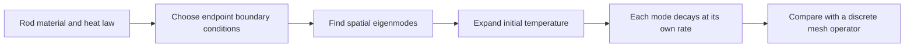

### Boundary conditions choose the modes

First hold both ends at a reference temperature and subtract that reference so the boundary values are zero: $u(0,t)=u(L,t)=0$. Seek one separable solution $u(x,t)=X(x)T(t)$. Substitution gives

$$
XT'=\kappa X''T
\quad\Longrightarrow\quad
\frac{1}{\kappa}\frac{T'}{T}=\frac{X''}{X}.
$$

The left side depends only on time; the right side depends only on position. For the equality to hold for every $x$ and $t$, each side must equal one constant. Choose it to be $-\lambda$ so that the spatial solutions can be oscillatory while the time solutions decay:

$$
X''+\lambda X=0,\qquad T'+\kappa\lambda T=0.
$$

The general spatial solution for $\lambda=\mu^2>0$ is $X=A\cos(\mu x)+B\sin(\mu x)$. The boundary at $x=0$ forces $A=0$; the boundary at $x=L$ then requires $\sin(\mu L)=0$. Nonzero solutions exist only when $\mu L=n\pi$ for positive integer $n$. Thus the allowed eigenvalues and eigenfunctions are

$$
\lambda_n=\left(\frac{n\pi}{L}\right)^2,
\qquad
X_n(x)=\sin\left(\frac{n\pi x}{L}\right),
\qquad n=1,2,\ldots
$$

and the matching time factor is $T_n(t)=e^{-\kappa\lambda_nt}$. A boundary condition has turned a continuum of possible spatial frequencies into a discrete family. The first mode has one broad arch; higher modes have more zero crossings and shorter wavelengths. Their decay rate grows like $n^2$: fine ripples disappear much faster than broad temperature differences.

The rod's initial temperature $f(x)=u(x,0)$ is expanded in this sine family:

$$
f(x)=\sum_{n=1}^{\infty}b_n\sin\left(\frac{n\pi x}{L}\right),
\qquad
b_n=\frac{2}{L}\int_0^L f(x)\sin\left(\frac{n\pi x}{L}\right)dx.
$$

Orthogonality makes this projection possible: the integral of the product of two different sine modes over $[0,L]$ is zero, while the squared norm of each mode is $L/2$. By linearity, the complete solution is

$$
u(x,t)=\sum_{n=1}^{\infty}b_n\sin\left(\frac{n\pi x}{L}\right)e^{-\kappa(n\pi/L)^2t}.
$$

Each term solves the same PDE and boundary conditions; adding solutions remains a solution because the equation is linear. The coefficients encode the initial pattern; the boundary-selected modes and exponential factors encode how it evolves. The series is not merely a symbolic trick: it says every resolved initial pattern is a weighted sum of independently decaying shapes.

Other endpoint physics changes the spectrum. If the ends are insulated, there is no heat flux through them, so $u_x(0,t)=u_x(L,t)=0$. The spatial modes become $X_n(x)=\cos(n\pi x/L)$ for $n=0,1,2,\ldots$, including a constant mode. That zero mode does not decay: in an insulated rod the average temperature stays fixed. If one end is held at zero and the other insulated, the eigenfunctions are shifted half-wave patterns such as $\sin((n+1/2)\pi x/L)$. Robin conditions, which model heat exchange with a surrounding medium, lead to a different eigenvalue equation. Boundary conditions therefore define the operator and its modes together.

The zero mode is not an annoying exception. It carries the conserved average under no-flux conditions. For a uniform rod, integrating the heat equation gives

$$
\frac{d}{dt}\int_0^L u(x,t)dx
=\kappa\int_0^L u_{xx}(x,t)dx
=\kappa\big[u_x(L,t)-u_x(0,t)\big].
$$

Insulated endpoints make the right side zero. The rod redistributes heat internally, but its total excess heat—and, for constant heat capacity and cross-section, its spatial average—does not change. Fixed-temperature ends can exchange heat with their reservoirs, so that same integral need not be conserved.

### Derivatives act on modes by multiplying their frequency

Why are sine waves so useful? Differentiation does not create a new spatial frequency. For a complex wave $e^{ikx}$,

$$
\frac{d}{dx}e^{ikx}=ik e^{ikx},
\qquad
\frac{d^2}{dx^2}e^{ikx}=-k^2 e^{ikx}.
$$

A derivative is therefore multiplication by $ik$ in the frequency representation, and the second derivative is multiplication by $-k^2$. For finite-interval Dirichlet modes, differentiating the sine once gives a cosine, then twice returns the original sine with multiplier $-(n\pi/L)^2$. That is exactly the spatial eigenvalue relation $X_n''=-\lambda_nX_n$. The heat equation consequently becomes a separate scalar decay equation for every mode: $\dot a_n=-\kappa\lambda_na_n$.

This makes the “high frequencies decay faster” statement precise. If the initial temperature contains only a low mode and a high mode, after elapsed time $t$ their amplitudes are multiplied by $e^{-\kappa k^2t}$. When the high mode has four times the wavenumber, it has sixteen times the decay exponent. Smoothing is thus a low-pass operation. It removes oscillations because second derivatives penalize rapid spatial variation.

A Fourier series describes periodic patterns; a sine expansion on $[0,L]$ can be understood by extending a function oddly outside the interval and then periodically. A cosine expansion corresponds to an even extension. The chosen extension matters at the endpoints. If the interior initial temperature does not agree with the fixed end values at $t=0$, the odd periodic extension has a jump. The series still represents the interior in a limiting sense, but convergence near that jump oscillates. This is one way that boundary assumptions show up as ringing rather than disappearing behind the algebra.

### From a mesh Laplacian to a heat operator

The mesh-topology spine introduced a cotangent Laplacian for vertex values. We can now give it a clear evolution meaning. Let $u_i(t)$ be a temperature stored at mesh vertex $i$. Build a stiffness matrix $S$ from the surface geometry and a mass matrix $M$ from the areas represented by the vertices. For a common cotangent convention, each interior edge $(i,j)$ has weight $w_{ij}=\tfrac12(\cot\alpha_{ij}+\cot\beta_{ij})$. Set $S_{ij}=-w_{ij}$ off the diagonal and choose $S_{ii}=\sum_{j\ne i}w_{ij}$. Then $S$ is symmetric and, for a suitable mesh, positive semidefinite. A lumped mass matrix is diagonal with $M_{ii}=A_i$, a local area; a consistent finite-element mass matrix can include off-diagonal terms.

With this positive stiffness convention, the discrete heat equation is

$$
M\dot{\mathbf u}=-\kappa S\mathbf u.
$$

If the previous mesh note uses $\Delta=-M^{-1}S$, this is the same statement $\dot{\mathbf u}=\kappa\Delta\mathbf u$. Signs vary across libraries, so test the constant field and a known mode before wiring a new matrix into an update. For a constant vector $\mathbf 1$, every edge difference vanishes, giving $S\mathbf 1=0$ when there is no imposed-temperature boundary. Thus an isolated closed surface or natural no-flux boundary has a zero mode, just like the insulated rod.

The mass matrix is not bookkeeping overhead. It turns an integrated stiffness balance into a rate per unit area or length. On a triangulated surface, $M$ has units square metres and cotangent entries in $S$ are dimensionless; therefore $M^{-1}S$ has units inverse square metres. Multiplying by surface diffusivity $\kappa$ in square metres per second gives a rate in inverse seconds. In a one-dimensional finite-element rod, the mass entries instead have units metres and the stiffness entries have units inverse metres, so $M^{-1}S$ still has units inverse square metres. The matrix dimensions depend on the domain dimension, but the discrete operator approximating a second spatial derivative always carries inverse-length-squared units.

Under a coordinate scaling by factor $s$, areas on a surface scale as $s^2$ while cotangent weights are invariant. Thus $M^{-1}S$ scales as $s^{-2}$. The diffusivity must be expressed in the same physical length units as the geometry. A mesh stored in millimetres paired with $\kappa$ in square metres per second is inconsistent until one representation is converted. Dimensional checks catch this error even when every number in the code looks plausible.

The generalized eigenproblem

$$
S\boldsymbol\phi_n=\lambda_nM\boldsymbol\phi_n
$$

is the mesh counterpart of the rod's spatial mode equation. Its eigenvectors are discrete temperature patterns; its eigenvalues measure how rapidly each pattern bends across the surface. The evolution of a mode amplitude is $a_n(t)=a_n(0)e^{-\kappa\lambda_nt}$. Because $S$ is symmetric and $M$ is positive definite, these modes can be chosen orthogonal in the mass-weighted inner product $\langle u,v\rangle_M=u^TMv$. This is the finite-dimensional version of the orthogonality that made the sine-series coefficients independent.

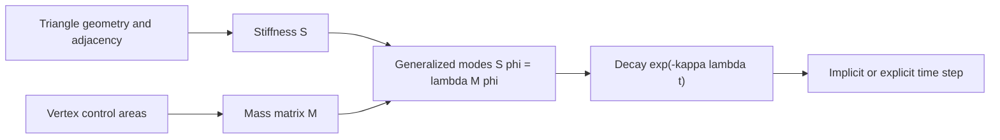

### Explicit steps have a mesh-dependent stability limit

For the standard centered second difference on a uniform 1D grid with spacing $h$, an interior value has discrete Laplacian

$$
(L_hu)_j=\frac{u_{j-1}-2u_j+u_{j+1}}{h^2}.
$$

Dirichlet endpoints are held fixed; consider the unknown interior values. A discrete sine mode $u_j=\sin(k\pi j/(N+1))$, with $h=L/(N+1)$, is an eigenvector of $L_h$ with eigenvalue

$$
\mu_k=-\frac{4}{h^2}\sin^2\left(\frac{k\pi}{2(N+1)}\right).
$$

The magnitude is largest for the most rapidly alternating grid pattern and approaches $4/h^2$. Forward Euler updates $u^{n+1}=u^n+\kappa\Delta t L_hu^n$. A mode is multiplied each step by $g_k=1+\kappa\Delta t\mu_k$. For no growth in magnitude we need $|g_k|\le1$ for every mode. The most restrictive eigenvalue gives

$$
0\le\frac{\kappa\Delta t}{h^2}\le\frac12,
\qquad\text{or}\qquad
\Delta t\le\frac{h^2}{2\kappa}.
$$

This is a stability bound for the stated standard 1D grid and explicit forward Euler scheme. It is not a universal bound for every mesh, boundary condition, or time integrator. In an unstructured mesh, use the largest eigenvalue of the mass-normalized stiffness operator or a proven bound for the chosen discretization; the spectral scale still behaves like inverse length squared.

A numerical witness makes the instability visible. Let $h=0.25\,\mathrm m$ and $\kappa=0.1\,\mathrm{m^2/s}$. The limit is $0.25^2/(2\cdot0.1)=0.3125\,\mathrm s$. If we take $\Delta t=0.375\,\mathrm s$, then $r=\kappa\Delta t/h^2=0.6$. For a unit-length rod with three interior vertices, the highest Dirichlet mode has $g=1-4(0.6)\sin^2(3\pi/8)\approx-1.048528$. Its sign flips and its magnitude grows by about $4.85\%$ per step. On an even periodic grid, the exact alternating mode instead has $g=1-4r=-1.4$, giving $40\%$ growth. Distinguish the finite-boundary eigenvalue from this limiting or periodic case. At the threshold $r=0.5$, that limiting mode has amplification $-1$: it does not grow, but it is not damped and remains a poor practical choice near the stability edge.

Implicit Euler uses the new-time temperature in the Laplacian:

$$
\frac{\mathbf u^{n+1}-\mathbf u^n}{\Delta t}=-\kappa M^{-1}S\mathbf u^{n+1},
\qquad
(M+\kappa\Delta tS)\mathbf u^{n+1}=M\mathbf u^n.
$$

For a generalized eigenmode with $\lambda_n\ge0$, its amplification is $1/(1+\kappa\Delta t\lambda_n)$, which lies between zero and one for any positive step. This gives unconditional linear stability for diffusion with a positive semidefinite stiffness and positive mass matrix. It requires a linear solve, and a large step can still erase detail or be inaccurate even though it does not blow up. Stability and fidelity are different questions.

On a 2D mesh with area mass matrix, the explicit stability limit is controlled by a largest eigenvalue of order $1/h^2$, where $h$ is a representative edge length. Refining edge length by two can therefore require roughly four times as many explicit steps for the same simulated duration. This cost is one reason implicit diffusion is attractive in geometry processing. It does not follow that every mesh flow should be implicit: intended feature behavior, accuracy, solver conditioning and cost still matter.

### A Green function is an impulse response

A Green function answers a concrete experiment: what field is produced by a unit point source, subject to the same boundaries as the original problem? For a linear operator $L$ with homogeneous boundary conditions, define $G(x,\xi)$ by

$$
L_xG(x,\xi)=\delta(x-\xi),
$$

where the subscript reminds us that $L$ differentiates in the observation coordinate $x$. A distributed source $f(\xi)$ is a superposition of point sources, so the solution is

$$
u(x)=\int G(x,\xi)f(\xi)\,d\xi.
$$

For time-dependent heat flow, the impulse response depends on elapsed time. With the rod's normalized Dirichlet eigenfunctions $\phi_n(x)=\sqrt{2/L}\sin(n\pi x/L)$, the heat kernel is

$$
H_D(x,\xi,t)=\sum_{n=1}^{\infty}\phi_n(x)\phi_n(\xi)e^{-\kappa(n\pi/L)^2t},\qquad t>0.
$$

A point of heat inserted at $\xi$ spreads according to $H_D$; an initial field evolves as $u(x,t)=\int_0^LH_D(x,\xi,t)u(\xi,0)d\xi$. A time-varying source $s(\xi,\tau)$ contributes through a space-time convolution, integrating $H_D(x,\xi,t-\tau)s(\xi,\tau)$ over earlier times $\tau$ and source positions $\xi$. This is the continuous analogue of repeatedly applying a linear diffusion update to source inputs.

The kernel is symmetric in $x$ and $\xi$ for a self-adjoint diffusion operator with the same homogeneous boundary conditions on both arguments. In the rod case this follows term by term because each factor is $\phi_n(x)\phi_n(\xi)$. More generally, Green-function reciprocity follows from self-adjointness and the boundary terms vanishing under the chosen domain and boundary conditions. If coefficients, boundary conditions, or the operator make the problem non-self-adjoint, do not assume $G(x,\xi)=G(\xi,x)$. For a weighted Sturm–Liouville problem, symmetry may be with respect to the appropriate weighted inner product or measure rather than plain coordinate integration.

There is a subtle zero-mode case. With insulated boundaries, the Laplacian has a constant eigenfunction with eigenvalue zero. The steady Poisson equation $-u_{xx}=f$ with pure Neumann conditions cannot have a solution for arbitrary nonzero-mean $f$: integrating both sides shows the source must satisfy the net-flux compatibility condition. Even when compatible, the solution is defined only up to an added constant until a mean or reference value is fixed. The transient heat kernel remains meaningful; the zero mode simply preserves the average instead of decaying. A numerical inverse that silently divides by a zero eigenvalue is not a valid Green-function construction.

### Sampling, truncation, and ringing

A continuous field becomes finite data only after sampling. On a regular 1D grid, the highest alternating mode is near the Nyquist frequency, roughly one half-cycle per sample spacing. Shorter wavelengths cannot be represented uniquely: they alias into lower-frequency patterns. On irregular triangle meshes there is no single global Nyquist number, but local edge length and element shape limit which oscillations are resolved. If the initial hot spot is narrower than the sampling scale, the mesh may miss its peak or encode it as a misleading pattern. Subsequent heat flow smooths the samples it received; it cannot reconstruct the lost sub-grid event.

A truncated Fourier or eigenfunction sum introduces another approximation. Keeping only the first $N$ modes reconstructs the broad structure well when the field is smooth, but a sharp jump needs many modes. Near a discontinuity, partial sums can overshoot and oscillate (Gibbs behavior); increasing $N$ narrows the affected region but does not remove the limiting overshoot at the jump. In heat flow, each mode is additionally multiplied by an exponential decay. At positive time, high-frequency terms are strongly damped, but at time zero the series must still represent the initial/boundary data correctly. If initial temperature and fixed endpoint temperatures disagree at a corner in space-time, a rapid boundary layer is physically implied, not a failure of the series method.

For a finite mesh, eigenvalue truncation and timestep are separate resolution controls. Dropping small-scale eigenvectors discards spatial detail; taking a large implicit-Euler step changes each mode's decay relative to the continuous evolution (its factor $1/(1+x)$ exceeds $e^{-x}$ for $x>0$); taking an unstable explicit step amplifies the highest modes. A visually smooth result is not proof of accuracy because excessive smoothing can hide aliasing, poor mesh quality, or a wrong boundary condition. Report sample spacing, kept modes or timestep, and error against a known field when making a quantitative claim.

### Manufactured fields make the solver testable

A manufactured solution gives an analytic answer for a problem with known boundaries and coefficients. For fixed-zero endpoints choose one sine mode

$$
u(x,t)=A\sin\left(\frac{\pi x}{L}\right)e^{-\kappa(\pi/L)^2t}.
$$

It satisfies both the PDE and $u(0,t)=u(L,t)=0$. With $L=1\,\mathrm m$, $\kappa=0.1\,\mathrm{m^2/s}$, $A=100\,\mathrm K$ and $t=1\,\mathrm s$, the center temperature is

$$
u(L/2,1)=100e^{-0.1\pi^2}\,\mathrm K\approx37.27\,\mathrm K.
$$

For a second, independently decaying mode at twice the wavenumber, the decay exponent is four times larger. A two-mode initial field tests that the solver handles superposition and does not accidentally mix modes in a uniform rod with homogeneous endpoints. Compare grid values to the analytic field at fixed physical times while halving $h$ and reducing $\Delta t$ consistently; measure error rather than relying on a plot.

For a no-flux test choose

$$
u(x,t)=20+5\cos\left(\frac{\pi x}{L}\right)e^{-\kappa(\pi/L)^2t}.
$$

Its derivative is zero at $x=0$ and $x=L$, and its spatial mean is $20$ at every time. A discrete solver should preserve the corresponding mass-weighted mean up to rounding and linear-solver tolerance. For fixed-temperature endpoints, instead measure boundary flux. Fourier’s law gives heat flux $q=-k u_x$; integrating the temperature equation yields the net heat change from inflow at one boundary minus outflow at the other. The rod’s interior energy need not be conserved when reservoirs hold its ends at fixed temperature.

On the mesh, the matching tests are: $S\mathbf1=0$ for a no-flux/closed setting; symmetry $S=S^T$; nonnegative generalized eigenvalues; exponential decay of each measured eigenmode at rate $\kappa\lambda_n$; and conservation of $\mathbf1^TM\mathbf u$ when no heat crosses the boundary and no source is present. For Dirichlet vertices fixed to a reservoir, remove or constrain those degrees of freedom and verify the change in total heat matches integrated boundary flux. A matrix can be symmetric and still have the wrong units, scale, boundary rows, or source signs, so keep the analytic rod and unit checks beside the structural matrix checks.

The rod story now carries through to a curved triangle mesh. Material and boundary conditions define a differential operator; its self-adjoint eigenmodes form a basis; spatial derivatives multiply modes by their squared frequencies; the mesh stiffness and mass matrices approximate that operator; and time integration advances its modes according to their decay rates. Green functions express how localized heat sources propagate under those same boundaries. Sampling and truncation set what detail can be represented, while manufactured solutions and flux balances tell us whether the computed field matches the stated model.

### What the boundary means to the discrete solver

Boundary data must be encoded in the discrete unknowns and matrix, not merely displayed as a condition in a comment. With fixed-temperature Dirichlet endpoints, the endpoint values are known and are removed from the unknown vector or incorporated into the right-hand side. If a known endpoint value is nonzero, its neighboring stencil contains a source contribution proportional to that value. A common error is to drop the endpoint neighbor term when constructing the reduced matrix, thereby solving a different rod with an insulated or shortened boundary.

For an insulated endpoint, the Neumann condition $u_x=0$ says the normal heat flux vanishes. A finite-volume view writes heat balance in terms of fluxes through cell faces; the boundary face contributes zero flux. A finite-difference view can use a ghost value reflected across the endpoint, such as $u_{-1}=u_1$, so the centered derivative $(u_1-u_{-1})/(2h)$ is zero. Either construction should leave the constant vector in the nullspace and conserve the weighted sum. Dirichlet and Neumann are not interchangeable “edge handling” options: one couples the rod to a reservoir; the other isolates it.

For a curved mesh, an open boundary has an analogous choice. A natural finite-element boundary on the diffusion problem usually represents zero flux unless a boundary term is supplied. Pinning boundary temperatures imposes a Dirichlet constraint. A Robin boundary can represent transfer to an ambient temperature, with flux proportional to the difference between the surface temperature and ambient. If the application actually intends a heat bath but the implementation leaves the natural no-flux condition, total mesh heat will be conserved incorrectly. Boundary semantics are part of the physics API.

Self-adjointness explains why a clean mode decomposition exists. For the one-dimensional operator $A=-d^2/dx^2$ with homogeneous Dirichlet conditions, integration by parts gives

$$
\int_0^L f^*Ag\,dx-\int_0^L(Af)^*g\,dx
=\left[-f^*g'+(f')^*g\right]_0^L=0.
$$

The boundary term vanishes because both functions are zero at each end. For homogeneous Neumann conditions, it vanishes because both derivatives are zero. Other boundary conditions may also yield a self-adjoint operator, but this must be checked rather than assumed. The eigenvalues are real, distinct-eigenvalue modes are orthogonal, and the operator can be diagonalized in that basis. This is the continuum reason the heat equation reduces to independent exponential decays.

The same fact has a discrete energy witness. If $S$ is symmetric positive semidefinite and $M$ is positive definite, then

$$
\frac{d}{dt}\left(\frac12\mathbf u^TM\mathbf u\right)
=\mathbf u^TM\dot{\mathbf u}
=-\kappa\mathbf u^TS\mathbf u\le0.
$$

This quadratic norm is not the total heat; it measures squared temperature variation around the chosen zero reference. It decreases under diffusion. Total heat in the no-flux case is instead $\mathbf1^TM\mathbf u$, and it stays constant because $S\mathbf1=0$. Keeping these two quantities separate prevents the false claim that “heat is conserved” means every norm or every boundary case is conserved.

### Spatial and temporal error have different signatures

For a smooth sine mode with wavenumber $k$, the centered difference approximates the second derivative by the discrete eigenvalue

$$
\mu_h=-\frac{4}{h^2}\sin^2\left(\frac{kh}{2}\right)
=-k^2+\frac{k^4h^2}{12}+O(h^4).
$$

The leading error is proportional to $h^2$ for a fixed resolved mode. Since $|\mu_h|$ is slightly less than $k^2$ at small but finite $kh$, the discrete mode decays a little more slowly than the continuum mode. Near the grid's highest frequency, the approximation is no longer close to $-k^2$; the grid cannot represent finer structure. This is spatial discretization error, distinct from the forward-Euler time error and its stability limit.

A convergence experiment should separate them. Fix a smooth analytic initial field, hold temporal error small while refining $h$, and compare at a fixed time to estimate spatial convergence. Then fix a sufficiently fine spatial grid and reduce $\Delta t$ to measure temporal convergence. Finally sweep the ratio $r=\kappa\Delta t/h^2$ toward the stability edge to verify the predicted highest-mode amplification. If both $h$ and $\Delta t$ change arbitrarily in one experiment, a smaller error cannot be attributed to either change.

A practical manufactured solution can include a source term as well. Choose a smooth field $u_*(x,t)$ satisfying the desired boundary values, then define

$$
s(x,t)=\partial_tu_*(x,t)-\kappa\partial_{xx}u_*(x,t).
$$

The field $u_*$ is now an exact solution of $u_t=\kappa u_{xx}+s$ by construction. For example, let $u_*=e^{-t}\sin(\pi x/L)+t\sin(2\pi x/L)$, whose endpoints remain zero. Differentiate it analytically to construct $s$. This tests the source assembly, boundary treatment, spatial operator and time stepping together without needing a complicated closed-form solution to an unrelated physical problem. Report a normed error, such as $\|u_h-u_*\|_M$, at stated times.

The mode formulas also support an impulse-response check. A sharply localized initial heat pulse can be projected onto the sine basis; its coefficient for mode $n$ is the pulse's inner product with $\phi_n$. At later times, each coefficient must be multiplied by $e^{-\kappa\lambda_nt}$. Compare direct time stepping against this truncated spectral reference on a fine grid. The two methods will not match exactly because one has grid and timestep error and the other has truncation error, but their discrepancy should shrink under the declared refinements. This test exercises the same linear evolution from two independent representations.

For a self-adjoint problem with a zero Neumann mode, the steady Green function for an inverse Laplacian is singular because constants are annihilated. One must project out the constant mode, enforce a zero-mean source, and choose a gauge such as zero-mean solution. For the transient heat kernel, the constant mode is retained: it is the long-time average left after all nonconstant modes decay. This distinction matters in mesh processing too. Solving a Poisson equation for geometry may need a pinned vertex or mean constraint; evolving heat on a closed surface should generally preserve the mean rather than accidentally delete it.

The continuous and discrete models therefore have matching but not identical contracts. In the continuum, the boundary condition defines the operator domain and Green identity. In the mesh, it determines constrained rows, boundary flux terms and the nullspace. In the spectrum, it selects modes and eigenvalues. In the time step, it controls stability and decay. Verifying one layer with the appropriate witness makes it possible to localize a bad result instead of compensating for it with an arbitrary damping factor or a smaller timestep.

## PDEs, fields, and discrete solvers

Fields and PDEs express spatial behavior; discretization and boundary conditions determine the numerical system.

### PDE discretization and variational structure

A partial differential equation includes derivatives along several spatial axes. The 2D Laplacian is $u_{xx}+u_{yy}$. A regular-grid finite difference approximates each second derivative from neighboring samples. On a mesh, a discrete Laplace operator uses connectivity and geometry weights. The heat equation moves a value toward neighboring values; the wave equation uses acceleration proportional to spatial curvature. Boundary conditions affect the solution everywhere because waves or diffusion interact with the boundary.

Explicit diffusion on a grid has a stability limit roughly proportional to $(\Delta x)^2/\kappa$, where $\Delta x$ is grid spacing and $\kappa$ diffusivity. Refining the grid by two can require about four times smaller time steps in 2D explicit schemes, rapidly increasing cost. Implicit discretization leads to a sparse linear system. Matrix sparsity reflects local neighborhood connectivity; numerical linear algebra is therefore part of the simulation pipeline.

Optimization connects to PDEs through energy minimization. A continuous energy functional $E[u]=\int L(x,u,u')dx$ is stationary when it satisfies the Euler-Lagrange condition

$$
\frac{\partial L}{\partial u}-\frac{d}{dx}\left(\frac{\partial L}{\partial u'}\right)=0.
$$

After discretization, the field becomes a finite vector and the functional becomes a finite objective. Its gradient can be minimized with the same methods used for curve fitting. The continuum equation and discrete optimizer are two views of one problem. [[#CMU-22 - Optimization|CMU-22]] · [[#CMU-23 - Physically Based Animation and PDEs|CMU-23]]

### The same field equation can describe very different behavior

A PDE describes a field $u(x,t)$ whose value depends on location $x$ and time $t$. The derivatives say how the field changes. For a ripple height, $u$ is vertical displacement at each point of a pond. For heat, it is temperature at each point of a surface. For smoke, it might be velocity, density, or vorticity. The equation is an implicit rule: it constrains the field, but the field must still be computed from initial data, boundary data, and a numerical method.

The Laplacian is $\Delta u=\nabla\cdot(\nabla u)$, the divergence of the gradient. Equivalently in Cartesian coordinates it is the sum of second derivatives, $u_{xx}+u_{yy}$ in 2D. A useful intuition is “difference from the local average”: it is near zero where the field matches its neighborhood and large where the field has a local bump or dip. The coordinate formula looks tied to axes, but the Laplacian itself is unchanged under a rigid rotation of coordinates.

Three equations provide contrasting mental models:

$$
\begin{aligned}
\text{Laplace:}\quad &\Delta u=0,\\
\text{Heat:}\quad &u_t=\kappa\Delta u,\\
\text{Wave:}\quad &u_{tt}=c^2\Delta u.
\end{aligned}
$$

The Laplace equation is elliptic. With boundary values fixed, it finds a harmonic field that smoothly interpolates them. The heat equation is parabolic: an initial temperature distribution spreads and smooths; at steady state, $u_t=0$, so it becomes the Laplace equation. Diffusion also acts as a model of damping or viscosity. The wave equation is hyperbolic: an initial bump propagates as a wave rather than simply disappearing. This matters numerically, because wave errors can travel for a long time instead of being averaged away. Burgers' equation, $u_t+u u_x=\alpha u_{xx}$, adds a nonlinear transport term and a diffusion term; transport can steepen a wave toward a shock while diffusion softens it. A PDE is linear when the unknown field and its derivatives appear linearly; products such as $u u_x$ or nonlinear functions of $u$ make it nonlinear. Its order is the highest derivative order present. [[#CMU-23 - Physically Based Animation and PDEs|CMU-23]]

### Discretize the space with a representation that fits

Finite differences replace derivatives by differences of samples. For equally spaced 1D samples separated by spacing $h$, the centered approximation to the second derivative follows by differencing neighboring first slopes:

$$
u''(x_i)\approx\frac{u_{i+1}-2u_i+u_{i-1}}{h^2}.
$$

In a regular 2D grid with equal horizontal and vertical spacing, the five-point Laplacian is

$$
(\Delta_h u)_{i,j}=\frac{u_{i+1,j}+u_{i-1,j}+u_{i,j+1}+u_{i,j-1}-4u_{i,j}}{h^2}.
$$

The center has weight $-4$ and each immediate neighbor has weight $+1$. The numerator is the sum of neighbor values minus four times the center value. It measures local non-flatness and gives a simple update for ripples or heat diffusion.

A grid is an Eulerian representation: values are stored at fixed spatial locations while material passes through them. A Lagrangian representation follows particles or mesh vertices as they move. Particle methods adapt naturally to moving material and unbounded domains, but a good particle distribution is difficult to maintain and local derivative estimates require neighbor searches. Fixed grids have regular, cache-friendly operations and straightforward finite differences, but they impose a domain and a resolution; fine features blur or alias when the grid is coarse. Hybrid methods such as FLIP, material point methods, and particle level sets mix moving samples with fixed grids to keep useful properties from both.

On a triangle mesh, the cotangent Laplacian replaces grid-neighbor weights with geometry-dependent weights. For scalar values $u_i$ at mesh vertices, a common unnormalized form is

$$
(\Delta_h u)_i\;\propto\;\sum_{j\in N(i)}(\cot\alpha_{ij}+\cot\beta_{ij})(u_j-u_i),
$$

where $N(i)$ is the set of vertices connected to $i$, and $\alpha_{ij},\beta_{ij}$ are the two angles opposite edge $ij$. Implementations may divide by a local area or mass matrix, so normalization conventions must be checked. On a regular triangulated grid, the cotangent construction agrees with the familiar grid stencil up to its chosen scale. The lesson is broader than this one formula: express the spatial operator in a representation appropriate to the problem, and the same time integrator can often be reused across a grid, a mesh, or a hybrid domain. [[#CMU-23 - Physically Based Animation and PDEs|CMU-23]]

### Boundary data is part of the equation

The Laplace equation alone does not determine a unique interpolated field. A constant is harmonic because its Laplacian is zero; indeed, on a periodic grid with no fixed values, both the all-zero field and every constant field solve $\Delta u=0$. To define an interesting solution, state what happens at the boundary.

Dirichlet boundary conditions fix the value of the field, such as temperature around a plate or height around a domain. Neumann conditions fix the derivative in the outward normal direction, $\partial u/\partial n=\nabla u\cdot n$, which is related to heat or fluid flux across the boundary. Robin conditions prescribe a linear combination of value and normal derivative. These choices are physically meaningful: fixed temperature, insulated boundary, or exchange with an environment are different problems.

Boundary values and derivatives cannot always be chosen independently. In 1D, a harmonic function satisfies $u''=0$, so it is a line $u(x)=ax+b$. Any pair of endpoint values determines a line, but two endpoint slope conditions must agree because a line has one slope. In a 2D harmonic Neumann problem, the divergence theorem gives a compatibility condition. Integrating the normal derivative around the boundary equals integrating $\Delta u$ over the interior. Since $\Delta u=0$, the net boundary flux must be zero:

$$
\int_{\partial\Omega}\nabla u\cdot n\,ds=0.
$$

Even with compatible flux, adding a constant leaves both the Laplacian and normal derivatives unchanged, so one value or a mean-value constraint must be fixed to choose a unique representative. This is a simple example of a well-posedness check: verify a solution exists and is sufficiently determined before trusting a numerical solver. After solving a linear system $Ax=b$, compute the residual $r=b-Ax$; a large residual may reveal a bad setup or incompatible boundary data, not merely a weak solver. [[#CMU-23 - Physically Based Animation and PDEs|CMU-23]]

### Turn the discretized equations into a solver

For a grid Laplace problem, the equation at each interior cell says that its value equals the average of its four neighbors. Repeatedly replacing each value with that average is Jacobi iteration. It eventually spreads boundary information inward, but it is slow on large grids: distant parts of the domain communicate only through many neighbor-to-neighbor updates. Instead, assign a single index to every unknown grid value and assemble all local equations into one matrix system $Au=b$. Each row has a small number of nonzero entries because each cell couples only to nearby cells. The resulting matrix is sparse; use a sparse linear solver rather than storing and multiplying all the zeros in a dense matrix.

For heat diffusion, explicit Euler updates the current field using the current Laplacian:

$$
u^{k+1}=u^k+\Delta t\,\kappa\Delta_h u^k.
$$

Each cell moves toward the neighborhood average. But explicit diffusion is conditionally stable: for a regular grid the safe step scales like $h^2/\kappa$. Halving the grid spacing can require about four times as many time steps in 2D, making fine grids expensive. An implicit step evaluates the diffusion at the new field and solves a sparse linear system; it allows larger stable steps at the cost of a solve.

The wave equation has a second time derivative. It can be rewritten with a velocity field $v=u_t$ as two first-order equations, $u_t=v$ and $v_t=c^2\Delta u$. Alternatively, a centered second difference uses two previous time slices:

$$
\frac{u^{k+1}-2u^k+u^{k-1}}{(\Delta t)^2}=c^2\Delta_h u^k.
$$

This needs an initial displacement and initial velocity (or two compatible initial frames). The spatial Laplacian may be the grid stencil or a [[PDE fields and discrete Laplacians|cotangent mesh operator]]. The same time-stepping code can therefore propagate a ripple on a regular grid or waves over a triangle mesh, provided the boundary and operator are correctly specified. A low-resolution thin-shell wave can also be upsampled with Loop subdivision for an interactive visual result; interpolation adds surface detail, but it does not replace the underlying simulation. [[#CMU-23 - Physically Based Animation and PDEs|CMU-23]]

### Discrete field equations and their stability conditions

#### From a PDE to a sparse system and a stable update

A partial differential equation (PDE) constrains a function that varies over space, time, or both. A numerical method must choose (1) what values represent the field, (2) how to approximate spatial derivatives, (3) how to advance in time if time is present, and (4) what boundary behavior is imposed. The same physical equation can therefore produce different algorithms on a fixed grid and on a moving triangle mesh. The examples below use the Laplace and heat equations to make each choice explicit. [[#CMU-23 - Physically Based Animation and PDEs|CMU-23]] (PDF pp. 30–46; video 00:36:00–00:54:00)

#### Derive the five-point grid stencil

For a one-dimensional function $u(x)$ sampled at equally spaced locations $x_i=ih$, the spacing $h$ is the distance between adjacent samples and $u_i$ means $u(x_i)$. A forward difference estimates the first derivative:

$$
u'(x_i)\approx\frac{u_{i+1}-u_i}{h}.
$$

Apply the same difference to the neighboring slopes. The change between the slope to the right and the slope to the left is

$$
u''(x_i)\approx\frac{(u_{i+1}-u_i)/h-(u_i-u_{i-1})/h}{h}
=\frac{u_{i+1}-2u_i+u_{i-1}}{h^2}.
$$

The center coefficient is $-2$ because the center value appears in both slopes. In two dimensions, add the horizontal and vertical second differences. If the horizontal and vertical spacing are both $h$, then

$$
(\Delta_h u)_{i,j}=\frac{u_{i+1,j}+u_{i-1,j}+u_{i,j+1}+u_{i,j-1}-4u_{i,j}}{h^2}.
$$

Here $i,j$ are integer grid indices, $u_{i,j}$ is the field at that grid location, and $\Delta_h$ is the finite-difference approximation to the Laplacian $\Delta=\partial_{xx}+\partial_{yy}$. The four neighbors each receive weight $1/h^2$ and the center receives $-4/h^2$. If all four neighbors equal the center, the stencil is zero. If the center is higher than its neighbors, the result is negative; if it is lower, the result is positive. This sign agrees with the continuous Laplacian’s role as local deviation from the average. [[#CMU-23 - Physically Based Animation and PDEs|CMU-23]] (PDF pp. 31–34; video 00:38:40–00:41:15)

#### Poisson and Laplace equations become sparse linear systems

The Poisson equation is $\Delta u=f$, where $f$ is a prescribed source field. Laplace’s equation is the special case $f=0$. For the common positive-diagonal matrix convention, multiply the stencil by $-h^2$:

$$
4u_{i,j}-u_{i-1,j}-u_{i+1,j}-u_{i,j-1}-u_{i,j+1}=-h^2f_{i,j}.
$$

This equation has one row for each unknown grid value. Each row touches only the center and its four immediate neighbors, so the matrix has mostly zeros: it is sparse. Number the unknown cells from $1$ to $N$, put the center coefficient $4$ on the diagonal, put $-1$ in a neighbor’s column for each grid neighbor, and put zero elsewhere. The right side holds $-h^2f$ plus contributions from any known boundary values. Then solve $Au=b$ with a sparse linear solver. If instead one defines the matrix to approximate $\Delta$ directly, its diagonal is negative and neighbor coefficients positive; both conventions are equivalent if the right side and signs are changed consistently.

For example, take one unknown interior cell with spacing $h=1$, zero on all four neighboring boundary cells, and constant source $f=-1$. The Poisson equation $\Delta u=-1$ becomes

$$
0+0+0+0-4u=-1,
$$

so $u=1/4$. The positive-diagonal form gives $4u=1$, the same answer. For a source-free Laplace cell with fixed neighbor values $1,2,3,2$, the equation is $4u=1+2+3+2$, hence $u=2$. The harmonic value is exactly the average of the four neighbors. The second trace is the local equation that Jacobi iteration applies: replace each unknown with its neighbor average, repeat, and allow boundary data to propagate inward. Jacobi is simple but may converge slowly on large grids because distant locations communicate only through repeated local updates. A sparse solve attacks all equations together. [[#CMU-23 - Physically Based Animation and PDEs|CMU-23]] (PDF pp. 34–36; video 00:43:00–00:49:00)

Boundary conditions are part of the mathematical problem, not a software afterthought. **Dirichlet** data fixes the field value at the boundary, such as a prescribed temperature. In matrix assembly, substitute that known value into the adjacent interior equation and move its contribution to the right-hand side; the boundary value is not an unknown. **Neumann** data fixes the derivative along the outward normal, which represents a flux. It changes the boundary stencil or supplies a flux contribution. **Robin** data combines a value and a normal derivative. Periodic wraparound is another choice: a neighbor on the right edge is identified with a cell on the left edge.

For a harmonic solution with Neumann boundary data, the net prescribed flux must be zero. Integrate $\Delta u=0$ over the domain and apply the divergence theorem:

$$
\int_\Omega \Delta u\,dA
=\int_{\partial\Omega}\nabla u\cdot n\,ds
=0.
$$

Here $\Omega$ is the 2D region, $dA$ is area measure, $\partial\Omega$ is its boundary, $ds$ is boundary length measure, and $n$ is the outward unit normal. Thus inward and outward flux must balance. There is a second issue: adding a constant to a harmonic function leaves its derivatives and Neumann data unchanged. The solution is therefore only defined up to a constant unless one value or the average is pinned. In a linear system this appears as a nullspace (a nonzero vector mapped to zero). Check compatibility and constrain the nullspace before solving. Afterward, compute the residual $r=b-Ax$; its norm measures how closely the computed vector $x$ satisfies the assembled equations. A small residual cannot prove the boundary model is correct, but a large residual can reveal an incompatible or poorly solved system. [[#CMU-23 - Physically Based Animation and PDEs|CMU-23]] (PDF pp. 36–43; video 00:49:00–00:58:00)

#### Explicit heat flow and its stability limit

The heat equation is $u_t=\alpha\Delta u$. The symbol $u_t$ means change of the field per unit time; $\alpha>0$ is thermal diffusivity, controlling how quickly heat spreads. Forward Euler estimates the time derivative by $(u^{k+1}-u^k)/\Delta t$, where $k$ is a time-step index and $\Delta t$ is the time interval. Combine it with the five-point stencil. With equal grid spacing $h$ in both directions, define $r=\alpha\Delta t/h^2$. Then

$$
u_{i,j}^{k+1}=u_{i,j}^{k}+r\left(u_{i+1,j}^{k}+u_{i-1,j}^{k}+u_{i,j+1}^{k}+u_{i,j-1}^{k}-4u_{i,j}^{k}\right).
$$

Every superscript $k$ denotes the old time, and $k+1$ denotes the new time. The center’s resulting coefficient is $1-4r$; each neighbor’s coefficient is $r$. If $r\le1/4$, all five coefficients are nonnegative and sum to one. The update is then a weighted local average, which avoids making a new value overshoot the current local range for this diffusion stencil. The standard 2D stability condition for this explicit scheme is therefore

$$
\frac{\alpha\Delta t}{h^2}\le\frac14
\qquad\text{or equivalently}\qquad
\Delta t\le\frac{h^2}{4\alpha}.
$$

For instance, with $h=0.1$ and $\alpha=1$, the time step must be at most $0.01/4=0.0025$. Halving the grid spacing to $0.05$ cuts the safe step to $0.0025/4=0.000625$. A finer grid resolves smaller spatial detail, but this explicit update then needs about four times as many steps over the same duration. If $r>1/4$, the center coefficient becomes negative; high-frequency grid patterns can grow instead of decay, producing numerical instability even though physical heat should smooth them. [[#CMU-23 - Physically Based Animation and PDEs|CMU-23]] (PDF pp. 44–45; video 00:58:00–01:05:00)

If horizontal spacing $h_x$ and vertical spacing $h_y$ differ, the discretization is

$$
(\Delta_hu)_{i,j}=
\frac{u_{i+1,j}-2u_{i,j}+u_{i-1,j}}{h_x^2}
+\frac{u_{i,j+1}-2u_{i,j}+u_{i,j-1}}{h_y^2}.
$$

The coefficients on the two pairs of neighbors are now different. Nonnegative weights require

$$
\alpha\Delta t\left(\frac{1}{h_x^2}+\frac{1}{h_y^2}\right)\le\frac12,
\qquad
\Delta t\le\frac{1}{2\alpha(1/h_x^2+1/h_y^2)}.
$$

Setting $h_x=h_y=h$ recovers $\Delta t\le h^2/(4\alpha)$. A narrow cell spacing imposes the smaller stable time step because the corresponding second derivative has the larger $1/h^2$ scale. An implicit heat step evaluates the Laplacian at the new time, producing a sparse linear solve; it costs more per step but avoids this explicit stability restriction for diffusion. [[#CMU-23 - Physically Based Animation and PDEs|CMU-23]]

#### The cotangent mesh Laplacian and what “positive” means

On a triangle mesh, vertices replace grid samples and connectivity replaces the four regular neighbors. For an interior edge $ij$ shared by two triangles, let $\alpha_{ij}$ and $\beta_{ij}$ be the angles opposite that edge. The cotangent weight is

$$
w_{ij}=\frac12(\cot\alpha_{ij}+\cot\beta_{ij}).
$$

The cotangent of an angle is adjacent-side length divided by opposite-side length, equivalently cosine divided by sine. For scalar vertex values $u_i$, define the stiffness matrix $C$ by off-diagonal entries $C_{ij}=-w_{ij}$ for adjacent vertices, zero for non-neighbors, and diagonal $C_{ii}=\sum_{j\in N(i)}w_{ij}$. Then

$$
(Cu)_i=\sum_{j\in N(i)}w_{ij}(u_i-u_j).
$$

This convention makes $C$ approximate the negative Laplacian contribution. With a diagonal lumped mass matrix $M$, whose diagonal entry $M_{ii}$ is the area assigned to vertex $i$ (often one third of each incident triangle’s area summed around the vertex), the pointwise operator is approximately

$$
\Delta_hu\approx -M^{-1}Cu.
$$

The mass division converts an area-integrated stiffness contribution into an area-normalized value. Other texts and libraries use the opposite sign, a different factor, or a different mass matrix; compare definitions before reusing a formula. [[#CMU-23 - Physically Based Animation and PDEs|CMU-23]] (PDF pp. 33–34; video 01:03:00–01:08:30)

For a single equilateral triangle of side length one, each angle is $60$ degrees and each cotangent is $1/\sqrt{3}$. A boundary edge has only one incident face, so its edge weight under the one-sided boundary convention is $w=1/(2\sqrt3)$. Each vertex has lumped area $M_{ii}=\frac13(\sqrt3/4)=\sqrt3/12$. Assign values $(u_0,u_1,u_2)=(0,1,0)$ to the three vertices. At vertex 0, only edge $01$ contributes a nonzero difference, so $(Cu)_0=w(0-1)=-1/(2\sqrt3)$. Therefore

$$
(\Delta_hu)_0\approx-\frac{(Cu)_0}{M_{00}}
=\frac{1}{2\sqrt3}\frac{12}{\sqrt3}=2.
$$

The positive value is consistent with vertex 0 being below its high-valued neighbor. This example also shows why normalization matters: without $M^{-1}$, the result scales with local area and is not a pointwise second derivative. Boundary edges have one opposite angle rather than two; the exact discrete boundary operator depends on the chosen boundary condition and mass convention. For a Neumann-like natural boundary, the missing exterior contribution is not invented as a second triangle. For a Dirichlet boundary, fixed boundary values are instead imposed in the linear system.

The matrix $C$ is symmetric positive semidefinite for the standard finite-element cotangent construction: its quadratic energy is a sum of nonnegative per-triangle gradient energies. It has a constant null vector on each connected component because a constant field has zero gradient. Individual cotangent weights need not all be nonnegative: an obtuse opposite angle has negative cotangent and can produce a negative edge weight. That does not by itself mean the whole stiffness matrix has negative energy; matrix positivity concerns the sum of all coupled contributions, not every entry separately. Negative weights can still affect local maximum-principle behavior or produce overshoot, so mesh quality and the particular application matter. This distinction is essential when interpreting cotangent stencils on irregular meshes. [[#CMU-23 - Physically Based Animation and PDEs|CMU-23]]

#### One spatial operator, different simulations

Once the spatial Laplacian is chosen, it can be reused with different time equations. For a wave, $u_{tt}=c^2\Delta u$ includes acceleration, so one may store height and velocity, update velocity from the Laplacian, then update height from velocity. On a grid the Laplacian is the five-point stencil; on a triangle surface it can be the cotangent operator. The course demonstration drops a stone by perturbing one grid height, then repeats velocity and height updates; replacing the grid operator with the mesh operator lets the same basic time-stepping idea create a wave over a fish-shaped triangle surface. This separation—representation, spatial operator, time update—makes the algorithm easier to reason about and port. [[#CMU-23 - Physically Based Animation and PDEs|CMU-23]] (video 00:05:30–00:09:30 and 01:05:00–01:11:30)

#### A wave needs two initial conditions and a different time update

Heat relaxes an initial field. A wave carries both a displacement and a velocity. For a scalar displacement $u(x,t)$, the one-dimensional wave equation is $u_{tt}=c^2u_{xx}$, where $c>0$ is propagation speed. Knowing the initial displacement alone cannot tell us whether a point is moving upward or downward, so we also supply $u_t(x,0)$. A grid stores both pieces of information, either as position and velocity or as two consecutive displacement fields.

Let $u_i^n$ approximate the displacement at position $x_i=i h$ and time $t_n=n\Delta t$. Centered differences in both time and space give

$$
u_i^{n+1}=2u_i^n-u_i^{n-1}+r^2(u_{i-1}^n-2u_i^n+u_{i+1}^n),\qquad r=\frac{c\Delta t}{h}.
$$

The number $r$ is the distance a disturbance travels during one time step, measured in grid spacings. Fourier analysis of this centered scheme gives the one-dimensional stability restriction $r\leq1$; practical choices keep a margin below the limit. This bound belongs to this centered update. It does not make forward Euler applied to an undamped oscillator stable. In two dimensions with spacings $h_x,h_y$, the corresponding condition is

$$
c^2\Delta t^2\left(\frac1{h_x^2}+\frac1{h_y^2}\right)\leq1.
$$

For equal spacing $h$ in $d$ dimensions, this becomes $c\Delta t/h\leq1/\sqrt d$. Finer spatial grids therefore require smaller time steps. Holding the old time step while refining a mesh can turn a convincing animation into an unstable one.

The first step needs special care because $u^{-1}$ was not supplied. Taylor expansion around the initial time, using initial velocity $v_i^0$ and the wave equation for the second derivative, yields

$$
u_i^1=u_i^0+\Delta t\,v_i^0+\frac{r^2}{2}(u_{i-1}^0-2u_i^0+u_{i+1}^0).
$$

As a trace, take five equally spaced samples with fixed zero endpoints, initial displacement $(0,0,1,0,0)$, zero initial velocity, and $r=1/2$. The first displacement field is $(0,1/8,3/4,1/8,0)$. The central peak falls as its neighboring samples begin to move; the initial velocity is still zero because the first step includes acceleration over the interval. With $r^2=1/4$, a later step uses the two saved fields and the spatial second difference. Boundary samples must be set by the chosen boundary condition rather than updated as if neighbors outside the domain had silently appeared. [[#CMU-23 - Physically Based Animation and PDEs|CMU-23]]

## Optical flow and motion from images

Optical flow infers image motion from brightness measurements, but local constraints often leave important directions ambiguous.

### Brightness constancy is a measurement equation, not a universal law

Assume a small image patch moves at velocity $(u,v)$ without changing its brightness pattern. **Brightness constancy** means

$$
E(x(t),y(t),t)=\text{constant}.
$$

The chain rule yields

$$
E_xu+E_yv+E_t=0,
$$

where $E_x=\partial E/\partial x$, $E_y=\partial E/\partial y$, and $E_t=\partial E/\partial t$. This is the optical-flow constraint equation. The spatial gradient $(E_x,E_y)$ gives one equation for two unknowns, $u$ and $v$. So one pixel cannot determine the full motion; it limits the answer to a line of possible velocities. This is the **aperture problem**: local brightness changes reveal motion across an edge but not along it. [[#MITV-02 - Image Formation, Perspective Projection, Time Derivative, Motion Field|MITV-02]] · [[#MITV-04 - Fixed Optical Flow, Optical Mouse, Constant Brightness Assumption, Closed Form Solution|MITV-04]] (notes pp. 10–20)

With many pixels in a patch and a constant-flow approximation, write one row $(E_{x_i},E_{y_i})$ per pixel $i$ and solve

$$
A\begin{bmatrix}u\\v\end{bmatrix}=\mathbf{b},\qquad A_i=(E_{x_i},E_{y_i}),\qquad b_i=-E_{t_i}.
$$

The least-squares estimate minimizes $\|A\mathbf{w}-\mathbf{b}\|^2$, where $\mathbf{w}=(u,v)^T$. If $A^TA$ is invertible, the solution is $\hat{\mathbf{w}}=(A^TA)^{-1}A^T\mathbf{b}$. It is informative only when the patch has gradients pointing in different directions. A uniform patch adds almost no constraint. A single straight edge gives a nearly rank-one matrix; textured corners tend to constrain both motion components. So adding pixels reduces noise only when they add independent directional evidence. [[#MITV-04 - Fixed Optical Flow, Optical Mouse, Constant Brightness Assumption, Closed Form Solution|MITV-04]]

An optical mouse turns this local-motion problem into a practical sensor: it images a textured surface repeatedly and estimates how the texture shifts relative to the device. Its output is displacement over time, not an absolute world position unless another reference is supplied. Brightness constancy fails under illumination changes, specular highlights, occlusion, motion blur, or large inter-frame displacement. Multiscale filtering helps with large shifts by first matching coarser, less detailed image versions, then refining at finer scales. Downsampling without low-pass filtering aliases high spatial frequencies into false coarse patterns. [[#MITV-04 - Fixed Optical Flow, Optical Mouse, Constant Brightness Assumption, Closed Form Solution|MITV-04]] · [[#MITV-05 - TCC and FOR MontiVision Demos, Vanishing Point, Use of VPs in Camera Calibration|MITV-05]] · [[#MITV-16 - Fast Convolution, Low Pass Filter Approximations, Integral Images (US 6,457,032)|MITV-16]]

### Noise gain and the shape of a good measurement

For a scalar relation $y=ax$, measurement error $\epsilon_y$ produces parameter error $\epsilon_x=\epsilon_y/a$. Small $|a|$ means large noise gain. In multiple dimensions the corresponding issue is singular values: directions associated with small singular values of $A$ are weakly observed. This linear-algebra view explains why camera geometry and lighting should be chosen to spread constraints across dimensions rather than cluster them. It also explains why a closed-form answer can be numerically poor even when a matrix is technically invertible. [[#MITV-03 - Time to Contact, Focus of Expansion, Direct Motion Vision Methods, Noise Gain|MITV-03]] · [[#MITV-06 - Photometric Stereo, Noise Gain, Error Amplification, Eigenvalues and Eigenvectors Review|MITV-06]]

### The brightness equation has one constraint per pixel

Perspective motion and brightness-based optical flow answer related but different questions. The perspective calculation predicts image motion from a known camera motion. Brightness constancy tries to infer image motion from a sequence of measured intensities. Let image brightness be $E(x,y,t)$ and let a tracked image point have coordinates $x(t),y(t)$. Its brightness along the trajectory is $E(x(t),y(t),t)$. If appearance is constant while it moves, the total derivative is zero:

$$
\frac{dE}{dt}=E_x u+E_y v+E_t=0,
$$

where $u=dx/dt$ and $v=dy/dt$ are the unknown horizontal and vertical image velocities, $E_x=\partial E/\partial x$, $E_y=\partial E/\partial y$, and $E_t=\partial E/\partial t$. The chain rule gives the equation. It is not a complete solution: at one pixel it is one linear constraint on two unknowns.

The lecture makes this underdetermination visible by plotting possible velocity pairs $(u,v)$ in velocity space. The admissible pairs lie on a line whose normal points along the brightness gradient $(E_x,E_y)$. This is the aperture problem in its most concrete form: a small window around a straight edge can reveal the component of motion perpendicular to that edge, while motion along the edge changes little or nothing in the local image. A line sensor is genuinely one-dimensional; there the unknown is a single image speed and the one brightness equation can determine it when the intensity slope is nonzero. Horn connects this case to conveyor inspection and scanning sensors on satellites. [[#MITV-02 - Image Formation, Perspective Projection, Time Derivative, Motion Field|MITV-02]] (video 00:36:49–00:40:56, 00:55:03–01:02:24)

The move from a single pixel to a region adds constraints, but only if their directions add information. For an optical mouse over textured wood, assume the viewed patch moves approximately as a rigid translation. For each sample $i$, write $E_{x,i}u+E_{y,i}v=-E_{t,i}$. Two samples produce a $2\times2$ linear system. Its determinant is $E_{x,1}E_{y,2}-E_{x,2}E_{y,1}$. If this is zero, the two gradient vectors are parallel, so the two velocity-space lines are parallel or coincident. The apparent count of two equations is misleading: the measurements supply only one independent constraint. The same issue appears across an extended patch if all its isophotes are parallel. A corner or curved isophote changes the gradient direction across samples and improves observability. [[#MITV-02 - Image Formation, Perspective Projection, Time Derivative, Motion Field|MITV-02]] (video 01:03:09–01:08:03, 01:13:50–01:19:06)

Differentiation itself can magnify measurement error. A spatial derivative is approximated from neighboring pixel differences, and a temporal derivative from corresponding pixels in adjacent frames. If a true brightness gradient is tiny, its finite difference may be dominated by quantization and sensor noise; dividing by that estimated slope then produces a very unstable velocity. The 1-D example makes the failure explicit: a uniform gray strip moving across a sensor gives no positional cue. In 2-D the analogous problem occurs in a textureless region, or in a patch with only one edge orientation. Least-squares combination across $N$ independent measurements can reduce standard deviation on the order of $1/\sqrt{N}$, but only when the samples are informative; identical edge directions do not create new independent constraints. This motivates the lecture’s weighted residual objective, which minimizes the sum of squared brightness-constraint residuals while rejecting or downweighting weak and redundant gradients. [[#MITV-02 - Image Formation, Perspective Projection, Time Derivative, Motion Field|MITV-02]] (video 00:42:26–00:49:00, 01:09:01–01:13:24)

The image sequence also has a useful geometric representation as a brightness volume $E(x,y,t)$. A moving image feature traces a curve through that three-dimensional volume. Ordinary frame differences sample only along the time direction; the total derivative follows the feature’s trajectory through both image coordinates and time. This picture explains why the brightness-constancy equation combines spatial and temporal derivatives, and why brightness changes at a fixed pixel are not themselves motion: the fixed sensor observes different scene points as the image moves. [[#MITV-02 - Image Formation, Perspective Projection, Time Derivative, Motion Field|MITV-02]] (video 00:49:01–00:54:54)

Finally, keep the equation’s assumption visible. Specular highlights can move over a stationary object, a changing light can alter intensity, occlusion can replace one surface point with another, and large displacements can break the local linear approximation. The lecture uses reflections of room lights in a phone to remind us that brightness constancy is a useful model with specific failure conditions. It is the physical and statistical quality of the measurements, together with the distribution of gradient directions, that determines whether the solved flow is meaningful. [[#MITV-02 - Image Formation, Perspective Projection, Time Derivative, Motion Field|MITV-02]] (video 00:35:48–00:37:19, 01:19:40–01:21:08)

### Eigenvectors expose directional noise gain

The 2-D flow fit supplies a real symmetric matrix $M$ whose inverse maps measured brightness changes into velocity. Determinant zero says the solve fails, but the eigenvectors show which direction fails and by how much. An eigenvector $\mathbf e_i$ and eigenvalue $\lambda_i$ satisfy $M\mathbf e_i=\lambda_i\mathbf e_i$. For an $n\times n$ matrix, nontrivial eigenvectors require $\det(M-\lambda I)=0$; expanding the determinant gives a degree-$n$ polynomial in $\lambda$. For a $2\times2$ symmetric matrix

$$
M=\begin{bmatrix}a&b\\b&c\end{bmatrix},
$$

the eigenvalues are

$$
\lambda_{\pm}=\frac{a+c\pm\sqrt{(a-c)^2+4b^2}}{2}.
$$

For each root, the rows of $M-\lambda I$ are perpendicular to the eigenvector. A convenient vector perpendicular to the first row $(a-\lambda,b)$ is $(b,\lambda-a)$; normalize it to unit length. When the eigenvalues differ, symmetry makes the two eigenvectors orthogonal. If they are repeated, choose any orthogonal basis for that eigenspace.

An orthonormal eigenbasis expands any measurement perturbation as $\delta\mathbf y=\sum_i \alpha_i\mathbf e_i$. Applying the inverse gives $M^{-1}\delta\mathbf y=\sum_i (\alpha_i/\lambda_i)\mathbf e_i$. Thus small $|\lambda_i|$ means large noise amplification along eigenvector $\mathbf e_i$. In the optical mouse, one direction aligns with the image gradient and has a useful constraint; the other aligns with the isophote and its eigenvalue is zero for an ideal straight edge. Near zero, that component is still unreliable even while perpendicular motion is measured accurately. This is a richer diagnosis than a single condition number or a binary “good/bad” flag. [[#MITV-06 - Photometric Stereo, Noise Gain, Error Amplification, Eigenvalues and Eigenvectors Review|MITV-06]] (video 00:09:10–00:19:18, 00:27:03–00:37:24)

### B. Is the optical-flow estimate constrained?

For each image sample, compute spatial gradient row $(E_x,E_y)$ and temporal derivative $E_t$. The local equation $E_xu+E_yv=-E_t$ describes a line of possible velocities. Stack a patch’s equations and inspect $A^TA$. If its eigenvalues are both substantial, two flow components are constrained. If one is near zero, flow along the corresponding eigenvector is poorly determined. Add a spatial prior or another cue only after stating it: brightness data alone did not supply that missing direction. [[#MITV-04 - Fixed Optical Flow, Optical Mouse, Constant Brightness Assumption, Closed Form Solution|MITV-04]]

### Flow: why one bright edge cannot reveal full motion

Suppose the local image is a straight vertical edge whose brightness varies with horizontal coordinate $x$ but not vertical coordinate $y$. Then $E_y=0$. The optical-flow equation reduces to $E_xu+E_t=0$, which determines $u$ if $E_x\ne0$, but it contains no $v$. Sliding the edge up or down leaves every local brightness value unchanged. This is a concrete aperture problem: the data constrain motion normal to the edge and say nothing about motion parallel to it. A patch with two differently oriented edges gives rows in $A$ that span more directions, so $A^TA$ may become invertible. The distinction is not “no motion versus motion”; the image contains real motion evidence, but only one component is observable. [[#MITV-04 - Fixed Optical Flow, Optical Mouse, Constant Brightness Assumption, Closed Form Solution|MITV-04]]

If each derivative observation has independent noise variance $\sigma^2$, the least-squares covariance under the simple linear model is proportional to $\sigma^2(A^TA)^{-1}$. When gradients point in nearly the same direction, one eigenvalue of $A^TA$ is small and the corresponding motion uncertainty grows. A useful implementation therefore reports a conditioning or confidence measure and may reject poorly textured patches. Smoothing can reduce derivative noise, but too much smoothing blurs edges and merges distinct motions. This is an estimation tradeoff, not a parameter that can be optimized without regard to scale.

### A compact focus-of-expansion calculation

Suppose a camera moves forward and a static feature lies at image coordinate $x=120$ pixels, while the focus of expansion is at $x_0=20$ pixels. If this feature moves outward at $\dot x=5$ pixels per second, the expansion ratio gives time to contact $\tau=(120-20)/5=20$ seconds. A second point at $x=70$ pixels moving at $2.5$ pixels per second gives the same $20$ seconds, as expected under the ideal common translation model. If it instead yields $8$ seconds, possible explanations include measurement noise, object-independent motion, rotation, or an incorrect FOE; averaging blindly would hide the model violation. The check compares multiple radial measurements against a shared motion hypothesis. [[#MITV-03 - Time to Contact, Focus of Expansion, Direct Motion Vision Methods, Noise Gain|MITV-03]]

### Lecture 3’s practical TTC estimator and its failure near impact

For a pure approach along the optical axis, define $C=1/\tau=-W/Z$, with sign chosen so approach makes $C>0$ and $\tau$ is positive time remaining. Then image velocities satisfy $u=Cx$ and $v=Cy$. Substitute these into brightness constancy to obtain

$$
CxE_x+CyE_y+E_t=0,
$$

or $C=-E_t/(xE_x+yE_y)$ at one location, when the denominator is nonzero. The quantity $xE_x+yE_y$ is a radial brightness derivative: it measures how brightness changes along the ray from the FOE (at the origin in this special axial case). A single-pixel ratio is fragile because it divides two noisy derivative measurements; instead fit one $C$ across many pixels by minimizing the sum of squared residuals. With lateral motion, the lecture adds two more low-dimensional parameters, named $A,B,C$ in the demonstration, to account for horizontal and vertical translation as well as expansion. This is a constrained motion model, not arbitrary optical flow. [[#MITV-03 - Time to Contact, Focus of Expansion, Direct Motion Vision Methods, Noise Gain|MITV-03]] (video 00:32:25–00:43:53)

The lecture’s mining-truck clip displays the estimated FOE as a circle that lands near the tire the camera is approaching. A bar labeled $C$ rises as $1/\tau$ increases. The second truck demonstration shows why a good midrange estimate can fail near contact: the lens goes out of focus, the expansion between frames becomes too large for a first-order derivative approximation, and neighboring-pixel differencing ceases to approximate continuous derivatives well. The proposed response is a scale pyramid. A 2-by-2 block average has one quarter the number of pixels and maps a given original displacement to half as many pixels along each dimension, allowing a coarse stage to handle larger image motion. Use fine resolution when the target is distant, then coarser levels as expansion accelerates. Low-pass before reducing resolution to avoid aliasing. [[#MITV-03 - Time to Contact, Focus of Expansion, Direct Motion Vision Methods, Noise Gain|MITV-03]] · [[#MITV-04 - Fixed Optical Flow, Optical Mouse, Constant Brightness Assumption, Closed Form Solution|MITV-04]] (video 00:52:56–00:57:08)

The full low-dimensional fit makes the geometry visible. Let $(U,V,W)$ be a feature’s translational velocity in camera coordinates, $F$ the focal length, and $Z$ its depth. Differentiating $x=FX/Z$ and $y=FY/Z$ gives $u=FU/Z-xW/Z$ and $v=FV/Z-yW/Z$. Define $A=FU/Z$, $B=FV/Z$, and $C=-W/Z$; then $u=A+Cx$ and $v=B+Cy$. With this convention, an approaching static scene point has $W<0$, so $C>0$ and $\tau=1/C>0$. The brightness constraint is

$$
AE_x+BE_y+C(xE_x+yE_y)+E_t=0.
$$

Each pixel contributes one linear equation in the three unknowns. Squaring and summing its residual across the image yields a quadratic least-squares objective. Setting its three partial derivatives to zero gives a symmetric $3\times3$ normal system. The six independent entries in its symmetric image-gradient coefficient matrix can be accumulated from spatial derivatives; three further sums couple those coefficients to temporal derivatives. After one image pass, solve the $3\times3$ system. Once $(A,B,C)$ are estimated, the zero-flow focus of expansion satisfies $A+Cx_0=0$ and $B+Cy_0=0$, so $x_0=-A/C$ and $y_0=-B/C$; time to contact is $1/C$ for positive approach. If the goal is only TTC, focal length cancels: expansion rate divided by image radius yields a ratio with time units. This is why the direct image computation can provide TTC without reconstructing metric distance and speed separately. [[#MITV-03 - Time to Contact, Focus of Expansion, Direct Motion Vision Methods, Noise Gain|MITV-03]] (video 01:13:17–01:17:58, 01:18:59–01:26:17)

The one-parameter axial estimator can be written in closed form. Define $G=xE_x+yE_y$ and minimize $J(C)=\iint (CG+E_t)^2\\,dx\\,dy$. Differentiation gives $dJ/dC=2\iint G(CG+E_t)\\,dx\\,dy=0$, hence

$$
\widehat C=-\frac{\iint GE_t\\,dx\\,dy}{\iint G^2\\,dx\\,dy}.
$$

This is not merely an abstract integral: in the demonstrated implementation the image is scanned once with two accumulators, one for $GE_t$ and one for $G^2$, then the ratio is computed. The denominator is a direct observability test. If every radial derivative vanishes, the image gives no evidence for expansion. A perfect pie chart centered on the FOE is a deliberately revealing failure example: each sector has constant brightness along radial rays, so scaling toward the center leaves the pattern unchanged. Fine texture or small surface marks can restore information if their contrast survives imaging. The code uses a graphical filter pipeline called Monty Vision: decode a video file, convert to gray, estimate derivatives, calculate TTC, and render measurements. In the live demonstration it reports safe/receding motion as a negative signed expansion and impending approach as positive, with first two bars for lateral image-translation components and the third for inverse TTC. [[#MITV-03 - Time to Contact, Focus of Expansion, Direct Motion Vision Methods, Noise Gain|MITV-03]] (video 00:46:16–00:50:47, 00:51:26–00:52:53, 00:59:02–01:00:28, 01:09:06–01:12:18)

This example also defines the limits of TTC as a safety cue. If the target’s size changes independently, if the object moves, if the camera rotates, or if focus changes the apparent edge pattern, the expansion parameter no longer means simple distance divided by approach speed. A negative estimate can indicate recession or motion away, rather than a negative physical duration. The visualized time estimate should therefore be interpreted together with model residuals, the FOE location, and whether the approach assumptions hold.

The first lecture also sets the scope of the subject. Horn describes the course as physics-based machine vision: rays travel through a lens, light interacts with a surface, and measurements follow from that image-formation process. The inverse step estimates scene quantities such as speed, contact time, or surface cover. This is distinct from image processing that transforms one image into another, and from a learned image classifier that labels an image as a cat or a poodle. Processing tools can support the vision system, but the course’s central goal is to recover a task-relevant description of the world. He even characterizes a lens as an analog computer that re-directs rays at light speed; computed tomography and MRI differ because their final image must be assembled computationally from sensor measurements. [[#MITV-01 - Introduction to Machine Vision|MITV-01]] (video 00:06:20–00:14:36)

Examples outline the range of evidence the later lectures formalize: monocular motion and optical-mouse displacement; time to contact for both an approaching vehicle and a landing fly; surface shape from one image; aerial photography to contour maps; and industrial systems that must work consistently enough for automated assembly. An industrial line can reject a method that is elegant on ideal data if small pixel errors make its pose estimate jump. The lecture’s definition of ill-posedness therefore includes no solution, infinitely many solutions, and sensitivity to small measurement changes. [[#MITV-01 - Introduction to Machine Vision|MITV-01]] (video 00:15:18–00:21:27)

The river photograph of snow-covered gravel braids north of Denali provides another teaching example: students can perceive grooves and slopes in a flat, unfamiliar image. Horn uses this to motivate the possibility of extracting 3-D structure without claiming that the image directly contains depth. He later gives the reason the inverse problem can be tractable for ordinary scenes: air transmits straight rays, and visible solid surfaces induce a two-dimensional correspondence from surface coordinates to image coordinates. The contrasting “colorful Jello” thought experiment fills the volume with dye, so many depths along a viewing ray overlap in one pixel and cannot be separated from one view. Multiple projections lead to tomography. This distinction separates surface vision from volumetric reconstruction and explains why ordinary image interpretation benefits from a strong scene-structure prior. [[#MITV-01 - Introduction to Machine Vision|MITV-01]] (video 00:21:27–00:22:32, 01:16:40–01:19:18)

### Figure U7 - Independent gradients resolve the aperture ambiguity

![[Visual Recall/University Graphics and Vision/flow-aperture-constraints.png]]

**Read the figure.** The axes are horizontal and vertical image velocity, $(u,v)$, measured in pixels per frame. Under brightness constancy, $I_xu+I_yv+I_t=0$. For a vertical edge with image gradient $(I_x,I_y)=(1,0)$ and temporal derivative $I_t=-0.8$, the equation fixes $u=0.8$ but leaves $v$ free. Its solutions form a vertical line in velocity space. An independent horizontal-edge constraint with gradient $(0,1)$ and $I_t=0.4$ fixes $v=-0.4$, so the intersection is the unique flow vector $(0.8,-0.4)$ pixels per frame. The figure isolates the local constraint geometry; it does not claim that arbitrary neighboring image patches provide independent measurements without noise, occlusion, or motion-boundary effects. The two gradient constraints come from different samples in a patch assumed to share one velocity; brightness constancy and the first-order small-displacement approximation are required.


## Edges, contours, and subpixel localization

Edges and contours provide geometric evidence whose localization, linking, and voting methods must account for noise and blur.

### Edges and blobs: image geometry without a full 3-D model

An edge is a rapid brightness transition. In one dimension, a simple model is a step from dark level $a$ to bright level $b$ at unknown position $x_0$. Differentiation produces a peak near $x_0$, but sampled pixels rarely land exactly on the physical transition. A subpixel estimate fits or interpolates the local response around the maximum. It can improve precision beyond one pixel spacing when the blur/noise model and sampling are adequate; it cannot restore detail lost through severe blur, aliasing, or low signal-to-noise ratio. [[#MITV-11 - Edge Detection, Subpixel Position, CORDIC, Line Detection (US 6,408,109)|MITV-11]] (notes pp. 59–65)

In two dimensions the gradient is $(E_x,E_y)$ and its direction estimates the local edge normal. Quantized direction bins cause orientation bias. The course discusses CORDIC, a shift-add procedure for estimating angles and vector rotations through a sequence of elementary rotations. Its appeal in hardware is that shifts and additions can be cheaper than general trigonometric operations. The line-detection patent example emphasizes calibrated edge measurement and line geometry as a deterministic industrial vision problem. A line is supported by many local edge points; its global parameters can be estimated more stably than treating every pixel independently.

The notes put a numerical scale on this engineering problem. The subpixel-edge patent cited in class claims accuracy as high as one-fortieth of a pixel for its apparatus. Its pipeline estimates gradients using local filters, converts Cartesian gradient components to magnitude and direction with CORDIC, selects neighbors along the estimated normal, performs non-maximum suppression, and interpolates the peak. A simple three-sample parabolic fit has three degrees of freedom and is described as reaching about one-tenth pixel. Better accuracy needs compensation for how gradient varies with position and for camera optics, sensor fill factor, focus, and smoothness of the edge transition. Thus a fractional-pixel output is meaningful only relative to an image-formation model and a calibration of systematic bias. [[#MITV-11 - Edge Detection, Subpixel Position, CORDIC, Line Detection (US 6,408,109)|MITV-11]] (notes pp. 60–63)

The lecture compares several derivative stencils rather than presenting one universal gradient filter. Roberts Cross estimates derivatives in axes rotated by 45 degrees using $2\times2$ neighborhoods. Sobel uses $3\times3$ neighborhoods with extra weight on the middle row or column; the averaging effect makes it more robust to noise but spreads the response. A “silver” operator is designed for a hexagonal grid, which has geometric advantages in some sampling arrangements but is incompatible with ordinary square-pixel cameras. Operator design must match the sampling lattice. The notes also point out that an ideal infinitely thin step has unbounded frequency content and cannot be sampled without aliasing; a soft sigmoid edge is a more realistic local model. For $u(x)=1/(1+e^{-x})$, the derivative peaks at the inflection point, and the second derivative crosses zero there. This gives two related edge-location criteria, though discrete noise and blur alter their estimators. [[#MITV-11 - Edge Detection, Subpixel Position, CORDIC, Line Detection (US 6,408,109)|MITV-11]] (notes pp. 60–64)

Thresholding an image creates a binary region, or blob. Its area and moments describe size, centroid, and orientation. For binary indicator $B(x,y)$, area is $A=\iint_\Omega B\,dxdy$; centroid coordinates are $\bar{x}=A^{-1}\iint_\Omega xB\,dxdy$ and $\bar{y}=A^{-1}\iint_\Omega yB\,dxdy$. Green’s theorem converts suitable area integrals to boundary integrals. This is useful when a clean contour is available and one wants shape statistics without summing every interior location. Connectivity conventions, holes, boundary noise, and threshold choice affect the blob. [[#MITV-12 - Blob Analysis, Binary Image Processing, Green's Theorem, Derivative and Integral|MITV-12]] (notes pp. 65–73)

For a positively oriented, simple closed boundary $C$, Green’s theorem says $\iint_\Omega(\partial Q/\partial x-\partial P/\partial y)\,dA=\oint_C(P\,dx+Q\,dy)$. Choosing $P=-y/2$ and $Q=x/2$ gives area $A=\frac12\oint_C(x\,dy-y\,dx)$. Choosing $P=0,Q=x^2/2$ yields the first moment about the $y$-axis, $M_y=\iint_\Omega x\,dA=\frac12\oint_Cx^2\,dy$; choosing $P=-y^2/2,Q=0$ yields $M_x=\iint_\Omega y\,dA=-\frac12\oint_Cy^2\,dx$. Then centroid is $(\bar{x},\bar{y})=(M_y/A,M_x/A)$. These formulas replace a pixel-by-pixel interior accumulation with a contour walk. For multiple disconnected components, sum the signed integrals around each component; hole boundaries have the opposite orientation. [[#MITV-12 - Blob Analysis, Binary Image Processing, Green's Theorem, Derivative and Integral|MITV-12]]

### Worked blob example from a rectangular contour

Take a rectangle with corners $(0,0),(4,0),(4,2),(0,2)$ traversed counterclockwise. Its area formula gives $A=4\cdot2=8$. The first moment $M_y=\iint x\,dA$ is $\int_0^2\int_0^4x\,dxdy=16$, so $\bar{x}=2$. Likewise $M_x=\iint y\,dA=\int_0^4\int_0^2y\,dydx=8$, hence $\bar{y}=1$. The boundary-integral version returns these same values by evaluating only four straight segments. This simple check is useful when implementing a contour algorithm: a sign mistake in contour orientation or swapped moment names often produces a negative area or a transposed centroid.

The lecture’s connection between derivatives, integrals, and convolution offers a common language for image operators. Differentiation can be expressed as convolution with a derivative kernel; smoothing is convolution with a low-pass kernel; cumulative sums are integrals in discrete form. Boundary conditions and discretization determine the actual behavior of the filter, so an ideal continuous operator and its pixel implementation should not be conflated.

### Subpixel edge localization as a complete industrial pipeline

The Cognex patent studied in class begins from a practical model: many parts have broad, nearly uniform regions, so a compact description of a part can be built from its boundaries. This is why semiconductor mask alignment and conveyor-belt measurement need reliable edge coordinates. A pixel-level boundary is not enough for precision metrology; the patent claims roughly $1/10$-pixel localization as attainable and describes pushing toward $1/40$ pixel after calibration. The overall pipeline has three linked stages: estimate the brightness-gradient magnitude and direction, suppress all but local maxima across that direction, then interpolate the surviving peak to a subpixel coordinate. [[#MITV-11 - Edge Detection, Subpixel Position, CORDIC, Line Detection (US 6,408,109)|MITV-11]] (video 00:04:50–00:06:54, 00:42:00–00:48:00)

Gradient operators are not interchangeable labels: their sample geometry determines where the estimate lives and how it responds to noise. Roberts’ cross operator uses two diagonal differences, at $45^\circ$ and $135^\circ$, sharing a common midpoint; it is cheap and high-resolution, but sensitive to noise. Sobel’s operator smooths across one axis while differencing along the other, gaining noise resistance at the cost of blur. The lecture also compares hexagonal-grid operators, which improve rotational symmetry modestly (a geometric gain around $4/\pi$) but never became common enough to justify the hardware change. On a hex grid, three directional differences contain redundancy because a 2-D gradient has only two components; two directions suffice, with spacing factors such as $\sqrt3$ correcting the different sample separations. [[#MITV-11 - Edge Detection, Subpixel Position, CORDIC, Line Detection (US 6,408,109)|MITV-11]] (video 00:11:10–00:16:01)

For a square image, the patent converts Cartesian components $(G_x,G_y)$ into magnitude $G_0=\sqrt{G_x^2+G_y^2}$ and direction $\theta=\operatorname{atan2}(G_y,G_x)$. The direction is essential: a ridge runs along an edge, while its gradient points across it. [[Edge localization and subpixel contours|Nonmaximum suppression]] compares $G_0$ with the two neighbors in the quantized gradient direction, retaining a point only if it is the local maximum across the edge. Eight compass directions are convenient on a square grid; six are natural on a hexagonal grid. Ties need an asymmetric rule: if equal values on both sides were always rejected, a flat-topped ridge could disappear; if both survive, the edge would be duplicated. A larger neighborhood, such as $5\times5$, allows finer direction quantization but increases work; it appears as an option rather than the implemented choice. [[#MITV-11 - Edge Detection, Subpixel Position, CORDIC, Line Detection (US 6,408,109)|MITV-11]] (video 00:20:49–00:23:22, 01:17:44–01:20:54)

Once the center sample is the maximum, take three magnitudes along the chosen direction: $G_{-1}$, $G_0$, and $G_{+1}$ at offsets $-1,0,+1$. A parabola $g(s)=as^2+bs+c$ is the simplest peak model with three free coefficients, so it is exactly determined by those samples. Its vertex offset is

$$
s=\frac{G_{-1}-G_{+1}}{2(G_{-1}-2G_0+G_{+1})},\qquad |s|\le\frac12.
$$

When both neighbors match, $s=0$; greater asymmetry shifts the estimated vertex toward the larger neighbor, with curvature in the denominator controlling how far it moves. The patent also presents a triangular profile whose two line segments have equal slope magnitude; it is useful under a different edge-shape assumption. Three samples cannot distinguish every physical blur profile, which is why the model is a calibrated approximation rather than a universal law. [[#MITV-11 - Edge Detection, Subpixel Position, CORDIC, Line Detection (US 6,408,109)|MITV-11]] (video 00:23:09–00:27:34, 01:20:55–01:25:00)

There is a second geometric ambiguity along the edge: one-dimensional suppression locates the cross-edge peak but does not fix the coordinate parallel to the edge. The patent’s plane-position construction combines the local gradient line with a point constraint and selects the nearest intersection, yielding one reported edge point without pretending the tangential coordinate was measured precisely. This resembles the aperture problem: a straight edge constrains motion or position normal to itself, while tangent displacement remains ambiguous. [[#MITV-11 - Edge Detection, Subpixel Position, CORDIC, Line Detection (US 6,408,109)|MITV-11]] (video 00:24:45–00:27:34)

Subpixel interpolation is biased when the true optical edge profile differs from the assumed parabola or triangle. The measured curve depends on the lens point-spread function, sensor fill factor, focus, and sampling. For example, a sharp physical step blurred by defocus becomes a smooth transition; a hard edge model and a parabola fit can place its peak systematically to one side. Rather than raise camera resolution at great cost, calibrate this systematic offset for the specific vision system. The patent’s correction uses a power-law adjustment near $|2s|^b$, with exponent $b$ fitted from known positions; the correction can also depend on gradient direction because diagonal neighbors are $\sqrt2$ farther apart than axial neighbors. This distinguishes random measurement noise from repeatable model bias. [[#MITV-11 - Edge Detection, Subpixel Position, CORDIC, Line Detection (US 6,408,109)|MITV-11]] (video 00:27:35–00:31:06)

The patent’s implementation choices reflect the hardware economics of its time. Magnitude and angle could be computed with square roots and arctangents, but at millions of pixels and high frame rates those operations mattered. A lookup table encodes quantized $(G_x,G_y)$ bits as an address and returns magnitude and angle, trading arithmetic for memory bandwidth and cache misses. CORDIC (coordinate rotation digital computer), developed for wartime analog/digital fire-control calculations, iteratively rotates a vector toward alignment using shifts, additions/subtractions, and absolute values rather than general multiplication or trigonometric functions. Each small rotation reduces the residual angle; accumulated signed rotations yield direction and the adjusted vector yields magnitude. Which strategy is fastest changes with the processor’s multiply hardware and cache. [[#MITV-11 - Edge Detection, Subpixel Position, CORDIC, Line Detection (US 6,408,109)|MITV-11]] (video 00:16:01–00:20:48)

Even the derivative filters are designed around sample placement. A centered finite difference uses values on either side of the target and has a second-order truncation error; a wider difference has the same error order but a larger error constant. The patent’s Roberts pair places both directional estimates at a shared midpoint, which makes magnitude and direction geometrically consistent. Sobel can be understood as a derivative followed by a small averaging filter: smoothing reduces noise but also lowers edge contrast. The lecture counts shared intermediate sums to reduce a per-pixel gradient calculation from six arithmetic operations to four; across several million pixels, this small saving matters. The same alignment issue appeared in optical flow: estimates of $E_x$, $E_y$, and $E_t$ should correspond to the same spatiotemporal location. [[#MITV-11 - Edge Detection, Subpixel Position, CORDIC, Line Detection (US 6,408,109)|MITV-11]] (video 00:58:40–01:16:36)

The patent document itself is part of the engineering lesson. Its abstract and drawings explain intent, but enforceable scope sits in the claims: a gradient estimator, a directional peak detector, and a subpixel interpolator form the broad independent claim. Later dependent claims add details such as the plane-position step and specific gradient-direction logic, preserving narrower fallback scope if the broad claim is challenged. Apparatus, means-plus-function, and method claims repeat the same pipeline in forms shaped by the patent law of that period. The lecture uses this not as current legal advice but to show why implementations and patent descriptions separate broad functional claims from one preferred numeric realization. [[#MITV-11 - Edge Detection, Subpixel Position, CORDIC, Line Detection (US 6,408,109)|MITV-11]] (video 00:32:07–00:50:53)

### What defocus does to an edge, and where interpolation bias comes from

Defocus turns a point into a blur disk. In the lecture’s simple geometric model, a point source would focus to one point in the image plane, but if that plane is displaced by $\delta$, rays from an aperture of diameter $D$ spread over a circle. Similar triangles give blur radius $R\approx D|\delta|/(2F)$, where $F$ is the lens-to-focus-plane distance. Conservation of light makes the point-spread function a uniform disk of value $1/(\pi R^2)$ inside radius $R$ and zero outside. This box-shaped 2D blur suppresses high spatial frequencies, so a physical black-to-white step becomes a smooth transition over approximately $2R$ pixels. The blur is useful: a perfect step sampled on a pixel grid can shift by almost a full pixel without changing any sample, making subpixel location unobservable. [[#MITV-12 - Blob Analysis, Binary Image Processing, Green's Theorem, Derivative and Integral|MITV-12]] (video 00:55:20–01:00:30)

For an ideal straight edge, the blurred brightness at offset $x$ is the fraction of the blur disk lying on the bright side. The circular-segment area gives, for $|x|<R$,

$$
E(x)=\frac{1}{\pi}\left[\arccos\left(-\frac{x}{R}\right)+\frac{x}{R}\sqrt{1-\frac{x^2}{R^2}}\right].
$$

It rises from zero to one between $-R$ and $R$ and is symmetric about $x=0$. Its first derivative is proportional to the chord length, $E'(x)=2\sqrt{R^2-x^2}/(\pi R^2)$, which peaks at the true edge; its second derivative changes sign there. Comparing this known profile with a three-sample parabola or triangle fit predicts a small systematic subpixel bias. Calibrating a simple power-law correction $s'=|s|^{1+B}$ (with sign retained) is usually sufficient; use separate $B$ values for axial and diagonal sampling because their neighbor distances differ. More elaborate calibration is not always better, since slight focus changes or a damaged part edge change the blur profile itself. [[#MITV-12 - Blob Analysis, Binary Image Processing, Green's Theorem, Derivative and Integral|MITV-12]] (video 01:00:32–01:08:39, 00:50:39–00:55:18)

The lecture then removes the patent’s eight-direction quantization in two ways. First, choose the two sampling points directly along the measured gradient direction and interpolate their brightness from the pixel grid. One-dimensional linear interpolation suffices along that line; cubic interpolation can use more samples for a smoother estimate. This puts the suppression and peak fit on the true normal direction and eliminates the later plane-position correction. It also makes sample spacing vary continuously, so the calibration curve must account for a continuum of distances; interpolation error itself matters at $1/40$-pixel targets. Second, sample at a fixed radius around the candidate point. The three samples then have a consistent physical spacing for every gradient direction, but off-grid values require two-dimensional interpolation. Bilinear interpolation is cheap but less accurate; bicubic interpolation uses a wider neighborhood (roughly a $5\times5$ support) and costs more. The patent’s quantized design is therefore a deliberate balance between geometric consistency, interpolation error, memory, and arithmetic. [[#MITV-12 - Blob Analysis, Binary Image Processing, Green's Theorem, Derivative and Integral|MITV-12]] (video 01:08:43–01:17:40)

The lecture also reviews how CORDIC turns Cartesian gradient components into magnitude and angle. Conceptually, rotate the vector until its vertical component is near zero; the accumulated rotation angle is the direction and the final horizontal component approximates the magnitude. General rotations require sine, cosine, and four multiplications. CORDIC chooses a sequence of progressively smaller angles $\theta_i=\arctan(2^{-i})$. Then $\sin\theta_i$ and $\cos\theta_i$ are close to powers of two, so multiplication becomes a bit shift; each step uses shifts and additions/subtractions, and accepts the sign that reduces the remaining vertical component. The fixed gain from the sequence of rotations is precomputed and corrected if absolute magnitude matters. First inspect signs and swap axes as needed to bring the vector into the first octant; then vectoring iterations converge rapidly. This explains both CORDIC’s historical appeal in fire-control computers and why the best choice depends on whether a modern chip’s multipliers or memory lookups are cheaper. [[#MITV-12 - Blob Analysis, Binary Image Processing, Green's Theorem, Derivative and Integral|MITV-12]] (video 01:18:43–01:27:05)

### Hough voting turns weak local evidence into a global hypothesis

The classical Hough transform was motivated by bubble-chamber photographs. A particle track appears as separated bubbles of unequal size and spacing, so ordinary edge linking cannot reliably trace one continuous contour. For a line $y=mx+c$, each observed point $(x_i,y_i)$ constrains possible parameters by $c=y_i-mx_i$—a line in slope-intercept parameter space. Every bubble votes along its parameter-space line; bubbles belonging to the same physical track produce votes that intersect near one common $(m,c)$. An accumulator array bins those votes, and peaks identify likely lines. One noisy point does not say which line is correct; it reduces the possibilities to a one-dimensional family. [[#MITV-14 - Inspection in PatQuick, Hough Transform, Homography, Position Determination, Multi-Scale|MITV-14]] (video 00:53:31–01:06:25)

The same construction generalizes. If a circle’s radius $r$ is known, a point $(x_i,y_i)$ says the center $(a,b)$ must lie on the circle $(a-x_i)^2+(b-y_i)^2=r^2$ in center-parameter space. The LTE time-advance example gives an intuitive ranging analogue: a measured round-trip delay fixes a phone-to-tower distance, so the unknown tower lies on a circle around that phone position; several measurements accumulate evidence at their common center. If radius is unknown too, the parameters $(a,b,r)$ form a three-dimensional space, and each measured point votes for a cone of possible circles. Noise spreads votes across neighboring bins, but a good hypothesis still collects more evidence than alternatives. The cost is that quantizing a high-dimensional parameter space requires a large accumulator, so Hough voting is most useful when local evidence is incomplete and the global parameterization is compact. [[#MITV-14 - Inspection in PatQuick, Hough Transform, Homography, Position Determination, Multi-Scale|MITV-14]] (video 01:07:04–01:17:30)

### Orthogonal line fitting is the right geometry for edge fragments

Represent a line by its unit normal angle $\theta$ and signed distance $\rho$ from the origin:

$$
x\sin\theta-y\cos\theta+\rho=0.
$$

This form has no infinite-slope singularity and its left side is a signed perpendicular distance. For measured points $(x_i,y_i)$, minimizing squared perpendicular errors is a coordinate-independent fit. Differentiating with respect to $\rho$ shows that the fitted line passes through the centroid $(\bar x,\bar y)$, so

$$
\rho=-\bar x\sin\theta+\bar y\cos\theta.
$$

Center the points, $X_i=x_i-\bar x$ and $Y_i=y_i-\bar y$. Then minimizing residual sum of squares reduces to choosing the normal angle that minimizes $\sum_i(X_i\sin\theta-Y_i\cos\theta)^2$. Differentiation yields the double-angle relation

$$
2\theta=\operatorname{atan2}\left(2\sum_iX_iY_i,\;\sum_iX_i^2-\sum_iY_i^2\right),
$$

with the equivalent line orientation selected consistently modulo $\pi$. This is the principal-component result: the line direction is the covariance eigenvector with greatest spread, and the normal is the least-spread direction. Ordinary least squares of $y=mx+c$ instead treats $x$ as error-free and minimizes only vertical residuals; rotating the same cloud changes that fit. Use it only when the measurement process truly gives $x$ a different, effectively exact status. [[#MITV-15 - Alignment, PatMax, Distance Field, Filtering and Sub-Sampling (US 7,065,262)|MITV-15]] (video 00:48:49–00:58:48)

## Recognition, templates, and industrial matching

Recognition compares image evidence against transformed templates, choosing scores and search spaces suited to expected variation.

### Industrial recognition: templates, transforms, and tolerances

Industrial machine vision often has a known object family, controlled lighting, and a need for reliable pose measurement. This is a different setting from unconstrained semantic classification. A binary template or edge template stores geometric evidence from a reference object. At runtime, the system searches for a transformation that aligns template evidence with image evidence. Normalized correlation compensates for scale/offset changes in measured intensity, while edge-based matching can be less sensitive to uniform brightness shifts. [[#MITV-13 - Object Detection, Recognition and Pose Determination, PatQuick (US 7,016,539)|MITV-13]] (notes pp. 73–78)

The course begins this topic with a careful contrast between raw image correlation and gradient-based matching. For template image $E_1$ and runtime image $E_2$, minimizing the squared difference $\iint(E_1(x-\delta_x,y-\delta_y)-E_2(x,y))^2\,dxdy$ is equivalent to maximizing cross-correlation when the two self-energy terms do not vary with translation. A first-order Taylor expansion for small shift $(\delta_x,\delta_y)$ leads back to the brightness-constancy flow residual. This makes local optical flow a small-displacement approximation to template alignment. Correlation handles larger translation searches directly, but global occlusion or missing object regions can badly affect the score. Mean subtraction removes intensity offset; dividing by the norms yields a normalized correlation that is less sensitive to contrast scaling. It still cannot make an occluded region informative. [[#MITV-13 - Object Detection, Recognition and Pose Determination, PatQuick (US 7,016,539)|MITV-13]] (notes pp. 74–76)

PatQuick is presented in the lectures as a fast, robust multidimensional object-detection and pose method. The key perspective is geometric: detection means finding a location and transformation whose predicted template features agree with measured features. Its industrial focus makes repeatability, inspection tolerances, and computational cost central. The method’s patent title is “Method for Fast, Robust, Multidimensional Object Detection and Pose Determination” (US 7,016,539), as named by the course. [[#MITV-13 - Object Detection, Recognition and Pose Determination, PatQuick (US 7,016,539)|MITV-13]] · [[#MITV-14 - Inspection in PatQuick, Hough Transform, Homography, Position Determination, Multi-Scale|MITV-14]]

PatQuick does not need to keep and rescan a full template image at every possible pose. Its training stage finds boundary points, connects neighbors with consistent directions into chains, removes short or weak chains, splits chains near high-curvature corners, and places evenly spaced probes along retained low-curvature segments. It stores probe positions, gradient directions, weights, pattern contrast, and a selectable granularity that defines the resolution below which image variation becomes unresolved. Probe points can lie between pixels. At runtime, transformed probes sample only selected image locations; the system accumulates their direction or magnitude agreement into a multidimensional score surface. A peak in that surface proposes object pose. This sparse evidence design trades exhaustive pixel comparison for a compact model, but its accuracy remains limited by pose-space quantization and probe placement. [[#MITV-13 - Object Detection, Recognition and Pose Determination, PatQuick (US 7,016,539)|MITV-13]] · [[#MITV-14 - Inspection in PatQuick, Hough Transform, Homography, Position Determination, Multi-Scale|MITV-14]] (notes pp. 75–80)

The pose search spans translation, rotation, scale, skew, and aspect ratio. In the lecture’s generalized affine view, $x'=a_{11}x+a_{12}y+a_{13}$ and $y'=a_{21}x+a_{22}y+a_{23}$ encode six independent 2-D affine degrees of freedom. More degrees of freedom make the match family more expressive while causing the configuration count to grow rapidly at fixed quantization. Coarse-to-fine search is therefore a computational strategy, not just a display convenience: coarse levels find candidate basins; finer levels spend effort where evidence supports a match. The notes describe hexagonal sampling and peak detection for translation; a hexagonal neighborhood improves spatial sampling efficiency over a square grid for comparable resolution, with tie-breaking rules needed to avoid ambiguous peaks. [[#MITV-14 - Inspection in PatQuick, Hough Transform, Homography, Position Determination, Multi-Scale|MITV-14]] (notes pp. 78–81)

Scoring itself has a statistical interpretation. Random background texture can coincidentally provide a probe gradient in the expected direction. The course computes a baseline random-match contribution and discusses subtracting it, rather than treating any high raw score as meaningful. Direction matching is often more robust than gradient magnitude because magnitude changes with contrast and lighting; magnitude can still be used with saturation and weights. Normalized scores cost more but reduce dependence on the number or strength of probes; raw weighted scores are cheaper for fine scanning after a coarse candidate is already found. The system also compensates for whether a transformation changes gradient direction: pure translation, rotation, and uniform scale preserve it, while shear and aspect-ratio changes transform isophote orientation. [[#MITV-14 - Inspection in PatQuick, Hough Transform, Homography, Position Determination, Multi-Scale|MITV-14]] (notes pp. 78–81)

The Hough transform handles noisy or incomplete local evidence by letting each observation vote for global parameter values consistent with it. For example, an edge pixel with a known normal may vote for line parameters; peaks in an accumulator indicate parameter combinations supported by many pixels. This trades direct combinatorial search for a discretized parameter-space histogram. Resolution matters: coarse bins merge distinct hypotheses; fine bins increase memory and sensitivity to noise.

A homography is a $3\times3$ projective matrix $H$ that maps homogeneous image coordinates between views of a plane: $\lambda\mathbf{x}'=H\mathbf{x}$, where $\lambda$ is a nonzero scale and $\mathbf{x},\mathbf{x}'$ are three-component homogeneous coordinates. It can represent planar perspective changes, but a single homography does not describe arbitrary 3-D scenes with parallax. Multi-scale search reduces cost by locating a candidate at a coarse resolution before refining translation, scale, or orientation at finer levels. [[#MITV-14 - Inspection in PatQuick, Hough Transform, Homography, Position Determination, Multi-Scale|MITV-14]] (notes pp. 78–84)

PatMax is another industrial alignment method emphasized through distance fields. Given template edges, compute for each image location the distance to the nearest observed edge (or an equivalent signed/unsigned distance representation). A transformed template can then be scored by summing those distances at its expected edge points. This makes small edge localization errors degrade the score smoothly instead of causing a hard pixel mismatch. The method still depends on sensible edge extraction, a good transform search, and a tolerance appropriate to the inspection task. It is not invariant to arbitrary deformation; the allowable transformations encode what “same part, different pose” means. [[#MITV-15 - Alignment, PatMax, Distance Field, Filtering and Sub-Sampling (US 7,065,262)|MITV-15]] (notes pp. 84–93)

PatMax is specifically positioned as a refinement stage after PatQuick. PatQuick searches a quantized pose space broadly and can start without an initial estimate; PatMax assumes an approximate pose and iteratively improves it without quantizing pose space, enabling subpixel refinement. Its training data include edge fragments and a vector field that attracts runtime edge evidence toward the template field. Unlike the earlier direction-quantized pipeline, PatMax avoids CORDIC and quantized gradient directions when high precision is the goal. A mechanical-spring analogy is more accurate than literal electrostatics: runtime dipoles experience forces, and a small set of allowed pose changes turns those forces into parameter updates. A 2-D translation contributes two degrees of freedom, rotation one, and scale one; affine refinement can add skew and aspect effects for six degrees total. Local linearization yields a weighted least-squares update, accumulated efficiently, but no general closed-form answer exists for all edge configurations. The cascade is therefore coarse global capture followed by local, continuous optimization. [[#MITV-15 - Alignment, PatMax, Distance Field, Filtering and Sub-Sampling (US 7,065,262)|MITV-15]] (notes pp. 84–89)

For the simplified line-fitting example, rotate image points by angle $\theta$ and shift the origin by signed distance $\rho$. The perpendicular residual of point $(x_i,y_i)$ is $r_i=x_i\sin\theta-y_i\cos\theta+\rho$. Minimize $J(\rho,\theta)=\sum_i r_i^2$. Setting $\partial J/\partial\rho=0$ gives $\rho=\bar{y}\cos\theta-\bar{x}\sin\theta$, so the fitted line passes through the point centroid. Centering the coordinates and setting $\partial J/\partial\theta=0$ gives

$$
\tan(2\theta)=\frac{2\sum_i x_i'y_i'}{\sum_i((x_i')^2-(y_i')^2)},
$$

where $x_i'=x_i-\bar{x}$ and $y_i'=y_i-\bar{y}$. This closed form chooses the principal axis direction that minimizes perpendicular squared error; the two-angle ambiguity and the correct normal-versus-line direction must be resolved from the objective and convention. It demonstrates how centroid and second moments encode line orientation, connecting Hough-style parameterization to inertia-based shape orientation. [[#MITV-15 - Alignment, PatMax, Distance Field, Filtering and Sub-Sampling (US 7,065,262)|MITV-15]] (notes pp. 89–92)

### From correlation to sparse, multidimensional pattern matching

The first alignment baseline is to slide a golden image $E_1$ over a runtime image $E_2$ and choose the displacement $(u,v)$ that minimizes squared difference,

$$
D(u,v)=\iint_\Omega [E_1(x,y)-E_2(x+u,y+v)]^2\,dx\,dy.
$$

Expanding the square shows why this is closely tied to correlation: the terms $\iint E_1^2$ and $\iint E_2^2$ are constant (or nearly constant if the overlap window changes), leaving the cross-product $\iint E_1(x,y)E_2(x+u,y+v)\,dx\,dy$. Thus minimizing squared error and maximizing correlation choose nearly the same translation. The catch is cost: with $N$ pixels and $M$ tested positions, the direct method is $O(NM)$, so adding rotation, scale, or skew multiplies the search burden. A constant brightness offset or contrast change can also make squared error look bad even when shape is aligned. [[#MITV-13 - Object Detection, Recognition and Pose Determination, PatQuick (US 7,016,539)|MITV-13]] (video 00:08:40–00:13:11, 00:18:29–00:20:14)

The normalized correlation used in the lecture subtracts each image patch’s mean and divides their inner product by the product of their centered Euclidean lengths:

$$
\rho(u,v)=\frac{\iint_\Omega (E_1-\bar E_1)(E_{2,u,v}-\bar E_{2,u,v})\,dx\,dy}{\sqrt{\iint_\Omega(E_1-\bar E_1)^2\,dx\,dy}\sqrt{\iint_\Omega(E_{2,u,v}-\bar E_{2,u,v})^2\,dx\,dy}}.
$$

The Cauchy–Schwarz inequality bounds $\rho$ between $-1$ and $1$. A perfect same-polarity match gives $1$, no linear correlation is near $0$, and a perfect contrast reversal gives $-1$. Removing the mean makes it invariant to an additive brightness offset; dividing by the two norms makes it insensitive to positive contrast scaling. Unlike unnormalized correlation, the value can be interpreted against an acceptance threshold (the lecture uses approximately $0.95$ as a strong-match illustration), rather than merely choosing the largest peak. However, every-pixel correlation is still expensive, and an occlusion or missing gear tooth contributes many mismatching pixels. High frame-rate optical mice illustrate the alternative: if frame-to-frame displacement is small, gradient-based local motion estimation can be cheaper than exhaustive correlation. [[#MITV-13 - Object Detection, Recognition and Pose Determination, PatQuick (US 7,016,539)|MITV-13]] (video 00:20:14–00:26:02, 00:13:12–00:18:15)

The Cognex-style model replaces the full image patch with a sparse set of **probes**. Training begins from a clean golden sample, computes and links subpixel boundary points, splits chains at sharp curvature changes, then redistributes probe locations to a chosen density. Each probe stores a position, expected gradient direction, and weight; the model also stores a useful coarsest granularity and expected contrast polarity. Runtime matching transforms the small model onto the precomputed gradient image and samples only at probe positions. That is efficient because a model may contain tens or hundreds of probes instead of millions of pixels. The runtime image remains untouched: transforming a few model coordinates is cheaper and avoids resampling or rotating the entire image. [[#MITV-13 - Object Detection, Recognition and Pose Determination, PatQuick (US 7,016,539)|MITV-13]] (video 00:27:43–00:31:51, 00:34:35–00:40:53, 00:47:18–00:48:39)

The direction of an edge gradient is generally more stable than its magnitude when illumination or material response changes. A direction score can therefore be flat within a tolerance and decline linearly outside it: the example accepts errors through $11.25^\circ$ fully, fades to zero by $22.5^\circ$, then wraps around the full circle. If the application permits contrast reversal, an additional acceptance lobe near $180^\circ$ is needed. That doubles the angular range in which unrelated edges can count as partial matches, so polarity invariance increases false evidence. If gradient magnitude is used, it can be ignored, used as a weight, or scored with saturation so very strong gradients do not dominate without bound. Summing weighted probe evidence over a pose gives a score surface; search peaks propose instances, while an end-stage threshold accepts or rejects each one. Weak edge fragments are retained through early stages and rejected only when they form too short or low-total-weight chains, postponing a fragile threshold until evidence accumulates. [[#MITV-13 - Object Detection, Recognition and Pose Determination, PatQuick (US 7,016,539)|MITV-13]] (video 00:28:18–00:29:10, 00:34:16–00:36:49, 00:40:53–00:42:57, 00:48:21–00:52:59, 01:11:38–01:15:43)

This representation also accommodates inspection. A probe with negative weight can penalize an expected edge that should be absent, such as the continuation of a rounded phone outline beyond its endpoint. Such probes can disambiguate a symmetric shape, but unlike positive probes extracted automatically from an edge chain, the negative ones require human-authored knowledge and were described as uncommon in automated use. A missing or occluded part lowers match score rather than necessarily destroying the match, allowing the same alignment to support defect inspection. A CAD outline can generate a model, but a real golden sample may be better when fabrication rounds corners or distorts the ideal design. [[#MITV-13 - Object Detection, Recognition and Pose Determination, PatQuick (US 7,016,539)|MITV-13]] (video 00:41:04–00:43:23, 01:05:57–01:10:40)

The search space is built from application-relevant degrees of freedom: image translations, cyclic rotation, logarithmic size change, and—only when the optics or object pose require it—shear and independent axis/aspect changes. A percentage size increment is better expressed logarithmically: a fixed increment in log scale yields a similar percentage change for small and large objects. Every added degree of freedom increases cost, so omit unsupported transformations. Search begins on coarse quantized pose grids, using efficient hexagon-centered translation patterns and tie-breaking rules for hexagonal neighborhoods, then refines around promising candidates with finer steps. Multiple local candidates should be kept because an early coarse peak may not be the global match. The approach is a strong initializer for a later continuous optimizer, but its final precision is limited by the pose-grid spacing. [[#MITV-13 - Object Detection, Recognition and Pose Determination, PatQuick (US 7,016,539)|MITV-13]] (video 00:53:03–01:01:53, 01:17:56–01:23:00)

The patent makes its abstraction explicit by defining “image,” “brightness,” “boundary,” “granularity,” “model,” “training,” and “pose,” even extending “image” beyond visible-light photographs to simulated data or quantities such as height and temperature. For computer vision, the useful lesson is that a detector’s model should state what evidence is stored, at what spatial scale, and which transformations count as the same object. The lecture’s older parallel-binary methods remain useful after another computation has already produced a reliable mask: connected components provide area, perimeter, centroid, and Euler number (components minus holes). Applying them directly to natural scenes requires thresholding too early, while sparse gradient probes retain graded evidence until the full pose score is assembled. [[#MITV-13 - Object Detection, Recognition and Pose Determination, PatQuick (US 7,016,539)|MITV-13]] (video 00:01:44–00:07:25, 01:02:02–01:07:43)

### The score is a design choice, and affine transforms act on normals

The industrial matcher does not have one universally best score. A normalized direction-only score can be written schematically as

$$
S_{1a}(T)=\frac{\sum_i w_i\,r(\Delta\theta_i(T))}{\sum_i w_i},
$$

where $T$ is a candidate pose, $w_i$ is probe $i$’s weight, $r$ is the angular agreement function, and $\Delta\theta_i$ is the wrapped difference between the trained direction and the runtime gradient direction. This score reaches $1$ for a perfect match and has an interpretable absolute scale. A faster variant keeps only positive-weight probes and tests whether each is within tolerance, avoiding per-probe multiplication. A background-noise-corrected version subtracts the expected random coincidence contribution $n$; the patent’s illustrative direction tolerance yields about $3/32$ chance agreement per probe, approximately $10\%$. If contrast reversal is allowed, the accepted angular interval doubles and so does that background term. A fine-scan score can multiply by gradient magnitude, but that makes the raw score depend on illumination; a normalized saturated magnitude score prevents one extremely strong edge from overwhelming all the others. Use the cheapest score that suffices during broad search, then spend more computation on normalized or magnitude-aware scores for the few final candidates. [[#MITV-14 - Inspection in PatQuick, Hough Transform, Homography, Position Determination, Multi-Scale|MITV-14]] (video 00:12:10–00:28:15)

An often-missed detail appears when the model undergoes a general affine warp. A gradient is a **normal** to an isophote (a curve of constant brightness), not a tangent direction, so it cannot be transformed as though it were an ordinary point vector. If image coordinates change by $\mathbf{x}'=A\mathbf{x}$, then the chain rule gives the transformed brightness gradient

$$
\nabla' E=A^{-\mathsf T}\nabla E.
$$

The inverse transpose preserves the fact that a gradient remains perpendicular to the warped isophote. An intuitive construction is: rotate the gradient by $90^\circ$ to get the isophote tangent; transform that tangent with $A$; then rotate the transformed tangent back by $90^\circ$ to recover the new normal. For a right-angle rotation, this reduces to swapping components and changing one sign, so the correction is cheap. But under shear or aspect-ratio change, simply applying $A$ to the gradient gives the wrong direction and weakens every probe comparison. [[#MITV-14 - Inspection in PatQuick, Hough Transform, Homography, Position Determination, Multi-Scale|MITV-14]] (video 00:29:00–00:32:05)

### PatMax: continuous pose refinement after coarse localization

PatQuick and PatMax solve complementary search problems. PatQuick makes a sparse probe model and searches a quantized pose space broadly enough to produce an initial match. PatMax assumes that initial pose lies in the correct capture basin, then iteratively improves position and orientation by minimizing a weighted least-squares-like alignment energy. The patent calls an update an attraction step and prefers four iterations as a practical stopping rule; a different system can stop when the update or residual is small. Because it never globally explores all poses, PatMax can refine more precisely but can converge to the wrong local match if initialization is too far away. [[#MITV-15 - Alignment, PatMax, Distance Field, Filtering and Sub-Sampling (US 7,065,262)|MITV-15]] (video 00:00:12–00:06:59, 00:31:45–00:36:57)

Training computes subpixel edge fragments from the golden image. PatMax calls these oriented fragments *dipoles*, but the course cautions that the name suggests the wrong physics: point charges or electric dipoles have singular or orientation-dependent interactions, unlike this algorithm. A mechanical spring analogy is closer. Imagine each runtime edge sample connected to the nearest compatible training edge by a spring; alignment reduces total spring energy. Since an edge measurement constrains position mainly across its normal and is ambiguous along its tangent, the target end should slide along the model edge like a carriage, rather than attach to an arbitrary point. [[#MITV-15 - Alignment, PatMax, Distance Field, Filtering and Sub-Sampling (US 7,065,262)|MITV-15]] (video 00:02:16–00:04:13, 00:24:16–00:25:22)

The model stores both oriented edge fragments and a dense two-dimensional attraction field. Field vectors encode distance and direction back toward nearby trained edges, but only out to a chosen cutoff. Beyond that, the cell is marked unknown so distant texture cannot provide misleading attraction. Propagation begins at known subpixel boundary seeds, then fills neighboring cells outward. Manhattan distance is simple to update exactly with axis steps but is not Euclidean; Euclidean distance requires more careful geometry, especially when each cell stores a direction vector as well as a length. Where fronts from two edge segments collide, similar proposals can be combined, but a large disagreement indicates a corner; mark the region so it cannot spuriously pull the alignment. This is a directed distance field, not merely a scalar distance transform. [[#MITV-15 - Alignment, PatMax, Distance Field, Filtering and Sub-Sampling (US 7,065,262)|MITV-15]] (video 00:13:22–00:24:15, 00:41:18–00:45:14)

At runtime, PatMax detects edges in the live image, maps those comparatively few dipoles back into the precomputed model field, and aggregates their local forces. This reverses PatQuick’s mapping direction: PatQuick moves a small trained model over a runtime gradient image; PatMax moves runtime edge samples through a trained field. In either case the whole image is not warped at every candidate pose. Translation follows the vector sum $\mathbf{F}=\sum_i w_i\mathbf{f}_i$. Rotation follows torque about a chosen center, $\tau=\sum_i w_i(\mathbf{r}_i\times\mathbf{f}_i)_z$, where the planar cross product contributes only its out-of-plane scalar. Scale can be estimated from radial forces, because a size mismatch stretches the spring-like displacements more strongly farther from the center. The chosen transformation parameters are coupled, so these sums form a local linearized least-squares system; solving it yields one update, not a closed-form global optimum. [[#MITV-15 - Alignment, PatMax, Distance Field, Filtering and Sub-Sampling (US 7,065,262)|MITV-15]] (video 00:25:25–00:31:26, 00:45:17–00:48:44)

The dense field and candidate edges support inspection in two directions. **Coverage** asks what fraction of trained model boundaries found a runtime match; **clutter** asks how much runtime edge evidence is unexplained by the trained object. A missing gear tooth can preserve a good pose but reduce coverage. An extra scratch or textured background can increase clutter. These metrics make positioning, recognition, and part inspection distinct outputs of one matcher. A client map first corrects rectangular or unequal camera pixel pitch so calculations occur in a Cartesian square grid. Multiscale training builds a separate model at each resolution: refine at a coarse level for speed, then use that pose to initialize finer edge geometry. [[#MITV-15 - Alignment, PatMax, Distance Field, Filtering and Sub-Sampling (US 7,065,262)|MITV-15]] (video 00:07:04–00:12:38, 00:27:22–00:28:34, 00:31:27–00:36:57, 00:40:11–00:41:15)

### C. How should an edge alignment score behave?

A raw binary overlap score changes abruptly when a predicted edge moves by one pixel. A distance-field score changes gradually: each transformed template point receives a penalty based on its distance to the nearest observed edge. That smoothness supports optimization and tolerance to quantization. However, overly broad distance penalties can let an incorrect nearby contour score well; the distance scale should reflect the inspection tolerance and expected edge uncertainty. [[#MITV-15 - Alignment, PatMax, Distance Field, Filtering and Sub-Sampling (US 7,065,262)|MITV-15]]

## Learning a visual classifier from examples

### What a computer vision system has to learn

A digital image is an array of numbers. A color image usually stores three values at every pixel: red, green, and blue. A classifier must turn that array into a useful answer, such as “cat.” This is a large jump from numbers to meaning. The lecture calls it the **semantic gap**.

The same object can produce very different arrays. The camera may move. The light may change. An object may be partly hidden, bent into a new pose, small in the image, or surrounded by clutter. Two members of one category can also look unlike each other. A hand-written list of rules would need to cover all these cases, plus cases the rule writer did not imagine.

A data-driven system learns from examples instead. We collect images and labels, fit a model on a training set, choose design settings on a validation set, and measure the final result on a held-out test set. The test set must stay out of model selection. Otherwise, decisions slowly adapt to the test examples, and the final score no longer measures performance on fresh data.

Classification is one task, not the whole field. **Object detection** predicts a box and label for each object. **Semantic segmentation** assigns a category to every pixel. **Instance segmentation** also keeps separate objects apart when they share a category. Video adds time. Vision and language models connect image features with words. These tasks share ideas, but their outputs are different.

The opening lecture places today's learning methods in a longer history: early attempts to describe vision with geometry and hand-built features, growth of image datasets, and the rise of deep learning when data, computation, and useful algorithms came together. The lecture also points to human impact. A model's errors and uses matter because vision systems operate in human settings. The analogy between a neural network and a brain is only a loose teaching aid; the later neural-network lecture warns against treating it as a biological explanation.

**Source:** SC-01, full captions; course schedule and official slides: [CS231n 2025 schedule](https://cs231n.stanford.edu/2025/schedule.html), [Lecture 1, part 1](https://cs231n.stanford.edu/slides/2025/lecture_1_part_1.pdf), [Lecture 1, part 2](https://cs231n.stanford.edu/slides/2025/lecture_1_part_2.pdf).

### Classification begins with a representation

For a fixed-size RGB image of height $H$, width $W$, and three channels, flattening the pixels gives a vector with $D=3HW$ entries. For a CIFAR-sized image, $H=W=32$, so

$$

D=3\cdot32\cdot32=3072.

$$

A classifier takes this vector $x$ and returns one score for each class. A high score means the model favors that class. The score is not yet a probability.

The raw pixel vector is a poor description of object identity. If an image shifts by one pixel, many entries change. A person still sees the same object, but a pixel-by-pixel distance can become large. Conversely, unrelated objects can have similar color patterns. This is why a useful visual representation must tolerate changes that preserve meaning and respond to changes that alter meaning.

The data set is written as pairs $(x_i,y_i)$: image $x_i$ and its correct class $y_i$. A model with parameters $W$ computes scores from each image. A loss function measures how badly those scores fit the correct labels. Training changes the parameters to lower the loss.

### Nearest neighbors: remember first, compare at prediction time

The $k$-nearest-neighbor (k-NN) classifier stores the training images and labels. It does almost no fitting. To classify a new image, it compares the new vector with every stored vector, selects the $k$ closest, and votes among their labels.

For vectors $x,z\in\mathbb{R}^D$, two common distances are

$$

d_1(x,z)=\sum_{j=1}^{D}|x_j-z_j|,
\qquad
 d_2(x,z)=\sqrt{\sum_{j=1}^{D}(x_j-z_j)^2}.

$$

For the two-dimensional difference $(0.5,0.5)$, the L1 distance is $0.5+0.5=1$. The L2 distance is $\sqrt{0.5^2+0.5^2}\approx0.707$. L1 measures travel along coordinate directions; L2 measures straight-line distance. Their equal-distance contours have different shapes, so they can rank points differently.

A small $k$ makes the vote sensitive to individual examples. With $k=1$, one mislabeled or unusual point can decide the answer. A larger $k$ smooths the boundary, though it can blur a small class region or create ties. The choice of $k$ and the distance rule are **hyperparameters**: settings chosen outside the fitting process. Choose them on validation data, not on the test set.

For $N$ training images of $D$ values each, a direct prediction compares about $ND$ values. This makes prediction expensive when the data set or images are large. Training is cheap because the method mainly stores the examples. Its deeper weakness is that raw pixel distance does not match human similarity. In the lecture's CIFAR-10 example, the best validation choice reached only about 28–29% accuracy, far above the 10% random baseline but still weak. Treat this as the lecture's reported experiment, not a universal k-NN score.

A simple conceptual implementation is:

```python
from collections import Counter

def majority_vote(labels):
    if len(labels) == 0:
        raise ValueError("At least one neighbor is required")
    counts = Counter(labels)
    # Labels are integers; a tied vote chooses the smallest label.
    return min(counts, key=lambda label: (-counts[label], label))

# Inputs are NumPy arrays: x_train (N, D), y_train (N,), x (D,).
if not 1 <= k <= len(x_train):
    raise ValueError("k must be between 1 and the training-set size")
distances = ((x_train - x) ** 2).sum(axis=1) ** 0.5
nearest = distances.argsort()[:k]
prediction = majority_vote(y_train[nearest])
```

This code exposes the direct computation. It does not solve the representation problem, and a real implementation should also define tie handling and validation splits.

### Linear scores and their geometric limit

A linear classifier computes

$$

s=Wx+b,

$$

where $x\in\mathbb{R}^{D}$, $W\in\mathbb{R}^{C\times D}$, $b\in\mathbb{R}^{C}$, and $s\in\mathbb{R}^{C}$ contains one score for each of $C$ classes. For CIFAR-10, $W$ has shape $10\times3072$ and $b$ has 10 entries.

Each row of $W$ is a class-specific weight vector. Its dot product with the image adds evidence from pixels: positive weights favor that class when the matching pixel values are large; negative weights count against it. A useful picture is a class template, although the learned row need not be a clean image of the object.

In two dimensions, the boundary between two classes is where their scores are equal. A line can separate data only when the classes are linearly separable. XOR is a standard counterexample: opposite corners belong to one class and the other corners to another. No single line can separate them. More weights alone do not change a linear map into a nonlinear one. The model needs a nonlinear transformation of its input.

### Softmax turns scores into probabilities

Given class scores, or **logits**, softmax defines

$$

p_k=\frac{e^{s_k}}{\sum_j e^{s_j}}.

$$

Every probability is nonnegative and all probabilities sum to one. If the correct class is $y$, cross-entropy loss is

$$

L=-\log p_y.

$$

This loss is small when the model assigns high probability to the correct label and grows without bound as that probability approaches zero. For $C$ classes with equal logits, each class gets probability $1/C$, so the loss is $-\log(1/C)=\log C$. With 10 classes, this is about 2.303 using natural logarithms.

The lecture's example logits are $[3.2,5.1,-1.7]$. If the correct class is the first one, then

$$

p_y=\frac{e^{3.2}}{e^{3.2}+e^{5.1}+e^{-1.7}}\approx0.129,
\qquad L\approx-\log(0.129)\approx2.05.

$$

The largest score belongs to the second class, so the model is confidently leaning the wrong way. For numerical stability, softmax can subtract the largest logit $m$ from every logit: $e^{s_k-m}/\sum_j e^{s_j-m}$. This leaves the probabilities unchanged while keeping exponentials smaller.

Softmax is a useful classification loss, but it is not the only choice. Lecture 4 previews hinge loss: it asks the correct score to exceed each incorrect score by a margin. Unlike softmax, hinge loss does not turn scores into probabilities.

### Generalization is the target of regularization

The **data loss** measures fit to examples. A regularizer adds a preference about the model's parameters:

$$

L_{\text{total}}=L_{\text{data}}+\lambda R(W).

$$

The strength $\lambda$ controls the trade-off. At $\lambda=0$, the penalty has no effect. If $\lambda$ is too large, it can constrain the weights so much that the classifier underfits. The point is not to make training accuracy worse for its own sake. The point is to reduce overfitting so performance improves on unseen data.

For L2 regularization, $R(W)=\sum_j W_j^2$. For L1, $R(W)=\sum_j|W_j|$. Consider two weight vectors with the same score for a particular input: $w_a=(1,0,0,0)$ and $w_b=(0.5,0.5,0.5,0.5)$. Their L1 penalties are both 1. Their squared L2 penalties are 1 and 1/4. L2 therefore prefers the spread-out vector in this example. L1 can favor sparse solutions when removing a coefficient barely changes data loss. These are tendencies, not guarantees for every training problem.

### Optimization follows derivatives through the loss

Imagine a loss landscape whose horizontal axes are model parameters and whose height is loss. A derivative tells how fast loss changes along one direction. For many parameters, the **gradient** collects one derivative per parameter. It points toward steepest local increase; its negative points toward steepest local decrease.

A numerical derivative estimates a slope by changing one parameter by a small $h$ and measuring the change in loss. This is easy to implement, but it is slow and subject to floating-point error. An analytic derivative uses calculus and the chain rule. It is fast and exact when implemented correctly. A numerical gradient check compares both methods on a small problem to catch mistakes.

Gradient descent updates the parameters by

$$

W_{t+1}=W_t-\eta\nabla_W L(W_t),

$$

where $\eta$ is the learning rate. A rate that is too large can jump across a narrow valley or increase loss. A rate that is too small makes progress painfully slow. Stochastic gradient descent estimates the gradient from a mini-batch instead of the entire data set. This lowers the cost of each step but adds noise. One epoch is one pass over all training examples, usually in shuffled order.

Momentum keeps part of the previous update direction. It can reduce zig-zagging in a narrow valley and carry a useful direction through flat regions. RMSProp scales steps using a running average of squared gradients. Adam combines momentum-like averaging with this adaptive scaling. Its bias correction matters early in training because the running averages start at zero. AdamW applies weight decay separately from Adam's moment calculations. These methods have useful intuitions, but the lecture treats optimizer choice and learning-rate schedules as empirical choices to check on validation data.

A schedule changes the learning rate during training. Common examples include a step drop, cosine decay, and linear warm-up before a decay. A high rate may be useful early; a lower rate can help settle near a minimum. The lecture also introduces second-order methods, which use curvature information from the Hessian. They can be useful for smaller problems, but storing and using a Hessian becomes too costly for models with millions or billions of parameters.

### A hidden layer adds nonlinear features

A one-layer linear model cannot make a curved decision boundary. A two-layer network can first transform the input and then classify the transformed values:

$$

h=\phi(W_1x+b_1),\qquad s=W_2h+b_2.

$$

Here, $h$ is the hidden representation, and $\phi$ is a nonlinear activation applied element by element. If $\phi$ were also linear, the two weight matrices could be multiplied into one matrix. The whole network would still be linear. Nonlinearity is what gives depth added expressive power.

ReLU is $\phi(a)=\max(0,a)$. It passes positive inputs through and maps negative inputs to zero. This makes it simple and often effective. A unit that stays on the negative side receives zero gradient through ReLU and may stop learning; this is the “dead ReLU” problem. Leaky ReLU keeps a small negative slope to reduce that risk. Sigmoid and tanh can have vanishing gradients when their outputs saturate. Activation choice depends on the architecture and task; ReLU is a common starting point, not a law.

A hidden layer can learn useful parts or patterns that several classes share. But adding capacity can also let a model memorize the training set. The lecture recommends managing the balance with validation and regularization, rather than assuming that a smaller network is always better.

### Backpropagation: apply the chain rule one operation at a time

A neural network is a composition of simple operations. A **computational graph** records those operations from input to loss. During the forward pass, each node stores the value it computes. During the backward pass, it receives an upstream gradient and sends gradients to its inputs using its local derivative.

For a scalar output $f=(x+y)z$, set $x=-2$, $y=5$, and $z=-4$. The forward pass gives $q=x+y=3$, then $f=qz=-12$. At the multiply node, $\partial f/\partial q=z=-4$ and $\partial f/\partial z=q=3$. At the add node, $\partial q/\partial x=1$ and $\partial q/\partial y=1$. The chain rule gives

$$

\frac{\partial f}{\partial x}=\frac{\partial f}{\partial q}\frac{\partial q}{\partial x}=-4,
\quad
\frac{\partial f}{\partial y}=-4,
\quad
\frac{\partial f}{\partial z}=3.

$$

The upstream gradient is the derivative arriving from later operations. A local gradient is the derivative of one operation's output with respect to one input. Multiply them to get the downstream gradient. If two branches feed into the same value, add their contributions. This local rule lets a system differentiate a deep network without expanding the whole network into one enormous formula.

Several operation rules are easy to remember:

| Operation | Local backward rule |
| --- | --- |
| Addition $q=x+y$ | Send the upstream gradient unchanged to both inputs. |
| Multiplication $q=xy$ | Send $g y$ to $x$ and $g x$ to $y$, where $g=\partial L/\partial q$. |
| ReLU $q=\max(0,x)$ | Send $g$ where $x>0$, otherwise send zero (at zero, implementations choose a convention). |
| Copy/fan-out | Add gradient contributions from all paths that used the copied value. |

For vectors and matrices, derivatives have structure. A scalar loss differentiated with respect to a vector has one gradient entry per input element. A vector output with respect to a vector input can be represented by a Jacobian matrix. In principle, a matrix multiplication could have an enormous Jacobian. In practice, software uses compact matrix rules and the saved forward-pass inputs. It does not build that giant matrix. This is why automatic differentiation can scale to large networks.

**Source:** SC-02–SC-04, full original-English captions. For official primary material and lecture sequence, see [CS231n 2025 schedule](https://cs231n.stanford.edu/2025/schedule.html), [Lecture 2 slides](https://cs231n.stanford.edu/slides/2025/lecture_2.pdf), [Lecture 3 slides](https://cs231n.stanford.edu/slides/2025/lecture_3.pdf), and [Lecture 4 slides](https://cs231n.stanford.edu/slides/2025/lecture_4.pdf).

## Convolutional models preserve image neighborhoods

### Convolutions keep image neighborhoods intact

A fully connected layer flattens an image and compares each learned template with the entire input. That treats distant pixels as if their positions were just entries in one long list. A **convolution layer** uses small learned filters instead. Each filter looks at a local patch, spans all input channels, and slides across the image. At every position, it takes a dot product between the filter and that patch. The resulting number records how strongly the patch matches the filter. One filter makes one 2D activation map; a bank of filters makes a stack of maps, one output channel per filter.

For an input with shape $N\times C_{in}\times H\times W$, a bank of filters has shape $C_{out}\times C_{in}\times K_H\times K_W$. Here, $N$ is batch size, $C_{in}$ is the number of input channels, and $C_{out}$ is the number of filters. The kernel must span all input channels. The output has $C_{out}$ channels. Filter values and biases are learned by backpropagation; filter count and kernel size are architecture choices set before training.

For a single image with 3 channels and spatial size $32\times32$, six filters of size $3\times5\times5$, stride 1, and no padding produce six feature maps of size $28\times28$. With a bias for each filter, the learned parameter count is

$$

6(3\cdot5\cdot5+1)=6(76)=456.

$$

For 10 filters on the same input with a $5\times5$ kernel, stride 1, and padding 2, the parameter count becomes

$$

10(3\cdot5\cdot5+1)=760.

$$

The spatial size stays $32\times32$. Each of the $10\cdot32\cdot32=10{,}240$ output values uses a dot product over 75 values, or roughly $10{,}240\cdot75=768{,}000$ multiply-accumulate operations. The lecture's spoken estimate says about 10,000 outputs and 768,000 operations; exact FLOP conventions can count a multiply and addition separately.

For one spatial dimension, input size $W$, kernel size $K$, padding $P$, and stride $S$ give

$$

W_{out}=\left\lfloor\frac{W+2P-K}{S}\right\rfloor+1.

$$

Without padding, a $7\times7$ input and $3\times3$ kernel at stride 1 produce $5\times5$. Padding adds values around the edge, often zeros. With an odd kernel $K=2q+1$, choosing $P=q$ and stride 1 preserves height and width. Padding makes shape management easier, though border outputs see artificial values.

A **stride** says how far the filter moves each time. Stride 2 skips positions and downsamples the feature map. This can grow the **receptive field** faster: the receptive field of a later activation is the region of the original image that could affect it. Stacking local filters grows this region; downsampling can make it grow more quickly. This helps deeper layers combine local patterns into larger structures.

A stack of only convolutions is still linear if nothing nonlinear sits between them. Two linear maps composed together can be represented as one linear map. Add an activation such as ReLU between the convolution layers to increase what the network can represent.

### Pooling downsamples feature maps

A pooling layer reduces spatial size without learning a new filter bank. It acts on each channel separately. In **max pooling**, split a feature map into windows and keep the largest value in each window. A $2\times2$ window with stride 2 cuts each spatial dimension in half. For example, the windows $[1,6;2,3]$, $[4,7;8,5]$, $[0,2;1,3]$, and $[9,4;6,2]$ become $[6,8;3,9]$.

Max pooling is nonlinear and routes its gradient to the winning entry in each window. Average pooling takes the mean instead; it is linear, so a separate nonlinear activation may still be needed. Pooling is cheap compared with convolution. Strided convolution can also downsample and can learn the operation, while pooling uses a fixed reduction rule. Both choices affect the network's spatial resolution and receptive field.

If training images have different sizes, a batch tensor cannot hold them directly as one rectangular block. Common approaches resize images, pad them to a common shape, process them separately, or group images with similar aspect ratios into buckets. Resizing changes shape and may distort the image; padding adds artificial borders. Each choice has consequences.

### Translation equivariance is a useful design property

If an image shifts, a convolution's feature map shifts in the corresponding way, subject to boundary handling and stride. This is **translation equivariance**. It means the system can detect the same local pattern at different positions. Equivariance is not the same as invariance: an equivariant output moves with the input; an invariant output would stay unchanged. Pooling and other later operations may reduce sensitivity to small shifts, but convolution itself preserves location information in its output map.

This property reflects a useful image prior: a vertical edge is still a vertical edge when it appears on the left or right. A convolution shares the same filter weights across locations, so the network does not need to learn a separate edge detector for every pixel. That weight sharing reduces parameters and builds spatial structure into the model. It does not make every vision problem translation-invariant; object position can matter, and padding or striding can break exact equivariance at borders or for some shifts.

**Source:** SC-05, full original-English captions, including the lecture's stated limits and examples. Official lecture sequence: [CS231n 2025 schedule](https://cs231n.stanford.edu/2025/schedule.html), [Lecture 5 slides](https://cs231n.stanford.edu/slides/2025/lecture_5.pdf).

### CNN layers need stable signals and enough variation

Normalization layers control the scale and center of activations. A common pattern is: first normalize values to mean 0 and standard deviation 1, then apply learned scale and shift parameters. The exact values used to compute the mean and standard deviation depend on the layer:

| Layer | Values used for the statistics |
| --- | --- |
| Batch normalization | For each channel, values across the mini-batch and spatial positions during training. |
| Layer normalization | For each example, values across its feature dimensions; for image tensors, this can cover channels, height, and width. |
| Instance normalization | For each example and channel, values across spatial positions. |
| Group normalization | For each example, values across groups of channels and spatial positions. |

The useful question is always: *which values share the same statistics?* Batch normalization depends on batch composition. Layer normalization treats each example independently. Group and instance normalization make different trade-offs. Learned scale and shift let the model choose a useful distribution after the normalization step.

**Dropout** is a training-time regularizer. It randomly sets some activations to zero on each forward pass. This makes it harder for a model to depend on one narrow combination of features. It may learn several cues for “cat,” such as ears, fur, and claws, because any one cue can be missing in a training pass. At test time, dropout is disabled and activation magnitudes must be scaled consistently. Implementations commonly use *inverted dropout*: scale the surviving activations during training so no test-time scale adjustment is needed. The key invariant is that expected activation scale should match between training and testing.

### Activations make the network nonlinear

A sigmoid activation saturates near 0 and 1. In those flat regions, its derivative is near zero. During backpropagation, multiplying many small derivatives can make gradients in early layers almost vanish. ReLU, $\max(0,x)$, has derivative 1 on positive inputs and 0 on negative inputs. This helps positive activations carry gradients, but a unit that stays negative can become inactive. GELU and SiLU/Swish use smooth curves with a nonzero slope around part of the negative region. They are common choices in modern architectures. No activation is best in every setting; architecture conventions and validation guide the choice.

### Architectural patterns: VGG and residual connections

VGG stacks small $3\times3$ convolutions, nonlinearities, and pooling. Three stride-1 $3\times3$ layers see a $7\times7$ region of the original image: the receptive field grows from 3 to 5 to 7. If the channel count stays $C$, the convolution weights for these three layers are about $3\cdot3\cdot3C^2=27C^2$, compared with $7\cdot7C^2=49C^2$ for one $7\times7$ layer. The stacked version also has more activation steps, so it can represent more nonlinear functions.

Plain networks became harder to train as they grew deeper. In the reported experiment, a deeper plain model had worse training error as well as worse test error. That points to an optimization problem, rather than ordinary overfitting. In theory, a deeper model can copy a shallower one by making extra layers act like identity functions. In practice, learning that identity mapping can be difficult.

A **residual block** gives the network a direct route around a group of layers:

$$

y=x+F(x).

$$

The block learns a residual, or change, $F(x)$. If the extra transformation is not useful, it can approach zero and the block can pass $x$ forward. This makes an identity-like solution easier to represent and improves optimization of deep networks. The addition requires the two branches to have compatible shapes; when dimensions change, architectures need a projection or another shape adjustment. ResNets use repeating residual blocks and periodically reduce spatial size while increasing channel count.

### Initialization keeps signals from shrinking or exploding

A neural network starts with random weights. If their scale is too small, activations can shrink toward zero as they pass through many layers. If the scale is too large, activations can grow rapidly. Either case makes learning harder because the signal and gradient scales become poorly behaved.

For ReLU networks, Kaiming (He) initialization draws weights with a scale based on the number of inputs to each unit. In variance form, a common rule is

$$

\operatorname{Var}(W_{ij})=\frac{2}{\text{fan\_in}},
\quad\text{so standard deviation is }\sqrt{\frac{2}{\text{fan\_in}}}.

$$

For a convolution with six input channels and a $3\times3$ kernel, $\text{fan\_in}=6\cdot3\cdot3=54$. The standard deviation is $\sqrt{2/54}\approx0.192$. This is a starting rule that helps keep activation scales stable. Different activations or layer types may call for different initialization rules.

For image input normalization, compute a mean and standard deviation for each color channel from the training data, then normalize each channel. Pretrained models often expect the statistics used during their own training. Use the matching preprocessing when applying such a model.

### Augmentation and pretrained models expand what small data can do

**Data augmentation** applies label-preserving changes to training examples. Random crops, resize-and-crop, horizontal flips, color changes, and simulated occlusion can make the model less able to memorize the exact training images. An augmentation is useful only when the transformed image should keep the same label. A horizontal flip may help with ordinary objects but hurt a text-reading model. A vertical flip may make sense for overhead imagery and be wrong for everyday scenes.

At test time, **test-time augmentation** can average predictions from several crops or flips of one image. This can improve accuracy, but it costs more inference time and often gives diminishing returns. More data variation is not automatically better: transformations must match the real task.

When a labeled data set is small, a pretrained CNN can serve as a feature extractor. Freeze the earlier layers, replace the final classifier, and train only the new classifier. If there is more data, fine-tune some or all of the pretrained model. Similarity between the pretraining data and the target data matters: a model trained on everyday images may transfer poorly to medical or astronomical images. The lecture presents this as a practical strategy, not a guarantee.

### A practical training and debugging loop

If training fails, first try to overfit one or a few examples. The model should drive training loss very low on a tiny sample. If it cannot, check the data, labels, loss, gradients, and model code before scaling up.

Then test a coarse range of learning rates and inspect both loss and accuracy. Training loss that improves while validation performance worsens suggests overfitting; stronger regularization or more varied data may help. If both training and validation performance still improve, continue training. Random search across sensible hyperparameter ranges often explores important settings more effectively than a rigid grid when some settings matter much more than others.

**Source:** SC-06, full original-English captions. The lecture distinguishes empirical advice from derivations; the notes retain that distinction. Official materials: [CS231n 2025 schedule](https://cs231n.stanford.edu/2025/schedule.html), [Lecture 6 slides](https://cs231n.stanford.edu/slides/2025/lecture_6.pdf).

## Sequence models and attention

### Recurrent networks carry a state through a sequence

A standard feed-forward network maps one fixed-size input to one output. A **recurrent neural network (RNN)** processes inputs one step at a time and carries a hidden state forward. A simple form is

$$

h_t=\phi(W_{xh}x_t+W_{hh}h_{t-1}+b_h),\qquad y_t=W_{hy}h_t+b_y.

$$

The input at time $t$ is $x_t$. The hidden state $h_t$ is a fixed-size summary of what the model has seen so far. The same matrices $W_{xh}$, $W_{hh}$, and $W_{hy}$ are reused at every time step. This lets the model accept sequences of different lengths without needing a separate layer for each position. A vanilla RNN often uses $\tanh$, which keeps activations between $-1$ and $1$, though that can also shrink gradients.

Sequence tasks can have different input and output shapes:

| Pattern | Example |
| --- | --- |
| One input to many outputs | Image captioning: one image produces a word sequence. |
| Many inputs to one output | Video classification: many frames produce one label. |
| Many inputs to many outputs | Per-frame labeling or sequence-to-sequence mapping. |

For a character-level language model, each input character predicts the next one. A one-hot vector has a single 1 at the character's index and zeros elsewhere. An embedding layer replaces that sparse vector with a learned dense vector. The model applies softmax to score the next character, uses cross-entropy against the actual next character, and feeds a sampled prediction back in during generation. Choosing the highest-probability token every time is greedy decoding. Sampling from the distribution or using beam search can produce different sequences.

A small state can track a simple rule. For the task “output 1 when the current and previous inputs are both 1,” the state only needs enough information to remember the previous input and the current one. A hand-built toy RNN can do this with three state entries, then compute $\max(0,\text{previous}+\text{current}-1)$. For inputs 1, 1, the result is 1; for 1, 0, it is 0. Real models learn the state update and output weights from data.

### Backpropagation through time shares gradients across steps

An unrolled RNN is a computation graph with one copy of the state update at each time step. The copies use the same parameters. If there is a loss at every step, the total loss can be a sum:

$$

L=\sum_{t=1}^{T} L_t.

$$

Each use of a shared weight contributes to its gradient, so the gradient contributions across time are added. This is **backpropagation through time (BPTT)**. If the sequence is long, storing all activations for the entire unrolled graph can use too much memory. **Truncated BPTT** processes a fixed window at a time and carries the hidden state forward between windows while stopping the gradient at the boundary. This saves memory and computation, but it also prevents the current window's loss from sending a full gradient through arbitrarily early steps.

The repeated state update creates another problem. Gradients across many steps multiply Jacobians. If their typical scale is below 1, the product can shrink toward zero; this is the **vanishing-gradient problem**. If the scale is above 1, gradients can grow too large; this is the **exploding-gradient problem**. Gradient clipping can limit large updates. It does not restore information lost to tiny gradients.

An **LSTM** adds gates and a separate cell-state path. The input gate controls what new information to write. The forget gate controls what old information to keep. The output gate controls what to expose as the hidden state. A more direct path through the cell can preserve information across more time steps. This helps, but it does not guarantee that every long dependency will be learned.

RNNs process a sequence in order, so the next step cannot be computed before the previous hidden state exists. This limits parallelism during training. Their fixed-size state can also lose details from very long sequences. Their computation grows roughly linearly with sequence length and the model's parameter count does not grow with sequence length. Transformers instead compare positions through attention, which can capture long-range relations more directly but has higher sequence-length costs in standard forms. The lecture introduces recurrent-style models such as RWKV and Mamba as attempts to combine useful sequence scaling with strong modeling.

### Sequence models inherit the biases in their data

An RNN can combine a visual encoder with text generation. For image captioning, a CNN can encode an image, and an RNN can use that representation plus previous words to predict the next word. The lecture's examples show a failure that remains easy to understand: the model may name an object or action that often co-occurs with a scene in its training data, even when it is absent from this particular image. A captioning loss rewards matching captions; it does not automatically teach the model to distinguish a scene's usual associations from visible evidence.

This is a useful reminder for all learned vision systems. Better sequence modeling does not remove data bias. A model can produce fluent output while making a visual mistake. Evaluation must check the actual task and the evidence in each input.

**Source:** SC-07, full original-English captions. The first minutes also correct the prior dropout explanation: if training drops a fraction $r$, test-time scaling should preserve the expected activation level (or an equivalent inverted-dropout convention can scale during training).

### Attention lets each output retrieve relevant input

An encoder RNN compresses an input sentence into one context vector. That can become a bottleneck: the vector has fixed size even when the input grows to a paragraph or book. Attention removes this single-summary requirement. At every decoder step, the model can look back at all encoder states and build a new context vector for the output it is producing now.

For a query $q$ and input states $h_1,\ldots,h_n$, the model scores each state, applies softmax, and uses the probabilities to combine the states:

$$
e_i=f(q,h_i),\qquad
\alpha_i=\frac{\exp(e_i)}{\sum_j\exp(e_j)},\qquad
c=\sum_i\alpha_i h_i.
$$

The query represents what the decoder needs at this step. Each $h_i$ is a possible source of information. The weights $\alpha_i$ are nonnegative and sum to 1, so $c$ is a weighted average. A new decoder state creates a new query, so the weights and context can change at every output step.

For example, suppose one output word needs to combine two input states with values $h_1=(2,0)$ and $h_2=(0,4)$. If the attention weights are $(0.75,0.25)$, then the context is

$$
c=0.75(2,0)+0.25(0,4)=(1.5,1).
$$

The network learns the scoring rule from the translation objective. It does not need a human to label which input word aligns with each output word. A heat map of attention weights can help inspect a model's behavior, but a high weight is not by itself proof that a human-readable explanation is faithful.

### Scaled dot-product attention and its dimensions

A simple similarity score is a dot product. To keep scores from growing too large as vector width grows, scale the dot product by the square root of the query/key dimension. Let $Q$ contain $n_q$ queries, $K$ contain $n_x$ keys, and $V$ contain $n_x$ values:

$$
Q\in\mathbb{R}^{n_q\times d_k},\quad
K\in\mathbb{R}^{n_x\times d_k},\quad
V\in\mathbb{R}^{n_x\times d_v}.
$$

Then the score matrix, attention weights, and outputs are

$$
S=\frac{QK^\top}{\sqrt{d_k}},\qquad
A=\operatorname{softmax}(S)\text{ row by row},\qquad
Y=AV.
$$

The score matrix has shape $n_q\times n_x$: one score for every query/key pair. Each row of $A$ is a probability distribution over the keys. The output has shape $n_q\times d_v$: each query gets one weighted combination of the value vectors.

A small numerical example makes the scaling and weighting concrete. Let one query be $q=(1,0)$, keys be $k_1=(1,0)$, $k_2=(0,1)$, and values be $v_1=(2,0)$, $v_2=(0,4)$. With $d_k=2$, the scaled scores are $(1/\sqrt2,0)\approx(0.707,0)$. Softmax gives about $(0.67,0.33)$. The output is approximately

$$
0.67(2,0)+0.33(0,4)=(1.34,1.32).
$$

The dimensions need not match for values and queries: $d_v$ can differ from $d_k$. The query/key dimensions must match for their dot product.

### Queries, keys, values, and two attention patterns

Attention separates three roles. The **query** says what the model is looking for. A **key** says what kind of information an input location offers for matching. A **value** is the information that gets copied into the output when that location receives attention. Learned linear projections produce these vectors, so the model can learn different matching and retrieval spaces.

In **cross-attention**, queries and key/value data come from different sources. A decoder query can retrieve from encoder states, or a text query can retrieve from image features. In **self-attention**, one input set produces its own queries, keys, and values. Each output can then combine information from any allowed input position. The input and output contain the same number of positions, though their vector dimensions may change.

Multi-head attention runs several learned attention projections in parallel. Each head can use a different projection and can learn a different relation. The head outputs are joined and passed through another learned projection. The lecture emphasizes the implementation view: these operations can be batched into matrix multiplications rather than one loop per query or head.

### Position, masking, and attention's limits

Self-attention without position information is **permutation equivariant**: if the input vectors are reordered, the outputs are reordered the same way. The layer can compare content, but it cannot tell which token came first. A positional embedding adds information about each vector's location so the model can learn order-sensitive patterns.

A language model must not use future tokens when predicting the next token. A **causal mask** sets forbidden attention scores to negative infinity before softmax. Since $\exp(-\infty)=0$, the softmax assigns zero probability to those positions. At position $t$, the model can attend only to positions at or before $t$. This prevents the model from seeing the answer during training.

Attention lets all positions interact in one layer, which can help with long-range relationships. Standard full attention compares every query with every key. For sequence length $n$, its score matrix has $n^2$ entries. The work and memory therefore grow quadratically with length, which becomes costly for very long inputs. Efficient hardware and parallel computation help, but they do not remove the quadratic growth of the full score matrix.

### A transformer is attention plus per-position processing

A transformer block combines multi-head self-attention with a small feed-forward network (an MLP) applied independently at each position. The attention layer lets positions exchange information. The MLP transforms each position's vector after that exchange. Residual connections give information a direct route around each sublayer, and layer normalization helps stabilize training. Repeating blocks builds a transformer.

For images, a vision transformer divides the image into patches, projects each patch into a vector, adds position information, and processes the patch vectors with transformer blocks. A classifier can pool the final vectors and map the pooled representation to class scores. The same basic architecture can process language tokens or image patches because both are represented as sets or sequences of vectors.

RNNs, convolutions, and attention encode different assumptions. RNNs process an ordered sequence one step at a time and reuse a state. Convolutions mix local neighborhoods on a grid and share filters across positions. Self-attention lets every position compare with every other position in parallel, but full attention costs $O(n^2)$ in sequence length. The right architecture depends on the data structure, length, compute budget, and task.

**Source:** SC-08, full original-English captions. The lecture's claim that transformers were then the dominant large-scale architecture is time-specific course context; the notes preserve the underlying mechanisms and trade-offs instead of treating that forecast as permanent.

## Predict pixels and localize objects

### Dense prediction: give an answer at every pixel

Image classification returns one label for a whole image. **Semantic segmentation** returns a label for each pixel. It can mark every pixel as road, person, tree, or background, but it does not distinguish two people of the same class. **Instance segmentation** must also say which pixels belong to person 1 and which belong to person 2.

One simple segmentation idea is to classify each pixel from a local patch around it. That supplies context: a pixel alone usually does not reveal whether it belongs to a wheel or a road. But running a full network once per pixel wastes work. Nearby patches overlap heavily. A **fully convolutional network (FCN)** instead processes the image as a grid and predicts a whole label map in one pass. A pixel-wise training objective sums or averages a classification loss over image locations:

$$
L_{\text{pixel}}=\frac{1}{HW}\sum_{u=1}^{H}\sum_{v=1}^{W}\operatorname{CE}(s_{uv},y_{uv}),
$$

where $s_{uv}$ is the vector of class scores at pixel $(u,v)$, and $y_{uv}$ is that pixel's ground-truth class. This requires pixel-labeled training examples. The network learns both contextual features and a label for every location.

### Encoder-decoder shape recovery and U-Net skips

A segmentation network needs spatial detail at its output. If it only downsamples, its feature map is too small to label fine boundaries. An encoder-decoder solves this by repeatedly reducing spatial resolution, then increasing it again. Downsampling gives later layers a wider field of view and reduces computation; upsampling restores a map at the original image size.

There are several ways to upsample. Nearest-neighbor upsampling copies a low-resolution value to nearby high-resolution positions. Max-unpooling can place a pooled value back where its maximum came from, if the encoder saved those locations. A learned upsampling layer can spread each input through a learned filter. **Transposed convolution** is a learned operation that expands the spatial grid. It is called “transposed” because its matrix form uses the transpose of the linear map for convolution; it is not a guaranteed inverse of convolution and does not recover information that was discarded.

U-Net adds **skip connections** from encoder feature maps to decoder layers at matching scales. These shortcuts restore spatial cues that downsampling blurred or removed. The decoder then combines fine location information from early layers with broader context from deeper layers. This often produces sharper object boundaries. The lecture notes U-Net's continued value in some medical segmentation settings, especially when a task-specific model is wanted without a larger foundation model.

### Detection: locate each object as well as name it

Object detection must return a class and a box for each object. A box can be represented by its center $(x,y)$, width $w$, and height $h$. For one object, a model can predict class scores and four box values. A training loss can combine class error with a box regression error:

$$
L=L_{\text{class}}+\lambda L_{\text{box}}.
$$

Here $\lambda$ balances the two objectives. With many objects, a fixed list of outputs becomes awkward: the model must decide how many objects to output and which output belongs to which target. Exhaustively testing every possible box is also too expensive.

Two-stage detectors address this with **region proposals**. First, a proposal mechanism suggests a manageable set of likely object regions. Then the detector classifies each region and refines its coordinates. Early R-CNN ran a CNN separately on every proposed crop, which was costly. Fast R-CNN computed a feature map for the full image once, then extracted region features from that map. Region Proposal Networks learned to suggest regions using the same image features. This shares computation, but the proposal and recognition stages still add work.

Single-stage detectors such as the YOLO family predict boxes and class scores in one network pass. In the lecture's grid picture, each cell predicts several candidate boxes and scores. Thresholding removes weak candidates; **non-maximum suppression** then keeps a high-scoring box and removes nearby boxes that likely describe the same object. The key design trade-off is speed and simplicity versus the accuracy and computation of more elaborate proposals and refinement stages. Specific systems change over time, so the lecture's description of which detector is “popular” should be read as course context rather than a permanent ranking.

A transformer detector such as DETR replaces hand-built region proposals with learned **object queries**. These queries are trainable vectors, not boxes or image patches. The image is encoded into tokens. A decoder uses each query to retrieve image information through cross-attention and predicts a class plus box coordinates. Some predictions can be “no object.” The lecture emphasizes that the queries are learned parameters and that class and box supervision shapes their outputs. It does not explain the detector's full matching loss in this portion, so this note does not infer those details from the name alone.

### Instance masks extend detection

A detector's box says where an object is, but it includes background pixels around the object. Mask R-CNN adds a mask-prediction branch for each detected region. The network therefore predicts a class, a refined box, and a pixel mask within that box. Repeating this per detected instance preserves the distinction between two objects of the same class. The mask branch makes the output more detailed and the model more computationally involved than box-only detection.

### Visualization can probe a model, but is not a complete explanation

A model's predictions alone do not show which image regions influenced them. The lecture describes several ways to inspect this. Early convolution filters can sometimes be visualized directly as simple edge or color patterns. For deeper feature maps, raw channel values do not map neatly to a human-readable image.

A **saliency map** measures the sensitivity of a class score to each input pixel. If the score for class $c$ is $s_c(x)$, the gradient

$$
\nabla_x s_c(x)
$$

shows how a small change in each pixel could change that score near the current image. Large gradient magnitude marks locally sensitive pixels. This is a local sensitivity measurement; it does not, by itself, establish that the model uses a meaningful causal reason or that the map is stable under small changes.

**Class activation mapping (CAM)** uses the final convolutional feature maps and the classifier's class weights to build a coarse spatial map for a class. Because convolutional locations correspond to image regions, the map can be projected back toward the image. The original CAM form requires a particular architecture, with a final convolutional map feeding a pooled linear classifier.

**Grad-CAM** extends the idea to a chosen convolutional layer. It uses gradients of a class score with respect to that layer's activations to weight the channels, combines the weighted maps, and keeps positive evidence with a ReLU. The result is usually a coarse heat map that can be resized over the input. It indicates which regions are associated with the score under this procedure; it is not a pixel-accurate segmentation mask.

For a vision transformer, attention weights already describe interactions among tokens, which can be plotted over image patches. Those maps are convenient to inspect, but attention weights also do not automatically prove a faithful explanation of a prediction. Visualization is useful for debugging, hypothesis generation, and communicating model behavior. It should be checked against the task and other evidence, especially in high-stakes uses such as medical imaging.

**Source:** SC-09, full original-English captions. The lecture covers task definitions, encoder-decoder segmentation, U-Net, families of detectors, object queries at a high level, instance masks, saliency, CAM, and Grad-CAM. It does not supply a complete account of detector matching, IoU/AP evaluation, or the full DETR training objective in the reviewed lecture segment.

## Video adds motion and temporal cost

### Video adds time, cost, and motion

A video is a sequence of frames. If an RGB frame has shape $3\times H\times W$, a clip of $T$ frames has shape $3\times T\times H\times W$. The extra time axis matters because many video tasks ask what action is happening, not only what objects or scene appear. It also makes the input much larger. A long, high-resolution video may not fit into memory as one training example.

A practical first baseline is to sample a few frames, classify each with an image model, and average the frame predictions. This works when each frame already gives strong evidence, such as a person visibly running. It can miss actions whose meaning depends on motion or order. Sampling itself matters: uniformly spaced frames are simple, while learned or content-aware sampling can spend compute on more informative moments.

For a long clip, a model can classify short windows. At test time, run it on several windows and combine their predictions. This reduces input size but creates a design choice: too few windows may miss the action; too many cost more compute. It also raises a distinction between **clip classification** (one label for a short segment), **temporal action localization** (when an action starts and ends), and **spatiotemporal detection** (where an actor or object is, and when the action occurs).

### Three ways to fuse video frames

A framewise image CNN can process each frame independently. **Late fusion** combines the frame features or predictions after those CNN passes. Concatenating all frame features preserves more detail, but its feature vector grows with the number of frames and can require a large classifier. Pooling features over time keeps the representation size fixed, but can discard which event came first or how one event changed into another.

**Early fusion** combines frames at the input. One simple construction treats the time and color channels together, so the first 2D convolution sees information from all selected frames. It can detect temporal differences early, but collapses the entire clip's time axis at once. The model has no local temporal filter that can slide over a motion and recognize it at different times.

**Slow fusion** uses 3D convolutions over time, height, and width. A 3D kernel covers a local space-time neighborhood and slides through the clip. Early layers see short motion patterns; later layers combine them into broader patterns. This shares a filter across time, so a short motion can be recognized whether it occurs near the start or end. The cost is higher than a 2D image CNN because each operation now spans time as well as image space.

These methods make different trade-offs:

| Method | When frames interact | Strength | Main limitation |
|---|---|---|---|
| Framewise / late fusion | After each frame has been processed | Reuses image models; strong simple baseline | Motion cues may already be lost |
| Early fusion | At the first layer | Sees multiple frames immediately | Collapses all time into one operation |
| 3D convolution / slow fusion | Gradually across layers | Learns local motion patterns shared over time | More compute and memory |

The lecture illustrates the difference with a color transition. A 2D convolution applied to all frames as channels can detect that colors differ, but it treats the temporal positions as fixed channel slots. A 3D filter of short temporal width can slide over the sequence and detect the same transition at different times. That is temporal shift equivariance from weight sharing; it does not mean every video transformation is harmless or that the model understands arbitrary timing.

### Motion streams, recurrent models, and attention

Appearance and motion provide different evidence. **Optical flow** estimates how image points move between adjacent frames. For each pixel $(x,y)$, a flow vector $(u,v)$ estimates its displacement to the next frame. One can visualize horizontal and vertical flow separately. A two-stream network processes RGB appearance in one branch and stacked flow fields in another, then combines their predictions. In the lecture's example, motion features can be more useful than appearance for action categories because the movement itself is the cue. That is a result on a particular benchmark, not a rule that motion always beats appearance.

A recurrent model can process a sequence of frame or clip features and keep a state over time. It can make one prediction for the whole video or one per time step. But recurrence imposes sequential computation: later states depend on earlier states. It can therefore be slow for long clips. A recurrent convolutional network adapts the idea to feature maps: convolutions update the spatial state at each time step, while the recurrent connection carries information forward.

Self-attention offers another way to connect video positions. The model projects space-time features into queries, keys, and values, computes which positions should exchange information, and combines the values. Attention can connect distant frames or image regions directly and can process many positions in parallel. The full attention matrix can be large, so 3D feature grids make efficiency important. The lecture describes non-local blocks as a way to insert such global space-time interactions into a convolutional video network.

A different approach, I3D, inflates a successful 2D image architecture into 3D by adding temporal extent to convolution and pooling kernels. Image-trained weights can initialize the inflated model. Repeating a 2D kernel across $k_t$ time steps and dividing by $k_t$ makes the response match the original kernel when all input frames are identical. Fine-tuning on video can then adapt those weights to motion. This is a useful transfer initialization, not a claim that image weights already encode every temporal pattern.

### Video understanding includes more than action labels

A video can also carry audio. Combining image, motion, and sound supports tasks such as separating the voices of visible speakers, separating instruments, and using audio or vision to select important clips. The lecture also points toward egocentric video, recorded from a person's point of view, where multiple microphones and visual context can help infer who is speaking or listening to whom.

Long videos make efficiency a central constraint. A system may sample only a subset of clips, use a sampler to predict which moments matter, or choose whether a task needs video, audio, or both. Video-language models add another interface: they map video information into a representation that a language model can use to answer questions or describe what is happening. These are active research directions described by the guest lecturer; the lecture does not establish that one particular model or sampling strategy is best for every deployment.

**Source:** SC-10, full original-English captions. The guest lecture covers frame sampling, fusion strategies, 3D convolution, optical flow, recurrent and attention-based models, I3D transfer, temporal localization, audiovisual tasks, and efficient/egocentric video understanding.

## Scaling model training across hardware

### Large-model training is a communication problem too

A modern GPU cluster is a hierarchy. Within one accelerator, arithmetic units share a hierarchy of small, fast caches and larger, slower memory. Across accelerators, data must move over links whose speed depends on whether the devices share a server, rack, or a wider network. A GPU can be fast at matrix multiplication and still sit idle while waiting for data or another device. Distributed training therefore tries to keep computation busy while overlapping communication with useful work.

A single accelerator's compute and memory layout changes over time, so numbers such as memory capacity, bandwidth, or peak operations in this lecture describe the hardware used for its examples, not permanent properties. The durable lesson is that data movement is slower and more constrained as it crosses farther levels of the system. A training setup must account for both arithmetic and communication.

### Data parallelism averages gradients across replicas

In **data parallelism**, every GPU stores a full copy of the model. Each GPU processes a different part of the mini-batch and computes a local gradient. The GPUs then combine those gradients, usually with an all-reduce, so every replica can make the same weight update.

If the global batch contains $m$ shards and each shard has $n$ examples, the average loss is

$$
L(W)=\frac{1}{mn}\sum_{r=1}^{m}\sum_{i=1}^{n}\ell(x_{ri};W).
$$

Because differentiation is linear over sums,

$$
\nabla_W L=\frac{1}{m}\sum_{r=1}^{m}\nabla_W\left(\frac{1}{n}\sum_{i=1}^{n}\ell(x_{ri};W)\right).
$$

So each GPU can compute its shard gradient independently, then the replicas average them. This is the same gradient as processing the full batch on one device, apart from numerical ordering and implementation details. The update must be synchronized: if every GPU starts with the same weights and receives the same averaged gradient, it stays in sync with the others. The GPUs must read different examples; accidentally repeating the same batch on every replica wastes the parallel work.

The forward and backward passes on each shard need no communication until gradients are combined. An all-reduce can combine partial sums and distribute the result. Training systems can overlap communication for later layers with backward computation for earlier layers. That overlap hides some network delay. It does not eliminate it, and the actual bottleneck depends on model size, batch, interconnect, and the hardware.

### Sharding model state trades memory for communication

Plain data parallelism duplicates model weights, gradients, and optimizer state on every GPU. With an optimizer such as Adam, the state per parameter can include the weight, gradient, and two moving averages. If each is stored in 16-bit form, four values at two bytes each already require eight bytes per parameter; some implementations also retain higher-precision copies. A billion parameters therefore needs several gigabytes per replica before counting activations, temporary buffers, or other state.

**Fully sharded data parallelism (FSDP)** assigns each layer's weights, gradients, and optimizer state to an owner device. Before a layer runs, its owner gathers or broadcasts that layer's weights so every participating device can compute the layer on its local data. Non-owners can discard the temporary weight copy afterward. In the backward pass, the weights are made available again; each device computes its local gradient, and the gradients are sent to the owner to combine and update. The updated weights are shared again when needed in the next forward pass.

Sharding saves persistent memory, but it adds communication. Training can prefetch the next layer's weights while computing the current layer. During backward, it can overlap gradient transfer and optimizer work on one layer with computation on another. Whether this is faster depends on how much communication the cluster can sustain. **Hybrid sharded data parallelism** uses two groups: shard state within a group of closely connected GPUs, then keep a full model replica per group and average group gradients across groups. This can use fast links for frequent sharding communication and slower links for less frequent replica communication.

### Checkpoint activations when memory is the limit

The forward pass stores intermediate **activations** that the backward pass needs. For a deep model, those stored tensors can consume substantial memory. **Activation checkpointing** saves selected activations and recomputes the others during backward. It reduces memory use by spending extra arithmetic.

If a network has $n$ layers, storing every activation uses memory that grows roughly with $n$. If we keep only a checkpoint at intervals of $c$ layers and recompute within each interval, the lecture's simple accounting gives memory proportional to $c$ and extra recomputation on the order of $n^2/c$. Choosing $c\approx\sqrt n$ gives roughly $\sqrt n$ checkpoint memory and $n^{3/2}$ recomputation in that simplified scheme. Practical systems use more careful checkpoint schedules, but the central trade is the same: more recomputation allows fewer stored activations.

### Match parallelism to the tensor axes and hardware

A transformer computes over several axes, and each suggests a different split:

| Parallelism | What is split | Main benefit | Communication challenge |
|---|---|---|---|
| Data | Examples in the batch | Independent work per device | Average gradients |
| Fully sharded data | Weights and optimizer state | Lower persistent memory per device | Gather weights and combine gradients |
| Context | Positions in a long sequence | Fit long sequences across devices | Attention needs interactions between positions |
| Pipeline | Consecutive layer groups | Fit deep models across devices | Activations and gradients must cross stages; idle “bubble” time |
| Tensor | A weight matrix's dimensions | Split large matrix operations | Partial results must be combined |

**Context parallelism** splits a long sequence. Many transformer operations act independently on positions, but attention compares positions with one another. Ring attention arranges blockwise exchanges so devices can build the needed attention interactions; Ulysses-style approaches distribute attention heads and sequence work differently. These methods matter when a sequence is too long for one device.

**Pipeline parallelism** assigns successive layers to different devices. A single mini-batch creates idle time: each stage waits for activations from the previous stage on the forward pass and gradients from the next stage on the backward pass. This idle interval is the pipeline **bubble**. Splitting a batch into multiple micro-batches lets the stages work on different pieces at once and shrinks the bubble. Too many micro-batches, however, mean more activations to manage.

**Tensor parallelism** splits a matrix multiplication across devices. For $Y=XW$, each device can compute a slice of the output from a slice of $W$, then combine partial results. With a pair of adjacent linear layers, choosing complementary row and column splits can avoid communicating between every layer; the devices combine information after the pair. This matches the two linear layers in a transformer's feed-forward block. The method is useful for very wide layers, but it adds communication at the split points.

Large training runs commonly combine these dimensions. The best arrangement depends on memory, sequence length, layer width, batch size, and which devices can communicate quickly. A strategy that works on one cluster may waste time on another because its network topology differs.

### Use model FLOP utilization to diagnose throughput

Peak hardware throughput is a theoretical ceiling. Hardware FLOP utilization (HFU) compares a compute kernel with that ceiling. But training also spends time on data loading, communication, memory movement, optimizer work, and recomputation. **Model FLOP utilization (MFU)** asks how much of the device's theoretical compute rate is realized by the model's forward and backward work in the actual training loop.

A simplified estimate is

$$
\operatorname{MFU}=\frac{\text{estimated model FLOPs per training step}}
{\text{peak FLOPs per second}\times\text{measured seconds per step}}.
$$

For example, suppose a step's model computation is estimated at $2\times10^{15}$ floating-point operations. The device peak is $10^{15}$ operations per second, and the measured step takes 5 seconds. The theoretical time at peak is 2 seconds, so the estimated MFU is $2/5=0.4$, or 40%. This estimate depends on correctly counting model work and the precision-specific peak; it is a tuning signal, not a measure of model quality.

When throughput is low, inspect what keeps the accelerator waiting: communication, small batches, data loading, activation recomputation, or inefficient kernels. The lecture recommends tuning the parallelism and batch/checkpoint choices toward higher MFU. Its numerical guidance reflects the course's training hardware and workload examples; it should not be treated as a universal threshold for every model.

**Source:** SC-11, full original-English captions. The lecture walks from accelerator memory and matrix hardware through data/FSDP/HSDP, checkpointing, context/pipeline/tensor parallelism, and MFU. Hardware figures and scaling thresholds are time- and system-specific; the reusable concepts are the memory/communication hierarchy and each parallelization trade-off.

## Self-supervision and evaluation

### Self-supervision creates training targets from the data

A supervised model learns from human-provided labels. A **self-supervised** model creates a target from the input itself. The task that creates this target is called a **pretext task**. The model learns an encoder representation while solving the pretext task; later, we reuse that encoder for a downstream task, such as classification, with fewer labeled examples.

The hope is that the pretext task forces the encoder to learn useful visual structure. But success on the pretext task does not guarantee useful features for every later task. A model can learn shortcuts that solve the constructed puzzle without learning what matters downstream. Evaluate the representation on the actual target task. A **linear probe** freezes the encoder and learns only a linear classifier, testing whether the information is already easy to read from its features. **Fine-tuning** also updates some or all of the encoder, testing how well it can adapt.

### Transformation and reconstruction pretext tasks

Several early pretext tasks make labels by transforming an image:

- **Rotation prediction:** rotate an image by one of four angles and classify which rotation was used. To solve this, the model may learn object orientation and shape, but it may also exploit dataset-specific cues.
- **Patch location or jigsaw:** shuffle image patches and predict their relative positions or one of a limited set of allowed permutations. There are $9!$ possible permutations for a 3-by-3 grid, so a practical task chooses a smaller set. The model must use context across patches, though patch borders and texture can become shortcuts.
- **Inpainting:** hide part of an image and predict the missing pixels. The target is available from the original image, so no human label is required. Pixel reconstruction can average over many plausible answers and produce blurry results; an adversarial objective can encourage realism, but it introduces a different training problem.
- **Colorization:** convert an image to a color space with a lightness channel and two color channels, then predict color from lightness. The target color is already in the source data. A split-brain version predicts one set of channels from another, such as color from lightness and lightness from color.

These tasks teach the model to make use of image context, but each task has its own bias. Rotation prediction is a classification problem with only four outputs. Colorization can exploit common color-object associations. Reconstructing hidden pixels may reward smooth averages even when the true missing region is ambiguous. Good pretext-task accuracy is therefore only one kind of evidence; downstream performance and robustness also matter.

### Masked autoencoders predict hidden patches

A **masked autoencoder (MAE)** divides an image into patches, hides many patches, and asks a model to reconstruct them. The encoder receives only the visible patches. A separate, smaller decoder receives the encoded visible patches plus learned mask tokens at missing positions and predicts the full image. In the lecture's example, masking about 75% of patches makes each image support many different training views and keeps the expensive encoder focused on visible patches.

Let $x$ be the image represented as patches, $M$ be the set of masked patch indices, and $\hat{x}_i$ be the decoder's reconstruction. A simple objective is mean squared error only over the missing patches:

$$
L_{\text{MAE}}=\frac{1}{|M|}\sum_{i\in M}\|x_i-\hat{x}_i\|_2^2.
$$

The mask tells the model which targets it must infer. Visible patches pass through a vision-transformer encoder; a shared learned mask token fills the missing positions for the decoder. The decoder predicts patch content, and the loss compares those predictions with the original hidden patches. The encoder can then be used alone for a downstream task.

Masking a large fraction reduces encoder computation and creates a hard context-prediction problem. But a reconstruction loss may emphasize low-level pixel similarity instead of every semantic property a later task needs. Linear probing and fine-tuning answer different questions, so it is useful to report both. The lecture compares MAE with other representation-learning systems, but its rankings are tied to particular datasets, model sizes, and training budgets.

### Contrastive learning pulls related views together

Instead of reconstructing pixels, **contrastive learning** shapes the representation space. Start with an image $x$ and apply two random augmentations to make two views of the same image. Their embeddings are a **positive pair**. Other images in the batch supply **negative examples**. The encoder should give the positive pair a higher similarity score than the negatives.

For an anchor embedding $z_i$, its positive embedding $z_{i^+}$, and a set of comparison embeddings $z_j$, the InfoNCE loss can be written

$$
L_i=-\log\frac{\exp(\operatorname{sim}(z_i,z_{i^+})/\tau)}
{\sum_j\exp(\operatorname{sim}(z_i,z_j)/\tau)},
$$

where $\operatorname{sim}$ is often cosine similarity and $\tau$ is a temperature that controls how sharply the softmax responds to score differences. The numerator is the positive pair. The denominator includes that positive and the negatives. Lowering the loss raises the positive's share of the softmax probability. In a batch of $N$ images with two views each, each view can serve as an anchor; its paired view is positive and the other views are treated as negatives.

This resembles multiclass cross-entropy: the positive is the correct class among the candidates. More negatives can make the comparison more informative, but large batches use more memory and computation. The lecture mentions a mutual-information interpretation of the objective; that is a theoretical bound under assumptions, not a claim that the loss directly measures every kind of semantic information.

SimCLR uses two augmentations per image, an encoder, and a projection head. It computes contrastive loss on the projection-head outputs. The encoder representation before that head is retained for downstream use. The lecture's intuition is that the projection space can discard details that help the contrastive objective, while the broader encoder representation can retain information useful for other tasks. Augmentation design matters: if an augmentation removes the evidence required by the downstream task, the model is trained to ignore something it may later need.

MoCo addresses the need for many negatives with a queue of previously computed embeddings. Since queued representations are no longer part of the current gradient computation, a second, momentum-updated encoder produces their keys. The query encoder receives gradients; the key encoder slowly tracks it. This gives a larger comparison set without requiring every negative to be in the current batch. MoCo v2 combines design choices from SimCLR and MoCo. The lecture briefly names CPC and DINO but does not derive their objectives here; DINO uses student/teacher learning and is not simply another contrastive loss.

### Choose the evaluation to match the claim

A pretext task measures whether a model can solve the task it was given. A linear probe measures whether a frozen representation separates labels with a simple classifier. Fine-tuning measures how well the representation adapts when its parameters can change. Robustness and generalization tests measure behavior under shifts or perturbations. These results are not interchangeable: a model can excel at reconstruction yet need substantial fine-tuning, or perform well on one benchmark while failing under a different domain.

The practical workflow is therefore: pretrain on unlabeled data, evaluate representations with a clearly stated protocol, then fine-tune or train a downstream head using the labels actually available for the application. Keep the pretraining data, augmentations, and evaluation split separate enough to detect leakage. Most of all, inspect whether the pretext objective preserves the information the downstream task needs.

**Source:** SC-12, full original-English captions. The lecture covers transformation tasks, reconstruction, MAE, and the basics of contrastive learning, SimCLR, and MoCo. It mentions CPC, MoCo v3, and DINO as follow-up directions but does not provide full derivations for them in this session.

## Generative models learn distributions and samplers

### Generative models represent possible outputs

A discriminative classifier models a label distribution given an input, $p(y\mid x)$. For each input image, it assigns probabilities across its fixed set of labels. If the only labels are “cat” and “dog,” it must choose between them even when the image is a horse, unless the system includes a rejection mechanism.

A generative model instead represents data itself, such as $p(x)$, or a distribution over outputs given a condition, $p(x\mid y)$. A conditional model can represent many images that fit one text prompt. That matters when the task has several valid answers: one prompt can describe many possible pictures. Bayes' rule connects discriminative and generative probabilities:

$$
p(y\mid x)=\frac{p(x\mid y)p(y)}{p(x)}.
$$

The three views answer different questions. A discriminative model asks which label fits this input? An unconditional generator asks which samples look likely under the data distribution? A conditional generator asks which outputs fit this requested condition? A model that can estimate $p(x)$ may help identify unusual samples, but the lecture notes that unconditional generation gives little control over what is drawn. Conditional generation is useful when the user can supply a prompt or other condition.

A probability density must normalize: its total probability over the space is one. This means possible outcomes compete for a fixed amount of probability mass. Generative modeling therefore asks more than “which label should I predict?” It must describe which data are plausible and how likely different possibilities are. In practice, the term “generative model” is often used loosely; check whether a method models an unconditional distribution, a conditional distribution, or only provides samples.

### Likelihood and autoregressive factorization

**Maximum likelihood estimation (MLE)** chooses model parameters that assign high likelihood to observed training examples. For independent examples $x_1,\ldots,x_N$,

$$
\theta^*=\arg\max_\theta \prod_{i=1}^{N}p_\theta(x_i)
=\arg\max_\theta \sum_{i=1}^{N}\log p_\theta(x_i).
$$

The logarithm turns a product into a sum and is easier to compute stably. We hold the observed samples fixed and change the model distribution; this is why the objective is called likelihood. The data are treated as independent draws from an unknown source distribution, and MLE fits the model to the finite sample we have.

An **autoregressive model** factors a sample into an ordered sequence of pieces and applies the probability chain rule:

$$
p(x_1,\ldots,x_T)=\prod_{t=1}^{T}p(x_t\mid x_1,\ldots,x_{t-1}).
$$

This identity is exact. The model predicts the next piece from the prefix. An RNN carries the prefix in its hidden state; a transformer can use a causal mask so position $t$ sees only positions up to $t$. For discrete text tokens, each step predicts a softmax distribution and cross-entropy trains the observed next token. The probability of the whole sequence is the product of the observed-token probabilities at all steps, or the sum of their log probabilities.

Images can be rasterized into sequences too. An 8-bit RGB image has three discrete channel values per pixel, so a $1024\times1024$ image contains more than three million scalar values. Predicting each value in turn is exact in principle, but long sequences are costly. A learned tokenizer can compress image regions into fewer tokens, trading pixel-level detail for a shorter sequence.

### Autoencoders and latent variables

A traditional autoencoder has an encoder $z=f_\phi(x)$ and a decoder $\hat{x}=g_\theta(z)$. It learns to reconstruct the input. A bottleneck makes the task nontrivial: if the latent vector $z$ could simply copy every input value, the system could learn the identity function without useful compression. A compact representation encourages the model to preserve patterns needed to reconstruct the data.

A deterministic autoencoder does not by itself tell us how to sample new latent vectors. Its codes may occupy an irregular region of latent space. Sampling a random point and decoding it can therefore produce an invalid or poor sample. A **variational autoencoder (VAE)** makes the encoder output a distribution over latent codes, $q_\phi(z\mid x)$, and defines a simple prior, usually $p(z)=\mathcal{N}(0,I)$. The decoder defines $p_\theta(x\mid z)$. At generation time, draw $z$ from the prior and decode it.

The exact data likelihood would require marginalizing over all possible latent vectors:

$$
p_\theta(x)=\int p_\theta(x\mid z)p(z)\,dz.
$$

For a neural decoder and high-dimensional $z$, this integral is usually intractable. The encoder distribution $q_\phi(z\mid x)$ gives a tractable approximation. The VAE maximizes the evidence lower bound (ELBO):

$$
\log p_\theta(x)\geq
\mathbb{E}_{q_\phi(z\mid x)}[\log p_\theta(x\mid z)]
- D_{\mathrm{KL}}\big(q_\phi(z\mid x)\,\|\,p(z)\big).
$$

The first term rewards accurate reconstruction: sample a latent code from the encoder and ask the decoder to assign high probability to the original input. The second term, the KL divergence, penalizes an encoder distribution that strays too far from the prior. The KL divergence is nonnegative, which is why dropping an intractable nonnegative term in the derivation gives a lower bound rather than the exact likelihood.

For a diagonal Gaussian encoder, the network predicts a mean vector $\mu(x)$ and standard deviation vector $\sigma(x)$. The reparameterization trick writes a sample as

$$
z=\mu(x)+\sigma(x)\odot\epsilon,\qquad \epsilon\sim\mathcal{N}(0,I).
$$

Randomness enters through $\epsilon$, while $\mu$ and $\sigma$ remain differentiable outputs of the encoder. This lets gradients train the encoder through the sampled code. If the decoder uses a Gaussian with fixed variance, maximizing its reconstruction log likelihood is equivalent, up to a scale and additive constant, to minimizing squared error.

The two ELBO terms pull in different directions. Reconstruction favors distinct, precise codes for different inputs. The prior term pushes those codes toward a shared, smooth distribution. A one-dimensional numerical example shows the regularizer's effect: for a Gaussian encoder $q(z\mid x)=\mathcal{N}(\mu,\sigma^2)$ and unit-Gaussian prior, the KL term is

$$
D_{\mathrm{KL}}=\frac12\big(\mu^2+\sigma^2-1-\log\sigma^2\big).
$$

If $\mu=0$ and $\sigma=1$, the KL is zero: the encoder matches the prior. If $\mu=2$ and $\sigma=1$, it is 2 nats, so the model pays a penalty for centering this input's code far from the prior. Too much pressure toward the prior can weaken reconstruction; too little can leave latent regions that are difficult to sample. The useful setting balances both.

A VAE makes generation possible because prior samples are likely to lie in latent regions the decoder learned to use. This can also create smooth latent traversals: moving between codes can gradually change a generated image. That does not guarantee that every latent dimension has a clean human meaning or that samples will be sharp. The lecture's taxonomy separates exact explicit densities (such as autoregressive models), approximate explicit densities (VAEs), implicit one-pass samplers (GANs), and implicit iterative samplers (diffusion, discussed in the next lecture).

**Source:** SC-13, full original-English captions. The lecture derives MLE, autoregressive factorization, and the VAE lower bound; the next session is explicitly reserved for GANs and diffusion. Historical statements about which model family is most useful are time-specific context, not universal rankings.

### GANs learn by competing

A **generative adversarial network (GAN)** draws a latent vector $z$ from a simple prior and maps it to a sample $G(z)$. A discriminator $D(x)$ predicts whether an image is real or generated. The discriminator learns a real-versus-fake classification task. The generator learns to make generated samples that the discriminator classifies as real.

The original minimax objective is

$$
\min_G\max_D\;V(D,G)=
\mathbb{E}_{x\sim p_{\text{data}}}[\log D(x)]
+\mathbb{E}_{z\sim p(z)}[\log(1-D(G(z)))].
$$

The discriminator maximizes this expression: it wants $D(x)$ near 1 for real data and $D(G(z))$ near 0 for generated data. The generator minimizes it: it wants generated samples to receive high real scores. Gradients flow from the discriminator through the generated image and into the generator. After training, sampling is fast: draw $z$, run $G$, and discard the discriminator.

The objective describes a two-player game, not a single loss curve that must steadily fall. A strong discriminator can give the generator weak gradients early in training. The common non-saturating generator objective instead maximizes $\log D(G(z))$; it gives stronger gradients when the discriminator confidently rejects early, poor samples. The generator and discriminator also change each other's training data, so the optimization is non-stationary. Training can oscillate, become numerically unstable, or suffer **mode collapse**: many latent vectors map to only a few generated examples. A low discriminator loss or plausible sample grid alone does not prove the generator covers the full data distribution.

GANs can produce crisp samples, and latent interpolation can change an image smoothly. But a standard GAN maps from latent code to image without learning an encoder from image back to code. It has no explicit likelihood value, and it can be difficult to diagnose or tune. The lecture gives an idealized result in which a perfect-capacity discriminator and generator have an optimum when generated and real distributions match; finite neural networks, limited data, and gradient training do not guarantee reaching that optimum.

### Rectified flow turns sampling into an integration problem

Diffusion methods begin with a simple noise distribution and learn to move a noisy sample toward the data distribution through many small steps. The lecture focuses on **rectified flow**, a concrete version that uses a straight interpolation between a real training sample $x$ and a random noise sample $z$. Choose $t$ uniformly from $[0,1]$, with $t=0$ at data and $t=1$ at noise:

$$
x_t=(1-t)x+t z,\qquad v=z-x.
$$

The training network sees $(x_t,t)$ and predicts the velocity $v$. It is trained with squared error:

$$
L(\theta)=\mathbb{E}_{x,z,t}\left[\|f_\theta(x_t,t)-(z-x)\|_2^2\right].
$$

For a one-dimensional example, let a data value be $x=2$, a noise draw be $z=-1$, and $t=0.25$. Then $x_t=0.75(2)+0.25(-1)=1.25$, and the training target velocity is $v=-1-2=-3$. The model is asked to predict the direction and rate of change as $t$ moves from clean data toward noise.

At generation time, start with noise at $t=1$ and integrate backward toward $t=0$. With a step size $\Delta t>0$, the simple Euler update is

$$
x_{t-\Delta t}=x_t-\Delta t\,f_\theta(x_t,t).
$$

The minus sign matters: the training velocity points from data to noise as $t$ increases, while generation moves from noise back to data. With $N$ evenly spaced steps, $\Delta t=1/N$. More steps usually cost more compute but can better approximate the learned path; the lecture gives dozens of steps as a practical starting point, not a universal setting.

Rectified flow is easier to monitor than the adversarial game because it has a direct regression loss. The straight line between a particular data point and a noise draw is a training construction; the model learns a velocity field that combines many such examples. In high dimensions, the geometry is more complex than a two-dimensional diagram suggests. The model is not given the correct pairing between each noise sample and real sample ahead of time; learning a useful transport between the distributions is the central challenge.

### Conditioning and classifier-free guidance

Conditional generation supplies an additional input $y$, such as a text embedding or image. The velocity network becomes $f_\theta(x_t,t,y)$, and it learns to move toward samples that fit that condition. To control how strongly the output follows $y$, **classifier-free guidance** trains the model with the condition removed on some examples. It therefore learns both conditional and unconditional predictions.

At sampling time, combine them:

$$
v_{\text{guided}}=v_{\text{uncond}}+s\big(v_{\text{cond}}-v_{\text{uncond}}\big).
$$

At $s=1$, this equals the conditional prediction. When $s>1$, it moves farther in the direction that distinguishes the conditioned prediction from the unconditional one. Stronger guidance can improve prompt adherence, but may reduce variety or produce artifacts. It requires two network evaluations per sampling step unless the implementation combines them efficiently.

### Latent diffusion combines several model families

Operating directly on high-resolution pixels is expensive. **Latent diffusion** first encodes an image into a smaller latent tensor, then runs diffusion on that representation. A decoder converts the final clean latent back to pixels. In common pipelines the encoder and decoder form a VAE-like autoencoder. A discriminator can also be used when training the decoder to improve reconstruction sharpness, because a plain pixel reconstruction objective often produces blurry outputs. The diffusion model learns to generate in the compressed latent space.

A text-to-image pipeline typically has a pretrained text encoder, a diffusion transformer, and an image decoder. The text encoder turns the prompt into embeddings. The diffusion transformer receives noisy image latents, the time step, and the text features. It predicts an update, repeated over multiple steps. The decoder maps the final latent to the image. Each component has a different role; the complete system is not just one generative network.

A video pipeline adds a time axis to the latent. More frames and higher resolution mean more tokens. Since attention can scale quadratically with token count, video generation can be much more expensive than image generation. Distillation aims to reduce the number of sampling steps, usually trading some sample quality for speed. Transformer diffusion models inject time information through scale/shift modulation and text or other conditions through cross-attention or joint attention.

### Diffusion has several mathematical views

The lecture presents diffusion from three related but distinct perspectives. The first is denoising: learn to reverse a process that adds noise. The second is a latent-variable or likelihood view, where the training objective can be related to a lower bound on data likelihood. The third is the **score function**, $\nabla_x\log p(x)$, which points toward regions of higher probability density; models learn this direction for data corrupted at different noise levels. A fourth language describes sampling as solving a stochastic differential equation (SDE), then numerically integrating it from noise toward data.

These views motivate different objectives and sampling algorithms. They are not identical derivations, and the lecture intentionally does not give a full treatment of each. Rectified flow's simple Euler update is one numerical integration approach; more advanced solvers can trade evaluation count against accuracy. Keeping the distinction clear prevents treating one simplified training recipe as the entire theory of diffusion.

**Source:** SC-14, full original-English captions. The lecture develops the GAN game, its practical instability, rectified-flow training and sampling, classifier-free guidance, latent diffusion, and several theoretical views of diffusion. Its model rankings and product examples are tied to the lecture date; the mathematical mechanisms and speed/quality trade-offs are the lasting material.

## Vision-language models and grounded tools

### Foundation models and adaptation

A task-specific model is trained for one job, such as image classification, and then tested on examples reserved for evaluation. A **foundation model** is first trained on broad data and objectives, then adapted to many downstream tasks. Adaptation can mean adding a small trained classifier, supplying a prompt, or connecting the model to another component. “Foundation model” is a broad label, not a guarantee of robustness, safety, or general reasoning. The lecture notes that the definition is contested.

For language models, next-token prediction creates a flexible interface: provide a prefix and ask the model to continue it. Image encoders trained only to match image and text representations do not automatically have this interface. They need a separate way to adapt to a new task. This difference motivates the progression from CLIP-style encoders to vision-language models that generate text, masks, or actions through connected components.

### CLIP: align images with their descriptions

CLIP uses two encoders: an image encoder and a text encoder. Each maps its input to a vector in a shared space. Training data consists of matching image-caption pairs. A correct image and caption should have high similarity; a mismatched pair should have lower similarity. This is **contrastive learning**: pull matching examples together and push other examples apart.

For a mini-batch of $N$ pairs, let normalized image vector $v_i$ and text vector $t_j$ have similarity $s_{ij}=v_i^\top t_j/\tau$, where $\tau$ is a temperature that controls how sharply the scores are separated. The image-to-text loss is

$$
L_{I\to T}=-\frac{1}{N}\sum_{i=1}^{N}\log\frac{\exp(s_{ii})}{\sum_{j=1}^{N}\exp(s_{ij})}.
$$

This is cross-entropy over the batch: for each image, the matching caption is the correct class among the $N$ captions. A symmetric text-to-image loss swaps the roles of images and captions:

$$
L=\frac{1}{2}(L_{I\to T}+L_{T\to I}).
$$

The symmetry matters. Each image must retrieve its caption, and each caption must retrieve its image. Other batch examples act as negatives. If the batch contains only a dog and a truck, it teaches less about the difference among dog breeds than a batch that also contains several similar dogs. Larger batches increase the chance of including these **hard negatives**, which are plausible but incorrect alternatives. They also demand more memory and compute, and they do not guarantee that training examples cover every important distinction.

After training, image and text vectors can be compared directly. For zero-shot classification, write each class name as a text prompt, encode the prompts, encode a new image, and choose the class with the highest cosine similarity. For example, compare an image vector with text vectors for “a photo of a plane,” “a photo of a dog,” and “a photo of a bird.” This is a nearest-neighbor decision in the shared vector space. A prompt such as “a photo of a dog” can work better than the bare word “dog” because the model was trained on image-caption phrases. One can encode several templates per class and average their vectors to reduce dependence on one wording.

Zero-shot evaluation uses the fixed pretrained model and prompts. A **linear probe** freezes the image encoder and trains a small linear classifier on labeled examples. A linear probe can improve performance, but it requires task-specific labels and training. Zero-shot behavior is useful when a new class set has no labeled training examples.

CLIP's strength comes from broad image-text associations, not only category names. Captions can mention colors, shapes, actions, and context. This can help when test images differ from common benchmark images. The lecture contrasts internet-scale pairs with a much smaller labeled classification dataset; its counts and benchmark results describe the particular 2025 talk and should not be treated as current general rankings.

CLIP has important limits. An image-level caption may say that a person crosses a street without identifying the person's exact location, the car's location, or their relation. The model can recognize “mug” and “grass” but still confuse “a mug in grass” with “grass in a mug.” That is a **compositionality** problem: knowing the parts does not ensure that the model understands how those parts relate. Larger batches and carefully selected hard negatives can improve fine distinctions, but curated hard negatives may also hurt generalization in some settings. The lecture presents that result as an open research issue rather than a settled theory.

Open-vocabulary retrieval is another practical strength. Once a dataset is embedded, a text query can retrieve images without training a new fixed-category classifier. But a text prompt does not add missing evidence. If the training captions omit spatial relations or rare objects, retrieval cannot reliably recover them just because the vocabulary is open.

### Add captioning and spatial features to vision-language models

CoCa combines image-text contrastive training with a captioning objective. The image encoder and text encoder still learn to align paired examples. A decoder also attends to the image features and generates a caption. The two objectives ask for different levels of information: matching a caption can identify the broad topic, while generating the caption requires predicting a sequence of words. The lecture argues that this richer signal can improve the learned image features. The result is still dependent on the training data and evaluation setup.

A vision-language model (VLM) connects visual features to a language model that generates text one token at a time. The image must first be converted into tokens the language model can use. A common design uses a pretrained vision encoder, then a learned **projector**—often a linear layer—to map visual features into the language model's feature space. These projected tokens are placed with the text context. The language model can then answer questions or describe the image.

In a CLIP Vision Transformer, the class token is trained to summarize the image for image-text matching. Other patch tokens may retain spatial detail, but the lecture cautions that their usefulness depends on which layers and supervision are used. It describes using features from just before the final pooled representation because they retain more spatial information. A single global vector is often insufficient when a task asks where an object is.

Flamingo uses a different connection. A Perceiver resampler reduces visual features to a fixed, manageable set of tokens. Cross-attention layers are inserted into the language model so that its text representations can query image features as needed. A **cross-attention** operation uses one sequence as queries and another as keys and values; here, language tokens query the image tokens. Gates and residual connections control how much visual information is added to the language stream. The lecture describes most of the pretrained vision and language weights as frozen in the presented setup, while the resampler and inserted cross-attention components are trained.

This architecture can process interleaved sequences such as image, text, image, text. A mask makes each generated description attend to its corresponding image, while the wider sequence can provide conversational context. This supports multi-image questions and multi-turn dialogue. **In-context learning** means the prompt includes examples of the desired input-output behavior, such as several image-question-answer pairs, and the model attempts a new one without updating its weights. With no examples, the same setup is zero-shot. These are behaviors observed in particular models and prompts; the presence of a fluent answer does not verify that its visual claim is correct.

### Data quality and visual grounding

The lecture's guest presents a VLM example that outputs points as evidence for answers. For a counting question, it points to the items it counted and then gives a number. For OCR, it points to the region containing a bus route number before transcribing it. Coordinates or points provide **grounding**: they connect part of the answer to a location in the image. A point can also be passed to another model, such as a segmentation system, to turn a location into a mask.

The speaker argues that data density and content can matter as much as raw pair count. Internet captions are often incidental: they may express the uploader's reaction or omit obvious spatial facts. Targeted annotation can ask about position, size, shape, material, text, or other details that ordinary captions rarely mention. The lecture describes human elicitation studies and spoken annotation as ways to gather richer descriptions. It reports a particular model and user-study result, but those claims are speaker-reported and time-bound; a preference study or a strong benchmark score is not proof that a model is reliable in every use.

The central lesson is broader than that model: visual tasks need supervision for the information they require. A caption that says “a phone” will not teach the time displayed on the screen or the battery level. A question about relative location needs spatial annotations or another mechanism to inspect pixels. More images alone do not guarantee better coverage if their associated text omits the relevant evidence.

### Prompted segmentation as a foundation task

A segmentation model outputs a mask: a value for each pixel indicating whether it belongs to the target region. The target may be ambiguous. If an image has two cats, “segment the cat” does not say which one. A point, bounding box, or text prompt can specify the user's intent more precisely.

SAM separates this process into three parts: an image encoder computes reusable image features; a prompt encoder converts points, boxes, or other prompts into features; and a lightweight mask decoder combines them to produce one or more candidate masks. A point can still be ambiguous. It might refer to a whole object or to a meaningful part. Instead of forcing the model to guess one interpretation during training, the described system predicts multiple masks at different levels of detail and uses the candidate that best matches the annotated target for the loss. At use time, a person or downstream system can choose the suitable granularity.

The model depends on extensive mask data. The lecture describes an iterative data engine: begin with human annotations, train a model, use it to propose more masks, and have people correct or refine those proposals. This human-in-the-loop process makes a large mask collection possible, but annotation remains costly. The lecture's reported dataset growth is specific to the cited release and should not be generalized to later systems.

### Chaining models into programs

A single model may not reliably solve every subtask. **Chaining** connects models so that one model's output becomes another model's input. For example, a point-grounded VLM can point to a cricket bat; a video segmentation model can use that point to track the bat across frames. A point can also guide a robot's motion planner toward a water bottle. The language model proposes or identifies a goal; a separate system handles localization, segmentation, motion, or control.

A more general form is visual programming. Given a question such as “Are there six people across these two boat images?”, a language model can write a small program that calls an object detector on both images, counts the detections, adds the counts, and compares the result with six. The model does not need to perform every low-level visual computation internally. It selects tools and combines their outputs. The system needs a clear tool interface: what each tool accepts, what it returns, and what the output means.

Programs can be fixed in advance or generated for each question. In-context examples can show the model how to call available functions. Retrieval can select examples that resemble the current question, but this adds another component that can fail. Chaining can expand capability, yet each call adds latency, compute cost, and a new opportunity for error. An incorrect detector output can produce a wrong final count even if the program adds correctly. The final result should therefore preserve intermediate evidence and be checked when the task matters.

Chaining is also useful for image editing. A segmentation model can identify the desert region; an image generator can replace that region with grass; compositing can retain pixels outside the mask. This can be more controllable than asking one generator to redraw the whole image, but segmentation boundaries and generated content still need inspection.

### Grounding reduces, but does not remove, hallucinations

A model that points while answering exposes some evidence that can be checked. It may reduce unsupported answers, but a point can still land on the wrong object, and a correct point does not prove the text conclusion follows. Stronger systems can pass outputs through independent verifiers, check a count against detections, or ask a human to review uncertain cases. Verification is an additional process, not an automatic guarantee.

The lecture also raises the idea of automatically building new tools when a task requires a capability the system does not already have. It describes this as early-stage research. Until a generated tool has been tested, its output should not be treated as reliable just because a model proposed it.

**Source:** SC-16, full original-English captions. The notes follow the lecture's progression from image-text contrastive training, through VLM and segmentation architectures, to data grounding and tool chaining. Historical model names, release dates, benchmark scores, and user-study claims are speaker-reported examples tied to the lecture period; they are not presented as current comparative evaluations.

## Pose estimation, transforms, and robust fitting

Pose estimation combines geometric constraints with robust fitting to recover transformations despite outliers and ambiguity.

### A planar image warp is a constrained camera pose

Perspective projection in camera-centered coordinates divides by depth and is nonlinear. A common industrial special case is a planar work surface: choose world coordinates with its height $Z_w=0$. Let the rigid world-to-camera transform be $\mathbf{X}_c=R\mathbf{X}_w+\mathbf{t}$, and let $K$ be camera calibration. For a plane point $(X_w,Y_w,0)$, homogeneous image coordinates satisfy

$$
\lambda\begin{bmatrix}u\\v\\1\end{bmatrix}=K\begin{bmatrix}r_1&r_2&t\end{bmatrix}\begin{bmatrix}X_w\\Y_w\\1\end{bmatrix}=H\begin{bmatrix}X_w\\Y_w\\1\end{bmatrix},
$$

where $r_1$ and $r_2$ are the first two columns of $R$, $H$ is a planar homography, and $\lambda$ is an arbitrary projective scale. The third rotation column is omitted because it multiplies the plane’s zero $Z_w$ coordinate; once the first two columns are known, the third is their cross product for a proper right-handed rotation. Under calibrated intrinsics, those columns must each have unit length and be mutually orthogonal. This physical structure leaves six pose degrees of freedom (three translations and three rotations), not nine arbitrary entries. An unconstrained least-squares fit to a 3-by-3 matrix can violate those constraints even if its point reprojection error is small. [[#MITV-14 - Inspection in PatQuick, Hough Transform, Homography, Position Determination, Multi-Scale|MITV-14]] (video 00:35:37–00:50:47)

This restriction matters whenever one uses homographies for metric work. The mapping is appropriate for a phone on a table, a PCB on a conveyor, or road points viewed by a slightly oblique intersection camera, as long as the measured points lie on the modeled plane. It cannot recover arbitrary 3-D object structure from that single planar map. The homogeneous scale ambiguity also means multiplying $H$ by a nonzero scalar does not change image coordinates; a fitted projective matrix is not automatically a physically valid camera pose. [[#MITV-14 - Inspection in PatQuick, Hough Transform, Homography, Position Determination, Multi-Scale|MITV-14]] (video 00:50:47–00:53:30)

### Photogrammetry: orientation is a family of related unknowns

Photogrammetry recovers geometric relations from image measurements. It distinguishes several orientations because they solve different parts of the camera-scene relationship: interior orientation concerns camera intrinsics and image-coordinate corrections; exterior orientation concerns camera position and attitude in the world; relative orientation relates two cameras or views; absolute orientation aligns a reconstructed model to an external coordinate frame. These stages are coupled in real systems but should remain conceptually distinct. [[#MITV-17 - Photogrammetry, Orientation, Axes of Inertia, Symmetry, Orientation|MITV-17]] (notes pp. 106–115)

The first stereo derivation assumes equal focal geometry and a rectified pair, with camera centers at $(-B/2,0,0)$ and $(B/2,0,0)$. For a world point $(X,Y,Z)$, similar triangles give $x_L=F(X+B/2)/Z$ and $x_R=F(X-B/2)/Z$. Thus disparity $d=x_L-x_R=FB/Z$ and depth $Z=FB/d$; the mean image coordinate gives $X=Z(x_L+x_R)/(2F)$. A small disparity error produces $\delta Z\approx-(FB/d^2)\delta d$, so depth uncertainty grows rapidly with distance. A longer baseline or focal distance helps, but widens sensor packaging and magnifies mechanical misalignment. The lecture uses this simplified pair to motivate, rather than replace, later calibration of real relative camera orientation. [[#MITV-17 - Photogrammetry, Orientation, Axes of Inertia, Symmetry, Orientation|MITV-17]] (video 00:10:02–00:17:21)

Absolute orientation is the same rigid-fit problem whether “left/right” means two sensors, two views before and after motion, or two reconstructed point clouds. From paired points, estimate $R$ and $\mathbf{t}$ in $\mathbf{p}_{Ri}=R\mathbf{p}_{Li}+\mathbf{t}$. Proper rotation requires both orthonormality and positive determinant: a reflection can satisfy $R^TR=I$ but reverses handedness and is not a physical rotation. [[#MITV-17 - Photogrammetry, Orientation, Axes of Inertia, Symmetry, Orientation|MITV-17]] (video 00:17:24–00:33:10)

The lecture contrasts two closed-form but ad hoc orientation estimates with the later correspondence-based solution. A three-point construction builds an orthogonal frame by selecting an origin, a normalized first axis, Gram–Schmidt orthogonalization of a third point into the second axis, and their cross product. It gives a quick pose, but depends on which three matches were selected and throws away additional measurements. An inertia-axis construction centers all points, builds the second-moment matrix, and aligns its eigenvectors; this treats points symmetrically but ignores their known pairings. Both are vulnerable to shape symmetry. In addition to a sphere, regular tetrahedra and octahedra have direction-independent inertia, and a cube’s three principal moments are equal despite its visually obvious face axes. Correspondences can disambiguate these shapes, which is precisely the information the inertia-only method discarded. [[#MITV-17 - Photogrammetry, Orientation, Axes of Inertia, Symmetry, Orientation|MITV-17]] (video 00:34:25–01:08:14)

With all correspondences retained, minimize $E(R,\mathbf{t})=\sum_i\|\mathbf{p}_{Ri}-(R\mathbf{p}_{Li}+\mathbf{t})\|^2$. Center each cloud by its centroid. Their centered coordinate sums are zero, so the translation cross-terms vanish; the best translation is $\mathbf{t}=\bar{\mathbf{p}}_R-R\bar{\mathbf{p}}_L$, which maps centroid to centroid. The remaining rotation minimizes centered squared residuals, equivalently maximizes the sum of corresponding centered-vector dot products. Each dot product rewards alignment of a “spine” from one centroid to its counterpart. This explains the least-squares target geometrically and tees up the quaternion eigenvalue method used in the following lecture. [[#MITV-17 - Photogrammetry, Orientation, Axes of Inertia, Symmetry, Orientation|MITV-17]] (video 01:13:05–01:27:31)

Axes of inertia give a shape-derived orientation cue. For points or pixels weighted by mass/intensity, compute the centroid and covariance-like second moments; eigenvectors give principal directions. A long object often has a dominant axis. Symmetric shapes produce equal or repeated eigenvalues, so orientation can be ambiguous or unstable. The same eigenstructure used to estimate orientation also diagnoses whether the shape contains enough anisotropy to define it.

### Rotations and the geometry of their parameter space

A rotation in three dimensions has three degrees of freedom, but no single three-number coordinate chart represents every rotation without singularities. Euler angles are intuitive but can gimbal-lock. A $3\times3$ rotation matrix $R$ obeys $R^TR=I$ and $\det R=1$, giving nine entries under six constraints. Axis-angle uses a unit axis $\hat{\mathbf{a}}$ and angle $\theta$. The Rodrigues formula is

$$
R=I\cos\theta +(1-\cos\theta)\hat{\mathbf{a}}\hat{\mathbf{a}}^T+[\hat{\mathbf{a}}]_\times\sin\theta,
$$

where $I$ is the identity matrix and $[\hat{\mathbf{a}}]_\times$ is the skew-symmetric matrix implementing cross product with the axis. [[#MITV-18 - Rotation and How to Represent It, Unit Quaternions, the Space of Rotations|MITV-18]] (notes pp. 115–128)

A unit quaternion is $q=(q_0,q_1,q_2,q_3)$ with $q_0^2+q_1^2+q_2^2+q_3^2=1$. For axis $\hat{\mathbf{a}}$ and angle $\theta$, choose $q=(\cos(\theta/2),\hat{\mathbf{a}}\sin(\theta/2))$. A 3-D vector can be represented as a pure quaternion $v=(0,\mathbf{v})$ and rotated by $v'=qv q^{-1}$ (with consistent multiplication conventions). Unit quaternions avoid a local singularity in common rotation calculations, but $q$ and $-q$ represent the same physical rotation; optimization must respect the unit constraint and this double cover. Quaternion coordinates are four-dimensional points on a 3-sphere, not unconstrained four-vectors. [[#MITV-18 - Rotation and How to Represent It, Unit Quaternions, the Space of Rotations|MITV-18]] (video 00:57:49–00:59:42)

The representation is useful because the operations needed in vision have clean forms. A pure-vector quaternion has zero scalar part, and rotating it by $qvq^{-1}$ leaves the scalar part zero; the resulting $3\times3$ block is an ordinary proper rotation matrix. Quaternion multiplication composes rotations: applying $q$ and then $p$ gives the product $pq$ under the lecture’s convention. The inverse of a unit quaternion is its conjugate, just as the inverse of an orthonormal matrix is its transpose. This is the useful computational core behind the formalism, rather than the historical notation alone. [[#MITV-18 - Rotation and How to Represent It, Unit Quaternions, the Space of Rotations|MITV-18]] (video 00:52:20–00:56:10)

The lecture’s algebra explains why this works. Write a quaternion as $(a,\mathbf{u})$ with scalar $a$ and vector part $\mathbf{u}$. Then $(a,\mathbf{u})(b,\mathbf{v})=(ab-\mathbf{u}\cdot\mathbf{v},\;a\mathbf{v}+b\mathbf{u}+\mathbf{u}\times\mathbf{v})$. The dot product and cross product are both present, which makes multiplication noncommutative. Conjugation changes $(a,\mathbf{u})$ to $(a,-\mathbf{u})$, and $q\bar q=\|q\|^2$ enables division; for unit $q$, this gives $q^{-1}=\bar q$. The historical way to remember the multiplication rules is Hamilton’s $i^2=j^2=k^2=ijk=-1$, so $ij=k$ while $ji=-k$. The lecture motivates the fourth component through Hamilton’s search for a divisible algebra of triples, not as an arbitrary fourth spatial coordinate. [[#MITV-18 - Rotation and How to Represent It, Unit Quaternions, the Space of Rotations|MITV-18]] (video 00:35:00–00:48:20)

There is a concrete computational tradeoff. Naively composing two quaternions takes 16 multiplies and 12 additions, compared with 27 multiplies and 18 additions for a $3\times3$ matrix product. But directly rotating a vector with a quaternion takes more arithmetic than multiplying by a precomputed rotation matrix; the lecture compares 22 multiplies and 16 additions in a direct quaternion expansion with 9 and 6 for a matrix-vector product, or 15 and 12 when shared terms are reused. Quaternions are especially attractive for composing many rotations, interpolating intermediate orientations, differentiating a constrained orientation objective, and renormalizing after floating-point drift. For a single vector rotation, a matrix may be cheaper. [[#MITV-18 - Rotation and How to Represent It, Unit Quaternions, the Space of Rotations|MITV-18]] (video 01:19:50–01:23:00)

The space of rotations is not an ordinary cube of three Euler angles. Unit quaternions form $S^3$, and antipodal points are identified because $q$ and $-q$ produce the same rotation. This explains why a four-component unit vector describes three degrees of freedom, and why uniform sampling or averaging must respect the curved geometry and double cover. Latitude-longitude sampling is dense near the poles, so coordinate-uniform samples are not surface-uniform. For a coarse regular rotation sample, the lecture uses symmetry groups of regular solids: the tetrahedron has 12 self-aligning rotations, cube/octahedron 24, and dodecahedron/icosahedron 60. These give evenly spaced initial orientations for search or averaging, though 60 samples remain coarse in a three-dimensional rotation space. [[#MITV-18 - Rotation and How to Represent It, Unit Quaternions, the Space of Rotations|MITV-18]] (video 01:23:08–01:26:22)

Several alternatives clarify what is gained. Axis-angle is intuitive and identifies the fixed axis guaranteed by Euler’s rotation theorem, but composition is awkward. The Gibbs vector folds angle into the axis as $\hat{\mathbf{a}}\tan(theta/2)$, but becomes infinite at a perfectly valid $180^\circ$ rotation. Euler angles (roll, pitch, yaw) are intuitive locally but depend on order and intrinsic-versus-extrinsic convention; 24 conventions exist, and gimbal lock occurs when axes align. The lecture links this singularity to the Apollo gyroscope warning: aligning two gimbals loses a degree of freedom. Rotation matrices encode rotated basis axes in their columns but use nine values with orthonormality and handedness constraints. No representation eliminates every tradeoff, but unit quaternions make composition and constrained least squares particularly manageable. [[#MITV-18 - Rotation and How to Represent It, Unit Quaternions, the Space of Rotations|MITV-18]] (video 00:13:18–00:18:57, 00:32:38–00:34:50)

The rotation axis also connects finite rotations to instantaneous motion. Angular velocity $\boldsymbol{\omega}$ is an ordinary three-vector whose direction is the instantaneous axis and whose magnitude is angular speed; a point at position $\mathbf{r}$ has velocity $\mathbf{v}=\boldsymbol{\omega}\times\mathbf{r}$. Instantaneous angular velocities add, while finite rotations do not commute. In $n$ dimensions, a rotation is associated with preserved planes and has $n(n-1)/2$ degrees of freedom, which gives 3 in 3-D and 6 in 4-D. [[#MITV-18 - Rotation and How to Represent It, Unit Quaternions, the Space of Rotations|MITV-18]] (video 00:07:28–00:13:18)

### Absolute orientation in closed form and RANSAC

Absolute orientation asks for the rigid transform aligning corresponding 3-D point sets. Let source points be $\mathbf{x}_i$ and target points be $\mathbf{y}_i$. The transform is $\mathbf{y}_i\approx R\mathbf{x}_i+\mathbf{t}$, where $R$ is a rotation and $\mathbf{t}$ a translation. First compute centroids $\bar{\mathbf{x}}$ and $\bar{\mathbf{y}}$; translation is then determined by $\mathbf{t}=\bar{\mathbf{y}}-R\bar{\mathbf{x}}$. Center the points so the remaining fit estimates rotation. A cross-covariance matrix built from centered correspondences yields a least-squares rotation through an eigen/SVD or quaternion formulation. The notes emphasize a closed-form solution, not an iterative search over all nine matrix entries. [[#MITV-19 - Absolute Orientation in Closed Form, Outliers and Robustness, RANSAC|MITV-19]] (notes pp. 128–140)

Outliers—incorrect feature matches or points that violate the rigid-scene model—can dominate least squares because squared residuals grow rapidly. RANSAC repeatedly samples a minimal subset, estimates a candidate transform, counts correspondences whose residual lies below a threshold, and retains the hypothesis with strongest support. It then refits using inliers. If the inlier fraction is $w$ and a minimal model requires $s$ samples, the probability a trial contains only inliers is $w^s$. To achieve success probability $p$, the needed trial count is

$$
N\ge\frac{\log(1-p)}{\log(1-w^s)}.
$$

This is probabilistic, not a guarantee: too few trials, a poor threshold, degenerate samples, or a low inlier fraction can fail. The result is also only as meaningful as the correspondence generation and residual metric. [[#MITV-19 - Absolute Orientation in Closed Form, Outliers and Robustness, RANSAC|MITV-19]]

### Making the quaternion fit stable, and knowing when it is ambiguous

For centered paired point clouds, the rotation-only objective is equivalent to maximizing $q^TNq$ over a unit quaternion $q$. The matrix $N$ is not an arbitrary matrix: each paired source/target vector contributes to a cross-covariance-like $3\times3$ dyadic sum $M=\sum_i \mathbf{x}_i\mathbf{y}_i^T$, and $N$ is assembled from those nine data quantities. The Rayleigh quotient $q^TNq/(q^Tq)$ is constant along each ray in quaternion coordinates; differentiating it gives $Nq=\lambda q$. The maximizing rotation is the eigenvector for the largest eigenvalue. This both enforces the unit constraint geometrically and turns the constrained fit into an eigenproblem. [[#MITV-19 - Absolute Orientation in Closed Form, Outliers and Robustness, RANSAC|MITV-19]] (notes pp. 128–139; video 00:26:10–00:34:36)

Two correspondences cannot determine a fully general rigid pose: after aligning two points, one degree of freedom remains as rotation around their connecting axis. Three non-collinear point correspondences determine a proper rigid transform, whereas a general affine transform in three dimensions has 12 unknowns including translation and needs four noncoplanar correspondences. The extra flexibility of a general affine fit admits skew and independent axis scaling, so it no longer models a rigid sensor-to-sensor relationship. Minimal sample size matters directly in RANSAC: three is enough for a rigid orientation hypothesis, but those three must avoid degenerate geometry. [[#MITV-19 - Absolute Orientation in Closed Form, Outliers and Robustness, RANSAC|MITV-19]] (video 00:35:01–00:42:05)

Coplanar point sets are a useful special case, not simply a numerical nuisance. Their cross-covariance determinant vanishes, and the characteristic polynomial of the quaternion matrix reduces to a biquadratic, solvable as a quadratic in $\lambda^2$. Geometrically, when both clouds are planar, align their plane normals first: the rotation axis is parallel to $\mathbf{n}_1\times\mathbf{n}_2$, and the signed angle follows from dot and cross products using $\operatorname{atan2}$. A final in-plane 2-D rotation aligns the point patterns. The lecture thus connects an algebraic singular case to a clean geometric decomposition. [[#MITV-19 - Absolute Orientation in Closed Form, Outliers and Robustness, RANSAC|MITV-19]] (notes pp. 135–139; video 00:46:00–00:52:49)

Scale deserves a separate error model. If translation is removed by centering, a one-sided squared error can spuriously reduce its residual by shrinking the transformed cloud. Worse, reversing source and target does not in general return the inverse scale. For the lecture’s specific symmetric objective, compare the scaled clouds as $J(s)=\sum_i\|\mathbf r'_{R,i}/\sqrt{s}-\sqrt{s}R\mathbf r'_{L,i}\|^2=S_R/s-2D+sS_L$, where $S_L=\sum_i\|\mathbf r'_{L,i}\|^2$, $S_R=\sum_i\|\mathbf r'_{R,i}\|^2$, and $D=\sum_i(\mathbf r'_{R,i})^TR\mathbf r'_{L,i}$. Differentiating gives $s^2=S_R/S_L$; reversing the clouds gives the reciprocal. This scale ratio depends only on the two centered cloud spreads, not point pairings, for this objective. Translation and scale can therefore be estimated without correspondences or rotation, leaving correspondences to determine rotation. This is appropriate when baseline or reconstruction scale is slightly uncertain, but not when metric scale is already trusted. [[#MITV-19 - Absolute Orientation in Closed Form, Outliers and Robustness, RANSAC|MITV-19]] (notes pp. 128–139; video 00:17:00–00:25:25)

The matrix-to-quaternion conversion illustrates a broader numerical lesson: an algebraically valid formula may be unstable near a singular configuration. The rotation-matrix trace gives $\cos\theta=(\operatorname{tr}R-1)/2$, which is a useful quick plausibility check but loses angular sensitivity near zero rotation. The off-diagonal skew terms retain the sine component and pair naturally with $\operatorname{atan2}$. For direct matrix-to-quaternion recovery, four diagonal-derived squared component candidates are formed; choose the largest candidate to avoid dividing by a small component, take that component’s sign by convention (since $q$ and $-q$ coincide), and recover the other three from corresponding symmetric and antisymmetric off-diagonal sums. Choosing the dominant component makes the method robust when a published conversion’s selected denominator is near zero. [[#MITV-19 - Absolute Orientation in Closed Form, Outliers and Robustness, RANSAC|MITV-19]] (video 00:08:00–00:16:23)

Least squares remains valuable under well-behaved Gaussian-like noise, but one gross correspondence error can dominate a squared residual. RANSAC samples the minimum needed correspondences, estimates a pose, and counts all matches within a residual band. Both the inlier residual threshold and the required consensus size are model choices based on expected measurement noise and outlier prevalence; a finite trial cap is also needed. For inlier fraction $w$, sample size $s$, and desired probability $p$ of at least one all-inlier sample, $N\ge\log(1-p)/\log(1-w^s)$. More sampled correspondences can improve precision, while minimal samples increase the chance that a trial avoids outliers. The lecture’s example of a wildly erroneous point pulling a least-squares line makes the failure intuitive. It also distinguishes original RANSAC consensus testing from a possible hybrid in which repeated parameter estimates vote in a Hough-like accumulator. [[#MITV-19 - Absolute Orientation in Closed Form, Outliers and Robustness, RANSAC|MITV-19]] (video 00:53:03–01:03:00)

Rotation sampling gets a second practical construction. Sampling latitude and longitude uniformly clusters near poles. Sampling a uniform point in a 4-D cube and normalizing is also biased; a simple rejection sampler draws four independent uniform components, discards vectors outside the unit 4-ball (and near zero to avoid unstable normalization), then normalizes the retained vector to the unit 3-sphere. This gives a uniform distribution on $S^3$, with the caveat that antipodal quaternions encode the same rotation. For regular rather than random sampling, the lecture generates the cube’s 24 self-aligning rotations by quaternion multiplication; composing two quarter-turn-derived cube symmetries yields a new 120-degree rotation about a body diagonal, demonstrating how group closure builds the table. [[#MITV-19 - Absolute Orientation in Closed Form, Outliers and Robustness, RANSAC|MITV-19]] (video 01:03:03–01:25:32)

### Proper rotation from centered point clouds

Given $N$ matched point pairs $\mathbf x_i,\mathbf y_i\in\mathbb R^3$, minimize

$$
J(R,\mathbf t)=\sum_{i=1}^N\|R\mathbf x_i+\mathbf t-\mathbf y_i\|^2
$$

subject to $R^TR=I$ and $\det R=+1$. The translation derivative sets the mean residual to zero, giving $\mathbf t=\bar{\mathbf y}-R\bar{\mathbf x}$. Define centered points $\mathbf x_i'=\mathbf x_i-\bar{\mathbf x}$ and $\mathbf y_i'=\mathbf y_i-\bar{\mathbf y}$. Substitution removes translation and reduces the objective to minimizing $\sum_i\|R\mathbf x_i'-\mathbf y_i'\|^2$. Expanding the squared norm, the sums of point norms are constant under rotation; minimizing is equivalent to maximizing $\sum_i(\mathbf y_i')^TR\mathbf x_i'$.

The quaternion representation expresses that alignment score as a quadratic form $q^TNq$ for a symmetric matrix $N$ assembled from the cross-covariance of the centered source points $\mathbf x'_i$ and target points $\mathbf y'_i$. Here the active map is specifically $\mathbf x'_i\mapsto R\mathbf x'_i\approx\mathbf y'_i$, matching the score $\sum_i(\mathbf y'_i)^TR\mathbf x'_i$ above; swapping the covariance order without also changing the map estimates the inverse rotation. Subject to $q^Tq=1$, the maximum is the greatest eigenvalue and its normalized eigenvector. This produces a proper rotation encoded by a unit quaternion. Finally, restore translation. The approach requires meaningful correspondences and nondegenerate point geometry. If all observations collapse to a point, rotation is unconstrained; collinearity or planarity can leave some modes weakly constrained. [[#MITV-17 - Photogrammetry, Orientation, Axes of Inertia, Symmetry, Orientation|MITV-17]] · [[#MITV-19 - Absolute Orientation in Closed Form, Outliers and Robustness, RANSAC|MITV-19]]

A numerical rigid-transform check is useful after implementation: transform a known non-collinear source triangle by a quarter-turn and a translation, fit back, and verify three independent quantities: determinant is approximately $+1$, orthogonality residual $\|R^TR-I\|$ is small, and transformed points match the targets. Check translation only after centroids and rotation have been computed; otherwise rotation error can masquerade as translation error. With noisy data, report residual spread rather than rounding the pose to a falsely exact value.

### RANSAC threshold and trial count are part of the model

RANSAC’s inlier threshold is in the units of the residual. If the residual is image reprojection error, a threshold of two means two pixels; if it is 3-D point distance, it means a world-unit tolerance. A threshold that is too small rejects valid noisy correspondences, while one that is too large admits outliers and biases refitting. A common robust flow is: sample a minimal set; reject degenerate geometry; fit; score all observations; keep the model with strongest inlier support or a robust score; refit on inliers; then optionally run a continuous optimizer. The probability formula sizes the number of random draws but does not select the correct threshold or guarantee a valid model when the assumed inlier fraction is wrong. [[#MITV-19 - Absolute Orientation in Closed Form, Outliers and Robustness, RANSAC|MITV-19]]

### CORDIC detail: why shift-add can replace a square root and arctangent

The edge detector needs gradient magnitude $G_0=\sqrt{G_x^2+G_y^2}$ and direction $G_\theta=\arctan(G_y/G_x)$. CORDIC rotates the coordinate frame through small candidate angles, monitoring whether the residual vertical component decreases while the horizontal component increases. Let the predetermined angles be $\alpha_i=\arctan(2^{-i})$ for iteration $i$. A rotation step can be written

$$
x_{i+1}=x_i-d_i2^{-i}y_i,\qquad y_{i+1}=y_i+d_i2^{-i}x_i,
$$

where sign $d_i\in\{-1,+1\}$ selects the direction that reduces the current residual angle. The accumulated angle is $\theta=\sum_i d_i\alpha_i$. Multiplication by $2^{-i}$ is a binary shift, so the recurrence uses shifts and additions/subtractions; a fixed gain factor corrects the predictable length change after the iterations. The MIT notes describe a sequence of progressively smaller rotations and a precomputable gain of about 1.16 for the selected convention. CORDIC trades a finite number of simple operations and controlled approximation error for avoiding direct square root and inverse tangent operations. Its output accuracy depends on iteration count and quantization; it does not improve the quality of the input gradient stencil itself. [[#MITV-11 - Edge Detection, Subpixel Position, CORDIC, Line Detection (US 6,408,109)|MITV-11]] (notes pp. 60–61, 73)

### The explicit quaternion matrix makes absolute orientation computable

For paired source points $\mathbf x_i$ and target points $\mathbf y_i$, first subtract their respective centroids, producing $\mathbf x_i'$ and $\mathbf y_i'$. Define the cross-covariance in this particular order:

$$
C=\sum_i\mathbf x_i'(\mathbf y_i')^{\mathsf T},\qquad C=(c_{jk}).
$$

Use a scalar-first unit quaternion $q=(w,x,y,z)^{\mathsf T}$ for an active rotation taking source coordinates toward target coordinates. The symmetric matrix for this convention is

$$
N=\begin{bmatrix}
\operatorname{tr}C&c_{23}-c_{32}&c_{31}-c_{13}&c_{12}-c_{21}\\
c_{23}-c_{32}&c_{11}-c_{22}-c_{33}&c_{12}+c_{21}&c_{13}+c_{31}\\
c_{31}-c_{13}&c_{12}+c_{21}&-c_{11}+c_{22}-c_{33}&c_{23}+c_{32}\\
c_{12}-c_{21}&c_{13}+c_{31}&c_{23}+c_{32}&-c_{11}-c_{22}+c_{33}
\end{bmatrix}.
$$

Why this matrix? Expand the squared alignment error. Its terms that depend on rotation are $-2\sum_i(\mathbf y_i')^{\mathsf T}R(q)\mathbf x_i'$. Substituting the unit-quaternion rotation formula and collecting the coefficients of $w^2,wx,wy,\ldots,z^2$ gives $q^{\mathsf T}Nq$ for the correlation being maximized. The constraint $q^{\mathsf T}q=1$ turns this into a symmetric Rayleigh-quotient problem: choose an eigenvector for the largest algebraic eigenvalue of $N$. This qualification matters. Plain power iteration selects the eigenvalue with largest magnitude and can select a negative eigenvalue instead.

Recover the active rotation using $\mathbf v=(x,y,z)^{\mathsf T}$:

$$
R(q)=(w^2-\mathbf v^{\mathsf T}\mathbf v)I+2\mathbf v\mathbf v^{\mathsf T}+2w[\mathbf v]_\times,
\qquad [\mathbf v]_\times\mathbf a=\mathbf v\times\mathbf a.
$$

Then restore translation as $\mathbf t=\overline{\mathbf y}-R\overline{\mathbf x}$. The quaternions $q$ and $-q$ give the same rotation. If covariance was assembled in the reversed order, transpose it before using this displayed matrix; otherwise the estimated rotation direction reverses. Repeated largest eigenvalues can signal a nonunique orientation in degenerate data, rather than a reason to choose an arbitrary pose confidently.

As a numerical reconstruction check, rotate four noncoplanar source points by a positive ninety-degree rotation about the third axis and translate by $(0.2,-0.3,0.5)$. Centering, assembling $C,N$, taking the largest-eigenvalue eigenvector and restoring the centroid shift recovers both that rotation and translation. The six checks used here verify symmetry, the recovered rotation, orthogonality, determinant one, translation, and all reconstructed point correspondences. [[#MITV-19 - Absolute Orientation in Closed Form, Outliers and Robustness, RANSAC|MITV-19]]


## Stereo, relative orientation, and reconstruction

Stereo reconstructs shared 3-D geometry from multiple views, with critical configurations and gauge freedoms limiting recovery.

### Stereo and relative orientation

Binocular stereo observes the same scene from two camera centers. A 3-D point lies on a ray from each center; their intersection estimates the point. With rectified cameras separated by baseline $B$, common focal length $f$, and disparity $d=x_L-x_R$, depth is

$$
Z=\frac{fB}{d}.
$$

Here $x_L$ and $x_R$ are horizontal image coordinates in the left and right images. Small disparity yields large depth and high sensitivity: $\partial Z/\partial d=-fB/d^2$. Thus distant points are poorly localized in depth for a fixed pixel error. Stereo also fails or weakens on textureless regions, repeated patterns, occlusions, and surfaces visible in only one camera. [[#MITV-20 - Space of Rotations, Regular Tessellations, Critical Surfaces, Binocular Stereo|MITV-20]] · [[#MITV-21 - Relative Orientation, Binocular Stereo, Structure, Quadrics, Calibration, Reprojection|MITV-21]] (notes pp. 140–160)

Relative orientation estimates the relation between two camera views from corresponding image points. Epipolar geometry states that a point in one image constrains its mate to an epipolar line in the other. In calibrated coordinates, the essential matrix encodes relative rotation and translation direction; in uncalibrated pixel coordinates, the fundamental matrix also includes camera intrinsics. Translation scale is not determined by two monocular views alone, so the recovered structure is defined up to a global scale unless a known baseline or object dimension supplies metric scale.

Structure from motion generalizes this reasoning across multiple images. Triangulation intersects rays; nonlinear refinement can minimize reprojection error. For observed image point $\mathbf{u}_{ij}$ of world point $\mathbf{X}_j$ in camera $i$, predicted pixel position is $\pi(P_i\mathbf{X}_j)$, where $P_i$ is that camera’s projection matrix and $\pi$ converts homogeneous coordinates to ordinary image coordinates. Reprojection residual is

$$
\mathbf{r}_{ij}=\mathbf{u}_{ij}-\pi(P_i\mathbf{X}_j).
$$

Summing squared residuals across observations provides a consistency criterion, but low reprojection error alone does not prove correct metric scale, uniqueness, or an appropriate scene model. [[#MITV-21 - Relative Orientation, Binocular Stereo, Structure, Quadrics, Calibration, Reprojection|MITV-21]]

Quadrics provide compact algebraic descriptions for common curved surfaces. A quadric is the zero set of a quadratic form in homogeneous 3-D coordinates, $\mathbf{X}^TQ\mathbf{X}=0$, where symmetric matrix $Q$ encodes the surface. Sphere, ellipsoid, cone, and other familiar forms are instances. Such parameterizations can regularize shape recovery when the object is known to belong to a class, but impose model bias when it does not.

### Exterior orientation and bundle adjustment

Exterior orientation recovers a camera’s position and attitude relative to a world coordinate frame from control points or geometric observations. Position is translation; attitude is rotation. Measuring angles and lengths can constrain pose, but ambiguities and noisy correspondences remain. [[#MITV-22 - Exterior Orientation, Recovering Position & Orientation, Bundle Adjustment, Object Shape|MITV-22]] (notes pp. 160–171)

Bundle adjustment jointly optimizes camera parameters and 3-D point coordinates so all observations agree in projection. It is a nonlinear least-squares problem over many coupled variables. Sparse structure helps computation: each image observation depends only on one camera and one point. Gauge freedoms must be fixed—for example by anchoring one camera and setting a scale—because translating, rotating, or scaling the entire reconstruction may leave projections unchanged. Initialization, outliers, calibration errors, and local minima all matter. “Bundle adjustment succeeded” means the chosen objective was numerically reduced under a model; it does not guarantee the model or global geometry is true.

The calibration discussion distinguishes the ideal pinhole model from the optical system that produced a real image. Radial distortion shifts image points along a radius from a distortion center; a simple model writes $\delta x=x(k_1r^2+k_2r^4+\cdots)$ and $\delta y=y(k_1r^2+k_2r^4+\cdots)$, where $r$ is distance from the center and $k_1,k_2,\ldots$ are fitted coefficients. Straight plumb lines, known to be straight and parallel in the world, reveal barrel or pincushion bending and help estimate this radial effect. The notes also distinguish tangential distortion, decentering when the distortion center differs from the principal point, and tilted image planes. More parameters can fit more optical behavior, but each added parameter needs evidence; an over-flexible calibration can fit the calibration object and generalize poorly. [[#MITV-21 - Relative Orientation, Binocular Stereo, Structure, Quadrics, Calibration, Reprojection|MITV-21]] (notes pp. 150–159)

The notes’ Tsai calibration discussion makes explicit how interior and exterior orientation become coupled. Interior parameters include principal point and focal length; exterior pose has three translation and three rotation degrees of freedom. Known 3-D calibration-object points and their image correspondences constrain these together. A calibration procedure should therefore account for the pose of the target and should use observations that spread constraints across the image. A center-only calibration cannot reveal radial distortion well because its radial displacement is nearly zero close to the center. The notes caution that simple vanishing-point calibration does not by itself handle radial distortion and may be inadequate for high-precision aerial imaging.

### Relative orientation: recover the two rays’ shared geometry

Relative orientation estimates the rotation and baseline direction relating two cameras from corresponding image rays. Once that geometry is known, triangulation is simple: each image point and camera center define a ray, and the rays intersect at the scene point. Before calibration, the same unknown geometry makes matching expensive. A point seen in one image defines a plane through the two camera centers; projecting that epipolar plane into each image gives a corresponding epipolar line. Thus a match found at one pixel need only be sought along one line in the other image. The baseline projects to the epipoles, where the epipolar lines meet; for nearly parallel cameras the epipoles may fall outside the image and the lines look almost parallel. The lecture ties this to real setup: parallel cameras maximize overlap, while convergent cameras may suit nearer objects but reduce common field of view. [[#MITV-20 - Space of Rotations, Regular Tessellations, Critical Surfaces, Binocular Stereo|MITV-20]] (notes pp. 140–149; video 00:16:40–00:22:54)

The unknowns are three rotational degrees of freedom plus the direction of the baseline, which has two degrees of freedom because monocular perspective does not reveal absolute scale. If every scene point and the baseline are multiplied by the same positive factor, image ratios $X/Z$ stay unchanged. Relative orientation therefore has five degrees of freedom; metric baseline length requires a known dimension or another scale reference. An ideal corresponding ray pair gives one coplanarity constraint. With baseline $\mathbf{b}$ and the left and right rays expressed in a common frame as $\mathbf{r}_L$ and $\mathbf{r}_R$, their signed volume must vanish:

$$
\mathbf{b}\cdot(\mathbf{r}_L\times\mathbf{r}_R)=0.
$$

This scalar triple product is the coplanarity condition. Five correspondences are the minimal count, but the system is nonlinear and may have as many as 20 mathematical solutions. Additional matches and known camera layout select a physically plausible solution; minimum count is not a promise of uniqueness. [[#MITV-20 - Space of Rotations, Regular Tessellations, Critical Surfaces, Binocular Stereo|MITV-20]] (notes pp. 140–149; video 00:23:03–00:33:52, 00:34:03–00:37:30)

The lecture warns against minimizing a quantity merely because it vanishes at a perfect answer. The triple product is zero for exact geometry, but its magnitude weights errors according to scene depth and ray angle. A small pixel displacement for a far point can correspond to a large distance between skew rays, so raw 3-D gap or unweighted volume does not match the actual observation noise. For noisy data, minimize image-coordinate reprojection error, or scale a geometric residual by the local conversion factor from image error to ray-space error. That factor depends on the current baseline and rotation; therefore practical fitting iterates: estimate pose, update the residual weights, and solve again. Initialization matters because the correspondence between pixel error and 3-D error changes with geometry. [[#MITV-20 - Space of Rotations, Regular Tessellations, Critical Surfaces, Binocular Stereo|MITV-20]] (video 00:37:36–00:52:16, 01:13:28–01:15:07)

A geometric alternative describes the shortest gap between two skew rays. At the closest points, the gap vector is perpendicular to both ray directions, so it is parallel to $\mathbf{r}_L\times\mathbf{r}_R$. Starting from the baseline and moving along each ray gives a vector closure equation. Dotting it with the cross product eliminates the unknown along-ray distances and returns the triple-product gap; other dot products solve the distances $\alpha$ and $\beta$ along the rays. Their signs matter: negative values mean the closest intersection lies behind one or both cameras. Since projective equations describe infinite lines, not forward-facing rays, cheirality checks discard such mathematically valid but physically impossible matches. The lecture also notes that the same algebra appears whether the camera moved between frames or the world moved around a fixed camera. [[#MITV-20 - Space of Rotations, Regular Tessellations, Critical Surfaces, Binocular Stereo|MITV-20]] (video 00:39:23–00:47:42)

The equations can be written in quaternion form by treating each direction and the baseline as a pure quaternion, then using conjugation to shift factors across dot products. A reparameterization trades baseline and rotation variables for two unit quaternions constrained to be perpendicular, leaving the same five degrees of freedom but adding three coupled constraints. Unlike the single norm constraint in absolute orientation, this is harder to optimize directly. The residual has symmetries: exchanging left and right rays preserves the line geometry, and swapping the two quaternion roles yields related candidates. Together with the $q\sim -q$ equivalence, a numerical search can encounter up to eight equivalent or sign-related interpretations. These symmetries can accelerate a search but require cheirality and camera-convention checks to select the intended physical pose. [[#MITV-20 - Space of Rotations, Regular Tessellations, Critical Surfaces, Binocular Stereo|MITV-20]] (video 00:53:03–01:05:05)

There is no comparable closed-form solution presented for relative orientation. A practical heuristic alternates: hold baseline fixed and solve a linear least-squares rotation update, then hold rotation fixed and solve for baseline, repeating until stable. This can converge quickly but has no general convergence guarantee. Nonlinear least-squares packages such as Levenberg–Marquardt offer another route: provide residual equations and parameters, but use a nonredundant local parameterization or explicitly enforce unit-quaternion and baseline constraints. The choice of residual remains crucial; the optimizer cannot repair an objective that weights world-space ray errors inconsistently with image measurement precision. [[#MITV-20 - Space of Rotations, Regular Tessellations, Critical Surfaces, Binocular Stereo|MITV-20]] (video 01:05:06–01:10:46)

### Critical surfaces: geometry can make stereo ill-conditioned

The relative-orientation material identifies critical surface configurations in which different camera motions or scene structures produce indistinguishable or nearly indistinguishable observations. A one-sheet hyperboloid and intersections of planes arise in the algebraic discussion. The important practical point is not that ordinary scenes are exactly these special surfaces; it is that scenes locally close to them amplify noise. In binocular stereo, a surface can pass through configurations tied to both camera centers, making depth or motion interpretations ambiguous. In structure from motion, a sequence can move along a critical surface and retain poor constraints. [[#MITV-20 - Space of Rotations, Regular Tessellations, Critical Surfaces, Binocular Stereo|MITV-20]] · [[#MITV-21 - Relative Orientation, Binocular Stereo, Structure, Quadrics, Calibration, Reprojection|MITV-21]] (notes pp. 140–153)

Broader field of view can make it less likely that the entire observed scene resembles one of these critical arrangements. The notes mention a rigid “spider head” with eight calibrated cameras whose views can be stitched into a mosaic. That improves angular coverage, but introduces a second calibration problem: relative positions and orientations of the cameras must be known well enough that the mosaic is geometrically coherent. More sensors create more observations and also more parameters that can be wrong.

### Why critical surfaces destroy relative orientation

The algebraic relative-orientation constraint is a homogeneous quadratic in scene coordinates. In principal axes it belongs to the quadric family $x^2/a^2+y^2/b^2+z^2/c^2=1$ with sign changes; one negative sign gives a one-sheet hyperboloid, two give a two-sheet hyperboloid, and all positive signs give an ellipsoid. For the particular relative-orientation constraint there is no constant term, so the origin of one camera lies on the quadric. Substitution of the other camera center (at $-\mathbf{b}$) also gives zero, and homogeneity places the entire baseline line on the surface. The relevant quadric is ruled: two families of straight lines lie on it. This special geometry explains why some scenes make camera motion difficult to recover. [[#MITV-21 - Relative Orientation, Binocular Stereo, Structure, Quadrics, Calibration, Reprojection|MITV-21]] (notes pp. 140–149; video 00:00:12–00:07:39)

A pair of planes is a special quadric because the product of their linear equations is a quadratic equation equal to zero. If one plane contains the baseline, it is an epipolar plane and appears edge-on as a line; the second plane can be arbitrary. Thus ordinary planar surfaces are not exempt from criticality. A local patch on a curved object can also approximate a critical quadric closely enough to amplify noise even when it is not exactly degenerate. Larger field of view helps by observing more scene variation; aerial mapping historically used rigid multi-camera “spider head” structures to gain coverage before lenses could provide both wide angle, low distortion, and sharp imagery. Those camera mosaics themselves require careful relative calibration. [[#MITV-21 - Relative Orientation, Binocular Stereo, Structure, Quadrics, Calibration, Reprojection|MITV-21]] (video 00:07:42–00:13:12)

### D. How do scale and pose ambiguities enter reconstruction?

Two calibrated monocular views determine relative translation direction and a reconstruction up to scale. Bundle adjustment can refine all coordinates while preserving that scale ambiguity. Fix one baseline length, known object dimension, or control point coordinate to set metric scale. Likewise, fix one reference camera to define the world coordinate frame. If these gauge choices are omitted, a numerical optimizer may have flat directions, and a reported covariance or Hessian may be singular. [[#MITV-21 - Relative Orientation, Binocular Stereo, Structure, Quadrics, Calibration, Reprojection|MITV-21]] · [[#MITV-22 - Exterior Orientation, Recovering Position & Orientation, Bundle Adjustment, Object Shape|MITV-22]]

### Stereo, essential geometry, and metric scale

In rectified stereo, the left and right optical axes are parallel and image rows correspond. Let the camera centers be separated horizontally by baseline $B$. Similar triangles give $x_L=fX/Z$ and $x_R=f(X-B)/Z$ under one common sign convention, so disparity $d=x_L-x_R=fB/Z$ and $Z=fB/d$. The average coordinate estimates lateral position after depth is known. If the coordinate sign convention or camera ordering is reversed, disparity sign changes; depth remains positive under a consistent camera model. [[#MITV-20 - Space of Rotations, Regular Tessellations, Critical Surfaces, Binocular Stereo|MITV-20]] · [[#MITV-21 - Relative Orientation, Binocular Stereo, Structure, Quadrics, Calibration, Reprojection|MITV-21]]

For unrectified cameras, matching is constrained by epipolar lines rather than same-row search. The essential relation $\mathbf{x}'^T[\mathbf t]_\times R\mathbf{x}=0$ expresses coplanarity of the two rays and baseline. This relation estimates rotation and the direction of translation, but multiplying $\mathbf t$ by any positive scale gives the same essential matrix up to scale. A known baseline converts relative structure to metric scale. Triangulated points should project in front of both cameras; the algebraic epipolar equation alone also permits mirror or behind-camera solutions. Reprojection error measures image agreement, while cheirality checks visibility orientation. [[#MITV-21 - Relative Orientation, Binocular Stereo, Structure, Quadrics, Calibration, Reprojection|MITV-21]]

### Bundle adjustment objective and gauge

Let camera $i$ have pose/intrinsics parameter vector $\boldsymbol\theta_i$, and point $j$ have coordinate $\mathbf X_j$. For each observed image point $\mathbf u_{ij}$, predict $\hat{\mathbf u}_{ij}=\pi(P(\boldsymbol\theta_i)\mathbf X_j)$, where $P$ is the projection model and $\pi$ divides homogeneous coordinates by their final scale. The bundle objective is

$$
\min_{\{\boldsymbol\theta_i\},\{\mathbf X_j\}}\sum_{(i,j)\in\mathcal O}w_{ij}\|\mathbf u_{ij}-\hat{\mathbf u}_{ij}\|^2,
$$

where $\mathcal O$ is the set of visible camera-point observations and $w_{ij}$ weights confidence. The Jacobian is sparse because a residual depends only on one camera and one point. Gauss–Newton linearizes residuals and solves normal equations; Levenberg–Marquardt adds damping $\lambda I$ to stabilize steps when the local quadratic approximation is poor. The notes connect this optimization to their earlier conditioning discussion: nearly unobservable directions produce a poorly conditioned Hessian.

If every camera and point is translated or rotated together, image projections do not change. Monocular structure also has a scale gauge. Fixing a reference camera and a scale (or anchoring enough control points) removes these null directions. If gauge is not fixed, the solver can still reduce reprojection error while wandering along equivalent solutions, and the normal matrix may be singular. Additional constraints such as known focal length, known baseline, ground control, or distortion calibration change which degrees of freedom are recoverable. [[#MITV-22 - Exterior Orientation, Recovering Position & Orientation, Bundle Adjustment, Object Shape|MITV-22]]

### Figure U8 - Stereo disparity uses local image coordinates

![[Visual Recall/University Graphics and Vision/rectified-stereo-geometry.png]]

**Read the figure.** The drawing uses world lateral coordinate $X$ horizontally and forward depth $Z$ vertically, with equal axis scale. The left and right pinhole centers are $C_L=(0,0)$ and $C_R=(b,0)$, where baseline $b=1\,\mathrm{m}$. Both optical axes point along $+Z$ with identical orientation. The scene point is $(X,Z)=(2,4)\,\mathrm{m}$, and virtual front image planes are placed at $Z=f=1\,\mathrm{m}$. Coordinates on each image plane are measured from that camera’s own optical axis: $x_L=fX/Z=0.50\,\mathrm{m}$ and $x_R=f(X-b)/Z=0.25\,\mathrm{m}$. Thus disparity $d=x_L-x_R=0.25\,\mathrm{m}$, and $Z=fb/d=4\,\mathrm{m}$. The points $Q_L,Q_R$ are the ray intersections with the front planes; their world lateral coordinates are $0.50\,\mathrm{m}$ and $1.25\,\mathrm{m}$ respectively, while their local image coordinates are $0.50\,\mathrm{m}$ and $0.25\,\mathrm{m}$. Assumptions: ideal pinholes, rectified parallel cameras with shared focal length and orientation, correct correspondence, no lens distortion, and a point in front of both cameras.


## Surface orientation from illumination

Controlled lighting supplies independent measurements of surface orientation, while albedo and reflectance determine identifiability.

### Recovering surface orientation from controlled illumination

Photometric stereo estimates a surface normal by observing the same point under several known light directions. For an ideal Lambertian surface, brightness is proportional to the cosine between unit normal $\hat{\mathbf{n}}$ and unit light direction $\hat{\mathbf{s}}_i$. In radiometric units, diffuse albedo $\rho$ gives BRDF $f_r=\rho/\pi$ and outgoing radiance $L_o=(\rho/\pi)E_{\mathrm{inc}}$, where $E_{\mathrm{inc}}$ is incoming irradiance. Below, albedo combines with the fixed $1/\pi$, source, exposure, and camera-gain scales; these factors act together as $\rho$, an effective image scale, unless calibrated separately. Then measurement $i$ is

$$
E_i=\rho\hat{\mathbf{n}}^T\hat{\mathbf{s}}_i.
$$

Define the scaled normal $\mathbf{n}=\rho\hat{\mathbf{n}}$. With three light observations,

$$
S\mathbf{n}=\mathbf{E},
$$

where row $i$ of $S$ is $\hat{\mathbf{s}}_i^T$ and $\mathbf{E}=(E_1,E_2,E_3)^T$. If $S$ has full rank, solve for $\mathbf{n}$, recover albedo as $\rho=\|\mathbf{n}\|$, and normalize to get $\hat{\mathbf{n}}=\mathbf{n}/\|\mathbf{n}\|$. Folding unknown albedo into $\mathbf{n}$ makes the measurement equations linear. [[#MITV-06 - Photometric Stereo, Noise Gain, Error Amplification, Eigenvalues and Eigenvectors Review|MITV-06]] (notes pp. 33–36)

A rank failure occurs when the illumination directions do not span 3-D. The notes’ lunar-crater example makes the problem concrete: viewed from Earth under sunlight, the source directions available for observations can lie in essentially one plane, so lighting changes fail to provide the independent constraints needed for a full normal estimate. The remedy is experimental design: move or add lights so their directions are as independent and well spread as possible. Orthogonal directions are an idealized case because they probe independent components. In noisy data, use an overdetermined least-squares solution with more than three light positions and inspect conditioning rather than merely whether a numerical inverse exists.

Surface slopes describe a height field. If the surface is $z(x,y)$, then $p=\partial z/\partial x$ and $q=\partial z/\partial y$. Tangent directions are $(1,0,p)^T$ and $(0,1,q)^T$, whose cross product is proportional to $(-p,-q,1)^T$. Thus

$$
\hat{\mathbf{n}}=\frac{(-p,-q,1)^T}{\sqrt{p^2+q^2+1}},\qquad p=-\frac{n_x}{n_z},\quad q=-\frac{n_y}{n_z}.
$$

A normal field is locally measurable with photometric stereo, but a height field requires integration. The slopes must also be integrable: ideally $p_y=q_x$. Noise can violate this condition, so independently estimated local normals may not correspond exactly to any global surface. [[#MITV-06 - Photometric Stereo, Noise Gain, Error Amplification, Eigenvalues and Eigenvectors Review|MITV-06]] · [[#MITV-07 - Gradient Space, Reflectance Map, Image Irradiance Equation, Gnomonic Projection|MITV-07]]

### A. Is a lighting setup informative enough?

1. Write the per-light model $E_i=\mathbf{s}_i^T\mathbf{n}$, where $\mathbf{s}_i$ is the known illumination vector and $\mathbf{n}$ is the scaled surface normal.
2. Stack the rows into matrix $S$ and check its rank.
3. If $S$ has rank below three, some component of $\mathbf{n}$ is unobservable, regardless of how accurately brightness is measured.
4. If rank is three but the smallest singular value is small, the estimate exists but will amplify noise.
5. Redesign the lights to span different directions; if possible, collect more measurements and solve least squares.
6. Inspect residuals for violations of the Lambertian/constant-albedo model before trusting the recovered normal.

This sequence separates structural identifiability (rank) from practical accuracy (conditioning) and model adequacy (residual pattern). [[#MITV-06 - Photometric Stereo, Noise Gain, Error Amplification, Eigenvalues and Eigenvectors Review|MITV-06]]

### Photometric stereo: uniqueness from albedo absorption

A unit normal has two degrees of freedom because it lies on the unit sphere. If albedo $\rho$ is unknown too, the Lambertian equation $E_i=\rho\hat{\mathbf n}^T\hat{\mathbf s}_i$ seems to have three unknowns plus a nonlinear unit-length condition. Introduce $\mathbf n=\rho\hat{\mathbf n}$ and instead solve $E_i=\mathbf n^T\hat{\mathbf s}_i$. This is three linear unknowns for three independent measurements. After solving, $\rho=\|\mathbf n\|$ and normalization recovers the unit normal. The transformation does not create information; it reorganizes unknowns so the equations are linear and the norm constraint is applied afterward. If $\mathbf n$ is close to zero because the surface is dark or the lighting yields weak responses, normalization becomes unstable, another conditioning issue.

For $m>3$ light directions, form an $m\times3$ matrix $S$ whose rows are light vectors and a brightness vector $\mathbf E$. The least-squares solution is $\hat{\mathbf n}=(S^TS)^{-1}S^T\mathbf E$ when $S$ has full column rank. Orthogonal, balanced lighting makes $S^TS$ close to a scaled identity, so errors in one component do not leak strongly into another. If all lights lie in a plane, $S$ cannot observe the normal component orthogonal to that plane. The notes use the moon example to emphasize that natural lighting may make a theoretically straightforward algorithm impossible to identify from the available images. [[#MITV-06 - Photometric Stereo, Noise Gain, Error Amplification, Eigenvalues and Eigenvectors Review|MITV-06]]

### A second photometric-stereo check with orthogonal lights

If three unit lights point along the camera-frame axes, the lighting matrix is $S=I$. Then measured brightness vector equals scaled normal directly: $\mathbf E=\mathbf n$. For example, measurements $(0.3,0.4,0.866)$ have norm approximately one, so the recovered normal is approximately that vector and albedo is approximately one. If the same measurements are all multiplied by two because surface reflectance doubles, the scaled normal becomes $(0.6,0.8,1.732)$ with norm about two; normalizing gives the same orientation. This illustrates why scaled-normal estimation separates albedo from orientation after the linear solve. In practice, shadows can clip a measurement to zero and specularity can add an inconsistent bright value; robust estimation or a calibrated reflectance model is then required. [[#MITV-06 - Photometric Stereo, Noise Gain, Error Amplification, Eigenvalues and Eigenvectors Review|MITV-06]]

### Figure U4 - Lighting rank determines which normal components can be measured

![[Visual Recall/University Graphics and Vision/photometric-stereo-observability.png]]

**Read the figure.** Three measurements do not guarantee three independent constraints. In the coplanar setup, the third column of the light matrix is zero, so changing the third component of g leaves every brightness unchanged. Here $\mathbf b$ denotes calibrated brightness with common Lambertian scale factors removed, and $\mathbf g=\rho\mathbf n$ is albedo times unit normal. The zero singular value identifies the unmeasured component; noise sensitivity increases as a nonzero singular value becomes small.

## Shape from shading and reflectance

Shape from shading turns reflectance and illumination into a nonlinear equation for surface shape, requiring assumptions and global consistency.

### Gradient space, reflectance maps, and the irradiance equation

Gradient space is the $(p,q)$ plane: each point represents a local surface tilt. A [[Surface orientation from image brightness|reflectance map]] $R(p,q)$ predicts image brightness for a surface of slope $(p,q)$ under a chosen illumination and reflectance model. For a Lambertian surface under a distant light, brightness is proportional to the dot product of normal and light. For fixed brightness, the permitted slopes form a contour (an isophote) in gradient space. One brightness value therefore usually leaves a curve of possible normals; multiple light measurements intersect those curves and reduce the ambiguity. [[#MITV-07 - Gradient Space, Reflectance Map, Image Irradiance Equation, Gnomonic Projection|MITV-07]] (notes pp. 36–40)

The image irradiance equation writes the measured image brightness as a function of surface orientation and viewing/lighting conditions. It is a forward model, not a direct height formula. Shape from shading must infer slopes from a brightness equation and then enforce that these slopes arise from a coherent surface. Gnomonic projection appears in the course as a way to represent orientation directions on a plane; like any projection, it is convenient over a domain but introduces its own distortion and singular region. One should keep “orientation coordinates” distinct from physical image coordinates.

### Reflectance models matter: lunar soil and electron microscopy

Lambert’s cosine law assumes an ideal diffuse reflector. Real materials can have directional scattering, surface roughness, and shadowing. The notes discuss Hapke reflectance for lunar material: interpreting lunar brightness with a Lambertian lookup can confuse reflectance change with surface tilt. A calibrated reflectance map can accommodate an empirical material response, but it does not remove the need to know or control illumination. Scanning electron microscopy gives a different illumination and sensing geometry, so the same brightness-to-normal assumptions cannot be transferred unchanged. [[#MITV-08 - Shading, Special Cases, Lunar Surface, Scanning Electron Microscope, Green's Theorem|MITV-08]] (notes pp. 40–46)

Green’s theorem converts a planar area integral into a line integral around the positively oriented boundary:

$$
\iint_D (Q_x-P_y)\,dA=\oint_{\partial D}(P\,dx+Q\,dy).
$$

 Choosing $P=-y/2$ and $Q=x/2$ gives area $A=\tfrac12\oint(x\,dy-y\,dx)$. Choosing $(P,Q)=(0,x^2/2)$ gives the first moment $\iint_Dx\,dA=\tfrac12\oint x^2\,dy$; choosing $(P,Q)=(-y^2/2,0)$ gives $\iint_Dy\,dA=-\tfrac12\oint y^2\,dx$. Divide the first moments by $A$ to get the centroid. For polygon vertices $(x_i,y_i)$ in counterclockwise order, these become the shoelace area $A=\tfrac12\sum_i c_i$, centroid $\bar x=\frac{1}{6A}\sum_i(x_i+x_{i+1})c_i$, and $\bar y=\frac{1}{6A}\sum_i(y_i+y_{i+1})c_i$, where $c_i=x_i y_{i+1}-x_{i+1}y_i$. The boundary must be sufficiently regular and correctly oriented; this changes how an integral is evaluated, not whether the reflectance model is correct.

The first photometric-stereo lecture also states the remaining ambiguity before solving it. A single Lambertian observation fixes the angle between the normal and the light, so possible normals lie on a cone. A second light gives another cone; their intersection can yield two candidate lines, and the unit-normal sphere selects candidate directions. If reflectance is unknown, brightness scales with both albedo and normal. Define the scaled normal $\mathbf{n}=\rho\hat{\mathbf n}$; then three brightness observations become three linear equations $S\mathbf n=\mathbf E$. Recover albedo from $\rho=\|\mathbf n\|$ and direction by normalization. But the light directions must span three-dimensional space: repeating one source gives a duplicate row and zero determinant, while placing all sources in a plane makes one combination predictable from the others. In a controlled factory, calculate $S^{-1}$ once and apply it to each pixel’s three measurements. Sequential LEDs are one option; three colored sources can measure simultaneously through RGB channels, but a multicolored object’s reflectance confounds channel intensity with orientation. Horn mentions Cognex patents as an industrial motivation. For non-Lambertian materials, measure a known sphere under the three lights, tabulate observed $(E_1,E_2,E_3)$ by known normal, then numerically invert the lookup. The lecture distinguishes the image-formation parameter informally called albedo here from the more specialized astronomical definition based on total reflected power over all directions. [[#MITV-05 - TCC and FOR MontiVision Demos, Vanishing Point, Use of VPs in Camera Calibration|MITV-05]] (video 00:58:16–01:00:23, 01:02:55–01:07:30, 01:07:37–01:15:59, 01:16:02–01:20:35)

The gradient coordinates follow directly from a local height graph. If surface height is $z(x,y)$, its first-order change is $dz=p\,dx+q\,dy$, where $p=z_x$ and $q=z_y$. Two tangent directions are $(1,0,p)$ and $(0,1,q)$. Their cross product gives a normal proportional to $(-p,-q,1)$, so normalization yields $\hat{\mathbf n}=(-p,-q,1)/\sqrt{1+p^2+q^2}$. Conversely, for a normal with $n_z\ne0$, $p=-n_x/n_z$ and $q=-n_y/n_z$. Every point in the gradient plane is an orientation, not an image location or a height. The origin $(p,q)=(0,0)$ means locally flat, and increasing radius means steeper tilt. Surfaces at different depths can share the same gradient-space point because it records orientation only. [[#MITV-06 - Photometric Stereo, Noise Gain, Error Amplification, Eigenvalues and Eigenvectors Review|MITV-06]] (video 00:58:01–01:07:15)

For one fixed Lambertian light, write its gradient-space point as $(p_s,q_s)$, the slope whose normal faces directly toward the source. A unit normal and source direction have dot product proportional to brightness; substituting the normalized $(p,q)$ normal creates an equation with a square root. Squaring gives a quadratic in $p,q$, so equal-brightness curves are conic sections: ellipses, parabolas, hyperbolas, or degenerate lines/points. At $(p_s,q_s)$ the incident angle is zero and normalized brightness reaches its maximum. If one brightness observation fixes a value $E$, then the matching conic is a whole set of candidate orientations. A second lighting direction changes the reflectance map and produces another contour; their intersection can still contain two candidates, which is why three noncoplanar directions are useful. Back-facing normals must be clamped with $\max(0,\cos\theta_i)$ because negative incident energy is not physical; the zero-brightness boundary marks the transition to shadow. [[#MITV-06 - Photometric Stereo, Noise Gain, Error Amplification, Eigenvalues and Eigenvectors Review|MITV-06]] (video 01:13:08–01:26:52)

The lunar example shows how a theoretically sound inverse can fail through geometry. Imagine an ideal Lambertian Moon, viewed from Earth over its monthly cycle. The surface is illuminated from many apparent directions, so it seems to provide repeated photometric-stereo measurements. Yet the Sun, Earth, and Moon motions lie almost in one plane. The light-direction vectors are coplanar or nearly so, making the lighting matrix singular or ill-conditioned. The lecture’s provocative consequence is that one cannot recover lunar topography from Earth’s changing illumination alone using this three-light method. The same eigenvalue test used for optical flow detects the weakness: one component of the scaled normal has little or no effect on the measurements. The analogy makes “independent views” precise: variety in light count is not enough; their directions must span the unknown’s space. [[#MITV-06 - Photometric Stereo, Noise Gain, Error Amplification, Eigenvalues and Eigenvectors Review|MITV-06]] (video 00:48:45–00:51:48)

Lambert’s cosine rule is presented as a phenomenological reflectance model rather than a universal law of materials. A paper patch with an oily translucent spot acts as a primitive photometer: illuminate the two sides with separate sources, adjust until the spot disappears, and compare intensities. This setup helps explain how Lambert investigated illumination and motivated the inverse-square relation and cosine behavior. Foreshortening alone explains how incident power per surface area falls as the surface tilts; Lambert’s model additionally says the observed diffuse brightness tracks that cosine. Real surfaces can depart from it, so a calibrated reflectance map may be needed even when the shape mathematics is sound. [[#MITV-06 - Photometric Stereo, Noise Gain, Error Amplification, Eigenvalues and Eigenvectors Review|MITV-06]] (video 00:51:57–00:57:50)

### Measuring a reflectance map without assuming Lambertian material

Lambert’s cosine model is useful because it makes three-light recovery algebraic, but Lecture 7 removes that restriction by treating surface reflection as a measured map. For a fixed material and illumination, a reflectance map $R(p,q)$ assigns expected image brightness to every surface slope $(p,q)$. One observation $E_1$ selects an isophote $R_1(p,q)=E_1$; it usually leaves an entire curve of possible orientations. A second illumination produces another map, and the same patch’s true orientation must lie at the intersection of the two brightness contours. The construction works for a non-Lambertian surface if its map is calibrated. [[#MITV-07 - Gradient Space, Reflectance Map, Image Irradiance Equation, Gnomonic Projection|MITV-07]] (video 00:00:12–00:09:21)

A sphere provides the calibration shape. Floodlight it so its boundary can be fit as a circle, estimate the center and radius at subpixel precision, then use each interior pixel to find the corresponding surface point. For a sphere, the normal is the normalized vector from sphere center to surface point; perspective projection gives the depth relation needed to recover local slopes $p$ and $q$. Capture the sphere under three controlled light directions, yielding measurements $(E_1,E_2,E_3)$ for every known orientation. These samples let a system build an inverse lookup from quantized brightness triples back to $(p,q)$. At runtime, the three measurements at a pixel index a table. The computation is a few array accesses and an output read, avoiding nonlinear iteration, though it returns local orientation only; the slopes still need integration to recover height. [[#MITV-07 - Gradient Space, Reflectance Map, Image Irradiance Equation, Gnomonic Projection|MITV-07]] (video 00:09:22–00:18:10)

The lookup has a precise geometry. With fixed albedo, orientations form a two-dimensional surface embedded in brightness space $\mathbb R^3$, not a filled volume. Most brightness triples are therefore invalid and many grid cells stay empty. Coarse quantization can make distinct orientations land in one cell; store a weighted average or other local representative, and choose resolution with memory in mind. At 200 bins per channel, the full table has $200^3=8{,}000{,}000$ cells; this is why quantization and sparse occupancy matter. If the calibration sphere is white, its measured surface corresponds to albedo $\rho=1$. For darker materials, reflectance scales all three measurements along a ray from the origin, so extend the table to three-dimensional brightness space and store $(p,q,\rho)$. A known expected albedo then becomes a useful consistency check. [[#MITV-07 - Gradient Space, Reflectance Map, Image Irradiance Equation, Gnomonic Projection|MITV-07]] (video 00:18:12–00:23:36)

Off-surface brightness measurements expose model violations instead of returning a false normal. A cast shadow makes one channel unusually dark; an incorrect albedo moves the triple to the wrong radial level; interreflection between touching glossy objects can make brightness too high. In the lecture’s example of overlapping shiny donuts, these departures from the calibrated surface mark boundaries: use shadow and interreflection regions to split one image mask into separate objects. To guarantee table coverage, one can iterate over every desired brightness voxel and numerically find a corresponding orientation rather than hoping calibration samples happen to populate the cells. This is an important difference between a reflectance model and a universal inverse: the table covers only observations the calibration and material family support. [[#MITV-07 - Gradient Space, Reflectance Map, Image Irradiance Equation, Gnomonic Projection|MITV-07]] (video 00:23:39–00:26:17)

### A reflectance function includes viewing direction

For arbitrary materials, brightness depends on both illumination and viewing geometry. A bidirectional reflectance distribution function (BRDF) records how incident light from one direction is reflected toward an outgoing direction, for a surface with a chosen normal. In full form, that is four angular degrees of freedom: incident zenith and azimuth, plus emitted zenith and azimuth. A gonioreflectometer samples these directions by moving a source or detector around a surface and can build a measured lookup for materials such as skin, where measurement may be more reliable than an assumed Lambertian formula.

Many ordinary materials are approximately isotropic around the surface normal: rotating the surface in its own tangent plane does not change the response. Then only the difference between incident and outgoing azimuth matters, reducing the lookup from four dimensions to three. Oriented microstructure breaks that symmetry. Iridescent hummingbird feathers use aligned structure and interference, so a male’s red throat can appear black from the wrong angle; tiger-eye stone and straight dark hair also show rotation-dependent highlights. The full four-dimensional model is needed. Helmholtz reciprocity supplies a symmetry: swapping incident and outgoing directions leaves the BRDF unchanged. This reduces calibration work by making half the directional measurements redundant. [[#MITV-07 - Gradient Space, Reflectance Map, Image Irradiance Equation, Gnomonic Projection|MITV-07]] (video 01:10:07–01:26:17)

### Shape from shading as a PDE, then a numerical surface

Photometric stereo changes illumination and solves independently at each pixel. Shape from shading instead tries to infer shape from one image using a known or assumed light and reflectance model. Let $z(x,y)$ be the unknown height. Its brightness prediction depends on slopes $p=z_x$ and $q=z_y$; write the irradiance equation as

$$
E(x,y)=R(x,y,p,q).
$$

This is a first-order nonlinear partial differential equation (PDE) for $z$, because $p$ and $q$ are its first derivatives. A single image brightness value constrains slope to a curve in $(p,q)$ space. Recovering an entire surface is therefore not the same as selecting an independent normal at each pixel: neighboring slopes must be compatible as derivatives of one height function. [[#MITV-09 - Shape from Shading, General Case - From First Order Nonlinear PDE to Five ODEs|MITV-09]] (notes pp. 46–52)

The method of characteristics converts a first-order PDE into ordinary differential equations (ODEs) along curves called characteristics. In broad form, the PDE defines a relation among position, height, and derivatives; the characteristic equations specify how these quantities evolve along a curve on the image plane. The lecture notes derive five coupled ODEs for the general shape-from-shading case. The strategy is valuable because ODE initial-value methods are familiar and can propagate boundary information. It also exposes the limitation: the characteristic curves can intersect, become singular, or carry boundary errors into the interior. One needs a boundary condition and a valid reflectance/light model; brightness alone does not select a unique global surface in every configuration.

A characteristic strip expands a solved curve into a neighboring strip of surface. Starting from boundary values and slopes, update position, height, and derivatives along the characteristic system. Iterative solutions use the current estimate to improve consistency with the irradiance equation and integrability. The notes treat these as numerical constructions rather than a universal closed-form recovery. Step size, initial curve choice, noise, and characteristic geometry all affect stability. A robust explanation of any result must say which boundary data were known and where the method was numerically propagated. [[#MITV-10 - Characteristic Strip Expansion, Shape from Shading, Iterative Solutions|MITV-10]] (notes pp. 52–59)

The notes give a practical way to avoid demanding a hand-measured boundary curve in one special initialization strategy. First find stationary points of brightness; second use second derivatives to estimate local shape; third create a small nonplanar cap around the point; finally start characteristic solutions from the cap boundary. The nonplanar cap matters because a planar seed at a degenerate stationary configuration can leave the initial-value problem underconstrained. This is a deliberately local construction: it gives a place to launch the characteristic integration, not a guarantee that the resulting global surface is unique or correct. [[#MITV-10 - Characteristic Strip Expansion, Shape from Shading, Iterative Solutions|MITV-10]] (notes p. 59)

### Why the Moon’s full phase can look flat, and what profiles still reveal

The course uses lunar brightness to show why the Lambertian shortcut can fail dramatically. For Lambertian material, equal brightness on a sphere corresponds to equal incidence angle; those loci are circles around the light direction, projected as nested ellipses. A rocky lunar surface is better approximated by the Hapke-type model introduced in the lecture. In its simplified form, outgoing radiance depends on the ratio of cosines of the incidence and viewing angles, approximately $L\propto\sqrt{\cos\theta_i/\cos\theta_e}$. Equal radiance then requires $\mathbf n\cdot\mathbf s=C(\mathbf n\cdot\mathbf v)$, so the normal $\mathbf n$ lies in a plane through the origin. Intersecting that plane with the unit sphere gives a great circle; the isophotes follow constant longitude in the Sun–Earth coordinate frame. At full Moon, the Sun and viewer directions nearly coincide, making $\theta_i=\theta_e$ and the disk nearly uniform except for albedo markings. This explains why the full Moon looks like a flat disk even though its circular outline establishes that it is round. [[#MITV-08 - Shading, Special Cases, Lunar Surface, Scanning Electron Microscope, Green's Theorem|MITV-08]] (video 00:27:23–00:42:20)

The same model gives a useful local shape cue. Convert the normal to height slopes with $\mathbf n=(-p,-q,1)/\sqrt{1+p^2+q^2}$. For the chosen solar/viewing geometry, the square root terms cancel in the ratio, leaving an isophote equation linear in $p$ and $q$. In slope space, each brightness is therefore a straight line. Two lighting conditions give two lines whose intersection yields a unique slope pair; unlike the Lambertian conics, the course’s specific Hapke construction avoids the two-solution ambiguity. Rotate the surface-coordinate axes until one isophote direction aligns with one axis. Then a single brightness measurement tells the slope along that axis even though it says nothing about the perpendicular slope. [[#MITV-08 - Shading, Special Cases, Lunar Surface, Scanning Electron Microscope, Green's Theorem|MITV-08]] (video 00:44:23–00:57:40)

That one directional slope supports profile integration. Starting from a point with known relative height, take a small step $\Delta x$ along the informative direction and update $z$ by $\Delta z\approx p\Delta x$ (or use the corresponding rotated slope). Repeating the process traces a profile; on the Moon the lecture’s coordinate choice makes these profiles run along lines of latitude, so repeated starting points map local terrain such as a landing-site crater. The image gives no absolute height: adding a constant to every value on a profile leaves its slopes and brightness unchanged. Worse, independent profiles have unknown relative vertical offsets because the method supplies no cross-profile slope. They can be stitched only by additional assumptions, such as smooth neighboring profiles or rotational symmetry of a crater. Material variations and brightness noise also accumulate as integration error. [[#MITV-08 - Shading, Special Cases, Lunar Surface, Scanning Electron Microscope, Green's Theorem|MITV-08]] (video 00:57:41–01:04:08)

### A real non-Lambertian example: scanning electron microscope shape cues

Scanning electron microscope (SEM) pictures are legible because their brightness carries local orientation. A focused electron beam raster-scans the specimen; high-energy backscatter is possible, but the shading image in this lecture uses secondary electrons generated as the beam loses energy inside the material. Electrons created near the surface can escape and reach a collector. On a nearly front-facing facet, most secondary electrons are buried and the pixel is dark; on a steeply inclined facet, more are near an exposed edge and escape, so the pixel brightens. Summing the collector current makes the reflectance map approximately radially symmetric in slope space: brightness grows with slope magnitude but says nothing about gradient direction. One pixel still leaves an entire circle of possible $(p,q)$ pairs. The sample must also conduct; the lecture notes that specimens are commonly gold-coated because the microscope operates in vacuum and charging otherwise builds up. [[#MITV-09 - Shape from Shading, General Case - From First Order Nonlinear PDE to Five ODEs|MITV-09]] (video 00:08:25–00:20:17)

This reverses the Lambertian cue at the silhouette: SEM images can get brighter near steep contours rather than darker. Reversing their contrast does not necessarily make them easier to interpret, even though an observer expects a Lambertian-like cue. The example separates two questions: whether the visual system can recognize shape qualitatively, and whether a specified reflectance law yields metrically accurate shape. [[#MITV-09 - Shape from Shading, General Case - From First Order Nonlinear PDE to Five ODEs|MITV-09]] (video 00:03:15–00:08:01)

### From a noisy needle field to one surface

Photometric stereo or another orientation method produces a needle field: estimated slopes $p(x,y)$ and $q(x,y)$ at every location, not height itself. In a perfect differentiable surface these are $p=\partial z/\partial x$ and $q=\partial z/\partial y$. Integrating along a chosen path gives

$$
\Delta z=\int_\gamma p\,dx+q\,dy.
$$

The height should be path-independent. For a small rectangular loop with sides $\Delta x,\Delta y$, summing the four signed changes and expanding slopes around the cell center gives $(p_y-q_x)\Delta x\Delta y\approx0$. As the cell shrinks, integrability requires $p_y=q_x$, the equality of mixed partials. Measurement noise breaks this condition, so different paths produce different heights. Green’s theorem makes the same point elegantly: if every closed-loop integral vanishes, the area integrand $q_x-p_y$ must vanish everywhere. The boundary-versus-area conversion is also useful in vision itself: area, centroid, and higher shape moments can be computed from a contour rather than accumulating over every interior pixel. A mechanical planimeter once performed the area version by tracing the boundary with a wheel. [[#MITV-09 - Shape from Shading, General Case - From First Order Nonlinear PDE to Five ODEs|MITV-09]] (video 00:21:19–00:40:50)

Rather than trust one arbitrary integration path, choose the height field $z$ that best fits the noisy needle field:

$$
\mathcal E[z]=\iint\left[(z_x-p)^2+(z_y-q)^2\right]dx\,dy.
$$

This is a least-squares problem over a function, so the continuous derivation belongs to calculus of variations. The lecture first discretizes it to make every unknown explicit. On a grid with spacing $\epsilon$, each pixel height $z_{ij}$ contributes forward differences in both directions. Differentiate the total squared residual with respect to one height, taking care to rename the dummy summation indices before differentiating; confusing a summed index with the selected pixel index produces an incorrect equation. Only the local horizontal and vertical neighbors survive, which yields a sparse linear system. Its continuous limit is the Poisson equation

$$
\nabla^2 z=p_x+q_y.
$$

The left side is the Laplacian, the sum of second derivatives. Its five-point stencil has $4z_{ij}-z_{i-1,j}-z_{i+1,j}-z_{i,j-1}-z_{i,j+1}$, scaled by $1/\epsilon^2$. [[#MITV-09 - Shape from Shading, General Case - From First Order Nonlinear PDE to Five ODEs|MITV-09]] (video 00:40:52–01:01:16)

Millions of pixels make dense Gaussian elimination impractical, but each equation has only a handful of nonzero entries. The lecture turns the sparse equation into a local iterative update: replace one height by the average of its four previous neighbors plus the image-derived correction involving $p_x+q_y$. This is a relaxation method related to heat diffusion. Neighboring pixels can be updated in parallel as long as one update does not read another pixel while it is being changed in the same step; a checkerboard or partitioned schedule provides that separation. Iterate until the residual is small enough. The solution has a gauge freedom: adding a constant to all heights leaves gradients and the Laplacian unchanged, so one height or a boundary reference must be fixed. [[#MITV-09 - Shape from Shading, General Case - From First Order Nonlinear PDE to Five ODEs|MITV-09]] (video 01:01:18–01:09:12)

### Shape from one shading image when isophotes are straight

The Hapke-type reflectance map from the preceding section has parallel straight isophotes in slope space. Rotate image coordinates so the direction perpendicular to those lines is the $x'$ axis. The slopes transform by the same rotation:

$$
p'=p\cos\theta+q\sin\theta,\qquad q'=-p\sin\theta+q\cos\theta.
$$

Then brightness determines $p'$ directly, while $q'$ remains unconstrained by that pixel. This makes one image into a set of independent one-dimensional integration problems along rows of the rotated coordinate system. Accumulate $z$ along each row from an initial value and interpolate brightness into a slope at every step. An initial curve, not merely a single starting point, is needed to seed all the rows. Brightness still cannot determine absolute height; indeed, the rows may each have their own unknown vertical offset. Profiles can only be stitched together using external measurements or assumptions about cross-row smoothness or crater geometry. For this special material, the integration direction is determined by the known light geometry. The next general method will address reflectance maps without this straight-isophote property. [[#MITV-09 - Shape from Shading, General Case - From First Order Nonlinear PDE to Five ODEs|MITV-09]] (video 01:09:15–01:25:50)

### Characteristics: tracing the full nonlinear shading equation

The single-image general case cannot usually read a complete gradient from one brightness. Write the image irradiance law as $E(x,y)=R(p,q)$, where $R$ is the calibrated reflectance map. To move to a neighboring point, the height increment is $dz=p\,dx+q\,dy$. The slopes also change, by $dp=p_xdx+p_ydy$ and $dq=q_xdx+q_ydy$. These derivatives are second derivatives of height, the entries of the Hessian

$$
H=\begin{bmatrix}r&s\\s&t\end{bmatrix}=\begin{bmatrix}p_x&p_y\\q_x&q_y\end{bmatrix},
$$

with $s=p_y=q_x$ for a smooth surface. At first this seems to create three new unknown curvatures. The image supplies the missing relation: differentiate brightness, so $E_x=R_p r+R_qs$ and $E_y=R_ps+R_qt$. These are two equations for the three entries of $H$, and therefore do not determine curvature outright. The key is to avoid solving for all of $H$: choose the direction of travel to be proportional to the reflectance-map gradient $(R_p,R_q)$. For $F(x,y,z,p,q)=R(p,q)-E(x,y)=0$, substitution into Charpit’s equations gives $x'=R_p$, $y'=R_q$, $z'=pR_p+qR_q$, $p'=E_x$, and $q'=E_y$, where primes denote derivatives with respect to the characteristic parameter. Thus image derivatives supply the slope rates while reflectance-map derivatives choose the image direction. Their solution is a characteristic strip: a path in the image and surface that carries height and orientation together. [[#MITV-10 - Characteristic Strip Expansion, Shape from Shading, Iterative Solutions|MITV-10]] (video 00:19:32–00:39:20)

This is a method for a first-order nonlinear PDE, even though its numerical implementation is a family of ordinary differential equations. The direction is selected adaptively from the local reflectance map, so its image projection (the base characteristic) can bend as the measured brightness changes. Given an initial curve, the strip family fills the surface. Each curve’s integration is independent after initialization, making the computation parallelizable, while the base-characteristic layout still needs monitoring: add curves where they spread too far apart and merge or discard duplicates where they crowd together. The course keeps numerical integration at forward Euler, because pixel brightness and finite differences are already noisy; a high-order ODE solver would spend effort resolving precision the measurements do not contain. [[#MITV-10 - Characteristic Strip Expansion, Shape from Shading, Iterative Solutions|MITV-10]] (video 00:39:22–00:53:14)

The step parameter can be chosen to control how the characteristic family samples the surface. Divide the ODEs by the height rate to take equal height increments, which advances from one constant-$z$ contour to another. Normalize the image velocity to take equal image-plane steps, but this may let neighboring curves advance at different heights; the normalization fails if the image velocity vanishes. Normalize the full $(x,y,z)$ velocity for equal 3-D steps, with its own zero-speed singularity. A fourth choice moves between image isophotes at a controlled brightness change, using the image brightness gradient and reflectance-map gradient. These are reparameterizations of the same geometric curves: they alter sampling speed, not the ideal characteristic path. [[#MITV-10 - Characteristic Strip Expansion, Shape from Shading, Iterative Solutions|MITV-10]] (video 00:53:14–01:00:50)

An initial curve need not come with a measured normal at every point. Along a known 3-D curve $(x(\eta),y(\eta),z(\eta))$, the chain rule gives $z_\eta=p x_\eta+q y_\eta$. The measured brightness adds $E=R(p,q)$. Together these are two constraints for the two unknown slopes. The brightness equation may be nonlinear, but the curve-tangent equation is linear, so the number of candidate orientations is finite for ordinary reflectance maps. A silhouette also gives a normal direction: under orthographic projection, the normal at the occluding boundary lies in the image plane and is perpendicular to the silhouette tangent. But its height slopes diverge at that boundary, so it is not a stable starting point for the ODEs. [[#MITV-10 - Characteristic Strip Expansion, Shape from Shading, Iterative Solutions|MITV-10]] (video 01:05:28–01:12:56)

A more useful seed is a unique, global, isolated extremum of the reflectance map. For a white Lambertian ball under a source behind the viewer, the brightest point has its normal aligned with the source; in the SEM reflectance map, the corresponding known orientation is instead a minimum. The method calls either one a stationary point. At such a point, $R_p=R_q=0$, and the image brightness gradient is also zero. That makes it a poor literal starting state: all characteristic rates vanish. Instead estimate the local cap around it from the image’s second derivatives, construct a tiny curved initial curve consistent with that curvature, and launch the characteristics from the cap. A flat plane would fail because all its points would preserve the same stationary orientation. This seed matters perceptually as well: removing the highlight from a vase image makes its shape more ambiguous, and cropping away a stationary highlight from a blob can change perceived shape. The lecture begins the local SEM cap derivation with a quadratic height model and leaves its completion for the next lecture. [[#MITV-10 - Characteristic Strip Expansion, Shape from Shading, Iterative Solutions|MITV-10]] (video 01:13:04–01:26:10)

### Shape from shading: a local equation is not a global surface

Let a distant point light have direction $\hat{\mathbf s}=(s_x,s_y,s_z)$ and let a Lambertian albedo be $\rho$. With height-field normal proportional to $(-p,-q,1)$, predicted irradiance is

$$
E=\rho\frac{-s_xp-s_yq+s_z}{\sqrt{1+p^2+q^2}}
$$

for a visible, illuminated patch under this sign convention. Given $E$, the equation constrains $(p,q)$ to a locus. At each image coordinate, there may be multiple slopes on that locus. A smooth surface field must also satisfy $p_y=q_x$. This integrability relation couples neighboring pixels, but does not generally collapse all possible solutions to one. Boundary values, known points, convexity assumptions, or additional lighting/views may be needed. Shadows and attached-shadow boundaries introduce inequalities or discontinuities that the smooth PDE does not capture directly. [[#MITV-07 - Gradient Space, Reflectance Map, Image Irradiance Equation, Gnomonic Projection|MITV-07]] · [[#MITV-09 - Shape from Shading, General Case - From First Order Nonlinear PDE to Five ODEs|MITV-09]]

The characteristic method rewrites the PDE $F(x,y,z,p,q)=0$ as a system along a curve parameterized by $s$. The standard Charpit form is $dx/ds=F_p$, $dy/ds=F_q$, $dz/ds=pF_p+qF_q$, $dp/ds=-F_x-pF_z$, and $dq/ds=-F_y-qF_z$, where subscripts denote partial derivatives. These are the five ODEs named in the lecture title. A boundary curve supplies initial values for $x,y,z,p,q$, then the ODEs propagate them. This form also clarifies failure: when the characteristic direction becomes tangent or singular relative to the desired marching direction, numerical propagation can become unstable; when characteristics intersect, a single-valued smooth height function may cease to represent the solution. The characteristic strip method computes a local neighboring strip and must be monitored for such breakdowns. [[#MITV-09 - Shape from Shading, General Case - From First Order Nonlinear PDE to Five ODEs|MITV-09]] · [[#MITV-10 - Characteristic Strip Expansion, Shape from Shading, Iterative Solutions|MITV-10]]

## Surface descriptions and Gaussian images

Gaussian images and related distributions describe shape through normal directions, connecting local curvature to global geometry.

### Shape descriptions, surface normals, and curvature distributions

Recognition requires a representation that can tolerate pose changes while preserving useful shape distinctions. A raw mesh stores vertices and adjacency, but direct matching of vertex-to-vertex distances is brittle: tessellation density and sampling can differ even when two objects have the same shape. Generalized cylinders describe an object by sweeping a cross-section along a medial axis; they are useful for articulated forms but can be nonunique, as a sphere admits infinitely many axis/cross-section descriptions. Polyhedral representations retain vertices, edges, faces, and their adjacency, giving a combinatorial structure for matching. The lecture motivates a representation invariant to translation and insensitive to rotation, so pose can be handled separately during model alignment. [[#MITV-22 - Exterior Orientation, Recovering Position & Orientation, Bundle Adjustment, Object Shape|MITV-22]] (notes pp. 166–170; video 00:25:02–00:39:18)

The Gaussian image maps a surface point to its unit normal direction on the unit sphere. Translation leaves it unchanged; rotating the object rotates the whole spherical pattern, so object attitude becomes a rotation-search problem in normal space. For a smooth surface, nearby surface area maps to a patch of normal directions. Where normals change rapidly, the Gaussian image spreads area over a larger spherical patch; high curvature therefore corresponds to lower area density on the unit sphere. Flat regions concentrate normals near one direction. The [[Surface orientation from image brightness|extended Gaussian image]] records this normal-direction distribution weighted by surface area, separating pose from location while retaining curvature information. It loses some spatial arrangement, so different shapes may still share similar distributions; the representation is especially useful for convex objects and needs additional constraints for nonconvex parts, occlusion, or missing surfaces. [[#MITV-22 - Exterior Orientation, Recovering Position & Orientation, Bundle Adjustment, Object Shape|MITV-22]] (video 00:46:10–00:53:40, 01:25:42–01:29:36)

In two dimensions, the analogous map sends each boundary point to its outward unit normal on the unit circle. If arc length is $s$ and tangent angle is $\theta$, curvature is $\kappa=d\theta/ds$, or the reciprocal of local radius of curvature. A line segment has constant normal and contributes concentrated mass at one circle direction; a tightly curved arc sweeps a large range of normal directions over a short arc length. Thus curvature is inversely related to the density of the normal-angle distribution. For an ellipse $x=a\cos\theta$, $y=b\sin\theta$, the tangent and normal directions are not uniformly spaced in the ellipse parameter $\theta$; the corresponding normal-angle density reflects the semiaxes. A circle provides a check: its curvature is $1/r$ and its normal-direction density is uniform. [[#MITV-22 - Exterior Orientation, Recovering Position & Orientation, Bundle Adjustment, Object Shape|MITV-22]] (video 00:59:01–01:22:39)

In three dimensions the Gaussian curvature $K$ is the product of the two principal curvatures, and the local area ratio under the normal map satisfies $d\Omega=|K|,dA$ away from singularities. Equivalently, the extended Gaussian image’s area density per unit solid angle is proportional to $1/|K|$. For a sphere of radius $r$, $K=1/r^2$ and the area ratio is $4\pi/(4\pi r^2)=1/r^2$, matching the formula. A saddle has negative Gaussian curvature because its principal curvatures have opposite signs; the signed normal-map orientation must therefore retain sign information rather than treating every surface as convex. The lecture closes by pointing toward integrated curvature: flat faces have zero ordinary curvature, while edges and vertices of a polyhedron concentrate curvature, requiring an integrated or distributional treatment. [[#MITV-22 - Exterior Orientation, Recovering Position & Orientation, Bundle Adjustment, Object Shape|MITV-22]] (notes pp. 166–170; video 01:25:42–01:32:22)

### Gaussian images: representing shape by normal direction

The Gaussian image maps each visible surface point to its unit normal on the unit sphere. A flat face maps to one spherical point; curved regions spread normals over a spherical area. An extended Gaussian image weights each normal direction by the amount of surface area mapped there, connecting surface curvature to a directional distribution. In 2-D, the analogous construction maps boundary tangent/normal directions onto a circle; changes in direction encode curvature. [[#MITV-23 - Gaussian Image, Solids of Revolution, Direction Histograms, Regular Polyhedra|MITV-23]] (notes pp. 171–184)

For a surface of revolution, rotational symmetry around an axis creates a structured distribution of normals. Direction histograms discretize the sphere or circle into bins and count or weight surface normals. This supports recognition from orientation statistics, especially when exact point-to-point correspondence is unavailable. But a histogram discards location and some topology: distinct shapes can share similar normal distributions. The representation is informative when paired with known symmetry or other geometric cues, not as a complete shape description by itself.

Regular polyhedra and tessellations divide the sphere into cells for discrete directional sampling. Desirable partitions keep cells reasonably equal in area and shape and avoid privileged directions. Poor tessellations bias the histogram because some orientations receive finer or more numerous bins. The notes connect these sampling choices to regular and semi-regular polyhedra and to the space of rotations: both problems require discretizing a curved domain without introducing avoidable directional bias.

### From surface area to a directional mass distribution

Lecture 23 makes the measure behind this representation explicit. The Gaussian map sends a surface point to the unit sphere point with the same outward normal. For a sufficiently small surface patch, let $dA$ be its object-space area and $d\Omega$ the area of the corresponding normal patch on the unit sphere. Gaussian curvature is the signed local area ratio

$$
K=\frac{d\Omega}{dA},\qquad G=\frac{1}{K}=\frac{dA}{d\Omega}.
$$

The extended Gaussian image (EGI) is therefore a density over normal directions: integrate $G$ over a region of the unit sphere and one obtains the area of the object whose normals map into that region. A highly curved patch sends neighboring normals across a relatively large spherical area and has low EGI density; a nearly flat patch concentrates substantial object area into a small range of directions and has high density. For a sphere of radius $r$, the whole object has area $4\pi r^2$ and the unit sphere has area $4\pi$, so $K=1/r^2$ and $G=r^2$ everywhere. The corresponding 2-D construction has curvature $k=d\eta/ds$ and circular-image density $g=ds/d\eta=1/k$; for a circle of radius $r$, $g=r$. These examples fix the direction of the ratio and prevent confusing curvature with its inverse density. [[#MITV-22 - Exterior Orientation, Recovering Position & Orientation, Bundle Adjustment, Object Shape|MITV-22]] · [[#MITV-23 - Gaussian Image, Solids of Revolution, Direction Histograms, Regular Polyhedra|MITV-23]] (video 01:25:42–01:32:17; ; video 00:00:33–00:08:33)

The 2-D ellipse calculation shows how a continuous signature can expose orientation without preserving boundary point identities. Start from the ellipse parameterization $x=a\cos\theta$, $y=b\sin\theta$. Its tangent is $(-a\sin\theta,b\cos\theta)$, so a normal direction is proportional to $(b\cos\theta,a\sin\theta)$. Normalizing this vector gives the location on the unit circle, while the rate at which that normal turns per unit boundary arc length gives curvature. The resulting $g(\eta)=1/k(\eta)$ is continuous and has alternating extrema aligned with the major and minor axes. Rotating the ellipse rotates its circular signature by the same angle; comparing a measured signature with library signatures can jointly test shape and recover its in-plane orientation. A circle is the limiting caution: its signature is constant, so its rotation cannot be recovered because the object has no distinguished in-plane direction. [[#MITV-22 - Exterior Orientation, Recovering Position & Orientation, Bundle Adjustment, Object Shape|MITV-22]] (video 01:12:34–01:25:40)

### Corners, closed surfaces, and the zero-centroid condition

Pointwise curvature is not a useful description at a sharp edge. A cube face is flat, while the normal changes abruptly across an edge and at a corner. Integral curvature handles this by measuring the spherical area swept by the normals over a finite object patch. Smooth the corner, map its changing normals onto the unit sphere, and then shrink the smoothing radius: at a cube vertex the normal directions fill one octant, whose unit-sphere area is $4\pi/8=\pi/2$. That is the vertex’s integrated curvature even though curvature is undefined or singular at the unsmoothed corner. Along an edge, normals sweep a great-circle arc. [[#MITV-23 - Gaussian Image, Solids of Revolution, Direction Histograms, Regular Polyhedra|MITV-23]] (video 00:00:33–00:08:33)

There is also a global validity test. For a closed polyhedron with face areas $A_i$ and outward unit normals $\mathbf n_i$, projected areas viewed from opposite directions balance. Since this holds for every viewing direction, the vector sum must vanish:

$$
\sum_i A_i\mathbf n_i=\mathbf 0.
$$

The EGI treats each face area as mass at its normal direction, so this identity says the spherical mass distribution has its centroid at the sphere’s center. The continuous counterpart is $\int_{S^2}G(\mathbf n)\mathbf n\,d\Omega=\mathbf 0$. A distribution whose first directional moment is nonzero cannot represent a closed surface; a missing back face is a simple way to violate the condition. This is a structural constraint on valid shape descriptors, not a normalization convention. [[#MITV-23 - Gaussian Image, Solids of Revolution, Direction Histograms, Regular Polyhedra|MITV-23]] (video 00:09:00–00:18:22, 01:07:02–01:09:14)

### Solids of revolution and the torus counterexample

For a surface generated by revolving a curve around an axis, symmetry reduces the area-ratio calculation to a narrow belt. If the generating curve is parameterized by arc length $s$, its radius is $r(s)$ and its tangent-normal angle is $\alpha$. The object belt has area approximately $2\pi r\,ds$; the corresponding unit-sphere belt has area $2\pi\cos\alpha\,d\alpha$. Hence $K=(\cos\alpha/r)(d\alpha/ds)$. With the lecture’s sign convention $dr/ds=-\sin\alpha$, differentiation gives $K=-r''(s)/r(s)$. If the profile is given as $r(z)$ instead, the equivalent graph formula is

$$
K=-\frac{r''(z)}{r(z)\left(1+r'(z)^2\right)^2}.
$$

For a sphere, its profile is $r(s)=R\cos(s/R)$, so $-r''/r=1/R^2$, recovering the known result. This derivation is useful because the profile’s 2-D curvature and the circumferential radius together explain the 3-D Gaussian curvature, and the formula can be checked against a sphere before using a more complicated profile. [[#MITV-23 - Gaussian Image, Solids of Revolution, Direction Histograms, Regular Polyhedra|MITV-23]] (video 00:30:31–00:46:34)

The torus tests what happens when a normal direction occurs at multiple surface points. Let $R$ be its major radius, $\rho$ its tube radius, and $\eta$ the angle around the tube. Its distance from the axis is $r=R+\rho\cos\eta$, giving

$$
K(\eta)=\frac{\cos\eta}{\rho(R+\rho\cos\eta)}.
$$

The outer tube has positive curvature; the inner saddle band has negative curvature; at the transition $\cos\eta=0$, the Gaussian map’s local area change degenerates. Two different torus patches can share a normal, so simply summing signed inverse curvatures can cancel contributions and erase useful shape information. The lecture instead motivates a discrete EGI operationally: each mesh facet or photometric-stereo pixel contributes its positive surface area as mass at its normal. A triangular mesh patch with edge vectors $\mathbf a,\mathbf b$ contributes area $\tfrac12\|\mathbf a\times\mathbf b\|$ at normalized direction $(\mathbf a\times\mathbf b)/\|\mathbf a\times\mathbf b\|$. For a torus, contributions from both points with a shared normal are added as area masses. That choice keeps an orientation histogram meaningful, but it loses uniqueness: the EGI can depend on the product $R\rho$, so differently proportioned tori with the same product can share the same descriptor. Nonconvexity also creates occlusion: a single photometric-stereo view may miss some front-facing patches in a cavity, whereas the analytic model includes the complete surface. [[#MITV-23 - Gaussian Image, Solids of Revolution, Direction Histograms, Regular Polyhedra|MITV-23]] (video 00:46:38–01:09:23, 01:10:32–01:15:10)

### From directional masses to matching and sampling

The EGI deliberately supports recognition and alignment without reconstructing the object. Translation changes no surface normals, so its signature is translation invariant. Rotation sends every normal through the same rotation and therefore rotates the spherical distribution in the same simple way: the representation is rotation equivariant. Align a measured and model distribution by rotating one sphere until their mass patterns agree; compare their residual distribution to decide whether they describe the same shape. For a body of revolution, the remaining spin about its symmetry axis is unobservable and should remain an explicit pose ambiguity. The lecture also cautions that uniqueness results for convex shapes do not make inversion an easy algorithm: classical existence/uniqueness results can be nonconstructive, and iterative polyhedral reconstruction by adjusting plane offsets is computationally expensive and can diverge when a face-area response reverses sign. Recognition can stay in descriptor space and avoid that reconstruction problem. [[#MITV-22 - Exterior Orientation, Recovering Position & Orientation, Bundle Adjustment, Object Shape|MITV-22]] · [[#MITV-23 - Gaussian Image, Solids of Revolution, Direction Histograms, Regular Polyhedra|MITV-23]] (video 00:31:04–00:33:08, 00:39:19–00:50:59; ; video 00:58:19–01:02:19)

To build the descriptor from a mesh, compute each triangle’s area and oriented normal, then accumulate its area in the spherical cell containing that normal. A faceted approximation becomes a directional histogram; refining the mesh changes the number of contributions but not the total surface area represented. Histograms also connect this geometry to measurements beyond machine vision: parallel muscle or nerve fibers create concentrated orientation peaks, while the chaotic blood-vessel directions described for tumor tissue create a more diffuse distribution. In the camera pipeline, however, perspective, visibility and missing cavity surfaces can bias the observed histogram relative to the complete model. [[#MITV-23 - Gaussian Image, Solids of Revolution, Direction Histograms, Regular Polyhedra|MITV-23]] (video 01:10:32–01:18:06)

Discretizing the sphere is not a trivial detail. Equal-area cells avoid giving some directions more statistical weight; similar, rounded cells reduce variation in quantization error with orientation; regularity makes indexing and storage manageable. Latitude-longitude bins over-concentrate cells near the poles. A brute-force nearest-cell assignment uses the maximum dot product between the measured unit normal and every cell-center unit vector, but that scans all bins for each sample. A projected regular polyhedron offers a repeatable partition and permits some rotations to permute bins exactly, avoiding repeated interpolation and the progressive blurring of resampling. Arbitrary rotations still cross cell boundaries, so matching has to decide how to interpolate or tolerate quantization noise. These are design tradeoffs between equal area, shape, indexing cost and rotation alignment; the final lecture introduces the regular and semi-regular polyhedra as candidate spherical grids. [[#MITV-23 - Gaussian Image, Solids of Revolution, Direction Histograms, Regular Polyhedra|MITV-23]] (video 01:18:06–01:29:44)

### Gaussian image refinements and the meaning of a directional histogram

For a smooth surface, the Gauss map sends each surface point to its outward unit normal on the unit sphere. Gaussian curvature $K$ measures the local area distortion of this map: infinitesimal spherical area is $|K|$ times surface area, with orientation sign distinguishing convex from saddle behavior. An extended Gaussian image accumulates area associated with each normal direction; discretely, each surface patch contributes its area to a bin around its normal. A direction histogram without area weights records how many sampled points face each direction instead, which depends on mesh sampling density. These are different estimators and should not be conflated. [[#MITV-23 - Gaussian Image, Solids of Revolution, Direction Histograms, Regular Polyhedra|MITV-23]] (notes pp. 171–184)

For a sphere of radius $R$, normals cover the full sphere uniformly in area because Gaussian curvature is constant $1/R^2$ and each spherical patch corresponds proportionally to a surface patch. A plane has a single normal direction, so its Gaussian image collapses to one point; a cylinder concentrates normals around its equator, with zero Gaussian curvature along the axial direction. A solid of revolution has rotational structure in its normal distribution. These examples show why the Gaussian representation can recognize broad shape families, while also discarding position and some distinctions between objects. A direction histogram is stable under translation, but it cannot tell whether two matching normal populations were arranged in the same spatial order.

Regular and semi-regular polyhedra provide partitions of the sphere for directional sampling. The design goal is not simply “many bins”: equal-area coverage, bounded distortion, neighborhood structure, and rotational bias matter. A grid that overrepresents pole directions makes a recognition score depend on how the object is oriented relative to the binning. Refinement should subdivide cells in a controlled way. The rotational tessellation topic and the earlier rotation-space representation meet here: both discretize orientations on curved manifolds, and both need awareness that uniform-looking Euclidean bins are not uniform on the sphere. [[#MITV-20 - Space of Rotations, Regular Tessellations, Critical Surfaces, Binocular Stereo|MITV-20]] · [[#MITV-23 - Gaussian Image, Solids of Revolution, Direction Histograms, Regular Polyhedra|MITV-23]]

## Finite-field projections turn image size into collision counts

Here “projection” means mapping a point set onto a line, such as $\pi_\theta(x,y)=x+\theta y$. This is a different use of the word from camera projection, which maps 3D coordinates to an image plane. The number-theoretic results below do not describe camera matrices.

### Projection as a collision problem

For a finite set $X\subset\mathbb R^2$ and a line $V$ through the origin, orthogonal projection is $\pi_V(x)=x-\langle x,v^\perp\rangle v^\perp$, where $v$ is a unit vector along $V$. A fiber is a set of points with the same projection; its direction is parallel to the kernel $V^\perp$. A small image means many collisions in the fibers. The subject asks how many directions can produce a small image and what structure makes those directions exceptional.

For the slope parameterization, set $\pi_\theta(x,y)=x+\theta y$ and $\pi_\infty(x,y)=y$. In the grid $X=[N]\times[N]\cap\mathbb Z^2$, a rational direction $\theta=a/b$ gives $b\pi_\theta(x,y)=bx+ay$ (up to sign convention for the projected axis), so the image has only $O(N(|a|+|b|))$ possible values rather than $N^2$. The resonance comes from integer arithmetic. This example motivates a structure-versus-rarity principle: a structured set can have small projections, but the same compression cannot generally persist over many sufficiently varied directions.

For a finite map $f:X\to Y$, write $r(y)=|f^{-1}(y)|$. Then $\sum_y r(y)=|X|$ and
$$\sum_y r(y)^2=\#\{(x,x')\in X^2:f(x)=f(x')\}.$$
Cauchy–Schwarz gives $|f(X)|\sum_y r(y)^2\ge |X|^2$. Thus a good upper bound for collisions forces a large image. This same move appears later as point–tube incidence counting and [[Additive energy and approximate structure|additive energy]].

For measures, replace cardinality by covering number $|E|_\delta$, the minimum number of radius-$\delta$ balls needed to cover $E$. A scale-$\delta$ set may have $|E|_\delta\approx\delta^{-s}$; local nonconcentration requires $|E\cap B(x,r)|_\delta\le Cr^s|E|_\delta$ at every $\delta\le r\le1$. The energy viewpoint and its projection integral are derived in the proof supplement below.

### Finite fields: exact tests and arithmetic obstruction

Over $\mathbb F_q$, define $\pi_\theta(x,y)=x+\theta y$ for $\theta\in\mathbb F_q$. If $S=\max_{\theta\in D}|\pi_\theta(X)|$ for $X\subset\mathbb F_q^2$, elementary coincidence counting proves $|D|\lesssim S$ when $S\le|X|/2$. The mean-zero line-indicator argument proves the independent estimate $|D|\lesssim Sq/|X|$ when $S\le q/2$. Both count all ordered pairs, with the diagonal separated explicitly; see the complete derivations below.

The prime-field grid example suggests the sharper inequality $|D|\lesssim S^2/|X|$, but it fails over extension fields: if $q=p^2$, $X=\mathbb F_p^2$ and $D=\mathbb F_p$, then $|X|=q$, $|D|=q^{1/2}$ and all projected images lie in $\mathbb F_p$, so $S=q^{1/2}$. The subfield makes many directions preserve a lower-dimensional arithmetic world. Bourgain–Katz–Tao replace a bare size condition with a sum-product expansion argument that excludes approximate subfields in $\mathbb F_p$.

### Exact finite-field collision and orthogonality bounds

For $X\subset\mathbb F_q^2$ and $D\subset\mathbb F_q$, let $\pi_\theta(x,y)=x+\theta y$ and $S=\max_{\theta\in D}|\pi_\theta(X)|$. The collision count for one direction is

$$C_\theta=\#\{(x,x')\in X^2:x\ne x',\ \pi_\theta(x)=\pi_\theta(x')\}.$$

If the fibers contain $n_z$ points, then $\sum_z n_z=|X|$ and $\sum_z n_z^2=C_\theta+|X|$. Cauchy–Schwarz gives $\sum_z n_z^2\ge |X|^2/|\pi_\theta(X)|\ge |X|^2/S$. Thus $C_\theta\ge |X|^2/S-|X|\ge |X|^2/(2S)$ whenever $S\le |X|/2$. Summing over $D$ gives at least $|D||X|^2/(2S)$ triples $(\theta,x,x')$. But for fixed distinct $x-x'=(a,b)$, the equation $a+\theta b=0$ has at most one solution $\theta$ unless $b=0$, in which case it has none because then $a\ne0$. So there are at most $|X|(|X|-1)$ triples. Comparing proves $|D|\le 2S$ (with harmless integer-rounding constants). The hypothesis $S\le |X|/2$ is what lets the diagonal term be absorbed; no prime-field assumption is used.

The second finite-field bound assumes $S\le q/2$. For each direction choose exactly $S$ affine fibers, adding unused lines if necessary, whose union covers $X$. Let $\mathcal L$ be this multiset of lines, so $|\mathcal L|=S|D|$, and let $F=\sum_{L\in\mathcal L}1_L$. On $X$, $F(x)=|D|$. Each line has $q$ points, so the normalized average of $1_L$ on $\mathbb F_q^2$ is $q/q^2=1/q$. Write $1_L=1/q+g_L$, where $g_L$ has mean zero. Then $F=F_0+F_H$ with $F_0=|\mathcal L|/q=S|D|/q$. The condition $S\le q/2$ gives $F_0\le |D|/2$, hence $|F_H(x)|\ge |D|/2$ for every $x\in X$. Using the **unnormalized** squared norm $\|g\|_2^2=\sum_x|g(x)|^2$,

$$|X||D|^2/4\le \|F_H\|_2^2.$$

For distinct lines, direct counting gives $\langle g_{L_1},g_{L_2}\rangle=0$ when they are nonparallel and $-q$ when they are distinct parallel lines. For the latter, they are disjoint and expansion gives $0-q-q+q=-q$. A line’s own mean-zero norm is $q-q^2/q=q(1-1/q)\le q$. Therefore, summing all diagonal and off-diagonal terms,

$$\|F_H\|_2^2=\sum_{L_1,L_2}\langle g_{L_1},g_{L_2}\rangle\le q|\mathcal L|=qS|D|.$$

The two inequalities imply $|D|\le 4Sq/|X|$. Constants are not optimized. If instead the norm is the normalized average $q^{-2}\sum_x|g(x)|^2$, both sides above must be divided by $q^2$; mixing the conventions would lose a factor of $q^2$.

With the unnormalized transform $\widehat f(\xi)=\sum_x f(x)e(-x\cdot\xi)$, the matching Plancherel identity is $\sum_x f(x)\overline{g(x)}=q^{-2}\sum_\xi\widehat f(\xi)\overline{\widehat g(\xi)}$. The factor $q^{-2}$ is the reciprocal size of the ambient group, not an optional convention. For a line $L=\{x:x\cdot v=c\}$, direct character summation gives $\widehat{1_L}(\xi)=q e(-c\lambda)$ when $\xi=\lambda v$, and zero otherwise: parametrize the line by one free coordinate; the resulting nontrivial character sums to zero unless its coefficient vanishes. At $\lambda=0$ this is $q$, the line’s cardinality. Subtracting the mean removes exactly this zero-frequency value. Why does orthogonality appear? If $L$ is the affine line $x\cdot v=c$, its indicator has Fourier support on the one-dimensional normal subspace $\{\lambda v:\lambda\in\mathbb F_q\}$. Subtracting its mean removes the zero frequency. Two nonparallel lines have distinct normal directions, whose frequency supports then meet only at zero; the mean-zero supports are disjoint. Plancherel makes their inner product zero. Parallel disjoint lines have the same nonzero frequency support and a negative correlation, which helps the upper bound. In $\mathbb F_q^3$, a line’s normal frequency support is a plane, and two such planes intersect in a line containing nonzero frequencies. Thus the exact orthogonality argument fails; the lecture’s repair groups lines by direction and bounds the overlap multiplicity rather than pretending the planes are disjoint. This is a useful example of checking the dimension before importing an orthogonality claim.

### Fourier slice identity and the low-frequency local-constancy step

Let $f\in L^1(\mathbb R^2)$ and project onto a unit vector $v$. The projected density along that line is the Radon pushforward

$$R_vf(s)=\int_{\mathbb R}f(sv+tw)\,dt,$$

where $w$ is a perpendicular unit vector. Its one-dimensional Fourier transform at frequency $\sigma$ equals

$$\widehat{R_vf}(\sigma)=\int_{\mathbb R}R_vf(s)e^{-2\pi i s\sigma}\,ds=\int_{\mathbb R^2}f(x)e^{-2\pi i (\sigma v)\cdot x}\,dx=\widehat f(\sigma v).$$

The change of variables $x=sv+tw$ has Jacobian one; Fubini is justified by $f\in L^1$. Thus a projection does not arbitrarily scramble Fourier data: it restricts the two-dimensional transform to the frequency line parallel to the projection direction. This identity is also called the Fourier-slice theorem.

The low-frequency estimate in the real tube method uses local constancy, not a pointwise bandlimited assertion without decay. If $\widehat G$ is supported in the ball $B(0,1/r)$, choose a smooth cutoff $\chi$ that equals one on this ball and is supported in a slightly larger ball. Then $G=G*K_r$, where $K_r=\check\chi_r$ is a rapidly decaying kernel at spatial scale $r$. Integration by parts in the inverse Fourier integral gives $|K_r(x)|\le C_Nr^{-2}(1+|x|/r)^{-N}$ in two dimensions. Majorize $|K_r|$ by a nonnegative integrable rapidly decaying kernel $\Psi_r$ and use weighted Cauchy–Schwarz:

$$|G(x)|^2=\left|\int G(x-y)K_r(y)\,dy\right|^2\le C\int |G(x-y)|^2\Psi_r(y)\,dy=(C|G|^2*\Psi_r)(x).$$

If $G$ is large on a set $X$ of unit balls, integrating this inequality over those balls converts the pointwise lower bound into an average of $|G|^2$ over their radius-$r$ neighborhoods. The maximum occupancy $N_X(r)$ controls how often any location is counted. This is the bridge from frequency support to spatial clustering; it is why the real theorem contains a local-density factor instead of only $|X|$.

For the tube decomposition, smooth each $1\times R$ tube at unit scale so its Fourier transform lies in the dual rectangle, of dimensions about $1$ in the tube-normal frequency and $1/R$ in its long-axis frequency. Split frequency into annuli $|\xi|\sim1/r$, dyadically for $1\le r\le R$, plus the lowest-frequency ball. The $r$-piece is locally constant on radius-$r$ spatial balls. Two such pieces are essentially orthogonal unless their tubes fit in one common $O(r)\times O(R)$ container: otherwise the tube neighborhoods are disjoint or their dual frequency supports are essentially disjoint. Each piece has amplitude about $r^{-1}$ on an area about $rR$, so its squared $L^2$ norm is about $r^{-2}\cdot rR=R/r$. If no container holds more than $N_T(r)$ tubes, summing pairwise inner products yields

$$\|f_r\|_2^2\lesssim N_T(r)|T|R/r.$$

This is a dyadic, scale-localized estimate. The logarithmic number of scales and the near-orthogonality errors are absorbed only after explicitly allowing the small power/log losses stated by the theorem.

### Figure U11 - Finite-grid projections expose collision counts

![[Visual Recall/University Graphics and Vision/finite-grid-projections.png]]

*The checked diagram counts image multiplicities 4, 7, and 16 for the selected finite examples. It illustrates collision counting; it is not a general projection theorem.*

## Real projections add scale, spacing, and incidence geometry

### The real setting adds scales

For unit balls $X$ in a large ball $B_R\subset\mathbb R^2$, take directions $D\subset S^1$ separated at angle $1/R$. Let $S=\max_{\theta\in D}|\pi_\theta(X)|$ denote projected one-dimensional measure. Clustering matters, so define
$$N_X(r)=\max_c|X\cap B(c,r)|,\qquad
N_D(\rho)=\max_{|\gamma|=\rho}|D\cap\gamma|.$$
A pair of balls at distance about $r$ can collide only for directions in an arc of width $O(1/r)$. Summing over dyadic distances gives
$$\frac{|D|}{|X|}S\lesssim\sum_{1\le r\le R}N_X(r)N_D(1/r).$$
This is the real double-counting inequality. Hausdorff spacing controls both clustering functions at every scale and collapses the sum to a finite-field-like alternative; without it, a tightly clustered cloud behaves very differently from a spread-out grid.

Fourier analysis supplies a complementary estimate. Smooth a tube indicator, decompose into dyadic frequency annuli, and use that a frequency piece at radius $1/r$ is locally constant on spatial $r$-balls. Distinct tubes have negligible inner product unless they fit in a common $O(r)\times O(R)$ container. The number of tubes in such a container is the scale-dependent tube-clustering factor. The detailed Fourier normalization and weighted local-constancy step appear below.

### Sieve and incidence geometry

The large sieve is a parallel sampling principle. Reducing $f:[N]\to\mathbb C$ modulo many primes samples its Fourier transform at rational frequencies $\alpha/p$. Distinct reduced fractions with $p\sim M$ are separated by $\gtrsim M^{-2}$; when $M^2\le N$, this is at least the local-constancy scale $1/N$. Plancherel then bounds the total mean-zero residue-class energy. Quadratic-residue sparsity gives the model application. It is an arithmetic energy estimate analogous to projection Fourier bounds, not itself a geometric projection theorem.

For $m$ points and $n$ lines in $\mathbb R^2$, Szemerédi–Trotter states
$$I(P,L)\lesssim m^{2/3}n^{2/3}+m+n.$$
The crossing proof joins consecutive incident points on each line, applies the graph crossing lemma, and uses that two distinct lines cross at most once. Polynomial partitioning instead distributes points among $O(D^2)$ cells, each with $O(m/D^2)$ points; a line crosses $O(D)$ cells. The cell argument proves the sharp exponent but forgets how one line’s incidence pattern is coordinated across different cells, so it does not classify grid-like near-extremizers.

### The first eight lectures: from exact collisions to geometric scale

Projection theory begins with fibers. For a map $f:X\to Y$, the fiber multiplicities $r_y=|f^{-1}(y)|$ satisfy $\sum_y r_y=|X|$. Cauchy–Schwarz gives $|f(X)|\sum_y r_y^2\ge|X|^2$, so small images mean many equal-image pairs. The continuum counterpart replaces cardinality by covering number or a measure and asks how projection changes dimension. For a Borel set $E\subset\mathbb R^2$, Marstrand’s theorem gives $\dim_H\pi_\theta(E)=\min(\dim_HE,1)$ for almost every direction. Energy makes the mechanism quantitative: finite $t$-energy of a measure implies finite projected $s$-energy on average for $s<\min(t,1)$; the integral and hypotheses are derived in the Frostman section below. [P2-01]

Over $\mathbb F_q$, the lecture uses $\pi_\theta(x,y)=x+\theta y$. If $S=\max_{\theta\in D}|\pi_\theta(X)|$, each direction contributes at least $|X|^2/S-|X|$ ordered unequal collisions. A fixed unequal pair collides in at most one finite slope, giving $|D|\lesssim S$ when $S\le|X|/2$. A second argument covers $X$ by at most $S$ affine fibers per direction, sums their indicators, subtracts the mean $1/q$, and uses orthogonality: nonparallel mean-zero indicators are orthogonal, parallel disjoint ones have negative inner product. With counting measure, $\|F_H\|_2^2\le qS|D|$ while $F_H=|D|-S|D|/q\ge|D|/2$ on $X$ if $S\le q/2$. Hence $|D|\lesssim Sq/|X|$. These estimates are independent of characteristic; the sharper grid conjecture is not, because $\mathbb F_{p^2}$ contains the obstruction $X=\mathbb F_p^2$, $D=\mathbb F_p$, for which $S=|D|=p$ and $|X|=p^2$. Exact normalization and the line Fourier transform appear below. [P2-02]

For separated unit balls in $B_R\subset\mathbb R^2$, the same collision count must remember scale. Define $N_X(r)=\max_c|X\cap B(c,r)|$ and $N_D(\rho)=\max_{|\gamma|=\rho}|D\cap\gamma|$. If two ball centers are $r$ apart, directions causing their projections to overlap lie in an arc of length $O(1/r)$. Dyadically summing pairs yields

$$\frac{|D|S}{|X|}\lesssim\sum_{1\le r\le R,\ r\ dyadic}N_X(r)N_D(1/r).$$

This explains why equal total cardinalities are not equivalent: on a curve-neighborhood $N_X(r)\sim r$; a spread grid changes from one point per ball to about $r^2$ points at larger scales; a tight cluster accumulates quadratically until the whole cloud is captured. Under Hausdorff spacing for both points and directions, the dyadic sum becomes a logarithmic loss times the largest endpoint term. Fourier analysis gives the complementary bound. Smooth $1\times R$ tubes, decompose their sum into dyadic frequency annuli $|\xi|\sim1/r$, and note the piece has support in $B(0,O(1/r))$, so it is nearly constant on spatial $r$-balls. Its amplitude is about $1/r$ over area about $rR$, hence its squared norm is about $R/r$. Pairwise inner products are negligible unless the tubes fit in a common $O(r)\times O(R)$ container; the maximum occupancy of such containers controls the $L^2$ sum. A weighted convolution inequality turns low-frequency support into local averages, rather than assuming literal constancy. [P2-03–04]

The large sieve moves the same idea to arithmetic samples. Write $\mathcal P_M=\{p\text{ prime}:M\le p\le2M\}$. For $f:[N]\to\mathbb C$, let $(\pi_pf)(a)=\sum_{n\equiv a\pmod p}f(n)$ and subtract its residue-class mean. Linnik’s theorem says, for primes $p\in[M,2M]$ and $M\le\sqrt N$,

$$\sum_{p\in\mathcal P_M}\|(\pi_pf)_H\|_2^2\lesssim(N/M)\|f_H\|_2^2.$$

The finite Fourier transform of $\pi_pf$ samples $\widehat f$ at fractions $a/p$. Distinct reduced fractions have separation at least $1/(4M^2)$; the support length $N$ makes the transform locally constant at scale $1/N$, and $M^2\le N$ ensures bounded overlap of sampling neighborhoods. Plancherel gives the energy bound. If a set misses a fixed fraction of residues for every such prime, its mean-zero residue functions retain a fixed fraction of their total $L^2$ mass, forcing $|A|\lesssim\sqrt N$. This is the sparse-residue application, not a prime-specific premise. The lecture then motivates Bombieri–Vinogradov via multiplicative convolution; it is explicitly a route/outline with endpoint and decomposition details omitted. [P2-05]

The 3D finite-field exercise reveals exactly what fails when increasing dimension. In $\mathbb F_q^2$, line indicators have Fourier support on normal lines, so distinct directions meet only at the zero frequency. In $\mathbb F_q^3$, a line’s Fourier support is a plane; two such planes intersect in a nonzero line, so pairwise orthogonality is false. Grouping by direction bounds how many support planes can contain a given frequency, and Cauchy–Schwarz replaces exact orthogonality by a controlled overlap estimate. The lecture’s smoothing companion also separates a density into a low-frequency locally constant part and a high-frequency oscillatory part; low-frequency dominance means the function is almost constant across the relevant balls, while concentration can be tracked with local covering numbers. [P2-06–07]

Finally, the plane supplies topology absent from finite-field pair counting. For $m$ points and $n$ lines, Szemerédi–Trotter gives $I\lesssim m^{2/3}n^{2/3}+m+n$. The crossing proof makes the real-plane input explicit: connect consecutive collinear incidences, apply the crossing lemma, and use that two straight lines meet at most once. Polynomial partitioning instead divides points into $O(D^2)$ cells with at most $O(m/D^2)$ points each; any line crosses at most $D+1$ cells unless it lies on the wall. Summing the elementary cell estimate gives $m\sqrt n/\sqrt D+nD$, balanced at $D\asymp m^{2/3}n^{-1/3}$. Wall incidences and endpoint regimes yield the linear terms. This local proof loses cross-cell relationships, which is why it proves the bound but not a classification of all near-extremal grids. Full cell arithmetic and the cross-cell limitation are expanded below. [P2-08]


#### What the Szemerédi–Trotter proof does not reveal (Lecture 9)

The three terms in $I(X,L)\lesssim |X|+|L|+|X|^{2/3}|L|^{2/3}$ have different extremizer behavior. When $|X|$ dominates, it suffices to put each point on a line; points can slide freely, so there is little rigidity. When $|L|$ dominates, stars give the dual flexible example. In the projective plane, a point $[a_0,a_1,a_2]$ lies on the line with coefficients $[b_0,b_1,b_2]$ exactly when $a_0b_0+a_1b_1+a_2b_2=0$; exchanging the two triples preserves incidence and swaps the chain and star constructions. The middle term is the rigid regime: known examples are integer grids and grids over rings of integers of number fields. The cell proof controls each cell separately and only checks that a typical line has few points there. It forgets how the same line threads through many cells, so it loses exactly the cross-cell compatibility one would need for a classification theorem.

There is a distinct question for a prescribed direction set. For $D\subset\mathbb R\cup\{\infty\}$, use $\pi_t(x_1,x_2)=x_1+tx_2$ and $\pi_\infty(x_1,x_2)=x_2$, and define $S_D(N)=\min_{|X|=N}\max_{t\in D}|\pi_t(X)|$. Three directions can be normalized to $\{0,1,\infty\}$ by an invertible linear change. For four directions $\{0,1,\infty,t\}$ with transcendental $t$, take
$$
P_{k,s}=\left\{\sum_{j=0}^{k-1}a_jt^j: a_j\in\{0,1,\ldots,s-1\}\right\},\qquad X=P_{k,s}\times P_{k,s}.
$$
Transcendence makes the coefficient representation unique, so $|P_{k,s}|=s^k$ and $|X|=s^{2k}$. The projections at $0$ and $\infty$ have $s^k$ values; at $1$, coefficient sums range over $0,\ldots,2s-2$, giving at most $(2s)^k$ values; at $t$, the polynomial degree increases by one, giving at most $(2s)^{k+1}$. Choosing $k$ so that $2^k\asymp |X|^{1/(2k)}$ balances the extra coefficient-range factor against the degree and gives a subpower loss over $|X|^{1/2}$, of the form $\exp(C\sqrt{\log |X|})|X|^{1/2}$ (constants and log base suppressed). This is an example, not a matching lower bound; the lecturer presents sharpness as an open investigation.

For unit balls, let $X$ be a family of radius-one balls in $B_R\subset\mathbb R^2$, and let $D\subset S^1$ be $1/R$-separated. Set $N_X(r)=\max_c|X\cap B(c,r)|$ and $N_D(\rho)=\max_{|\gamma|=\rho}|D\cap\gamma|$. Hausdorff spacing with exponent $\alpha$ means $|X|\asymp R^\alpha$ and $N_X(r)\lesssim r^\alpha$; for directions with exponent $\beta$, $|D|\asymp R^\beta$ and $N_D(r/R)\lesssim r^\beta$. A cell that concentrates in a ball of radius $r$ has roughly $r^\alpha$ balls, but only about $r^\beta$ inequivalent directions: directions less than $1/r$ apart look the same inside that cell. If $\alpha>\beta$, refining the cells preserves “more points than directions,” so the elementary double-counting step never enters its useful direction-dominant regime. This explains the obstruction more precisely than merely saying that unit balls have multiple scales.

The course notes state the OSRW sharp projection estimate under Hausdorff-spacing hypotheses, with a threshold that the direction count be at least $R^{-\varepsilon}\min(R,|X|)$ and an $R^{\varepsilon}$-type loss in the square-root relation $S\gtrsim (|X||D|)^{1/2}$. Equivalently, above that threshold one may write $|D|\lesssim R^{O(\varepsilon)}S^2/|X|$; below it the threshold itself is the relevant alternative. The lecture’s blackboard shorthand “$|D|\le S^2/|X|+1$” suppresses this scale loss, so it must not be quoted as a lossless theorem.

Over $\mathbb C$, the real subfield creates a concrete obstruction. Regard $\mathbb C^2$ as $\mathbb R^4$, take about $R^2$ unit balls centered on a real $R\times R$ grid, and take about $R$ real parameters $t\in B_1\subset\mathbb C$, separated by $1/R$. For $\pi_t(z_1,z_2)=z_1+tz_2$, the centers project to the real axis; the unit-ball thickness contributes only bounded imaginary width. Each projected set therefore occupies length $S\asymp R$, although $|X|^{1/2}|D|^{1/2}\asymp R^{3/2}$. The example shows why the real projection theorem needs arithmetic/subfield sensitivity: a real cell decomposition alone cannot rule out concentration in a proper subfield.

#### Sumsets, energy, and robust structure (Lectures 10–12)

A set can resist additive growth because it sits in a low-dimensional arithmetic pattern. An arithmetic progression $A=a+\{0,\ldots,L-1\}d$ has $|A+A|\le 2|A|$. A rank-$r$ generalized arithmetic progression
$$
A=a+\{n_1d_1+\cdots+n_rd_r:0\le n_j<L_j\}
$$
has $|A+A|\le 2^r|A|$. Freiman–Ruzsa says conversely that bounded doubling $|A+A|\le K|A|$ forces containment in a generalized progression whose rank and volume factor depend only on $K$. This is a structural classification, but the dependence is enormous; the polynomial Freiman–Ruzsa conjecture asks for meaningful control already when $K$ is a small power of $|A|$.

Two short inequalities let us propagate smallness without invoking that deep classification. For finite subsets of an abelian group,
$$
|A|\,|B-C|\le |A-B|\,|A-C|.
$$
For each $d\in B-C$, fix $b(d)-c(d)=d$; the map $(a,d)\mapsto(a-b(d),a-c(d))$ is injective, since subtracting its coordinates recovers $d$, and then one coordinate recovers $a$. Substituting $B=C=-A$ gives $|A-A|\le K^2|A|$ whenever $|A+A|\le K|A|$. Plünnecke’s inequality says that if $|A+B|\le K|A|$, then for integers $m,n\ge0$,
$$
|B^{\oplus m}-B^{\oplus n}|\le K^{m+n}|A|.
$$
Petridis’ proof picks $X\subset A$ minimizing $|X+B|/|X|=\bar K\le K$. Inductively prove $|X+C+B|\le\bar K|X+C|$ for every finite $C$: when a new translate $c$ is added, separate the new sums and use the minimizing property on the subset of $X$ whose $c+B$ translate is already covered. Iterating with $C=B^{\oplus j}$ gives $|X+B^{\oplus m}|\le K^m|X|$; Ruzsa’s inequality then compares $B^{\oplus m}-B^{\oplus n}$ with the two iterated sumsets above. This is why small sumsets yield a whole family of small derived sets.

A prime field has no proper subfield, but a quantitative proof needs to rule out approximate subfields. Define the ratio set $(A-A)/(A-A)$ using nonzero denominators. If $c$ is outside the ratio set, then $a_1+ca_2$ has a unique representation: two representations with unequal second coordinates would solve for $c$ as a difference ratio; equal second coordinates force equal first coordinates. Therefore $|A+cA|=|A|^2$. If the ratio set is proper, the prime-field fact that repeated addition of $1$ visits every element supplies a $b$ in it with $b+1$ outside. Write $b$ as a quotient of differences, insert the representation into $A+(b+1)A$, and clear denominators as a literal set map. The resulting bounded-complexity expression in $A$ must have at least $|A|^2$ values unless the ratio set is already all of $\mathbb F_p$. This denominator-clearing detail matters: multiplying a set by a denominator does not preserve cardinality if the denominator might vanish, so the rational expression is defined only on nonzero denominators and then expanded algebraically.

The course bootstraps this lemma with Plünnecke and Ruzsa to prove the sum-product theorem. If $|A|=p^s$ with $0<s<1$, then for some $\varepsilon(s)>0$,
$$
\max(|A+A|,|A\cdot A|)\ge p^{s+\varepsilon(s)}.
$$
An arithmetic progression can have small sumset, and a geometric progression can have small product set; the theorem says a proper prime-field subset cannot keep both operations small. The classroom proof first proves a bounded algebraic expression such as $A^{\oplus3}-A^{\oplus3}$ expands by a power. Under the contrary assumption of small growth, Plünnecke bounds iterated additive combinations, and the multiplicative form of Ruzsa’s inequality transfers those bounds to a quotient of the expression from the approximate-subfield lemma, contradicting its lower bound. The gains and losses depend on $s$ and are small; constants and the explicit epsilon formula are suppressed in the lecture. Repeated application shows that for any $s<t<1$, a bounded-complexity expression $\operatorname{Poly}_K(A)$ can be made to have at least $p^t$ elements, where $K=K(s,t)$.

Now let $D\subset\mathbb F_p$ be a set of slopes. If every $A+tA$ ($t\in D$) were small, contagious structure would force smallness for slopes formed by bounded additions, products, and sign changes of elements of $D$. Sum-product expansion makes this generated slope set larger than $A$; finite-field double counting then says one of its projections must be large, a contradiction. Quantitatively, if $|A|=p^{s_A}$ and $|D|=p^{s_D}$ with $0<s_A<1$ and $s_D>0$, there is $\varepsilon(s_A,s_D)>0$ such that
$$
\max_{t\in D}|A+tA|\ge p^{s_A+\varepsilon}|A|.
$$
The direct double-counting bound already settles $s_D\ge s_A$; the sum-product/contagious-structure argument handles the harder $s_D<s_A$ case. This theorem is exactly the product-set projection case $X=A\times A$.

Why does the product-set case not immediately imply BKT for arbitrary $X\subset\mathbb F_p^2$? After normalizing two directions to horizontal and vertical, let $A=\pi_0(X)\cup\pi_\infty(X)$, so $X\subset A\times A$ and, under a hypothetical near-square-root small-projection bound, $X$ is a large fraction of the product. But a large subset can concentrate on a few unusually heavy fibers while the rest of the product supplies most of its projection values. For example, the diagonal in $A\times A$ has a single value under $\pi_{-1}$; a grid plus a comparably sized random garbage set shows that the whole product can have a large image even when a large structured portion has small image. The BSG theorem removes this garbage.

In restricted-projection form, if $A,B$ have size at most $N$, $X\subset A\times B$, $|X|\ge K^{-1}N^2$, and $|\pi_t(X)|\le KN$, then BSG finds $A'\subset A,B'\subset B$ such that $X'=X\cap(A'\times B')$ still has size at least $K^{-O(1)}N^2$ and $|A'+tB'|\le K^{O(1)}N$. The reason is Cauchy–Schwarz: the many pairs in $X$ landing in few projection values create high additive energy; BSG turns that energy into large subsets with small full sumset. Applying Plünnecke–Ruzsa gives small $A'-A'$ as well.

The remaining symmetry lemma is the bridge from a large subset back to its product. Fix a direction $t_1$ with $A'+t_1B'$ small. For any $t$, fix one pair $(a_1,a_2)\in A'\times A'$ representing each value $c=a_1-(t/t_1)a_2$ in $\pi_{-t/t_1}(A'\times A')$. The map
$$
(c,(a,b))\mapsto(a_1-a,\ a_2+t_1b,\ a+tb),\qquad (a,b)\in X',
$$
is injective from $\pi_{-t/t_1}(A'\times A')\times X'$ into $(A'-A')\times(A'+t_1B')\times\pi_t(X')$. Indeed, from outputs $(u,v,w)$ recover the chosen projection value $c=u-(t/t_1)v+w$; that fixes $(a_1,a_2)$, then $a=a_1-u$, and $b=(w-a)/t$ (handle $t=0$ separately by the trivial coordinate projection). Thus
$$
|\pi_t(X')|\ge \frac{|X'|}{N^2}|\pi_{-t/t_1}(A'\times A')|.
$$
Since $|X'|$ is a fixed power fraction of $N^2$ and the transformed slope set still has positive power size, the product-set BKT estimate forces one of these images to grow. Choosing the contradiction epsilon much smaller than the product-case gain absorbs the $K^{O(1)}$ losses from BSG and the small-set inequalities. This proves the full finite-field projection theorem.

Additive energy is a second way to measure structure. Define
$$
E(A,B)=\#\{(a_1,a_2,b_1,b_2)\in A^2\times B^2:a_1+b_1=a_2+b_2\}
=\sum_z r_{A,B}(z)^2,
$$
where $r_{A,B}(z)=\#\{(a,b)\in A\times B:a+b=z\}$. Since $\sum_zr_{A,B}(z)=|A||B|$, Cauchy–Schwarz gives
$$
|A|^2|B|^2\le |A+B|E(A,B).
$$
For a restricted set $Y\subset A\times B$, define $r_Y(z)$ by counting only pairs in $Y$. Then $|Y|=\sum_{z\in\pi_1(Y)}r_Y(z)$ and $r_Y(z)\le r_{A,B}(z)$, hence
$$
|Y|^2\le |\pi_1(Y)|E(A,B).
$$
So small restricted image forces high energy; conversely, high energy forces some structured large subsets by BSG. Energy handles dense subsets robustly, but lacks the contagious-structure property of small sumsets: the high-energy part of $A$ interacting with $t_1A$ may be different from the part interacting with $t_2A$. Example $A=[N]\cup t_1[N]\cup t_2[N]$ can make both energies large while $t_1+t_2$ has no special relation. The course therefore uses cardinality for algebraic propagation and energy/BSG for robust passage to large subsets.

The robust BKT refinement says there is a direction $t\in D$ such that every substantial $Y\subset X$ (in the notes, $|Y|\ge p^{-\varepsilon}|X|$) satisfies $|\pi_t(Y)|\ge p^{\varepsilon}|X|^{1/2}$. This is stronger than merely finding one large projection of $X$ and is what makes the estimate useful inside later decomposition arguments. Keep the quantifiers visible: the same chosen direction works for all those subsets.

### What the Szemerédi–Trotter proof does not reveal

The three terms in $I(X,L)\lesssim |X|+|L|+|X|^{2/3}|L|^{2/3}$ have different extremizer behavior. When $|X|$ dominates, it suffices to put each point on a line; points can slide freely, so there is little rigidity. When $|L|$ dominates, stars give the dual flexible example. In the projective plane, a point $[a_0,a_1,a_2]$ lies on the line with coefficients $[b_0,b_1,b_2]$ exactly when $a_0b_0+a_1b_1+a_2b_2=0$; exchanging the two triples preserves incidence and swaps the chain and star constructions. The middle term is the rigid regime: known examples are integer grids and grids over rings of integers of number fields. The cell proof controls each cell separately and only checks that a typical line has few points there. It forgets how the same line threads through many cells, so it loses exactly the cross-cell compatibility one would need for a classification theorem.

There is a distinct question for a prescribed direction set. For $D\subset\mathbb R\cup\{\infty\}$, use $\pi_t(x_1,x_2)=x_1+tx_2$ and $\pi_\infty(x_1,x_2)=x_2$, and define $S_D(N)=\min_{|X|=N}\max_{t\in D}|\pi_t(X)|$. Three directions can be normalized to $\{0,1,\infty\}$ by an invertible linear change. For four directions $\{0,1,\infty,t\}$ with transcendental $t$, take
$$
P_{k,s}=\left\{\sum_{j=0}^{k-1}a_jt^j: a_j\in\{0,1,\ldots,s-1\}\right\},\qquad X=P_{k,s}\times P_{k,s}.
$$
Transcendence makes the coefficient representation unique, so $|P_{k,s}|=s^k$ and $|X|=s^{2k}$. The projections at $0$ and $\infty$ have $s^k$ values; at $1$, coefficient sums range over $0,\ldots,2s-2$, giving at most $(2s)^k$ values; at $t$, the polynomial degree increases by one, giving at most $(2s)^{k+1}$. Choosing $k$ so that $2^k\asymp |X|^{1/(2k)}$ balances the extra coefficient-range factor against the degree and gives a subpower loss over $|X|^{1/2}$, of the form $\exp(C\sqrt{\log |X|})|X|^{1/2}$ (constants and log base suppressed). This is an example, not a matching lower bound; the lecturer presents sharpness as an open investigation.

For unit balls, let $X$ be a family of radius-one balls in $B_R\subset\mathbb R^2$, and let $D\subset S^1$ be $1/R$-separated. Set $N_X(r)=\max_c|X\cap B(c,r)|$ and $N_D(\rho)=\max_{|\gamma|=\rho}|D\cap\gamma|$. Hausdorff spacing with exponent $\alpha$ means $|X|\asymp R^\alpha$ and $N_X(r)\lesssim r^\alpha$; for directions with exponent $\beta$, $|D|\asymp R^\beta$ and $N_D(r/R)\lesssim r^\beta$. A cell that concentrates in a ball of radius $r$ has roughly $r^\alpha$ balls, but only about $r^\beta$ inequivalent directions: directions less than $1/r$ apart look the same inside that cell. If $\alpha>\beta$, refining the cells preserves “more points than directions,” so the elementary double-counting step never enters its useful direction-dominant regime. This explains the obstruction more precisely than merely saying that unit balls have multiple scales.

The course notes state the OSRW sharp projection estimate under Hausdorff-spacing hypotheses, with a threshold that the direction count be at least $R^{-\varepsilon}\min(R,|X|)$ and an $R^{\varepsilon}$-type loss in the square-root relation $S\gtrsim (|X||D|)^{1/2}$. Equivalently, above that threshold one may write $|D|\lesssim R^{O(\varepsilon)}S^2/|X|$; below it the threshold itself is the relevant alternative. The lecture’s blackboard shorthand “$|D|\le S^2/|X|+1$” suppresses this scale loss, so it must not be quoted as a lossless theorem.

Over $\mathbb C$, the real subfield creates a concrete obstruction. Regard $\mathbb C^2$ as $\mathbb R^4$, take about $R^2$ unit balls centered on a real $R\times R$ grid, and take about $R$ real parameters $t\in B_1\subset\mathbb C$, separated by $1/R$. For $\pi_t(z_1,z_2)=z_1+tz_2$, the centers project to the real axis; the unit-ball thickness contributes only bounded imaginary width. Each projected set therefore occupies length $S\asymp R$, although $|X|^{1/2}|D|^{1/2}\asymp R^{3/2}$. The example shows why the real projection theorem needs arithmetic/subfield sensitivity: a real cell decomposition alone cannot rule out concentration in a proper subfield.

### Why the Euclidean projection theorem needs scale regularity

The finite-field Bourgain–Katz–Tao theorem says that if $X\subset\mathbb F_p^2$ has $p^t$ points and the direction set $D\subset\mathbb F_p$ has $p^s$ slopes, then some projection $\pi_\theta(x_1,x_2)=x_1+\theta x_2$ has at least $p^{t/2+\varepsilon}$ values; a robust version says the same direction expands every sufficiently dense subset of $X$. The exponent $t/2$ is the elementary baseline: two distinct slopes determine a point by an invertible $2\times2$ linear system, so the map $x\mapsto(\pi_{\theta_1}x,\pi_{\theta_2}x)$ is injective. Thus $|X|\le |\pi_{\theta_1}X||\pi_{\theta_2}X|$, forcing one image to have size at least $|X|^{1/2}$. [P2-14]

The analogous real theorem cannot hold for arbitrary unions of unit balls inside a large ball. A thin $1\times R$ rectangle projected near its short direction has image length only about $R^s$ if the direction set is concentrated in an interval of width $R^s$; when $s<t/2$, this can be below the square-root scale $R^{t/2}$. Even a well-spread set of directions cannot fix a clustered point set: a ball of radius $R^{1/2}$ has area about $R$ and every projection has length about $R^{1/2}$. These show two distinct failures: the directions can cluster in slope, or the points can cluster spatially. Therefore Bourgain's real result assumes power-law nonconcentration of both.

After rescaling to the unit ball and resolution $\delta=1/R$, measure sets by the $\delta$-covering number $|X|_\delta$, the smallest number of radius-$\delta$ balls that cover $X$. For a $2\delta$-separated finite set this is its cardinality; for a union of bounded-overlap $\delta$-balls in $\mathbb R^d$ it is comparable, with constants depending only on $d$, to $\delta^{-d}$ times Lebesgue measure. It is also comparable to the number of mesh cubes of side $\delta$ that meet the set. Define a $(\delta,s,C)_d$ set by

$$|X\cap B(x,r)|_\delta\le Cr^s|X|_\delta\quad(\delta\le r\le1).$$

This says no ball at an intermediate scale captures too much of the set; $s$ is a dimension-like nonconcentration exponent and $C$ is a tolerance constant. In the projection theorem $C=\delta^{-\eta}$ for a small $\eta>0$. If $X$ has global size $\delta^{-t}$ and $D\subset[0,1]$ has size $\delta^{-s}$, and both obey their corresponding nonconcentration conditions, then some direction projects every subset $Y\subset X$ with $|Y|_\delta\ge\delta^{\eta}|X|_\delta$ to size at least $\delta^{-t/2-\varepsilon}$. The same parameter $\theta$ works for all such $Y$. This robust quantifier matters because later steps repeatedly pass to large subsets.

The cover-number language lets familiar discrete tools survive in Euclidean space. Snap points to a mesh at scale $\delta$; bounded-scale sums and differences can move a snapped point only a bounded number of mesh cells, so Ruzsa triangle, Plünnecke, and BSG inequalities transfer with dimension-dependent multiplicative losses. For example, $|B|_\delta|A-C|_\delta\lesssim_d |A-B|_\delta|B-C|_\delta$. The “almost commutes” qualification is important: snapping a difference is not exactly the difference of snapped representatives, but only a bounded number of neighboring mesh cells are involved.

In the prime-field proof, one studies the ratio set $(A-A)/(A-A)$. If it is proper, the fact that repeated addition of $1$ traverses the whole prime field lets us choose an element $b$ inside it but $b+1$ outside; this forces polynomial growth. Over $\mathbb R$, a direct copy fails: a small interval has little additive or multiplicative growth; ratios may be unbounded from tiny denominators; “add one” can leave the reference interval; and $\mathbb R$ has many additive subgroups. The real proof therefore first cuts off denominators smaller than $\delta^\gamma$ and intersects the resulting ratio-like set with $[0,1]$. It then uses order and gaps rather than field simplicity.

Specifically, for a closed $B\subset[0,1]$ containing $0,1$, let $\rho$ be the supremum length of complementary intervals. Form $B'=B/2\cup(B+1)/2$. Since $1/2\in B'$, a gap in $B'$ cannot cross the midpoint; each half is a scaled copy of $B$, so every gap has length at most $\rho/2$. Choose an almost-largest gap of $B$ with length $\rho-o(\rho)$ and take a centered subinterval of length about $\rho/2$. This subinterval contains a point of $B'$ (otherwise it would create a larger gap in $B'$), and that point is at distance at least a fixed fraction, say $\rho/5$, from $B$. Since the point is either $b/2$ or $(b+1)/2$ for some $b\in B$, one of these affine transforms escapes $B$ by a definite gap. Thus either $B$ is $\rho$-dense or there is a controlled escaping value, playing the role of the finite-field $b+1\notin B$. The precise constants are inessential; the order structure on the real line is essential. This yields a polynomial-expansion lemma under nonconcentration hypotheses, but only at the chosen resolution at first. Iterating it requires a further mechanism to preserve those hypotheses. [P2-14]

### Uniform trees make multiscale size usable

A set can be large at the finest scale and still fail to have enough points at coarser scales. Uniform sets repair this mismatch. Choose a dyadic base $\Delta\in(0,1)$ and a depth $m$, with bottom scale $\delta=\Delta^m$. Tile $[0,1]^d$ by nested half-open cubes of side $\Delta^j$. For each level-$j$ cube $Q$ that meets $X$, count the level-$(j+1)$ children that meet $X$. The set is $(\Delta,m)$-uniform if this number is the same, $R_j$, for every occupied parent at level $j$. The branching factor may vary with level but not from parent to parent. Equivalently, the occupied cubes form a rooted tree with a level-dependent regular branching number. Uniformity makes the number of descendants below any occupied cube a product of the same $R_i$'s, independent of which branch was chosen.

Two consequences explain the value of this bookkeeping. First, for a uniform set, if at every dyadic scale $\rho\in\{1,\Delta,\ldots,\Delta^m\}$ its covering number is at least $C^{-1}\rho^{-s}$, then it is a $(\delta,s,O_\Delta(C))$ set. To see it, take an occupied level-$j$ cube $Q$. It contains one occupied level-$j$ cube, and its number of bottom descendants is $R_j\cdots R_{m-1}$. The whole set has $R_0\cdots R_{m-1}$ bottom descendants and $R_0\cdots R_{j-1}$ level-$j$ cubes. Their ratio gives

$$|X\cap Q|_\delta=\frac{|X|_\delta}{|X|_{\Delta^j}}.$$

The assumed lower bound $|X|_{\Delta^j}\ge C^{-1}(\Delta^j)^{-s}$ rearranges to $|X\cap Q|_\delta\le C(\Delta^j)^s|X|_\delta$. A ball meets only boundedly many cubes of its comparable scale. Between adjacent powers of $\Delta$, sandwich the radius and lose only a constant depending on $\Delta,d$. Thus scale-by-scale lower bounds imply local nonconcentration. Second, if $X$ is already $(\delta,s,C)$ and uniform, the same descendant ratio plus the lower bound $|X|_\rho\ge C^{-1}\rho^{-s}$ shows that the set is $(\rho,s,O_\Delta(C))$ at every coarser resolution $\rho\ge\delta$. This addresses the failure that a fine-scale nonconcentration condition alone says nothing about a much coarser covering scale. [P2-15]

Any set contains a large uniform subset, by a bottom-up pruning argument. Let $\mu$ be any subadditive set function ($\mu(E\cup F)\le\mu(E)+\mu(F)$); the $\delta$-covering number is an important example. Begin at the finest level. For each parent cube, its branching number is between $1$ and at most $\Delta^{-d}$. Group parents by dyadic ranges $[2^\ell,2^{\ell+1})$. There are at most $O(d\log(1/\Delta))$ groups. Subadditivity says the total $\mu$-mass is at most the sum of group masses, so one group retains at least a reciprocal-logarithmic fraction. Within that group, trim every parent down to exactly $2^\ell$ occupied children; because each had fewer than $2^{\ell+1}$, this costs at most another factor of two. Now all surviving parents have the same branching factor. Repeat at the next coarser level. Working from leaves upward preserves uniformity already established at finer levels: removing a parent branch does not alter the descendant count inside branches that remain. After $m$ levels we have a uniform $Y\subset X$ with

$$\mu(Y)\ge [2d\log(1/\Delta)]^{-m}\mu(X)=\delta^{-\sigma}\mu(X),\qquad \sigma=\frac{\log(2d\log(1/\Delta))}{\log(1/\Delta)}.$$

The loss is a small power of $\delta$ when $\Delta$ is chosen sufficiently small, since $\sigma\to0$ as $\Delta\to0$. This pruning is not ordinary measure-theoretic density; only subadditivity is needed, so it works for covering number and for specialized set functions used to measure fibers.

### The large sieve: why rational samples separate

For $f:[N]\to\mathbb C$, define $(\pi_pf)(a)=\sum_{n\equiv a\pmod p}f(n)$ on $\mathbb Z/p\mathbb Z$, and subtract its mean. The Linnik inequality in the course’s counting-measure norm is

$$\sum_{p\in[M,2M]\atop p\text{ prime}}\|(\pi_pf)_H\|_{\ell^2(\mathbb Z/p\mathbb Z)}^2\lesssim \frac{N}{M}\|f_H\|_{\ell^2([N])}^2,\qquad M\le\sqrt N.$$

For each prime $p$, finite Fourier transform on $\mathbb Z/p\mathbb Z$ gives $\widehat{\pi_pf}(\alpha)=\widehat f(\alpha/p)$, up to the chosen sign convention and periodicity. The nonzero frequencies are rational points $\alpha/p\pmod1$. If $p\ne p'$ and both fractions are reduced, their difference has numerator $\alpha p'-\alpha'p$, a nonzero integer, over denominator $pp'\le4M^2$; hence circular separation is at least $1/(4M^2)$. Fractions that reduce to a lower denominator are grouped at that actual reduced denominator; the prime-denominator samples are distinct except for the zero frequency, which has already been removed by taking the high-frequency part.

To see why $M\le\sqrt N$ matters, embed $f$ in a smooth cutoff supported on an interval of length $O(N)$. Its Fourier transform changes only on frequency intervals of width about $1/N$: multiplying by the cutoff makes the transform a convolution with a kernel concentrated at that scale. Because distinct rational sample points are separated by at least $c/M^2\ge c/N$, the associated neighborhoods have bounded overlap. Therefore the sum of sample values squared is bounded by $O(M^2)$ times the integral of $|\widehat f|^2$ over a unit period, with the normalizing factors from the finite transforms. Plancherel converts that integral to $\|f_H\|_2^2$; the number and normalization of prime samples yield the displayed $N/M$ bound. This explanation identifies the actual sampling principle; simply saying “the fractions are separated” is insufficient without the support length/local-constancy scale comparison.

A representative application makes the logic concrete. Let $A\subset[N]$, $f=1_A$, and suppose each reduction modulo each prime in $[\sqrt N,2\sqrt N]$ misses a fixed positive fraction of residues. Then $g=\pi_pf$ has support on at most $(1-c)p$ residues. Its constant part has norm squared $|A|^2/p$. On the omitted $cp$ residues, $g_H=-g_0$; hence $\|g_H\|_2^2\ge c|A|^2/p$. The sieve average gives at most $O(|A|)$ for a prime at this scale, while the support omission gives at least $c|A|^2/\sqrt N$. Comparing forces $|A|\lesssim\sqrt N$. The support-density hypothesis is essential; if nearly every residue is occupied, the high-frequency part need not dominate.

### Szemerédi–Trotter partitioning and the cross-cell limitation

For $m$ points and $n$ lines, first remove incidences from lines with fewer than a fixed number of points; this costs $O(m+n)$. Join consecutive incident points along each remaining line. The resulting graph has $V=m$ vertices and $E\gtrsim I$ edges. In a drawing with $E\ge4V$, the crossing lemma gives at least $cE^3/V^2$ crossings. Two distinct straight lines cross at most once, so the drawing has at most $O(n^2)$ crossings (after a generic perturbation resolves multiple edges at a point without increasing the relevant order). Thus $I^3/m^2\lesssim n^2$, or $I\lesssim m^{2/3}n^{2/3}$; restoring low-degree lines and the cases $E<4V$ yields $I\lesssim m^{2/3}n^{2/3}+m+n$.

The polynomial partition proof has a different local accounting. A degree-$D$ polynomial has $O(D^2)$ coefficients. Polynomial ham-sandwich repeatedly bisects finite point mass into about $D^2$ cells with at most $O(m/D^2)$ points each; the zero set is the wall. Each line not contained in the zero set crosses it at most $D$ times by the one-variable root bound, so it enters at most $D+1$ cells. Summing cell incidences and applying the elementary pair-count bound gives

$$\sum_i I(X_i,L_i)\lesssim \sum_i |X_i||L_i|^{1/2}+\sum_i|L_i|\lesssim m n^{1/2}D^{-1/2}+nD.$$

For the first sum, Cauchy–Schwarz gives $\sum_i|X_i|\sqrt{|L_i|}\le(\sum_i|X_i|^2)^{1/2}(\sum_i|L_i|)^{1/2}\le(m^2/D^2)^{1/2}(nD)^{1/2}$. Wall incidences cost $O(nD)$ plus incidences on line components, which are assigned to the wall and controlled separately. Balance $m n^{1/2}D^{-1/2}=nD$, giving $D\asymp m^{2/3}n^{-1/3}$ and both terms $m^{2/3}n^{2/3}$. At parameter extremes, cap $D$ and the leftover terms yield $m+n$. The cellwise sum is legitimate because each point belongs to one cell and each line is counted once per cell it crosses. What the argument does **not** preserve is a line’s incidence pattern across different cells: it remembers how many cells the line visits, but not whether the local point configurations in those cells align into one global grid or arithmetic structure. Thus the partition proof proves the bound but is not by itself a classification of near-extremizers.

### Bourgain’s real theorem: what uniformization actually preserves

At scale $\delta$, a $(\delta,s,C)$ set $X$ means $|X\cap B(x,r)|_\delta\le Cr^s|X|_\delta$ for all $\delta\le r\le1$. This is an upper bound on local mass. It is not the same as the lower growth condition $|X|_r\gtrsim r^{-s}$ at every scale unless the set is regularized. In a dyadic tree with base $\Delta$ and depth $m$, uniformization selects a subset whose every occupied level-$j$ cube has the same number $R_j$ of occupied children. The mass of a descendant subtree is then the fixed product $R_jR_{j+1}\cdots R_{m-1}$. That identity converts a global scale lower bound into a local upper bound: for an occupied cube $Q$ of side $\rho=\Delta^j$,

$$|X\cap Q|_\delta=|X|_\delta/|X|_\rho\le C\rho^s|X|_\delta.$$

Conversely, the $(\delta,s,C)$ upper bound implies the same condition at coarser scales for a uniform set. This is exactly what allows each magnified piece in the iteration to satisfy the same type of hypothesis.

The first expansion lemma alone is not iterative: it can show that a polynomial image $Q(A)$ is large at the finest scale, but that mass could be concentrated in a few coarse intervals. Robust expansion fixes this by applying to every dense subset $Z\subset A^k$, not only the whole product. To extract a nonconcentrated part of the image, inspect its occupied intervals at scales $\rho_j$ from coarse to fine. If a parent interval contains too many descendants relative to its share of the current image, take the preimage tuples mapping into those descendants. If this preimage has at least the density threshold required by the robust lemma, its image must expand by an extra factor, contradicting the assumed concentration. Therefore the bad parents together carry only a small share; retain the good parents and continue. After finitely many scales, the retained image is both large and nonconcentrated. A subadditive fiber weight can then uniformize this image without losing the fiber cardinality needed in the next projection step. Each assertion has a separate role: robust expansion handles arbitrary dense subsets; good-parent pruning handles scale concentration; the fiber weight preserves multiplicity; uniformity makes the next application legal. The full Bourgain theorem’s repeated BSG/direction reductions have more parameter bookkeeping than this conceptual account, so it remains a proof map rather than a complete parameter-level proof.

### Frostman measures, energy, and the projection integral

Hausdorff dimension is defined by coverings: $\dim_H E=\inf\{s:\mathcal H^s(E)=0\}$, where $\mathcal H^s_\rho(E)$ is the infimum of $\sum_i(\operatorname{diam}U_i)^s$ over covers with diameters at most $\rho$. Frostman’s lemma says that if $t<\dim_H E$ and $E$ is compact, there is a nonzero measure $\mu$ supported on $E$ such that $\mu(B(x,r))\le Cr^t$ for all $x,r$. The converse is immediate from any cover: $1=\mu(E)\le\sum_i\mu(U_i)\lesssim\sum_i(\operatorname{diam}U_i)^t$, so $\mathcal H^t(E)>0$. The forward construction is a nested dyadic-tree argument: retain enough descendants at each scale to carry positive mass, assign mass proportionally down the tree, and take a weak limit; the branching lower bound gives the ball estimate.

The $s$-energy is $I_s(\mu)=\iint|x-y|^{-s}\,d\mu(x)d\mu(y)$. If $\mu(B(x,r))\lesssim r^t$ and $s<t$, decompose a unit ball around $x$ into annuli $2^{-k-1}<|x-y|\le2^{-k}$. The $k$th annulus contributes at most $2^{(k+1)s}\mu(B(x,2^{-k}))\lesssim2^{-k(t-s)}$, and the geometric series converges. Hence $I_s(\mu)<\infty$ for every $s<t$.

For projection onto a line with unit vector $v_\theta=(\cos\theta,\sin\theta)$, let $\nu_\theta=(\pi_\theta)_\#\mu$. Then, by Tonelli for the nonnegative integrand,

$$\int_0^{2\pi}I_s(\nu_\theta)\,d\theta
=\iint\int_0^{2\pi}|(x-y)\cdot v_\theta|^{-s}\,d\theta\,d\mu(x)d\mu(y).$$

For $z=x-y\ne0$, write $z=|z|(\cos\phi,\sin\phi)$. The angular inner integral is $|z|^{-s}\int_0^{2\pi}|\cos(\theta-\phi)|^{-s}d\theta=C_s|z|^{-s}$; $C_s<\infty$ exactly for $s<1$, since near a zero of cosine the integrand is comparable to $|u|^{-s}$. Thus

$$\int_0^{2\pi}I_s(\nu_\theta)\,d\theta=C_s I_s(\mu),\qquad 0<s<1.$$

A finite $s$-energy forces dimension at least $s$ by a direct potential argument. The potential $U_s(x)=\int|x-y|^{-s}d\mu(y)$ is finite on a positive-mass subset $F$ by Markov’s inequality. For $x\in F$, $U_s(x)\ge r^{-s}\mu(B(x,r))$, so the restricted measure obeys $\mu|_F(B(x,r))\le Cr^s$. The covering argument in the preceding paragraph then gives $\dim_H F\ge s$. Therefore for every $s<\min(t,1)$, almost every projected measure has dimension at least $s$. Markov’s inequality also gives an exceptional-direction estimate: the measure of $\{\theta:I_s(\nu_\theta)>\lambda\}$ is at most $C_s I_s(\mu)/\lambda$. This is the analytic core behind the almost-every-direction projection theorem. Do not infer that every projection has dimension $\min(t,1)$; [[Exceptional projections and dimension|exceptional directions]] are precisely what the integral estimate allows.

## Additive structure explains repeated coincidences

### Additive structure and robust projection growth

Small sumsets indicate additive structure. Ruzsa’s triangle inequality and Plünnecke’s inequality propagate smallness from $A+B$ to iterated sums and differences; Petridis’ minimizing-subset argument provides a short proof. BSG converts many additive relations on a dense subset of $A\times B$ into large subsets with a small sumset by cleaning a bipartite graph until every cross-pair has many length-three paths. The proof and variables are made explicit below.

In $\mathbb F_p$, ratio sets and the lack of proper subfields force sum-product growth. Over $\mathbb R$, there are no finite-field escape steps, denominators can be tiny, and arithmetic subgroups abound. Bourgain’s real projection theorem therefore assumes nonconcentration at all scales, regularizes to uniform dyadic trees, and iterates robust expansion. Uniform branching lets one infer local mass from global scale counts; robust polynomial expansion must work for every dense subset so that pruning does not destroy the next step’s hypotheses. The argument is outlined in the source and not a full parameter-level proof in these notes.

### Sumsets, energy, and robust structure

A set can resist additive growth because it sits in a low-dimensional arithmetic pattern. An arithmetic progression $A=a+\{0,\ldots,L-1\}d$ has $|A+A|\le 2|A|$. A rank-$r$ generalized arithmetic progression
$$
A=a+\{n_1d_1+\cdots+n_rd_r:0\le n_j<L_j\}
$$
has $|A+A|\le 2^r|A|$. Freiman–Ruzsa says conversely that bounded doubling $|A+A|\le K|A|$ forces containment in a generalized progression whose rank and volume factor depend only on $K$. This is a structural classification, but the dependence is enormous; the polynomial Freiman–Ruzsa conjecture asks for meaningful control already when $K$ is a small power of $|A|$.

Two short inequalities let us propagate smallness without invoking that deep classification. For finite subsets of an abelian group,
$$
|A|\,|B-C|\le |A-B|\,|A-C|.
$$
For each $d\in B-C$, fix $b(d)-c(d)=d$; the map $(a,d)\mapsto(a-b(d),a-c(d))$ is injective, since subtracting its coordinates recovers $d$, and then one coordinate recovers $a$. Substituting $B=C=-A$ gives $|A-A|\le K^2|A|$ whenever $|A+A|\le K|A|$. Plünnecke’s inequality says that if $|A+B|\le K|A|$, then for integers $m,n\ge0$,
$$
|B^{\oplus m}-B^{\oplus n}|\le K^{m+n}|A|.
$$
Petridis’ proof picks $X\subset A$ minimizing $|X+B|/|X|=\bar K\le K$. Inductively prove $|X+C+B|\le\bar K|X+C|$ for every finite $C$: when a new translate $c$ is added, separate the new sums and use the minimizing property on the subset of $X$ whose $c+B$ translate is already covered. Iterating with $C=B^{\oplus j}$ gives $|X+B^{\oplus m}|\le K^m|X|$; Ruzsa’s inequality then compares $B^{\oplus m}-B^{\oplus n}$ with the two iterated sumsets above. This is why small sumsets yield a whole family of small derived sets.

A prime field has no proper subfield, but a quantitative proof needs to rule out approximate subfields. Define the ratio set $(A-A)/(A-A)$ using nonzero denominators. If $c$ is outside the ratio set, then $a_1+ca_2$ has a unique representation: two representations with unequal second coordinates would solve for $c$ as a difference ratio; equal second coordinates force equal first coordinates. Therefore $|A+cA|=|A|^2$. If the ratio set is proper, the prime-field fact that repeated addition of $1$ visits every element supplies a $b$ in it with $b+1$ outside. Write $b$ as a quotient of differences, insert the representation into $A+(b+1)A$, and clear denominators as a literal set map. The resulting bounded-complexity expression in $A$ must have at least $|A|^2$ values unless the ratio set is already all of $\mathbb F_p$. This denominator-clearing detail matters: multiplying a set by a denominator does not preserve cardinality if the denominator might vanish, so the rational expression is defined only on nonzero denominators and then expanded algebraically.

The course bootstraps this lemma with Plünnecke and Ruzsa to prove the sum-product theorem. If $|A|=p^s$ with $0<s<1$, then for some $\varepsilon(s)>0$,
$$
\max(|A+A|,|A\cdot A|)\ge p^{s+\varepsilon(s)}.
$$
An arithmetic progression can have small sumset, and a geometric progression can have small product set; the theorem says a proper prime-field subset cannot keep both operations small. The classroom proof first proves a bounded algebraic expression such as $A^{\oplus3}-A^{\oplus3}$ expands by a power. Under the contrary assumption of small growth, Plünnecke bounds iterated additive combinations, and the multiplicative form of Ruzsa’s inequality transfers those bounds to a quotient of the expression from the approximate-subfield lemma, contradicting its lower bound. The gains and losses depend on $s$ and are small; constants and the explicit epsilon formula are suppressed in the lecture. Repeated application shows that for any $s<t<1$, a bounded-complexity expression $\operatorname{Poly}_K(A)$ can be made to have at least $p^t$ elements, where $K=K(s,t)$.

Now let $D\subset\mathbb F_p$ be a set of slopes. If every $A+tA$ ($t\in D$) were small, contagious structure would force smallness for slopes formed by bounded additions, products, and sign changes of elements of $D$. Sum-product expansion makes this generated slope set larger than $A$; finite-field double counting then says one of its projections must be large, a contradiction. Quantitatively, if $|A|=p^{s_A}$ and $|D|=p^{s_D}$ with $0<s_A<1$ and $s_D>0$, there is $\varepsilon(s_A,s_D)>0$ such that
$$
\max_{t\in D}|A+tA|\ge p^{s_A+\varepsilon}|A|.
$$
The direct double-counting bound already settles $s_D\ge s_A$; the sum-product/contagious-structure argument handles the harder $s_D<s_A$ case. This theorem is exactly the product-set projection case $X=A\times A$.

Why does the product-set case not immediately imply BKT for arbitrary $X\subset\mathbb F_p^2$? After normalizing two directions to horizontal and vertical, let $A=\pi_0(X)\cup\pi_\infty(X)$, so $X\subset A\times A$ and, under a hypothetical near-square-root small-projection bound, $X$ is a large fraction of the product. But a large subset can concentrate on a few unusually heavy fibers while the rest of the product supplies most of its projection values. For example, the diagonal in $A\times A$ has a single value under $\pi_{-1}$; a grid plus a comparably sized random garbage set shows that the whole product can have a large image even when a large structured portion has small image. The BSG theorem removes this garbage.

In restricted-projection form, if $A,B$ have size at most $N$, $X\subset A\times B$, $|X|\ge K^{-1}N^2$, and $|\pi_t(X)|\le KN$, then BSG finds $A'\subset A,B'\subset B$ such that $X'=X\cap(A'\times B')$ still has size at least $K^{-O(1)}N^2$ and $|A'+tB'|\le K^{O(1)}N$. The reason is Cauchy–Schwarz: the many pairs in $X$ landing in few projection values create high additive energy; BSG turns that energy into large subsets with small full sumset. Applying Plünnecke–Ruzsa gives small $A'-A'$ as well.

The remaining symmetry lemma is the bridge from a large subset back to its product. Fix a direction $t_1$ with $A'+t_1B'$ small. For any $t$, fix one pair $(a_1,a_2)\in A'\times A'$ representing each value $c=a_1-(t/t_1)a_2$ in $\pi_{-t/t_1}(A'\times A')$. The map
$$
(c,(a,b))\mapsto(a_1-a,\ a_2+t_1b,\ a+tb),\qquad (a,b)\in X',
$$
is injective from $\pi_{-t/t_1}(A'\times A')\times X'$ into $(A'-A')\times(A'+t_1B')\times\pi_t(X')$. Indeed, from outputs $(u,v,w)$ recover the chosen projection value $c=u-(t/t_1)v+w$; that fixes $(a_1,a_2)$, then $a=a_1-u$, and $b=(w-a)/t$ (handle $t=0$ separately by the trivial coordinate projection). Thus
$$
|\pi_t(X')|\ge \frac{|X'|}{N^2}|\pi_{-t/t_1}(A'\times A')|.
$$
Since $|X'|$ is a fixed power fraction of $N^2$ and the transformed slope set still has positive power size, the product-set BKT estimate forces one of these images to grow. Choosing the contradiction epsilon much smaller than the product-case gain absorbs the $K^{O(1)}$ losses from BSG and the small-set inequalities. This proves the full finite-field projection theorem.

Additive energy is a second way to measure structure. Define
$$
E(A,B)=\#\{(a_1,a_2,b_1,b_2)\in A^2\times B^2:a_1+b_1=a_2+b_2\}
=\sum_z r_{A,B}(z)^2,
$$
where $r_{A,B}(z)=\#\{(a,b)\in A\times B:a+b=z\}$. Since $\sum_zr_{A,B}(z)=|A||B|$, Cauchy–Schwarz gives
$$
|A|^2|B|^2\le |A+B|E(A,B).
$$
For a restricted set $Y\subset A\times B$, define $r_Y(z)$ by counting only pairs in $Y$. Then $|Y|=\sum_{z\in\pi_1(Y)}r_Y(z)$ and $r_Y(z)\le r_{A,B}(z)$, hence
$$
|Y|^2\le |\pi_1(Y)|E(A,B).
$$
So small restricted image forces high energy; conversely, high energy forces some structured large subsets by BSG. Energy handles dense subsets robustly, but lacks the contagious-structure property of small sumsets: the high-energy part of $A$ interacting with $t_1A$ may be different from the part interacting with $t_2A$. Example $A=[N]\cup t_1[N]\cup t_2[N]$ can make both energies large while $t_1+t_2$ has no special relation. The course therefore uses cardinality for algebraic propagation and energy/BSG for robust passage to large subsets.

The robust BKT refinement says there is a direction $t\in D$ such that every substantial $Y\subset X$ (in the notes, $|Y|\ge p^{-\varepsilon}|X|$) satisfies $|\pi_t(Y)|\ge p^{\varepsilon}|X|^{1/2}$. This is stronger than merely finding one large projection of $X$ and is what makes the estimate useful inside later decomposition arguments. Keep the quantifiers visible: the same chosen direction works for all those subsets.

#### From many additive coincidences to a genuinely structured rectangle

A large set of graph edges with few sums does not itself force the whole ambient sumset to be small: a small “garbage” portion of the ambient sets may contribute many unrelated sums. The Balog–Szemerédi–Gowers theorem (BSG) is a cleaning statement. In its additive form, if $A,B$ lie in an abelian group, $|A|,|B|\le N$, $X\subset A\times B$, $|X|\ge K^{-1}N^2$, and the restricted sum image $\pi_1(X)=\{a+b:(a,b)\in X\}$ has size at most $KN$, then one can find $A'\subset A$, $B'\subset B$ such that $X'=X\cap(A'\times B')$ still has size at least $K^{-O(1)}N^2$ while $|A'+B'|\le K^{O(1)}N$. “Large” and “small” here mean polynomial losses in $K$; the constants hidden in $O(1)$ are absolute but not optimized. The key point is that the new sumset is the full sumset of the selected subsets, not only the restricted sums of the surviving edges. [P2-13]

View $X$ as a bipartite graph, with left vertices $A$, right vertices $B$, and edge $(a,b)$ when the pair belongs to $X$. A path of length three from $a$ to $b$ has form $a-b_1-a_1-b$. The three edge sums $z_1=a+b_1$, $z_2=a_1+b_1$, $z_3=a_1+b$ all belong to $\pi_1(X)$, and $a+b=z_1-z_2+z_3$. Thus each length-three path gives a representation of the endpoint sum using three elements of the restricted sumset. If every pair $(a,b)\in A'\times B'$ has at least $P$ such paths, count pairs consisting of an endpoint sum and one of its representations. There are at least $P|A'+B'|$ representations from paths, while there are at most $|\pi_1(X)|^3$ triples $(z_1,z_2,z_3)$. Therefore

$$|A'+B'|\le \frac{|\pi_1(X)|^3}{P}.$$

This converts a graph-connectivity property into small additive structure. The hard part is to produce large vertex subsets on which every cross-pair has many paths.

For a vertex $b\in B$, write $N(b)=\{a:(a,b)\in X\}$. The number $P_2(a_1,a_2)$ of length-two paths between left vertices is exactly the number of common neighbors of $a_1$ and $a_2$. If the edge density is at least $K^{-1}$, then Cauchy–Schwarz gives

$$\sum_{a_1,a_2\in A}P_2(a_1,a_2)=\sum_{b\in B}|N(b)|^2\ge \frac{|X|^2}{|B|}\ge K^{-2}|A|^2|B|.$$

This is only an average; some vertices could be isolated or some pairs could be bad. Fix a tolerance $\varepsilon>0$, and call $(a_1,a_2)$ bad when $P_2(a_1,a_2)<\varepsilon K^{-2}|B|$. Let $BP_\varepsilon(b)$ count bad ordered pairs in $N(b)^2$. Double-count triples $(a_1,a_2,b)$ with both edges present and bad endpoints. For each bad pair, its common-neighbor count is less than $\varepsilon K^{-2}|B|$, so averaging over $b$ yields $\mathbb E_b BP_\varepsilon(b)\le\varepsilon K^{-2}|A|^2$. Combining this with $\mathbb E_b|N(b)|^2\ge K^{-2}|A|^2$, choose $b$ with a positive objective $|N(b)|^2-(2\varepsilon)^{-1}BP_\varepsilon(b)$. Its neighborhood $A_0=N(b)$ has size at least a constant multiple of $K^{-1}|A|$, and at most a $2\varepsilon$ fraction of ordered pairs in $A_0^2$ are bad. Delete vertices of $A_0$ that have too many bad partners. The survivors $A_2$ remain a constant-power fraction of $A$, and for every $a\in A_2$, all but at most $10\varepsilon|A_2|$ of the $a_2\in A_2$ satisfy $P_2(a,a_2)\ge\varepsilon K^{-2}|B|$.

To obtain length-three paths, first prune $A$ to $A_1=\{a:|N(a)|\ge (10K)^{-1}|B|\}$; this removes only a bounded fraction of the edges, since the total number of edges is at least $K^{-1}|A||B|$. Apply the length-two cleaning lemma to this graph to get $A'=A_2\subset A_1$. For each $a\in A'$, the set $G(a)$ of its good partners in $A'$ misses at most $10\varepsilon|A'|$. Now define $B'$ as vertices with more than $20\varepsilon|A'|$ neighbors in $A'$. For $b\in B'$, at least $10\varepsilon|A'|$ of those neighbors lie in $G(a)$ for each chosen $a\in A'$. Each such intermediate vertex contributes at least $\varepsilon K^{-2}|B|$ length-two paths from $a$; adjoining its final edge to $b$ gives

$$P_3(a,b)\gtrsim \varepsilon^2K^{-3}|A||B|.$$

The pruning retained each $a\in A'$ with degree at least a constant times $K^{-1}|B|$, so $X(A',B)$ has at least a constant times $K^{-2}|A||B|$ edges. Vertices outside $B'$ have at most $20\varepsilon|A'|$ such edges, hence $X(A',B\setminus B')\le20\varepsilon|A'||B|$. Choose $\varepsilon$ as a sufficiently small negative power of $K$; the discarded edges are then a small fraction of $X(A',B)$, leaving $|X'|\ge K^{-O(1)}|A||B|$. Every surviving cross-pair has the stated many-path lower bound, so the path-count inequality proves BSG. The proof is a sequence of explicit repairs to average information: discard low-degree vertices, select a neighborhood where most pairs share many neighbors, remove vertices with too many bad partners, and finally retain right vertices with enough links to the remaining good partners. [P2-13]

#### Why the Euclidean projection theorem needs scale regularity

The finite-field Bourgain–Katz–Tao theorem says that if $X\subset\mathbb F_p^2$ has $p^t$ points and the direction set $D\subset\mathbb F_p$ has $p^s$ slopes, then some projection $\pi_\theta(x_1,x_2)=x_1+\theta x_2$ has at least $p^{t/2+\varepsilon}$ values; a robust version says the same direction expands every sufficiently dense subset of $X$. The exponent $t/2$ is the elementary baseline: two distinct slopes determine a point by an invertible $2\times2$ linear system, so the map $x\mapsto(\pi_{\theta_1}x,\pi_{\theta_2}x)$ is injective. Thus $|X|\le |\pi_{\theta_1}X||\pi_{\theta_2}X|$, forcing one image to have size at least $|X|^{1/2}$. [P2-14]

The analogous real theorem cannot hold for arbitrary unions of unit balls inside a large ball. A thin $1\times R$ rectangle projected near its short direction has image length only about $R^s$ if the direction set is concentrated in an interval of width $R^s$; when $s<t/2$, this can be below the square-root scale $R^{t/2}$. Even a well-spread set of directions cannot fix a clustered point set: a ball of radius $R^{1/2}$ has area about $R$ and every projection has length about $R^{1/2}$. These show two distinct failures: the directions can cluster in slope, or the points can cluster spatially. Therefore Bourgain's real result assumes power-law nonconcentration of both.

After rescaling to the unit ball and resolution $\delta=1/R$, measure sets by the $\delta$-covering number $|X|_\delta$, the smallest number of radius-$\delta$ balls that cover $X$. For a $2\delta$-separated finite set this is its cardinality; for a union of bounded-overlap $\delta$-balls in $\mathbb R^d$ it is comparable, with constants depending only on $d$, to $\delta^{-d}$ times Lebesgue measure. It is also comparable to the number of mesh cubes of side $\delta$ that meet the set. Define a $(\delta,s,C)_d$ set by

$$|X\cap B(x,r)|_\delta\le Cr^s|X|_\delta\quad(\delta\le r\le1).$$

This says no ball at an intermediate scale captures too much of the set; $s$ is a dimension-like nonconcentration exponent and $C$ is a tolerance constant. In the projection theorem $C=\delta^{-\eta}$ for a small $\eta>0$. If $X$ has global size $\delta^{-t}$ and $D\subset[0,1]$ has size $\delta^{-s}$, and both obey their corresponding nonconcentration conditions, then some direction projects every subset $Y\subset X$ with $|Y|_\delta\ge\delta^{\eta}|X|_\delta$ to size at least $\delta^{-t/2-\varepsilon}$. The same parameter $\theta$ works for all such $Y$. This robust quantifier matters because later steps repeatedly pass to large subsets.

The cover-number language lets familiar discrete tools survive in Euclidean space. Snap points to a mesh at scale $\delta$; bounded-scale sums and differences can move a snapped point only a bounded number of mesh cells, so Ruzsa triangle, Plünnecke, and BSG inequalities transfer with dimension-dependent multiplicative losses. For example, $|B|_\delta|A-C|_\delta\lesssim_d |A-B|_\delta|B-C|_\delta$. The “almost commutes” qualification is important: snapping a difference is not exactly the difference of snapped representatives, but only a bounded number of neighboring mesh cells are involved.

In the prime-field proof, one studies the ratio set $(A-A)/(A-A)$. If it is proper, the fact that repeated addition of $1$ traverses the whole prime field lets us choose an element $b$ inside it but $b+1$ outside; this forces polynomial growth. Over $\mathbb R$, a direct copy fails: a small interval has little additive or multiplicative growth; ratios may be unbounded from tiny denominators; “add one” can leave the reference interval; and $\mathbb R$ has many additive subgroups. The real proof therefore first cuts off denominators smaller than $\delta^\gamma$ and intersects the resulting ratio-like set with $[0,1]$. It then uses order and gaps rather than field simplicity.

Specifically, for a closed $B\subset[0,1]$ containing $0,1$, let $\rho$ be the supremum length of complementary intervals. Form $B'=B/2\cup(B+1)/2$. Since $1/2\in B'$, a gap in $B'$ cannot cross the midpoint; each half is a scaled copy of $B$, so every gap has length at most $\rho/2$. Choose an almost-largest gap of $B$ with length $\rho-o(\rho)$ and take a centered subinterval of length about $\rho/2$. This subinterval contains a point of $B'$ (otherwise it would create a larger gap in $B'$), and that point is at distance at least a fixed fraction, say $\rho/5$, from $B$. Since the point is either $b/2$ or $(b+1)/2$ for some $b\in B$, one of these affine transforms escapes $B$ by a definite gap. Thus either $B$ is $\rho$-dense or there is a controlled escaping value, playing the role of the finite-field $b+1\notin B$. The precise constants are inessential; the order structure on the real line is essential. This yields a polynomial-expansion lemma under nonconcentration hypotheses, but only at the chosen resolution at first. Iterating it requires a further mechanism to preserve those hypotheses. [P2-14]

#### Uniform trees make multiscale size usable

A set can be large at the finest scale and still fail to have enough points at coarser scales. Uniform sets repair this mismatch. Choose a dyadic base $\Delta\in(0,1)$ and a depth $m$, with bottom scale $\delta=\Delta^m$. Tile $[0,1]^d$ by nested half-open cubes of side $\Delta^j$. For each level-$j$ cube $Q$ that meets $X$, count the level-$(j+1)$ children that meet $X$. The set is $(\Delta,m)$-uniform if this number is the same, $R_j$, for every occupied parent at level $j$. The branching factor may vary with level but not from parent to parent. Equivalently, the occupied cubes form a rooted tree with a level-dependent regular branching number. Uniformity makes the number of descendants below any occupied cube a product of the same $R_i$'s, independent of which branch was chosen.

Two consequences explain the value of this bookkeeping. First, for a uniform set, if at every dyadic scale $\rho\in\{1,\Delta,\ldots,\Delta^m\}$ its covering number is at least $C^{-1}\rho^{-s}$, then it is a $(\delta,s,O_\Delta(C))$ set. To see it, take an occupied level-$j$ cube $Q$. It contains one occupied level-$j$ cube, and its number of bottom descendants is $R_j\cdots R_{m-1}$. The whole set has $R_0\cdots R_{m-1}$ bottom descendants and $R_0\cdots R_{j-1}$ level-$j$ cubes. Their ratio gives

$$|X\cap Q|_\delta=\frac{|X|_\delta}{|X|_{\Delta^j}}.$$

The assumed lower bound $|X|_{\Delta^j}\ge C^{-1}(\Delta^j)^{-s}$ rearranges to $|X\cap Q|_\delta\le C(\Delta^j)^s|X|_\delta$. A ball meets only boundedly many cubes of its comparable scale. Between adjacent powers of $\Delta$, sandwich the radius and lose only a constant depending on $\Delta,d$. Thus scale-by-scale lower bounds imply local nonconcentration. Second, if $X$ is already $(\delta,s,C)$ and uniform, the same descendant ratio plus the lower bound $|X|_\rho\ge C^{-1}\rho^{-s}$ shows that the set is $(\rho,s,O_\Delta(C))$ at every coarser resolution $\rho\ge\delta$. This addresses the failure that a fine-scale nonconcentration condition alone says nothing about a much coarser covering scale. [P2-15]

Any set contains a large uniform subset, by a bottom-up pruning argument. Let $\mu$ be any subadditive set function ($\mu(E\cup F)\le\mu(E)+\mu(F)$); the $\delta$-covering number is an important example. Begin at the finest level. For each parent cube, its branching number is between $1$ and at most $\Delta^{-d}$. Group parents by dyadic ranges $[2^\ell,2^{\ell+1})$. There are at most $O(d\log(1/\Delta))$ groups. Subadditivity says the total $\mu$-mass is at most the sum of group masses, so one group retains at least a reciprocal-logarithmic fraction. Within that group, trim every parent down to exactly $2^\ell$ occupied children; because each had fewer than $2^{\ell+1}$, this costs at most another factor of two. Now all surviving parents have the same branching factor. Repeat at the next coarser level. Working from leaves upward preserves uniformity already established at finer levels: removing a parent branch does not alter the descendant count inside branches that remain. After $m$ levels we have a uniform $Y\subset X$ with

$$\mu(Y)\ge [2d\log(1/\Delta)]^{-m}\mu(X)=\delta^{-\sigma}\mu(X),\qquad \sigma=\frac{\log(2d\log(1/\Delta))}{\log(1/\Delta)}.$$

The loss is a small power of $\delta$ when $\Delta$ is chosen sufficiently small, since $\sigma\to0$ as $\Delta\to0$. This pruning is not ordinary measure-theoretic density; only subadditivity is needed, so it works for covering number and for specialized set functions used to measure fibers.

#### Robust expansion is what makes the real argument iterate

For a nonconcentrated one-dimensional set $A$, the first real expansion lemma gives a fixed polynomial $Q$ for which $|Q(A)|_\delta\ge\delta^{-s-\varepsilon}$ when $|A|_\delta=\delta^{-s}$. This alone does not permit iteration: $Q(A)$ might be concentrated at intermediate scales. The stronger robust statement says, for some fixed polynomial $Q:\mathbb R^k\to\mathbb R$, if $A$ is a $(\delta,s,C)$ set and $Z\subset A^k$ occupies a fixed power fraction of $A^k$, then $|Q(Z)|_\delta\gtrsim\delta^{-s-\varepsilon}$. The notes use the concrete $k=3$ map $Q(a_1,a_2,a_3)=a_1+a_2a_3$. This handles arbitrary dense subsets of the product, rather than only the entire product, and is the new input needed to recover a well-distributed subset of the expanded image. [P2-16]

Here is how robustness feeds iteration. First uniformize $A$. Uniformity and the scale-wise expansion argument imply $Q(A)$ has large covering number at every coarser scale. But that is not enough: much of the coarse-scale image could come from a tiny part of the domain while the fine-scale covering number is contributed by another part. To prevent this split, examine the image in intervals at a sequence of nearby scales $1\ge\rho_1>\rho_2>\cdots>\rho_N=\delta$. At the first scale retain all image intervals; at each next scale call a parent interval bad if it captures more than $\rho_j^{s+\varepsilon-\eta}|Q(Z)|_{\rho_{j+1}}$ of the next-scale image. Pull the bad intervals back to the parameter tuples in $A^k$. If they occupied a substantial fraction of $A^k$, the robust expansion lemma applied to that bad preimage would force their image to be large, contradicting the bound defining badness. Thus the bad preimage is small and can be removed while leaving enough parameter tuples for the robust estimate to remain applicable. Iterating the removal across the finite scale chain constructs a subset whose image obeys the nonconcentration inequality at each adjacent pair of scales; multiplying adjacent scale ratios gives the bound for separated scales, and choosing a sufficiently fine scale mesh controls intermediate radii. The resulting image contains a $(\delta,s+\varepsilon/2,C')$ set, with tolerances reduced to absorb the accumulated losses. This is the detailed logic behind the official proof sketch; the transcript emphasizes that robustness, rather than a generic appeal to uniformity, is what eliminates the “large coarse part / different large fine part” enemy.

Why is the robust lemma true? Its proof reuses BSG rather than relying on a minor tweak of the earlier expansion argument. The first step gives some $a\in A$ with $|A+aA|_\delta\ge\delta^{-s-\varepsilon}$. A contradiction/exceptional-set argument upgrades this so almost every $a$ has the property that every dense $X\subset A\times A$ still has $|\pi_a(X)|_\delta\gtrsim\delta^{-s-\varepsilon}$. If not, a large set of bad $a$'s would itself be a nonconcentrated subset to which the initial expansion applies. To prove the dense-subset claim, a restricted small projection creates high additive energy; Euclidean BSG at covering scale finds dense subsets with controlled full sumset, and the same symmetry injection used in the finite-field proof transfers expansion back to the chosen projection. Once this holds for most coefficients, apply it to a dense subset of $A^3$: view $Q(a_1,a_2,a_3)=a_1+a_2a_3$ as the projection $(x,y)\mapsto x+ay$ of the product pair $(a_1,a_2a_3)$, use the robust two-coordinate estimate after a product/fiber decomposition, and absorb the constant-power losses in the small exponent $\varepsilon$. The lecture deliberately sketches these steps and says that some pruning and double-counting details are omitted; the supplied notes also label this a sketch. It would be inaccurate to report the complete technical proof as shown in these sources.

Once one expansion step returns a larger nonconcentrated subset inside $Q(A)$, iterate: the exponent $s$ increases by a positive amount depending continuously on $s$, so for any target $1-\tau<1$ only finitely many steps are needed. Plünnecke–Ruzsa then simplifies the bounded-complexity polynomial growth to a one-coefficient expansion $A+aA$; the product-set projection theorem follows by the same contagious-structure and double-counting mechanism as in the finite-field course. To pass from a general planar set, choose three well-separated directions and linearly normalize them to horizontal, vertical, and diagonal. The direction nonconcentration controls the condition number of this change of coordinates. Repeated BSG reductions replace the set by a dense subset of a product of its coordinate projections, and a robust projection estimate is needed at each passage. A final subtlety is that a large projection by itself is not enough: the projected coordinate set must also be nonconcentrated to serve as the next input. This “square-root baseline at every scale” is established by choosing two well-separated projections and using the injectivity of the paired projection map. Uniformization/double counting then upgrades scale-wise baseline size to the needed nonconcentration. The lecture presents the architecture and identifies these careful steps, while explicitly skipping their parameter-heavy details. [P2-16]

#### Finite groups: when a walk is stuck, look for an approximate subgroup

For a finite group $G$, a probability measure $mu$ describes one random step. Its convolution is

$$ (f*g)(x)=\sum_{ab=x}f(a)g(b),\qquad (\mu*\nu)(x)=\sum_{ab=x}\mu(a)\nu(b). $$

If the walk multiplies on the right, its distribution after $k$ independent steps, started at the identity, is $\mu^{*k}$. The operator $T_\mu f=f*\mu$ is a weighted average of right translations. Each translation preserves counting-measure $\ell^2(G)$, so the triangle inequality gives $\|T_\mu f\|_2\leq\|f\|_2$. Constants are fixed and mean-zero functions stay mean-zero. Let $\sigma_1(T_\mu)$ be the largest singular value on that mean-zero subspace. Starting at $g_0$, write $\delta_{g_0}=|G|^{-1}\mathbf 1+f_0$; then $\|f_0\|_2\leq1$, so

$$ \left\|T_\mu^k\delta_{g_0}-\frac{1}{|G|}\mathbf 1\right\|_2\leq \sigma_1(T_\mu)^k. $$

Thus a fixed spectral gap $1-\sigma_1>0$ gives exponential $\ell^2$ mixing, and since counting-measure $\|f\|_\infty\leq\|f\|_2$, also a pointwise error bound. Symmetry $\mu(g)=\mu(g^{-1})$ makes $T_\mu$ self-adjoint, which lets powers of the walk be analyzed through the same singular values.

The first obstacle is algebraic trapping. If a step set is contained in a proper subgroup, the walk never leaves that subgroup; on the full group there is an invariant nonconstant function and $\sigma_1=1$. But failure to mix need not mean literal containment. The Bourgain–Gamburd proof begins with an inverse principle: if a symmetric walk on $\mathrm{SL}_2(\mathbb F_p)$ has no spectral gap, repeated convolution must concentrate substantial mass on a set that behaves approximately like a subgroup. The lecture formulates this with a set $H$ capturing a large portion of some bounded-length walk distribution, whose fixed product $H^5$ is at most $p^{O(\delta)}|H|$ and whose size lies below the scale $p^{2.5}$. This is a schematic lecture statement: the small exponents and mass constants depend on the parameters, and should not be silently replaced by a sharp classification theorem.

Here is why an approximate subgroup emerges from a stalled walk. Begin with uniform measure on a set $A$, so $\|\mu_A\|_2^2=1/|A|$. Square the measure repeatedly, $\mu_{j+1}=\mu_j*\mu_j$. A progress step decreases $\|\mu_j\|_2^2$ by a factor $p^{-\delta}$; after boundedly many such steps the $\ell^2$ norm is small enough to imply a spectral gap. The implication comes from the representation-dimension estimate established in the preceding lecture:

$$ \sigma_1(T_\nu)^2\leq C p^2\|\nu\|_2^2. $$

For symmetric $\mu$, $T_\mu$ is self-adjoint, so applying this to a convolution power gives $\sigma_1(T_\mu)^{2k}\leq C p^2\|\mu^{*k}\|_2^2$. Therefore, unless the walk already mixes, some step must stall: its next squared $\ell^2$ norm remains a large fraction of the previous one. Decompose the group into dyadic level sets of the point masses of $\mu_j$. There are only logarithmically many levels, so one level set $H$ captures a substantial share of the probability and $\mu_j$ is roughly uniform there. The stalled convolution inequality then forces many product collisions in $H$.

For finite subsets $A,B\subset G$, define the representation count $r_{A,B}(g)=\#\{(a,b)\in A\times B:ab=g\}$ and multiplicative energy

$$ E(A,B)=\sum_{g\in G}r_{A,B}(g)^2=\#\{a_1b_1=a_2b_2:a_i\in A,b_i\in B\}. $$

It counts pairs of factorizations of the same group element. For $A=B$, the diagonal choices alone give $|A|^2$ collisions; choosing three factors determines the fourth, so $|A|^2\leq E(A,A)\leq|A|^3$. Energy close to the upper scale means products have many representations, a sign of additive or multiplicative structure. In a noncommutative group the order of the factors matters: $E(A,B)$ does not in general equal $E(B,A)$.

The stalled $\ell^2$ inequality is exactly an energy lower bound after replacing the distribution by its heavy level set. Balog–Szemerédi–Gowers converts this average abundance of collisions into an actual structured subset: if $E(H,H)\geq K^{-1}|H|^3$, then some $H'\subset H$ has $|H'|\geq K^{-O(1)}|H|$ and small difference-like product $|H'H'^{-1}|\leq K^{O(1)}|H'|$. The graph proof is useful to remember. Draw a bipartite graph with left and right copies of $H$, joining $(a,b)$ when $ab$ is a popular product. High energy means many edges. A graph-cleaning lemma finds a large subset in which each pair of left vertices has many common neighbors. A length-four path between two vertices then writes their quotient in many ways as products of popular elements and inverses. Counting all possible popular factors and dividing by the multiplicity of these representations bounds $|H'H'^{-1}|$. The inverse is natural here: unlike in an abelian sumset, a small $H'H$ need not control later products. This is the noncommutative BSG mechanism behind “stuck implies structured.”

The second half identifies which approximate subgroups can occur in $\mathrm{SL}_2(\mathbb F_p)$. Actual proper subgroups are, up to small exceptional groups and conjugacy, largely contained in triangular subgroups. For approximate subgroups, one needs a robust analogue rather than a classification based on exact group order. The lecture’s theorem says, at schematic level, that a moderately large set $H$ with slowly growing bounded products and $|H|\leq p^{2.5}$ must have a positive fraction inside a coset of a Borel subgroup. A Borel here is a conjugate of the upper triangular subgroup. The prime field matters: in $\mathbb F_{p^m}$, a proper subfield can support a large structured subgroup and becomes an additional obstruction.

The proof strategy analyzes how the set intersects simpler algebraic subgroups after moving to the algebraic closure, where matrices can be diagonalized. The diagonal torus and the unipotent subgroup expose scalar and additive coordinates. For example,

$$ u(t)=\begin{pmatrix}1&t\\0&1\end{pmatrix},\quad b(a,t)=\begin{pmatrix}a&t\\0&a^{-1}\end{pmatrix},\quad b(a,t)b(a',t')=b(aa',\,at'+ta'^{-1}). $$

A set of many unipotents whose product set grows little yields a set of parameters with small additive growth. A large diagonal part with small product growth yields parameters with small multiplicative growth. The upper triangular multiplication law couples these two sets. Once the sets are large enough and not nearly all of $\mathbb F_p$, this would create an approximate subfield. But the prime field has no proper subfields, and the sum–product theorem rules out a substantial set that is simultaneously additively and multiplicatively structured. Therefore a non-Borel approximate subgroup cannot persist.

Putting the inverse theorem and classification together gives the mixing criterion. If a symmetric generating set $A$ has size at least $p^\varepsilon$ and avoids concentration in every Borel coset, in the sense that $|A\cap gB|\leq K(\varepsilon)p^{-\varepsilon}|A|$, then the walk has a uniform spectral gap $\sigma_1(T_A)\leq1-c(\varepsilon)$. The logic is a contradiction: a nearly invariant walk produces an approximate subgroup; the classification forces that subgroup to place substantial mass in a Borel coset; the nonconcentration hypothesis forbids this. An arbitrarily small positive sum–product gain is enough because it rules out exact approximate subfields at every iteration. The lecture gives the mechanism and references the deep projection/product results as inputs; it does not provide complete proofs of the noncommutative inverse theorem or the robust Larsen–Pink classification.

#### Homogeneous dynamics: shear, diagonal renormalization, and projection geometry

Let $G$ be a Lie group and $\Gamma$ a discrete subgroup of finite covolume. The quotient $X=G/\Gamma$ is a homogeneous space: $G$ acts transitively, while a subgroup $H$ can have periodic, dense, or more complicated orbits. For $G=\mathrm{SL}_2(\mathbb R)$ and $\Gamma=\mathrm{SL}_2(\mathbb Z)$, the space parametrizes covolume-one lattices: $g\Gamma$ corresponds to $g\mathbb Z^2$, and right multiplication by an integer determinant-one matrix changes the basis without changing the lattice. This quotient is not compact. The family $\langle(\epsilon,0),(0,\epsilon^{-1})\rangle$ keeps area one while its shortest vector tends to zero and its other vector escapes. Mahler’s compactness criterion says precisely that the lattices whose shortest nonzero vector has length at least $\epsilon$ form a compact part of the space; the cusp records increasingly skinny lattices.

Two one-parameter subgroups control the picture:

$$ u_t=\begin{pmatrix}1&t\\0&1\end{pmatrix},\qquad a_r=\begin{pmatrix}e^r&0\\0&e^{-r}\end{pmatrix}. $$

The first shears a lattice horizontally by an amount proportional to height. Hedlund’s theorem says each unipotent orbit $\{u_t x:t\in\mathbb R\}$ in $\mathrm{SL}_2(\mathbb R)/\mathrm{SL}_2(\mathbb Z)$ is either periodic or dense. The geometric periodicity criterion is concrete: for a lattice $\Lambda$, a nonzero $u_T$ fixes it exactly when $\Lambda$ contains a nonzero horizontal vector. Indeed, if $(x,0)\in\Lambda$, take any independent vector $(y,z)\in\Lambda$; choosing $T=x/z$ adds $(x,0)$ to that vector and preserves the lattice. Conversely, if $u_T\Lambda=\Lambda$ for $T\neq0$, then for any $(y,z)\in\Lambda$, the difference $u_T(y,z)-(y,z)=(Tz,0)$ is a horizontal lattice vector (some $z\neq0$). Most lattices have no horizontal vector, so their unipotent orbit is not periodic; Hedlund supplies the nontrivial alternative, density. Diagonal orbits behave differently: they can be neither periodic nor dense, with closures of intermediate dimension.

To see why a projection theorem enters, compare how the two subgroups interact. Direct matrix multiplication gives

$$ a_r u_t a_r^{-1}=u_{e^{2r}t}. $$

Thus a long segment $0\leq t\leq T$ can be represented as a diagonal rescaling of a unit segment, with $e^{2r}=T$. The dynamical question becomes: what does the diagonal action do to a short family of nearby unipotent orbits?

Put a right-invariant Riemannian metric on $G$ by choosing an inner product at the identity and transporting it using right translations. This descends to the quotient because changing a lift of a point means right multiplication by $\Gamma$, an isometry. At the identity the tangent space is $\mathfrak{sl}_2(\mathbb R)$, the trace-zero matrices. An orthonormal basis can be chosen as $U=\begin{pmatrix}0&1\\0&0\end{pmatrix}$, $\widetilde U=\begin{pmatrix}0&0\\1&0\end{pmatrix}$, and $D=\frac1{\sqrt2}\begin{pmatrix}1&0\\0&-1\end{pmatrix}$. The right action is isometric, but the left action is not. To measure its derivative at the identity, follow it by the inverse right translation, which is an isometry; the resulting differential is conjugation, $M\mapsto a_r M a_r^{-1}$. It sends $U$ to $e^{2r}U$, $\widetilde U$ to $e^{-2r}\widetilde U$, and $D$ to $D$. Consequently the singular values of the left action (under the lecture’s inverse action convention, $L_{a_r^{-1}}$) are $e^{2r},1,e^{-2r}$, along expanding, neutral, and compressing directions. Their product is one, so the action distorts lengths but preserves volume. The orbit tangent $U$ is exactly the expanding direction.

The key geometric subtlety is that the compressing direction is not fixed relative to a tube of unipotent orbits. A long stretched orbit is cut into unit-length pieces when it wraps through the quotient’s fundamental domain. Nearby orbit pieces might be packed close together after compression, so length alone does not imply distribution. But the direction of compression twists as one moves along a unit orbit. At any one height, some transverse pairs can collapse; across the full height interval, the collapsing direction sweeps through many slopes. Projection theory says a set of directions that is sufficiently spread out cannot collapse a substantial set of points at every slope: most slices retain large projected covering number. Applying this across the height parameter prevents too many orbit segments from being glued together. The result is a geometric “either spread or exceptional” principle: away from bad concentration directions, the long unipotent segment spreads through the quotient.

The simple picture is closest to a proof when the quotient is compact, where every unit tube has uniformly controlled geometry. For the modular surface the cusp cannot be ignored. A point $a_{-r}x$ may lie very deep in the cusp, corresponding to a lattice with an extremely short vector; then the compact-tube estimates do not apply. The correct conclusion is therefore conditional: either the orbit distributes, or the diagonal renormalization reaches the cusp, which means the original lattice was close to one with a horizontal vector and hence close to a periodic unipotent orbit. This explains why the naive “stretch plus many directions” argument would falsely predict every orbit dense if the cusp were omitted.

There is a useful bridge to number theory. For an indefinite quadratic form $Q$ in at least three variables with coefficients not all proportional to integers, Oppenheim predicts and Margulis proved that $Q(\mathbb Z^n)$ is dense in $\mathbb R$. After a linear change of variables, the form becomes a standard one while the integer lattice becomes another covolume-one lattice $\Lambda$. The symmetry group $\mathrm{SO}(Q)$ preserves the form, so $Q(\Lambda)=Q(g\Lambda)$ along its orbit in the space of lattices. Understanding whether this orbit is dense therefore controls the set of values of $Q$; exceptional nondense orbits correspond to arithmetic structure in the form. The elementary $\mathrm{SL}_2$ shear picture is a visual precursor to the higher-dimensional homogeneous orbit-closure theorems of Dani, Margulis, and Ratner, whose proofs require substantially more machinery.

#### Lattice-orbit spreading: expanding a segment is not enough

The second homogeneous-dynamics lecture asks how a long unipotent segment becomes spread through the lattice space. The identity $a_r u_t a_r^{-1}=u_{e^{2r}t}$ turns a segment of length $T$ into a unit segment seen through a diagonal rescaling, with $e^{2r}=T$. This creates long and thin tubes in local coordinates. Their orbit direction expands, while one transverse direction contracts. Length by itself is inconclusive: many pieces could lie close together after the contraction.

The relevant twist is visible by comparing two nearby initial conditions. Let $g_0$ be a point in the group, and perturb it in a transverse tangent direction $v_0$. The orbit points at time $t$ are $u_tg_0$ and $u_t(g_0+epsilon v_0)$, whose first-order separation is represented by $u_t v_0$. Under diagonal renormalization the compressed transverse direction changes relative to the unipotent orbit direction; the angle at which two orbit tubes can collapse is therefore not a single fixed slope. Measuring this angle requires a metric on the quotient and tangent vectors at the same base point: group-coordinate vectors at distinct points cannot simply be compared as if they were parallel Euclidean arrows. The twisting is the bridge to projection theory: as time runs, the bad projection direction sweeps through a family, and a point set cannot have tiny projections for all sufficiently varied directions unless it has exceptional structure.

A useful quantitative model tracks the cross-section of a tube. Move the starting point away from the cusp by $a_{-R}$, split a long orbit into $J$ pieces of time length $r$, and let $X_j$ denote the cross-section after the $j$th piece. At resolution $delta$, covering the tube is essentially the number of cross-section balls times the $delta^{-1}$ positions along its length: $|U_j|_delta\asymp \delta^{-1}|X_j|_delta$. Choose $e^{2r}=\delta^{-1}$. One step induces a family of almost-projection maps $f_t$ on the cross-section. A planar projection estimate states, for $X\subset B(0,1)$ and directions averaged over the circle,

$$\mathbb E_{\theta\in S^1}|\pi_\theta(X)|_\delta\gtrsim |X|_\delta^{1/2}.$$

The exponent is forced by a disk: if $X$ is a disk of radius $\rho\ge\delta$, then $|X|_\delta\asymp(\rho/\delta)^2$ while a typical projected interval has covering number about $\rho/\delta$. Since the dynamical maps imitate projections, this yields the schematic recurrence $N_{j+1}\gtrsim\delta^{-1}N_j^{1/2}$ for $N_j=|X_j|_\delta$. Starting with $N_0\asymp1$, induction gives $N_j\gtrsim\delta^{-2(1-2^{-j})}$, ignoring controlled losses. Indeed if $N_j\ge\delta^{-2(1-2^{-j})}$, then $N_{j+1}\gtrsim\delta^{-1-(1-2^{-j})}=\delta^{-2(1-2^{-(j+1)})}$. The exponent approaches $2$, the full planar covering exponent. This says the section occupies nearly all available resolution after enough stages; it does not itself establish density of an orbit, because local coordinates, direction-distribution, cusp avoidance, and the exceptional homogeneous-orbit alternatives still need control.

The lecture then tests the geometry in $\mathrm{SL}_3(\mathbb R)$. The group has dimension $8$. For a diagonal element with weights chosen to preserve determinant, conjugation has expanding, neutral, and contracting directions at several rates; the one-dimensional unipotent subgroup is not the only expanding direction. The transverse compression directions form a multiparameter family, but the orbit parameter supplies only one parameter. Thus the needed projection family is a curve in the sphere of directions rather than all directions on a sphere. A curve can fail badly: if its directions lie on the equator of $S^2$, a thin slab with cross-section $1\times1$ and thickness $\delta$ can project to a $\delta\times1$ rectangle, with only about $\delta^{-1}$ cells instead of the $\delta^{-2}$ one hopes for from a two-dimensional set. Curvature/nondegeneracy of the direction curve rules out that flat obstruction and permits a Fourier-decoupling estimate, typically with an arbitrarily small $\delta^\epsilon$ loss. This is a restricted-direction problem, not the ordinary planar projection theorem. The lecture’s final reference to quantitative orbit-density results is a research-level comparison; it is not derived by the recurrence alone. [P2-21]

#### Furstenberg sets: rich tubes, three regimes, and Beck’s theorem

For the sharp projection problem, let $E$ be a set of approximately $\delta^{-t}$ balls of radius $\delta$ in the unit square. At each $x\in E$, choose approximately $\delta^{-s}$ essentially distinct $\delta$-tubes through $x$. After pigeonholing, suppose a typical tube contains $r$ balls of $E$. The incidence count is the number of pairs $(x,T)$ with $x\in T$; it is approximately $|E|_\delta |T_x|$, and also approximately $|T|r$. Therefore

$$|T|\asymp \frac{|E|_\delta |T_x|}{r}.$$

The conjectural sharp bound has three competing constructions. A star gives many tubes through each point with little sharing; an integer-grid arrangement gives the Szemerédi–Trotter scale; random tubes through a large point set realize the third, purely thick-set regime. Precisely, for $E$ a $(\delta,t,C)$ set, with $\delta$-tube direction sets $\operatorname{Dir}T_x$ each a $(\delta,s,C)$ subset of $S^1$, let $T=\bigcup_{x\in E}T_x$ be the essentially distinct union. For every $\epsilon>0$, the course notes state

$$|T|\ge c_\epsilon C^{-O(1)}\delta^\epsilon\min\{\delta^{-t-s},\delta^{-t/2-3s/2},\delta^{-1-s}\}.$$

The first, second, third terms are regimes A, B, C. If a typical tube contains $r$ balls and incidences are uniformized, then $|E|_\delta\asymp\delta^{-t}$, $|T_x|\asymp\delta^{-s}$, and $|T|r\asymp\delta^{-t-s}$; hence

$$r\lesssim_\epsilon C^{O(1)}\delta^{-\epsilon}\max\{1,\delta^{-(t-s)/2},\delta^{-(t-1)}\}.$$

Comparing term exponents shows A is the minimum when $s\ge t$, C when $s+t\ge2$, and B when $s<t<2-s$. This precisely recovers which classical tool applies: double counting in A, Fourier in C, while B is the difficult grid-like interval.

The continuum Beck theorem is a robust way to get out of a one-scale trap. Suppose $E$ has size about $\delta^{-u}$ and satisfies a rectangle nonconcentration condition: for every rectangle of dimensions $\rho\times1$, its intersection with $E$ has at most a $C\rho^\eta$ fraction of the total $\delta$-covering number. Then some point $x\in E$ sees many directions to the rest of $E$:

$$|L_{x,E}|_\delta\gtrsim_{\epsilon,\eta}\min\{\delta^{-u},\delta^{-1}\}.$$

This resembles the finite-point Beck theorem: either there are many distinct joining lines, or a large fraction of points lie on one line. The nonconcentration condition forbids the second alternative. It is important that the statement is real-geometric; the analogous assertion over $\mathbb C$ fails because a complex line has real dimension two, so a planar set can lie in one complex line without being concentrated in a real thin rectangle.

Here is the bootstrap mechanism behind the continuum form. For each point $x$, let $L_{x,E}$ be the direction set to points of $E$ and use pigeonholing to retain a large subset of base points where the direction-set size is nearly uniform. Each $L_{x,E}$ inherits a nonconcentration estimate from the rectangle hypothesis: if many points viewed from $x$ fall into a narrow angular interval, then those points lie in the associated narrow rectangle, contradicting the assumed bound. Counting point–line incidences in two ways makes a typical line rich in points and gives the elementary lower bound on the family of lines. The Orponen–Shmerkin epsilon-improvement theorem then upgrades a direction set of dimension $s$ to size at least $\delta^{-s-\epsilon}$ in the difficult $0<s<\min(u,1)$ range. The same estimate applies after rescaling to subrectangles because the uniform direction sets have nonconcentration at coarser scales. Iterating the improvement increases the exponent by a fixed positive amount each time; after finitely many steps it reaches $\min(u,1)$. This is why uniformization is not cosmetic: a fine-scale count alone would not imply that the rescaled subsets retain the same hypotheses. The lecture presents this as a proof architecture, while the full epsilon-improvement proof lies in the cited research work. [P2-22]

#### AD regularity turns the rich-tube count into a submultiplicative quantity

A set is AD regular at exponent $t$ when every ball of radius $\rho$ centered on the set contains about the fraction $\rho^t$ of the total mass, uniformly at every intermediate scale. In a discrete $\delta$-model, a uniform set with branching factors $B_j$ is AD regular when the product of the first $J$ branchings is comparable to $\delta^{-Jt}$ for every $J$. This is stronger than merely having $|E|_\delta\sim\delta^{-t}$: it says the same dimension is visible inside every occupied ball and at every scale.

Let $R_{AD}(\delta)$ be the largest typical number of $\delta$-balls of an AD-regular set that can lie in one $\delta$-tube, under the direction-set hypotheses of the Furstenberg problem. The crucial submultiplicative estimate is

$$R_{AD}(\delta_1\delta_2)\lesssim R_{AD}(\delta_1)R_{AD}(\delta_2).$$

To see the counting behind it, thicken each fine ball and tube to scale $\delta_1$. A fine tube meets at most $R_{AD}(\delta_1)$ coarse balls. Inside each such ball, rescale by $\delta_1^{-1}$; it becomes a unit ball containing a $\delta_2$-configuration, and a short fine tube segment becomes a $\delta_2$-tube. AD regularity guarantees the rescaled set still has the required mass distribution, regardless of which coarse ball was selected. Thus at most $R_{AD}(\delta_2)$ fine balls occur in each coarse ball along the tube. Multiplying the two counts proves the estimate. For a merely $(\delta,t)$ set, a selected coarse ball may contain an atypically dense portion, so this rescaling step is not valid with uniform constants.

The projective variant assumes every base point uses the same tube directions. In the submultiplicative decomposition at $\delta_1=\delta_2=\sqrt\delta$, directions differing by less than $\sqrt\delta$ cannot be distinguished after thickening, so the local problem inside a coarse ball is projective. Consequently a sharp estimate for projective AD-regular configurations propagates to general AD-regular ones. If the submultiplicative inequality is nearly an equality at every step, then typical coarse balls and typical tubes must also be nearly saturated. In a projective tube, choose coordinates with the coarse tube horizontal. The fine set is contained in a product $A\times B$ of transverse positions and longitudinal positions. Near-saturation means a positive fraction of the product rectangles are occupied at the expected density. Projecting at small slope $c$ sends the product to a discretized sum $A+cB$. If all such projections remain small, an asymmetric Balog–Szemerédi–Gowers reduction extracts a genuine product-like subset; Plünnecke–Ruzsa then propagates small growth to sums with several slopes. The ABC sum-product theorem says that for nonconcentrated real sets of dimensions $a,b,c$, if every $c\in C$ keeps $A+cB$ no larger than $A$, then $a\ge b+c$. The near-saturated geometry would force the opposite dimension inequality in the hard regime, contradiction. This is the source of the epsilon improvement: either the configuration already has more projected points than the extremal estimate permits, or submultiplicativity is strictly improved. The lecture and course notes outline this rigidity argument but explicitly omit the asymmetric BSG and spacing-case details. [P2-23]

#### The last scale-combination argument

The well-spaced theorem is a continuous analogue of Szemerédi–Trotter. Let $E$ be $N$ radius-$\delta$ balls in the unit disk, with at most a bounded number in any ball of radius $N^{-1/2}$. This is the maximally spread regime: a tube can meet at most about $N^{1/2}$ points, which explains why the elementary $N/R$ term in the point-line theorem is unnecessary. A random $\delta$-tube meets about $\delta N$ balls on average, so the richness threshold must exceed this baseline by a small power. For $R>\delta^{-\epsilon}\delta N$, the theorem gives

$$|T_R(E)|\lesssim_\epsilon \delta^{-\epsilon}\frac{N^2}{R^3}.$$

The Fourier method alone proves the desired scale when $R$ is near its minimum allowed value: it gives $|T_R(E)|\lesssim\delta^{-1}NR^{-2}$, and substituting $R\sim\delta N$ makes this $N^2R^{-3}$ up to the small loss. If $R$ is larger, set a thicker scale $\rho$ by $\rho N\sim R$. Well-spacing ensures $|E_\rho|_\rho=N$ (up to constants): thickening each point to radius $\rho$ does not merge distinct points, since the spacing scale $N^{-1/2}$ exceeds $\rho$ when $R\le N^{1/2}$. The Fourier estimate for $\rho$-tubes gives a bound for the number of rich fat tubes. But one fat tube may contain many rich thin tubes.

To count the thin tubes inside one fat tube, first impose a two-ends condition: each rich thin tube has a substantial portion of its incident points near each of its two ends. If the points were all concentrated in a much shorter sub-tube, an induction on scale handles that subproblem; otherwise the two-ends condition holds after decomposition. If a fat tube contains $\widetilde R$ points, count triples $(T,x_1,x_2)$ where $T$ is a rich thin tube inside it and $x_1,x_2$ are incident points near opposite ends. Each thin tube contributes on the order of $R^2$ ordered pairs. Conversely there are at most $\widetilde R^2$ choices of the pair, and two points separated along the tube determine at most one essentially distinct joining tube. Hence there are at most $O(\widetilde R^2/R^2)$ rich thin tubes in that fat tube. The Fourier bound for fat tubes at richness $\widetilde R$ is $O(N^2/(R\widetilde R^2))$ because $\rho^{-1}=N/R$. Multiplication cancels $\widetilde R^2$ and yields $O(N^2/R^3)$; dyadically summing over the logarithmically many values of $\widetilde R$ is absorbed by the $\delta^{-\epsilon}$ loss. The well-spacing condition is used to preserve $N$ after thickening; the lower richness threshold is needed to suppress the low-frequency Fourier contribution.

Finally, define the branching function of a uniform set $E$ by

$$f(x)=\log_{1/\delta}|E_{\delta^x}|_{\delta^x},\qquad 0\le x\le1.$$

Here $x=0$ means unit scale and $x=1$ means finest scale $\delta$; thus $f(0)=0$, $f(1)=t$ when $|E|_\delta=\delta^{-t}$. The $(\delta,t)$ nonconcentration condition gives $f(x)\ge tx$. Since a radius-$\rho$ disk can be covered by $O((\rho/\rho')^2)$ disks of radius $\rho'$, one has $f(x+h)\le f(x)+2h$. The function is increasing and 2-Lipschitz. AD-regularity corresponds to a straight line of slope $t$. Well-spaced geometry has an initial slope close to $2$ followed by a flat part. Ren–Wang’s semi-well-spaced condition relaxes that broken line: for $0<s<1$, the graph lies above the broken profile of slopes $2-s$ and $s$. Fourier analysis controls this whole semi-well-spaced class.

Multiscale decomposition cuts the branching graph at a scale $\rho$. The coarse set $E_\rho$ has the left segment of the graph; inside a typical $\rho$-ball, magnification gives the right segment as the branching function of the local fine set. Richness factors accordingly: number of coarse balls hit by a fat tube times number of fine balls hit in each such ball. If both segments have slopes in the hard interval $s<t_I<2-s$, both subproblems use the grid-regime bound and their product has the correct exponent. A steep first piece and shallow second piece instead require the Fourier and elementary bounds, whose product is too weak; merely splitting arbitrarily is therefore not enough.

The final decomposition theorem arranges the graph, apart from a small leftover set of scales, into intervals where either it is almost linear with slope in $(s,2-s)$, or its restriction lies above the semi-well-spaced broken profile. Lipschitz regularity is central: Rademacher’s theorem makes $f$ differentiable almost everywhere, so sufficiently short intervals around points with derivative in the desired range look nearly linear and correspond to AD-regular pieces. The portions whose slopes fall outside that range are covered by the semi-well-spaced alternative. One then repeatedly applies the coarse/fine factorization, controls each piece with its appropriate theorem, and multiplies the bounds. The transcript and notes state this decomposition and give an illustrative graph but do not include its full combinatorial proof. Together with the AD-regular and well-spaced estimates, this completes the course’s proof outline for the sharp Furstenberg set theorem; it is a proof architecture built on those theorems, not a replacement for their omitted technical arguments. [P2-24]

#### Proof and normalization supplement: finite fields through real discretization

### From many additive coincidences to a genuinely structured rectangle

A large set of graph edges with few sums does not itself force the whole ambient sumset to be small: a small “garbage” portion of the ambient sets may contribute many unrelated sums. The Balog–Szemerédi–Gowers theorem (BSG) is a cleaning statement. In its additive form, if $A,B$ lie in an abelian group, $|A|,|B|\le N$, $X\subset A\times B$, $|X|\ge K^{-1}N^2$, and the restricted sum image $\pi_1(X)=\{a+b:(a,b)\in X\}$ has size at most $KN$, then one can find $A'\subset A$, $B'\subset B$ such that $X'=X\cap(A'\times B')$ still has size at least $K^{-O(1)}N^2$ while $|A'+B'|\le K^{O(1)}N$. “Large” and “small” here mean polynomial losses in $K$; the constants hidden in $O(1)$ are absolute but not optimized. The key point is that the new sumset is the full sumset of the selected subsets, not only the restricted sums of the surviving edges. [P2-13]

View $X$ as a bipartite graph, with left vertices $A$, right vertices $B$, and edge $(a,b)$ when the pair belongs to $X$. A path of length three from $a$ to $b$ has form $a-b_1-a_1-b$. The three edge sums $z_1=a+b_1$, $z_2=a_1+b_1$, $z_3=a_1+b$ all belong to $\pi_1(X)$, and $a+b=z_1-z_2+z_3$. Thus each length-three path gives a representation of the endpoint sum using three elements of the restricted sumset. If every pair $(a,b)\in A'\times B'$ has at least $P$ such paths, count pairs consisting of an endpoint sum and one of its representations. There are at least $P|A'+B'|$ representations from paths, while there are at most $|\pi_1(X)|^3$ triples $(z_1,z_2,z_3)$. Therefore

$$|A'+B'|\le \frac{|\pi_1(X)|^3}{P}.$$

This converts a graph-connectivity property into small additive structure. The hard part is to produce large vertex subsets on which every cross-pair has many paths.

For a vertex $b\in B$, write $N(b)=\{a:(a,b)\in X\}$. The number $P_2(a_1,a_2)$ of length-two paths between left vertices is exactly the number of common neighbors of $a_1$ and $a_2$. If the edge density is at least $K^{-1}$, then Cauchy–Schwarz gives

$$\sum_{a_1,a_2\in A}P_2(a_1,a_2)=\sum_{b\in B}|N(b)|^2\ge \frac{|X|^2}{|B|}\ge K^{-2}|A|^2|B|.$$

This is only an average; some vertices could be isolated or some pairs could be bad. Fix a tolerance $\varepsilon>0$, and call $(a_1,a_2)$ bad when $P_2(a_1,a_2)<\varepsilon K^{-2}|B|$. Let $BP_\varepsilon(b)$ count bad ordered pairs in $N(b)^2$. Double-count triples $(a_1,a_2,b)$ with both edges present and bad endpoints. For each bad pair, its common-neighbor count is less than $\varepsilon K^{-2}|B|$, so averaging over $b$ yields $\mathbb E_b BP_\varepsilon(b)\le\varepsilon K^{-2}|A|^2$. Combining this with $\mathbb E_b|N(b)|^2\ge K^{-2}|A|^2$, choose $b$ with a positive objective $|N(b)|^2-(2\varepsilon)^{-1}BP_\varepsilon(b)$. Its neighborhood $A_0=N(b)$ has size at least a constant multiple of $K^{-1}|A|$, and at most a $2\varepsilon$ fraction of ordered pairs in $A_0^2$ are bad. Delete vertices of $A_0$ that have too many bad partners. The survivors $A_2$ remain a constant-power fraction of $A$, and for every $a\in A_2$, all but at most $10\varepsilon|A_2|$ of the $a_2\in A_2$ satisfy $P_2(a,a_2)\ge\varepsilon K^{-2}|B|$.

To obtain length-three paths, first prune $A$ to $A_1=\{a:|N(a)|\ge (10K)^{-1}|B|\}$; this removes only a bounded fraction of the edges, since the total number of edges is at least $K^{-1}|A||B|$. Apply the length-two cleaning lemma to this graph to get $A'=A_2\subset A_1$. For each $a\in A'$, the set $G(a)$ of its good partners in $A'$ misses at most $10\varepsilon|A'|$. Now define $B'$ as vertices with more than $20\varepsilon|A'|$ neighbors in $A'$. For $b\in B'$, at least $10\varepsilon|A'|$ of those neighbors lie in $G(a)$ for each chosen $a\in A'$. Each such intermediate vertex contributes at least $\varepsilon K^{-2}|B|$ length-two paths from $a$; adjoining its final edge to $b$ gives

$$P_3(a,b)\gtrsim \varepsilon^2K^{-3}|A||B|.$$

The pruning retained each $a\in A'$ with degree at least a constant times $K^{-1}|B|$, so $X(A',B)$ has at least a constant times $K^{-2}|A||B|$ edges. Vertices outside $B'$ have at most $20\varepsilon|A'|$ such edges, hence $X(A',B\setminus B')\le20\varepsilon|A'||B|$. Choose $\varepsilon$ as a sufficiently small negative power of $K$; the discarded edges are then a small fraction of $X(A',B)$, leaving $|X'|\ge K^{-O(1)}|A||B|$. Every surviving cross-pair has the stated many-path lower bound, so the path-count inequality proves BSG. The proof is a sequence of explicit repairs to average information: discard low-degree vertices, select a neighborhood where most pairs share many neighbors, remove vertices with too many bad partners, and finally retain right vertices with enough links to the remaining good partners. [P2-13]

### Robust expansion is what makes the real argument iterate

For a nonconcentrated one-dimensional set $A$, the first real expansion lemma gives a fixed polynomial $Q$ for which $|Q(A)|_\delta\ge\delta^{-s-\varepsilon}$ when $|A|_\delta=\delta^{-s}$. This alone does not permit iteration: $Q(A)$ might be concentrated at intermediate scales. The stronger robust statement says, for some fixed polynomial $Q:\mathbb R^k\to\mathbb R$, if $A$ is a $(\delta,s,C)$ set and $Z\subset A^k$ occupies a fixed power fraction of $A^k$, then $|Q(Z)|_\delta\gtrsim\delta^{-s-\varepsilon}$. The notes use the concrete $k=3$ map $Q(a_1,a_2,a_3)=a_1+a_2a_3$. This handles arbitrary dense subsets of the product, rather than only the entire product, and is the new input needed to recover a well-distributed subset of the expanded image. [P2-16]

Here is how robustness feeds iteration. First uniformize $A$. Uniformity and the scale-wise expansion argument imply $Q(A)$ has large covering number at every coarser scale. But that is not enough: much of the coarse-scale image could come from a tiny part of the domain while the fine-scale covering number is contributed by another part. To prevent this split, examine the image in intervals at a sequence of nearby scales $1\ge\rho_1>\rho_2>\cdots>\rho_N=\delta$. At the first scale retain all image intervals; at each next scale call a parent interval bad if it captures more than $\rho_j^{s+\varepsilon-\eta}|Q(Z)|_{\rho_{j+1}}$ of the next-scale image. Pull the bad intervals back to the parameter tuples in $A^k$. If they occupied a substantial fraction of $A^k$, the robust expansion lemma applied to that bad preimage would force their image to be large, contradicting the bound defining badness. Thus the bad preimage is small and can be removed while leaving enough parameter tuples for the robust estimate to remain applicable. Iterating the removal across the finite scale chain constructs a subset whose image obeys the nonconcentration inequality at each adjacent pair of scales; multiplying adjacent scale ratios gives the bound for separated scales, and choosing a sufficiently fine scale mesh controls intermediate radii. The resulting image contains a $(\delta,s+\varepsilon/2,C')$ set, with tolerances reduced to absorb the accumulated losses. This is the detailed logic behind the official proof sketch; the transcript emphasizes that robustness, rather than a generic appeal to uniformity, is what eliminates the “large coarse part / different large fine part” enemy.

Why is the robust lemma true? Its proof reuses BSG rather than relying on a minor tweak of the earlier expansion argument. The first step gives some $a\in A$ with $|A+aA|_\delta\ge\delta^{-s-\varepsilon}$. A contradiction/exceptional-set argument upgrades this so almost every $a$ has the property that every dense $X\subset A\times A$ still has $|\pi_a(X)|_\delta\gtrsim\delta^{-s-\varepsilon}$. If not, a large set of bad $a$'s would itself be a nonconcentrated subset to which the initial expansion applies. To prove the dense-subset claim, a restricted small projection creates high additive energy; Euclidean BSG at covering scale finds dense subsets with controlled full sumset, and the same symmetry injection used in the finite-field proof transfers expansion back to the chosen projection. Once this holds for most coefficients, apply it to a dense subset of $A^3$: view $Q(a_1,a_2,a_3)=a_1+a_2a_3$ as the projection $(x,y)\mapsto x+ay$ of the product pair $(a_1,a_2a_3)$, use the robust two-coordinate estimate after a product/fiber decomposition, and absorb the constant-power losses in the small exponent $\varepsilon$. The lecture deliberately sketches these steps and says that some pruning and double-counting details are omitted; the supplied notes also label this a sketch. It would be inaccurate to report the complete technical proof as shown in these sources.

Once one expansion step returns a larger nonconcentrated subset inside $Q(A)$, iterate: the exponent $s$ increases by a positive amount depending continuously on $s$, so for any target $1-\tau<1$ only finitely many steps are needed. Plünnecke–Ruzsa then simplifies the bounded-complexity polynomial growth to a one-coefficient expansion $A+aA$; the product-set projection theorem follows by the same contagious-structure and double-counting mechanism as in the finite-field course. To pass from a general planar set, choose three well-separated directions and linearly normalize them to horizontal, vertical, and diagonal. The direction nonconcentration controls the condition number of this change of coordinates. Repeated BSG reductions replace the set by a dense subset of a product of its coordinate projections, and a robust projection estimate is needed at each passage. A final subtlety is that a large projection by itself is not enough: the projected coordinate set must also be nonconcentrated to serve as the next input. This “square-root baseline at every scale” is established by choosing two well-separated projections and using the injectivity of the paired projection map. Uniformization/double counting then upgrades scale-wise baseline size to the needed nonconcentration. The lecture presents the architecture and identifies these careful steps, while explicitly skipping their parameter-heavy details. [P2-16]

### Ruzsa, Plünnecke, Petridis, and BSG: explicit variables and losses

For finite sets in an abelian group, the Ruzsa triangle inequality

$$|A-C|\,|B|\le |A-B|\,|B-C|$$

has a short injection proof. For each $z\in A-C$, fix one representation $z=a_z-c_z$. Send $(z,b)$ to $(a_z-b,b-c_z)$. The sum of the two output coordinates is $a_z-c_z=z$, so it recovers $z$ exactly; the fixed representation then recovers $a_z,c_z$, and the first coordinate gives $b=a_z-(a_z-b)$. The map is injective into $(A-B)\times(B-C)$. This inequality converts a small sumset into small difference sets by choosing the middle set as a reflected copy and checking the signs; no structural classification theorem is needed.

Petridis’ proof of Plünnecke makes clear where the exponent comes from. Given $|A+B|\le K|A|$, choose nonempty $X\subseteq A$ minimizing $|X+B|/|X|=K' \le K$. For every finite $C$, prove $|X+C+B|\le K'|X+C|$ by induction on $|C|$. For the inductive step add one translate $c$: put $Y=\{x\in X:x+c+B\subset X+C+B\}$. The new sums in $X+(C\cup\{c\})+B$ are at most $|X+B|-|Y+B|$, and the new base sums in $X+(C\cup\{c\})$ are at least $|X|-|Y|$. By minimality, $|Y+B|\ge K'|Y|$, while $|X+B|=K'|X|$; combining these with the induction hypothesis gives the desired ratio at most $K'$. Now take $C=kB$ successively to get $|X+kB|\le(K')^k|X|$. Apply Ruzsa’s triangle inequality in the form $|X|\,|mB-nB|\le|X+mB|\,|X+nB|$; this yields $|mB-nB|\le K^{m+n}|X|\le K^{m+n}|A|$. The conclusion is for the derived set $mB-nB$ and is anchored by the minimizing subset $X$, not a claim that every subset of $A$ expands by the same ratio.

For BSG, the quantitative input is a dense bipartite graph $X\subset A\times B$. Suppose $|A|,|B|\le N$, $|X|\ge K^{-1}N^2$, and the restricted sumset $P=\{a+b:(a,b)\in X\}$ has $|P|\le KN$. For a graph path from $a\in A$ to $b\in B$, write $P_3(a,b)$ for the number of length-three paths. Every such path is $a-b_1-a_1-b$ with its three edge labels

$$z_1=a+b_1,\qquad z_2=a_1+b_1,\qquad z_3=a_1+b.$$

They satisfy $a+b=z_1-z_2+z_3$. Thus, if every pair $(a,b)\in A'\times B'$ has at least $P_0$ such paths, then counting representations of each sum gives $|A'+B'|P_0\le |P|^3$.

Why can we find a large rectangle with many paths for every cross-pair? Let $N(b)=\{a:(a,b)\in X\}$. Since $|X|\ge K^{-1}|A||B|$, the average degree is at least $K^{-1}|A|$ on the right. Also

$$\mathbb E_{b\in B}|N(b)|^2\ge |B|^{-1}\left(\sum_b|N(b)|\right)^2\ge K^{-2}|A|^2.$$

For $a_1,a_2\in A$, let $P_2(a_1,a_2)=|N(a_1)\cap N(a_2)|$, and call the pair $\eta$-bad when $P_2(a_1,a_2)<\eta K^{-2}|B|$. The expected number of bad pairs inside $N(b)$ is at most $\eta K^{-2}|A|^2$, because each bad pair contributes for at most $|B|$ choices of its common neighbor. Combining this with the lower bound on $\mathbb E|N(b)|^2$ selects a $b$ for which $A'=N(b)$ has size $\gtrsim K^{-1}|A|$ and at most an $O(\eta)$ fraction of its ordered pairs are bad. A further pruning (the lecture states and sketches this as its length-two lemma) produces $A''\subset A'$ with $|A''|\gtrsim K^{-1}|A|$ such that each $a\in A''$ has at most $10\eta|A''|$ bad partners.

Now retain the right vertices $B''=\{b:|N(b)\cap A''|>20\eta|A''|\}$. For any $a\in A''$ and $b\in B''$, at least $10\eta|A''|$ neighbors $a_1\in N(b)\cap A''$ are good partners of $a$. Each good pair $(a,a_1)$ has at least $\eta K^{-2}|B|$ common neighbors $b_1$, so there are at least $10\eta^2K^{-2}|A''||B|\gtrsim\eta^2K^{-3}|A||B|$ length-three paths from $a$ to $b$. The same degree pruning shows $X\cap(A''\times B'')$ keeps at least a $K^{-O(1)}$ fraction of the original edges when $\eta$ is chosen as a sufficiently small fixed power of $K^{-1}$. The path-count inequality then yields $|A''+B''|\le K^{O(1)}N$. This proof separates two logically different tasks: discard a small fraction of bad pairs to get a uniform path lower bound, then translate paths into additive representations. It does not claim the original $A+B$ is small; the structured conclusion is about large subsets.

## Dynamics connect projection growth to rich tubes

### Dynamics and the sharp rich-tube theorem

For a symmetric probability measure on a finite group, convolution acts on mean-zero functions. A spectral gap contracts this subspace exponentially, giving mixing and a Cayley graph edge-expansion bound. In $\mathrm{SL}_2(\mathbb F_p)$, representation dimensions and flattening/sum-product arguments rule out persistent concentration; the noncommutative inverse theorem and product theorem are deep inputs, not derived in the lecture.

The quotient $\mathrm{SL}_2(\mathbb R)/\mathrm{SL}_2(\mathbb Z)$ parametrizes unimodular lattices. Diagonal conjugation stretches unipotent orbit segments while contracting transverse directions; twisting makes the compressing direction vary, which motivates projection estimates. The noncompact cusp is an essential exceptional case. The detailed lattice, compactness, and recurrence assumptions are stated below.

For the sharp Furstenberg theorem, let $E$ be a $(\delta,t,C)$ set and at each $x\in E$ choose $\delta$-tubes through $x$ whose directions form a $(\delta,s,C)$ subset of $S^1$. If $T$ is their essentially distinct union, the official theorem states
$$|T|\ge c_\epsilon C^{-O(1)}\delta^\epsilon
\min\{\delta^{-t-s},\delta^{-t/2-3s/2},\delta^{-1-s}\}.$$
The three terms correspond to unrelated stars, the arithmetic grid, and random tube incidences. Double counting proves the first regime ($s\ge t$); Fourier proves the third ($s+t\ge2$); the middle regime $s<t<2-s$ is the hard content. AD regularity makes local rescaling legitimate, while a well-spaced Fourier theorem handles the opposite spacing extreme. Ren–Wang’s multiscale decomposition breaks an arbitrary branching profile into pieces covered by those two cases. The research proofs are longer than the course outline; every section below labels those boundaries.

### Finite groups: when a walk is stuck, look for an approximate subgroup

For a finite group $G$, a probability measure $mu$ describes one random step. Its convolution is

$$ (f*g)(x)=\sum_{ab=x}f(a)g(b),\qquad (\mu*\nu)(x)=\sum_{ab=x}\mu(a)\nu(b). $$

If the walk multiplies on the right, its distribution after $k$ independent steps, started at the identity, is $\mu^{*k}$. The operator $T_\mu f=f*\mu$ is a weighted average of right translations. Each translation preserves counting-measure $\ell^2(G)$, so the triangle inequality gives $\|T_\mu f\|_2\leq\|f\|_2$. Constants are fixed and mean-zero functions stay mean-zero. Let $\sigma_1(T_\mu)$ be the largest singular value on that mean-zero subspace. Starting at $g_0$, write $\delta_{g_0}=|G|^{-1}\mathbf 1+f_0$; then $\|f_0\|_2\leq1$, so

$$ \left\|T_\mu^k\delta_{g_0}-\frac{1}{|G|}\mathbf 1\right\|_2\leq \sigma_1(T_\mu)^k. $$

Thus a fixed spectral gap $1-\sigma_1>0$ gives exponential $\ell^2$ mixing, and since counting-measure $\|f\|_\infty\leq\|f\|_2$, also a pointwise error bound. Symmetry $\mu(g)=\mu(g^{-1})$ makes $T_\mu$ self-adjoint, which lets powers of the walk be analyzed through the same singular values.

The first obstacle is algebraic trapping. If a step set is contained in a proper subgroup, the walk never leaves that subgroup; on the full group there is an invariant nonconstant function and $\sigma_1=1$. But failure to mix need not mean literal containment. The Bourgain–Gamburd proof begins with an inverse principle: if a symmetric walk on $\mathrm{SL}_2(\mathbb F_p)$ has no spectral gap, repeated convolution must concentrate substantial mass on a set that behaves approximately like a subgroup. The lecture formulates this with a set $H$ capturing a large portion of some bounded-length walk distribution, whose fixed product $H^5$ is at most $p^{O(\delta)}|H|$ and whose size lies below the scale $p^{2.5}$. This is a schematic lecture statement: the small exponents and mass constants depend on the parameters, and should not be silently replaced by a sharp classification theorem.

Here is why an approximate subgroup emerges from a stalled walk. Begin with uniform measure on a set $A$, so $\|\mu_A\|_2^2=1/|A|$. Square the measure repeatedly, $\mu_{j+1}=\mu_j*\mu_j$. A progress step decreases $\|\mu_j\|_2^2$ by a factor $p^{-\delta}$; after boundedly many such steps the $\ell^2$ norm is small enough to imply a spectral gap. The implication comes from the representation-dimension estimate established in the preceding lecture:

$$ \sigma_1(T_\nu)^2\leq C p^2\|\nu\|_2^2. $$

For symmetric $\mu$, $T_\mu$ is self-adjoint, so applying this to a convolution power gives $\sigma_1(T_\mu)^{2k}\leq C p^2\|\mu^{*k}\|_2^2$. Therefore, unless the walk already mixes, some step must stall: its next squared $\ell^2$ norm remains a large fraction of the previous one. Decompose the group into dyadic level sets of the point masses of $\mu_j$. There are only logarithmically many levels, so one level set $H$ captures a substantial share of the probability and $\mu_j$ is roughly uniform there. The stalled convolution inequality then forces many product collisions in $H$.

For finite subsets $A,B\subset G$, define the representation count $r_{A,B}(g)=\#\{(a,b)\in A\times B:ab=g\}$ and multiplicative energy

$$ E(A,B)=\sum_{g\in G}r_{A,B}(g)^2=\#\{a_1b_1=a_2b_2:a_i\in A,b_i\in B\}. $$

It counts pairs of factorizations of the same group element. For $A=B$, the diagonal choices alone give $|A|^2$ collisions; choosing three factors determines the fourth, so $|A|^2\leq E(A,A)\leq|A|^3$. Energy close to the upper scale means products have many representations, a sign of additive or multiplicative structure. In a noncommutative group the order of the factors matters: $E(A,B)$ does not in general equal $E(B,A)$.

The stalled $\ell^2$ inequality is exactly an energy lower bound after replacing the distribution by its heavy level set. Balog–Szemerédi–Gowers converts this average abundance of collisions into an actual structured subset: if $E(H,H)\geq K^{-1}|H|^3$, then some $H'\subset H$ has $|H'|\geq K^{-O(1)}|H|$ and small difference-like product $|H'H'^{-1}|\leq K^{O(1)}|H'|$. The graph proof is useful to remember. Draw a bipartite graph with left and right copies of $H$, joining $(a,b)$ when $ab$ is a popular product. High energy means many edges. A graph-cleaning lemma finds a large subset in which each pair of left vertices has many common neighbors. A length-four path between two vertices then writes their quotient in many ways as products of popular elements and inverses. Counting all possible popular factors and dividing by the multiplicity of these representations bounds $|H'H'^{-1}|$. The inverse is natural here: unlike in an abelian sumset, a small $H'H$ need not control later products. This is the noncommutative BSG mechanism behind “stuck implies structured.”

The second half identifies which approximate subgroups can occur in $\mathrm{SL}_2(\mathbb F_p)$. Actual proper subgroups are, up to small exceptional groups and conjugacy, largely contained in triangular subgroups. For approximate subgroups, one needs a robust analogue rather than a classification based on exact group order. The lecture’s theorem says, at schematic level, that a moderately large set $H$ with slowly growing bounded products and $|H|\leq p^{2.5}$ must have a positive fraction inside a coset of a Borel subgroup. A Borel here is a conjugate of the upper triangular subgroup. The prime field matters: in $\mathbb F_{p^m}$, a proper subfield can support a large structured subgroup and becomes an additional obstruction.

The proof strategy analyzes how the set intersects simpler algebraic subgroups after moving to the algebraic closure, where matrices can be diagonalized. The diagonal torus and the unipotent subgroup expose scalar and additive coordinates. For example,

$$ u(t)=\begin{pmatrix}1&t\\0&1\end{pmatrix},\quad b(a,t)=\begin{pmatrix}a&t\\0&a^{-1}\end{pmatrix},\quad b(a,t)b(a',t')=b(aa',\,at'+ta'^{-1}). $$

A set of many unipotents whose product set grows little yields a set of parameters with small additive growth. A large diagonal part with small product growth yields parameters with small multiplicative growth. The upper triangular multiplication law couples these two sets. Once the sets are large enough and not nearly all of $\mathbb F_p$, this would create an approximate subfield. But the prime field has no proper subfields, and the sum–product theorem rules out a substantial set that is simultaneously additively and multiplicatively structured. Therefore a non-Borel approximate subgroup cannot persist.

Putting the inverse theorem and classification together gives the mixing criterion. If a symmetric generating set $A$ has size at least $p^\varepsilon$ and avoids concentration in every Borel coset, in the sense that $|A\cap gB|\leq K(\varepsilon)p^{-\varepsilon}|A|$, then the walk has a uniform spectral gap $\sigma_1(T_A)\leq1-c(\varepsilon)$. The logic is a contradiction: a nearly invariant walk produces an approximate subgroup; the classification forces that subgroup to place substantial mass in a Borel coset; the nonconcentration hypothesis forbids this. An arbitrarily small positive sum–product gain is enough because it rules out exact approximate subfields at every iteration. The lecture gives the mechanism and references the deep projection/product results as inputs; it does not provide complete proofs of the noncommutative inverse theorem or the robust Larsen–Pink classification.

### Homogeneous dynamics: shear, diagonal renormalization, and projection geometry

Let $G$ be a Lie group and $\Gamma$ a discrete subgroup of finite covolume. The quotient $X=G/\Gamma$ is a homogeneous space: $G$ acts transitively, while a subgroup $H$ can have periodic, dense, or more complicated orbits. For $G=\mathrm{SL}_2(\mathbb R)$ and $\Gamma=\mathrm{SL}_2(\mathbb Z)$, the space parametrizes covolume-one lattices: $g\Gamma$ corresponds to $g\mathbb Z^2$, and right multiplication by an integer determinant-one matrix changes the basis without changing the lattice. This quotient is not compact. The family $\langle(\epsilon,0),(0,\epsilon^{-1})\rangle$ keeps area one while its shortest vector tends to zero and its other vector escapes. Mahler’s compactness criterion says precisely that the lattices whose shortest nonzero vector has length at least $\epsilon$ form a compact part of the space; the cusp records increasingly skinny lattices.

Two one-parameter subgroups control the picture:

$$ u_t=\begin{pmatrix}1&t\\0&1\end{pmatrix},\qquad a_r=\begin{pmatrix}e^r&0\\0&e^{-r}\end{pmatrix}. $$

The first shears a lattice horizontally by an amount proportional to height. Hedlund’s theorem says each unipotent orbit $\{u_t x:t\in\mathbb R\}$ in $\mathrm{SL}_2(\mathbb R)/\mathrm{SL}_2(\mathbb Z)$ is either periodic or dense. The geometric periodicity criterion is concrete: for a lattice $\Lambda$, a nonzero $u_T$ fixes it exactly when $\Lambda$ contains a nonzero horizontal vector. Indeed, if $(x,0)\in\Lambda$, take any independent vector $(y,z)\in\Lambda$; choosing $T=x/z$ adds $(x,0)$ to that vector and preserves the lattice. Conversely, if $u_T\Lambda=\Lambda$ for $T\neq0$, then for any $(y,z)\in\Lambda$, the difference $u_T(y,z)-(y,z)=(Tz,0)$ is a horizontal lattice vector (some $z\neq0$). Most lattices have no horizontal vector, so their unipotent orbit is not periodic; Hedlund supplies the nontrivial alternative, density. Diagonal orbits behave differently: they can be neither periodic nor dense, with closures of intermediate dimension.

To see why a projection theorem enters, compare how the two subgroups interact. Direct matrix multiplication gives

$$ a_r u_t a_r^{-1}=u_{e^{2r}t}. $$

Thus a long segment $0\leq t\leq T$ can be represented as a diagonal rescaling of a unit segment, with $e^{2r}=T$. The dynamical question becomes: what does the diagonal action do to a short family of nearby unipotent orbits?

Put a right-invariant Riemannian metric on $G$ by choosing an inner product at the identity and transporting it using right translations. This descends to the quotient because changing a lift of a point means right multiplication by $\Gamma$, an isometry. At the identity the tangent space is $\mathfrak{sl}_2(\mathbb R)$, the trace-zero matrices. An orthonormal basis can be chosen as $U=\begin{pmatrix}0&1\\0&0\end{pmatrix}$, $\widetilde U=\begin{pmatrix}0&0\\1&0\end{pmatrix}$, and $D=\frac1{\sqrt2}\begin{pmatrix}1&0\\0&-1\end{pmatrix}$. The right action is isometric, but the left action is not. To measure its derivative at the identity, follow it by the inverse right translation, which is an isometry; the resulting differential is conjugation, $M\mapsto a_r M a_r^{-1}$. It sends $U$ to $e^{2r}U$, $\widetilde U$ to $e^{-2r}\widetilde U$, and $D$ to $D$. Consequently the singular values of the left action (under the lecture’s inverse action convention, $L_{a_r^{-1}}$) are $e^{2r},1,e^{-2r}$, along expanding, neutral, and compressing directions. Their product is one, so the action distorts lengths but preserves volume. The orbit tangent $U$ is exactly the expanding direction.

The key geometric subtlety is that the compressing direction is not fixed relative to a tube of unipotent orbits. A long stretched orbit is cut into unit-length pieces when it wraps through the quotient’s fundamental domain. Nearby orbit pieces might be packed close together after compression, so length alone does not imply distribution. But the direction of compression twists as one moves along a unit orbit. At any one height, some transverse pairs can collapse; across the full height interval, the collapsing direction sweeps through many slopes. Projection theory says a set of directions that is sufficiently spread out cannot collapse a substantial set of points at every slope: most slices retain large projected covering number. Applying this across the height parameter prevents too many orbit segments from being glued together. The result is a geometric “either spread or exceptional” principle: away from bad concentration directions, the long unipotent segment spreads through the quotient.

The simple picture is closest to a proof when the quotient is compact, where every unit tube has uniformly controlled geometry. For the modular surface the cusp cannot be ignored. A point $a_{-r}x$ may lie very deep in the cusp, corresponding to a lattice with an extremely short vector; then the compact-tube estimates do not apply. The correct conclusion is therefore conditional: either the orbit distributes, or the diagonal renormalization reaches the cusp, which means the original lattice was close to one with a horizontal vector and hence close to a periodic unipotent orbit. This explains why the naive “stretch plus many directions” argument would falsely predict every orbit dense if the cusp were omitted.

There is a useful bridge to number theory. For an indefinite quadratic form $Q$ in at least three variables with coefficients not all proportional to integers, Oppenheim predicts and Margulis proved that $Q(\mathbb Z^n)$ is dense in $\mathbb R$. After a linear change of variables, the form becomes a standard one while the integer lattice becomes another covolume-one lattice $\Lambda$. The symmetry group $\mathrm{SO}(Q)$ preserves the form, so $Q(\Lambda)=Q(g\Lambda)$ along its orbit in the space of lattices. Understanding whether this orbit is dense therefore controls the set of values of $Q$; exceptional nondense orbits correspond to arithmetic structure in the form. The elementary $\mathrm{SL}_2$ shear picture is a visual precursor to the higher-dimensional homogeneous orbit-closure theorems of Dani, Margulis, and Ratner, whose proofs require substantially more machinery.

### Lattice-orbit spreading: expanding a segment is not enough

The second homogeneous-dynamics lecture asks how a long unipotent segment becomes spread through the lattice space. The identity $a_r u_t a_r^{-1}=u_{e^{2r}t}$ turns a segment of length $T$ into a unit segment seen through a diagonal rescaling, with $e^{2r}=T$. This creates long and thin tubes in local coordinates. Their orbit direction expands, while one transverse direction contracts. Length by itself is inconclusive: many pieces could lie close together after the contraction.

The relevant twist is visible by comparing two nearby initial conditions. Let $g_0$ be a point in the group, and perturb it in a transverse tangent direction $v_0$. The orbit points at time $t$ are $u_tg_0$ and $u_t(g_0+epsilon v_0)$, whose first-order separation is represented by $u_t v_0$. Under diagonal renormalization the compressed transverse direction changes relative to the unipotent orbit direction; the angle at which two orbit tubes can collapse is therefore not a single fixed slope. Measuring this angle requires a metric on the quotient and tangent vectors at the same base point: group-coordinate vectors at distinct points cannot simply be compared as if they were parallel Euclidean arrows. The twisting is the bridge to projection theory: as time runs, the bad projection direction sweeps through a family, and a point set cannot have tiny projections for all sufficiently varied directions unless it has exceptional structure.

A useful quantitative model tracks the cross-section of a tube. Move the starting point away from the cusp by $a_{-R}$, split a long orbit into $J$ pieces of time length $r$, and let $X_j$ denote the cross-section after the $j$th piece. At resolution $delta$, covering the tube is essentially the number of cross-section balls times the $delta^{-1}$ positions along its length: $|U_j|_delta\asymp \delta^{-1}|X_j|_delta$. Choose $e^{2r}=\delta^{-1}$. One step induces a family of almost-projection maps $f_t$ on the cross-section. A planar projection estimate states, for $X\subset B(0,1)$ and directions averaged over the circle,

$$\mathbb E_{\theta\in S^1}|\pi_\theta(X)|_\delta\gtrsim |X|_\delta^{1/2}.$$

The exponent is forced by a disk: if $X$ is a disk of radius $\rho\ge\delta$, then $|X|_\delta\asymp(\rho/\delta)^2$ while a typical projected interval has covering number about $\rho/\delta$. Since the dynamical maps imitate projections, this yields the schematic recurrence $N_{j+1}\gtrsim\delta^{-1}N_j^{1/2}$ for $N_j=|X_j|_\delta$. Starting with $N_0\asymp1$, induction gives $N_j\gtrsim\delta^{-2(1-2^{-j})}$, ignoring controlled losses. Indeed if $N_j\ge\delta^{-2(1-2^{-j})}$, then $N_{j+1}\gtrsim\delta^{-1-(1-2^{-j})}=\delta^{-2(1-2^{-(j+1)})}$. The exponent approaches $2$, the full planar covering exponent. This says the section occupies nearly all available resolution after enough stages; it does not itself establish density of an orbit, because local coordinates, direction-distribution, cusp avoidance, and the exceptional homogeneous-orbit alternatives still need control.

The lecture then tests the geometry in $\mathrm{SL}_3(\mathbb R)$. The group has dimension $8$. For a diagonal element with weights chosen to preserve determinant, conjugation has expanding, neutral, and contracting directions at several rates; the one-dimensional unipotent subgroup is not the only expanding direction. The transverse compression directions form a multiparameter family, but the orbit parameter supplies only one parameter. Thus the needed projection family is a curve in the sphere of directions rather than all directions on a sphere. A curve can fail badly: if its directions lie on the equator of $S^2$, a thin slab with cross-section $1\times1$ and thickness $\delta$ can project to a $\delta\times1$ rectangle, with only about $\delta^{-1}$ cells instead of the $\delta^{-2}$ one hopes for from a two-dimensional set. Curvature/nondegeneracy of the direction curve rules out that flat obstruction and permits a Fourier-decoupling estimate, typically with an arbitrarily small $\delta^\epsilon$ loss. This is a restricted-direction problem, not the ordinary planar projection theorem. The lecture’s final reference to quantitative orbit-density results is a research-level comparison; it is not derived by the recurrence alone. [P2-21]

### Furstenberg sets: rich tubes, three regimes, and Beck’s theorem

For the sharp projection problem, let $E$ be a set of approximately $\delta^{-t}$ balls of radius $\delta$ in the unit square. At each $x\in E$, choose approximately $\delta^{-s}$ essentially distinct $\delta$-tubes through $x$. After pigeonholing, suppose a typical tube contains $r$ balls of $E$. The incidence count is the number of pairs $(x,T)$ with $x\in T$; it is approximately $|E|_\delta |T_x|$, and also approximately $|T|r$. Therefore

$$|T|\asymp \frac{|E|_\delta |T_x|}{r}.$$

The conjectural sharp bound has three competing constructions. A star gives many tubes through each point with little sharing; an integer-grid arrangement gives the Szemerédi–Trotter scale; random tubes through a large point set realize the third, purely thick-set regime. Precisely, for $E$ a $(\delta,t,C)$ set, with $\delta$-tube direction sets $\operatorname{Dir}T_x$ each a $(\delta,s,C)$ subset of $S^1$, let $T=\bigcup_{x\in E}T_x$ be the essentially distinct union. For every $\epsilon>0$, the course notes state

$$|T|\ge c_\epsilon C^{-O(1)}\delta^\epsilon\min\{\delta^{-t-s},\delta^{-t/2-3s/2},\delta^{-1-s}\}.$$

The first, second, third terms are regimes A, B, C. If a typical tube contains $r$ balls and incidences are uniformized, then $|E|_\delta\asymp\delta^{-t}$, $|T_x|\asymp\delta^{-s}$, and $|T|r\asymp\delta^{-t-s}$; hence

$$r\lesssim_\epsilon C^{O(1)}\delta^{-\epsilon}\max\{1,\delta^{-(t-s)/2},\delta^{-(t-1)}\}.$$

Comparing term exponents shows A is the minimum when $s\ge t$, C when $s+t\ge2$, and B when $s<t<2-s$. This precisely recovers which classical tool applies: double counting in A, Fourier in C, while B is the difficult grid-like interval.

The continuum Beck theorem is a robust way to get out of a one-scale trap. Suppose $E$ has size about $\delta^{-u}$ and satisfies a rectangle nonconcentration condition: for every rectangle of dimensions $\rho\times1$, its intersection with $E$ has at most a $C\rho^\eta$ fraction of the total $\delta$-covering number. Then some point $x\in E$ sees many directions to the rest of $E$:

$$|L_{x,E}|_\delta\gtrsim_{\epsilon,\eta}\min\{\delta^{-u},\delta^{-1}\}.$$

This resembles the finite-point Beck theorem: either there are many distinct joining lines, or a large fraction of points lie on one line. The nonconcentration condition forbids the second alternative. It is important that the statement is real-geometric; the analogous assertion over $\mathbb C$ fails because a complex line has real dimension two, so a planar set can lie in one complex line without being concentrated in a real thin rectangle.

Here is the bootstrap mechanism behind the continuum form. For each point $x$, let $L_{x,E}$ be the direction set to points of $E$ and use pigeonholing to retain a large subset of base points where the direction-set size is nearly uniform. Each $L_{x,E}$ inherits a nonconcentration estimate from the rectangle hypothesis: if many points viewed from $x$ fall into a narrow angular interval, then those points lie in the associated narrow rectangle, contradicting the assumed bound. Counting point–line incidences in two ways makes a typical line rich in points and gives the elementary lower bound on the family of lines. The Orponen–Shmerkin epsilon-improvement theorem then upgrades a direction set of dimension $s$ to size at least $\delta^{-s-\epsilon}$ in the difficult $0<s<\min(u,1)$ range. The same estimate applies after rescaling to subrectangles because the uniform direction sets have nonconcentration at coarser scales. Iterating the improvement increases the exponent by a fixed positive amount each time; after finitely many steps it reaches $\min(u,1)$. This is why uniformization is not cosmetic: a fine-scale count alone would not imply that the rescaled subsets retain the same hypotheses. The lecture presents this as a proof architecture, while the full epsilon-improvement proof lies in the cited research work. [P2-22]

### AD regularity turns the rich-tube count into a submultiplicative quantity

A set is AD regular at exponent $t$ when every ball of radius $\rho$ centered on the set contains about the fraction $\rho^t$ of the total mass, uniformly at every intermediate scale. In a discrete $\delta$-model, a uniform set with branching factors $B_j$ is AD regular when the product of the first $J$ branchings is comparable to $\delta^{-Jt}$ for every $J$. This is stronger than merely having $|E|_\delta\sim\delta^{-t}$: it says the same dimension is visible inside every occupied ball and at every scale.

Let $R_{AD}(\delta)$ be the largest typical number of $\delta$-balls of an AD-regular set that can lie in one $\delta$-tube, under the direction-set hypotheses of the Furstenberg problem. The crucial submultiplicative estimate is

$$R_{AD}(\delta_1\delta_2)\lesssim R_{AD}(\delta_1)R_{AD}(\delta_2).$$

To see the counting behind it, thicken each fine ball and tube to scale $\delta_1$. A fine tube meets at most $R_{AD}(\delta_1)$ coarse balls. Inside each such ball, rescale by $\delta_1^{-1}$; it becomes a unit ball containing a $\delta_2$-configuration, and a short fine tube segment becomes a $\delta_2$-tube. AD regularity guarantees the rescaled set still has the required mass distribution, regardless of which coarse ball was selected. Thus at most $R_{AD}(\delta_2)$ fine balls occur in each coarse ball along the tube. Multiplying the two counts proves the estimate. For a merely $(\delta,t)$ set, a selected coarse ball may contain an atypically dense portion, so this rescaling step is not valid with uniform constants.

The projective variant assumes every base point uses the same tube directions. In the submultiplicative decomposition at $\delta_1=\delta_2=\sqrt\delta$, directions differing by less than $\sqrt\delta$ cannot be distinguished after thickening, so the local problem inside a coarse ball is projective. Consequently a sharp estimate for projective AD-regular configurations propagates to general AD-regular ones. If the submultiplicative inequality is nearly an equality at every step, then typical coarse balls and typical tubes must also be nearly saturated. In a projective tube, choose coordinates with the coarse tube horizontal. The fine set is contained in a product $A\times B$ of transverse positions and longitudinal positions. Near-saturation means a positive fraction of the product rectangles are occupied at the expected density. Projecting at small slope $c$ sends the product to a discretized sum $A+cB$. If all such projections remain small, an asymmetric Balog–Szemerédi–Gowers reduction extracts a genuine product-like subset; Plünnecke–Ruzsa then propagates small growth to sums with several slopes. The ABC sum-product theorem says that for nonconcentrated real sets of dimensions $a,b,c$, if every $c\in C$ keeps $A+cB$ no larger than $A$, then $a\ge b+c$. The near-saturated geometry would force the opposite dimension inequality in the hard regime, contradiction. This is the source of the epsilon improvement: either the configuration already has more projected points than the extremal estimate permits, or submultiplicativity is strictly improved. The lecture and course notes outline this rigidity argument but explicitly omit the asymmetric BSG and spacing-case details. [P2-23]

### The last scale-combination argument

The well-spaced theorem is a continuous analogue of Szemerédi–Trotter. Let $E$ be $N$ radius-$\delta$ balls in the unit disk, with at most a bounded number in any ball of radius $N^{-1/2}$. This is the maximally spread regime: a tube can meet at most about $N^{1/2}$ points, which explains why the elementary $N/R$ term in the point-line theorem is unnecessary. A random $\delta$-tube meets about $\delta N$ balls on average, so the richness threshold must exceed this baseline by a small power. For $R>\delta^{-\epsilon}\delta N$, the theorem gives

$$|T_R(E)|\lesssim_\epsilon \delta^{-\epsilon}\frac{N^2}{R^3}.$$

The Fourier method alone proves the desired scale when $R$ is near its minimum allowed value: it gives $|T_R(E)|\lesssim\delta^{-1}NR^{-2}$, and substituting $R\sim\delta N$ makes this $N^2R^{-3}$ up to the small loss. If $R$ is larger, set a thicker scale $\rho$ by $\rho N\sim R$. Well-spacing ensures $|E_\rho|_\rho=N$ (up to constants): thickening each point to radius $\rho$ does not merge distinct points, since the spacing scale $N^{-1/2}$ exceeds $\rho$ when $R\le N^{1/2}$. The Fourier estimate for $\rho$-tubes gives a bound for the number of rich fat tubes. But one fat tube may contain many rich thin tubes.

To count the thin tubes inside one fat tube, first impose a two-ends condition: each rich thin tube has a substantial portion of its incident points near each of its two ends. If the points were all concentrated in a much shorter sub-tube, an induction on scale handles that subproblem; otherwise the two-ends condition holds after decomposition. If a fat tube contains $\widetilde R$ points, count triples $(T,x_1,x_2)$ where $T$ is a rich thin tube inside it and $x_1,x_2$ are incident points near opposite ends. Each thin tube contributes on the order of $R^2$ ordered pairs. Conversely there are at most $\widetilde R^2$ choices of the pair, and two points separated along the tube determine at most one essentially distinct joining tube. Hence there are at most $O(\widetilde R^2/R^2)$ rich thin tubes in that fat tube. The Fourier bound for fat tubes at richness $\widetilde R$ is $O(N^2/(R\widetilde R^2))$ because $\rho^{-1}=N/R$. Multiplication cancels $\widetilde R^2$ and yields $O(N^2/R^3)$; dyadically summing over the logarithmically many values of $\widetilde R$ is absorbed by the $\delta^{-\epsilon}$ loss. The well-spacing condition is used to preserve $N$ after thickening; the lower richness threshold is needed to suppress the low-frequency Fourier contribution.

Finally, define the branching function of a uniform set $E$ by

$$f(x)=\log_{1/\delta}|E_{\delta^x}|_{\delta^x},\qquad 0\le x\le1.$$

Here $x=0$ means unit scale and $x=1$ means finest scale $\delta$; thus $f(0)=0$, $f(1)=t$ when $|E|_\delta=\delta^{-t}$. The $(\delta,t)$ nonconcentration condition gives $f(x)\ge tx$. Since a radius-$\rho$ disk can be covered by $O((\rho/\rho')^2)$ disks of radius $\rho'$, one has $f(x+h)\le f(x)+2h$. The function is increasing and 2-Lipschitz. AD-regularity corresponds to a straight line of slope $t$. Well-spaced geometry has an initial slope close to $2$ followed by a flat part. Ren–Wang’s semi-well-spaced condition relaxes that broken line: for $0<s<1$, the graph lies above the broken profile of slopes $2-s$ and $s$. Fourier analysis controls this whole semi-well-spaced class.

Multiscale decomposition cuts the branching graph at a scale $\rho$. The coarse set $E_\rho$ has the left segment of the graph; inside a typical $\rho$-ball, magnification gives the right segment as the branching function of the local fine set. Richness factors accordingly: number of coarse balls hit by a fat tube times number of fine balls hit in each such ball. If both segments have slopes in the hard interval $s<t_I<2-s$, both subproblems use the grid-regime bound and their product has the correct exponent. A steep first piece and shallow second piece instead require the Fourier and elementary bounds, whose product is too weak; merely splitting arbitrarily is therefore not enough.

The final decomposition theorem arranges the graph, apart from a small leftover set of scales, into intervals where either it is almost linear with slope in $(s,2-s)$, or its restriction lies above the semi-well-spaced broken profile. Lipschitz regularity is central: Rademacher’s theorem makes $f$ differentiable almost everywhere, so sufficiently short intervals around points with derivative in the desired range look nearly linear and correspond to AD-regular pieces. The portions whose slopes fall outside that range are covered by the semi-well-spaced alternative. One then repeatedly applies the coarse/fine factorization, controls each piece with its appropriate theorem, and multiplies the bounds. The transcript and notes state this decomposition and give an illustrative graph but do not include its full combinatorial proof. Together with the AD-regular and well-spaced estimates, this completes the course’s proof outline for the sharp Furstenberg set theorem; it is a proof architecture built on those theorems, not a replacement for their omitted technical arguments. [P2-24]

### Finite-group mixing: norms, gap, and expansion

Let $G$ be a finite group with uniform probability measure. A probability measure $\mu$ on $G$ defines the right-convolution operator $(T_\mu f)(x)=\sum_g\mu(g)f(xg^{-1})$. If $\mu(g)=\mu(g^{-1})$, the operator is self-adjoint. Constants are fixed, so the interesting invariant subspace is $L^2_0(G)=\{f:\mathbb E_G f=0\}$. A spectral gap is a number $\gamma>0$ such that $\|T_\mu|_{L^2_0}\|_{2\to2}\le1-\gamma$. Iterating gives $\|T_\mu^k f\|_2\le(1-\gamma)^k\|f\|_2$ for every mean-zero $f$. For a walk started at $x$, its density relative to uniform is $|G|1_{\{x\}}$, so its centered initial $L^2$ norm is $\sqrt{|G|-1}$. Cauchy–Schwarz then gives total-variation distance at most $\tfrac12\sqrt{|G|}(1-\gamma)^k$. Thus $k\gtrsim\gamma^{-1}\log(|G|/\varepsilon)$ steps suffice for error $\varepsilon$.

The same gap implies expansion. For $A\subset G$, put $f=1_A-|A|/|G|$. Symmetry and the gap yield

$$\langle1_A,T_\mu1_A\rangle
=\frac{|A|^2}{|G|}+\langle f,T_\mu f\rangle
\le\frac{|A|^2}{|G|}+(1-\gamma)\left(|A|-\frac{|A|^2}{|G|}\right).$$

The weighted number of transitions leaving $A$ is $|A|-\langle1_A,T_\mu1_A\rangle$, hence at least $\gamma|A|(1-|A|/|G|)\ge\gamma|A|/2$ when $|A|\le|G|/2$. This is the precise bridge from contraction of fluctuations to combinatorial expansion.

For $G=\mathrm{SL}_2(\mathbb F_p)$, the group has order $p(p^2-1)\asymp p^3$. The nontrivial irreducible representations have dimension at least $(p-1)/2$: restrict a nontrivial representation to the upper-unipotent subgroup $U\cong(\mathbb F_p,+)$. Some nontrivial additive character must occur, since a representation trivial on $U$ and its conjugates is trivial on the group generated by them. The diagonal torus acts on character labels by multiplication by squares; a nonzero label has an orbit of size $(p-1)/2$, so all those distinct characters occur and the representation has at least that dimension. Noncommutative Plancherel then bounds convolution on mean-zero functions by the largest Fourier block: schematically $\|T_\mu\|^2\le |G|d_{\min}^{-1}\|\mu\|_2^2\lesssim p^2\|\mu\|_2^2$. This explains the $p^2$ scale and why a measure with $\|\mu\|_2^2\ll p^{-2}$ gives contraction. The upper-triangular subgroup has size about $p^2$ and can support a walk with no escape from a proper subgroup, showing why that scale cannot simply be removed.

The Bourgain–Gamburd route in Lecture 19 is not a direct proof of a gap from representation dimensions alone. Flattening says that if convolution fails to reduce $\|\mu\|_2$ after a bounded number of steps, then many products coincide; noncommutative Balog–Szemerédi–Gowers converts this high multiplicative energy into an approximate subgroup. A product theorem for $\mathrm{SL}_2(\mathbb F_p)$ says a set of intermediate size either grows under multiplication or is concentrated in a proper algebraic subgroup, principally a Borel subgroup. Prime-field sum-product growth rules out persistent concentration there unless the original walk measure was trapped in an actual obstruction. Once flattening holds at each scale, repeated convolution lowers $L^2$ mass until the representation-theoretic estimate applies. The lecture does not prove the noncommutative BSG or product theorem; these remain named deep inputs.

### Homogeneous dynamics: hypotheses behind the lattice picture

The quotient $\mathrm{SL}_2(\mathbb R)/\mathrm{SL}_2(\mathbb Z)$ is the space of unimodular lattices: $g\mathbb Z^2$ has covolume $|\det g|=1$, and right multiplication by $\gamma\in\mathrm{SL}_2(\mathbb Z)$ changes only the lattice basis. It is noncompact. A sequence leaves every compact set exactly when its shortest nonzero lattice vector tends to zero; this is Mahler’s compactness criterion. The cusp is therefore a geometric failure of uniform injectivity radius, not an incidental picture.

For $u_t=\begin{pmatrix}1&t\\0&1\end{pmatrix}$, $a_r=\operatorname{diag}(e^r,e^{-r})$, the conjugation identity $a_ru_ta_r^{-1}=u_{e^{2r}t}$ follows by multiplying the matrices. A period $T\ne0$ for the unipotent orbit of a lattice $\Lambda$ is equivalent to a nonzero horizontal vector in $\Lambda$. If $(x,0)\in\Lambda$ and $(y,z)$ is independent, then $u_{x/z}(y,z)=(y+x,z)$ differs by a lattice vector, so $u_{x/z}\Lambda=\Lambda$. Conversely, if $u_T\Lambda=\Lambda$, subtracting $(y,z)$ from $u_T(y,z)$ gives $(Tz,0)\in\Lambda$ for any lattice vector with $z\ne0$. Hedlund’s theorem says the unipotent orbit is periodic or dense; hence the absence of a horizontal vector forces density. This dichotomy is special to unipotent flow and should not be transferred to diagonal orbits, which can have intermediate-dimensional closures.

For a longer orbit segment, choose $e^{2r}=T$ and conjugate the unit-time segment. The expanding orbit tangent and contracting transverse tangent create long thin tubes, while twist varies the collapse direction. The projection recurrence from the previous section operates only after orbit pieces remain in controlled local charts. Mahler compactness provides exactly the missing condition: restrict to a compact part by excluding lattices with a too-short vector. In the full quotient, one must separately account for segments entering the cusp; a quantitative density theorem therefore has an “either spread or near a proper periodic/homogeneous obstruction” alternative. The transcript’s recurrence is a model for that mechanism, not a stand-alone proof of orbit density.

## Learned representations of 3D shape and scenes

### 3D vision begins with representation choices

An image is a regular grid of pixels. A 3D object has geometry, and often also texture, material, and appearance. A computer must choose how to store the shape before a network can process it. No single representation is best for every task. Ask what operations the system needs: sampling surface points, checking whether a location is inside the object, rendering an image, editing the shape, or learning from incomplete scans.

A **point cloud** is a set of 3D coordinates, often stored as an $N\times3$ array. It may also include a surface normal at each point. Normals estimate which direction the surface faces and can help with lighting and rendering. Scanners and depth sensors often produce point clouds directly. They can be noisy or unevenly sampled; one region may have many points while a thin tail or hidden surface has few. Points alone do not say which points connect. The same point set can be consistent with different surface topologies, so the representation is incomplete for some geometry queries.

A **polygon mesh** stores vertices plus faces that connect them. Faces give surface connectivity, enabling rendering and many geometry operations. Meshes can be subdivided to add detail, simplified to reduce work, or regularized to make faces more uniform. Their variable connectivity makes them harder to feed to networks built for fixed-size grids. A high-quality mesh can also contain millions of vertices and faces, so simply making it denser is not free.

A **parametric representation** maps a lower-dimensional coordinate into 3D. A circle can be described by $(\cos t,\sin t)$; a surface can be described by a function $F(u,v)$ that maps two parameters to a point in space. Splines and Bézier surfaces use a small set of control points to describe smooth curves and surfaces. They are useful when the shape has structure and needs smooth editing, but one simple patch may not capture an arbitrary object. Several patches may be needed.

An **implicit representation** defines a function over 3D locations. The surface is the set of locations where the function meets a rule, often $f(x,y,z)=0$. For a unit sphere,

$$
f(x,y,z)=x^2+y^2+z^2-1,
$$

so a point is on the surface when $f=0$, inside when $f<0$, and outside when $f>0$. This makes point queries easy: evaluate the function. Sampling exact points on a complex surface can be hard because one must solve the equation. An **oriented distance function** adds a useful scale: the magnitude estimates distance to the surface, and the sign indicates inside or outside. Implicit functions can also be combined to form unions, intersections, or smooth blends of shapes.

A **voxel grid** stores values on a regular 3D lattice. It is like a 3D image: each cell records occupancy, density, or another quantity. A grid of $100\times100\times100$ contains one million cells. Doubling each side to $200$ multiplies storage by eight. Many cells may represent empty space, which wastes memory and compute. Voxels are nevertheless convenient for 3D convolutions because the data has a regular grid structure.

These choices expose a recurring trade-off. Explicit surface points are easy to sample, but do not directly answer every inside/outside query. An implicit function makes queries easy but may be costly to sample or evaluate repeatedly. Dense voxels are easy for standard convolutions but use memory on empty space. Meshes capture connectivity but are irregular. Choose a representation based on the operations and resolutions required.

### 3D data and tasks set the learning problem

3D tasks include shape classification, completion of partial scans, shape generation, reconstruction from one or more images, scene understanding, and editing. The output representation must match the task. Classification can use a categorical loss even when the input is a point cloud. Shape generation needs a way to compare the predicted geometry with the target. Reconstruction from images needs a rendering process that connects the 3D output to the observed pixels.

The lecture surveys shape datasets, real scans, object parts, and room scans. It highlights a lasting challenge: real 3D data is harder to collect at internet-image scale. Synthetic assets can provide many labeled objects, but may not match real-world geometry and appearance. Real scans are more realistic but expensive, incomplete, or noisy. Scene scans add more complexity because they include many objects and spatial relationships. Dataset counts and names in the lecture are historical snapshots; the important point is the scale and coverage gap between 2D and 3D data.

### Learning on grids, sets, and surfaces

One early approach renders a 3D model from several camera views and applies a 2D image network to each view. Pooling the view features gives a shape descriptor. This reuses strong image models and large image datasets. It can miss geometry hidden from the chosen cameras and depends on view selection and rendering quality.

Another early approach voxelizes the shape and applies 3D convolutions. This mirrors image CNNs, but the cubic memory cost makes high resolution expensive. An **octree** reduces that waste by recursively subdividing only regions that need more detail. Empty or uniform regions stay large; surface regions receive smaller cells. This adaptive grid can represent finer details under a similar memory budget, but the structure is more complex than a dense tensor.

Point-cloud networks must respect that points have no meaningful input order. If a permutation $\pi$ reorders the points, a shape classifier should return the same class. PointNet applies a shared pointwise feature map $h$, then uses a symmetric pooling function such as max or sum:

$$
g(\{x_i\}_{i=1}^{N})=\operatorname{MAX}_{i=1}^{N}h(x_i).
$$

A symmetric operation gives the same aggregate regardless of point order. A final classifier maps this global feature to class scores. This is simple and effective, but pooling can discard fine local relations; later methods use neighborhoods and graph-like message passing to capture how nearby points interact.

For point-cloud generation, compare sets without assuming a fixed point-to-point ordering. The **Chamfer distance** finds each point's nearest neighbor in the other set and sums or averages those distances in both directions. For sets $A$ and $B$, one common squared form is

$$
D_{\text{Chamfer}}(A,B)=\sum_{a\in A}\min_{b\in B}\|a-b\|_2^2+
\sum_{b\in B}\min_{a\in A}\|b-a\|_2^2.
$$

The **Earth Mover's Distance (EMD)** instead finds a low-cost one-to-one matching between points. For $A=\{0,2\}$ and $B=\{1,4\}$ on a line, nearest-neighbor matches cost $1+1$ from A to B and $1+2$ from B to A, totaling 5 in the unsquared bidirectional Chamfer form. The one-to-one EMD assignment costs $|0-1|+|2-4|=3$. Chamfer is cheaper but can let many points match the same neighbor; EMD enforces a balanced assignment but costs more. Both provide geometric objectives that can be differentiated or approximated for training.

A learned **surface patch** maps a small 2D parameter region into 3D. An MLP can learn the map $F_\theta(u,v)$, producing an ordered surface patch rather than an unordered set of points. Several patches can be combined to cover an object. This gives smoother surfaces than a raw point set, but requires choosing how patches are arranged and how their boundaries fit together.

### Neural implicit functions and NeRF

A neural implicit model uses a network as the function itself. Query a coordinate $\mathbf{x}=(x,y,z)$; the network may return occupancy, signed distance, density, or another geometric value. A signed distance function (SDF) returns an approximate distance to the nearest surface, with negative values inside and positive values outside. Instead of storing every grid cell, the model can answer queries at chosen locations. This is compact and resolution-flexible, but every query costs network evaluation, and extracting a mesh or uniformly sampling the surface requires additional work.

NeRF extends coordinate queries from geometry to appearance. Given a 3D location $\mathbf{x}$ and viewing direction $\mathbf{d}$, its network predicts color $\mathbf{c}$ and volume density $\sigma$. The viewing direction lets the model represent view-dependent effects such as highlights. A camera ray samples locations through the scene. For sample $i$, let $\Delta_i$ be the distance to the next sample. The opacity contribution and transmittance are commonly written

$$
\alpha_i=1-\exp(-\sigma_i\Delta_i),\qquad
T_i=\exp\left(-\sum_{j<i}\sigma_j\Delta_j\right),\qquad
w_i=T_i\alpha_i.
$$

Then the pixel color is approximately

$$
\hat{C}=\sum_i w_i\mathbf{c}_i+T_{\text{end}}\mathbf{c}_{\text{background}}.
$$

Early samples can absorb light and reduce the contribution of later samples. The rendering computation is differentiable, so rendered pixels can be compared with training photographs and gradients can update the scene representation. This enables reconstruction from images without a known 3D target mesh. It also requires many spatial samples along many camera rays, including points in empty space, which makes classic NeRF rendering slow.

### Gaussian splatting trades dense queries for explicit scene elements

**3D Gaussian Splatting** represents a scene with many spatial Gaussian blobs. Each blob has a location, shape, opacity, and color or appearance parameters. The renderer projects relevant blobs into the camera and blends them to form pixels. Because the scene elements are explicit and spatially localized, the system can skip large empty regions instead of querying a network uniformly along every ray. This can render much faster while producing comparable view-synthesis quality on the lecture's examples.

The trade-off is different from NeRF. NeRF stores a continuous neural field and evaluates it at sampled points. Gaussian splatting stores a large collection of explicit primitives and renders the visible ones. Splatting can be very fast, but depends on many learned primitives and their optimization; it is not the same compact continuous function as a neural field. The lecture's speed and quality figures are benchmark- and implementation-specific, not universal guarantees.

### Objects also have parts and relationships

A geometric representation can capture surface detail while missing structure. Chairs have seats, backs, bases, and legs. Some parts repeat or form symmetric pairs. A room also has relationships: a bed may be next to a wall, and a chair may sit by a table. Part hierarchies represent which pieces belong to which larger pieces; relational graphs can express alignment, symmetry, adjacency, and other constraints.

These structures help with generation and editing. A system can generate a chair while preserving the relation between its legs and seat, or change one part while keeping the rest coherent. The lecture points to program-like representations, where repeated components can be described with loops, and to language models that may generate semantic programs while a geometric representation supplies detailed shape. These are emerging approaches, not solved capabilities.

**Source:** SC-15, full original-English captions. The guest lecture moves from shape representations and data limits through voxel, point, surface, and implicit neural methods to NeRF, Gaussian splatting, and structured object parts. Benchmark sizes, project names, and speed comparisons are preserved only as lecture examples and should not be read as current rankings.

### From scene representations to research methods

#### A radiance field turns views into a continuous scene query

*Connect to:* cameras and calibration; volumetric image formation; numerical integration and Monte Carlo estimation; optimization.

A [[Radiance fields and Gaussian splatting|neural radiance field]] (NeRF) represents a scene by a function queried at a location and viewing direction. The original NeRF model maps a 3D point $\mathbf{x}$ and unit direction $\mathbf{d}$ to emitted color $\mathbf{c}$ and volume density $\sigma$:

$$F_\Theta(\mathbf{x},\mathbf{d})=(\mathbf{c},\sigma).$$

Density depends on position alone; color can depend on both position and direction. That split lets the field represent view-dependent appearance, such as a specular highlight that moves when the camera moves, while keeping the scene's estimated occupancy tied to 3D position. It does not make the representation a surface mesh: a ray can accumulate color through a continuous volume.

For a camera ray $\mathbf{r}(t)=\mathbf{o}+t\mathbf{d}$, the contribution at depth $t$ is attenuated by everything encountered earlier on the ray. Define transmittance

$$T(t)=\exp\left(-\int_{t_n}^{t}\sigma(\mathbf{r}(s))\,ds\right).$$

For a black background beyond the far bound, the rendered pixel is

$$C(\mathbf{r})=\int_{t_n}^{t_f}T(t)\,\sigma(\mathbf{r}(t))\,\mathbf{c}(\mathbf{r}(t),\mathbf{d})\,dt.$$

For a nonblack background with color $C_{bg}$, add the residual term $T(t_f)C_{bg}$; the remaining transmittance is the probability that the ray reaches that background without an earlier volume event.

The product $T(t)\sigma(t)$ is the probability density, in the volume-rendering model, that the ray's visible event occurs near $t$. A dense region has larger $\sigma$ and is more likely to contribute. But transmittance falls as the ray crosses density, so later regions receive less weight. This is the same visibility-and-contribution logic as front-to-back compositing, written continuously.

A computer evaluates the integral with samples. For sample interval length $\delta_i$ and density $\sigma_i$, define opacity

$$\alpha_i=1-\exp(-\sigma_i\delta_i),\qquad T_i=\exp\left(-\sum_{j<i}\sigma_j\delta_j\right),\qquad w_i=T_i\alpha_i.$$

For a black background, approximate the ray color by

$$\widehat C(\mathbf{r})=\sum_i w_i\mathbf{c}_i.$$

For a nonblack background $C_{bg}$, add $T_{n+1}C_{bg}$, where $T_{n+1}=\exp(-\sum_i\sigma_i\delta_i)$ is the transmittance left after the final interval.

For example, take three equal intervals with $\sigma_i=1$ and $\delta_i=0.5$. Each sample has opacity $1-e^{-0.5}\approx0.393$. The weights are about $0.393$, $e^{-0.5}(0.393)\approx0.239$, and $e^{-1}(0.393)\approx0.145$. The first sample matters most because it blocks part of the later ray. The remaining transmittance after all three is $e^{-1.5}\approx0.223$. The weights plus remaining transmittance sum to one, up to rounding. This gives a useful conservation check for an implementation.

Training uses calibrated images. A camera pose maps each observed pixel into a ray. The field is queried along that ray; the predicted color is compared with the measured pixel, and the error is differentiated back through the samples into the network. The network therefore learns by explaining many rays from known camera positions. A pose error can be mistaken for shape or appearance error, so camera calibration is part of the model's evidence, not a detail that can be ignored.

The original paper's **positional encoding** maps coordinates to sine and cosine features at multiple frequencies. Its purpose is to make a standard multilayer perceptron (MLP) respond to high spatial frequencies more readily. The field is trained with stratified samples: one sample is drawn from each subinterval along a ray. A coarse field first proposes where useful contributions are likely. The algorithm normalizes its ray weights into a piecewise probability distribution and draws additional fine samples from it. The fine network evaluates the union of coarse and fine samples. This concentrates work around visible contributions while retaining broad coverage.

The paper also derives a normalized device coordinate (NDC) parameterization for forward-facing captures. It shifts the ray origin to a near plane and reparameterizes distance so samples can be placed linearly in inverse depth. This concentrates samples closer to the camera, where nearby geometry changes more rapidly in image space. NDC is a capture-specific coordinate choice; it is not a general fix for arbitrary camera paths.

**Limits and interpretation.** NeRF's contribution is a learned, differentiable representation and renderer, but the original per-scene MLP requires many network evaluations along each ray. Training depends on many posed images and can take hours in the paper's setup. View-dependent color helps explain reflections but can also hide errors in geometry. The results are reported for the paper's scenes, camera calibration, architecture, and compute; they should not be read as a guarantee of the same quality for sparse views, moving scenes, or different cameras.

**Source:** Mildenhall et al., “NeRF: Representing Scenes as Neural Radiance Fields for View Synthesis” (2020), full paper and appendices A–D, PDF pp. 1–25. [Primary PDF](https://arxiv.org/pdf/2003.08934).

#### A multiresolution hash grid gives a small network local detail

*Connect to:* neural fields; spatial sampling; acceleration structures; numerical optimization; the NeRF volume renderer above.

Instant Neural Graphics Primitives (Instant-NGP) changes the input representation before changing the renderer. Instead of asking a large MLP to build every spatial frequency from raw coordinates, it looks up trainable feature vectors at several grid resolutions. A small MLP then combines those features into the task's output. The same input encoding can support image fitting, signed distance functions (SDFs), radiance caching, and NeRF.

An SDF gives each point a signed distance to a surface; its zero level set is the surface. For a 3D input, each grid level stores features at lattice corners. A point inside a cell obtains a feature by trilinearly interpolating its eight corner values. At coarse levels, lattice vertices map directly to stored entries. Fine levels can have more vertices than memory allows, so their integer coordinates are mapped through a spatial hash into a fixed table. A collision happens when two different grid vertices map to the same table slot. The method does not resolve every collision explicitly. Instead, all levels and their features are concatenated and passed to a learned MLP, which can often infer a useful representation from the combined context.

Let level $\ell$ have resolution $N_\ell$. The paper spaces resolutions geometrically:

$$N_\ell=\left\lfloor N_{min}b^\ell\right\rfloor,\qquad b=\exp\left(\frac{\ln N_{max}-\ln N_{min}}{L-1}\right),$$

where $L$ is the number of levels. This makes adjacent levels differ by a nearly constant scale factor. If the fine grid's vertices are hashed into a table of size $T$, a simple hash is

$$h(\mathbf{i})=\left(\bigoplus_{k=1}^{d}i_k\pi_k\right)\bmod T,$$

where $\mathbf{i}$ is an integer grid coordinate, $\pi_k$ are fixed integer multipliers, and $\oplus$ denotes bitwise XOR. Hashing reduces storage, but it introduces collisions. Coarse levels retain stable broad structure; finer levels encode smaller detail but have more collisions. The MLP receives the concatenation of the feature vectors from every level, not their sum, so it can use scale-specific clues separately.

A practical picture: imagine a coarse grid that stores broad color regions and a fine grid that stores edges and texture. If two fine vertices collide, their table slot must serve both positions. Other levels still tell the MLP where each point lies at coarser scales, so the resulting predictions may remain useful. But if fine-scale geometry is critical, the collision can create small artifacts. A hash table is a memory shortcut, not a guarantee that spatial detail is preserved perfectly.

The paper's default encoding uses 16 levels and two features per lookup. Its resolutions run from 16 to a task-dependent maximum; the hash table size balances memory, cache use, and quality. The authors report that tables above $2^{19}$ entries began to slow on their RTX 3090 because one level no longer fit in the GPU's 6 MB L2 cache. That threshold belongs to the reported hardware, not a universal rule. They also store table entries in half precision for speed and keep a full-precision master copy for stable updates.

For NeRF, the hash encoding feeds a density network and then a color network. The density network predicts density plus latent features from position; the color network combines those features with a spherical-harmonic encoding of view direction. The renderer still uses volume integration: the new encoding accelerates field queries, but does not replace visibility, transmittance, or ray compositing. A separate occupancy grid marks likely-empty cells. Ray marching skips cells marked empty, increases step length with distance in larger scenes, and stops once transmittance falls below $10^{-4}$. The occupancy grid is periodically refreshed from predicted density, so early estimates must be treated cautiously. The authors sample the whole scene more broadly during early training, then use a mixture of uniform and currently occupied cells to avoid a stale grid hiding new density.

The same encoding supports different output tasks. For a single SDF, training positions are a mix: one eighth uniform in the bounding cube, one half uniform over the mesh surface, and three eighths perturbed around the surface. This mixture teaches the network both the zero crossing and values away from it. Their SDF comparison exposes an important failure: random hash collisions leave fine-scale surface roughness. The intersection-over-union metric can still look strong because it checks inside/outside classification over many points, while shading magnifies small normal errors. A shape metric and a normal-sensitive image reveal different kinds of failure.

The authors report that hash-encoded NeRFs became competitive with the paper's selected NeRF baselines after seconds to minutes rather than hours. On some scenes with strong view-dependent reflections, mip-NeRF and NSVF scored better. The paper's ablation attributes speed and quality gains to the encoding and smaller MLP, but explicitly says more work is needed to isolate ray-marching contributions across implementations. The results are therefore evidence for that combined system and benchmark set, not a universal wall-clock ratio.

**Tradeoffs.** The hash representation is attractive when a task has low-dimensional spatial inputs and needs local, high-frequency detail. It is less attractive when one needs a smooth derivative everywhere, collision-free spatial values, or a generative model whose parameters should align with a regular grid. The paper suggests filtered lookup or smoothness losses as future directions for SDF microstructure. Its optional smoothstep interpolation makes first derivatives continuous, but the authors found that stronger smoothing could reduce reconstruction quality and did not use it by default.

**Source:** Müller et al., “Instant Neural Graphics Primitives with a Multiresolution Hash Encoding” (2022), full body and appendices A–E, PDF pp. 1–15. [Primary PDF](https://nvlabs.github.io/instant-ngp/assets/mueller2022instant.pdf).

#### Explicit Gaussian splats trade continuous querying for fast rasterization

*Connect to:* radiance fields and view synthesis; projected geometry; rasterization, coverage, depth, and alpha compositing; optimization.

3D Gaussian Splatting (3DGS) begins from sparse points reconstructed by structure from motion. Each point becomes an anisotropic Gaussian with a position, shape, opacity, and view-dependent color coefficients. “Anisotropic” means its spread can differ by direction. A Gaussian therefore models a small oriented volume rather than a round point. The scene is represented explicitly by many such elements; a renderer projects each element to the image and blends its contribution.

For position $\mathbf{x}$, mean $\boldsymbol\mu$, and covariance $\Sigma$, a Gaussian weight is

$$G(\mathbf{x})=\exp\left(-\frac{1}{2}(\mathbf{x}-\boldsymbol\mu)^T\Sigma^{-1}(\mathbf{x}-\boldsymbol\mu)\right).$$

The covariance controls orientation and scale. The paper factors it as

$$\Sigma=R S S^T R^T,$$

where $R$ is a rotation from a normalized quaternion and $S$ contains the learned axis scales. This factorization makes $\Sigma$ positive semidefinite; because the Gaussian response uses $\Sigma^{-1}$, its scales must be nonzero so that $\Sigma$ is positive definite. Camera projection maps a 3D Gaussian to an approximate 2D Gaussian. Let $W$ be the $3\times3$ linear part of the world-to-camera transform and let $J\in\mathbb{R}^{2\times3}$ be the local Jacobian from camera-space position to the two image coordinates. The projected covariance is

$$\Sigma'=J W\Sigma W^TJ^T,$$

where $W$ transforms from world to camera coordinates. The Jacobian is a local linear approximation. It is accurate when the splat is small enough that projection does not curve substantially across its support; large or extreme-perspective splats make that approximation weaker.

The renderer bins projected splats into image tiles, sorts them by depth within a tile, and composites front to back. For sorted splat $i$, let $\alpha_i$ include learned opacity and the Gaussian's weight at the pixel. Let $T_i$ be the transmittance left after earlier splats. Then

$$C=\sum_i T_i\alpha_i c_i,\qquad T_i=\prod_{j<i}(1-\alpha_j).$$

Example: two splats have colors $c_1=(1,0,0)$ and $c_2=(0,0,1)$ with opacities $0.4$ and $0.5$. The first contributes $0.4c_1$. It leaves transmittance $0.6$, so the second contributes $0.6(0.5)c_2=0.3c_2$. The remaining background weight is $0.3$. This order matters: the renderer is approximating visibility, not averaging colors symmetrically.

Optimization adjusts centers, scales, rotations, opacity, and spherical-harmonic (SH) color coefficients to match training images. The loss combines an $L_1$ color term with a structural similarity term. Adaptive density control responds to image-space position gradients. The method clones small splats in areas needing more representation and splits large splats into smaller ones; it prunes transparent or oversized splats and periodically resets opacity. This is a representation-growth strategy: allocate more elements where image error says the current set cannot explain detail well.

The tile renderer is central to speed. Each projected splat is duplicated into every overlapped tile, with its depth and tile identifier sorted together. The authors use 16 by 16 pixel tiles and cull outside a confidence ellipse. They process front to back and stop a pixel when accumulated opacity is effectively saturated. During the backward pass, they re-traverse the ordered list and reconstruct the necessary transmittance. This avoids repeatedly evaluating a full neural network at every ray sample, but memory grows with the number and size of splats and their tile overlaps.

**Failure modes and evidence.** Sparse or biased training views leave unseen regions unconstrained. The learned elements can become floaters, elongated blotches, or splotchy geometry. Culling and approximate ordering can cause popping. SH color can fit observed directions but cannot guarantee correct appearance from unseen directions. The paper reports strong speed and quality on its 13 scenes, with an A6000 GPU; those benchmark numbers are specific to its setup. The authors note substantial memory use and that the representation does not automatically become a clean mesh. A fast view synthesizer is not, by itself, a reliable surface reconstruction.

**Source:** Kerbl et al., “3D Gaussian Splatting for Real-Time Radiance Field Rendering” (2023), full paper and appendices A–D, PDF pp. 1–14. [Primary PDF](https://repo-sam.inria.fr/fungraph/3d-gaussian-splatting/3d_gaussian_splatting_low.pdf).

#### Flatten each Gaussian into a surface element and regularize its depth

*Connect to:* Gaussian splatting; perspective projection and camera rays; differential rendering; depth maps and surface normals; mesh extraction.

A 3D Gaussian is useful for view synthesis, but its volume can spread through space instead of following a thin surface. 2D Gaussian Splatting (2DGS) replaces each 3D blob with a flat elliptical disk in 3D. A disk has a center $\mathbf{p}$, tangent directions $\mathbf{t}_u,\mathbf{t}_v$, two scales $s_u,s_v$, opacity, and view-dependent color. Its normal is $\mathbf{t}_w=\mathbf{t}_u\times\mathbf{t}_v$. In local tangent coordinates $(u,v)$, the surface point and Gaussian weight are

$$\mathbf{P}(u,v)=\mathbf{p}+s_u\mathbf{t}_u u+s_v\mathbf{t}_v v,\qquad G(u,v)=\exp\left(-\frac{u^2+v^2}{2}\right).$$

The normal is available directly from the representation. The model can start with a sparse camera-calibrated point cloud, then optimize centers, tangent frames, scales, opacity, and appearance from posed images. The starting cloud does not need to provide dense ground-truth points or normals.

The renderer must find where a pixel ray hits the disk. A common shortcut projects the disk with a local affine approximation. It is fast near the center, but perspective makes the approximation less accurate farther away. 2DGS instead writes the pixel ray and the disk in homogeneous coordinates and intersects them explicitly. The method represents the ray as the intersection of two planes in screen space. It transforms those planes into the disk's local coordinates, solves two linear equations for $(u,v)$, and maps that point back to camera space to recover depth. This gives a perspective-correct ray-disk intersection while avoiding the direct inverse matrix that can become ill-conditioned when the disk is nearly edge-on.

A nearly edge-on disk projects to a thin line and could disappear from rasterization. 2DGS uses a low-pass floor: it takes the maximum of the true disk Gaussian value and a small screen-space Gaussian centered at the projected disk center. This keeps at least some pixel support and stabilizes optimization. It also means the rasterized footprint is not a perfect projection of the geometric disk in degenerate views; the filter is a practical regularizer for visibility and gradients.

The color renderer still uses front-to-back alpha compositing. For disk $i$, its weight on a pixel is $\omega_i=T_i\alpha_i\widehat G_i$, where $T_i$ is transmittance from earlier disks. Photometric loss alone can explain a pixel with several different depth arrangements. For example, two semitransparent disks at depths 2 and 4 may produce nearly the same color as a different pair at depths 2.5 and 3.5. The image loss alone does not tell the renderer which arrangement is the real surface.

The **depth-distortion loss** penalizes spread in the weighted depths along each ray:

$$L_d=\sum_{i,j}\omega_i\omega_j|z_i-z_j|.$$

If two equally weighted intersections lie at depths 2 and 4, their pairwise separation contributes in proportion to $|4-2|=2$. If optimization moves them closer, their colors can remain similar while the penalty falls. The regularizer therefore encourages the visible weight to concentrate into a thinner surface. It does not directly supply a ground-truth depth; it encodes the assumption that a surface should be locally concentrated along a ray.

The appendix maps depth to normalized device coordinates and gives an efficient one-pass form of a squared-distance variant. For transformed depths $m_i$, maintain prefix sums $A_i=\sum_{j\le i}\omega_j$, $D_i=\sum_{j\le i}\omega_jm_j$, and $D_i^{(2)}=\sum_{j\le i}\omega_jm_j^2$. Each new sample's pairwise contribution can then be computed from those accumulated sums instead of looping over every earlier pair. This reduces the cost of the nested sum while preserving the dependence of the intersection depths on the learnable disks. The published main text uses the absolute-separation form; the appendix's implementation details should not be silently substituted for that main-text equation.

**Normal consistency** joins two independent estimates of the surface orientation. The splats have normals $\mathbf{n}_i$ by construction. The rendered depth map gives a second normal: choose a representative surface point $\mathbf{p}_s$ at median accumulated opacity, estimate its image-space derivatives with finite differences, then compute

$$\mathbf{N}=\frac{\nabla_x\mathbf{p}_s\times\nabla_y\mathbf{p}_s}{\|\nabla_x\mathbf{p}_s\times\nabla_y\mathbf{p}_s\|}.$$

The loss is

$$L_n=\sum_i\omega_i(1-\mathbf{n}_i^T\mathbf{N}).$$

If the normals agree, their dot product is near 1 and the penalty is near zero. If they point in different directions, the penalty rises. The splat normal is oriented toward the camera for this comparison. This connects local surface orientation to the way neighboring depths change across the image; noisy depth or inconsistent splat normals makes the two descriptions disagree.

The combined training objective is

$$L=L_c+\alpha L_d+\beta L_n,$$

where $L_c$ combines an $L_1$ image loss and a structural-similarity loss. The paper sets $\beta=0.05$ and uses different depth-loss weights for bounded and unbounded scenes ($\alpha=1000$ and $100$, respectively). Those values depend on its loss scaling and implementation. The ablations support the role of both terms: removing normal consistency hurts orientation, while removing depth distortion blurs the estimated surface normals. The final model extracts a mesh by rendering training-view depth maps and fusing them with truncated signed-distance fusion (TSDF). The paper found median depth more robust than expected depth because expected depth is more affected by outliers.

**What the experiments do and do not establish.** On the paper's DTU benchmark, 2DGS reports lower mean Chamfer distance than its compared 3DGS and SuGaR runs, with about 5.5 minutes of training for its 15,000-iteration setting on an RTX 3090. Its Tanks and Temples mean score is below the listed Neuralangelo result but above its listed SuGaR and 3DGS results; therefore the result is not “best on every benchmark.” On Mip-NeRF360, it reports novel-view quality close to 3DGS, while the dataset lacks ground-truth geometry. The paper's own limitations are substantial: it assumes opaque surfaces, depth-fusion meshing struggles with glass, texture-driven densification can miss geometric detail, and regularization trades image fidelity against smooth geometry. These limits matter when using 2DGS as a reconstruction method rather than only as a view synthesizer.

**Source:** Huang et al., “2D Gaussian Splatting for Geometrically Accurate Radiance Fields” (2024; arXiv v3, 2025), complete paper and supplemental appendices A–D, PDF pp. 1–13. [Primary PDF](https://arxiv.org/pdf/2403.17888).

#### Project Gaussian splats through distorted cameras and trace secondary rays

*Connect to:* camera calibration and lens distortion; Gaussian splatting; sampling and projection; rasterization and ray tracing; reflections and refractions.

Standard 3D Gaussian Splatting projects a 3D Gaussian to the image with a first-order approximation to the camera projection. That approximation uses a Jacobian. It is efficient for a pinhole camera near the Gaussian's center, but it becomes less accurate as the projection becomes more nonlinear. Supporting each new lens model also means deriving its Jacobian. A rolling-shutter camera adds a harder complication: different rows are captured at different times, so each row can have a different camera pose.

3DGUT replaces that linearized projection with the **Unscented Transform** (UT). In three dimensions, select seven sigma points: the Gaussian mean and six points placed in opposite directions along the three covariance axes. In the paper's notation, with covariance factor $\Sigma=RSS^TR^T$,

$$\mathbf{x}_0=\boldsymbol\mu,\qquad \mathbf{x}_{i}=\boldsymbol\mu+\sqrt{3+\lambda}\,(RS)_{:,i},\qquad \mathbf{x}_{i+3}=\boldsymbol\mu-\sqrt{3+\lambda}\,(RS)_{:,i},$$

for $i=1,2,3$. Each point is passed through the camera's actual projection function, including distortion or its own row-dependent pose. The projected mean and covariance are then estimated by weighted sums:

$$\mathbf{v}_\mu=\sum_i w_i^\mu g(\mathbf{x}_i),\qquad \Sigma'=\sum_i w_i^\Sigma(g(\mathbf{x}_i)-\mathbf{v}_\mu)(g(\mathbf{x}_i)-\mathbf{v}_\mu)^T.$$

The central and off-center weights depend on $\lambda=\alpha^2(3+\kappa)-3$, with $\alpha$ setting the spread, $\kappa$ a scale parameter, and $\beta$ a prior-distribution parameter. The paper uses $\alpha=1$, $\beta=2$, and $\kappa=0$. UT is **derivative-free** with respect to the projection model: it samples the nonlinear mapping at carefully selected points instead of differentiating that mapping to obtain a Jacobian. This projected 2D Gaussian is used to estimate which image tiles a particle may affect. UT does not make the projected shape exactly Gaussian; it approximates it from a small set of samples.

The method also changes how a candidate Gaussian responds to a pixel ray. 3DGS evaluates a 2D projected conic. 3DGUT evaluates the 3D Gaussian at the point where its response is largest along the parameterized line $\mathbf{r}(\tau)=\mathbf{o}+\tau\mathbf{d}$. Differentiating the Gaussian exponent with respect to $\tau$ gives

$$\tau_{max}=\frac{(\boldsymbol\mu-\mathbf{o})^T\Sigma^{-1}\mathbf{d}}{\mathbf{d}^T\Sigma^{-1}\mathbf{d}}.$$

This is the covariance-weighted closest point on the line. The paper's closed form maximizes over unrestricted $\tau$; if a renderer restricts the ray to a finite interval, it must also enforce that interval. Evaluating in 3D avoids backpropagating through the camera projection approximation for the color/opacity response. The supplement derives a stable backward pass for the particle mean, scale, and rotation. The main text distinguishes **projected support** from **particle response**: UT estimates the screen-space footprint for culling and tiling; it does not replace the 3D response calculation.

$$\tau_{max}=\frac{(\boldsymbol\mu-\mathbf{o})^T\Sigma^{-1}\mathbf{d}}{\mathbf{d}^T\Sigma^{-1}\mathbf{d}}.$$

This point is the closest point on the ray to the Gaussian center in the covariance-weighted metric. Evaluating in 3D avoids backpropagating through the camera projection approximation for the color/opacity response. The supplement derives a stable backward pass for the particle mean, scale, and rotation. The main text distinguishes **projected support** from **particle response**: UT estimates the screen-space footprint for culling and tiling; it does not replace the 3D response calculation.

The response model can be composited front-to-back, but the sort order matters. 3DGS sorts particles by center depth for a whole tile; the true maximum-response depth may differ per ray. 3DGUT adds a per-ray multilayer alpha-blending (MLAB) strategy: it retains a bounded number of far hits (the paper usually uses $k=16$) and progressively blends the nearer ones. This improves the approximation to the ray's depth order. It is still a bounded approximation. The authors also discuss hybrid transparency, which keeps the nearest hits and blends the far ones, but its cost can be high without additional optimization.

Because the 3D particle evaluation is aligned with the tracing formulation in 3DGRT, one representation can support hybrid rendering. Rasterize primary camera rays, discard particles behind the first surface hit, then trace reflected or refracted secondary rays. The paper demonstrates reflections and refractions using a combination of primary-ray splatting and secondary-ray tracing. This capability comes from aligning the representation and response model; the paper does not claim the splatting pass alone can compute secondary light transport.

**Published results.** On the paper's Mip-NeRF360 pinhole benchmark, unsorted 3DGUT reports similar image quality to 3DGS at 265 versus 347 frames per second, while its sorted variant reports 200 FPS and supports the stronger rendering-order alignment. On the fisheye ScanNet++ scenes, sorted 3DGUT reports PSNR 29.11, SSIM 0.910, and LPIPS 0.252 versus the paper's FisheyeGS run at 28.15, 0.901, and 0.261, using 0.38 million rather than 1.07 million Gaussians. The comparison includes the paper's specified preprocessing and trained scenes. On Waymo's selected static scenes, 3DGUT with rolling-shutter and distortion-aware training reports PSNR 30.16 and SSIM 0.900; 3DGRT reports 29.99 and 0.897. The 3DGS comparison uses rectified images without rolling shutter and is not directly comparable. For UT quality, the supplement compares projected distributions with a 500-sample Monte Carlo reference using Kullback–Leibler (KL) divergence. It reports better projections than EWA under fisheye distortion and stable median KL as radial distortion or rolling-shutter motion increases.

**Limits.** UT is more expensive than the original 3DGS projection, so 3DGUT is somewhat slower in its own pinhole benchmark. Under strong distortion, the true projected particle may no longer resemble a 2D Gaussian, weakening tile culling and support estimates. The one-point maximum-response evaluation cannot accurately handle overlapping Gaussians in all cases. Per-ray sorting improves consistency but costs additional time. These are limits of the reported formulation, not solved problems.

**Source:** Wu et al., “3DGUT: Enabling Distorted Cameras and Secondary Rays in Gaussian Splatting” (CVPR 2025), complete main paper plus supplemental appendices A–F, PDF pp. 1–13; references pp. 14–15 excluded. [Primary paper and supplement](https://research.nvidia.com/labs/toronto-ai/3DGUT/res/3DGUT_full_resolution.pdf).

#### What the short presentations add

The captioned 3D Gaussian Splatting presentation adds an accessible overview of the paper's pipeline: initialize from a structure-from-motion point cloud, optimize anisotropic Gaussians, and render the scene. It highlights that elongated splats can represent thin structures such as bicycle spokes. It also reports more than 100 frames per second in shown scenes, a 7,000-iteration run taking about six minutes, and an ablation using random rather than structure-from-motion initialization. These are claims made in the presentation and depend on its test setup; the paper's experiments remain the detailed evidence. [Presentation](https://www.youtube.com/watch?v=T_kXY43VZnk).

The 2D Gaussian Splatting presentation foregrounds the reason for a planar primitive: its normal is geometrically meaningful. It also walks through perspective-correct ray/disc intersection, a low-pass filter for small or oblique splats, ray-wise depth concentration, normal consistency, and depth-based mesh extraction. The automatic captions are imperfect, so the paper and its supplement carry the formal definitions and equations. [Presentation](https://www.youtube.com/watch?v=oaHCtB6yiKU).

The Instant Field-Aligned Meshes presentation shows the method as two coupled fields: an orientation field guides edge direction and a position field controls vertex placement. It briefly demonstrates feature alignment, point-cloud input, interactive orientation/position brushes, and very large remeshing. Its claim of processing a 372-million-triangle mesh in about nine minutes is a reported demo result, not an independent benchmark. [Presentation](https://www.youtube.com/watch?v=U6wtw6W4x3I).

### Figure U12 - Volume compositing accumulates visible contributions

![[Visual Recall/University Graphics and Vision/volume-compositing.png]]

The color swatch is encoded for an sRGB display. The printed RGB values remain linear-light values.

*The checked weights sum to the visible contribution plus residual background transmittance for the illustrated ray. The diagram is a one-ray compositing example, not a full trained NeRF or a density-estimation guarantee.*

### Figure U13 - A local Gaussian covariance projects to an ellipse

![[Visual Recall/University Graphics and Vision/gaussian-screen-covariance.png]]

*The checked diagonal case maps the stated local covariance to screen covariance $\operatorname{diag}(1600,400)$. It illustrates first-order covariance propagation for that camera setup; it is not a general nonlinear-camera result.*

## Robot learning closes the perception-action loop

### Robot learning is a feedback problem

In supervised learning, a model maps an input $x$ to a target $y$. For example, an image classifier maps pixels to a category. In robot learning, an agent observes a state, chooses an action, and changes the world. The world then returns a new observation and possibly a reward. The next decision depends on what happened after the previous action. This makes robot learning a **sequential decision problem** rather than a single prediction problem.

A compact formulation is a state $s_t$, action $a_t$, transition $s_{t+1}$, and reward $r_t$. A policy $\pi(a\mid s)$ chooses actions from the current state. A goal or instruction helps define which outcomes are wanted. The objective is to choose a sequence of actions that gets a high total reward or low total cost. A familiar formal version is

$$
G_t=\sum_{k=0}^{H-1}\gamma^k r_{t+k},
$$

where $H$ is the planning horizon and $\gamma\in[0,1]$ discounts rewards that arrive later. This notation makes a delayed effect explicit: an early action can matter because it changes which future states are reachable. In a clothes-folding task, the state may include camera or depth observations, the action may move a gripper or open it, and reward may measure whether the final fold meets a chosen standard.

Reward design is part of the task definition. A fast drive might be rewarded for speed, but a safe and comfortable drive needs additional terms. A folded shirt can be scored by compact area, smoothness, or a human's preference. Different reward choices can favor different behaviors. A robot trained to optimize a poorly chosen proxy may succeed at the score while missing the intended goal.

The lecture contrasts this loop with static image prediction. The physical world is uncertain: the same push can rotate a box by different amounts because contact forces differ. Rewards may arrive only at the end of a long sequence, which makes it hard to assign credit to the action that helped or hurt. The environment often cannot be differentiated through, so a gradient cannot simply flow from a final reward through every physical interaction. Finally, actions change later observations. A small early error can move the robot into a state unlike the training data, where its next action may be worse.

### Perception must support action

Robot perception is not only a description of a scene. It should extract information that helps the next decision. A camera gives color and spatial layout. A depth sensor gives distance. Tactile sensors can help detect stable contact; sound can reveal contact or motion. Combining sensors can fill gaps, since no one sensor captures everything.

The physical scene can be incomplete or changing. Objects occlude one another; sensors are noisy; a grasp can fail and drop an object; clothes and other deformable materials change shape; people, pets, and other agents move through the scene. A robot therefore needs to cope with unexpected changes rather than assume one fixed image per task.

The robot can also act to improve what it knows. If an object may be one piece or several nested pieces, a gentle perturbation can reveal whether parts move independently. Moving a camera or head can reveal what was behind an obstacle. This is **active perception**: the system selects actions partly to obtain useful information. It is embodied because the robot has a physical body and sensors; active because it chooses what to sense; and situated because it must respond to the actual world at a particular time. For a local task such as fastening a button, the system may only need detailed perception around the button, not a perfect model of the entire room.

A useful design question is therefore: which facts about the world does the next action require? A full scene reconstruction can be wasteful if a local view suffices. On the other hand, using a single image-level label can be too coarse if the action needs an exact point, surface, or contact state.

### Reinforcement learning: learn from outcomes

**[[Perception feedback and robot learning|Reinforcement learning]] (RL)** trains an agent through interaction. It tries actions, observes the resulting states and rewards, and changes its policy toward actions that yield better future outcomes. In a game, the state may be screen pixels, the actions may be button presses, and reward may be score. For a robot arm, the state may include joint positions and camera observations, the actions may be motor torques, and reward may reflect task progress.

A value function estimates future reward. The action-value function is often written

$$
Q^\pi(s,a)=\mathbb{E}_{\pi}\left[\sum_{k=0}^{H-1}\gamma^k r_{t+k}\mid s_t=s,a_t=a\right].
$$

It asks: if the agent is in state $s$, takes action $a$, then follows policy $\pi$, how much reward should it expect? A greedy decision chooses the action with the largest estimated value, $a^*=\arg\max_a Q(s,a)$. In practice, an agent must also explore actions whose value is uncertain; repeatedly choosing only the current apparent best can miss better strategies.

The lecture uses Atari Breakout as an example of learning behavior through repeated play. Early play may miss the ball. Later the policy catches it more often; eventually it can discover a strategy such as opening a tunnel through one side of the bricks. That example illustrates why trial and error can discover a strategy that was not hand-coded. It also illustrates the resource requirement: extensive interaction can be expensive.

In simulation, RL can learn impressive locomotion. **Sim-to-real transfer** means using a policy trained in simulation on a physical robot. Randomizing friction, geometry, and other simulated parameters can help the policy handle a range of conditions, so the real world may fall within the simulated distribution even if every detail was not modeled. The lecture reports strong empirical success for locomotion, but warns that manipulation has harder cases. A box rotating by a few extra degrees may be tolerable; a grasp that slips or fails entirely may change the task qualitatively. Some mistakes in real-world exploration are unsafe or damaging.

The limits of model-free RL are substantial. It often needs many trials, can learn strange behavior during training, and may be difficult to interpret or correct. Game simulations can be reset cheaply. A physical robot cannot always repeat a dangerous or destructive action. A successful video also does not show how many trials failed or how much human intervention was required.

### Learn a world model, then plan with it

A **world model** predicts how the environment changes after an action. Given the current state and an action, a forward model predicts the next state:

$$
\hat{s}_{t+1}=f_\theta(s_t,a_t).
$$

Planning uses this model in the opposite direction. Given a current state and a target, choose actions whose predicted trajectory approaches the target. For an action sequence $a_{0:H-1}$, repeatedly apply the model to predict states, then minimize a cost such as

$$
J(a_{0:H-1})=\sum_{t=1}^{H} d(\hat{s}_t,s^*_t)+\lambda\sum_{t=0}^{H-1}\|a_t\|^2,
$$

where $s^*_t$ is the desired state and the action penalty discourages extreme commands. If the model is differentiable, gradients of this cost can help adjust the action sequence. If not, the planner can sample many possible sequences and compare their predicted outcomes.

A learned model will be imperfect. A common response is receding-horizon planning: execute only the first planned action, observe the real next state, then plan again. This feedback corrects some prediction error before it accumulates. GPUs make it possible to evaluate many candidate action sequences in parallel, but the quality still depends on the model and objective.

The representation of state matters. Pixel dynamics predict how an image changes. Keypoint dynamics track a small set of landmarks. Particle dynamics represent many local points, which can capture deformable objects such as dough or granular material. Coarser representations are easier to predict, but may miss details needed for contact or fine manipulation. Finer representations retain detail but increase the burden on learning and planning.

The lecture illustrates particle-based models with granular rearrangement and dumpling making. A robot can compare predicted dough shapes after using different tools with a target shape, then choose a tool and motion. High-level planning chooses the tool or task stage; low-level planning chooses the movement. Human disturbances can change the dough, so the robot observes the new shape and replans, sometimes returning to an earlier stage. The lecture says the learned real-interaction model predicted these deformations better than the compared physics simulator, even after parameter tuning. This is evidence for that task and comparison, not a claim that learned models always beat physics simulation.

### Imitation learning and cascading errors

**Imitation learning** learns actions from demonstrations. In behavior cloning, a policy maps observation to action and is trained on expert examples:

$$
\theta^*=\arg\min_\theta\mathbb{E}_{(o,a)\sim D}\left[\ell(\pi_\theta(o),a)\right].
$$

This can be much more sample-efficient than discovering every action through trial and error. A person can demonstrate how to fold, grasp, or place an object, and the model learns to reproduce those decisions.

But behavior cloning has a distribution shift problem. During training, the policy sees expert states. At deployment, one small mistake may take it to a state the expert demonstrations rarely contain. The policy then makes another mistake, moving farther from the demonstrated path. This **cascading error** can turn a small offset into a failed sequence.

A practical loop is: collect demonstrations, train a policy, run it, inspect failures, then collect corrective demonstrations in the states the policy actually reaches. Add those examples to the dataset and retrain. The expanded dataset covers more of the policy's own state distribution. This is why iterative data collection is often necessary for robust physical behavior.

Inverse reinforcement learning takes another route. Instead of directly copying actions, infer a reward function that could explain the demonstrations, then use RL to find a policy that optimizes that reward. This can capture the goal behind an action sequence, but inferring the intended reward is itself ambiguous: many reward functions can explain the same demonstrations.

Policies can also represent multiple plausible actions. A single regression output may average two valid strategies into one invalid action. Energy-based policies score candidate actions and search for a good one. Diffusion policies use a generative process to sample action sequences, which can represent several modes of behavior. The lecture presents these as active approaches; their reliability still depends on demonstration diversity, task coverage, and evaluation in the intended environment.

### Robotic foundation policies and their evidence limits

A robotic foundation policy maps an observation and a goal—often a language instruction—to an action or action sequence. Related labels include vision-language-action model and large behavior model. Unlike an explicit world model, a direct policy need not predict the environment before acting. Its promise is broad transfer across objects, tasks, and embodiments, but the word “foundation” alone does not prove such breadth.

A typical recipe begins with pretrained vision-language features, then trains on robot demonstrations and interaction data. Joint or co-finetuning can preserve semantic knowledge while adding action prediction. Post-training uses task-specific data to improve a base model for a particular setting. This leads to a useful evaluation split: test the base model on familiar tasks; test post-training on more difficult familiar tasks; and test separate tasks that were not part of pretraining. If performance improves only after task-specific examples, that is different evidence from zero-shot generalization.

The lecture notes that robot demonstrations are often collected by teleoperation: a person remotely controls the robot. This can be slower than using one's hands because the robot has a different body, the operator has a camera-mediated viewpoint, and occlusion makes precise timing difficult. Policies trained on slow demonstrations may also act slowly. A single policy may handle a long folding task but may not be sufficient to manage every household task. Higher-level planning or symbolic structure may still be needed to choose which task to do and in what order.

Evaluation is especially difficult. Real-world trials are expensive and noisy. Initial object positions, lighting, friction, and small setup differences can change the outcome. Training loss measures prediction on training examples, often one step at a time; it may not predict success over a long sequence of actions. A policy with a lower training loss can still fail more often over a full task. Simulated benchmarks can make testing cheaper, but their value depends on how well simulated contacts, deformable objects, assets, and disturbances match the physical world. A useful benchmark should correlate with real-world behavior, not merely be easy to score.

The lecture closes with **foundation world models** as a complementary direction. Large action-conditioned datasets contain information about how actions change the environment. Using them only to train a policy may discard useful dynamics knowledge. A learned world model could predict those changes, while a policy proposes actions; combining the two may improve planning. The lecture frames this as a research direction and lists open choices such as whether the model should be 3D, which structural priors to use, and how to relate learned predictions to physics and real measurements.

**Source:** SC-17, full original-English captions. The lecture is an overview with selected examples, not a full derivation of SAC, PPO, behavior cloning, or diffusion policies. The notes define the basic concepts and preserve the speaker's distinctions between demonstrated locomotion, harder manipulation, simulation-based transfer, learned dynamics, demonstrations, and broad robotic policies. Claims about particular demonstrations and systems remain lecture-period examples rather than universal performance guarantees.

## Human vision, accessibility, and augmentation

### Human vision shaped computer vision's early goals

This closing lecture shifts from algorithms to the human context of AI. Its first lens is **AI that sees what people see**: recognizing objects, understanding scenes, and describing images. The lecturer reviews a familiar historical arc. Early computer vision tried to build object recognition from hand-designed parts. Statistical machine learning then treated model parameters as things to learn from data. Benchmarks gave researchers shared ways to compare systems. Large labeled image collections, more computing power, and neural networks—especially convolutional networks—later combined to make large gains in object classification.

The lecture connects this history to psychology and neuroscience. People can recognize objects quickly, and human vision is sensitive to objects such as faces and places. These observations inspired computer vision, but copying human perception directly is not the same as building a useful machine system. A category label also does not explain a scene. “Person” and “horse” say what is present; they do not say who is riding whom.

A **scene graph** represents a scene as nodes and relations. Nodes can describe entities such as a person, horse, or cake; edges can describe relations such as riding, feeding, or wearing. Attributes can add details about an entity. The same object categories can form different scenes when the relations change. Once objects and relations are represented separately, a system can combine common pieces to describe a less common combination—such as a horse wearing a hat—even if that exact pairing is rare in the training data. This is a form of compositional generalization, though it depends on whether the model learned useful object and relation components.

Image captioning extends recognition to language. A vision encoder can extract image features and a language model can generate a sentence from them. Dense captioning tries to describe regions, not only the image as a whole. Video is harder because multiple actors move, interact, and may be seen by a moving camera. The lecture treats understanding who is doing what, where, and what may happen next as an open challenge, with consequences for robots that share spaces with people.

The field's progress came from the combination of data, compute, and learnable models. Psychology and neuroscience helped frame the questions, and AI can in turn provide tools for studying perception. This is a productive connection, but biological inspiration is not proof that a machine has humanlike understanding.

### AI can see more detail—and humans have limits

The second lens is **AI that sees what people may miss**. Humans are good at recognizing everyday objects, but are not equally good at thousands of fine categories. A fine-grained classifier may distinguish bird species or a car's make, model, and year. The lecture describes using vehicle categories in street images to study patterns across cities. Such measurements can reveal correlations with social variables, but correlation alone does not show that car choice causes education, income, or voting patterns. Data coverage, region, time, and classification errors all affect those conclusions.

Human attention is selective. The **Stroop effect** occurs when a word's meaning interferes with naming its ink color—for example, reading the word “blue” printed in red ink. **Change blindness** occurs when a visible change between two scenes goes unnoticed, especially when attention is drawn elsewhere. These effects show that people do not process every visual detail with equal care. In high-stakes settings, a missed item can matter. The lecturer shows a research demonstration for counting objects in a surgical scene, but explicitly distinguishes it from a deployed clinical system.

This suggests a helpful role for AI as a second observer: track objects, count items, or flag a possible mismatch. It does not mean that AI should replace the people responsible for a clinical decision. A demo is not deployment evidence. Real use would require validation in the intended environment, clear escalation when the system is uncertain, and a way for clinicians to check the evidence.

Human perception also carries assumptions. A checkerboard shadow illusion makes two equal-gray squares look different because the visual system interprets lighting and shadow. Learned systems can also inherit biases from their data and training process. If facial recognition works better for some skin tones or genders than for others, the error distribution can create unequal consequences in security, transport, or health settings. Measuring only one average score can hide those differences. The lecture emphasizes continuing to test for such harms; attention to bias is not the same as solving it.

Sometimes the desired system should deliberately see less. Privacy-preserving sensing may blur or mask faces, reduce detail, keep data local, or use encryption. These choices can also remove useful information. The lecture describes a hardware-and-software approach that designs a lens to retain motion cues while making faces and bodies harder to reconstruct. The goal is to recognize an activity without collecting a conventional identifiable video. This is a design trade-off that needs testing: a privacy filter should be checked both for what it protects and for whether its retained signal still supports the task.

### AI that helps people see and act

The third lens is **AI that helps people achieve what they value**. The lecture places this discussion in the context of work and labor. Technology can change jobs, sometimes painfully, while AI may also help where care systems lack enough staff. The speaker argues for augmentation: use sensing to help people notice important events and respond sooner. That framing is a goal, not a guaranteed social outcome; systems can also shift burdens or replace tasks, so their effects should be measured with affected workers and communities.

In healthcare, ambient sensors can monitor activity without requiring a person to watch every room continuously. One project uses depth information to detect hand hygiene near a sink. A proximity badge alone cannot tell whether someone actually washed their hands; depth-based activity recognition attempts to observe the action more directly. Another project monitors movements such as getting into or out of bed or a chair in an intensive care unit. A further use case is aging in place: detecting changes in mobility, sleep, diet, or possible infection can help a person remain at home safely.

These examples illustrate sensing as support for clinical attention, not autonomous diagnosis. A depth camera may reduce exposure of visual details, but it still collects information about movement in a private space. Patients and staff need meaningful notice and control, secure data handling, and clear rules about who receives alerts. The system also needs to be evaluated for missed events and false alarms. If the detection is wrong, the human workflow must make it possible to correct it.

Sensing alone cannot carry water or help a patient move. **Embodied AI** connects perception to physical action through a robot. Robots still struggle with speed, dexterity, and generalization. Many successful demonstrations use short tasks and carefully selected conditions. A video of a robot opening a drawer does not show whether it can handle other handles, avoid nearby objects, recover from a failed grasp, or work without a human choosing the route.

One approach combines language models, vision-language models, and motion planning. A language model can turn “open the top drawer” into a sequence of named goals. A visual model can locate the drawer and handle. A planner can use positive and negative spatial maps to approach the handle while avoiding a vase. New instructions can update the map, and the robot can replan. The system's parts have distinct jobs, which makes the chain easier to inspect than a single opaque action. But each model can still mislabel an object or produce a poor plan; physical execution needs checks and recovery behavior.

### Ask people what tasks robots should do

A benchmark should reflect tasks people actually want help with, not only tasks researchers find convenient. The lecture reports a survey in which people rated everyday activities. Respondents often welcomed help with cleaning, but were less interested in delegating emotionally or socially meaningful activities such as choosing a wedding ring or opening a holiday gift. Preferences differ; a task is not “useful” just because it can be automated.

The lecture describes a household benchmark project that combined a large task list, human preference survey, scans of real environments, and many object assets in a simulated setting. The aim was to create diverse, interactive tasks and a shared way to measure progress. It also reports that current systems struggled on the benchmark's challenging tasks unless given privileged information or simplifying assumptions. This is valuable evidence about the tested setup, but benchmark scores still depend on task selection, simulator quality, and what information the robot is allowed to use.

Simulation can make repeated testing cheaper and safer, but it must capture the properties that matter: object articulation, deformation, contact, visibility, and disturbances. Sim-to-real transfer remains an open question. The lecture's example of a robot making mistakes while cleaning a room underscores why a polished short demo cannot establish reliable household autonomy.

Human-centered evaluation asks at least three questions: Does the system work? Does it work across the people and conditions that matter? And is this a task people actually want the system to perform? In healthcare and home settings, users should also have a say in privacy, consent, oversight, and what happens when the system fails.

### Human augmentation includes accessibility

The closing demonstration uses non-invasive EEG signals to select pre-trained robot actions such as lift, place, or drop. The robot is not reading arbitrary thoughts; the control is based on signals mapped to a limited set of trained commands. The lecturer presents this as a research direction that may support people with severe paralysis. That potential calls for careful evaluation with the intended users, including comfort, reliability, fatigue, and the user's control over each action.

The lecture's final message is that AI should be developed with both technical and human questions in view. A system may extend human perception, miss what matters, amplify a bias, expose private information, or help someone act. Whether it is beneficial depends on the task, evidence, people affected, and safeguards. “Can the model do it?” is only one part of the design question; “Who wants it, who benefits, and who carries the risk?” also matter.

**Source:** SC-18, full original-English captions. This talk offers historical perspective, research examples, and the speaker's values; it is not an algorithm lecture or a clinical deployment report. Medical, labor, demographic, and benchmark claims are bounded to the examples described and require independent evaluation before use as current population-wide facts.

## Photographic composition, history, and communication

A photograph carries information through deliberate choices of viewpoint, framing, sequence, and context; those choices affect how viewers interpret its evidence.

### Composition, history, and the uses of photographs

Composition is not a list of rules so much as control over attention. Lines can direct the eye; forms can balance one another; repeated patterns can establish rhythm; texture can become a subject; tone and color can separate planes. Symmetry can communicate stability, while counterpoint and off-center weight create tension. Framing can simplify a crowded scene. Negative space gives a subject room. Triangles, diagonals, and S-curves can lead attention through the frame. The rule of thirds is a useful starting grid, but it is not a law; a centered portrait, a deliberately empty horizon, or a strong diagonal can be more appropriate. The practical question is which relationships should be noticed first and what can be removed. [[#PHOTO-05 - Photography session 05|PHOTO-05]] · [[#PHOTO-16 - Photography session 16|PHOTO-16]]

The history lectures show that photographic form changes with tools and social use. Early processes required long exposures and careful staging. Daguerreotypes, calotypes, wet plates, and collodion processes each changed reproduction, exposure, and portability. Dry plates separated exposure from processing; roll film and Kodak’s camera made photography casual and repeatable by selling an integrated system of camera, film, processing, and return service. Faster emulsions required practical shutters. Halftone printing converted tonal images into reproducible dots, bringing photographs into newspapers at scale. These are not isolated inventions: an imaging practice becomes widespread when capture, processing, distribution, and viewing all work together. [[#PHOTO-02 - Photography session 02|PHOTO-02]] · [[#PHOTO-05 - Photography session 05|PHOTO-05]] · [[#PHOTO-14 - Photography session 14|PHOTO-14]]

Photography has served as art, evidence, science, commerce, memory, and persuasion. Muybridge’s sequential exposures answered a question about a horse’s gait and became a basis for motion study. Eadweard Muybridge and Étienne-Jules Marey made movement visible as sampled time; their devices and image sequences also anticipated cinema. Photographs documented railways, bridges, canals, buildings, industrial labor, medical procedures, and landscapes. A record can demonstrate achievement, preserve a site before it changes, or make an invisible process inspectable. Technical constraints shape the evidence: a wet-plate camera is poorly suited to an instantaneous athletic event; a rapid roll-film camera can record a fleeting action but may sacrifice tonal control or stability. [[#PHOTO-09 - Photography session 09|PHOTO-09]] · [[#PHOTO-14 - Photography session 14|PHOTO-14]]

The social-documentary examples complicate the idea that photographs simply “speak for themselves.” Jacob Riis used flash photography and publication to expose tenement conditions. Lewis Hine documented child labor for reform campaigns. The Farm Security Administration hired photographers including Dorothea Lange and Walker Evans during the Depression and Dust Bowl, creating images that helped make rural hardship visible to distant audiences. Lange’s “Migrant Mother” became an iconic image, but its meaning also depends on caption, publication, policy context, and later cultural memory. Images can support change while still framing people through an outsider’s decisions about pose, sequence, and interpretation. Caption accuracy and provenance matter. [[#PHOTO-14 - Photography session 14|PHOTO-14]]

Photography’s status as art has also been contested. Pictorialists manipulated focus, printing, and composition to align photographs with painting. Modernist photographers emphasized straight printing, geometry, industrial surfaces, and unconventional viewpoints. Dada photomontage and photograms challenged the camera’s presumed objectivity by cutting, combining, or exposing objects directly on paper. Later artists such as Cindy Sherman used self-staging and serial images to make identity itself the subject. Documentary images, composites, staged scenes, and digital edits differ in how they were made, but their ethics depend on claims made about them. A technically plausible composite can still mislead when presented as unaltered evidence. [[#PHOTO-09 - Photography session 09|PHOTO-09]] · [[#PHOTO-11 - Photography session 11|PHOTO-11]] · [[#PHOTO-18 - Photography session 18|PHOTO-18]]

A careful photographer therefore asks two kinds of questions. The first is optical and computational: where is the viewpoint, what light reaches the sensor, which details are resolved, what data was clipped or inferred, and what transformations were applied? The second is human: whose moment is shown, what has been excluded, what story does the composition imply, and what kind of truth is the image being offered as? Craft cannot answer every ethical question, but it makes the mechanics legible. A photograph is always a designed sample of the world, and understanding that design helps us make stronger images and read other images more critically. [[#PHOTO-05 - Photography session 05|PHOTO-05]] · [[#PHOTO-09 - Photography session 09|PHOTO-09]] · [[#PHOTO-14 - Photography session 14|PHOTO-14]] · [[#PHOTO-18 - Photography session 18|PHOTO-18]]

### Making a process visible

Muybridge’s horse experiment turned a question about a fleeting gait into a sequence of exposures. Trip wires or electrical triggering synchronized cameras with the animal’s position, converting temporal motion into spatially arranged records. The images answer a narrow question—whether all four hooves leave the ground—but their presentation as a sequence invites viewers to infer continuous motion. This anticipates the sampling issue: the observed event is continuous, while the record consists of discrete moments. If the frame interval is too long, a decisive phase can be missed; if the display repeats frames at the right rate, apparent motion emerges. [[#PHOTO-07 - Photography session 07|PHOTO-07]] · [[#PHOTO-09 - Photography session 09|PHOTO-09]] · [[#PHOTO-14 - Photography session 14|PHOTO-14]]

Marey’s photographic gun and chronophotographic studies made similar tradeoffs visible. A limited number of exposures per disc constrained how long an event could be recorded. Eakins used sequential studies to examine athletic motion and anatomy. These devices are ancestors of sports burst modes, yet even 10 or 14 frames per second can miss a water-polo contact or a soccer header. Higher capture rates consume sensor readout bandwidth, buffer capacity, card speed, and shutter lifetime. A machine-vision system could detect a ball approaching a player and trigger full-resolution capture, but it needs a lower-resolution preview, prediction, and storage for pre-event frames. [[#PHOTO-11 - Photography session 11|PHOTO-11]] · [[#PHOTO-14 - Photography session 14|PHOTO-14]]

### Reproduction changes who can see

The Kodak system linked a simple camera, roll film, mail-in processing, and a return service. Its contribution was not only a smaller camera; it relocated chemical expertise and darkroom work to a service network. A user could press a button without knowing how to coat or develop a plate. This mirrors a broader product lesson: technology adoption depends on a complete pathway from capture to usable output. Digital photography repeated the pattern with sensors, image processors, memory cards, software, printers, screens, cloud storage, and sharing platforms. A device’s user experience is a chain, and a bottleneck in development, transfer, or display can limit the value of a better sensor. [[#PHOTO-02 - Photography session 02|PHOTO-02]] · [[#PHOTO-14 - Photography session 14|PHOTO-14]]

Halftone printing similarly joined photography to industrial reproduction. The image was inverted, optically screened, blurred, thresholded into dots, then etched into a plate that could print many copies. Tone became dot size and distribution. This is conceptually close to digital halftoning, where a grid of printer marks approximates gray through spatial density. The printed page is not a literal continuous image; it is a sampling strategy tuned to the distance at which a viewer combines the dots. The technique broadened the circulation of photographs and therefore their political and cultural influence. [[#PHOTO-07 - Photography session 07|PHOTO-07]] · [[#PHOTO-14 - Photography session 14|PHOTO-14]]

### Portraits are designed relationships

Karsh’s portraits show how lighting and composition can characterize a sitter. A dark suit against a dark background with selective light on face and hands creates “light accents on dark.” A pale backdrop with a face slightly darker than it reverses that relation. Asymmetric treatment of eyes can create emphasis or unease. These choices are not merely exposure: they direct the viewer’s attention and shape the portrait’s reading. A three-quarter turn changes which cheek receives the key; the fill ratio controls whether facial structure remains gentle or dramatic; a rim light separates the subject from a dark field. [[#PHOTO-11 - Photography session 11|PHOTO-11]] · [[#PHOTO-16 - Photography session 16|PHOTO-16]]

A portrait in available light can still have a designed fill. A white wall or card opposite a window reflects light into a shadow cheek. A photographer may use the room’s geometry as a modifier instead of adding equipment. Avidon’s outdoor white-screen portraits make another deliberate choice: they remove environmental context, print at life size, and confront the viewer with the sitter’s face, clothing, and skin. The background is technically simple but conceptually powerful. [[#PHOTO-16 - Photography session 16|PHOTO-16]]

Lighting can narrate as well as reveal. In Caravaggio’s Calling of Saint Matthew, a shaft of light functions as an actor in the scene. A photographic slash of light can similarly imply that a person is chosen, isolated, or threatened. A blue background gel in a scientific portrait can invoke a cultural association with technology. The photographer controls not only luminance but also convention. A dutched camera angle, inherited from expressionist cinema, can make a calm interview feel unstable. Image reading depends on visual history. [[#PHOTO-16 - Photography session 16|PHOTO-16]]

### Archives, evidence, and editorial framing

Photographs of buildings under construction preserve the sequence of an engineering project. The Eiffel Tower images make an unprecedented structure legible by showing repeated stages from a similar viewpoint. Panama Canal photographs document scale and labor. Industrial photographers such as Margaret Bourke-White and Charles Sheeler made factories and dams both factual subjects and designed geometric compositions. In these cases, the camera records evidence, but the selection of viewpoint, exposure, and sequence turns that evidence into an argument about progress, labor, or national ambition. [[#PHOTO-14 - Photography session 14|PHOTO-14]]

Reform photography shows how context affects an image’s force. Hine’s child-labor photographs were commissioned for advocacy; captions identified age, location, and working conditions. Riis’s flash-lit tenement images made interiors visible to an audience that might otherwise never enter them. FSA images during the Dust Bowl documented migration, drought, abandoned farms, and poverty; federal distribution gave these images a path into public discussion. A close crop may emphasize a child’s face; a wider view may show machinery or a crowded room. The caption can tell the viewer whether a scene is posed, where it was taken, or what policy issue it represents. That information changes interpretation and should be preserved when known. [[#PHOTO-14 - Photography session 14|PHOTO-14]]

Walter Benjamin’s account of mechanical reproduction raises a related question about originals and copies. A sculpture carries a physical location, material history, and restricted encounter; a photograph can be copied and distributed widely. The copy may democratize access, but it also removes some context of scale, texture, and provenance. Digital images intensify that tension: a file can be cloned without visible generational loss, altered invisibly, and detached from the circumstances of capture. Photography’s reproducibility is both an artistic medium and an evidentiary challenge. [[#PHOTO-14 - Photography session 14|PHOTO-14]] · [[#PHOTO-18 - Photography session 18|PHOTO-18]]

### Quick checks for image critique

When an image feels wrong, diagnose the layer before changing a slider:

- **Perspective feels wrong:** check camera position, lens field of view, and whether a panorama or correction changed projection. [[#PHOTO-01 - Photography session 01|PHOTO-01]] · [[#PHOTO-18 - Photography session 18|PHOTO-18]]
- **The subject feels flat:** inspect source direction, size, key-to-fill ratio, and whether specular reflections reveal a frontal light. [[#PHOTO-15 - Photography session 15|PHOTO-15]] · [[#PHOTO-16 - Photography session 16|PHOTO-16]]
- **The background feels distracting:** use framing, viewpoint, focus distance, aperture, or tonal separation; do not assume a wider aperture is always the answer. [[#PHOTO-03 - Photography session 03|PHOTO-03]] · [[#PHOTO-05 - Photography session 05|PHOTO-05]]
- **The shadows look noisy:** ask how many photons were collected, whether exposure was lifted, and whether aligned frame averaging is possible. [[#PHOTO-08 - Photography session 08|PHOTO-08]] · [[#PHOTO-10 - Photography session 10|PHOTO-10]] · [[#PHOTO-17 - Photography session 17|PHOTO-17]]
- **Fine patterns look colored or wavy:** suspect aliasing, insufficient optical prefiltering, demosaicing, or resizing. [[#PHOTO-07 - Photography session 07|PHOTO-07]] · [[#PHOTO-08 - Photography session 08|PHOTO-08]]
- **Colors differ across screens or prints:** check embedded profile, primaries, white point, display mode, printer profile, and viewing light. [[#PHOTO-13 - Photography session 13|PHOTO-13]]
- **HDR looks artificial:** inspect local contrast, halos, saturation, and whether shadow lifting erased the scene’s dark adaptation cues. [[#PHOTO-17 - Photography session 17|PHOTO-17]]
- **A stitched scene has doubled objects:** check parallax, scene motion, exposure mismatch, and whether the camera pivoted around its center of projection. [[#PHOTO-18 - Photography session 18|PHOTO-18]]
- **A documentary image’s meaning is unclear:** recover caption, date, author, publication context, and whether the image was staged or altered. [[#PHOTO-09 - Photography session 09|PHOTO-09]] · [[#PHOTO-14 - Photography session 14|PHOTO-14]]

These checks connect engineering to visual judgment. The goal is not to remove every defect. A flare streak, blur, grain, clipped highlight, long perspective, or rough composite can be part of the intended image. The goal is to know which physical or computational process produced it, so that the choice is deliberate and the claim made about the image is honest. [[#PHOTO-04 - Photography session 04|PHOTO-04]] · [[#PHOTO-09 - Photography session 09|PHOTO-09]] · [[#PHOTO-11 - Photography session 11|PHOTO-11]]

### Photograph as composition, not inventory

A camera frame is a bounded rectangle. The edges are active: they cut objects, create implied continuation, and determine whether the viewer sees a stable subject or an accidental crop. A horizon near the center can divide the image into equal fields; a high horizon emphasizes foreground texture, while a low horizon gives greater weight to sky. A diagonal line can move the eye through depth; a curve can lead it in a slower path. Repetition establishes rhythm, while a break in repetition becomes a point of emphasis. Symmetry can feel ceremonial or static; an offset subject can feel more dynamic if another form balances it. [[#PHOTO-05 - Photography session 05|PHOTO-05]] · [[#PHOTO-16 - Photography session 16|PHOTO-16]]

Negative space is not unused image area. It separates forms, sets a subject’s scale, and can make direction or isolation legible. Simplifying a background can be achieved by moving the camera, changing focal length from a new position, opening aperture, waiting for the subject to move, or changing the light ratio. Each operation changes a different property. A shallow depth of field may dissolve a distracting background but also remove useful context. A high-contrast background may overpower the subject even when blurred. The photographer should decide whether the place is part of the story or merely competing detail. [[#PHOTO-03 - Photography session 03|PHOTO-03]] · [[#PHOTO-05 - Photography session 05|PHOTO-05]]

Photography’s historical examples offer a way to practice this reading. Compare a documentary portrait that includes a worksite with a close crop of a worker’s face. The first frames labor and environment; the second emphasizes expression or identity. Compare an FSA image with the caption and without it; the same visual facts can point to a different cause or policy. Compare a staged composite to a single exposure; lighting, shadows, reflections, and perspective may be the clues that reveal construction, but the accompanying claim remains decisive. Visual analysis starts with what is present in the frame and then asks what evidence supports the story we infer. [[#PHOTO-09 - Photography session 09|PHOTO-09]] · [[#PHOTO-14 - Photography session 14|PHOTO-14]]

### Processes shape which events can be photographed

The earliest photographic processes make capture constraints concrete. Niépce’s bitumen-on-plate process required hours of exposure. The daguerreotype recorded a unique image on a polished, silvered plate; its appearance changes with viewing angle and it has no negative from which identical prints can be made. Talbot’s calotype used a paper negative to produce multiple positives, trading some fine detail for reproducibility. Wet-plate collodion later gave sharp, reproducible negatives but required the plate to be coated, exposed, and developed while wet, so photographers brought a portable darkroom into the field. Dry-plate gelatin emulsions could be prepared and stored before exposure, reducing the time pressure at the scene; roll film then made multiple exposures practical. Process choices changed not only image quality but which subjects, locations, and social practices were possible. [[#PHOTO-02 - Photography session 02|PHOTO-02]] · [[#PHOTO-05 - Photography session 05|PHOTO-05]] · [[#PHOTO-14 - Photography session 14|PHOTO-14]]

A later extreme was the rapatronic camera for photographing nuclear detonations. Its Faraday shutter used a brief magnetic pulse to rotate the polarization of light passing through glass between polarizers. This opens an optical gate without mechanically moving a shutter blade. [A participant’s MIT interview](https://infinite.mit.edu/video/charles-wyckoff-working-doc%E2%80%99-edgerton-1995-interview/) describes the coil-and-glass mechanism; [the Smithsonian’s example](https://americanhistory.si.edu/collections/object/nmah_1393360) records an exposure of one ten-millionth of a second, or 100 nanoseconds. Polarizers reject most light, but the technique makes an otherwise impossibly brief event recordable. It illustrates a recurring pattern in photography: a specialized capture system may sacrifice light, convenience, or normal color rendition to isolate a time interval ordinary shutters cannot reach. [[#PHOTO-02 - Photography session 02|PHOTO-02]]

Dutch still-life painting offers a useful visual lesson for photographers. A highlight’s shape and movement can reveal the reflecting environment: windows appear as bright structured reflections in glass or polished metal, while a rough surface breaks them into broader patches. Vanitas still lifes use skulls, clocks, extinguished candles, and decaying food as symbols of mortality. When photographing a reflective object, change the shape and position of the source or reflector to control the highlight; a small bright spot often records the source geometry more clearly than the object’s color. These handout examples connect source geometry, material appearance and deliberate symbolism with photographic composition. [[#PHOTO-11 - Photography session 11|PHOTO-11]] · [[#PHOTO-16 - Photography session 16|PHOTO-16]]

### Motion and the mechanics of photography

An early shutter converted image making from long exposure toward action capture. Muybridge’s horse sequences used carefully timed shutters, trip wires, and multiple cameras; the image series answered a focused question about gait and made motion analyzable as samples. In the late nineteenth century, dry plates and roll film became more sensitive, increasing the need for reliable shutters. Leaf shutters open near the lens and can synchronize flash across much of their speed range; focal-plane shutters expose a traveling slit at high speeds, which can distort fast motion because different sensor rows see different moments. These designs are engineering compromises among speed, flash synchronization, cost, and geometric distortion. [[#PHOTO-05 - Photography session 05|PHOTO-05]] · [[#PHOTO-09 - Photography session 09|PHOTO-09]] · [[#PHOTO-14 - Photography session 14|PHOTO-14]]


## Photographic workflow and integrated decisions

With the physical, computational, and interpretive pieces in place, workflow decisions can be traced from scene conditions to the final image.

### Cross-cutting habits and coverage record

For each graphics quantity, identify what it means, its units, and its coordinate frame. Distinguish a point from a vector, linear light from display encoding, radiance from irradiance, and probability from probability density. Identify the continuous quantity being approximated and the finite samples or mesh used. Ask what a method preserves: a rotation preserves lengths, filtering should preserve a suitable average, a mesh edit should preserve required topology, and an unbiased estimator preserves expectation. Separate systematic error from random error. These questions make derivations and implementations easier to check.

The evidence package has one ledger row for each of the 25 playlist entries. The 23 technical videos match the Fall 2020 schedule and have exact corresponding official CMU slide PDFs, page counts, and page-delimited text extractions. The welcome video is orientation material. The student showcase is not a technical lecture and its examples must come from direct frame inspection rather than its title. Captions have been normalized for the available lectures, with exact caption status recorded per source. Dynamics has no caption track in metadata and is analyzed from its exact Fall 2020 slides. [[#CMU-WELCOME - Course welcome and learning workflow|CMU-WELCOME]] · [[#CMU-01 - Course Overview|CMU-01]] · [[#CMU-23 - Physically Based Animation and PDEs|CMU-23]] · [[#CMU-SHOWCASE - Student creations and project outcomes|CMU-SHOWCASE]]

### Light spectra and surface reflectance

Illumination can change the wavelengths a surface returns. Under a blue-heavy source, a red-looking object can appear dark because little energy arrives in the wavelengths its reflectance returns most strongly. This is why color appearance changes with illumination and why a three-number material color is a convenient approximation rather than a full spectral material model.

The spectral view also explains metamer failure. Suppose two reflectance functions give the same cone responses under illuminant $E_1$. Under a different illuminant $E_2$, the products $R_1E_2$ and $R_2E_2$ can yield different cone responses. A camera may also have response curves unlike the standard observer’s cones. Color management is therefore a chain of calibrated transforms, not a universal table of named colors. [[#CMU-14 - Color|CMU-14]]

### Horizontal roadmaps

The image-generation workflow can be read left to right; each stage changes representation and supplies quantities needed by the next stage.


The light-transport workflow makes the numerical estimation point explicit.

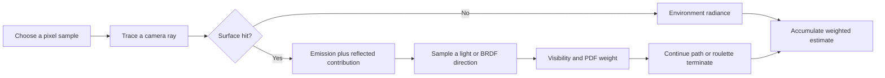

The diagrams omit many implementation details but show the dependency structure: visibility, material response, probability density, and filtering all contribute to the final pixel. A failure in one stage can look like a failure in another, so tracing data through the pipeline is often the fastest route to diagnosis.

### A final synthesis through four questions

When a renderer maps a texture onto a receding triangle, ask four questions. What is the representation? A surface point maps to texture coordinates. What is the continuous target? The average texture radiance over a pixel footprint. What is the discrete method? Perspective-correct coordinates, a mip level, and a reconstruction filter. What error remains? Aliasing, blur, or anisotropic distortion. This frames a visual artifact as a mismatch between target and approximation.

When a path tracer shows bright speckles, ask similarly. What quantity is estimated? A light-transport integral. What is the sampling density? Perhaps uniform over a hemisphere. Does it place samples where the contribution is large? If not, rare samples receive large weights and variance increases. What can be changed? [[Monte Carlo rendering estimators and variance|Importance sampling]], MIS, stratification, more samples, or a more robust path strategy. The image is noisy for a mathematical reason that can be named.

When an animated character’s hand misses a target, ask whether the forward transform chain is correct, whether the inverse-kinematics objective matches the desired pose, whether the Jacobian is conditioned, and whether joint constraints are encoded. When a mesh smooths into a smaller shape, ask which discrete Laplacian is used, which frequency modes it attenuates, and what feature constraints should remain. Across rendering, animation, and geometry, the useful sequence is representation, target, approximation, and error. It keeps the computation attached to the phenomenon it is meant to model.

### Limits and a practical checklist

Before claiming a visual quantity has been recovered, ask:

- What forward image-formation or projection model was assumed?
- Which variables are measured, known, or estimated?
- Does the system have enough independent constraints, and how well-conditioned are they?
- Which ambiguities remain: absolute scale, albedo/light, edge tangent motion, symmetry, occlusion, or unknown pose?
- What failures violate the measurement assumptions: brightness change, specularity, aliasing, blur, outliers, or lens distortion?
- Is the output local (a normal, edge, or flow vector) or global (a surface, object pose, or camera trajectory)? What integration or consistency step connects those levels?
- Was the evidence inspected in the source itself? Titles and topic labels identify a likely subject but do not establish an example or a timestamp.

This checklist captures the course’s central method: let geometry and physics explain what the pixels can constrain; use numerical algorithms only after those constraints are understood; make ambiguity and noise visible rather than hiding them behind a single answer.

### Algorithm comparisons that should remain distinct

| Method | Evidence and unknown | Search or solve strategy | Main strength | Main limitation |
|---|---|---|---|---|
| Optical flow | Local brightness derivatives; 2-D image velocity | Solve linear constraints over a neighborhood | Fine local motion under small displacement | Aperture problem and brightness-constancy violations |
| Photometric stereo | Brightness under known lights; scaled normal | Per-pixel linear system | Separates local orientation from height integration | Needs independent lighting and reflectance assumptions |
| Shape from shading | Single image brightness; height/slope field | Nonlinear PDE and characteristics | Uses one view when material/light are modeled | Ambiguous, boundary-dependent, sensitive to model error |
| PatQuick | Sparse template probes; object pose | Quantized multidimensional score search | Broad capture range and efficient candidate search | Quantization and combinatorial pose cost |
| PatMax | Edge field around initial pose | Continuous iterative attraction/least squares | Subpixel local refinement | Needs a good initial pose and can converge locally |
| Stereo | Corresponding rays from two views; depth | Epipolar match and triangulation | Metric depth with known baseline | Texture, occlusion, disparity sensitivity, calibration |
| Bundle adjustment | Many image observations; cameras and 3-D points | Sparse nonlinear least squares | Jointly enforces global consistency | Gauge freedoms, initialization, local minima, model bias |
| [[Surface orientation from image brightness\|Extended Gaussian image]] | Surface normal distribution; shape family | Accumulate normals on sphere | Compact, pose/translation-tolerant descriptor | Loses position and spatial arrangement |

This table is a distinction guide, not a ranking. A production pipeline can combine stages, such as PatQuick proposal followed by PatMax refinement, or feature matching followed by RANSAC and bundle adjustment. The stages answer different questions and should retain their own diagnostics.

### A compact field workflow

1. **Choose the viewpoint before the lens.** Walk to the position that gives the intended foreground-background relations; then choose focal length and framing. Keep the viewpoint fixed if you want to compare focal lengths. [[#PHOTO-01 - Photography session 01|PHOTO-01]]
2. **Decide which motion may blur.** Set a shutter time for the subject and camera stability. Stabilize the camera when it helps, but remember it cannot freeze a moving subject. [[#PHOTO-01 - Photography session 01|PHOTO-01]] · [[#PHOTO-10 - Photography session 10|PHOTO-10]]
3. **Choose aperture for depth of field, then evaluate diffraction.** Focus on the plane that carries the most important detail. If deep focus is necessary, consider focus stacking or a different viewpoint rather than stopping down without limit. [[#PHOTO-03 - Photography session 03|PHOTO-03]] · [[#PHOTO-04 - Photography session 04|PHOTO-04]]
4. **Protect highlight information and collect enough photons.** Use raw capture when later adjustment matters. Raise gain only after considering whether more exposure, aperture, lighting, or frame accumulation is possible. [[#PHOTO-06 - Photography session 06|PHOTO-06]] · [[#PHOTO-08 - Photography session 08|PHOTO-08]] · [[#PHOTO-10 - Photography session 10|PHOTO-10]]
5. **Read the light.** Infer source size and direction from shadows, estimate the key-to-fill relation, and decide whether bounce, diffusion, a flag, or flash will help. Match flash color to ambient light if both appear in the frame. [[#PHOTO-15 - Photography session 15|PHOTO-15]] · [[#PHOTO-16 - Photography session 16|PHOTO-16]]
6. **Treat color as illumination plus reflectance plus rendering.** Choose a neutral reference deliberately, preserve raw data if uncertain, and view through a known color space and display when accuracy matters. [[#PHOTO-12 - Photography session 12|PHOTO-12]] · [[#PHOTO-13 - Photography session 13|PHOTO-13]]
7. **Use computation where repeated measurements are compatible.** Burst averaging suits stable scenes; exposure bracketing suits static high-range scenes; panorama stitching requires a common center of projection; each method needs alignment and artifact checks. [[#PHOTO-10 - Photography session 10|PHOTO-10]] · [[#PHOTO-17 - Photography session 17|PHOTO-17]] · [[#PHOTO-18 - Photography session 18|PHOTO-18]]
8. **Inspect the final viewing size.** Depth of field, aliasing, sharpening, tone mapping, and color all depend on output scale and display context. A crop or enlargement can expose flaws that were invisible in a small preview. [[#PHOTO-03 - Photography session 03|PHOTO-03]] · [[#PHOTO-07 - Photography session 07|PHOTO-07]] · [[#PHOTO-17 - Photography session 17|PHOTO-17]]
9. **State what the image represents.** Distinguish direct capture, staged image, composite, and computational reconstruction when those distinctions matter to the audience. [[#PHOTO-09 - Photography session 09|PHOTO-09]] · [[#PHOTO-11 - Photography session 11|PHOTO-11]] · [[#PHOTO-14 - Photography session 14|PHOTO-14]]

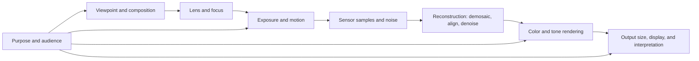

### Putting the system together

The most useful habit is to move through the imaging chain in causal order. First identify the intended viewpoint and subject relation. Then decide which distances should be sharp and which motion should remain visible. Estimate the light, choose exposure controls, and leave headroom for important highlights. Consider whether the sensor is sampling enough detail and whether repeated captures can reduce noise or extend range. After capture, treat white balance, tone, denoising, sharpening, and compression as transformations with specific assumptions. Finally, inspect the result at its intended size and ask whether its visual claim matches its method.

For example, a night street portrait may need the photographer to move close enough to separate the subject from a lit storefront, but a very wide lens from that close position exaggerates facial perspective. A longer lens from farther back can preserve a more natural face, though the photographer must account for traffic and background. A fast shutter freezes expression; a large aperture admits light and softens the storefront; a nearby flash can lift the face but may create a hard shadow. Bouncing the flash from a wall or using a small diffuser changes its apparent source size. A warm gel can bring the flash closer to tungsten signage. Raw capture leaves room to balance the mixed sources, but the correct balance may preserve some warm color rather than neutralize every lamp. [[#PHOTO-01 - Photography session 01|PHOTO-01]] · [[#PHOTO-03 - Photography session 03|PHOTO-03]] · [[#PHOTO-13 - Photography session 13|PHOTO-13]] · [[#PHOTO-16 - Photography session 16|PHOTO-16]]

A star photograph asks for different choices. A wide aperture gathers light, but lens aberration may distort stars near the frame edge. A longer exposure gathers more photons but stretches stars because Earth rotates. Tracking the sky counters that motion but blurs an untracked foreground; compositing tracked sky with a separate foreground image solves one geometric problem by introducing a composite and alignment problem. Stacking many short exposures reduces random noise but requires registration, rejection of satellites or hot pixels, and careful handling of moving clouds. Every technique is strongest when its assumptions are explicit. [[#PHOTO-02 - Photography session 02|PHOTO-02]] · [[#PHOTO-04 - Photography session 04|PHOTO-04]] · [[#PHOTO-08 - Photography session 08|PHOTO-08]] · [[#PHOTO-09 - Photography session 09|PHOTO-09]] · [[#PHOTO-10 - Photography session 10|PHOTO-10]]

A landscape panorama adds yet another chain. The photographer selects a projection and pivot, captures sufficient overlap, avoids nearby motion, aligns features, estimates the transform, blends seams, crops to a meaningful field, and renders a perspective view suited to the display. More pixels alone do not guarantee a readable picture. A carefully framed wide image can be more expressive than an indiscriminate full rotation; conversely, a navigable spherical image may be the right record of a place even if no single flat crop can show it all. [[#PHOTO-05 - Photography session 05|PHOTO-05]] · [[#PHOTO-18 - Photography session 18|PHOTO-18]]

These examples return to the course’s central idea: photography joins physical optics, computation, visual perception, artistic choices, and social meaning. The photographer is not a passive recorder and the processor is not a neutral afterthought. Good practice comes from knowing what each stage measures, what it assumes, and what it changes. That knowledge makes it possible to choose tradeoffs deliberately, to explain how an image was made, and to distinguish a useful transformation from a misleading one. [[#PHOTO-01 - Photography session 01|PHOTO-01]] · [[#PHOTO-09 - Photography session 09|PHOTO-09]] · [[#PHOTO-14 - Photography session 14|PHOTO-14]] · [[#PHOTO-18 - Photography session 18|PHOTO-18]]

## A laboratory that connects images back to measured quantities

The following Python 3 program uses only the standard library. Save the whole block as `integrated_checks.py` and run `python3 integrated_checks.py`. Its inputs are finite, small, deliberately scaled teaching examples. The elimination routine rejects small relative pivots; it is a compact traceable solver rather than an estimated condition-number test.

The stereo cameras share focal length, principal-point origin, orientation, and vertical image coordinates; the second camera is displaced horizontally by 0.12 m. A world point at (0.32, 0.15, 4) m produces horizontal measurements 80 and 50 pixels with a focal length of 1000 pixels. Their 30-pixel disparity reconstructs the original four-meter depth. Rotating one camera or using uncorrected lens distortion would invalidate this simple formula.

The photometric experiment removes known source strengths and the Lambertian factor: $b_i=\pi L_{o,i}/E_i^\perp$, where $E_i^\perp$ is the source irradiance on a patch perpendicular to its direction. Then $b_i=\rho\,\mathbf s_i^\mathsf T\mathbf n$ and $\mathbf g=\rho\mathbf n$. The independent lights recover both albedo and normal. The coplanar lights give exactly the same measurements for two different third components, demonstrating ambiguity with actual numbers.

The flow experiment constructs measurements obeying brightness constancy. A corner patch recovers both velocity components; a straight-edge patch is rejected because one component is unmeasured. The remaining checks compare perspective and affine interpolation, linear-light and encoded-value blending, a fitted subpixel peak, and the RANSAC sampling bound. They test stated examples and failure cases; they do not certify a complete vision library.

```python
"""Small independent checks for the graphics/vision teaching volume; Python 3."""
from math import ceil, isclose, log1p, sqrt

def close(a, b, tol=1e-10):
    return isclose(a, b, rel_tol=tol, abs_tol=tol)

def project(point, focal_pixels, camera_x=0.0):
    x, y, z = point
    if z <= 0 or focal_pixels <= 0:
        raise ValueError('This pinhole model requires positive focal length and depth')
    return focal_pixels * (x - camera_x) / z, focal_pixels * y / z

def rectified_depth(left_x, right_x, focal_pixels, baseline):
    disparity = left_x - right_x
    if min(focal_pixels, baseline, disparity) <= 0:
        raise ValueError('Require positive focal length, baseline, and disparity')
    return focal_pixels * baseline / disparity

def solve3(matrix, rhs):
    """Partial-pivot elimination for this small, scaled laboratory."""
    if len(matrix) != 3 or len(rhs) != 3 or any(len(r) != 3 for r in matrix):
        raise ValueError('Expected a 3 by 3 system')
    a = [[float(x) for x in row] + [float(b)] for row, b in zip(matrix, rhs)]
    scale = max(abs(x) for row in matrix for x in row)
    if scale == 0:
        raise ValueError('No measured directions')
    for k in range(3):
        pivot = max(range(k, 3), key=lambda i: abs(a[i][k]))
        if abs(a[pivot][k]) <= 1e-12 * scale:
            raise ValueError('Singular or unsafe pivot for this laboratory')
        a[k], a[pivot] = a[pivot], a[k]
        for i in range(k + 1, 3):
            factor = a[i][k] / a[k][k]
            for j in range(k, 4):
                a[i][j] -= factor * a[k][j]
    x = [0.0] * 3
    for i in range(2, -1, -1):
        x[i] = (a[i][3] - sum(a[i][j] * x[j] for j in range(i + 1, 3))) / a[i][i]
    return x

def dot(a, b):
    return sum(x * y for x, y in zip(a, b))

def estimate_flow(measurements):
    """Rows are (image_x_derivative, image_y_derivative, time_derivative)."""
    a = sum(ix * ix for ix, iy, it in measurements)
    b = sum(ix * iy for ix, iy, it in measurements)
    c = sum(iy * iy for ix, iy, it in measurements)
    rx = -sum(ix * it for ix, iy, it in measurements)
    ry = -sum(iy * it for ix, iy, it in measurements)
    det = a * c - b * b
    if det <= 1e-12 * (a + c) ** 2:
        raise ValueError('Insufficient independent image-gradient directions')
    return (c * rx - b * ry) / det, (a * ry - b * rx) / det

def perspective_attribute(weights, attributes, clip_w):
    if any(w <= 0 for w in clip_w):
        raise ValueError('This example assumes a clipped triangle with positive w')
    denominator = sum(l / w for l, w in zip(weights, clip_w))
    return sum(l * a / w for l, a, w in zip(weights, attributes, clip_w)) / denominator

def srgb_decode(s):
    return s / 12.92 if s <= 0.04045 else ((s + 0.055) / 1.055) ** 2.4

def srgb_encode(linear):
    return 12.92 * linear if linear <= 0.0031308 else 1.055 * linear ** (1 / 2.4) - 0.055

def peak_offset(a, b, c):
    denominator = a - 2 * b + c
    if denominator >= 0:
        raise ValueError('Require a concave peak for this three-sample fit')
    return (a - c) / (2 * denominator)

def ransac_trials(inlier_fraction, sample_size, success_probability):
    if not 0 < inlier_fraction <= 1 or not 0 < success_probability < 1 or sample_size < 1:
        raise ValueError('Invalid probability or sample size')
    if inlier_fraction == 1:
        return 1
    return ceil(log1p(-success_probability) / log1p(-(inlier_fraction ** sample_size)))

# One world point seen by two calibrated, parallel cameras.
point, focal, baseline = (0.32, 0.15, 4.0), 1000.0, 0.12
left, right = project(point, focal), project(point, focal, baseline)
assert close(left[0], 80) and close(right[0], 50)
assert close(left[1], right[1]) and close(left[1], 37.5)
assert close(rectified_depth(left[0], right[0], focal, baseline), 4)

# Calibrated Lambertian brightness: b_i = pi * L_o,i / E_i,perpendicular.
lights = [[1, 0, 0], [0, 1, 0], [0, 0, 1]]
g_true = [0.3, 0.4, 0.5]
brightness = [dot(light, g_true) for light in lights]
g = solve3(lights, brightness)
albedo = sqrt(dot(g, g))
normal = [x / albedo for x in g]
assert all(close(x, y) for x, y in zip(g, g_true))
assert close(albedo, sqrt(0.5)) and close(dot(normal, normal), 1)

# Three coplanar light directions fail to measure the third component.
coplanar = [[1, 0, 0], [0, 1, 0], [1 / sqrt(2), 1 / sqrt(2), 0]]
assert all(close(dot(l, [0.3, 0.4, 0.2]), dot(l, [0.3, 0.4, 0.7])) for l in coplanar)
try:
    solve3(coplanar, [dot(l, g_true) for l in coplanar])
except ValueError:
    pass
else:
    raise AssertionError('A rank-deficient lighting system was accepted')

# Brightness constancy gives enough independent equations in a corner patch.
u, v = estimate_flow([(1, 0, -2), (0, 1, 1), (1, 1, -1), (-1, 2, 4)])
assert close(u, 2) and close(v, -1)
try:
    estimate_flow([(1, 0, -2), (2, 0, -4), (3, 0, -6)])
except ValueError:
    pass
else:
    raise AssertionError('An aperture-degenerate edge patch was accepted')

# The same interpolation weights mean different things before/after projection.
correct = perspective_attribute([0.5, 0.25, 0.25], [0, 1, 0], [1, 2, 4])
assert close(correct, 2 / 11) and not close(correct, 0.25)
linear_blend_encoded = srgb_encode((srgb_decode(0.0) + srgb_decode(1.0)) / 2)
assert close(linear_blend_encoded, 0.7353569830524495)
assert close(srgb_decode(0.5), 0.21404114048223255)

# Known quadratic peak and independent random-sampling success bound.
parabola = lambda x: 7 - 2 * (x - 0.2) ** 2
assert close(peak_offset(parabola(-1), parabola(0), parabola(1)), 0.2)
assert ransac_trials(0.5, 3, 0.99) == 35
print('PASS: stereo, lighting rank, optical flow rank, interpolation, color, edge fit, RANSAC')
print(f'left={left}, right={right}, depth=4 m, albedo={albedo:.8f}, normal={normal}')
```

### Runnable standard-library checks

This standard-library Python lab checks small numerical witnesses for array addressing, projection multiplicities, volume compositing, projected covariance, reservoir selection, contact-barrier shape, and derivative calculations. The checked run reported 8 passing checks. These checks validate only the stated examples and formulas; they do not train a vision model, compile a GPU renderer, or prove performance on a graphics device.

```python
"""Small numerical experiments, not a GPU renderer or trained vision system."""
import math, random, struct, json

def sigmoid(z):
    return 1/(1+math.exp(-z)) if z >= 0 else math.exp(z)/(1+math.exp(z))

def loss_and_gradient(p, data, hidden=4):
    loss, grad = 0., [0.]*len(p)
    for x,y in data:
        h=[math.tanh(p[3*j]*x[0]+p[3*j+1]*x[1]+p[3*j+2]) for j in range(hidden)]
        z=p[-1]+sum(p[3*hidden+j]*h[j] for j in range(hidden))
        loss += max(z,0)-z*y+math.log1p(math.exp(-abs(z)))
        dz=sigmoid(z)-y
        grad[-1]+=dz
        for j in range(hidden):
            grad[3*hidden+j]+=dz*h[j]
            da=dz*p[3*hidden+j]*(1-h[j]*h[j])
            grad[3*j]+=da*x[0]
            grad[3*j+1]+=da*x[1]
            grad[3*j+2]+=da
    n=len(data)
    return loss/n, [g/n for g in grad]

def predict(p,x,hidden=4):
    h=[math.tanh(p[3*j]*x[0]+p[3*j+1]*x[1]+p[3*j+2]) for j in range(hidden)]
    return sigmoid(p[-1]+sum(p[3*hidden+j]*h[j] for j in range(hidden)))

def weighted_reservoir(items,rng):
    chosen,total=None,0.
    for item,weight in items:
        if weight<0:raise ValueError('Weights must be nonnegative')
        total+=weight
        if weight>0 and rng.random()*total<weight:chosen=item
    if total==0:raise ValueError('At least one positive weight is required')
    return chosen,total

def barrier(d,threshold=1.):
    if threshold<=0 or d<=0:raise ValueError('Positive distance and threshold required')
    return -(d-threshold)**2*math.log(d/threshold) if d<threshold else 0.

def main():
    checks=[]
    vertices=[(0,0,0,1,0,0),(1,0,0,0,1,0),(0,1,0,0,0,1)]
    buffer=b''.join(struct.pack('=6f',*v) for v in vertices)
    assert len(buffer)==72
    assert struct.unpack_from('=3f',buffer,2*24+12)==(0.,0.,1.)
    checks.append('packed float32 vertex fetch')
    grid=[(i,j) for i in range(4) for j in range(4)]
    assert [len({round(a*x+b*y,10) for x,y in grid}) for a,b in [(1,0),(1,1),(1,math.sqrt(2))]]==[4,7,16]
    checks.append('exact finite-grid projections')
    image=[[1,2,3],[4,5,6],[7,8,9]];kernel=[[1,0,-1],[2,0,-2],[1,0,-1]]
    correlation=sum(image[i][j]*kernel[i][j] for i in range(3) for j in range(3))
    convolution=sum(image[i][j]*kernel[2-i][2-j] for i in range(3) for j in range(3))
    assert (correlation,convolution)==(-8,8)
    checks.append('correlation versus flipped mathematical convolution')
    data=[((0.,0.),0.),((0.,1.),1.),((1.,0.),1.),((1.,1.),0.)]
    rng=random.Random(7);p=[rng.uniform(-1,1) for _ in range(17)];base,gradient=loss_and_gradient(p,data)
    errors=[];epsilon=1e-6
    for i in range(len(p)):
        plus=p[:];minus=p[:];plus[i]+=epsilon;minus[i]-=epsilon
        numeric=(loss_and_gradient(plus,data)[0]-loss_and_gradient(minus,data)[0])/(2*epsilon)
        errors.append(abs(numeric-gradient[i]))
    assert max(errors)<1e-7
    for _ in range(3000):
        _,g=loss_and_gradient(p,data);p=[v-.7*dv for v,dv in zip(p,g)]
    probabilities=[predict(p,x) for x,_ in data]
    assert probabilities[0]<.05 and probabilities[3]<.05 and probabilities[1]>.95 and probabilities[2]>.95
    checks.append('all 17 MLP derivatives checked; XOR learned')
    scores=[1/math.sqrt(2),0.];exps=[math.exp(s-max(scores)) for s in scores];attention=[e/sum(exps) for e in exps]
    result=[2*attention[0],3*attention[1]]
    assert math.isclose(sum(attention),1) and 1.33<result[0]<1.35 and .98<result[1]<1.
    checks.append('scaled attention with two keys')
    alpha=[.2,.5,.4];transmittance=1.;weights=[]
    for a in alpha:weights.append(transmittance*a);transmittance*=1-a
    assert all(math.isclose(a,b) for a,b in zip(weights,[.2,.4,.16]))
    assert math.isclose(sum(weights)+transmittance,1)
    assert all(math.isclose(a+transmittance,b) for a,b in zip(weights,[.44,.64,.4]))
    checks.append('front-to-back compositing and remaining background')
    items=[('A',2.),('B',1.),('C',3.)];counts=dict.fromkeys('ABC',0);rng=random.Random(19);n=100000
    for _ in range(n):
        kept,total=weighted_reservoir(items,rng);counts[kept]+=1
    assert total==6
    assert all(abs(counts[k]/n-w/6)<.004 for k,w in items)
    checks.append('streaming reservoir empirical weighted selection')
    d=.3;numeric=(barrier(d+epsilon)-barrier(d-epsilon))/(2*epsilon)
    analytic=-2*(d-1)*math.log(d)-(d-1)**2/d
    assert math.isclose(numeric,analytic,rel_tol=1e-7)
    assert barrier(1)==0 and barrier(2)==0 and barrier(1e-9)>barrier(.001)>barrier(.1)>0
    try:barrier(0)
    except ValueError:pass
    else:raise AssertionError('Invalid distance accepted')
    checks.append('barrier derivative and positive-distance domain')
    return {'checks':checks,'gradient_max_error':max(errors),'xor_probabilities':probabilities,'attention':result,'reservoir_counts':counts,'errors':[]}

if __name__=='__main__':print(json.dumps(main(),indent=2))
```

## A complete renderer makes the forward model executable

This lab is a small, original teaching implementation that joins camera geometry, ray intersections, visibility, Monte Carlo integration, and color output in one runnable Python script. It is an independent example; it is not course project code, a reconstruction of a student project, or a production renderer.

Run it with Python 3 and no installed packages:

```sh
python3 renderer_lab.py
```

The default run writes a 96 by 64 P6 PPM image to `renderer-lab.ppm`. FFmpeg can convert it to PNG for a quick preview:

```sh
ffmpeg -y -i renderer-lab.ppm renderer-lab.png
```

The image has a black background because the renderer models no environment illumination. It shows two matte spheres above a matte plane, lit by a rectangular emitter. Shadows are computed by testing finite rays from each visible surface point to sampled points on the light. The script deliberately supports one surface interaction: a camera ray hits a surface, then that point receives direct illumination from the area light. It does not bounce light between objects, so it has no indirect fill, color bleeding, glass, or mirror reflections. A black shadow therefore means “no direct ray from this light reached the surface,” not “no light exists in a real room.”

For a larger, less jagged preview, run:

```sh
python3 renderer_lab.py --width 384 --height 256 --spp 8 --light-samples 16 --seed 178 --output renderer-lab-large.ppm
ffmpeg -y -i renderer-lab-large.ppm renderer-lab-large.png
```

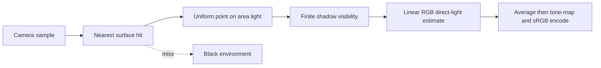

#### Camera and geometry

A camera ray starts at the pinhole and passes through a position on the image plane. The script builds an orthonormal camera frame from the camera position, look target, and world-up direction. The image-plane coordinates use aspect ratio and a 48-degree vertical field of view. Each pixel receives four jittered primary rays by default; averaging them is a simple supersampling strategy that softens jagged edges. A fixed random seed makes the run repeatable. Increasing `--spp` gives more camera samples per pixel, while `--light-samples` controls the number of area-light samples at each camera hit:

```sh
python3 renderer_lab.py --width 192 --height 128 --spp 8 --light-samples 32 --seed 178
```

Spheres use the quadratic ray intersection. Since ray directions are normalized, the quadratic coefficient for $t^2$ is one, and the nearer root is normally the visible entry point. If the ray begins inside a sphere, that entry root is negative, so the code tries the farther positive exit root. The plane is the equation $y=0$: a ray parallel to it has no intersection, otherwise its parameter is the vertical distance to the plane divided by the ray’s vertical direction. All accepted hits must have $t$ greater than a small positive threshold and less than the current nearest hit. Here $t$ is a distance in scene units because the ray direction has unit length.

The scene occupies roughly six units across, so `EPS = 0.0001` is a small scale-relative offset. After a surface hit, the shadow-ray origin moves by `EPS` along the surface normal to avoid immediately intersecting the surface it just left. Keep two rays conceptually distinct: the lighting integral uses $\omega_i=(y-x)/\|y-x\|$ and $r=\|y-x\|$ from the true surface point $x$, while visibility starts at the offset point $x_\epsilon=x+\epsilon n$. For that visibility segment, the code recomputes $\omega_s=(y-x_\epsilon)/\|y-x_\epsilon\|$ and its length, so the ray aims exactly at the sampled emitter point. The maximum segment parameter ends just before that point. An object behind the emitter must not shadow it. Too large an epsilon can detach shadows from contact points; too small an epsilon can cause numerical self-intersections. The startup assertions exercise the sphere exit root, nearest-hit ordering, an actual finite shadow segment, offset-to-target segment geometry, and linear-to-sRGB endpoint behavior.

#### Area-light estimate

The rectangular light is described by a center and two half-edge vectors. Its area is four times the area of the half-edge parallelogram. The cross product of those half-edges gives the emitter normal, which points down toward the scene. The sampler chooses two independent uniform values in $[-1,1]$ and maps them across the rectangle. That is uniform **area** sampling with probability density $p_A=1/A$; it is not a solid-angle PDF.

For a Lambertian surface with RGB diffuse reflectance $\rho$, the BRDF is $f_r=\rho/\pi$. If $x$ is a surface point, $y$ a sampled point on the light, $r=\|y-x\|$, $\omega_i=(y-x)/r$, and $V(x,y)$ is one when the segment is visible and zero when blocked, direct outgoing radiance is

$$
L_o(x)=\int_A \frac{\rho}{\pi} L_e(y) V(x,y)
\frac{\cos\theta_x\cos\theta_y}{r^2}\,dA.
$$

The two cosines are clamped to zero when either surface faces away from the other. Replacing the integral with $n$ uniform area samples gives the estimator

$$
\widehat L_o(x)=\frac{\rho}{\pi}L_e\frac{A}{n}
\sum_{j=1}^{n} V_j\frac{\cos\theta_{x,j}\cos\theta_{y,j}}{r_j^2}.
$$

The implementation accumulates each RGB channel separately. The $A/n$ factor converts the sample average back to an area integral; omitting it or treating $1/A$ as a solid-angle density would give the wrong scale. The inverse-square factor and both cosines arise from converting an emitting area element into the irradiance arriving at the receiving surface. Larger lights subtend a wider angle and usually create softer shadow boundaries, which these samples resolve as some points on the emitter are visible while others are occluded.

#### Color and display

The material reflectances are dimensionless RGB values between zero and one. Light radiance is stored as linear RGB values in common relative units; values are chosen for this demonstration and are not calibrated physical measurements. If the channels were calibrated radiometric bands, multiplying by dimensionless reflectance and the geometric integral would preserve radiance units. In either case, the code must do lighting and averaging in linear light: encoded display values are not proportional to energy.

After all camera samples for a pixel have been averaged, a fixed two-times exposure is applied, followed by a Reinhard curve $c'=c/(1+c)$ to map nonnegative, unbounded radiance to display range. The result is encoded with the piecewise sRGB transfer function and rounded to 8-bit channel values. Tone mapping happens after averaging, because clipping or compressing each noisy sample first would bias the average. The output is a binary P6 PPM: an ASCII header followed by three bytes per pixel in row-major RGB order. It is intentionally easy to write and inspect.

This miniature leaves out many real-renderer concerns: indirect illumination, physically calibrated spectral color, texture filtering, acceleration structures, anti-aliasing beyond jitter, variance reduction, [[Monte Carlo rendering estimators and variance|multiple importance sampling]], adaptive sampling, denoising, and robust scale-independent intersection tolerances. It is useful precisely because the direct-light estimator and its geometry fit in one small file. Each assumption is visible, testable, and connected to the image it produces.

### Figure U5 - A direct-light renderer makes the pipeline executable

![[Visual Recall/University Graphics and Vision/renderer-direct-light.png]]

**Read the image.** Each pixel averages jittered camera rays and area-light samples in linear RGB. Finite visibility rays produce soft shadows. The saved preview uses 384 by 256 pixels, eight camera samples, and sixteen light samples; the script defaults to a smaller fast example. The black environment and direct-light-only model are stated restrictions of this exercise.

Save this complete block as `renderer_lab.py`. The default output is `renderer-lab.ppm` in the current directory.

```python
#!/usr/bin/env python3
"""A deterministic, direct-lighting teaching renderer. Standard library only."""
import argparse
import math
import random
PI = math.pi
EPS = 1.0e-4  # Scene units; scene spans roughly six units.

def add(a, b): return (a[0] + b[0], a[1] + b[1], a[2] + b[2])
def sub(a, b): return (a[0] - b[0], a[1] - b[1], a[2] - b[2])
def mul(a, s): return (a[0] * s, a[1] * s, a[2] * s)
def dot(a, b): return a[0] * b[0] + a[1] * b[1] + a[2] * b[2]
def cross(a, b):
    return (a[1]*b[2] - a[2]*b[1], a[2]*b[0] - a[0]*b[2], a[0]*b[1] - a[1]*b[0])
def length(a): return math.sqrt(dot(a, a))
def unit(a):
    n = length(a)
    if n == 0.0: raise ValueError("cannot normalize a zero vector")
    return mul(a, 1.0 / n)

# Sphere tuple: (center, radius, diffuse RGB reflectance). Plane is y=0.
SPHERES = [
    ((-0.68, 0.72, 0.05), 0.72, (0.78, 0.20, 0.10)),
    ((0.62, 0.48, -0.36), 0.48, (0.12, 0.38, 0.82)),
]
FLOOR_ALBEDO = (0.62, 0.64, 0.67)
LIGHT_CENTER = (0.0, 3.25, -0.10)
LIGHT_HALF_U = (1.25, 0.0, 0.0)
LIGHT_HALF_V = (0.0, 0.0, 0.90)
LIGHT_NORMAL = unit(cross(LIGHT_HALF_U, LIGHT_HALF_V))  # Faces down.
LIGHT_AREA = 4.0 * length(LIGHT_HALF_U) * length(LIGHT_HALF_V)
LIGHT_RADIANCE = (5.5, 4.8, 4.0)  # Linear RGB radiance, relative units.

def sphere_hit(origin, direction, sphere, t_max=float("inf")):
    center, radius, _ = sphere
    oc = sub(origin, center)
    half_b = dot(oc, direction)  # Direction is normalized, so a=1.
    c = dot(oc, oc) - radius * radius
    disc = half_b * half_b - c
    if disc < 0.0: return None
    root = math.sqrt(disc)
    # Test the entry root, then the exit root: rays may start inside a sphere.
    for t in (-half_b - root, -half_b + root):
        if EPS < t < t_max:
            point = add(origin, mul(direction, t))
            return (t, point, unit(sub(point, center)), sphere[2])
    return None

def plane_hit(origin, direction, t_max=float("inf")):
    if abs(direction[1]) < 1.0e-10: return None  # Parallel to y=0.
    t = -origin[1] / direction[1]
    if EPS < t < t_max:
        point = add(origin, mul(direction, t))
        return (t, point, (0.0, 1.0, 0.0), FLOOR_ALBEDO)
    return None

def scene_hit(origin, direction, t_max=float("inf")):
    nearest = None
    for sphere in SPHERES:
        hit = sphere_hit(origin, direction, sphere, t_max)
        if hit and (nearest is None or hit[0] < nearest[0]): nearest = hit
    hit = plane_hit(origin, direction, t_max)
    if hit and (nearest is None or hit[0] < nearest[0]): nearest = hit
    return nearest

def occluded(origin, direction, distance):
    # A finite segment ends just before the sampled emitter point.
    return scene_hit(origin, direction, max(EPS, distance - 2.0 * EPS)) is not None

def sample_area_light(rng):
    # Uniform area PDF = 1/A: independent uniform coordinates on the rectangle.
    a, b = rng.uniform(-1.0, 1.0), rng.uniform(-1.0, 1.0)
    return add(LIGHT_CENTER, add(mul(LIGHT_HALF_U, a), mul(LIGHT_HALF_V, b)))

def direct_radiance(point, normal, albedo, rng, light_samples):
    total = [0.0, 0.0, 0.0]
    shadow_origin = add(point, mul(normal, EPS))
    for _ in range(light_samples):
        light_point = sample_area_light(rng)
        delta = sub(light_point, point)
        distance2 = dot(delta, delta)
        distance = math.sqrt(distance2)
        wi = mul(delta, 1.0 / distance)
        cos_surface = max(0.0, dot(normal, wi))
        cos_emitter = max(0.0, dot(LIGHT_NORMAL, mul(wi, -1.0)))
        if cos_surface == 0.0 or cos_emitter == 0.0: continue
        shadow_delta = sub(light_point, shadow_origin)
        shadow_distance = length(shadow_delta)
        shadow_direction = mul(shadow_delta, 1.0 / shadow_distance)
        if occluded(shadow_origin, shadow_direction, shadow_distance): continue
        # Uniform-area Monte Carlo estimate of the Lambertian area integral.
        weight = (LIGHT_AREA * cos_surface * cos_emitter / distance2
                  / (PI * light_samples))
        for k in range(3): total[k] += albedo[k] * LIGHT_RADIANCE[k] * weight
    return tuple(total)

def camera_ray(x, y, width, height):
    origin = (0.0, 1.35, 4.55)
    forward = unit(sub((0.0, 0.72, 0.0), origin))
    right = unit(cross(forward, (0.0, 1.0, 0.0)))
    up = unit(cross(right, forward))
    aspect = width / height
    scale = math.tan(math.radians(48.0) / 2.0)
    sx = (2.0 * x / width - 1.0) * aspect * scale
    sy = (1.0 - 2.0 * y / height) * scale
    return origin, unit(add(forward, add(mul(right, sx), mul(up, sy))))

def linear_to_srgb(v):
    v = max(0.0, v)
    return 12.92 * v if v <= 0.0031308 else 1.055 * (v ** (1.0 / 2.4)) - 0.055

def render(width, height, spp, light_samples, seed):
    rng = random.Random(seed)
    pixels = bytearray()
    for y in range(height):
        for x in range(width):
            average = [0.0, 0.0, 0.0]
            for _ in range(spp):
                # Jittered primary rays supersample each pixel.
                origin, direction = camera_ray(x + rng.random(), y + rng.random(), width, height)
                hit = scene_hit(origin, direction)
                radiance = direct_radiance(hit[1], hit[2], hit[3], rng, light_samples) if hit else (0, 0, 0)
                for k in range(3): average[k] += radiance[k] / spp
            # Average in linear light, apply 2x Reinhard exposure, then encode sRGB.
            for value in average:
                exposed = 2.0 * value
                mapped = exposed / (1.0 + exposed)
                encoded = linear_to_srgb(mapped)
                if not math.isfinite(encoded): raise ArithmeticError("non-finite pixel")
                pixels.append(max(0, min(255, int(encoded * 255.0 + 0.5))))
    return bytes(pixels)

def checks():
    inside = sphere_hit((0, 0, 0), (1, 0, 0), ((0, 0, 0), 1, (1, 1, 1)))
    assert inside is not None and abs(inside[0] - 1.0) < 1e-9  # Exit root.
    ray = unit((0, -0.2, -1))
    front = sphere_hit((0, 1, 3), ray, ((0, 0.7, 0), 0.5, (1, 1, 1)))
    floor = plane_hit((0, 1, 3), ray)
    assert front is not None and floor is not None and front[0] < floor[0]  # Nearest hit.
    blocker = ((0, 0, 0), 0.4, (1, 1, 1))
    SPHERES.append(blocker)
    assert not occluded((0, 0, 2), (0, 0, -1), 1.0)  # Blocker beyond segment.
    assert occluded((0, 0, 2), (0, 0, -1), 3.0)  # Same ray reaches blocker.
    SPHERES.pop()
    start, end = (0.1, 0.0, 2.0), (0.0, 0.0, 0.0)
    delta = sub(end, start); distance = length(delta); direction = unit(delta)
    assert length(sub(add(start, mul(direction, distance)), end)) < 1e-12
    assert linear_to_srgb(0.0) == 0.0 and abs(linear_to_srgb(1.0) - 1.0) < 1e-12

def positive_int(value):
    result = int(value)
    if result < 1: raise argparse.ArgumentTypeError("must be a positive integer")
    return result

def main():
    checks()
    parser = argparse.ArgumentParser(description=__doc__)
    parser.add_argument("--width", type=positive_int, default=96)
    parser.add_argument("--height", type=positive_int, default=64)
    parser.add_argument("--spp", type=positive_int, default=4, help="camera supersamples per pixel")
    parser.add_argument("--light-samples", type=positive_int, default=16)
    parser.add_argument("--seed", type=int, default=178)
    parser.add_argument("--output", default="renderer-lab.ppm")
    args = parser.parse_args()
    payload = render(args.width, args.height, args.spp, args.light_samples, args.seed)
    assert len(payload) == args.width * args.height * 3
    with open(args.output, "wb") as image:
        image.write(f"P6\n{args.width} {args.height}\n255\n".encode("ascii"))
        image.write(payload)
    print(f"wrote {args.output} ({args.width}x{args.height}, {args.spp} camera spp, {args.light_samples} light spp)")

if __name__ == "__main__": main()
```

## A return map for the key terms

Use this map to find the developed explanation, then test it with the chapter example. These terms connect this independent course series to the existing vault; they do not advance the numbered curriculum.

| Term | Core mechanism | Teaching chapter |
|---|---|---|
| [[Camera view and clip-space pipeline]] | Extend the existing transform pipeline with the clipping and depth-precision decisions that make projection robust. | [[#A scene description becomes an image\|Full explanation]] |
| [[Homogeneous coordinates and perspective division]] | Extend the existing account with the geometric reason for the final divide. | [[#Coordinate frames, transformations, and pose\|Full explanation]] |
| [[Barycentric coordinates and interpolation]] | Extend the existing interpolation note with the geometric meanings that make triangle rasterization and camera calibration easier to reason about. | [[#Rasterization, coverage, and depth\|Full explanation]] |
| [[Color encoding and linear-light operations]] | Extend the existing color note with why image-processing arithmetic must distinguish encoded values from light. | [[#Color perception, encoding, and display\|Full explanation]] |
| [[Convolution and filter footprints]] | Extend the current convolution note from a sliding kernel to image formation and resampling. | [[#Sampling continuous signals and image formation\|Full explanation]] |
| [[Fourier analysis and spectral phase]] | Extend the existing frequency-domain treatment with visual interpretation and filtering consequences. | [[#Sampling continuous signals and image formation\|Full explanation]] |
| [[Reflectance and rendering equation]] | Extend the existing light-transport note with the distinction between a material’s directional response and the incident illumination it receives. | [[#Reflectance, BRDFs, and shading\|Full explanation]] |
| [[Reflection refraction and shading directions]] | Extend the existing direction note by separating geometric surface orientation from optical ray behavior. | [[#Lens optics, focus, and image formation\|Full explanation]] |
| [[Quaternion rotation and double cover]] | Extend the existing quaternion note with interpolation and sign handling in animation. | [[#Coordinate frames, transformations, and pose\|Full explanation]] |
| [[Singular value decomposition]] | Extend the existing factorization note with its role in estimation, conditioning, and geometry. | [[#Pose estimation, transforms, and robust fitting\|Full explanation]] |
| [[Spline bases and curve evaluation]] | A spline is a piecewise polynomial curve whose neighboring pieces join under explicit continuity constraints. | [[#Curves as controllable functions\|Full explanation]] |
| [[Manifold polygon meshes and boundary structure]] | A polygon mesh is a combinatorial surface made of vertices, edges, and faces plus an embedding that assigns each vertex a position. | [[#Surfaces, patches, topology, and parameterization\|Full explanation]] |
| [[Half-edge mesh connectivity]] | A half-edge data structure stores each undirected edge as two opposite directed records. | [[#Meshes, connectivity, and geometry processing\|Full explanation]] |
| [[Subdivision surface masks]] | Subdivision refines a control mesh and updates old and newly inserted vertices with local masks, producing a sequence that approaches a smooth limit surface. | [[#Meshes, connectivity, and geometry processing\|Full explanation]] |
| [[Quadric error mesh simplification]] | Quadric error simplification greedily collapses the edge with the least predicted geometric error. | [[#Meshes, connectivity, and geometry processing\|Full explanation]] |
| [[Triangle rasterization and coverage tests]] | Rasterization converts triangle geometry into a finite set of image samples. | [[#A scene description becomes an image\|Full explanation]] |
| [[Depth buffering and visibility order]] | A depth buffer stores the nearest depth seen so far for each image sample. | [[#Rasterization, coverage, and depth\|Full explanation]] |
| [[Ray-triangle intersection]] | A ray is a parametric half-line $r(t)=o+td$, where $o$ is its origin, $d$ is its direction, and only $t\ge0$ lies ahead of the ray. | [[#Visibility queries and ray intersections\|Full explanation]] |
| [[Bounding volume hierarchies]] | A bounding volume hierarchy (BVH) organizes primitives into a tree of enclosing boxes. | [[#Acceleration structures and robust queries\|Full explanation]] |
| [[Lens optics and depth of field]] | A pinhole camera maps every scene point to one image point through a single center, but a real lens has a finite aperture. | [[#Lens optics, focus, and image formation\|Full explanation]] |
| [[Exposure and sensor response]] | A camera sensor converts arriving photons into electrical measurements. | [[#Exposure, sensors, and dynamic range\|Full explanation]] |
| [[Probability density and change of measure]] | A probability density describes probability per unit of a chosen measure, not probability at a point. | [[#Light measurement and radiometry\|Full explanation]] |
| [[Monte Carlo rendering estimators and variance]] | Monte Carlo integration estimates an integral by averaging random samples with importance weights. | [[#Numerical integration and Monte Carlo estimation\|Full explanation]] |
| [[Optical flow and time to contact]] | Optical flow is the apparent 2D motion of image features between frames. | [[#Optical flow and motion from images\|Full explanation]] |
| [[Edge localization and subpixel contours]] | An edge is a rapid image-intensity change, often associated with a material or depth boundary. | [[#Edges, contours, and subpixel localization\|Full explanation]] |
| [[Hough transform and geometric voting]] | The Hough transform detects a parametric shape by letting each image feature vote for compatible shape parameters. | [[#Edges, contours, and subpixel localization\|Full explanation]] |
| [[Template matching and distance transforms]] | Template matching searches an image for a known pattern by comparing a small reference patch at candidate positions. | [[#Recognition, templates, and industrial matching\|Full explanation]] |
| [[Camera calibration and bundle adjustment]] | Camera calibration estimates parameters that map 3D points to image coordinates. | [[#Cameras, projection, and calibration\|Full explanation]] |
| [[Stereo correspondence and epipolar geometry]] | Stereo reconstruction uses two or more views to infer depth from corresponding image features. | [[#Stereo, relative orientation, and reconstruction\|Full explanation]] |
| [[Determinants orientation and volume]] | Computational geometry often decides whether points are left or right of a directed line, whether three points are collinear, or whether a point lies inside a circle. | [[#Pose estimation, transforms, and robust fitting\|Full explanation]] |
| [[PDE fields and discrete Laplacians]] | A partial differential equation constrains a field through spatial and temporal derivatives. | [[#PDEs, fields, and discrete solvers\|Full explanation]] |
| [[ODE integration and stability]] | An ordinary differential equation gives the rate of change of a state over time. | [[#Dynamics, forces, and numerical integration\|Full explanation]] |
| [[Constrained optimization and inverse kinematics]] | Optimization chooses parameters to minimize an objective while satisfying constraints. | [[#Optimization, constraints, and inverse kinematics\|Full explanation]] |
| [[Surface orientation from image brightness]] | Shape-from-illumination methods infer surface orientation or depth from how light changes across an image. | [[#Surface orientation from illumination\|Full explanation]] |
| [[Light spectra and radiometry]] | Radiometry distinguishes total radiant flux $\Phi$ in watts, irradiance $E$ in watts per square metre, radiant intensity $I$ in watts per steradian, and radiance $L$ in watts per square metre per steradian measured with projected source area. | [[#Light measurement and radiometry\|Full explanation]] |
| [[Sampling aliasing and reconstruction]] | Sampling records measurements of a continuous signal on a discrete grid. | [[#Sampling continuous signals and image formation\|Full explanation]] |
| [[GPU vertex specification]] | Vertex input turns buffer bytes into shader attributes through component format, byte offset, byte stride, and captured buffer binding. | [[#Rasterization, coverage, and depth|Full explanation]] |
| [[Homogeneous clipping and perspective interpolation]] | Clip primitives in homogeneous coordinates before divide, then interpolate perspective attributes using reciprocal-w weights. | [[#Rasterization, coverage, and depth|Full explanation]] |
| [[Automatic differentiation and backpropagation]] | Automatic differentiation composes local chain-rule rules; reverse-mode VJPs compute scalar-loss gradients efficiently. | [[#Learning a visual classifier from examples|Full explanation]] |
| [[Learned image features and CNNs]] | CNNs learn shared local filters whose feature maps combine into task-specific image representations. | [[#Convolutional models preserve image neighborhoods|Full explanation]] |
| [[Attention and visual transformers]] | Scaled query-key scores weight value vectors so each image token can mix context from other tokens. | [[#Sequence models and attention|Full explanation]] |
| [[Contrastive vision and image-language alignment]] | Contrastive training pulls paired image and text embeddings together while separating mismatched batch pairs. | [[#Self-supervision and evaluation|Full explanation]] |
| [[Latent-variable models and generative flows]] | VAEs, GANs, and flows learn data generators using distinct likelihood, adversarial, and invertible-density objectives. | [[#Generative models learn distributions and samplers|Full explanation]] |
| [[Radiance fields and Gaussian splatting]] | NeRFs integrate learned density and color along rays; Gaussian splatting blends projected anisotropic primitives. | [[#Learned representations of 3D shape and scenes|Full explanation]] |
| [[Reservoir resampling and ReSTIR]] | Reservoirs retain one weighted sample and normalization data so candidates can be reused for rendering estimates. | [[#Numerical integration and Monte Carlo estimation|Full explanation]] |
| [[Collision barriers and continuous detection]] | Barrier energies repel near-contact geometry while continuous tests detect contact anywhere during a time step. | [[#Dynamics, forces, and numerical integration|Full explanation]] |
| [[Exceptional projections and dimension]] | Exceptional directions create unusually large projection fibers, revealing geometric structure under stated dimension and spacing assumptions. | [[#Finite-field projections turn image size into collision counts|Full explanation]] |
| [[Additive energy and approximate structure]] | Additive energy counts repeated pair sums; high counts can force a structured large subset under quantitative hypotheses. | [[#Additive structure explains repeated coincidences|Full explanation]] |
| [[Local rigidity and mesh orientation fields]] | ARAP preserves local edge shapes approximately, while orientation fields guide consistent surface remeshing. | [[#Meshes, connectivity, and geometry processing|Full explanation]] |
| [[Perception feedback and robot learning]] | Robot learning closes a loop from sensed observations through action to new states and future observations. | [[#Robot learning closes the perception-action loop|Full explanation]] |

## Source legend - actual playlist coverage

The following ledger accounts for every playlist position retrieved on 27 October 2026. Topics were synthesized by concept; one source can contribute to several chapters and is counted once. Technical speech sources were read sequentially. English automatic captions can mistranscribe terms, so mathematical explanations were checked against official notes and independent examples. The CMU dynamics lecture uses local Whisper small.en transcription cross-checked with its exact slides. The student showcase uses sampled frames throughout its duration, with claims limited to visible title cards and outputs.

The CMU slides are from Fall 2020. The MIT graphics captions are the supplied Fall 2021 recordings; the twenty OCW graphics decks are explicitly Fall 2012 supplements, rather than a claimed 2021 archive. The MIT machine-vision combined notes are Fall 2020; Lecture 1 has no section in that PDF. Levoy’s twenty-six decks support the eighteen Google Spring 2016 sessions, based on Stanford CS178 taught in 2009–2014. Slide text/page references and video captions were consulted; the record does not claim visual inspection of every slide or every video frame.

The durable local source cache contains inventories, original caption files, compact reading copies, PDF materials, per-video review records, and verification reports. Its location is `/Users/swayamsingal/.codex/source-cache/university-graphics-vision-2026-10-27`. The cache is separate from the teaching volume; essential explanations and complete lab code remain above.

### Computer Graphics — CMU 15-462/662, Fall 2020

[Playlist](https://www.youtube.com/playlist?list=PL9_jI1bdZmz2emSh0UQ5iOdT2xRHFHL7E)

#### CMU-WELCOME - Course welcome and learning workflow

[Source video](https://www.youtube.com/watch?v=W6yEALqsD7k) · **Evidence used:** YouTube English automatic captions, original English preferred.

**Topics used:** remote pre-recorded lectures, recitations, office hours; mini-homework conceptual checks; four Scotty3D coding assignments; modeling, rendering and animation; historical course exams and individual collaboration rules; self-paced chunking and questions.

**Integrated here:** [[#How to use this volume without losing the thread|Learning workflow]].

#### CMU-01 - Course Overview

[Source video](https://www.youtube.com/watch?v=PhxV_JrXeVk) · **Evidence used:** YouTube English automatic captions, original English preferred.

**Topics used:** What graphics studies; image synthesis as a cross-cutting pipeline; rasterization versus ray tracing; course roadmap..

**Integrated here:** [[#A scene description becomes an image|A scene description becomes an image]] · [[#Rasterization, coverage, and depth|Rasterization, coverage, and depth]] · [[#Photographic workflow and integrated decisions|Photographic workflow and integrated decisions]].

**Supporting materials:** [Exact Fall 2020 slides](https://15462.courses.cs.cmu.edu/fall2020content/lectures/01_intro/01_intro_slides.pdf) (pages 1–64).


#### CMU-02 - Linear Algebra (P)Review

[Source video](https://www.youtube.com/watch?v=2c8XQlQApx8) · **Evidence used:** YouTube English automatic captions, original English preferred.

**Topics used:** Vectors, points, bases, linear combinations, span, independence, matrix-vector multiplication, linear maps, composition, inverse, determinants, eigenvectors/eigenvalues, diagonalization, SVD..

**Integrated here:** [[#Mathematical language: points, vectors, and derivatives|Mathematical language: points, vectors, and derivatives]] · [[#Optimization, constraints, and inverse kinematics|Optimization, constraints, and inverse kinematics]].

**Supporting materials:** [Exact Fall 2020 slides](https://15462.courses.cs.cmu.edu/fall2020content/lectures/02_linearalgebra/02_linearalgebra_slides.pdf) (pages 1–61).


#### CMU-03 - Vector Calculus (P)Review

[Source video](https://www.youtube.com/watch?v=O7Bec2uX3ZQ) · **Evidence used:** YouTube English automatic captions, original English preferred.

**Topics used:** Euclidean norm and dot product, including Gram-matrix metrics for nonorthonormal bases; Cross product as oriented area normal in 3D and signed area in 2D; cross-product matrix is skew symmetric; Determinants as signed volume and orientation; linear maps scale volume by determinant; Derivative limit, one-sided differentiability, Taylor approximation, directional derivative and gradient; Function-space L2 gradients for inner products and squared norms; Divergence/source-sink, curl/vorticity, 2D rotated-field relation, fluid stream function; Laplacian as sum of second derivatives and local average deviation; cosine/sine eigenfunction example; Hessian as second derivative matrix and quadratic approximation.

**Integrated here:** [[#Mathematical language: points, vectors, and derivatives|Mathematical language: points, vectors, and derivatives]] · [[#Meshes, connectivity, and geometry processing|Meshes, connectivity, and geometry processing]] · [[#Dynamics, forces, and numerical integration|Dynamics, forces, and numerical integration]] · [[#Optimization, constraints, and inverse kinematics|Optimization, constraints, and inverse kinematics]].

**Supporting materials:** [Exact Fall 2020 slides](https://15462.courses.cs.cmu.edu/fall2020content/lectures/03_vectorcalc/03_vectorcalc_slides.pdf) (pages 1–52).


#### CMU-04 - Drawing a Triangle and an Intro to Sampling

[Source video](https://www.youtube.com/watch?v=B0hsT2npIc0) · **Evidence used:** YouTube English automatic captions, original English preferred.

**Topics used:** Rasterization samples triangle coverage; reconstruction emits pixel-area light; Sampling/reconstruction mismatch causes jaggies, shimmer, moire, audio pitch alias, and wagon-wheel reversal; Nyquist-Shannon and sinc apply cleanly only to band-limited signals; hard edges have unbounded frequency; Supersampling at 1, 4, 16, and 1024 samples per pixel improves receding checkerboard but cannot exactly solve general scene coverage; Point inclusion uses three oriented half-plane tests and a shared-edge convention; Raster traversal tradeoffs: incremental row walk and memory coherence versus GPU parallel sample tests in a triangle bounding box; Coarse block classification, early-ins/outs and optional recursive hierarchy help thin triangles and wasted samples.

**Integrated here:** [[#A scene description becomes an image|A scene description becomes an image]] · [[#Sampling continuous signals and image formation|Sampling continuous signals and image formation]] · [[#Rasterization, coverage, and depth|Rasterization, coverage, and depth]].

**Supporting materials:** [Exact Fall 2020 slides](https://15462.courses.cs.cmu.edu/fall2020content/lectures/04_drawingatriangle/04_drawingatriangle_slides.pdf) (pages 1–79).


#### CMU-05 - Spatial Transformations

[Source video](https://www.youtube.com/watch?v=QmFBHSJS0Gw) · **Evidence used:** YouTube English automatic captions, original English preferred.

**Topics used:** Linear maps as transforms; rotation, reflection, scaling, shear; invariants; matrix composition; affine translation; homogeneous coordinates; points versus vectors; perspective transform; scene graphs; instancing; SVD and transform interpolation..

**Integrated here:** [[#Mathematical language: points, vectors, and derivatives|Mathematical language: points, vectors, and derivatives]] · [[#Coordinate frames, transformations, and pose|Coordinate frames, transformations, and pose]] · [[#Cameras, projection, and calibration|Cameras, projection, and calibration]] · [[#Rasterization, coverage, and depth|Rasterization, coverage, and depth]] · [[#Scene graphs and articulated geometry|Scene graphs and articulated geometry]] · [[#Optimization, constraints, and inverse kinematics|Optimization, constraints, and inverse kinematics]].

**Supporting materials:** [Exact Fall 2020 slides](https://15462.courses.cs.cmu.edu/fall2020content/lectures/05_transformations/05_transformations_slides.pdf) (pages 1–59).


#### CMU-06 - 3D Rotations and Complex Representations

[Source video](https://www.youtube.com/watch?v=YF5ZUlKxSgE) · **Evidence used:** YouTube English automatic captions, original English preferred.

**Topics used:** Rotation invariants and degrees of freedom; Commutativity contrast: 2D vs 3D rotations; Euler-angle parameterization and gimbal lock derivation; Axis-angle matrix representation; Complex numbers as geometric 2D vectors; Imaginary unit as quarter turn; multiplication combines angle addition and magnitude multiplication; Cartesian complex product and Euler formula; Complex representation makes composed rotations and derivatives compact; Quaternion basis/algebra including noncommutativity; Scalar-vector quaternion product uses dot and cross products; Unit quaternion conjugation rotates embedded 3D vector; Axis-angle quaternion and smooth spherical linear interpolation (SLERP); Complex analysis for conformal surface parameterization and texture maps; Complex/quaternion iterative fractal examples; Lie group/log and exponential map for rotation statistics.

**Integrated here:** [[#Coordinate frames, transformations, and pose|Coordinate frames, transformations, and pose]] · [[#Curves as controllable functions|Curves as controllable functions]] · [[#Cameras, projection, and calibration|Cameras, projection, and calibration]] · [[#Scene graphs and articulated geometry|Scene graphs and articulated geometry]] · [[#Animation curves and motion paths|Animation curves and motion paths]].

**Supporting materials:** [Exact Fall 2020 slides](https://15462.courses.cs.cmu.edu/fall2020content/lectures/06_3drotations/06_3drotations_slides.pdf) (pages 1–33).


#### CMU-07 - Perspective Projection and Texture Mapping

[Source video](https://www.youtube.com/watch?v=_4Q4O2Kgdo4) · **Evidence used:** YouTube English automatic captions, original English preferred.

**Topics used:** Perspective/orthographic camera projection; view transform constructed from camera center and Gram-Schmidt basis; View-frustum clipping and near/far planes; extreme depth range causes z-fighting; Clip-space normalization matrix, homogeneous divide, screen mapping with vertical reflection; Barycentric coordinates as edge-distance/height and area ratios; reused raster half-plane values; Perspective-correct interpolation via reciprocal depth and attribute-over-depth; UV texture mapping supports color, material masks, normal maps, displacement, ambient occlusion and environment maps; Magnification uses nearest or bilinear texel filtering; minification needs footprint averaging and mipmaps; Mip selection from neighboring UV derivatives and log2 footprint; trilinear blending avoids level jumps; anisotropic filtering handles elongated footprints.

**Integrated here:** [[#Mathematical language: points, vectors, and derivatives|Mathematical language: points, vectors, and derivatives]] · [[#Cameras, projection, and calibration|Cameras, projection, and calibration]] · [[#Sampling continuous signals and image formation|Sampling continuous signals and image formation]] · [[#Image sampling, filtering, and efficient reconstruction|Image sampling, filtering, and efficient reconstruction]] · [[#Rasterization, coverage, and depth|Rasterization, coverage, and depth]].

**Supporting materials:** [Exact Fall 2020 slides](https://15462.courses.cs.cmu.edu/fall2020content/lectures/07_texture/07_texture_slides.pdf) (pages 1–69).


#### CMU-08 - Depth and Transparency

[Source video](https://www.youtube.com/watch?v=WtYfF48Z9mA) · **Evidence used:** YouTube English automatic captions, original English preferred.

**Topics used:** Depth interpolated across projected triangle with barycentrics; Z-buffer stores nearest depth per sample; initialize infinity; per-fragment test/update makes opaque rendering order independent; Z-buffer handles intersecting primitives since depth order decided independently at each sample; avoids polygon splitting/sorting; Supersampling requires depth per subpixel, then average resolved colors; General depth-buffer technique can rasterize spheres without triangulation; Alpha models visibility/opacity as scalar from 0 to 1; koala hair/coverage example; Over operator is order dependent; foreground/background compositing; Naive straight-alpha color blend leads to dark fringes; Premultiplied alpha representation stores alpha times color and alpha together; same over operation across channels; Premultiplied alpha relates to homogeneous coordinates; normalize/divide after combining; Upsample blue object stored on green background: straight alpha creates green fringe; premultiplication prevents it; Downsample leaf edges into mipmaps: premultiplication avoids muddy color; repeated compositing preserves saturated red color; Transparent depth management: sorted back-to-front works only without intersecting surfaces; depth test opaque first then disable writes for transparent; depth peeling/OIT alternatives; ray tracing easier for transparency; Pipeline summary world/view transforms, clipping, viewport, coverage, UV, texture filtering, depth test, framebuffer; GPU fixed-function clipping/filter/blend hardware; heterogeneous architecture; rasterizer and ray tracing hardware.

**Integrated here:** [[#A scene description becomes an image|A scene description becomes an image]] · [[#Rasterization, coverage, and depth|Rasterization, coverage, and depth]].

**Supporting materials:** [Exact Fall 2020 slides](https://15462.courses.cs.cmu.edu/fall2020content/lectures/08_depthtransparency/08_depthtransparency_slides.pdf) (pages 1–58).


#### CMU-09 - Introduction to Geometry

[Source video](https://www.youtube.com/watch?v=MakhXtIX2YM) · **Evidence used:** YouTube English automatic captions, original English preferred.

**Topics used:** Geometry as measurable shape/size/pattern/position; many encodings suit differing needs; Circle represented linguistically, implicit equation, explicit trig parameter, dynamics, polygon approximation, symmetry/curvature, tomography; Geometry classes: rotational glass, assembled engine CSG, facial expression/telepresence accuracy, cloth and fluid changing topology, multiscale temples, volumetric fur, microscopic protein shape/function; Explicit point cloud vs connected polygon mesh vs splines/NURBS/subdivision; implicit membership tests; Implicit zero-set f(x)=0, sign interior/exterior; sampling implicit surface hard but membership query easy (x=1.23 plane and unit sphere test point (3/4,1/2,1/4), squared norm 7/8); Explicit parameterized surface samples easily but membership test hard (torus point example); Polynomial implicit shapes including sphere, torus, heart; equations become difficult to author; Constructive solid geometry using union/intersection/difference trees for mechanical shapes; Blobby implicit modeling with summed Gaussian fields; level threshold changes two circles into peanut-like merging shape; Distance functions and min operation for hard union; combine/blend fields for modeling; Grid sampled level sets from signed scalar field; aliasing and storage O(n^3); medical CT/MRI and fluid water/air; narrow-band sparse grids; Fractals as self-similar detail; Mandelbrot set iteration z←z²+c and bounded-orbit membership; coloring escape time and zoom 10^-50; iterated function systems; Point clouds can represent/sample any shape and attach normals/colors but sparse gaps and connectivity impede simulation; Polygon mesh vertex plus connectivity enables simulation and adaptive detail; irregular neighborhoods/data structure complexity; Triangle mesh explicit encoding via coordinate vertices and index triples; each face maps reference barycentric simplex linearly into 3D; Higher-order basis to represent curves: Bernstein polynomial basis and local control; Bezier curves endpoints, tangent, convex hull; High degree Bezier under-controls intermediates; join low-degree pieces with knots and position/tangent continuity; glyph/vector program curves; Bezier patches as tensor products of Bernstein bases/control grid; continuity, patch topology restrictions and alternatives (NURBS, Gregory, PM, polar); Homogeneous/rational splines represent conics exactly; NURBS means nonuniform knots, rational projection, piecewise polynomial B-spline; weights control influence; Subdivision curves/surfaces via repeated split + weighted vertex averaging; Lane-Riesenfeld binomial weights produce B-spline limit; Catmull-Clark quads and Loop triangles; interpolating/approximating and irregular-vertex continuity tradeoffs.

**Integrated here:** [[#Surfaces, patches, topology, and parameterization|Surfaces, patches, topology, and parameterization]] · [[#Meshes, connectivity, and geometry processing|Meshes, connectivity, and geometry processing]].

**Supporting materials:** [Exact Fall 2020 slides](https://15462.courses.cs.cmu.edu/fall2020content/lectures/09_introgeometry/09_introgeometry_slides.pdf) (pages 1–70).


#### CMU-10 - Meshes and Manifolds

[Source video](https://www.youtube.com/watch?v=HePDHsp8spU) · **Evidence used:** YouTube English automatic captions, original English preferred.

**Topics used:** Surface as object shell; manifold chart intuition and nonmanifold pinch/weld counterexamples; Manifold mesh fans-not-fins criteria, including boundary one-face strips and closed boundary loops; Triangle soup, indexed connectivity, incidence matrices and sparse coordinate storage tradeoffs; Half-edge fields twin/next/origin/edge/face; face and vertex traversal algorithms; invariant cycle argument; Topological validity is independent of vertex embedding: self-intersections, collapse, quotient surface and skinny triangles; Edge flip, split and collapse pointer rewrites with two-triangle assumptions; Array/linked-list locality versus neighborhood and mutation performance; subdivision control cages.

**Integrated here:** [[#Surfaces, patches, topology, and parameterization|Surfaces, patches, topology, and parameterization]] · [[#Meshes, connectivity, and geometry processing|Meshes, connectivity, and geometry processing]].

**Supporting materials:** [Exact Fall 2020 slides](https://15462.courses.cs.cmu.edu/fall2020content/lectures/10_meshes/10_meshes_slides.pdf) (pages 1–36).


#### CMU-11 - Digital Geometry Processing

[Source video](https://www.youtube.com/watch?v=BwpEoZYcrwY) · **Evidence used:** YouTube English automatic captions, original English preferred.

**Topics used:** Digital geometry processing extends signal processing from audio/images/video to shapes; manifold + half-edge supports local processing; Acquisition-process-fabrication geometry pipeline; scan via depth sensors and print slices; reconstruction, edit/transform/analyze, fabrication; Reconstruction sources: points; oriented points/normals; multi-view photos with color/occlusion; line-density integrals CT/MRI; Reconstruction techniques: silhouettes to visual hull, point samples/Voronoi, PDE methods, Radon inversion then marching cubes; Upsample vs downsample vs resample; image bilinear interpolation vs subdivision; random point-cloud thinning vs adaptive mesh simplification; remeshing changes element quality, not solely count; Mesh quality depends on purpose: rendering prioritizes detail, numerical simulation favors non-sliver near-equilateral triangles; sampling/aliasing can erase geometry even when sample points lie exactly on surface; Tube with spherical caps needs dense sampling in curved end caps; cylinder triangulation produces checkerboard shading, wrong normals/area despite perfect vertex locations; Triangle normal agreement helps preserve many surface properties; sliver elements cause numerical issues; Delaunay criterion empty circumcircles; maximum minimum angle; smoothest linear/barycentric interpolation (Rippa theorem); Laplace maximum principle; may trade off geometric approximation fidelity; Regular vertex degree: degree six triangles, degree four quads; supports element shape, regular computation, subdivision; topology of sphere forces extraordinary vertices; place them carefully; Subdivision criteria interpolating vs approximating, limit surface continuity/differentiability and behavior at irregular vertices; Catmull-Clark: split each face into quads; face centroid, edge point average of endpoints + adjacent face points; vertex rule (Q+2R+(n-3)S)/n using face-point mean Q, edge-point mean R, old point S, degree n; avoids new irregular vertices; Catmull-Clark produces smooth normals/curvature and glossy reflection/caustics on quad topology; starting from triangle mesh makes valence six irregular for quad subdivision and gives artifacts; Loop is for triangles; Loop: split triangle into four; edge midpoint weighted 3/8 endpoints and 1/8 opposite vertices; old vertex weights from degree-dependent u, with u=3/16 at degree 3 else 3/(8n) and center 1-nu; convex hull property; use halfedge split/flip to construct topology; Downsample using greedy edge collapse and quadratic error metric (QEM); skull examples 10x and 100x fewer triangles remain recognizable; Point-to-plane signed distance n dot (x-p); sum squared distances over neighboring triangle planes yields quadric; homogeneous coordinates turn plane into 4-vector and squared distance into U^T K U; sum constant 4x4 matrices; For collapse, combine endpoint quadrics and minimize over xyz; quadratic form x^TAx+2w^Tx+d has stationary point -A^-1w, minimum when A positive definite; singular/indefinite cases mean nonunique or saddle; QEM algorithm: per triangle plane quadric, aggregate at vertices and edges, choose lowest-cost collapse, merge quadrics and recompute local costs; reject flips by checking normal dot product; Delaunay remeshing by greedy flipping edges whose opposite angle sum exceeds pi; guaranteed convergence in planar triangulation but worst-case O(n²), no general 3D convergence; Flips can also heuristically reduce total degree deviation from six; no guarantee, irregular valences are topologically necessary, degree irregularity diffuses in practice; Laplacian smoothing: move each vertex toward neighbor mean; project displacement into tangent plane to avoid shrinking/distorting surface; four-step remeshing: split >4/3 target length, collapse <4/5, flip for degree, tangentially center; Repeated image and mesh down/up sampling causes blur/shape degradation; preserve original reference and project processed vertices to closest original surface point; motivates next lecture geometric queries.

**Integrated here:** [[#Mathematical language: points, vectors, and derivatives|Mathematical language: points, vectors, and derivatives]] · [[#Meshes, connectivity, and geometry processing|Meshes, connectivity, and geometry processing]].

**Supporting materials:** [Exact Fall 2020 slides](https://15462.courses.cs.cmu.edu/fall2020content/lectures/11_geometryprocessing/11_geometryprocessing_slides.pdf) (pages 1–47).


#### CMU-12 - Geometric Queries

[Source video](https://www.youtube.com/watch?v=GPPyUT9Pytw) · **Evidence used:** YouTube English automatic captions, original English preferred.

**Topics used:** Geometry queries differ from mesh connectivity queries; closest point, inside/outside, containment, triangle intersections; Processing pipeline motivated by projecting degraded mesh vertices back to source; closest point query; Euclidean distance between points; closest point on implicit line n^T x=c derived by moving from query P along unit normal with t=c−n^T P, resulting P+(c−n^T P)n; Closest point on segment: project to supporting line; parameterize A+t(B−A); if t in [0,1] use projected point, else choose nearest endpoint; Point-to-triangle closest point cases: interior, edges, vertices; inside triangle uses rasterizer half-plane/barycentric coverage test; otherwise compare three segment results; Point-to-triangle in 3D: project to triangle plane, test extruded triangle prism via three half-spaces, then recurse to edge/vertex if outside; plane projection generalizes from line; Naive mesh closest point tests all n triangles, keeps best distance, O(n); Implicit signed distance surface: zero set, magnitude is distance; follow negative gradient (finite differences on grid) iteratively to surface; precompute/cache closest point locations for speed-memory amortization; Ray as oriented half-line r(t)=o+td, t≥0; closed surface point-inside parity from odd/even intersection count; shadows via visibility rays; collision/trajectory use; Ray-implicit sphere: f(x)=||x||²−1, substitute o+td to get at²+bt+c=0; discriminant means miss/tangent/two hits; negative roots lie behind ray origin; Ray-plane: plane n^T x=c; t=(c−n^T o)/(n^T d); negative t behind origin and zero denominator parallel/no finite hit; Ray-triangle: intersect plane, then use barycentric coordinates (signed subtriangle areas), hit iff coordinates are nonnegative and sum one; compositional reuse of rasterizer test; Ray-triangle numerical robustness matters because photorealistic images require millions of intersections; lecture example Pixar Coco frame computation at ~50 hours; Intel Embree, NVIDIA OptiX/RTX and raster+ray hybrids mentioned in 2020 context; Mesh-mesh intersection for self-collision/cloth: decompose triangle-triangle into edge-triangle; ray-plane, finite interval, point-in-triangle checks; test edges from both triangles; Continuous collision in time: treat time as extra dimension, moving triangles as space-time prisms, homogeneous coordinates extensions; preview only, hard problem; Line-line intersection as solving simultaneous linear equations; nearly parallel lines are ill-conditioned, small normal changes move intersection greatly; finite precision and robust predicates/linear algebra; Next topic acceleration generalizes binary search to higher-dimensional space.

**Integrated here:** [[#A scene description becomes an image|A scene description becomes an image]] · [[#Meshes, connectivity, and geometry processing|Meshes, connectivity, and geometry processing]] · [[#Visibility queries and ray intersections|Visibility queries and ray intersections]] · [[#Acceleration structures and robust queries|Acceleration structures and robust queries]] · [[#Dynamics, forces, and numerical integration|Dynamics, forces, and numerical integration]].

**Supporting materials:** [Exact Fall 2020 slides](https://15462.courses.cs.cmu.edu/fall2020content/lectures/12_geometricqueries/12_geometricqueries_slides.pdf) (pages 1–28).


#### CMU-13 - Spatial Data Structures

[Source video](https://www.youtube.com/watch?v=NF7r-pC8fFc) · **Evidence used:** YouTube English automatic captions, original English preferred.

**Topics used:** Refresh ray/triangle hit: plane equation, barycentric coordinates, alternative 3×3 simultaneous solve; First-hit query over n primitives; naive scan O(n); one scene AABB still O(n) worst case but can reject misses; Axis-aligned box intersection from per-axis t intervals; intersect x/y/z slab intervals and ray parameter range, empty intersection means miss; Binary search analogy: sorting costs O(n log n) once, query O(log n); amortize build over millions of queries; BVH groups primitives into disjoint leaf sets; interior node box encloses child boxes; quality depends on tightness and overlap; BVH recursive ray traversal and closest hit record; leaf tests primitives; interior tests children; visit nearer box first, then prune farther child if its near t exceeds current closest hit; Geometry partitions into primitives; candidate group balance alone not enough—tight bounds and low overlap matter more; SAH expected cost C=C_trav + P_A C_A+P_B C_B; leaf cost proportional to primitive count; estimate hit probabilities by surface area ratio (SAH); SAH assumptions random rays/no occlusion; practical heuristic approximates unknown ray workload; BVH builder: axis-aligned candidate split planes, centroid bins (e.g. 32), union bbox and primitive counts per bucket, evaluate SAH, recurse; leaf size threshold; Degenerate centroid distributions/equal bounds can defeat BVH; huge number of candidate primitive partitions precludes exhaustive search; KD tree spatial partitioning by axis-aligned planes; front-to-back traversal enables guaranteed closest first exit when hit lies inside current cell; KD trees duplicate references to primitives overlapping multiple cells; require hit point within current leaf; mailboxing caches prior primitive test; Uniform voxel grid: store overlapping primitive lists; walk ray cells using 3D analogue of line rasterization; choose grid resolution carefully; heuristic voxel count ~primitive count; Uniform grid ray traversal cost O(n^(1/3)) under uniform distribution; excels heightfields and grass, fails teapot-in-stadium/nonuniform scale; Combine grids with BVHs/KD trees for multiscale detail; hair/grass vs room geometry motivates hybrid; Quadtree/octree hierarchical spatial partitioning, four/eight child splits; easy construction/adaptation but usually slower than KD due to fixed split choices; Comparison: BVH construction cost vs traversal, dimension-independent node count and refit for moderate animation; spatial structures ordered traversal/early exit but repeated primitive tests; grids cheap but distribution-sensitive; Hierarchical acceleration applies to containment, closest-point, shape distance, N-body Barnes-Hut / fast multipole, rendering visibility and ray tracing; Rasterization coverage+depth-buffer algorithm reviewed; ray casting reverses loops, casts one 3D ray per image sample and chooses closest triangle hit; Rasterization triangle order and streaming allows unbounded scene size, uses depth storage, less sensitive to geometry organization; ray casting sample order needs whole scene+acceleration but naturally supports transparency, shadows and reflection visibility; High-performance rendering accelerates both samples/rays and geometry; rasterization good for simple fast coverage, ray methods for general visibility and photorealism.

**Integrated here:** [[#Acceleration structures and robust queries|Acceleration structures and robust queries]].

**Supporting materials:** [Exact Fall 2020 slides](https://15462.courses.cs.cmu.edu/fall2020content/lectures/13_spatialdatastructures/13_spatialdatastructures_slides.pdf) (pages 1–50).


#### CMU-14 - Color

[Source video](https://www.youtube.com/watch?v=77WBg0Mprt0) · **Evidence used:** YouTube English automatic captions, original English preferred.

**Topics used:** Color has practical dependence on illumination, display/print gamut, scientific measurement, art and perception; Light electromagnetic oscillation; frequency and wavelength inversely related; thermal radiation from charged moving particles explains stove red→orange→yellow; thermal imaging; Visible spectrum is narrow band; UV/IR/x-ray/microwave frequencies outside vision; white is a spectral mixture; Sun output peaks in visible frequencies; Emission spectrum records source power vs frequency; absorption spectrum records fraction absorbed by material, converted to heat; plants absorb red/blue and reflect green; Observed reflected spectrum = source emission times surface reflectance at each frequency; changing lamp changes same paint appearance; Visual system: pupil/lens/retina; rods support dim-light intensity, cones support color under brighter light; approximately 120M rods vs 6M cones; brightness sensitivity exceeds chromatic sensitivity; Blind spot where optic nerve exits retina; peripheral cone density drops, color vision poor; demo with identical-shape colored items entering periphery shows context-driven perceptual fill-in; Three cone curves S/M/L are broad and overlapping, M/L near green; roughly 64% L, 32% M; sensor channel output is integral of spectrum times response curve; Three responses cannot recover arbitrary spectrum; distinct spectra with equal SML integrals are metamers; useful for printer reproduction but changes under other lighting or hyperspectral cameras; Metamerism examples: counterfeit currency/passports with UV response, art pigment authenticity/restoration, animal colors, remote vegetation identification; Color space = available palette/gamut; color model = coordinate/naming scheme; trade-offs in storage, user convenience, task processing; Additive RGB light mixing: red+green=yellow, red+blue=magenta; subtractive CMY paint/filters remove spectral power; CMYK adds black because mixing CMY cannot produce efficient deep black; HSV offers user-friendly hue/saturation/value; SML models eye; XYZ separates luminance Y from chromaticity X/Z; Lab aims perceptual uniformity; Hexadecimal HTML RGB channels encode 8 bits each; #FF6600 example is orange; Pantone and named crayon colors are discrete standards; Color operations depend on model: alpha compositing/interpolation in RGB vs HSV differ; Y′CbCr separates luma and chroma to exploit lower human color acuity; downsample Cb/Cr by 20x per dimension (400x fewer chroma samples) while preserving full luma, then bilinear upsample; Gamut differs by device; RGB display vs CMYK print produces muted out-of-gamut colors; CIE 1931 XYZ reference and xy chromaticity diagram visualize gamut; display primary mixtures form triangle; sRGB is narrower than visible gamut; MacAdam ellipses show just-noticeable differences; color-vision variation/accessibility means chosen colors must be discriminable by different observers; Color management transforms between device models/spaces; exact spectral match ideal but device gamut prevents it; ICC/profile dialogues reflect complex mapping; Gamma response: CRT luminance Y proportional to voltage V^gamma; encode inverse 1/gamma; raw cameras also require gamma correction; Visual adaptation responds to changes; negative-color American flag afterimage demo yields positive red-white-blue; upcoming radiometry/light-material topics.

**Integrated here:** [[#Color perception, encoding, and display|Color perception, encoding, and display]] · [[#Reflectance, BRDFs, and shading|Reflectance, BRDFs, and shading]] · [[#Rasterization, coverage, and depth|Rasterization, coverage, and depth]] · [[#Photographic workflow and integrated decisions|Photographic workflow and integrated decisions]].

**Supporting materials:** [Exact Fall 2020 slides](https://15462.courses.cs.cmu.edu/fall2020content/lectures/14_color/14_color_slides.pdf) (pages 1–65).


#### CMU-15 - Radiometry

[Source video](https://www.youtube.com/watch?v=5lGYm8L_rfo) · **Evidence used:** YouTube English automatic captions, original English preferred.

**Topics used:** Purpose: physically meaningful intensity and color support photorealistic rendering and architecture/previsualization; geometric optics assumes straight rays and wavelengths much smaller than scene geometry, ignoring diffraction/interference; Radiant energy Q is total photon energy; photon energy hc/λ means blue photon carries more energy than red; unit tracking debugs rendering calculations; Radiant flux Φ=dQ/dt in joules/second (watts); integrating flux over time recovers energy; Irradiance E=dΦ/dA=d²Q/(dA dt) in W/m²; spatial/time density at sensor/pixel; spectral power distribution further divides by wavelength, W/m³; Radiometry distinguishes energy total, flux/time, energy density/area, irradiance/area/time; dimensional analysis provides sanity checks; Radian = arc length/radius; steradian = spherical patch area/r²; unit sphere has 4π sr; Sun and Moon each subtend about 60 microsteradians, giving comparable apparent sizes despite physical differences; Differential solid angle dω=sinθ dθ dφ; integral over sphere gives 4π; omega sometimes denotes either direction or solid angle; Cosine foreshortening: projected patch A cosθ; irradiance from fixed beam falls with obliquity; season explanation; basic shading max(0,n·L); Directional light at infinity has constant direction and no falloff; isotropic point source radiates uniformly over 4π; intensity I=Φ/(4π); Inverse-square falloff derived from constant flux over spheres of area 4πr²; doubling distance quarter irradiance; artists sometimes violate for convenience but physical renders should respect it; Radiance L is directional density of irradiance per solid angle, W m⁻² sr⁻¹, with surface cosine relationship; incoming and outgoing radiance can differ; Radiance is constant along unobstructed vacuum rays, underlies ray-based rendering and pinhole camera measurement; finite aperture integrates radiance across ray directions; Light field assigns radiance (or spectral radiance) to each ray; spherical gantry/microlens arrays capture more dimensions; postcapture refocus and shift viewpoint; tradeoff spatial resolution; Irradiance at point integrates incident L over hemisphere with cosine weighting; uniform overcast hemisphere yields E=πL before visibility; Geometry occludes rays; visibility gates integral causing shadows; ambient occlusion approximates self-shadowing under uniform environment, can bake per-surface texture or estimate in screen space from nearby depth samples; Area sources integrate incident radiance over projected solid angle; uniform disk yields projected solid angle πsin²α and soft shadows vs point light; general integrals need numerical methods; Goniometric diagrams measure source intensity vs direction and can drive physically informed lighting/architectural visualization; Photometry is human-weighted radiometry; luminance Y integrates spectral radiance times photopic response V(λ); loses wavelength/color information and response differs day vs night; Geometric optics misses small scale diffraction/iridescence and large-scale general-relativistic gravitational lensing; lensing distorts galaxy images.

**Integrated here:** [[#Light measurement and radiometry|Light measurement and radiometry]].

**Supporting materials:** [Exact Fall 2020 slides](https://15462.courses.cs.cmu.edu/fall2020content/lectures/15_radiometry/15_radiometry_slides.pdf) (pages 1–63).


#### CMU-16 - The Rendering Equation

[Source video](https://www.youtube.com/watch?v=Ttxdbn7TSLI) · **Evidence used:** YouTube English automatic captions, original English preferred.

**Topics used:** Spectral radiance contains direction-dependent light information; incoming vs outgoing are conventions; Irradiance integrates radiance over hemisphere with projected-area cosine; this cosine differs conceptually from Lambert cosine shading; Rendering equation: outgoing radiance = emitted radiance + hemisphere integral of incoming radiance × BRDF × cosine; recursive because incident light at hit point comes from further scene intersections; Backward ray tracing follows camera rays to target pixel and then bounces toward sources; rasterization lacks direct control over these ray integrations; emissive object provides recursion base case; Geometric-optics surface reflection leaves same side with unchanged frequency; material response determines spectral absorption and directional scattering; Ideal specular mirror reflects around normal; diffuse sends equal amount to all outgoing directions; glossy broadens mirror lobe; bicycle reflectors and Moon demonstrate retroreflection; real materials mix lobes; BRDF f_r(ω_i,ω_o) describes outgoing scattering per incoming/outgoing direction pair, is nonnegative, and hemispherical reflected energy ≤ incoming energy (remainder absorbed as heat); units sr⁻¹; Helmholtz reciprocity exchanges incoming/outgoing directions; intuitive microscopic mirror argument; Lambertian BRDF is constant ρ/π; integrating yields outgoing radiance proportional to albedo ρ and irradiance E/π; Specular direction in angles has equal incidence/reflection polar angle and opposite azimuth; vector reflection formula; ideal BRDF uses Dirac delta, cannot be found by ordinary random sample so follow exact direction; Transmission/refractive direction follows Snell law using relative indices of refraction; air approximates vacuum; Total internal reflection for denser-to-rarer medium beyond critical angle; underwater Snell window and dark reflected exterior; Fresnel reflectance grows at grazing angles; ocean horizon mirrors sky, shallow view shows underwater objects; rendered glass comparison demonstrates appearance impact; Anisotropic BRDF depends on azimuth, as in brushed metal; orientation can be stored in texture; Subsurface scattering: light enters one point, scatters inside then exits elsewhere; explains jade, skin, backlit red ears, leaves; BSSRDF generalizes BRDF by incident position/direction and exit position/direction; requires integration over surface and incoming hemisphere; improves side-lit marble; Monte Carlo approximates reflection integral from random directions with integrand/PDF weighting; more samples reduce error; importance distribution should follow BRDF lobe; Path tracing partitions direct and indirect illumination, recursively samples bounces and handles infinite paths by careful termination; mirror/glass sphere example illustrates realism from secondary/tertiary paths compared with direct-only rasterization.

**Integrated here:** [[#Light measurement and radiometry|Light measurement and radiometry]] · [[#Reflectance, BRDFs, and shading|Reflectance, BRDFs, and shading]] · [[#The rendering equation and light transport|The rendering equation and light transport]].

**Supporting materials:** [Exact Fall 2020 slides](https://15462.courses.cs.cmu.edu/fall2020content/lectures/16_renderingequation/16_renderingequation_slides.pdf) (pages 1–58).


#### CMU-17 - Numerical Integration

[Source video](https://www.youtube.com/watch?v=EGNZm9m382s) · **Evidence used:** YouTube English automatic captions, original English preferred.

**Topics used:** Rendering integrals aggregate illumination over directions; graphics also integrates pixel brightness, area, curvature and other quantities; Closed-form integrals often unavailable; numerical quadrature approximates integral with weighted samples; Integral equals mean function value times domain width; fundamental theorem integrates derivative to endpoint difference; Constant integrates as width×constant; affine integrates exactly via midpoint or average of endpoints; distinguish affine offset from strict linear function; Gauss quadrature chooses special nodes/weights to integrate degree-n polynomials exactly; general quadrature weighted finite function samples; Piecewise-affine integral is sum of per-interval trapezoids; a single point can miss piecewise structure and alias; nodes/weights encode rule; Trapezoid rule uses endpoint samples and piecewise-linear interpolation; error decreases O(h²) for suitable smooth functions; Tensor product application in 2D costs O(n²) with still O(h²) error; in k dimensions O(n^k), prohibitive for rendering path variables (curse of dimensionality); Monte Carlo samples random points; each run varies but expectation equals integral; accepts discontinuous functions such as silhouettes; RMS error O(N^-1/2) depends on total sample count rather than dimension; Random variable X takes outcomes; PDF/probability mass nonnegative and normalized; discrete fair die example; CDF cumulative sum has endpoints 0 and 1; Sample discrete distribution by uniform u∈[0,1] and locate CDF interval; cumulative array sorted, binary search improves linear scan to logarithmic; Continuous probability density integrates to one; interval probability is integral of density; CDF is cumulative integral and interval probability difference; Inverse transform sampling draws uniform u and applies inverse CDF; worked polynomial density p(x)=3(1−x)² yields CDF inversion x=1−(1−u)^(1/3); histogram approaches target as samples grow; Unit disk uniform sampling requires area-correct Jacobian: independent uniform θ=2πu and r=√v; uniform r biases toward center; Rejection sampling draws uniform bounding-square point and keeps only if inside disk; uniformity preserved, ≤half waste for disk; thin target region makes it inefficient; Sampling strategy balances derivation/evaluation cost and estimator accuracy for compute budget; target density can be sampled with inverse CDF or rejection, setup may be reused for common rendering materials/lights.

**Integrated here:** [[#Light measurement and radiometry|Light measurement and radiometry]] · [[#The rendering equation and light transport|The rendering equation and light transport]] · [[#Numerical integration and Monte Carlo estimation|Numerical integration and Monte Carlo estimation]] · [[#Rasterization, coverage, and depth|Rasterization, coverage, and depth]].

**Supporting materials:** [Exact Fall 2020 slides](https://15462.courses.cs.cmu.edu/fall2020content/lectures/17_numericalintegration/17_numericalintegration_slides.pdf) (pages 1–38).


#### CMU-18 - Monte Carlo Rendering

[Source video](https://www.youtube.com/watch?v=FUZJNlRqrAc) · **Evidence used:** YouTube English automatic captions, original English preferred.

**Topics used:** Photorealistic ray-traced image combines color, material/BRDF, radiometry, geometry queries, BVH acceleration, rendering equation and numerical integration; slower but handles global illumination flexibly; Rasterization processes primitive→covered screen samples with z-buffer; ray tracing reverses loop to sample→scene intersections accelerated by BVH; compare shadows, reflections, refraction/transparency, indirect light and limits of rasterization tricks; Pixel radiance integral can be viewed as integral over complete light paths; each MC sample is a path; MC estimator: integral over domain is domain measure times mean integrand under uniform sampling; curse of dimensionality motivates MC; Discrete expectation as probability-weighted outcome sum; fair coin coded heads=1/tails=0 has expectation 1/2; linearity of expectation; Variance means squared deviation from mean, not uneven probability bars; deterministic always-head coin has zero variance, more uniform outcomes spanning range can have higher variance; Var(Y)=E[Y²]−E[Y]²; independent sample mean variance σ²/N; Geometric demonstration: toss coconuts/random points into square circumscribing unit circle; count fraction inside circle to estimate π; converge toward 3.14159 as sample count rises; Importance sampling from nonuniform density p requires contribution f(x)/p(x); half-red/half-blue region sampled 8x more in red must downweight red and upweight blue to preserve purple mean; Choose proposal resembling integrand: glossy BRDF lobe or bright environment-map areas; avoid spending samples on zero/low contributions; Direct-light example: square area source, ground receiver and occluder; visibility V(P,P′) is 0/1; uniform hemisphere density 1/(2π), irradiance integral L_i cosθ dω estimated with hemisphere area times sample mean; Uniform sphere/hemisphere sampling from rejection-sampled unit cube and normalization; direct estimator queries ray tracer for occluder and light visibility; Area-light importance sampling changes integration domain from solid angle to emitter surface; Jacobian dω=cosθ_light dA/r², retaining visibility, cosine and radiance; uniform area samples weighted by area/N; Comparison of same scene and 100 samples: area-light sampling visibly much smoother than uniform hemisphere sampling; even one area sample beats uniform strategy; 16 samples look strong; variance/cost tradeoff; Cosine-weighted hemisphere PDF p(ω)=cosθ/π is normalized because hemisphere integral of cosθ is π; cancels cosine in integrand, simplifying estimator to π times average incoming radiance; Recursive path tracing samples incoming direction according to cosine or BRDF, calls recursively for radiance from next hit; expected value correct even with one sample though image noisy; Path length examples: direct light only; one/two bounces reveal indirect illumination; four bounces reveal hanging lanterns/glass via transmission/reflection events, with more bounces increasing brightness; Russian roulette chooses probabilistic continuation rather than fixed maximum bounce; low-contribution paths terminate; survivors reweighted by inverse keep probability to preserve unbiased expectation; Concrete roulette visualization: keep 50% below luminance threshold 0.25; progressively more aggressive thresholds shorten render time 6.4→5.1 seconds and increase shadow noise; tradeoff depends on scene/material/light; Summary: path estimator remains unbiased when sample PDFs/weights and randomized termination are correct; smart sample distributions strongly change image quality.

**Integrated here:** [[#Mathematical language: points, vectors, and derivatives|Mathematical language: points, vectors, and derivatives]] · [[#Light measurement and radiometry|Light measurement and radiometry]] · [[#Reflectance, BRDFs, and shading|Reflectance, BRDFs, and shading]] · [[#The rendering equation and light transport|The rendering equation and light transport]] · [[#Numerical integration and Monte Carlo estimation|Numerical integration and Monte Carlo estimation]].

**Supporting materials:** [Exact Fall 2020 slides](https://15462.courses.cs.cmu.edu/fall2020content/lectures/18_montecarloraytracing/18_montecarloraytracing_slides.pdf) (pages 1–52).


#### CMU-19 - Variance Reduction

[Source video](https://www.youtube.com/watch?v=IQhLk_XaFc8) · **Evidence used:** YouTube English automatic captions, original English preferred.

**Topics used:** Monte Carlo integration reviewed; discrete vs continuous random variables and probability density; probability of exact time zero but interval probability integral of density; Expected value vs mode: hypothetical sleep-time density peaks but mean 44.9 minutes falls in low-density region; flaw of averages; Variance and standard deviation definition; graphical noise across image pixels; Checkerboard function on [0,2]² with half black/white has mean 1/2 and variance 1/4; cannot reduce integrand variance, only variance of estimator; Estimator traits: unbiased means expected estimate is true integral for each sample count; consistent means probability of fixed error tends to zero as sample count grows; Fixed regular m×m Riemann grid can be consistent but biased; single uniform image-point sample scaled by area is unbiased but inconsistent if count fixed; growing MC is both; rasterization fast but neither for full physical result; Glossy coffee cup + point source creates caustic ring on diffuse table; eye→table→glossy mirror→light path has near-zero probability under forward random path sampling due delta-like direction and point source; Disco ball demonstrates compounding rare path events: camera must hit tiny lit wall patch then sample narrow mirror direction; 16→128→8192 spp slowly resolves caustic; Importance sampling: choose p near nonnegative integrand f; divide contribution by p; ideal p=f/I yields constant I but impossible because I is answer sought; material/BRDF and area-light proposals; perfect mirror/point source limiting proposals; Path-space formulation: each path encoded by sequence of unit random values in K-dimensional hypercube; F is path throughput; path length controls dimension; Russian roulette for length; Bidirectional path tracing connects eye and light subpaths; different splits capture glass egg; direct lighting connection; forward paths miss point lights, reverse miss pinhole camera; connection can miss narrow door slit; Metropolis light transport mutates existing good path; acceptance ratio target value new/old clamped at one; dependent random walk spends more steps on high contribution; ergodicity/zero-density barriers and initial burn-in concerns; Gaussian local step plus global random jumps; Image-density walk illustrates MLT: random walk visits bright pixels proportionally and reconstructs downtown Pittsburgh; pool refraction path much clearer at same time than ordinary path tracing; Multiple importance sampling balance heuristic combines light and material PDFs and counts; grid of light sizes versus mirror-to-diffuse materials shows hybrid best; Independent random samples are uniform in expectation but clump; stratify N bins with one uniform sample each, lowering estimator variance (cannot be worse under the stated setup); can stratify projected triangular light domain; Discrepancy measures difference between area fraction and sample fraction over region families; Koksma bound links discrepancy and function total variation; caveat discontinuity and axis-aligned regions; Halton samples use radical inverse digit reflection in prime bases (1234 base 10→.4321); Hammersley adds i/N, looks better but N must be known; Regular grids may alias even with low discrepancy: sample phase shift on sinusoid changes estimate between 0 and 1; Blue noise: isotropy and weak directional/frequency preference; spectrum ring reflects minimum spacing; retinal cell motivation; zone plate example and Fourier spectrum compared with random/grid-like/blue-noise patterns; Poisson disk sampling with non-overlap and Lloyd relaxation using Voronoi-cell centroids/area to make well-spaced uniform or importance-weighted samples; Discrete weighted sampling: CDF inverse with binary search O(log n); alias table preprocessing equal columns/two labels/threshold yields O(1) samples; Photon mapping stores light-origin photon hits in k-d tree then gathers neighbors; useful caustics/participating media; finite-radius estimate biased but convergent; Finite-element radiosity partitions diffuse geometry into patches and solves equilibrium linear system; mesh quality challenging and specular effects omitted; Finite sampling cannot certify no missed feature; shrinking a pinhole while brightening a source creates arbitrarily hard-to-find contribution.

**Integrated here:** [[#The rendering equation and light transport|The rendering equation and light transport]] · [[#Numerical integration and Monte Carlo estimation|Numerical integration and Monte Carlo estimation]] · [[#Rasterization, coverage, and depth|Rasterization, coverage, and depth]].

**Supporting materials:** [Exact Fall 2020 slides](https://15462.courses.cs.cmu.edu/fall2020content/lectures/19_variancereduction/19_variancereduction_slides.pdf) (pages 1–63).


#### CMU-20 - Introduction to Animation

[Source video](https://www.youtube.com/watch?v=XVTw68iHef0) · **Evidence used:** YouTube English automatic captions, original English preferred.

**Topics used:** Animation history: ancient vase motion sequence; Leonardo muscle swelling/volume; Monet movement impression; phenakistoscope slit prevents blur and uses aliasing; Muybridge horse gait answers all-feet-airborne question; early hand-drawn films, Prince Achmed silhouette puppets, Snow White first hand-drawn feature; Sutherland Sketchpad; Boeing Man, ASCII cat, Utah facial animation, The Works stalled on render time; zoetrope/strobe 3D-printed spinning sculpture; Perceptual beta phenomenon: successive still frames perceived as movement through brain visual memory; phi phenomenon anticipation cues affect perceived speed; persistence-of-vision retinal-trail account debunked/insufficient; Traditional keyframes by senior artist and in-betweens by apprentice; digital equivalent uses 3D rig and interpolates positions, colors, lights, camera, transforms; Motion source classes: keyframing, mocap from bright markers/cameras triangulated into joint tracks, and procedural algorithmic/simulation motion; Interpolation and physical spline intuition; piecewise linear has velocity jumps and singular/abrupt acceleration at corners; splines piecewise polynomials with ordered knots and exact key constraints; Cubic spline rationale: small-displacement elastic strip minimizes squared second derivative; practical closed form and continuity; NURBS exact circles/ovals; clothoids for road acceleration; high-degree polynomial Runge endpoint oscillation; Cubic endpoint fit: 4 polynomial coefficients, endpoint positions only 2 conditions leave nonunique family; endpoint positions and endpoint derivatives yield 4x4 linear system and unique Hermite curve; constraints linear in coefficients; Piecewise natural cubic spline imposes values, first and second derivative continuity; equation count 4n−2 plus two endpoint zero second derivatives; global coupled system; interpolation+C2 but nonlocal; Bezier/Hermite segment uses endpoints and tangents; control polygon and convex hull intuition; endpoint conditions determine each segment independently; interpolation+locality but not necessarily C2; Catmull–Rom infers tangent at key from two neighboring key values/time, uses Hermite segments, local and interpolatory; useful camera path starting point; Cubic B-spline basis recursively combines piecewise constant basis over knot intervals; support is local; cubic basis gives C2 continuity but does not interpolate controls; no free lunch among interpolation/smoothness/locality; Camera animation separately interpolates xyz location and orientation/frame; rig hierarchy tree of rotations/translations exposes many DOFs; spline animation of joint values automates in-betweening; Inverse kinematics specifies end effector hand target at times then solves other joint angles by numerical optimization; Skeletal animation uses rigid bone/joint transforms; per-vertex bone weights blend transformed locations via linear blend skinning; common volume-collapse issue motivates improved techniques; Blend shapes store alternate poses (happy/sad/sleepy/awake), spline coefficients over time and combine vertex positions.

**Integrated here:** [[#Curves as controllable functions|Curves as controllable functions]] · [[#Animation curves and motion paths|Animation curves and motion paths]] · [[#Dynamics, forces, and numerical integration|Dynamics, forces, and numerical integration]].

**Supporting materials:** [Exact Fall 2020 slides](https://15462.courses.cs.cmu.edu/fall2020content/lectures/20_introanimation/20_introanimation_slides.pdf) (pages 1–55).


#### CMU-21 - Dynamics and Time Integration

[Source video](https://www.youtube.com/watch?v=Fi9xu3z97W4) · **Evidence used:** local Whisper small.en transcription plus exact 2020 slides.

**Topics used:** Contrasts spline/keyframe kinematics with force-driven dynamics and simulation, trading less manual work for more computation; Configuration q(t), velocity qdot, mass/inertia, force and constraints g(q,qdot,t)=0; generalized coordinate concatenation (six 2D billiard balls→12D configuration and matching velocity) gives a trajectory in state space; ODE depends on time derivatives only; qddot=M^-1 f(q,qdot,t); second-order equation can be split qdot=v, vdot=M^-1 f; Exponential scalar ODE udot=au solved u=be^(at); sign a>0 growth and a<0 decay; Ballistic rock under constant gravity: v(t)=v0+gt, q(t)=q0+tv0+(1/2)t^2g; force/mass acceleration distinction; Pendulum initially described by Cartesian coordinates with unit-circle constraint, then reduce to one generalized angle theta which obeys constraint automatically; Lagrangian recipe T−U; Euler–Lagrange d/dt(partial L/partial qdot)=partial L/partial q; pendulum T=1/2 m l^2 thetadot^2, U=mgl(1−cos theta) up to constant, yielding theta_ddot=−(g/l)sin(theta); Small-angle approximation sin(theta)≈theta gives harmonic oscillator theta(t)=A cos(sqrt(g/l)t)+B sin(sqrt(g/l)t); general pendulum lacks elementary closed form and needs numerical integration; Double pendulum with two coordinates exhibits chaos: small initial-state differences create very different trajectories; n-body problems similarly resist closed-form solutions; Particle/agent examples: galaxy and n-body, flocking attraction to visible/K-nearest-neighbor center, repulsion/alignment; simple force rules create emergent behavior; Particle systems represent crowds/evacuation bottlenecks, fluids, granular materials, molecular dynamics, cosmological dark matter; scalable detail; Barnes–Hut/fast multipole hierarchical aggregation of distant particles; continuum/PDE alternative; Mass-spring system energy U=1/2 k(l−l0)^2, where k stiffness, l current distance and l0 rest length; mesh edges as springs model cloth and hair, pin cloth vertices to animated body, collision detection/response prevents interpenetration; Numerical integration replaces time derivative with finite differences q_(k+1)−q_k over dt; ODE time-only derivatives, PDE adds spatial derivatives; frame intervals may require smaller internal steps; Forward Euler evaluates derivative at current state; update q_(k+1)=q_k+dt f(q_k); explicit but pendulum gains energy and spins due to numerical instability; Stability analysis on udot=−au (a>0): forward update u_(k+1)=(1−a dt)u_k, so stable only when |1−a dt|<1, i.e. 0<dt<2/a; stiff springs/hair require tiny time steps; Backward Euler evaluates at unknown next state and requires solving implicit equation; for udot=−au, factor 1/(1+a dt) makes it unconditionally stable for positive dt, but introduces artificial damping in conservative pendulum; Symplectic Euler updates velocity using current configuration and then position using new velocity; staggered update preserves pendulum energy far better over long times than standard forward/backward Euler; leapfrog and Verlet related alternatives; Integrator quality has tradeoffs among stability, accuracy, convergence, conservation, symmetry and computation cost; Derivative methods: hand derivation (fast, accurate but laborious/error-prone); finite differences (black-box/general but perturbation-size/roundoff and high function-call cost); automatic differentiation (propagate value+derivative pairs via chain/product rule, accurate/fast but requires new scalar types); symbolic differentiation (expression tree transform, reusable formula but expression swell); geometric reasoning; For scalar f:R→R derivative is limit difference quotient; for F:R^n→R directional derivative along x is scalar; gradient grad F is vector satisfying grad F dot x = D_xF; potential gradient relates to force; Finite difference step too large has truncation error; too small causes floating-point cancellation so error rises again; Forward-mode AD example f(x)=a x^2 at x=2 carries pairs (value, derivative), (2,1)^2=(4,4), multiplying by a yields (4a,4a), matching f=4a and fprime=4a; Geometric gradient example: triangle area with opposite edge e and unit normal n; moving a vertex along e changes neither base nor height, so gradient is perpendicular to e, with magnitude |e|/2, direction n cross e (sign depends on vertex orientation); simpler than expanded symbolic expression; Contact mechanics/collision response acknowledged as important but deferred.

**Integrated here:** [[#Dynamics, forces, and numerical integration|Dynamics, forces, and numerical integration]] · [[#Optimization, constraints, and inverse kinematics|Optimization, constraints, and inverse kinematics]].

**Supporting materials:** [Exact Fall 2020 slides](https://15462.courses.cs.cmu.edu/fall2020content/lectures/21_dynamicstimeintegration/21_dynamicstimeintegration_slides.pdf) (pages 1–46).


#### CMU-22 - Optimization

[Source video](https://www.youtube.com/watch?v=sDAEFFoiKZ0) · **Evidence used:** YouTube English automatic captions, original English preferred.

**Topics used:** Optimization formalizes an objective (cost/loss) minimized over parameter vector x subject to feasible constraints; maximizing becomes minimizing negative objective; equality can be expressed by two opposite inequalities; Dido/isoperimetric illustration: maximize enclosed area with fixed boundary length; circle is optimal shape; graphics examples include character balance, mesh symmetry, inertia-aware fabrication, glider design, machine learning; Discrete versus continuous domains: exhaustive combinations can be exponential; minimum spanning tree has efficient Prim/Kruskal algorithms; traveling salesperson is NP-hard; continuous domains have infinitely many candidates and need calculus/optimization methods; Feasibility asks whether any parameter satisfies constraints; objective boundedness, feasible set, compactness (closed and bounded) and coercivity (cost grows without bound far away) are distinct conditions; examples: minimize x unbounded below, minimize exp(-x) bounded with unattained infimum, contradictory x=1 and x=-1 constraints, disjoint disk and half-plane; Local minimum beats nearby candidates; global is best feasible point everywhere; neither global nor local minimizer necessarily unique; examples: protein-energy basin and machine learning local solutions, path-string local minimum caught around city obstacles; A 2D saddle objective over unit disk has two distinct global minimizers (0,±1), showing local/global minima may be multiple; function visualization as height over feasible set; Unconstrained necessary local-minimum tests for twice differentiable f: gradient zero and Hessian positive semidefinite; second derivative/Hessian rejects maxima and saddles but is not sufficient alone for all edge cases; Constrained minima do not need zero objective gradient or positive semidefinite unconstrained Hessian; KKT conditions include constraint derivatives and Lagrange multipliers/dual variables; Convex set contains segment joining any pair of its points; convex objective has graph below chords; convex problems avoid spurious local minima and support global guarantees, especially when strongly convex gives unique optimum; complexity still depends on problem class; Convex quadratic objective f(x)=1/2 x^T A x−x^T b, A positive semidefinite; gradient Ax−b, Hessian A, minimizer solves Ax=b; positive definite yields bowl/unique solution, semidefinite can yield a flat set of solutions, indefinite saddle may lack a minimizer; Gradient descent as gradient-flow ODE xdot=−grad f and explicit update x_(k+1)=x_k−tau grad f(x_k); step-size selection via line search (Armijo-Wolfe conditions) or small fixed steps; too-large step overshoots/diverges, too-small wastes work; Gradient descent can oscillate slowly in narrow valleys because it follows local slope and ignores curvature/distant shape; nonconvex problems have initialization-sensitive local minima; Newton method uses inverse Hessian direction x_(k+1)=x_k−tau H(x_k)^−1 grad f(x_k), from local quadratic approximation and curvature scaling; rapid near a well-behaved minimum, but Hessian can be singular/indefinite and point toward saddle; quasi-Newton, L-BFGS, trust region alternatives approximate curvature/control steps; choose solver based on problem and empirical prior work; Forward kinematics: hierarchical chain of rigid segments connected by joints; joint types and angle limits constrain configurations; root transform propagates to children; Planar two-link chain: points p0,p1,p2 and reference offsets u0,u1; hierarchical angles theta0,theta1 yield p1=p0+R(theta0)u0 and p2=p1+R(theta0)R(theta1)u1 (or complex rotations e^(i theta)); child angle is relative to parent orientation; Inverse kinematics chooses joint variables to place endpoint near target; objective f(theta)=1/2 ||p_target−p_end(theta)||^2; compute endpoint Jacobian/gradient with respect to joint angles and use gradient descent; joint limits and other constraints may be incorporated; robot arm pick-and-place and character hand reaching as examples; Optimization converts high-level artistic intent (hand/foot reaches target) into lower-level coordinated joint rotations, reducing manual keyframing; Lecture concludes with next topic PDEs with derivatives across space and time for waves and other physical phenomena.

**Integrated here:** [[#Mathematical language: points, vectors, and derivatives|Mathematical language: points, vectors, and derivatives]] · [[#Scene graphs and articulated geometry|Scene graphs and articulated geometry]] · [[#Dynamics, forces, and numerical integration|Dynamics, forces, and numerical integration]] · [[#Optimization, constraints, and inverse kinematics|Optimization, constraints, and inverse kinematics]] · [[#PDEs, fields, and discrete solvers|PDEs, fields, and discrete solvers]].

**Supporting materials:** [Exact Fall 2020 slides](https://15462.courses.cs.cmu.edu/fall2020content/lectures/22_optimization/22_optimization_slides.pdf) (pages 1–32).


#### CMU-23 - Physically Based Animation and PDEs

[Source video](https://www.youtube.com/watch?v=gqdXsw_Q_as) · **Evidence used:** YouTube English automatic captions, original English preferred.

**Topics used:** PDE seeks a function of spatial position and time, with spatial and temporal derivatives; contrasts ODEs (time derivatives only); illustrative ripple wave satisfies height acceleration proportional to Laplacian; PDE categories: linearity vs nonlinearity (Burgers term u du/dx nonlinear); order counts highest space/time derivative; canonical elliptic Laplace Δu=0, parabolic heat u_t=Δu, hyperbolic wave u_tt=Δu; elliptic harmonic interpolation, heat diffusion/viscosity and steady state, hyperbolic wave propagation preserves and propagates error; Burgers equation u_t+u u_x=αu_xx models shock formation balanced by diffusion; nonlinear and first-order in time/second in space; Applications shown: liquids with density changes, vorticity-based wispy smoke, cloth wrinkles/buckles, elastic bodies, hair, fracture past yield, viscoelastic permanent deformation, snow via mixed particle/grid Material Point Method; real-time GPU fire and water; Wave demo on 128x128 grid stores height u and velocity v, damps by factor α, randomly injects stone impulses, estimates Laplacian by four neighbors minus four times center with periodic wraparound, updates v then u; final colors/height visualization; Lagrangian discretization tracks material particles through space; flexible bounds and intuitive particle representation but neighbor search/distribution are difficult; Eulerian discretization fixes grid locations and measures fields as material passes, offering regular/cache-friendly operations but grid-bound, resolution blur and aliasing; hybrid FLIP, material point, particle-level set combine both; Solve-for-variable choice matters: velocity vs vorticity (curl of velocity) can alter efficiency and smoke detail; general pipeline choose formulation, spatial discretization, time discretization, then update equations; Laplacian Δu=div(grad u)=sum of coordinate second derivatives; coordinate-independent; measures deviation from local neighbor average and vanishes for locally harmonic/flat field; Finite differences: forward slope (u_(i+1)−u_i)/h; second derivative (u_(i+1)−2u_i+u_(i−1))/h²; 2D 5-point Laplacian (four neighbors−4center)/h²; mesh cotangent Laplacian sums neighbor differences weighted by (cot α+cot β), connecting to regular-grid stencil; Laplace Δu=0 yields harmonic function, each interior value equals neighbor average; Jacobi iteration repeatedly averages but converges slowly across large grids; index grid values, assemble sparse matrix with 4 on diagonal and −1 neighbors and use sparse linear solver; Boundary conditions are essential: periodic wraparound is one choice; Dirichlet fixes value, Neumann fixes normal derivative, Robin combines value/derivative; boundary choices encode desired interpolation data; In 1D Laplace φ''=0 solutions are affine c x+d; arbitrary endpoint values can be interpolated but independently chosen endpoint slopes must agree; in 2D arbitrary Dirichlet data can intuitively relax via heat flow to harmonic steady state; For harmonic solution with Neumann data, divergence theorem requires net boundary flux integral ∫∂Ω n·∇φ ds=0; solution also determined only up to additive constant without a pinned value; check numerical residual b−Ax to detect inconsistent setup rather than trusting solver blindly; Heat PDE u_t=Δu with explicit Euler u_(k+1)=u_k+Δt Δ_hu_k diffuses initial heat; at steady state reduces to Laplace; Wave PDE u_tt=Δu can be integrated by introducing velocity v=u_t and evolving u_t=v, v_t=Δu, or centered second difference in time from two prior states; need initial displacement and velocity (or two initial frames); same spatial Laplacian works on grid and triangle mesh, e.g. cotangent formula; General PDE algorithms can transfer between representations by changing the spatial operator; position-based thin-shell low-res simulation plus Loop subdivision upsampling yields interactive wave-like mesh behavior; The course warns detailed physically based simulation methods require computational physics, applied mathematics, geometry and numerical analysis foundations.

**Integrated here:** [[#Mathematical language: points, vectors, and derivatives|Mathematical language: points, vectors, and derivatives]] · [[#Dynamics, forces, and numerical integration|Dynamics, forces, and numerical integration]] · [[#PDEs, fields, and discrete solvers|PDEs, fields, and discrete solvers]] · [[#Photographic workflow and integrated decisions|Photographic workflow and integrated decisions]].

**Supporting materials:** [Exact Fall 2020 slides](https://15462.courses.cs.cmu.edu/fall2020content/lectures/23_pdes/23_pdes_slides.pdf) (pages 1–49).


#### CMU-SHOWCASE - Student creations and project outcomes

[Source video](https://www.youtube.com/watch?v=yJ5eY3EIImA) · **Evidence used:** sampled visual showcase.

**Topics used:** Student project showcase includes raster line art and pixel art; procedural fractals and trees; mesh editing and subdivision modeling; physically based path tracing with visible glass, reflections, environment lighting and noisy renders; bouncing ball animation; spline interpolation, blended skinning, inverse kinematics, articulated figures and instancing..

**Integrated here:** [[#Photographic workflow and integrated decisions|Project synthesis]].

### Computer Graphics — MIT 6.837, Fall 2021

[Playlist](https://www.youtube.com/playlist?list=PLQ3UicqQtfNtqt2yL3KgKV-yn0NEPbRVi)

#### MITG-01 - Introduction

[Source video](https://www.youtube.com/watch?v=tPzC879i-ag) · **Evidence used:** YouTube English automatic captions, original English preferred.

**Topics used:** Course framing and scope; technical graphics as algorithms connecting scene descriptions to images; offline film versus interactive frame budgets; geometry representations and modeling; appearance, materials, lighting, animation, simulation, ray tracing and rasterization; pixel grids, sampling and aliasing; global illumination and shadows; color perception, RGB and displays; application contexts including film, games, CAD/CAM, architectural analysis, engineering, AR/VR, scientific visualization, and medical imaging..

**Integrated here:** [[#A scene description becomes an image|A scene description becomes an image]].

#### MITG-02 - Cubic curves

[Source video](https://www.youtube.com/watch?v=1BZ0ayVjWEk) · **Evidence used:** YouTube English automatic captions, original English preferred.

**Topics used:** Parametric curves and alternate shape representations; line/circle examples; tessellation and adaptive sampling motivation; polynomial function spaces; monomial basis limitations; cubic Hermite interpolation from endpoint values and derivatives; matrix change of basis; separating a 2D/3D curve from its parameter speed; cubic blossom definition by symmetry, separate affinity, and diagonal property; blossom of powers and linear combinations; Bernstein basis; Bézier control points; de Casteljau evaluation and exact recursive subdivision; geometry, spline, and monomial matrices; preview of piecewise polynomial splines and continuity needs..

**Integrated here:** [[#Curves as controllable functions|Curves as controllable functions]].

**Supporting materials:** [Fall 2012 supplemental OCW notes](https://ocw.mit.edu/courses/6-837-computer-graphics-fall-2012/pages/lecture-notes/).


#### MITG-03 - Curves and surfaces

[Source video](https://www.youtube.com/watch?v=LzIjSdNoR9s) · **Evidence used:** YouTube English automatic captions, original English preferred.

**Topics used:** De Casteljau review and parameterization; splines as piecewise polynomials; regular curves, unit tangents, curvature vectors, normal vectors, and osculating circles; parameter versus geometric continuity (C0/G1/C1/C2/G2); cusps and regularity; Bézier join constraints and editing dependencies; uniform cubic B-spline local control, three-control overlap, C2 joins, repeated controls/knots reducing continuity, and convex-hull/local influence; NURBS and exact rational circles; surface representation alternatives (triangle meshes, tensor-product splines, subdivision, implicit and procedural geometry); bicubic tensor-product Bézier patches and 16 controls; boundary matching and seam continuity; surface partial derivatives and unit normals from their cross product; patch trimming and displacement mapping; corner cutting/Chaikin’s algorithm; Loop and Catmull–Clark subdivision; adaptivity and extraordinary vertices; implicit level sets for merging fluid topology..

**Integrated here:** [[#Curves as controllable functions|Curves as controllable functions]] · [[#Surfaces, patches, topology, and parameterization|Surfaces, patches, topology, and parameterization]].

**Supporting materials:** [Fall 2012 supplemental OCW notes](https://ocw.mit.edu/courses/6-837-computer-graphics-fall-2012/pages/lecture-notes/).


#### MITG-04 - Transformations

[Source video](https://www.youtube.com/watch?v=WqmL_e7OGeU) · **Evidence used:** YouTube English automatic captions, original English preferred.

**Topics used:** Coordinate frames and changes of basis; abstract vectors versus coordinate tuples; linear maps represented by matrices acting on coordinates; translations are affine rather than linear; points and vectors in affine spaces; affine frames and homogeneous point/vector coordinates; transformation composition; 4×4 affine matrices; homogeneous coordinates up to nonzero scale; points at infinity/directions; pinhole camera and image-plane projection; dehomogenization as divide by depth; camera frame and coordinate changes; normal transformation derived by preserving perpendicularity, using inverse transpose and normalization; singular-transform caveats; handedness and programmable pipelines..

**Integrated here:** [[#Coordinate frames, transformations, and pose|Coordinate frames, transformations, and pose]] · [[#Cameras, projection, and calibration|Cameras, projection, and calibration]] · [[#Scene graphs and articulated geometry|Scene graphs and articulated geometry]].

**Supporting materials:** [Fall 2012 supplemental OCW notes](https://ocw.mit.edu/courses/6-837-computer-graphics-fall-2012/pages/lecture-notes/).


#### MITG-05 - Hierarchical modeling

[Source video](https://www.youtube.com/watch?v=-Dhx44D0Iok) · **Evidence used:** YouTube English automatic captions, original English preferred.

**Topics used:** Kinematic chains; joint degrees of freedom, limits, and transforms; forward kinematics; rotation representations and Euler-angle gimbal lock; quaternion double cover; hierarchical scene graphs; depth-first traversal and accumulated world transforms; matrix stacks and push/pop rather than inverse-on-ascend; world and camera transform separation; inverse kinematics as nonlinear inversion of end-effector position; two-link reach and multiple solutions; Jacobian/Taylor linearization and Newton iteration; initialization/conditioning/failure cases; mesh-based IK over example poses; transformation of surface normals..

**Integrated here:** [[#Scene graphs and articulated geometry|Scene graphs and articulated geometry]].

**Supporting materials:** [Fall 2012 supplemental OCW notes](https://ocw.mit.edu/courses/6-837-computer-graphics-fall-2012/pages/lecture-notes/).


#### MITG-06 - Animation:  Skinning/enveloping

[Source video](https://www.youtube.com/watch?v=oAQkIAGKvUI) · **Evidence used:** YouTube English automatic captions, original English preferred.

**Topics used:** Traditional cel animation and in-betweening; keyframing and time splines; squash-and-stretch, anticipation, and stylized motion; procedural animation for clocks, crowds, and generated environments; physically based animation for secondary motion, with control/fidelity tradeoffs; motion capture and retargeting; skeleton posing and mesh deformation; skinning/enveloping terminology; skeletal-subspace/linear-blend skinning; per-vertex per-bone weights as positive partition of unity; bind/rest pose and bone matrices; inverse bind transforms; weighted transform candidates; painting weights and automatic/geometric weight methods; sparse influences; blend-of-rotations volume loss, candy-wrapper artifacts, and dual-quaternion alternatives; automatic rigging overview..

**Integrated here:** [[#Scene graphs and articulated geometry|Scene graphs and articulated geometry]].

**Supporting materials:** [Fall 2012 supplemental OCW notes](https://ocw.mit.edu/courses/6-837-computer-graphics-fall-2012/pages/lecture-notes/).


#### MITG-07 - Particle systems

[Source video](https://www.youtube.com/watch?v=-PGuhbZ2khE) · **Evidence used:** YouTube English automatic captions, original English preferred.

**Topics used:** Physically based animation versus authored particle rules; particle-system lifecycle (emission, state, forces, lifetime/removal); first-order ODEs and reduction of Newton second-order motion by adding velocity state; phase space; forward Euler and time-step error/stability; point particle approximations and nonphysical artistic force fields; gravity, drag, pairwise force cost O(N^2), fast multipole aggregation for far-field interactions at roughly O(N log N), Leonard-Jones 6-12 potential as cohesion/repulsion model; SPH and Lagrangian versus Eulerian fluid representations; one-way/two-way coupling and hybrid fluid/spray; Boids neighborhood rules (separation, alignment, cohesion), predators; Poisson-like emission, particle editors and spline-authored behaviors; billboard sprites/textured particles and velocity-aligned spark streaks..

**Integrated here:** [[#Dynamics, forces, and numerical integration|Dynamics, forces, and numerical integration]].

**Supporting materials:** [Fall 2012 supplemental OCW notes](https://ocw.mit.edu/courses/6-837-computer-graphics-fall-2012/pages/lecture-notes/).


#### MITG-08 - Cloth simulation

[Source video](https://www.youtube.com/watch?v=PJ8VzufNZ8o) · **Evidence used:** YouTube English automatic captions, original English preferred.

**Topics used:** ODE integration accuracy versus stability; forward Euler amplification and step restriction for x dot=-kx; Taylor expansion and local/global error order; stiffness and fast/slow scales; CFL condition; explicit versus implicit integration; trapezoid and midpoint methods, RK4, adaptive steps; backward Euler implicit equation, Newton solve, unconditional stability for scalar decay and numerical viscosity; mass-spring systems and Hooke force; spring network forces add; hair curvature, curvature springs, twist/buckling and discrete elastic rods; cloth mesh anisotropy; structural/shear/flexion spring families; stiffness, damping, refinement convergence and time-step limits; pinned vertices, contact/collision constraints; double pendulum coordinate reduction and angular torus state..

**Integrated here:** [[#Dynamics, forces, and numerical integration|Dynamics, forces, and numerical integration]].

**Supporting materials:** [Fall 2012 supplemental OCW notes](https://ocw.mit.edu/courses/6-837-computer-graphics-fall-2012/pages/lecture-notes/).


#### MITG-09 - Ray casting

[Source video](https://www.youtube.com/watch?v=mJHGcDc37kY) · **Evidence used:** YouTube English automatic captions, original English preferred.

**Topics used:** Pinhole and orthographic cameras; image plane, field of view, aspect ratio, normalized coordinates and view frustum; ray parameterization; plane equation and signed distance; ray-plane intersection and parallel case; sphere implicit equation and quadratic roots/discriminant; nearest positive root; sphere normal; rendering cost as pixels times primitives..

**Integrated here:** [[#A scene description becomes an image|A scene description becomes an image]] · [[#Visibility queries and ray intersections|Visibility queries and ray intersections]].

**Supporting materials:** [Fall 2012 supplemental OCW notes](https://ocw.mit.edu/courses/6-837-computer-graphics-fall-2012/pages/lecture-notes/).


#### MITG-10 - Ray casting II

[Source video](https://www.youtube.com/watch?v=gDayCevuE-U) · **Evidence used:** YouTube English automatic captions, original English preferred.

**Topics used:** Barycentric coordinates as affine weights; area-ratio interpretation; 2x2 coordinates of a planar point and 3x3 ray-triangle solve; determinant degeneracy; barycentric interpolation of colors, normals and material parameters; object interface; CSG interval sets and Boolean operations; self-shadow epsilon; instancing and inverse transformed rays; inverse-transpose normals; ray-tracing cost..

**Integrated here:** [[#Visibility queries and ray intersections|Visibility queries and ray intersections]].

**Supporting materials:** [Fall 2012 supplemental OCW notes](https://ocw.mit.edu/courses/6-837-computer-graphics-fall-2012/pages/lecture-notes/).


#### MITG-11 - Ray tracing

[Source video](https://www.youtube.com/watch?v=UL54Rf2O9RM) · **Evidence used:** YouTube English automatic captions, original English preferred.

**Topics used:** Secondary shadow/reflection/refraction rays; ambient and direct lighting; binary visibility, self-shadow bias and early-out; mirror reflection vector; Fresnel angle dependence and Schlick approximation; Snell vector derivation; total internal reflection; wavelength-dependent dispersion and rainbows; caustics and inverse design; rough reflection via sampling and noise; area lights and penumbra; antialiasing/motion blur/depth of field sampling costs; recursion cutoff and ray trees; work imbalance across pixels..

**Integrated here:** [[#The rendering equation and light transport|The rendering equation and light transport]] · [[#Visibility queries and ray intersections|Visibility queries and ray intersections]].

**Supporting materials:** [Fall 2012 supplemental OCW notes](https://ocw.mit.edu/courses/6-837-computer-graphics-fall-2012/pages/lecture-notes/).


#### MITG-12 - Ray tracing II

[Source video](https://www.youtube.com/watch?v=mr_fHXW2YxE) · **Evidence used:** YouTube English automatic captions, original English preferred.

**Topics used:** Ray count and cost factors; conservative bounding volumes; axis-aligned box slab test using maximum entry and minimum exit; construction amortization; triangle/sphere bounds; BVH split heuristics and traversal; BVH overlap vs unique primitive assignment; KD-tree spatial partitions, triangle duplication and front/back traversal using parent t intervals; early termination and valid interval tests; median and surface-area heuristics; ray marching in uniform grids with DDA stepping, repeated primitive tests and cell-size tradeoffs..

**Integrated here:** [[#Visibility queries and ray intersections|Visibility queries and ray intersections]] · [[#Acceleration structures and robust queries|Acceleration structures and robust queries]].

**Supporting materials:** [Fall 2012 supplemental OCW notes](https://ocw.mit.edu/courses/6-837-computer-graphics-fall-2012/pages/lecture-notes/).


#### MITG-13 - Shading

[Source video](https://www.youtube.com/watch?v=0xmeaXs5-ZU) · **Evidence used:** YouTube English automatic captions, original English preferred.

**Topics used:** Radiometry intuition; inverse-square point-light attenuation and practical clamped/spline falloff; Lambert cosine; spotlights and angular profiles; BRDF definition/domain/assumptions; isotropic vs anisotropic materials; BRDF measurement with gonio-reflectometer and data fitting; Lambertian BRDF; ideal mirror delta limitation; Phong diffuse/specular/ambient and nonphysical energy behavior; Blinn/Torrance half vector and Fresnel effects; microfacet normal distributions, masking/occlusion; model fitting and compound lobes; vertex-normal interpolation and renormalization; spatially varying BRDF parameters..

**Integrated here:** [[#Reflectance, BRDFs, and shading|Reflectance, BRDFs, and shading]].

**Supporting materials:** [Fall 2012 supplemental OCW notes](https://ocw.mit.edu/courses/6-837-computer-graphics-fall-2012/pages/lecture-notes/).


#### MITG-14 - Texture mapping

[Source video](https://www.youtube.com/watch?v=TQTciMjuxrY) · **Evidence used:** YouTube English automatic captions, original English preferred.

**Topics used:** Viewer-dependent visibility culling vs generic BVH/KD structures; BRDF parameters varying over surfaces; UV parameterization and seam tradeoffs; barycentric 3D-to-UV lookup; discontinuous UVs at shared vertices; bilinear reconstruction; minification and mipmapping/memory overhead; anisotropic footprints; manual, analytic, projected, and optimized UV generation; injectivity and overlap; Tutte weighted-average linear system; artist semantic seam placement; tiling; arbitrary parameter/material maps; tangent-space normal mapping and limitations; procedural shaders; Perlin noise, octave composition, threshold/ridge/marble patterns..

**Integrated here:** [[#Textures and surface detail|Textures and surface detail]].

**Supporting materials:** [Fall 2012 supplemental OCW notes](https://ocw.mit.edu/courses/6-837-computer-graphics-fall-2012/pages/lecture-notes/).


#### MITG-15 - Antialiasing

[Source video](https://www.youtube.com/watch?v=eHXDosme1eo) · **Evidence used:** YouTube English automatic captions, original English preferred.

**Topics used:** Sampling vs quantization; pixel and display reconstruction; spatial/temporal aliasing, jaggies, moire and wagon-wheel effect; sampling/reconstruction duality; Fourier series/transform as inner products with sinusoids; frequency-domain filtering; bandwidth/Nyquist rate; sampling creates shifted spectral copies; aliasing as overlap; ideal sinc reconstruction and convolution; practical finite filters; oversampling/downsampling; box vs Mitchell bicubic filter; image-space quality/perception; mipmapping/anisotropic footprint relation; font and RGB subpixel ClearType anti-aliasing..

**Integrated here:** [[#Sampling continuous signals and image formation|Sampling continuous signals and image formation]] · [[#Image sampling, filtering, and efficient reconstruction|Image sampling, filtering, and efficient reconstruction]].

**Supporting materials:** [Fall 2012 supplemental OCW notes](https://ocw.mit.edu/courses/6-837-computer-graphics-fall-2012/pages/lecture-notes/).


#### MITG-16 - Global illumination

[Source video](https://www.youtube.com/watch?v=xjBwPxU7tUk) · **Evidence used:** YouTube English automatic captions, original English preferred.

**Topics used:** Direct vs indirect illumination and backward ray tracing; reflectance equation and rendering equation as coupled integral system; emitted radiance; global illumination effects (color bleed, soft shadows, caustics); Monte Carlo ray tracing recursive branching; path tracing one random continuation per path and many paths per pixel; shot noise and variance; irradiance caching in screen space with geometric/normal checks and adaptive samples; photon mapping as forward light-particle pass followed by camera pass and spatial lookup; subsurface scattering/BSSRDF; deterministic quadrature curse of dimensionality; Monte Carlo error O(1/sqrt(N)); importance sampling with probability compensation; BRDF importance sampling; stratification/jitter; bias-variance considerations..

**Integrated here:** [[#The rendering equation and light transport|The rendering equation and light transport]].

**Supporting materials:** [Fall 2012 supplemental OCW notes](https://ocw.mit.edu/courses/6-837-computer-graphics-fall-2012/pages/lecture-notes/).


#### MITG-17 - Rasterization

[Source video](https://www.youtube.com/watch?v=aCTEiX59ERM) · **Evidence used:** YouTube English automatic captions, original English preferred.

**Topics used:** Real-time frame budget/latency; rasterization vs ray tracing; pipeline and memory model; projection and view/model transformations; scan conversion/fragments; triangle setup and edge half-planes; bounding-box candidates; clipping, frustum culling and homogeneous rasterization; vertex/fragment shaders; depth/Z buffer and double buffering; Z-fighting precision; painter algorithm failure; preview of perspective-correct barycentrics..

**Integrated here:** [[#A scene description becomes an image|A scene description becomes an image]] · [[#Rasterization, coverage, and depth|Rasterization, coverage, and depth]].

**Supporting materials:** [Fall 2012 supplemental OCW notes](https://ocw.mit.edu/courses/6-837-computer-graphics-fall-2012/pages/lecture-notes/).


#### MITG-18 - Rasterization II

[Source video](https://www.youtube.com/watch?v=bZAu7QtyYvo) · **Evidence used:** YouTube English automatic captions, original English preferred.

**Topics used:** Perspective-correct interpolation via homogeneous camera coordinates and inverse triangle matrix; screen vs 3D barycentrics; depth interpolation; supersampling and jitter; multisampling separates subpixel coverage from shading; mipmapping levels and trilinear filtering; texture footprint Jacobian and anisotropy; ellipsoidal filter approximation; transparency depth policy; global illumination precomputation; deferred shading, pre-Z pass, tile-based rendering..

**Integrated here:** [[#Sampling continuous signals and image formation|Sampling continuous signals and image formation]] · [[#Rasterization, coverage, and depth|Rasterization, coverage, and depth]].

**Supporting materials:** [Fall 2012 supplemental OCW notes](https://ocw.mit.edu/courses/6-837-computer-graphics-fall-2012/pages/lecture-notes/).


#### MITG-19 - Shadow maps

[Source video](https://www.youtube.com/watch?v=jDw_EbXv-1I) · **Evidence used:** YouTube English automatic captions, original English preferred.

**Topics used:** Light visibility as camera visibility from light; two-pass shadow mapping; light-space depth map and camera-space query; compare fragment light depth with nearest light depth; bias/self-shadowing; shadow map resolution and aliasing; hardware PCF/multiple samples; shadow volumes via stencil buffer and front/back z-fail logic; silhouette extrusion/infinite frustum; tradeoffs; cascaded shadow maps and view-dependent precision; deep shadow maps for smoke, hair and fractional transmittance..

**Integrated here:** [[#Visibility queries and ray intersections|Visibility queries and ray intersections]].

#### MITG-20 - Color

[Source video](https://www.youtube.com/watch?v=aIVVBZ7cJBc) · **Evidence used:** YouTube English automatic captions, original English preferred.

**Topics used:** Visual response and computational allocation; rods/cones and foveal distribution; foveated/attentive displays and eye-tracking latency; spectral power distribution and cone response integrals; tristimulus projection and metamers; illuminant/material interaction and color constancy; color deficiency; additive RGB display synthesis, subtractive CMY(K) printing; XYZ representation and primary mixing as linear algebra; luminance/chroma processing; nonlinear gamma encoding and linear-light computation..

**Integrated here:** [[#Color perception, encoding, and display|Color perception, encoding, and display]].

**Supporting materials:** [Fall 2012 supplemental OCW notes](https://ocw.mit.edu/courses/6-837-computer-graphics-fall-2012/pages/lecture-notes/).


#### MITG-21 - Image processing

[Source video](https://www.youtube.com/watch?v=WWLxaVzkneI) · **Evidence used:** YouTube English automatic captions, original English preferred.

**Topics used:** Per-pixel color transforms and tone mapping; alpha/matting and compositing, premultiplied alpha; HDR exposure fusion, registration and motion ghosts; local contrast enhancement/CLAHE; resampling/downsampling and aliasing; bilinear and edge-aware upscaling; moving least squares warps; convolution/correlation and kernel examples; Laplacian edge response; direct and Fourier convolution cost; Gaussian separability and repeated box filters via central-limit intuition; bilateral edge-preserving filtering; median filter for outliers/speckle..

**Integrated here:** [[#Image sampling, filtering, and efficient reconstruction|Image sampling, filtering, and efficient reconstruction]].

#### MITG-22 - Output devices

[Source video](https://www.youtube.com/watch?v=Z5693mG_iCE) · **Evidence used:** YouTube English automatic captions, original English preferred.

**Topics used:** CRT electron-beam raster/phosphor and magnetic deflection; LCD polarization/twisted nematic/backlight and subpixel RGB geometry; ClearType subpixel antialiasing; direct LED and plasma panels; DLP micromirror duty cycle and RGB color wheel; persistent reflective e-ink; stereo and head-mounted VR; monocular/binocular depth cues and discomfort; lenticular/N-view and light-field displays; swept-volume and static volumetric displays; Pepper’s Ghost and phone-camera AR..

**Integrated here:** [[#Color perception, encoding, and display|Color perception, encoding, and display]].

### Machine Vision — MIT 6.801, Fall 2020

[Playlist](https://www.youtube.com/playlist?list=PLUl4u3cNGP63pfpS1gV5P9tDxxL_e4W8O)

#### MITV-01 - Introduction to Machine Vision

[Source video](https://www.youtube.com/watch?v=tY2gczObpfU) · **Evidence used:** YouTube English automatic captions, original English preferred.

**Topics used:** machine vision as image-to-world description linked to action; forward/inverse imaging, ill-posedness, least-squares and noise gain; shape-from-shading constraint counting; focus of expansion and time-to-contact demonstrations; camera intrinsics and camera-to-robot extrinsic calibration; pinhole camera obscura; radiometry, albedo and foreshortening; photometric stereo as adding independent light constraints; extended Gaussian image introduced for orientation/shape recognition.

**Integrated here:** [[#A scene description becomes an image|A scene description becomes an image]] · [[#Optical flow and motion from images|Optical flow and motion from images]].

#### MITV-02 - Image Formation, Perspective Projection, Time Derivative, Motion Field

[Source video](https://www.youtube.com/watch?v=uM5AoUgCA00) · **Evidence used:** YouTube English automatic captions, original English preferred.

**Topics used:** perspective projection; time derivatives and motion field; focus of expansion; brightness constancy and optical flow equation.

**Integrated here:** [[#Cameras, projection, and calibration|Cameras, projection, and calibration]] · [[#Optical flow and motion from images|Optical flow and motion from images]].

**Supporting materials:** [Fall 2020 combined lecture notes](https://ocw.mit.edu/courses/6-801-machine-vision-fall-2020/9ec44f69e72995c370b3797818ba01e6_MIT6_801F20_lectureNotes.pdf): Official lecture notes PDF pp. 9-12; relevant lecture section headed Lecture 2..


#### MITV-03 - Time to Contact, Focus of Expansion, Direct Motion Vision Methods, Noise Gain

[Source video](https://www.youtube.com/watch?v=t9w_WuyVJ-A) · **Evidence used:** YouTube English automatic captions, original English preferred.

**Topics used:** time to contact; focus of expansion; direct motion methods; noise gain.

**Integrated here:** [[#Cameras, projection, and calibration|Cameras, projection, and calibration]] · [[#Optical flow and motion from images|Optical flow and motion from images]].

**Supporting materials:** [Fall 2020 combined lecture notes](https://ocw.mit.edu/courses/6-801-machine-vision-fall-2020/9ec44f69e72995c370b3797818ba01e6_MIT6_801F20_lectureNotes.pdf): Official lecture notes PDF pp. 13-18; relevant lecture section headed Lecture 3..


#### MITV-04 - Fixed Optical Flow, Optical Mouse, Constant Brightness Assumption, Closed Form Solution

[Source video](https://www.youtube.com/watch?v=3NarS3QpaU0) · **Evidence used:** YouTube English automatic captions, original English preferred.

**Topics used:** fixed optical flow; optical mouse; constant brightness; least-squares closed-form solution; multiscale sampling.

**Integrated here:** [[#Cameras, projection, and calibration|Cameras, projection, and calibration]] · [[#Optical flow and motion from images|Optical flow and motion from images]].

**Supporting materials:** [Fall 2020 combined lecture notes](https://ocw.mit.edu/courses/6-801-machine-vision-fall-2020/9ec44f69e72995c370b3797818ba01e6_MIT6_801F20_lectureNotes.pdf): Official lecture notes PDF pp. 19-25; relevant lecture section headed Lecture 4..


#### MITV-05 - TCC and FOR MontiVision Demos, Vanishing Point, Use of VPs in Camera Calibration

[Source video](https://www.youtube.com/watch?v=SSlPV1iYjHw) · **Evidence used:** YouTube English automatic captions, original English preferred.

**Topics used:** time-to-contact and focus-of-expansion demonstrations; vanishing points; camera calibration from vanishing points.

**Integrated here:** [[#Cameras, projection, and calibration|Cameras, projection, and calibration]] · [[#Optical flow and motion from images|Optical flow and motion from images]] · [[#Shape from shading and reflectance|Shape from shading and reflectance]].

**Supporting materials:** [Fall 2020 combined lecture notes](https://ocw.mit.edu/courses/6-801-machine-vision-fall-2020/9ec44f69e72995c370b3797818ba01e6_MIT6_801F20_lectureNotes.pdf): 26-32.


#### MITV-06 - Photometric Stereo, Noise Gain, Error Amplification, Eigenvalues and Eigenvectors Review

[Source video](https://www.youtube.com/watch?v=OOrT17RsVxE) · **Evidence used:** YouTube English automatic captions, original English preferred.

**Topics used:** photometric stereo; conditioning and noise gain; eigenvalues and eigenvectors.

**Integrated here:** [[#Optical flow and motion from images|Optical flow and motion from images]] · [[#Surface orientation from illumination|Surface orientation from illumination]] · [[#Shape from shading and reflectance|Shape from shading and reflectance]].

**Supporting materials:** [Fall 2020 combined lecture notes](https://ocw.mit.edu/courses/6-801-machine-vision-fall-2020/9ec44f69e72995c370b3797818ba01e6_MIT6_801F20_lectureNotes.pdf): Official lecture notes PDF pp. 33-35; relevant lecture section headed Lecture 6..


#### MITV-07 - Gradient Space, Reflectance Map, Image Irradiance Equation, Gnomonic Projection

[Source video](https://www.youtube.com/watch?v=qqtEQsBjh28) · **Evidence used:** YouTube English automatic captions, original English preferred.

**Topics used:** gradient space; reflectance maps; image irradiance equation; gnomonic projection.

**Integrated here:** [[#Exposure, sensors, and dynamic range|Exposure, sensors, and dynamic range]] · [[#Surface orientation from illumination|Surface orientation from illumination]] · [[#Shape from shading and reflectance|Shape from shading and reflectance]].

**Supporting materials:** [Fall 2020 combined lecture notes](https://ocw.mit.edu/courses/6-801-machine-vision-fall-2020/9ec44f69e72995c370b3797818ba01e6_MIT6_801F20_lectureNotes.pdf): Official lecture notes PDF pp. 36-39; relevant lecture section headed Lecture 7..


#### MITV-08 - Shading, Special Cases, Lunar Surface, Scanning Electron Microscope, Green's Theorem

[Source video](https://www.youtube.com/watch?v=LP7z6vVmnms) · **Evidence used:** YouTube English automatic captions, original English preferred.

**Topics used:** Lambertian and Hapke reflectance; lunar surface imaging; scanning electron microscopy; Green theorem in photometric stereo.

**Integrated here:** [[#Cameras, projection, and calibration|Cameras, projection, and calibration]] · [[#Shape from shading and reflectance|Shape from shading and reflectance]].

**Supporting materials:** [Fall 2020 combined lecture notes](https://ocw.mit.edu/courses/6-801-machine-vision-fall-2020/9ec44f69e72995c370b3797818ba01e6_MIT6_801F20_lectureNotes.pdf): Official lecture notes PDF pp. 40-45; relevant lecture section headed Lecture 8..


#### MITV-09 - Shape from Shading, General Case - From First Order Nonlinear PDE to Five ODEs

[Source video](https://www.youtube.com/watch?v=J4gbaRyWpoM) · **Evidence used:** YouTube English automatic captions, original English preferred.

**Topics used:** shape from shading as a first-order nonlinear PDE; characteristics and five ODEs.

**Integrated here:** [[#Shape from shading and reflectance|Shape from shading and reflectance]].

**Supporting materials:** [Fall 2020 combined lecture notes](https://ocw.mit.edu/courses/6-801-machine-vision-fall-2020/9ec44f69e72995c370b3797818ba01e6_MIT6_801F20_lectureNotes.pdf): Official lecture notes PDF pp. 46-51; relevant lecture section headed Lecture 9..


#### MITV-10 - Characteristic Strip Expansion, Shape from Shading, Iterative Solutions

[Source video](https://www.youtube.com/watch?v=XSUjp-cDyeY) · **Evidence used:** YouTube English automatic captions, original English preferred.

**Topics used:** characteristic strip expansion; iterative shape-from-shading solution.

**Integrated here:** [[#Shape from shading and reflectance|Shape from shading and reflectance]].

**Supporting materials:** [Fall 2020 combined lecture notes](https://ocw.mit.edu/courses/6-801-machine-vision-fall-2020/9ec44f69e72995c370b3797818ba01e6_MIT6_801F20_lectureNotes.pdf): Official lecture notes PDF pp. 52-58; relevant lecture section headed Lecture 10..


#### MITV-11 - Edge Detection, Subpixel Position, CORDIC, Line Detection (US 6,408,109)

[Source video](https://www.youtube.com/watch?v=kjCQ2DUn55Y) · **Evidence used:** YouTube English automatic captions, original English preferred.

**Topics used:** edge localization and subpixel position; line detection; CORDIC gradient direction.

**Integrated here:** [[#Edges, contours, and subpixel localization|Edges, contours, and subpixel localization]] · [[#Pose estimation, transforms, and robust fitting|Pose estimation, transforms, and robust fitting]].

**Supporting materials:** [Fall 2020 combined lecture notes](https://ocw.mit.edu/courses/6-801-machine-vision-fall-2020/9ec44f69e72995c370b3797818ba01e6_MIT6_801F20_lectureNotes.pdf): Official lecture notes PDF pp. 59-64; relevant lecture section headed Lecture 11..


#### MITV-12 - Blob Analysis, Binary Image Processing, Green's Theorem, Derivative and Integral

[Source video](https://www.youtube.com/watch?v=jLvgNmGuxGk) · **Evidence used:** YouTube English automatic captions, original English preferred.

**Topics used:** blob analysis and binary image processing; Green theorem for region moments; derivatives and integrals as convolutions.

**Integrated here:** [[#Edges, contours, and subpixel localization|Edges, contours, and subpixel localization]].

**Supporting materials:** [Fall 2020 combined lecture notes](https://ocw.mit.edu/courses/6-801-machine-vision-fall-2020/9ec44f69e72995c370b3797818ba01e6_MIT6_801F20_lectureNotes.pdf): Official lecture notes PDF pp. 65-72; relevant lecture section headed Lecture 12..


#### MITV-13 - Object Detection, Recognition and Pose Determination, PatQuick (US 7,016,539)

[Source video](https://www.youtube.com/watch?v=lVfm6C51t_Y) · **Evidence used:** YouTube English automatic captions, original English preferred.

**Topics used:** binary templates and normalized correlation; industrial object recognition and pose; PatQuick.

**Integrated here:** [[#Recognition, templates, and industrial matching|Recognition, templates, and industrial matching]].

**Supporting materials:** [Fall 2020 combined lecture notes](https://ocw.mit.edu/courses/6-801-machine-vision-fall-2020/9ec44f69e72995c370b3797818ba01e6_MIT6_801F20_lectureNotes.pdf): Official lecture notes PDF pp. 73-77; relevant lecture section headed Lecture 13..


#### MITV-14 - Inspection in PatQuick, Hough Transform, Homography, Position Determination, Multi-Scale

[Source video](https://www.youtube.com/watch?v=6SvDRpQeZrA) · **Evidence used:** YouTube English automatic captions, original English preferred.

**Topics used:** PatQuick inspection; Hough transform; homography and position; multiscale search.

**Integrated here:** [[#Image sampling, filtering, and efficient reconstruction|Image sampling, filtering, and efficient reconstruction]] · [[#Edges, contours, and subpixel localization|Edges, contours, and subpixel localization]] · [[#Recognition, templates, and industrial matching|Recognition, templates, and industrial matching]] · [[#Pose estimation, transforms, and robust fitting|Pose estimation, transforms, and robust fitting]].

**Supporting materials:** [Fall 2020 combined lecture notes](https://ocw.mit.edu/courses/6-801-machine-vision-fall-2020/9ec44f69e72995c370b3797818ba01e6_MIT6_801F20_lectureNotes.pdf): Official lecture notes PDF pp. 78-83; relevant lecture section headed Lecture 14..


#### MITV-15 - Alignment, PatMax, Distance Field, Filtering and Sub-Sampling (US 7,065,262)

[Source video](https://www.youtube.com/watch?v=R1yLwFOfwwc) · **Evidence used:** YouTube English automatic captions, original English preferred.

**Topics used:** PatMax alignment; distance fields; filtering and subsampling.

**Integrated here:** [[#Image sampling, filtering, and efficient reconstruction|Image sampling, filtering, and efficient reconstruction]] · [[#Edges, contours, and subpixel localization|Edges, contours, and subpixel localization]] · [[#Recognition, templates, and industrial matching|Recognition, templates, and industrial matching]].

**Supporting materials:** [Fall 2020 combined lecture notes](https://ocw.mit.edu/courses/6-801-machine-vision-fall-2020/9ec44f69e72995c370b3797818ba01e6_MIT6_801F20_lectureNotes.pdf): Official lecture notes PDF pp. 84-92; relevant lecture section headed Lecture 15..


#### MITV-16 - Fast Convolution, Low Pass Filter Approximations, Integral Images (US 6,457,032)

[Source video](https://www.youtube.com/watch?v=tblzZhYZtvU) · **Evidence used:** YouTube English automatic captions, original English preferred.

**Topics used:** fast convolution; low-pass filter approximations; integral images.

**Integrated here:** [[#Image sampling, filtering, and efficient reconstruction|Image sampling, filtering, and efficient reconstruction]] · [[#Optical flow and motion from images|Optical flow and motion from images]].

**Supporting materials:** [Fall 2020 combined lecture notes](https://ocw.mit.edu/courses/6-801-machine-vision-fall-2020/9ec44f69e72995c370b3797818ba01e6_MIT6_801F20_lectureNotes.pdf): Official lecture notes PDF pp. 93-105; relevant lecture section headed Lecture 16..


#### MITV-17 - Photogrammetry, Orientation, Axes of Inertia, Symmetry, Orientation

[Source video](https://www.youtube.com/watch?v=R8O0vlHBeNc) · **Evidence used:** YouTube English automatic captions, original English preferred.

**Topics used:** photogrammetry; axes of inertia and symmetry; absolute, relative, interior and exterior orientation.

**Integrated here:** [[#Pose estimation, transforms, and robust fitting|Pose estimation, transforms, and robust fitting]].

**Supporting materials:** [Fall 2020 combined lecture notes](https://ocw.mit.edu/courses/6-801-machine-vision-fall-2020/9ec44f69e72995c370b3797818ba01e6_MIT6_801F20_lectureNotes.pdf): Official lecture notes PDF pp. 106-114; relevant lecture section headed Lecture 17..


#### MITV-18 - Rotation and How to Represent It, Unit Quaternions, the Space of Rotations

[Source video](https://www.youtube.com/watch?v=uiG6KY0Cqd8) · **Evidence used:** YouTube English automatic captions, original English preferred.

**Topics used:** rotation representations and singularities; Hamilton quaternion algebra and noncommutative multiplication; unit-quaternion vector rotation and composition; rotation space S3 with antipodal identification; closed-form quaternion absolute orientation eigenproblem; rotation-space sampling and computational tradeoffs.

**Integrated here:** [[#Pose estimation, transforms, and robust fitting|Pose estimation, transforms, and robust fitting]].

**Supporting materials:** [Fall 2020 combined lecture notes](https://ocw.mit.edu/courses/6-801-machine-vision-fall-2020/9ec44f69e72995c370b3797818ba01e6_MIT6_801F20_lectureNotes.pdf): Official lecture notes PDF pp. 115–127; relevant lecture section headed Lecture 18..


#### MITV-19 - Absolute Orientation in Closed Form, Outliers and Robustness, RANSAC

[Source video](https://www.youtube.com/watch?v=kigLhcTm_gg) · **Evidence used:** YouTube English automatic captions, original English preferred.

**Topics used:** stable rotation representation conversion; absolute orientation with unknown common scale; symmetric scale objective and reciprocal inverse; Rayleigh quotient quaternion eigen-solution; minimal correspondences and degeneracy; coplanar orientation decomposition; least squares robustness and RANSAC; uniform/random and regular rotation-space sampling.

**Integrated here:** [[#Pose estimation, transforms, and robust fitting|Pose estimation, transforms, and robust fitting]].

**Supporting materials:** [Fall 2020 combined lecture notes](https://ocw.mit.edu/courses/6-801-machine-vision-fall-2020/9ec44f69e72995c370b3797818ba01e6_MIT6_801F20_lectureNotes.pdf): Official lecture notes PDF pp. 128–139; relevant lecture section headed Lecture 19..


#### MITV-20 - Space of Rotations, Regular Tessellations, Critical Surfaces, Binocular Stereo

[Source video](https://www.youtube.com/watch?v=Mcy-LlcD8jI) · **Evidence used:** YouTube English automatic captions, original English preferred.

**Topics used:** sphere/rotation tessellation and symmetry; quadrics and critical surfaces; epipolar geometry and search reduction; relative orientation five-DOF and monocular scale ambiguity; coplanarity condition and essential correspondence constraint; closest approach of skew rays and cheirality; image-space versus world-space residuals and iterative weighting; quaternion parameterization, symmetry and nonlinear optimization; critical surface examples.

**Integrated here:** [[#Stereo, relative orientation, and reconstruction|Stereo, relative orientation, and reconstruction]] · [[#Surface descriptions and Gaussian images|Surface descriptions and Gaussian images]].

**Supporting materials:** [Fall 2020 combined lecture notes](https://ocw.mit.edu/courses/6-801-machine-vision-fall-2020/9ec44f69e72995c370b3797818ba01e6_MIT6_801F20_lectureNotes.pdf): Official lecture notes PDF pp. 140–149; relevant lecture section headed Lecture 20..


#### MITV-21 - Relative Orientation, Binocular Stereo, Structure, Quadrics, Calibration, Reprojection

[Source video](https://www.youtube.com/watch?v=-n0cXgPSwOw) · **Evidence used:** YouTube English automatic captions, original English preferred.

**Topics used:** critical quadrics and ruled one-sheet hyperboloid; planar critical configurations; radial distortion and plumb-line calibration; camera intrinsic/extrinsic parameter coupling; Tsai-style closed-form initialization; homogeneous linear systems and scale choice; stable recovery of proper rotation; planar versus volumetric calibration targets; nonlinear reprojection optimization and local minima; Monte Carlo noise gain.

**Integrated here:** [[#Cameras, projection, and calibration|Cameras, projection, and calibration]] · [[#Stereo, relative orientation, and reconstruction|Stereo, relative orientation, and reconstruction]].

**Supporting materials:** [Fall 2020 combined lecture notes](https://ocw.mit.edu/courses/6-801-machine-vision-fall-2020/9ec44f69e72995c370b3797818ba01e6_MIT6_801F20_lectureNotes.pdf): Official lecture notes PDF pp. 150–159; relevant lecture section headed Lecture 21..


#### MITV-22 - Exterior Orientation, Recovering Position & Orientation, Bundle Adjustment, Object Shape

[Source video](https://www.youtube.com/watch?v=x4F1oqm7ETk) · **Evidence used:** YouTube English automatic captions, original English preferred.

**Topics used:** exterior orientation/resection from 3-D control points and image rays; six degrees of freedom and minimum three correspondences; tripod/ray ranges from triangle laws and three-sphere camera-center intersection; mirror ambiguity and above-ground/cyclic-order disambiguation; attitude as rotation matching camera/world direction triples; orthonormality issue; RANSAC for outlier correspondences; bundle adjustment of camera poses, 3-D points, intrinsics and radial distortion; image-plane reprojection residuals and Levenberg–Marquardt/local-minimum sensitivity; feature matching and drone caldera reconstruction example; mesh and generalized-cylinder representations/nonuniqueness; Minkowski area-weighted face-normal vectors and closed-polyhedron zero-sum condition; Gaussian map and EGI density as inverse curvature; 2-D circle/ellipse derivation, inversion, orientation signature; 3-D Gaussian curvature and signed saddle interpretation; integral curvature at nonsmooth edges/corners.

**Integrated here:** [[#Cameras, projection, and calibration|Cameras, projection, and calibration]] · [[#Stereo, relative orientation, and reconstruction|Stereo, relative orientation, and reconstruction]] · [[#Surface descriptions and Gaussian images|Surface descriptions and Gaussian images]].

**Supporting materials:** [Fall 2020 combined lecture notes](https://ocw.mit.edu/courses/6-801-machine-vision-fall-2020/9ec44f69e72995c370b3797818ba01e6_MIT6_801F20_lectureNotes.pdf): Official lecture notes PDF pp. 160–170; relevant lecture section headed Lecture 22..


#### MITV-23 - Gaussian Image, Solids of Revolution, Direction Histograms, Regular Polyhedra

[Source video](https://www.youtube.com/watch?v=s9wu_z8EKAc) · **Evidence used:** YouTube English automatic captions, original English preferred.

**Topics used:** Gaussian map and extended Gaussian image area-density meaning; integral curvature for corners/edges and cube vertex example; zero centroid first-moment constraint for valid closed EGI; sphere and ellipsoid EGI; parameterized normals and curvature extrema; rotation equivariance for recognition and orientation; solids-of-revolution Gaussian-curvature derivation from narrow bands; curvature formula for r(s) and r(z), sphere verification; torus normal multiplicity, signed saddle curvature, area-mass convention and descriptor nonuniqueness; discrete EGI from triangle normals and areas; directional histograms in fibers, axons, vessels and tissue; spherical-bin quality, nearest-center dot-product assignment and computation tradeoffs; dodecahedral grid and rotation-induced bin permutation; regular/Archimedean polyhedra segue.

**Integrated here:** [[#Surface descriptions and Gaussian images|Surface descriptions and Gaussian images]].

### Digital Photography — Marc Levoy, Google 2016, based on Stanford CS178

[Playlist](https://www.youtube.com/playlist?list=PL7ddpXYvFXspUN0N-gObF1GXoCA-DA-7i)

**Supporting materials:** [Fall 2020 combined lecture notes](https://ocw.mit.edu/courses/6-801-machine-vision-fall-2020/9ec44f69e72995c370b3797818ba01e6_MIT6_801F20_lectureNotes.pdf): Official lecture notes PDF pp. 171-184; relevant lecture section headed Lecture 23..


#### PHOTO-01 - Photography session 01

[Source video](https://www.youtube.com/watch?v=y7HrM-fk_Rc) · **Evidence used:** YouTube English automatic captions, original English preferred.

**Topics used:** Perspective and viewpoint; Pinhole and camera obscura; Field of view and focal length; Exposure, shutter and motion blur; Lens aperture and f-number.

**Integrated here:** [[#Exposure, sensors, and dynamic range|Exposure, sensors, and dynamic range]] · [[#Cameras, projection, and calibration|Cameras, projection, and calibration]] · [[#Photographic composition, history, and communication|Photographic composition, history, and communication]] · [[#Photographic workflow and integrated decisions|Photographic workflow and integrated decisions]].

**Supporting materials:** [Image formation](https://drive.google.com/file/d/0B6w2XfPHEcZYdVd4anZzZTc3aE0/view?usp=sharing) (pages 1-66).


#### PHOTO-02 - Photography session 02

[Source video](https://www.youtube.com/watch?v=d_sJFslHQsg) · **Evidence used:** YouTube English automatic captions, original English preferred.

**Topics used:** Exposure as a creative constraint; ISO and sensor sensitivity; History of photography and changing camera practices; Extreme photography and computational methods.

**Integrated here:** [[#Exposure, sensors, and dynamic range|Exposure, sensors, and dynamic range]] · [[#Photographic composition, history, and communication|Photographic composition, history, and communication]] · [[#Photographic workflow and integrated decisions|Photographic workflow and integrated decisions]].

**Supporting materials:** [Choosing a camera](https://drive.google.com/open?id=0B6w2XfPHEcZYQlF2U1VjRHRNLUE) (pages 1-11) · [History of photography (part 1)](https://drive.google.com/open?id=0B6w2XfPHEcZYcm1nc0lRV0h4dzg) (pages 1-25) · [Extreme photography](https://drive.google.com/file/d/0B6w2XfPHEcZYVTZ5YzFzdXc3b0U/view?usp=sharing) (pages 1-81).


#### PHOTO-03 - Photography session 03

[Source video](https://www.youtube.com/watch?v=Q-hIFIHay9I) · **Evidence used:** YouTube English automatic captions, original English preferred.

**Topics used:** Refraction and image formation; Thin-lens equation; Virtual images and close focus; Circle of confusion and depth of field.

**Integrated here:** [[#Lens optics, focus, and image formation|Lens optics, focus, and image formation]] · [[#Cameras, projection, and calibration|Cameras, projection, and calibration]] · [[#Photographic composition, history, and communication|Photographic composition, history, and communication]] · [[#Photographic workflow and integrated decisions|Photographic workflow and integrated decisions]].

**Supporting materials:** [Optics I: Lenses and apertures](https://drive.google.com/file/d/0B6w2XfPHEcZYT0dwaFF4emd6Vzg/view?usp=sharing) (pages 1-81).


#### PHOTO-04 - Photography session 04

[Source video](https://www.youtube.com/watch?v=Y6kwPir0uMM) · **Evidence used:** YouTube English automatic captions, original English preferred.

**Topics used:** Hyperfocal distance and depth of field; Bokeh and occlusion; Lens aberrations; Diffraction and Airy disc; Wide-angle and telephoto lens design.

**Integrated here:** [[#Lens optics, focus, and image formation|Lens optics, focus, and image formation]] · [[#Cameras, projection, and calibration|Cameras, projection, and calibration]] · [[#Photographic composition, history, and communication|Photographic composition, history, and communication]] · [[#Photographic workflow and integrated decisions|Photographic workflow and integrated decisions]].

**Supporting materials:** [Optics II: Practical photographic lenses](https://drive.google.com/open?id=0B6w2XfPHEcZYTnZIR2VpWThHM0U) (pages 1-48).


#### PHOTO-05 - Photography session 05

[Source video](https://www.youtube.com/watch?v=VCcDJAiObEw) · **Evidence used:** YouTube English automatic captions, original English preferred.

**Topics used:** Photography as technology and historical practice; Wet-plate and landscape records; Composition: line, form, pattern, texture, tone and color; Balance, framing, negative space and directional structure.

**Integrated here:** [[#Photographic composition, history, and communication|Photographic composition, history, and communication]] · [[#Photographic workflow and integrated decisions|Photographic workflow and integrated decisions]].

**Supporting materials:** [History of photography (part 2)](https://drive.google.com/open?id=0B6w2XfPHEcZYNm5MczhBTkxsanc) (pages 1-31) · [Composing good photographs](https://drive.google.com/file/d/0B6w2XfPHEcZYSkZXWG9mSGpFMVk/view?usp=sharing) (pages 1-82).


#### PHOTO-06 - Photography session 06

[Source video](https://www.youtube.com/watch?v=njlDb9-6aOU) · **Evidence used:** YouTube English automatic captions, original English preferred.

**Topics used:** SLR viewing and autofocus hardware; Phase-detection and contrast autofocus; Exposure metering and 18-percent gray; Zone system and expose-to-the-right; RAW, JPEG and tone response.

**Integrated here:** [[#Exposure, sensors, and dynamic range|Exposure, sensors, and dynamic range]] · [[#Photographic workflow and integrated decisions|Photographic workflow and integrated decisions]].

**Supporting materials:** [Autofocus (AF)](https://drive.google.com/open?id=0B6w2XfPHEcZYQnR3SG43Z2VIRmM) (pages 1-50) · [Exposure metering (AE)](https://drive.google.com/open?id=0B6w2XfPHEcZYbG9EWlhacm80SFE) (pages 1-28).


#### PHOTO-07 - Photography session 07

[Source video](https://www.youtube.com/watch?v=02tgqvQzp0Y) · **Evidence used:** YouTube English automatic captions, original English preferred.

**Topics used:** Spatial frequency and Fourier representation; MTF and resolution; Nyquist sampling and aliasing; Prefiltering and reconstruction; Sampling, quantization and dithering.

**Integrated here:** [[#Sampling continuous signals and image formation|Sampling continuous signals and image formation]] · [[#Image sampling, filtering, and efficient reconstruction|Image sampling, filtering, and efficient reconstruction]] · [[#Photographic composition, history, and communication|Photographic composition, history, and communication]] · [[#Photographic workflow and integrated decisions|Photographic workflow and integrated decisions]].

**Supporting materials:** [Sampling and pixels](https://drive.google.com/open?id=0B6w2XfPHEcZYc1lhZjNHU1NNVDQ) (pages 1-66).


#### PHOTO-08 - Photography session 08

[Source video](https://www.youtube.com/watch?v=VSdUlxgpKn4) · **Evidence used:** YouTube English automatic captions, original English preferred.

**Topics used:** Photoelectric effect and quantum efficiency; CCD and CMOS architectures; Pixel wells, full-well capacity and blooming; ADC and quantization; Color-filter arrays and demosaicing; Shot, dark, fixed-pattern and read noise.

**Integrated here:** [[#Exposure, sensors, and dynamic range|Exposure, sensors, and dynamic range]] · [[#Sampling continuous signals and image formation|Sampling continuous signals and image formation]] · [[#Image sampling, filtering, and efficient reconstruction|Image sampling, filtering, and efficient reconstruction]] · [[#Color perception, encoding, and display|Color perception, encoding, and display]] · [[#Photographic composition, history, and communication|Photographic composition, history, and communication]] · [[#Photographic workflow and integrated decisions|Photographic workflow and integrated decisions]].

**Supporting materials:** [Photons and sensors](https://drive.google.com/open?id=0B6w2XfPHEcZYell0Tkt2YjkwYWc) (pages 1-51).


#### PHOTO-09 - Photography session 09

[Source video](https://www.youtube.com/watch?v=1ah8EEqfFsM) · **Evidence used:** YouTube English automatic captions, original English preferred.

**Topics used:** Night photography techniques; Astrophotography and tracking; Light painting and stacking; Trick photography and composites; Image evidence, manipulation and intent.

**Integrated here:** [[#Photographic composition, history, and communication|Photographic composition, history, and communication]] · [[#Photographic workflow and integrated decisions|Photographic workflow and integrated decisions]].

**Supporting materials:** [Night photography & astrophotography](https://drive.google.com/open?id=0B6w2XfPHEcZYaTJ5M2RhZzBwWTg) (pages 1-59) · [Special effects and trick photography](https://drive.google.com/open?id=0B6w2XfPHEcZYdklBY3BfVTFSSnM) (pages 1-49).


#### PHOTO-10 - Photography session 10

[Source video](https://www.youtube.com/watch?v=ia9w4ZtdULs) · **Evidence used:** YouTube English automatic captions, original English preferred.

**Topics used:** Signal-to-noise ratio and dynamic range; Exposure, gain and photon collection; Camera shake and image stabilization; Frame alignment and stacking; Active autofocus and depth sensing.

**Integrated here:** [[#Exposure, sensors, and dynamic range|Exposure, sensors, and dynamic range]] · [[#Cameras, projection, and calibration|Cameras, projection, and calibration]] · [[#Image sampling, filtering, and efficient reconstruction|Image sampling, filtering, and efficient reconstruction]] · [[#Photographic composition, history, and communication|Photographic composition, history, and communication]] · [[#Photographic workflow and integrated decisions|Photographic workflow and integrated decisions]].

**Supporting materials:** [Noise and ISO](https://drive.google.com/open?id=0B6w2XfPHEcZYS2xETmR4SVlIczg) (pages 1-50) · [Image stabilization (IS)](https://drive.google.com/open?id=0B6w2XfPHEcZYcFpESFU4dEM3QkE) (pages 1-40).


#### PHOTO-11 - Photography session 11

[Source video](https://www.youtube.com/watch?v=AaJz5RMtO4c) · **Evidence used:** YouTube English automatic captions, original English preferred.

**Topics used:** Photography as art and constructed image; Pictorialism and modernism; Portraiture, still life and sports photography; Sports camera constraints and computational assistance.

**Integrated here:** [[#Lens optics, focus, and image formation|Lens optics, focus, and image formation]] · [[#Photographic composition, history, and communication|Photographic composition, history, and communication]] · [[#Photographic workflow and integrated decisions|Photographic workflow and integrated decisions]].

**Supporting materials:** [History of photography (part 3)](https://drive.google.com/open?id=0B6w2XfPHEcZYU1hzN1BtalBqQ1U) (pages 1-59) · [Why is sports photography hard?](https://drive.google.com/open?id=0B6w2XfPHEcZYc1BpLTNjZGUzbk0) (pages 1-65).


#### PHOTO-12 - Photography session 12

[Source video](https://www.youtube.com/watch?v=gRT0mtabjI4) · **Evidence used:** YouTube English automatic captions, original English preferred.

**Topics used:** Human color vision and receptor responses; Metamerism and spectral sensitivity; Color-matching experiments and primaries; Color gamut; Additive and subtractive mixing.

**Integrated here:** [[#Exposure, sensors, and dynamic range|Exposure, sensors, and dynamic range]] · [[#Color perception, encoding, and display|Color perception, encoding, and display]] · [[#Photographic workflow and integrated decisions|Photographic workflow and integrated decisions]].

**Supporting materials:** [Color I: trichromatic theory](https://drive.google.com/open?id=0B6w2XfPHEcZYekpvMVN6MkdlZ0U) (pages 1-35).


#### PHOTO-13 - Photography session 13

[Source video](https://www.youtube.com/watch?v=6T_4mVZcozs) · **Evidence used:** YouTube English automatic captions, original English preferred.

**Topics used:** Hue, saturation and lightness; Chromaticity diagrams and XYZ; Correlated color temperature and white balance; Opponent color spaces; Gamut mapping and color management.

**Integrated here:** [[#Image sampling, filtering, and efficient reconstruction|Image sampling, filtering, and efficient reconstruction]] · [[#Color perception, encoding, and display|Color perception, encoding, and display]] · [[#Photographic composition, history, and communication|Photographic composition, history, and communication]] · [[#Photographic workflow and integrated decisions|Photographic workflow and integrated decisions]].

**Supporting materials:** [Color II: applications in photography](https://drive.google.com/open?id=0B6w2XfPHEcZYWllrZHZzRHlZWlk) (pages 1-52).


#### PHOTO-14 - Photography session 14

[Source video](https://www.youtube.com/watch?v=p964fzQC11g) · **Evidence used:** YouTube English automatic captions, original English preferred.

**Topics used:** Photography as historical record and social tool; Dry plates, roll film and Kodak system; Halftone printing; Documentary photography and reform; Farm Security Administration.

**Integrated here:** [[#Lens optics, focus, and image formation|Lens optics, focus, and image formation]] · [[#Sampling continuous signals and image formation|Sampling continuous signals and image formation]] · [[#Photographic composition, history, and communication|Photographic composition, history, and communication]] · [[#Photographic workflow and integrated decisions|Photographic workflow and integrated decisions]].

**Supporting materials:** [History of photography (part 4)](https://drive.google.com/open?id=0B6w2XfPHEcZYTjRoLWhnSUFEYTQ) (pages 1-84).


#### PHOTO-15 - Photography session 15

[Source video](https://www.youtube.com/watch?v=kO68jM_1eho) · **Evidence used:** YouTube English automatic captions, original English preferred.

**Topics used:** Radiometry and photometry; Intensity, luminance and illuminance; Solid angle and inverse-square falloff; Extended sources and distance invariance; Diffuse, specular and anisotropic reflection; BRDF, BSSRDF and Fresnel effects.

**Integrated here:** [[#Exposure, sensors, and dynamic range|Exposure, sensors, and dynamic range]] · [[#Light measurement and radiometry|Light measurement and radiometry]] · [[#Photographic composition, history, and communication|Photographic composition, history, and communication]] · [[#Photographic workflow and integrated decisions|Photographic workflow and integrated decisions]].

**Supporting materials:** [Light and reflection](https://drive.google.com/open?id=0B6w2XfPHEcZYNHdYdjhMakktS28) (pages 1-44).


#### PHOTO-16 - Photography session 16

[Source video](https://www.youtube.com/watch?v=gy-6WhxVIqc) · **Evidence used:** YouTube English automatic captions, original English preferred.

**Topics used:** Light-source spatial and angular extent; Portrait lighting and key/fill ratios; Studio lighting and special subjects; Flash guide numbers and synchronization; Flash plus ambient and computational flash/no-flash.

**Integrated here:** [[#Lens optics, focus, and image formation|Lens optics, focus, and image formation]] · [[#Exposure, sensors, and dynamic range|Exposure, sensors, and dynamic range]] · [[#Light measurement and radiometry|Light measurement and radiometry]] · [[#Photographic composition, history, and communication|Photographic composition, history, and communication]] · [[#Photographic workflow and integrated decisions|Photographic workflow and integrated decisions]].

**Supporting materials:** [Photographic lighting](https://drive.google.com/open?id=0B6w2XfPHEcZYN1dYTWZndkZDNVE) (pages 1-72).


#### PHOTO-17 - Photography session 17

[Source video](https://www.youtube.com/watch?v=Jb4ojXL3xcA) · **Evidence used:** YouTube English automatic captions, original English preferred.

**Topics used:** Camera processing pipeline and tone curves; HDR capture and exposure fusion; Local tone mapping; Bilateral denoising and unsharp masking; JPEG color subsampling and DCT compression.

**Integrated here:** [[#Lens optics, focus, and image formation|Lens optics, focus, and image formation]] · [[#Exposure, sensors, and dynamic range|Exposure, sensors, and dynamic range]] · [[#Image sampling, filtering, and efficient reconstruction|Image sampling, filtering, and efficient reconstruction]] · [[#Color perception, encoding, and display|Color perception, encoding, and display]] · [[#Light measurement and radiometry|Light measurement and radiometry]] · [[#Photographic composition, history, and communication|Photographic composition, history, and communication]] · [[#Photographic workflow and integrated decisions|Photographic workflow and integrated decisions]].

**Supporting materials:** [In-camera image processing](https://drive.google.com/open?id=0B6w2XfPHEcZYeTFKZWhndVBOYTA) (pages 1-115).


#### PHOTO-18 - Photography session 18

[Source video](https://www.youtube.com/watch?v=fE0GQ9Tvn4U) · **Evidence used:** YouTube English automatic captions, original English preferred.

**Topics used:** Panorama capture and parallax; Perspective homography stitching; Cylindrical and spherical projections; Modern photography history and image culture.

**Integrated here:** [[#Exposure, sensors, and dynamic range|Exposure, sensors, and dynamic range]] · [[#Cameras, projection, and calibration|Cameras, projection, and calibration]] · [[#Image sampling, filtering, and efficient reconstruction|Image sampling, filtering, and efficient reconstruction]] · [[#Photographic composition, history, and communication|Photographic composition, history, and communication]] · [[#Photographic workflow and integrated decisions|Photographic workflow and integrated decisions]].

**Supporting materials:** [Panoramas](https://drive.google.com/open?id=0B6w2XfPHEcZYYVNCbmdFRUI1Zjg) (pages 1-40) · [History of photography (part 5)](https://drive.google.com/open?id=0B6w2XfPHEcZYMU1OLTI2QUZQa1E) (pages 1-62).


### Playlist totals - unique entries actually used

| Playlist | Entries integrated | Published English caption reviews | Local transcription | Sampled visual showcase |
|---|---:|---:|---:|---:|
| CMU 15-462/662 | 25 / 25 | 23, including welcome | 1 | 1 |
| MIT 6.837 Fall 2021 | 22 / 22 | 22 | 0 | 0 |
| MIT 6.801 Fall 2020 | 23 / 23 | 23 | 0 | 0 |
| Levoy digital photography, added | 18 / 18 | 18 | 0 | 0 |
| **Total** | **88 / 88** | **86** | **1** | **1** |

The first three playlists contribute all 70 requested entries. The added playlist contributes 18 entries. Counts represent source use and review status; they do not claim that every frame was watched or that course projects and research systems were fully reimplemented.

### Expanded coverage across eight course playlists

| Playlist | Entries |
|---|---:|
| CMU 15-462/662, Fall 2020 | 25 |
| MIT 6.837, Fall 2021 | 22 |
| MIT 6.801, Fall 2020 | 23 |
| Levoy digital photography (Stanford CS178 based), added | 18 |
| Computer Graphics and Visual Computing (2025/26 CSC 4505) | 26 |
| MIT 18.156 Projection Theory, Spring 2025 | 24 |
| Computer Graphics, Fall 2009 | 21 |
| Stanford CS231N Deep Learning for Computer Vision I 2025 | 18 |
| **Total** | **177 / 177** |

The original four course groups contribute 88 entries; P1, P2, P3 and Stanford CS231n add 89. The expanded total counts playlist entries once. The source notes below distinguish caption review from visual inspection and from mathematical-paper evidence.

### Computer Graphics and Visual Computing (2025/26 CSC 4505)

[Playlist](https://www.youtube.com/playlist?list=PLubb3AIPdPhYu-auUzK10YzvERCshyQ9M)

#### P1-01 - Module 1.1: Course Intro & Administrivia Part 1 Graphics & Visual Computing 2026

[Source video](https://www.youtube.com/watch?v=dA0O3xbMhZw) · Full transcript reviewed; YouTube English original automatic captions (en-orig); 30-second normalized transcript; exact cue-word deduplication.

**Topics used:** Course scope and learning expectations; Capstone problem selection and literature search; Instructor research context and applied examples.

#### P1-02 - Module 1.2: Course Intro & Administrivia Part 2 Graphics & Visual Computing 2026

[Source video](https://www.youtube.com/watch?v=SAqv-gqy0tA) · Full transcript reviewed; YouTube English original automatic captions (en-orig); 30-second normalized transcript; exact cue-word deduplication.

**Topics used:** Computer graphics as visual communication; Research and capstone topic discovery; Applications: games, medicine, CAD, visualization, GIS, VR/AR, simulation.

#### P1-03 - Module 2.1: Fundamentals of Visual Computing Part 1 Graphics & Visual Computing 2026

[Source video](https://www.youtube.com/watch?v=hoZcPvCIFyk) · Full transcript reviewed; YouTube English original automatic captions (en-orig); 30-second normalized transcript; exact cue-word deduplication.

**Topics used:** Graphics/vision/image-processing input-output distinction; Video frames and frame/key-frame selection; Raster versus vector representation and scaling.

#### P1-04 - Module 2.2: Fundamentals of Visual Computing Part 2 Graphics & Visual Computing 2026

[Source video](https://www.youtube.com/watch?v=KyFhkeTwnDE) · Full transcript reviewed; YouTube English original automatic captions (en-orig); 30-second normalized transcript; exact cue-word deduplication.

**Topics used:** Texture mapping and lighting motivation; Polygon mesh and triangle geometry; Vertex/edge/face and vertex attributes.

#### P1-05 - Module 2.3: Fundamentals of Visual Computing Part 3 Graphics & Visual Computing 2026

[Source video](https://www.youtube.com/watch?v=VPxqKOYjpG0) · Full transcript reviewed; YouTube English original automatic captions (en-orig); 30-second normalized transcript; exact cue-word deduplication.

**Topics used:** Triangle primitive motivation and GPU processing; NumPy array and legacy OpenGL setup recap; Coordinate normalization.

#### P1-06 - Module 3.1: The Graphics Pipeline Part 1 Graphics & Visual Computing 2026

[Source video](https://www.youtube.com/watch?v=QEiWsz7cmnw) · Full transcript reviewed; YouTube English original automatic captions (en-orig); 30-second normalized transcript; exact cue-word deduplication.

**Topics used:** Logical versus API/hardware pipeline; 3D-to-2D rendering challenge; Six coordinate spaces.

#### P1-07 - Module 3.2: The Graphics Pipeline Part 2 Graphics & Visual Computing 2026

[Source video](https://www.youtube.com/watch?v=rRQiFwFzFJM) · Full transcript reviewed; YouTube English original automatic captions (en-orig); 30-second normalized transcript; exact cue-word deduplication.

**Topics used:** Programmable versus fixed stages; Vertex specification and buffer objects; Model/view/projection transforms in vertex shader.

#### P1-08 - Module 4.1: Introduction to OpenGL Part 1 Graphics & Visual Computing 2026

[Source video](https://www.youtube.com/watch?v=I1VFptM0obM) · Full transcript reviewed; YouTube English original automatic captions (en-orig); 30-second normalized transcript; exact cue-word deduplication.

**Topics used:** Fragment shader inputs and color outputs; Depth, stencil and blending; API contract and abstraction.

#### P1-09 - Module 4.2: Introduction to OpenGL Part 2 Graphics & Visual Computing 2026

[Source video](https://www.youtube.com/watch?v=CpN9JORFZ7s) · Full transcript reviewed; YouTube English original automatic captions (en-orig); 30-second normalized transcript; exact cue-word deduplication.

**Topics used:** OpenGL implementation and version checks; Linux mesa-utils, glxinfo and glxgears; Android Termux/VNC demonstration setup.

#### P1-10 - Module 4.3: Tutorial — OpenGL Implementation Q&A Graphics & Visual Computing 2026

[Source video](https://www.youtube.com/watch?v=Mt8QU6JWY20) · Full transcript reviewed; YouTube English original automatic captions (en-orig); 30-second normalized transcript; exact cue-word deduplication.

**Topics used:** PyOpenGL binding versus OpenGL implementation version; Backward-compatible use of legacy examples; Course setup checklist.

#### P1-11 - Module 4.4: Introduction to OpenGL Part 3 Graphics & Visual Computing 2026

[Source video](https://www.youtube.com/watch?v=sr-4ZAnBXIM) · Full transcript reviewed; YouTube English original automatic captions (en-orig); 30-second normalized transcript; exact cue-word deduplication.

**Topics used:** Why NumPy for contiguous vertex attributes; Import alias and array constructors; Array dtype, dimension, shape and size.

#### P1-12 - Module 4.5: Introduction to OpenGL Part 4 Graphics & Visual Computing 2026

[Source video](https://www.youtube.com/watch?v=Eu4pGvCAOhI) · Full transcript reviewed; YouTube English original automatic captions (en-orig); 30-second normalized transcript; exact cue-word deduplication.

**Topics used:** Tuple/list-to-array conversion and explicit dtypes; One- and multi-dimensional array shape; Indexing and half-open slicing.

#### P1-13 - Module 4.6: Introduction to OpenGL Part 5 Graphics & Visual Computing 2026

[Source video](https://www.youtube.com/watch?v=e2GQBMBWyh0) · Full transcript reviewed; YouTube English original automatic captions (en-orig); 30-second normalized transcript; exact cue-word deduplication.

**Topics used:** Dot product and matrix multiplication; reshape, transpose and flatten; NumPy 4x4 transform data.

#### P1-14 - Module 4.7: Introduction to OpenGL Part 6 Graphics & Visual Computing 2026

[Source video](https://www.youtube.com/watch?v=EtgZoNuFZiw) · Full transcript reviewed; YouTube English original automatic captions (en-orig); 30-second normalized transcript; exact cue-word deduplication.

**Topics used:** Pygame initialization and display/context flags; Event loop, keyboard exit, resize and viewport; Clock, frame pacing and double buffering.

#### P1-15 - Module 5.1: Vertex Specification Part 01 Graphics & Visual Computing 2026

[Source video](https://www.youtube.com/watch?v=llQ74GoG1po) · Full transcript reviewed; YouTube English original automatic captions (en-orig); 30-second normalized transcript; exact cue-word deduplication.

**Topics used:** Vertex as structured attribute record; Position XYZ/XYZW and homogeneous W; RGB/RGBA interpolation and alpha.

#### P1-16 - Module 5.2: Vertex Specification Part 02 Graphics & Visual Computing 2026

[Source video](https://www.youtube.com/watch?v=wl-w5PZfmII) · Full transcript reviewed; YouTube English original automatic captions (en-orig); 30-second normalized transcript; exact cue-word deduplication.

**Topics used:** Course-level pipeline framing; Model and world space illustrated by game objects; Transformations and camera view recap.

#### P1-17 - Module 5.3: Vertex Specification Part 03 Graphics & Visual Computing 2026

[Source video](https://www.youtube.com/watch?v=QGwjwKvDF0I) · Full transcript reviewed; YouTube English original automatic captions (en-orig); 30-second normalized transcript; exact cue-word deduplication.

**Topics used:** Legacy/core scope; Immediate-mode begin/end; Vertex-call dimensions/types/vector variants.

#### P1-18 - Module 5.4: Vertex Specification Part 04 Graphics & Visual Computing 2026

[Source video](https://www.youtube.com/watch?v=yNa86goEb64) · Full transcript reviewed; YouTube English original automatic captions (en-orig); 30-second normalized transcript; exact cue-word deduplication.

**Topics used:** NDC mapping and viewport; Legacy point/line/triangle modes; Line and triangle grouping rules.

#### P1-19 - Module 5.5: Vertex Specification Part 05 Graphics & Visual Computing 2026

[Source video](https://www.youtube.com/watch?v=IaV0iweZLxY) · Full transcript reviewed; YouTube English original automatic captions (en-orig); 30-second normalized transcript; exact cue-word deduplication.

**Topics used:** Triangles as surface mesh primitives; Triangle fan and hub connectivity; Triangle strip vertex reuse.

#### P1-20 - Module 5.6: Vertex Specification Part 06 Graphics & Visual Computing 2026

[Source video](https://www.youtube.com/watch?v=S8gMtV0Zsa4) · Full transcript reviewed; YouTube English original automatic captions (en-orig); 30-second normalized transcript; exact cue-word deduplication.

**Topics used:** Triangle geometry and shared corners; Per-vertex XYZ/RGB array; float32 shape and indexing.

#### P1-21 - Module 5.7: Vertex Specification Part 07 Graphics & Visual Computing 2026

[Source video](https://www.youtube.com/watch?v=ztaaLo_SVjQ) · Full transcript reviewed; YouTube English original automatic captions (en-orig); 30-second normalized transcript; exact cue-word deduplication.

**Topics used:** Indexed drawing versus positions; Cube corners and 12 triangle triples; Integer index data and array shape.

#### P1-22 - Module 6.1: Geometric Transformations Part 01 Graphics & Visual Computing 2026

[Source video](https://www.youtube.com/watch?v=ynFh7s0SBpg) · Full transcript reviewed; YouTube English original automatic captions (en-orig); 30-second normalized transcript; exact cue-word deduplication.

**Topics used:** Transformation purpose: model space to world space; 2D translation and homogeneous coordinates; Uniform and nonuniform scale.

#### P1-23 - Module 6.2: Geometric Transformations Part 02 Graphics & Visual Computing 2026

[Source video](https://www.youtube.com/watch?v=Utop5s8YRM4) · Full transcript reviewed; YouTube English original automatic captions (en-orig); 30-second normalized transcript; exact cue-word deduplication.

**Topics used:** Transformation purpose: model space to world space; 2D translation and homogeneous coordinates; Uniform and nonuniform scale.

#### P1-24 - Module 6.3: Geometric Transformations Part 03 Graphics & Visual Computing 2026

[Source video](https://www.youtube.com/watch?v=CeHVh4oSX6g) · Full transcript reviewed; YouTube English original automatic captions (en-orig); 30-second normalized transcript; exact cue-word deduplication.

**Topics used:** Legacy versus core OpenGL context; Identity matrix reset and accumulation; GL_TRANSLATE_F, GL_ROTATE_F, GL_SCALE_F arguments.

#### P1-25 - Module 7.1: Geometric Transformations Part 01 Graphics & Visual Computing 2026

[Source video](https://www.youtube.com/watch?v=oeEe2WiSku8) · Full transcript reviewed; YouTube English original automatic captions (en-orig); 30-second normalized transcript; exact cue-word deduplication.

**Topics used:** Viewing problem and virtual camera motivation; 2D world window versus screen viewport; Viewport-coordinate convention distinction.

#### P1-26 - Module 7.2: Geometric Transformations Part 02 Graphics & Visual Computing 2026

[Source video](https://www.youtube.com/watch?v=GnIE0V5dS1w) · Full transcript reviewed; YouTube English original automatic captions (en-orig); 30-second normalized transcript; exact cue-word deduplication.

**Topics used:** World versus view coordinates; Camera fixed at origin looking −Z; Inverse camera motion / translate world by −eye.

### MIT 18.156 Projection Theory, Spring 2025

[Playlist](https://www.youtube.com/playlist?list=PLUl4u3cNGP62K9_7Pg26ytrAOXwXFpN43)

#### P2-01 - Lecture 01: Introduction to Projection Theory

[Source video](https://www.youtube.com/watch?v=1A1kWkxK3QY) · Full transcript reviewed; YouTube original English captions (en-orig); timestamped transcript.

**Topics used:** Introduces orthogonal projections and the exceptional-direction question for finite X; the grid predicts |E_S(X)| on the order of S²/|X| over a useful range, with Szemerédi–Trotter proving the sharp upper bound and topology entering its proof. Extends the question to line-fiber integrals of a density (CAT scan); the Fourier slice identity says the Fourier transform of a projected density is the restriction of the original transform to the corresponding subspace. Explains why point projections and projections of thick balls differ: clustering changes the behavior. Introduces finite-field linear maps, the F_p² subfield obstruction inside F_{p²}², and the sum-product connection.

#### P2-02 - Lecture 02: Fundamental Methods of Projection Theory

[Source video](https://www.youtube.com/watch?v=sEZHGMV2LiI) · Full transcript reviewed; YouTube original English captions (en-orig); timestamped transcript.

**Topics used:** Defines π_θ(x₁,x₂)=x₁+θx₂ over F_q and S=max_θ∈D|π_θ(X)|. Contrasts an integer grid with a subfield example; the latter shows why a prime-field hypothesis is essential for the grid conjecture. Proves two estimates. Coincidences: each small image forces ≳|X|²/S colliding ordered distinct pairs; each pair determines at most one direction, hence |D|≲S when S<|X|/2. Orthogonality: choose at most S covering lines per direction, sum their indicators F, split each line indicator into mean 1/q and mean-zero part. The mean-zero parts of nonparallel lines are exactly orthogonal.

#### P2-03 - Lecture 03: Projection Theory in Euclidean Space

[Source video](https://www.youtube.com/watch?v=OAI8C20E7R4) · Full transcript reviewed; YouTube original English captions (en-orig); timestamped transcript.

**Topics used:** Transfers collision counting to disjoint unit balls X in B(0,R) and 1/R-separated directions D. Defines N_X(r) as maximum local ball occupancy and N_D(ρ) as maximum directions in an arc of length ρ. For a colliding pair of projected balls separated by distance ≈r, the direction lies in an arc of width ≈1/r; there are at most N_D(1/r) such directions, while the number of nearby second balls is ≤N_X(r). Summing dyadic r gives |D|≲(S/|X|)Σ_r N_X(r)N_D(1/r). Compares curve-neighborhood, well-spaced grid, and clumped-ball examples; spacing affects the bound. Hausdorff spacing N_X(R^β)≲|X|^β (and similarly for D) reduces the scale sum to endpoint behavior and yields the finite-field-style alternative (up to logarithmic/power losses). Then develops a real Fourier lemma: smooth 1×R tubes.

#### P2-04 - Lecture 04: The Fourier Method in Euclidean Space

[Source video](https://www.youtube.com/watch?v=X-4how4KkPQ) · Full transcript reviewed; YouTube original English captions (en-orig); timestamped transcript.

**Topics used:** Digests the Euclidean Fourier estimate and distinguishes its added information from the elementary total L² bound. Low-frequency support in B(0,1/r) makes a piece locally constant on radius-r balls: choose a smooth Fourier cutoff η=1 on that ball, write G=G*η̌, use rapid decay by integration by parts and a positive majorant ψ_r; Cauchy–Schwarz gives |G|²≲|G|²*ψ_r. Applying this on X and using N_X(r)/r² as local density, plus a tube-count bound of ≲rN_D(r/R) inside an r×R container, gives the clustered-direction estimate |D|≲(SR/|X|) max_r N_X(r)N_D(r/R)/r² up to logarithms. Under Hausdorff spacing it collapses to the finite-field-style alternative. Reviews independent historical rediscoveries of the Fourier/double-counting methods. Introduces sieve as reduction maps Z→Z/pZ; squares occupy ≈p/2 quadratic residues, and Linnik’s bound |X|≲√N follows by counting (x₁,x₂,p) with x₁≡x₂ mod p: each unequal pair has at most log N prime divisors, while diagonal pairs contribute |X||D|..

#### P2-05 - Lecture 05: The Large Sieve

[Source video](https://www.youtube.com/watch?v=i5lpHaGpeaI) · Full transcript reviewed; YouTube original English captions (en-orig); timestamped transcript.

**Topics used:** States Linnik large-sieve theorem: for f:[N]→C, M≤√N, Σ_{p∼M}||(π_p f)_H||²₂ ≲ (N/M)||f_H||²₂. Mod-p reduction samples f̂ at α/p; distinct reduced fractions α/p from primes p∼M are separated by ≳M⁻². Since f is supported on [N], a smooth cutoff gives f̂ local constancy at scale 1/N; M²≤N ensures the sampling peaks have bounded overlap, converting the sum to an integral by Plancherel. Uses this for sparse residue supports (quadratic residues imply |A|≲√N) and average residue-class discrepancy ≲N^{1/4}. Explains Bombieri–Vinogradov motivation but does not yet prove it..

#### P2-06 - Lecture 06: Projections and Smoothing

[Source video](https://www.youtube.com/watch?v=iUB_y1OXBo4) · Full transcript reviewed; YouTube original English captions (en-orig); timestamped transcript.

**Topics used:** Explains a 3D finite-field line estimate as the PSet 1 repair: in F_q² the mean-zero line indicators of distinct nonparallel lines are orthogonal, but in F_q³ their Fourier supports are planes whose pairwise intersections are lines, so orthogonality fails. Group lines by direction W; a fixed nonzero frequency lies in W⊥ for at most q+1 directions. Cauchy–Schwarz yields ||F_H||²₂≤(q+1)Σ_W||F_{W,H}||²₂≤(q+1)q²|L|. Then studies Euclidean fiber-integral projections: Fourier-slice identity, polar Plancherel, and Sobolev embedding. Exact theorem: if f∈L²(R^d), supp f⊂B₁, and (d−1)/2>k+1/2, then ∫_{S^{d−1}}||π_θf||²_{C^k}dθ≲||f||²₂. The unit-ball support controls the low-frequency term via ||f||₁≲||f||₂; prove for Schwartz functions then extend by density. Cube projection along the diagonal connects with the central limit theorem and Gaussian smoothing..

#### P2-07 - Lecture 07: Applications of the Large Sieve to Number Theory

[Source video](https://www.youtube.com/watch?v=-UJgxLaFzfM) · Full transcript reviewed; YouTube original English captions (en-orig); timestamped transcript.

**Topics used:** Defines Δ_q(N)=max_{a∈(Z/qZ)*}|π(N; q,a)−π(N)/φ(q)|. Contrasts Dirichlet, Siegel–Walfisz, GRH and Montgomery bounds; states Rényi–Bombieri–Vinogradov average over q≤N^{1/2−ε}. Explains the sieve identity RPS=1*D_{p₁}*…*D_{p_r}, where RPS detects integers with no prime factor in S.

#### P2-08 - Lecture 08: The Szemeredi-Trotter Theorem

[Source video](https://www.youtube.com/watch?v=3h0jvsOnTIc) · Full transcript reviewed; YouTube original English captions (en-orig); timestamped transcript.

**Topics used:** Presents the full Szemerédi–Trotter theorem I(X,L)≲|X|+|L|+|X|^{2/3}|L|^{2/3}, and derives the projection corollary |D|≤S²/|X|+1. The N×N grid with rational slopes of height ≤M has |X|≈N², |D|≈M², projection size ≲MN, |L|≈M³N, and I≈N²M², saturating the middle term. Other known sharp families include rectangular grids, some number-field grids, and projective images; an inverse classification is open. Double counting gives only I≲|X||L|^{1/2}+|L| and fails over finite fields (all points/all lines in F_q² give q³ incidences), proving that topology is essential. The proof's cell-decomposition lemma partitions R² into open cells plus a wall, with each line meeting O(s) cells/wall pieces and each cell containing ≤|X|/s² points. Polynomial ham-sandwich (from Borsuk–Ulam) repeatedly bisects point sets; degrees grow geometrically and sum to O(s). Cellwise double counting yields I≲s^{-1/2}|X||L|^{1/2}+s|L|.

#### P2-09 - Lecture 09: Reflections on the Szemeredi-Trotter Theorem

[Source video](https://www.youtube.com/watch?v=lvdIUKULiak) · Full transcript reviewed; YouTube original English captions (en-orig); timestamped transcript.

**Topics used:** Analyzes what the ST cell proof does not capture: local per-cell incidence bounds discard cross-cell line relationships, the very structure needed to classify extremizers. Separates flexible linear-term examples from rigid grid-type middle-term examples; projective point-line duality swaps chains and stars but takes a grid to a different sharp configuration. For prescribed projection directions, normalizes three slopes to {0,1,∞}; with a fourth transcendental t, constructs P_{k,s}={Σ_{j<k}a_jt^j:0≤a_j<s}, X=P×P, |X|=s^{2k}, and max projection ≲(2s)^{k+1}.

#### P2-10 - Lecture 10: Sum-Product Theory

[Source video](https://www.youtube.com/watch?v=VCOrx2jEKXk) · Full transcript reviewed; YouTube original English captions (en-orig); timestamped transcript.

**Topics used:** Builds additive-combinatorics tools for BKT. Corrects the approximate-subfield lemma: for A⊂F_p, either (A−A)/(A−A)=F_p or a bounded-complexity rational expression built from A (including (A·A)^{⊕3}−(A·A)^{⊕3}, divided by A−A) has size at least |A|². If c is outside the ratio set, representations a₁+ca₂ are unique, so |A+cA|=|A|². If the ratio set is proper, repeated addition of 1 in the prime field provides b in it with b+1 outside; clear denominators and expand to force growth. Reviews Freiman–Ruzsa: bounded doubling implies containment in a bounded-dimensional generalized arithmetic progression, but available quantitative bounds are huge; polynomial Freiman–Ruzsa remains open. Proves Ruzsa triangle inequality by injection A×(B−C)→(A−B)×(A−C), yielding |A||B−C|≤|A−B||A−C| and |A+A|≤K|A| ⇒ |A−A|≤K²|A|. States Plünnecke: if |A+B|≤K|A|, then |B^{⊕m}−B^{⊕n}|≤K^{m+n}|A|.

#### P2-11 - Lecture 11: Contagious Structure in Projection Theory

[Source video](https://www.youtube.com/watch?v=Uz7aJtbfqkU) · Full transcript reviewed; YouTube original English captions (en-orig); timestamped transcript.

**Topics used:** Corrects the previous approximate-subfield expression: denominators cannot simply be multiplied through a cardinality estimate; take a literal bounded-complexity rational expression and clear denominators. Develops contagious structure for small projections/sumsets. Ruzsa transfers smallness through dilations (A−t₁A and A−t₂A small imply A−t₁t₂A small); Plünnecke transfers sums to differences.

#### P2-12 - Lecture 12: The Bourgain-Katz-Tao Projection Theorem

[Source video](https://www.youtube.com/watch?v=aHQxdnufLbg) · Full transcript reviewed; YouTube original English captions (en-orig); timestamped transcript.

**Topics used:** Completes arbitrary-set BKT with Balog–Szemerédi–Gowers (BSG). Projection form: if |A|,|B|≤N, X⊂A×B has |X|≥K⁻¹N² and |π_t(X)|≤KN, then find substantial A′⊂A,B′⊂B with X′=X∩(A′×B′) of size ≥K⁻O(1)N² and |A′+tB′|≤K^O(1)N. The restricted small image creates high additive energy by Cauchy–Schwarz; BSG removes unstructured garbage and keeps a large structured rectangle. P-R gives small A′−A′ too. Fix t₁ with A′+t₁B′ small. For any t, choose one pair (a₁,a₂) for each value of a₁−(t/t₁)a₂ in π_{−t/t₁}(A′×A′); map (c,(a,b)) to (a₁−a,a₂+t₁b,a+tb). It is injective into (A′−A′)×(A′+t₁B′)×π_t(X′): from output (u,v,w), recover c=u−(t/t₁)v+w, then the fixed pair (a₁,a₂), then a=a₁−u and b=(w−a)/t (handle t=0 by the trivial coordinate projection). Hence |π_t(X′)|≥(|X′|/N²)|π_{−t/t₁}(A′×A′)|. The transformed direction set retains positive power size, so product-set BKT forces growth.

#### P2-13 - Lecture 13: The Balog-Szemeredi-Gowers Theorem

[Source video](https://www.youtube.com/watch?v=DGBuM5pEdoo) · Full transcript reviewed; YouTube original English captions (en-orig); timestamped transcript.

**Topics used:** Develops BSG by representing X as a bipartite graph, counting length-two paths via Cauchy–Schwarz, selecting a neighborhood with few bad pairs, pruning vertices with too many bad partners, then choosing right vertices with enough neighbors among the good pairs. This yields large A′, B′ with many length-three paths between every cross-pair; each path gives a representation a+b=z1−z2+z3 from restricted sums, so |A′+B′|≤|π1(X)|³/P. OCW notes verify BSG theorem hypotheses and constants; captions only, no video-board inspection..

#### P2-14 - Lecture 14: The Bourgain Projection Theorem Part 1 over the Real Numbers

[Source video](https://www.youtube.com/watch?v=0UYCJ0cjG9k) · Full transcript reviewed; YouTube original English captions (en-orig); timestamped transcript.

**Topics used:** Recalls finite-field BKT and square-root injectivity baseline; real counterexamples are clustered directions and clustered point sets. States real Bourgain projection theorem under power-law nonconcentration of point set and direction set, in robust form for every sufficiently dense subset. Defines δ-covering numbers, mesh-box counting, and transfer of Ruzsa/Plünnecke/BSG with dimension constants. Explains why finite-field ratio-set growth fails over R (intervals, small denominators, lack of canonical +1 escape, additive subgroups), then introduces clipped ratio set with denominator cutoff and the real order/gap lemma using B/2∪(B+1)/2. Proof of the polynomial expansion is sketched, details omitted; OCW notes checked..

#### P2-15 - Lecture 15: The Bourgain Projection Theorem, Part 2

[Source video](https://www.youtube.com/watch?v=1lql9PGvLG4) · Full transcript reviewed; YouTube original English captions (en-orig); timestamped transcript.

**Topics used:** Defines (Δ,m)-uniform sets through level-dependent branching factors constant across all occupied parent cubes. Proves the useful implications: uniform plus lower covering bounds at each dyadic scale implies a δ-scale nonconcentration set; uniform plus δ-nonconcentration propagates the bound to all coarser scales. Proves uniformization for any subadditive set function by bottom-up dyadic pigeonholing branching counts and trimming each parent to a common number of children, losing at most [2d log(1/Δ)]^m. Shows how uniformity repairs the scale mismatch in iteration, but notes that Q(A) need not itself be uniform; source presents a sketch of the bridge. OCW notes checked..

#### P2-16 - Lecture 16: The Bourgain Projection Theorem, Part 3

[Source video](https://www.youtube.com/watch?v=85YISwhp7MQ) · Full transcript reviewed; YouTube original English captions (en-orig); timestamped transcript.

**Topics used:** States robust polynomial expansion: for dense Z⊂A^k, a fixed polynomial image Q(Z) expands, not just Q(A^k). Explains how a dense image subset and BSG/energy extract a structured rectangle; symmetry transfers expansion to dense subsets, then a fiber-weighted subadditive function plus uniformization selects a uniform portion that remains large at each scale. This yields a higher-dimensional nonconcentration subset inside the expanded image and permits finite iteration. Finishes the real BPT proof architecture: normalize three well-separated directions, use repeated BSG reductions, ensure projected coordinate sets themselves are nonconcentrated, and apply robust product-set growth. Lectures/notes explicitly give proof sketches and omit parameter-heavy details; these limitations are recorded, not presented as fully proved in source. OCW notes checked..

#### P2-17 - Lecture 17: Random Walks on Finite Groups, Part 1

[Source video](https://www.youtube.com/watch?v=QVDLMx0Guiw) · Full transcript reviewed; YouTube original English captions (en-orig); timestamped transcript.

**Topics used:** Defines convolution random walks on finite groups, shows the singular-value mixing estimate and Cayley expansion inequality, then proves an order-p lower bound on dimensions of nontrivial representations of SL2(Fp). Uses this to bound the nontrivial singular value by Cp²‖μ‖₂² and explains why upper-triangular subgroups are the sharp obstruction scale..

#### P2-18 - Lecture 18: Random Walks on Finite Groups, Part 2

[Source video](https://www.youtube.com/watch?v=_jSFwF8rMdY) · Full transcript reviewed; YouTube original English captions (en-orig); timestamped transcript.

**Topics used:** Develops the Sarnak–Xue route to Selberg expansion: lift the walk to SL2(Z), estimate mass in the principal congruence subgroup by counting determinant-one matrices, then convert an L2 bound into a spectral gap. The matrix count uses p² divisibility and gives a p⁻³ density up to divisor losses; the hyperbolic heat-kernel viewpoint makes the random-walk counting step precise. Ends with the Borel-subgroup obstruction and its approximate-subgroup interpretation. The lecture marks the random-walk distribution claim as vague/proof-sketch..

#### P2-19 - Lecture 19: Random Walks on Finite Groups, Part 3

[Source video](https://www.youtube.com/watch?v=bBzcaYNAfcI) · Full transcript reviewed; YouTube original English captions (en-orig); timestamped transcript.

**Topics used:** Unpacks Bourgain–Gamburd as two inputs: failure of mixing produces an approximate subgroup by convolution flattening, dyadic level sets, multiplicative energy, and noncommutative Balog–Szemerédi–Gowers; then a Helfgott/Larsen–Pink style classification forces moderately large approximate subgroups in SL2(Fp) to concentrate in a Borel coset. Prime-field sum–product excludes an approximate subfield, yielding spectral gap when the step set avoids Borel-coset concentration. The lecture provides a proof sketch, not complete proofs of the deep inverse/classification inputs..

#### P2-20 - Lecture 20: Homogeneous Dynamics, Part 1

[Source video](https://www.youtube.com/watch?v=rChKr66KG-c) · Full transcript reviewed; YouTube original English captions (en-orig); timestamped transcript.

**Topics used:** Introduces homogeneous spaces G/Γ and identifies SL2(R)/SL2(Z) with covolume-one lattices. Contrasts periodic-or-dense unipotent orbits (Hedlund) with more complicated diagonal orbits; computes how diagonal conjugation expands, contracts, and preserves the neutral tangent direction under a right-invariant metric. A long shear is renormalized to a unit shear, and twisting of the compressing direction connects orbit spreading to projection theorems. The cusp invalidates a naive compact-tube proof and corresponds to lattices near periodicity; notes also connect this orbit picture to Oppenheim..

#### P2-21 - Lecture 21: Homogeneous Dynamics, Part 2

[Source video](https://www.youtube.com/watch?v=5QV8Gr1z16E) · Full transcript reviewed; YouTube original English captions (en-orig); timestamped transcript.

**Topics used:** Studies twisting of the contracting direction in homogeneous dynamics. A cross-section recurrence models each renormalized orbit segment by near-projections and yields N_{j+1} ≳ δ^{-1}N_j^{1/2}; iterating approaches planar δ^{-2} covering. Sharpness is witnessed by disks. Extends the idea to SL3, where a one-parameter curve of directions can fail if flat (equatorial slab example); curvature and Fourier decoupling address the restricted-direction obstruction. Quantitative orbit-density statements are cited as context, not proved..

#### P2-22 - Lecture 22: Sharp Projection Theorems, Part 1: Introduction and Beck's Theorem.

[Source video](https://www.youtube.com/watch?v=hBG7nMXTOcw) · Full transcript reviewed; YouTube original English captions (en-orig); timestamped transcript.

**Topics used:** Sets up the Furstenberg rich-tube problem with E of size δ^{-t}, about δ^{-s} directions through each point, and typical richness r. Incidence counting relates |T| to |E||T_x|/r. The competing star, grid, and random constructions divide parameters into A (s≥t, double counting), C (s+t≥2, Fourier), and B (s<t<2−s, hard). Develops continuum Beck: rectangle nonconcentration forces some x to see at least min(δ^{-u},δ^{-1}) directions. Pigeonholing, direction-set nonconcentration, double counting, an Orponen–Shmerkin epsilon improvement, and scale iteration form the proof architecture; transcript/notes do not supply every technical lemma..

#### P2-23 - Lecture 23: Sharp Projection Theorems, Part 2: AD Regular Case

[Source video](https://www.youtube.com/watch?v=I6ZSrgxiofs) · Full transcript reviewed; YouTube original English captions (en-orig); timestamped transcript.

**Topics used:** Defines AD regularity through uniform branching at every scale and proves the key submultiplicative principle conceptually: thicken to a coarse scale, rescale each occupied coarse ball, and multiply coarse and fine richness. AD regularity is what makes every selected local pattern admissible. A projective reduction makes directions common across base points. Near equality forces product-like structure inside a tube; asymmetric BSG and Plünnecke–Ruzsa lead to the real ABC sum-product theorem and an epsilon improvement. The lecture explicitly leaves the full structured-set and spacing-case derivation to research papers..

#### P2-24 - Lecture 24: Sharp Projection Theorems, Part 3: Combining Different Scales

[Source video](https://www.youtube.com/watch?v=h0Ln82BR4R0) · Full transcript reviewed; YouTube original English captions (en-orig); timestamped transcript.

**Topics used:** Completes the course proof outline. For well-spaced E of N δ-balls, the GSW rich-tube bound is |T_R(E)| ≲_ε δ^{-ε}N²/R³ once R exceeds the random-tube baseline δN by a power; Fourier analysis handles the baseline, thickening to ρN≈R handles larger R, and a two-ends double count removes fat-tube multiplicity. Then defines the branching function f(x)=log_{1/δ}|E_{δ^x}|_{δ^x}, increasing, t-Lipschitz-below and 2-Lipschitz-above. AD regularity is linear slope; semi-well-spaced graphs are above a broken profile of slopes 2−s and s. Scale cutting concatenates coarse and fine problems. Rademacher differentiation plus the semi-well-spaced alternative partitions the hard range into controllable pieces. The final decomposition and some deep theorem proofs remain outlined, not derived in full..

### Computer Graphics, Fall 2009

[Playlist](https://www.youtube.com/playlist?list=PL_w_qWAQZtAZhtzPI5pkAtcUVgmzdAP8g)

#### P3-01 - Introduction to Computer Graphics

[Source video](https://www.youtube.com/watch?v=01YSK5gIEYQ) · Full transcript reviewed; YouTube original English captions (en-orig.vtt); normalized 30-second transcript.

**Topics used:** UC Davis ECS 175 / instructor Ken Joy; Course purpose: 3D graphics, math, optics, programming; API-level development and visual iteration.

#### P3-02 - Curves in the Plane

[Source video](https://www.youtube.com/watch?v=0NbD-c0Ctdk) · Full transcript reviewed; YouTube original English captions (en-orig.vtt); normalized 30-second transcript.

**Topics used:** Why interpolation can oscillate; Control polygons and design curves; Chaikin quarter/three-quarter corner cutting.

#### P3-03 - Moving Objects in Space

[Source video](https://www.youtube.com/watch?v=wArGifkRD2A) · Full transcript reviewed; YouTube original English captions (en-orig.vtt); normalized 30-second transcript.

**Topics used:** 2D/3D local frames and basis vectors; Coordinates relative to origin and basis; Homogeneous row-vector convention.

#### P3-04 - Rotations About an Arbitrary Axis

[Source video](https://www.youtube.com/watch?v=gRVxv8kWl0Q) · Full transcript reviewed; YouTube original English captions (en-orig.vtt); normalized 30-second transcript.

**Topics used:** MVC and software design patterns; Qt signals/slots and generated moc code; Model owns curve data/draw routines.

#### P3-05 - The Camera Transform

[Source video](https://www.youtube.com/watch?v=mpTl003EXCY) · Full transcript reviewed; YouTube original English captions (en-orig.vtt); normalized 30-second transcript.

**Topics used:** Separates camera pose/orientation from frustum-to-canonical-cube projection. Pinhole model; perspective comes from homogeneous W proportional to camera depth and divide by W.; Camera inputs: eye, viewing direction/center of attention, advisory up vector, field angle, near and far. Move eye to origin and orient axes so camera looks down negative Z; then map the truncated viewing pyramid to image-space cube.; Derives row-vector projection with W=-Z; uses near/far boundary constraints to map near to +1 and far to -1 in the course convention. Includes vertical top edge n tan(alpha/2), field angle, projection, depth clipping, screen mapping..

#### P3-06 - Clipping

[Source video](https://www.youtube.com/watch?v=og7hOFypKpQ) · Full transcript reviewed; YouTube original English captions (en-orig.vtt); normalized 30-second transcript.

**Topics used:** Reviews camera pose and center-of-attention versus direction vector, then motivates camera basis from viewing direction and up; up is advisory and the computed basis must be orthogonal.; Explains transform order, camera matrix C followed by viewing/projection matrix V under row vectors, divide by W, image space and negative-W points behind camera. Matrix order mismatch can produce blank output.; Defines plane by point P and normal n; signed test d=n·(Q−P) classifies inside/outside/on-plane once normal orientation is chosen. Derives plane equation form ax+by+cz−d=0..

#### P3-07 - Depth Buffers and Ray Tracing

[Source video](https://www.youtube.com/watch?v=Xks1v4GNUiY) · Full transcript reviewed; YouTube original English captions (en-orig.vtt); normalized 30-second transcript.

**Topics used:** Revisits signed-distance clipping and why canonical/image-space plane normals allow cheap component/sign tests; clipping may be delayed in homogeneous coordinates, with caveat that behind-camera points must be rejected.; Depth-buffer mechanics: one depth value per pixel alongside color; rasterize each polygon, compare its interpolated depth to stored depth, write color and depth only when it wins. Source uses larger image-space z as nearer and initializes to a very negative value; mapping and comparison must be changed consistently in other conventions.; Shows why depth buffering handles interpenetrating surfaces more robustly than a global sort; highly parallel per-pixel test. Transparency requires additional ordering/blending treatment; shadows are a second visibility question relative to lights..

#### P3-08 - Color and Shading

[Source video](https://www.youtube.com/watch?v=TEjDYtkLRdQ) · Full transcript reviewed; YouTube original English captions (en-orig.vtt); normalized 30-second transcript.

**Topics used:** Uses object-oriented scene construction as a model: objects/classes have draw and transform behavior; classes compose into rooms/scenes. Reiterates the course assignment distinction between a manually constructed camera/view transform and GLU viewing calls in image space.; Motivates shading as light transport; physical light bounces recursively. RGB samples continuous spectra into three channels; 8-bit RGB gives 24 bits/channel combination space. RGB is additive, CMY is subtractive; HLS/HSV-like models aid human color selection. The speaker conflates HLS value and saturation; draft corrects that.; Point-light simplification; constant ambient term approximates indirect room illumination. Diffuse/Lambert term scales by max(0,N·L), with unit normal and light direction; grazing light approaches zero and aligned light is maximal. Material base/diffuse color controls channel response..

#### P3-09 - Quaternions

[Source video](https://www.youtube.com/watch?v=mHVwd8gYLnI) · Full transcript reviewed; YouTube original English captions (en-orig.vtt); normalized 30-second transcript.

**Topics used:** Motivates noncommuting rotations with an order-sensitive 90° x/y example and connection to Euler-angle gimbal lock.; Builds quaternion algebra as scalar a plus vector v. Addition is componentwise; product scalar is a1a2−v1·v2 and vector is a1v2+a2v1+v1×v2. Conjugate (a,−v), norm sqrt(a²+|v|²), inverse conjugate divided by norm squared; noncommutativity comes from cross product.; Unit quaternion axis/angle rotation, closure under product, composition into one orientation, conversion to 4×4 matrix for rendering. Transcript uses ambiguous/full-angle language; mathematically correct rotation encoding uses half-angle q=(cos(theta/2),u sin(theta/2)) and q p q* for pure-vector p..

#### P3-10 - Shading and Texturing

[Source video](https://www.youtube.com/watch?v=Is6D5rnWEvs) · Full transcript reviewed; YouTube original English captions (en-orig.vtt); normalized 30-second transcript.

**Topics used:** Recasts the ambient/diffuse/specular shading equation and connects each coefficient to a material/light response.; Explains flat shading (one face normal/result), Gouraud shading (compute colors at vertices, interpolate colors), and Phong shading (interpolate normals, evaluate lighting per fragment). Small specular peaks can be missed by Gouraud; Phong captures them more reliably at greater cost.; Introduces micropolygons about half a pixel as a strategy for detailed shading/textures and surface variation..

#### P3-11 - The Hierarchical Modeling System

[Source video](https://www.youtube.com/watch?v=D8ZYHXom0qk) · Full transcript reviewed; YouTube original English captions (en-orig.vtt); normalized 30-second transcript.

**Topics used:** Course assignment discussion emphasizes repeated furniture and components, camera controls, near clipping, and reuse of one model with transforms. These are supporting context, not required tasks.; Demonstrates an editable command-file modeling system (called Midas by the speaker): define polygons, transform in place, create transformed copies, extrude a polygon into side faces, assemble components. Shows unit square faces translated/rotated into a cube, then repeated/assembled into a 3×3×3 arrangement.; Explains the component structure as a directed graph/tree: leaf nodes hold low-level polygons, higher nodes apply transforms and assemble children. Shared repeated geometry is instanced by transform rather than duplicated by hand..

#### P3-12 - Scan Conversion

[Source video](https://www.youtube.com/watch?v=23HEwdcphg4) · Full transcript reviewed; YouTube original English captions (en-orig.vtt); normalized 30-second transcript.

**Topics used:** Defines scan conversion/rasterization as identifying pixel samples covered by a polygon in device space after image-space mapping. Historic scan-line/CRT explanation motivates processing horizontal rows.; Maps NDC square to an Nx×Ny device grid while depth and attributes accompany geometry. Uses a chosen pixel corner as sample location in the lecture; real raster fill rules need consistent shared-edge handling.; Splits polygons at vertex y-levels into trapezoid-like bands so each band can be scanned with two active edge trackers; triangles are a special case. Horizontal/degenerate edges require careful handling..

#### P3-13 - Curves and Surfaces

[Source video](https://www.youtube.com/watch?v=FTg1DUr7bhY) · Full transcript reviewed; YouTube original English captions (en-orig.vtt); normalized 30-second transcript.

**Topics used:** Contrasts corner-cutting/subdivision curves with endpoint-interpolating cubic Bezier curves; de Casteljau subdivision gives a stable split and points converge to curve.; Bezier convex-hull and variation-diminishing properties; tangent endpoint formulas and smooth joins: G1 collinearity, C1 equal tangent vectors; higher derivative continuity imposes more constraints.; Introduces B-spline/NURBS curve construction: local degree/order, knot sequence, uniform vs nonuniform, endpoint multiplicity/clamping. NURBS are piecewise polynomial/rational curves; transcript calls them “Beast blind” via ASR..

#### P3-14 - Visible Surface Algorithms

[Source video](https://www.youtube.com/watch?v=hmlWFi1TdbI) · Full transcript reviewed; YouTube original English captions (en-orig.vtt); normalized 30-second transcript.

**Topics used:** Surveys five visible-surface algorithm families: depth buffer, scanline, ray tracing, painter/BSP ordering, and Warnock recursive image subdivision. Lecture says depth buffer/ray tracing are dominant general methods; painter returned in games; Warnock’s spatial subdivision is useful in parallel systems; scanline has niche/hybrid use.; Develops painter’s algorithm: sort and draw back-to-front so later polygons overwrite earlier pixels. Cyclic/intersecting geometry prevents a global order; split/clip polygons to resolve. BSP stores splitting polygon planes, splits crossing polygons, and traverses near/far subtrees in camera-dependent order.; BSP drawbacks: skewed trees can degrade toward quadratic construction/search; grouped/ordered scene geometry yields imbalance; splitting creates many tiny fragments. Bounding boxes and randomized splitters are discussed as practical help. Stored partition can support changing viewpoints through reversed traversal order..

#### P3-15 - Ray Tracing

[Source video](https://www.youtube.com/watch?v=Ahp6LDQnK4Y) · Full transcript reviewed; YouTube original English captions (en-orig.vtt); normalized 30-second transcript.

**Topics used:** Ray model: one primary ray per pixel through a camera plane, intersect scene primitives, retain nearest positive hit and shade it. Naive cost O(pixels×objects); numeric 1M×1K ≈ 1B tests. Ray tracing avoids view/image-space projection pipeline for primary visibility.; Sphere intersection by projecting center-to-ray-origin vector along unit ray and checking perpendicular distance against radius; two roots on hit, tangent special case. Plane intersection derives t from dot products; denominator N·D=0 is parallel/coplanar edge case. Polygon membership via barycentric coordinates, half-space clipping, or odd/even crossing.; Explains Turner Whitted’s recursive illumination idea: shadow rays toward lights, reflection rays, and refracted rays; closest hit decides visibility. Suppress direct diffuse/specular when shadowed while retaining the course ambient approximation; add weighted reflected/refracted radiance recursively..

#### P3-16 - Subdivision Surfaces Part 1

[Source video](https://www.youtube.com/watch?v=9uscFr2Hht0) · Full transcript reviewed; YouTube original English captions (en-orig.vtt); normalized 30-second transcript.

**Topics used:** Explains why corner-cutting curves have limits (parabolic pieces, no exact circle) and extends them to regular grids by applying 1/4–3/4 along u then v, creating nested quad meshes and biquadratic-by-biquadratic limit patches.; Derives bilinear interpolation over a four-corner cell: P(u,v)=(1−u)(1−v)P00+u(1−v)P10+(1−u)vP01+uvP11. Values at quarter parameters recover child points; coefficients sum to one, preserving affine combinations.; Generalizes the intuitive construction to irregular polygon meshes with face averages/radial edge points, producing smaller face polygons, edge quads, and vertex polygons. Extraordinary vertices retain original valence; ordinary regions become quads and locally look like regular subdivision patches. Identifies Doo–Sabin; exact canonical masks are more specific than this transcript’s sketch..

#### P3-17 - Subdivision Surfaces Part 2

[Source video](https://www.youtube.com/watch?v=THiF7-QxKXk) · Full transcript reviewed; YouTube original English captions (en-orig.vtt); normalized 30-second transcript.

**Topics used:** Finishes Catmull–Clark subdivision on arbitrary polygon meshes. Computes face points as face-vertex averages, interior edge points as averages of the two endpoint vertices and the adjacent face points, and updated vertex points from local face/edge neighborhoods plus a valence-dependent original-vertex weight. Each pass can be scheduled in three passes (faces, edges, vertices).; Clarifies why extraordinary vertex valence changes local limit behavior; changing the weight can create spikes or alter smoothness, so the mask is mathematical, not an arbitrary artistic constant. Transcript gestures at C=3/n, but does not fully state standard generalized mask.; Builds a sphere mesh by subdividing icosahedron triangles four ways and projecting new midpoints radially onto a sphere. Triangle count quadruples exactly per refinement (20→80→320→1280); transcript’s “1,200” is approximate/ASR or arithmetic error..

#### P3-18 - Shadows Part 1

[Source video](https://www.youtube.com/watch?v=kmdRmXuOjIY) · Full transcript reviewed; YouTube original English captions (en-orig.vtt); normalized 30-second transcript.

**Topics used:** Contrasts ground-plane projected shadows, shadow volumes and depth-buffer shadows; lecture covers the first two and previews depth-map comparison. Ground-plane projection is a simple game-friendly trick but only projects onto a planar receiver.; Derives line-light-to-surface projection onto a plane using a plane point/normal and a ray from light through each object point. Solve a ratio of dot products; parallel ray/plane denominator zero means no unique hit. Offset projected polygon slightly to avoid depth-buffer z-fighting.; Shadow becomes a separately rendered dark, ambient-only polygon. Complexity can approach one extra projected polygon per source polygon; texture/fuzzy edge or projected ellipse can cheaply suggest a soft contact shadow but loses actual shape detail..

#### P3-19 - Shadows Part 2

[Source video](https://www.youtube.com/watch?v=qiJhB0fOY6I) · Full transcript reviewed; YouTube original English captions (en-orig.vtt); normalized 30-second transcript.

**Topics used:** Develops depth-buffer shadow mapping as visibility from the light: render a depth map per light, then render from the eye and determine whether each visible point is in front of or behind the closest depth stored from the light. Multiple lights generally require separate maps.; The 2009 lecture derives reprojection between eye and light image spaces with camera/view 4x4 transforms, inverse transforms and homogeneous coordinates. Retaining clip-space W matters: divide by W and it is lost, so a point must be reconstructed/transformed before perspective division. This is the lecture’s matrix-heavy route to the same light-space depth comparison used by practical shadow maps.; At a mapped sample, compare current light-space depth with stored light depth. If sample depth is farther, another surface blocks the light. A projected point rarely hits a texel center; treating one sample as decisive makes jagged/aliased shadow boundaries..

#### P3-20 - Camera Motion

[Source video](https://www.youtube.com/watch?v=HAJv25Afsz8) · Full transcript reviewed; YouTube original English captions (en-orig.vtt); normalized 30-second transcript.

**Topics used:** Introduces Catmull–Rom interpolating splines for camera paths: specified waypoints lie on the path, unlike a Bezier control polygon. Continuity levels C0 (positions), C1 (first derivative/tangent), C2 (second derivative/curvature behavior) matter perceptually for camera motion.; Rejects global Lagrange interpolation for local path editing: a small waypoint perturbation can cause large oscillation elsewhere. A cubic Hermite/Ferguson segment is determined by endpoints and endpoint tangents; its four constraints solve four cubic coefficients or a 4×4 matrix. Hermite and Bezier are convertible cubic bases.; Catmull–Rom sets each interior waypoint tangent from neighboring points, typically half the difference between previous and next waypoint (uniform parameterization). That makes adjacent segment tangents agree, giving C1 continuity. Endpoints need phantom points/one-sided tangents or an assumed second derivative; different endpoint choices change path behavior..

#### P3-21 - Branches in Computer Graphics

[Source video](https://www.youtube.com/watch?v=NEIJW3ZJ1GE) · Full transcript reviewed; YouTube original English captions (en-orig.vtt); normalized 30-second transcript.

**Topics used:** Ends with a course-level map of the larger graphics field, separating interactive/pipeline graphics from scientific visualization, VR, graphics hardware, animation, geometric design, and image-based reconstruction.; Describes SIGGRAPH’s role as a large professional conference and a source of specialist communities/conferences; listed branches include interactive 3D/games (I3D), scientific visualization, VR, animation, CAD/CAGD/curves and surfaces, solid modeling, digital photography, parallel visualization, and graphics hardware. Attendance, paper acceptance and conference history numbers are lecture recollections, not independently verified/current statistics.; Connects mobile devices’ integrated GPUs to interactive rendering and augmented reality: camera/image input can be linked with contextual data or virtual content. Notes device memory constraints. Examples and timelines are 2009 forecasts, not current product claims..

### Stanford CS231N Deep Learning for Computer Vision I 2025

[Playlist](https://www.youtube.com/playlist?list=PLoROMvodv4rOmsNzYBMe0gJY2XS8AQg16)

#### SC-01 - Stanford CS231N Deep Learning for Computer Vision Spring 2025 Lecture 1: Introduction

[Source video](https://www.youtube.com/watch?v=2fq9wYslV0A) · Full transcript reviewed; YouTube original English captions (en-orig); normalized 30-second buckets.

**Topics used:** Learning to see: from pixels to trainable vision models; 1. What a computer vision system has to learn.

#### SC-02 - Stanford CS231N Spring 2025 Lecture 2: Image Classification with Linear Classifiers

[Source video](https://www.youtube.com/watch?v=pdqofxJeBN8) · Full transcript reviewed; YouTube original English captions (en-orig); normalized 30-second buckets.

**Topics used:** 2. Classification begins with a representation; 3. Nearest neighbors: remember first, compare at prediction time; x_train: (N, D); y_train: (N,); x: (D,).

#### SC-03 - Stanford CS231N Spring 2025 Lecture 3: Regularization and Optimization

[Source video](https://www.youtube.com/watch?v=dyNGd06MWn4) · Full transcript reviewed; YouTube original English captions (en-orig); normalized 30-second buckets.

**Topics used:** Stanford CS231N | Spring 2025 | Lecture 3: Regularization and Optimization.

#### SC-04 - Stanford CS231N Spring 2025 Lecture 4: Neural Networks and Backpropagation

[Source video](https://www.youtube.com/watch?v=25zD5qJHYsk) · Full transcript reviewed; YouTube original English captions (en-orig); normalized 30-second buckets.

**Topics used:** 2. Classification begins with a representation; 3. Nearest neighbors: remember first, compare at prediction time; x_train: (N, D); y_train: (N,); x: (D,).

#### SC-05 - Stanford CS231N Spring 2025 Lecture 5: Image Classification with CNNs

[Source video](https://www.youtube.com/watch?v=f3g1zGdxptI) · Full transcript reviewed; YouTube original English captions (en-orig); normalized 30-second buckets.

**Topics used:** 10. Convolutions keep image neighborhoods intact; 11. Pooling downsamples feature maps; 12. Translation equivariance is a useful design property.

#### SC-06 - Stanford CS231N Deep Learning for Computer Vision Spring 2025 Lecture 6: CNN Architectures

[Source video](https://www.youtube.com/watch?v=aVJy4O5TOk8) · Full transcript reviewed; YouTube original English captions (en-orig); normalized 30-second buckets.

**Topics used:** 13. CNN layers need stable signals and enough variation; 14. Activations make the network nonlinear; 15. Architectural patterns: VGG and residual connections.

#### SC-07 - Stanford CS231N Spring 2025 Lecture 7: Recurrent Neural Networks

[Source video](https://www.youtube.com/watch?v=kG2lAPBF7zA) · Full transcript reviewed; YouTube original English captions (en-orig); normalized 30-second buckets.

**Topics used:** 19. Recurrent networks carry a state through a sequence; 20. Backpropagation through time shares gradients across steps; 21. Sequence models inherit the biases in their data.

#### SC-08 - Stanford CS231N Spring 2025 Lecture 8: Attention and Transformers

[Source video](https://www.youtube.com/watch?v=RQowiOF_FvQ) · Full transcript reviewed; YouTube original English captions (en-orig); normalized 30-second buckets.

**Topics used:** 22. Attention lets each output retrieve relevant input; 23. Scaled dot-product attention and its dimensions; 24. Queries, keys, values, and two attention patterns.

#### SC-09 - Stanford CS231N Spring 2025 Lecture 9: Object Detection, Image Segmentation, Visualizing

[Source video](https://www.youtube.com/watch?v=PTypu6GqEd4) · Full transcript reviewed; YouTube original English captions (en-orig); normalized 30-second buckets.

**Topics used:** 27. Dense prediction: give an answer at every pixel; 28. Encoder-decoder shape recovery and U-Net skips; 29. Detection: locate each object as well as name it.

#### SC-10 - Stanford CS231N Deep Learning for Computer Vision Spring 2025 Lecture 10: Video Understanding

[Source video](https://www.youtube.com/watch?v=wElqklprhPE) · Full transcript reviewed; YouTube original English captions (en-orig); normalized 30-second buckets.

**Topics used:** 32. Video adds time, cost, and motion; 33. Three ways to fuse video frames; 34. Motion streams, recurrent models, and attention.

#### SC-11 - Stanford CS231N Spring 2025 Lecture 11: Large Scale Distributed Training

[Source video](https://www.youtube.com/watch?v=9MvD-XsowsE) · Full transcript reviewed; YouTube original English captions (en-orig); normalized 30-second buckets.

**Topics used:** 36. Large-model training is a communication problem too; 37. Data parallelism averages gradients across replicas; 38. Sharding model state trades memory for communication.

#### SC-12 - Stanford CS231N Spring 2025 Lecture 12: Self-Supervised Learning

[Source video](https://www.youtube.com/watch?v=4howBU7THbM) · Full transcript reviewed; YouTube original English captions (en-orig); normalized 30-second buckets.

**Topics used:** 42. Self-supervision creates training targets from the data; 43. Transformation and reconstruction pretext tasks; 44. Masked autoencoders predict hidden patches.

#### SC-13 - Stanford CS231N Deep Learning for Computer Vision Spring 2025 Lecture 13: Generative Models 1

[Source video](https://www.youtube.com/watch?v=zbHXQRUNlH0) · Full transcript reviewed; YouTube original English captions (en-orig); normalized 30-second buckets.

**Topics used:** 47. Generative models represent possible outputs; 48. Likelihood and autoregressive factorization; 49. Autoencoders and latent variables.

#### SC-14 - Stanford CS231N Deep Learning for Computer Vision Spring 2025 Lecture 14: Generative Models 2

[Source video](https://www.youtube.com/watch?v=Edr4uZFh4EE) · Full transcript reviewed; YouTube original English captions (en-orig); normalized 30-second buckets.

**Topics used:** 50. GANs learn by competing; 51. Rectified flow turns sampling into an integration problem; 52. Conditioning and classifier-free guidance.

#### SC-15 - Stanford CS231N Deep Learning for Computer Vision Spring 2025 Lecture 15: 3D Vision

[Source video](https://www.youtube.com/watch?v=7lxrKDKtykM) · Full transcript reviewed; YouTube original English captions (en-orig); normalized 30-second buckets.

**Topics used:** 55. 3D vision begins with representation choices; 56. 3D data and tasks set the learning problem; 57. Learning on grids, sets, and surfaces.

#### SC-16 - Stanford CS231N Deep Learning for Computer Vision Spring 2025 Lecture 16: Vision and Language

[Source video](https://www.youtube.com/watch?v=mQOK0Mfyrkk) · Full transcript reviewed; YouTube original English captions (en-orig); normalized 30-second buckets.

**Topics used:** 61. Foundation models and adaptation; 62. CLIP: align images with their descriptions; 63. Add captioning and spatial features to vision-language models.

#### SC-17 - Stanford CS231N Deep Learning for Computer Vision Spring 2025 Lecture 17: Robot Learning

[Source video](https://www.youtube.com/watch?v=XSfmOH_xVSU) · Full transcript reviewed; YouTube original English captions (en-orig); normalized 30-second buckets.

**Topics used:** 68. Robot learning is a feedback problem; 69. Perception must support action; 70. Reinforcement learning: learn from outcomes.

#### SC-18 - Stanford CS231N Deep Learning for Computer Vision Spring 2025 Lecture 18: Human-Centered AI

[Source video](https://www.youtube.com/watch?v=g8UaBfj6Sh8) · Full transcript reviewed; YouTube original English captions (en-orig); normalized 30-second buckets.

**Topics used:** 74. Human vision shaped computer vision's early goals; 75. AI can see more detail—and humans have limits; 76. AI that helps people see and act.

### Research papers and current-topic orientation

#### R-02 - NeRF: Representing Scenes as Neural Radiance Fields for View Synthesis

[Primary paper PDF](https://arxiv.org/pdf/2003.08934)

PDF pp. 1–25 (complete paper and appendices A–D; references excluded) fully reviewed: complete substantive body and technical appendices where present Equation review: Volume-rendering integral, discrete alpha/transmittance weights, positional encoding, coarse/fine sampling, and NDC derivation checked in extracted primary PDF text; no raster page check. Related video boundary: Promotional demonstration of later Instant NeRF, not original NeRF experiments or their technical derivation. Caption status: Full en-orig automatic transcript read; it contains only brief nontechnical speech (“so,” “you”) plus music/applause. This is a 43-second promotional demo, not a technical lecture.

#### R-03 - Instant Neural Graphics Primitives with a Multiresolution Hash Encoding

[Primary paper PDF](https://nvlabs.github.io/instant-ngp/assets/mueller2022instant.pdf)

PDF pp. 1–15 (complete paper and appendices A–E; references excluded) fully reviewed: complete substantive body and technical appendices where present Equation review: Multiresolution schedule, hash lookup, interpolation, smoothstep, SDF/ray-marching formulas checked in extracted primary PDF text; no raster page check. Caption status: Full en-orig automatic transcript read; it contains only brief nontechnical speech (“so,” “you”) plus music/applause. This is a 43-second promotional demo, not a technical lecture.

#### R-04 - 3D Gaussian Splatting for Real-Time Radiance Field Rendering

[Primary paper PDF](https://repo-sam.inria.fr/fungraph/3d-gaussian-splatting/3d_gaussian_splatting_low.pdf)

PDF pp. 1–14 (complete paper and appendices A–D; references excluded) fully reviewed: complete substantive body and technical appendices where present Equation review: Gaussian density/covariance, projected covariance, alpha compositing and optimization loss checked in extracted primary PDF text; no raster page check. Caption status: Full en-orig automatic transcript read; sparse overview of initialization, anisotropic splats, optimization, test claims, and ablation. Detailed method and results are taken from the paper, not inferred from this brief presentation.

#### R-05 - 2D Gaussian Splatting for Geometrically Accurate Radiance Fields

[Primary paper PDF](https://arxiv.org/pdf/2403.17888)

PDF pp. 1–13 (complete body and supplemental appendices A–D; references excluded) fully reviewed: complete substantive body and supplemental appendices A–D Equation review: 2D Gaussian plane parameterization, projective ray-splat intersection, depth-distortion and normal-consistency losses, median/expected depth, and single-pass distortion recurrence checked in extracted primary PDF text; no raster page check. Caption status: Full en-orig automatic transcript read; presentation covers planar splats, ray intersections, filtering, geometry regularizers, and mesh extraction. Captions are imperfect; formal details are sourced to the paper.

#### R-06 - Spatiotemporal Reservoir Resampling for Real-Time Ray Tracing with Dynamic Direct Lighting

[Primary paper PDF](https://benedikt-bitterli.me/restir/bitterli20restir.pdf)

PDF pp. 1–17 (complete paper and appendices A–B; references excluded) fully reviewed: complete substantive body, limitations, and appendices A–B Equation review: Direct-light integral, MIS/RIS estimators, weighted reservoir update, reservoir reuse weights, mixed-PDF expected-weight derivation, unbiased balance-heuristic correction, and WIS/RIS appendix relation checked in extracted primary PDF text; no raster page check. Caption status: no directly related source video identified in the supplied inventory

#### R-08 - Incremental Potential Contact: Intersection- and Inversion-free, Large-Deformation Dynamics

[Primary paper PDF](https://ipc-sim.github.io/file/IPC-paper-350ppi.pdf)

PDF pp. 1–20 (complete paper body and conclusion; references excluded) fully reviewed: complete substantive body, contact/friction/distance methods, evaluations, comparisons and conclusion Equation review: Admissible trajectory and epsilon-complementarity definitions, clamped log barrier, Newton barrier Hessian, implicit momentum balance/contact force, smoothed lagged friction potential, point-triangle/edge-edge distances and parallel-edge mollifier checked in extracted primary PDF text; no raster page check. Caption status: no caption track; 160-second supplemental video awaiting parent frame inspection

#### R-09 - As-Rigid-As-Possible Surface Modeling

[Primary paper PDF](https://igl.ethz.ch/projects/ARAP/arap_web.pdf)

PDF pp. 1–8 (complete paper body and conclusion; references excluded) fully reviewed: complete paper body and conclusion; references excluded Equation review: Per-cell weighted rigidity energy, covariance/SVD optimal rotation, cotangent weights, and alternating sparse Laplacian position solve checked in extracted primary PDF text; no raster page check. Caption status: no caption track; 210-second ARAP demo awaiting parent frame inspection

#### R-10 - Instant Field-Aligned Meshes

[Primary paper PDF](https://igl.ethz.ch/projects/instant-meshes/instant-meshes-SA-2015-jakob-et-al-compressed.pdf)

PDF pp. 1–15 (complete body and conclusion; references excluded) fully reviewed: complete substantive paper and conclusion; references excluded Equation review: Local Gauss–Seidel smoothing, symmetry-aware N-RoSy orientation, integer translation position field, local symmetry search, and weighted extraction equations checked in extracted primary PDF text; no raster page check. Caption status: Full en-orig automatic transcript read; overview of orientation/position fields, feature alignment, interactive tools, point clouds, and a large remeshing demo claim. Detailed evidence is sourced to the paper.

#### R-01 - Rendering Synthetic Objects into Real Scenes: Bridging Traditional and Image-based Graphics with Global Illumination and High Dynamic Range Photography

[Primary paper PDF](https://www.pauldebevec.com/Research/IBL/debevec-siggraph98.pdf)

PDF pp. 1–10 (complete paper; no technical appendix) fully reviewed: complete substantive body and technical appendices where present Equation review: Differential compositing and Lambertian reflectance-update equations in the extracted primary PDF text; glyphs readable; no raster page check. Caption status: no related caption track

#### R-07 - Mitsuba 2: A Retargetable Forward and Inverse Renderer

[Primary paper PDF](https://rgl.s3.eu-central-1.amazonaws.com/media/papers/NimierDavidVicini2019Mitsuba2_7.pdf)

PDF pp. 1–16 (complete body, system design, applications and limitations; references excluded) fully reviewed: complete substantive body and conclusion; references excluded Equation review: Differentiable change-of-variables equations, gradient-index Eikonal ODE, radiative transfer equation and its transmittance definition checked in extracted primary PDF text; no raster page check. Caption status: no directly related source video identified in the supplied inventory

#### R-11 - 3DGUT: Enabling Distorted Cameras and Secondary Rays in Gaussian Splatting

[Primary paper PDF](https://research.nvidia.com/labs/toronto-ai/3DGUT/res/3DGUT_full_resolution.pdf)

PDF pp. 1–13 (main paper and supplemental appendices A–F; references pp. 14–15 excluded) fully reviewed: complete paper body and supplemental appendices A–F; references excluded Equation review: 3D Gaussian/EWA projection, unscented sigma-point and moment weights, maximum-response ray parameter, generalized Gaussian kernel, projection KL tests and Waymo objective checked in extracted primary PDF text; no raster page check. Caption status: no directly related source video identified in the supplied inventory; unavailable NeRF talk is not counted

#### R-12 - ReSTIR-LOD: Level-of-Detail Reservoir Resampling for Efficient Global Illumination

[Primary paper PDF](https://research.nvidia.com/labs/rtr/publication/wang2026levelOfDetail/wang2026levelOfDetail.pdf)

PDF pp. 1–8 (complete paper body and discussion/conclusion; references excluded) fully reviewed: complete substantive paper and discussion/conclusion; references excluded Equation review: RIS/GRIS resampling weights and unbiased contribution weights, partial-bijection UV vertex map, world-space greedy matching, and surface-area Jacobian ratio checked in extracted primary PDF text; no raster page check. Caption status: no directly related source video identified in the supplied inventory

#### R-13 - What is next in computer graphics - SIGGRAPH 2026 research orientation

[Orientation video](https://www.youtube.com/watch?v=sIcGH3M5yPc)

This SIGGRAPH 2026 trailer is orientation only; its brief mentions are not technical evidence for the papers.

### Auxiliary video evidence: eight unique available videos

There are 12 technical paper studies and eight unique available auxiliary videos. Five available clips have full automatic-caption tracks reviewed; three captionless demos were visually sampled at 16 distributed frames each. R-13 is the SIGGRAPH orientation trailer and is listed once in the source catalog and once here only for status accounting. The 43-second Instant NeRF promotional clip is linked to the NeRF paper as a boundary note but is counted once as one video. The attempted NeRF technical talk `LRAqeM8EjOo` was unavailable and is not included in the eight. Caption review does not mean soundtrack or every visual frame was inspected.

| Video ID | Title | Evidence reviewed | Boundary |
|---|---|---|---|
| [R4a7ZCF6_t4](https://www.youtube.com/watch?v=R4a7ZCF6_t4) | 1998 Rendering With Natural Light by Paul Debevec | No captions; 16 distributed visual samples reviewed over 95 s. | Images show environment-lighting examples; visual samples do not prove quantitative agreement. Title and credits confirmed; sampled frames show reflective and translucent colored spheres on sculptural supports in a sunlit courtyard. Reflections and shadows motivate measured illumination; no quantitative physical agreement is inferred from images. |
| [DJ2hcC1orc4](https://www.youtube.com/watch?v=DJ2hcC1orc4) | NVIDIA Instant NeRF: NVIDIA Research Turns 2D Photos Into 3D Scenes in the Blink of an AI | Full en-orig automatic-caption track reviewed; 43 s. | Promotional Instant NeRF clip; transcript contains only brief nontechnical speech, music and applause; not a NeRF lecture. |
| [T_kXY43VZnk](https://www.youtube.com/watch?v=T_kXY43VZnk) | 3D Gaussian Splatting for Real-Time Radiance Field Rendering | Full en-orig automatic-caption track reviewed; ~5 min. | Short 3DGS overview; performance claims belong to the presentation setup, not an independent test. |
| [oaHCtB6yiKU](https://www.youtube.com/watch?v=oaHCtB6yiKU) | 2D Gaussian Splatting for Geometrically Accurate Radiance Fields | Full en-orig automatic-caption track reviewed; ~6:40. | 2DGS overview; imperfect captions; paper supplies formal definitions. |
| [sX5qQEDvHVU](https://www.youtube.com/watch?v=sX5qQEDvHVU) | [SIGGRAPH 2020] Incremental Potential Contact (IPC) - Supplemental | No captions; 16 distributed visual samples reviewed over 160 s. | Supplemental IPC examples; sampled images do not prove absence of every collision. Title confirmed IPC intersection/inversion-free large-deformation dynamics. Samples show deforming shapes and thin structures, slow-motion and zoom views, falling objects and a contact scene. Tiny timing labels are not used as measurements. Samples do not independently establish absence of every collision. |
| [ltX-qUjbkdc](https://www.youtube.com/watch?v=ltX-qUjbkdc) | As-Rigid-As-Possible Surface Modeling | No captions; 16 distributed visual samples reviewed over 210 s. | ARAP deformation examples; samples do not establish global rigidity or convergence. Title and Sorkine/Alexa authors confirmed. Samples show a bent triangulated strip, handle-driven creature/limb deformation, cactus examples, stretched surfaces and relief detail. Samples support the demonstration description, not a global rigidity or convergence guarantee. |
| [U6wtw6W4x3I](https://www.youtube.com/watch?v=U6wtw6W4x3I) | Instant Field Aligned Meshes (SIGGRAPH ASIA 2015) | Full en-orig automatic-caption track reviewed; ~3:30. | InstantMeshes overview; large-model runtime is a reported demo claim. |
| [sIcGH3M5yPc](https://www.youtube.com/watch?v=sIcGH3M5yPc) | What’s Next in Computer Graphics? \| SIGGRAPH 2026 Technical Papers | Full en-orig automatic-caption track reviewed; ~4:36. | SIGGRAPH 2026 orientation trailer; not technical evidence for a specific paper. |


## Source trail for the geometry and numerical expansion

The Parts 1101–1700 source routing, selected textbook pages, caption qualifications and performed checks are recorded in [[Supplementary/Manual Integration - Sources and Verification]].


---

## From captured kernels to illuminated animated surfaces

The following extension follows data from GPU work generation through explicit API execution, renderer planning, Gaussian images, lighting, and animated surfaces. Definitions and worked examples precede the retained detailed lessons. Source-project observations about Kairo, Maveb and Vulkax are supplied draft claims; they have not been independently certified against a current repository revision. API examples retained below include fragments and pseudocode. Their presence is not a claim that every snippet was compiled or every device path tested.
# From an anisotropic kernel to an editable captured world

A 3D Gaussian renderer begins with a compact description of each primitive and ends with a collection of pixel contributions. An editable captured world adds another requirement: when a chair, curtain, or wall changes, the system must still know which records represent it, which physical variables can move them, and how to prove that unrelated image regions remained stable. The useful teaching chain is therefore

$$
\text{trained parameters}
\to \text{3D covariance}
\to \text{screen conic}
\to \text{tile references}
\to \text{ordered compositing}
\to \text{verified semantic edit}.
$$

The first five arrows belong mainly to graphics. The last arrow needs engine identity, storage, physics, and publication contracts. The boundary matters: a fast picture can be an excellent view synthesizer without being a reliable mesh, collider, or editable world. The existing graphics chapter already introduces explicit Gaussian splats and first-order screen covariance; the existing engine material already treats identity, lifetime, renderer boundaries, and frame resources. This bridge connects those ideas without replacing them .


Read left to right: each stage lowers or enriches the representation for a different question. The conic answers where a primitive contributes; tile lists answer which candidates each pixel should inspect; persistent IDs answer which world object an edit names.

## A primitive with shape and appearance

A triangle stores three corners plus connectivity to adjacent triangles. Its coverage is bounded by straight projected edges, and a collection of triangles explicitly describes a piecewise planar surface. A Gaussian splat starts from a mean $\mu\in\mathbb R^3$ and a covariance matrix $\Sigma\in\mathbb R^{3\times3}$. The mean locates the primitive. The covariance describes how its support stretches and tilts in space. Opacity and a directional color model describe how much light it contributes and how that appearance depends on the viewing direction. The 2023 3D Gaussian Splatting paper represents scenes using anisotropic Gaussians initialized from sparse reconstruction points, optimizes their position, covariance, opacity, and spherical-harmonic appearance, and renders visible elements through a tile-based splatting pipeline. Those are properties of that method and its benchmarks, not universal speed or quality guarantees ([Kerbl et al., paper](https://arxiv.org/abs/2308.04079)).

For displacement $x-\mu$, the unnormalized spatial weight is

$$
w(x)=\exp\left[-\frac12(x-\mu)^T\Sigma^{-1}(x-\mu)\right].
$$

The quadratic $q=(x-\mu)^T\Sigma^{-1}(x-\mu)$ is the squared Mahalanobis distance: it measures distance after scaling and rotating coordinates by the Gaussian shape. A Gaussian’s constant-weight sets are ellipsoids. This formula is not, by itself, a normalized probability density; the normalizing factor involving $|\Sigma|^{-1/2}$ is omitted in common rendering kernels because the primitive’s learned opacity supplies amplitude. That distinction prevents a common category error: rendered opacity is not a probability mass or a physical density.

Covariance is symmetric. If $u$ is a unit direction, its variance along that direction is $u^T\Sigma u$. A convenient representation constructs covariance from a rotation $R$ and positive axis scales $s=(s_x,s_y,s_z)$:

$$
\Sigma=R\operatorname{diag}(s_x^2,s_y^2,s_z^2)R^T.
$$

The squares appear because scale is a standard-deviation-like length while covariance stores variance. With identity rotation and $s=(2,1,0.25)$, the covariance is $\operatorname{diag}(4,1,0.0625)$. The one-standard-deviation ellipsoid has semiaxes $(2,1,0.25)$; a three-sigma support approximation has semiaxes $(6,3,0.75)$. This is a concrete way to distinguish scale from covariance before involving a camera.

The factorization also explains positivity. Let $M=R\operatorname{diag}(s)$. Then $\Sigma=MM^T$. For any vector $x$,

$$
x^T\Sigma x=x^TMM^Tx=\|M^Tx\|^2\ge 0.
$$

Thus $\Sigma$ is positive semidefinite. To invert it, it must be positive definite: no axis may collapse and $M$ must be nonsingular. A quaternion used to construct $R$ must also be normalized; otherwise its matrix formula may not describe an orthonormal rotation. In an implementation, finite inputs and sensible numeric ranges still need checks because exponentiating an extreme log scale can overflow or underflow. A mathematical positivity argument does not protect a parser from hostile values.

Three-dimensional Gaussian Splatting also stores view-dependent color. Spherical harmonics (SH) are a finite basis of smooth functions over viewing directions. A color channel is approximated as $C(d)=\sum_k c_kY_k(d)$, with coefficients $c_k$ and basis functions $Y_k$. Degree $L$ contains $(L+1)^2$ terms per channel: degree three has sixteen terms per color, and if the degree-zero coefficient is stored separately, fifteen remaining terms per channel, or forty-five higher-order values total. The direction convention is part of the data contract. Reversing the view direction changes the sign of odd-degree terms, so a model can have plausible geometry and still show wrong view-dependent color. Test degree zero first—it should not vary with camera direction—then activate one degree-one coefficient at a time.

A PLY file is a container of named scalar properties, not a universal 3DGS schema. A loader must define property names, accepted scalar types, byte order, record size, optional coefficient counts, and malformed-input behavior. Parsing by declared property name is safer than assuming that position occupies the first three columns. The distinction between stored and decoded values matters: log-scales and opacity logits are optimizer-friendly encodings; decoding them belongs at a clearly defined boundary. Likewise, a source array index is stable only while the array’s order stays fixed. It is not a persistent primitive identity when compaction or filtering reorders records.

## Local projection turns an ellipsoid into a screen ellipse

Perspective projection maps camera-space coordinates $(X,Y,Z)$ to pixel coordinates

$$
u=f_x\frac XZ+c_x,\qquad v=f_y\frac YZ+c_y,
$$

where $f_x,f_y$ are focal lengths in pixel units and $(c_x,c_y)$ is the principal point. Assume the camera looks along positive $Z$ and the point is in front of the near plane. The Jacobian is the matrix of first derivatives of $(u,v)$ with respect to $(X,Y,Z)$:

$$
J=\begin{bmatrix}
f_x/Z&0&-f_xX/Z^2\\
0&f_y/Z&-f_yY/Z^2
\end{bmatrix}.
$$

Why does this matrix appear? For a small 3D displacement $\delta$, Taylor expansion around the Gaussian mean gives $\pi(\mu+\delta)\approx\pi(\mu)+J\delta$. This is a first-order local approximation; it is not an exact projection of an entire 3D Gaussian through a nonlinear perspective map. If a random displacement has covariance $\Sigma$, and a linear map $A$ transforms it, then the transformed covariance is $A\Sigma A^T$. Apply this first to the rigid world-to-camera rotation $R_c$, then to the local projection Jacobian:

$$
\Sigma_c=R_c\Sigma_wR_c^T,
\qquad
\Sigma_{screen}=J\Sigma_cJ^T.
$$

The first relation is exact for an affine coordinate transform; the second inherits the local linearization. Translation changes the mean but not covariance. Near $Z=0$, the $1/Z$ and $1/Z^2$ entries grow without bound, which explains why near-plane handling is both geometric policy and numerical protection.

Here is a numeric witness with units. Let the camera-space mean be $(1,0.5,5)$ meters, $f_x=f_y=1000$ pixels, and principal point $(960,540)$ pixels. The screen center is $(1160,640)$ pixels. The Jacobian entries are in pixels per meter:

$$
J=\begin{bmatrix}200&0&-40\\0&200&-20\end{bmatrix}.
$$

If camera-space covariance is $0.01I\,\mathrm{m}^2$, then the unregularized screen covariance is

$$
J(0.01I)J^T=\begin{bmatrix}416&8\\8&404\end{bmatrix}\mathrm{pixel}^2.
$$

The off-diagonal $8$ records a tilt in screen-space support; it is not a color-channel correlation. A 2D covariance $S=\begin{bmatrix}a&b\\b&c\end{bmatrix}$ has determinant $D=ac-b^2$. If $S$ is positive definite, its inverse is

$$
S^{-1}=\frac1D\begin{bmatrix}c&-b\\-b&a\end{bmatrix}.
$$

This inverse is the conic used by the pixel kernel. For offset $d=(d_x,d_y)$ from projected center, the squared distance is

$$
q=d^TS^{-1}d=A d_x^2+2B d_xd_y+C d_y^2,
$$

and the pixel weight is $e^{-q/2}$. The factor of two in the mixed term follows from the symmetric off-diagonal entries. Forgetting it changes the ellipse orientation and extent.

To obtain a conservative square bound, compute the largest eigenvalue

$$
\lambda_{max}=\frac{a+c+\sqrt{(a-c)^2+4b^2}}2.
$$

A three-sigma radius is $r=3\sqrt{\lambda_{max}}$. In the numeric witness, adding a screen-space floor of $0.3I$ gives $a=416.3$, $b=8$, $c=404.3$ pixel-squared. The discriminant is $20$, so $\lambda_{max}=420.3\,\mathrm{pixel}^2$ and $r\approx61.5$ pixels. Thus an axis-aligned conservative square extends about 61.5 pixels from center $(1160,640)$. A tighter axis-aligned bound uses $3\sqrt a$ horizontally and $3\sqrt c$ vertically; a still tighter ellipse-versus-tile test costs more arithmetic.

The reference Graphdeco CUDA code uses the analytic perspective Jacobian, adds $0.3$ to two screen-covariance diagonals, and describes it as a low-pass filter that makes a Gaussian at least about a pixel wide/high. Numerically, $\sqrt{0.3}\approx0.548$ pixels is the added standard-deviation scale. This constant is a practical dilation regularizer, not a complete proof of antialiasing. [Mip-Splatting](https://openaccess.thecvf.com/content/CVPR2024/html/Yu_Mip-Splatting_Alias-free_3D_Gaussian_Splatting_CVPR_2024_paper.html) analyzes sampling-rate artifacts in original 3DGS and attributes them to missing 3D frequency constraints and the fixed 2D dilation filter; it proposes a 3D smoothing filter and a 2D Mip filter that models pixel-area box filtering. The broader lesson from the earlier EWA surface-splatting work is that a projected footprint is a filtering problem as well as a shape problem: [Zwicker et al., *Surface Splatting*](https://www.cs.princeton.edu/courses/archive/spr01/cs598b/papers/zwicker01.pdf). A covariance ellipse alone does not guarantee correct integration of high frequencies over a pixel.

## From ellipses to bounded tile work

A pixel-by-Gaussian loop costs $P\times N$ candidate tests for $P$ pixels and $N$ primitives. At 1920×1080 and five million splats, that is over ten trillion tests. Local support gives a better strategy: divide the image into tiles, and ask each projected Gaussian which tiles its conservative bound overlaps. A tile is a fixed pixel rectangle. For tile side $T$, the grid has $N_x=\lceil W/T\rceil$ columns and $N_y=\lceil H/T\rceil$ rows. With $T=16$ at 1920×1080, this is 120×68, or 8,160 tiles.

Suppose one projected bound spans tile coordinates $[x_0,x_1]\times[y_0,y_1]$, inclusive. It contributes $K=(x_1-x_0+1)(y_1-y_0+1)$ Gaussian-to-tile references. A reference is one incidence saying “this Gaussian may affect this tile.” If three Gaussians touch 4, 2, and 5 tiles, their counts are $[4,2,5]$, for a total of $11$ references. Every later offset depends on this count sum.

An exclusive prefix sum allocates disjoint output slices. For counts $K=[4,2,5,1]$, offsets are $O=[0,4,6,11]$. Gaussian $i$ writes to the half-open interval $[O_i,O_i+K_i)$, so the intervals are adjacent and non-overlapping. “Exclusive” means the prefix for an item omits its own count. A GPU implementation commonly does count → scan → scatter: count references, scan counts to reserve space, then scatter each reference into its assigned range. A multi-block scan first computes block-local prefixes, scans block totals, then adds each block’s prefix. This parallel pattern is reusable far beyond splatting.

After expansion, a flat array of Gaussian indices plus a begin/end range per tile is a compressed-sparse-row-like representation. If the flat references are grouped by tile, tile 0 might map to entries $[0,3)$, tile 1 to $[3,4)$, and tile 2 to $[4,6)$. The tile loop now traverses a contiguous interval rather than chasing many separately allocated lists. Total reference count $M=\sum_iK_i$, maximum tile occupancy, and tail depth complexity often predict cost better than Gaussian count alone. A huge Gaussian may touch tens of thousands of tiles, dominating memory even when it is only one primitive.

Within each tile, references need a deterministic order. Alpha compositing is not commutative. For foreground color $c_0$ with opacity $\alpha_0$, followed by $c_1,\alpha_1$, the visible result is $\alpha_0c_0+(1-\alpha_0)\alpha_1c_1$ plus residual background. Swapping the two changes the weights. For red at $\alpha=0.5$ over blue at $\alpha=0.5$, the foreground-first result is $(0.5,0,0.25)$; blue-first gives $(0.25,0,0.5)$. A deterministic tile/depth sort is therefore part of image semantics, even though center-depth sorting remains an approximation for volumetric, intersecting splats.

For positive finite depth values, IEEE-754 float bit patterns preserve numeric order when reinterpreted as unsigned integers. This convenient key trick is only safe after rejecting negative, non-finite, and NaN depths and declaring which sign is nearer. A composite key must group by tile and order by depth within tile. In a stable least-significant-digit radix sort, sort the secondary field first and the primary field last. Stability preserves earlier depth order when the later tile field is processed. A tie policy is needed for equal depths so repeated runs do not reorder identical keys unpredictably.

For each pixel center $p=(x+0.5,y+0.5)$, evaluate only the tile’s range. If $q=(p-\mu)^TS^{-1}(p-\mu)$ exceeds $9$, it lies outside the three-sigma ellipse and can be skipped before evaluating the exponential. Otherwise local opacity is approximately $\alpha_i=\min(0.99,\alpha_{base}e^{-q/2})$, subject to a declared small-alpha threshold. Let $T_0=1$ be remaining transmittance and $C_0=0$ accumulated color. Then

$$
w_i=T_i\alpha_i,\qquad C_{i+1}=C_i+w_ic_i,\qquad T_{i+1}=T_i(1-\alpha_i).
$$

By induction, $T_n=\prod_{j<n}(1-\alpha_j)$ and the background contributes $T_nC_{bg}$. If accumulated opacity is $A=1-T$, the same update is contribution $(1-A)\alpha$ and $A\gets A+(1-A)\alpha$. This equivalence is a useful implementation cross-check. If $T<10^{-3}$, then for colors bounded by one, the unprocessed tail can alter a channel by at most roughly $10^{-3}$ under the chosen model. That gives a concrete error budget for early termination. The exact cutoff is a policy, not an inherent property of 3DGS. In the inspected Graphdeco CUDA reference, the termination condition uses a remaining-transmittance threshold of $10^{-4}$; the supplied teaching text’s $A>0.999$ corresponds instead to $T<10^{-3}$. Keep those distinct.


## Figure ER1 - Footprint, compositing order and storage lifetime

![[Visual Recall/Explicit Rendering/footprint-order-lifetime.png]]

**Read the panels independently.** A uses the projected covariance from the worked example, with ellipses at one, two and three standard deviations. Pixel coordinates increase downward. B holds both layer opacities at one half and uses a black background: swapping red and blue swaps their contribution weights. C shows potentially non-overlapping storage lifetimes in an ordered schedule; asynchronous execution additionally needs a dependency proving completion before reuse. The plotted values are calculated CPU witnesses, not measured GPU results. The three panels distinguish spatial support, visibility order and temporal ownership.


## Validation should isolate representations before images

A CPU oracle is most useful when it shares mathematical semantics with the GPU implementation but not every implementation detail. If both paths use identical scan, key packing, radix passes, and range construction, a shared indexing bug can pass comparison. A clear CPU path can project valid splats, stable-sort by depth, partition independent rows or tiles, and preserve a fixed contributor order per pixel. Work partitions must not alter a pixel’s accumulation order. The CPU output is a reference for declared inputs and tolerances, not proof that the learned scene is physically correct.

Compare in linear light when testing the renderer’s radiometric arithmetic. For $N$ scalar channel samples, $RMSE=\sqrt{\frac1N\sum_i(G_i-R_i)^2}$. It describes distributed average error but can hide one severe pixel. Maximum error $E_{max}=\max_i|G_i-R_i|$ catches the outlier but says nothing about its area. A changed-pixel fraction requires a threshold $\epsilon$: it is the fraction of pixels where any channel differs by more than $\epsilon$. Together, these answer different questions: how large is typical error, how bad is the worst case, and how localized are changes?

PSNR is $10\log_{10}(MAX^2/MSE)$. It is meaningful only when $MAX$ is defined. For normalized LDR color, one might set $MAX=1$. For HDR color that may exceed one, this choice is wrong unless the test first defines a fixed comparison range or tone-maps by design. Object IDs are discrete evidence and generally deserve exact agreement outside raster-edge ambiguity; depth has units and its own absolute/relative tolerance. A renderer can match beauty color while writing a wrong entity ID, so semantic buffers should be compared independently. The peak-error location should retain tile, Gaussian, sort-rank, and pixel metadata so a scalar metric can guide diagnosis.

A stable numerical pipeline still does not establish antialiasing quality. A test can compare CPU and GPU perfectly while both alias at a different zoom level. Sampling tests must vary image resolution, camera distance, and focal length; verify a stable constant signal; and include high-frequency checkerboards or thin features. Reference the prior graphics material on pixel footprints and filtering, then use the distinction emphasized by Mip-Splatting: 3D bandwidth constraints and per-pixel 2D filtering address different artifacts.

## 3. Choose lighting work from the scene's workload

Rendering many lights is an assignment problem: for each visible surface sample, determine which lights might contribute, then evaluate a shading function. A forward renderer evaluates lights while drawing geometry and is simple when there are few lights or many material-specific features. A deferred renderer writes material and geometric attributes to screen-space buffers, then shades pixels using those buffers; it can decouple geometry cost from light count for opaque surfaces, but consumes bandwidth and complicates transparency and material diversity. Tiled lighting groups pixels into screen tiles. Clustered lighting adds depth slices, assigning each surface region a smaller conservative light set. Each technique moves work to a different place and has different memory and approximation costs.

A cluster is a screen tile plus a depth interval. Logarithmic depth slices allocate more resolution near the camera and progressively wider ranges far away. If near plane $n=0.1$, far plane $f=100$, and there are 16 slices, the geometric ratio is

$$
r=(f/n)^{1/16}=1000^{1/16}\approx1.54.
$$

Slice boundaries are approximately $z_k=n r^k$: 0.10, 0.154, 0.237, 0.365, 0.562, …, 100. Each interval is about 54% wider than the previous. This spends more clusters on nearby geometry where equal absolute depth errors occupy more screen space. Exact formulas depend on the chosen indexing and projection convention; the important contract is that depth-to-slice and slice-to-bound calculations agree and clamp correctly at near/far limits.

To build a light list, conservatively bound each light in screen and depth space, find overlapping clusters, then append its index to those clusters. A flattened list with one offset/count pair per cluster avoids allocating a separate dynamic array for every cell. For example, if cluster 7 has offset 22 and count 3, it reads entries 22, 23, and 24. A prefix sum can turn per-cluster counts into offsets. The GPU representation is compact and easy to consume, but it creates an overflow policy: if a cluster exceeds its assigned capacity, either allocate more, use a fallback list, truncate with a visible diagnostic, or fail loudly. Silent truncation creates light leaks that resemble shading bugs.

Conservative bounds are a deliberate approximation. A point light with range R can use a sphere; a spot light can use a cone or a conservative enclosing sphere. The loose sphere costs extra shading because false positives include lights that do not actually affect the cluster. False negatives omit contributing lights and are correctness defects. This gives a staged development path: begin with conservative bounds, visualize cluster occupancy and overflow, compare against a brute-force all-lights reference on small scenes, then add tighter cone-cluster tests only if profiling shows the extra culling is worth its compute and divergence cost.

The broader real-time renderer uses approximations at different scales. Shadow maps replace geometric visibility with depth comparisons from a light's view; cascades allocate separate maps by camera depth range, and filtering softens the sample pattern without making a hard shadow physically soft. Screen-space ambient occlusion estimates nearby occlusion from depth and normals, so it cannot see off-screen geometry. Screen-space reflections trace through the visible depth buffer, so objects outside that buffer cannot reflect. Irradiance probes represent diffuse incoming light in a sampled volume; they interpolate between nearby samples and need visibility or bias strategies to limit leakage. Contact shadows, reflection probes, and ray tracing occupy other points in the quality/performance space. These methods should be labeled by the signal they approximate and what data they cannot observe.

Adaptive algorithms choose where to spend work based on an error or importance estimate. A controller that changes quality every frame may oscillate. **Hysteresis** introduces separate thresholds or a temporal hold: quality increases only after evidence remains strong enough, and decreases at a different threshold. For example, allocate more shadow samples when projected penumbra error exceeds 1.5 pixels, but retain the higher setting until it falls below 1.0 pixel for several frames. Those values are illustrative; a production threshold must be measured for the target scene and hardware. Debug views should show both predicted work and actual cost. An adaptive budget that cannot explain why it spent a millisecond is difficult to tune.

Temporal antialiasing reuses prior-frame color. The current pixel is mapped into the previous frame using motion vectors, which encode the displacement between corresponding surface positions. Reprojection is only a guess when the surface is occluded, animated unexpectedly, disoccluded, or shaded with changed lighting. The temporal resolver therefore validates history using depth, normal, object identity, neighborhood bounds, or other signals; it reduces history weight or rejects history when correspondence is suspect. Jittering the projection moves the sample pattern across frames to cover subpixel positions. The accumulated estimate can reduce aliasing, but incorrect motion vectors or permissive history cause ghost trails. A camera cut, viewport resize, render-scale change, or incompatible scene edit must reset or deliberately transform the history.

Temporal and spatial methods need paired validation. For clustered lighting, render a tiny fixed scene with a brute-force reference and assert that cluster culling never omits a light whose influence is nonzero. For TAA, inspect static edges, high-motion thin geometry, disocclusion boundaries, and changing emissive lights; compare against a high-sample reference but also inspect frame-to-frame trails. For shadows, compare cascade transitions and test depth conventions. A screenshot of one attractive frame does not test temporal stability or worst-case list overflow.

## 4. Mesh data has both surface meaning and connectivity

A triangle mesh stores geometry plus connectivity. Positions answer where points lie. Triangle indices answer which three vertices form a face. Normals describe local orientation for shading; texture coordinates parameterize image locations over the surface; tangents define the local texture-space direction used by normal mapping. Topology describes the neighborhood relationships independent of exact coordinates. Two coincident points may be separate topological vertices, and one geometric vertex may need several render vertices where UVs, hard normals, or material boundaries split attributes.

This is why a file importer cannot deduplicate by position alone. An OBJ face corner identifies a tuple of position, texture-coordinate, and normal indices; a polygon corner's tuple becomes the render-vertex key. Negative OBJ indices are relative to the end of the corresponding list at the point they are read, not a global ID. Polygons must be triangulated using a method suited to their shape; a fan is not guaranteed to preserve a concave polygon. Tangent generation needs consistent UV orientation and should handle degenerate UV triangles explicitly. These are Graphics data rules; Engine owns the transaction that turns validated imported data into a runtime asset.

A **buffer** is a byte store. A glTF `bufferView` selects a byte range and possibly a stride inside that buffer. An **accessor** defines how to decode a typed sequence from the view: component type, element shape, count, and offsets. For a float `VEC3`, an element has 12 bytes when tightly packed. A stride can make vertex attributes interleaved; a parser must validate alignment, count, offset, stride, and range before reading. These records are not interchangeable concepts: a buffer is storage, a view is a slice/layout, and an accessor is a typed interpretation of that slice.

Consider 3 vertices with float positions and 16-bit indices. The importer resolves the accessor's bufferView, verifies a 12-byte element and 36-byte range, converts each position into a canonical mesh representation, then resolves the scalar index accessor and checks each index is less than 3. A malformed accessor must fail before allocation/publication. Normalized integer attributes require the schema's exact normalization mapping; for unsigned 8-bit values, a byte $c$ maps to $c/255$. Don't reinterpret the byte as an integer color unless that is the intended shader contract. These details are specified by the Khronos glTF 2.0.1 specification's accessor sections.

Mesh processing then operates on a chosen representation. Edge collapse simplifies a mesh by replacing two vertices with one; quadric error metrics estimate how much the replacement deviates from nearby face planes. Topology constraints prevent invalid collapses such as breaking a boundary or creating a non-manifold neighborhood. Subdivision adds vertices and faces according to a rule, often smoothing the surface. Laplacian smoothing moves a vertex toward a weighted average of neighbors; cotangent weights derive from triangle angles and better reflect local geometry, but irregular or degenerate triangles can produce numerical problems. Parameterization maps surface points to a 2D domain; seams duplicate coordinates where a continuous surface cannot be represented as one distortion-free planar chart. The details belong in Graphics, while the engine should keep derived meshes tied to source asset identity and processing settings.

Compression and optimization change different costs. Quantization reduces attribute precision and storage; vertex/index ordering can improve cache locality or reduce overdraw; mesh compression encodes connectivity and attributes compactly. A reported smaller file does not guarantee faster runtime rendering: decode cost, GPU vertex fetch, index cache, overdraw, and upload bandwidth all matter. The meshoptimizer documentation, for example, describes separate cache, overdraw, fetch, and compression operations and their ordering constraints; treat each as a measurable stage, not one undifferentiated “optimize mesh” switch.

## 5. Build a pose first, then deform the surface

A skeleton is a hierarchy of joints. Each node has a local transform; multiplying parent world transform by child local transform gives the child world transform. A pose is the set of those local transforms at a given time. An animation channel selects a target property, such as a node's translation or rotation, and a sampler supplies key times and values. Linear interpolation is appropriate for translation and scale between compatible values. Quaternion rotation interpolation needs normalized quaternions and a shortest-path choice because $q$ and $-q$ encode the same orientation. Cubic spline data uses incoming tangent, value, and outgoing tangent per key; Hermite evaluation multiplies tangents by the interval duration. A step sampler holds a value until the next key.

A skin associates a mesh with joints and inverse bind matrices. The **bind pose** is the pose used when the mesh and skeleton were authored together. An inverse bind matrix maps a bind-space vertex into a joint's local frame. The current joint transform maps it from that frame into the current pose. For joint j, in a conventional column-vector notation:

$$
J_j(t)=G_j(t)\,IBM_j,
$$

where $G_j(t)$ is the joint's current global transform and $IBM_j$ is its inverse bind matrix. For the identity-bind-shape fixture used below, choose $IBM_j=G_j(0)^{-1}$ so $G_j(0)IBM_j=I$. More general bind/output-space conventions must state the expected bind mapping rather than assume every palette matrix is the identity. glTF specifies the ordered relationship between `skin.joints` and inverse-bind matrices. The node carrying the skinned mesh has special normative handling: its transform is not simply multiplied into the joint palette as if the mesh were an ordinary attached node. Engine implementations must follow the specification's coordinate-space rule consistently; do not casually add or remove the mesh-node transform because a sample formula from another engine uses a different output-space convention.

For a numerical witness, take a bone whose bind global transform is translation by one unit along x: $B=T(1,0)$. Let a rest vertex be $p=(2,0,1)^T$. Its bind-local point is $B^{-1}p=(1,0,1)^T$. If the current joint rotates 90 degrees about its own origin and remains translated by one, then

$$
G(t)B^{-1}p=T(1,0)R_{90}(1,0,1)^T=(1,1,1)^T.
$$

The point rotates around the bone at $x=1$, not around the character origin. At the bind pose, substitute $G=B$: $BB^{-1}p=p$. This identity catches inverse/order mistakes before they become hard-to-see deformations.

Linear blend skinning (LBS) gives a vertex several joint influences. With weights $w_j\ge0$ that sum to one,

$$
p'(t)=\sum_jw_jJ_j(t)p.
$$

Suppose two joints send the same point to $(0,1)$ and $(0,-1)$; equal weights yield $(0,0)$. Each rigid transform is valid, but their matrix average collapses the point. This is the candy-wrapper or volume-loss artifact. Dual-quaternion blending can preserve rigid motion better, but it introduces its own normalization/sign-handling details, and it does not replace artist-authored corrective shapes for all deformations. The glTF core skin model specifies linear blend skinning; alternatives are runtime or extension choices and should be documented as such.

Animation evaluation has explicit stages: sample channels at time t; combine clips according to override/additive policy; update local transforms; resolve global transforms in hierarchy order; build the skin palette; apply morph targets if present; deform positions and normals; calculate current and previous clip-space positions for motion vectors; then rasterize. A morph target stores deltas from a base mesh. With several active targets, position is base plus weighted deltas. For glTF, morph targets are applied before skinning and node transforms. That order is a format contract, not an arbitrary importer choice. Test a simple target that changes one vertex by a known vector before a known joint rotation. Animated bounds must include the deformed or conservatively expanded surface, or culling can remove a character that is visibly in frame.

The animation trace continues to the pixel. For an indexed triangle, the vertex shader fetches its position, joints, weights, and normal. It evaluates the current skin matrix and then applies view-projection in the same declared output space. With the global-joint palette above the result is already in world space: do not multiply a mesh-node world transform a second time. A renderer using a mesh-local palette must include the corresponding inverse mesh transform in that palette before its final world transform. The rasterizer produces covered fragments and interpolated values. The fragment shader samples material textures and clustered lights. The temporal path also evaluates the previous pose/camera transform to produce a motion vector. That vector reprojects the previous color history; depth and neighborhood checks decide whether to retain it. A bug in any earlier transform can therefore appear as bad shading, bad culling, or a TAA ghost. Keep intermediate witnesses: bind-pose identity, known single-joint rotation, known morph delta, current/previous clip positions, and a no-temporal reference render.

## Primary references used for corrections and terminology

- [Khronos glTF 2.0.1 specification](https://registry.khronos.org/glTF/specs/2.0/glTF-2.0.html): accessor component types, offsets, stride, alignment and bounds; node TRS composition and animation target constraints; skin joint ordering and inverse-bind accessor; supported animation interpolation and its tangent layout; normalized integer decode rules. Checked as the normative format source.
- [Khronos glTF Tutorials: Skins](https://github.com/KhronosGroup/glTF-Tutorials/blob/main/gltfTutorial/gltfTutorial_020_Skins.md): explanatory derivation of joint-global transform multiplied by inverse bind matrix and the coordinate-space purpose of the inverse bind.
- [meshoptimizer documentation](https://meshoptimizer.org/): separate stages for vertex cache, overdraw, vertex fetch and compression. Used to avoid conflating file-size compression with runtime ordering optimizations.
- [A Survey of Temporal Antialiasing Techniques](https://diglib.eg.org/items/cfa6a05c-53b3-4ee1-979d-48abc6225f6b): frames TAA as sample accumulation plus history validation and catalogs implementation choices. The bridge's validation recommendations are teaching synthesis, not a claim that one validation scheme is mandatory.

The identity and physical-publication side continues in [[Game Engine - From First Frame to Living Worlds#Rendering identity becomes world identity only through an explicit bridge|editable world identity]]. Native ownership and GPU completion are explained in [[Computing Foundations - From Bits to C++ and Systems APIs#Retire a resource after every user, not after one convenient clock|multi-queue retirement]].


## Represent a captured scene with anisotropic kernels

### + M147

One boundary correction before we begin: the authoritative curriculum puts **screen tiling, prefix-sum reference expansion, depth keys, radix sorting and front-to-back compositing in M148 starting at Part 2453**, so those belong to **Pass 16**. We will use Maveb's later GPU pipeline only when it helps explain what today's projected representation is preparing for, but Pass 15 itself stops exactly at **degeneracy and opacity culling, Part 2452**. The exact curriculum sequence is point-vs-triangle rendering → Gaussian/covariance representation → SH/PLY → camera projection/Jacobian/conic/eigen bounds/culling.

The lineage matters. Modern 3D Gaussian Splatting uses explicit anisotropic 3D Gaussian primitives and a visibility-aware rasterization pipeline rather than evaluating a neural field continuously through empty space. The original 2023 3DGS work optimizes Gaussian position, anisotropic covariance, opacity and view-dependent appearance, while its projection machinery inherits the much older mathematical idea of locally projecting Gaussian kernels into screen-space ellipses from EWA/surface splatting. [arXiv](https://arxiv.org/abs/2308.04079?utm_source=chatgpt.com)

For Maveb specifically, I verified the current canonical representation, PLY loader, deterministic CPU oracle, Metal Gaussian projection kernel and Gaussian pipeline. The CPU oracle and Metal kernel implement essentially the same chain:

$$
\boxed{
\text{stored Gaussian}
\rightarrow
\Sigma_{world}
\rightarrow
\Sigma_{camera}
\rightarrow
J\Sigma J^T
\rightarrow
\text{conic}
\rightarrow
\text{screen bound}
}
$$

That chain is the heart of this pass.

---

### THE 3D GAUSSIAN AS A GEOMETRIC PRIMITIVE


A triangle renderer represents a surface through connectivity.

A triangle gives three vertices:

$$
v_0,v_1,v_2
$$

and the rasterizer determines which pixels are covered by the projected triangle.

The triangle is fundamentally a **piecewise planar surface primitive**.

A Gaussian renderer instead starts from primitives of the form:

$$
G_i=
\{
\mu_i,
\Sigma_i,
\alpha_i,
c_i(\mathbf d)
\}.
$$

Here:

$$
\mu_i\in\mathbb R^3
$$

is the center,

$$
\Sigma_i\in\mathbb R^{3\times3}
$$

describes anisotropic spatial extent,

$$
\alpha_i
$$

controls opacity,

and

$$
c_i(\mathbf d)
$$

represents view-dependent color.

There is no triangle connectivity requirement.

The renderer asks:

> What elliptical footprint does this volumetric/spatial basis function create on the image?

rather than:

> Which side of three projected edges contains this pixel?

That is an enormous conceptual change.

---

**A Gaussian is not just a “point”**

Calling 3DGS a point renderer can be misleading.

A classical point:

$$
p=(x,y,z)
$$

has zero spatial extent.

A 3D Gaussian has an entire support function around:

$$
\mu.
$$

Its covariance can make it:

```text
sphere-like
needle-like
disc-like
elongated
rotated
```

although mathematically the Gaussian has infinite support.

So a better statement is:

$$
\boxed{
\text{3DGS uses oriented anisotropic volumetric basis functions centered at points.}
}
$$

The point stores the center.

The covariance stores the geometry-like footprint.

---

**Triangles encode surfaces explicitly; Gaussians encode appearance support**

For a triangle mesh, geometry exists as:

$$
vertices + connectivity.
$$

For 3DGS, a surface often emerges from many overlapping anisotropic kernels.

You can have:

$$
G_1+G_2+\cdots+G_N
$$

forming the appearance of a wall even though no triangle says:

> these three samples define a wall.

This is why Gaussian scenes are powerful representations of captured appearance but are not automatically equivalent to watertight physical geometry.

That distinction will become central in M150.

---

**Gaussian splatting avoids a lot of empty-space work**

A neural volumetric field may require evaluating points repeatedly along rays.

3DGS explicitly stores spatial primitives and projects only relevant splats.

This was a major motivation in the original work: explicit Gaussians preserve desirable continuous radiance-field properties while avoiding unnecessary evaluation in empty space, and a visibility-aware splatting renderer enables real-time rendering. [arXiv](https://arxiv.org/abs/2308.04079?utm_source=chatgpt.com)

That does not mean Gaussians are free.

A large scene may contain millions of splats.

The performance problem becomes:

$$
\boxed{
\text{project}
+
\text{cull}
+
\text{schedule}
+
\text{sort}
+
\text{composite}
}
$$

rather than triangle assembly/rasterization.

Pass 16 handles the scheduling/sorting half.

---


Start with:

$$
g(x)
=
\exp
\left(
-\frac{(x-\mu)^2}
{2\sigma^2}
\right).
$$

This is the shape-only Gaussian.

If we want a normalized probability density:

$$
\boxed{
p(x)
=
\frac{1}
{\sqrt{2\pi}\sigma}
\exp
\left(
-\frac{(x-\mu)^2}
{2\sigma^2}
\right)
}
$$

where:

$$
\mu=\text{mean},
$$

$$
\sigma=\text{standard deviation},
$$

$$
\sigma^2=\text{variance}.
$$

---

**What variance means geometrically**

Take:

$$
x=\mu+\sigma.
$$

Then:

$$
\frac{(x-\mu)^2}{2\sigma^2}
=
\frac12.
$$

Thus:

$$
g(\mu+\sigma)
=
e^{-1/2}
\approx0.6065.
$$

At:

$$
2\sigma:
$$

$$
g=e^{-2}
\approx0.1353.
$$

At:

$$
3\sigma:
$$

$$
g=e^{-4.5}
\approx0.0111.
$$

This explains why Gaussian rasterizers often truncate around:

$$
3\sigma.
$$

The Gaussian mathematically continues forever, but beyond three standard deviations the kernel becomes small enough to ignore for practical rendering.

---

**Rendering Gaussians are usually not normalized probability densities**

This matters.

A probability Gaussian contains:

$$
\frac{1}{\sqrt{2\pi}\sigma}.
$$

A splatting kernel commonly evaluates only:

$$
\boxed{
w(x)=
e^{-\frac12 q(x)}
}
$$

and then combines it with learned opacity:

$$
\alpha(x)
=
\alpha_0w(x).
$$

Why omit the normalization?

Because we're not asking:

> What probability density integrates to one?

We're asking:

> What spatial weight should this splat contribute at this pixel?

The learned opacity/amplitude carries intensity significance.

So covariance still determines **shape**, but the primitive is not being interpreted as a unit-probability distribution during rasterization.

---


For:

$$
\mathbf x\in\mathbb R^d
$$

the normalized Gaussian is:

$$
\boxed{
p(\mathbf x)
=
\frac{
1
}{
(2\pi)^{d/2}
|\Sigma|^{1/2}
}
\exp
\left[
-\frac12
(\mathbf x-\boldsymbol\mu)^T
\Sigma^{-1}
(\mathbf x-\boldsymbol\mu)
\right]
}
$$

where:

$$
\boldsymbol\mu\in\mathbb R^d
$$

and:

$$
\Sigma\in\mathbb R^{d\times d}.
$$

The central expression is:

$$
\boxed{
q(\mathbf x)
=
(\mathbf x-\boldsymbol\mu)^T
\Sigma^{-1}
(\mathbf x-\boldsymbol\mu)
}
$$

called the squared Mahalanobis distance.

Gaussian weight:

$$
w=e^{-q/2}.
$$

---

**Why covariance appears inverted**

Suppose 1D:

$$
\Sigma=\sigma^2.
$$

Then:

$$
\Sigma^{-1}
=
\frac1{\sigma^2}.
$$

Therefore:

$$
q=
\frac{(x-\mu)^2}{\sigma^2},
$$

recovering the 1D formula.

Large variance should make the Gaussian wider.

Indeed, if:

$$
\sigma^2\uparrow
$$

then:

$$
\Sigma^{-1}\downarrow,
$$

so the exponent decreases more slowly.

Correct.

---


In 3D:

$$
\boxed{
\boldsymbol\mu=
\begin{bmatrix}
\mu_x\\
\mu_y\\
\mu_z
\end{bmatrix}.
}
$$

For a 3DGS primitive this is simply its center in world coordinates.

Maveb stores:

```cpp
std::array<float, 3> position;
```

which corresponds directly to:

$$
\boldsymbol\mu.
$$

This is the value later transformed by:

$$
worldToCamera.
$$

---


For a random vector:

$$
X=
\begin{bmatrix}
X_1\\
X_2\\
X_3
\end{bmatrix},
$$

covariance is:

$$
\boxed{
\Sigma
=
E[
(X-\mu)
(X-\mu)^T
].
}
$$

In 3D:

$$
\Sigma=
\begin{bmatrix}
\sigma_x^2 & \sigma_{xy} & \sigma_{xz}\\
\sigma_{xy} & \sigma_y^2 & \sigma_{yz}\\
\sigma_{xz} & \sigma_{yz} & \sigma_z^2
\end{bmatrix}.
$$

Because covariance is symmetric:

$$
\Sigma^T=\Sigma.
$$

So a general symmetric 3×3 covariance has six independent values.

---


This is one of the most useful interpretations.

Take unit direction:

$$
\mathbf u.
$$

Project random displacement onto that direction:

$$
Y=
\mathbf u^T(X-\mu).
$$

Then:

$$
Var(Y)
=
E[
(\mathbf u^T(X-\mu))^2
].
$$

Rewrite:

$$
=
E[
\mathbf u^T
(X-\mu)(X-\mu)^T
\mathbf u
].
$$

Therefore:

$$
\boxed{
Var_{\mathbf u}
=
\mathbf u^T
\Sigma
\mathbf u.
}
$$

This equation tells you the variance of the Gaussian along **any direction**.

If:

$$
\mathbf u=
(1,0,0)^T,
$$

then:

$$
Var_{\mathbf u}
=
\Sigma_{00}.
$$

For a rotated direction, off-diagonal covariance terms participate.

---


A constant Gaussian-density contour satisfies:

$$
(\mathbf x-\mu)^T
\Sigma^{-1}
(\mathbf x-\mu)
=
k^2.
$$

This is an ellipsoid.

For:

$$
k=1
$$

we obtain the one-sigma ellipsoid.

For:

$$
k=3
$$

the three-sigma ellipsoid.

This is the geometric object you should imagine for each 3DGS primitive.

---


Because $\Sigma$ is real and symmetric:

$$
\Sigma
=
Q\Lambda Q^T
$$

where columns of $Q$ are orthonormal eigenvectors and:

$$
\Lambda=
diag(
\lambda_1,
\lambda_2,
\lambda_3
).
$$

Each eigenvector:

$$
\mathbf e_i
$$

is a principal direction of the ellipsoid.

Along:

$$
\mathbf e_i,
$$

directional variance is:

$$
\mathbf e_i^T
\Sigma
\mathbf e_i
=
\lambda_i.
$$

---


The standard-deviation radius along principal axis $i$ is:

$$
\boxed{
\sigma_i=
\sqrt{\lambda_i}.
}
$$

The $k\sigma$ ellipsoid has semi-axis:

$$
\boxed{
r_i=
k\sqrt{\lambda_i}.
}
$$

So eigenvectors tell orientation.

Eigenvalues tell squared extent.

This becomes exactly the same computation after we project into 2D.

---


For a valid nondegenerate Gaussian covariance we want:

$$
\boxed{
\mathbf x^T
\Sigma
\mathbf x
>
0
\quad
\forall\mathbf x\ne0.
}
$$

That means:

$$
\Sigma\succ0.
$$

Equivalent for symmetric $\Sigma$:

$$
\lambda_i>0
\quad
\forall i.
$$

Then:

$$
det(\Sigma)>0
$$

and:

$$
\Sigma^{-1}
$$

exists.

---

**Positive semidefinite versus definite**

If one axis scale becomes zero:

$$
\lambda_3=0,
$$

then:

$$
\Sigma\succeq0
$$

but not:

$$
\Sigma\succ0.
$$

It represents a collapsed distribution, perhaps an exact mathematical disc.

But:

$$
\Sigma^{-1}
$$

does not exist.

Rasterization eventually needs an inverse screen covariance, so numerical implementations avoid exact degeneracy.

This is one reason positive scale parameterizations are valuable.

---


Storing arbitrary six covariance values directly has problems.

Optimization could produce:

$$
\Sigma
$$

that is not positive semidefinite.

Instead define:

$$
S=
\begin{bmatrix}
s_x&0&0\\
0&s_y&0\\
0&0&s_z
\end{bmatrix},
$$

and rotation:

$$
R\in SO(3).
$$

Construct:

$$
M=RS.
$$

Then:

$$
\boxed{
\Sigma
=
MM^T
=
RS^2R^T.
}
$$

Because:

$$
S^2=
diag(
s_x^2,
s_y^2,
s_z^2
),
$$

all positive scales imply positive eigenvalues.

---

**Why this guarantees positive semidefiniteness**

For arbitrary vector:

$$
\mathbf x,
$$

$$
\mathbf x^T
\Sigma
\mathbf x
=
\mathbf x^T
MM^T
\mathbf x.
$$

Let:

$$
\mathbf y=M^T\mathbf x.
$$

Then:

$$
\mathbf x^T
\Sigma
\mathbf x
=
\mathbf y^T\mathbf y
=
\|\mathbf y\|^2
\ge0.
$$

So:

$$
MM^T
$$

is always PSD.

If $M$ is nonsingular, then for every nonzero $\mathbf x$:

$$
\|\mathbf y\|^2>0,
$$

hence SPD.

---

**Maveb implementation**

Current CPU oracle computes:

```cpp
const float scale =
    std::exp(
        gaussian.logScale[index]);

variance[index] =
    scale * scale;
```

then:

```cpp
result[row][column] +=
    rotation[row][axis] *
    variance[axis] *
    rotation[column][axis];
```

which is exactly:

$$
\boxed{
R
diag(s_x^2,s_y^2,s_z^2)
R^T.
}
$$

The Metal kernel performs the same computation:

```metal
const float3 scales =
    exp(
        gaussian.logScaleRestCount.xyz);

const float3 variances =
    scales * scales;

const float3x3 worldCovariance =
    rotation *
    diag(variances) *
    transpose(rotation);
```

CPU and GPU representation agree here.

---


Maveb's canonical Gaussian does not store:

$$
s_x,s_y,s_z.
$$

It stores:

```cpp
logScale
```

so:

$$
\boxed{
s_i=e^{\ell_i}.
}
$$

where:

$$
\ell_i
$$

is the learned/stored log scale.

---

**Why log scale is useful**

First:

$$
e^\ell>0
$$

for all finite $\ell$.

Thus negative physical scale cannot occur.

Second, additive log changes correspond to multiplicative physical changes:

$$
e^{\ell+\Delta}
=
e^\ell e^\Delta.
$$

For small $\Delta$:

$$
e^\Delta
\approx
1+\Delta.
$$

So optimization naturally makes relative scale changes.

Third:

$$
\frac{ds}{d\ell}
=
e^\ell
=
s.
$$

Gradient magnitude scales with physical size.

---

**Log scale does not automatically prevent numerical problems**

If:

$$
\ell=1000,
$$

then:

$$
e^\ell
$$

overflows.

If:

$$
\ell=-1000,
$$

it underflows near zero.

Maveb therefore validates:

$$
|\ell_i|
\le
\text{configured safe bound}
$$

during PLY loading.

This is good hostile-input engineering.

---


Maveb stores quaternion:

$$
q=(w,x,y,z).
$$

Current canonical structure:

```cpp
std::array<float, 4>
rotation
{
    1,0,0,0
};
```

Its PLY documentation explicitly preserves GraphDECO's:

$$
(w,x,y,z)
$$

property order.

---

**Normalize the quaternion**

Rotation quaternion should satisfy:

$$
\|q\|=1.
$$

So:

$$
q'
=
\frac{q}{\|q\|}.
$$

Maveb's loader rejects a near-zero quaternion:

$$
\|q\|^2<10^{-16}
$$

and normalizes every accepted Gaussian.

The Metal kernel normalizes again before matrix construction:

```metal
normalize(
    gaussian.rotation)
```

which is a useful defensive measure.

---


For normalized:

$$
q=(w,x,y,z),
$$

one standard column-vector convention gives:

$$
R=
\begin{bmatrix}
1-2(y^2+z^2)
&
2(xy-wz)
&
2(xz+wy)
\\
2(xy+wz)
&
1-2(x^2+z^2)
&
2(yz-wx)
\\
2(xz-wy)
&
2(yz+wx)
&
1-2(x^2+y^2)
\end{bmatrix}.
$$

Maveb CPU oracle uses this convention.

The MSL source appears transposed textually because Metal matrix constructors are column-oriented; semantically it constructs the corresponding rotation used in:

$$
RDR^T.
$$

The lesson is important:

$$
\boxed{
\text{never compare matrix source text without first checking storage/constructor convention}.
}
$$

---


Given decoded:

$$
\mathbf s=
(s_x,s_y,s_z),
$$

construct:

$$
S=
diag(s_x,s_y,s_z).
$$

Then:

$$
S^2=
diag(
s_x^2,
s_y^2,
s_z^2
).
$$

You may either compute:

$$
M=RS
$$

then:

$$
MM^T,
$$

or directly:

$$
R
diag(s^2)
R^T.
$$

Maveb uses the latter.

---


Now the entire physical geometry representation becomes:

$$
\boxed{
\Sigma_w
=
R(q)
\begin{bmatrix}
e^{2\ell_x}&0&0\\
0&e^{2\ell_y}&0\\
0&0&e^{2\ell_z}
\end{bmatrix}
R(q)^T.
}
$$

This is worth memorizing.

Stored representation:

$$
(\ell_x,\ell_y,\ell_z,q).
$$

Rendered geometric representation:

$$
\Sigma.
$$

---

**Example**

Suppose:

$$
s=(2,1,0.25)
$$

and:

$$
R=I.
$$

Then:

$$
\Sigma=
diag(
4,
1,
0.0625
).
$$

One-sigma ellipsoid axes:

$$
2,\ 1,\ 0.25.
$$

Three-sigma axes:

$$
6,\ 3,\ 0.75.
$$

This Gaussian resembles a flat elongated ellipsoid.

Rotate it by $R$ and the covariance rotates without changing eigenvalues.

---


A Gaussian needs a base opacity:

$$
\alpha_0.
$$

At screen offset $\Delta p$, final local alpha will later resemble:

$$
\alpha(\Delta p)
=
\alpha_0
\exp
\left(
-\frac12
\Delta p^T
\Sigma_{2D}^{-1}
\Delta p
\right).
$$

At its center:

$$
\Delta p=0
$$

so:

$$
\alpha(0)=\alpha_0.
$$

Thus $\alpha_0$ is maximum primitive opacity before any additional clamps.

---


Just as scale is stored in an unconstrained domain, opacity is stored as a logit:

$$
o\in\mathbb R.
$$

Decode:

$$
\boxed{
\alpha_0
=
\sigma(o)
=
\frac1{1+e^{-o}}.
}
$$

Therefore:

$$
0<\alpha_0<1.
$$

---

**Why logits help optimization**

Directly optimizing:

$$
\alpha\in[0,1]
$$

would require explicit constraints.

Logit is unconstrained.

The sigmoid maps it naturally.

Derivative:

$$
\boxed{
\frac{d\alpha}{do}
=
\alpha(1-\alpha).
}
$$

Maximum derivative occurs around:

$$
\alpha=0.5.
$$

Near 0 or 1 gradients saturate.

That is the standard tradeoff.

---

**Stable sigmoid evaluation**

Naive:

$$
\frac1{1+e^{-x}}
$$

may overflow in $e^{-x}$ for very negative $x$.

Vulkax implements a numerically stable branch:

for:

$$
x\ge0:
$$

$$
z=e^{-x},
\quad
\sigma(x)=\frac1{1+z}.
$$

for:

$$
x<0:
$$

$$
z=e^x,
\quad
\sigma(x)=\frac{z}{1+z}.
$$

Maveb's rasterizer instead clamps:

$$
x\in[-30,30]
$$

then evaluates the ordinary sigmoid.

Both avoid dangerous exponential ranges.

---

**Maveb deliberately preserves log/logit domains**

Its canonical structure is:

```cpp
struct Gaussian
{
    float position[3];

    float logScale[3];

    float rotation[4];

    float opacityLogit;

    float dc[3];

    float rest[45];

    size_t restCount;
};
```

The loader does **not** permanently decode scale or opacity.

That is excellent because import remains lossless with respect to the trained 3DGS parameterization.

---

### SPHERICAL HARMONICS, PLY AND IDENTITY


If each Gaussian stored only:

$$
RGB
$$

then appearance would be view independent.

But real scenes contain:

- specularities,
- reflections,
- directional highlights,
- view-dependent effects.

3DGS therefore stores color as coefficients of directional basis functions.

For direction:

$$
\mathbf d
$$

color becomes approximately:

$$
\boxed{
C(\mathbf d)
=
\sum_i
c_iY_i(\mathbf d).
}
$$

Each:

$$
Y_i
$$

is a spherical harmonic basis function.

Each:

$$
c_i
$$

is learned.

---


You could store an arbitrary function:

$$
C:S^2\rightarrow\mathbb R^3.
$$

But storing an entire function for every Gaussian is impossible.

Instead approximate it with a finite basis:

$$
C(\mathbf d)
\approx
\sum_{l=0}^{L}
\sum_{m=-l}^{l}
c_{lm}
Y_l^m(\mathbf d).
$$

This is analogous to Fourier series.

Fourier basis decomposes periodic 1D signals.

Spherical harmonics decompose functions on the sphere.

---


A normalized Cartesian direction:

$$
\mathbf d=
(x,y,z),
\quad
x^2+y^2+z^2=1
$$

can be written using angles.

Under one common convention:

$$
x=\sin\theta\cos\phi,
$$

$$
y=\sin\theta\sin\phi,
$$

$$
z=\cos\theta.
$$

Where:

$$
\theta
$$

is polar angle and:

$$
\phi
$$

is azimuth.

However, you do **not** need to compute:

$$
\theta,\phi
$$

to evaluate low-order real SH.

Polynomial expressions in:

$$
x,y,z
$$

are cheaper.

Maveb does exactly that.

---

**Direction convention is part of your data ABI**

Maveb computes:

$$
\mathbf d
=
\frac{
\mu-\text{cameraPosition}
}{
\|\mu-\text{cameraPosition}\|
}.
$$

That is:

$$
\boxed{
\text{camera}\rightarrow\text{Gaussian}.
}
$$

If you accidentally use:

$$
-\mathbf d,
$$

odd-order SH terms change sign.

Degree 1 and degree 3 are odd under inversion.

So a direction-convention error can produce plausible but wrong colors.

This is a classic 3DGS debugging failure.

---


SH functions are indexed by:

$$
l\ge0
$$

and:

$$
-l\le m\le l.
$$

For each degree $l$, number of functions is:

$$
2l+1.
$$

Total coefficients through degree $L$:

$$
N(L)
=
\sum_{l=0}^{L}
(2l+1).
$$

Use:

$$
\sum_{l=0}^{L}(2l+1)
=
(L+1)^2.
$$

Therefore:

$$
\boxed{
N(L)=(L+1)^2.
}
$$

---


| Degree $L$ | Basis coefficients per color | Total RGB coefficients | `f_rest_*` count |
|---:|---:|---:|---:|
| 0 | 1 | 3 | 0 |
| 1 | 4 | 12 | 9 |
| 2 | 9 | 27 | 24 |
| 3 | 16 | 48 | 45 |

Why does degree 3 have:

$$
45
$$

rest values?

There are:

$$
16
$$

coefficients per color.

The DC term is already stored separately:

$$
1.
$$

Remaining:

$$
15
$$

per color.

Three colors:

$$
3\times15
=
45.
$$

Exactly Maveb's representation.

---


Maveb follows the standard real SH convention used by the GraphDECO renderer.

Degree zero:

$$
Y_0=
C_0
$$

with:

$$
C_0=
0.28209479177387814.
$$

Degree one:

$$
Y_1=-C_1y,
$$

$$
Y_2=C_1z,
$$

$$
Y_3=-C_1x,
$$

where:

$$
C_1=
0.4886025119029199.
$$

---

**Degree-two functions**

Maveb evaluates:

$$
Y_4=
1.0925484305920792xy,
$$

$$
Y_5=
-1.0925484305920792yz,
$$

$$
Y_6=
0.31539156525252005
(2z^2-x^2-y^2),
$$

$$
Y_7=
-1.0925484305920792xz,
$$

$$
Y_8=
0.5462742152960396
(x^2-y^2).
$$

These are real SH polynomial basis functions after normalization constants are folded in.

---

**Degree-three functions**

Maveb/GraphDECO degree-three terms are:

$$
Y_9=
-0.5900435899266435
y(3x^2-y^2),
$$

$$
Y_{10}
=
2.890611442640554xyz,
$$

$$
Y_{11}
=
-0.4570457994644658
y(4z^2-x^2-y^2),
$$

$$
Y_{12}
=
0.3731763325901154
z(2z^2-3x^2-3y^2),
$$

$$
Y_{13}
=
-0.4570457994644658
x(4z^2-x^2-y^2),
$$

$$
Y_{14}
=
1.445305721320277
z(x^2-y^2),
$$

$$
Y_{15}
=
-0.5900435899266435
x(x^2-3y^2).
$$

Current Maveb CPU and Metal implementations use these same constants.

The canonical GraphDECO CUDA implementation uses the same polynomial basis and adds a 0.5 color offset after SH evaluation. [GitHub](https://github.com/graphdeco-inria/diff-gaussian-rasterization/blob/main/cuda_rasterizer/forward.cu?utm_source=chatgpt.com)

---


For channel $c$:

$$
C_c(\mathbf d)
=
\sum_{i=0}^{N-1}
a_{i,c}Y_i(\mathbf d).
$$

Maveb then computes:

$$
\boxed{
RGB=
\max(
0,
C(\mathbf d)+0.5
).
}
$$

The 0.5 offset is part of the trained GraphDECO convention.

This is not arbitrary post-processing.

---

**Important Maveb versus Vulkax difference**

Current Maveb performs:

$$
\max(C+0.5,0).
$$

It does **not** clamp the upper side to 1.

Thus:

$$
RGB>1
$$

can survive and participate in HDR processing.

Current Vulkax SH evaluator does:

$$
clamp(C+0.5,0,1).
$$

That is a semantic difference.

So if Vulkax and Maveb are compared as Gaussian appearance oracles, an HDR/brighter-than-one SH case may diverge even when every other part is correct.

This deserves an explicit agreement test rather than silently assuming both evaluators are identical.

---


PLY begins with a text header:

```text id="zw47bm"
ply
format binary_little_endian 1.0
element vertex 1000000

property float x
property float y
property float z

...

end_header
```

Then payload follows.

PLY itself knows only:

> vertices have named scalar properties.

3DGS assigns semantic names such as:

```text id="f1u91b"
x y z
f_dc_0 ...
f_rest_0 ...
opacity
scale_0 ...
rot_0 ...
```

---

**Maveb's required Gaussian schema**

Maveb requires:

```text id="8jo8qo"
x y z
f_dc_0 f_dc_1 f_dc_2
opacity
scale_0 scale_1 scale_2
rot_0 rot_1 rot_2 rot_3
```

Higher SH properties:

```text id="m1flmm"
f_rest_N
```

are optional.

But if present they must be dense and correspond to a complete degree:

$$
9,\ 24,\ 45.
$$

It rejects a partial degree such as:

$$
17
$$

rest coefficients.

That is a strong invariant.

---


Current Maveb parser first validates magic:

```text id="czuxw1"
ply
```

then recognizes:

```text id="qlh0ei"
format
element
property
end_header
comment
obj_info
```

It rejects unknown directives rather than pretending they are understood.

It accepts:

$$
PLY\ 1.0.
$$

Supported formats:

$$
ASCII
$$

and:

$$
binary_little_endian.
$$

Big-endian is rejected.

---

**Hostile-input limits matter**

A renderer importing external PLY should never trust:

```text id="ye44ct"
vertex count
property count
header size
file size
```

blindly.

Maveb has explicit upper limits for:

- file bytes,
- header bytes,
- number of properties,
- number of Gaussians,
- absolute log scale.

This is the difference between a research script loader and production-facing asset infrastructure.

---


PLY allows properties:

```text id="68k852"
property float x
property double opacity
property uint some_id
```

Maveb supports common signed/unsigned 8/16/32-bit integers and float32/float64 scalar fields.

For Gaussian vertices it rejects:

```text id="gkre1f"
property list ...
```

because a 3DGS Gaussian record is expected to be a flat scalar structure.

---

**Parse by name, not fixed column index**

This is important.

Do not assume:

$$
column_0=x,
column_1=y,...
$$

unless schema guarantees it.

Maveb parses property declarations, then assigns each scalar based on its name.

Therefore property order can vary while meaning remains intact.

This is robust.

---


ASCII payload has one textual scalar sequence per Gaussian.

For each vertex Maveb:

reads exactly one line,

reads one scalar for every declared property,

rejects too few values,

rejects extra values,

rejects trailing non-whitespace payload.

This strictness prevents silent misalignment.

---

**ASCII advantages and costs**

ASCII:

Human inspectable.

Easy to debug.

Large.

Slow to parse.

Potential float text conversion differences.

Binary:

Compact.

Faster.

Requires byte-level correctness.

Not human readable.

For multi-million-Gaussian fields, binary is generally much more practical.

---


Binary payload is:

```text id="j6pgmr"
vertex0 property0 bytes
vertex0 property1 bytes
...
vertex1 property0 bytes
...
```

Stride:

$$
S=
\sum_i
sizeof(property_i).
$$

Expected payload:

$$
PayloadBytes
=
VertexCount\times S.
$$

Maveb checks this exactly.

That prevents truncated/oversized malformed payloads.

---

**Manual little-endian reconstruction**

For unsigned integer bytes:

$$
b_0,b_1,\dots
$$

little-endian value:

$$
v=
\sum_i
b_i2^{8i}.
$$

Maveb explicitly reconstructs values from bytes.

That keeps file endianness semantics independent of host assumptions.

Float bit patterns can then be interpreted through the corresponding scalar handling.

---


Maveb mapping is direct:

$$
(x,y,z)
\rightarrow
position.
$$

$$
scale_i
\rightarrow
logScale_i.
$$

$$
rot_i
\rightarrow
quaternion_i.
$$

$$
opacity
\rightarrow
opacityLogit.
$$

$$
f_dc_i
\rightarrow
dc_i.
$$

$$
f_rest_i
\rightarrow
rest_i.
$$

Then quaternion is normalized.

Crucially:

$$
scale_i
$$

is **not** exponentiated during import.

And:

$$
opacity
$$

is **not** sigmoid-decoded during import.

---

**GraphDECO SH PLY order**

Maveb explicitly documents degree-3 higher SH data as:

$$
15\text{ red}
$$

followed by:

$$
15\text{ green}
$$

followed by:

$$
15\text{ blue}.
$$

So its evaluator gets coefficient:

$$
\boxed{
rest[
channel\times15
+
(coefficient-1)
].
}
$$

That matches its loader, which preserves:

$$
f_rest_0,\dots,f_rest_{44}
$$

in property order.

---

**A Vulkax convention issue worth testing**

Current Vulkax loader also places:

$$
f_rest_N
\rightarrow
shRest[N]
$$

without transposing.

But its current SH evaluator indexes:

$$
shRest[
(coefficient-1)\times3
+
channel
].
$$

That is coefficient-major/interleaved RGB indexing.

Maveb's canonical GraphDECO interpretation is channel-major.

Therefore a standard GraphDECO degree-2/3 PLY should be used as a specific regression test here.

If no conversion occurs elsewhere, those indexing conventions represent different coefficient layouts.

This is exactly the kind of subtle cross-repository issue that makes “the data loads successfully” an insufficient test.

---


Suppose Gaussian vector is:

```text id="e6vf6b"
index 0 → A
index 1 → B
index 2 → C
```

Sort by depth:

```text id="riprkz"
index 0 → C
index 1 → A
index 2 → B
```

If identity means:

$$
index,
$$

then Gaussian A changed identity from:

$$
0\rightarrow1.
$$

That is unacceptable for:

- editor selection,
- physics correspondence,
- persistent edits,
- local repair,
- provenance.

---

**Stable identity**

Instead:

```text id="juc7yl"
A → stable ID 1001
B → stable ID 1002
C → stable ID 1003
```

Sorting changes storage indices, not identity.

You maintain:

$$
ID\rightarrow currentIndex
$$

as a transient lookup.

---

**Vulkax has a strong implementation**

Its:

```cpp id="t7ceps"
GaussianId
{
    uint32_t namespaceId;
    uint32_t localId;
}
```

packs to:

$$
64\text{-bit ID}.
$$

`GaussianIndexView` builds:

$$
stableID\rightarrow vectorIndex.
$$

Its source comment is exactly correct:

> rebuild the index view after reorder/filter operations; do not persist vector indices as identity.

That is the right model.

---

**Maveb canonical Gaussian currently differs**

`GaussianAsset::Gaussian` currently contains no stable ID field.

Its CPU reference image uses:

$$
sourceIndex+1
$$

for dominant-contributor ID.

That is deterministic for a fixed unchanged asset vector.

It is **not a persistent semantic identity under reorder/filter/edit**.

Maveb's editable-world systems therefore need a higher-level identity/correspondence mechanism—which is precisely where Phase 25 later goes.

For raw rendering oracle purposes, source index is adequate.

For persistent world editing, it is not.

---

### FROM A 3D ELLIPSOID TO A SCREEN-SPACE CONIC

This is the mathematical core.

Everything so far built:

$$
\mu_w,
\Sigma_w,
\alpha,
SH.
$$

Now we need a pixel footprint.

---


World Gaussian center:

$$
\mu_w=
\begin{bmatrix}
x_w\\y_w\\z_w
\end{bmatrix}.
$$

World-to-camera rigid transform:

$$
\begin{bmatrix}
R_c&t_c\\
0&1
\end{bmatrix}.
$$

Then:

$$
\boxed{
\mu_c
=
R_c\mu_w+t_c.
}
$$

Write:

$$
\mu_c=
(X,Y,Z)^T.
$$

Maveb's isolated reference API explicitly defines camera as looking along:

$$
\boxed{+Z}
$$

and warns adapters to make renderer-coordinate conversion explicit.

That is excellent API documentation because many renderers use $-Z$ forward.

---

**Translation affects the mean, not covariance**

If:

$$
X'=AX+b,
$$

then:

$$
E[X']
=
A\mu+b.
$$

But covariance:

$$
Cov(X')
=
A\Sigma A^T.
$$

Translation disappears because:

$$
(X'+-\mu')
=
A(X-\mu).
$$

So center transformation uses:

$$
R\mu+t.
$$

Covariance uses only:

$$
R\Sigma R^T.
$$

---


Pinhole camera projection:

$$
u=
f_x\frac{X}{Z}
+
c_x,
$$

$$
v=
f_y\frac{Y}{Z}
+
c_y.
$$

Exactly Maveb:

```cpp
centerX =
    focalX * X / Z +
    centerX;

centerY =
    focalY * Y / Z +
    centerY;
```

---


Intrinsics matrix:

$$
\boxed{
K=
\begin{bmatrix}
f_x&0&c_x\\
0&f_y&c_y\\
0&0&1
\end{bmatrix}.
}
$$

$f_x,f_y$ are in **pixel units**.

If vertical field of view is:

$$
FOV_y
$$

and image height:

$$
H,
$$

then:

$$
\tan(FOV_y/2)
=
\frac{H/2}{f_y}.
$$

Therefore:

$$
\boxed{
f_y=
\frac{H}
{2\tan(FOV_y/2)}.
}
$$

For square pixels:

$$
f_x
$$

can be derived consistently from horizontal FOV or aspect.

If:

$$
FOV_x
=
2\arctan(
aspect\tan(FOV_y/2)
),
$$

then:

$$
f_x=
\frac{W}
{2\tan(FOV_x/2)}.
$$

Under square-pixel/aspect-consistent construction this yields the expected equivalent focal scale.

---

**Principal point**

Usually:

$$
c_x\approx W/2,
$$

$$
c_y\approx H/2.
$$

But calibrated cameras need not have centered principal point.

Maveb's reference camera stores both explicitly:

```text id="30s5gu"
focalX
focalY
centerX
centerY
```

which is the more general model.

---


Under a purely linear transformation:

$$
Y=AX+b,
$$

a Gaussian remains Gaussian:

$$
X\sim\mathcal N(\mu,\Sigma)
$$

implies:

$$
Y
\sim
\mathcal N(
A\mu+b,
A\Sigma A^T
).
$$

Perspective projection is not linear because of:

$$
X/Z,\quad Y/Z.
$$

So it does not globally transform a Gaussian into a mathematically exact Gaussian.

Instead we linearize projection around its center.

Locally:

$$
projection
\approx
affine.
$$

Affine transform of Gaussian is Gaussian.

Therefore the projected footprint is approximated by a 2D Gaussian.

Its constant-density contours are ellipses.

This local affine approximation is the same fundamental machinery used by EWA splatting. [vcg.seas.harvard.edu](https://vcg.seas.harvard.edu/content/3-publications/20010101-surface-splatting/p371-zwicker.pdf?utm_source=chatgpt.com)

---


Let projection:

$$
\mathbf f:
\mathbb R^3
\rightarrow
\mathbb R^2.
$$

For point near mean:

$$
\mathbf x=
\mu+\delta.
$$

Taylor expansion:

$$
\mathbf f(\mu+\delta)
=
\mathbf f(\mu)
+
J_{\mathbf f}(\mu)\delta
+
O(\|\delta\|^2).
$$

Drop higher-order terms:

$$
\boxed{
\mathbf f(\mu+\delta)
\approx
\mathbf f(\mu)
+
J\delta.
}
$$

So local perturbations transform by:

$$
\delta_{screen}
\approx
J\delta_{camera}.
$$

Then covariance follows directly.

---


Projection:

$$
u(X,Y,Z)
=
f_x\frac XZ+c_x.
$$

Compute derivatives:

$$
\frac{\partial u}{\partial X}
=
\frac{f_x}{Z}.
$$

$$
\frac{\partial u}{\partial Y}
=
0.
$$

$$
\frac{\partial u}{\partial Z}
=
-f_x\frac{X}{Z^2}.
$$

Similarly:

$$
v=
f_y\frac YZ+c_y.
$$

So:

$$
\frac{\partial v}{\partial X}=0,
$$

$$
\frac{\partial v}{\partial Y}
=
\frac{f_y}{Z},
$$

$$
\frac{\partial v}{\partial Z}
=
-f_y\frac{Y}{Z^2}.
$$

Therefore:

$$
\boxed{
J=
\begin{bmatrix}
\frac{f_x}{Z}
&
0
&
-\frac{f_xX}{Z^2}
\\
0
&
\frac{f_y}{Z}
&
-\frac{f_yY}{Z^2}
\end{bmatrix}.
}
$$

This equation must become instinctive.

---

**Maveb code is the Jacobian verbatim**

CPU:

```cpp
jacobianX =
{
    fx / Z,
    0,
    -fx * X / Z²
};

jacobianY =
{
    0,
    fy / Z,
    -fy * Y / Z²
};
```

Metal kernel:

```metal
float3 jacobianX =
    float3(
        fx * inverseZ,
        0,
        -fx * X *
         inverseZ * inverseZ);

float3 jacobianY =
    float3(
        0,
        fy * inverseZ,
        -fy * Y *
         inverseZ * inverseZ);
```

There is no mystery abstraction here.

That code is exactly the calculus.

---

**Why projection explodes near the camera**

Terms contain:

$$
\frac1Z
$$

and:

$$
\frac1{Z^2}.
$$

As:

$$
Z\rightarrow0^+,
$$

Jacobian magnitude explodes.

Therefore projected covariance can become enormous.

This is why near-plane culling is not only geometrically meaningful but numerically important.

---

**Original GraphDECO adds another stabilization near FOV boundaries**

The canonical CUDA implementation clamps normalized projected $x/z$ and $y/z$ to a slightly expanded field-of-view range before constructing the covariance Jacobian. It also adds $0.3$ to the 2D covariance diagonal. [GitHub](https://github.com/graphdeco-inria/diff-gaussian-rasterization/blob/main/cuda_rasterizer/forward.cu?utm_source=chatgpt.com)

Maveb currently matches the $+0.3$ regularization but does not perform that same 1.3× tangent-FOV clamp in the inspected CPU/Metal projection code.

That is not automatically wrong—the implementations can define their own valid projection domain—but it is a meaningful difference from GraphDECO when stress-testing very large/off-axis splats.

---


World covariance:

$$
\Sigma_w.
$$

Camera linear rotation:

$$
R_c.
$$

Then:

$$
\boxed{
\Sigma_c
=
R_c
\Sigma_w
R_c^T.
}
$$

Why?

Let:

$$
\delta_c
=
R_c\delta_w.
$$

Then:

$$
E[
\delta_c
\delta_c^T
]
=
E[
R_c
\delta_w
\delta_w^T
R_c^T
].
$$

Move constants out:

$$
=
R_c
E[
\delta_w\delta_w^T
]
R_c^T.
$$

Therefore:

$$
=
R_c\Sigma_wR_c^T.
$$

---

**More general affine transform**

If world-to-camera upper-left block is not a pure rotation but a general linear matrix:

$$
A,
$$

then covariance transformation is still:

$$
\boxed{
A\Sigma A^T.
}
$$

The Maveb CPU helper actually multiplies by the transform's upper 3×3 linear block, so mathematically it supports this more general affine covariance transform.

The GPU variable is called `cameraRotation`, implying the intended camera transform is rigid.

---


After camera covariance:

$$
\Sigma_c,
$$

and local projection Jacobian:

$$
J\in\mathbb R^{2\times3},
$$

screen covariance is:

$$
\boxed{
\Sigma_{2D}
=
J
\Sigma_c
J^T.
}
$$

Dimension check:

$$
(2\times3)
(3\times3)
(3\times2)
=
2\times2.
$$

Correct.

---

**Derivation from local perturbations**

We have:

$$
\delta_s
\approx
J\delta_c.
$$

Screen covariance:

$$
E[
\delta_s
\delta_s^T
].
$$

Substitute:

$$
=
E[
J\delta_c
\delta_c^T
J^T
].
$$

Pull $J$ out:

$$
=
J
E[
\delta_c\delta_c^T
]
J^T.
$$

Therefore:

$$
\boxed{
\Sigma_s=
J\Sigma_cJ^T.
}
$$

That is the entire derivation.

---

**Expanded implementation**

Let Jacobian rows be:

$$
j_x,
j_y.
$$

Then:

$$
\Sigma_s=
\begin{bmatrix}
j_x\Sigma_cj_x^T
&
j_x\Sigma_cj_y^T
\\
j_y\Sigma_cj_x^T
&
j_y\Sigma_cj_y^T
\end{bmatrix}.
$$

Because covariance symmetric:

$$
j_x\Sigma j_y^T
=
j_y\Sigma j_x^T.
$$

Maveb calculates exactly:

$$
a=j_x\Sigma j_x^T,
$$

$$
b=j_x\Sigma j_y^T,
$$

$$
c=j_y\Sigma j_y^T.
$$

---


Maveb adds:

$$
0.3
$$

to both diagonal entries:

$$
a\leftarrow a+0.3,
$$

$$
c\leftarrow c+0.3.
$$

Thus:

$$
\boxed{
\Sigma_s'
=
\Sigma_s
+
0.3I.
}
$$

The canonical GraphDECO rasterizer uses the same constant and explicitly describes it as a low-pass stabilization ensuring Gaussians retain a minimum screen footprint. [GitHub](https://github.com/graphdeco-inria/diff-gaussian-rasterization/blob/main/cuda_rasterizer/forward.cu?utm_source=chatgpt.com)

---

**Why adding $\lambda I$ helps**

Eigenvalues of:

$$
\Sigma
$$

are:

$$
\lambda_i.
$$

Eigenvalues of:

$$
\Sigma+\epsilon I
$$

become:

$$
\lambda_i+\epsilon.
$$

So the smallest eigenvalue can no longer collapse below $\epsilon$, ignoring numerical roundoff.

That improves:

- invertibility,
- minimum pixel footprint,
- stability,
- anti-aliasing behavior.

---

**What $0.3$ means**

Variance:

$$
0.3\text{ pixels}^2.
$$

Corresponding standard deviation:

$$
\sqrt{0.3}
\approx0.548\text{ pixels}.
$$

A 3σ radius from that term alone is:

$$
3\sqrt{0.3}
\approx1.64\text{ pixels}.
$$

So even an extremely tiny projected splat retains a nonzero footprint.

---


We now have:

$$
\boxed{
\Sigma_{2D}
=
\begin{bmatrix}
a&b\\
b&c
\end{bmatrix}.
}
$$

Interpretation:

$$
a=\sigma_x^2,
$$

$$
c=\sigma_y^2,
$$

while:

$$
b
$$

describes correlation/rotation.

If:

$$
b=0,
$$

ellipse axes align with screen axes.

If:

$$
b\ne0,
$$

ellipse is rotated.

---

**Example**

Suppose:

$$
\Sigma=
\begin{bmatrix}
9&0\\
0&1
\end{bmatrix}.
$$

Standard deviations:

$$
3,\ 1.
$$

So one-sigma ellipse has radii:

$$
3,\ 1.
$$

Three-sigma:

$$
9,\ 3.
$$

If we rotate covariance 45°, diagonal entries/off-diagonal terms change, while eigenvalues remain:

$$
9,\ 1.
$$

Same ellipse shape.

Different screen orientation.

---


For:

$$
\Sigma=
\begin{bmatrix}
a&b\\
b&c
\end{bmatrix},
$$

determinant:

$$
\boxed{
D=ac-b^2.
}
$$

For SPD 2×2 covariance we need:

$$
a>0
$$

and:

$$
D>0.
$$

Geometrically, determinant relates to ellipse area.

Product of eigenvalues:

$$
\lambda_1\lambda_2=D.
$$

One-sigma ellipse area:

$$
A=
\pi
\sqrt{\lambda_1}
\sqrt{\lambda_2}
=
\boxed{
\pi\sqrt{D}.
}
$$

So determinant approaching zero means the ellipse collapses toward a line.

---


For:

$$
A=
\begin{bmatrix}
a&b\\
b&c
\end{bmatrix},
$$

inverse is:

$$
\boxed{
A^{-1}
=
\frac1{ac-b^2}
\begin{bmatrix}
c&-b\\
-b&a
\end{bmatrix}.
}
$$

Proof:

$$
A
\begin{bmatrix}
c&-b\\
-b&a
\end{bmatrix}
=
\begin{bmatrix}
ac-b^2&0\\
0&ac-b^2
\end{bmatrix}.
$$

Divide by determinant.

---


Rasterization does not need covariance itself at every pixel.

It needs:

$$
\Sigma^{-1}.
$$

Define conic:

$$
C=
\Sigma^{-1}
=
\begin{bmatrix}
A&B\\
B&C
\end{bmatrix}.
$$

Maveb stores:

$$
A=
c/D,
$$

$$
B=
-b/D,
$$

$$
C=
a/D.
$$

Its struct names are:

```text id="cgxb8q"
inverseA
inverseB
inverseC.
```

---

**Pixel evaluation**

Let pixel center be:

$$
p=
(x+0.5,y+0.5).
$$

Projected Gaussian center:

$$
\mu_s.
$$

Then:

$$
\Delta=
\begin{bmatrix}
dx\\dy
\end{bmatrix}
=
p-\mu_s.
$$

Mahalanobis squared distance:

$$
q=
\Delta^T
C
\Delta.
$$

Expand:

$$
\boxed{
q=
A\,dx^2
+
2B\,dx\,dy
+
C\,dy^2.
}
$$

Maveb CPU oracle uses exactly this expression.

---

**Gaussian screen weight**

Then:

$$
\boxed{
w=
e^{-q/2}.
}
$$

At center:

$$
q=0,
$$

so:

$$
w=1.
$$

On one-sigma contour:

$$
q=1,
$$

$$
w=e^{-1/2}.
$$

On three-sigma contour:

$$
q=9,
$$

$$
w=e^{-4.5}.
$$

Maveb CPU oracle rejects:

$$
q>9.
$$

So it evaluates only the 3σ ellipse inside its conservative square raster bound.

#### First-use completion — from one Gaussian's footprint to the final pixel

The ellipse test $q\leq9$ only determines whether a projected Gaussian is a *candidate contributor*. It does not yet calculate the final pixel, because several Gaussians can overlap the same sample and obscure each other. For a projected Gaussian $i$, let $q_i=(x-\mu_i)^T\Sigma_{2D,i}^{-1}(x-\mu_i)$ be its squared elliptical distance at pixel sample $x$; $\mu_i$ is its projected center and $\Sigma_{2D,i}$ is the screen covariance, assumed positive definite. The unnormalized weight is $g_i(x)=e^{-q_i/2}$. If its stored opacity is $o_i\in[0,1]$, a common splatting convention defines the effective sample opacity as
$$
\alpha_i(x)=\min(\alpha_{\max},\,o_i e^{-q_i/2}),
$$
where $\alpha_{\max}<1$ may be a deliberate numerical clamp. The cutoff and clamp are separate approximations: $q_i>9$ skips the contribution, whereas the clamp caps the contribution of a retained Gaussian. Neither operation turns the Gaussian into an opaque mesh surface.

With overlapping splats, order them from **near to far using one declared camera-depth convention**. Reversed-Z may encode near objects with a larger stored depth, so blindly sorting an API depth value ascending is not universally front-to-back. For the sorted contributors, let $T_0=1$ be the fraction of light not yet blocked, and let $C_0=(0,0,0)$ be accumulated *linear* RGB. For the next Gaussian:
$$
C_{i+1}=C_i+T_i\alpha_i c_i,\qquad
T_{i+1}=T_i(1-\alpha_i).
$$
Here $c_i$ is its view-dependent RGB contribution in the declared linear working space. A background $C_{bg}$ enters *after* the last contributor as $C=C_n+T_n C_{bg}$. This is front-to-back premultiplied-alpha compositing written without pretending that stored Gaussian colors were already premultiplied. The product form
$$
T_i=\prod_{j<i}(1-\alpha_j)
$$
explains the recurrence: a farther Gaussian contributes only through the surviving transmittance from every nearer one.

For two overlapping center samples, take a near **red** splat with $\alpha_0=0.6$, and a far **blue** splat with $\alpha_1=0.5$. Start with $T=1,C=(0,0,0)$. Red contributes $(0.6,0,0)$ and leaves $T=0.4$. Blue contributes only $0.4(0.5)(0,0,1)=(0,0,0.2)$, leaving $T=0.2$. The result before background is $C=(0.6,0,0.2)$. Reverse the order and you obtain $C=(0.3,0,0.5)$, still with $T=0.2$. Thus sorting is a **visible mathematical requirement**, not an optional optimization. Overlapping equal-depth or intersecting splats require a declared approximation/tie policy; one global center-depth ordering cannot reproduce all possible volumetric occlusion.

```cpp
#include <array>
#include <algorithm>
#include <cmath>
#include <span>

struct SplatSample {
    double ellipticalDistanceSquared; // q, already computed in screen space.
    double opacity;                    // Stored amplitude in [0,1].
    std::array<double, 3> linearRGB;   // At this viewing direction.
};

struct PixelState {
    std::array<double, 3> linearRGB{0.0, 0.0, 0.0};
    double transmittance = 1.0;
};

// Caller guarantees near-to-far order, finite inputs and valid opacities.
// This CPU reference deliberately shows the exact sequential dependency.
PixelState composite_front_to_back(std::span<const SplatSample> sorted)
{
    PixelState pixel;
    for (const SplatSample& s : sorted) {
        const double q = s.ellipticalDistanceSquared;
        if (q > 9.0) continue; // Explicit 3-sigma squared-distance policy.
        const double alpha = std::clamp(s.opacity * std::exp(-0.5 * q),
                                        0.0, 0.999);
        for (int channel = 0; channel < 3; ++channel)
            pixel.linearRGB[channel] +=
                pixel.transmittance * alpha * s.linearRGB[channel];
        pixel.transmittance *= (1.0 - alpha);
        if (pixel.transmittance < 1e-4) break; // Declared approximation.
    }
    return pixel; // Add T * background before display encoding.
}
```

Why stop at a small $T$? If every remaining source and the background have channels in $[0,1]$, the **maximum missing residual contribution** in any channel is bounded by the surviving $T$. Stopping at $10^{-4}$ therefore gives a conditional channel-error bound of at most $10^{-4}$ in that working range; unbounded HDR radiance has **no such numerical error bound without an additional radiance limit**. Likewise, $q\leq9$ encloses $1-e^{-9/2}\approx98.89\%$ of the total probability mass of an ideal normalized two-dimensional Gaussian. That is not a guarantee about image error: learned amplitudes, overlap, colors, sorting and pixel footprints affect the actual rendered result. Keep the cutoff a measured quality/performance parameter.

A GPU tile renderer can assign Gaussian references to screen tiles and sort the tile's references by depth, but it must still evaluate each pixel's $q_i$, opacity, RGB and the recurrence above. The tile list is a conservative candidate structure, not a composited pixel. A prefix sum builds disjoint reference ranges; sorting and sequential transmittance then answer a different question. For correctness, compare a scalar CPU oracle against the GPU's color and $T$ on tiny scenes with one splat, two reversed-order splats, zero opacity, footprint cutoff, overlapping centers, invalid covariance and early termination. The [first-use C++ witness](../tools/labs/first_use_contract_lab.cpp) checks the two-splat numeric example. Source claims about a particular Maveb revision require separately inspected code; this section teaches the algorithm itself rather than asserting a current implementation audit.

---


Solve:

$$
det(
\Sigma-\lambda I
)
=0.
$$

For:

$$
\Sigma=
\begin{bmatrix}
a&b\\
b&c
\end{bmatrix},
$$

$$
(a-\lambda)
(c-\lambda)
-b^2=0.
$$

Expand:

$$
\lambda^2
-
(a+c)\lambda
+
(ac-b^2)
=0.
$$

Quadratic formula:

$$
\boxed{
\lambda_{\pm}
=
\frac{
(a+c)
\pm
\sqrt{
(a-c)^2+4b^2
}
}{2}.
}
$$

Maveb computes:

```cpp
discriminant =
    sqrt(
      max(
        0,
        (a-c)^2 +
        4b^2));

maximumEigenvalue =
    0.5 *
    (a+c+discriminant);
```

Exactly:

$$
\lambda_{max}.
$$

---

**Eigenvector orientation**

For debugging or tight oriented geometry, ellipse angle can be obtained from:

$$
\boxed{
\theta=
\frac12
atan2(
2b,
a-c
).
}
$$

A major-axis unit vector:

$$
\mathbf e_{max}
=
(\cos\theta,\sin\theta)
$$

with sign/order adjusted according to which eigenvalue it corresponds to.

Maveb's simple CPU oracle does not need this because it uses an isotropic square bound based on $\lambda_{max}$.

Vulkax's projected representation does preserve major/minor oriented axes for raster geometry, so eigenvector interpretation becomes operational there.

---


Principal standard deviations:

$$
\sigma_1=
\sqrt{\lambda_1},
$$

$$
\sigma_2=
\sqrt{\lambda_2}.
$$

At cutoff $k$:

$$
\boxed{
r_1=
k\sqrt{\lambda_1},
\quad
r_2=
k\sqrt{\lambda_2}.
}
$$

For Maveb:

$$
k=3.
$$

Thus maximum conservative radius:

$$
\boxed{
r=
3\sqrt{\lambda_{max}}.
}
$$

Current CPU and Metal implementations use exactly this.

---


Maveb uses square:

$$
[x_c-r,x_c+r]
\times
[y_c-r,y_c+r].
$$

This contains the entire 3σ ellipse because every directional variance is bounded by:

$$
\lambda_{max}.
$$

Formally for unit $\mathbf u$:

$$
\mathbf u^T
\Sigma
\mathbf u
\le
\lambda_{max}.
$$

Hence no ellipse direction extends beyond:

$$
3\sqrt{\lambda_{max}}.
$$

---

**A tighter axis-aligned bound is possible**

For ellipse:

$$
\Delta^T
\Sigma^{-1}
\Delta
\le k^2,
$$

maximum x coordinate displacement is:

$$
\boxed{
|dx|_{max}
=
k\sqrt{a}.
}
$$

Maximum y:

$$
\boxed{
|dy|_{max}
=
k\sqrt{c}.
}
$$

So tighter AABB can use:

$$
r_x=3\sqrt a,
$$

$$
r_y=3\sqrt c.
$$

The $\lambda_{max}$ square is simpler and always conservative but can cause extra raster/tile work for very elongated Gaussians.

That performance distinction becomes important in Pass 16.

---

**Why conservative bounds are required**

A false positive bound:

> rasterize some pixels where Gaussian ultimately has negligible/no support

costs performance.

A false negative bound:

> fail to rasterize a pixel with valid contribution

changes the rendered image.

Therefore:

$$
\boxed{
\text{bounding must err outward, never inward}.
}
$$

---


Maveb's reference renderer uses:

$$
Z<nearPlane
$$

or:

$$
Z>farPlane
$$

to reject.

Because reference camera looks along:

$$
+Z.
$$

This means:

$$
Z\le0
$$

is behind or at camera.

Near plane additionally prevents unstable:

$$
1/Z
$$

and:

$$
1/Z^2.
$$

---

**Large Gaussian crossing near plane**

There is a subtle approximation.

A Gaussian center might satisfy:

$$
Z<near
$$

while its covariance volume extends into visible space.

Center culling would remove the whole primitive.

This is not a mathematically exact clipping of the Gaussian volume.

Most real 3DGS rasterizers rely on point-center/frustum-style visibility approximations because splats are generally sufficiently localized.

If you use gigantic Gaussians near the camera, this becomes a potential artifact.

That is a good stress test for Maveb.

---


With screen center:

$$
(c_x,c_y)
$$

and radius:

$$
r,
$$

entire Gaussian is left of screen if:

$$
c_x+r<0.
$$

Entirely above:

$$
c_y+r<0.
$$

Entirely right if:

$$
c_x-r\ge W.
$$

Entirely below:

$$
c_y-r\ge H.
$$

Maveb Metal performs exactly these four tests.

If any true:

$$
tileCount=0
$$

and projected record is invalid.

---

**Then clamp the surviving bounds**

For visible splat:

$$
x_{min}
=
\max(
0,
\lfloor c_x-r\rfloor
),
$$

$$
x_{max}
=
\min(
W-1,
\lceil c_x+r\rceil
).
$$

Similarly y.

The GPU then converts those pixel coordinates into tile bounds.

That last step belongs conceptually to Part 2453, so we stop before teaching the tile scheduling algorithm itself.

---


After low-pass regularization:

$$
D=
ac-b^2.
$$

Maveb checks:

$$
D\le10^{-12}
$$

or non-finite.

If so, reject.

Why?

Because conic needs:

$$
1/D.
$$

A tiny determinant produces huge coefficients and numerical instability.

---

**Determinant threshold alone is not a complete condition-number test**

Suppose:

$$
\lambda_1=10^{12},
$$

$$
\lambda_2=10^{-6}.
$$

Then:

$$
det=
10^6,
$$

which looks large.

But condition number:

$$
\kappa=
\frac{\lambda_1}{\lambda_2}
=
10^{18}.
$$

The matrix is terribly ill-conditioned.

For hostile inputs, a stronger test considers:

$$
\lambda_{min},
$$

or a scale-relative criterion such as:

$$
\boxed{
det
>
\epsilon
(trace(\Sigma))^2.
}
$$

The $+0.3I$ regularization already greatly limits this problem for ordinary 3DGS data.

---

**Radius sanity**

Maveb CPU oracle additionally rejects:

$$
r>10^6
$$

as unsafe.

This protects the reference implementation from a pathological Gaussian causing effectively unbounded raster work.

The inspected Metal projection kernel checks:

$$
isfinite(r)
$$

and:

$$
r>0
$$

plus screen overlap, but does not contain that same explicit $10^6$ upper bound.

That means hostile/extreme covariance cases can have slightly different failure behavior between CPU and GPU paths.

For ordinary learned assets this probably does not matter, but a correctness oracle should have an explicit stress case for it.

---


At every screen point:

$$
0<w\le1.
$$

Thus:

$$
\alpha(p)
=
\alpha_0w(p)
\le
\alpha_0.
$$

This gives a very useful proof.

If:

$$
\alpha_0<\alpha_{threshold},
$$

then:

$$
\alpha(p)
<
\alpha_{threshold}
$$

for **every pixel**.

Therefore the Gaussian can be culled before projection/raster scheduling with no effect under that thresholding policy.

---

**Maveb's current behavior**

Maveb CPU reference does not currently projection-cull based solely on base opacity.

It projects the Gaussian, then during per-pixel evaluation computes:

$$
\alpha
=
\min(
0.99,
\alpha_0
e^{-q/2}
)
$$

and skips if:

$$
\boxed{
\alpha<
1/255.
}
$$

Because:

$$
w\le1,
$$

a Gaussian with:

$$
\alpha_0<1/255
$$

will necessarily contribute nothing anywhere.

So moving that check into projection would be a mathematically safe optimization relative to the existing per-pixel threshold.

---

**Vulkax already models opacity as a projection cull reason**

Its native projection result accounting explicitly distinguishes:

```text id="qdflga"
Visible
Opacity
BehindCamera
OutsideImage
```

and validates:

$$
InputSplats
=
Visible
+
CulledOpacity
+
CulledBehind
+
CulledOutside.
$$

That is a useful diagnostic model.

Maveb could expose the same category counters in its projection pipeline if detailed visibility telemetry becomes useful.

---

### THE COMPLETE PASS-15 TRANSFORMATION

You should now be able to start from one PLY row and reach the screen-space ellipse without hand-waving.

Stored Gaussian:

$$
\boxed{
G=
(
\mu,
\ell,
q,
o,
SH
).
}
$$

Decode scales:

$$
\boxed{
s=e^\ell.
}
$$

Normalize quaternion:

$$
\boxed{
q\leftarrow
q/\|q\|.
}
$$

Construct rotation:

$$
R=R(q).
$$

Construct 3D covariance:

$$
\boxed{
\Sigma_w
=
R
diag(s_x^2,s_y^2,s_z^2)
R^T.
}
$$

Decode opacity:

$$
\boxed{
\alpha_0=
sigmoid(o).
}
$$

Evaluate view-dependent SH color:

$$
\boxed{
C(\mathbf d)
=
\max
\left(
0,
0.5+
\sum_i
c_iY_i(\mathbf d)
\right).
}
$$

Transform center:

$$
\boxed{
\mu_c=
R_c\mu_w+t_c
=
(X,Y,Z).
}
$$

Cull invalid depth.

Project center:

$$
\boxed{
u=
f_xX/Z+c_x,
\qquad
v=
f_yY/Z+c_y.
}
$$

Transform covariance:

$$
\boxed{
\Sigma_c=
R_c\Sigma_wR_c^T.
}
$$

Construct Jacobian:

$$
\boxed{
J=
\begin{bmatrix}
f_x/Z&0&-f_xX/Z^2\\
0&f_y/Z&-f_yY/Z^2
\end{bmatrix}.
}
$$

Project covariance:

$$
\boxed{
\Sigma_{2D}
=
J\Sigma_cJ^T.
}
$$

Regularize:

$$
\boxed{
\Sigma'_{2D}
=
\Sigma_{2D}
+
0.3I.
}
$$

Write:

$$
\Sigma'=
\begin{bmatrix}
a&b\\
b&c
\end{bmatrix}.
$$

Check:

$$
\boxed{
D=ac-b^2>0.
}
$$

Invert:

$$
\boxed{
C=
\frac1D
\begin{bmatrix}
c&-b\\
-b&a
\end{bmatrix}.
}
$$

Largest eigenvalue:

$$
\boxed{
\lambda_{max}
=
\frac{
a+c+
\sqrt{(a-c)^2+4b^2}
}{
2
}.
}
$$

Three-sigma conservative radius:

$$
\boxed{
r=
3\sqrt{\lambda_{max}}.
}
$$

Cull if screen rectangle does not intersect viewport.

What survives is a projected splat containing approximately:

```cpp id="d8pb5g"
struct ProjectedGaussian
{
    float2 center;
    float depth;

    float conicA;
    float conicB;
    float conicC;

    float radius;

    float opacity;
    float3 color;

    uint sourceIdentity;
};
```

#### First-use completion — schedule the projected ellipse into actual tile work

We already know the screen-space center, conic, bounding radius, depth, color and source identity. A projected Gaussian is now a *bounded screen-space workload*. The remaining questions are concrete: which pixels might it affect, how do GPU threads find the Gaussians relevant to their tile without testing every Gaussian in the scene, and how do those contributors reach the pixel in an order suitable for transmittance compositing? We can answer them here, without deferring tiling and sorting to another numbered pass.

Let a render target have width $W$, height $H$, and square tile width $T$ pixels. Give tiles integer coordinates $(t_x,t_y)$, with $0\le t_x<\lceil W/T\rceil$ and $0\le t_y<\lceil H/T\rceil$. The conservative circular bound derived from the screen covariance is a circle of radius $r=3\sqrt{\lambda_{\max}}$ around projected center $(u,v)$. The actual Gaussian ellipse may cover much less area; the circle is useful because it allows cheap rejection without missing the entire three-sigma ellipse. Clip its screen rectangle to the viewport. If the rectangle is empty, the Gaussian contributes no tile references.

For a nonempty clipped rectangle, conservatively map the minimum and maximum screen coordinates to tile indices by dividing by $T$ and taking the floor, clamped to valid tile coordinates. The exact upper-bound formula depends on whether the rectangle uses inclusive or exclusive pixel bounds. Never mix conventions: using an exclusive upper bound with an inclusive floor can either generate an unnecessary extra tile or, worse, omit a boundary sample after a mismatched clamp. Conservative overcount only wastes work; undercount removes contributions.

For example, let $W=H=64$, $T=16$, the center be $(20,20)$ and radius be $10$ pixels. Its bound runs from coordinate $10$ through $30$ on each axis, so it intersects tile columns 0 and 1 and tile rows 0 and 1. It emits four references, one each for tiles $(0,0),(1,0),(0,1),(1,1)$. Those references do *not* copy the full Gaussian record: they name the Gaussian (by a stable index or validated handle) and the tile that may need it.

A scalable implementation is a count–scan–scatter pipeline. In the **count** stage each visible Gaussian reports how many tile references it requires. Suppose three Gaussians request counts $[2,0,1]$. An **exclusive scan** constructs offsets $[0,2,2,3]$. The first Gaussian owns output slots 0 and 1, the second owns an empty range beginning and ending at 2, and the third owns slot 2. The last offset is the required capacity $K=3$. This is a memory-allocation proof: before scattering, the producer knows how many references exist and which nonoverlapping range belongs to each Gaussian. A parallel GPU scan must establish that these offsets are ready before the scatter dispatch reads them. A workgroup barrier alone does not complete a cross-workgroup scan.

```text
# Read-only projected records, already validated and viewport-clipped.
for each gaussian i:
    tile_rectangle[i] = conservative_tile_range(center[i], radius[i])
    count[i] = number_of_tiles(tile_rectangle[i])

offset[0] = 0
for i in [0, gaussian_count):
    offset[i+1] = checked_add(offset[i], count[i])

K = offset[gaussian_count]          # Reject overflow or resource-budget excess.
references = allocate(K)            # No kernel may write past K.

for each gaussian i:
    output = offset[i]
    for each tile in tile_rectangle[i]:
        references[output++] = (tile_id(tile), depth_key(i), source_id(i))
    assert(output == offset[i+1])   # A CPU witness; GPU uses validation counters.

stable_sort(references, by tile_id then near_to_far_depth then tie_policy)
for each tile:
    for each pixel sample in tile:
        C = (0,0,0); transmittance = 1
        for each reference of this tile in the established depth order:
            compute conic distance q for this pixel and referenced Gaussian
            if q > cutoff: continue
            alpha = opacity * exp(-q/2), with declared clamping
            C += transmittance * alpha * linear_color
            transmittance *= (1-alpha)
            if transmittance < cutoff_T: break
        C += transmittance * linear_background
```

This pseudocode makes each intermediate state explicit. **Count** is one integer per input Gaussian. **Scan** owns a prefix array of $N+1$ entries. **Scatter** writes exactly $K=\sum_i count_i$ references. **Sort** groups those references by tile and establishes the compositing order. **Raster** evaluates the actual conic at individual pixel samples, eliminating false positives left by the conservative tile bound. The tile list is therefore an acceleration structure for contributors, not a final visibility answer.

A naive renderer considers all $N$ splats for each of the $M$ tiles, producing $O(NM)$ potential pair tests. A tiled pipeline instead emits $K$ actual overlap references and sorts or bins them. A small compact Gaussian can touch very few tiles; a giant close-up Gaussian can touch nearly all of them. This changes both the asymptotic work and the memory budget. Use a counter width that can represent the total $K$, check multiplication/addition overflow, and set a deliberate policy for unreasonably large footprints. Prefix-sum and sorting are not free, so on small workloads the simplest CPU or GPU path may still be faster. Measure count, scan, scatter, sort and raster time separately.

**Depth ordering is not implied by the GPU's stored depth convention.** Choose a monotone near-to-far key in the declared camera space, then encode or compare it consistently. A reversed-Z depth buffer, a positive-Z computer-vision camera and a negative-Z graphics camera may all represent the same physical scene with different numeric depth order. At equal depths use a deterministic tie policy if reproducibility matters, while recognizing that per-Gaussian center-depth sorting is only an approximation when spatially extended kernels intersect.

Finally, the dependency graph is executable, not decorative: projected records must be ready before count; scan must finish before scatter; references must be complete and sorted before raster; and output attachments must survive until the final consumer. The source Gaussian buffer must remain allocated while references still contain its indices. A resize invalidates tile geometry and may require reallocation. An edit that changes Gaussian count, covariance, opacity or camera pose requires rebuilding the affected candidate ranges; reusing old ranges without a proof of conservativeness can silently remove pixels.

The immediate reconstruction test is now possible: for the 64-by-64 target, independently enumerate the four tile coordinates of the $(20,20)$ radius-10 Gaussian, verify the count–scan–scatter ranges on $[2,0,1]$, and compare the final two-Gaussian pixel against the earlier front-to-back CPU oracle. This proves separate facts about indexing, memory safety, order and color rather than accepting one plausible-looking screenshot as evidence for every stage.

---

### HOW THIS MAPS TO MAVEB'S ACTUAL METAL KERNEL

The current `aetherGaussianProject` kernel essentially follows the derivation line-for-line.

Input:

```text id="pcn1vt"
AetherGaussianGpu
```

contains center, log-scale, quaternion, opacity logit and SH.

Then:

```metal id="3sxvec"
cameraPoint =
    worldToCamera *
    float4(position,1);
```

implements:

$$
\mu_c.
$$

Then:

```metal id="9a8s32"
scales =
    exp(logScale);
```

implements:

$$
s=e^\ell.
$$

Then:

```metal id="d32mgd"
worldCovariance =
    R *
    diag(s²) *
    transpose(R);
```

implements:

$$
\Sigma_w.
$$

Then:

```metal id="bwtx1c"
covariance =
    cameraRotation *
    worldCovariance *
    transpose(cameraRotation);
```

implements:

$$
\Sigma_c.
$$

Then two Jacobian row vectors exactly implement:

$$
J.
$$

Then:

```metal id="bd7vol"
a =
    dot(jx, covariance*jx)
    + 0.3;

b =
    dot(jx, covariance*jy);

c =
    dot(jy, covariance*jy)
    + 0.3;
```

implements:

$$
J\Sigma J^T+0.3I.
$$

Then:

```metal id="tf2x2w"
det =
    a*c-b*b;
```

then conic:

```text id="qebz4r"
c/det
-b/det
a/det
```

then:

$$
3\sqrt{\lambda_{max}}
$$

radius.

Then it computes screen center and culls offscreen.

Then it stores sigmoid opacity and evaluated SH color.

So this is not merely theory relevant to Maveb.

It is literally the mathematical explanation of the currently executing GPU instructions.

---

### CPU ORACLE VERSUS METAL PROJECTION

The two paths agree on the critical mathematical chain.

| Stage | CPU `ReferenceRasterizer` | Metal `gaussian.metal` |
|---|---|---|
| Log scale decode | `exp(logScale)` | `exp(logScale)` |
| Scale→variance | $s^2$ | $s^2$ |
| Quaternion | normalized on import | normalized again |
| 3D covariance | $R\,diag(s^2)R^T$ | same |
| Camera covariance | $R_c\Sigma R_c^T$ | same |
| Projection | $fX/Z+c$ | same |
| Jacobian | analytic | analytic |
| Low-pass | +0.3 diagonal | +0.3 diagonal |
| Conic | closed-form inverse | closed-form inverse |
| Radius | $3\sqrt{\lambda_{max}}$ | same |
| SH | degree 0–3 | degree 0–3 |
| Opacity | sigmoid clamp ±30 | sigmoid clamp ±30 |
| Offscreen cull | during raster bound generation | projection kernel |
| Extreme radius guard | $r\le10^6$ | no matching explicit upper cap in inspected kernel |
| Pixel compositing | CPU oracle | later Metal composite kernel |

That last separation is important.

`aetherGaussianProject` does **not render pixels yet**.

It turns expensive 3D primitive representation into compact screen-space data.

---

### A NUMERICAL EXAMPLE

Suppose a Gaussian in camera space has:

$$
\mu_c=
(1,0.5,5).
$$

Use:

$$
f_x=f_y=1000.
$$

Principal point:

$$
(960,540).
$$

Screen center:

$$
u=
1000\frac15+960
=
1160.
$$

$$
v=
1000\frac{0.5}{5}+540
=
640.
$$

Now Jacobian:

$$
J=
\begin{bmatrix}
200&0&-40\\
0&200&-20
\end{bmatrix}.
$$

Suppose camera covariance is isotropic:

$$
\Sigma_c=
0.01I.
$$

Then:

$$
\Sigma_s=
J(0.01I)J^T
=
0.01JJ^T.
$$

Compute:

$$
JJ^T
=
\begin{bmatrix}
200^2+40^2
&
(-40)(-20)
\\
(-40)(-20)
&
200^2+20^2
\end{bmatrix}.
$$

So:

$$
JJ^T=
\begin{bmatrix}
41600&800\\
800&40400
\end{bmatrix}.
$$

Thus:

$$
\Sigma_s=
\begin{bmatrix}
416&8\\
8&404
\end{bmatrix}.
$$

Add low-pass:

$$
\Sigma'_s=
\begin{bmatrix}
416.3&8\\
8&404.3
\end{bmatrix}.
$$

Determinant:

$$
D=
416.3(404.3)-64.
$$

Approximately:

$$
D\approx168236.
$$

Conic:

$$
C=
\frac1D
\begin{bmatrix}
404.3&-8\\
-8&416.3
\end{bmatrix}.
$$

Eigen discriminant:

$$
\sqrt{
(416.3-404.3)^2
+
4(8)^2
}
$$

$$
=
\sqrt{
144+256
}
=
20.
$$

Therefore:

$$
\lambda_{max}
=
\frac{
416.3+404.3+20
}{2}
=
420.3.
$$

Three-sigma radius:

$$
r=
3\sqrt{420.3}
\approx61.5\text{ px}.
$$

So the Gaussian centered at:

$$
(1160,640)
$$

gets a conservative raster box about:

$$
1098.5\ldots1221.5
$$

by:

$$
578.5\ldots701.5.
$$

That is exactly the kind of record the projection kernel produces before tile scheduling.

---

### WHY THE JACOBIAN APPROXIMATION WORKS — AND WHERE IT BREAKS

If Gaussian is small relative to:

$$
Z,
$$

projection changes approximately linearly across its support.

Then first-order approximation is excellent.

If Gaussian is huge or extremely close to camera, projection curvature over its support becomes significant.

True projected shape is no longer exactly one ellipse generated from the center Jacobian.

So one approximation condition is roughly:

$$
\boxed{
\frac{
\text{Gaussian spatial extent}
}{
camera\ distance
}
\ll1.
}
$$

This is not normally written as a hard renderer invariant, but it explains why pathological giant near-camera Gaussians are problematic.

The EWA lineage explicitly relies on local affine approximation of projective mapping. [vcg.seas.harvard.edu](https://vcg.seas.harvard.edu/content/3-publications/20020101-ewa-splatting/zwicker_ewa.pdf?utm_source=chatgpt.com)

---

### WHY COVARIANCE IS SUCH A POWERFUL REPRESENTATION

A naive oriented ellipsoid could store:

```text id="nmuml2"
three axis vectors
three radii
```

but covariance gives all of this in one symmetric mathematical object.

It transforms cleanly:

$$
\Sigma'
=
A\Sigma A^T.
$$

It projects cleanly:

$$
\Sigma_s=
J\Sigma J^T.
$$

Its inverse evaluates screen-space weighting:

$$
q=
d^T\Sigma^{-1}d.
$$

Its eigenvalues give radii.

Its eigenvectors give orientation.

Its determinant detects collapse.

The same matrix simultaneously encodes geometry, filtering footprint and rasterization kernel.

That is why covariance is the core representation of anisotropic splatting.

---

### THE THREE MOST COMMON COVARIANCE BUGS

The first is forgetting to square scale:

Wrong:

$$
\Sigma=
R
diag(s)
R^T.
$$

Correct:

$$
\boxed{
\Sigma=
R
diag(s^2)
R^T.
}
$$

Scale is standard deviation.

Covariance stores variance.

The second is wrong transpose order:

Wrong:

$$
R^TDR
$$

when your mathematical convention expects:

$$
RDR^T.
$$

That rotates axes differently.

The third is using the whole camera 4×4 on covariance including translation.

Translation does not belong in covariance propagation.

Use upper linear 3×3 only.

---

### THE FOUR MOST COMMON PROJECTION BUGS

One is wrong forward axis:

$$
+Z
$$

versus:

$$
-Z.
$$

Two is mixing normalized-device coordinates with pixel-space focal lengths.

Three is forgetting:

$$
Z^2
$$

in Jacobian depth derivatives.

Four is using:

$$
\Sigma J
$$

instead of:

$$
J\Sigma J^T.
$$

Every one of these can still produce “something visible,” which makes 3DGS bugs deceptive.

---

### THE SH DEBUGGING CHECK

For a degree-zero Gaussian:

$$
C=
C_0\,dc+0.5.
$$

Color must not change as camera rotates around Gaussian.

If it does, degree-zero handling is broken.

For degree-one data, evaluate at:

$$
(1,0,0),
(-1,0,0),
(0,1,0),
(0,-1,0),
(0,0,1),
(0,0,-1).
$$

The signs of the first-order basis become obvious.

This catches:

- camera→Gaussian versus Gaussian→camera reversal,
- x/y/z swaps,
- coefficient-order errors.

Given the Maveb/Vulkax higher-order storage-layout difference identified above, this is a particularly valuable test.

---

### THE PLY DEBUGGING CHECK

For one synthetic Gaussian, create PLY with:

$$
position=(1,2,3)
$$

$$
logScale=(\ln2,\ln3,\ln4)
$$

$$
q=(1,0,0,0)
$$

$$
opacityLogit=0
$$

so decoded:

$$
scale=(2,3,4)
$$

and:

$$
opacity=0.5.
$$

Expected covariance:

$$
\Sigma=
diag(
4,9,16
).
$$

Then choose one nonzero SH coefficient at a time.

If loader/rasterizer does not reproduce expected basis response exactly, the property mapping is wrong.

This single synthetic file tests a huge amount of infrastructure.

---


You should now be able to derive, not memorize, the entire path.

Start with a PLY Gaussian containing:

$$
x,y,z,
$$

$$
scale_0,scale_1,scale_2,
$$

$$
rot_0,\dots,rot_3,
$$

$$
opacity,
$$

$$
f_dc,
f_rest.
$$

Explain why stored scale is:

$$
\ell
$$

rather than:

$$
s.
$$

Recover:

$$
s=e^\ell.
$$

Explain why:

$$
\Sigma
=
Rdiag(s^2)R^T
$$

is automatically positive semidefinite.

Prove:

$$
x^T\Sigma x
=
\|M^Tx\|^2.
$$

Then explain why quaternion must be normalized.

Then derive:

$$
\alpha=sigmoid(o)
$$

and:

$$
d\alpha/do
=
\alpha(1-\alpha).
$$

Then explain why maximum Gaussian alpha occurs at its center.

Then explain why base opacity below a raster threshold allows whole-Gaussian culling.

Then derive coefficient count:

$$
(L+1)^2.
$$

Explain why degree three has:

$$
45
$$

`f_rest` values rather than 48.

Then evaluate degree-one SH by hand for direction:

$$
(1,0,0).
$$

Then explain why reversing direction changes odd-degree terms.

Then explain Maveb's channel-major PLY layout.

Then explain why stable ID cannot equal storage index if sorting/filtering occurs.

Then take world center:

$$
\mu_w
$$

and derive:

$$
\mu_c=R_c\mu_w+t.
$$

Then derive perspective:

$$
u=f_xX/Z+c_x
$$

$$
v=f_yY/Z+c_y.
$$

Then, from calculus alone, derive:

$$
J=
\begin{bmatrix}
f_x/Z&0&-f_xX/Z^2\\
0&f_y/Z&-f_yY/Z^2
\end{bmatrix}.
$$

Then prove covariance transformation:

$$
Cov(AX+b)=A\Sigma A^T.
$$

Use it twice:

$$
\Sigma_c=
R_c\Sigma_wR_c^T
$$

then:

$$
\Sigma_s=
J\Sigma_cJ^T.
$$

Then explain why second equation is approximate while first is exact for rigid/affine camera transforms.

Then regularize:

$$
\Sigma_s\leftarrow
\Sigma_s+0.3I.
$$

Write:

$$
\Sigma_s=
\begin{bmatrix}
a&b\\
b&c
\end{bmatrix}.
$$

Derive:

$$
det=
ac-b^2.
$$

Derive inverse:

$$
\Sigma_s^{-1}
=
\frac1{det}
\begin{bmatrix}
c&-b\\
-b&a
\end{bmatrix}.
$$

Then derive pixel exponent:

$$
q=
A dx^2+
2Bdxdy+
Cdy^2.
$$

Explain why:

$$
q=9
$$

means a three-sigma contour.

Then solve characteristic polynomial and obtain:

$$
\lambda_{\pm}
=
\frac{
a+c\pm
\sqrt{(a-c)^2+4b^2}
}{2}.
$$

Then derive:

$$
r=3\sqrt{\lambda_{max}}.
$$

Then explain why this radius creates a conservative square but:

$$
3\sqrt a,\quad3\sqrt c
$$

can produce a tighter axis-aligned rectangle.

Then explain why:

$$
Z\rightarrow0
$$

is dangerous from the Jacobian itself.

Then explain why offscreen culling can operate entirely on the projected bound.

Finally, open Maveb's `aetherGaussianProject` mentally and map each line to one equation above.

If you can do that without looking at the code, then you understand 3D Gaussian projection rather than merely knowing that “3DGS projects ellipses.”

---


The current **Maveb** path is unusually useful pedagogically because its CPU oracle and Metal implementation track one another closely. The canonical asset preserves trained log-scale/logit values; PLY loading is strict and supports ASCII and binary little-endian; quaternion normalization and SH degrees 0–3 are explicit; CPU and GPU construct $R\,diag(s^2)R^T$, transform it into camera space, use the analytically derived perspective Jacobian, add the same $0.3I$ low-pass covariance, invert the same 2×2 matrix and use the same three-sigma maximum-eigenvalue bound. Its CPU oracle then supplies deterministic color, depth and dominant-source-ID evidence, making it a real correctness oracle rather than merely a second renderer.

There are also four details worth retaining in your mental bug list. Maveb's canonical Gaussian itself does not yet use a persistent stable ID; its oracle IDs are source-index-derived. The CPU oracle has an extreme-radius safety cap that the inspected Metal projection kernel does not mirror exactly. Maveb does not currently projection-cull low base opacity even though its $1/255$ pixel threshold makes such a cull provably safe. Finally, Vulkax's inspected higher-order SH indexing does not currently appear to use the same GraphDECO channel-major ordering that Maveb explicitly documents, so that should be regression-tested rather than assumed equivalent.


That is the completion of the Gaussian phase: the projected ellipse now becomes a **scalable rasterizer**. We will derive 16×16 screen tiling, Gaussian→tile range expansion, count arrays and exclusive prefix sums as a CSR-like reference structure, depth/tile key construction, why sorting order is required by alpha compositing, stable radix sorting, quadratic Gaussian weight evaluation, transmittance and premultiplied front-to-back accumulation, early termination and numerical underflow; then map the CPU reference raster loop against Maveb's complete Metal pipeline—projection → scan → key generation → radix histogram/offset/scatter → tile ranges → composite—and validate CPU/GPU output using RMSE, PSNR, max error and changed-pixel fractions. M150 then moves from “rendered splats” into the reason **MAVEB exists**: stable captured-world identity, Gaussian ↔ entity/DOF correspondence, covariance deformation under edits, affine motion transfer, appearance-versus-physical representation, support-weighted appearance/physics coupling, provenance and the limits of treating a learned radiance-field primitive as physical matter.


## Rasterize kernels at scale and connect their identities

**Policy distinction:** the source opacity cutoff $A>0.999$ means remaining transmittance below $10^{-3}$. The inspected Graphdeco reference uses $10^{-4}$; these are separate accuracy/performance policies, as derived above.

### + M150

This pass completes **Phase 25**. The authoritative curriculum boundary is exact: **M148 owns Parts 2453–2474**, taking the projected conics from Pass 15 through tiling, prefix sums, reference expansion, ordering and alpha compositing; **M149 owns 2475–2486**, covering the CPU oracle, Metal implementation and quantitative CPU↔GPU validation; and **M150 owns 2487–2500**, where Gaussian splats stop being merely pixels and become an editable captured-world representation connected to persistent entities and physical degrees of freedom.

Pass 15 ended with one visible Gaussian represented approximately as:

$$
G_i^{screen}
=
\{
\mu_i^{2D},
z_i,
C_i=\Sigma_{2D,i}^{-1},
r_i,
\alpha_i,
c_i,
ID_i
\}.
$$

That representation answers:

> Where is the Gaussian and what is its elliptical pixel-space kernel?

It does **not** yet answer:

> Which of millions of Gaussians should every pixel examine, and in what order?

That is the problem M148 solves.

The complete high-performance pipeline becomes:

$$
\boxed{
\text{3D Gaussians}
\rightarrow
\text{project/cull}
\rightarrow
\text{tile-overlap counts}
\rightarrow
\text{exclusive scan}
\rightarrow
\text{tile references}
\rightarrow
\text{stable tile+depth sort}
\rightarrow
\text{tile ranges}
\rightarrow
\text{per-pixel front-to-back composite}
}
$$

Maveb currently implements essentially this entire chain in Metal.

---

### TILING, REFERENCE EXPANSION, SORTING AND COMPOSITING


Imagine:

$$
N=5,000,000
$$

Gaussians and:

$$
1920\times1080
\approx
2.07\times10^6
$$

pixels.

The absolutely naive algorithm is:

```cpp
for every pixel:
    for every Gaussian:
        test Gaussian
```

Cost:

$$
O(PN).
$$

Numerically:

$$
2.07\times10^6
\times
5\times10^6
\approx
10^{13}
$$

Gaussian-pixel tests.

Impossible for interactive rendering.

But each projected Gaussian typically affects only a small screen region.

So instead partition the screen into fixed tiles.

Maveb uses:

$$
\boxed{16\times16}
$$

pixel tiles.

---

**Tile-grid dimensions**

For image:

$$
W\times H
$$

and tile side:

$$
T,
$$

columns:

$$
\boxed{
N_x
=
\left\lceil
\frac WT
\right\rceil
=
\frac{W+T-1}{T}
}
$$

with integer division.

Rows:

$$
\boxed{
N_y
=
\frac{H+T-1}{T}.
}
$$

Total:

$$
N_{tiles}=N_xN_y.
$$

Maveb does:

```cpp
tileColumns =
    (width + 15) / 16;

tileRows =
    (height + 15) / 16;
```

because:

$$
T=16.
$$

For 1920×1080:

$$
N_x=120,
$$

$$
N_y=
\lceil1080/16\rceil
=
68.
$$

So:

$$
N_{tiles}=8160.
$$

Much smaller than pixel count.

---

**Why 16×16?**

There is no universal magical tile size.

Tradeoff:

Small tile:

$$
\text{fewer irrelevant Gaussians per pixel}
$$

but:

$$
\text{more tile references and scheduling metadata}.
$$

Large tile:

$$
\text{fewer references}
$$

but every pixel may iterate more irrelevant splats.

For projected Gaussian rasterization, 16×16 is a strong practical compromise and is also the tile size hardcoded in current Maveb:

```metal
constant uint
aetherGaussianTileSize = 16;
```

---


From Pass 15 we have screen-space center:

$$
(c_x,c_y)
$$

and conservative radius:

$$
r.
$$

Pixel bounds:

$$
x_{min}
=
\max(
0,
\lfloor c_x-r\rfloor
),
$$

$$
x_{max}
=
\min(
W-1,
\lceil c_x+r\rceil
).
$$

Likewise y.

Then tile coordinates:

$$
\boxed{
t_{x,min}
=
\left\lfloor
\frac{x_{min}}T
\right\rfloor
}
$$

and:

$$
\boxed{
t_{x,max}
=
\left\lfloor
\frac{x_{max}}T
\right\rfloor.
}
$$

Same for y.

Maveb computes exactly:

```metal
minimumTile =
    uint2(minimumPixel) / 16;

maximumTile =
    uint2(maximumPixel) / 16;
```

---

**Number of overlapped tiles**

If inclusive tile range:

$$
[t_{x0},t_{x1}]
\times
[t_{y0},t_{y1}],
$$

number of tiles touched:

$$
\boxed{
K_i
=
(t_{x1}-t_{x0}+1)
(t_{y1}-t_{y0}+1).
}
$$

Maveb stores this as:

```metal
overlap
```

and writes:

```metal
tileCounts[index] =
    overlap;
```

Important nuance:

Despite the name `tileCounts`, this buffer is initially indexed by **Gaussian**.

So:

$$
tileCounts[i]
=
\text{number of tile references Gaussian }i\text{ must generate}.
$$

It is not initially:

$$
\text{number of Gaussians in tile }t.
$$

That distinction matters.

---


Suppose:

$$
G_0
$$

touches 4 tiles,

$$
G_1
$$

touches 2,

$$
G_2
$$

touches 5.

Then reference counts:

$$
K=
[4,2,5].
$$

Total flattened references required:

$$
\boxed{
M=
\sum_i K_i
=
11.
}
$$

Why references rather than storing each Gaussian once?

Because one Gaussian may need to appear in several tiles.

The relation is many-to-many:

$$
Gaussian_i
\leftrightarrow
Tile_j.
$$

A Gaussian touching:

$$
20
$$

tiles must appear in:

$$
20
$$

tile work lists.

---

**Direct tile counting versus Maveb's Gaussian counting**

There are two broad constructions.

A traditional tile-centric approach first counts:

$$
count[t]
=
\text{number of Gaussians touching tile }t.
$$

Then scan tile counts.

Maveb instead counts:

$$
count[g]
=
\text{number of tiles touched by Gaussian }g.
$$

Then scans Gaussian counts to allocate one contiguous output region per Gaussian.

After all references are generated, it sorts them by tile and depth.

Both approaches ultimately produce:

$$
\text{tile}\rightarrow
\text{ordered Gaussian references}.
$$

Maveb's approach is especially natural because every projection thread already knows the entire tile rectangle of its Gaussian.

---


We now know how many references each Gaussian emits:

$$
K_0,K_1,\ldots,K_{N-1}.
$$

We need non-overlapping write ranges.

Exclusive prefix sum:

$$
O_0=0
$$

and:

$$
\boxed{
O_i=
\sum_{j=0}^{i-1}K_j.
}
$$

Then Gaussian $i$ writes references beginning at:

$$
O_i.
$$

Example:

$$
K=
[4,2,5,1].
$$

Exclusive scan:

$$
O=
[0,4,6,11].
$$

Writes become:

$$
G_0:[0,4)
$$

$$
G_1:[4,6)
$$

$$
G_2:[6,11)
$$

$$
G_3:[11,12).
$$

No atomic increment is needed for every emitted reference.

That is why prefix sum is such a central GPU primitive.

---

**Why not one global atomic counter?**

Could do:

```metal
uint destination =
    atomic_fetch_add(
        globalCounter,
        overlap);
```

once per Gaussian.

That can work.

But a scan gives deterministic offsets and avoids potentially severe contention around a global allocator.

More generally:

$$
\boxed{
\text{count}
\rightarrow
\text{scan}
\rightarrow
\text{scatter}
}
$$

is one of the canonical parallel-GPU patterns.

You already learned this in Phase 22.

Here it becomes a real renderer.

---

**Maveb's parallel scan**

Current default Metal path uses 256-thread blocks.

Each workgroup loads:

$$
256
$$

counts into:

```metal
threadgroup uint scratch[256];
```

Then performs a Blelloch-style exclusive scan.

Up-sweep:

$$
1,2,4,8,\ldots
$$

combines partial sums.

At the root:

$$
scratch[255]
$$

contains block total.

That total is saved to:

```text
blockSums[groupIndex].
```

Root then becomes:

$$
0.
$$

Down-sweep propagates exclusive prefixes.

Finally:

$$
offsets[index]
=
scratch[localIndex].
$$

---

**Why Blelloch has two phases**

Suppose values:

$$
[3,1,7,0,4,1,6,3].
$$

Up-sweep reduces tree toward total:

$$
25.
$$

But that alone does not provide every prefix.

Set root to zero.

Down-sweep distributes sum of all elements preceding each node.

Result:

$$
\boxed{
[0,3,4,11,11,15,16,22].
}
$$

That is an exclusive scan.

---

**Multi-block scan**

If Gaussian count exceeds 256, each workgroup gives only local prefixes.

Suppose block $b$ total:

$$
S_b.
$$

You need prefix of block totals:

$$
B_b
=
\sum_{k<b}S_k.
$$

Then each local offset:

$$
\boxed{
O_i=
O_i^{local}
+
B_{block(i)}.
}
$$

Maveb pipeline therefore executes:

```text id="4z8tmw"
Gaussian Block Scan
        ↓
Gaussian Block Prefix
        ↓
Gaussian Block Offset Propagation
```

This is exactly the hierarchical scan algorithm.

---

**Maveb has a deterministic serial fallback**

If hardware cannot provide required:

$$
256
$$

threads per threadgroup, Maveb keeps:

```text id="81ri4m"
Gaussian Serial Scan Fallback.
```

This is an important engineering principle:

$$
\boxed{
\text{correctness path remains executable independently of optimized path}.
}
$$

Its ADR explicitly preserves a bounded fallback while performance claims must use the parallel path.

---


CSR normally means Compressed Sparse Row.

For sparse matrix:

```text id="jurd6v"
rowOffsets
columnIndices
```

For Gaussian tiles, analogous structure is:

```text id="re9vks"
tileRanges
sortedGaussianIndices
```

For tile $t$:

$$
begin=
ranges[t].x
$$

$$
end=
ranges[t].y.
$$

Its splats are:

$$
sortedValues[
begin:end
].
$$

That is essentially CSR.

---

**Example**

Suppose final sorted tile references are:

```text id="usz654"
Tile 0 → G2 G7 G9
Tile 1 → G1
Tile 2 → G0 G4
```

Flatten:

```text id="m5jiq5"
values =
[
 G2,G7,G9,
 G1,
 G0,G4
]
```

Ranges:

$$
range_0=[0,3),
$$

$$
range_1=[3,4),
$$

$$
range_2=[4,6).
$$

Instead of:

```cpp
vector<vector<Gaussian>>
```

GPU sees two flat buffers.

Much better for memory access.

---

**Maveb builds ranges after sorting**

It initializes every tile range to:

$$
(0xffffffff,0).
$$

Then walks sorted keys.

When tile ID changes, it closes previous range and opens next one.

Thus:

```text id="sxtu5b"
sorted keys
→ contiguous same-tile runs
→ tile ranges
```

No separate per-tile vector allocation exists.

---


After scan, Gaussian $i$ has:

$$
destination=offset[i].
$$

Then loop over its tile rectangle:

```cpp id="4hi99e"
for tileY:
    for tileX:
        values[destination] =
            gaussianIndex;

        keys[destination] =
            MakeSortKey(
                tile,
                depth);

        ++destination;
```

Current Maveb does precisely this.

---

**Bounded capacity**

The total number of tile references can explode.

A huge Gaussian can touch thousands of tiles.

Millions of Gaussians can produce tens or hundreds of millions of references.

So Maveb gives the pipeline an explicit budget:

$$
maximumTileEntries.
$$

Default currently:

$$
4,194,304.
$$

Writes are guarded:

```metal
if (
    destination <
    maximumTileEntries)
{
    ...
}
```

Overflow amount is counted.

This is critical.

Never let a projected Gaussian field turn into an out-of-bounds GPU write.

---

**Saturated work**

Maveb's scan/prefix path tracks:

$$
requested
$$

versus:

$$
stored=
\min(requested,capacity).
$$

It increments:

```text id="hhf4kg"
overflowedEntries
```

for excess references.

So failure mode becomes:

$$
\boxed{
\text{bounded visual degradation + telemetry}
}
$$

rather than:

$$
\boxed{
\text{memory corruption}.
}
$$

That is production engineering.

---


Each tile reference needs two ordering dimensions:

$$
tileID
$$

and:

$$
depth.
$$

Ultimately we want:

```text id="rgchv5"
Tile 0:
    near → far

Tile 1:
    near → far

Tile 2:
    near → far
```

So logically key is:

$$
\boxed{
(tileID,depth).
}
$$

Maveb stores:

```metal
uint2 key
```

as:

```metal
key.x =
    as_type<uint>(depth);

key.y =
    tileID;
```

At first glance this looks reversed.

But radix-pass ordering makes it correct.

---

**Why positive float bits can serve as depth key**

IEEE-754 positive finite floats preserve numerical order under unsigned bit interpretation.

If:

$$
0<a<b,
$$

then for ordinary positive finite values:

$$
bits(a)<bits(b).
$$

Maveb's camera depth is positive:

$$
Z>near>0.
$$

Therefore:

```metal
as_type<uint>(depth)
```

can be sorted numerically as unsigned integer.

If negative depths were allowed, this trick would fail without sign-bit transformation.

But they have already been culled.

---


Suppose foreground A:

$$
C_A,\alpha_A
$$

and background B:

$$
C_B,\alpha_B.
$$

A over B gives:

$$
C=
\alpha_A C_A
+
(1-\alpha_A)
\alpha_B C_B.
$$

Reverse:

$$
C'=
\alpha_B C_B
+
(1-\alpha_B)
\alpha_A C_A.
$$

Generally:

$$
\boxed{
C\ne C'.
}
$$

Therefore alpha blending is not commutative.

Depth order matters.

---

**Concrete example**

Red A:

$$
C_A=(1,0,0),
\quad
\alpha_A=0.5.
$$

Blue B:

$$
C_B=(0,0,1),
\quad
\alpha_B=0.5.
$$

A in front:

$$
C=
0.5(1,0,0)
+
0.5\cdot0.5(0,0,1)
$$

$$
=
(0.5,0,0.25).
$$

B in front:

$$
C'=
(0.25,0,0.5).
$$

Very different.

Sorting is not optional.

---


One option:

Sort every visible Gaussian globally by depth:

$$
G_{near}\rightarrow G_{far}.
$$

Then each tile can reference Gaussians in that order.

This is conceptually simple.

But if we duplicate a Gaussian across tiles anyway, sorting expanded references can directly produce per-tile contiguous ranges.

Maveb sorts:

$$
(tile,depth)
$$

references.

That simultaneously groups by tile and orders by depth.

---

**Why per-tile ordering is enough**

A pixel only receives Gaussians whose footprints overlap its tile.

Therefore relative ordering of:

$$
G_A
$$

in tile 12 and:

$$
G_B
$$

in tile 98 is irrelevant.

They can never affect the same pixel.

So a global total ordering contains unnecessary ordering constraints.

The true requirement is:

$$
\boxed{
\text{all splats that may affect the same pixel must be correctly ordered}.
}
$$

Tile-local sort is a conservative way to ensure that.

---


Suppose two splats have equal depth:

$$
z_A=z_B.
$$

Their alpha blend order still potentially changes output.

If GPU sorting arbitrarily permutes equal keys each frame, you can get:

- flickering,
- nondeterministic captures,
- CPU/GPU mismatch,
- difficult debugging.

So sort should be stable.

A stable sort preserves earlier order among equal keys.

---

**Maveb's stability**

References are generated deterministically:

Gaussian index ascending.

Within each Gaussian, tile Y then tile X ascending.

The radix scatter uses prefix ranks preserving input order within each bucket.

Thus equal sort keys preserve initial relative order.

That gives deterministic tie behavior.

This matters much more than it first appears.

---


Comparison sort costs roughly:

$$
O(M\log M).
$$

Keys are fixed-width integers.

Radix sort can achieve:

$$
O(kM)
$$

where $k$ is number of digit passes.

---

**LSD radix sort**

Least-significant-digit radix sort processes low-order digit first.

For a multi-component composite key:

$$
(tile,depth),
$$

if stable sorting is used, sort **secondary** key first, then primary key.

We want tile primary, depth secondary.

So:

$$
\boxed{
\text{sort depth first}
\rightarrow
\text{sort tile second}.
}
$$

Because tile sort is stable, depth order inside each tile is preserved.

That is exactly Maveb's pass ordering.

---

**Maveb parallel radix**

Each `uint2` has:

$$
64\text{ bits total}.
$$

Default optimized path uses:

$$
4\text{-bit digits}.
$$

Each 32-bit component therefore needs:

$$
32/4=8
$$

passes.

Depth:

$$
8
$$

passes.

Tile:

$$
8
$$

passes.

Total:

$$
\boxed{16\text{ radix passes}.}
$$

The shader:

```metal
component =
    pass < 8
        ? key.x
        : key.y;
```

is therefore deliberate.

---

**One radix pass**

For one digit with:

$$
16
$$

possible buckets, Maveb performs:

```text id="asjrz1"
Histogram
↓
Global/group prefix offsets
↓
Stable scatter
```

Histogram determines how many elements belong to each bucket.

Prefix determines output starting address.

Stable scatter places each key/value at destination.

This is again:

$$
\boxed{
\text{count}
\rightarrow
\text{scan}
\rightarrow
\text{scatter}.
}
$$

The exact same GPU pattern appears again.

---

**SIMD-group acceleration**

Maveb's histogram uses:

```metal
simd_sum()
```

for bucket counts.

Scatter uses:

```metal
simd_prefix_exclusive_sum()
```

for rank inside the SIMD group.

For one element belonging to bucket $b$, local destination is:

$$
base_{group,b}
+
rank_{withinWorkgroup,b}.
$$

This avoids one atomic per sorted element.

---

**Why ping-pong buffers**

Sorting cannot safely scatter arbitrary elements in-place.

So Maveb owns:

```text id="t35rr1"
Keys A
Keys B

Values A
Values B.
```

Each pass:

$$
A\rightarrow B
$$

then:

$$
B\rightarrow A.
$$

After an even number of passes:

$$
16,
$$

result returns to A.

That is why range construction later reads:

```cpp
keysA_
```

and composite reads:

```cpp
valuesA_.
```

---

**Serial radix fallback**

Fallback uses:

$$
8\text{-bit digits}.
$$

Each 32-bit component:

$$
4
$$

passes.

Two components:

$$
8
$$

passes.

It is intentionally serial and deterministic.

Again:

$$
\text{fallback exists for correctness},
$$

not performance claims.

---


For pixel:

$$
p=
(x+0.5,y+0.5)
$$

and Gaussian center:

$$
\mu=(c_x,c_y),
$$

define:

$$
\boxed{
d=
p-\mu.
}
$$

So:

$$
d_x=
x+0.5-c_x,
$$

$$
d_y=
y+0.5-c_y.
$$

Maveb computes exactly this.

Pixel center convention:

$$
+0.5
$$

is important.

Do not evaluate at integer pixel corner unless the entire renderer is defined that way.

---


Conic:

$$
Q=
\Sigma^{-1}
=
\begin{bmatrix}
A&B\\
B&C
\end{bmatrix}.
$$

Mahalanobis squared distance:

$$
\boxed{
q=
d^TQd.
}
$$

Expanding:

$$
\boxed{
q=
Ad_x^2
+
2Bd_xd_y
+
Cd_y^2.
}
$$

Maveb:

```metal
distance =
    conic.x * dx * dx
  + 2 * conic.y * dx * dy
  + conic.z * dy * dy;
```

---


Gaussian kernel:

$$
\boxed{
g(d)
=
e^{-\frac12q}.
}
$$

If:

$$
q=0,
$$

then:

$$
g=1.
$$

If:

$$
q=1,
$$

then:

$$
g\approx0.6065.
$$

If:

$$
q=4,
$$

then:

$$
g=e^{-2}\approx0.1353.
$$

If:

$$
q=9,
$$

then:

$$
g=e^{-4.5}\approx0.0111.
$$

Maveb rejects:

$$
q>9.
$$

This is the 3σ ellipse.

---


Current code:

```metal
exp(
    -0.5f *
    distance)
```

is expensive relative to simple arithmetic, but only performed after:

- camera culling,
- screen culling,
- tile culling,
- 3σ conic rejection.

That ordering matters.

Do not compute exponent for obviously irrelevant splats.

---


Stored decoded opacity:

$$
\alpha_0.
$$

Pixel alpha:

$$
\boxed{
\alpha_i(p)
=
\alpha_{0,i}
e^{-q_i/2}.
}
$$

Maveb additionally caps:

$$
\boxed{
\alpha_i
=
\min(
0.99,
\alpha_{0,i}e^{-q/2}
).
}
$$

and rejects:

$$
\alpha_i<\frac1{255}.
$$

---

**Why cap at 0.99?**

Without cap, one Gaussian can produce:

$$
\alpha=1.
$$

Then transmittance becomes exactly:

$$
T=0.
$$

A cap preserves a small amount:

$$
T\ge0.01
$$

after one splat.

This avoids an individual primitive becoming mathematically perfectly opaque and improves stability around learned saturation.

It also mirrors standard 3DGS-style implementations where alpha is capped below one.

---


Start accumulated color:

$$
C_0=0.
$$

Start transmittance:

$$
T_0=1.
$$

For ordered Gaussian $i$:

$$
\boxed{
w_i=
T_i\alpha_i.
}
$$

Then:

$$
\boxed{
C_{i+1}
=
C_i
+
w_i c_i.
}
$$

Update transmittance:

$$
\boxed{
T_{i+1}
=
T_i(1-\alpha_i).
}
$$

That is the central 3DGS compositing recurrence.

---

**Accumulated opacity formulation**

Instead of storing $T$, Maveb stores accumulated opacity:

$$
A=1-T.
$$

Then:

$$
T=1-A.
$$

Contribution:

$$
\boxed{
w_i=
(1-A_i)\alpha_i.
}
$$

Update:

$$
A_{i+1}
=
A_i+w_i.
$$

Maveb code:

```metal
contribution =
    (1.0f - opacity)
    * alpha;

color +=
    contribution
    * gaussian.color;

opacity +=
    contribution;
```

Exactly equivalent.

---

**Prove opacity recurrence**

Suppose:

$$
A_i=1-T_i.
$$

Then:

$$
A_{i+1}
=
A_i
+
(1-A_i)\alpha_i.
$$

Substitute:

$$
1-T_i
+
T_i\alpha_i
$$

$$
=
1-T_i(1-\alpha_i).
$$

Thus:

$$
T_{i+1}
=
T_i(1-\alpha_i).
$$

Correct.

---


After $n$ splats:

$$
\boxed{
T_n
=
\prod_{i=0}^{n-1}
(1-\alpha_i).
}
$$

Therefore accumulated opacity:

$$
\boxed{
A_n
=
1-
\prod_i(1-\alpha_i).
}
$$

Contribution of splat $i$:

$$
\boxed{
w_i
=
\alpha_i
\prod_{j<i}
(1-\alpha_j).
}
$$

This formula is worth memorizing.

It says:

> A Gaussian contributes its own alpha multiplied by how much light remains visible through everything in front of it.

---

**Background**

After all splats, background contribution is:

$$
\boxed{
C_{bg}^{contribution}
=
T_{final}C_{bg}.
}
$$

Thus final color:

$$
\boxed{
C=
\sum_i
T_i\alpha_i c_i
+
T_{final}C_{bg}.
}
$$

Maveb CPU oracle adds exactly:

$$
(1-A)C_{background}.
$$

The Metal Gaussian target stores its accumulated Gaussian color/alpha and later scene composition can determine how it participates in the wider render.

---


If:

$$
T
$$

becomes tiny, remaining splats cannot substantially change pixel.

Maveb terminates when:

$$
A>0.999.
$$

Equivalent:

$$
\boxed{
T<0.001.
}
$$

Remaining maximum contribution from bounded color $C_{max}$:

$$
\le
0.001C_{max}.
$$

That gives an actual error interpretation.

---

**Early termination saves exactly the expensive tail**

Dense scenes often have many splats behind already-opaque foreground.

Without early out:

```text id="ss9s8z"
evaluate
exp
blend
evaluate
exp
blend
...
```

for potentially hundreds/thousands of hidden splats.

With front-to-back compositing, once $T$ is tiny:

$$
\boxed{\text{stop}.}
$$

This is one reason front-to-back ordering is operationally valuable.

Maveb counts:

```text id="7ar1nv"
earlyTerminations
```

in GPU statistics.

That is useful performance evidence.

---


Traditional “over” can also be evaluated back-to-front.

Start with background:

$$
C=C_{bg}.
$$

For splats from far to near:

$$
\boxed{
C
\leftarrow
\alpha_i c_i
+
(1-\alpha_i)C.
}
$$

This yields the same ideal result as front-to-back when order is exact and arithmetic exact.

---

**Why front-to-back is preferable here**

Back-to-front cannot easily stop because near splats have not yet been processed.

A background splat that looks important may later become completely occluded.

Front-to-back knows remaining transmittance directly.

So:

$$
\boxed{
\text{front-to-back}
\rightarrow
\text{natural early termination}.
}
$$

For millions of semi-transparent splats, this matters.

---


Define premultiplied sample color:

$$
\tilde C_i
=
\alpha_i c_i.
$$

Then front-to-back:

$$
C
\leftarrow
C+
T\tilde C_i.
$$

and:

$$
T
\leftarrow
T(1-\alpha_i).
$$

Premultiplication cleanly separates:

$$
\text{color energy}
$$

from:

$$
\text{remaining transparency}.
$$

Maveb effectively computes premultiplied contribution on the fly:

```metal
contribution *
gaussian.color
```

where:

$$
contribution=T\alpha.
$$

---

**Why straight-color interpolation causes edge problems**

If transparent colors are stored as straight RGB, fully transparent pixels can carry arbitrary RGB.

Filtering/interpolation may pull those hidden colors into visible borders.

Premultiplied representation satisfies:

$$
\alpha=0
\Rightarrow
\tilde C=0.
$$

This generally behaves better under filtering/compositing.

---


Naively:

$$
e^{-q/2}
$$

can underflow for huge:

$$
q.
$$

For float32, sufficiently negative exponents become subnormal then zero.

But Maveb does something better:

```metal
if (distance > 9)
    continue;

alpha =
    opacity *
    exp(-0.5 * distance);
```

Therefore exponent argument always lies:

$$
[-4.5,0]
$$

for evaluated samples.

No meaningful exponential underflow can occur.

This is a perfect example of:

$$
\boxed{
\text{algorithmic culling improves numerical robustness as well as performance}.
}
$$

---

**Transmittance underflow**

Another issue is:

$$
T=
\prod_i(1-\alpha_i).
$$

After many splats, $T$ may become extremely small.

But Maveb stops at:

$$
T<10^{-3}.
$$

So it never multiplies through thousands of values toward true floating-point underflow.

Again:

$$
\boxed{
\text{early termination prevents both wasted work and pathological numerics}.
}
$$

---

### THE M148 DATAFLOW IN CURRENT MAVEB

The current Metal pipeline owns:

```text id="f7zvxr"
Projected Gaussians
Tile Counts
Tile Offsets
Scan Block Sums
Radix Histograms
Radix Group Offsets
Indirect Dispatch
Keys A/B
Values A/B
Tile Ranges
Counters
```

and executes:

```text id="1ly8ek"
Counter Clear
↓
Gaussian Projection
↓
Block Scan
↓
Block Prefix
↓
Block Offset Propagation
↓
Key Generation
↓
16×
    Radix Histogram
    Radix Group Prefix
    Stable Scatter
↓
Range Initialization
↓
Range Construction
↓
Tile Composite
```

This is not a conceptual example.

It is the inspected Maveb production path.

---

### CPU ORACLE, METAL EXECUTION AND QUANTITATIVE AGREEMENT


Maveb's CPU oracle first projects all valid Gaussians.

Then:

```cpp
std::ranges::stable_sort(
    projected,
    {},
    &Projected::depth);
```

Since reference camera uses:

$$
+Z
$$

forward and smaller positive $Z$ is closer:

$$
\boxed{
\text{ascending depth}
=
\text{front-to-back}.
}
$$

Stable sort preserves source order for equal depth.

This is deliberately compatible with deterministic GPU ordering.

---

**Why a CPU oracle should be simple**

The CPU reference implementation should optimize primarily for:

$$
\boxed{
\text{clarity + determinism + correctness}.
}
$$

Not maximum performance.

If CPU and GPU share the same clever algorithm and same bug, comparison proves nothing.

A useful oracle should be independent enough that implementation mistakes are unlikely to correlate.

Maveb's CPU rasterizer does not run the GPU's radix pipeline.

It globally stable-sorts projected records, then rasterizes them.

Good.

---

**Yet CPU still avoids pathological $P\times N$**

Maveb partitions the image into horizontal:

$$
16\text{-row bands}.
$$

For each projected Gaussian it computes pixel AABB and inserts a `BandEntry` into every intersected horizontal band.

Then each band processes only relevant Gaussians.

This is not the exact same 16×16 tile algorithm as GPU.

That difference is useful.

---

**Why deterministic threading survives**

Global projected list is already sorted.

Band lists receive Gaussians in that sorted order.

Every band owns disjoint rows.

So threads never concurrently update the same pixel.

Thus:

$$
\boxed{
\text{thread scheduling does not affect pixel accumulation order}.
}
$$

This gives deterministic multi-threaded CPU output.

That is an excellent oracle design.

---


A CPU implementation could use the same conceptual tile ranges:

```cpp id="tfx8be"
for each tile:
{
    const auto [begin,end] =
        ranges[tile];

    for each pixel in tile:
    {
        float T = 1.0f;
        Vec3 color{};

        for (
            reference = begin;
            reference < end;
            ++reference)
        {
            evaluate splat;

            if (outside ellipse)
                continue;

            ...

            if (T < threshold)
                break;
        }
    }
}
```

This has excellent cache locality because one tile's Gaussian list is shared by its pixels.

Maveb's oracle currently uses horizontal bands instead because it is simpler and remains independent from GPU scheduling machinery.

That independence is valuable for validation.

---


Current shared CPU/MSL ABI:

```cpp id="zxyqtm"
struct AetherGaussianGpu
{
    float4 positionOpacity;
    float4 logScaleRestCount;
    float4 rotation;
    float4 dc;
    float4 shRest[12];
};
```

Size:

$$
\boxed{256\text{ bytes}.}
$$

Why 12 `float4`s?

There are:

$$
45
$$

possible higher SH floats.

Twelve float4s provide:

$$
48
$$

float slots.

Three padding positions remain.

This keeps 16-byte alignment straightforward.

---

**Packed semantic fields**

`positionOpacity`:

$$
(x,y,z,opacityLogit).
$$

`logScaleRestCount`:

$$
(\ell_x,\ell_y,\ell_z,restCount).
$$

`rotation`:

$$
(w,x,y,z).
$$

`dc`:

$$
(R_{DC},G_{DC},B_{DC},padding).
$$

`shRest[12]` stores the 45 higher coefficients.

This is a GPU-friendly fixed-size record.

---


Projection:

$$
\boxed{
1\ GPU\ thread
\leftrightarrow
1\ Gaussian.
}
$$

Kernel receives:

```metal
uint index
[[thread_position_in_grid]]
```

and exits if:

$$
index\ge GaussianCount.
$$

This is embarrassingly parallel:

Each Gaussian independently computes:

- camera-space center,
- covariance,
- conic,
- radius,
- SH color,
- tile bounds,
- overlap count.

Only shared counter:

$$
visibleGaussians
$$

needs atomic increment.

---

**Projection threadgroup width**

Maveb's generic `dispatch1D()` chooses:

$$
\min(
pipeline.maxTotalThreadsPerThreadgroup(),
256
).
$$

This is a conservative implementation.

A more performance-tuned path might consider:

$$
threadExecutionWidth
$$

and occupancy, but 256 is a conventional GPU workgroup size.

---

**Scan mapping**

Scan:

$$
256\text{ threads/workgroup}.
$$

One element:

$$
\leftrightarrow
$$

one Gaussian count.

Threadgroup shared scratch:

$$
256\times4
=
1024\text{ bytes}.
$$

Very cheap.

---

**Radix mapping**

Radix histogram/scatter:

$$
256
$$

threads/group.

SIMD-group intrinsics compute local bucket rank/count.

This is exactly the SIMT material from Phase 22 applied to a real engine workload.

---

**Composite mapping**

Current Metal composite dispatch:

```cpp
dispatchThreads(
    {width,height,1},
    {8,8,1});
```

Therefore:

$$
\boxed{
1\ GPU\ thread
\leftrightarrow
1\ pixel.
}
$$

Each workgroup contains:

$$
8\times8=64
$$

threads.

---

**Relationship between 8×8 compute groups and 16×16 Gaussian tiles**

Gaussian scheduling tile:

$$
16\times16.
$$

Compute workgroup:

$$
8\times8.
$$

Therefore one Gaussian tile covers:

$$
2\times2
$$

compute workgroups.

All four workgroups independently calculate the same tile ID and read the same:

$$
range[tile].
$$

That is correct.

The scheduling tile size does not have to equal compute threadgroup dimensions.

They solve different problems.

---


Current projected record:

```cpp id="2lb4al"
struct AetherProjectedGaussian
{
    float4 centerDepthRadius;
    float4 conicOpacity;
    float4 color;

    uint4 tileBounds;
    uint4 sourceCountValid;
};
```

Size:

$$
\boxed{80\text{ bytes}.}
$$

---

**Field semantics**

$$
centerDepthRadius
=
(c_x,c_y,z,r).
$$

$$
conicOpacity
=
(A,B,C,\alpha_0).
$$

$$
color
=
(R,G,B,1).
$$

`tileBounds` contains:

$$
(minX,minY,maxX,maxY)
$$

in tile coordinates.

`sourceCountValid` currently stores:

$$
(sourceIndex,\ overlapCount,\ valid,\ SHdegree).
$$

This is a well-designed projection product because composite kernel no longer needs:

- world-space covariance,
- quaternion,
- log scale,
- SH coefficients,
- camera projection math.

All that expensive work was amortized once per Gaussian.

---

**Projection is a representation-lowering stage**

This resembles compiler lowering.

Rich representation:

```text id="jyhwui"
3D mean
quaternion
scale
SH coefficients
opacity logit
```

becomes:

```text id="z54oi2"
2D center
depth
conic
opacity
color
tile bounds
```

The second form is exactly what rasterization needs.

This is why GPU pipelines benefit from explicit intermediate representations.

---


There are at least two broad ways to splat.

Raster approach:

Create one quad per projected Gaussian.

Rasterize quad.

Fragment shader evaluates Gaussian.

Use blending.

Compute approach:

Tile/bin Gaussians.

Dispatch one thread per pixel.

Explicitly loop ordered splats and perform compositing.

Maveb currently chooses compute.

---

**Raster splat advantages**

Hardware rasterization gives:

- coverage generation,
- primitive setup,
- blend units,
- easy quad projection.

A simple Gaussian renderer can be built quickly this way.

Vulkax even contains projected-raster paths using generated quad geometry.

---

**Raster disadvantages**

Correct ordering for millions of translucent splats remains difficult.

Blend hardware cannot magically solve arbitrary per-pixel ordering.

A global splat order may work approximately but has problems with overlapping anisotropic geometry and per-tile ordering.

You may also pay:

- huge quad overdraw,
- fragment invocation outside true ellipse,
- per-splat draw/instance management.

---

**Compute advantages**

Compute lets renderer explicitly control:

$$
\text{tile list}
$$

$$
\text{ordering}
$$

$$
\text{early termination}
$$

$$
\text{debug IDs/depth}
$$

$$
\text{overflow handling}.
$$

This makes it an excellent fit for serious 3DGS rasterization.

---

**Compute disadvantage**

You implement much more yourself:

- scan,
- sort,
- ranges,
- pixel loops,
- synchronization.

Which is precisely why Maveb has 13 compute pipelines for this subsystem.

---


Dependencies:

```text id="sd09sx"
Projection writes:
    projected
    counts

Scan reads counts
writes offsets

Key generation reads:
    projected
    offsets
writes:
    keys
    values

Radix reads/writes:
    keys
    values

Range construction reads keys
writes ranges

Composite reads:
    projected
    sorted values
    ranges

Composite writes:
    color/depth/ID textures
```

These are real RAW dependencies.

---

**Current Metal synchronization strategy**

Maveb ends the compute encoder after each stage.

Then creates the next encoder on the **same command buffer**.

The relevant buffers use normal tracked Metal hazard semantics; the pipeline is not using an explicit untracked-memory scheme here.

Thus Metal orders and tracks producer→consumer dependencies across encoders.

There is no long sequence of Vulkan-style manual barriers in `GaussianPipeline::encode()`.

That does **not** mean synchronization is absent.

It means:

$$
\boxed{
\text{dependency is expressed through ordered encoders + Metal resource hazard tracking}.
}
$$

Exactly the Metal-vs-Vulkan distinction from Pass 13.

---

**Why separate encoders are convenient here**

Each stage has a clear boundary:

```text id="9acmg5"
Projection encoder ends
↓
Scan encoder starts
```

so Metal can understand that a producer phase precedes consumer phase.

Within one compute encoder, if dispatches read data written by previous dispatch without sufficient implicit scope, memory-barrier semantics may be needed.

Maveb's design avoids ambiguity by giving major stages separate encoders.

---


A serious GPU renderer needs an oracle.

Test conditions should use identical:

$$
\text{Gaussian asset},
$$

$$
\text{camera intrinsics/extrinsics},
$$

$$
\text{viewport},
$$

$$
\text{background},
$$

$$
\text{SH convention},
$$

$$
\text{alpha thresholds}.
$$

Then render:

$$
I_{CPU}
$$

and:

$$
I_{GPU}.
$$

Compare in:

$$
\boxed{\text{linear color space}.}
$$

Do not compare after arbitrary tone mapping if testing the Gaussian integrator itself.

---

**Maveb's current correctness philosophy**

The repository's accepted Metal Gaussian ADR says the standard renderer includes:

- projection,
- anisotropic covariance,
- culling,
- overlap counts,
- exclusive offsets,
- key generation,
- stable ordering,
- tile ranges,
- front-to-back composition,
- depth,
- IDs,
- early termination,
- bounded overflow.

It also specifies a Metal test spanning more than one scan/radix block with shuffled depths and varying colors, compared against the CPU oracle.

That is exactly the kind of test needed.

I did **not** find a current repository implementation named specifically around all four curriculum metrics—RMSE, PSNR, maximum error and changed-pixel fraction—in the inspected Gaussian test paths, so the formulas below are the validation methodology required by the curriculum rather than a claim that Maveb already exposes each metric as a production API.

---


For two images with:

$$
N
$$

scalar channel samples:

$$
e_i=
G_i-R_i.
$$

MSE:

$$
\boxed{
MSE=
\frac1N
\sum_{i=1}^{N}
e_i^2.
}
$$

RMSE:

$$
\boxed{
RMSE=
\sqrt{
\frac1N
\sum_i
(G_i-R_i)^2
}.
}
$$

Units are same as image values.

If image is linear normalized RGB, RMSE of:

$$
10^{-3}
$$

means average magnitude of numerical difference is small.

But exact acceptable threshold depends on scene, precision and expected backend differences.

Do not invent universal threshold.

---

**RGB RMSE**

For $P$ pixels:

$$
\boxed{
RMSE_{RGB}
=
\sqrt{
\frac{
\sum_{p}
[
(\Delta R_p)^2+
(\Delta G_p)^2+
(\Delta B_p)^2
]
}{
3P
}
}.
}
$$

You may separately compute alpha RMSE.

Depth should have its own metric.

IDs should generally be discrete agreement, not RMSE.

---


For range:

$$
[0,MAX],
$$

PSNR:

$$
\boxed{
PSNR
=
10\log_{10}
\frac{MAX^2}{MSE}.
}
$$

If:

$$
MAX=1,
$$

then:

$$
PSNR
=
-10\log_{10}(MSE).
$$

If MSE:

$$
10^{-4},
$$

then:

$$
PSNR=40\text{ dB}.
$$

If:

$$
10^{-6},
$$

then:

$$
60\text{ dB}.
$$

Higher is better.

---

**PSNR caveat with HDR**

If HDR values exceed:

$$
1,
$$

what is:

$$
MAX?
$$

You must define it.

Possible approaches:

- fixed physical/reference range,
- measured reference peak,
- tone-mapped LDR metric.

Do not blindly use:

$$
MAX=1
$$

for unclamped HDR.

For backend numerical validation, RMSE plus max error is often less ambiguous.

---


Define:

$$
\boxed{
E_{\max}
=
\max_{p,c}
|G_{p,c}-R_{p,c}|.
}
$$

RMSE can hide one catastrophic pixel.

Example:

One pixel error:

$$
1
$$

among a million perfect pixels gives small RMSE.

But max error reveals:

$$
1.
$$

So both matter.

---

**Location of max error**

Do not store only scalar max.

Store:

```cpp id="vgsyyh"
struct MaxError
{
    float Error;
    uint32_t X;
    uint32_t Y;
    uint32_t Channel;
};
```

Then debugger can inspect:

- Gaussian ID,
- depth,
- tile,
- sort rank,
- conic.

That turns a metric into a diagnostic.

---


Choose threshold:

$$
\epsilon.
$$

Define changed indicator:

$$
I_p=
\begin{cases}
1,&
\max_c|\Delta_{p,c}|>\epsilon\\
0,&
\text{otherwise}.
\end{cases}
$$

Then:

$$
\boxed{
F_{changed}
=
\frac1P
\sum_p I_p.
}
$$

This distinguishes:

> tiny errors everywhere

from:

> large/localized errors in one region.

---

**Why RMSE + max + changed fraction is much more informative**

Case A:

Every pixel differs by:

$$
10^{-4}.
$$

Low RMSE.

Low max.

Changed fraction maybe 100% for tiny epsilon.

Likely systematic floating-point variation.

Case B:

Only 1% pixels wrong by:

$$
0.5.
$$

RMSE might still look moderate.

Max huge.

Changed fraction 1%.

Likely culling/boundary/sorting issue.

Metrics together reveal error structure.

---

**Validate semantic buffers separately**

Maveb already produces:

$$
color,
depth,
ID.
$$

Its debug modes expose:

```text id="zp6hzo"
appearance
logarithmic depth
source ID
tile occupancy
accumulated opacity
SH bands
sort rank
```

That is excellent for fault isolation.

Color mismatch with matching depth/ID suggests:

$$
SH/alpha.
$$

ID mismatch suggests:

$$
ordering/culling.
$$

Tile occupancy mismatch suggests:

$$
projection/bounds/scheduler.
$$

Sort-rank mismatch suggests:

$$
key/radix/ranges.
$$

---

**ID validation**

Away from equal-depth/raster-boundary ambiguities, dominant source ID should often match exactly:

$$
\boxed{
ID_{CPU}(p)=ID_{GPU}(p).
}
$$

A color tolerance cannot excuse a completely different dominant Gaussian unless there is a documented near-tie.

This is an extremely strong validation signal.

---

**Depth validation**

Maveb stores depth of first accepted contributing splat:

CPU:

```cpp
if depth == infinity:
    depth =
        gaussian.depth;
```

GPU:

```metal
if (!isfinite(depth))
    depth =
        gaussian.centerDepthRadius.z;
```

So CPU/GPU should agree closely if sort and alpha thresholds agree.

If they do not:

$$
\boxed{
\text{suspect order before shading}.
}
$$

---


## Illuminate, reconstruct and animate the surface

**Coordinate-space clarification:** glTF morph targets precede skinning and node transforms. A global-joint skin palette already produces world-space positions; a mesh-local palette needs the matching inverse mesh transform. Bind-pose identity requires the declared bind-shape/output-space convention, not merely the presence of inverse-bind matrices.

We are doing both in one continuous pass, with no curriculum boundary drift.

**Pass 17 = M151–M156, Parts 2501–2600**, covering advanced real-time rendering: many-light indexing, clustered lighting, adaptive work, Hi-Z, shadows, AO, GI/probes/SSR/radiance cascades, TAA/post, particles/decals and performance-quality selection.

**Pass 18 = M157–M162, Parts 2601–2700**, covering indexed meshes, topology, half-edges, normals/tangents, OBJ/glTF, simplification/subdivision/smoothing, skeletons, skinning, animation, morphing and complete animated-vertex ingestion.

---

### ADVANCED REAL-TIME RENDERING
### M156

---

### MANY-LIGHT RENDERING AND CLUSTERED LIGHTING

The central problem of many-light rendering is not the BRDF anymore. We already know how to evaluate one light:

$$
L_o \mathrel{+}=
f_r(\omega_i,\omega_o)
L_i
(n\cdot\omega_i).
$$

The problem is finding:

$$
\boxed{
\text{which lights are actually relevant to this shading point?}
}
$$

If the scene has:

$$
N_L=10,000
$$

lights and:

$$
N_P=2,000,000
$$

pixels, naïvely evaluating all lights gives:

$$
2\times10^{10}
$$

light/pixel tests.

That is why Part 2501 describes many-light rendering as a **visibility and indexing problem**.

---

### Forward rendering

Traditional forward shading:

```cpp
for every object:
    bind material

    for every pixel produced:
        for every light:
            shade
```

Conceptually:

$$
Cost
\sim
Pixels\times Lights.
$$

Forward rendering has several strengths. Material data is naturally available while the object is drawn, transparency works naturally, MSAA is straightforward, and the geometry need not be encoded into an intermediate G-buffer.

Its many-light weakness is that the fragment shader does not inherently know a small relevant subset of lights.

You can CPU-cull lights per object, but a large object spanning the screen may still intersect hundreds of lights that affect different regions.

---

### Deferred rendering

Deferred rendering separates geometry from lighting.

First pass writes a G-buffer, perhaps:

$$
G=
\{
normal,
baseColor,
roughness,
metallic,
depth
\}.
$$

Then lighting is evaluated later using screen-space data.

A representative layout might be:

```cpp
struct GBuffer
{
    RGBA8_SRGB   BaseColorMetallic;
    RGBA16F      NormalRoughness;
    R32F         Depth;
};
```

Actual formats vary.

The benefit is that lighting occurs only for visible pixels and geometry cost does not multiply per light.

But G-buffer bandwidth can be large.

At 1920×1080, suppose:

$$
32\text{ bytes/pixel}.
$$

One full write:

$$
1920\times1080\times32
\approx66.4\text{ MB}.
$$

At 60 FPS, ignoring reads and compression:

$$
\approx4\text{ GB/s}.
$$

So deferred shading trades some repeated shading work for memory bandwidth and storage.

Transparency also generally needs a separate forward path.

---

### Tiled lighting

Divide screen into tiles:

$$
16\times16
$$

or:

$$
32\times32.
$$

For each tile, determine:

$$
L_t=
\{\text{lights overlapping tile}\}.
$$

Then every pixel in that tile loops only:

$$
L_t
$$

rather than every light.

This changes:

$$
O(PN_L)
$$

toward something closer to:

$$
O(
N_L\cdot tilesTouched
+
P\cdot \bar L_{tile}
).
$$

But tiles only partition x/y.

A light close to the camera and another 500 meters away can occupy the same screen tile.

That motivates clustered lighting.

---

### Clustered lighting

A cluster adds depth.

Instead of:

$$
(x,y)
$$

we partition:

$$
(x,y,z).
$$

A cluster is a sub-frustum.

Think:

```text
screen
┌─────────────────────────────┐
│ x/y tile grid               │
└─────────────────────────────┘
            ×
depth slices
```

Cluster index:

$$
\boxed{
C(x,y,z)
=
(zN_y+y)N_x+x.
}
$$

Now a pixel can find:

$$
clusterID
$$

and fetch only lights affecting that 3D region.

---

### Screen-tile construction

With tile dimensions:

$$
T_x,T_y
$$

and framebuffer:

$$
W,H,
$$

tile counts are:

$$
N_x=
\left\lceil\frac{W}{T_x}\right\rceil,
$$

$$
N_y=
\left\lceil\frac{H}{T_y}\right\rceil.
$$

Pixel:

$$
(x_p,y_p)
$$

maps to:

$$
t_x=
\lfloor x_p/T_x\rfloor,
$$

$$
t_y=
\lfloor y_p/T_y\rfloor.
$$

Exactly the same spatial partitioning principle we just used for Gaussian rasterization.

The difference is that now we're assigning **lights** rather than splats.

---

### Logarithmic depth slicing

Perspective distributes perceptual/geometric importance nonlinearly with depth.

A logarithmic partition is:

$$
\boxed{
z_i
=
n
\left(
\frac fn
\right)^{i/N_z}
}
$$

for:

$$
i=0,\dots,N_z.
$$

Given depth $z$, solve for slice.

Start:

$$
z=
n(f/n)^{i/N_z}.
$$

Divide:

$$
z/n=
(f/n)^{i/N_z}.
$$

Log:

$$
\ln(z/n)
=
\frac i{N_z}
\ln(f/n).
$$

Therefore:

$$
\boxed{
i
=
N_z
\frac{
\ln(z/n)
}{
\ln(f/n)
}.
}
$$

Cluster index:

$$
slice=
clamp(
\lfloor i\rfloor,
0,
N_z-1
).
$$

Current Maveb's `Lighting.cpp` implements precisely this normalized logarithmic mapping.

---

### Why log depth is good

Suppose:

$$
n=0.1,
f=1000.
$$

A linear 16-slice scheme gives:

$$
\sim62.5m
$$

per slice.

The entire region from:

$$
0.1m
$$

to:

$$
62.6m
$$

becomes one slice.

Terrible for nearby lighting.

Log slicing gives much finer near-camera partitioning and increasingly large far slices.

This aligns much better with perspective projection.

---

### Linear slicing

Linear slices are:

$$
\boxed{
z_i=
n+
(f-n)\frac iN.
}
$$

Slice:

$$
\boxed{
i=
\left\lfloor
N
\frac{z-n}{f-n}
\right\rfloor.
}
$$

Advantages are simplicity and predictable physical size.

Disadvantage is poor depth distribution when:

$$
f/n
$$

is huge.

Linear slicing can still make sense in bounded scenes or orthographic cameras.

---

### Frustum-cluster bounds

A cluster is not really an axis-aligned world-space box.

It is the volume between four screen-space tile rays and two depth planes.

For one tile, construct NDC corners:

$$
(x_0,y_0),(x_1,y_1).
$$

At near depth $z_a$ and far depth $z_b$, back-project:

$$
p=
P^{-1}
\begin{bmatrix}
x_{ndc}\\
y_{ndc}\\
z_{ndc}\\
1
\end{bmatrix}
$$

then divide by homogeneous w.

You obtain eight view-space points defining a frustum cell.

For exact intersection tests you can derive its six planes.

For faster conservative tests, you may approximate cluster with:

$$
AABB
$$

or bounding sphere in view space.

---

### Light bounding volumes

Directional lights:

$$
\boxed{\text{affect all clusters}}
$$

unless further masked.

Point light naturally has a sphere:

$$
\|p-L\|\le r.
$$

Spot light naturally has a cone.

Area lights may use bounding spheres/AABBs or custom conservative volumes.

Bounding volumes must be conservative:

$$
\boxed{
false\ positive
\Rightarrow
extra\ shading
}
$$

but:

$$
\boxed{
false\ negative
\Rightarrow
missing\ light.
}
$$

Correct renderer prefers conservative false positives.

---

### Point-light sphere vs cluster

If cluster is approximated by AABB:

$$
[min,max],
$$

find closest point on box to sphere center:

$$
q=
clamp(
L,
min,
max
).
$$

Then:

$$
d^2=
\|L-q\|^2.
$$

Sphere intersects if:

$$
\boxed{
d^2\le r^2.
}
$$

Very cheap.

Exact frustum-plane sphere test is possible:

For each cluster plane:

$$
n_i\cdot L+d_i.
$$

If sphere lies completely outside any plane:

$$
n_i\cdot L+d_i<-r
$$

then reject.

---

### Spot cone vs cluster

Spotlight cone defined by apex $A$, axis $\hat d$, range $R$, half-angle $\theta$.

A point $p$ is inside infinite cone when:

$$
t=
(p-A)\cdot\hat d>0
$$

and radial distance:

$$
r_\perp
\le
t\tan\theta.
$$

Exact cone-frustum intersection is more expensive.

Typical clustered renderers use conservative approximations such as:

$$
\text{cone bounding sphere}
$$

or cone-vs-plane tests.

Important repository detail: current Maveb validates spotlight cone parameters, but its inspected CPU cluster assignment uses the light's **range sphere/projected range bound** rather than a dedicated exact cone-vs-cluster refinement. That is conservative and correct, but it admits extra clusters for spots.

---


A naïve dense representation:

```cpp
LightIndex clusterLights[
    ClusterCount
][MaxLightsPerCluster];
```

Memory:

$$
M=
C
L_{max}
sizeof(index).
$$

Suppose:

$$
C=120\times68\times24
=
195,840
$$

clusters and:

$$
L_{max}=128.
$$

With 4-byte indices:

$$
M\approx100\text{ MB}.
$$

Mostly wasted if average cluster contains 8 lights.

---

### Compact representation

Use:

```cpp
struct ClusterRange
{
    uint32_t Offset;
    uint32_t Count;
};

std::vector<uint32_t>
    LightIndices;
```

For cluster $c$:

$$
indices[
offset_c:
offset_c+count_c
].
$$

Storage:

$$
O(C+R)
$$

where:

$$
R=
\text{total light references}.
$$

This is CSR again.

Exactly the same storage pattern as Gaussian tile lists.

Current Maveb's `ClusteredLightLists` ends with:

```text
clusters:
    offset,count

lightIndices:
    flat list
```

so the final representation is already CSR-like.

---

### GPU construction

If building on GPU:

First count:

$$
count[c].
$$

Then exclusive scan:

$$
offset[c]
=
\sum_{j<c}count[j].
$$

Then second pass scatters light indices into:

$$
flatIndices[
offset[c]+localRank
].
$$

Again:

$$
\boxed{
count
\rightarrow
scan
\rightarrow
scatter.
}
$$

This should now feel like a universal GPU pattern rather than a one-off algorithm.

---

### Current Maveb construction

Current inspected `Lighting.cpp` is CPU-side and simpler:

```cpp
vector<vector<uint32_t>>
    temporary(clusterCount);
```

It conservatively appends each light to every overlapped cluster and then flattens the vectors into:

$$
(offset,count)
+
flatIndices.
$$

That is perfectly acceptable as a reference/CPU builder.

A future GPU implementation should replace nested dynamic vectors with count/scan/scatter.

---

### Overflow handling

Never allow light assignment to silently overflow.

If:

$$
references>budget,
$$

options include:

Reject frame/configuration.

Clamp and report.

Drop lowest-priority lights.

Increase buffer next frame.

Use fallback global-light list.

Current Maveb uses a configured:

$$
maximumLightReferences
$$

and fails with:

```text
resourceExhausted
```

if exceeded.

That is conservative correctness-first behavior.

---

### Memory budgeting

You should budget:

$$
M_{cluster}
=
C\times sizeof(range)
+
R\times sizeof(index).
$$

For:

$$
C=200k,
$$

8-byte range:

$$
1.6MB.
$$

For:

$$
R=2M
$$

references:

$$
8MB.
$$

Total:

$$
\sim9.6MB.
$$

Reasonable.

But worst-case:

Every local light touches every cluster:

$$
R=C\times L.
$$

That explodes.

Hence robust renderer must define explicit:

$$
\boxed{
cluster budget,
reference budget,
overflow telemetry.
}
$$

---

### Debug visualization

A clustered renderer should visualize cluster occupancy.

For pixel cluster:

$$
c,
$$

map:

$$
count_c
$$

to heat.

For example:

$$
h=
clamp(
count_c/K,
0,1
).
$$

Then display low occupancy dark, high occupancy bright.

Useful views include cluster ID, z-slice, light count, overflow clusters and selected light volumes.

If one region suddenly has 300 lights/cluster, performance mystery becomes obvious.

---

### ADAPTIVE WORK, HYSTERESIS AND HI-Z

The unifying idea is:

$$
\boxed{
\text{not every possible rendering calculation deserves equal work every frame}.
}
$$

Suppose a renderer has 11 ms budget.

You cannot simply enable every expensive feature at maximum quality.

You need an allocation rule.

---

### Adaptive work

For task $i$, estimate:

$$
E_i=
\text{expected visual error if skipped/reduced}
$$

and:

$$
C_i=
\text{cost}.
$$

A simple benefit score:

$$
\boxed{
S_i=
\frac{E_i}{C_i}.
}
$$

Then execute highest-value work until budget exhausted.

This resembles knapsack optimization.

Examples:

A shadow cascade covering center screen might have high benefit.

Updating a tiny reflection probe behind camera may have low benefit.

In foveated XR, center-of-gaze work gets much higher benefit.

---

### Error metrics

Possible lighting error proxy:

$$
E_{cluster}
\sim
\sum_{l\in omitted}
I_l
A_l
$$

where:

$$
I_l=\text{estimated intensity},
$$

$$
A_l=\text{screen relevance}.
$$

Or use gradient/sensitivity:

$$
E_i
\approx
\left|
\frac{\partial Q}{\partial x_i}
\right|
\Delta x_i.
$$

This is conceptually close to Vulkax's current adaptive-material-influence research code, which ranks regions by absolute adjoint gradient contribution and selects enough work to cover a target fraction of total sensitivity.

That code is not itself a renderer controller, but the allocation mathematics is directly analogous.

---

### Work budget

Suppose tasks sorted by score:

$$
S_1\ge S_2\ge\cdots.
$$

Choose largest $k$ such that:

$$
\boxed{
\sum_{i=1}^{k}C_i
\le B.
}
$$

Budget may be measured as:

$$
GPU\ ms,
rays,
light\ evaluations,
shadow\ texels,
particles,
memory.
$$

For FoveaBench-style work, a very useful unit is:

$$
\boxed{
\text{GPU time under fixed image-quality target}.
}
$$

---

### Online controller

Target frame time:

$$
T^*.
$$

Measured:

$$
T_t.
$$

Error:

$$
e_t=
T^*-T_t.
$$

If frame too slow:

$$
e_t<0.
$$

A proportional controller:

$$
B_{t+1}
=
B_t
+
K_p e_t.
$$

A PI controller:

$$
\boxed{
B_{t+1}
=
B_t
+
K_p e_t
+
K_i\sum_{\tau\le t}e_\tau.
}
$$

Clamp:

$$
B_{min}\le B\le B_{max}.
$$

Do not react too aggressively or quality oscillates.

---

### Temporal hysteresis

Suppose expensive feature activates when importance:

$$
S>0.5.
$$

If signal fluctuates:

$$
0.49,0.51,0.49,0.51
$$

feature toggles every frame.

Visible flicker and scheduling instability.

Instead use separate thresholds:

$$
\boxed{
T_{enter}>T_{exit}.
}
$$

If inactive:

activate only when:

$$
S>T_{enter}.
$$

If active:

remain active until:

$$
S<T_{exit}.
$$

Example:

$$
T_{enter}=0.6,
\quad
T_{exit}=0.4.
$$

That dead band is hysteresis.

You can also require persistence:

$$
N_{enter}
$$

consecutive qualifying frames.

---

### Hi-Z

A depth pyramid stores progressively coarser depth information.

Level 0:

$$
W\times H.
$$

Level 1:

$$
W/2\times H/2.
$$

Each texel summarizes a:

$$
2\times2
$$

region.

Continue until:

$$
1\times1.
$$

---

### Min-depth vs max-depth pyramid

Which reduction you need depends on depth convention and query.

For conventional depth:

$$
near=0,\quad far=1.
$$

If asking:

> Is an object's nearest depth behind **every** occluder across its screen rectangle?

you need the **farthest occluder** in that region:

$$
\boxed{
max(depth)
}
$$

for conventional depth.

If even the farthest occluder is nearer than object:

$$
maxDepth_{occluders}
<
z_{objectNear},
$$

then every pixel is occluded.

For reversed-Z:

$$
near=1,\quad far=0,
$$

the analogous conservative farthest-depth summary is:

$$
\boxed{
min(depth).
}
$$

So never copy “Hi-Z uses max” without knowing the depth convention and query semantics.

---

**2×2 reduction**

For conventional max pyramid:

$$
D_{l+1}(x,y)
=
\max
\begin{cases}
D_l(2x,2y),\\
D_l(2x+1,2y),\\
D_l(2x,2y+1),\\
D_l(2x+1,2y+1)
\end{cases}.
$$

For reversed-Z conservative farthest:

replace max with min.

This is a perfect compute-shader workload.

---

### Screen-space bounding rectangle

Project object's conservative bounding volume.

AABB corners or bounding sphere give:

$$
[x_0,x_1]
\times
[y_0,y_1].
$$

Choose mip roughly matching rectangle size.

If rectangle spans:

$$
w\times h
$$

pixels, choose:

$$
mip\approx
\lfloor\log_2(\max(w,h))\rfloor.
$$

Sample enough pyramid texels conservatively.

Then compare object's near depth against stored aggregate.

---

### Occlusion false positives and false negatives

Conservative occlusion culling must prefer:

$$
\boxed{
\text{false visible}
}
$$

rather than:

$$
\boxed{
\text{false occluded}.
}
$$

False visible wastes draw.

False occluded creates holes.

Temporal occlusion systems often also delay culling by a frame or use history to avoid flicker around boundaries.

---

### SHADOWS AND AMBIENT OCCLUSION

---

### Shadow mapping

A shadow map asks:

> From the light's viewpoint, what is the nearest visible depth?

First render scene from light into depth texture.

For world point $p_w$:

$$
p_l=
P_LV_Lp_w.
$$

Perspective divide:

$$
p_{ndc}
=
p_l/p_l.w.
$$

Convert x/y to shadow texture UV.

Compare current light-space depth:

$$
z_{current}
$$

with stored:

$$
z_{map}.
$$

Conventional depth test:

$$
\boxed{
z_{current}
>
z_{map}+bias
\Rightarrow
shadow.
}
$$

Exact sign changes with reversed-Z conventions.

---

### Shadow acne

Suppose receiver surface generated shadow map.

Due to finite raster precision and sample mismatch, shading point depth may be slightly behind its own stored depth.

Then self-shadowing stripes appear.

This is shadow acne.

---

### Constant bias

Offset comparison:

$$
z_{current}
\leftarrow
z_{current}-b
$$

or equivalently adjust stored threshold depending convention.

Too small:

acne.

Too large:

shadow disconnects from caster.

---

### Slope-scaled bias

Problem grows when surface is grazing relative to light.

Bias can depend on angle:

$$
\boxed{
b=
b_c+
b_s\tan\theta
}
$$

where $\theta$ is surface/light slope.

Raster APIs often implement slope-scaled depth bias directly using polygon depth slope.

---

### Peter-panning

Excessive bias moves shadow away from caster.

Object appears to float:

```text
caster
  █

    shadow
```

That is Peter-panning.

Bias tuning is always compromise:

$$
acne
\leftrightarrow
peter\ panning.
$$

Normal-offset shadowing is another technique: offset receiver along normal.

---

### PCF

Instead of one binary comparison:

$$
V(u,v)\in\{0,1\},
$$

sample a neighborhood:

$$
\boxed{
V_{PCF}
=
\frac1N
\sum_{i=1}^{N}
Compare(
z,
D(u+\Delta u_i,v+\Delta v_i)
).
}
$$

This produces soft transitions.

It is filtering **comparison results**, not averaging depths and comparing once.

Important distinction.

Hardware comparison samplers can implement this efficiently.

---

### Cascaded shadow maps

Directional light with huge view range cannot maintain resolution everywhere.

Split camera frustum into cascades.

Near cascades cover small physical region with high texel density.

Far cascades cover large region.

Current Maveb supports up to:

$$
8
$$

cascades.

---

### Cascade split formula

Uniform split:

$$
u_i=
n+(f-n)i/N.
$$

Log split:

$$
l_i=
n(f/n)^{i/N}.
$$

Practical split:

$$
\boxed{
s_i=
\lambda l_i+
(1-\lambda)u_i.
}
$$

Current Maveb implements exactly this with:

```text
splitLambda
```

clamped:

$$
0\le\lambda\le1.
$$

---

### Stabilization

If cascade projection changes continuously with camera movement, shadow texel grid swims.

Snap light-space cascade center to texel increments.

If cascade width:

$$
W_c
$$

and resolution:

$$
R,
$$

texel world size:

$$
t=
W_c/R.
$$

Snap:

$$
\boxed{
x_c'
=
round(x_c/t)t.
}
$$

Same y.

Maveb currently performs this center quantization.

It also quantizes its cascade radius conservatively before constructing light-space projection.

That is classic cascade stabilization.

---

### Shadow atlas

Instead of one texture per light/cascade, pack shadow maps into one atlas.

Each allocation gives:

$$
rect=
(x,y,w,h).
$$

Shading transforms local shadow UV:

$$
uv_{local}
$$

to atlas:

$$
uv_{atlas}
=
offset+
scale\cdot uv_{local}.
$$

Benefits:

fewer resource bindings.

Problems:

allocation fragmentation, padding, filtering bleed, differing resolutions.

---

### Point-light cubemap shadows

Point light emits all directions.

Render six faces:

$$
\pm X,\pm Y,\pm Z.
$$

For shaded point:

$$
d=p-L.
$$

Direction selects cubemap face.

Stored value often radial distance:

$$
\|d\|.
$$

Compare with current radial distance.

Cost:

$$
6
$$

shadow renders per point light.

Expensive.

Dual-paraboloid or octahedral shadow maps exist, but cubemap is straightforward.

---

### VSM

Variance shadow maps store moments:

$$
m_1=E[z],
$$

$$
m_2=E[z^2].
$$

Variance:

$$
\sigma^2=
m_2-m_1^2.
$$

For receiver depth $t>m_1$, Chebyshev bound:

$$
\boxed{
P(z\ge t)
\le
\frac{
\sigma^2
}{
\sigma^2+(t-m_1)^2
}.
}
$$

This gives filterable soft visibility.

Problem:

$$
\boxed{\text{light bleeding}}
$$

because probability bound can be loose.

EVSM transforms depth exponentially to improve separation, with its own precision issues.

---

### Contact shadows

Shadow map resolution often misses tiny near-contact occlusion.

Screen-space contact shadows ray march a short segment from shading point toward light using scene depth.

Good for:

feet on floor, object contact, small creases.

Limitations:

screen-space only, missing off-screen occluders, finite depth thickness.

Use as supplement, not full shadow replacement.

---

### Ambient occlusion

AO estimates how blocked local hemisphere is.

Conceptually:

$$
\boxed{
AO(p)
=
\frac1\pi
\int_{\Omega^+}
V(p,\omega)
(n\cdot\omega)
d\omega.
}
$$

If fully open:

$$
AO\approx1.
$$

Highly occluded:

$$
AO\rightarrow0.
$$

It is not global illumination.

It is an approximation to local visibility, generally used to attenuate indirect diffuse.

---

### SSAO

Reconstruct view-space position from depth.

Sample neighboring offsets.

Compare whether neighbors occlude hemisphere around point.

A simple sample:

$$
p_i=
p+
TBN\cdot k_i\cdot radius.
$$

Project $p_i$ to screen.

Fetch depth.

If scene geometry lies in front of sample position by appropriate threshold, count occlusion.

---

### Sample kernels

Generate hemisphere samples biased near origin.

Example:

$$
k_i=
normalize(randomHemisphere)
\cdot r_i.
$$

Use nonlinear radius:

$$
r_i=
lerp(
0.1,
1,
(i/N)^2
).
$$

More samples near center.

---

### Noise rotation

If every pixel uses same kernel, visible repeated pattern appears.

Use small tiled noise texture containing random tangent-plane rotations.

Construct TBN:

$$
T=
normalize(
r-n(n\cdot r)
),
$$

$$
B=n\times T.
$$

Rotate kernel around normal per pixel.

Then blur AO.

Noise becomes high-frequency and easier to filter.

---

### HBAO

Horizon-based AO considers horizon angle along screen-space directions.

For direction $\phi$, find maximum elevation angle of surrounding geometry:

$$
h(\phi).
$$

Occlusion is derived from angular horizon relative to normal.

This tends to produce more geometrically grounded AO than simple random depth tests.

Modern techniques like GTAO build further on horizon/integral reasoning.

---

### GI, PROBES, SSR AND RADIANCE CASCADES

Global illumination means light paths involving indirect bounces.

Direct:

$$
camera
\leftarrow
surface
\leftarrow
light.
$$

Indirect:

$$
camera
\leftarrow
surface_A
\leftarrow
surface_B
\leftarrow
light.
$$

Rendering equation:

$$
L_o=
L_e+
\int
f_rL_i(n\cdot\omega_i)d\omega_i.
$$

$L_i$ itself may contain light bounced from many previous surfaces.

That recursive dependency is GI.

---

### Irradiance probes

Irradiance probe stores:

$$
E(p,n)
$$

or low-frequency directional representation near position $p$.

For diffuse surfaces:

$$
L_{diffuse}
=
\frac{\rho}{\pi}
E.
$$

Since diffuse irradiance is low frequency, spherical harmonics are common.

A probe might store 9 SH coefficients per color for degree 2.

---

### Radiance probes

Radiance depends on direction:

$$
L(p,\omega).
$$

A radiance probe stores more directional information than a scalar irradiance probe.

Useful for glossy response or propagation.

Can use:

cubemaps, octahedral maps, SH, SGs, learned representations.

---

### Probe interpolation

For probes $p_i$ around shading point $x$:

$$
w_i=
\frac{
\tilde w_i
}{
\sum_j\tilde w_j
}.
$$

For inverse-distance:

$$
\tilde w_i=
\frac1{
(\|x-p_i\|+\epsilon)^k
}.
$$

Then:

$$
\boxed{
E(x)
\approx
\sum_iw_iE_i.
}
$$

Grid probes often use trilinear interpolation.

---

### Probe leakage

Suppose wall separates bright room and dark room.

Probe on bright side may be spatially close to point on dark side.

Pure distance interpolation leaks light through wall.

This is one of the major problems of probe GI.

---

### Visibility-aware probes

Weight can include visibility:

$$
w_i
\propto
distanceWeight
\times
visibility(x,p_i).
$$

Visibility may use:

depth moments, ray tests, signed distance, probe relocation/classification, geometry normals.

DDGI-style systems maintain visibility information to reduce leakage.

---

### Reflection probes

Reflection probe stores environment radiance, often cubemap.

Reflection direction:

$$
R=
reflect(-V,N).
$$

Sample:

$$
L_{env}(R).
$$

For rough surfaces, use prefiltered mip level:

$$
LOD
\sim
roughness.
$$

Probe parallax is a problem because cubemap assumes rays originate at probe center.

Box projection/parallax correction partially fixes this for interiors.

---

### SSR

Screen-space reflection begins with view-space point $P$, normal $N$, view vector $V$.

Reflection direction:

$$
R=
reflect(V,N)
$$

according to convention.

Ray:

$$
P(t)=P+tR.
$$

Project successive points into screen.

Compare ray depth against depth buffer.

When ray crosses scene depth, infer intersection.

---

### Ray marching

Simple fixed step:

$$
t_{k+1}=t_k+\Delta.
$$

Better hierarchical march uses Hi-Z to skip empty regions.

Binary refinement around crossing improves hit precision.

---

### Thickness problem

Depth buffer gives one front surface.

Suppose ray projected depth:

$$
z_r
$$

and scene depth:

$$
z_s.
$$

If:

$$
z_r>z_s
$$

you may think ray passed behind geometry.

But is geometry infinitesimally thin?

Usually assign thickness:

$$
0<
z_r-z_s
<
\tau
$$

for hit.

Too small:

misses.

Too large:

false hits/reflecting through objects.

---

### Missing data

SSR fundamentally cannot reflect:

off-screen objects, back-facing surfaces not in depth, hidden geometry, geometry behind visible front layer.

Therefore:

$$
\boxed{
SSR
=
\text{high-quality local screen-space supplement}
}
$$

not complete reflection solution.

Fallback can be reflection probe, environment map or ray tracing.

---

### Radiance cascades

The core motivation is the **spatial-angular resolution tradeoff**.

Nearby radiance details require high spatial resolution.

Distant radiance changes slowly across position but requires more angular resolution to represent directional light structure.

Radiance-cascade-style thinking therefore uses approximately:

$$
\boxed{
near:
high\ spatial,\ lower\ angular
}
$$

and:

$$
\boxed{
far:
lower\ spatial,\ higher\ angular.
}
$$

Successive cascades represent increasingly distant radiance intervals with different sampling density.

This avoids storing full:

$$
L(x,\omega)
$$

at equally high spatial and angular resolution everywhere, which would be enormous.

The same idea should feel familiar from:

mipmaps, clipmaps, cascaded shadows, hierarchical grids.

The resolution allocation follows signal structure.

---

### TEMPORAL RENDERING AND POST

TAA is not simply:

> average current and previous image.

Correct temporal rendering requires motion correspondence, validity tests and anti-ghosting.

---

### Motion vectors

For current clip position:

$$
c_t=
P_tV_tM_tp.
$$

Previous:

$$
c_{t-1}
=
P_{t-1}
V_{t-1}
M_{t-1}
p.
$$

NDC:

$$
n_t=
c_t.xy/c_t.w,
$$

$$
n_{t-1}
=
c_{t-1}.xy/c_{t-1}.w.
$$

Motion:

$$
\boxed{
v=
n_t-n_{t-1}.
}
$$

Convert to UV scale if needed:

$$
v_{uv}=0.5v_{ndc}
$$

with y sign depending convention.

---

### Previous-position vertex data

For deforming mesh you cannot reconstruct previous position using only previous camera.

You need:

$$
p_{t-1}.
$$

For rigid object:

$$
M_{t-1}p.
$$

For skinned object:

$$
\sum_j
w_j
M_{j,t-1}p.
$$

For morph:

previous morph weights.

For procedural animation:

previous procedural state.

This is why motion-vector correctness propagates deep into animation systems.

---

### Camera motion

For static geometry you can reconstruct world position from current depth.

Then project it with previous:

$$
P_{t-1}V_{t-1}.
$$

This avoids storing previous clip position per vertex for static scene.

But dynamic objects still need object/animation history.

---

### Skinned motion

Current skinned position:

$$
p_t=
\sum_j
w_j
S_{j,t}p.
$$

Previous:

$$
p_{t-1}
=
\sum_j
w_j
S_{j,t-1}p.
$$

Using only current skin and previous camera misses character motion.

This causes TAA ghosting trails on limbs.

A serious renderer keeps previous joint palette.

---

### Procedural animation

Vertex shader displacement such as:

$$
p'=p+
N\sin(
kx+\omega t
)
$$

needs previous time:

$$
t-\Delta t.
$$

Otherwise motion vector says zero for waving vegetation/ocean while image visibly moves.

Any procedure that affects position must have a previous-frame equivalent.

---

### Reprojection

If motion defined current minus previous:

$$
v_{uv}
=
uv_t-uv_{t-1},
$$

then:

$$
\boxed{
uv_{history}
=
uv_t-v_{uv}.
}
$$

Sample previous history there.

Convention can be opposite; document it.

Half of temporal bugs are sign/convention bugs.

---

### History buffers

Store previous temporally accumulated HDR or post-lighting image.

Often also need previous:

depth, normal, object/material ID or reactive mask.

History validity is not a single global boolean.

Different pixels can become invalid due to disocclusion.

Current Maveb's `TemporalInvalidation` subsystem focuses specifically on invalidating history regions when captured-world edits change local content—a valuable connection between editing and temporal rendering.

---

### Temporal blending

Simple:

$$
\boxed{
C_t^{TAA}
=
(1-\alpha)
H_{t-1}
+
\alpha
C_t.
}
$$

Small $\alpha$:

stable but slow response.

Large $\alpha$:

responsive but less temporal accumulation.

Often adaptive based on velocity, variance, disocclusion or reactive content.

---

### History rejection

Reject if reprojected sample does not represent same surface.

Possible tests:

Depth difference:

$$
|z_t-z_{history}|>\epsilon_z.
$$

Normal:

$$
n_t\cdot n_h<\tau_n.
$$

Object ID mismatch.

Large motion.

Outside viewport.

Known camera cut.

Local edit invalidation.

---

### Neighborhood clamping

History may contain color no longer plausible in current neighborhood.

Compute current 3×3 min/max:

$$
C_{min},C_{max}.
$$

Clamp history:

$$
\boxed{
H'
=
clamp(
H,
C_{min},
C_{max}
).
}
$$

More sophisticated methods operate in YCoCg or use variance:

$$
\mu\pm\gamma\sigma.
$$

This strongly reduces ghost trails.

---

### Ghosting

Ghosting means outdated history remains visible after object moved/disappeared.

Causes:

wrong velocity, missing velocity, disocclusion not detected, over-aggressive history weight, insufficient clamp.

Debug:

current frame, raw history reprojection, velocity, rejection mask, history weight.

Do not debug final TAA output only.

---

### Jitter

Without subpixel jitter each frame samples same locations.

Temporal accumulation cannot reconstruct extra subpixel information.

Projection jitter:

$$
P_t
\rightarrow
P_t+\delta_t.
$$

Common sequences:

Halton base 2/3, Sobol, blue-noise temporal sequences.

Scale jitter in pixel units:

$$
\delta_{ndc,x}
=
2j_x/W,
$$

$$
\delta_{ndc,y}
=
2j_y/H.
$$

Motion vectors must account correctly for current and previous jitter.

Often velocities use unjittered matrices to represent scene motion while reprojection handles jitter explicitly.

---

### Temporal upscaling

Render internally at:

$$
W_r<H_{display}.
$$

Jitter samples different subpixel locations each frame.

Motion vectors map samples across frames.

Temporal reconstruction accumulates enough information to synthesize higher-resolution output.

Conceptually:

$$
\boxed{
\text{low-resolution spatial samples}
+
\text{time}
+
\text{motion}
\rightarrow
\text{higher-resolution estimate}.
}
$$

But disocclusions and thin geometry remain hard.

---

### Bloom

Bloom represents optical scattering of bright light.

Extract bright signal:

$$
B=
max(
C-T,
0
)
$$

or smooth threshold.

Better soft-knee threshold avoids hard discontinuity.

Then downsample and blur.

---

### Separable Gaussian blur

2D Gaussian:

$$
G(x,y)
=
G_x(x)G_y(y).
$$

Thus instead of:

$$
K\times K
$$

samples per pixel, use:

horizontal:

$$
K
$$

then vertical:

$$
K.
$$

Cost:

$$
O(K)
$$

rather than:

$$
O(K^2).
$$

For large bloom, mip/downsample chain is often even cheaper.

---

### Tone mapping

Correct post chain conceptually keeps lighting/bloom in linear HDR.

Typical:

$$
HDR\ scene
$$

$$
+
HDR\ bloom
$$

then exposure:

$$
C_e=
2^{EV}C
$$

then tone-map:

$$
C_{tm}=f(C_e)
$$

then display transform/sRGB encoding.

Do not tone-map the scene before bloom if you want bright HDR energy to drive bloom.

This is the issue we identified earlier in Kairo's current realtime shader path: tone mapping too early destroys true HDR values before later HDR post effects can consume them.

---

### Color grading LUT

3D LUT maps color:

$$
(r,g,b)
\rightarrow
(r',g',b').
$$

A:

$$
32^3
$$

or:

$$
64^3
$$

LUT is common.

Trilinear/tetrahedral interpolation between LUT samples.

Placement depends grading pipeline, but often after tone mapping or within a defined display-referred grading stage.

The key is consistency of color space.

A LUT authored in Rec.709/sRGB display space should not blindly consume scene-linear HDR.

---

### Motion blur

Velocity gives blur path.

Simple screen-space integration:

$$
C_{blur}(p)
=
\frac1N
\sum_i
C(
p+s_iv(p)
).
$$

Problems:

foreground/background bleeding, disocclusion, nonlinear motion, rotational blur.

Tile-max velocity buffers can accelerate and stabilize neighborhood sampling.

---

### Depth of field

Thin lens circle of confusion depends on focal parameters.

A useful proportional form:

$$
CoC
\propto
\left|
\frac1z-
\frac1{z_f}
\right|.
$$

Near/far blur sign distinguishes which side of focus plane.

Real-time DoF generally:

compute CoC, split near/far, gather/scatter blur, composite.

Depth discontinuities are hard because foreground blur must spread over background without background bleeding into foreground incorrectly.

---

### PARTICLES, DECALS AND TECHNIQUE SELECTION

---

### GPU particle buffers

Particle state:

```cpp
struct Particle
{
    Vec3 Position;
    Vec3 Velocity;
    float Age;
    float Lifetime;

    Vec4 Color;

    float Size;
    uint Flags;
};
```

SoA can be better for compute:

```text
positions[]
velocities[]
ages[]
lifetimes[]
```

because simulation kernels may read only subsets.

Update:

$$
v_{t+\Delta}
=
v_t+a\Delta t,
$$

$$
x_{t+\Delta}
=
x_t+v_{t+\Delta}\Delta t.
$$

---

### Alive/dead management

Keep:

```text
AliveList
DeadList
```

Spawn:

pop from dead.

Initialize.

Append to alive.

Update:

if:

$$
age\ge lifetime
$$

append index back to dead.

GPU can use atomic counters or prefix compaction.

Again:

$$
count/mark
\rightarrow
scan
\rightarrow
compact.
$$

---

### Transparency sorting

Particles often alpha blend.

Need back-to-front for ordinary blend or front-to-back explicit compositor.

Sort by depth.

For hundreds of thousands of particles:

radix sort.

Exact sorting may be expensive; approximate bucket sorting is often enough for soft effects.

Weighted blended OIT can avoid full sorting at different visual tradeoffs.

---

### Soft particles

Hard particle polygon intersecting geometry produces obvious edge.

Use scene depth.

Particle depth:

$$
z_p.
$$

Scene depth:

$$
z_s.
$$

Fade as intersection approaches:

$$
\boxed{
fade=
clamp(
(z_s-z_p)/d_{soft},
0,1
)
}
$$

according to depth convention.

Multiply alpha by fade.

Smoke disappears smoothly into wall/floor.

---

### Decals

A decal projects material information onto existing surface.

Examples:

bullet holes, blood, dirt, graffiti.

Deferred decal often renders a box volume.

For pixels inside projected box, reconstruct world position from depth, transform into decal local space.

If:

$$
|x|,|y|,|z|\le1
$$

sample decal texture from local coordinates.

Then blend into G-buffer/material attributes.

---

### Screen-space decals

Advantages:

no mesh topology modification.

Works on arbitrary geometry.

Problems:

normal-angle stretching, overlap ordering, depth discontinuities, transparency, MSAA.

Angle rejection:

$$
dot(N_{surface},N_{decal})
>
threshold.
$$

---

### Overdraw

Particles and decals can become fill-rate monsters.

Overdraw:

$$
O(p)
=
\text{number of fragment invocations covering pixel}.
$$

Total shaded fragments:

$$
\sum_pO(p).
$$

Transparent fragments cannot benefit from normal early-Z rejection as effectively because many layers contribute.

A particle system with tiny geometry cost can still destroy performance through fill.

Debug with overdraw heatmap.

---

### Ablations

For any advanced renderer feature, test:

$$
Feature\ OFF
$$

versus:

$$
Feature\ ON.
$$

Measure:

frame time, GPU pass time, memory, image error/quality.

For adaptive feature, compare several budget points.

Do not claim improvement because screenshot looks better.

Construct Pareto curve:

$$
\boxed{
Quality
\quad vs\quad
Cost.
}
$$

That is especially relevant to FoveaBench and your adaptive-rendering research.

---


This is the synthesis of Phase 26.

Exact methods are appropriate when correctness cost is acceptable.

Approximate methods exploit signal structure.

Spatial methods use nearby pixels/clusters/probes.

Temporal methods reuse previous frames.

Adaptive methods spend work where predicted benefit is highest.

A robust decision framework is:

| Workload | Prefer |
|---|---|
| few lights, simple scene | forward |
| many opaque lights | clustered/deferred |
| huge static occlusion | Hi-Z |
| sharp direct shadows | shadow maps / RT |
| diffuse indirect | probes/DDGI/radiance structures |
| glossy on-screen reflection | SSR |
| off-screen reflection | probes/RT |
| subpixel stability | TAA |
| high-resolution output from lower render | temporal upscale |
| massive soft effects | GPU particles + approximate sorting |
| strict frame budget | adaptive allocation |

The principle is:

$$
\boxed{
\text{the best rendering algorithm is workload-dependent}.
}
$$

---


Current Maveb's clustered light builder already uses logarithmic depth slicing, screen/depth conservative bounds, explicit reference budgets and flattened offset-count lists. It does not yet perform a dedicated exact cone-vs-cluster test for spots; local lights use conservative range bounds. Its shadow system implements practical CSM split blending and texel-grid stabilization. Its image-based-lighting code contains real irradiance/specular/BRDF preprocessing rather than a placeholder environment lookup. Temporal invalidation is already connected to local world edits, which is unusually relevant to your captured-world work.

The deeper opportunity is to join these systems: clustered light assignment, Hi-Z visibility, temporal reuse and adaptive work allocation can all become **budgeted spatial work distributions**. That same mathematical structure already appears in Gaussian tiling and Vulkax's gradient-ranked adaptive material regions.

**Pass 17 complete: Parts 2501–2600.**

---

### MESH TOPOLOGY, GEOMETRY PROCESSING, GLTF, SKINNING, ANIMATION AND MORPHS
### M162

---

### INDEXED MESHES, TOPOLOGY AND HALF-EDGES

A triangle mesh has two fundamentally different kinds of information:

$$
\boxed{
\text{geometry}
}
$$

and:

$$
\boxed{
\text{topology}.
}
$$

Geometry says:

> Where are points?

Topology says:

> Which points are connected into edges/faces?

Never conflate them.

---

### Indexed vertices and faces

Unindexed triangles:

```text
triangle 0:
    v0 v1 v2

triangle 1:
    v3 v4 v5
```

Even if:

$$
v_1=v_3
$$

position-wise, they are separate storage.

Indexed:

```cpp
vertices =
[
    V0,V1,V2,V3
];

indices =
[
    0,1,2,
    2,1,3
];
```

Two triangles share:

$$
V_1,V_2.
$$

Memory improves and topology becomes more explicit.

---

### Attributes

Vertex may contain channels:

$$
position
$$

$$
normal
$$

$$
uv
$$

$$
tangent
$$

$$
color
$$

$$
joints
$$

$$
weights.
$$

These are not all intrinsically per-vertex.

Position often represents topological vertex.

UV frequently belongs to **face corner**.

Normal can be per-corner at hard edges.

This distinction is critical.

---

### Per-vertex vs per-corner

Consider cube corner shared by three faces.

Geometric vertex position:

$$
p
$$

is one point.

But face normals:

$$
n_x,n_y,n_z
$$

are three different values.

A GPU vertex typically has one normal.

Therefore same topological vertex must be duplicated:

```text
position identical
normal different
```

Likewise UV seam.

So:

$$
\boxed{
\text{GPU vertex}
\neq
\text{topological vertex}.
}
$$

A GPU vertex is usually a unique tuple of all active corner attributes.

---

### Index sharing

You may share two corners only if every indexed attribute agrees:

$$
(position,normal,uv,tangent,\ldots).
$$

If position same but UV differs:

duplicate.

If position+UV same but normal differs:

duplicate.

This becomes crucial in OBJ importer later.

---

### Topology vs geometry

Two meshes can have identical positions but different topology.

Example:

Two triangles sharing coordinates.

Mesh A:

indices share edge vertices.

Mesh B:

duplicates vertices along edge.

Visually identical in flat render.

Topologically:

A connected.

B disconnected.

Algorithms like smoothing, subdivision, simulation and adjacency behave differently.

---

### Boundary edges

For triangle mesh edge:

$$
e=(v_i,v_j).
$$

Count incident faces.

Boundary if:

$$
\boxed{
|F(e)|=1.
}
$$

Interior manifold edge:

$$
|F(e)|=2.
$$

---

### Manifold and non-manifold

A 2-manifold interior edge has exactly two incident faces.

Non-manifold if:

$$
|F(e)|>2.
$$

Example three triangles sharing one edge.

Vertex can also be non-manifold if incident faces form disconnected fans.

Why care?

Many algorithms assume local disk topology.

Half-edge traversal, subdivision, normals and simplification can fail on non-manifold data.

Current Kairo `EditableMesh::Validate()` explicitly counts canonical edges and rejects any edge used by more than two faces.

That is a strong invariant.

---

### Connected components

Construct graph where faces are nodes.

Two faces adjacent if sharing edge.

Run DFS/BFS.

Each traversal produces one connected component.

Complexity:

$$
O(V+E+F).
$$

Useful for:

isolating objects, cleanup, import diagnostics, topology repair.

---

### Face adjacency

Map canonical edge:

$$
\{\min(v_i,v_j),\max(v_i,v_j)\}
$$

to incident face list.

Then:

```text
edge -> [faceA,faceB]
```

gives face adjacency.

For manifold interior edge:

two faces.

Boundary:

one.

Non-manifold:

more than two.

---

### Vertex adjacency

For every edge:

$$
(v_i,v_j)
$$

add:

$$
v_j\in N(v_i)
$$

and:

$$
v_i\in N(v_j).
$$

One-ring:

$$
\boxed{
N(v)
=
\text{vertices directly connected to }v.
}
$$

This neighborhood drives smoothing, curvature, subdivision, local editing.

---

### Half-edge

Each undirected edge becomes two directed half-edges.

A canonical half-edge record:

```cpp
struct HalfEdge
{
    VertexID origin;
    FaceID face;

    HalfEdgeID twin;
    HalfEdgeID next;
};
```

If:

$$
h=(a\rightarrow b),
$$

then:

$$
twin(h)
=
(b\rightarrow a).
$$

Within a face:

$$
next(h)
$$

moves around boundary.

For triangle:

$$
h_0\rightarrow h_1\rightarrow h_2\rightarrow h_0.
$$

---

### One-ring traversal

Suppose outgoing half-edge:

$$
h_0
$$

from vertex $v$.

A common manifold traversal:

$$
\boxed{
h_{next}
=
twin(next(h))
}
$$

or variant depending whether half-edge stores origin/destination convention.

Repeated application walks neighboring faces around vertex.

This gives ordered ring, not merely unordered adjacency set.

---

### Current Kairo representation

Kairo `EditableHalfEdge` currently stores:

```cpp
From
To
Face
Corner
optional<Twin>
```

It does not store an explicit `Next` index.

`next` is implicit from the face's corner sequence:

$$
corner+1\pmod{faceVertexCount}.
$$

That is perfectly workable.

Its topology representation also uses persistent 64-bit editable vertex and face IDs rather than raw vector indices—good for editor operations.

---

### NORMALS, TANGENTS, BOUNDS AND OBJ

---

### Flat face normal

Triangle:

$$
p_0,p_1,p_2.
$$

Edges:

$$
e_1=p_1-p_0,
$$

$$
e_2=p_2-p_0.
$$

Unnormalized normal:

$$
\tilde n=
e_1\times e_2.
$$

Normalized:

$$
\boxed{
n=
\frac{
e_1\times e_2
}{
\|e_1\times e_2\|
}.
}
$$

Magnitude:

$$
\|e_1\times e_2\|
=
2A_{triangle}.
$$

So cross product naturally contains area weight.

Current Kairo's `FaceNormal()` computes exactly this.

---

### Smooth normals

Simplest:

$$
n_v=
normalize
\left(
\sum_{f\ni v}
n_f
\right).
$$

This gives equal face weight.

Current Kairo `RecalculateSmoothNormals` uses this simple equal-normal accumulation.

But a large triangle and tiny triangle count equally.

---

### Area-weighted normals

Use unnormalized face cross products:

$$
\boxed{
n_v
=
normalize
\left(
\sum_{f\ni v}
(e_1\times e_2)
\right).
}
$$

Since magnitude:

$$
2A_f,
$$

large faces contribute more.

---

### Angle-weighted normals

At vertex $v$, face corner angle:

$$
\theta_f.
$$

Then:

$$
\boxed{
n_v=
normalize
\left(
\sum_f
\theta_fn_f
\right).
}
$$

This often better approximates smooth surface normals under irregular triangulation because contribution depends on wedge angle rather than triangle area.

Hard edges require separate normals/corner vertices rather than averaging everything.

---

### Tangent generation

Triangle position edges:

$$
e_1=p_1-p_0,
$$

$$
e_2=p_2-p_0.
$$

UV deltas:

$$
\Delta uv_1=
(u_1-u_0,v_1-v_0),
$$

$$
\Delta uv_2=
(u_2-u_0,v_2-v_0).
$$

We assume:

$$
e_1=
T\Delta u_1+
B\Delta v_1,
$$

$$
e_2=
T\Delta u_2+
B\Delta v_2.
$$

Solve:

$$
D=
\Delta u_1\Delta v_2
-
\Delta v_1\Delta u_2.
$$

Then:

$$
\boxed{
T=
\frac{
e_1\Delta v_2-
e_2\Delta v_1
}{D}
}
$$

and:

$$
\boxed{
B=
\frac{
e_2\Delta u_1-
e_1\Delta u_2
}{D}.
}
$$

Maveb's glTF loader generates tangents using exactly this formula when authored tangents are absent.

---

### Orthogonalize tangent

After accumulating tangents:

$$
T'
=
T-N(N\cdot T).
$$

Normalize:

$$
\boxed{
\hat T=
normalize(T').
}
$$

This is Gram-Schmidt.

---

### Handedness

Reconstructed bitangent:

$$
B'
=
s(N\times T)
$$

where:

$$
s\in\{-1,+1\}.
$$

Compute:

$$
\boxed{
s=
sign(
(N\times T)\cdot B
).
}
$$

Store tangent:

$$
(T_x,T_y,T_z,s).
$$

Maveb does exactly this.

---

### Degenerate UVs

If:

$$
D
=
\Delta u_1\Delta v_2-
\Delta v_1\Delta u_2
\approx0,
$$

UV mapping has zero/near-zero area.

Cannot invert.

Do not divide.

Fallback tangent can be generated from normal and arbitrary nonparallel axis.

Maveb skips degenerate UV triangle accumulation and later constructs fallback tangent.

Correct.

---

### Bounds

AABB:

$$
min=
(\min x,\min y,\min z),
$$

$$
max=
(\max x,\max y,\max z).
$$

Cheap and tight in fixed coordinate frame.

Bounding sphere simple center:

$$
c=
\frac{min+max}{2}
$$

then:

$$
r=
\max_i\|p_i-c\|.
$$

Ritter algorithm often produces tighter sphere cheaply.

Exact minimum enclosing sphere is more expensive.

Bounds drive:

culling, BVH, picking, LOD, shadow fitting, animated bounds.

---

### OBJ

OBJ positions:

```text
v x y z
```

UV:

```text
vt u v
```

normal:

```text
vn x y z
```

face:

```text
f v/vt/vn v/vt/vn v/vt/vn
```

Important: OBJ uses separate index streams.

A face corner can reference:

$$
(positionIndex,
uvIndex,
normalIndex).
$$

GPU usually wants one unified vertex index.

Therefore importer must deduplicate **tuples**, not positions alone.

---

### OBJ negative indices

Positive:

$$
1
$$

means first element.

OBJ is one-based.

Negative:

$$
-1
$$

means most recently defined element.

For count $N$, negative $i$:

$$
\boxed{
index_{0based}
=
N+i.
}
$$

Example $N=10$:

$$
-1\rightarrow9,
$$

$$
-2\rightarrow8.
$$

---

### Polygon triangulation

OBJ faces can have $n>3$ vertices.

Simple fan:

$$
(v_0,v_1,v_2),
$$

$$
(v_0,v_2,v_3),
$$

...

works for convex polygons.

It can fail for concave polygons.

Robust importer can use ear clipping after projecting polygon to plane.

Do not silently claim fan triangulation supports arbitrary polygons.

---

### Tuple deduplication

Hash key:

```cpp
struct ObjVertexKey
{
    int Position;
    int UV;
    int Normal;
};
```

Map:

$$
key\rightarrow GPUVertexIndex.
$$

When corner tuple first seen, create GPU vertex.

When repeated, reuse index.

This preserves seams and hard normals.

---

### glTF FROM BYTES TO PORTABLE SCENE

glTF is fundamentally a structured graph of metadata pointing into binary data.

The hierarchy:

$$
\boxed{
buffer
\rightarrow
bufferView
\rightarrow
accessor
\rightarrow
attribute
}
$$

must be deeply understood.

---

### Buffers

Buffer is raw bytes.

Could be:

external `.bin`, embedded GLB chunk, data URI.

No semantic type yet.

---

### bufferView

A bufferView selects a byte range:

$$
bufferIndex,
byteOffset,
byteLength,
byteStride.
$$

Think:

$$
\boxed{
\text{raw byte slice}.
}
$$

It may represent interleaved vertex data or index stream.

---

### Accessor

Accessor adds typed interpretation:

$$
componentType,
type,
count,
offset,
normalized.
$$

Example:

```text
componentType = FLOAT
type = VEC3
count = 1000
```

means:

$$
1000
$$

three-component float vectors.

Effective address:

$$
\boxed{
bufferBase
+
bufferView.byteOffset
+
accessor.byteOffset
+
i\times stride.
}
$$

Never forget both offsets.

---

### Primitive attributes

glTF primitive may map:

```text
POSITION -> accessor 4
NORMAL   -> accessor 7
TEXCOORD_0 -> accessor 9
JOINTS_0 -> accessor 11
WEIGHTS_0 -> accessor 12
```

Semantic names drive interpretation.

Position required for rendering primitive.

Normals/tangents optional.

Joint/weights appear for skinning.

---

### Indices

Index accessor uses scalar unsigned integer component type.

Could be:

$$
uint8,uint16,uint32.
$$

Convert into engine index type, often `uint32_t`.

Validate:

$$
index<vertexCount.
$$

Maveb and Kairo both perform strict count/bounds validation rather than trusting source.

---

### Nodes

A glTF node can contain:

mesh, camera, skin, children and transform.

Transform either:

$$
matrix
$$

or decomposed:

$$
T,R,S.
$$

Local:

$$
M_{local}
=
T
R
S
$$

under glTF convention.

World:

$$
\boxed{
M_{world,node}
=
M_{world,parent}
M_{local,node}.
}
$$

Scene contains root node indices.

Not every node in file must belong to active scene.

---

### Kairo's matrix conversion

glTF matrices stored column-major.

Kairo math stores row-major but uses column-vector multiplication.

Current runtime copies:

$$
result(row,column)
=
source[column\times4+row].
$$

This is storage conversion preserving same mathematical transform, not an arbitrary geometric transpose.

This distinction is extremely important.

---

### Materials

Primitive references material index.

Material contains glTF PBR metallic-roughness data:

$$
baseColorFactor,
metallicFactor,
roughnessFactor,
textures,
normal,
occlusion,
emissive,
alphaMode,
doubleSided.
$$

We already covered its shading semantics in M119.

Importer must preserve semantic defaults and texture color spaces.

---

### Images/textures/samplers

Image:

actual image payload/source.

Texture:

links image plus sampler.

Sampler:

mag/min filters and wrap modes.

So:

$$
\boxed{
Image
\neq
Texture
\neq
Sampler.
}
$$

Current Maveb loader resolves wrap modes and all glTF minification/mipmap filter combinations into portable enums.

It currently requires texture coordinate set:

$$
TEXCOORD_0
$$

for its supported material bindings; other coordinate sets are rejected as unsupported rather than misinterpreted.

Good.

---

### Animation structures

A glTF animation has:

samplers and channels.

Animation sampler defines:

$$
input=timeAccessor,
$$

$$
output=valueAccessor,
$$

$$
interpolation.
$$

Channel maps sampler to:

$$
targetNode
$$

and path:

$$
translation,
rotation,
scale,
weights.
$$

Kairo's imported animation representation follows this model.

---

### Skins

Skin stores ordered joint node list:

$$
J_0,\dots,J_{n-1}
$$

and inverse-bind matrices.

`JOINTS_0` vertex values index into **this ordered skin joint array**, not global node indices directly.

That distinction is critical.

---

### Morph targets

Primitive target may contain delta accessors:

```text
POSITION
NORMAL
TANGENT
```

These are deltas, not complete replacement geometry.

For target $k$:

$$
\Delta p_k.
$$

Final morph position:

$$
p'=p+\sum_k w_k\Delta p_k.
$$

More later.

---

### SIMPLIFICATION, SUBDIVISION, SMOOTHING AND PARAMETERIZATION

Current repository boundary first: the inspected KairoAssets code has real editable topology, split/inset/extrude/dissolve/loop-cut and subdivision-modifier infrastructure, but I did **not** find an implemented QEM simplifier, cotangent Laplacian or UV parameterization system in the current repo. So the theory below is curriculum-level, not a claim about current implementation.

---

### Edge collapse

Simplification reduces triangle count while minimizing visual/geometric error.

Edge:

$$
(v_a,v_b)
$$

collapsed to:

$$
v'.
$$

All faces referencing either endpoint now reference $v'$.

Degenerate faces removed.

But collapse can change topology, normals and UVs.

Choosing which edge and new position is the problem.

---

### Quadric Error Metrics

For plane:

$$
ax+by+cz+d=0,
$$

normalized plane vector:

$$
p=
[a,b,c,d]^T.
$$

For homogeneous vertex:

$$
\hat v=
[x,y,z,1]^T,
$$

signed plane equation:

$$
p^T\hat v.
$$

Squared distance-like error:

$$
(p^T\hat v)^2.
$$

Rewrite:

$$
\boxed{
(p^T\hat v)^2
=
\hat v^T
(pp^T)
\hat v.
}
$$

Define plane quadric:

$$
Q_p=pp^T.
$$

For vertex adjacent to planes:

$$
\boxed{
Q_v=
\sum_{p\ni v}
Q_p.
}
$$

For collapsing edge:

$$
Q=
Q_a+Q_b.
$$

Candidate cost:

$$
\boxed{
E(v')
=
\hat v'^TQ\hat v'.
}
$$

Choose position minimizing this.

---

### Solve optimal collapse position

Partition:

$$
Q=
\begin{bmatrix}
A&b\\
b^T&c
\end{bmatrix}
$$

with $A$ 3×3.

For:

$$
E(x)=x^TAx+2b^Tx+c.
$$

Gradient:

$$
\nabla E=
2Ax+2b.
$$

Set zero:

$$
\boxed{
Ax=-b.
}
$$

If $A$ invertible:

$$
x=-A^{-1}b.
$$

If singular, test endpoints and midpoint.

---

### Topology constraints

Do not collapse if it:

inverts triangle orientation, creates duplicate faces, creates non-manifold edge, collapses boundary incorrectly, crosses material/UV seam, destroys protected feature edge.

A common manifold test is link condition.

For edge $(u,v)$, one-ring intersection should match edge link.

Topology preservation matters as much as geometric QEM cost.

---

### Subdivision

Subdivision increases mesh resolution and smooths surface.

Loop subdivision for triangles.

Interior edge new vertex with endpoints:

$$
v_0,v_1
$$

and opposite vertices:

$$
v_2,v_3:
$$

$$
\boxed{
v_e
=
\frac38(v_0+v_1)
+
\frac18(v_2+v_3).
}
$$

Boundary edge typically:

$$
v_e=
\frac12(v_0+v_1).
$$

---

### Existing Loop vertex

For interior valence $n$, one exact Loop weight formulation:

$$
\beta
=
\frac1n
\left[
\frac58-
\left(
\frac38+
\frac14\cos\frac{2\pi}{n}
\right)^2
\right].
$$

Then:

$$
\boxed{
v'
=
(1-n\beta)v
+
\beta
\sum_{j=1}^{n}v_j.
}
$$

Common simplified rules exist, but the above captures canonical valence dependence.

Each old triangle becomes four.

---

### Laplacian smoothing

Uniform Laplacian:

$$
\bar v_i=
\frac1{|N(i)|}
\sum_{j\in N(i)}
v_j.
$$

Laplacian:

$$
\Delta v_i=
\bar v_i-v_i.
$$

Update:

$$
\boxed{
v_i'
=
v_i+
\lambda\Delta v_i.
}
$$

Problem:

mesh shrinkage.

Repeated averaging moves vertices toward center.

Taubin smoothing uses positive/negative passes to reduce shrinkage.

---

### Cotangent Laplacian

For edge $ij$, opposite angles:

$$
\alpha_{ij},\beta_{ij}.
$$

Weight:

$$
\boxed{
w_{ij}
=
\frac12
(
\cot\alpha_{ij}
+
\cot\beta_{ij}
).
}
$$

Discrete Laplacian:

$$
\Delta v_i
=
\frac1{A_i}
\sum_{j}
w_{ij}(v_j-v_i)
$$

with appropriate area normalization.

This reflects local surface geometry better than uniform neighbor average.

Used in:

smoothing, curvature, parameterization, deformation.

---

### Parameterization

Map surface mesh:

$$
(x,y,z)
$$

to UV:

$$
(u,v).
$$

Want low angular/stretch distortion and no overlap.

For disk-like mesh, fix boundary to 2D curve, solve interior harmonic equations:

$$
\boxed{
\sum_j
w_{ij}
(u_i-u_j)=0
}
$$

and same for v.

Cotangent weights yield conformal-ish harmonic maps but can fold depending boundary/topology.

LSCM minimizes conformal distortion.

ABF optimizes angles.

Complex topology requires cuts.

---

### UV seams

Closed surface cannot generally flatten to plane without seams/distortion.

A seam duplicates a topological vertex in UV domain.

Same position:

$$
p.
$$

Different UVs:

$$
uv_A\ne uv_B.
$$

Therefore GPU mesh duplication is required.

This loops directly back to Part 2608:

$$
\boxed{
\text{corner attributes create vertex splits}.
}
$$

---

### SKELETONS, SKINNING AND ANIMATION

---

### Skeleton hierarchy

Skeleton is tree/forest of joints.

Each joint:

$$
j
$$

has parent:

$$
parent(j).
$$

Local transform relative parent:

$$
L_j.
$$

World/global:

$$
\boxed{
G_j
=
G_{parent(j)}
L_j.
}
$$

Root:

$$
G_{root}=L_{root}.
$$

Current Kairo animation runtime resolves this recursively and detects hierarchy cycles defensively.

---

### Local transforms

Usually TRS:

$$
L=
T(t)
R(q)
S(s).
$$

Animation channels update components.

Matrix-authored static glTF nodes may remain exact matrices rather than forcing lossy decomposition.

Kairo explicitly preserves this distinction.

That is good engineering.

---

### Bind pose

Bind pose is skeleton configuration in which mesh was authored/attached.

Let joint bind global:

$$
B_j.
$$

We want vertex transformed from bind coordinate into current joint coordinate.

First undo bind:

$$
B_j^{-1}.
$$

Then apply current:

$$
G_j(t).
$$

Skin transform:

$$
\boxed{
S_j(t)
=
G_j(t)
B_j^{-1}.
}
$$

At bind pose:

$$
G_j=B_j,
$$

so:

$$
S_j=
I.
$$

This is the key sanity check.

---

### glTF inverse-bind matrices

glTF stores:

$$
IBM_j
$$

directly.

Current Kairo EngineCore builds palette:

$$
\boxed{
JointMatrix_j
=
WorldJoint_j
\cdot
InverseBind_j.
}
$$

It intentionally keeps this in asset space and applies outer scene/entity transform later in renderer.

That avoids requiring inverse of mesh-node transform, which may contain zero scale.

This is a thoughtful design choice.

---

### Linear Blend Skinning

Vertex has joint indices:

$$
j_0,\dots,j_3
$$

and weights:

$$
w_0,\dots,w_3.
$$

Weights:

$$
w_i\ge0,
$$

and ideally:

$$
\boxed{
\sum_iw_i=1.
}
$$

Skinned position:

$$
\boxed{
p'
=
\sum_{i=0}^{3}
w_i
S_{j_i}
\begin{bmatrix}
p\\1
\end{bmatrix}.
}
$$

Equivalently blended skin matrix:

$$
S=
\sum_iw_iS_{j_i}.
$$

Then:

$$
p'=Sp.
$$

---

### Weight normalization

Input may not sum exactly one due quantization.

Compute:

$$
s=
\sum_iw_i.
$$

If:

$$
s>0
$$

normalize:

$$
w_i'=w_i/s.
$$

If all zero, importer must define fallback or reject.

Current Kairo renderer validates that four weights sum to one within:

$$
10^{-3}.
$$

It also caps portable palette at:

$$
255
$$

joints because 255 mat4 values fit its 16 KiB baseline uniform-buffer portability target.

---

### Skinning normals/tangents

Position uses $w=1$.

Direction uses $w=0$.

For purely rigid joint matrices, blend upper 3×3 and normalize.

With nonuniform scale, correct normal transformation is inverse transpose.

But:

$$
inverseTranspose
\left(
\sum_iw_iS_i
\right)
$$

is not generally equal to:

$$
\sum_iw_i
inverseTranspose(S_i).
$$

There is no perfect simple LBS normal rule under arbitrary nonrigid blended transforms.

Many engines assume joint transforms are rigid/uniform-scale and use weighted 3×3 then normalize.

Tangents similarly.

---

### Candy-wrapper artifact

Consider cylinder arm twisting 180° between two bones.

LBS linearly blends matrices.

Linear interpolation of rotations is not a rotation.

At midpoint, opposite rotations can partially cancel, shrinking cross-section.

Result:

$$
\boxed{
\text{volume collapse / candy-wrapper twist}.
}
$$

---

### Dual-quaternion skinning

Rigid transform represented by dual quaternion:

$$
\hat q=
q_r+
\epsilon q_d.
$$

Blend dual quaternions then normalize.

This better interpolates rotations/translations and preserves volume under twisting.

It does not naturally handle arbitrary nonuniform scale; hybrid methods are needed.

---

### Animation clips/channels/samplers

Clip:

collection of animation channels over duration.

Channel:

target node/property.

Sampler:

key times + values + interpolation.

Key times:

$$
t_0<t_1<\cdots<t_n.
$$

Current Maveb loader explicitly rejects non-finite, unsorted or duplicate animation times.

Excellent malformed-data defense.

---

### Translation interpolation

For segment:

$$
t\in[t_0,t_1].
$$

Normalized:

$$
u=
\frac{t-t_0}{t_1-t_0}.
$$

Translation:

$$
\boxed{
T(u)
=
(1-u)T_0+uT_1.
}
$$

---

### Scale interpolation

Similarly:

$$
\boxed{
S(u)
=
(1-u)S_0+uS_1.
}
$$

Usually component-wise.

Negative scales complicate interpolation but glTF permits scale values that can be negative.

---

### Quaternion interpolation

Given normalized quaternions:

$$
q_0,q_1.
$$

Cosine:

$$
d=q_0\cdot q_1.
$$

If:

$$
d<0
$$

negate one quaternion because:

$$
q
$$

and:

$$
-q
$$

represent same rotation, but we want shortest path.

Slerp:

$$
\boxed{
q(u)
=
\frac{
\sin((1-u)\theta)
}{
\sin\theta
}
q_0
+
\frac{
\sin(u\theta)
}{
\sin\theta
}
q_1
}
$$

where:

$$
\cos\theta=d.
$$

For small angle, normalized lerp is numerically better.

Current Kairo uses `SLerp`.

---

### Step interpolation

$$
value(t)=value_i
$$

until next key.

No interpolation.

Useful for discrete state or intentionally stepped animation.

---

### Cubic spline

glTF cubic spline stores:

$$
inTangent,
value,
outTangent
$$

per key.

For interval $\Delta t$, Hermite:

$$
P(u)
=
h_{00}P_0
+
h_{10}\Delta t M_0
+
h_{01}P_1
+
h_{11}\Delta t M_1
$$

with:

$$
h_{00}=2u^3-3u^2+1,
$$

$$
h_{10}=u^3-2u^2+u,
$$

$$
h_{01}=-2u^3+3u^2,
$$

$$
h_{11}=u^3-u^2.
$$

Note tangent multiplication by:

$$
\Delta t.
$$

Current Kairo animation runtime implements Hermite sampling and renormalizes quaternion result for rotation channels.

---

### Pose evaluation

Algorithm:

Start rest pose.

Sample each active channel at time $t$.

Override corresponding local TRS component.

Rebuild local matrices.

Resolve hierarchy:

$$
G_j=
G_{parent}L_j.
$$

Build skin palette:

$$
S_j=
G_jB_j^{-1}.
$$

Then render.

That is the complete pose path.

---

### Animation blending

Two local poses A/B.

Translation:

$$
T=
lerp(T_A,T_B,\alpha).
$$

Scale:

$$
S=
lerp(S_A,S_B,\alpha).
$$

Rotation:

$$
R=
slerp(R_A,R_B,\alpha).
$$

Then reconstruct local transform.

Current Kairo `BlendGltfAnimationPoses()` does exactly this.

Do not linearly blend arbitrary 4×4 matrices if you want meaningful rotations/scales.

---

### Crossfade

Fade from clip A to B over duration $D$:

$$
\alpha=
clamp(
(t-t_0)/D,
0,1
).
$$

Evaluate both clips at their own times.

Blend resulting poses.

Once:

$$
\alpha=1,
$$

drop A.

For locomotion, phase synchronization may improve transition.

---

### Additive animation

Additive pose stores delta relative reference pose.

Translation:

$$
\Delta T=
T_{anim}-T_{ref}.
$$

Scale can be ratio or delta.

Rotation:

$$
\Delta R=
R_{anim}R_{ref}^{-1}.
$$

Apply weighted:

$$
R_{out}
=
slerp(
I,
\Delta R,
w
)
R_{base}
$$

with convention-dependent multiplication order.

Useful for:

breathing, recoil, aim offsets, facial layers.

---

### Root motion

Animation root may translate character forward.

If renderer applies root animation while game object also moves, double motion can happen.

Root-motion system extracts root delta:

$$
\Delta T=
T_{root}(t_1)
-
T_{root}(t_0)
$$

and rotation delta.

Apply to entity/world locomotion.

Then remove that motion from local skeleton root as appropriate.

This synchronizes gameplay position with authored movement.

---

### MORPHS, ANIMATED BOUNDS, COMPRESSION AND COMPLETE TRACE

---

### Morph position deltas

Base position:

$$
p.
$$

Target k delta:

$$
\Delta p_k.
$$

Weight:

$$
w_k.
$$

Result:

$$
\boxed{
p_m
=
p+
\sum_kw_k\Delta p_k.
}
$$

Targets can represent:

facial expression, corrective shape, muscle bulge, damage deformation.

---

### Morph normal deltas

Similarly:

$$
n_m=
n+
\sum_kw_k\Delta n_k.
$$

Then normalize:

$$
\boxed{
n_m\leftarrow
normalize(n_m).
}
$$

Morph normals are not unit after linear addition.

Tangents may also have deltas.

---

### Morph weights

Multiple targets combine linearly:

$$
p'
=
p+
w_0\Delta p_0
+
w_1\Delta p_1
+\cdots.
$$

Weights need not necessarily sum to one.

This is not barycentric blending between full shapes.

It is additive delta composition.

---

### Morph before or after skinning

For glTF semantics, morph target displacements are applied to base mesh in object/local space **before skinning**.

So:

$$
\boxed{
p_m=
p+
\sum_kw_k\Delta p_k
}
$$

then:

$$
\boxed{
p_{skin}
=
\sum_j
w_j^{skin}
S_j
p_m.
}
$$

If you skin first and then add object-space morph delta, result is wrong because delta does not follow bones.

---

### Animated bounds

Static mesh bounds no longer valid under:

skinning, morphing, procedural animation.

Options:

Conservative offline bound over all animation samples.

Per-bone bounds transformed each frame.

CPU-evaluate bounds.

GPU reduction.

Inflated rest bound.

Exact per-frame vertex reduction is expensive.

Bone bounds are common compromise.

---

### CPU vs GPU skinning

CPU skinning:

Compute transformed vertices on CPU.

Upload dynamic vertex buffer.

Pros: easy CPU collision/picking, simple shaders.

Cons: CPU work + upload bandwidth.

GPU skinning:

Upload base vertices once.

Upload joint palette every frame.

Vertex shader computes skin.

Pros: scalable, low upload bandwidth.

Cons: deformed vertices unavailable to CPU unless replicated/read back.

Current Kairo is architected for GPU skinning: EngineCore computes palette, renderer receives four-weight influence stream + palette.

This separation is good.

---

### Animation compression

Raw animation can be large.

Compression dimensions:

quantize times, quantize translation/scale, quaternion smallest-three encoding, remove redundant constant tracks, reduce keys by error threshold.

Quaternion unit constraint means four floats are redundant.

Store largest component index and sign, encode remaining three.

Reconstruct fourth:

$$
q_m=
\sqrt{
1-
q_a^2-
q_b^2-
q_c^2
}.
$$

Key reduction removes key $i$ if interpolation between neighbors stays under error tolerance.

Error should be measured after hierarchical effect when possible, not only local component difference.

---

### Coordinate-convention conversion

Importers must reconcile:

handedness, up axis, forward axis, matrix storage, texture UV conventions, winding.

Never sprinkle conversions randomly.

Define canonical engine convention.

Construct conversion transform:

$$
C.
$$

Positions:

$$
p_e=
Cp_s.
$$

Transforms:

$$
\boxed{
M_e=
CM_sC^{-1}.
}
$$

Normals use corresponding linear inverse-transpose where needed.

If conversion changes handedness:

$$
det(C)<0,
$$

triangle winding flips.

Tangent handedness may need sign adjustment.

Animation transforms and inverse-bind matrices must be converted consistently with mesh.

Converting only vertices but not skeleton is catastrophic.

---

### Asset validation

Treat glTF/OBJ as hostile input.

Validate:

counts within budgets, finite floats, accessor byte ranges, stride, component type, indices in range, node hierarchy acyclic, skin joints valid, inverse-bind count matches joint count, weights finite/nonnegative, animation times increasing, quaternion nonzero, morph target counts match base, texture/material indices valid.

Current Kairo and Maveb both do substantial validation.

Maveb explicitly checks file-size budgets, primitive counts, vertex/index growth, finite animation data, increasing key times and nonzero rotation quaternions.

Kairo's scene validator also rejects malformed hierarchy and inconsistent skin data before runtime palette building.

---


A strong pipeline is:

```text
glTF bytes
↓
JSON/GLB parser
↓
buffers / bufferViews / accessors
↓
validated typed attribute streams
↓
portable MeshArtifact
    positions
    normals
    tangents
    UVs
    indices
    morph targets
    joints/weights
↓
portable Materials / Textures
↓
portable node hierarchy
↓
skins + inverse binds
↓
animation clips/channels
↓
EngineCore runtime pose
↓
skin palette
↓
Renderer GPU buffers
```

The important architectural boundary:

$$
\boxed{
\text{renderer should not know glTF parsing details}.
}
$$

Assets owns file semantics.

EngineCore owns animation semantics.

Renderer owns GPU execution.

Current Kairo architecture follows this separation remarkably well.

---


This is the final mastery trace.

Assume glTF contains one mesh vertex.

POSITION accessor eventually decodes:

$$
p=
(0.2,1.0,0.0,1).
$$

Morph target 0:

$$
\Delta p_0=
(0.0,0.1,0.0,0).
$$

Morph weight:

$$
m_0=0.5.
$$

First morph:

$$
p_m
=
p+
0.5\Delta p_0
$$

$$
=
(0.2,1.05,0.0,1).
$$

---

### Skin influence

Vertex:

$$
joints=
(3,7,0,0)
$$

and:

$$
weights=
(0.7,0.3,0,0).
$$

Skin joint index 3 maps to node:

$$
J_3
$$

in skin's ordered joint array.

Palette:

$$
S_3=
G_{J_3}(t)
B_{J_3}^{-1}
$$

and:

$$
S_7=
G_{J_7}(t)
B_{J_7}^{-1}.
$$

Skin:

$$
\boxed{
p_s
=
0.7S_3p_m
+
0.3S_7p_m.
}
$$

---

### Entity/world transform

If asset-space result belongs to entity:

$$
M_{entity},
$$

world:

$$
\boxed{
p_w=
M_{entity}p_s.
}
$$

Then camera:

$$
p_v=
Vp_w.
$$

Clip:

$$
\boxed{
p_c=
Pp_v.
}
$$

NDC:

$$
p_{ndc}
=
p_c.xyz/p_c.w.
$$

Viewport maps to pixel.

That is the final rendered position.

---

### Previous-frame version for TAA

Now connect Pass 18 back to Pass 17.

Previous morph:

$$
m_{0,t-1}.
$$

Previous joint globals:

$$
G_{J,t-1}.
$$

Previous entity matrix:

$$
M_{entity,t-1}.
$$

Previous camera:

$$
P_{t-1}V_{t-1}.
$$

Compute:

$$
p_{c,t-1}.
$$

Current:

$$
p_{c,t}.
$$

Then motion vector:

$$
v=
NDC_t-NDC_{t-1}.
$$

So correct TAA motion for animated character requires every layer of the animation stack.

This is why rendering systems cannot treat animation as an unrelated subsystem.

---

### A COHERENT END-TO-END C++ MODEL

```cpp
// -----------------------------------------------------------------------------
// One portable animated-vertex evaluation.
// This is intentionally explicit to show the ordering of morphing, skinning,
// entity/world transforms, and camera projection.
// -----------------------------------------------------------------------------

struct SkinInfluence
{
    std::array<uint32_t, 4> Joint;
    std::array<float, 4> Weight;
};

Vec4 EvaluateAnimatedVertex(
    const Vec3& basePosition,
    std::span<const Vec3> morphPositionDeltas,
    std::span<const float> morphWeights,
    const SkinInfluence& influence,
    std::span<const Mat4> jointPalette,
    const Mat4& entityWorld,
    const Mat4& view,
    const Mat4& projection)
{
    // Start in mesh/object space.
    Vec3 morphed = basePosition;

    // glTF morph targets are additive deltas and are applied before skinning.
    const std::size_t targetCount =
        std::min(
            morphPositionDeltas.size(),
            morphWeights.size());

    for (std::size_t target = 0;
         target < targetCount;
         ++target)
    {
        morphed +=
            morphPositionDeltas[target]
            * morphWeights[target];
    }

    // Four-weight linear blend skinning.
    Vec4 skinned{0.0f};

    for (std::size_t slot = 0;
         slot < 4;
         ++slot)
    {
        const float weight =
            influence.Weight[slot];

        if (weight == 0.0f)
            continue;

        const uint32_t joint =
            influence.Joint[slot];

        if (joint >=
            jointPalette.size())
        {
            throw std::out_of_range(
                "Vertex references "
                "missing skin joint.");
        }

        skinned +=
            weight *
            (
                jointPalette[joint]
                *
                Vec4{
                    morphed,
                    1.0f
                }
            );
    }

    // The skin palette is asset-space in Kairo's current architecture.
    // The owning entity/world transform is applied outside it.
    const Vec4 world =
        entityWorld *
        skinned;

    const Vec4 viewPosition =
        view *
        world;

    const Vec4 clip =
        projection *
        viewPosition;

    return clip;
}
```

The joint palette generation feeding this function is:

```cpp
for each joint j:
{
    // Global animated joint transform obtained by walking the node hierarchy.
    Mat4 currentJointWorld =
        ResolveWorldTransform(
            jointNode[j],
            sampledPose);

    // Imported inverse-bind takes bind-space vertices into joint-local bind space.
    Mat4 skinMatrix =
        currentJointWorld
        *
        inverseBind[j];

    palette[j] =
        skinMatrix;
}
```

That is essentially Kairo EngineCore's current contract.

---


KairoAssets' editable mesh currently has stable vertex/face IDs, face polygons, edge validation, transactional editing, twin half-edge construction and non-manifold-edge rejection. Its half-edge `next` relationship is implicit through face corner order rather than stored explicitly.

Its current modeling stack includes real split/extrude/inset/dissolve/quad-strip operations and basic subdivision infrastructure. The current repo does **not** yet contain a QEM simplifier, cotangent Laplacian or production UV parameterization implementation, so those remain future implementation opportunities.

Kairo's glTF importer already separates file representation from portable runtime artifacts and handles materials, textures, images, nodes, skins, animation and morph structures. EngineCore evaluates animation and computes asset-space skin palettes; Renderer only needs portable influence streams and matrices. That separation is exactly what a scalable engine should do.

Maveb's glTF path similarly performs strict validation and has a useful tangent generator with explicit UV degeneracy handling and tangent handedness reconstruction. Its animation importer validates time monotonicity and quaternion norms rather than accepting malformed animation silently.

---

### THE CONNECTION BETWEEN PASS 17 AND PASS 18

These phases are not separate islands.

Animation generates:

$$
current\ geometry
$$

and:

$$
previous\ geometry.
$$

Those generate:

$$
motion\ vectors.
$$

Motion vectors feed:

$$
TAA,\ motion\ blur,\ temporal\ upscaling.
$$

Animated bounds feed:

$$
frustum\ culling,\ Hi-Z,\ shadow\ cascades,\ clustered\ light relevance.
$$

Morph/skinning changes shadow caster geometry.

Material/mesh import determines tangent frames used by PBR.

Entity transforms determine light-space positions.

So the real frame dependency is:

$$
\boxed{
Assets
\rightarrow
Animation
\rightarrow
Deformation
\rightarrow
Bounds
\rightarrow
Visibility
\rightarrow
Lighting/Shadows
\rightarrow
Post/Temporal
}
$$

not separate unrelated systems.

---

### RECONSTRUCTION GATE — PASS 17

From blank paper, derive a clustered renderer.

Starting with:

$$
W,H,T_x,T_y,N_z,n,f
$$

derive tile count, linear and logarithmic z slicing.

Show:

$$
slice(z)
=
N_z
\frac{
\ln(z/n)
}{
\ln(f/n)
}.
$$

Construct cluster volume.

Derive point-sphere vs AABB test.

Explain conservative spot-light bounding.

Compare dense:

$$
C\times L_{max}
$$

memory against CSR:

$$
C\times range+
R\times index.
$$

Derive count/scan/scatter.

Explain overflow.

Then design adaptive controller using:

$$
benefit/cost.
$$

Explain hysteresis:

$$
T_{enter}>T_{exit}.
$$

Then derive Hi-Z semantics for conventional and reversed-Z.

Then derive shadow map comparison, constant/slope bias, Peter-panning and PCF.

Derive CSM practical split:

$$
s_i=
\lambda
n(f/n)^{i/N}
+
(1-\lambda)
[n+(f-n)i/N].
$$

Explain stabilization by texel snapping.

Explain VSM moments.

Then distinguish AO from GI.

Explain probe leakage and visibility.

Explain SSR missing-data problem.

Explain radiance-cascade spatial/angular tradeoff.

Then derive motion vector:

$$
NDC_t-NDC_{t-1}.
$$

Show why previous joint palette is mandatory for skinned TAA.

Derive reprojection.

Explain depth/normal/ID rejection and neighborhood clamp.

Then explain bloom in HDR before tone map.

Finally derive a particle alive/dead compaction and a soft-particle depth fade.

If you can reconstruct that, Phase 26 is mastered.

---

### RECONSTRUCTION GATE — PASS 18

From blank paper, define the distinction:

$$
\text{topological vertex}
\neq
\text{GPU vertex}.
$$

Explain UV seam/hard-normal duplication.

Classify:

boundary, manifold, non-manifold edge.

Construct half-edge twin and next.

Traverse one-ring.

Derive:

$$
n_f=
normalize(
(p_1-p_0)\times(p_2-p_0)
).
$$

Compare equal, area and angle-weighted smooth normals.

Derive tangent from UV Jacobian and tangent handedness.

Parse OBJ negative indices and deduplicate tuple:

$$
(v,vt,vn).
$$

Then reconstruct glTF:

$$
buffer
\rightarrow
bufferView
\rightarrow
accessor
\rightarrow
primitive.
$$

Explain scene node hierarchy.

Explain skin joint indexing.

Derive QEM:

$$
Q=
\sum pp^T
$$

and:

$$
E(v)=v^TQv.
$$

Derive optimal collapse:

$$
Ax=-b.
$$

Explain Loop weights, Laplacian and cotangent Laplacian.

Then derive skeleton globals:

$$
G_j=
G_pL_j.
$$

Derive:

$$
S_j=
G_jB_j^{-1}.
$$

Derive four-weight LBS.

Explain candy-wrapper failure and DQS.

Derive lerp, slerp and cubic Hermite animation.

Explain crossfade, additive animation and root motion.

Then derive:

$$
p_m=
p+
\sum_km_k\Delta p_k.
$$

Explain why morphing precedes skinning.

Finally trace:

$$
\boxed{
glTF\ bytes
\rightarrow
accessor
\rightarrow
base\ vertex
\rightarrow
morph
\rightarrow
skin
\rightarrow
entity\ world
\rightarrow
camera
\rightarrow
clip
\rightarrow
pixel
}
$$

and repeat it for previous frame to obtain the TAA motion vector.

If you can do that without a reference, you understand the entire asset-to-rendered-motion path.

---

### STATUS

**Pass 17 complete — M151–M156, Parts 2501–2600.**

**Pass 18 complete — M157–M162, Parts 2601–2700.**

That means the complete **1801–2700 sequence we planned across the 18 passes is now finished**, including Phase 21 ray/path tracing, Phase 22 GPU architecture, Phase 23/24 modern API and multi-backend/render-graph design, Phase 25 Gaussian captured worlds, Phase 26 advanced real-time rendering, and Phase 27 mesh/asset/animation systems.


Graph connections: [[Radiance fields and Gaussian splatting]], [[Expectation, covariance, and dependence]], and [[Prefix scan and stream compaction]]. These link nodes supplement the inline derivations; the equations and examples remain in this book.


#### Check which transmittance the stopping test actually uses

The residual bound above assumes that the **actual unprocessed remainder** has transmittance below the stated cutoff. A test on the next candidate value is different. In the inspected [Graphdeco forward CUDA kernel](https://github.com/graphdeco-inria/diff-gaussian-rasterization/blob/main/cuda_rasterizer/forward.cu), the code computes a candidate transmittance, checks it against the cutoff, and can stop before accumulating that candidate layer or assigning the candidate transmittance. The stored transmittance can therefore remain above the cutoff. Reading the numeric constant alone does not establish the omitted-energy bound.

For example, let current transmittance be $T=0.009$ and the next opacity be $0.99$. The candidate is $0.00009$, below $10^{-4}$. If this layer is skipped when that test succeeds, a red layer over black loses a contribution of $0.00891$, which is much larger than $10^{-4}$. This is an arithmetic counterexample to applying the after-accumulation remainder bound to a before-accumulation stopping policy; it is not a measured artifact in a trained scene.

If candidate-based stopping uses $T(1-\alpha)<\tau$ and a proven opacity cap $\alpha\le a_{max}<1$, then the discarded current remainder instead satisfies

$$
T<\frac{\tau}{1-a_{max}}.
$$

With $a_{max}=0.99$, that worst-case bound is one hundred times the cutoff. It is loose but follows from the actual branch condition. A tighter implementation-specific bound must inspect the actual discarded layer and remainder. Footprint truncation and small-alpha rejection are additional approximation policies; they are not automatically covered by an early-termination allowance. Define whether the comparison target is an ideal untruncated compositor or the same renderer with a particular stop rule disabled.


For color edits, changing order and a complete fixed-order derivation, see [[Game Engine - From First Frame to Living Worlds#An image-change certificate must name the edits it covers|the image-change certificate contract]].
