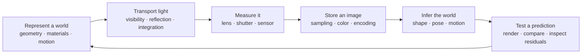
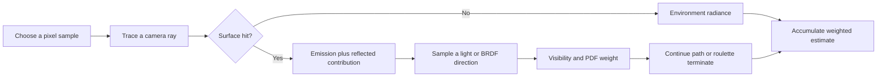
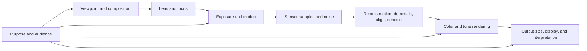
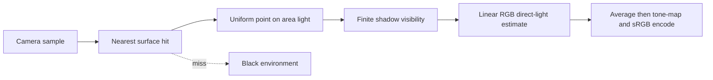

# Worlds, Images and Inference

## The question that holds the whole story together

Put a small articulated arm, a textured panel, a glass sphere, and a piece of cloth on a table. Place a camera in front of them and a lamp to one side. There are two ways to ask about this scene.

First, suppose we know the scene (3D) . Where are its surfaces? How are its joints posed? What light leaves each surface, passes through the lens, and reaches the sensor? **Computer graphics** answers this forward question: build a description of a world, then calculate an image.

Now suppose we have the image but not the complete scene description. Can we recover the panel's tilt, the arm's position, the cloth's motion, or the lamp direction? **Machine vision** answers this inverse question: use measurements in images to constrain what could have produced them.

The physical camera sits between the two questions. Its lens, aperture, shutter, sensor, and processing pipeline determine which evidence survives. Photography therefore supplies more than useful examples. It explains the measurement device that a renderer approximates and a vision algorithm relies on.

We can write the forward relationship compactly as

$$
\mathbf I=\mathcal R(\boldsymbol\theta).
$$

Here $\boldsymbol\theta$ is a collection of scene and camera parameters, $\mathcal R$ is the image-formation procedure, and $\mathbf I$ is the resulting array of image measurements. The symbol $\mathcal R$ stands for a process; it need not be a small matrix. It may contain projection, visibility decisions, numerical integration, optical blur, sampling, and nonlinear encoding.

In a reconstruction problem, we compare a predicted image with an observed image $\mathbf I_{\mathrm{obs}}$. One possible objective is

$$
\boldsymbol\theta^{\star}
=\underset{\boldsymbol\theta}{\operatorname{argmin}}
\left[
\sum_j \rho\!\left(\mathcal R(\boldsymbol\theta)_j-I_{\mathrm{obs},j}\right)
+\lambda\,\Omega(\boldsymbol\theta)
\right].
$$

The index $j$ identifies an observed sample. The function $\rho$ turns a residual, or prediction error, into a penalty. Squaring is one choice; a robust penalty grows more gently for large errors. The function $\Omega$ expresses an additional preference, such as a smooth surface, and $\lambda\geq0$ sets its influence. **Regularization** is the act of adding such a preference to make an ambiguous or unstable problem more manageable. It introduces an assumption; it does not manufacture an extra measurement.

This equation is a map of the questions we will learn to ask. Before minimizing anything, we must understand what the parameters mean, what an image measures, and which changes the measurements can actually reveal.



**Read the arrows as contracts.** Geometry supplies positions and orientations. Light transport supplies radiance. A camera converts arriving light into measurements. Image processing changes those measurements. Inference estimates hidden quantities from what remains. Many difficult bugs come from passing the right numbers under the wrong contract: using display-encoded values as linear light, a direction as a point, a pixel displacement as a world velocity, or an interpolated normal as an area vector.

## How to use this volume without losing the thread

The chapters follow problems and prerequisites, not the order in which four instructors presented overlapping topics. We build and move a scene, decide what is visible, calculate its light, understand the camera, and recover information from images. When courses explain the same operation, their explanations meet in one place. The source legend still identifies each course.

The CMU welcome suggests a useful learning loop: answer short conceptual questions, implement missing routines in a modeling, rendering, and animation package, then inspect the results. Its four Scotty3D assignments connect the math to visible output. This volume adapts that loop through worked traces and runnable labs. 

Study a new mechanism in four passes. Identify the question it answers. Draw the quantities and state the assumptions. Work through the equations and a numerical example. Then break one assumption and predict what fails. For example, [[Stereo correspondence and epipolar geometry|stereo triangulation]] is easier to remember after seeing how a one-pixel disparity error can create a large depth error for a distant object.

Symbols are defined near where they are used. A letter may mean something different in a later chapter, so use its local definition. Vectors are usually bold. A superscript $\mathsf T$ means transpose, and $\|\mathbf v\|$ is vector length unless another norm is named. A hat often marks a unit vector (length one). A subscript labels a quantity or component; it does not mean multiplication. When differentiating a scalar equation, we state which quantities stay fixed.

Three habits make the mathematics easier to teach:

- **Name the space.** A position in object coordinates, a position in camera coordinates, and a pixel coordinate describe related things with different numbers.
- **Name the measure.** A density per unit area differs from a density per unit solid angle. An average over pixel area differs from a point sample.
- **Name the ambiguity.** A single brightness value cannot generally determine both material and shape. A single image displacement cannot generally determine full three-dimensional motion.

The vault develops related math in [[Continuous Notes/06 - From Movement to Meaning - Vectors, Geometry and Reliable Code|vectors and geometry]], [[Continuous Notes/07 - From Basis Images to Moving Worlds - Matrices, Transforms and Quaternions|transforms and quaternions]], and [[Continuous Notes/08 - From Constraints to Spectra - Systems, Decompositions and Matrix Functions|linear systems and decompositions]]. Follow those links for more practice. This volume still includes the definitions and reasoning needed for its subject.

A **derivation** shows why a formula follows from its assumptions. A **trace** follows the values as an algorithm runs. A **laboratory check** tests a prediction in code or a controlled example. Each catches a different problem: a sound derivation can still be coded with the wrong coordinate convention, while one passing example can hide an unstated restriction.

The final source legend distinguishes publisher captions, locally generated transcription, corresponding official notes, supplemental materials from another course year, and sampled visual evidence. An analyzed source is counted once even when its ideas appear in several chapters. A lecture title alone never establishes that its contents were used.

> [!abstract]- Chapter map
> - [[#A scene description becomes an image|A scene description becomes an image]]
> - [[#Mathematical language: points, vectors, and derivatives|Mathematical language: points, vectors, and derivatives]]
> - [[#Coordinate frames, transformations, and pose|Coordinate frames, transformations, and pose]]
> - [[#Curves as controllable functions|Curves as controllable functions]]
> - [[#Surfaces, patches, topology, and parameterization|Surfaces, patches, topology, and parameterization]]
> - [[#Meshes, connectivity, and geometry processing|Meshes, connectivity, and geometry processing]]
> - [[#Lens optics, focus, and image formation|Lens optics, focus, and image formation]]
> - [[#Exposure, sensors, and dynamic range|Exposure, sensors, and dynamic range]]
> - [[#Cameras, projection, and calibration|Cameras, projection, and calibration]]
> - [[#Sampling continuous signals and image formation|Sampling continuous signals and image formation]]
> - [[#Image sampling, filtering, and efficient reconstruction|Image sampling, filtering, and efficient reconstruction]]
> - [[#Color perception, encoding, and display|Color perception, encoding, and display]]
> - [[#Light measurement and radiometry|Light measurement and radiometry]]
> - [[#Reflectance, BRDFs, and shading|Reflectance, BRDFs, and shading]]
> - [[#The rendering equation and light transport|The rendering equation and light transport]]
> - [[#Numerical integration and Monte Carlo estimation|Numerical integration and Monte Carlo estimation]]
> - [[#Rasterization, coverage, and depth|Rasterization, coverage, and depth]]
> - [[#Textures and surface detail|Textures and surface detail]]
> - [[#Visibility queries and ray intersections|Visibility queries and ray intersections]]
> - [[#Acceleration structures and robust queries|Acceleration structures and robust queries]]
> - [[#Scene graphs and articulated geometry|Scene graphs and articulated geometry]]
> - [[#Animation curves and motion paths|Animation curves and motion paths]]
> - [[#Dynamics, forces, and numerical integration|Dynamics, forces, and numerical integration]]
> - [[#Optimization, constraints, and inverse kinematics|Optimization, constraints, and inverse kinematics]]
> - [[#PDEs, fields, and discrete solvers|PDEs, fields, and discrete solvers]]
> - [[#Optical flow and motion from images|Optical flow and motion from images]]
> - [[#Edges, contours, and subpixel localization|Edges, contours, and subpixel localization]]
> - [[#Recognition, templates, and industrial matching|Recognition, templates, and industrial matching]]
> - [[#Pose estimation, transforms, and robust fitting|Pose estimation, transforms, and robust fitting]]
> - [[#Stereo, relative orientation, and reconstruction|Stereo, relative orientation, and reconstruction]]
> - [[#Surface orientation from illumination|Surface orientation from illumination]]
> - [[#Shape from shading and reflectance|Shape from shading and reflectance]]
> - [[#Surface descriptions and Gaussian images|Surface descriptions and Gaussian images]]
> - [[#Photographic composition, history, and communication|Photographic composition, history, and communication]]
> - [[#Photographic workflow and integrated decisions|Photographic workflow and integrated decisions]]

## A scene description becomes an image

Treat graphics as a sequence of representations: a scene description must supply the right quantities to the image formation and sampling stages that follow.

### Graphics is a chain of representations

Two broad methods decide which scene elements contribute to a pixel. **Rasterization** starts with each primitive and finds the image samples it covers. Triangles work well on parallel graphics processors, so rasterization is useful for interactive rendering. **Ray tracing** starts with an image sample and asks which surfaces a ray hits. It describes visibility and light bouncing between surfaces directly, which helps formulate global illumination. Modern renderers combine the methods. Their central queries run in opposite directions: primitive to pixel, or pixel to scene. [[#CMU-01 - Course Overview|CMU-01]] · [[#CMU-04 - Drawing a Triangle and an Intro to Sampling|CMU-04]] · [[#CMU-08 - Depth and Transparency|CMU-08]] · [[#CMU-12 - Geometric Queries|CMU-12]]

An image pixel is not inherently the color of a mathematical point. It summarizes light from a small region of the image plane. A renderer approximates that summary by sampling coverage, texture, and illumination. This observation connects triangle antialiasing, texture filtering, and Monte Carlo rendering: all are attempts to estimate an integral from a finite set of measurements.

### Algorithmic scope and debugging the image pipeline

The first lecture treats graphics as the math and algorithms behind images, not as a tour of drawing software. Its examples introduce a shared toolkit: functions describe shape, transforms set pose, time-stepping rules evolve state, and sampling converts continuous pictures into pixels. Rasterization and ray-based rendering handle visibility in opposite directions, from primitive to pixel and from pixel to scene. A renderer can combine both. [[#MITG-01 - Introduction|MITG-01]] · [[#MITG-09 - Ray casting|MITG-09]] · [[#MITG-17 - Rasterization|MITG-17]] (00:19:00–00:45:00; 00:10:00–00:25:00; 00:10:00–00:30:00)

When an image looks wrong, find the first representation that went wrong. Is the shape incorrect? Did transforms compose in the wrong order? Did the simulation become unstable or the ray hit the wrong surface? Was the lighting approximation poor? Did a high-frequency signal alias, or did the system read linear intensity as a display code? These questions make debugging more useful than treating the final pixel as a mystery.

### The first lecture's scope: algorithms behind pictures

The recording opens with course setup, then maps out what “graphics” includes. Solomon contrasts a film frame that may take hours to simulate and render with an interactive game that must meet a budget of roughly 30 frames per second. This is an algorithmic constraint. A film renderer can spend more time on simulation, sampling, or lighting because it computes frames in advance. An interactive renderer must choose approximations before each frame's deadline. It may improve motion, lighting, or resolution, but usually cannot maximize all three at once. [[#MITG-01 - Introduction|MITG-01]] (00:17:29–00:18:23)

The examples extend beyond entertainment. A computer-aided manufacturing model describes a shape before it is built. Ray calculations can answer architectural questions about light and heat. Medical scans become 3D data that people can rotate or slice. Augmented reality combines a camera view with a virtual object, linking rendering to scene understanding. Scientific visualization presents fluid or structural simulations for engineering analysis. These applications share a task: represent, transform, analyze, and present visual information. [[#MITG-01 - Introduction|MITG-01]] (00:18:41–00:21:12; 00:22:22–00:25:32)

The course focuses on algorithms, representations, and the software and hardware that turn a scene into pixels. It does not teach drawing technique or tour design applications. “Graphics pipeline” is a teaching map: describe shapes, set their pose and motion, specify materials and light, then render. Real systems do not all follow one fixed sequence. The lecturer notes that a renderer can combine ray tracing and rasterization, giving each method different work. [[#MITG-01 - Introduction|MITG-01]] (00:25:35–00:29:32; 00:33:06–00:37:02)

The tractor composite in the first lecture raises a useful question: what information is needed to make its image? At minimum, describe the vehicle, character, and background; specify a camera view and surface appearance; and decide which scene elements contribute to each pixel. Artists may describe a shape as a curve, patch, or rig. The computer may use triangles and samples instead. **Tessellation** bridges these forms by approximating a high-level curve or surface with simpler primitives. Later steps also convert between forms: material settings become light-response calculations, 3D objects become image samples, and encoded pixel values become light from a display. The recurring challenge is to make each conversion useful, efficient, and visually adequate. [[#MITG-01 - Introduction|MITG-01]] (00:33:20–00:36:55)

### Learning path and conventions

Coordinates use a pinhole camera with image plane at focal length $f$. Capital letters such as $X,Y,Z$ denote a 3-D point in camera coordinates; lowercase $x,y$ denote its image coordinates. A dot denotes differentiation with respect to time. Surface height is $z(x,y)$ and its slopes are $p=\partial z/\partial x$ and $q=\partial z/\partial y$. Image brightness is $E(x,y,t)$. Vectors are bold only where ambiguity requires it; a hat denotes a unit vector. A matrix transpose is written $^T$. In every derivation, units and coordinate conventions matter: the notes sometimes choose the image plane at $f$ and sometimes discuss normalized image coordinates, so a scale factor $f$ must not be silently dropped.

### What an image can and cannot tell us

A useful way to reason about any inverse problem is to write $\mathbf{y}=F(\mathbf{x})$, where $\mathbf{x}$ is the unknown parameter vector and $\mathbf{y}$ is what the sensor measures. Near a candidate solution $\mathbf{x}_0$, a small error propagates approximately as $\delta\mathbf{y}=J\delta\mathbf{x}$, where $J$ is the Jacobian of $F$. If some direction in parameter space changes the measurements very little, recovering that direction amplifies noise. If $J$ is rank deficient, some combinations cannot be recovered at all. A solvable equation is therefore not necessarily a stable measurement procedure.

### Lecture 1’s demonstrations: vision is judged by the task it enables

The opening lecture supplies the through-line that the notes’ later derivations formalize. Horn begins with the perceptual puzzle that a flat printed face still suggests three-dimensional shape. A uniform material can look darker where its surface turns away from a nearby light and brighter where it faces the light. In the nose example, that shading conveys slope, yet there are two slope variables and only one brightness observation. A sequence of algorithm iterations on an oblate ellipsoid makes the global issue visible: intermediate reconstructions develop ridges and isolated conical points before moving toward the intended shape. The point is not that one image uniquely determines a surface; it is that the reconstruction process must expose what assumptions and additional constraints make its answer plausible. [[#MITV-01 - Introduction to Machine Vision|MITV-01]] (video 00:22:32–00:25:10)

The course overview then closes the loop between image evidence and action. A machine-vision system receives a scene under illumination, forms an image, estimates a description, and may use that description to act in the world. A robot grasp is a particularly clear acceptance check: if the estimated object identity and pose cause the gripper to approach correctly, that is stronger feedback than an unverified label. In one demonstrated work cell, one camera supplies object identity and orientation while an interrupted beam gives the missing depth cue; the robot then backs off, reorients, and grasps. A surveyor-style crosshair carried by the robot provides a sharply localizable point for estimating the transformation between the camera’s coordinates and the robot base. This connects the introductory application to later exterior orientation and calibration. [[#MITV-01 - Introduction to Machine Vision|MITV-01]] (video 00:25:11–00:26:40, 00:44:56–00:46:14)

The truck-approach demonstrations make the time-to-contact idea concrete. As the vehicle approaches, the image expands; a plotted computed time-to-contact tracks the known value. The vehicle approaches the truck door rather than the center, so its focus of expansion is off-center and reveals oblique travel. In a second time-lapse, manually moving the camera in nominal 10 mm increments introduces more measurement noise. These examples highlight both a useful invariance—ratio-based TTC does not require focal length in this setup—and practical sensitivity to camera motion and measurement accuracy. Horn also shows an analog chip calculating FOE nearly instantaneously and recounts cooling an overheating prototype with an ice-filled cooler and aquarium pump. This makes clear that computational constraints and physical implementation shape the algorithm, not just abstract mathematics. [[#MITV-01 - Introduction to Machine Vision|MITV-01]] (video 00:26:42–00:32:46)

A camera obscura in Santa Monica serves as an intuitive pinhole-camera model: light passes through a small opening into a dark room and projects an inverted scene on the opposite wall. The brightness discussion warns against treating pixel values as direct reflectance. The Moon looks bright without a nearby white reference even though the lecture says it reflects about 11 percent of incoming sunlight; apparent brightness depends on context. Similarly, inverse-square falloff for a point source does not mean that a uniformly lit extended wall looks one-quarter as bright from twice the distance: each pixel then represents a larger wall area, offsetting the per-source falloff. Foreshortening changes illumination per unit surface area by the cosine of the incident angle, but reflectance can be more complex.

 For an ideal thin lens with focal length $f$, pupil diameter $D$, and scene radiance $L$ at field angle $\alpha$, sensor-plane irradiance is $E_{\mathrm{img}}=(\pi/4)L(D/f)^2\cos^4\alpha$ under fixed-pupil geometric-optics assumptions. The fourth power combines projection and distance factors; this is image-plane irradiance, not the irradiance on the surface. The normal’s two degrees of freedom versus one brightness measurement motivates photometric stereo and the course’s recurring constraint-counting argument. [[#MITV-01 - Introduction to Machine Vision|MITV-01]] (video 00:51:15–00:52:27, 01:05:34–01:13:48)

### A photograph is a model of a view

The course opens by distinguishing viewpoint from focal length. Perspective comes from where the camera is located. For a pinhole model, a 3D point $(X,Y,Z)$ projects to image coordinates proportional to

$$
x=f\frac{X}{Z},\qquad y=f\frac{Y}{Z},
$$

## Mathematical language: points, vectors, and derivatives

Build a precise mathematical vocabulary before composing transformations or interpreting numerical results.

### Points, vectors, bases, and linear maps

A **point** names a location. A **vector** describes displacement, direction, or a magnitude-bearing quantity. Subtracting point $p$ from point $q$ gives a displacement $q-p$. Adding vector $v$ to point $p$ gives another point $p+v$. Vectors can be added and scaled freely; scaling a point depends on the coordinate origin. This distinction becomes crucial when a transform should move locations but preserve directions. [[#CMU-02 - Linear Algebra (P)Review|CMU-02]]

A **vector space** is a collection of vectors where addition and scalar multiplication stay within the collection. A **basis** is a set of independent vectors that can express every vector in the space. If the basis vectors are $b_1,\ldots,b_n$, then a vector $v$ can be written as $v=\sum_i c_i b_i$. The coefficients $c_i$ give its coordinates. Change the basis and the coordinates change, even though the geometric vector stays the same. [[#CMU-02 - Linear Algebra (P)Review|CMU-02]]

A linear map $A$ preserves addition and scalar multiplication. Its matrix columns are the images of the basis vectors. Therefore, if $v=\sum_i c_i b_i$, then

$$
Av=A\left(\sum_i c_i b_i\right)=\sum_i c_iA(b_i).
$$

This gives a practical way to read matrix-vector multiplication: transform each basis direction, then combine those results using the original coefficients. The matrix columns show those transformed directions. Matrix products compose maps; with column vectors, the rightmost map acts first. A map is **invertible** if it can be undone. If its columns are linearly dependent, distinct inputs can collapse to the same output. [[#CMU-02 - Linear Algebra (P)Review|CMU-02]]

The determinant of a square matrix measures signed area or volume scaling. Its absolute value gives the scale; a negative sign means orientation reverses. A zero determinant means at least one dimension collapses, so the map has no inverse. An **eigenvector** is a direction that a map scales without turning: $Av=\lambda v$, where $\lambda$ is the scale. Singular-value decomposition gives a more general description:

$$
A=U\Sigma V^T.
$$

The orthogonal matrix $V^T$ rotates or reflects inputs into principal directions. The diagonal matrix $\Sigma$ scales those directions, and orthogonal $U$ maps them into output coordinates. The diagonal values are the **singular values**. This factorization describes stretching and rank loss, and supports least-squares solutions and data transformations. [[#CMU-02 - Linear Algebra (P)Review|CMU-02]] · [[#CMU-05 - Spatial Transformations|CMU-05]]

### Inner products and vector calculus

The Euclidean norm gives vector length: $\|v\|=\sqrt{v\cdot v}$. The dot product $u\cdot v=\sum_i u_iv_i$ measures alignment. For unit vectors it equals the cosine of their angle. In 3D, the cross product $u\times v$ is perpendicular to both inputs. Its length equals the area of their parallelogram, and its direction follows the right-hand rule. These operations support angle tests, projections, surface normals, and lighting. [[#CMU-03 - Vector Calculus (P)Review|CMU-03]]

A derivative gives a local linear approximation. If $f$ maps vectors to vectors, its derivative at $x$ is the **Jacobian matrix** $J_f(x)$. For a small input change,

$$
f(x+\Delta x)\approx f(x)+J_f(x)\Delta x.
$$

For a scalar field $f$, the **gradient** $\nabla f$ collects its partial derivatives. It points in the direction of steepest increase. The change along a unit direction $u$ is $\nabla f\cdot u$. For example, if $f(x,y)=x^2+3y^2$, then its gradient is $(2x,6y)$. At $(1,1)$ the gradient is $(2,6)$. A perpendicular move has zero first-order change. Gradients drive methods such as gradient descent and help find normals to level sets. [[#CMU-03 - Vector Calculus (P)Review|CMU-03]] · [[#CMU-22 - Optimization|CMU-22]]

A **vector field** assigns a vector to each point. Its divergence $\nabla\cdot v$ measures net local outflow. For $v(x,y,z)=(x,y,z)$, divergence is 3: the field expands uniformly. **Curl** measures local circulation. For $v(x,y,z)=(-y,x,0)$, it points along the $z$ axis. The **Laplacian** $\Delta f=\nabla\cdot\nabla f$ compares a function's value with nearby values. A bowl such as $x^2+y^2$ has positive Laplacian; a local peak usually has a negative one. A saddle may have zero Laplacian even though it curves in opposite directions. The Hessian, the matrix of second derivatives, retains more information than the Laplacian's sum. These operators appear in smoothing, curvature, fluid flow, diffusion, and physical animation. [[#CMU-03 - Vector Calculus (P)Review|CMU-03]] · [[#CMU-11 - Digital Geometry Processing|CMU-11]] · [[#CMU-23 - Physically Based Animation and PDEs|CMU-23]]

### Coordinate-free products and the meaning of second derivatives

A gradient depends on the inner product used to measure directions. With the ordinary dot product, $\nabla f$ is defined so that the directional derivative along $u$ is $Df[u]=\nabla f\cdot u$. The same idea works for functions: replace finite vectors with functions and the dot product with an integral. With the $L^2$ inner product $\langle f,g\rangle=\int f(x)g(x)\,dx$, the gradient of $\langle f,g\rangle$ with respect to $f$ is $g$. A small change $h$ to $f$ changes the objective by $\langle h,g\rangle$. Likewise, the gradient of $\|f\|^2=\langle f,f\rangle$ is $2f$, since its first-order change is $2\langle f,h\rangle$. This matches $\nabla_x(x^Tx)=2x$. Function-space gradients let optimization act on images, curves, and fields, not only on lists of numbers. [[#CMU-03 - Vector Calculus (P)Review|CMU-03]] · [[#CMU-22 - Optimization|CMU-22]]

In two dimensions, scalar curl is closely related to the divergence of a field rotated by 90 degrees. Fluid solvers use this relation to switch between velocity and stream-function descriptions and to measure vorticity. For a scalar field $f$, the Laplacian $\Delta f=\nabla\cdot\nabla f$ is the divergence of its gradient. In Cartesian coordinates, it is the sum of second partial derivatives. It is usually negative at a peak and positive at a valley. For $f(x,y)=\cos(3x)+\sin(3y)$, differentiating twice in each coordinate gives $\Delta f=-9\cos(3x)-9\sin(3y)=-9f$. The Laplacian scales this sinusoidal pattern without changing its shape. The same operator appears in smoothing, heat diffusion, waves, mesh fairing, and image processing. [[#CMU-03 - Vector Calculus (P)Review|CMU-03]] · [[#CMU-11 - Digital Geometry Processing|CMU-11]] · [[#CMU-23 - Physically Based Animation and PDEs|CMU-23]]

### A compact glossary of recurring terms

| Term | Meaning in this course context |
| --- | --- |
| Basis | Independent vectors used to express coordinates in a space. |
| Jacobian | Matrix of first derivatives that locally maps input changes to output changes. |
| Hessian | Matrix of second derivatives that describes curvature of a scalar objective. |
| Barycentric coordinates | Nonnegative triangle weights summing to one that locate a point relative to the vertices. |
| Manifold | Space that locally resembles ordinary Euclidean space. |
| Halfedge | Directed mesh edge paired with its opposite, used for neighborhood traversal. |
| Radiance | Light power per projected area per solid angle, carried along a ray. |
| Irradiance | Incoming light power per surface area. |
| BRDF | Directional ratio describing how incoming light is reflected toward an outgoing direction. |
| PDF | Probability density function; probability per unit measure, not probability at an exact continuous point. |
| Bias | Difference between an estimator’s expectation and its target. |
| Variance | Expected squared spread of an estimator around its expectation. |
| Consistency | Convergence to the target as sample count or resolution increases. |
| Stability | Property that numerical errors do not grow uncontrollably under repeated updates. |
| Boundary condition | Constraint specifying a field’s value or flux at a domain edge. |

These terms recur across subfields. A Jacobian can transform texture footprints, describe a camera projection locally, or map joint-angle changes to hand movement. A PDF can describe a hemisphere direction, a light sample, or a discrete alias-table choice. A mesh Laplacian can smooth geometry or discretize heat diffusion. The vocabulary is shared because the computational structures are shared. [[#CMU-02 - Linear Algebra (P)Review|CMU-02]] · [[#CMU-03 - Vector Calculus (P)Review|CMU-03]] · [[#CMU-07 - Perspective Projection and Texture Mapping|CMU-07]] · [[#CMU-11 - Digital Geometry Processing|CMU-11]] · [[#CMU-18 - Monte Carlo Rendering|CMU-18]] · [[#CMU-22 - Optimization|CMU-22]] · [[#CMU-23 - Physically Based Animation and PDEs|CMU-23]]

### Additional geometric and rendering mechanisms from the graphics course

#### Points and vectors obey different operations

A vector space is a set closed under two operations: add two members and get another member, or multiply a member by a scalar and remain in the set. Usual vector laws (commutativity, associativity, distributivity, and so on) make those operations behave consistently. In graphics, vectors commonly represent directions and displacements. Points represent locations. Although both may be stored as triples, they are not interchangeable geometric objects.

The permitted point operations express this distinction:

- Point plus vector gives a point: $Q=P+v$.
- Point minus point gives a vector: $v=Q-P$.
- A point can be formed as an affine combination of points, provided the weights sum to one.

The sum-to-one condition keeps the result independent of an arbitrary choice of origin. If every point is shifted by the same vector $d$, then $\sum_i\alpha_i(P_i+d)=\sum_i\alpha_iP_i+d\sum_i\alpha_i=\sum_i\alpha_iP_i+d$. When $\sum_i\alpha_i=1$, the combination shifts exactly with the geometry. (P3-01)

For two points, $P(t)=(1-t)P_0+tP_1$ has weights that sum to one. At $t=0$ it is $P_0$; at $t=1$ it is $P_1$; at $t=1/2$ it is their midpoint. Rewriting it as $P_0+t(P_1-P_0)$ exposes the vector: $P_1-P_0$ is the displacement from the start point, and $t$ scales that displacement. Both forms trace the same line segment for $0\leq t\leq1$. Values outside that interval extend along the line beyond the segment. (P3-01)

## Coordinate frames, transformations, and pose

Coordinates make geometry computable; the choice of frame and transformation determines what stays invariant.

### Coordinate frames and affine transforms

Graphics uses coordinate frames for objects, worlds, cameras, clips, and screens. A coordinate conversion changes the description, not necessarily the point. Translation is not linear because it moves the origin. Homogeneous coordinates represent a point $(x,y,z)$ as $(x,y,z,1)^T$ and a direction $(v_x,v_y,v_z)$ as $(v_x,v_y,v_z,0)^T$. The last coordinate makes translation affect points but not directions. In two dimensions, translation by $(t_x,t_y)$ is represented by

$$
\begin{bmatrix}1&0&t_x\\0&1&t_y\\0&0&1\end{bmatrix}
\begin{bmatrix}x\\y\\1\end{bmatrix}
=\begin{bmatrix}x+t_x\\y+t_y\\1\end{bmatrix}.
$$

Rotation, reflection, scaling, and shear are linear maps; translation combined with them is affine. A rotation around a pivot $c$ is $T(c)RT(-c)$: shift the pivot to the origin, rotate, then shift back. Applying this transform to $c$ verifies that the pivot remains fixed. Transform order matters. Starting from $(1,0)$, translate by $(2,0)$ then rotate by a quarter-turn to obtain $(0,3)$; rotate first then translate to obtain $(2,1)$. The results differ because matrix multiplication is not commutative. [[#CMU-05 - Spatial Transformations|CMU-05]]

A **scene graph** stores transforms in a hierarchy. Multiply the transforms from the root to a child to get its world transform. **Instancing** reuses one geometry with different transforms, as when a scene contains many copies of one tree. For animation, it can be more sensible to separate rotation and scale than to blend every matrix entry. Singular-value decomposition provides one factorization. **Linear blend skinning** deforms vertices using weighted bone transforms; the result depends on the weights and how rotations are interpolated. [[#CMU-05 - Spatial Transformations|CMU-05]]

### What different transforms preserve

Rigid transforms preserve distances and angles. Their linear parts are orthogonal matrices $R$ satisfying $R^TR=I$. Rotations have determinant 1; reflections have determinant -1. Similarities combine rigid motion with uniform scaling, preserving angles and shape up to size. General affine maps preserve parallel lines and ratios along a line but can change angles, lengths, and area. Projective maps preserve straight lines but not parallelism; parallel lines can meet at a vanishing point.

These properties help choose a representation. To animate a rigid object, keep its rotation separate from translation. For a nonuniformly scaled object, blending matrix entries directly can introduce shear or shrinkage. **Polar decomposition** separates a matrix into an orthogonal part and a symmetric stretch. Interpolating those parts separately preserves a clearer rotation-and-scale meaning. SVD also separates the input and output axes around a diagonal stretch. [[#CMU-05 - Spatial Transformations|CMU-05]]

### Rotation representations compared

For 2D, a complex number $z=x+iy$ represents a point in the plane. Multiplication by $e^{i\theta}=\cos\theta+i\sin\theta$ gives

$$
(x+iy)(\cos\theta+i\sin\theta)=(x\cos\theta-y\sin\theta)+i(x\sin\theta+y\cos\theta),
$$

which is exactly the 2D rotation matrix. This is why complex multiplication combines rotation and scale so compactly: magnitude scales and argument rotates.

In 3D, quaternions extend this idea. Write $q=(w,\mathbf v)$ with scalar $w$ and vector $\mathbf v$. The product is

$$
(w_1,\mathbf v_1)(w_2,\mathbf v_2)=
(w_1w_2-\mathbf v_1\cdot\mathbf v_2,\;w_1\mathbf v_2+w_2\mathbf v_1+\mathbf v_1\times\mathbf v_2).
$$

This formula combines dot and cross products. A unit quaternion maps vector $x$ to $q(0,x)q^{-1}$. Axis-angle rotation uses a half-angle because the quaternion acts on both sides. Spherical interpolation follows the shortest arc; if $q_0\cdot q_1<0$, negate one endpoint before interpolating. Componentwise linear blending can leave the unit sphere, so normalize afterward or use spherical interpolation. [[#CMU-06 - 3D Rotations and Complex Representations|CMU-06]]

### Coordinates make composition possible

A point has a location; a vector has a direction and magnitude. Translation changes a point's location, but it does not change a free direction vector. Treating both as the same three-number tuple is a common source of bugs. Homogeneous coordinates encode both in four coordinates: a point is $(x,y,z,1)$, while a direction is $(x,y,z,0)$. Then translation becomes matrix multiplication without incorrectly translating directions. A homogeneous point with $w\ne 1$ is converted back by dividing $(x,y,z)$ by $w$, the dehomogenization step. The transformations lecture calls attention to the difference between points and vectors and walks through homogeneous coordinates and dehomogenization [[#MITG-04 - Transformations|MITG-04]] (00:05:00–00:20:00; 01:00:00–01:10:00).

Keep the rules of an **affine space** explicit. If $p$ and $q$ are points, subtracting them gives a vector $p-q$. Adding a vector $v$ to a point gives another point, $p+v$. A weighted average such as $(1-\alpha)p+\alpha q$ is also a point. But adding two locations has no coordinate-independent meaning. A coordinate frame assigns numbers to an origin and basis directions; changing the frame changes those numbers, not the point. This lets a scene describe a model in its own coordinates and map it into a room, world, or camera frame. The Fall 2021 lecture distinguishes vectors, basis coordinates, points, and affine frames before introducing matrix notation [[#MITG-04 - Transformations|MITG-04]] (00:06:02–00:17:50; 00:39:08–00:43:20).

In ordinary Cartesian coordinates, a point and a direction may both be written with three components, but the homogeneous fourth component records their different behavior. A direction $(v_x,v_y,v_z)$ becomes $(v_x,v_y,v_z,0)$; a point $(x,y,z)$ becomes $(x,y,z,1)$. Then an affine transform

$$
\begin{bmatrix}A&t\\0&1\end{bmatrix}
\begin{bmatrix}v\\0\end{bmatrix}
=
\begin{bmatrix}Av\\0\end{bmatrix},
\qquad
\begin{bmatrix}A&t\\0&1\end{bmatrix}
\begin{bmatrix}p\\1\end{bmatrix}
=
\begin{bmatrix}Ap+t\\1\end{bmatrix}
$$

automatically applies translation $t$ only to points. A numeric check makes the distinction concrete: translating by $(3,0,0)$ sends point $(1,2,0)$ to $(4,2,0)$, but leaves direction $(1,2,0)$ unchanged. If a direction accidentally receives translation, line directions, normals, or velocities can shift as if they were anchored locations.

For column vectors, an affine transformation can be written

$$
\begin{bmatrix}x'\\y'\\z'\\1\end{bmatrix}=
\begin{bmatrix}A&t\\0&1\end{bmatrix}
\begin{bmatrix}x\\y\\z\\1\end{bmatrix},
$$

where $A$ holds linear effects such as rotation, scale, and shear, and $t$ is translation. Composition is matrix multiplication. If a model point must be scaled, then rotated, then translated, the combined transform is $TRS$ for column-vector convention. The rightmost matrix acts first. Reversing the order changes the result because matrix multiplication is not commutative. For a simple 2D witness, scale $(1,1)$ by two to get $(2,2)$, then translate by $(3,0)$ to get $(5,2)$. If the translation is applied first and then doubled, the result is $(8,2)$. Both are valid chains; they mean different things.

Check the convention with a point instead of memorizing it. With column vectors, let $S=\operatorname{diag}(2,2,1)$ and let $T$ translate by $(3,0,0)$. Then $TS(1,1,0,1)^T=(5,2,0,1)^T$, while $ST(1,1,0,1)^T=(8,2,0,1)^T$. In the first case, scale around the model's local origin, then place it. In the second, translate first, then scale the displacement from the world origin too. In code, write the intended order beside the point: “world translation × object rotation × local point.” This helps catch row/column mismatches and reversed order.

Normals require an extra rule. A tangent vector transforms by $A$, but a normal must remain perpendicular to transformed tangents. If $n\cdot v=0$ and $v'=Av$, we need $n'\cdot v'=0$. Since $n'\cdot Av=(A^Tn')\cdot v$, choosing $A^Tn'=n$ gives $n'=A^{-T}n$. Normalize the result if a unit normal is needed for lighting. For a simple counterexample to using $An$, let $A=\operatorname{diag}(2,1)$, tangent $v=(1,1)$, and normal $n=(1,-1)$. Their original dot product is zero. The transformed tangent is $(2,1)$; the wrong normal $An=(2,-1)$ has dot product $3$, while $A^{-T}n=(1/2,-1)$ has dot product zero. Under uniform scale and rotation, the distinction is less visible; under nonuniform scale or shear it is essential. The 2021 transformation lecture discusses normal transformation and flags the inverse-transpose requirement in its surrounding transform topics [[#MITG-04 - Transformations|MITG-04]] (00:15:00–00:25:00; 01:05:00–01:15:00). The 2012 OCW lecture 03 provides supplemental diagrams and examples on point/vector transformations and normal handling (pp. 15–23, 28–36).

### Figure U1 - Linear maps separate directions stretches and output placement

![[Visual Recall/phase8_svd_geometry.png]]

**Read the figure.** The same input vectors pass through a coordinate change, independent stretches, and output placement. The colored points keep their identities. Read the axis labels: each panel has equal horizontal/vertical scale, while different panels use different ranges. The illustrated map has singular values four and two; rotation factors alone preserve length.

### Matrix composition as a worked graphics pipeline

#### Matrix transforms build reusable models

Model-space coordinates describe one object's own convenient frame. World-space coordinates place many reusable models into a common scene. A soldier model can be translated to a location, rotated to face a direction, and scaled to match its intended size; repeating this operation creates a battlefield from one reusable asset. Transformations therefore separate asset construction from scene placement. (P1-22–26)

For a 2D point p=(x,y), translation by (a,b) gives (x+a,y+b). Scaling by (s_x,s_y) gives (s_x x,s_y y). Rotation by angle θ about the origin gives (x cosθ − y sinθ, x sinθ + y cosθ). At θ=90° counterclockwise, (2,1) becomes (−1,2). A rotation about a center c is performed by translating c to the origin, rotating, then translating back. Order matters: translating then rotating generally differs from rotating then translating. For example, rotate (1,0) by 90° to (0,1), then translate by (2,0) to (2,1); translate first to (3,0), then rotate to (0,3). (P1-22–26)

Homogeneous coordinates encode translation with matrices. Represent (x,y) as column vector (x,y,1). Then

$$
T(a,b)=\begin{bmatrix}1&0&a\\0&1&b\\0&0&1\end{bmatrix},\quad
S(s_x,s_y)=\begin{bmatrix}s_x&0&0\\0&s_y&0\\0&0&1\end{bmatrix},\quad
R(\theta)=\begin{bmatrix}\cos\theta&-\sin\theta&0\\\sin\theta&\cos\theta&0\\0&0&1\end{bmatrix}.
$$

With column vectors, applying A and then B means p' = BAp. The rightmost matrix acts first. This convention should be stated because row-vector conventions reverse the written product order. In 3D, use (x,y,z,1) and 4×4 matrices; translation occupies the last column under the column-vector convention. Rotation, scaling, shear, and reflection extend to 3D, with axis and handedness conventions made explicit. (P1-22–26)

#### Why homogeneous coordinates are useful

A 2×2 matrix can scale or rotate a point because each output coordinate is a weighted sum of the input coordinates. It cannot add the same fixed offset to every point: $ax+by$ always depends on $x$ and $y$. Add a constant coordinate $w=1$ and represent the point as $(x,y,1)^T$. Now the last matrix column contributes constants: the first two rows can produce $x+t_x$ and $y+t_y$, while the final row keeps $w=1$. For example, translating $(2,-1)$ by $(3,2)$ is

$$
\begin{bmatrix}1&0&3\\0&1&2\\0&0&1\end{bmatrix}
\begin{bmatrix}2\\-1\\1\end{bmatrix}
=
\begin{bmatrix}5\\1\\1\end{bmatrix}.
$$

The added coordinate is a calculation device; this affine translation does not change the point's displayed dimension. It also gives translation, scale, and rotation the same 3×3 shape, so they can be multiplied into one matrix. In 3D the same argument uses $(x,y,z,1)^T$ and 4×4 matrices. (P1-22–23)

Uniform scale multiplies both axes by one factor and preserves shape and aspect ratio. Nonuniform scale uses different factors, such as $(2,0.5)$, making an object twice as wide and half as tall. This changes shape. Scaling about the origin also moves points relative to the origin; scaling around a chosen center requires moving the center to the origin first, scaling, and moving it back. (P1-22–23)

#### Rotation from a circle and angle addition

For a point at radius $r$ and angle $\alpha$ from the positive x axis, $x=r\cos\alpha$ and $y=r\sin\alpha$. Rotating counterclockwise by $\theta$ changes the angle to $\alpha+\theta$, so $x'=r\cos(\alpha+\theta)$ and $y'=r\sin(\alpha+\theta)$. Expanding with the angle-addition identities and substituting $r\cos\alpha=x$ and $r\sin\alpha=y$ yields

$$
x'=x\cos\theta-y\sin\theta,\qquad y'=x\sin\theta+y\cos\theta.
$$

That pair of equations is the rotation matrix acting on a column vector. For a quarter-turn, $\cos90^\circ=0$ and $\sin90^\circ=1$, so $(2,1)$ becomes $(-1,2)$. Positive angles are counterclockwise in the lecture's stated OpenGL/right-hand convention; use a negative angle for clockwise motion. In 3D, choose the rotation axis explicitly. Rotation about x leaves x fixed and rotates the yz-plane; about y, it leaves y fixed and rotates xz; about z, it leaves z fixed and rotates xy. The lecture contrasts this right-hand convention with the left-hand convention it attributes to Direct3D. (P1-22–23)

#### Shear, reflection, and affine structure

A shear parallel to x maps $(x,y)$ to $(x+ay,y)$: the horizontal displacement depends on height, while y stays fixed. A shear parallel to y maps $(x,y)$ to $(x,y+bx)$. It slants a shape but keeps straight lines straight and parallel lines parallel. These are affine transformations. The P1-22 speaker momentarily calls shear non-affine, then explicitly corrects that statement; use the corrected classification. Reflection across the x axis changes $(x,y)$ to $(x,-y)$; reflection across y changes it to $(-x,y)$. Reflection across the diagonal $y=x$ swaps the coordinates. In 3D, reflecting across the xy plane negates z; across xz it negates y; across yz it negates x. The coordinate sign that changes is the one normal to the mirror plane. (P1-22–23)

#### Composing operations: order and a numerical trace

With column vectors, the rightmost matrix acts first. Thus $M=TRS$ means scale, then rotate, then translate. Matrix multiplication is associative, so $(TR)S=T(RS)$, but it is not generally commutative: $TR$ and $RT$ usually move a point to different places. This matters because a model's intended placement depends on operation order. A rotation around a model's own center can be made by translating that center to the origin, rotating, then translating back. (P1-23)

Work the lecture's stated triangle example with $S_x=2$, $S_y=1$, a $45^\circ$ counterclockwise rotation, and translation $(3,2)$. For the sample vertex $(1,0,1)^T$, scaling gives $(2,0,1)^T$. Rotation then gives $(\sqrt2,\sqrt2,1)^T$. Translation gives $(3+\sqrt2,2+\sqrt2,1)^T$, approximately $(4.4142,3.4142,1)^T$. The combined matrix is

$$
TRS=\begin{bmatrix}1&0&3\\0&1&2\\0&0&1\end{bmatrix}
\begin{bmatrix}\frac{\sqrt2}{2}&-\frac{\sqrt2}{2}&0\\\frac{\sqrt2}{2}&\frac{\sqrt2}{2}&0\\0&0&1\end{bmatrix}
\begin{bmatrix}2&0&0\\0&1&0\\0&0&1\end{bmatrix}
=\begin{bmatrix}\sqrt2&-\frac{\sqrt2}{2}&3\\\sqrt2&\frac{\sqrt2}{2}&2\\0&0&1\end{bmatrix}.
$$

Multiplying this by the homogeneous sample point reproduces the trace. The transcript's spoken final coordinates appear inconsistent with its declared point and transforms; the arithmetic above is recalculated from those declared inputs, rather than copying the spoken numerical result. It also demonstrates why numerical examples should be checked against their stated operations. (P1-23)

#### From one point to a hierarchy of objects

A model matrix applies the same transform to every vertex in an object's mesh; hundreds or millions of points move together and appear as one translated, rotated, or scaled object. In a hierarchy, child transforms are relative to a parent. For a tank, the body can be placed in the world, then the turret positioned relative to the body and rotated around its own pivot. The turret can turn while the body remains still. This differs from rotating both parts around the world origin. The same idea applies to limbs attached to a torso or wheels attached to a vehicle. (P1-23)

P1-22–23 introduce transforms through the course's legacy PyOpenGL/immediate-mode setting and NumPy matrix arithmetic; they do not teach modern shader-side model matrices. Keep that implementation context separate from contemporary OpenGL core-profile practice. The transform mathematics generalizes, but the API calls and programmable pipeline do not. (P1-22–23)

### Additional geometry notes for coordinate frames

These lecture examples are integrated by topic. The 2009 interface material below is explicitly historical; it is not a modern OpenGL core recipe.

#### A fixed matrix separates parameter, basis, and geometry

Expand the cubic formula by powers of $t$:

$$
C(t)=(1-3t+3t^2-t^3)P_0+(3t-6t^2+3t^3)P_1+(3t^2-3t^3)P_2+t^3P_3.
$$

For 2D or 3D points stored as rows in a $4\times d$ matrix $G$, the same computation is

$$
C(t)=\begin{bmatrix}1&t&t^2&t^3\end{bmatrix}
\begin{bmatrix}1&0&0&0\\-3&3&0&0\\3&-6&3&0\\-1&3&-3&1\end{bmatrix}G.
$$

The first row depends on $t$; the middle matrix is fixed; $G$ holds the four control points. This factorization turns a polynomial curve evaluation into matrix and vector operations, a form that is easy to implement and repeat for many parameter values. It also allows the derivative to be found by differentiating only the parameter basis:

$$
C'(t)=\begin{bmatrix}0&1&2t&3t^2\end{bmatrix}
\begin{bmatrix}1&0&0&0\\-3&3&0&0\\3&-6&3&0\\-1&3&-3&1\end{bmatrix}G.
$$

An equivalent expression obtained by differentiating the Bernstein form is

$$
C'(t)=3(1-t)^2(P_1-P_0)+6t(1-t)(P_2-P_1)+3t^2(P_3-P_2).
$$

Thus $C'(0)=3(P_1-P_0)$ and $C'(1)=3(P_3-P_2)$: endpoint tangent directions are determined by the first and last control-polygon edges. The instructor motivates derivatives as a way to obtain curve properties while preserving a compact representation in terms of only a few control points. (P3-01)

The course overview emphasizes a mix of geometry and matrix mathematics, light and material physics, and software that produces pictures through APIs such as OpenGL and Qt. It describes visual refinement as a substantial part of graphics work: a program that runs may still need careful tuning before its image looks right. The instructor encourages students to discuss and debug collaboratively while requiring submitted code to be each student's own. These are course-method statements, not geometric theorems. (P3-01)

#### Coordinate frames make object motion composable

A coordinate frame is an origin plus a set of independent basis vectors. In 2D, with origin $O$ and basis vectors $U,V$, a point with frame coordinates $(x,y)$ is

$$
P=xU+yV+O.
$$

The familiar Cartesian frame is the special case $U=(1,0)$, $V=(0,1)$, and $O=(0,0)$. A frame can also be skewed: $U$ and $V$ need not be perpendicular, but they must not point along the same line, or coordinates cease to be unique. In 3D, add a third independent basis vector $W$ and coordinate $z$: $P=xU+yV+zW+O$. Every moving object can carry a local frame; articulated figures can use a frame per body part. Transforming between object, parent, world, and camera frames is then a matrix-composition problem. (P3-03)

The P3-03 equations use **row vectors**: a point is written $[x\;y\;1]$ and multiplied by a matrix on the right. The homogeneous $1$ supplies the origin/translation term. For example,

$$
T(a,b)=\begin{bmatrix}1&0&0\\0&1&0\\a&b&1\end{bmatrix},\qquad
[x\;y\;1]T(a,b)=[x+a\;y+b\;1].
$$

Scaling is $S(a,b)=\begin{bmatrix}a&0&0\\0&b&0\\0&0&1\end{bmatrix}$. The row-vector rotation matrix is

$$
R(\theta)=\begin{bmatrix}\cos\theta&\sin\theta&0\\-\sin\theta&\cos\theta&0\\0&0&1\end{bmatrix},
$$

which produces $(x\cos\theta-y\sin\theta,\;x\sin\theta+y\cos\theta)$. A $90^\circ$ positive turn sends $(1,0)$ to $(0,1)$. Translation, scale, and rotation matrices are sparse, and a point on the right-hand side of an operation chain uses the row-vector convention. To apply $A$ and then $B$, compute $pAB$. This order is opposite to the column-vector convention in the earlier P1 teaching draft, where $BAp$ applies $A$ then $B$. The matrices are transposes of one another; the geometry is the same. This is a mathematical vector convention, not a claim about row-major versus column-major memory storage. (P3-03)

Scaling about center $c$ is $T(-c)ST(c)$ in this row-vector notation: subtract the center, scale about the origin, then add the center back. Rotation around a non-origin point uses the same pattern, replacing $S$ with $R$. For example, a square centered at $(2,2)$ should not be scaled directly about $(0,0)$ if the goal is to enlarge it in place; direct scaling moves its center outward too. The same matrix is applied to every vertex/control point, so a polygon or Bezier curve moves as a whole. A scene with many models means many points must be transformed; the lecture connects this regular workload to parallel GPU computation. (P3-03)

In 3D, the homogeneous point is $[x\;y\;z\;1]$. Translation stores $(a,b,c)$ in the final row; scaling uses diagonal factors $(s_x,s_y,s_z,1)$. To rotate around a known axis, leave the coordinate along the axis unchanged and use a 2D sine/cosine rotation on the perpendicular plane. For row vectors:

$$
R_x(\theta)=\begin{bmatrix}1&0&0&0\\0&\cos\theta&\sin\theta&0\\0&-\sin\theta&\cos\theta&0\\0&0&0&1\end{bmatrix},\quad
R_y(\theta)=\begin{bmatrix}\cos\theta&0&-\sin\theta&0\\0&1&0&0\\\sin\theta&0&\cos\theta&0\\0&0&0&1\end{bmatrix},\quad
R_z(\theta)=\begin{bmatrix}\cos\theta&\sin\theta&0&0\\-\sin\theta&\cos\theta&0&0\\0&0&1&0\\0&0&0&1\end{bmatrix}.
$$

A worked check for $R_x(90^\circ)$ sends $(0,1,0)$ to $(0,0,1)$; $R_z(90^\circ)$ sends $(1,0,0)$ to $(0,1,0)$. The lecture catches and fixes a sign in the y-axis example while checking the right-hand cupping direction. Earlier it once says “left-hand rule,” but its concrete rotation checks and repeated convention are right-handed. Do not silently copy a sign without testing a known axis vector. (P3-03)

Rotating around an arbitrary 3D line is not the same as rotating around a point. The next lecture's construction is previewed: translate the axis to the origin, rotate it onto a coordinate axis whose matrix is already known, perform that simple rotation, then undo the alignment and translation in reverse order. That composition is the route to an arbitrary-axis rotation matrix. (P3-03; P3-04)

The 2009 recording frames these transforms through C++ matrix classes and an OpenGL course; it does not demonstrate modern shader-based OpenGL or specify core-profile buffer APIs. Keep its row-vector derivations distinct from contemporary column-vector shader examples, and follow the convention required by the chosen math library/API. (P3-01; P3-03)

#### Homogeneous coordinates turn perspective into a projection

An ordinary 3D point is often embedded as $(x,y,z,1)$. More generally, a homogeneous point $(X,Y,Z,W)$ with $W\ne0$ represents the projected point $(X/W,Y/W,Z/W)$ on the $W=1$ plane. Geometrically, draw a line from the 4D origin through $(X,Y,Z,W)$; where that ray meets $W=1$ gives the normalized coordinates. This projective divide is different from the orthogonal drop-to-$W=1$ projection: perspective uses the line through the origin, which is why farther geometry can appear smaller. The same idea provides a compact mathematical model for a pinhole camera. (P3-04)

The lecture's rational circle illustrates the benefit. Consider homogeneous coordinates

$$
(X,Y,W)=(1-t^2,\;2t,\;1+t^2).
$$

Before dividing by $W$, plotting $(X,Y)$ gives a parabola because $X=1-t^2$ and $Y=2t$. After the projective divide,

$$
x=\frac{1-t^2}{1+t^2},\qquad y=\frac{2t}{1+t^2}.
$$

Then

$$
x^2+y^2=\frac{(1-t^2)^2+4t^2}{(1+t^2)^2}
=\frac{1+2t^2+t^4}{(1+t^2)^2}=1.
$$

So a rationally represented curve projects to a unit circle, even though its unprojected coordinates form a parabola. Rational splines exploit this extra homogeneous coordinate to represent conic shapes such as circles exactly. (P3-04)

This same divide appears in perspective viewing. A pinhole camera projects scene points radially through its center onto an image plane. In the graphics pipeline, projection produces clip coordinates; a later perspective divide by clip $w$ obtains normalized coordinates. Geometry behind the camera can project in front after division, and geometry outside the viewing pyramid must be clipped before rasterization. The lecture previews these ideas but defers the full camera and clipping derivations to later sources. Keep the explanatory $W=1$ plane picture separate from the exact clip-space rules of a particular OpenGL version. (P3-04)

#### Rotation matrices, gimbal lock, and quaternions

The lecture warns that chained rotations can encounter gimbal lock and previews quaternions as another way to represent orientation. More precisely, gimbal lock is a singular configuration of a three-angle Euler parameterization in which two rotation axes align; it is not a failure of matrix multiplication itself. Quaternions can represent and interpolate orientations without that Euler-angle singularity, and can be converted to rotation matrices for rendering. P3-09 develops quaternions. This note corrects the oversimplified causal wording in the 2009 lecture while preserving its motivating issue. (P3-04; P3-09)

#### Quaternions: a compact way to compose orientation

Rotations depend on order. Rotate $(1,0,0)$ by $90^\circ$ around x and then y, and the result differs from doing y then x. In matrix terms, generally $R_yR_x\ne R_xR_y$ (the written order depends on row/column convention). This is why an Euler-angle camera can become awkward: at certain orientations, two of the three parameterized axes align, so one independent rotational degree of freedom is lost. Gimbal lock is a singularity of that three-angle representation; the underlying 3D rotation remains valid. (P3-09)

A quaternion packages one scalar and one 3D vector: $q=(a,\mathbf v)$, or $a+bi+cj+dk$. Its product combines a dot product and a cross product:

$$
(a_1,\mathbf v_1)(a_2,\mathbf v_2)=
(a_1a_2-\mathbf v_1\cdot\mathbf v_2,\ a_1\mathbf v_2+a_2\mathbf v_1+\mathbf v_1\times\mathbf v_2).
$$

The dot product contributes to the scalar part; the oriented cross product contributes to the vector part. Since $\mathbf v_1\times\mathbf v_2=-\mathbf v_2\times\mathbf v_1$, quaternion multiplication is not generally commutative. The conjugate is $q^*=(a,-\mathbf v)$, the norm is $|q|=\sqrt{a^2+\mathbf v\cdot\mathbf v}$, and for nonzero $q$, $q^{-1}=q^*/|q|^2$. For a unit quaternion, inverse and conjugate are the same. These rules let us combine scalar/vector algebra into a representation that can encode 3D orientation. (P3-09)

To encode a rotation by angle $\theta$ around unit axis $\mathbf u$, use

$$
q=\left(\cos\frac{\theta}{2},\ \mathbf u\sin\frac{\theta}{2}\right).
$$

The half-angle is essential: a 3D vector is represented by pure quaternion $p=(0,\mathbf x)$, and the rotated vector is $p'=q p q^{-1}$. Applying q on both sides doubles the half-angle into the intended rotation. For a $90^\circ$ z rotation, $q=(\sqrt2/2,(0,0,\sqrt2/2))$ and $p=(0,(1,0,0))$ gives $p'=(0,(0,1,0))$. The scalar part alone is $\cos(\theta/2)$, so recover the principal angle with $\theta=2\arccos(a)$; normalize the vector part to get its axis when $\sin(\theta/2)\ne0$. The 2009 captions appear to use “cosine of the angle” without consistently showing the half-angle. This note uses the standard half-angle form. Hamilton, not Heisenberg, introduced quaternions; the captions’ “Heisenberg” is likely an ASR error. Hamilton’s 1843 letter and first paper are preserved in [Trinity College Dublin’s historical quaternion archive](https://www.maths.tcd.ie/pub/HistMath/People/Hamilton/QLetter/) and [the archival paper](https://www.maths.tcd.ie/pub/HistMath/People/Hamilton/Quatern1/). (P3-09)

Composition is simple but order still matters. If q1 acts first and q2 second, the combined active rotation is $q_2q_1$, because $q_2(q_1pq_1^{-1})q_2^{-1}=(q_2q_1)p(q_2q_1)^{-1}$. Products of unit quaternions remain unit, aside from numerical drift; renormalize after many updates. A quaternion avoids the Euler-angle gimbal-lock singularity, but it does not make rotations commute, and it does not eliminate representation details: q and −q describe the same orientation. Convert the final quaternion to a 3×3 or 4×4 rotation matrix when feeding a traditional matrix-based renderer. The lecture’s C++ code uses 4×4 matrices after accumulating orientation. (P3-09)

A trackball turns mouse motion into these small rotations. Map a cursor point inside a virtual disk to a point on a virtual sphere: inside the disk, use the sphere surface; outside, clamp or project to the rim. Let the old and new unit vectors be $u_0$ and $u_1$. Their cross product gives the rotation axis; their dot product gives $\cos\theta$. A robust angle is $\operatorname{atan2}(|u_0\times u_1|,u_0\cdot u_1)$. Build the incremental quaternion and multiply it into the accumulated orientation. Repeating this on mouse drags lets the user “grab” and turn the model. A timer can keep applying a small orientation update after release to simulate inertia, as the lecture’s Qt timer example suggests. (P3-09)

## Curves as controllable functions

A curve is a function with a controllable design space; its representation determines interpolation, subdivision, and sampling.

### Interpolating animation curves

Linear interpolation between values $p_0$ and $p_1$ at normalized time $t\in[0,1]$ is $p(t)=(1-t)p_0+tp_1$. It reaches the endpoints but has constant velocity and a velocity jump at the next segment unless neighboring slopes match. Cubic Hermite curves specify endpoint positions and endpoint tangents. A cubic Bezier curve uses four control points; endpoint controls determine tangents, and interior controls bend the path. A spline strings polynomial segments together and may enforce positional, tangent, or acceleration continuity. Matching positions is $C^0$ continuity; matching first derivatives is $C^1$; matching second derivatives is $C^2$. These conditions explain why smooth motion is more than just a sequence of key values. [[#CMU-20 - Introduction to Animation|CMU-20]]

Rotational animation needs a rotation-space interpolation. Interpolating Euler angles can cross a wrap boundary or encounter a gimbal singularity. Interpolating quaternion components follows a chord through four-dimensional space rather than an arc on the unit sphere. Spherical interpolation traces the geodesic, the shortest path on the sphere, and preserves unit length. A chosen easing curve can remap time before interpolation, changing velocity without changing the endpoints. [[#CMU-06 - 3D Rotations and Complex Representations|CMU-06]] · [[#CMU-20 - Introduction to Animation|CMU-20]]

### One cubic polynomial has several design languages

A cubic curve is not tied to one formula. Its coordinates are degree-three polynomials, so the same curve can be specified by four monomial coefficients, by its two endpoint positions and two endpoint tangents (the Hermite form), or by four Bézier control points (the Bernstein form). These are three coordinate systems for the same four-dimensional space of cubic functions. Each makes a different task convenient: coefficients make evaluation and algebra direct; Hermite data make endpoint conditions explicit; Bézier data give an intuitive control polygon and convex-hull bounds. The Fall 2021 lecture moves from the monomial form to endpoint-and-tangent data, then to Bernstein/Bézier data, and asks what each representation makes easy [[#MITG-02 - Cubic curves|MITG-02]] (00:25:00–00:51:00; 01:10:00–01:16:00). Its auto-caption transcript mangles “Hermite” as “air meet”; interpreting that phrase as Hermite fits the described endpoint/tangent data, but is a cautious reconstruction, not a claim that the caption transcribed it correctly.

For endpoint positions $P_0,P_1$ and endpoint derivatives $M_0,M_1$, the Hermite form is

$$
H(t)=(2t^3-3t^2+1)P_0+(t^3-2t^2+t)M_0+(-2t^3+3t^2)P_1+(t^3-t^2)M_1.
$$

The four basis functions are chosen so that plugging in $t=0$ and $t=1$, and differentiating there, returns exactly the supplied positions and tangents. Bézier data instead supplies $P_0,P_1,P_2,P_3$, with the curve endpoints at the first and last controls; the first and last control edges determine the tangents. A change-of-basis matrix converts one representation to another. The curve does not change when the representation changes; what changes is which quantities are directly available to the designer.

### Why endpoint data needs a cubic, and how the conversion works

Write a scalar cubic as $p(t)=at^3+bt^2+ct+d$. There are four unknown coefficients. If the desired information is $p(0)=p_0$, $p(1)=p_1$, $p'(0)=m_0$, and $p'(1)=m_1$, substituting $p$ and $p'(t)=3at^2+2bt+c$ gives

$$
d=p_0,\qquad a+b+c+d=p_1,\qquad c=m_0,\qquad 3a+2b+c=m_1.
$$

These are four independent linear constraints. A quadratic has only three coefficients, so after fitting its two endpoint values and one endpoint derivative, the other endpoint derivative is already determined. That is why a cubic is the lowest degree that can freely satisfy both endpoint positions and both endpoint derivatives. Solving gives

$$
a=2p_0-2p_1+m_0+m_1,\quad
b=-3p_0+3p_1-2m_0-m_1,\quad
c=m_0,\quad d=p_0.
$$

Regroup terms by the four user-supplied values to obtain

$$
p(t)=p_0(2t^3-3t^2+1)+m_0(t^3-2t^2+t)+p_1(-2t^3+3t^2)+m_1(t^3-t^2).
$$

This derivation explains what the Hermite basis functions do: each is a “cardinal” response that turns one datum on while making the other three endpoint constraints zero. For a space curve, apply the same scalar calculation independently to $x(t)$, $y(t)$, and $z(t)$, or treat $p_0,p_1,m_0,m_1$ as vectors and use the same scalar coefficients. The curve's tangent is the vector derivative $\boldsymbol{p}'(t)$; its direction describes the local heading, while its magnitude describes how quickly the parameter traverses the curve. The lecture emphasizes that two different parameterizations can trace the same geometric line with different speeds, so “same shape” does not imply “same animation timing.” [[#MITG-02 - Cubic curves|MITG-02]] (00:35:24–00:50:24)

To make the change of basis explicit, let $\mathbf{h}=(p_0,p_1,m_0,m_1)^T$. Then the monomial coefficients are

$$
\begin{bmatrix}a\b\c\d\end{bmatrix}=
\begin{bmatrix}
2&-2&1&1\\
-3&3&-2&-1\\
0&0&1&0\\
1&0&0&0
\end{bmatrix}\mathbf{h}.
$$

For Bézier controls $\mathbf{P}=(P_0,P_1,P_2,P_3)^T$, expand the Bernstein polynomials to get

$$
\begin{bmatrix}a\b\c\d\end{bmatrix}=
\begin{bmatrix}
-1&3&-3&1\\
3&-6&3&0\\
-3&3&0&0\\
1&0&0&0
\end{bmatrix}\mathbf{P}.
$$

Both matrices act separately on each coordinate. To move directly from Hermite to Bézier data, use the endpoint derivatives: $B'(0)=3(P_1-P_0)=m_0$ and $B'(1)=3(P_3-P_2)=m_1$. Thus

$$
P_0=p_0,\qquad P_1=p_0+\frac{m_0}{3},\qquad
P_2=p_1-\frac{m_1}{3},\qquad P_3=p_1.
$$

The factor of three is not decoration: the derivative of the cubic Bernstein polynomial at an endpoint scales the adjacent control edge by three. For a concrete example, choose $p_0=0$, $p_1=4$, and $m_0=m_1=6$. The monomial coefficients are $a=4$, $b=-6$, $c=6$, and $d=0$, so $p(t)=4t^3-6t^2+6t$. The equivalent Bézier controls are $(0,2,2,4)$. At $t=1/2$, direct polynomial evaluation gives $0.5-1.5+3=2$; Bernstein evaluation gives $\frac18(0)+\frac38(2)+\frac38(2)+\frac18(4)=2$. Both endpoint derivatives are six, as can be checked from either representation.

### The blossom explains both control points and exact subdivision

For $p(t)=at^3+bt^2+ct+d$, define its blossom

$$
F(u,v,w)=a uvw+\frac b3(uv+uw+vw)+\frac c3(u+v+w)+d.
$$

It is symmetric: permuting $u,v,w$ changes nothing. It is affine in each argument separately: holding $v,w$ fixed, changing $u$ from $r$ to $s$ along a line changes $F$ linearly. Finally, on the diagonal it recovers the original cubic: $F(t,t,t)=p(t)$. These three facts characterize the blossom. For example, if $p(t)=2t^3-3t^2+6t+1$, then

$$
F(u,v,w)=2uvw-(uv+uw+vw)+2(u+v+w)+1.
$$

Setting all arguments to $t$ gives $2t^3-3t^2+6t+1$, as required. Evaluating at the four multisets made from zero and one gives the Bézier controls: $P_0=F(0,0,0)$, $P_1=F(0,0,1)$, $P_2=F(0,1,1)$, and $P_3=F(1,1,1)$. For this polynomial the controls are $(1,3,4,6)$. The endpoint derivative checks are $3(3-1)=6$ and $3(6-4)=6$, matching $p'(t)=6t^2-6t+6$. Mixed blossom values therefore encode tangent and shape information without solving a new polynomial each time. [[#MITG-02 - Cubic curves|MITG-02]] (00:51:31–01:00:32)

The de Casteljau algorithm follows from multi-affinity. Start with four controls and repeatedly interpolate neighboring points. For parameter $t$, let $P_i^{(0)}=P_i$ and

$$
P_i^{(r)}(t)=(1-t)P_i^{(r-1)}(t)+tP_{i+1}^{(r-1)}(t).
$$

At level one there are three interpolants, then two, then one. The last is $B(t)$. When $t=1/2$, every step is a midpoint, so the construction is easy to do with a ruler or in code. The left edge of the triangular interpolation table gives the four controls of the left half; the right edge gives those of the right half. In the lecture's labeling, the levels correspond to blossom evaluations such as $F(0,0,1/2)$, $F(0,1/2,1/2)$, and finally $F(1/2,1/2,1/2)=B(1/2)$. Reusing the resulting subcurve control polygons recursively yields adaptive subdivision: stop a piece when its projected control polygon is close enough to its chord, otherwise split it again. The algorithm is exact; only the decision about how many line segments to draw is approximate. [[#MITG-02 - Cubic curves|MITG-02]] (01:00:32–01:10:15)

Here is one complete numerical de Casteljau trace. Let

$$
P_0=(0,0),\; P_1=(1,2),\; P_2=(3,2),\; P_3=(4,0),\quad t=\tfrac12.
$$

First-level midpoints are $Q_0=(0.5,1)$, $Q_1=(2,2)$, and $Q_2=(3.5,1)$. Next, $R_0=(1.25,1.5)$ and $R_1=(2.75,1.5)$. The final midpoint is

$$
B(\tfrac12)=\tfrac12(R_0+R_1)=(2,1.5).
$$

The same calculation splits the curve exactly: the left half has controls $P_0,Q_0,R_0,B(1/2)$; the right half has controls $B(1/2),R_1,Q_2,P_3$. If an application needs a polyline, it can subdivide until each piece is flat enough; the mathematical curve remains smooth and exact between those samples.

The whole evaluation fits in a small standard-library Python function. It accepts 2D or 3D points as tuples and repeatedly interpolates until one point remains:

```python
def lerp(a, b, t):
    return tuple((1 - t) * x + t * y for x, y in zip(a, b))

def de_casteljau(control_points, t):
    level = list(control_points)
    while len(level) > 1:
        level = [lerp(a, b, t) for a, b in zip(level, level[1:])]
    return level[0]

controls = [(0, 0), (1, 2), (3, 2), (4, 0)]
print(de_casteljau(controls, 0.5))  # (2.0, 1.5)
```

The loop is the algorithm's geometric definition: each new row is one fewer point than the previous row. The same intermediate rows can be retained to recover the exact left and right subcurves.

### A curve is a controllable function, not a row of dots

A smooth curve is most usefully represented by a function of a parameter. For a cubic Bézier segment with four control points $P_0$ through $P_3$, the Bernstein form is

$$
B(t)=(1-t)^3P_0+3(1-t)^2tP_1+3(1-t)t^2P_2+t^3P_3,\quad 0\le t\le1.
$$

The four scalar basis weights are nonnegative on this interval and sum to one, so the curve is a weighted average of its control points. This makes the curve lie in their convex hull. At the endpoints, $B(0)=P_0$ and $B(1)=P_3$. Differentiating gives $B'(0)=3(P_1-P_0)$ and $B'(1)=3(P_3-P_2)$; the first and last control edges therefore set the endpoint tangent directions. A control polygon is not the curve itself. It is a compact handle for controlling the curve.

Joining pieces introduces several kinds of smoothness. If the end point of one piece equals the start point of the next, the join is position-continuous ($C^0$). If their tangent vectors agree, including magnitude, the parameterized curve is $C^1$. If tangent directions agree but magnitudes may differ, the curves are geometrically tangent ($G^1$): an observer sees no corner, though the parameter may speed up or slow down at the join. Matching second derivatives asks for still more, often called $C^2$, while geometric curvature matching is the corresponding shape-oriented idea. The distinction matters: a modeler usually cares about visible shape; an animation or numerical method may care about the parameterized derivative. The lecture explicitly contrasts geometric and parametric continuity and relates those constraints to control-point placement [[#MITG-03 - Curves and surfaces|MITG-03]] (00:13:00–00:35:00).

For two Bézier cubics, let the first controls be $P_0,P_1,P_2,P_3$ and the next be $Q_0,Q_1,Q_2,Q_3$. Position continuity is the simple condition $P_3=Q_0$. Tangent continuity requires $3(P_3-P_2)=3(Q_1-Q_0)$; geometric tangent continuity only requires these two vectors to be parallel and point in the same direction. For example, if $P_3=Q_0=(2,0)$, $P_3-P_2=(1,1)$, and $Q_1-Q_0=(2,2)$, the join is G1 but not C1: the path has the same tangent line, but parameter speed doubles on the second segment. This matters if $t$ is time: the drawing can appear smooth while the motion accelerates abruptly. The distinction is also why simply matching endpoints does not prevent a visible corner.

Catmull–Rom splines are another useful interpolating construction: each segment passes through its neighboring data points, and its tangent is estimated from adjacent secants. A common uniform form for the segment from $P_1$ to $P_2$ is

$$
C(t)=\frac12\left(2P_1+(-P_0+P_2)t+(2P_0-5P_1+4P_2-P_3)t^2+(-P_0+3P_1-3P_2+P_3)t^3\right),\quad 0\le t\le1.
$$

It interpolates $P_1$ and $P_2$; differentiating gives endpoint tangents $C'(0)=\frac12(P_2-P_0)$ and $C'(1)=\frac12(P_3-P_1)$. Adjacent segments share these tangent estimates, giving C1 continuity under the uniform parameterization. If data points are unevenly spaced, chordal or centripetal parameter spacing is often used to reduce loops and cusps. This example clarifies the design trade: Hermite asks the user to provide endpoint tangent vectors; Catmull–Rom estimates them from neighboring positions; Bézier uses a control polygon to encode them indirectly. These bases do not define different degrees of freedom so much as different interfaces for choosing them.

One cubic is flexible but global: moving an interior control changes the entire segment. Piecewise curves add local control, but independently designed cubic segments require join constraints. A cubic uniform B-spline addresses this by using overlapping basis functions. Each segment is influenced by a small neighborhood of control points; moving one control point changes a local region rather than the entire curve. With the standard uniform cubic basis, adjacent spans meet with $C^2$ continuity in regular regions. Repeating a knot reduces continuity at that location, which can make a sharper feature. B-spline controls generally do not lie on the resulting curve; they pull it. The 2021 lecture compares the Bézier and B-spline viewpoints, explains knot repetition, and asks why one might prefer local influence and easy continuity to endpoint interpolation [[#MITG-03 - Curves and surfaces|MITG-03]] (00:29:00–00:42:00). The 2012 Bézier/spline deck supplements with basis plots and matrix forms (lecture 01, pp. 25–28, 32–38).

The uniform cubic basis makes those claims calculable. For one span, with local parameter $t\in[0,1]$ and consecutive controls $P_0,P_1,P_2,P_3$,

$$
C(t)=N_0(t)P_0+N_1(t)P_1+N_2(t)P_2+N_3(t)P_3,
$$

$$
N_0=\frac{(1-t)^3}{6},\quad N_1=\frac{3t^3-6t^2+4}{6},\quad
N_2=\frac{-3t^3+3t^2+3t+1}{6},\quad N_3=\frac{t^3}{6}.
$$

All four weights are nonnegative and their sum is one, so the span stays inside the control points' convex hull. At $t=0$, the weights are $(1,4,1,0)/6$, not $(1,0,0,0)$: the span begins at $(P_0+4P_1+P_2)/6$, which demonstrates why a B-spline generally does not interpolate its control points. At $t=1$, the weights are $(0,1,4,1)/6$. The next span slides its four-point window to $P_1,P_2,P_3,P_4$ and therefore begins at the same point.

For example, take $P_0=(0,0)$, $P_1=(1,0)$, $P_2=(2,1)$, and $P_3=(3,1)$. The span begins at $(1,\frac16)$, not at $P_0$ or $P_1$. Its endpoint is $(2,\frac56)$. This may seem inconvenient if a designer expects interpolation, but it is the source of smooth local behavior: each basis weight changes smoothly, and one control affects only the few spans whose basis support includes it.

The matching at a span boundary can be checked by differentiating the basis. At $t=0$, the first derivative is $(P_2-P_0)/2$, and at $t=1$ it is $(P_3-P_1)/2$. The next span starts with the same derivative because its controls are $P_1,P_2,P_3,P_4$. The second derivative at the end of the first span is $P_1-2P_2+P_3$, exactly the second derivative at the start of the next. Thus both first and second derivatives agree: the regular uniform cubic construction is $C^2$. A knot repeated enough times makes the neighboring polynomial pieces share fewer derivative constraints; that is the controlled way to introduce a corner or crease without abandoning the spline representation.

Curvature explains why matching only tangent direction can still look wrong. For a regular planar parameterized curve $\boldsymbol{p}(t)=(x(t),y(t))$, signed curvature is

$$
\kappa(t)=\frac{x'(t)y''(t)-y'(t)x''(t)}
{\left(x'(t)^2+y'(t)^2\right)^{3/2}}.
$$

The numerator measures how quickly the tangent direction turns; the denominator removes the effect of parameter speed. In three dimensions the curvature magnitude is $\|\boldsymbol{p}'\times\boldsymbol{p}''\|/\|\boldsymbol{p}'\|^3$. The unit tangent is $\boldsymbol{T}=\boldsymbol{p}'/\|\boldsymbol{p}'\|$, and differentiating $\boldsymbol{T}\cdot\boldsymbol{T}=1$ shows $\boldsymbol{T}\cdot\boldsymbol{T}'=0$: the tangent changes only perpendicular to itself. Curvature becomes undefined at a cusp where $\boldsymbol{p}'=0$, because there is no unique direction of travel there. Consequently, two curve pieces can satisfy $G^1$ by pointing in the same direction but still change curvature abruptly, producing a visible highlight or zebra-stripe kink. The 2021 lecture uses curvature and reflection stripes to make these continuity differences visible [[#MITG-03 - Curves and surfaces|MITG-03]] (00:19:00–00:28:00).

Subdivision is also an evaluation strategy. For a Bézier segment, de Casteljau produces two exact child polygons. To render a curve, project those controls into the target image and compare their distances to the line segment joining the projected endpoints. If every interior control is within tolerance $\epsilon$, draw the chord; otherwise split and test each child. A pixel-sized $\epsilon$ ties work to visible error: zoomed-out curves need fewer segments, while close-up curves refine. A production implementation also needs a depth limit and a rule for nearly coincident endpoints, because a loop can have a short chord but a long control polygon. This is an approximation of the image, not of the underlying mathematical curve.

Rational splines extend polynomial control by assigning weights. In homogeneous coordinates a rational curve can be expressed as

$$
C(t)=\frac{\sum_i N_i(t)w_iP_i}{\sum_i N_i(t)w_i}.
$$

The denominator is what lets a rational cubic represent a circle exactly; a polynomial cubic cannot represent a circular arc exactly. This motivates NURBS (non-uniform rational B-splines), which combine local spline control with rational weights. The lecture introduces the NURBS name and uses a circle as the telling case [[#MITG-03 - Curves and surfaces|MITG-03]] (00:40:00–00:44:00). A robust way to reason about rational curves is to lift $(x,y)$ to $(wx,wy,w)$, perform ordinary linear operations there, and divide by the final homogeneous coordinate to return to Euclidean space.

### Choosing where to sample a curve

A renderer or modeling tool eventually needs a finite approximation, but uniformly choosing a large number of parameter steps wastes work on nearly straight regions and may still undersample a tight bend. De Casteljau subdivision gives an adaptive alternative. For each subcurve, measure how far its interior controls depart from the endpoint chord in screen space. If the maximum departure is below a pixel tolerance, draw the chord; otherwise split at $t=1/2$ and recurse on each half. A stronger bound accounts for perspective projection and pixel footprint, but the core idea remains: use the control polygon to bound the curve, and spend samples where the bound says the approximation could be visible. The lecture motivates tessellation as a conversion from high-level geometry to a renderable polyline and points out that one cannot know a curve's interesting regions without some sampling [[#MITG-02 - Cubic curves|MITG-02]] (00:08:32–00:13:18; 01:06:40–01:10:15).

An implementation can avoid infinite recursion by including a maximum depth and testing for a degenerate chord. It can also use a flatness measure such as the maximum perpendicular distance of $P_1,P_2$ to the line through $P_0,P_3$. A tiny projected curve may need only one segment; a curve that fills a large part of the image may require many. This ties geometric approximation to viewing conditions: the right tessellation depends on the projected error, not solely on world-space curvature.

### Additional geometry notes for curves

These lecture examples are integrated by topic. The 2009 interface material below is explicitly historical; it is not a modern OpenGL core recipe.

#### Bernstein polynomials turn affine combinations into curves

A curve can be made by varying the affine weights continuously with a parameter $t$. The quadratic Bernstein weights are $(1-t)^2$, $2t(1-t)$, and $t^2$. They sum to one:

$$
(1-t)^2+2t(1-t)+t^2=((1-t)+t)^2=1.
$$

With control points $P_0,P_1,P_2$, the quadratic Bezier curve is

$$
C(t)=(1-t)^2P_0+2t(1-t)P_1+t^2P_2,\qquad 0\leq t\leq1.
$$

It starts at $P_0$ and ends at $P_2$ because the endpoint weights reduce to $(1,0,0)$ and $(0,0,1)$. It is a parabola (or a line in degenerate cases). The middle control point influences the bend; it is not generally a point the curve must pass through. These are affine combinations at every parameter value, so translation of the control points translates the whole curve without changing its shape. (P3-01)

For four control points, the cubic Bernstein weights are

$$
(1-t)^3,\quad 3t(1-t)^2,\quad 3t^2(1-t),\quad t^3.
$$

The binomial coefficients $1,3,3,1$ come from Pascal's triangle; their sum is $(1-t+t)^3=1$. The cubic Bezier curve is their weighted sum of $P_0,P_1,P_2,P_3$. It reaches the first and last control points at the endpoints and bends according to the two interior controls. For example, take $P_0=(0,0)$, $P_1=(1,2)$, $P_2=(3,2)$, $P_3=(4,0)$. At $t=1/2$, the weights are $(1/8,3/8,3/8,1/8)$ and $C(1/2)=(2,1.5)$. This calculation comes directly from the Bernstein formula.

#### Design curves: smooth without passing through every control point

The P3-02 lecture contrasts an **interpolating curve**—which passes through every specified sample—with a **design curve** whose control points shape the result. Interpolation is appropriate when each sample is a required value, but it can be a poor shape-design tool: a small noisy displacement in one sample can produce a large wiggle even when the intended outline is nearly straight. A design curve lets the artist place a small set of handles to steer a smooth result. This distinction complements the affine and Bezier foundations above: both use point combinations, but interpolation constraints and design-control semantics differ. (P3-02)

##### Chaikin corner cutting

For each polygon edge from $P_i$ to $P_{i+1}$, place two new points one-quarter and three-quarters of the way along it:

$$
Q_i=\tfrac34P_i+\tfrac14P_{i+1},\qquad
R_i=\tfrac14P_i+\tfrac34P_{i+1}.
$$

Connect the new points in order and repeat. Each step replaces sharp corners with shorter cut-off edges. The number of points grows with each iteration, so do only as many rounds as needed for the chosen screen scale; an unbounded loop can create vastly more segments than the image can show. The lecture describes the limiting curve as passing through edge midpoints with tangent direction matching the original edge there. For open curves, endpoint handling depends on the chosen variant; the recording does not specify a single boundary rule. (P3-02)

A drawn curve can be approximated by control points and local tangent handles. Chaikin's repeated smoothing can then produce a visually smooth curve from a coarse polygon. Since each span in the construction behaves as a quadratic piece, a curve with an inflection needs a join at that inflection; a single parabola cannot change concavity internally. This is a design rule the lecture motivates by inspecting tangent and curvature changes. (P3-02)

##### de Casteljau: evaluate the Bezier curve by repeated interpolation

P3-01 introduced Bernstein weights and the cubic curve's matrix form. P3-02 gives a geometric method that evaluates the same curve without expanding a polynomial. Start with control points $P_i^{(0)}=P_i$. At each level, interpolate adjacent points by the same parameter $t$:

$$
P_i^{(j)}=(1-t)P_i^{(j-1)}+tP_{i+1}^{(j-1)}.
$$

For a cubic, first form three interpolants, then two, then one. That final point is $C(t)$. This triangular construction is called de Casteljau's algorithm. Each operation is an affine interpolation, so it preserves the geometric meaning of points and behaves consistently under translation and scaling. The lecture emphasizes midpoint ($t=1/2$) because it makes the construction especially visual; the recurrence works for any $t$ in $[0,1]$. Repeated midpoint operations can also split a cubic into two smaller cubic Bezier curves, useful for recursive subdivision and adaptive drawing. (P3-02)

For $P_0=(0,0)$, $P_1=(1,2)$, $P_2=(3,2)$, and $P_3=(4,0)$ at $t=1/2$, the first level is $(0.5,1)$, $(2,2)$, $(3.5,1)$. Interpolating again gives $(1.25,1.5)$ and $(2.75,1.5)$. Their midpoint is $(2,1.5)$, the same result as the cubic Bernstein calculation above. Splitting at this point produces left controls $P_0,(0.5,1),(1.25,1.5),(2,1.5)$ and right controls $(2,1.5),(2.75,1.5),(3.5,1),P_3$. A renderer can recursively split only spans that are still too curved or too large on screen. (P3-02)

Repeated linear interpolation also avoids directly computing high powers of $t$ at every recursive stage; the lecturer presents this as a numerically stable way to evaluate curves and as a basis for subdivision-based methods. A claim in the lecture connects subdivision to rapid cubic-root isolation, but no benchmark or implementation is included here. (P3-02)

##### Joining curve segments and extending to surfaces

A piecewise curve can remain position-continuous when the endpoint of one segment equals the start of the next. To avoid a visible corner, the adjacent tangent directions should also be collinear. For cubic Bezier pieces, endpoint tangents are controlled by the vectors from each endpoint to its neighboring handle; matching direction gives geometric tangent continuity. If their magnitudes are matched under the same parameterization, first derivatives also agree. The lecture highlights collinear, equal-length adjacent handles as a practical smooth-join condition. (P3-02)

The recording previews applying corner cutting to a grid of control points to obtain a surface, then notes limitations and names Catmull–Clark as the common alternative. P3-16–17 later cover subdivision surfaces in detail; this preview is not a full surface algorithm specification. (P3-02; P3-16–17)

#### Smooth curve and patch families

A curve’s control points are design handles, not necessarily samples on the curve. A cubic Bezier curve has four controls $P_0,P_1,P_2,P_3$ and basis weights that sum to one:

$$
B(t)=(1-t)^3P_0+3t(1-t)^2P_1+3t^2(1-t)P_2+t^3P_3,\quad 0\le t\le1.
$$

It interpolates $P_0$ and $P_3$; its endpoint tangents are $B'(0)=3(P_1-P_0)$ and $B'(1)=3(P_3-P_2)$. De Casteljau’s repeated midpoint construction evaluates and splits the curve using only affine interpolation, making it numerically stable and easy to subdivide. As the control polygon is refined, its small segments approximate the smooth curve. If all controls are collinear, every affine combination stays on that line. More generally, the curve remains in the controls’ convex hull. A line cannot cross a Bezier curve more often than it crosses the control polygon (variation diminishing), so the curve does not make extra oscillations beyond its handles. These are design guarantees, not merely visual tendencies. (P3-02, P3-13)

To join two cubic segments at $P_3=Q_0$, positional continuity is $C^0$. For a visually smooth tangent direction, require $P_2,P_3,Q_1$ to be collinear and pointing in the same direction; this is geometric continuity $G^1$. For the same derivative with respect to each segment’s parameter, also require $P_3-P_2=Q_1-Q_0$; this is parametric $C^1$. Higher-order matching constrains more control points. This distinction matters when a curve is used as a path or as a texture/parameter seam: matching direction can remove a visible cusp while still changing speed across the join. (P3-13)

Bezier curves are convenient for isolated, small control nets but awkward to join in long models. B-splines and NURBS solve this by assembling polynomial or rational spans under a knot vector. For a degree-$p$ curve the order is $p+1$; cubic spans therefore have order four. The knot sequence partitions the parameter domain and its repeated values control how neighboring spans meet. A clamped end repeats an endpoint knot $p+1$ times so the curve reaches its endpoint controls. Uniform knots give repeated, evenly spaced spans; nonuniform knots let the designer concentrate parameter intervals or reduce continuity at selected joints. The local-support property means moving one control point affects only nearby spans rather than an entire high-degree polynomial. A NURBS curve is rational, which lets it represent circles and other conics exactly when weights are chosen appropriately. The 2009 captions use the ASR spelling “Beast blind” and compress several knot cases; use the standard term non-uniform rational B-spline and check endpoint multiplicity against the chosen degree. (P3-13)

A tensor-product Bezier patch uses a grid of controls $P_{ij}$ and independent parameters $u,v$:

$$
S(u,v)=\sum_{i=0}^{m}\sum_{j=0}^{n}B_i^m(u)B_j^n(v)P_{ij}.
$$

Think of the surface as applying one curve basis in the u direction and another in v. Its four boundary curves are Bezier curves, and its corner controls are on the patch; interior controls generally only pull the surface. With positive basis weights, each point stays in the control net’s convex hull. Splitting once in each parameter produces four smaller patches while preserving the same surface, a useful adaptive representation. Two neighboring patches need matching boundary curves for $C^0$ continuity. Align tangent control rows for $G^1$; match derivative magnitudes as well for $C^1$. Patch stitching becomes difficult as a model grows, which motivates spline surfaces that encode many smooth spans with a compact net. (P3-13)

The 2009 lecture also previews a three-dimensional Bezier solid: a 3D tensor-product control lattice shapes a volume, like a deformable block of jelly. It is a natural extension of the same basis idea, but surface patches are the common modeling tool. Exact polynomial Bezier subdivision cannot produce a perfect circle; rational quadratic Bezier/NURBS curves can. That is a practical reason CAD systems need rational splines. (P3-13, P3-16)

## Surfaces, patches, topology, and parameterization

Surfaces combine local parameter domains with global topology, so geometry and connectivity must be reasoned about together.

### Curves, surfaces, and local coordinates

A circle can be represented parametrically as $S(t)=(\cos t,\sin t)$ or implicitly as $F(x,y)=x^2+y^2-1=0$. A parameterization generates points and supports traversal. An implicit equation supports inside-outside tests and level-set queries. For a surface parameterized by $S(u,v)$, tangent vectors are $S_u$ and $S_v$; their cross product gives a normal. For an implicit surface $F(x,y,z)=0$, the gradient $\nabla F$ gives a normal when nonzero. Different representations expose different operations naturally. [[#CMU-09 - Introduction to Geometry|CMU-09]]

A manifold is a space that locally resembles ordinary Euclidean space. A curve locally resembles a line; a surface locally resembles a plane. A coordinate chart describes a patch. The tangent space collects directions that remain on a surface to first order. A sphere cannot be mapped globally to one flat chart without seams or distortion, though small patches are locally planar. Singularities occur when a chosen parameterization collapses directions or an implicit gradient vanishes. [[#CMU-09 - Introduction to Geometry|CMU-09]] · [[#CMU-10 - Meshes and Manifolds|CMU-10]]

### Orientability, boundaries, and local neighborhoods

Orientability means one can choose a consistent normal direction over the entire surface. For an orientable mesh, adjacent faces traverse their shared edge in opposite directions. A sphere and a torus are orientable; a Möbius strip is not. A boundary vertex has an open fan of incident faces; an interior vertex has a closed fan. At an interior manifold vertex, the incident faces form one cycle. At a boundary manifold vertex, they form one chain. Multiple disconnected cycles around one vertex signal a nonmanifold configuration.

Euler characteristic can detect topological changes. A closed sphere mesh with $V=8$, $E=18$, and $F=12$ has $8-18+12=2$. A torus has characteristic 0. Splitting an edge in a way that preserves topology adds one vertex, two edges, and one face in a simple triangular setting, leaving $V-E+F$ unchanged. A careless collapse may merge distinct regions and change topology or create a nonmanifold vertex. This makes topological checks useful before and after mesh edits.

### Parameterization distortions

Flattening a curved surface into a plane cannot preserve every geometric property globally. A conformal map preserves local angles but may change area. An area-preserving map retains area but can distort angles. Length-preserving maps are generally impossible for curved regions without special conditions. Texture artists often choose seams to divide a surface into charts and minimize distortion. Geometry-processing algorithms may choose a parameterization to reduce stretch or to make triangles closer to equilateral in the plane. The quality objective should follow the downstream use: texture appearance, finite-element conditioning, or atlas packing each values different properties.

### Surfaces: parameter domains, patches, and meshes

A parametric surface maps a two-dimensional domain into three-dimensional space, $S(u,v)\mapsto\mathbb R^3$. A tensor-product Bézier patch applies a one-dimensional basis independently in both parameters:

$$
S(u,v)=\sum_{i=0}^{3}\sum_{j=0}^{3} b_i^3(u)b_j^3(v)P_{ij}.
$$

where $P_{ij}\in\mathbb{R}^3$ is a $4\times4$ grid of 3D controls and $b_i^3$ are cubic Bernstein basis functions. Fixing $u$ gives a curve in $v$; fixing $v$ gives a curve in $u$. This makes the patch intuitive, but the rectangular parameter domain becomes awkward for complex topology, and stitching many independent patches while preserving derivative continuity can be difficult. The lecture walks through a bicubic patch, relating its rows and columns to families of Bézier curves, then discusses its patch-boundary continuity problem [[#MITG-03 - Curves and surfaces|MITG-03]] (00:47:00–01:01:00). The OCW 2012 lecture 02 is useful supplemental evidence for tensor-product patches and the Utah teapot example (pp. 24–34); its attribution/year must remain explicit.

The two parameter directions also give the local frame of the surface. Differentiate the tensor-product formula term by term:

$$
S_u(u,v)=\sum_{i=0}^{3}\sum_{j=0}^{3}\frac{d b_i^3(u)}{du}b_j^3(v)P_{ij},\qquad
S_v(u,v)=\sum_{i=0}^{3}\sum_{j=0}^{3}b_i^3(u)\frac{d b_j^3(v)}{dv}P_{ij}.
$$

$S_u$ points along the surface as $u$ changes while $v$ stays fixed; $S_v$ points along the other parameter direction. Their cross product $N=S_u\times S_v$ is perpendicular to both, so the unit surface normal is $n=N/\|N\|$. The direction depends on parameter orientation: swapping $u$ and $v$ flips the cross product. If $\|N\|$ is near zero, the parameterization is singular or locally collapsed; normalization then amplifies numerical noise, so a renderer must handle degenerate patches carefully.

For a numerical sanity check, consider the plane $S(u,v)=(u,v,2u+3v)$. Then $S_u=(1,0,2)$, $S_v=(0,1,3)$, and $S_u\times S_v=(-2,-3,1)$. The dot products with both tangent directions are zero: $(-2,-3,1)\cdot(1,0,2)=0$ and $(-2,-3,1)\cdot(0,1,3)=0$. This cross-product construction is the same whether the surface is represented by a patch, a mesh's local triangle, or a limit surface, though the derivative computation differs.

Joining two patches repeats the [[Spline bases and curve evaluation|curve continuity]] problem along an entire boundary. If $S^L(1,v)$ meets $S^R(0,v)$, position continuity requires equality for every boundary parameter $v$. Matching $S^L_u(1,v)$ to $S^R_u(0,v)$ gives parametric first-derivative continuity across the seam; requiring only aligned tangent planes gives geometric smoothness. In a control grid, the boundary rows determine the seam, and the adjacent rows determine cross-boundary tangent direction and scale. A patch can therefore be smooth internally yet show a crack or shading seam when connected to a neighbor with mismatched boundary data.

Subdivision surfaces start from a coarse polygon mesh and repeatedly refine it. A typical step splits faces and edges, then relocates old and new vertices using local weighted averages. Repetition makes a smoother limit surface. Instead of requiring an artist to lay out a clean rectangular patch network, subdivision begins with a mesh whose connectivity can represent complex topology. The 2021 lecture compares Loop subdivision on triangular meshes and Catmull–Clark subdivision on polygonal meshes, emphasizing that the resulting smooth surface is understood as the limit of repeated local rules [[#MITG-03 - Curves and surfaces|MITG-03]] (01:02:00–01:15:00). The key design question is not merely “how many polygons?” but “what limit surface does this connectivity and stencil imply?” Irregular vertices need special care because their local neighborhoods do not resemble a regular grid.

This is a different kind of representation from a single analytic patch. A coarse control cage is both compact and topological: edges say which regions meet, while the subdivision rule defines how the cage smooths. A character's elbow, for example, is awkward to cover with one rectangular patch network but natural as a polygonal mesh whose connectivity follows the limb. Refinement can be delayed until rendering, so the artist edits a manageable cage while the renderer evaluates a smooth limit. The costs are that the final surface may not interpolate the cage vertices and that extraordinary neighborhoods require special handling. The same refinement philosophy appears in adaptive curve drawing: preserve a high-level shape representation and create renderable detail only where the image needs it.

Implicit surfaces use a different representation: a scalar function $F(x,y,z)$ and a level set such as $F(x,y,z)=0$. This can describe shapes without explicitly storing a mesh, but surface sampling and intersection are less direct. A parametric mesh offers explicit points and connectivity; an implicit model offers a compact inside/outside or field-based rule. The 2021 lecture briefly places implicit surfaces alongside patch and subdivision representations [[#MITG-03 - Curves and surfaces|MITG-03]] (01:13:00–01:17:00). The trade is between ease of expressing shape and ease of the later operation: rendering needs intersections or samples, while modeling needs intuitive control.

## Meshes, connectivity, and geometry processing

Meshes turn continuous shape into explicit data structures whose neighborhoods support edits, queries, and simulation.

### Mesh topology and data structures

A triangle mesh stores vertices, edges, and faces. Geometry gives vertex positions; topology gives connectivity. A surface vertex is manifold when its incident faces form one disk-like fan, or one half-disk fan at a boundary. A bow-tie vertex where two fans meet only at one vertex violates the manifold condition even if all individual triangles are valid. Algorithms that assume one coherent local sheet can fail on such a mesh. [[#CMU-10 - Meshes and Manifolds|CMU-10]]

An indexed-face array stores a list of vertex indices per triangle. It is compact for drawing but neighboring-face queries need extra work. A halfedge data structure stores each directed edge with a twin halfedge, the next halfedge around a face, and pointers to incident vertices and faces. It makes local traversal explicit. Boundary handling must be consistent, either with boundary halfedges or an exterior face. Orientation requires adjacent faces to traverse their shared edge in opposite directions. [[#CMU-10 - Meshes and Manifolds|CMU-10]]

For a closed, connected, orientable surface, Euler characteristic is $\chi=V-E+F$. For genus $g$, $\chi=2-2g$: a sphere-like surface has characteristic 2 and a torus has 0. In a closed triangular mesh every edge belongs to two faces, so counting face-edge incidences gives $3F=2E$. These identities help check connectivity, but do not by themselves prove manifoldness. [[#CMU-10 - Meshes and Manifolds|CMU-10]]

### Geometry processing and mesh edits

Smoothing reduces local variation. The umbrella Laplacian at vertex $p_i$ is the neighbor average minus the current point:

$$
\Delta p_i=\frac1{|N(i)|}\sum_{j\in N(i)}p_j-p_i.
$$

Moving vertices in this direction removes high-frequency noise but also shrinks convex shapes because neighbor averages fall inside the surface. Cotangent weights improve the connection to the continuous Laplace-Beltrami operator. For an edge $ij$ opposite angles $\alpha$ and $\beta$, a common weight is $w_{ij}=\tfrac12(\cot\alpha+\cot\beta)$. Negative weights can occur around obtuse triangles, and poor mesh quality affects the approximation. Denoising therefore requires more than averaging; constraints or feature-aware weights may be needed to preserve a silhouette. [[#CMU-11 - Digital Geometry Processing|CMU-11]]

An edge flip replaces the diagonal shared by two triangles with the other diagonal of their quadrilateral. It preserves the same planar patch when the four vertices are coplanar and the quadrilateral is convex; for a non-convex quadrilateral, the alternate diagonal does not triangulate the same patch. The flip also must satisfy the mesh’s manifold and orientation constraints. An edge split inserts a new vertex and subdivides incident faces, increasing sampling. An edge collapse merges endpoints and removes faces, simplifying the mesh but possibly changing shape or violating manifoldness. Each operation has topological preconditions and geometric quality checks. Subdivision repeatedly refines faces and repositions vertices according to a scheme. Loop subdivision targets triangular meshes; Catmull-Clark handles polygonal faces. Repeated refinement approaches a smooth limit surface, unless boundary or crease rules preserve sharp features. [[#CMU-11 - Digital Geometry Processing|CMU-11]]

Parameterization maps a surface patch into a plane. It supports texture coordinates and planar computation, but necessarily trades distortion in angle, area, or scale. Remeshing changes the sampling layout to improve triangle shape or local resolution. The mesh is not merely an approximation to a shape: its connectivity, attributes, and refinement rule influence the operations possible and the limit surface obtained. [[#CMU-11 - Digital Geometry Processing|CMU-11]]

### Local editing and quality measures

Triangle quality can be measured by minimum angle, aspect ratio, or area relative to edge lengths. Long thin triangles lead to poor interpolation and unstable numerical operators. Edge flips can improve local minimum angles in planar triangulations. Edge splits add resolution where error or curvature is high; collapses remove redundant detail. Remeshing combines these operations to achieve target edge lengths and better-shaped elements. A boundary or crease must be protected when edits would otherwise move it.

Smoothing with Laplacian displacement is a form of diffusion on a graph. For a graph Laplacian matrix $L$, vertex coordinate matrix $X$, and step size $\tau$, explicit smoothing is $X_{k+1}=X_k-\tau LX_k$. Large $\tau$ can oscillate or destabilize; repeated small steps attenuate high-frequency modes more gradually. Low-frequency shape modes decay too, which explains shrinkage. Solving an implicit step, such as $(I+\tau L)X_{k+1}=X_k$, can improve stability while still smoothing. Feature constraints, volume-preserving updates, or curvature-aware weights can reduce unwanted shape loss. [[#CMU-11 - Digital Geometry Processing|CMU-11]]

### A local connectivity structure makes edits explicit

A polygon mesh combines geometry, such as vertex positions, with topology, such as which vertices bound each face. Keeping the two separate matters: the same connectivity can be embedded with different coordinates, and moving coordinates does not by itself change which faces are adjacent. A triangle soup stores three positions per triangle. It is simple input for a rasterizer, but shared vertices and their attributes are duplicated, and a neighborhood query must scan every face. An indexed mesh stores positions once and stores each triangle as three indices. This removes duplication but does not automatically make reverse adjacency fast. If a billion-face indexed mesh is queried for the few faces touching one vertex, a direct scan still checks a billion triples.

Incidence matrices make adjacency explicit. A vertex-edge matrix has a row for each edge and a column for each vertex; a one marks that the edge touches the vertex. An edge-face matrix marks which faces use which edges. These tables can answer neighborhood questions, but most entries are zero. Sparse formats store only nonzero entries. A coordinate map stores row, column, and value triples and is convenient to build or edit. A row list chains nonzero entries by row. Compressed column storage packs values and row indices into arrays and uses a cumulative offset array to locate each column’s range. The latter is efficient for matrix-vector products, but awkward for frequent insertions. Connectivity storage, like numerical storage, is a workload choice. [[#CMU-10 - Meshes and Manifolds|CMU-10]]

A half-edge encodes directed adjacency with a small set of pointers. Every undirected edge becomes two oppositely directed half-edges. Each half-edge stores its twin (the opposite direction along the same edge), its next half-edge around the same face, the vertex it leaves, and references to its edge and face. Each face, edge, and vertex stores one representative half-edge. To list a face’s vertices, begin at its representative and repeatedly follow `next` until returning to the start. To circle a vertex, follow `twin.next`: cross the current edge to the neighboring face, then advance along that face to the next outgoing edge. For an interior manifold vertex this walks one complete fan. The method is efficient because it visits the local ring rather than scanning the whole mesh.

The pointer rules are topology invariants: following `twin` twice returns to the original half-edge; no half-edge is its own twin; and every half-edge belongs to a closed `next` cycle. Twin pairs encode undirected edges, `next` cycles encode faces, and `twin.next` cycles encode vertex neighborhoods. These invariants yield a manifold connectivity structure. They do not guarantee good coordinates. One may scramble the vertex positions so faces intersect, assign a quotient surface too few distinct positions so it collapses to a line or point, or have a geometrically skinny triangle whose connectivity remains valid. Debug connectivity and geometric quality as separate layers. [[#CMU-10 - Meshes and Manifolds|CMU-10]]

The half-edge representation supports local edits by changing a bounded set of pointers. An edge flip replaces the shared diagonal of two triangles with the other diagonal of their quadrilateral; it changes connectivity but creates or deletes no elements. Performing the flip twice restores the original connectivity. An edge split inserts a vertex on an edge and replaces two incident triangles with four, so new faces, edges, half-edges, and a vertex must be allocated and connected. An edge collapse identifies the edge’s endpoints and removes the two incident triangles and other now-invalid elements. Each operation must restore every twin, next-cycle, face, edge, and vertex reference. Starting with the common case of an interior edge with exactly two incident triangles keeps the operation small and clear. A subdivision modeler uses these local operations to edit a coarse control cage; subdivision then generates a smoother surface. [[#CMU-10 - Meshes and Manifolds|CMU-10]]

### A mesh processing failure as a query problem

Suppose a geometry-processing operation downsamples a shape and then reconstructs it. The reconstructed surface may drift from the original. A signed-distance or closest-point query can measure this deviation. Sampling points on the original, finding nearest points on the reconstructed mesh, and accumulating distances creates an error metric. The result depends on sample density: sparse points may miss a narrow feature. Thus mesh quality, query acceleration, and numerical integration meet in one practical evaluation workflow. [[#CMU-12 - Geometric Queries|CMU-12]]

### Why a mesh can be treated like a signal

A scalar image is sampled over a 2D grid. A mesh surface is sampled over a graph-like neighborhood. Vertex positions, normals, or colors are fields defined on that mesh. A discrete Laplacian compares each vertex’s value with its neighbors, analogous to a spatial high-pass operator on an image. Low-frequency variation corresponds to broad shape; high-frequency variation can correspond to noise or fine detail. Downsampling a mesh can remove detail and cause shape drift, just as downsampling an image can remove texture or create aliasing. A robust simplification method should preserve features that matter to downstream queries, not merely reduce vertex count.

For a mesh scalar field $f$, a weighted discrete Laplacian at vertex $i$ has form $(Lf)_i=\sum_{j\in N(i)}w_{ij}(f_i-f_j)$. If neighboring values are equal, the Laplacian is zero. If one vertex differs sharply, the Laplacian magnitude is large. This operator can smooth color or geometry, estimate curvature, or build a diffusion process. The weights define what “neighbor influence” means and may account for edge length, angles, or local area. [[#CMU-03 - Vector Calculus (P)Review|CMU-03]] · [[#CMU-11 - Digital Geometry Processing|CMU-11]]

### Signed distance as a geometric signal

For a surface $S$, signed distance field $d(x)$ returns the shortest distance to the surface, positive outside and negative inside under one sign convention. The zero level set recovers the surface: $S=\{x:d(x)=0\}$. Near a smooth surface, the gradient of a true signed distance has unit length and points along the normal. This makes distance fields useful for collision margins, shape blending, and volumetric rendering. However, at points with multiple equally close surface points, distance may not be differentiable. In a mesh, approximate signed distance uses closest-point queries and inside-outside classification, combining geometric search with topology assumptions. [[#CMU-09 - Introduction to Geometry|CMU-09]] · [[#CMU-12 - Geometric Queries|CMU-12]]

### Subdivision masks and quadric error become executable rules

#### Subdivision masks and quadric error are computable rules, not labels

#### Loop subdivision: old vertices and new edge points

Subdivision repeatedly replaces a coarse mesh by a finer one and moves its vertices according to local weighted averages. The aim is a predictable smooth limit surface: the control mesh remains a compact description, while each refinement step supplies more triangles to represent the limit. Loop subdivision is designed for triangle meshes. One step splits every triangle into four: each old triangle retains one corner triangle near each old vertex, and a central triangle fills the middle. The new edge points must be placed with weights that account for the two triangles sharing an interior edge. [[#CMU-11 - Digital Geometry Processing|CMU-11]] (PDF pp. 25–26; video 00:34:30–00:37:00)

For an interior edge with endpoints $a$ and $b$, let $c$ and $d$ be the vertices opposite the edge in its two incident triangles. The new point is

$$
e_{ab}=\frac{3}{8}a+\frac{3}{8}b+\frac{1}{8}c+\frac{1}{8}d.
$$

Here each lowercase letter denotes a 3D position vector. The weights sum to one, so translating all four vertices by the same vector translates the result by that vector; this is an affine average. The two edge endpoints receive more influence than the opposite corners. For a flat square split along a diagonal, the diagonal’s four surrounding vertices are symmetric around its midpoint, so this rule places the new point at that midpoint. On a curved neighborhood, it shifts the point according to both incident faces, which helps produce a smooth limit instead of merely inserting geometric midpoints.

Old vertices also move. Let $S$ be an old vertex, let $n$ be its degree (the number of incident edges, equivalently the number of neighboring vertices in a manifold triangle fan), and let $P_0,\ldots,P_{n-1}$ be its neighboring positions. The Fall 2020 lecture gives this simple Loop weight:

$$
S'=(1-n\beta)S+\beta\sum_{i=0}^{n-1}P_i,
\qquad
\beta=\begin{cases}
3/16,&n=3,\\
3/(8n),&n\ne3.
\end{cases}
$$

$S'$ is the updated old vertex. The coefficient on $S$ is chosen so that all coefficients sum to one. This is Warren’s simplified Loop old-vertex weight: for valence $n>3$, $\beta=3/(8n)$, with the valence-three value $3/16$. Loop’s original weight is $\beta_n=\frac1n\left(\frac58-\left(\frac38+\frac14\cos\frac{2\pi}{n}\right)^2\right)$. The two agree at valences three and six but differ at other valences; for $n=4$, Warren gives $3/32$, while the original gives $31/256$. The Fall 2020 lecture uses the simpler Warren form above, so code and explanations should name and apply one convention consistently. For degree six, $\beta=3/48=1/16$, and the old vertex weight is $1-6/16=10/16=5/8$. Thus the center retains five eighths of its position and gives one sixteenth to each of six neighbors. At degree three, the three neighbors each receive $3/16$, and the old vertex receives $1-9/16=7/16$.

A small numeric trace makes the rule concrete. Work in a 2D plane embedded in 3D, take a degree-three old vertex $S=(0,0,0)$, and let its three neighbors be $P_0=(1,0,0)$, $P_1=(0,1,0)$, and $P_2=(-1,0,0)$. Their sum is $(0,1,0)$. The updated position is therefore

$$
S'=\frac{7}{16}(0,0,0)+\frac{3}{16}(0,1,0)
=\left(0,\frac{3}{16},0\right).
$$

The point moves toward the weighted neighborhood average rather than staying fixed or jumping to one neighbor. A smooth regular patch usually uses interior masks. At a boundary, the interior edge formula does not apply because there is only one incident face. A common boundary-preserving Loop variant places a new boundary-edge point at the midpoint of its endpoints and updates a boundary vertex with the cubic boundary mask

$$
S'=\frac{3}{4}S+\frac{1}{8}S_{-}+\frac{1}{8}S_{+},
$$

where $S_{-}$ and $S_{+}$ are the two boundary neighbors. This is a one-dimensional smoothing rule along the boundary curve. It preserves the boundary as a curve while refining it. These boundary masks are a standard extension; the lecture’s displayed weights emphasize the interior triangle rules and its ordinary Loop construction, so a boundary implementation should state explicitly which edge and vertex conventions it uses. [[#CMU-11 - Digital Geometry Processing|CMU-11]]

#### Catmull–Clark: face, edge, and vertex masks

Catmull–Clark subdivision starts from a polygon mesh and turns every old face into quads. For each old face, insert a **face point** at the average of its vertices. For each old edge, insert an **edge point**. For an interior edge with endpoints $A$ and $B$ and adjacent face points $F_1$ and $F_2$, use

$$
E=\frac{A+B+F_1+F_2}{4}.
$$

This differs from an unweighted midpoint because the two face averages participate; the resulting weights remain symmetric across the edge. An edge on a boundary has only one adjacent face, so the interior formula is not defined there. In the common boundary-preserving variant, the new boundary point is the midpoint $(A+B)/2$.

The old vertex update combines three kinds of local average. Let $S$ be the old vertex of valence $n$ (the number of incident edges), let $Q$ be the average of the face points of its $n$ incident faces, and let $R$ be the average of the midpoints of its $n$ incident edges. The new position is

$$
S'=\frac{Q+2R+(n-3)S}{n}.
$$

The coefficient $2$ gives the edge-midpoint average twice the weight of the face-point average; the old position’s coefficient grows with valence. For a regular interior quad vertex, $n=4$, so $S'=(Q+2R+S)/4$. This is not the same as a plain average of the vertex and its neighbors: it incorporates the face averages and the topology around the vertex. Repeating the step creates a smoother surface. Starting from a quad mesh makes the regular valence four natural. Starting from a triangle mesh makes the typical valence six extraordinary for Catmull–Clark, which can produce irregular normal behavior; Loop is tailored to triangles. The course illustrates the difference with reflected lines and caustics: smooth normal variation produces smooth highlights, while many irregular vertices make the highlights appear jagged. [[#CMU-11 - Digital Geometry Processing|CMU-11]] (PDF pp. 22–26; video 00:32:00–00:34:30)

At a boundary vertex, a standard cubic boundary rule is $S'=(6S+S_-+S_+)/8$, with the same meanings of $S$, $S_-$, and $S_+$ as above. Boundary edge points use endpoint midpoints. This rule treats the boundary as a smooth curve and avoids applying the interior face-neighborhood mask where a face is missing. Extraordinary vertices—vertices whose valence differs from the regular valence of the scheme—need not disappear; the masks define their local limit behavior, but continuity and curvature can differ from regular patches. A subdivision implementation must handle these neighborhoods intentionally rather than assuming every vertex has the same number of faces.

#### Quadric error metric: turn nearby planes into a collapse cost

Mesh simplification reduces face count by repeatedly collapsing an edge. A greedy scheme assigns each candidate edge a cost, collapses the cheapest, updates local data, and repeats until it reaches a target size. The cost should estimate how much geometric detail is lost. The quadric error metric (QEM) approximates the distance from the replacement vertex to the planes of nearby triangles. It is a local approximation: it does not measure every possible global change, so implementations also need topology and orientation checks. The Fall 2020 slides derive it from point-to-plane distance and homogeneous coordinates. [[#CMU-11 - Digital Geometry Processing|CMU-11]] (PDF pp. 28–37; video 00:39:36–00:48:00)

A plane is described by a unit normal $n=(a,b,c)$ and a point $p$ on the plane. For query point $x=(x,y,z)$, the signed distance is $n\cdot(x-p)$. Because $n$ has unit length, its absolute value is Euclidean distance. Expanding gives $n\cdot x+d$, where $d=-n\cdot p$. Define homogeneous vectors $U=(x,y,z,1)^T$ and $v=(a,b,c,d)^T$. The plane residual is $v^TU$. Squaring it gives

$$
(v^TU)^2=U^T(vv^T)U.
$$

The fixed $4\times4$ matrix $K=vv^T$ is the plane’s quadric. “Quadric” means a quadratic function of the coordinates; here it is the squared plane residual. For a set of nearby face planes with matrices $K_1,\ldots,K_m$, add them once:

$$
Q(U)=U^T\left(\sum_{r=1}^{m}K_r\right)U.
$$

Each term penalizes distance from one plane. Summing matrices is valid because every plane contributes a quadratic form in the same homogeneous coordinate vector. The sum can therefore be stored as one matrix and evaluated cheaply for many possible replacement positions.

For each triangle, form its plane matrix. At each vertex, sum matrices for incident triangles to get vertex quadric $K_i$. To consider collapsing an edge with endpoint vertices $i$ and $j$, add their quadrics: $K_{ij}=K_i+K_j$. The new point should minimize this sum. Write the candidate position as $x=(x,y,z)^T$ and partition the homogeneous matrix so its cost has the form

$$
Q(x)=x^TAx+2b^Tx+c,
$$

where $A$ is a $3\times3$ symmetric matrix, $b$ is a three-component vector, and $c$ is a scalar, all read from $K_{ij}$. The gradient with respect to $x$ is $2Ax+2b$. At a stationary point it is zero, so solving

$$
Ax=-b
$$

gives the unconstrained minimizing location when $A$ is positive definite. Positive definite means $y^TAy>0$ for every nonzero vector $y$; the quadratic then curves upward in every direction and has one unique minimum. Because $K_{ij}$ is a sum of plane outer products $vv^T$, its $3\times3$ block is $A=\sum_r n_r n_r^T$, so $A$ is positive semidefinite in exact arithmetic; an indefinite $A$ indicates a sign, assembly, or numerical error in this unmodified QEM. If $A$ is singular, the minimizer may be nonunique, but the system remains consistent: $b=\sum_r d_r n_r$ lies in the range of $A$, and the cost is constant along null directions. Near-singularity can still make a direct solve unstable in floating-point arithmetic. A rank-revealing SVD or pseudoinverse can find a minimum-norm solution; a robust simple fallback evaluates the cost at endpoint $i$, endpoint $j$, and their midpoint, then chooses the least-cost candidate. More elaborate implementations can add constraints or solve a constrained minimization problem.

For a numeric cost trace, take three unit-normal planes through the origin: $x=0$, $y=0$, and $z=0$. Their point-to-plane squared distances sum to $Q(x,y,z)=x^2+y^2+z^2$, so $A$ is the identity matrix, $b=(0,0,0)^T$, and $c=0$. A proposed edge-collapse point $(1,2,2)$ has cost $1+4+4=9$. Solving $Ax=-b$ gives the origin, whose cost is zero. In a real mesh, the planes are those of incident triangles, so their intersection may be approximate or empty; the computed point then finds a least-squares compromise rather than an exact shared intersection. Cost priorities can favor a point that is geometrically close to many local planes, but a low cost alone does not guarantee a valid triangle mesh.

The algorithm stores the chosen quadric at the merged vertex as the sum $K_i+K_j$, updates costs for edges touching the changed neighborhood, and selects the next least-cost collapse. A candidate can invert a triangle even if its plane error is small. For each triangle incident to the proposed collapsed vertex, compare its old and proposed oriented normals; if their dot product is negative, the orientation has reversed, so reject that collapse. This protects local face orientation while the QEM handles geometric deviation. The two checks answer different questions: QEM scores shape change, while the normal test rejects a topological/geometric fold. [[#CMU-11 - Digital Geometry Processing|CMU-11]]

### Figure U2 - A half-edge separates face traversal from edge traversal

![[Visual Recall/University Graphics and Vision/halfedge-next-and-twin.png]]

**Read the figure.** Following next walks around one face; following twin crosses its shared edge. The shared edge has opposite directions in the two consistently oriented faces. This drawing omits outer boundary twins and boundary-loop records, so it illustrates the interior invariant rather than a complete boundary representation.

### Additional geometry notes for surfaces and parameterization

#### Subdivision meshes and the topology they need

A regular grid can be refined by corner cutting in two directions. Apply the one-quarter/three-quarter rule along u-edges, then v-edges, connect the new points into a denser quad mesh, and repeat. The number of cells grows quickly, but each refinement uses local averages and the mesh approaches a smooth limit. The source motivates the limit as a patch made from quadratic behavior in both parameter directions. A four-corner cell has the bilinear interpolant

$$
P(u,v)=(1-u)(1-v)P_{00}+u(1-v)P_{10}+(1-u)vP_{01}+uvP_{11}.
$$

At $(u,v)=(0,0)$ the result is $P_{00}$; at $(1,0)$ it is $P_{10}$, and similarly for the other corners. The weights sum to one, so the patch is an affine combination. At $(1/2,1/2)$ all four weights are $1/4$, giving the cell center. This formula is bilinear interpolation over one face; it helps calculate the child grid but should not be mistaken for the complete quadratic subdivision limit. (P3-16)

Regular quad grids are easy to store as an $N\times N$ array: neighboring cells follow from index arithmetic. Real meshes are not always regular quads. A Doo–Sabin-style refinement begins with each face, creates updated points around it, and connects them into a smaller face; adjacent original faces contribute a quad across each shared edge, while the neighborhood around an original vertex becomes a polygon whose side count reflects that vertex’s valence. Repeating the process makes those exceptional polygons shrink, leaving regular quad regions between them. The lecture sketches the construction through face centers and radial midpoints and calls the exceptional neighborhoods extraordinary points. Canonical Doo–Sabin implementations use a specific face-valence-dependent averaging mask; the transcript’s geometric sketch is an intuition for topology and convergence, not a full rule table. (P3-16)

Catmull–Clark, introduced in the next lecture, produces cubic bicubic behavior in regular regions and is widely used in subdivision modeling. Doo–Sabin is associated with biquadratic pieces. In either family, one must keep the surface shape and the connectivity graph together: newly created vertices, face points and edge points change which faces meet at each edge. This is why subdivision is both geometry and a data-structure problem. (P3-16)

A split-edge (half-edge-style) record stores local mesh adjacency. One record represents one oriented side of an edge and points to its vertex, the next oriented edge around its face, and its opposite record across the same geometric edge. The face record points to one boundary edge; the vertex record can point to one incident edge. From these links, an iterator walks a face boundary or a vertex’s one-ring without duplicating vertex coordinates in every polygon. A shared vertex is stored once in a vertex array, while faces reference it through adjacency pointers. When subdivision replaces edges and faces, every reciprocal link must be updated. A stale opposite pointer or broken cycle can cause an invalid walk or crash. The old lecture calls this “pointer hell”; the durable lesson is to state topology invariants and test every adjacency update. Modern libraries may use indexed arrays instead, but they still represent the same relationships. (P3-16)

#### Catmull–Clark and Loop subdivision

Catmull–Clark turns a polygon mesh into a smoother, denser mesh by creating three kinds of local points on every pass:

1. A face point is the average of the face’s corner vertices. For a quad, $F=(V_0+V_1+V_2+V_3)/4$.
2. An interior edge point is the average of the two edge endpoints and the face points on both sides: $E=(V_a+V_b+F_0+F_1)/4$. For a boundary edge, there is only one adjacent face, so production schemes use a boundary rule (often the midpoint or a boundary-curve mask).
3. An updated old vertex point uses its surrounding face and edge neighborhood. For a regular interior vertex of valence $n$, a common Catmull–Clark rule is $V'=(F_{avg}+2E_{avg}+(n-3)V)/n$, where $F_{avg}$ averages adjacent face points and $E_{avg}$ averages edge midpoints. For a regular quad grid ($n=4$), this equals the familiar weighted average of the vertex, its four edge neighbors and four diagonal neighbors.

Once these points exist, connect them consistently: each old face becomes a face around its face point, each old edge creates a quad joining its edge point to nearby face and vertex points, and each old vertex gets a new incident face. A programmer can process faces, edges and vertices in separate passes because the formulas depend on those preceding values. This creates many new faces in one iteration; repeating the same local recipe approaches a smooth limit surface. (P3-16, P3-17)

The valence $n$ is the number of edges incident to a vertex. A regular quad-mesh vertex has valence four; a hand, nose or other irregular modeling feature may have a different valence. These extraordinary vertices have a different local limit behavior and are why the update weights cannot be chosen casually. The lecture reports a valence-dependent constant near $3/n$, but it does not fully derive the standard mask. Use the explicit rule above only for the stated regular interior scheme, and consult the chosen subdivision standard for boundaries and extraordinary points. (P3-17)

For triangle meshes, Loop subdivision splits each triangle into four using edge points and then smooths the old vertices. Starting from an icosahedron gives a useful sphere approximation: 20 triangular faces become 80, then 320, then 1,280. Each new midpoint lies on the chord between old points, inside the sphere; normalize its vector from the center and scale to the radius to project it back onto the sphere. This is a distinct operation from Loop’s smoothing rule: projection gives a faceted sphere with vertices on the sphere, while Loop moves vertices according to a valence-dependent mask to form a smooth limit. The lecturer gives a $5/8$ old vertex plus $3/8$ average of neighboring edge points rule, which is the regular valence-six case, not the universal formula for every triangle vertex. (P3-17)

### As-rigid-as-possible local shape preservation

*Connect to:* meshes and connectivity; Laplacian operators; shape deformation; numerical optimization.

[[Local rigidity and mesh orientation fields|As-Rigid-As-Possible]] (ARAP) surface modeling asks a simple question: when a user moves a few handle vertices, can each small mesh neighborhood move as close to a rigid transform as possible? A rigid transform rotates and translates a patch but does not scale or shear it. A whole surface usually cannot remain exactly rigid while bending around new constraints. ARAP instead finds the deformation whose local patches deviate from rigidity as little as possible.

For each vertex $i$, define a cell from its incident triangles and one-ring neighbors. For an edge from $i$ to neighbor $j$, let the original edge be $\mathbf{e}_{ij}=\mathbf{p}_i-\mathbf{p}_j$ and its deformed version be $\mathbf{e}'_{ij}=\mathbf{p}'_i-\mathbf{p}'_j$. If this neighborhood moved rigidly, some rotation $R_i$ would satisfy $\mathbf{e}'_{ij}=R_i\mathbf{e}_{ij}$ for every neighbor. When it does not, measure the mismatch with

$$E_i=\sum_{j\in N(i)}w_{ij}\|\mathbf{e}'_{ij}-R_i\mathbf{e}_{ij}\|^2.$$

The total energy sums this residual over all cells. The weights matter: uniform weights can make the result depend on how triangles happen to be tessellated. The paper uses cotangent weights, $w_{ij}=\tfrac12(\cot\alpha_{ij}+\cot\beta_{ij})$, for angles opposite edge $(i,j)$. These weights reduce mesh bias and connect the method to the cotangent Laplace–Beltrami operator.

The local rotations are unknown, as are the deformed vertex positions. ARAP alternates between two easier subproblems. First, hold the current positions fixed and find the best rotation for each cell. Form a weighted covariance matrix $S_i=\sum_jw_{ij}\mathbf{e}_{ij}\mathbf{e}'_{ij}{}^T$, compute its singular value decomposition $S_i=U_i\Sigma_iV_i^T$, then set $R_i=V_iU_i^T$. If the determinant is negative, flip the singular-vector sign associated with the smallest singular value so the result is a proper rotation, not a reflection. This is the weighted orthogonal Procrustes problem: the rotation that best aligns the original edges with the deformed edges.

Second, hold the rotations fixed and solve for all vertex positions. Setting the energy gradient to zero gives, for each vertex,

$$\sum_{j\in N(i)}w_{ij}(\mathbf{p}'_i-\mathbf{p}'_j)=\sum_{j\in N(i)}\frac{w_{ij}}{2}(R_i+R_j)(\mathbf{p}_i-\mathbf{p}_j).$$

The left side is the sparse cotangent Laplacian applied to the unknown deformed positions. Handle vertices are fixed to user-specified targets; static anchors remove global translation and rotation ambiguity. The Laplacian matrix depends only on the original mesh and constraints. The method factors it once, then reuses that factorization for each coordinate and each alternating step. It updates the right-hand side as the local rotations change. Because each substep minimizes the same energy over one variable group, the energy does not increase across alternating updates.

A practical example is bending a detailed bar by translating its handle. The user does not specify a handle rotation. Rotation-propagation methods that rely on an input rotation may not know how to twist nearby details. ARAP estimates the neighborhood rotations from the current geometry and finds a smooth field of rotations that best preserves edge lengths. A bar can bend while retaining its grooves and local shape. The result is not a physically simulated material: it is an editing energy that encodes a geometric preference.

**Evidence and limits.** The 2007 paper reports C++ experiments on a Pentium 4 2.16 GHz laptop. Its unoptimized implementation ran interactively at about 10–30 frames per second for regions of interest up to 10,000 vertices, typically using two or three iterations per edit. Reported relative root-mean-square edge-length errors were small in the tested edits, though a twist that constrained the bar's height required some stretching. The nonlinear objective can have local minima, so a reasonable initialization matters; the prior interactive frame is the natural warm start. As the mesh is refined, the anchored Laplacian's condition number and solve cost increase, which can require more iterations. Multiresolution acceleration is a proposed remedy, not a result of this implementation. The paper says the same local-edge energy extends to volumetric cells such as tetrahedra, but its experiments focus on surface editing.

**Source:** Sorkine and Alexa, “As-Rigid-As-Possible Surface Modeling” (2007), complete paper, PDF pp. 1–8. [Primary PDF](https://igl.ethz.ch/projects/ARAP/arap_web.pdf).

### Field-aligned remeshing without a global parameterization

*Connect to:* mesh connectivity and geometry processing; surface curvature; local coordinate fields; multiresolution optimization.

Instant Field-Aligned Meshes creates triangle- or quad-dominant remeshes by solving for two local fields on a surface graph. The first field chooses edge directions. The second places the mesh vertices along those directions. Many global remeshing methods build a globally consistent parameterization before extracting a mesh. This paper instead works with discontinuous local fields and resolves their jumps as it goes. That avoids a global cut-and-parameterize stage and lets the same local operator work on triangle meshes or point clouds.

The input is a graph $G=(V,E)$. A vertex stores a 3D position and a surface normal; edges encode mesh adjacency or, for point clouds, $K$-nearest neighbors. Each edge receives a weight. The algorithm repeatedly updates a field value at one vertex from its neighbors, in a Gauss–Seidel-like local smoothing step. Unlike ordinary Laplacian smoothing, the values have symmetries: an unoriented cross has four equivalent directions, and a six-direction field has six. The algorithm must compare directions after trying the allowed discrete rotations.

For an $s_o$-fold rotationally symmetric orientation field, each vertex stores one tangent representative $o_i$. Its equivalent directions are rotations of $o_i$ by multiples of $2\pi/s_o$. A four-fold field, or 4-RoSy field, is a cross field suited to quad meshing. When comparing two neighbors, the algorithm selects the pair of equivalent rotations with the smallest angular difference, averages the aligned representatives with edge weights, projects back into the tangent plane, and normalizes. The paper uses an **extrinsic** comparison: it measures angle in 3D space instead of first rotating both directions into one vertex's tangent plane. This makes the field respond to the embedded shape. On a cube, for example, it can align to corners and curved features without the user specifying curvature constraints. The paper contrasts this with intrinsic smoothness, which is simpler but may miss surface features unless extra alignment constraints are added.

After edge directions are chosen, a local position field places the lattice. Each vertex stores a representative local parameter position. Neighboring representatives can differ by integer lattice translations; the local comparison searches for the closest compatible representatives in their symmetry-related lattices. Those integer jumps are not an implementation nuisance: they record where the field is discontinuous and how many mesh edges separate neighboring representatives. A scale parameter $\rho$ sets the target edge length. The search is restricted to nearby candidate lattice points rather than solving an unbounded shortest-vector problem. Each local update averages aligned neighbor positions and rounds to the closest lattice representative near the input vertex.

A field can be locally smooth but the repeated Gauss–Seidel updates often get trapped in poor minima. The authors build a multiresolution hierarchy by merging adjacent vertices with similar normals and comparable dual areas. They optimize both fields from the coarsest graph to the original one, using six iterations per level in their reported results. The coarse graph has fewer degrees of freedom and can move across larger regions; its result is then interpolated to the next level as a starting point. The authors explicitly treat this as a practical hypothesis about neighboring levels, not a formal convergence guarantee.

The integer jumps around graph cycles reveal **singularities**. If their composition around a cycle is nonzero, the local field cannot return to its starting representative. In the orientation field, the singularity becomes a non-regular vertex in the output mesh. In the position field, a residual lattice shift inserts or removes an isoline. It can create triangles, pentagons, or T-junctions in a quad-dominant mesh. The method accepts additional singularities when they help improve element isotropy or reduce distortion; it does not try to eliminate all irregular vertices.

The output mesh is extracted from the graph of representative positions and integer jumps. Vertices that appear to represent the same output position are merged, prioritizing short candidate links and skipping conflicts. The output position and normal are weighted combinations of the contributing input samples, with closer samples receiving more weight. A greedy walk extracts faces from the remaining oriented edges. This is intentionally simple, but it can produce non-manifold output for very coarse meshes of detailed or high-genus surfaces. The authors remove offending edges or vertices when manifold output is required, which can leave artifacts. Because the method does not build a volumetric scalar field, holes in regions absent from a point cloud remain holes.

Brush tools constrain edge direction or make a position-field isoline follow a drawn stroke. A singularity attractor edits the integer jumps to move or collapse singularities. This editing operation is currently limited to triangle meshes and should be applied last: it freezes the discrete jumps and then optimizes only the continuous field values.

**Published results and tradeoffs.** The paper reports remeshing a 13-million-vertex scanned dragon into roughly 80,000-vertex outputs in about 67–71 seconds. It remeshes a 4.9-million-point cloud in 34.4 seconds using ten nearest neighbors. Its local method scales near-linearly in the presented tests and is much faster than the compared global methods. It often obtains more uniform elements and better feature alignment than its chosen baselines, but it introduces more singularities. Those are measured comparisons on the paper's inputs and hardware. They do not establish equal quality for every topology or a guarantee of a manifold mesh.

**Source:** Jakob et al., “Instant Field-Aligned Meshes” (2015), complete paper body and conclusion, PDF pp. 1–15. [Primary PDF](https://igl.ethz.ch/projects/instant-meshes/instant-meshes-SA-2015-jakob-et-al-compressed.pdf).

## Lens optics, focus, and image formation

Optics forms an image before a sensor samples it; focus and blur follow from lens geometry and output tolerance.

### How a lens forms an image

A lens bends rays by refraction. In the thin-lens approximation, object distance $u$, image distance $v$, and focal length $f$ satisfy

$$
\frac{1}{f}=\frac{1}{u}+\frac{1}{v}.
$$

This model is useful near the optical axis and for understanding focus, but a real photographic lens is a group of elements whose surfaces and refractive indices are chosen to manage aberrations. When an object lies closer than the focal length, outgoing rays diverge and the eye traces them backward to a virtual image. A magnifying glass exploits that virtual image. A close-up lens adds converging power in front of a camera lens; an extension tube moves the lens away from the sensor and changes the focus range; a macro lens is designed to focus at short distances and often supports near one-to-one image magnification. A teleconverter increases effective focal length while reducing the light reaching the sensor. These accessories change practical focus and exposure behavior, not the basic viewpoint rule. [[#PHOTO-03 - Photography session 03|PHOTO-03]]

Focus is not simply in or out across the whole scene. A point away from the focus distance forms a blur circle on the sensor. If the circle is smaller than a chosen limit, we treat the point as acceptably sharp. The [[Lens optics and depth of field|circle of confusion]] depends on sensor size, enlargement, viewing distance, and the detail we want to see. **Depth of field** is the range of distances whose blur circles stay below that limit. It is a viewing tolerance, not a physical slab with sharp boundaries. A print may look sharp across a room but reveal defocus when enlarged and viewed closely. [[#PHOTO-03 - Photography session 03|PHOTO-03]] · [[#PHOTO-11 - Photography session 11|PHOTO-11]]

The hyperfocal distance is the focus distance that places infinity at the far acceptable depth-of-field boundary. Focusing at or near that distance is useful for landscapes when a foreground and distant background both need acceptable sharpness. Stopping down increases depth of field, but it does not increase all forms of sharpness without limit: a smaller aperture also increases diffraction. Bokeh names the character of defocused highlights and backgrounds, not merely the amount of blur. Out-of-focus lights may be smooth discs, polygonal shapes from the aperture, cat-eye shapes near the field edge, or rings and swirls caused by optical design and vignetting. These appearances can become compositional features. [[#PHOTO-03 - Photography session 03|PHOTO-03]] · [[#PHOTO-04 - Photography session 04|PHOTO-04]]

Real lenses exhibit several aberrations. Spherical aberration occurs when marginal and paraxial rays do not meet at the same focus. Chromatic aberration arises because refractive index varies with wavelength, so colors focus or magnify differently. Coma makes off-axis points form comet-like shapes; astigmatism gives different focus for tangential and sagittal directions; field curvature means a flat subject may not focus uniformly on a flat sensor; distortion bends image geometry into barrel or pincushion forms. Vignetting reduces brightness toward corners. Internal reflections create flare and ghost images. Coatings, element shapes, lens groups, and software correction trade among these defects, size, weight, cost, transmission, and artistic character. A lens used “wrong” by a technical chart can still be useful if its flare, swirl, or distortion suits the image. [[#PHOTO-04 - Photography session 04|PHOTO-04]] · [[#PHOTO-14 - Photography session 14|PHOTO-14]] · [[#PHOTO-17 - Photography session 17|PHOTO-17]]

Diffraction is a wave effect, not a manufacturing defect. Light passing through a finite aperture spreads into a point-spread pattern with a central Airy disc and weaker rings. Stopping down can improve aberrations and increase depth of field, but eventually the growing diffraction blur reduces fine detail. The practical optimum depends on the lens, sensor sampling, intended output size, focus range, and whether depth of field matters more than pixel-level acutance. “Use the sharpest aperture” is not a complete photographic instruction; one must ask which scene details should remain in focus. [[#PHOTO-04 - Photography session 04|PHOTO-04]]

### Focus is determined by a tolerance and an output

Imagine a portrait made with a 300-mm lens at a wide aperture. The eye nearest the camera may be perfectly focused, while the far eye or hair is already outside the acceptable blur range. Whether the portrait “has enough depth of field” depends on how it will be displayed. At a small social-media size, downsampling averages small blur differences away. At a life-size print viewed close, the same differences become visible. Richard Avedon’s large portraits exploit scale and detail; a modest screen preview does not give the same viewing experience. [[#PHOTO-03 - Photography session 03|PHOTO-03]] · [[#PHOTO-16 - Photography session 16|PHOTO-16]]

The thin-lens model gives a simple depth-of-field calculation. Focusing at distance $s$ forms a sharp image at $v_s$. An object at another distance would focus at $v_o$. The sensor stays at $v_s$, so the rays have not yet converged there; they make a blur circle instead. For a fixed lens and acceptable circle diameter $c$, a smaller aperture narrows the ray cone and reduces $c$. Choosing a smaller $c$—for a larger print or closer viewing—also narrows the acceptable depth range. So the hyperfocal distance depends on focal length, aperture, and the chosen blur limit; it is not a property of the lens alone. [[#PHOTO-03 - Photography session 03|PHOTO-03]] · [[#PHOTO-04 - Photography session 04|PHOTO-04]]

There are situations where one focus plane cannot cover a subject. Focus stacking captures multiple focus distances and combines the sharpest local regions. It works best for static scenes because changes in pose, wind, or occlusion complicate alignment. A light-field camera records angular information as well as position, allowing refocusing or an all-in-focus render after capture, but allocating sensor samples across those dimensions reduces conventional spatial resolution. A coded-aperture method can deliberately produce a known blur that software deconvolves across a wider focus range; deconvolution amplifies noise and model errors. The design question is whether the additional computational flexibility is worth the spatial detail and noise cost. [[#PHOTO-11 - Photography session 11|PHOTO-11]] · [[#PHOTO-17 - Photography session 17|PHOTO-17]]

### Deriving the acceptable focus interval

The thin-lens equation gives a convenient way to calculate focus tolerance. Let the camera focus at subject distance $s$, and let the corresponding sharp image distance be $v_s$. If an object instead lies at distance $x$, its ideal image would form at $v_x$. The sensor remains at $v_s$, so the rays from the object have not yet converged to a point when they reach it. For an aperture diameter $D$, similar triangles give the blur-circle diameter $b$ on the sensor:

$$
b = D\frac{|v_s-v_x|}{v_x}.
$$

The thin-lens equation can express each image distance as $v_s=fs/(s-f)$ and $v_x=fx/(x-f)$. Substituting those expressions and using $D=f/N$, where $N$ is the f-number, produces the blur circle for an object distance $x$:

$$
b=\frac{f^2}{N}\frac{|s-x|}{x(s-f)}.
$$

This is a paraxial thin-lens estimate: distances are measured from the lens’s principal plane, the lens is treated as thin, the subject is well outside the focal length, and the blur is judged geometrically on the sensor. Real compound lenses, pupil magnification, focus breathing, diffraction, aberrations, and print enlargement add detail to the model. The equation nevertheless shows the main dependencies: blur grows with aperture diameter, with focal length squared when f-number is held fixed, and with the separation between the focused and unfocused subject distances.

Set the largest acceptable blur to $c$. The near and far depth limits occur where $b=c$. Solving for the object distance gives

$$
D_{\mathrm{near}}=\frac{s(H-f)}{H+s-2f},\qquad
D_{\mathrm{far}}=\frac{s(H-f)}{H-s},
$$

where $H$ is the hyperfocal distance,

$$
H=\frac{f^2}{Nc}+f.
$$

When $s\ge H$, the denominator in the far-distance expression is zero or negative, which means the far acceptable boundary is at infinity. In the common photographic case where $H$ is much larger than $f$, the extra $f$ is small relative to $f^2/(Nc)$, so the approximation $H\approx f^2/(Nc)$ is often used. It is important to know which version is being applied, especially for close-up work where the simple approximations become less reliable.

For a numerical example, take a $50\,\mathrm{mm}$ lens at $f/8$ and choose an acceptable circle of confusion of $0.03\,\mathrm{mm}$. The latter is a conventional full-frame planning value, not a universal sharpness standard; a very large print viewed closely would call for a smaller $c$. The hyperfocal distance is

$$
H=\frac{(50\,\mathrm{mm})^2}{8(0.03\,\mathrm{mm})}+50\,\mathrm{mm}\approx10{,}467\,\mathrm{mm}=10.47\,\mathrm{m}.
$$

Focus at $s=3.00\,\mathrm{m}$, keeping all distances in millimeters while evaluating the formulas. Then

$$
D_{\mathrm{near}}=\frac{3000(10467-50)}{10467+3000-100}\,\mathrm{mm}\approx2.34\,\mathrm{m},
$$

$$
D_{\mathrm{far}}=\frac{3000(10467-50)}{10467-3000}\,\mathrm{mm}\approx4.19\,\mathrm{m}.
$$

So the approximate acceptable interval is $2.34$ to $4.19\,\mathrm{m}$ under the stated assumptions. Focus at $H\approx10.47\,\mathrm{m}$ and the near boundary is approximately $H/2\approx5.23\,\mathrm{m}$ while the far boundary reaches infinity. This result does not say that the landscape is equally sharp at every distance. It says that blur remains under the chosen circle-of-confusion tolerance, which was selected for a particular format and viewing condition. For a foreground flower at $0.5\,\mathrm{m}$ and a mountain at infinity, neither focusing at $3\,\mathrm{m}$ nor using the hyperfocal setting can make the flower and mountain both meet that same criterion with this lens and aperture. The photographer must change aperture, focus strategy, focal length, viewpoint, or use focus stacking, and then judge the resulting diffraction and motion costs. [[#PHOTO-03 - Photography session 03|PHOTO-03]] · [[#PHOTO-04 - Photography session 04|PHOTO-04]]

The Airy pattern supplies another scale for that judgment. For a circular aperture, monochromatic light of wavelength $\lambda$ has a central diffraction-disc diameter to the first dark ring of approximately

$$
d_{\mathrm{Airy}}=2.44\lambda N.
$$

At a green wavelength of $0.55\,\mu\mathrm{m}$ and $f/8$, this idealized diameter is $2.44\times0.55\times8\approx10.7\,\mu\mathrm{m}$. With a $4\,\mu\mathrm{m}$ pixel pitch it spans about $2.7$ pixel intervals; with a $6\,\mu\mathrm{m}$ pitch it spans about $1.8$. At $f/16$ the ideal Airy diameter doubles to roughly $21.5\,\mu\mathrm{m}$. These ratios do not mean that detail smaller than one Airy disc disappears abruptly: sensor sampling, demosaicing, contrast, color wavelength, and output enlargement all affect visibility. They do show why a small-aperture image can look softer at pixel level even when the lens is well corrected.

Diffraction and aberration must not be conflated. Diffraction is the wave-spread limit that remains for a perfect finite aperture and grows as the aperture closes. Aberrations come from the lens’s imperfect geometric and chromatic correction; many are strongest at large apertures and diminish when marginal rays are blocked. A lens can therefore improve as it is stopped down from wide open, then lose fine contrast at very small openings as diffraction dominates. The recorded point-spread function combines these effects with sensor filtering, pixel integration, demosaicing, motion, focus error, and any later sharpening. A useful aperture is the one that gives the desired depth and acceptable blur after the complete capture and viewing chain, not the one that wins an isolated resolution test. [[#PHOTO-04 - Photography session 04|PHOTO-04]]

### Figure U6 - Principal rays explain the thin lens

![[Visual Recall/University Graphics and Vision/thin-lens-rays.png]]

**Read the figure.** The object is $u=150\,\mathrm{mm}$ in front of a converging thin lens with focal length $f=50\,\mathrm{mm}$. The thin-lens relation gives

$$
\frac{1}{f}=\frac{1}{u}+\frac{1}{v},\qquad v=75\,\mathrm{mm}.
$$

With signed transverse magnification $m=-v/u=-0.5$, an object height $h_o=20\,\mathrm{mm}$ produces image height $h_i=mh_o=-10\,\mathrm{mm}$. The minus sign indicates inversion. The drawing uses the same millimeter scale horizontally and vertically. It shows three equivalent principal rays: a ray parallel to the axis refracts through the rear focus $F'$, a ray through the optical center continues undeviated in the thin-lens model, and a ray through the front focus $F$ exits parallel to the axis. Assumptions: paraxial thin lens, air on both sides, real object and real image, and distances $u,v$ displayed as positive magnitudes while image height carries its sign.

### The ideal pinhole and a real lens answer different questions

The pinhole camera is a geometric model: rays pass through one point, so any object distance can form a sharp projection. There is no finite lens focal surface, giving the ideal pinhole infinite geometric depth of field. But it does not capture infinite detail. A real hole has finite diameter and causes geometric blur. Making it smaller reduces that blur but increases diffraction. Together these effects set a practical resolution limit. A pinhole has no refractive lens surfaces, so it avoids chromatic aberration and lens distortion. Its image still has limited field of view and sensor resolution, plus diffraction blur. It models central perspective clearly, but not a full photographic camera. [[#PHOTO-01 - Photography session 01|PHOTO-01]]

A lens’s f-number $N=f/D$ compares focal length $f$ with entrance-pupil diameter $D$. It describes geometric light-cone width and supports DoF reasoning. A real lens absorbs and reflects some light, so equal f-numbers do not guarantee equal transmitted exposure. A T-stop incorporates measured transmission loss: a lens with a geometric f-number $N$ and transmission fraction ($\tau$) has approximately $T=N/\sqrt{\tau}$. For example, if $N=2$ and ($\tau=0.81$), then $T\approx2.22$. Use the f-number to reason about pupil geometry and the T-stop to compare exposure transmission more directly. [[#PHOTO-01 - Photography session 01|PHOTO-01]] · [[#PHOTO-03 - Photography session 03|PHOTO-03]] · [[#PHOTO-04 - Photography session 04|PHOTO-04]]

### Aberrations, field falloff, and correction

Chromatic aberration has two useful forms. Longitudinal aberration puts different wavelengths at different axial focus positions, so colored fringes can appear in front of and behind focus across the frame. Stopping down can hide some of this blur by blocking marginal rays. Lateral chromatic aberration gives different wavelengths different image magnifications; color fringes grow toward the edge of the frame and are often corrected by rescaling color channels in software. That correction cannot recreate information if channels have been clipped or blurred beyond recovery. [[#PHOTO-04 - Photography session 04|PHOTO-04]]

Spherical aberration means rays passing through different pupil radii focus at different axial positions. Coma gives an off-axis point an asymmetric, comet-like blur. Astigmatism makes two perpendicular families of rays from an off-axis point focus at different depths. Field curvature means best focus lies on a curved surface even when the subject and sensor are flat. Geometric distortion changes where points land, while vignetting changes how much light reaches them. A lens can therefore have a sharp center and soft corners, or preserve detail but render straight lines bowed. Many lenses naturally lose corner illumination approximately as $\cos^4\theta$, where $\theta$ is the ray’s angle from the optical axis. Mechanical blockage and pixel-level response can add further falloff. Software brightening of dark corners raises their noise too. [[#PHOTO-04 - Photography session 04|PHOTO-04]]


## Exposure, sensors, and dynamic range

Exposure and sensors set how scene photons become measurable values, with tradeoffs in noise, range, and motion rendering.

### From scene radiance to pixel brightness

Radiometry gives precise names to the different powers in the image-formation chain. Irradiance is incoming power per area, measured in watts per square meter. A point source’s intensity is power per solid angle. A solid angle $\Omega$ is an area cut from a sphere divided by the squared sphere radius; all directions occupy $4\pi$ steradians and a hemisphere occupies $2\pi$. Radiance $L$ is power per projected surface area per solid angle: it describes how much light from a scene patch reaches a particular viewing direction. A camera sensor measures irradiance at its image plane, so the camera model must relate object radiance to sensor irradiance. [[#MITV-07 - Gradient Space, Reflectance Map, Image Irradiance Equation, Gnomonic Projection|MITV-07]] (video 00:26:43–00:40:30)

A pinhole explains perspective but gathers too few photons when made tiny, while a wide pinhole blurs. An ideal thin lens preserves the central ray (and therefore pinhole projection), sends a ray from its focal center out parallel to the optical axis, and sends an incoming parallel bundle through the focal center. Those three rules and similar triangles give focus and magnification. The lens gathers a finite solid angle and focuses rays from an in-focus object patch into a corresponding image patch; an object at another depth blurs because its rays meet on a different plane. Gauss’s point is that no physical lens satisfies the ideal ray rules perfectly. Designers trade defects: a fisheye lens captures a very wide field by squeezing the outer directions toward the image center, introducing radial distortion that calibration must model. [[#MITV-07 - Gradient Space, Reflectance Map, Image Irradiance Equation, Gnomonic Projection|MITV-07]] (video 00:40:32–00:54:59)

Equating the object-side and image-side solid angles, including the cosine foreshortening of each patch and the lens aperture, gives image irradiance

$$
E=\frac{\pi}{4}L\left(\frac{D}{F}\right)^2\cos^4\alpha,
$$

where $D$ is aperture diameter, $F$ is lens-to-image distance, and $\alpha$ is the angle of the chief ray from the optical axis. The factor $(F/D)^2$ is the square of the familiar F-stop, so doubling the F-stop reduces sensor exposure by four. Changing aperture trades exposure against depth of field; a small aperture gives more depth of field but needs longer exposure and can blur moving scenes, while a wide aperture isolates the subject and blurs the background. Crucially, for a fixed aperture and field angle, image irradiance is proportional to scene radiance. This justifies using image gray levels as a proxy for scene brightness under controlled exposure. [[#MITV-07 - Gradient Space, Reflectance Map, Image Irradiance Equation, Gnomonic Projection|MITV-07]] (video 00:55:01–01:09:58)

The $\cos^4\alpha$ term predicts vignetting: off-axis pixels receive less light than central pixels. It is near one for small field angles but matters for a wide-angle lens, and it can be corrected because it is fixed for a given camera/lens setup. The professor’s inexpensive Russian catadioptric telephoto illustrates the consequence: a projected bird against sky had a white, clipped center where all color channels saturated, but blue corners where the lens transmitted less light. A weaker vignette is easy to miss by eye, yet can bias brightness-based shape estimates if left uncorrected. The lecture notes that X-ray imaging has a related cosine-cubed falloff. [[#MITV-07 - Gradient Space, Reflectance Map, Image Irradiance Equation, Gnomonic Projection|MITV-07]] (video 01:05:34–01:09:58)

### Exposure: choosing what the sensor can collect

For a stationary scene, the sensor’s exposure is roughly proportional to image irradiance multiplied by exposure time. Image irradiance is controlled by scene radiance, lens transmission, and aperture. The f-number is

$$
N=\frac{f}{D},
$$

where $f$ is focal length and $D$ is the entrance-pupil diameter. A smaller f-number admits more light. Each full stop changes aperture area by a factor of two; because area scales with diameter squared, adjacent full-stop f-numbers differ by approximately $\sqrt 2$. Shutter time is a second exposure control: doubling it collects about twice the photons from an unchanged scene point, but also doubles motion displacement during exposure. ISO changes how the signal is amplified or encoded; it does not cause the scene to deliver more photons to the sensor. [[#PHOTO-01 - Photography session 01|PHOTO-01]] · [[#PHOTO-02 - Photography session 02|PHOTO-02]] · [[#PHOTO-06 - Photography session 06|PHOTO-06]] · [[#PHOTO-10 - Photography session 10|PHOTO-10]]

The camera’s shutter is not always a single instantaneous gate. A focal-plane shutter has curtains that cross the sensor. At ordinary speeds, the first curtain opens and the second closes after the chosen interval. At high speeds, the second curtain begins before the first has finished, so a moving slit exposes different rows at different times. A global shutter exposes all pixels together; a rolling shutter exposes them sequentially. A fast subject can therefore bend, skew, or stretch in a rolling-shutter image even if the exposure time of each row is short. Shutter speed controls both total exposure and temporal sampling; it is not just a brightness dial. [[#PHOTO-01 - Photography session 01|PHOTO-01]] · [[#PHOTO-08 - Photography session 08|PHOTO-08]]

For handheld images, a common starting heuristic is a shutter time near $1/f$ seconds when focal length is expressed in a 35-mm-equivalent way. It is only a heuristic. Camera motion, subject motion, stabilization, pixel density, viewing size, and the photographer’s technique all change the acceptable limit. A 1/30-second exposure might be stable for a wide lens and a still subject but fail for a moving person; a tripod may remove hand shake but not wind, mirror shock, or motion in the scene. [[#PHOTO-01 - Photography session 01|PHOTO-01]] · [[#PHOTO-10 - Photography session 10|PHOTO-10]]

Exposure is a trade among blur, depth of field, clipping, and noise. Suppose an indoor portrait is too dark at $1/30$ s, $f/2$, ISO 800. The photographer might choose $1/15$ s and risk subject blur, open to $f/1.4$ and accept shallower focus, raise ISO and accept more visible noise, add light, or capture a burst and combine frames. No one setting improves every property. A static room invites a longer exposure or a tripod; a jumping dancer needs a short exposure and more light or higher gain. The best choice follows the intended evidence in the photograph. [[#PHOTO-02 - Photography session 02|PHOTO-02]] · [[#PHOTO-06 - Photography session 06|PHOTO-06]] · [[#PHOTO-10 - Photography session 10|PHOTO-10]] · [[#PHOTO-16 - Photography session 16|PHOTO-16]]

A light meter also encodes an assumption. A reflected-light meter commonly aims to render its average measured patch near a middle tone, historically described with an approximately 18-percent gray reference. Snow filling the frame may be rendered too dark if the meter assumes it is an average scene; a black cat against a black sofa may be rendered too bright. The zone system turns this into a deliberate placement problem: decide which luminance range should correspond to which printable or display tone, then expose and develop accordingly. “Expose to the right” means use as much of the sensor’s range as practical without clipping important highlights, because brighter raw values generally carry a stronger signal relative to read noise. It does not mean blindly overexpose every scene. [[#PHOTO-06 - Photography session 06|PHOTO-06]]

### Sensors turn photons into measurements

A digital sensor measures photoelectric charge. A photon absorbed in a photosensitive region may release an electron; the quantum efficiency is the fraction of incident photons that produce collected charge. A pixel’s well has finite capacity. Once it fills, additional charge cannot be represented faithfully and the pixel clips; charge spill can bloom into nearby regions in some sensor designs. The pixel’s conversion gain and analog-to-digital converter determine how charge becomes code values. An ADC divides a continuous voltage range into discrete bins. Quantization error is the difference between the underlying analog value and the chosen code. [[#PHOTO-08 - Photography session 08|PHOTO-08]]

CCD and CMOS describe different circuit organizations for reading pixels. A CCD shifts charge through the array toward output amplifiers, historically offering uniformity at the cost of power and readout structure. CMOS sensors can place readout circuitry near or within pixels, allowing flexible and efficient readout. Neither word alone guarantees image quality. Sensor area, pixel pitch, quantum efficiency, full-well capacity, read noise, color filters, readout speed, and processing all matter. Back-side illumination moves wiring away from the light-entry side to improve the fraction of light reaching the photosensitive region. Microlenses direct light toward the active part of each pixel. Optical low-pass filters intentionally soften high spatial frequencies before sampling to reduce moiré and false color. [[#PHOTO-08 - Photography session 08|PHOTO-08]]

Most consumer color sensors use a color-filter array, often a Bayer pattern with twice as many green samples as red or blue. Each photosite records one filtered measurement, not a complete RGB triplet. Demosaicing estimates missing channel values using neighboring samples. A naive interpolation can smear color across an edge or create zippering and false color. Better demosaicers detect likely edges and avoid mixing values across them; some combine denoising, edge estimation, and interpolation. Alternative designs include other filter mosaics, three-sensor systems with a beam splitter, and layered sensors such as Foveon-type designs. Every design allocates sensitivity, color fidelity, resolution, and complexity differently. [[#PHOTO-08 - Photography session 08|PHOTO-08]] · [[#PHOTO-12 - Photography session 12|PHOTO-12]] · [[#PHOTO-17 - Photography session 17|PHOTO-17]]

Noise is uncertainty in a measurement. [[Exposure and sensor response|Photon shot noise]] follows the random arrival of photons. If the expected count is $N$, its standard deviation is approximately $\sqrt{N}$, so the shot-noise-limited signal-to-noise ratio is

$$
\mathrm{SNR}\approx\frac{N}{\sqrt{N}}=\sqrt{N}.
$$

Doubling exposure therefore improves shot-noise-limited SNR by $\sqrt 2$, not by two. Four times as many photons doubles SNR. Averaging $K$ independent aligned frames with similar exposure improves SNR by approximately $\sqrt K$, because the wanted signal adds coherently while independent noise grows more slowly. In practice, dark current, read noise, fixed-pattern noise, clipping, motion, and imperfect alignment alter this result. Cooling reduces dark current; dark-frame subtraction can estimate fixed dark patterns; hot-pixel maps can identify persistent outliers. [[#PHOTO-08 - Photography session 08|PHOTO-08]] · [[#PHOTO-10 - Photography session 10|PHOTO-10]]

Dynamic range and SNR are related but different. Dynamic range compares the largest representable signal with the lowest usable signal floor. SNR asks how reliably a particular measurement rises above its noise. A scene can have large dynamic range while its shadows are noisy; a high ISO image may be bright in code values yet contain no more captured photons. Raising analog gain can make a weak signal use more of the ADC range and reduce the relative effect of some downstream noise, but it cannot remove photon shot noise or restore clipped highlights. Larger pixels often collect more photons at equal irradiance and exposure, although sensor size and lens equivalence complicate comparisons. [[#PHOTO-02 - Photography session 02|PHOTO-02]] · [[#PHOTO-08 - Photography session 08|PHOTO-08]] · [[#PHOTO-10 - Photography session 10|PHOTO-10]]

For a more explicit budget, measure signal in collected electrons and let $n$ be the expected photoelectron count in one pixel. Photon arrivals have approximately Poisson statistics, so shot-noise variance is $n$. If the readout contributes an independent root-mean-square error $\sigma_r$ electrons and dark current contributes $\sigma_d$ electrons of uncertainty, a useful first-order model is

$$
\sigma_{\mathrm{total}}^2\approx n+\sigma_r^2+\sigma_d^2,
\qquad
\mathrm{SNR}\approx\frac{n}{\sqrt{n+\sigma_r^2+\sigma_d^2}}.
$$

This model omits correlated pattern noise, quantization, and color-filter effects, but makes the exposure trade concrete. If a pixel collects $400$ photoelectrons and other noise is small, shot noise is about $20$ electrons and SNR is about $20$. Collecting four times as many photons gives $1600$ electrons, about $40$ electrons of shot noise, and SNR about $40$: four times the exposure gives twice the shot-noise-limited SNR. At very low signal, read noise matters more. With $25$ photoelectrons and $5$ electrons rms read noise, shot noise and read noise each have variance $25$, so total noise is about $7.1$ electrons and SNR is only about $3.5$.

The same model explains why a single long exposure can outperform several very short frames at equal total integration time when read noise is important. Four frames each collecting $25$ electrons contribute $100$ electrons of total signal, but incur four readout-noise variances. With $5$ electrons read noise per frame, the combined standard deviation before averaging is $\sqrt{4(25+25)}\approx14.1$ electrons, giving SNR about $7.1$. One exposure collecting the same $100$ electrons has variance approximately $100+25=125$, standard deviation about $11.2$, and SNR about $8.9$. The four-frame method may still be preferable when a long exposure would smear motion, saturate a highlight, or be impractical; modern burst processing also rejects moving objects and defective pixels. The best capture strategy follows the scene’s motion and brightness distribution as well as the sensor noise budget. [[#PHOTO-08 - Photography session 08|PHOTO-08]] · [[#PHOTO-10 - Photography session 10|PHOTO-10]] · [[#PHOTO-17 - Photography session 17|PHOTO-17]]

ISO should be interpreted alongside the pixel’s full-well capacity and the ADC. Full well describes the maximum charge a photosite can hold before saturation. Analog gain multiplies the voltage before digitization, while digital gain multiplies values after the ADC. Raising analog ISO can make a shadow signal occupy more ADC codes and can reduce the relative influence of some downstream electronic noise, but the sensor still received the same photons. If a bright highlight already filled the well, gain cannot restore its missing gradation. A low ISO can preserve highlight headroom in some cameras but may expose shadows to more readout noise; actual sensor response differs, so ISO behavior should be understood as a capture-pipeline property rather than a universal law. [[#PHOTO-06 - Photography session 06|PHOTO-06]] · [[#PHOTO-08 - Photography session 08|PHOTO-08]] · [[#PHOTO-10 - Photography session 10|PHOTO-10]]

RAW data preserve per-photosite measurements before the camera has fully reconstructed color and applied a display tone curve. “RAW” does not mean untouched photons: analog gain, black-level subtraction, defect correction, and packing may already have occurred. A raw converter still must infer color at each location, scale channels for white balance, map camera responses into a working color space, manage highlights, denoise, sharpen, and encode an output. If a raw channel reaches its full-well or ADC limit, later white balance cannot recover that clipped channel; clipped color may appear as a flat patch or a hue shift. JPEG processing makes many of these choices in camera and then quantizes and compresses the rendered image. A raw file offers more control over these decisions, but it cannot undo a missed focus, motion blur, insufficient photon count, or missing spectral illumination. [[#PHOTO-06 - Photography session 06|PHOTO-06]] · [[#PHOTO-08 - Photography session 08|PHOTO-08]] · [[#PHOTO-17 - Photography session 17|PHOTO-17]]

### Equivalent exposures preserve brightness but not the photograph

An exposure value can be shifted among aperture, shutter time, and gain to keep a similar rendered brightness. Consider a baseline image made at $1/125$ s, $f/8$, ISO 100. Opening one stop to $f/5.6$ admits about twice as much light per unit time. To preserve the same sensor exposure, halve the exposure time to approximately $1/250$ s. The resulting average brightness may be similar, but the image is not equivalent in every sense: $f/5.6$ gives shallower depth of field, while $1/250$ s freezes motion more strongly. The aperture-shutter pair changes what spatial and temporal detail the photograph contains.

A similar trade is to raise ISO by one stop and shorten the shutter by one stop. The rendered brightness can remain similar, but the shorter exposure collects about half as many photons. If the original had $N=400$ photoelectrons at a patch, the shot-noise standard deviation is about $20$ and the SNR is $20$. A one-stop-shorter capture yields $N=200$, standard deviation about $14.1$, and SNR around $14.1$. Raising gain may map those 200 electrons to a similar code brightness as the original 400, but the relative photon uncertainty remains larger. This is why “ISO makes the sensor more sensitive” is an incomplete explanation: gain changes representation and can affect readout noise contribution, but photon collection is set by light and exposure. [[#PHOTO-02 - Photography session 02|PHOTO-02]] · [[#PHOTO-08 - Photography session 08|PHOTO-08]] · [[#PHOTO-10 - Photography session 10|PHOTO-10]]

Suppose instead a dark, stationary interior is captured with four aligned frames of the same exposure. If every frame records $N=200$ photoelectrons at one patch and independent shot noise, summing all four gives signal $800$ and noise $\sqrt{4\cdot200}=\sqrt{800}\approx28.3$. The summed SNR is about $28.3$. A single frame’s SNR is $\sqrt{200}\approx14.1$, so the four-frame result doubles SNR, matching $\sqrt4$. If the frames contain subject motion or fail to align, details blur or ghost; the theoretical gain assumes corresponding samples measure the same scene point. This assumption is not a footnote—it determines whether burst photography works. [[#PHOTO-08 - Photography session 08|PHOTO-08]] · [[#PHOTO-10 - Photography session 10|PHOTO-10]] · [[#PHOTO-17 - Photography session 17|PHOTO-17]]

The inverse-square rule is another common source of mistaken exposure intuition. Move a point flash from 2 m to 4 m and its illuminance on the subject falls by a factor of four, or two stops. If the guide number is expressed in meters and equals 40, a subject at 4 m would call for roughly $f/10$ before modifiers and bounce losses; at 2 m, the same flash suggests roughly $f/20$. In practice, a bounce ceiling, umbrella, wall, or diffuser spreads and absorbs light, so the direct guide-number calculation no longer describes the exact setup. It remains a useful baseline for planning. A large window or wall, however, is an extended source: distance may change its apparent size and angle, and therefore shadow softness, even when exposure does not follow the same simple point-source law. [[#PHOTO-15 - Photography session 15|PHOTO-15]] · [[#PHOTO-16 - Photography session 16|PHOTO-16]]

### Choosing an HDR method by what moves

Suppose a room includes a bright window and a person walking through it. Exposure bracketing can record the view outside in a short exposure and the interior in a longer one, but the person occupies different positions across frames. A simple pixelwise merge creates a double person. Motion-aware fusion might select one frame for the person and another for the static walls, but the selection boundary can be visible. A single underexposed burst avoids highlight clipping and improves shadow SNR while keeping each frame visually similar; it still needs alignment and can blur the moving person if the averaging treats motion as noise. A flash might freeze the person while ambient exposure records the window and room, but it changes color and shadow patterns. Each technique solves a different part of the problem. [[#PHOTO-16 - Photography session 16|PHOTO-16]] · [[#PHOTO-17 - Photography session 17|PHOTO-17]]

Global and local tone mapping make different promises. Let an HDR scene contain a bright window, midtone furniture, and dark corners. A global curve compresses every luminance identically: if it keeps window detail, furniture may fall into a narrow range; if it brightens corners, the window may lose separation. A local method estimates broad illumination and detail separately. It can reduce the window-to-room ratio while retaining edges within the furniture, but if it reduces broad contrast too strongly, objects look cut out or “HDR crunchy.” Halos appear when the estimate of broad illumination crosses a strong edge. Edge-preserving filters reduce that failure but may still be sensitive to parameter scale and noise. The rendering should support the scene’s intended percept, not maximize visible detail everywhere. [[#PHOTO-17 - Photography session 17|PHOTO-17]]

A practical panorama example starts with a row of buildings and a nearby fence. If the camera pivots around the lens entrance pupil, corresponding points remain on the same rays and a homography aligns planar projections. If instead the camera rotates around the photographer’s torso, the fence shifts relative to buildings. A global transform may align buildings while doubling the fence at the seam. A narrow-strip sweep can reduce the discrepancy because each strip samples a smaller horizontal field, but it does not reconstruct a single ordinary perspective for every depth. For expansive views, cylindrical projection stores a wide angle gracefully, and a viewer can render an appropriate perspective crop interactively. [[#PHOTO-18 - Photography session 18|PHOTO-18]]

### Stops, EV, and scene ratios

Photographic exposure often uses stops because the eye and practical settings respond naturally to ratios. One stop is a factor of two in exposure; a change of three stops is a factor of eight. An exposure value can be written, for ISO 100, as

$$
EV=\log_2\left(\frac{N^2}{t}\right),
$$

where $N$ is f-number and $t$ is shutter time in seconds. If aperture is fixed, doubling shutter time lowers EV by one; if shutter time is fixed, moving from $f/4$ to approximately $f/5.6$ raises EV by one stop because the aperture area halves. The formula is a compact exposure equivalence, not a statement that scenes should be rendered at a particular brightness. Metering and artistic placement decide how a measured scene maps to tone. [[#PHOTO-01 - Photography session 01|PHOTO-01]] · [[#PHOTO-06 - Photography session 06|PHOTO-06]] · [[#PHOTO-15 - Photography session 15|PHOTO-15]]

The inverse-square relationship also becomes intuitive in stops. If a point source moves from distance $d$ to $2d$, illuminance divides by four, which is two stops less. Move it to $4d$, and illuminance divides by sixteen, four stops less. With an extended source, the model must include how much area each pixel sees and what angular extent the source occupies. This is why a small on-camera flash has a narrow useful range and a nearby softbox gives strong foreground-to-background falloff, while a broad wall or sky can illuminate a scene more evenly. [[#PHOTO-15 - Photography session 15|PHOTO-15]] · [[#PHOTO-16 - Photography session 16|PHOTO-16]]

A shadow ratio can be expressed in stops: if lit and shadowed regions differ by $r$ in luminance, the difference is $\log_2 r$ stops. A five-to-one ratio is about $\log_2 5\approx2.32$ stops. Such a relation can guide fill-light placement. If a portrait’s shadow is too deep, adding a fill source that raises the shadow without overwhelming the key reduces the ratio. A white reflector often provides weaker, more natural fill than a second powered lamp. A black flag does the opposite: it subtracts reflected fill by blocking ambient bounce. [[#PHOTO-15 - Photography session 15|PHOTO-15]] · [[#PHOTO-16 - Photography session 16|PHOTO-16]]

### Meter readings are estimates, not scene knowledge

A reflected-light meter measures light arriving from the scene and cannot know whether a large measured region is white snow, a black coat, or a neutral wall. A simple meter therefore places the measured brightness near a reference middle tone; an 18-percent gray card is a familiar reference, while actual meter calibration constants depend on the device and standard. If a snowfield fills the frame, the automatic exposure may darken it toward gray; a dark subject may be brightened. Exposure compensation tells the camera to shift this placement. Spot metering measures a small chosen region; center-weighted metering favors the frame center; evaluative systems combine zones and may use focus distance, color, contrast, and face detection. The latter still infer subject intent from image evidence and can fail on unusual compositions. [[#PHOTO-06 - Photography session 06|PHOTO-06]]

Aperture-priority lets the photographer choose the pupil and thus depth of field while the camera chooses shutter time. Shutter-priority lets the photographer constrain motion blur while the camera chooses aperture. Program mode chooses both but may allow a dial shift between equivalent exposures; manual mode fixes them and leaves the meter as feedback. Exposure lock freezes a metered result while reframing, and bracketing takes neighboring exposures to reveal a useful placement or support later fusion. These modes distribute decisions between photographer and camera; they do not remove the underlying tradeoffs among motion, depth, highlight clipping, and noise. [[#PHOTO-06 - Photography session 06|PHOTO-06]]

### A blur threshold depends on the intended view

A circle of confusion is not a sensor-only constant. A useful threshold depends on pixel pitch, enlargement or resizing, display or print dimensions, viewing distance, and the observer’s contrast sensitivity. The same defocus disc may cover many sensor pixels yet disappear after a small print is viewed from far away; it may be conspicuous in a large close-viewed print. A practical depth-of-field criterion should therefore state the intended output and viewing conditions, not only the camera format. [[#PHOTO-07 - Photography session 07|PHOTO-07]]


## Cameras, projection, and calibration

A camera maps 3-D structure into measurements, and calibration or pose recovery asks which scene parameters those measurements constrain.

### Rotation and projective cameras

A 2D rotation through angle $\theta$ is

$$
R(\theta)=\begin{bmatrix}\cos\theta&-\sin\theta\\\sin\theta&\cos\theta\end{bmatrix}.
$$

Its columns are orthonormal, so its inverse is its transpose. Three-dimensional orientation has three degrees of freedom, but Euler-angle coordinates suffer from gimbal lock when axes align. Axis-angle specifies a unit axis and a rotation amount. Quaternions encode a rotation with four constrained values and avoid Euler singularities. A unit quaternion for axis $a$ and angle $\theta$ is $q=(\cos(\theta/2),a\sin(\theta/2))$. Quaternion multiplication composes rotations; conjugation supplies the inverse for unit quaternions. Because $q$ and $-q$ encode the same orientation, interpolation must choose a consistent short arc on the unit sphere. Complex numbers play the corresponding role for 2D rotation: multiplying by a unit complex number rotates the plane. [[#CMU-06 - 3D Rotations and Complex Representations|CMU-06]]

Perspective projection maps camera-space point $(X,Y,Z)$ to $(x,y)=(fX/Z,fY/Z)$, where $f$ is focal length. The division by depth makes farther objects appear smaller. Homogeneous coordinates let matrix operations happen before perspective division. A projected vertex’s attributes cannot generally be interpolated linearly in screen space: projection has already divided by depth. If screen barycentric weights are $\lambda_i$ and vertex clip-space denominators are $w_i$, perspective-correct interpolation of attribute $a$ is

$$
a(p)=\frac{\sum_i\lambda_i(a_i/w_i)}{\sum_i\lambda_i(1/w_i)}.
$$

This restores the correct variation across a receding surface. Without it, a checkerboard floor visibly warps toward the horizon. [[#CMU-05 - Spatial Transformations|CMU-05]] · [[#CMU-07 - Perspective Projection and Texture Mapping|CMU-07]]

### Perspective is linear before the divide

A pinhole camera projects by drawing a line from the camera center through a 3D point and finding where it meets the image plane. With the camera at the origin and the image plane one unit along the depth axis, a point $(x,y,z)$ projects to $(x/z,y/z)$. This divide makes perspective non-linear in ordinary 3D coordinates: doubling both object size and camera distance leaves its projected size unchanged. Homogeneous coordinates store that divide as the final coordinate of a linear map. In a simplified camera aligned to the axes,

$$
\begin{bmatrix}x\\y\\z\\1\end{bmatrix}
\longmapsto
\begin{bmatrix}x\\y\\z\\z\end{bmatrix}
\longmapsto
\left(\frac{x}{z},\frac{y}{z},1\right).
$$

The first step is matrix multiplication; the second is dehomogenization, dividing by the last coordinate. Thus the apparent non-linearity is deferred to one final divide. For example, $(6,4,12)$ projects to $(1/2,1/3)$ on the unit image plane. A point twice as far away, $(12,8,24)$, projects to the same pixel. Real camera matrices add orientation, focal length, principal point, and clipping conventions, but this similar-triangles argument is the core of perspective projection. [[#MITG-04 - Transformations|MITG-04]] (00:54:35–01:05:45)

### Perspective projection links 3-D velocity to image flow

For a pinhole camera, a 3-D point $(X,Y,Z)$ projects to the image plane as

$$
x=f\frac{X}{Z},\qquad y=f\frac{Y}{Z}.
$$

Here $Z$ is positive distance along the optical axis under the usual camera convention. Differentiating $x$ with respect to time gives

$$
\dot{x}=f\frac{U Z-XW}{Z^2}=\frac{f}{Z}U-\frac{x}{Z}W,
$$

where $U=\dot X$ and $W=\dot Z$ are the point’s horizontal and optical-axis velocities. Similarly, with $V=\dot Y$,

$$
\dot{y}=\frac{f}{Z}V-\frac{y}{Z}W.
$$

These expressions separate lateral translation from expansion or contraction due to optical-axis motion. For a rigid scene translating along the viewing direction, $U=V=0$ for static world points and $W<0$ while the camera approaches them. Then $\dot{x}=-(x/Z)W$ and $\dot{y}=-(y/Z)W$: image vectors point radially away from the point where the translation axis meets the image plane. This point is the focus of expansion (FOE). It identifies the direction of translation, but perspective projection alone does not reveal absolute distance. [[#MITV-02 - Image Formation, Perspective Projection, Time Derivative, Motion Field|MITV-02]] · [[#MITV-03 - Time to Contact, Focus of Expansion, Direct Motion Vision Methods, Noise Gain|MITV-03]] (notes pp. 9–18)

Suppose a feature at image coordinate $x$ expands away from FOE coordinate $x_0$ so that $x-x_0$ changes at rate $\dot{x}$. The radial expansion model is $\dot{x}=(x-x_0)(-W/Z)$. If the object moves toward the camera at speed $v_c=-W>0$, its time to contact is $\tau=Z/v_c$. Since $\dot{x}/(x-x_0)=v_c/Z$, we obtain

$$
\tau=\frac{x-x_0}{\dot{x}}.
$$

This ratio does not require the physical size of the object or the metric distance $Z$ separately. It does require a correct expansion center and a feature whose motion is dominated by the assumed approach. Rotation, independent object motion, or a moving FOE corrupts the interpretation. Near $x=x_0$, the radial signal is small and the ratio is noise sensitive. [[#MITV-03 - Time to Contact, Focus of Expansion, Direct Motion Vision Methods, Noise Gain|MITV-03]] · [[#MITV-04 - Fixed Optical Flow, Optical Mouse, Constant Brightness Assumption, Closed Form Solution|MITV-04]]

### Camera calibration from straight lines and vanishing points

Under perspective projection, parallel 3-D lines with a common direction converge to a vanishing point in the image. For a line direction $\mathbf{d}$ and camera projection matrix $P$, its vanishing point depends on $P[\mathbf{d};0]$: translation does not affect a direction at infinity. Two or more known or mutually orthogonal directions therefore constrain camera orientation and intrinsic parameters. The practical logic is: detect image lines, estimate their intersections, associate vanishing points with world directions, and solve calibration constraints. [[#MITV-05 - TCC and FOR MontiVision Demos, Vanishing Point, Use of VPs in Camera Calibration|MITV-05]] (notes begin discussion in Lecture 5, PDF pp. 26–32)

A vanishing point is not automatically a precise calibration. Short or nearly parallel image segments make their intersection unstable; clutter and lens distortion bend lines; unknown world-direction relationships add ambiguity. Calibration is strongest when long image lines and independent 3-D directions constrain different degrees of freedom. This is the same conditioning argument seen in optical flow, expressed through a different measurement geometry.

The fourth lecture revisits several earlier results before making that construction explicit. The image solid is a video volume $E(x,y,t)$, and a tracked point follows a brightness-constant curve through it. At each pixel, the brightness-change equation still constrains only one component of two-dimensional flow. A global fixed-flow fit works because it estimates only a small number of unknowns from one equation per pixel. The determinant fails when $E_x$ and $E_y$ have a constant ratio everywhere: then $E(x,y)=f(ax+by)$, so equal-brightness contours satisfy $ax+by=c$ and are parallel straight lines. Sliding along those contours cannot be detected. [[#MITV-04 - Fixed Optical Flow, Optical Mouse, Constant Brightness Assumption, Closed Form Solution|MITV-04]] (video 00:02:03–00:10:59)

The TTC review emphasizes a scale-free quantity. $W/Z=d(\log Z)/dt$ is a fractional depth-change rate, so TTC can be inferred without knowing metric depth or focal length. For a planar surface at constant depth, axial motion gives the simplest model; add two translational image terms for lateral motion and solve three linear equations in $A,B,C$. If the surface is tilted, depth varies linearly with image position and the parameterization can still be arranged into three linear unknowns when motion is restricted along the optical axis. Allow both arbitrary translation and tilted depth, however, and the resulting six-parameter equations become a mixture of linear and quadratic terms. A more flexible locally quadratic surface model adds parameters and can weaken the overdetermination; Horn says the planar approximation is already good except when the surface depth change is comparable to range, such as a nearby truck with one side at $1$ m and another at $4$ m. A truck $50$ m away with only $2$ m depth variation does not warrant that complication. [[#MITV-04 - Fixed Optical Flow, Optical Mouse, Constant Brightness Assumption, Closed Form Solution|MITV-04]] (video 00:11:11–00:25:23)

The calibration argument starts with geometry rather than formulas: all rays from the projection center through a 3-D line form a plane, and that plane intersects the image plane in a line. Equal spacing along the original line does not remain equal in the image because perspective magnification changes with depth. In a parametric line $\mathbf{X}(s)=\mathbf{X}_0+s\mathbf{d}$, projection divides the first two coordinates by depth. As $s$ grows, the image point approaches a finite limit determined only by the line direction, so every parallel 3-D line has the same vanishing point. The point may lie far outside the sensor. A rectangular building has three families of parallel edges; a cube makes three mutually orthogonal direction families explicit. [[#MITV-04 - Fixed Optical Flow, Optical Mouse, Constant Brightness Assumption, Closed Form Solution|MITV-04]] (video 00:54:51–01:02:05, 01:11:39–01:15:00)

The lecture uses a night-time roadside warning camera as a practical case. A monocular phone looking through a police-car window can watch headlights on a straight road; it cannot measure range directly, but the road-direction vanishing point helps estimate camera pan relative to the road, while a second reference can constrain tilt relative to the horizon. For full camera calibration, find three vanishing points from a known cube. Let $P$ be the unknown projection center and $A,B,C$ the measured vanishing points expressed in camera coordinates. The 3-D directions represented by $P-A$, $P-B$, and $P-C$ are orthogonal, so

$$
(P-A)\cdot(P-B)=0,\quad (P-B)\cdot(P-C)=0,\quad (P-C)\cdot(P-A)=0.
$$

These are three quadratic equations in the three coordinates of $P$. Subtracting them pairwise cancels the shared $P\cdot P$ terms, but the three resulting linear equations are dependent: any two define a line and the third adds no independent constraint. Substitution back into one quadratic leaves two candidate projection centers in the generic case. This is a useful warning against equation counting by itself: three equations for three unknowns need not give one unique answer if the equations are nonlinear or dependent. Bezout’s theorem gives a loose maximum of $2^3=8$ isolated solutions for three quadratics; the special shared structure reduces this particular construction to two. A sphere is easier to manufacture accurately than a cube, but its projected conic must be fit precisely and has high noise gain; the cube’s right-angle constraints are stronger despite the difficulty of making one, as illustrated by the one-centimeter cube that had to be accurate to a micron. Finally, real lenses have radial distortion, so the ideal pinhole calibration needs distortion parameters in practical robotics. [[#MITV-04 - Fixed Optical Flow, Optical Mouse, Constant Brightness Assumption, Closed Form Solution|MITV-04]] (video 01:03:21–01:05:27, 01:06:00–01:10:48, 01:10:54–01:12:24, 01:15:13–01:22:47)

The extended vanishing-point derivation gives a particularly geometric view of calibration. In the image coordinate system, each vanishing point $R_i$ is a point on the sensor plane. If the camera projection center is $P$, the direction vector $P-R_i$ points along the corresponding world-parallel family. A rectangular calibration object makes those three directions orthogonal. The pairwise right-angle constraints say that $P$ lies on a sphere whose diameter joins each pair of vanishing points. Two such spheres intersect in a ring; the third leaves two mirror-related points. For a real camera, the projection center must lie on the physical side of the image plane, eliminating the reflected solution. Algebraically, the same result appears by differencing the quadratic constraints: the resulting plane equations are dependent and their intersection is a line perpendicular to the image plane. Its foot is the principal point, while the remaining quadratic locates the center along the perpendicular and gives principal distance $F$. In the symmetric cube view, where the three vanishing points are equally spaced by $V$, the lecture derives $F=V/\sqrt{6}$, explaining why realistic vanishing points often fall beyond the captured frame. [[#MITV-05 - TCC and FOR MontiVision Demos, Vanishing Point, Use of VPs in Camera Calibration|MITV-05]] (video 00:13:14–00:17:15, 00:32:00–00:38:32, 00:42:00–00:46:49)

Vanishing points can also recover a rotation between world and camera axes. Normalize the three center-to-vanishing-point vectors to get camera-frame unit directions for the object’s $x,y,z$ axes. Put those vectors as the rows of a matrix $R$. Its rows are unit length and mutually orthogonal, so $R$ is orthonormal and $R^{-1}=R^T$. The course’s road example needs only the road-direction vanishing point and a horizon cue to estimate camera pan and tilt relative to road and gravity; with all three directions, the full orientation matrix can be constructed and checked by verifying near-zero pairwise dot products. The lecture also shows the practical use in forensic photogrammetry: with the camera model and expected solar angle known, vanishing-point and principal-point geometry can reveal that an old North Pole expedition photograph was cropped. Off-center projection geometry can detect a crop in an ordinary portrait as well. [[#MITV-05 - TCC and FOR MontiVision Demos, Vanishing Point, Use of VPs in Camera Calibration|MITV-05]] (video 00:38:41–00:41:55, 00:47:03–00:57:00)

### Orthographic projection as an engineered measurement choice

Perspective projection is valuable when depth variation encodes motion, yet it is an unwanted nuisance when inspecting parts whose dimensions should not change with working distance. Compound lenses have multiple elements because chromatic aberration and other defects cannot be eliminated with one ideal thin lens. The thick-lens approximation represents the system with front and rear nodal points and principal planes separated by a signed thickness $T$. A negative $T$ can fold a long effective focal length into a shorter telephoto body. Moving one nodal point far away produces telecentric projection. Object-space telecentric lenses make magnification nearly independent of object depth, which suits conveyor measurements and printed-circuit-board inspection. Their field is a cylinder rather than the usual perspective cone, so the optics must be at least as wide as the object and use substantial glass. [[#MITV-08 - Shading, Special Cases, Lunar Surface, Scanning Electron Microscope, Green's Theorem|MITV-08]] (video 01:04:10–01:13:52)

Image-space telecentricity sends rays approximately perpendicular to the sensor. This stabilizes magnification if focusing shifts the image plane and reduces the $\cos^4\alpha$ illumination falloff. The geometry also suits pixel microlenses: each microlens concentrates light from a pixel’s whole area onto its photosensitive region, avoiding inactive circuitry and reducing aliasing through area integration. Oblique rays miss that intended region and can leak into circuitry. Double telecentric systems constrain both sides, at added optical cost. These details explain why industry pays for telecentric lenses when measurement repeatability matters. [[#MITV-08 - Shading, Special Cases, Lunar Surface, Scanning Electron Microscope, Green's Theorem|MITV-08]] (video 01:14:00–01:22:08)

Finally, orthographic projection can be an approximation even without a telecentric lens. If object depth $Z$ differs little from a large mean distance $Z_0$, then perspective coordinates $x=fX/Z$ are approximately $x=(f/Z_0)X$. The scale is nearly constant, giving a linear mapping from world $X,Y$ to image $x,y$ and letting image dimensions measure object dimensions without knowing each point’s exact depth. This approximation simplifies later reconstruction math; it is a deliberate limit on the scene geometry, not a different universal camera law. [[#MITV-08 - Shading, Special Cases, Lunar Surface, Scanning Electron Microscope, Green's Theorem|MITV-08]] (video 01:22:09–01:26:00)

### Interior calibration from known scene points

Interior orientation recovers camera intrinsics such as principal point $(x_0,y_0)$, principal distance $f$, and distortion. Exterior orientation recovers the calibration target’s camera-relative pose: three translations and three rotation parameters. They are solved together because the target’s exact position, rotation, and the lens’s internal projection center cannot normally be measured directly. A rectangular brick and vanishing points can estimate principal point and focal distance, but are not precise enough for high accuracy and do not conveniently model radial lens distortion. Tsai’s approach instead uses corresponding points on a calibration object whose coordinates are known. A planar lithographic target is cheap and accurate; a 3-D object gives additional depth variation but is harder to manufacture and maintain precisely. [[#MITV-21 - Relative Orientation, Binocular Stereo, Structure, Quadrics, Calibration, Reprojection|MITV-21]] (notes pp. 150–159; video 00:13:14–00:33:11)

Radial distortion shifts image coordinates along rays from a distortion center. A polynomial model writes $\Delta x=x(k_1r^2+k_2r^4+\cdots)$ and $\Delta y=y(k_1r^2+k_2r^4+\cdots)$, where $r^2=x^2+y^2$ in coordinates about that center. A positive or negative leading coefficient produces opposite barrel or pincushion curvature. Plumb lines—straight parallel hanging wires—provide a calibration reference because their image bending reveals radial distortion. The lowest-order radial term usually dominates, with higher orders needed near the image edge for demanding optics. The lecture distinguishes modeling ideal-to-distorted coordinates from measured-distorted-to-ideal coordinates; converting the polynomial direction requires series inversion, and the chosen direction affects the later objective. [[#MITV-21 - Relative Orientation, Binocular Stereo, Structure, Quadrics, Calibration, Reprojection|MITV-21]] (notes pp. 150–159; video 00:15:01–00:22:32)

Tangential distortion shifts points perpendicular to the radial direction and historically arose in electromagnetic vacuum-tube imaging devices; a rotationally symmetric lens and modern planar sensor chiefly motivate the radial model. Decentering occurs when the distortion center differs from the principal point. A tilted image plane changes magnification across the field. Extra model terms can absorb these effects, but excessive parameters overfit calibration measurements and produce falsely reassuring residuals. The lecture favors software correction over expensive mechanical adjustment while noting that high-accuracy aerial cameras once used precision adjustments or compensating prism wedges. [[#MITV-21 - Relative Orientation, Binocular Stereo, Structure, Quadrics, Calibration, Reprojection|MITV-21]] (video 00:23:13–00:29:04)

Tsai-style initialization removes parameters algebraically before nonlinear optimization. Perspective projection relates camera-frame coordinates to image coordinates through $fX_C/Z_C$ and $fY_C/Z_C$, offset by the principal point. Radial distortion, focal length, and camera depth all move measurements radially, so divide the two centered image equations to eliminate $f$ and $T_z$ and retain only the image direction. After cross-multiplying, each known 3-D calibration point and measured image point produces a homogeneous linear equation in selected rotation entries and $T_x,T_y$. The approximate principal point is initially taken near the sensor center; observations too close to it are discarded because a small center error causes a large angular-direction error there. [[#MITV-21 - Relative Orientation, Binocular Stereo, Structure, Quadrics, Calibration, Reprojection|MITV-21]] (notes pp. 150–159; video 00:33:11–00:47:00)

For a nonplanar target, this direction-only system has eight displayed unknowns but is homogeneous, so fixing one coefficient (for example $T_y=1$) leaves seven linear unknowns and requires at least seven point matches. More points make an overdetermined least-squares system and permit residual checks. The first two rows of the recovered rotation are approximate; their norms should agree after a shared scale is applied, and their dot product should be near zero. The third row is their cross product, which enforces right-handedness rather than a reflection. The lecture gives a numerically simple “squaring up” correction: adjust the two rows toward orthogonality by adding $k$ times the other vector to each. Near the answer, solve iteratively with $k\approx-(\mathbf{a}\cdot\mathbf{b})/(\|\mathbf{a}\|^2+\|\mathbf{b}\|^2)$ rather than evaluating a quadratic whose leading terms nearly vanish; cross the corrected rows for the third axis. [[#MITV-21 - Relative Orientation, Binocular Stereo, Structure, Quadrics, Calibration, Reprojection|MITV-21]] (video 00:47:11–01:03:41)

A planar target simplifies the linear equations because $Z_S=0$ removes rotation terms. Five correspondences suffice for the five remaining homogeneous unknowns. However, if the chosen normalization coefficient is near zero, the solved values become unstable; check it and normalize by a different coefficient. A planar target also cannot reveal the horizontal-to-vertical sampling aspect ratio if that ratio is unknown, because depth variation is absent. It is useful when precise planar patterns are easy to manufacture, as in machine-vision wheel alignment, but the target should be tilted relative to the optical axis to provide depth variation for the next stage. [[#MITV-21 - Relative Orientation, Binocular Stereo, Structure, Quadrics, Calibration, Reprojection|MITV-21]] (video 01:03:51–01:11:38)

Once the approximate rotation and lateral translation are known, remaining perspective equations estimate $f$ and $T_z$; one correspondence supplies two equations for these two remaining unknowns in the ideal algebra, though practical calibration uses all observations. A target plane perpendicular to the optical axis produces only the ratio $f/T_z$: doubling both leaves image magnification unchanged. Tilting the plane (the lecture shows a 45-degree wheel-alignment target) supplies depth variation and separates focal length from distance. Principal point and distortion are then refined with nonlinear least squares on reprojection error: predict each image point from the full camera model and minimize the sum of squared image-coordinate residuals. Levenberg–Marquardt needs a good initialization because it finds a local minimum; use a nonredundant rotation parameterization such as Gibbs vector when 180-degree relative rotation is excluded, or a unit quaternion with an explicit norm penalty. [[#MITV-21 - Relative Orientation, Binocular Stereo, Structure, Quadrics, Calibration, Reprojection|MITV-21]] (video 01:11:44–01:23:30)

When no analytic covariance is available, estimate noise gain by Monte Carlo: perturb measured image locations with known Gaussian noise, repeat calibration many times, and inspect the spread of recovered parameters. This reveals that the fronto-parallel target’s focal-length/depth ambiguity creates very high gain and that high-order radial coefficients are weakly determined by noise. The lesson is to collect observations that excite each parameter, use a model with only supportable terms, and interpret small training residuals alongside parameter stability. [[#MITV-21 - Relative Orientation, Binocular Stereo, Structure, Quadrics, Calibration, Reprojection|MITV-21]] (notes pp. 150–159; video 01:23:32–01:26:17)

### Exterior orientation: where the camera stands and where it points

Exterior orientation uses known world coordinates for landmarks and their measured image locations to recover a camera’s position and attitude. Each measured image point defines a camera ray through the principal point and focal geometry. For a hypothesized camera center, the known distance from that center to each landmark constrains the center to a sphere; three landmarks give three spheres whose intersections can leave two candidate camera positions. The three rays must then be rotated into correspondence with the known 3-D landmark directions. The lecture derives the distances from triangle geometry using dot products, cross products, and the sine/cosine rules. A mirror ambiguity can place a mathematically valid camera below the terrain; additional landmarks and the fact that the aircraft is above ground resolve it. More correspondences than the minimal three support least squares and a consistency check. [[#MITV-22 - Exterior Orientation, Recovering Position & Orientation, Bundle Adjustment, Object Shape|MITV-22]] (notes pp. 160–170; video 00:00:14–00:12:59)

The same problem is often called camera resection: given 3-D control points and 2-D image points, estimate the six exterior parameters. The image observations are coupled, so simple parameter counting does not make the nonlinear solve trivial. A practical strategy begins with a pose estimate from a small set of control points, then minimizes image-plane reprojection error using many observations. If measurements contain outliers, RANSAC can select consistent subsets. The lecture’s drone mapping example motivates the need: a drone captures overlapping images of terrain; a prior digital terrain model supplies control landmarks, while each image provides their pixel locations. A rough initial pose helps avoid an incorrect local minimum. [[#MITV-22 - Exterior Orientation, Recovering Position & Orientation, Bundle Adjustment, Object Shape|MITV-22]] (video 00:00:43–00:03:52, 00:12:59–00:24:44)

The minimum three-point construction separates position from attitude. For each calibrated image observation, construct a unit camera ray. The angular separations between the three rays are known from their dot products, with a cross product supplying orientation/sign information. The three corresponding world landmarks also have known pairwise distances. The unknown ranges $r_1,r_2,r_3$ from camera center $\mathbf C$ to the landmarks obey the law of cosines; for a pair $i,j$ with known baseline $d_{ij}$ and included ray angle $\gamma_{ij}$,

$$
d_{ij}^2=r_i^2+r_j^2-2r_ir_j\cos\gamma_{ij}.
$$

Three such nonlinear equations determine the three ranges in the generic case. The center is then the intersection of the three spheres centered at the landmarks with radii $r_i$; the intersection can have two mirror solutions. Their physical setting (an aircraft above terrain) and the reversed cyclic order of the image points reject the below-ground mirror. Once $\mathbf C$ is known, subtract it from each landmark coordinate, normalize the three world direction vectors, and align them with the corresponding camera rays. This estimates the rotation, but simply inverting the two stacked direction matrices need not produce a perfectly orthonormal matrix in noisy data; it is an initialization that should be refined. More than three matches allow a least-squares pose fit. [[#MITV-22 - Exterior Orientation, Recovering Position & Orientation, Bundle Adjustment, Object Shape|MITV-22]] (video 00:02:19–00:18:53)

For many overlapping views, bundle adjustment jointly estimates all camera centers and rotations, all unknown 3-D feature coordinates, and potentially interior orientation and radial distortion. Its objective is a sum of image-plane reprojection residuals: project each current 3-D feature estimate through the corresponding camera model and compare the predicted pixel with the measured pixel. The course stresses minimizing where measurement noise lives—in the image plane—rather than an arbitrary 3-D distance. Levenberg–Marquardt is a suitable nonlinear optimizer, but requires a useful starting estimate and can settle into a local minimum. A drone survey of a rarely visited caldera in the African Rift illustrates the payoff: overlapping images plus approximate flight information support a detailed terrain reconstruction. [[#MITV-22 - Exterior Orientation, Recovering Position & Orientation, Bundle Adjustment, Object Shape|MITV-22]] (video 00:19:11–00:24:44)

### Panoramas: geometry before stitching

“Panorama” can mean a wide-format camera image, a stitched set of overlapping frames, a cylindrical or spherical capture, or simply a carefully cropped long aspect ratio. A fixed-back camera gives a planar perspective image, even at a wide field of view. A swing-lens camera rotates a lens and slit across a curved film plane, producing a cylindrical projection in which straight lines need not remain straight. A phone sweep mode often extracts a narrow strip from each frame, reducing the impact of parallax at the cost of a nonstandard horizontal projection. [[#PHOTO-18 - Photography session 18|PHOTO-18]]

To stitch ordinary images into a coherent panorama, rotate the camera around its center of projection, approximately near the lens entrance pupil. If the camera translates instead, nearby objects shift relative to distant backgrounds; this parallax cannot be corrected by a single global warp. When rotation is correct and the scene is static, corresponding scene rays can be reprojected to a common picture plane. A planar projective transform, or homography, maps one image plane to another:

$$
\begin{bmatrix}x'\\y'\\w'\end{bmatrix}
=H\begin{bmatrix}x\\y\\1\end{bmatrix},\qquad
(x_{out},y_{out})=\left(\frac{x'}{w'},\frac{y'}{w'}\right).
$$

Four or more corresponding points can estimate the eight independent parameters of $H$ up to scale; practical systems use many feature matches and robust fitting. After warping, seams still need blending, exposure compensation, and sometimes local ghost handling. [[#PHOTO-18 - Photography session 18|PHOTO-18]]

A single planar projection becomes unwieldy for a very wide view because edges stretch and the result may not fit a natural viewing position. A cylindrical panorama maps rays around a vertical cylinder, stores the unwrapped result as a rectangle, then reprojects to a viewable perspective when the user pans. A spherical panorama extends this to vertical directions, but a rectangular latitude-longitude map stretches near the poles; alternative projections can compress the top and bottom. A panorama is therefore not a neutral “bigger photograph.” Its projection determines which lines stay straight, where scale expands, and how the viewer experiences the field. [[#PHOTO-18 - Photography session 18|PHOTO-18]]

Composition remains relevant across formats. A panoramic image needs a subject path, visual rhythm, and a reason for its width. Extremely thin strips may document a long space yet resist reading as a single composition. Vertical panoramas can connect ground and sky when that relation matters. High-resolution gigapixel mosaics permit inspection of detail but still need a navigable overview. A useful workflow chooses the intended viewing geometry first, captures overlap around the correct pivot, then stitches and crops for the final display. [[#PHOTO-18 - Photography session 18|PHOTO-18]]

### Field of view, image scale, and formats

For a rectilinear lens with focal length $f$ and sensor width $w$, the horizontal field of view is

$$
\theta_h=2\arctan\left(\frac{w}{2f}\right).
$$

This equation makes the interaction between format and focal length explicit. A smaller sensor with the same $f$ records a narrower angle because its image plane samples a smaller portion of the image circle. To compare two formats at the same camera position and framing, the longer focal length on the larger format can be exchanged for a shorter focal length on the smaller format. If framing is held constant and the aperture diameter is also adjusted proportionally, depth-of-field comparisons can become similar, but photon collection and sensor noise still depend on total sensor area, transmission, exposure time, and readout. Claims that one format “has more depth of field” or “gathers more light” should state what is held fixed. [[#PHOTO-01 - Photography session 01|PHOTO-01]] · [[#PHOTO-03 - Photography session 03|PHOTO-03]] · [[#PHOTO-04 - Photography session 04|PHOTO-04]] · [[#PHOTO-10 - Photography session 10|PHOTO-10]]

Perspective can be checked with a simple scene. Put a small cup one meter from the camera and a larger chair several meters behind it. From close up, the cup may dominate the frame. Move backward and use a longer lens to restore the cup’s apparent size; now the chair grows relative to the cup because the distance ratio changed less dramatically from the new viewpoint. The focal length changes the field and image scale, while the move changes the perspective. This distinction also matters in portraits, architecture, panorama capture, and product photography. A “compression” look comes from using a distant viewpoint and framing tightly, not from telephoto glass compressing depth independently. [[#PHOTO-01 - Photography session 01|PHOTO-01]]

### From a camera view transform to viewport pixels

#### A 2D world window mapped to a screen viewport

Viewing starts by choosing which part of the world to show. In 2D, call the selected rectangle the **window**: $x_{min}\leq x\leq x_{max}$ and $y_{min}\leq y\leq y_{max}$. The **viewport** is the destination rectangle in screen coordinates: $u_{min}\leq u\leq u_{max}$ and $v_{min}\leq v\leq v_{max}$. They are both rectangles, but their coordinate units and locations differ. The mapping preserves each point's fractional position in the source window, then scales that fraction to the viewport and offsets it by the viewport's lower coordinate. (P1-25)

For the horizontal coordinate, the fraction of the window's width to the right of the left edge is $(x-x_{min})/(x_{max}-x_{min})$. Multiply it by the viewport width and add $u_{min}$. The vertical formula is analogous:

$$
u=u_{min}+\frac{x-x_{min}}{x_{max}-x_{min}}(u_{max}-u_{min}),\qquad
v=v_{min}+\frac{y-y_{min}}{y_{max}-y_{min}}(v_{max}-v_{min}).
$$

For a concrete mapping, take a world window $[-5,5]\times[-2,2]$ and viewport $[100,900]\times[50,650]$. Point $(0,1)$ is halfway across the window, so $u=100+0.5(800)=500$. It is three quarters of the way up the window, so $v=50+0.75(600)=500$. The world point maps to viewport coordinate $(500,500)$. If the target screen convention has y increasing downward, arrange the viewport's y endpoints or invert the mapping deliberately; mixing conventions flips the image. (P1-25)

The same mapping is an affine transform. Define $s_x=(u_{max}-u_{min})/(x_{max}-x_{min})$, $s_y=(v_{max}-v_{min})/(y_{max}-y_{min})$, $t_x=u_{min}-s_xx_{min}$, and $t_y=v_{min}-s_yy_{min}$. Then $u=s_xx+t_x$, $v=s_yy+t_y$, represented with homogeneous coordinates by

$$
\begin{bmatrix}s_x&0&t_x\\0&s_y&t_y\\0&0&1\end{bmatrix}.
$$

This 2D window-to-viewport mapping answers how a selected planar rectangle fills a screen rectangle. It is distinct from the 3D camera view transform (which changes coordinates relative to a camera) and perspective projection (which maps 3D view geometry into clip coordinates). The lecture calls the destination camera/view space while developing this rectangle map; keep the concepts separate when building the full 3D pipeline. (P1-25)

#### The 3D view transform moves the world around a fixed camera

A view transform expresses world coordinates from the camera's point of view. In the OpenGL convention used in this course, view-space camera position is the origin and the camera looks down negative z. Instead of physically moving the camera in the coordinate calculation, transform the world so the camera lands at the origin. First translate every world point $P$ by $-E$, where $E$ is the camera eye position. For example, with eye $E=(3,4,5)$, world origin $(0,0,0)$ becomes $(-3,-4,-5)$ after this translation. Objects all move because they share this world-to-view operation. Then rotate the translated coordinates so camera right, up, and forward align with the view axes. This is the inverse of the camera's world pose: translation by negative eye followed by a change of basis. (P1-26)

The camera is described by three vectors in world space: **eye** $E$ is its location, **target** $T$ is the point it looks toward, and **up** $U$ supplies an approximate vertical direction. Build an orthonormal camera frame:

$$
F=\frac{T-E}{\|T-E\|},\qquad
R=\frac{F\times U}{\|F\times U\|},\qquad
U'=R\times F.
$$

$F$ points from eye to target. The cross product $F\times U$ gives a direction perpendicular to both, which is camera-right under this handedness; normalization gives it unit length. $U'=R\times F$ corrects the supplied up direction so the three axes are mutually perpendicular. This correction matters because an approximate up vector may not be exactly perpendicular to the viewing direction. If $F$ and $U$ are parallel, the cross product is zero and cannot define right; choose a different approximate up direction. (P1-26; the degenerate case is a mathematical consequence of the cross product.)

For column-vector points and a camera looking along negative z, put the camera basis vectors in the rows of the view rotation: right $R$, corrected up $U'$, and backward $-F$. Combine this with the translation by $-E$:

$$
V=\begin{bmatrix}
R_x&R_y&R_z&-R\cdot E\\
U'_x&U'_y&U'_z&-U'\cdot E\\
-F_x&-F_y&-F_z&F\cdot E\\
0&0&0&1
\end{bmatrix}.
$$

The first row computes $R\cdot(P-E)=R\cdot P-R\cdot E$, so it measures the point's displacement along the camera's right axis after the eye translation. The other rows do the same for up and backward. This also clarifies the signs: a camera-facing point lies along $F$, so its view-space z coordinate is negative, consistent with OpenGL looking down $-z$. The camera-orientation matrix is orthogonal, so its inverse is its transpose; the translation is then composed with that basis change to form the full view matrix. (P1-26)

As a small check, take $E=(3,4,5)$, $F=(0,0,-1)$, $U=(0,1,0)$, so $R=(1,0,0)$ and $U'=(0,1,0)$. The matrix is

$$
V=\begin{bmatrix}1&0&0&-3\\0&1&0&-4\\0&0&1&-5\\0&0&0&1\end{bmatrix}.
$$

It sends the eye $(3,4,5,1)^T$ to the view origin $(0,0,0,1)^T$, and sends target $(3,4,4,1)^T$ to $(0,0,-1,1)^T$. This numeric witness checks both the translation signs and the negative-z viewing direction. (P1-26)

The camera pose transform is not the projection. In a 3D pipeline, model transforms place objects in world space; the view matrix expresses them relative to the camera; a later projection maps view-space geometry into clip space. A view frustum selects the visible volume, clipping handles geometry crossing its boundaries, and normalized device coordinates (NDC) place the clipped result in the canonical cube (lecture states −1 to 1 on each axis) before viewport mapping to screen pixels. The 2D window-to-viewport mapping from P1-25 is a simpler rectangle-to-rectangle case; it does not replace the 3D camera transform or perspective projection. P1-26 focuses on view-space construction and defers detailed projection, screen-space work, and code. (P1-26)

A model matrix moves model-space points into world space. A view matrix expresses the world relative to the camera. A projection matrix maps view-space geometry into clip coordinates; after perspective division, normalized device coordinates are mapped to pixels by the viewport transform. Keep these roles separate: object placement, camera pose, and projection answer different questions. (P1-06–07; P1-22–26)

### Additional geometry notes for meshes

These lecture examples are integrated by topic. The 2009 interface material below is explicitly historical; it is not a modern OpenGL core recipe.

#### From a camera frustum to the image-space cube

A camera has a pose and a lens-like viewing volume. The pose says where the eye is, where it points, and which direction counts as up. The volume says what lies inside the field of view and which depths are retained. The 2009 lecture starts with a pinhole camera: rays pass through one point, so distant objects take less screen space. This is a useful model because perspective follows from a division by depth. A real lens can bend and focus rays, but this course deliberately leaves that richer optics model out. (P3-05–06)

Use two transforms for two different jobs. First, the camera transform moves the eye to the origin and rotates the camera frame into a standard orientation. In this course’s convention the camera looks down negative Z. A practical camera is specified by eye $E$, target $T$, and an approximate up direction $U$. Compute forward $F=\operatorname{normalize}(T-E)$, right $R=\operatorname{normalize}(F\times U)$, then corrected up $U'=R\times F$. The cross products make an orthogonal frame; the input up direction only chooses a roll preference. If $U$ is parallel or nearly parallel to $F$, the cross product is zero or unstable, so choose a fallback up direction. The lecture’s “center of attention” is simply $T$; subtracting $E$ from $T$ gives the viewing direction. (P3-06)

The second operation maps a truncated pyramid (the frustum) to a canonical cube. Let the vertical field of view be $\alpha$, near distance $n$, and far distance $f$, with $0<n<f$. At the near plane, the top edge is $y=n\tan(\alpha/2)$; this is the right-triangle link between the angle and the viewport. A point at camera depth $d=-z$ projects to $y_{screen}\propto y/d$, so twice as far away means half the projected height. This reciprocal-depth effect is exactly what homogeneous coordinates provide: place $-z$ in the output W coordinate, then divide x, y and z by W.

For row points multiplied on the right, the lecture’s perspective matrix (square viewport, camera looks down $-Z$) is

$$
V=\begin{bmatrix}
\cot(\alpha/2)&0&0&0\\
0&\cot(\alpha/2)&0&0\\
0&0&\frac{f+n}{f-n}&-1\\
0&0&\frac{2fn}{f-n}&0
\end{bmatrix}.
$$

For $Q=(x,y,z,1)$ this gives $Q V=(x\cot(\alpha/2),\ y\cot(\alpha/2),\ z\frac{f+n}{f-n}+\frac{2fn}{f-n},\ -z)$. Dividing by W makes the first two coordinates inversely proportional to depth. The depth coefficients are chosen by boundary conditions, not guesswork: set $z=-n$ and require the divided depth to be $+1$; set $z=-f$ and require it to be $-1$. Solving those two linear equations yields the fractions in the matrix. This near-to-$+1$, far-to-$-1$ convention is the lecture’s image-space convention. A modern API may use another clip-depth range or reverse-Z; use that API’s documented convention rather than copying these signs blindly. With a non-square viewport, use a separate horizontal scale. For vertical field of view and aspect ratio $a=\text{width}/\text{height}$, the horizontal scale is the vertical scale divided by $a$.

A numerical check makes the divide visible. Take $n=1$, $f=10$, $\alpha=90^\circ$, and point $(1,0,-2)$. Since $\cot45^\circ=1$, the projected homogeneous point is $(1,0,-2/9,2)$. Divide by W=2: the image-space point is $(0.5,0,-1/9)$. At depth 2, x has halved; the near and far planes still map exactly to +1 and −1. A cube’s nearer face therefore appears larger than its farther face. (P3-05)

In the lecture’s row-vector notation, first orient/translate the camera, then apply projection: $Q'=QCV$. Matrix order matters because the camera must be put in its canonical pose before the frustum is projected. This order is the transpose/reverse-composition counterpart of the column-vector convention used elsewhere in the teaching notes. The course calls the frustum-to-cube stage the “viewing transform”; many current APIs call it the projection matrix, reserving “view” for the camera pose. Keep the names and operation boundaries explicit when reading older OpenGL code. `gluLookAt` and `gluPerspective` were convenience calls in the 2009 fixed-function workflow; they do not replace understanding the matrices, and they are not modern core-profile shader setup. (P3-05–06, P3-08)

#### Clipping as signed distance and interpolation

Projection transforms every point whether it is visible or not. Clipping removes geometry outside a chosen half-space before rasterization. Define a plane by point $P$ and normal $N$. For any query point $Q$, the signed value $d(Q)=N\cdot(Q-P)$ says which side it lies on. Choose $N$ to point inward: $d>0$ is inside, $d<0$ is outside, and $d=0$ is on the plane. Reversing $N$ reverses the signs but not the plane. The common equation $ax+by+cz+d_0=0$ is the same test after expanding the dot product. (P3-06–07)

Suppose a segment goes from $Q_1$ to $Q_2$. Every point on it is $Q(t)=Q_1+t(Q_2-Q_1)$, $0\le t\le1$. Let $d_1=N\cdot(Q_1-P)$ and $d_2=N\cdot(Q_2-P)$. At the crossing, the signed distance is zero:

$$
0=d_1+t(d_2-d_1),\qquad t=\frac{d_1}{d_1-d_2}.
$$

For example, clip against the plane $x=0$ with inside $x\ge0$. If $Q_1=(-2,1,0)$ and $Q_2=(4,1,0)$, then $d_1=-2$, $d_2=4$, and $t=1/3$. The intersection is $(-2,1,0)+(1/3)(6,0,0)=(0,1,0)$. The retained segment is the intersection-to-$Q_2$ part; the rejected part is $Q_1$ to the intersection. If an endpoint already lies on the plane, the formula returns $t=0$ or $t=1$, a useful sanity check. (P3-06)

For a convex polygon, walk its edges in order and classify each endpoint. Keep inside vertices in an inside list and outside vertices in an outside list. When an edge crosses the plane, compute the intersection once and add it to both lists. The in-list remains an ordered polygon boundary; the out-list is the complementary clipped piece for this one plane. To clip to a frustum, repeat the operation plane by plane, feeding each surviving polygon to the next plane. Near/far plus the four side planes form six frustum boundaries. Exact floating-point equality to zero is rare; use a small tolerance and handle points near the boundary consistently so adjacent triangles do not develop cracks. Concave polygons can split into disconnected regions, so first triangulate or decompose them into convex pieces. Triangles are planar by construction; arbitrary polygon vertices must be coplanar for this geometry model. (P3-06)

The lecture’s historical OpenGL pipeline delays clipping until homogeneous clip coordinates because the six canonical comparisons are cheap. For the conventional OpenGL clip cube, a clip point must satisfy $-W\le X,Y,Z\le W$ before perspective division; this rejects points behind the eye as well as outside the frustum. The lecture describes a preliminary $W=0$ test and then the six cube-plane tests, effectively counting seven operations. Treat that as a description of its implementation story, not an API-independent rule: clip-depth conventions differ, and [[Homogeneous clipping and perspective interpolation|homogeneous clipping]] should be done before dividing by W. After division, clipping the normalized cube is mathematically simple but the geometry must already have been handled correctly around the eye plane. (P3-06–07)

Clipping is also a modeling tool. The instructor recounts cutting a strip of polygonal text with a plane, rotating the retained part, and repeating the cut so the text appears to wrap around a building. The same signed-distance test underlies both view-volume rejection and deliberate geometric slicing. (P3-07)

## Sampling continuous signals and image formation

Finite image samples stand in for continuous signals and areas; aliasing appears when the sampling grid cannot represent the variation being measured.

### Frequency, alias, and reconstruction

A sinusoid $f(x)=\cos(2\pi \nu x)$ has frequency $\nu$ cycles per unit distance. Sampling every $\Delta x$ units yields sample rate $f_s=1/\Delta x$. If frequency exceeds $f_s/2$, the sampled sequence can be indistinguishable from a lower-frequency wave. For instance, samples of a sinusoid at exactly integer cycles per sample may all equal 1, making an oscillating signal look constant. This fold-over is aliasing. In images, fine stripes can appear as broad bands or change pattern as the camera shifts.

The sample grid is not the only ingredient; reconstruction determines what continuous image is inferred between samples. Nearest-neighbor reconstruction uses a piecewise constant basis. Bilinear reconstruction uses tent-shaped basis functions in two dimensions. A box filter integrates uniformly over a footprint. A Gaussian filter weights nearby values smoothly, reducing high frequencies but blurring detail. Sharper kernels preserve edges but can introduce ringing near discontinuities. Filter design is a tradeoff among blur, ringing, and alias suppression.

Convolution is a sliding weighted average. For image signal $I$ and kernel $h$, filtered image is $(I*h)(x)=\int I(y)h(x-y)dy$. The kernel’s frequency response states how strongly each sinusoidal frequency survives. A low-pass filter attenuates high frequencies before samples are reduced. Without it, decimation discards samples and aliases unresolved detail. Mipmaps approximate this operation at a sequence of scales. The scale chosen should match the footprint of a pixel mapped into texture space; [[Convolution and filter footprints|anisotropic filtering]] models elongated footprints more accurately than one scalar level. [[#CMU-04 - Drawing a Triangle and an Intro to Sampling|CMU-04]] · [[#CMU-07 - Perspective Projection and Texture Mapping|CMU-07]]

### Raster sampling of a blurred signal

A blurred high-resolution photograph can be downsampled more reliably than a sharp checker pattern because optical blur attenuates high spatial frequencies before the pixel grid records them. This is the same prefiltering principle used by texture mipmaps and pixel reconstruction: remove detail the target grid cannot represent before reducing resolution. [[#CMU-04 - Drawing a Triangle and an Intro to Sampling|CMU-04]] · [[#CMU-07 - Perspective Projection and Texture Mapping|CMU-07]]

### Sampling and aliasing: pixels measure areas, not mathematical points

A continuous image has detail at arbitrarily high spatial frequencies. A pixel is not an infinitely small point detector; ideally it measures an average over an area. If a renderer takes only one point sample per pixel, fine stripes or edges may be mistaken for lower-frequency patterns. This is aliasing: different continuous signals become indistinguishable after insufficient sampling. The familiar symptom is a jagged diagonal or a distant brick pattern that shimmers as the camera moves. The antialiasing lecture motivates the problem through sampled images and high-frequency signals, introduces Fourier-frequency reasoning, and discusses sample placement and reconstruction [[#MITG-15 - Antialiasing|MITG-15]] (00:05:00–00:20:00; 00:25:00–00:55:00; 01:10:00–01:20:00).

The Nyquist principle says a band-limited signal must be sampled at more than twice its maximum frequency to avoid frequency overlap. Real images are not perfectly band-limited, so graphics filters first suppress frequencies that would exceed the pixel grid's capacity, then sample. Supersampling estimates a pixel's footprint with several subpixel rays and averages them. Jittering samples can reduce structured artifacts, but random noise is still error. A reconstruction filter combines samples to form the final pixel; a broad filter can blur detail, while a narrow filter can leave aliasing. Antialiasing is thus a balance between removing unrepresentable frequencies and preserving visible sharpness.

Mipmaps store progressively downsampled texture levels. If a surface projects to a small screen footprint, the renderer samples a lower-resolution level rather than querying a very detailed image and hoping interpolation repairs aliasing. Trilinear filtering blends between two levels; anisotropic filtering handles elongated footprints better than a single isotropic level. The rasterization-II lecture revisits mip-level choice and texture filtering in the context of projected pixels [[#MITG-18 - Rasterization II|MITG-18]] (00:45:00–01:10:00). Sampling is a shared problem in ray tracing, rasterization, textures, shadows, and display; each is a different place where continuous signals meet a finite grid.

### Sampling and reconstruction

A continuous image contains spatial variation at many scales. Fourier analysis represents that variation as a weighted sum of spatial sinusoids. Low spatial frequencies describe broad changes in illumination and shape; high frequencies describe fine edges and texture. A lens and sensor have a modulation transfer function (MTF): the fraction of contrast preserved at each spatial frequency. Resolution is not a single threshold independent of contrast. A system may preserve coarse contrast strongly while attenuating fine patterns until they disappear.

Sampling records the image at discrete sensor locations. If a repeating pattern has a spatial frequency above half the sampling frequency, the Nyquist condition is violated and the pattern can alias into a false lower-frequency pattern. Moiré is a visible beat pattern produced by interference between scene structure and the sensor grid. Temporal aliasing is the same issue across time: a rotating wheel may appear stopped or reversed if sampled too slowly. Optical blur or a low-pass filter can suppress frequencies that the sensor cannot represent. Reconstruction then estimates a continuous-looking image from the samples. Nearest-neighbor, bilinear, bicubic, and more sophisticated filters trade sharpness, ringing, and computational cost. [[#PHOTO-07 - Photography session 07|PHOTO-07]] · [[#PHOTO-08 - Photography session 08|PHOTO-08]]

Sampling is not quantization. Sampling chooses where measurements are taken; quantization chooses which discrete amplitude code represents each measurement. Dithering adds controlled noise or pattern before quantization so that average tonal structure survives with fewer levels. Newspaper halftoning achieves a related effect spatially: varying the size or density of black dots makes an image appear gray from a normal viewing distance. The same logic joins nineteenth-century photoengraving and modern digital printing: a continuous tonal image must be translated into marks that a reproduction process can produce. [[#PHOTO-07 - Photography session 07|PHOTO-07]] · [[#PHOTO-14 - Photography session 14|PHOTO-14]]

### Figure U3 - Two signals can share the same samples

![[Visual Recall/University Graphics and Vision/sampling-and-box-filter.png]]

**Read the figure.** At sample times $t_n=n/8$ seconds, the nine-cycle and one-cycle cosines agree even though the continuous signals differ. The plotted endpoints span eight sample intervals. A box average of width 1/8 attenuates the nine-cycle signal by $\operatorname{sinc}(9/8)$, approximately $-0.1083$; a small alias survives. Prefilter design therefore concerns the whole frequency response, not merely choosing any blur.

### Pixel count, storage, and bandwidth

#### A raster is stored samples, not tiny squares

A raster image is a rectangular grid of samples called pixels. A pixel stores a color value; it does not directly store a tiny physical square. If a raster has width W and height H, it stores WH samples. With three 8-bit RGB channels, each pixel uses 24 bits = 3 bytes, so an uncompressed pixel array needs 3WH bytes before row padding, headers, metadata, or compression. For 4000 by 3000 pixels, that is 12,000,000 pixels and 36,000,000 bytes (about 34.3 MiB). A compressed JPEG may be much smaller, but its file size depends on image content and quality settings. A grayscale 8-bit image uses WH bytes; a 1-bit monochrome image ideally uses WH/8 bytes, apart from padding and file overhead. These are storage calculations, not predictions of perceptual quality. P1-05 works through a 1,365×612 cropped Polyfield frame: 1,365×612 = 835,380 pixel samples. At 60 frames per second that is about 50,122,800 samples each second. For RGB8, the raw pixel payload alone is 835,380×3 = 2,506,140 bytes per frame; a compressed image file can be much smaller, while metadata and headers add file bytes. The lecture inconsistently says 1,635×612 later in the same example; that product is 1,000,620, so use the stated 1,365×612 dimensions for the 835,380 figure. (P1-05; P1-06; P1-03–04)

An animation is a sequence of images shown over time. Resolution controls spatial sampling; frame rate controls temporal sampling. More samples can represent finer spatial or temporal variation, but they also increase bandwidth and processing costs. A displayed image is therefore the end of a chain that begins with numeric data and ends with a perceptual signal. The pixel count is width×height; aspect ratio is width/height. A 16:9, 4:3, or 20:9 display has a different shape even if its pixel count matches another display. Frame rate counts images per second, so resolution and frame rate together determine how many sample colors must be produced and transmitted. This is why selecting 144p, 360p, or 4K video changes both visual detail and data cost. (P1-05; P1-03–07)

## Image sampling, filtering, and efficient reconstruction

Sampling fixes the measurements available; filtering reconstructs a usable image and efficient image operators make those filters practical at scale.

### Sampling, integral images, and the limits of a box average

Sampling can preserve a continuous signal only under a strong condition: its frequency content must be band-limited below half the sampling frequency. At the Nyquist boundary, phase can make a sinusoid’s samples all equal or alternate in ways that cannot distinguish it from other frequencies; therefore content must be strictly below $f_s/2$. For sample spacing $\Delta$, a sinusoid at frequency $f_0$ has the same samples as frequencies $f_0-kf_s$ for integer $k$, because the phase shift per sample changes by $2\pi k$. Those indistinguishable alternatives are aliases. Once sampled, they have collapsed to the same numbers; no later digital filter can determine which original frequency produced them. Anti-alias filtering must happen before sampling. [[#MITV-16 - Fast Convolution, Low Pass Filter Approximations, Integral Images (US 6,457,032)|MITV-16]] (video 00:01:39–00:09:35)

Pixel-area integration is already a weak low-pass filter. A one-dimensional box average of width $\Delta$, normalized to preserve constant brightness, has frequency response

$$
H_{\rm box}(\omega)=\frac{\sin(\omega\Delta/2)}{\omega\Delta/2}.
$$

It attenuates high frequencies only as $1/\omega$ and its first zero occurs at $2\pi/\Delta$, twice the Nyquist angular frequency $\pi/\Delta$. Repeating the average squares the response, improving the high-frequency decay to $1/\omega^2$ but also attenuating useful passband frequencies. Each additional box average raises the sinc response to another power. This explains why coarse block averaging is computationally attractive but can still alias, especially in images with stone/table boundaries or fine stripes. [[#MITV-16 - Fast Convolution, Low Pass Filter Approximations, Integral Images (US 6,457,032)|MITV-16]] (video 00:09:41–00:11:33, 00:17:04–00:26:33)

The Fourier transform also imposes a boundary condition that is easy to overlook. A discrete Fourier transform treats a finite image as periodically repeated. Unless opposite borders match, the wraparound creates an artificial step, injecting a $1/f$ tail into the spectrum. A smooth apodizing window can fade image edges toward zero before analysis; mirror extension avoids a brightness jump but may still introduce a slope discontinuity, with faster spectral decay. Thus a measured frequency spectrum can reveal the windowing and boundary rule as much as the natural image itself. [[#MITV-16 - Fast Convolution, Low Pass Filter Approximations, Integral Images (US 6,457,032)|MITV-16]] (video 00:27:24–00:31:49)

### Texture mapping is filtering over a changing footprint

A texture is a function over a parameter domain, often the unit square. Each surface point maps to coordinates $(u,v)$ that index the image. A surface may need multiple charts or seams because one planar parameterization cannot cover every shape without distortion. At a receding angle, adjacent screen pixels correspond to unevenly sized and shaped patches of texture. This makes texture lookup another sampling problem. [[#CMU-07 - Perspective Projection and Texture Mapping|CMU-07]]

Nearest lookup selects one texel. Bilinear filtering blends four neighbors and smooths magnification. But when one screen pixel covers many texels, a single lookup aliases. A mipmap stores prefiltered levels at successively lower resolutions. The renderer selects a level based on the projected footprint. Trilinear filtering blends neighboring levels. [[Convolution and filter footprints|Anisotropic filtering]] handles an elongated footprint, such as a floor receding toward the horizon; isotropic mipmapping can overblur because one square level must approximate a long thin region. A checkerboard that alternates faster than the screen can resolve should average toward gray, rather than flicker black and white as the camera moves. Filter before reducing resolution. [[#CMU-07 - Perspective Projection and Texture Mapping|CMU-07]]

### Pixel footprints and texture derivatives

Texture lookup is a mapping from screen coordinates $(x,y)$ to texture coordinates $(u,v)$. Locally, derivatives $\partial u/\partial x$, $\partial v/\partial x$, $\partial u/\partial y$, and $\partial v/\partial y$ describe how a pixel footprint stretches into texture space. The Jacobian of this map transforms an approximately square pixel into a parallelogram in texture coordinates. If its singular values are similar, an isotropic mip level is adequate. If one singular value is much larger, the footprint is elongated; anisotropic filtering samples along the long axis. This local Jacobian also explains why perspective changes texture density so quickly near a horizon.

Nearest filtering can preserve crisp texel blocks during magnification but flickers in minification. Bilinear filtering smooths between texels but still uses a tiny support region. Trilinear filtering first bilinearly filters two mip levels and blends between them according to a fractional level. Anisotropic methods take additional samples along the footprint. Each step spends more computation to better approximate an integral over the pixel footprint. The right filter depends on the projected scale and orientation of texture detail, not on an arbitrary preference for soft images. [[#CMU-07 - Perspective Projection and Texture Mapping|CMU-07]]

### Antialiasing is controlled filtering before and after sampling

A pixel grid samples an underlying continuous image. A ray tracer can answer a query such as “what radiance arrives at image coordinate $(x,y)$?”, but it does not know where to ask, and unqueried detail is lost. Sampling chooses query locations; reconstruction turns those finite values into a displayed image. Quantization is a separate operation: it rounds each real-valued channel to a finite set of codes. Keeping these concepts separate helps diagnose whether an artifact comes from spatial undersampling or limited channel precision. [[#MITG-15 - Antialiasing|MITG-15]] (00:25:11–00:28:52)

When a signal changes faster than the sample grid can distinguish, distinct patterns can produce the same samples. A high-frequency sinusoid sampled at regular intervals may look like a lower-frequency wave. This “alias” explains moiré in brick patterns and the apparent backward rotation of a wheel whose rotation period nearly matches the camera frame interval. At 30 frames per second, a wheel making one revolution in 29 frames moves only one frame’s worth of apparent phase between captures, so the sampled sequence can suggest slow reverse motion. Rolling-shutter cameras add row-by-row time offsets and can shear moving geometry. [[#MITG-15 - Antialiasing|MITG-15]] (00:09:43–00:13:01; 00:29:00–00:30:38)

A 1D function can be treated as a vector with one component per location. Its inner product with another function is an integral: $\langle f,g\rangle=\int f(x)g(x)\,dx$. Fourier analysis measures how strongly a signal aligns with sine and cosine waves at each frequency; the complex exponential $e^{i\omega x}=\cos(\omega x)+i\sin(\omega x)$ packages both measurements. Low frequencies describe broad changes, while high frequencies describe rapid edges and fine texture. Filtering can preserve low frequencies for a blur, preserve high frequencies for edge detail, or isolate a band. [[#MITG-15 - Antialiasing|MITG-15]] (00:36:36–00:50:27)

Sampling repeats a signal’s spectrum at regular frequency intervals. If the original spectrum is band-limited to maximum frequency $f_{max}$, samples spaced at rate $f_s>2f_{max}$ keep those shifted copies from overlapping. The threshold $2f_{max}$ is the Nyquist rate. With no overlap, an ideal low-pass filter can isolate one copy and invert the transform. In the spatial domain, that ideal reconstruction uses the sinc kernel $\operatorname{sinc}(x)=\sin(\pi x)/(\pi x)$, whose infinite extent and negative lobes make exact numerical reconstruction expensive and prone to ringing. Real images contain sharp discontinuities and therefore arbitrarily high-frequency content, so practical graphics uses finite approximations and accepts a tradeoff. [[#MITG-15 - Antialiasing|MITG-15]] (00:58:26–01:07:38)

Supersampling renders multiple subpixel locations and combines their colors. Uniform samples averaged in a box are simple, but the box filter is not an ideal low-pass reconstruction and can leave aliasing. A finite bicubic Mitchell filter includes a useful negative lobe and often reduces visible moiré at comparable effort. Filter choice affects sharpness and ringing as well as error magnitude. For a texture tilted in perspective, one screen pixel may cover a long, narrow footprint in texture space; a square mip level can average the wrong proportions. Elliptical weighted sampling approximates the actual projected footprint more faithfully. [[#MITG-15 - Antialiasing|MITG-15]] (01:08:45–01:19:32)

Text is a difficult special case because glyph strokes are thin and occupy few pixels, yet viewers inspect them closely. Some displays expose separate red, green, and blue subpixels in a known horizontal order. ClearType estimates coverage at those subpixel positions, effectively increasing horizontal brightness resolution. It can improve glyph edges, but only when the renderer knows the subpixel layout; rotating the panel or changing its stripe order can create colored fringes. [[#MITG-15 - Antialiasing|MITG-15]] (01:20:06–01:22:32)

A practical mental checklist is: identify the continuous signal being approximated; estimate its screen-space footprint and frequency; filter before downsampling; use enough samples for the remaining bandwidth; then account for the display’s reconstruction and channel quantization. No single sampling pattern is best for all scenes because geometry, motion, texture scale, contrast, and perception all affect the visible error. [[#MITG-15 - Antialiasing|MITG-15]] (01:22:35–01:23:00)

### Resolution, blur, and display

A sensor pitch of $p$ micrometers corresponds to a one-dimensional sampling frequency of $1/p$ samples per micrometer in the image plane, with Nyquist at half that frequency. But scene detail maps to sensor detail through magnification and focal length. A fine fabric weave may alias in a distant wide shot yet resolve in a close macro image; changing distance, focus, aperture, and output size changes the pattern’s relationship to the pixel grid. An optical low-pass filter blurs before sampling, while post-capture downsampling should apply an appropriate low-pass filter before decimation. Simply throwing away every other row creates new aliasing. [[#PHOTO-07 - Photography session 07|PHOTO-07]] · [[#PHOTO-08 - Photography session 08|PHOTO-08]]

Motion blur can be treated as a point-spread function. If a camera moves linearly during exposure, an idealized distant scene may be convolved with a line segment whose length corresponds to image displacement. A deblurring algorithm can attempt an inverse filter when blur is known, but the inverse amplifies noise where the blur transfer function is weak. Real handheld shake is two-dimensional and may vary across depth; rolling shutter makes each row’s exposure begin at a different time. Optical stabilization shifts a lens group, sensor stabilization moves the sensor, and electronic stabilization crops or warps frames. Each addresses some motion, but none recovers detail lost to severe blur or subject movement. [[#PHOTO-10 - Photography session 10|PHOTO-10]]

### Pyramids trade pixel count against aliasing and feature visibility

If image width and height are each reduced by factor $r$, a level costs roughly $r^2N$ pixels for an original $N$-pixel image. A half-scale pyramid therefore costs $N(1+1/4+1/16+\cdots)=4N/3$, only one third more pixels than a single full-resolution level, while providing progressively cheaper coarse search. Yet halving abruptly can alias high frequencies, and box-averaging $2\times2$ cells loses detail aggressively. The checkerboard (red-black) subsampling pattern keeps one of two pixel colors and forms a regular grid rotated by $45^\circ$; its spacing grows by $\sqrt2$ while sample count halves. One level with that pitch change costs half the previous level, for total pyramid cost approaching $2N$. It reduces scale more gently and cycles back into alignment after another such step. SIFT is a contrasting example: it samples multiple intermediate scales within an octave because a feature may be clearest at one blur level and disappear at another. Scale should be selected by both computational cost and the stability of the visual evidence. [[#MITV-14 - Inspection in PatQuick, Hough Transform, Homography, Position Determination, Multi-Scale|MITV-14]] (video 01:17:34–01:25:31)

### The processing pipeline reconstructs a usable image

A raw file contains minimally processed sensor values, usually before demosaicing and final color rendering. A JPEG is a rendered image: the camera has demosaiced, white-balanced, denoised, sharpened, tone-mapped, converted to a color space, quantized, and compressed. Different raw converters can produce different results because their algorithms and defaults differ. Camera metadata such as focal length, exposure, orientation, and sometimes location can help the converter choose distortion, vignetting, and chromatic-aberration corrections. Re-editing a JPEG repeatedly compounds irreversible quantization and compression; raw or a high-bit-depth intermediate preserves more room for later decisions. [[#PHOTO-17 - Photography session 17|PHOTO-17]]

Gamma-like encoding allocates code values in a way that better matches display behavior and human sensitivity. If display luminance follows approximately $V^{2.5}$, a camera or image encoding can apply a roughly reciprocal power so that the combined system is closer to the desired response. Equal code steps in a nonlinear space approximate more uniform perceptual changes than equal steps in linear radiance, because vision is more sensitive to ratios than to absolute increments. A gamma transform is not itself a complete high-dynamic-range tone mapper. Strong global compression can wash out midtones or desaturate colors. Historical CRT and modern LCD workflows differ in where the encoding and decoding occur, but the system must still account for display characteristics and viewing conditions. [[#PHOTO-17 - Photography session 17|PHOTO-17]]

HDR capture extends the measurable range. Exposure bracketing uses different shutter times to gather long exposures for shadows and short exposures for highlights. For a static scene, align the frames, scale them to a common radiometric basis, reject saturated measurements, and weight longer clean exposures more strongly because they often have better SNR. The method fails when objects move between frames, when camera shake changes alignment, or when noise makes a region appear structurally different. Alternating short- and long-exposure pixels can capture range in one frame but creates demosaicing and spatial-resolution problems. Per-pixel neutral-density filters trade away photons; non-destructive readout can measure bright pixels before saturation but does not automatically improve low-light SNR. [[#PHOTO-17 - Photography session 17|PHOTO-17]]

A robust mobile strategy captures a burst of underexposed frames at the same exposure time. The shared exposure keeps the frames visually similar, making alignment easier; underexposure protects highlights; averaging reduces noise in shadows. After alignment and fusion, shadows can be lifted without highlights already being clipped. This is the core logic behind the HDR+ approach described in the lecture. The general lesson is that computation can trade time and repeated measurements for signal quality, but only if the scene is sufficiently stable and the algorithm knows which pixels correspond. [[#PHOTO-17 - Photography session 17|PHOTO-17]]

Tone mapping compresses an HDR image for a limited display. A global curve maps every pixel of the same luminance the same way. Local tone mapping adapts to neighborhoods, often compressing broad illumination changes while retaining local edges and texture. Human vision also adapts spatially and over time; it does not view all scene luminances simultaneously with one fixed response. Artists have long used high-key and low-key organization to imply dazzling brightness or deep darkness on low-range paper. Local tone mapping can reproduce that cue by preserving local contrast while reducing global contrast, but can create halos and a cartoon-like appearance when pushed too far. A bilateral filter helps by blurring nearby pixels that are similar in intensity while respecting large intensity edges. [[#PHOTO-17 - Photography session 17|PHOTO-17]]

The bilateral filter weights a neighbor according to both spatial distance and intensity difference. In simplified form,

$$
I'(p)=\frac{1}{W_p}\sum_{q\in\mathcal N(p)} I(q)\,w_s(\|p-q\|)\,w_r(|I(p)-I(q)|),
$$

where $w_s$ decreases with spatial distance, $w_r$ decreases with tonal difference, and $W_p$ normalizes the weights. A Gaussian blur has only spatial weights and therefore crosses edges; a bilateral filter can denoise within a region while preserving the boundary. Unsharp masking sharpens by subtracting a blurred version to isolate edge detail, thresholding that detail to avoid amplifying noise, then adding a controlled amount back to the original. Because of thresholding and range-dependent decisions, these are nonlinear operations rather than one fixed convolution. [[#PHOTO-17 - Photography session 17|PHOTO-17]]

JPEG compression exploits spatial frequency and visual sensitivity. It converts RGB into a luma-like channel and two chroma channels, often subsampling chroma because people are more sensitive to fine luminance detail than fine color variation. It divides each channel into $8\times8$ blocks, transforms each block with a discrete cosine transform (DCT), quantizes high-frequency coefficients coarsely, orders coefficients in a zigzag pattern, and entropy-codes repeated zeros and common values. The DCT itself is reversible; quantization discards detail and makes the compression lossy. Repeated recompression, especially after cropping or rotation that shifts block boundaries, can expose block artifacts. Raw capture and lossless working formats are preferable for substantial editing. [[#PHOTO-13 - Photography session 13|PHOTO-13]] · [[#PHOTO-17 - Photography session 17|PHOTO-17]]

### Aligning repeated frames

Image alignment often begins with features: corners, textured patches, or gradients that can be matched between images. If an exposure changes, raw intensity comparisons become less reliable because the same surface can have different pixel values. If a region is saturated, its true brightness is unknown and it cannot provide a stable correspondence. Motion estimation may use optical flow to infer per-pixel displacement, but large motion, occlusion, textureless regions, rolling shutter, and noise can break it. Robust estimators reject inconsistent matches and fit a transform to the rest, but they cannot make a single transform describe a scene with strong parallax. [[#PHOTO-10 - Photography session 10|PHOTO-10]] · [[#PHOTO-17 - Photography session 17|PHOTO-17]] · [[#PHOTO-18 - Photography session 18|PHOTO-18]]

A tripod exposure bracket is comparatively easy to align because the camera stays still, but leaves and water can still move. A handheld burst introduces camera shake, so each frame needs registration. HDR+ uses the same exposure across its burst to make alignment easier; its noise reduction depends on accurate alignment and careful treatment of moving objects. Panorama stitching also uses feature matching, but its correct model depends on camera motion. Rotation around the center of projection supports homographies or cylindrical reprojection; translation through a scene with depth variation requires a richer 3D model or local seams and still may not yield a single seamless image. The algorithm must match the capture geometry. [[#PHOTO-10 - Photography session 10|PHOTO-10]] · [[#PHOTO-17 - Photography session 17|PHOTO-17]] · [[#PHOTO-18 - Photography session 18|PHOTO-18]]

### Image processing: local rules over an image grid

An image can be treated as a sampled function (I(x,y)). A linear filter combines a neighborhood with weights, often written as convolution:

$$
(I*K)(x,y)=\sum_{i,j}K(i,j)I(x-i,y-j).
$$

A blur uses weights that average nearby values; a sharpen filter adds high-frequency detail; an edge detector responds to rapid change. Contrast transforms remap intensity values, while a green-screen key uses color information to estimate which pixels belong to foreground versus background. The image-processing lecture moves among visual editing goals, contrast, local neighborhoods, and edge sharpening [[#MITG-21 - Image processing|MITG-21]] (00:20:00–00:40:00; 00:45:00–01:10:00).

Linear filters are easy to analyze and efficient to implement, but they blur across edges because they treat similar spatial neighbors alike even when they belong to different objects. A bilateral filter adds a similarity weight in color or intensity, so pixels far apart in appearance contribute less even if they are nearby in space. In simplified form,

$$
I'(p)=\frac{1}{Z_p}\sum_q \exp\!\left(-\frac{\|p-q\|^2}{2\sigma_s^2}\right)\exp\!\left(-\frac{\|I(p)-I(q)\|^2}{2\sigma_r^2}\right)I(q),
$$

with normalization Z_p. Spatial scale $\sigma_s$ controls neighborhood reach; range scale $\sigma_r$ controls which intensity differences count as similar. This can smooth noise while preserving boundaries better than a Gaussian blur, though it can create a cartoon-like flatness or halos if parameters are poorly chosen. The lecture explicitly reaches the bilateral filter and edge emphasis [[#MITG-21 - Image processing|MITG-21]] (01:00:00–01:15:00).

### Image processing changes pixels, neighborhoods, and exposure

An image is a sampled grid of color values, often RGB plus alpha. Alpha records foreground coverage or opacity for compositing. For foreground color $C_f$, background $C_b$, and opacity $\alpha\in[0,1]$, the “over” operation is $C=\alpha C_f+(1-\alpha)C_b$. If storing premultiplied color $\tilde C_f=\alpha C_f$, the operation becomes $C=\tilde C_f+(1-\alpha)C_b$. Premultiplication avoids repeatedly multiplying RGB by alpha and reduces colored fringes when partially transparent pixels are filtered. It does not solve a bad matte: in the green-screen example, green light reflected from the screen onto a person’s shoulder makes foreground and background colors overlap, so a hard green threshold either clips the shoulder or leaves a green halo. Layers also need lighting and shadow consistency to look physically integrated. [[#MITG-21 - Image processing|MITG-21]] (00:16:19–00:24:25; 00:20:20–00:23:16)

A pointwise filter maps each pixel independently, $I'(x,y)=f(I(x,y))$. A tone curve remaps brightness values to fit a display’s limited dynamic range or to spread a crowded histogram over more output levels. Contrast-limited adaptive histogram equalization (CLAHE) computes local contrast mappings over neighborhoods and limits histogram peaks so local enhancement does not over-amplify noise. High-dynamic-range capture has the opposite limitation: a camera exposure cannot simultaneously preserve a sunlit window and dark church interior when their luminances span far more range than the sensor. Exposure fusion aligns several exposures and chooses/blends useful values per region. Motion causes ghosting—four exposures of a moving basketball can yield four balls—so registration and motion-aware blending are essential. Even a merged HDR image must be tone-mapped to a display’s smaller brightness range. [[#MITG-21 - Image processing|MITG-21]] (00:34:14–00:42:38)

Neighborhood filters use convolution. For image $I$ and kernel $K$, $(I*K)(x,y)=\sum_{i,j}K(i,j)I(x-i,y-j)$. A kernel whose weights sum to one preserves a constant image. For example, the one-dimensional box $K=[1/3,1/3,1/3]$ replaces each value by the average of it and its neighbors. A blur kernel has positive center-heavy weights; an edge filter such as

$$
K_{lap}=\begin{bmatrix}0&-1&0\\-1&4&-1\\0&-1&0\end{bmatrix}
$$

compares the center with its neighbors and responds to rapid changes (a discrete Laplacian). Convolution flips the kernel as it slides; correlation does not. Symmetric blur kernels look the same under either convention, while directional filters expose the distinction. [[#MITG-21 - Image processing|MITG-21]] (00:50:14–00:53:11)

A direct $n\times n$ image convolution with an $m\times m$ kernel costs $O(n^2m^2)$ multiply-adds. Separable kernels factor as $K(i,j)=a(i)b(j)$, letting us apply one horizontal and one vertical 1D pass in $O(n^2m)$ work. A Gaussian is separable: $G_\sigma(x,y)=g_\sigma(x)g_\sigma(y)$. A repeated box blur also approaches a Gaussian because sums/averages of independent samples become bell-shaped (the central limit effect); repeated simple filters can approximate a smooth Gaussian blur. Fourier methods provide another route for large kernels by transforming convolution into pointwise multiplication. [[#MITG-21 - Image processing|MITG-21]] (00:53:45–00:58:00)

Downsampling must remove detail that the coarser grid cannot represent. If we shrink an image, first low-pass filter it, then sample; otherwise fine stripes fold into false coarse patterns (aliasing). Upsampling interpolates missing samples but cannot recover information that was never captured. Bilinear interpolation is a weighted average of the four nearest texels and can look soft or reveal stair-stepped diagonals. Edge-aware upsampling uses image structure to preserve likely boundaries, but it invents plausible detail rather than recovering uniquely determined frequencies. Moving least squares warps an image by blending control-point transformations with spatial weights, conceptually related to skinning. [[#MITG-21 - Image processing|MITG-21]] (00:46:00–00:50:14)

A bilateral filter decides which neighbors to average using both spatial proximity and color similarity: $w(p,q)=\exp(-\|p-q\|^2/(2\sigma_s^2))\exp(-\|I(p)-I(q)\|^2/(2\sigma_r^2))$. Normalize the weights for each center $p$, then average nearby $I(q)$. The range term suppresses averaging across strong edges while the spatial term keeps influence local. Because weights depend on the center pixel’s value, this is not one fixed convolution and is more expensive; ambiguity between texture/noise and a real edge can create artifacts. A median filter instead replaces a pixel with the neighborhood’s median. Since extreme outliers do not pull a median as they pull an average, it removes isolated speckle noise robustly and can fill small missing regions. [[#MITG-21 - Image processing|MITG-21]] (01:07:54–01:11:14)

A tiny convolution trace: for samples $[0,0,9,0,0]$ and the box kernel $[1/3,1/3,1/3]$, the center output is $(0+9+0)/3=3$, spreading the impulse to neighbors. A median over the same three-sample neighborhood returns $0$ at each adjacent location and discards the isolated spike. That difference explains why a mean blurs energy outward, while a median rejects a sparse outlier. [[#MITG-21 - Image processing|MITG-21]] (00:50:14–00:53:11; 01:10:34–01:11:14)

### Fast image operations: sampling, convolution, and integral images

Image pyramids and multiscale inspection require resampling. If high spatial frequencies are sampled below their Nyquist rate, they fold into lower frequencies as aliasing. A low-pass prefilter suppresses frequencies that cannot be represented at the coarser scale. Repeated block averaging is computationally simple, but its frequency response and warping artifacts differ from an ideal rotationally symmetric filter. The course discusses low-pass approximations, Fourier analysis, and the relationship between discrete impulses and convolution. [[#MITV-16 - Fast Convolution, Low Pass Filter Approximations, Integral Images (US 6,457,032)|MITV-16]] (notes pp. 93–106)

Convolution of image $I$ with kernel $K$ is

$$
(I*K)(x,y)=\sum_{i,j}I(x-i,y-j)K(i,j).
$$

A separable kernel can be applied as two one-dimensional passes, reducing work from roughly $O(whk^2)$ to $O(whk)$ for an image of width $w$, height $h$, and a $k\times k$ kernel. Box filters and repeated box averaging approximate smoother low-pass profiles with simple additions. The exact approximation tradeoff—speed, isotropy, ringing, and blur—must be chosen for the detector rather than treated as interchangeable.

### Sparse differences make wide spline filters cheap

A later Cognex patent asks how to low-pass filter large images cheaply before subsampling. Direct convolution of an $N$-sample signal with an $M$-sample kernel costs roughly $O(NM)$; large support makes repeated multiscale filtering expensive. The trick is to approximate the desired smooth kernel by a piecewise polynomial spline and apply its $(n+1)$st finite difference, where each spline segment has degree $n$. Within a segment, the $(n+1)$st difference is zero. Only the knots and endpoints survive, so the transformed kernel is sparse. Convolve the signal with those few nonzero coefficients, then apply $(n+1)$ cumulative sums to reconstruct the original smoothing response. Differencing and summation are inverse operations (up to boundary/initialization conventions), and their convolution operators commute and associate, which lets the filter be rearranged into an efficient pipeline. [[#MITV-15 - Alignment, PatMax, Distance Field, Filtering and Sub-Sampling (US 7,065,262)|MITV-15]] (video 00:58:49–01:07:42)

For a piecewise quadratic kernel, the third difference is zero across every smooth segment and nonzero only around the joined pieces. In the lecture’s worked discrete example, four taps remain; their magnitudes are $1,3,3,1$ with alternating signs. The expensive broad weighted sum becomes a few additions and subtractions followed by three running-sum passes. Expanding the spline support by a scale parameter $S$ changes the tap spacing, not the tap count, so the arithmetic cost remains nearly constant as the low-pass bandwidth changes. This makes the method useful for approximating broader Gaussian-like smoothers or a practical finite approximation to the ideal sinc low-pass before downsampling. [[#MITV-15 - Alignment, PatMax, Distance Field, Filtering and Sub-Sampling (US 7,065,262)|MITV-15]] (video 01:07:49–01:16:48)

Separable filters can be applied horizontally and vertically as one-dimensional passes. A streaming implementation need not store an entire intermediate image: retain only enough rows for the vertical support, then perform horizontal filtering as those rows become available. A general two-dimensional nonseparable kernel remains harder; this patent’s win is greatest when a good one-dimensional or separable spline approximation suffices. The lecture’s calcite demonstration connects digital and optical prefiltering: a birefringent optical low-pass layer makes two nearly coincident copies of the image, suppressing frequencies the sensor grid cannot represent. Removing it can sharpen detail but creates moiré patterns on fine fabric stripes. Filtering sacrifices some nominal resolution to prevent false low-frequency structure from aliasing. [[#MITV-15 - Alignment, PatMax, Distance Field, Filtering and Sub-Sampling (US 7,065,262)|MITV-15]] (video 01:17:39–01:23:55)

An integral image $S(x,y)$ stores cumulative intensity over the rectangle from the origin through $(x,y)$:

$$
S(x,y)=\sum_{i\le x,\,j\le y}I(i,j).
$$

For a rectangle with corners $(x_1,y_1)$ and $(x_2,y_2)$, its pixel sum is obtained by inclusion-exclusion:

$$
Q=S(x_2,y_2)-S(x_1-1,y_2)-S(x_2,y_1-1)+S(x_1-1,y_1-1).
$$

After a single $O(wh)$ construction pass, each rectangular sum takes constant time. This is powerful for repeated window statistics and box-like filters, but an integral image does not make arbitrary kernels constant-time, and finite integer storage can overflow. [[#MITV-16 - Fast Convolution, Low Pass Filter Approximations, Integral Images (US 6,457,032)|MITV-16]]

### Worked example: four-corner rectangle sum

Suppose a $4\times4$ image has values

$$
I=\begin{bmatrix}1&2&0&1\\0&1&3&1\\2&1&0&0\\1&0&2&2\end{bmatrix}.
$$

For the rectangle covering rows 2–3 and columns 2–3 (one-based indexing), the direct sum is $1+3+1+0=5$. The integral image’s four-corner subtraction returns the same sum: cumulative total through the lower-right corner, minus the rectangle above, minus the rectangle left, plus their overlap. The latter plus term is necessary because the upper-left region was removed twice. This inclusion-exclusion pattern generalizes to higher-dimensional summed-area tables.

### An integral image makes every rectangular sum constant-time

For a one-dimensional grayscale sequence $g[i]$, define a cumulative sum $G[i]=\sum_{k\le i}g[k]$. Then an interval sum is a difference, $\sum_{k=i}^{j}g[k]=G[j]-G[i-1]$, independent of interval length. In two dimensions, the summed-area table is

$$
S(x,y)=\sum_{i\le x,\,j\le y}I(i,j).
$$

For a rectangle with lower-right corner $(x_2,y_2)$ and upper-left corner $(x_1,y_1)$, inclusion–exclusion yields

$$
Q=S(x_2,y_2)-S(x_1-1,y_2)-S(x_2,y_1-1)+S(x_1-1,y_1-1).
$$

The top and left exterior regions are subtracted, then their overlap is restored because it was subtracted twice. After one linear-time construction pass, a box average of any size takes four table lookups and a few arithmetic operations. The same idea works for integrated gradient vectors or histograms of oriented gradients, which supports fast rectangular feature summaries on GPUs. Cumulative values need more dynamic range than individual pixels, so 8-bit source storage does not imply that 8-bit accumulators are safe. [[#MITV-16 - Fast Convolution, Low Pass Filter Approximations, Integral Images (US 6,457,032)|MITV-16]] (video 00:10:39–00:17:04)

### Derivatives and integrals are convolution operators

The impulse $\delta(x)$ is best understood by its sifting property, $\int f(\xi)\delta(x-\xi)\,d\xi=f(x)$. It is a distribution, not an ordinary finite-valued function; a narrow unit-area box or Gaussian can approximate its action in a limiting sense. A finite-difference derivative is convolution with shifted impulses of opposite sign. For step $\epsilon$, one sign convention is

$$
D_\epsilon(x)=\frac{\delta(x+\epsilon/2)-\delta(x-\epsilon/2)}{\epsilon},
$$

which gives a difference quotient when convolved with a signal (the exact sign depends on convolution’s kernel reversal). Convolving this kernel with itself gives a second derivative stencil proportional to $[1,-2,1]/\epsilon^2$. Repeated differences and cumulative sums are inverse operators when boundary conditions and initial values are handled consistently. Their Fourier responses multiply, so a first derivative contributes $j\omega$, a second derivative contributes $-\omega^2$, and integration contributes the reciprocal away from zero frequency. This operator view is what makes convolutional filtering reorderable. [[#MITV-16 - Fast Convolution, Low Pass Filter Approximations, Integral Images (US 6,457,032)|MITV-16]] (video 00:31:51–00:41:20, 00:47:53–00:54:53)

The defocus example is a two-dimensional circular pillbox rather than a one-dimensional box. A unit-area disk in the frequency domain has radial inverse transform proportional to $J_1(2\pi R\rho)/(\pi R\rho)$, where $R$ is disk radius, $\rho$ is radial distance in the conjugate plane, and $J_1$ is the first-order Bessel function. With normalized frequency response $H(\rho)=2J_1(2\pi R\rho)/(2\pi R\rho)$, the first zero occurs where $2\pi R\rho\approx3.8317$; the zeros are not equally spaced as in a one-dimensional sinc. This is the familiar Airy-pattern mathematics behind circular-aperture resolution. In an actual image, sensors record intensity (squared field magnitude), not signed electric-field amplitude. [[#MITV-16 - Fast Convolution, Low Pass Filter Approximations, Integral Images (US 6,457,032)|MITV-16]] (video 01:11:25–01:18:00)

An out-of-focus lens ideally convolves the sharp image with a normalized spatial disk of radius $R$, value $1/(\pi R^2)$ inside the disk. Its Fourier transform therefore has a Bessel-shaped response with zero rings. A student measured a DSLR’s unknown focus-motor step by collecting images at successive lens commands and locating the dark frequency rings; after estimating blur radius, known aperture geometry gave the focus-step scale. Real lenses depart from a uniform disk because chromatic and spherical aberration and astigmatism alter the point-spread function; the blur may differ on either side of best focus. A disk is a useful first model rather than a perfect optical law. Likewise, two sequential defocus operations multiply their frequency responses and generally cannot be replaced by one single disk blur: the product’s zero pattern records both operations. That offers a possible cue for detecting a photographed or manipulated image, although noise and lens imperfections complicate the test. [[#MITV-16 - Fast Convolution, Low Pass Filter Approximations, Integral Images (US 6,457,032)|MITV-16]] (video 01:18:00–01:26:12)

## Color perception, encoding, and display

Color values depend on physical spectra and encoding conventions, so operations must respect measurement and display stages.

### Color as spectral measurement

Light is electromagnetic radiation described by wavelength and power. A spectrum can be emitted, absorbed, reflected, or transmitted by materials. The eye’s rods and cones and a camera’s sensors respond differently across wavelengths. The perceived or recorded color is a measurement of the spectrum by those responses, not an intrinsic label attached to a surface. [[#CMU-14 - Color|CMU-14]]

Standard color-matching functions convert a spectrum $S(\lambda)$ into tristimulus values:

$$
X=\int S(\lambda)\bar x(\lambda)\,d\lambda,\quad
Y=\int S(\lambda)\bar y(\lambda)\,d\lambda,\quad
Z=\int S(\lambda)\bar z(\lambda)\,d\lambda.
$$

Different spectra can have the same three integrals and therefore look alike to a standard observer under those conditions. They are metamers; changing the illuminant or camera response can reveal their difference. Chromaticity removes overall intensity, with coordinates $x=X/(X+Y+Z)$ and $y=Y/(X+Y+Z)$. A display gamut is the set of colors obtainable from its primaries. CIE diagrams describe relationships among visible colors, while sRGB defines a practical display encoding. [[#CMU-14 - Color|CMU-14]]

RGB is convenient for displays, CMYK for subtractive printing, HSV-like models for intuitive editing, and Y'CbCr for separating luma-like and chroma channels. Chroma can often be sampled more coarsely because visual acuity for color detail is lower than for brightness detail. These models solve different tasks; none is the original spectrum. Gamma encoding stores display values nonlinearly. Physical addition, interpolation, filtering, and compositing should use linear-light values, then encode for display. Averaging encoded black and white values directly yields a darker result than averaging their physical light. [[#CMU-14 - Color|CMU-14]]

### Additive and subtractive mixtures

An additive display emits red, green, and blue light. Increasing all three toward maximum produces white. Printing is subtractive: cyan, magenta, and yellow inks absorb portions of incident white light; combining them ideally absorbs most visible wavelengths and produces dark output. In practice, black ink is added for deeper blacks and efficient neutral printing, giving CMYK. These models describe different physical mechanisms. A color slider that looks intuitive to a designer is not necessarily a model in which arithmetic represents physical mixing. [[#CMU-14 - Color|CMU-14]]

### Chromaticity, gamut, and color conversion

A chromaticity plot can show the visible spectral locus and the triangle spanned by a display’s primaries. Colors outside that triangle are out of gamut. Color conversion between RGB spaces is a linear matrix transform only after values are in the appropriate linear-light representation and white-point assumptions are handled. A nonlinear encoding such as sRGB applies a transfer curve after the matrix conversion.

An image can store sRGB code values for display. If two stored values $c_1,c_2$ are averaged directly, the result does not represent the mean radiance unless the encoding is linear. The correct process is decode, compute in linear light, then re-encode. This applies to texture filtering, physically based light accumulation, image resampling, and alpha compositing. Y'CbCr uses a luma-like channel and color-difference channels. Since human vision resolves brightness detail more finely than chroma detail, chroma subsampling can reduce storage while preserving apparent sharpness. The apostrophe on $Y'$ signals that the quantity is formed from nonlinear encoded components, rather than strict linear luminance. [[#CMU-14 - Color|CMU-14]]

### Color: device values are not perceived color

The human visual system has overlapping cone responses rather than one receptor for each display primary. A screen uses a small set of primaries whose combinations stimulate those cones; many distinct spectra can produce the same cone responses. Those spectra are metamers: perceptually matching colors under a given viewing condition despite different physical spectral distributions. RGB is therefore a device-oriented coordinate system, not a universal description of color. CIE spaces use standard observer response functions to describe color more independently of one particular display. The 2021 color lecture discusses rods and cones, wavelength responses, color matching, metamerism, and color storage [[#MITG-20 - Color|MITG-20]] (00:15:00–00:40:00; 00:45:00–01:05:00).

Color pipelines also need a transfer function. Most display RGB values are nonlinear encodings. If encoded channel values are averaged directly, the result is not generally the average light energy. For example, averaging black and white in a gamma-like encoded space gives a visibly different midpoint than averaging their linear-light values and encoding the result. Correct compositing, filtering, and illumination calculations should use linear-light values; the transfer function maps those values to the device's encoded range. A “gamma correction” is not an aesthetic knob but part of interpreting stored numbers as light. The lecture's discussion of what is stored in practice grounds the distinction between perceived color, physical intensity, and display encoding [[#MITG-20 - Color|MITG-20]] (00:55:00–01:05:00).

With the lecture's approximate gamma value of 2.2, a linear-light intensity of 0.5 is encoded as roughly 0.5^(1/2.2) ≈ 0.73 (about 186 on an 8-bit 0–255 scale). Conversely, interpreting the code value 0.5 as light gives about 0.5^2.2 ≈ 0.22. This is why averaging encoded black and white values to get 0.5 does not produce half the light; it produces only about 22% of full linear intensity. The exact sRGB transfer is piecewise, but the approximate gamma calculation makes the direction and size of the error tangible.

### Output devices close the loop

A pixel array is an abstract grid of color values; a physical output device has to turn those values into light or reflected light. That conversion varies sharply by technology. The 2021 output-device lecture surveys 2D displays, beginning with cathode-ray tubes (CRTs), whose electron beam scans across phosphors, and liquid-crystal displays (LCDs), which modulate light from a backlight. It then discusses LED and plasma displays, digital light processing (DLP) projectors, and electronic ink. These differ in how they generate, modulate, or reflect light, and in properties such as refresh behavior, contrast, viewing angle, and how a pixel is physically composed. The example of phosphor persistence makes the device's time response concrete: a displayed image is not only spatially sampled but emitted through material that may continue glowing after excitation. [[#MITG-22 - Output devices|MITG-22]] (00:11:00–00:27:00; 00:30:00–00:38:00)

The lecture then asks what a “3D display” actually does. A lenticular display uses an optical layer to direct different image samples toward different viewing directions; separate views give each eye a slightly different image and can create a depth cue. This has a resolution cost: dividing a panel's output among multiple views reduces the detail available in any one view. The lecture compares this with projector-based and head-mounted display arrangements, including the Oculus / HMD example, where separate images are placed close to each eye and must be registered to the viewer's geometry. The lesson is not simply a catalog of screens: output technology constrains the image representation, the viewing zone, and the spatial detail that reaches a person. [[#MITG-22 - Output devices|MITG-22]] (00:39:00–00:56:00; 01:00:00–01:08:00)

The OCW 2012 notes page marks its own Output Devices lecture notes as unavailable. That is an archive gap only; the Fall 2021 spoken discussion is available in the video transcript. The distinctions above are drawn from that 2021 transcript, not reconstructed from the 2012 course.

### Color is a three-number perceptual response to a spectrum

A small discrete example makes the compression concrete. Sample a spectrum at four wavelengths and suppose the cone-response matrix is

$$
Q=\begin{bmatrix}1&0.6&0.1&0\\0&0.4&1&0.5\\0.2&1&0.2&0\end{bmatrix}.
$$

For spectrum $s=(1,0,0,0)^T$, cone values are $Qs=(1,0,0.2)^T$. For $s'=(0,0,1,0)^T$, they are $(0.1,1,0.2)^T$, so these are not metamers. But any spectral change $d$ in the nullspace of $Q$ leaves perception unchanged: $Q(s+d)=Qs$ when $Qd=0$. The nullspace exists because four independent spectral samples are projected to only three measurements. Real sensitivity curves are continuous, but the same dimensionality argument applies. [[#MITG-20 - Color|MITG-20]] (00:30:59–00:35:59)

The eye also allocates its sensors unevenly. The lecture connects greater sensitivity to luminance and fine edges than to rapid color changes with engineering choices such as multisample antialiasing, and with processing an image’s brightness channel while leaving chroma detail less finely filtered. A bilateral filter smooths brightness while preserving edges; if applied to a luminance-like component alone, high-frequency color differences can remain, often with a smaller computational cost than filtering three channels. The fovea is cone-dense and supports detailed color vision; the periphery is more rod-dominated and less color-sensitive. Foveated rendering uses eye tracking to spend shading and sampling effort near gaze and reduce it outside. Its practical constraint is latency: gaze can move before the high-quality region catches up. [[#MITG-20 - Color|MITG-20]] (00:14:00–00:23:46)

Color depends on both the illuminant and the material. Their wavelength-dependent interaction determines the spectrum reaching the eye. The same two objects can match under one lamp and differ under another, because a lamp may lack wavelengths that distinguish their reflectances. This is why the “color of an object” cannot always be treated as a fixed RGB triplet independent of lighting. The lecture uses the ambiguous dress photograph to illustrate how the visual system infers illumination from context and can settle on different interpretations when the context is unclear. [[#MITG-20 - Color|MITG-20]] (00:36:08–00:38:42)

### Output devices turn samples into emitted or reflected light

The graphics pipeline ends in hardware that transforms a numeric pixel into light reaching an observer. A CRT scans an electron beam across phosphors; magnetic fields deflect the electrons and therefore shift the beam to the wrong phosphor. An LCD instead modulates a backlight: a first polarizer selects an orientation, liquid-crystal molecules twist or preserve that polarization under an applied voltage, and a second polarizer passes or blocks the result. A color LCD overlays RGB filters on three spatially offset subpixel grids. This geometry explains why text benefits from subpixel antialiasing: ClearType-style rendering adjusts red, green, and blue subpixel coverage separately to make apparent horizontal edge placement finer than one full pixel, provided the display’s RGB order is known. [[#MITG-22 - Output devices|MITG-22]] (00:15:00–00:24:56)

Other devices produce light differently. A direct-view LED wall places emitters at the image locations, giving high brightness but requiring physical space for each emitter. In a plasma panel, an electrical discharge excites gas; returning electrons emit ultraviolet photons that excite a phosphor subpixel. A DLP projector reflects a bright source from a grid of tiny tilting mirrors toward or away from the screen. Each mirror’s fast duty cycle controls average brightness. To produce color, a spinning RGB filter wheel synchronizes with mirror modulation. E-ink uses charged pigment particles in microcapsules: switching voltage moves dark/light particles, and the image persists with little energy until the next update. This makes it readable and power-efficient for static pages but too slow for smooth animation. [[#MITG-22 - Output devices|MITG-22]] (00:25:18–00:37:22)

A static color sample is never independent of device physics. LCD filters spatially offset channels, plasma and LED emit light directly, and a projector’s mirrors redirect rather than create photons. Thus, a pixel is an instruction interpreted by a calibrated output pipeline, not a tiny abstract square that every device reproduces identically. The lecture’s device tour connects display hardware back to the earlier issues of RGB primaries, spatial sampling, persistence, refresh, and power. [[#MITG-22 - Output devices|MITG-22]] (00:18:04–00:37:22)

Three-dimensional output is harder because a conventional flat panel emits essentially one view per location. Stereoscopic displays send a distinct image to each eye, creating binocular disparity while still reflecting from a flat screen. Head-mounted VR places a display close to each eye and updates the view with head motion; mismatched depth cues, latency, vergence, and focus can cause discomfort. Autostereoscopic or lenticular displays direct different pixel columns into different viewing directions, approximating a light field—the radiance $L(x,y,z,\theta,\phi)$ arriving at a position from a direction. A multi-view display must render and allocate resolution across several views, so each view becomes lower resolution and the effect works only from intended angles. [[#MITG-22 - Output devices|MITG-22]] (00:38:30–00:52:05; 00:57:46–01:04:11)

A swept-volume display trades time for depth: a fast rotating mirror or screen shows successive two-dimensional slices at different positions, and persistence of vision fuses them into a volume. It must refresh fast enough to avoid flicker and temporal aliasing, and moving parts create safety and resolution constraints. A static-volume display stacks transparent image planes, but transparent layers make occlusion difficult because rear imagery can leak through. Pepper’s Ghost is a simpler optical illusion: a bright offstage image reflects from angled glass and overlays the real scene. Phone-based augmented reality uses a camera view as a window, then inserts rendered objects; believable registration, lighting and depth alignment are needed for the digital content to sit in the captured world. [[#MITG-22 - Output devices|MITG-22]] (00:52:05–01:08:26)

The design lesson is to match display technology to the task. A static e-reader benefits from persistent reflective pigment; a stadium needs bright direct emitters; precise small text can exploit subpixel geometry; immersive VR needs low-latency per-eye views; and an all-around light-field display spends resolution and computation to support motion parallax. No format erases the physical tradeoffs in brightness, spatial resolution, temporal resolution, viewing angle, occlusion, and interaction. The final device is the last stage of rendering: a numerical image becomes a physical stimulus, with the observer completing the pipeline. [[#MITG-22 - Output devices|MITG-22]] (00:25:18–00:37:22; 00:38:30–01:08:26)

### Color is a measurement and a convention

$$
L(\lambda)\propto E(\lambda)R(\lambda).
$$

A red object under a source that contains little red energy can appear dark because the object cannot reflect wavelengths the source does not provide. This is why an object’s color cannot be described by reflectance alone; illumination matters. A maroon vehicle under narrow sodium lighting can nearly disappear into black, while its appearance changes under daylight. [[#PHOTO-12 - Photography session 12|PHOTO-12]]

Human color vision reduces a continuous spectrum to three cone responses, often labeled long-, medium-, and short-wavelength channels. For sensitivity functions $s_i(\lambda)$, each channel response is an integral:

$$
c_i=\int E(\lambda)R(\lambda)s_i(\lambda)\,d\lambda.
$$

Different spectra can produce the same three responses. Such stimuli are metamers: indistinguishable under one observer and viewing condition despite different physical spectra. Metamerism makes color reproduction possible with a few primaries, but it also creates failures when illumination or observer changes. Maxwell’s color-matching experiment used three adjustable primaries to match a single-wavelength test light. Some test wavelengths could not be matched by adding only nonnegative amounts of the chosen primaries; the experimenter had to add a primary to the test side. This “negative primary” is a mathematical way to express that the test color lies outside the triangle spanned by the display primaries. [[#PHOTO-12 - Photography session 12|PHOTO-12]]

### From scene spectrum to display color

Use a simplified three-channel camera to follow color through the pipeline. At each wavelength, scene illumination and surface reflectance determine the light arriving at the sensor. Each color filter transmits part of that spectrum, then the photosensitive material converts some arriving photons into charge. The raw mosaic therefore gives sparse, differently filtered samples. Demosaicing estimates a red, green, and blue value at every pixel; white balance scales channels; a camera color matrix maps the camera’s sensor responses toward a standard RGB space; tone mapping and a nonlinear transfer curve make the values suitable for a display; JPEG may then subsample chroma and quantize transform coefficients. Errors at one stage can be hidden or magnified later.

Take an example with a white card under a warm indoor lamp. The card reflects broadly, but the lamp’s spectrum is weighted toward longer wavelengths. The raw red channel may be high relative to blue. If the photographer selects the card as neutral, white balance reduces red relative to blue so that the card appears near the chosen reference white. That operation also changes every other object’s channels. If the scene contains a deliberately warm candle flame, full neutralization can erase the warmth the viewer expects. Therefore the algorithm can estimate a neutral illuminant, but choosing how much to compensate is partly a scene interpretation and aesthetic decision. [[#PHOTO-12 - Photography session 12|PHOTO-12]] · [[#PHOTO-13 - Photography session 13|PHOTO-13]]

Now place a red object under a narrowband source with little red energy. The product $E(\lambda)R(\lambda)$ becomes small even though the object’s reflectance is high in red wavelengths. A camera cannot recover missing illumination by white balancing without amplifying noise dramatically. A source with a broad spectrum gives the object energy to reflect; a narrow sodium source does not. This makes light quality distinct from simple white balance. The same reason that some paints and fabrics change appearance between daylight and fluorescent lighting is metamerism: the source spectrum changes the three integrated responses. [[#PHOTO-12 - Photography session 12|PHOTO-12]]

A display gamut example clarifies why color conversion is not just changing numeric labels. Suppose a saturated green object lies outside a printer’s reproducible gamut. There is no exact printer ink mixture for that chromaticity. A rendering intent may pull it toward the printer’s gamut boundary, preserving hue as much as possible, or compress a larger range of colors together so relationships are preserved. If the conversion is done in a perceptually uniform space, geometric compression better approximates a controlled visual change than a straight-line movement in a nonuniform chromaticity diagram. However, the result still depends on paper, ink, viewing illumination, profile, and the chosen intent. [[#PHOTO-13 - Photography session 13|PHOTO-13]]

### Color matrices and nonlinear encodings

A color space conversion between two linear three-channel representations can often be written as a matrix multiplication:

$$
\begin{bmatrix}R_2\\G_2\\B_2\end{bmatrix}
=M\begin{bmatrix}R_1\\G_1\\B_1\end{bmatrix}.
$$

The matrix depends on the source and destination primaries and reference whites. White adaptation may be required when the reference white changes. A nonlinear transfer function is then applied to encode values efficiently for storage and display. Inverting the transfer function returns to a linear-light domain for operations such as physically meaningful blending or averaging. Blending encoded sRGB values directly can produce darker or otherwise incorrect results because equal code-value differences are not equal radiometric differences. [[#PHOTO-13 - Photography session 13|PHOTO-13]] · [[#PHOTO-17 - Photography session 17|PHOTO-17]]

Luma is a weighted combination of gamma-encoded RGB channels in a video or JPEG workflow; it approximates brightness for coding purposes but is not the same quantity as physical luminance. Chroma channels represent color differences and can be spatially subsampled because small color-detail losses are less noticeable than comparable luma losses. A 4:2:0 layout stores one luma value per pixel but one sample of each chroma component for a $2\times2$ block. This is an efficient storage trade, not a sensor architecture. Bayer sampling occurs at capture; JPEG chroma subsampling occurs later in encoding. Confusing them leads to poor diagnosis of color artifacts. [[#PHOTO-08 - Photography session 08|PHOTO-08]] · [[#PHOTO-13 - Photography session 13|PHOTO-13]] · [[#PHOTO-17 - Photography session 17|PHOTO-17]]

### Color photographs are a sequence of measurements and reconstructions

Silicon sensors respond broadly across visible wavelengths; an electron count alone does not identify the photon’s wavelength. Color capture must make separate spectral measurements. In a Bayer camera, red, green, and blue filters select wavelengths at different sites, then demosaicing estimates missing channel values. Green is sampled more densely because spatial detail is especially important to perceived luminance. Other architectures make different compromises: a dichroic prism can route spectral bands by reflection and transmission to three sensors instead of absorbing unwanted bands at each photosite, though real coatings still have losses and the arrangement adds bulk and alignment cost; stacked silicon layers infer color from wavelength-dependent penetration depth but may have different noise behavior; sequential color capture measures filters at different times and can create motion artifacts. These RGB architectures measure a few spectral responses; they do not uniquely identify a continuous spectrum. [[#PHOTO-08 - Photography session 08|PHOTO-08]] · [[#PHOTO-12 - Photography session 12|PHOTO-12]]

The history of color photography makes those assumptions tangible. Maxwell’s 1861 demonstration recorded three filtered monochrome views and recombined them by projection. Ducos du Hauron patented a three-color process in 1868 and published its explanation in 1869. [The Metropolitan Museum’s object record](https://www.metmuseum.org/art/collection/search/286318) distinguishes these dates from later surviving prints. Prokudin-Gorsky made sequential red, green, and blue exposures of scenes in Russia; modern alignment and color rendering can recombine them, though moving subjects can separate into colored ghosts. Early Kinemacolor alternated red and green capture and projection; three-strip Technicolor used beam splitters and separate records; single-strip color film encoded several color layers together. Each method trades capture time, registration, light efficiency, equipment complexity, and color reproduction. [[#PHOTO-08 - Photography session 08|PHOTO-08]]

### Additive and subtractive mixing are different operations

Superimposed lights add their spectral power distributions: two colored beams can combine to produce a brighter stimulus. Layered dyes and filters multiply their wavelength-dependent transmissions: a cyan filter passes much blue and green while suppressing red, and adding yellow suppresses more blue, leaving green. This is why screen primaries are commonly additive while print inks are subtractive. A set of three primaries reproduces only colors in its gamut. If an image color lies outside a printer’s gamut, color management must map it inward. A relative-colorimetric intent preserves in-gamut colorimetry after adapting the source white to the destination white, and clips or moves out-of-gamut colors; a perceptual intent compresses a broader range to preserve relationships. The choice changes the image’s color relationships and should match whether accurate isolated patches or a coherent overall rendering matters more. [[#PHOTO-12 - Photography session 12|PHOTO-12]] · [[#PHOTO-13 - Photography session 13|PHOTO-13]]


## Light measurement and radiometry

Radiometry gives light quantities units and conservation rules, connecting source geometry to energy arriving at surfaces and cameras.

### Radiometry and BRDF

For incoming radiance $L_i$, irradiance at surface point $x$ is

$$
E(x)=\int_\Omega L_i(x,\omega)|n\cdot\omega|\,d\omega.
$$

The projected-area cosine and the solid-angle measure use the quantities defined in the preceding radiometry section. The bidirectional reflectance distribution function, or BRDF, $f_r(x,\omega_i,\omega_o)$ describes how incoming light from direction $\omega_i$ is reflected toward outgoing direction $\omega_o$. It is nonnegative and must conserve energy; for reciprocal materials, swapping incoming and outgoing directions preserves its value. A Lambertian diffuse material has constant $f_r=\rho/\pi$. A mirror concentrates reflection into one direction, and glossy materials concentrate it around a lobe. [[#CMU-16 - The Rendering Equation|CMU-16]]

When a surface point $x$ samples a point $y$ on an area light, direction $\omega=(y-x)/\|y-x\|$. An area element $dA_y$ subtends solid angle

$$
d\omega=\frac{|n_y\cdot(-\omega)|}{\|y-x\|^2}dA_y.
$$

This area-to-solid-angle Jacobian converts a light-point density into a directional density. The distance-squared and light-normal cosine cannot be omitted if the rendering integral is over directions. Probability density must be expressed with respect to the same measure as the integral. [[#CMU-15 - Radiometry|CMU-15]] · [[#CMU-17 - Numerical Integration|CMU-17]] · [[#CMU-18 - Monte Carlo Rendering|CMU-18]]

### Measure, units, and conservation

Radiometric quantities answer different questions. Radiant energy measures an amount of light energy and is measured in joules. Radiant flux is energy per time and is measured in watts. Irradiance is flux arriving on a surface per area. Radiant intensity is flux emitted per solid angle by a point-like source. Radiance is flux per projected area per solid angle. The units track what is being integrated. Integrating radiance over solid angle with a projected-area cosine yields irradiance. Integrating flux over time yields energy.

Solid angle subtends area on a unit sphere. A cone that cuts out spherical area $A$ has solid angle $\Omega=A/r^2$ on a sphere of radius $r$. The full sphere has $4\pi$ steradians; a hemisphere has $2\pi$. A small disk far away subtends approximately its area divided by squared distance, multiplied by the cosine between its normal and the direction of view. This approximation is the same geometry behind inverse-square illumination and the area-to-solid-angle Jacobian.

Radiance is useful because, in a vacuum and absent participating media, it stays constant along a ray. Energy does not disappear merely because a ray changes direction. A surface can redirect radiance, absorb it, or emit it. A BRDF cannot create more outgoing energy than arrives when integrated over directions. These conservation principles catch physically impossible formulas. A diffuse BRDF constant over the hemisphere must be $\rho/\pi$, not just $\rho$, because integrating the cosine over a hemisphere yields $\pi$. [[#CMU-15 - Radiometry|CMU-15]] · [[#CMU-16 - The Rendering Equation|CMU-16]]

### Directional, hemispherical, and area lights

A directional light approximates a source infinitely far away: all rays share a direction and intensity does not vary with distance across a local scene. A point light emits from one location and obeys inverse-square falloff. A hemispherical source distributes light across a broad range of directions and can illuminate a surface more uniformly. An area source spans physical area, so different points on a receiver see different directions and distances. Area lights generally produce softer shadows because each point on the source creates a slightly different shadow boundary. These distinctions are consequences of source geometry and angular measure, not just different shading presets. [[#CMU-15 - Radiometry|CMU-15]]

### Light in a scene: source size, reflection, and shape

Radiometry measures electromagnetic energy without weighting for human vision. Photometry weights light by the visual system’s spectral sensitivity. Radiant power is measured in watts; luminous flux in lumens. Luminous intensity is flux per solid angle, measured in candelas, where one candela is one lumen per steradian. A steradian is the solid angle that subtends an area of $r^2$ on a sphere of radius $r$; the full sphere is $4\pi$ steradians. Luminance describes light per projected area and direction, in candelas per square meter. Illuminance is luminous flux arriving per area, in lux, where one lux is one lumen per square meter. These quantities are not interchangeable: a source’s intensity, a surface’s luminance, and the illumination falling on a subject answer different questions. [[#PHOTO-15 - Photography session 15|PHOTO-15]]

A point source illuminates a surface according to the inverse-square law. Doubling distance spreads the same energy across four times the area, so illuminance falls to one quarter. An extended area source behaves differently at close range. If a camera views a large, uniform surface with the same lens and field of view, doubling distance makes each pixel see four times as much surface area while the solid angle of each patch falls by four; the effects can approximately cancel. This distinction explains why moving a small flash back changes exposure dramatically, while moving away from a large uniformly luminous wall may change little. Real rooms add reflections, boundaries, and finite-source geometry. [[#PHOTO-15 - Photography session 15|PHOTO-15]]

Light-source size and angular spread shape shadows. A small, distant source produces a crisp umbra with a narrow penumbra. A large source sends rays from a wider range of positions, so occlusion changes gradually and shadows soften. Leonardo da Vinci reasoned about umbra and penumbra as a painter’s tool: a region may be completely blocked, fully illuminated, or only partly covered by an extended source. A useful photographic model classifies a light by spatial extent (point, line, or area) and by the directions it emits from each part. A fluorescent tube is spatially long and diffuse; sunlight through a narrow crack is line-like but directional; a softbox is a large source with a controlled angular spread. [[#PHOTO-16 - Photography session 16|PHOTO-16]]

Surfaces also distribute reflected light differently. A Lambertian diffuse surface appears similar from many viewing directions, although its emitted radiance and projected area must be distinguished carefully. A mirror sends light in one direction according to equal incident and reflected angles. Many objects combine diffuse and specular reflection. A microfacet model treats a surface as many tiny facets with slightly different normals; roughness spreads the specular lobe, while a polished surface concentrates it. A goniometric diagram plots reflected intensity as a function of viewing and illumination angles. Brushed metal is anisotropic: the reflection depends on direction along versus across the brushing. [[#PHOTO-15 - Photography session 15|PHOTO-15]]

The BRDF (bidirectional reflectance distribution function) describes how an opaque surface reflects light from an incoming direction to an outgoing direction. A BSSRDF adds the possibility that light enters at one surface point, scatters beneath the surface, and exits at another. Skin, wax, fruit, and translucent materials need subsurface scattering to look natural; a purely surface-based model can make faces look hard and plastic. Fresnel reflection describes how the reflected fraction changes with angle and material. Dielectric highlights tend to take the light source’s color; conductor highlights can carry the metal’s color. At grazing angles, even a diffuse-looking dielectric can show a stronger specular reflection. Powdering translucent colored glass can make it appear pale because many small interfaces scatter light before it is absorbed through a long path. [[#PHOTO-15 - Photography session 15|PHOTO-15]]

The luminance of a sunlit cloud can be several stops above the blue sky; clouds and snow can both be highly reflective, which helps create whiteouts with few reliable horizon cues. A bright scene can still be difficult to photograph if its luminance range exceeds what one exposure can represent. Light measurement is therefore not bookkeeping alone. It predicts shadow strength, required aperture and shutter, flash reach, and how highlights will compress in a finished image. [[#PHOTO-15 - Photography session 15|PHOTO-15]] · [[#PHOTO-16 - Photography session 16|PHOTO-16]]

### Lighting for a photograph

A portrait can be designed around a key light, the brightest or shaping light; a fill light, which controls shadow depth; a rim or accent light, which separates hair or shoulders from the background; and a background light. Moving a lamp changes its direction, apparent size, and shadow. Modifiers—softboxes, umbrellas, reflectors, grids, barn doors, and flags—change source size or the portion of the scene that receives light. A ratio close to one-to-one between key and fill makes a flatter, gentler portrait; a stronger key-to-fill difference creates more dramatic shadows. Broad lighting illuminates the face side turned toward the camera; short lighting emphasizes the less camera-facing side. Rembrandt lighting creates a small triangle of light on the shadowed cheek. Butterfly lighting places a central light above the camera and produces a symmetric glamour pattern. These names are practical shorthand for geometry and mood, not rigid recipes. [[#PHOTO-16 - Photography session 16|PHOTO-16]]

Available light can be shaped without adding a lamp. A wall can bounce light into the shadow side of a face; a white card can fill a hand or cheek. Window light can make a directional key. A large white background can isolate a portrait while leaving texture in the subject. Light can also act as a pictorial or narrative element: a diagonal shaft may structure the composition or imply revelation, danger, or attention. A photographer can read a scene by inspecting shadow direction and softness, specular highlights, catchlights, and brightness ratios before deciding whether to supplement it. [[#PHOTO-16 - Photography session 16|PHOTO-16]]

Special subjects need special control. Shiny objects reflect the room and photographer, so a tent or large diffuse enclosure can create a clean continuous reflection. Food highlights and moisture may need careful arrangement. Grazing light reveals shallow relief and embossed writing because it creates small directional shadows. Architectural interiors often require balancing a dim interior with a bright window; the photographer may make a long exposure for the outside while controlling interior lamps, accepting or managing clipped flames. These are lighting problems intertwined with exposure and composition. [[#PHOTO-16 - Photography session 16|PHOTO-16]]

Flash adds a brief pulse. It can freeze motion if the flash duration is shorter than the subject’s movement interval, fill shadows while exposing for the background, or balance an ambient key with controlled fill. A guide number estimates flash exposure: for a given flash, aperture is approximately the guide number divided by subject distance, with units and zoom setting held consistent. A guide number of 58 at 10 feet suggests about $f/5.8$, near $f/5.6$. The guide number falls with flash zoom because the beam is spread over a wider angle. Flash on the camera axis can flatten shadows and create red-eye; off-camera, bounced, or umbrella-modified flash gives more dimensional control. A focal-plane shutter has a maximum sync speed when the sensor is fully uncovered. High-speed sync emits a rapid pulse train while the shutter slit travels, but reduces effective flash power. [[#PHOTO-16 - Photography session 16|PHOTO-16]]

Flash and ambient light can have different color temperatures. A daylight-balanced flash used at sunset may appear blue unless warmed with an orange gel; a tungsten white balance may make an unfiltered flash blue, while a flash white balance can make tungsten lamps orange. Second-curtain sync fires near the end of a long exposure so motion trails follow a moving subject. Combining ambient and flash can preserve a room’s context while freezing a nearby subject. Computational flash/no-flash methods compare paired images to borrow color or detail, but reflections, shadows, scene motion, and alignment make robust fusion difficult. A burst of same-exposure underexposed frames is often more reliable for static or modest-motion scenes. [[#PHOTO-16 - Photography session 16|PHOTO-16]] · [[#PHOTO-17 - Photography session 17|PHOTO-17]]

### Read the shadows to estimate a light source

A shadow contains information about source angular size. Consider a small object casting a shadow on a nearby wall. A point source gives a crisp boundary because rays come from nearly one direction. A large softbox gives a penumbra because some source positions are blocked while others remain visible. Move the softbox closer while keeping its physical size unchanged and it occupies a larger angular extent; the shadow softens and the subject-to-background falloff changes. Move it farther away and it appears smaller, giving harder shadows. A photographer can therefore alter both shadow softness and illuminance by moving a source, even before changing power. [[#PHOTO-15 - Photography session 15|PHOTO-15]] · [[#PHOTO-16 - Photography session 16|PHOTO-16]]

The direction of a specular highlight tells a different story from diffuse shading. On a matte face, turning toward the key light changes broad tonal regions. On a glossy eye, the catchlight reflects the shape and position of the source. On a polished car, the highlight can show a stripbox, ceiling, or flag even if that modifier is outside the frame. On brushed metal, highlight shape elongates along the surface texture because the BRDF is anisotropic. In a tent-lit trumpet, the photographer chooses what the metal should reflect, effectively using the room itself as a painted illumination pattern. [[#PHOTO-15 - Photography session 15|PHOTO-15]] · [[#PHOTO-16 - Photography session 16|PHOTO-16]]

A reflected-light meter reading from an outdoor scene also folds source, surface, and geometry together. Direct sun is strong, while the blue sky fills shadows from a broad hemisphere. The lit side and the shadow side may differ by only a few stops, less than a viewer intuitively guesses because dark shadows feel dramatic. Under cloud cover, the whole visible sky becomes a giant source; shadows nearly disappear, but local contrast and color saturation change. On snow beneath a bright cloudy sky, sky and ground can have similar luminance and visual cues to the horizon weaken, producing a whiteout. These are consequences of source extent and reflectance, not just exposure. [[#PHOTO-15 - Photography session 15|PHOTO-15]]

### Environment illumination and differential compositing

*Connect to:* light measurement and radiometry; reflectance and BRDFs; the rendering equation and light transport; image formation and compositing.

Debevec's 1998 method begins with a useful division of the scene. Put faraway illumination in an **environment**: the distant world is represented by a high-dynamic-range (HDR) radiance map. Put nearby surfaces in a **local scene**: they need geometry and reflectance estimates because the inserted object can cast shadows on them, reflect from them, or light them. This division is physical, not merely organizational. A distant light source is not blocked by a small inserted object in the same way a nearby wall is. If the new object can substantially change a surface's illumination, that surface belongs in the local model.

A mirror-ball photograph records directions around the probe as reflected directions on the ball. The method places the ball near the object insertion point, captures several exposures, and combines them into an HDR environment map. The map must represent radiance, not the display values in one ordinary exposure. Camera response, exposure, probe location, camera pose, and the synthetic scene's coordinate frame must be aligned well enough that a rendered pixel refers to the same direction and place as the photograph. The probe is a compact measurement of incoming light; it does not by itself describe local walls, their reflectance, or occlusion.

The key compositing step is to predict a *change*. Let $L_b$ be the observed background pixel. Let $L_0$ be the rendered local scene without the inserted object, and let $L_1$ be the same render with it. Then add the modeled change to the photographed pixel:

$$L_{final}=L_b+(L_1-L_0).$$

The difference $L_1-L_0$ includes effects caused by the new object: its visible radiance, its shadow on modeled surfaces, and changes in interreflection that the renderer captures. Subtracting the no-object render removes the model's estimate of the old local contribution; adding the difference preserves the photographed background's original detail. This is **differential rendering**. It is especially useful when the photograph is more detailed than the scene model. The model only has to predict how the insertion changes the image, rather than recreate every pixel in the photograph.

A tiny numerical example makes the bookkeeping concrete. Suppose a photograph has pixel value $L_b=0.40$ in linear radiance units. The local-scene render predicts $L_0=0.10$ before insertion and $L_1=0.22$ after insertion. The modeled change is $0.12$, so the composite becomes $0.52$. The method does not replace the photographed value by $0.22$; that would discard the rest of the photograph's contribution at that pixel. In practice, values must be in compatible linear radiometric units. Applying this arithmetic directly to gamma-encoded display values is not physically correct.

The subtraction can expose model errors. If $L_1-L_0$ is too negative, the composite can fall below zero even though radiance should not. The paper describes a relative alternative, $L_{final}=L_b(L_1/L_0)$, which scales the photographed contribution by the modeled ratio. This avoids some negative results, but it becomes unstable when $L_0$ is near zero and still depends on the model getting the ratio right. It is a compensation strategy, not a substitute for a good local model.

Reflectance estimation is also tied to the same measurement logic. For a diffuse patch with known incident illumination, compare a photograph to a render of the same patch assigned unit diffuse reflectance. In the paper's Lambertian update, if $L_{r1}$ is the observed patch radiance and $L_{r2}$ is the rendered unit-reflectance radiance, update the diffuse reflectance estimate by

$$\rho'_d=\frac{L_{r1}}{L_{r2}}.$$

The render includes indirect illumination, so the ratio can be iterated as the scene's reflectance estimates change. This is a model-fitting loop: render a prediction, compare it with a measurement, and adjust the parameter that scales the diffuse response. It relies on a sufficiently accurate lighting estimate and on the patch being adequately described by a diffuse model.

**Limits and assumptions.** The method needs a registered camera, probe, and local scene. A mirror ball has finite resolution and may include the camera, support, seams, or other artifacts. A probe far from the insertion point may measure the wrong illumination. Incorrect geometry or reflectance produces incorrect shadows and differences; differential compositing can preserve the plate but cannot make the predicted change correct. The paper's demonstrations used the Radiance renderer and two diffuse bounces. Treat the results as evidence for this measured-light compositing setup, not proof that a sparse local model captures every modern material or transport effect.

**Source:** Paul Debevec, “Rendering Synthetic Objects into Real Scenes: Bridging Traditional and Image-based Graphics with Global Illumination and High Dynamic Range Photography” (1998), complete paper, PDF pp. 1–10. [Primary PDF](https://www.pauldebevec.com/Research/IBL/debevec-siggraph98.pdf).

## Reflectance, BRDFs, and shading

Reflectance describes how incoming light is redirected, linking material response to visible shading.

### BRDF examples and angular response

The bidirectional reflectance distribution function (BRDF) describes a surface location and two directions: incoming light and outgoing view. Lambertian response is independent of those directions: once incoming irradiance is known, outgoing radiance is the same for every view direction. A mirror reflects only the direction that obeys equality of incidence and reflection angles; mathematically, its response is concentrated as a delta distribution. A glossy surface spreads reflection around that direction. Fresnel reflection varies with angle and refractive indices; dielectrics generally reflect more at grazing incidence. Microfacet models approximate a collection of tiny mirror-like facets and combine their distribution, masking, and Fresnel response.

An ideal delta-direction event is difficult for a sampler that draws arbitrary directions: the chance of sampling exactly one direction is zero. This is why path samplers need to represent specular events specially, and why a smooth density cannot describe every material. The rendering equation does not change; its integrand may contain both smooth lobes and singular contributions. [[#CMU-16 - The Rendering Equation|CMU-16]] · [[#CMU-18 - Monte Carlo Rendering|CMU-18]]

### Color under ultraviolet illumination

Two inks may look identical in visible daylight because their reflected spectra produce similar cone responses. Under ultraviolet illumination, a fluorescent ink may emit visible light while another ink does not. The pair then becomes distinguishable. This is useful in counterfeit detection for banknotes, passports, or security marks. The example demonstrates the limits of RGB: a stored triplet cannot predict appearance under arbitrary spectra if the material’s spectral behavior was discarded. [[#CMU-14 - Color|CMU-14]]

### Lambertian versus perfect specular reflection

For a Lambertian material, $f_r=\rho/\pi$. If incoming radiance is constant across the hemisphere, irradiance is $\pi L$, because the cosine-weighted hemisphere integral is $\pi$. Then outgoing radiance is $L_o=(\rho/\pi)(\pi L)=\rho L$, independent of viewing direction. For a perfect mirror, only one reflected incoming direction contributes, so an integral over arbitrary directions is a poor direct numerical representation. A ray can instead reflect deterministically. These contrasting examples show why material models determine sampling strategies. [[#CMU-16 - The Rendering Equation|CMU-16]] · [[#CMU-18 - Monte Carlo Rendering|CMU-18]]

### Shading links geometry to light

At a visible surface point, a shader combines material response with incoming illumination. A simple diffuse model follows Lambert's cosine law: a light contributes in proportion to

$$
\max(0,n\cdot l).
$$

where (n) is a unit surface normal and (l) points from the surface toward the light. A point light's intensity also falls with distance; an idealized model uses inverse-square attenuation 1/r^2. Specular response adds a bright highlight near the mirror-reflection direction. In a Blinn–Phong model, with view vector (v), one uses half-vector $h=(l+v)/\|l+v\|$ and a term $\max(0,n\cdot h)^s$. The exponent (s) controls highlight width: a larger exponent yields a tighter highlight. This is an empirical model, not a full physical account, but it lets a renderer assign visible cues to matte, shiny, or metallic-looking surfaces.

A more general material description is a BRDF f_r(x,ω_i,ω_o), the ratio relating incoming light from direction ω_i to outgoing light toward ω_o. It is constrained by energy conservation and reciprocity for physically plausible materials. The shading lecture builds a model from light direction, attenuation, diffuse and specular components, then asks what a material description must explain [[#MITG-13 - Shading|MITG-13]] (00:15:00–00:30:00; 00:50:00–01:10:00). The key separation is between geometry (where the point and normal are) and material (how the point scatters light). A bright pixel can result from a bright source, a facing normal, a reflective material, or several of these at once.

For a diffuse Lambertian surface with albedo ρ, the BRDF is f_r=ρ/π. The 1/π normalizes the reflected energy over the hemisphere: for unit incoming radiance, integrating f_r(n·ω) over all outgoing directions returns ρ. This example shows why a BRDF is not merely a brightness multiplier. It has to describe how energy is distributed with direction.

## The rendering equation and light transport

Renderers evaluate light transport by tracing how emission and reflection contribute along paths to an image.

### Rendering equation and numerical integration

At surface point $x$, outgoing radiance in direction $\omega_o$ consists of emitted light and reflected incoming light:

$$
L_o(x,\omega_o)=L_e(x,\omega_o)+\int_\Omega f_r(x,\omega_i,\omega_o)L_i(x,\omega_i)|n\cdot\omega_i|\,d\omega_i.
$$

$L_e$ is emitted radiance, $L_i$ incoming radiance, $f_r$ the BRDF, $n$ the normal, and $\Omega$ the hemisphere above the surface. The cosine accounts for projected area. Visibility determines whether geometry blocks a sampled direction. Incoming radiance depends on radiance leaving other surfaces, so the equation is recursive. Expanding it produces paths of light bounces: direct light reaches a surface then camera; indirect light includes more interactions. The transport equation remains the same for every material; material response changes through the BRDF. Fresnel reflection makes many dielectrics more reflective at grazing angles. [[#CMU-16 - The Rendering Equation|CMU-16]]

An integral accumulates a continuous range of contributions. Midpoint quadrature evaluates the center of each interval; trapezoidal quadrature joins endpoint samples; Simpson’s rule fits a quadratic. These deterministic rules work well for smooth low-dimensional functions. Visibility boundaries create discontinuities, and multidimensional light paths become expensive for tensor grids: $m$ samples per dimension require $m^d$ evaluations in dimension $d$. [[#CMU-17 - Numerical Integration|CMU-17]]

Monte Carlo integration uses random samples. If $X$ is drawn from density $p(x)$, then

$$
\int f(x)\,dx=\mathbb E\left[\frac{f(X)}{p(X)}\right]\approx\frac1N\sum_{i=1}^N\frac{f(X_i)}{p(X_i)}.
$$

The weighting follows from expectation: $\mathbb E[f(X)/p(X)]=\int (f(x)/p(x))p(x)dx=\int f(x)dx$. Density must be positive wherever $f$ contributes and measured in the same domain as the integral. The estimator is unbiased, but random error remains. For independent samples $Y_i=f(X_i)/p(X_i)$, variance of the mean is $\operatorname{Var}(Y)/N$, so standard deviation decreases as $1/\sqrt N$. Four times as many samples roughly halves noise. [[#CMU-17 - Numerical Integration|CMU-17]] · [[#CMU-18 - Monte Carlo Rendering|CMU-18]]

For a small numerical trace, integrate $f(x)=x^2$ over the unit interval; the exact answer is $1/3$. Uniform samples $0.2,0.5,0.9$ produce mean square $(0.04+0.25+0.81)/3=0.3667$. The discrepancy is sampling error. A proposal density $p(x)$ that resembles the integrand makes weighted samples less variable. For $f(x)=2x$, the exact integral is 1. Uniform sampling has contribution $2X$ and variance $1/3$. Sampling instead from $p(x)=2x$ makes $f(X)/p(X)=1$ for almost every sample, yielding zero variance. Real rendering integrals are more complex, but the example explains [[Monte Carlo rendering estimators and variance|importance sampling]]. [[#CMU-18 - Monte Carlo Rendering|CMU-18]] · [[#CMU-19 - Variance Reduction|CMU-19]]

### From the rendering equation to paths

Use operator notation $L=L_e+KL$, where $K$ represents one reflection-and-visibility step. Substitution yields $L=L_e+KL_e+K^2L_e+K^3L_e+\cdots$. The term $L_e$ is direct emission at the point. $KL_e$ includes paths that reflect once before reaching emission. $K^2L_e$ includes two reflections, and so on. Path tracing estimates this infinite series by following random directions and accumulating weighted contributions. Absorption and energy loss usually make long-path contributions diminish, but some environments preserve light for many bounces.

Direct-light sampling selects a source and tests visibility to it. If the source is small, sampling a random hemisphere direction may almost never hit it. Conversely, sampling only the light may miss glossy paths where material response concentrates energy. The path formulation clarifies that the challenge is to place probability mass on path configurations that carry large contribution. [[#CMU-16 - The Rendering Equation|CMU-16]] · [[#CMU-18 - Monte Carlo Rendering|CMU-18]] · [[#CMU-19 - Variance Reduction|CMU-19]]

### One-bounce Monte Carlo estimator

For a surface point, estimate reflected radiance by sampling directions $\omega_i$ from density $p(\omega_i)$ and evaluating the BRDF, incoming radiance, and cosine. For $N$ samples, the estimate is

$$
\widehat L_o=L_e+\frac1N\sum_{k=1}^N\frac{f_r(x,\omega_k,\omega_o)L_i(x,\omega_k)|n\cdot\omega_k|}{p(\omega_k)}.
$$

Each symbol has a specific role: $L_e$ emits from the surface; $f_r$ redirects incoming light; $L_i$ is the radiance arriving from the sampled direction; $n$ is the surface normal; $p$ is the directional sampling density; and the cosine is projected area. Visibility is included in $L_i$ by making it zero when geometry blocks that direction. If the PDF is expressed per unit area rather than per unit solid angle, it must first be converted. [[#CMU-16 - The Rendering Equation|CMU-16]] · [[#CMU-18 - Monte Carlo Rendering|CMU-18]]

The estimator is an expectation written as a sample average. If directions are drawn uniformly over a hemisphere, the probability density per unit solid angle is $1/(2\pi)$, because the hemisphere has solid angle $2\pi$. Substituting that density into the one-sample contribution multiplies the integrand by $2\pi$. The cosine still matters: a ray arriving nearly tangent to a surface contributes little projected flux, while a ray arriving near the normal contributes more. This gives a useful importance distribution. Since $\int_{H^2}\cos\theta\,d\omega=\pi$, the density $p(\omega)=\cos\theta/\pi$ is normalized. Sampling with this density cancels the cosine in the estimator, leaving $\pi L_i$ for each sampled direction. The code becomes simpler and, when incident radiance is roughly constant, the samples are allocated in proportion to the part of the integrand that matters. [[#CMU-18 - Monte Carlo Rendering|CMU-18]]

Another proposal samples a finite area light directly. Let $x$ be the shaded point and $y$ a point on the emitter. Write $r=\|y-x\|$ for their distance, and let $\theta_y$ be the angle between the emitter's normal and the direction from $y$ toward $x$. A patch of emitter area $dA_y$ subtends solid angle

$$
d\omega = \frac{\cos\theta_y}{r^2}\,dA_y.
$$

This is a [[Probability density and change of measure|change of variables]]: the same visible set of light samples is being described on the emitter surface instead of as directions at $x$. Therefore the integrand must acquire the Jacobian $\cos\theta_y/r^2$. The surface's own projected-area cosine at $x$ remains as well, along with visibility, which is zero when an occluder blocks the segment. With uniform area samples, the estimator multiplies the average by the emitter area. This avoids wasting most rays on empty sky when the emitter subtends only a small part of the hemisphere. In the lecture's square-light / blocker / ground-plane comparison, 100 uniform hemisphere samples are grainy, while 100 area-light samples produce a much smoother shadow and illumination field; the area-light result remains strong at 16 samples, and even its one-sample result compares favorably to uniform sampling. The lesson is about variance per unit computation, not a guarantee that every single random estimate will look clean. [[#CMU-18 - Monte Carlo Rendering|CMU-18]]

The path version multiplies a throughput term by the sampled BRDF, cosine, and inverse density at each bounce. A path contribution might be written $C= L_e\prod_{j=1}^b f_j|n_j\cdot\omega_j|/p_j$. Here $b$ is bounce count, and each factor belongs to one interaction. Long paths can have very small throughput; Russian roulette terminates them stochastically and compensates survivors by dividing by continuation probability. This is an estimator design choice, not a physical event that must occur in the scene. [[#CMU-18 - Monte Carlo Rendering|CMU-18]] · [[#CMU-19 - Variance Reduction|CMU-19]]

Why does path tracing recurse? At one surface, the rendering equation asks for incoming radiance from every direction. A ray in one sampled direction either reaches an emitter or hits another surface; in the second case, the next surface has the same integral to evaluate. Thus one random path is a chain of surface interactions from the camera toward an emitter. Even a single path estimate has the correct expected value when every sampled direction is weighted by its probability density, but individual paths are noisy; averaging many independent paths reduces variance. Limiting paths to direct illumination gives hard, dark regions wherever a surface receives no direct source. Adding indirect bounces fills some of those regions. Longer paths matter selectively: a glass lantern may look black if paths stop before the sequence of reflection and refraction events that transports light through it, while four-bounce paths can reveal its glass structure. [[#CMU-18 - Monte Carlo Rendering|CMU-18]]

Russian roulette makes path termination probabilistic. Suppose a candidate path has contribution $C$ and the renderer keeps it with probability $q$. On a surviving path, use $C/q$; on a terminated path, use zero. The expected result is

$$
q\frac{C}{q}+(1-q)0=C.
$$

The estimate therefore remains unbiased even though some paths are skipped. A deterministic rule such as “discard every contribution below a threshold” would systematically remove dim light and bias the answer. In the lecture's example, more aggressive termination shortens rendering time while making shadows noisier; the useful setting depends on how much remaining throughput the scene carries and how much variance the renderer can tolerate. [[#CMU-18 - Monte Carlo Rendering|CMU-18]]

### Bidirectional path construction

Camera-only path tracing launches a path from the camera and samples successive surface directions. This is effective when important paths are easy to find from the camera side. It struggles with difficult light connections, such as a small opening that admits illumination into a room or a caustic where light focuses through specular events. Bidirectional path tracing also launches subpaths from emitters and connects light-side and camera-side vertices. It can discover a connection even when neither a camera-only nor a light-only random walk would likely create the entire path.

The estimator must account for the probability of generating a path by every strategy that could have produced it. Multiple importance weights compare those path densities so the same contribution is not overcounted. Path length is itself a sampling decision: short paths often represent direct illumination; longer ones capture more indirect transport but may have diminishing contribution and higher cost. Russian roulette can end long low-throughput paths without a fixed bounce cutoff. [[#CMU-19 - Variance Reduction|CMU-19]]

### Metropolis light transport as a path-space walk

Metropolis-Hastings sampling creates a Markov chain whose states are light paths. From current path $x$, propose new path $y$ with transition density $T(y|x)$ and accept it with probability

$$
\alpha(x,y)=\min\left(1,\frac{\pi(y)T(x|y)}{\pi(x)T(y|x)}\right),
$$

where $\pi$ is the target path-contribution distribution. The ratio corrects for asymmetric proposal probabilities. Rejected proposals keep the current path, maintaining the desired stationary distribution. In rendering, path mutations can explore regions where image contribution is large, reusing promising paths rather than restarting from scratch. This can help with rare, high-energy transport, but chains need sufficient exploration and careful normalization; correlation among samples changes variance behavior. [[#CMU-19 - Variance Reduction|CMU-19]]

### Photon mapping and radiosity

Photon mapping traces particles of light from sources and stores where they hit surfaces. At a shading point, nearby photon contributions estimate incoming illumination. The estimate is a density estimate: using too large a neighborhood blurs detail, while too small a neighborhood has high variance. Photon maps can represent caustics that camera-side random paths rarely find. They are often biased at finite neighborhood radius, with bias decreasing as the estimate is refined.

Radiosity divides diffuse surfaces into patches and solves for energy exchange among them. A form factor describes what fraction of energy leaving one patch reaches another. The discrete system couples all patches; dense systems can be expensive, while spatial hierarchy or iterative methods reduce work. Radiosity assumes diffuse response and typically solves a global energy balance, whereas path tracing samples individual transport paths. These approaches target related light transport from different numerical angles. [[#CMU-19 - Variance Reduction|CMU-19]]

### Recursive light paths: shadows, mirrors, glass, and sampled effects

A shadow query asks whether any blocker lies between a surface point and a light. This is a binary visibility test, so a shadow ray can stop at its first valid hit instead of finding the closest blocker. The local illumination may still contain an ambient term, but ambient light in this basic model is a constant hack that prevents completely black unlit regions; it is not a simulation of bounced light. A point light yields hard shadow boundaries. An area light is a continuum of positions, each with a different visibility result; sampling $M$ positions and averaging estimates the lit fraction. Fully blocked samples form the umbra, fully visible samples the lit region, and a mixture forms the penumbra. If a shadow ray starts exactly at the hit, floating-point error may report the surface itself as a blocker, creating self-shadow speckles. Start at $p+\epsilon n$ or require a candidate parameter $t>\epsilon$, with $\epsilon$ chosen relative to scene scale. [[#MITG-11 - Ray tracing|MITG-11]] (00:07:40–00:20:20)

For an ideal mirror, reflect the incoming direction across the surface normal. Given a unit normal $n$ and incident unit direction $d$ pointing toward the surface, the outgoing direction is

$$
r=d-2(d\cdot n)n.
$$

The formula subtracts twice the normal projection, flipping its sign while leaving the tangential component unchanged. A secondary ray from the hit point travels along $r$; its returned radiance contributes to the original hit color. This is recursive: the reflected ray may strike another mirror and launch another ray. Real surfaces are imperfect. Fresnel reflection describes the increase in reflectance at grazing angles, where a surface looks more mirror-like. Schlick's inexpensive approximation is $F(\theta)=F_0+(1-F_0)(1-\cos\theta)^5$, where $F_0$ is the normal-incidence reflectance. It retains the angle trend with only a dot product and a fifth power. [[#MITG-11 - Ray tracing|MITG-11]] (00:20:20–00:30:20)

Refraction changes direction across an interface because light travels at different speeds in different materials. Snell's law is $n_i\sin\theta_i=n_t\sin\theta_t$, where $n_i,n_t$ are refractive indices and angles are measured relative to the normal. To compute the new vector without inverse trigonometric functions, take unit incident direction $i$ pointing toward the viewer in the lecture's convention and a suitably oriented unit normal $n$. Define $\eta=n_i/n_t$ and $c=i\cdot n$. The transmitted direction can be written

$$
t=-\eta i+\left(\eta c-\sqrt{1-\eta^2(1-c^2)}\right)n.
$$

The tangential component is scaled according to Snell's law; the normal component is chosen to keep $\|t\|=1$ and point into the second medium. The sign convention for $i$ and $n$ must be consistent—many implementations use an incident vector pointing toward the surface and flip the normal when exiting. As a worked case, for air to glass with $\eta=1/1.5$ and incidence angle $30^\circ$, Snell gives $\sin\theta_t=(1/1.5)\cdot0.5=1/3$, so $\theta_t\approx19.47^\circ$: the ray bends toward the normal. From glass to air at a sufficiently grazing angle, the square-root radicand becomes negative; there is no real transmitted direction, and the event is total internal reflection. Fiber optics use repeated internal reflections to guide light. [[#MITG-11 - Ray tracing|MITG-11]] (00:30:20–00:54:55)

Reflection and refraction are only some of the possible branches. Rainbows require wavelength-dependent refraction plus internal reflection in water droplets; tracing only one RGB ray cannot reproduce the full dispersion without modeling several wavelengths. Caustics—bright focused patterns from curved reflective or refractive surfaces—are hard for camera-launched paths because the important light paths occupy a small set of directions. The lecture also uses ray tracing as a forward model for lens design and caustic shaping: alter a glass surface, trace rays through it, and optimize the resulting pattern. These effects distinguish recursive specular paths from general global illumination. [[#MITG-11 - Ray tracing|MITG-11]] (00:54:55–01:03:20)

Sampling adds realistic variation and computational cost. Perturbing a perfect mirror ray can approximate a rough or brushed surface, but a single independent random direction per pixel appears as white noise. Repeating samples and averaging reduces variance. Choosing random points on an area light estimates soft shadows; choosing positions in a lens aperture gives depth of field; sampling scene time gives motion blur; multiple samples within a pixel reduce jagged edges. If each branch creates $b$ new rays to depth $k$, a full ray tree may contain $1+b+b^2+\dots+b^k$ rays, so costs grow rapidly. Renderers cap recursion depth or terminate branches whose remaining energy is negligible. This still leaves unequal work across pixels: a small background ray may hit many detailed objects while another hits a simple surface, so static allocation can leave processors idle. [[#MITG-11 - Ray tracing|MITG-11]] (01:03:20–01:19:04)

### Global illumination solves a coupled light transport problem

Direct lighting accounts for light that reaches a surface from explicit sources. It misses the red tint that a red wall contributes to a nearby floor, soft indirect fill, and many caustics. Backward ray tracing starts at the eye because rays that reach the eye are the ones worth computing, but physical light travels from source to eye. Reversing path direction is valid for ordinary reciprocal reflection; it does not mean the algorithm has simulated every light path. [[#MITG-16 - Global illumination|MITG-16]] (00:04:49–00:16:10)

Using the rendering equation defined earlier, outgoing radiance at a surface point depends on emitted radiance and the visible hemisphere of incoming reflected radiance. Its terms are the BRDF, incoming radiance, surface normal, and projected-area cosine. Because incoming radiance itself comes from other surfaces’ outgoing radiance, this integral couples positions and directions throughout the scene. A finite approximation can be solved as a large linear system (radiosity is one family), but general high-dimensional scenes make this expensive. [[#MITG-16 - Global illumination|MITG-16]] (00:16:12–00:26:33)

Monte Carlo rendering estimates the integral by random samples. If directions $\omega_j$ are drawn from a probability density $p(\omega)$, an unbiased estimate is

$$
\widehat L_o=L_e+\frac1N\sum_{j=1}^{N}\frac{f_r(x,\omega_j,\omega_o)L_i(x,\omega_j)\max(0,n\cdot\omega_j)}{p(\omega_j)}.
$$

The division by $p$ compensates for where samples are concentrated: sampling a region twice as often must not make that region count twice as much. Direct light sampling is usually added explicitly because a small, bright source is unlikely to be hit by a random hemisphere direction. [[#MITG-16 - Global illumination|MITG-16]] (00:26:50–00:31:34; 01:16:00–01:19:14)

A naïve recursive integrator takes many samples at each bounce, so work grows exponentially: 100 directions at each of two bounces means roughly $100^2$ paths. Path tracing takes one sampled continuation at each hit, then averages many independent paths per pixel. Each path is noisy, but cost grows approximately linearly with path count rather than with a branch factor at every bounce. With $N$ independent samples, Monte Carlo standard error typically decreases as $1/\sqrt{N}$; four times as many samples roughly halves noise. Bright, rare paths cause shot noise, which is especially visible around glossy reflections or small sources. [[#MITG-16 - Global illumination|MITG-16]] (00:27:02–00:43:35)

Irradiance caching and photon mapping reuse work with different coordinates. Irradiance caching stores expensive indirect-light estimates at selected image pixels and interpolates nearby values, while checking that hit geometry and normals are similar. It adds samples around image-space edges where indirect illumination changes quickly. Its error can show the cache spacing in smooth regions. Photon mapping first emits photons forward from light sources, storing position and energy at surface hits; a camera pass then gathers nearby photon records. This puts reusable samples in scene space instead of current-view image space. Neither method is exact: each trades time for blur, density artifacts, or biased reconstruction. [[#MITG-16 - Global illumination|MITG-16]] (00:43:35–01:00:00)

Subsurface scattering requires a broader material response than a BRDF. A BSSRDF relates incoming light at one surface point and direction to outgoing light at another point and direction. This models light entering skin or wax and emerging nearby, so the path can move laterally inside the material. [[#MITG-16 - Global illumination|MITG-16]] (01:00:00–01:02:57)

Sampling plans matter because the integration domain is high dimensional: each bounce adds more coordinates. A regular grid can be effective in low dimensions, but grid cost scales like $m^d$ for $m$ samples per axis in dimension $d$, and regular patterns can alias against scene structure. Random Monte Carlo error has a weaker dimension dependence but converges slowly. Importance sampling chooses a density proportional to expected contribution—such as the BRDF lobe—then divides by that density to remain unbiased. A bright source outside the chosen lobe can still be missed, so hybrid samplers combine BRDF sampling with direct-light samples or broader exploration. Stratification divides the domain into cells and jitters one sample per cell to avoid accidentally leaving large regions empty. [[#MITG-16 - Global illumination|MITG-16]] (01:03:01–01:22:37)

### Additional geometry notes for cameras

These lecture examples are integrated by topic. The 2009 interface material below is explicitly historical; it is not a modern OpenGL core recipe.

#### Rotate around an arbitrary line by aligning it to a known axis

A 3D rotation needs an axis, which is a line specified by a point $P=(x_p,y_p,z_p)$ and direction $V=(x_v,y_v,z_v)$. The coordinate-axis rotation matrices from P3-03 are easy to construct, so transform the arbitrary axis until it coincides with the z axis, rotate by the desired angle $\alpha$, then undo those alignment transforms. For row vectors, the sequence is

$$
M=T(-P)\,R_y(-\theta)\,R_x(\phi)\,R_z(\alpha)\,R_x(-\phi)\,R_y(\theta)\,T(P).
$$

A row point is multiplied on the right: $Q'=QM$. The rightmost operation in this written row-vector product happens last. Reading from the left, the point is first translated so the axis passes through the origin. Then a y rotation removes the direction's x component, placing the axis in the yz plane. An x rotation removes its y component, aligning it with +z. After $R_z(\alpha)$, reverse the x and y alignments and translate the axis back. Seven 4×4 matrices can be composed into one matrix that performs the rotation. This is an example of using simple transformations as building blocks for a less obvious one. (P3-04)

For direction $V$, a robust choice of alignment angles is

$$
\theta=\operatorname{atan2}(x_v,z_v),\qquad
\phi=\operatorname{atan2}\left(y_v,\sqrt{x_v^2+z_v^2}\right).
$$

The lecture derives these angles from right triangles and corrects its diagram/sign setup while teaching. `atan2` preserves quadrant information more reliably than a one-argument inverse tangent. If the axis is already parallel to y, the first angle is unnecessary; if the direction is zero, it does not define an axis at all. These are useful implementation edge cases beyond the chalkboard walkthrough. (P3-04)

Example: let the axis pass through $P=(1,2,0)$ in direction $V=(0,1,1)$, and rotate $Q=(2,2,0)$ by $90^\circ$. Here $\theta=0$ and $\phi=45^\circ$. Translate $Q$ relative to the axis to get $(1,0,0)$. The x alignment leaves that point unchanged; the z-axis quarter-turn changes it to $(0,1,0)$. Undoing the x alignment gives $(0,\frac{1}{\sqrt2},-\frac{1}{\sqrt2})$. Translating back yields

$$
Q'=(1,2+\tfrac{1}{\sqrt2},-\tfrac{1}{\sqrt2})\approx(1,2.707,-0.707).
$$

A direct right-hand check gives the same result: the unit axis is $(0,1/\sqrt2,1/\sqrt2)$, and rotating the offset $(1,0,0)$ by $90^\circ$ adds its cross product $(0,1/\sqrt2,-1/\sqrt2)$. This independently checks the sequence and sign convention. (P3-04; numeric example derived from the source construction.)

#### Color and the simplified local-lighting model

A physical surface does not simply “have” a color independent of illumination. Light has a spectrum; a material absorbs and reflects portions of it; the eye integrates the resulting spectrum. The course reduces this continuous process to three RGB channels because it is practical for graphics hardware. In normalized RGB, each channel ranges from 0 to 1: red is $(1,0,0)$, green $(0,1,0)$, blue $(0,0,1)$, white $(1,1,1)$, black $(0,0,0)$. Equal channel values lie along the gray diagonal. An 8-bit-per-channel buffer stores $256^3=2^{24}$ RGB combinations. RGB is additive light: red plus green light can appear yellow. Pigments and printing are better described with subtractive CMY/CMYK, so mixing crayon colors is not the same operation as adding display light. HLS/HSL and HSV-like models rearrange color coordinates into hue and intensity/saturation controls that are easier for a person to choose. HSL lightness and HSV value are not the same coordinate, despite the lecture’s shorthand. (P3-08)

The full light-transport problem contains repeated bounces: a wall illuminates a table, the table illuminates another wall, and those contributions continue. Physically based global illumination can approximate this energy exchange, but the introductory fixed-function model makes a deliberately simple local approximation. It treats background illumination as a constant ambient term, a point light as a source with a position and RGB color, and a material as a set of per-channel response coefficients. This is a teaching model, not an accurate description of metals, glass, or all real surfaces. (P3-08)

For diffuse reflection, let $N$ be a unit surface normal and $L$ a unit direction from the surface toward the light. Lambert’s cosine law gives the orientation factor $N\cdot L=\cos\theta$. When the light grazes the surface, the cosine approaches zero; when it faces the normal, it is one. The useful rendering form clamps the back-facing case: $D=\max(0,N\cdot L)$. If $N=(0,1,0)$ and $L=(0.6,0.8,0)$, then $D=0.8$. A red diffuse material with coefficient $k_d=0.6$ under unit red light contributes $1\times0.6\times0.8=0.48$ red before ambient and specular terms. A unit normal matters: otherwise the dot product also scales by vector lengths and ceases to be the cosine. Polygon normals can be found from the cross product of two edges; reverse edge order reverses the normal. (P3-08)

Ambient light is a shortcut for many indirect bounces. It brightens surfaces even when the explicit point light does not reach them, but because it is constant it cannot create realistic spatially varying indirect illumination or cast shadows. The lecture’s per-channel local model can be written in an explanatory normalized form:

$$
C_{out}=k_a\odot C_{ambient}+k_d\odot C_{light}\,\max(0,N\cdot L)+k_s\odot C_{light}\,\max(0,N\cdot H)^m.
$$

Here each RGB triple is evaluated channel by channel, $\odot$ means component-wise multiplication, $k_a,k_d,k_s$ are material ambient/diffuse/specular responses, and $C_{light}$ colors the direct light. The first term is constant ambient, the second is Lambertian diffuse, and the third makes a view-dependent highlight. Clamp the final channels to the supported range. Exact coefficient names and multiplication order vary across legacy APIs; the equation captures the lecture’s simplified model. (P3-08)

For a shiny highlight, classical Phong compares the view direction $V$ with the ideal reflected direction $R$ and raises their cosine to a gloss exponent. The power makes the peak narrow: for $0\le c\le1$, $c^{100}$ drops far more quickly away from $c=1$ than $c^5$. Blinn’s practical variant uses the halfway direction $H=\operatorname{normalize}(L+V)$ and the factor $\max(0,N\cdot H)^m$. The halfway vector is easy to compute and yields the Blinn–Phong model used in many introductory renderers. A larger exponent $m$ narrows the highlight and makes the object look glossier; it does not mean the material is physically more reflective at every angle. The highlight is tinted by the light and scaled by a specular material coefficient. (P3-08)

This model explains why a plastic toy can look convincing but a metal or dielectric is harder: it compresses complex microfacet behavior into a few tunable values. The instructor maps those values to creative controls. A texture changes surface color; bump mapping perturbs the normal used by the lighting calculation, changing apparent small-scale relief without changing the silhouette; moving the light changes $L$ and highlight position; changing $m$ alters gloss. The orange example makes the normal role intuitive: perturb normals over a smooth orange-colored sphere and the light response starts to resemble textured peel. (P3-08)

#### Shadow representations: geometry, volumes, and depth maps

A shadow is a visibility question from the light. A surface point is directly lit if the segment from that point toward a light source is unobstructed. Three representation choices in the 2009 lectures answer that question in different spaces: project a fake shadow polygon onto a floor, construct a 3D shadow volume and count crossings, or render a depth map from the light and compare depths. (P3-18, P3-19)

For a point light $L$, object point $P$, and receiver plane through $Q$ with normal $N$, the ray from the light through the object is $X(t)=L+t(P-L)$. A projected shadow point lies on the plane, so

$$
N\cdot(X(t)-Q)=0,\qquad t=\frac{N\cdot(Q-L)}{N\cdot(P-L)}.
$$

Then $X=L+t(P-L)$. If the denominator is zero, the line is parallel to the plane (or lies wholly in it), so there is no unique projected point. For a simple numeric check, let the floor be $z=0$, light $L=(0,0,4)$, and object point $P=(1,0,2)$. Along the ray the z coordinate is $4+t(2-4)=4-2t$. Setting it to zero gives $t=2$, so the projected point is $(2,0,0)$, farther from the light’s vertical axis than the object because the light ray diverges. The projected polygon can be drawn dark and offset slightly from the floor to avoid z-fighting. It is efficient and useful for contact shadows, but it cannot cast a shadow over a curved body or arbitrary receiver because its construction assumes one plane. A fuzzy texture or an ellipse under a character is a deliberate approximation, not a visibility solution. (P3-18)

A shadow volume is the region behind a caster as seen from a light. For a polygonal caster, extrude its silhouette away from the light and close the resulting shape. To test a camera ray, count each entry into the volume as +1 and each exit as −1. If the ray reaches the visible surface with count zero, it is outside all volumes and lit; a positive count means it is inside at least one shadow. The crossing sign can be determined from the ray direction’s dot product with the volume face normal. This supports arbitrary receiving geometry, but every caster polygon may create one or more extra faces. Overlapping volumes lead to many crossings, so the stencil/counting method may be manageable while volume construction, storage and fill work become expensive. (P3-18)

An area light has extent. A point in the umbra is blocked from every part of the source; a point in the penumbra sees some of it. A single point-light projection cannot express that gradual transition. Repeated or layered shadow volumes can approximate partial coverage, but at a high geometry cost. This explains why shadows are a balance between accurate visibility and practical sampling or storage. (P3-18)

Shadow mapping stores the closest depth visible from a light in a depth texture. During the eye-view pass, transform each visible point into the light’s clip space, divide by its homogeneous $w$, map x/y into the light’s texture coordinates and compare its light-space depth with the stored depth at that location. If the point is farther than the stored blocker, it is in shadow. If it is nearer or equal (within a bias), the light is visible. For example, if the map stores depth $0.42$ and the receiver’s projected depth is $0.67$, the receiver lies behind the surface seen by the light and is shadowed. With depth increasing away from the light, “farther” is a larger value; exact comparisons depend on the depth convention. A small depth bias avoids self-shadowing caused by quantization and interpolation, but too much bias detaches shadows from casters. (P3-18, P3-19)

The lecture’s 2009 derivation walks between eye and light image spaces with inverse view/projection matrices. It emphasizes retaining homogeneous $w$: once a clip point is divided by $w$, that scale is lost and cannot simply be inverted to recover the same homogeneous point. Reconstruct in homogeneous coordinates, transform back through inverse projection and view, then project into the other camera’s space. This makes the coordinate relationship explicit; a typical modern shadow-map shader instead computes light-space coordinates directly from the world-space position before the eye-space projection. (P3-19)

Shadow maps have two coupled resolution limits. A narrow light frustum clips casters or receivers outside its stored view; a very wide frustum spreads a fixed number of texels across more world area, so a single texel covers a larger region and shadows look blocky. Higher resolution helps but costs memory and rendering work. Several lights generally need several maps. Point lights may need multiple views around the source, while a directional light can use an orthographic view; these choices constrain coverage. A point mapped between texel centers also creates aliasing. Percentage-closer filtering (PCF) compares a neighborhood of depth samples and averages the visibility results. A 4×4 filter averages sixteen binary comparisons; if four samples are lit, the fractional result is 4/16. This softens jagged boundaries and can suggest an area light, but ordinary PCF blurs the visibility edge rather than physically integrating all directions from a source. (P3-19)

**OpenGL era note.** The 2009 lecturer speaks of an OpenGL function for shadow maps and discusses the fixed-function transform pipeline. That is historical context. In modern programmable OpenGL, a common route is to render a depth texture from the light, pass light-space coordinates to a shader, and use a GLSL shadow sampler with depth comparison; the official [OpenGL Shading Language 4.60 specification](https://registry.khronos.org/OpenGL/specs/gl/GLSLangSpec.4.60.pdf) defines these shadow sampler comparisons. Thus the geometric algorithm remains relevant while the API path has changed. (P3-19)

#### Source video index

The transcript references use these playlist positions and exact video URLs.

| Source ID | Video |
|---|---|
| P3-01 | [Introduction to Computer Graphics](https://www.youtube.com/watch?v=01YSK5gIEYQ) |
| P3-02 | [Curves in the Plane](https://www.youtube.com/watch?v=0NbD-c0Ctdk) |
| P3-03 | [Moving Objects in Space](https://www.youtube.com/watch?v=wArGifkRD2A) |
| P3-04 | [Rotations About an Arbitrary Axis](https://www.youtube.com/watch?v=gRVxv8kWl0Q) |
| P3-05 | [The Camera Transform](https://www.youtube.com/watch?v=mpTl003EXCY) |
| P3-06 | [Clipping](https://www.youtube.com/watch?v=og7hOFypKpQ) |
| P3-07 | [Depth Buffers and Ray Tracing](https://www.youtube.com/watch?v=Xks1v4GNUiY) |
| P3-08 | [Color and Shading](https://www.youtube.com/watch?v=TEjDYtkLRdQ) |
| P3-09 | [Quaternions](https://www.youtube.com/watch?v=mHVwd8gYLnI) |
| P3-10 | [Shading and Texturing](https://www.youtube.com/watch?v=Is6D5rnWEvs) |
| P3-11 | [The Hierarchical Modeling System](https://www.youtube.com/watch?v=D8ZYHXom0qk) |
| P3-12 | [Scan Conversion](https://www.youtube.com/watch?v=23HEwdcphg4) |
| P3-13 | [Curves and Surfaces](https://www.youtube.com/watch?v=FTg1DUr7bhY) |
| P3-14 | [Visible Surface Algorithms](https://www.youtube.com/watch?v=hmlWFi1TdbI) |
| P3-15 | [Ray Tracing](https://www.youtube.com/watch?v=Ahp6LDQnK4Y) |
| P3-16 | [Subdivision Surfaces Part 1](https://www.youtube.com/watch?v=9uscFr2Hht0) |
| P3-17 | [Subdivision Surfaces Part 2](https://www.youtube.com/watch?v=THiF7-QxKXk) |
| P3-18 | [Shadows Part 1](https://www.youtube.com/watch?v=kmdRmXuOjIY) |
| P3-19 | [Shadows Part 2](https://www.youtube.com/watch?v=qiJhB0fOY6I) |
| P3-20 | [Camera Motion](https://www.youtube.com/watch?v=HAJv25Afsz8) |
| P3-21 | [Branches in Computer Graphics](https://www.youtube.com/watch?v=NEIJW3ZJ1GE) |

### A programmable, differentiable rendering system

*Connect to:* Monte Carlo rendering; optimization; inverse rendering; physical light transport; CPU/GPU execution.

Mitsuba 2 is a renderer-system paper, not a new surface representation. Its central design problem is how to add different execution modes—scalar, vectorized, GPU, spectral, polarized, and differentiable—without maintaining separate copies of every sampling and shading algorithm. The authors build generic renderer code on Enoki, a C++ array and program-transformation library. A developer writes operations on array-like values; compile-time types choose how those values are represented and which transformations apply. The same high-level algorithm can then be retargeted to scalar values, CPU packets, or GPU arrays.

On the GPU, ordinary eager execution would launch a kernel for each small arithmetic operation. A path tracer performs many simple operations between irregular scene queries, so launch and memory-transfer overhead can dominate. Enoki instead records operations symbolically in a single-static-assignment graph. Reading or otherwise observing the array triggers just-in-time (JIT) compilation of the accumulated graph into a GPU kernel. The first rendering may pay the compilation cost; identical kernels can be cached for later iterations. The approach fuses small operations while allowing a large renderer to build its graph at runtime, without describing the entire codebase in advance.

A renderer's control flow is irregular. Different rays hit different materials and take different branches. Enoki uses **masks** to mark which lanes of a vector are active. A vectorized branch computes only for lanes that satisfy its condition. To avoid synchronizing the GPU for every step, code should keep many operations vertical (per-lane) and use horizontal reductions such as `all(mask)` sparingly. Dynamic method dispatch is more difficult because a vector of rays may point to many material objects. Enoki groups lanes by unique object pointer, calls that material's method for its active subset, then scatters results back. Gather and scatter also need special derivative rules: in reverse mode, a gather's gradient becomes a scatter-add, while a scatter's gradient becomes a gather.

Differentiable rendering creates a second systems problem: reverse-mode [[Automatic differentiation and backpropagation|automatic differentiation]] (AD) must retain intermediate values until the output loss is known. A wavefront renderer can store large intersection records and sampled values; at image-scale sample counts, the memory cost can reach multiple gigabytes. Enoki simplifies its computation graph at JIT boundaries. It collapses interior nodes by multiplying derivative weights along paths, trading extra arithmetic for fewer stored nodes. A greedy rule collapses low-cost nodes first. This makes the method a hybrid of forward and reverse differentiation rather than a strict traversal of the original graph. The authors' Cornell Box measurement shows JIT alone lowers runtime substantially; graph simplification further reduces memory from 2.43 GiB to 1.36 GiB in the reported setting, with a small timing change. This is a benchmark of their 2019 implementation, not a current performance promise.

The system can also change the *meaning* of its radiance values without duplicating the renderer. For polarization, it represents light with Stokes vectors and material transformations with Mueller matrices. Each Mueller matrix is tied to incident and outgoing reference frames, so those frames must be rotated consistently when light scatters. The renderer uses Mueller-matrix values throughout to keep its interfaces symmetric, even though this performs some unnecessary arithmetic. The paper demonstrates a dielectric between crossed linear polarizers: the glass changes the polarization state so some light passes the second filter. It also enables spectrum-aware transport rather than treating every ray as three fixed RGB numbers; the paper's renderer samples four wavelengths per ray across 360–830 nm by default.

#### Differentiable caustics and media

A differentiable renderer can optimize a scene parameter to make a rendered image match a target. For caustics, one example changes a refractive height field so focused light forms a desired image. Another changes a spatially varying refractive index. In a gradient-index medium, rays curve because the index varies with position. The paper writes the ray equation as

$$\frac{d^2\mathbf{x}}{dt^2}=n(\mathbf{x})\nabla n(\mathbf{x}).$$

The implementation integrates this equation with a Leapfrog step while tracing light. Gradient descent then updates the height field or index grid from the image error. These demonstrations show that a general renderer can support inverse design with a custom differentiable simulation; the authors explicitly say their height-field results do not match purpose-built methods in contrast and precision.

For a scattering medium, the radiative transfer equation (RTE) accounts for light lost to absorption or scattering out of the ray and gained from light scattered into it. In simplified notation,

$$L(\mathbf{x},\omega)=\int_0^\infty T_r(\mathbf{x},\mathbf{x}_t)\int_{S^2}\sigma_s(\mathbf{x}_t)L(\mathbf{x}_t,\omega')f_p(\omega,\omega')\,d\omega'\,dt,$$

where $\sigma_s$ is the scattering coefficient, $f_p$ is the phase function, and $T_r=\exp(-\int_0^t\sigma_t(\mathbf{x}_s)ds)$ is transmittance, with extinction $\sigma_t=\sigma_a+\sigma_s$. Sampling the distance to the next event normally uses a parameter-dependent probability distribution. Directly differentiating through that sampling transform can fail when it becomes discontinuous—for example, when the sampled event leaves the volume bounds. The paper's solution is to differentiate the integral before changing variables into primary-sample space, then detach the sampling transform and its probability from the AD graph. This keeps the derivative on the integrand while avoiding an invalid derivative through a discontinuous sampling map.

The authors initially explored delta tracking, which supports unbiased event sampling but can take a variable number of steps and create incoherent GPU execution. They use regular ray marching instead. This gives more coherent GPU work but introduces a small rendering bias. Their smoke-density experiment is synthetic: one view is ambiguous and creates artifacts; matching nine views constrains the density better. Their translucent-slab experiment is also simplified: extinction is homogeneous and monochromatic, while voxel albedo varies. Differentiable rendering improves on a naive color-to-albedo initialization because multiple scattering couples neighboring voxel values.

#### Coherent bundles for Markov-chain rendering

Mitsuba 2's vectorization also supports a path-sampling method designed for coherence. A conventional packet tracer may launch many rays together, but their paths quickly diverge into different branches and memory locations. Markov-chain Monte Carlo light transport explores nearby points in **primary sample space**, the random numbers that define a path. The paper's coherent pseudo-marginal Metropolis light transport (CPMMLT) smooths the target function by convolving it with a Gaussian in that space:

$$\pi(\mathbf{u})=\int_U G(\boldsymbol\delta)f(\mathbf{u}-\boldsymbol\delta)\,d\boldsymbol\delta.$$

It estimates this smoothed target with a bundle of nearby paths, evaluating them together in vector lanes. The Gaussian width trades exploration against coherence: nearby samples are more likely to take similar path branches, so the CPU's vector units and caches do more useful work. The method uses pseudo-marginal MCMC: an unbiased estimate of the smoothed target can be used while preserving the chain's target distribution. The paper then weights the bundle's contributions to reconstruct an unbiased estimate of the original, unblurred image. In its tests, CPMMLT evaluates about two to six times more rays per second than the PSSMLT baseline, depending on the scene. Those tests ran on 28-core Intel Xeon Gold 6132 machines; the result is specific to that hardware and comparison.

**Practical limits.** Reverse-mode AD stores state and may run out of memory as resolution, samples, and path depth grow. Rendering losses have poor local minima, so parameter initialization matters. Ray marching trades a small bias for GPU coherence. The 2019 paper's software and interfaces are historical: describe the architecture and evidence from the paper, but do not treat its Enoki/Mitsuba 2 API as the current Mitsuba 3 or Dr.Jit API. Its examples demonstrate system flexibility; they do not establish that every inverse-rendering problem is well posed or that one view determines a unique scene.

**Source:** Nimier-David et al., “Mitsuba 2: A Retargetable Forward and Inverse Renderer” (2019), full substantive paper, PDF pp. 1–16. [Primary PDF](https://rgl.s3.eu-central-1.amazonaws.com/media/papers/NimierDavidVicini2019Mitsuba2_7.pdf).

## Numerical integration and Monte Carlo estimation

Numerical integration approximates transport quantities, and sampling choices determine bias, variance, and convergence.

### Variance reduction for rendering

Variance is the spread of estimates around their expected value. Bias is systematic error in that expectation. Consistency means estimates approach the target as sample count grows. An unbiased method can look noisy; a visually smooth method can be biased. Clamping rare bright samples may reduce visible fireflies but changes the expected image. The right question is both what result the method converges to and how quickly it converges. [[#CMU-19 - Variance Reduction|CMU-19]]

Uniform hemisphere sampling often misses a small bright light. Importance sampling chooses the light’s solid angle more frequently and divides by its density. BSDF sampling chooses directions favored by the material. [[Monte Carlo rendering estimators and variance|Multiple importance sampling]] combines both strategies with weights that sum to one, so a strategy that rarely finds a contribution is not trusted disproportionately. Bidirectional path tracing grows paths from light and camera and joins them. Metropolis light transport mutates high-contribution paths to explore nearby regions. These techniques target rare or important light paths that naive sampling may miss. [[#CMU-19 - Variance Reduction|CMU-19]]

Sample patterns change the spectrum of error. Stratified sampling divides the domain into cells and ensures each cell is represented. Low-discrepancy sequences spread points evenly in low dimensions. Blue-noise patterns avoid large clumps without a periodic grid. Poisson-disk sampling enforces minimum separation. CDF sampling maps uniform random numbers to an arbitrary distribution; alias tables accelerate repeated draws from discrete weights. Photon mapping stores light paths for local density estimation, while finite-element radiosity discretizes energy exchange among surface patches. Each method has different memory, bias, and convergence tradeoffs. [[#CMU-19 - Variance Reduction|CMU-19]]

The function being integrated has its own variance; a sampling method cannot change that function. What the renderer can change is the variance of its estimator: the randomness in the numerical answer across repeated runs or samples. This distinction is visible with a checkerboard function that is 0 on black cells and 1 on white cells. Over equal black and white area, its mean is $1/2$ and its variance is $1/4$. That variance belongs to the integrand. A different estimator can reduce uncertainty in the integral by guaranteeing representation of both cell colors. It cannot make the checkerboard itself less variable. [[#CMU-19 - Variance Reduction|CMU-19]]

Bias and consistency are separate tests. An estimator is unbiased when its expected result equals the true integral at a fixed sample count. It is consistent when the probability of a fixed-sized error tends toward zero as sample count grows. A fixed grid that is refined into smaller cells can converge to an image integral and thus be consistent, yet the grid estimate at any finite resolution is not a random variable centered on the exact answer. Conversely, picking one uniformly random image point and multiplying its color by image area is unbiased: averaging that estimator over many repeated trials gives the integral. But if the procedure permanently uses just one point, its estimate does not converge as its sample budget increases because it has no increasing budget. Standard Monte Carlo with more independent points is both. This vocabulary matters because consistency says the method can get there, while unbiasedness says it is centered correctly before it gets there. [[#CMU-19 - Variance Reduction|CMU-19]]

Importance sampling has an ideal limit that explains why matching the proposal to the integrand helps. For a nonnegative integrand $f(x)$ with integral $I$, the density $p(x)=f(x)/I$ makes every weighted sample $f(X)/p(X)$ equal to $I$. One sample would then suffice. But constructing that density requires knowing $I$, the unknown answer, so it is a useful ideal rather than a practical recipe. Rendering uses approximations: sample a glossy material near its reflected direction, use cosine weighting for diffuse response, or sample a point light exactly rather than hope a random hemisphere ray finds it. Area-light sampling and material sampling can succeed in different cases. Multiple importance sampling (MIS) combines them. With two proposal densities $p_1,p_2$, and fractions $n_1/N,n_2/N$ of the total samples, the balance heuristic divides a sample's integrand value by the combined density $(n_1/N)p_1(x)+(n_2/N)p_2(x)$. Contributions from both strategies then estimate the same integral without trusting a strategy that rarely reaches an important region. A scene grid spanning point-to-area lights and near-mirror-to-diffuse materials demonstrates why neither light-only nor material-only sampling is uniformly best. [[#CMU-19 - Variance Reduction|CMU-19]]

Some lighting paths are so narrow that ordinary eye-originating path tracing almost never finds them. In a glossy coffee-cup example, a bright source reflects from the curved cup and forms a caustic ring on a diffuse table. A path from the eye to the table to the mirror-like cup to a point source is valid, but after a random diffuse bounce the exact direction needed at a perfect mirror has zero probability under a continuous directional distribution; the subsequent point source also occupies zero solid angle. A real light and surface may be merely small and glossy rather than mathematical deltas, yet the same path may remain extremely rare. A disco-ball scene makes the compounding difficulty visible: a camera ray must find a tiny bright region on a wall, then a tiny region of the mirrored ball that reflects the source. Raising samples from 16 to 128 to 8,192 eventually reveals the caustic, but this spends work on paths that carry almost no light. [[#CMU-19 - Variance Reduction|CMU-19]]

Bidirectional path tracing samples partial paths from both ends. One subpath starts at the camera; another starts at a light. Connecting their endpoints can find transport arrangements that either one-sided strategy misses, such as a path that must reach a point source or a pinhole camera. Each connection needs a weight based on the probability of producing that same full path under the competing sampling strategies. Different combinations of camera-side and light-side path lengths reveal different effects; a glass egg may show its transmitted illumination for a particular split even when neighboring splits do not. Bidirectional tracing still has geometric failures: if the only path passes through a barely open door, most sampled endpoints connect through a wall and contribute zero. [[#CMU-19 - Variance Reduction|CMU-19]]

Metropolis light transport addresses rare but high-value regions by sampling dependent paths. From current path $x$, propose path $y$ with transition density $T(y\mid x)$ and accept it with probability

$$
\alpha(x,y)=\min\!\left(1,\frac{\pi(y)T(x\mid y)}{\pi(x)T(y\mid x)}\right),
$$

 where $\pi$ is the target path-contribution density. For symmetric proposals, the transition-density factors cancel, leaving the capped ratio of new to old target density; for an asymmetric proposal, omitting these factors biases the chain. Rejected proposals retain the current path. Repeated states spend more samples in high-contribution regions. This is a Markov chain, so consecutive samples are dependent; the mutation must be able to reach every relevant region (ergodicity), and an initial transient must not be mistaken for the target distribution. Gaussian local mutations with occasional global proposals can help the chain escape isolated regions, provided the proposal probabilities are included in $T$. The lecture illustrates the idea by walking over an image: visit bright pixels more often and accumulated counts reconstruct downtown Pittsburgh; in rendering, mutate a discovered bright light path to find nearby bright paths. This can lower variance for caustics such as light refracting into and out of a swimming pool, at the cost of chain setup and correlation. [[#CMU-19 - Variance Reduction|CMU-19]]

Sampling layout matters in addition to the probability density. Purely random points are uniform in distribution but can clump and leave large holes in a finite realization. Stratification divides the domain into $N$ bins and draws one random point in each. It keeps each region represented, and cannot have larger variance than the corresponding unstratified estimator under the stated partition because each bin's contribution is estimated separately. This works on intervals, image pixels, or a projected light patch on a hemisphere. Low-discrepancy samples instead try to make the fraction of points in each region match its area. Their discrepancy measures the worst mismatch over a chosen family of regions. Koksma's theorem relates integration error to sample discrepancy times the total variation of the integrand; discontinuities make this bound loose or infinite for some rendering integrands, so it is guidance rather than a blanket guarantee. Halton points use radical inverses: write an integer in a base and reflect its digits across the decimal point, using different prime bases for dimensions. Hammersley sequences add a coordinate $i/N$ and the remaining radical-inverse coordinates; they often look more even, but require knowing $N$ in advance. Regular grids have low discrepancy for many boxes yet can alias badly: shifting a grid relative to a sinusoid can change an average from nearly one to nearly zero. [[#CMU-19 - Variance Reduction|CMU-19]]

Blue-noise sample patterns seek good spatial and frequency behavior together. A pattern with no preferred direction is isotropic; one without strong periodic peaks avoids locking to features of a particular scale. In a Fourier spectrum, radius represents spatial frequency and angle represents direction. A square grid has strong spectral peaks at frequencies aligned with its axes. A blue-noise pattern has a ring associated with minimum point separation, while higher frequencies are more evenly represented. This helps a high-frequency zone-plate image average toward gray without visible directional bands, though no finite sample set eliminates every artifact. Poisson-disk sampling enforces a minimum distance by rejecting new points whose disks overlap existing samples. Lloyd relaxation moves sites toward centroids of their Voronoi cells, the regions closest to each site, and can produce an even more regular pattern; weighted cells allocate more samples to bright regions in an environment map. These methods cost preprocessing but can pay off when a sample pattern is reused across many pixels or frames. [[#CMU-19 - Variance Reduction|CMU-19]]

Large discrete distributions also need an efficient sampler. A cumulative distribution function (CDF) stores cumulative event weights; binary search draws one event in $O(\log n)$ time after preprocessing. An alias table transforms the distribution into $n$ equal-width columns, each containing at most two event labels and a threshold. Sampling chooses a column uniformly and makes one threshold comparison to select its primary or alias event, giving $O(1)$ work per draw after setup. This is useful for repeated environment-map sampling. Two other global-illumination methods illustrate different tradeoffs: photon mapping traces energy from lights and stores photon hits in a spatial structure such as a $k$-d tree, then gathers nearby photons at eye-visible points, which is effective for caustics and participating media but biased at finite photon radius/count; finite-element radiosity divides diffuse surfaces into patches and solves a linear system for equilibrium exchange, but cannot represent general glossy transport and needs suitable mesh elements. No finite sampling strategy can certify that an unseen bright path does not exist: an arbitrarily tiny opening can connect a dark camera room to an arbitrarily bright source. [[#CMU-19 - Variance Reduction|CMU-19]]

Russian roulette terminates paths randomly rather than truncating every path at the same bounce. If a contribution $C$ continues with probability $q$, a surviving path carries $C/q$. Expected contribution remains $q(C/q)+(1-q)0=C$, preserving expectation while reducing work. Too small a continuation probability creates large weights and can increase variance. [[#CMU-18 - Monte Carlo Rendering|CMU-18]] · [[#CMU-19 - Variance Reduction|CMU-19]]

### Error of quadrature

For a smooth function, midpoint and trapezoidal rules become more accurate as intervals shrink. Midpoint’s leading error depends on second derivative; Simpson’s rule uses pairs of intervals and a quadratic approximation, giving higher order accuracy when the function is sufficiently smooth. However, a visibility function can jump from 0 to 1 at a silhouette, and glossy reflections create narrow peaks. Smoothness assumptions matter. More quadrature samples in a uniform grid may waste most work away from a narrow peak.

In multiple dimensions, tensor-product grids grow exponentially. With $m$ positions along each of $d$ axes, the number of evaluations is $m^d$. Monte Carlo’s standard error depends roughly on $1/\sqrt{N}$ regardless of dimension under broad conditions, making it useful for high-dimensional paths. Quasi-Monte Carlo sequences can exploit low-dimensional regularity to improve convergence, but arbitrary high-dimensional integrands and discontinuities can reduce the advantage. The numerical method should match the domain structure. [[#CMU-17 - Numerical Integration|CMU-17]] · [[#CMU-18 - Monte Carlo Rendering|CMU-18]] · [[#CMU-19 - Variance Reduction|CMU-19]]

### Importance sampling and support

Sampling density $p(x)$ must have support everywhere the integrand contributes. If $p(x)=0$ where $f(x)\ne0$, the estimator cannot see that contribution and becomes biased. If $p$ is tiny where $f$ is large, a rare sample receives a huge weight $f/p$, producing high variance. Choosing $p$ proportional to $|f|$ is ideal for a nonnegative known integrand, but renderers only approximate it because full integrand values include unknown visibility and future bounces.

A cosine-weighted hemisphere sampler chooses directions with density $p(\omega)=\cos\theta/\pi$. Since Lambertian BRDF includes a cosine factor, the sample weight simplifies and variance drops relative to uniform directions. A light sampler instead chooses points on emitters, with area density converted to solid-angle density using distance and light-normal cosine. These two samplers are complementary. [[#CMU-18 - Monte Carlo Rendering|CMU-18]] · [[#CMU-19 - Variance Reduction|CMU-19]]

Multiple importance sampling with two techniques uses a weight such as

$$
w_j(x)=\frac{n_jp_j(x)}{n_1p_1(x)+n_2p_2(x)},
$$

where $p_j$ is technique $j$’s density and $n_j$ its sample count. The weights sum to one. If a light-sampled direction is unlikely under the BSDF sampler but likely under the light sampler, the light technique receives most of the weight. If a direction lies under both distributions, they share the contribution. This avoids choosing one strategy that performs well for one material-light configuration and poorly for another. [[#CMU-19 - Variance Reduction|CMU-19]]

### Variance is visible as image noise

For random variable $Y$, variance is $\operatorname{Var}(Y)=\mathbb E[(Y-\mathbb E[Y])^2]$. The sample mean of $N$ independent observations has variance $\operatorname{Var}(Y)/N$. An image estimator produces one such random estimate per pixel; neighboring estimates may be correlated if they share samples or paths. Noise appears as spatially varying error. A more efficient estimator reduces variance per unit computation, not only variance per sample.

Stratification reduces the chance that a whole part of the domain receives no sample. Low-discrepancy point sets reduce large-scale holes. Blue-noise distributions avoid both clumping and periodic structure. Importance sampling places samples based on expected contribution. MIS combines samplers. Russian roulette trades variable work for unbiased termination. Denoising can reduce visible noise by exploiting image structure, but if it changes the expected signal, it introduces bias. The design question is where the estimator’s error goes and what assumptions are used to suppress it. [[#CMU-19 - Variance Reduction|CMU-19]]

### Sampling a nonuniform probability distribution

Suppose a toy density on $[0,1]$ is $p(x)=3(1-x)^2$. Its cumulative distribution is

$$
F(x)=\int_0^x3(1-t)^2dt=1-(1-x)^3.
$$

Given uniform random number $U\in[0,1]$, set $U=F(x)$ and invert: $x=1-(1-U)^{1/3}$. Values concentrate near zero where density is higher. This inverse-CDF method transforms uniform random bits into samples from the target distribution. It also shows that a sampling method is a [[Probability density and change of measure|change of variables]]: the density and Jacobian must be accounted for when estimating an integral. [[#CMU-17 - Numerical Integration|CMU-17]]

### Bias and consistency in image estimators

An estimator that takes a fixed regular grid of $m\times m$ image samples and sums them can converge to the correct area integral as the grid is refined, yet a fixed coarse grid may systematically miss a thin feature. It is consistent in the limit but not an unbiased random estimate for one finite random draw. Conversely, choosing one random pixel sample and multiplying by image area is unbiased for the integral, but its variance may be high and it never becomes more informative if the sample count stays at one. These examples separate asymptotic convergence from finite-sample correctness. [[#CMU-19 - Variance Reduction|CMU-19]]

Point lights and perfect mirrors form a pathological case for some path-sampling strategies: important paths occupy an extremely small or zero-measure subset of direction space. A continuous random direction almost surely misses the exact mirror direction. Real systems approximate ideal sources and materials with finite distributions, but can still have sharp peaks. Better sampling, bidirectional path construction, or explicit handling of delta events is needed. [[#CMU-19 - Variance Reduction|CMU-19]]

### A sample-count budget comparison

Suppose a pixel estimate has standard deviation $\sigma=0.2$ with 100 independent samples. Its expected standard error is $0.2/\sqrt{100}=0.02$. To reach 0.01 with the same estimator, use about 400 samples. If importance sampling reduces per-sample standard deviation from 0.2 to 0.1, 100 samples give standard error 0.01. This comparison shows why algorithmic variance reduction can be more valuable than simply increasing sample count. It also shows the limit: the square-root law is gradual, so halving error by brute force quadruples work. [[#CMU-18 - Monte Carlo Rendering|CMU-18]] · [[#CMU-19 - Variance Reduction|CMU-19]]

### Reservoir resampling for direct-light estimates

*Connect to:* the rendering equation and light transport; Monte Carlo integration; importance sampling; temporal accumulation and visibility.

Direct illumination at a surface point can be written as an integral over the light-emitting surfaces. For a light point $x$ and shading point $y$, the integrand contains the surface response (the BSDF), emitted radiance, a geometry term with distance and cosine factors, and visibility:

$$L(y,\omega)=\int_A \rho(y,\overrightarrow{yx}\leftrightarrow\omega)\,L_e(x\to y)\,G(x\leftrightarrow y)\,V(x\leftrightarrow y)\,dA_x.$$

The hard part is that a sample can be bright before visibility and contribute nothing after a shadow ray finds an occluder. In a scene with thousands of lights, tracing a visibility ray to every source is too expensive. Importance sampling tries to draw more often from parts of the integral that matter. If a proposal density is $p(x)$, a Monte Carlo estimate is

$$\widehat L=\frac{1}{N}\sum_{i=1}^N\frac{f(x_i)}{p(x_i)},\qquad x_i\sim p.$$

The proposal must be nonzero wherever the integrand can be nonzero. A proposal that tracks the integrand well tends to reduce variance, but the ideal proposal includes visibility, which is costly to know before tracing the ray.

**Resampled importance sampling (RIS)** uses an easy proposal $p$ to generate a pool of $M$ candidates. Each candidate receives weight $w_i=\widehat p(x_i)/p(x_i)$, where $\widehat p$ approximates the target distribution. Pick one candidate with probability $w_i/\sum_jw_j$. The estimator is

$$\widehat L_{RIS}=\frac{f(y)}{\widehat p(y)}\left(\frac{1}{M}\sum_{j=1}^M\frac{\widehat p(x_j)}{p(x_j)}\right).$$

The selected sample $y$ is more likely to come from important regions. The average-weight term corrects for the fact that the selected sample only approximates the target distribution. With a valid proposal and target support, this estimator is unbiased: its expected value equals the integral, even though an individual frame may be noisy.

A **weighted reservoir** stores just one selected sample, the running sum of weights, and the number of candidates. For each new candidate, add its weight to the total and replace the stored sample with probability $w_i/w_{sum}$. After processing any prefix of the stream, each candidate has probability proportional to its weight of being the stored sample. This gives a compact implementation: memory does not grow with the candidate count, although generating and weighting candidates still costs work proportional to $M$.

The key reuse trick follows from the reservoir's state. To merge reservoirs, treat each reservoir's selected sample as one new candidate with weight equal to its accumulated weight. The resulting reservoir is equivalent to processing all original candidate streams together, even though those streams were discarded. Thus one pixel can reuse a sample selected for a neighboring pixel using only compact reservoir records. Repeating this across $k$ neighbors and $n$ rounds lets each pixel benefit from roughly $knM$ original proposals while the reuse work scales like $O(nk+M)$ per pixel.

Temporal reuse carries the final reservoir from a previous frame to a reprojected pixel in the current frame. Motion vectors estimate where the same surface point moved. Spatial reuse combines reservoirs from nearby pixels. Visibility reuse tests the chosen sample before sharing it; discarding an occluded sample can prevent its propagation across a local region. These operations exploit correlation between nearby pixels: adjacent points often have similar lighting and material response, so a useful light sample for one may be useful for another.

There is a catch: adjacent pixels do not necessarily have the same sampling distribution or even the same valid sample domain. A sample below one pixel's surface hemisphere can have zero probability there but be valid at its neighbor. An occluded sample may be discarded at one location but visible at another. If the standard RIS correction assumes every proposal distribution covers the whole target support, reusing samples with different support silently drops valid contributions and darkens the result.

The paper derives the problem explicitly. Let $p_i(x)$ be the proposal distribution that produced candidate $i$, and define $Z(y)=\{i:p_i(y)>0\}$. Under the standard mixed-candidate RIS weight, the conditional expected weight for output $y$ is

$$\mathbb{E}[W\mid y]=\frac{1}{p(y)}\frac{|Z(y)|}{M}.$$

If every candidate distribution is positive wherever the target is positive, then $|Z(y)|=M$ and the correction is right. If only some distributions support $y$, the factor is smaller than one, so the estimate is biased dark. A seemingly simple fix is to divide by the count of supporting distributions. That restores the expected value, but can have enormous variance when a proposal is nonzero yet extremely small in part of the domain.

Instead, the authors assign each proposal a mixture weight using the balance heuristic:

$$m_i(y)=\frac{p_i(y)}{\sum_j p_j(y)}.$$

These weights sum to one wherever the mixture has support, and they downweight proposals that are numerically tiny rather than treating every nonzero proposal equally. The unbiased reservoir-combination procedure must evaluate whether a reused sample is supported at each candidate's source pixel. When visibility forms part of that support test, checking it can require extra shadow rays. This is why the method includes both variants: the cheaper **biased** algorithm heuristically rejects neighbors with different depth or normal and accepts some darkening; the **unbiased** algorithm spends more time to evaluate support correctly.

The paper's implementation begins with 32 light candidates per pixel, samples emissive triangles by power and samples any environment map for 25% of candidates. It uses five random spatial neighbors within a 30-pixel radius, two spatial passes, and reprojects the previous frame for temporal reuse. The unbiased variant uses three neighbors and one spatial pass to keep cost comparable. The biased variant stores four reservoirs per pixel; temporal reservoir count is clamped so old history cannot grow without bound. These values describe the tested renderer, not universal defaults.

**Published evidence and limits.** The authors tested in Falcor on an RTX 2080 Ti (Titan RTX for their largest Amusement Park scene), with thousands to millions of emissive triangles. Against their high-sample reference, the paper reports one to two orders of magnitude lower error at comparable rendering budgets. On interactive budgets, the biased version generally has lower variance but visibly loses energy near shadow boundaries, highlights, and complex geometry. At longer render times, bias dominates and the unbiased version can become more accurate. Reuse is weakest at disocclusions, lighting boundaries, rapidly moving lights, and complex geometry. The original method targets direct lighting at the primary camera-hit surface; it does not automatically solve reuse for arbitrary multi-bounce paths. It is an algorithm for sampling contributions inside the renderer, not a post-process that averages final pixel colors.

**Source:** Bitterli et al., “Spatiotemporal [[Reservoir resampling and ReSTIR|Reservoir Resampling]] for Real-Time Ray Tracing with Dynamic Direct Lighting” (2020), full paper and appendices A–B, PDF pp. 1–17. [Primary PDF](https://benedikt-bitterli.me/restir/bitterli20restir.pdf).

### Reuse paths across geometry LoD changes

*Connect to:* multiscale geometry and level of detail; Monte Carlo path tracing; ReSTIR reservoirs; UV parameterization; temporal reprojection.

A distant object often needs a simpler mesh than a nearby one. A **level of detail (LoD)** is one of several representations of the same object, chosen according to viewing scale. LoD reduces geometric cost and can reduce subpixel detail that would otherwise cause aliasing and noisy path-tracing estimates. But changing LoD changes mesh topology. A temporal path-reuse method that identifies a surface point by triangle ID and barycentric coordinates then fails: triangle 240 on one mesh is not necessarily the same surface location as triangle 240 on another.

Real-Time Level-of-Detail Rendering with ReSTIR replaces that assumption with an explicit vertex map $\tau$ between surface points on two LoD meshes. The authors assume the meshes share a consistent UV texture space. With a non-overlapping UV map $\Phi_1$ on the source and $\Phi_2$ on the target, map a surface point by preserving its UV coordinate:

$$\tau(\mathbf{x})=\Phi_2^{-1}(\Phi_1(\mathbf{x})).$$

This uses the UV parameterization as a common address for corresponding locations. It does not require the two meshes to share vertices, triangle counts, or topology.

UV coordinates can overlap, however. A UV value may refer to several world-space points, such as the same texture reused on both sides of a symmetric object. A shift mapping used by ReSTIR needs a one-to-one correspondence over the points it reuses. The paper collects all surface points from each LoD that share a UV coordinate, then forms a partial matching. Its practical algorithm repeatedly pairs the closest unmatched points in world space and removes both from further matching. Unmatched points have no mapping, so reuse can fail for them. This is safer than treating one UV coordinate as a unique world point when it is not.

The mapping changes area and therefore sample density. Let $q=(u,v)$ be a UV coordinate, and let $\Phi_k^{-1}$ map UV coordinates to surface $S_k$, for $k\in\{1,2\}$. Define $\bar{\mathbf{u}}_k=\partial\Phi_k^{-1}/\partial u$ and $\bar{\mathbf{v}}_k=\partial\Phi_k^{-1}/\partial v$; these tangent vectors give world-space displacement per unit change in each UV coordinate. The surface-area Jacobian is

$$\left|\det\frac{\partial\tau}{\partial\mathbf{x}}\right|=\frac{|\bar{\mathbf{u}}_2\times\bar{\mathbf{v}}_2|}{|\bar{\mathbf{u}}_1\times\bar{\mathbf{v}}_1|}.$$

$$\left|\det\frac{\partial\tau}{\partial\mathbf{x}}\right|=\frac{|\bar{\mathbf{u}}_2\times\bar{\mathbf{v}}_2|}{|\bar{\mathbf{u}}_1\times\bar{\mathbf{v}}_1|}.$$

This ratio compares the world-space area represented by the same small UV patch on the two meshes. It multiplies the usual shift-mapping Jacobian for each mapped path vertex. Without this correction, a path could be over- or under-counted simply because one LoD allocates more surface area to that UV region.

In path reuse, a path has several vertices: the first surface hit, later scattering points, and a reconnection vertex where a shifted path rejoins the sampled path. During temporal reuse, 3DGUT-LOD first maps the previous frame's primary hit with $\tau$ and reprojects it into the current image. It then applies the existing hybrid shift to the rest of the path and uses $\tau$ for the reconnection vertex. The mapping data needed by the shift are stored in the path reservoir: object identity and UV coordinates for the primary hit and reconnection vertex. The Jacobian correction includes $|\partial\tau/\partial\mathbf{x}_i|$ for every vertex mapped across LoD. The paper finds that mapping only the primary hit or only the reconnection point increases noise; both roles need the LoD-aware correspondence.

Spatial reuse is simpler in their setup because every ray in one frame sees the same LoD for an object. The challenging transition occurs between frames. The authors implement the method in Falcor, render at 1920×1080 on an RTX 3090 with an AMD Ryzen 9 5900X, and compare against path tracing and reservoir splatting without the new mapping. Their tests include a rock with animated focus and four LoDs, Sponza statues, terrain, chess pieces, and a coastal cliff. At a LoD switch, ordinary reservoir splatting loses temporal history and becomes noisy; the new mapping allows reuse to continue with a smaller, brief quality loss. Path tracing has no reuse and remains noisier at the same time budget. The paper also tests mirrored and overlapping UVs; the one-to-one matching restores reuse where a naive UV inverse would give up.

**Limits.** This method depends on UV parameterizations that correspond across LoDs. Missing, inconsistent, heavily distorted, or degenerate UV maps can break the surface correspondence or lower image quality. The greedy world-space pairing is a practical matching heuristic, not a proof of semantic correspondence for arbitrary remeshes. Their implementation switches one LoD per object per frame; it does not choose a different LoD for every ray within one frame. The source demonstrates image-space sample reuse across mesh-topology changes, not a general guarantee that all coarse meshes preserve the same physical surface or material detail.

**Source:** Wang et al., “Real-Time Level-of-Detail Rendering with ReSTIR” (SIGGRAPH 2026), complete paper, PDF pp. 1–8. [Primary PDF](https://research.nvidia.com/labs/rtr/publication/wang2026levelOfDetail/wang2026levelOfDetail.pdf).

#### What the companion presentations add

The captioned 3D Gaussian Splatting presentation adds an accessible overview of the paper's pipeline: initialize from a structure-from-motion point cloud, optimize anisotropic Gaussians, and render the scene. It highlights that elongated splats can represent thin structures such as bicycle spokes. It also reports more than 100 frames per second in shown scenes, a 7,000-iteration run taking about six minutes, and an ablation using random rather than structure-from-motion initialization. These are claims made in the presentation and depend on its test setup; the paper's experiments remain the detailed evidence. [Presentation](https://www.youtube.com/watch?v=T_kXY43VZnk).

The 2D Gaussian Splatting presentation foregrounds the reason for a planar primitive: its normal is geometrically meaningful. It also walks through perspective-correct ray/disc intersection, a low-pass filter for small or oblique splats, ray-wise depth concentration, normal consistency, and depth-based mesh extraction. The automatic captions are imperfect, so the paper and its supplement carry the formal definitions and equations. [Presentation](https://www.youtube.com/watch?v=oaHCtB6yiKU).

The Instant Field-Aligned Meshes presentation shows the method as two coupled fields: an orientation field guides edge direction and a position field controls vertex placement. It briefly demonstrates feature alignment, point-cloud input, interactive orientation/position brushes, and very large remeshing. Its claim of processing a 372-million-triangle mesh in about nine minutes is a reported demo result, not an independent benchmark. [Presentation](https://www.youtube.com/watch?v=U6wtw6W4x3I).

### Figure U14 - A reservoir selects a candidate by its weight

![[Visual Recall/University Graphics and Vision/reservoir-selection.png]]

*The conditional selection probabilities match the displayed candidate weights. The picture explains reservoir selection only; correct lighting estimates also require the method normalization and support assumptions.*

## Rasterization, coverage, and depth

Rasterization converts projected geometry into covered pixel samples and uses depth to decide which fragment contributes.

### Triangle coverage and sampling

Triangles are convenient primitives because polygons can be triangulated, edges are straight, and attributes can be interpolated across a face. A raster pipeline clips geometry, transforms vertices to screen coordinates, sets up triangles, finds covered sample locations, interpolates attributes, performs depth tests, and updates color samples. [[#CMU-04 - Drawing a Triangle and an Intro to Sampling|CMU-04]] · [[#CMU-08 - Depth and Transparency|CMU-08]]

The exact coverage of a pixel is the fraction of its area lying inside a triangle. For pixel region $P$, the exact coverage is $|P|^{-1}\int_P \mathbf 1_T(x)\,dx$, where $\mathbf 1_T$ is 1 inside the triangle and 0 outside. Computing that integral exactly for every pixel is expensive. A center sample estimates it as either 0 or 1, so a tiny edge shift can flip the whole result. The jagged boundary is aliasing: high spatial frequencies in a sharp edge exceed what the pixel grid can represent. [[#CMU-04 - Drawing a Triangle and an Intro to Sampling|CMU-04]]

Supersampling evaluates multiple points inside one pixel. If there are $N$ subpixel samples $x_i$, estimated coverage is

$$
\widehat c(P)=\frac1N\sum_{i=1}^N\mathbf 1_T(x_i).
$$

Three covered samples out of four estimate coverage as $3/4$. More samples improve the estimate but cost computation. Filtering combines samples into a reconstructed pixel value. This is the same signal-processing problem as sampling a 1D waveform: samples alone do not recover arbitrary frequencies. A signal must be low-pass filtered before downsampling to prevent high frequencies from folding into lower ones. The Nyquist condition says a band-limited signal must be sampled at more than twice its highest frequency. A hard triangle edge is not band-limited, so practical renderers approximate antialiasing with finite sample patterns and reconstruction filters. [[#CMU-04 - Drawing a Triangle and an Intro to Sampling|CMU-04]]

Nearest-neighbor reconstruction can look blocky; a box filter averages a footprint but may ring in frequency space; smoother filters trade sharpness against ringing. A regular grid has even coverage but can produce structured moiré when aligned with image features. Jittered random points make the error less structured; stratification ensures every subregion is represented. Blue-noise patterns avoid large clumps while suppressing low-frequency structure. Sample patterns change the appearance of error, so the most uniform geometric distribution is not always the visually best. [[#CMU-04 - Drawing a Triangle and an Intro to Sampling|CMU-04]] · [[#CMU-19 - Variance Reduction|CMU-19]]

### Barycentric coordinates, depth, and alpha

For triangle vertices $v_0,v_1,v_2$, an interior point can be expressed as $p=\lambda_0v_0+\lambda_1v_1+\lambda_2v_2$, with each $\lambda_i\ge0$ and $\sum_i\lambda_i=1$. The $\lambda_i$ are barycentric coordinates. They interpolate vertex color, normals, or texture coordinates. Perspective projection requires the depth correction described earlier. [[#CMU-04 - Drawing a Triangle and an Intro to Sampling|CMU-04]] · [[#CMU-07 - Perspective Projection and Texture Mapping|CMU-07]]

The z-buffer stores nearest depth per sample. Under a smaller-is-nearer convention, a fragment with new depth $z$ is accepted if $z<z_b$, where $z_b$ is stored depth. Accepted fragments replace both depth and color. For two overlapping opaque triangles at depths 8 and 3, the depth 3 fragment wins regardless of drawing order. Multisampling may store separate depth values at subpixel samples so a partly covered edge can retain correct visibility. [[#CMU-08 - Depth and Transparency|CMU-08]]

Transparency requires compositing because a transparent layer reveals what lies behind it. If foreground color is $C_f$ with opacity $\alpha_f$ and background color is $C_b$, foreground-over-background is

$$
C_{out}=\alpha_fC_f+(1-\alpha_f)C_b.
$$

The operation is order-dependent. **Premultiplied alpha** stores $C'_f=\alpha_fC_f$, making the over operation $C'_{out}=C'_f+(1-\alpha_f)C'_b$. It also avoids colored fringes. For example, a fully transparent red pixel has straight color red and opacity zero. Averaging its straight color with opaque blue creates purple contamination even though the red was invisible. Premultiplied storage turns the transparent red into zero color, so filtering cannot introduce hidden red. [[Depth buffering and visibility order|Opaque visibility]] can use depth order; blended translucent layers usually need back-to-front composition or another order-aware method. [[#CMU-08 - Depth and Transparency|CMU-08]]

### How a triangle reaches the framebuffer

The framebuffer is the array of samples that eventually becomes the displayed image. A color buffer stores color values; a depth buffer stores visibility values. A graphics pipeline turns vertex data into fragments, where a fragment is a candidate contribution to a sample. The following trace links geometry to pixels without treating any one stage as magic.

Start with three triangle vertices in object coordinates. A model transform places the object in the scene. A view transform expresses the scene relative to the camera. Projection maps camera coordinates into a clip-space representation, and clipping discards or cuts geometry outside the view volume. Perspective division converts clip coordinates to normalized device coordinates; viewport mapping scales them to screen pixels. At this point the triangle’s edges can be tested against sample locations. If a sample is covered, barycentric weights interpolate attributes. A depth test rejects a fragment hidden behind another. The accepted sample writes shaded color into the color buffer. Multiple samples per pixel can retain separate edge coverage and depth until a resolve step combines them.

Each coordinate space has a different convenient range and meaning. Object coordinates make a model reusable; world coordinates place all objects together; camera coordinates simplify view direction; clip coordinates make clipping efficient; screen coordinates index buffers. A matrix chain is often written $PVM$, meaning projection times view times model for a column-vector convention. In execution the rightmost model matrix acts first. Reversing the order silently changes the result.

The depth buffer stores projected depth, which is not generally a linear measure of distance from the camera. Perspective projection allocates more representable precision near the camera than far away under common mappings. Two surfaces with nearly equal depth may compare inconsistently, producing z-fighting. Solutions include adjusting near and far clipping planes, using a precision-aware depth format, or offsetting a surface intentionally. The depth representation and comparison rule are part of the rendering pipeline contract, not incidental state. [[#CMU-01 - Course Overview|CMU-01]] · [[#CMU-04 - Drawing a Triangle and an Intro to Sampling|CMU-04]] · [[#CMU-05 - Spatial Transformations|CMU-05]] · [[#CMU-08 - Depth and Transparency|CMU-08]]

### A depth-buffer table trace

For one sample, initialize depth to infinity and color to the background. Process fragment A at depth 8 and color red. Since 8 is nearer than infinity, write red and depth 8. Process fragment B at depth 3 and color blue. Since 3 is nearer than 8, overwrite with blue and depth 3. Process fragment C at depth 6 and color green. Since 6 is farther than 3, discard it. Final state is blue at depth 3. Reordering A and B still leaves B as the visible opaque fragment. If layers have fractional opacity, discarding the farther layer is wrong because it contributes through the foreground. Depth answers the visibility question; alpha compositing answers how visible layers combine.

### Coverage samples and a triangle rasterizer

A triangle’s coverage function is one inside the triangle and zero outside. An ideal pixel value would integrate this indicator over the square footprint of the pixel; for a colored surface, it would integrate the signal over the same footprint. A single sample at the pixel center estimates this integral very cheaply, but it can miss a thin triangle entirely or report full coverage when only a corner is touched. The edge of a triangle is a discontinuity, so it contains arbitrarily high spatial frequencies. The Nyquist–Shannon theorem’s exact reconstruction guarantee assumes a band-limited signal; a hard edge is not band-limited. This is why no finite regular sample rate perfectly solves all rasterization aliasing. [[#CMU-04 - Drawing a Triangle and an Intro to Sampling|CMU-04]]

Supersampling approximates area coverage by taking several tests within a pixel and averaging their results. Suppose four sample points lie in a pixel and two are inside the triangle. The estimated coverage is $2/4=1/2$. The lecture compared one sample, four samples, sixteen samples, and 1,024 samples per pixel on a receding checkerboard. Each denser pattern looked smoother, but even 1,024 samples retained error because the image still has detail beyond that finite rate. A special checkerboard-on-plane example admits an analytic pixel integral, but arbitrary intersecting geometry, overlapping layers, and transparency make exact integration impractical. Sampling is attractive because the same finite-sample procedure works across general scenes. [[#CMU-04 - Drawing a Triangle and an Intro to Sampling|CMU-04]]

For one point $q$ and triangle vertices $p_0,p_1,p_2$, a point-in-triangle test checks whether $q$ lies in the interior half-plane of each directed edge. A half-plane is one side of a line; an oriented edge test can use a 2D determinant or a dot product with the edge’s normal. Consistent vertex order matters because reversing an edge swaps its inside and outside sides. A pixel exactly on a shared edge needs a tie rule. The top-left rule assigns shared boundary samples to exactly one of the adjacent triangles; without it, two triangles can leave a hairline gap or double-draw the same sample. These same signed edge values can be normalized into barycentric coordinates, so coverage and interpolation can share arithmetic. [[#CMU-04 - Drawing a Triangle and an Intro to Sampling|CMU-04]] · [[#CMU-07 - Perspective Projection and Texture Mapping|CMU-07]]

To rasterize a whole triangle, one software strategy walks across pixel rows. The half-plane values for neighboring pixels change predictably, so each next test can update the previous result instead of recomputing every dot product. Row traversal also improves memory coherence: nearby framebuffer locations are accessed together. Modern graphics hardware instead evaluates many candidate samples in parallel inside a triangle’s bounding box. This trades extra tests for wide parallel execution and dedicated triangle-test hardware. A long, skinny triangle exposes the weakness: its rectangular bounding box may contain huge empty regions. Tiling adds a coarse test: reject a block wholly outside, accept a block wholly inside, and perform fine tests only on boundary blocks. A recursive hierarchy repeats this process at multiple scales, though traversal overhead can outweigh the saved work for common triangles. The design lesson is to match query granularity to hardware and geometry: exact tests only where coarse tests leave uncertainty. [[#CMU-04 - Drawing a Triangle and an Intro to Sampling|CMU-04]]

### Modeling a cube by hand

The course introduction builds a cube centered at the origin with side length 2. Its coordinates are all sign combinations of $(1,1,1)$. Each edge joins vertices differing in one coordinate. To draw the cube from a camera at $c=(2,3,5)$, transform its vertices into camera coordinates, project them to the image plane, then draw each of the 12 edges. This exercise separates modeling from rendering: the cube is a list of vertices and edges, while a picture requires a camera and projection. It also makes the hidden pipeline concrete—changing camera position alters every projected coordinate even when the cube model stays the same. [[#CMU-01 - Course Overview|CMU-01]]

### A cube drawing pipeline

Take a cube centered at the origin, with corners at every combination of $x,y,z\in\{-1,1\}$. To make an image, enumerate its twelve edges. For each edge, transform both endpoints from object coordinates to camera coordinates. Let the camera be at $c=(2,3,5)$ and look toward the origin. Build an orthonormal camera frame: viewing direction from camera to target, right direction from a cross product with the up vector, and camera-up from the cross of those two. Project each endpoint through the perspective divide, then rasterize the resulting screen-space line. The object description is unchanged if the camera moves; only the view transform changes. This separates model, camera, and image construction. [[#CMU-01 - Course Overview|CMU-01]]

This toy task also exposes hidden conventions. If camera-up is nearly parallel to view direction, their cross product is nearly zero, so the camera frame is ill-conditioned. If an edge crosses the near clipping plane, clipping must trim it rather than projecting an endpoint behind the camera. If several edges overlap, visibility needs depth reasoning. A simple cube becomes an entry point to coordinate frames, projection, clipping, rasterization, and visibility.

### Opaque sample update

The following pseudocode states the invariant for a z-buffer. `nearer` must match the chosen depth convention, and clearing depth must use the corresponding far value.

```text
for each covered sample s of triangle T:
    z_new = interpolate_depth(T, s)
    if nearer(z_new, depth[s]):
        depth[s] = z_new
        color[s] = shade(T, s)
```

The triangle’s coverage rule determines which samples reach this loop. The interpolation rule determines the candidate depth. The depth convention determines `nearer`. If any one of these differs from the rest of the pipeline, visible artifacts appear. Multisampling runs the update per subpixel sample. Transparent blending needs a different update because a fragment contributes without fully replacing the stored color. [[#CMU-04 - Drawing a Triangle and an Intro to Sampling|CMU-04]] · [[#CMU-08 - Depth and Transparency|CMU-08]]

### A final numerical checkpoint: coverage, color, and accumulation

Imagine a black triangle covers exactly one quarter of a white pixel’s area. The physically averaged linear-light color is three quarters white and one quarter black, or 0.75. If the renderer uses four uniformly distributed subpixel samples and exactly one lands inside the triangle, the Monte Carlo estimate is also 0.75. With only one center sample, the result is either 0 or 1, depending on which side of the edge the sample lands. Both sampling schemes estimate the same target, but their variance differs. This tiny construction connects exact area integration, multisampling, and Monte Carlo estimation.

Now suppose the white value is stored in a nonlinear display encoding. The estimate should still average physical light in linear space. Decode the four sample colors to linear values, average to 0.75, and encode once for display. Averaging encoded values directly changes the brightness because encoding is nonlinear. If the triangle is translucent, multiply each sample’s foreground color by opacity before averaging, then composite with the background in premultiplied form. The order of operations follows the meanings of the stored quantities: coverage determines where the surface exists, radiance determines its physical contribution, alpha determines how layers combine, and display encoding happens after those operations. [[#CMU-04 - Drawing a Triangle and an Intro to Sampling|CMU-04]] · [[#CMU-08 - Depth and Transparency|CMU-08]] · [[#CMU-14 - Color|CMU-14]] · [[#CMU-17 - Numerical Integration|CMU-17]]

### Rasterization and depth

Rasterization starts with projected primitives and asks which pixels they cover. A triangle's projected vertices define edge functions; evaluating the signs at a pixel sample determines whether it lies inside. Interpolated barycentric coordinates then carry depth and attributes across the triangle. A depth buffer stores the closest depth encountered so far. For a candidate fragment at depth (z), keep it if it is nearer than the saved value, then update that value. This resolves visibility without explicitly constructing a global sort of all surfaces. The rasterization lectures discuss triangle coverage, interpolation, depth testing, and the cost of arranging the work over screen tiles [[#MITG-17 - Rasterization|MITG-17]] · [[#MITG-18 - Rasterization II|MITG-18]] (00:10:00–00:35:00; , 00:20:00–00:50:00).

The z-buffer is simple and order-independent when depth values compare consistently, but precision is not uniform in camera distance under a perspective projection. Nearly equal depths can produce z-fighting. Reversing near/far choices, increasing precision, or moving the near plane can help; a depth buffer does not solve transparency ordering automatically. Rasterization also brings sampling back: a triangle may cover only part of a pixel, so single-sample coverage creates jagged edges. Multisample antialiasing evaluates geometric coverage at several sample positions while often shading the triangle less frequently than full supersampling. It improves edge coverage, but does not automatically antialias every shader signal or texture.

A tiled renderer bins primitives into screen-space tiles, then processes the primitives relevant to each tile. This improves locality and parallel scheduling: a tile's pixel region can be worked on with nearby data and an independent depth buffer. The 2021 rasterization lecture discusses the reordering and tiling of work, including space-filling curves as an ordering strategy [[#MITG-17 - Rasterization|MITG-17]] (00:05:00–00:20:00; 00:45:00–01:10:00). Its algorithmic point is that spatial coherence is a performance resource: pixels near each other usually touch many of the same primitives and memory.

### Rasterization converts projected triangles into depth-tested fragments

A ray tracer spends work on rays that might hit many objects. A rasterizer streams triangles and asks which screen samples each projected triangle covers. This is useful under a hard frame deadline: at 30 frames per second, the entire frame budget is about $1/30$ second, and missed deadlines are visible as stutter or latency. A typical pipeline transforms each triangle to camera/clip space, clips it to the view volume, projects vertices to the screen, generates fragments, shades them, depth-tests them, then presents a completed color buffer. Modern systems mix rasterization with ray tracing, but the pipeline makes the real-time tradeoffs explicit. [[#MITG-17 - Rasterization|MITG-17]] (00:01:29–00:05:12; 00:19:32–00:25:26)

Projection maps a 3D triangle to a 2D triangle under the usual perspective camera, which lets scan conversion work in screen space. The vertex shader transforms one vertex at a time; the fragment stage handles candidate pixel samples generated by triangles. A fragment is a candidate sample associated with a primitive, not necessarily a final visible pixel. A million overlapping triangles can generate a million fragments even if they all land on one screen pixel. The depth test is what decides whether a fragment survives. [[#MITG-17 - Rasterization|MITG-17]] (00:20:39–00:23:50; 01:06:31–01:08:30)

For a triangle with projected vertices $v_0,v_1,v_2$, each oriented edge defines a signed linear function $E_i(x,y)=a_i x+b_i y+c_i$. Choose a consistent winding so the interior satisfies all three inequalities $E_i(x,y)\ge 0$. A simple scan converter tests pixels in a bounding rectangle and evaluates these edge functions. The rectangle limits work, though a long diagonal triangle can have a large bounding rectangle and few covered pixels. Robust rasterizers also define exact shared-edge ownership rules so adjacent triangles neither leave cracks nor shade the same sample twice. [[#MITG-17 - Rasterization|MITG-17]] (00:38:09–00:45:53)

Depth buffering stores the nearest depth at each pixel. A candidate fragment passes when its depth is nearer than the recorded value; the color and depth are then updated. It avoids sorting triangles globally, unlike the painter’s algorithm, which draws far surfaces first and nearer ones over them. Three overlapping bars can form a cyclic ordering, so no single global sort works. Limited depth precision can cause Z-fighting: nearly coplanar surfaces quantize to indistinguishable or fluctuating depth values. Double buffering keeps the image being scanned out separate from the one currently being rendered; swapping buffers presents a completed frame at once. [[#MITG-17 - Rasterization|MITG-17]] (00:24:14–00:25:23; 00:32:00–00:33:50; 01:11:22–01:14:03)

Clipping removes or splits geometry outside the [[Camera view and clip-space pipeline|view frustum]] before perspective division, preventing division-by-zero and behind-camera degeneracies. Frustum culling tests a whole object bound before streaming its triangles. Homogeneous rasterization retains 3D structure longer: each triangle edge and the eye define a plane, and candidate samples are tested against the three oriented half-spaces. This rejects regions behind the eye without first dividing coordinates by depth. Clipping can still be faster when it removes whole primitives early; the choice depends on where work runs and the hardware. [[#MITG-17 - Rasterization|MITG-17]] (00:55:00–01:04:35)

The Z buffer need store only depth evidence, not the name of the object at a pixel. Shading can often run independently across fragments because the BRDF evaluation uses local position, normal, material, and light data. Shadows and reflections require extra passes or buffers because a single forward triangle stream does not automatically answer what is visible from a light or reflected viewpoint. The next topics therefore add screen-space attributes and specialized passes rather than assuming every ray-tracing operation transfers directly. [[#MITG-17 - Rasterization|MITG-17]] (01:05:23–01:08:30; 01:14:05–01:16:38)

### Perspective changes the interpolation weights inside a rasterized triangle

Rasterization finds a screen point first, but texture coordinates belong to the original 3D triangle. Linear barycentric weights in the projected triangle do not equal the weights in 3D: perspective division is nonlinear. Let the camera transform the homogeneous vertices into $q_i=Cp_i=(x_i',y_i',z_i',w_i')$. For a 3D point $p=\sum_i\lambda_i p_i$, the transformed point is $Cp=\sum_i\lambda_i q_i$. After perspective division, the screen coordinate is the ratio of weighted sums, not the weighted average of divided vertex coordinates. [[#MITG-18 - Rasterization II|MITG-18]] (00:15:01–00:24:05)

A practical fragment recipe is: form the projected homogeneous vertex columns $Q=[q_0\ q_1\ q_2]$ in the coordinate convention used by the screen mapping. For fragment homogeneous screen coordinate $r=(x,y,1)^T$, solve $Q\mu\propto r$ using $\mu=Q^{-1}r$. Normalize the three entries: $\lambda_i=\mu_i/(\mu_0+\mu_1+\mu_2)$. These are the perspective-correct 3D barycentrics. Then interpolate a texture coordinate or other vertex attribute $a=\sum_i\lambda_i a_i$. The per-triangle inverse can be precomputed; each fragment needs a matrix-vector multiply and normalization. The same weights interpolate depth and material attributes consistently. [[#MITG-18 - Rasterization II|MITG-18]] (00:18:01–00:34:11)

Antialiasing is costly in a raster pipeline because shading can be much more expensive than deciding whether a sample is covered. Supersampling renders a larger image and filters it down. Multisampling instead stores multiple subpixel coverage and depth samples but evaluates the shader once for a pixel, sharing that color across covered samples. This concentrates extra work at object boundaries, where coverage changes sharply, while avoiding repeated BRDF work across a smoothly shaded interior. It is an approximation: strong texture or lighting variation inside a pixel may still need multiple shading samples. [[#MITG-18 - Rasterization II|MITG-18]] (00:35:09–00:53:00)

Mipmapping stores a pyramid of prefiltered textures. Choosing only the nearest level can cause a discontinuity as an object moves through a level threshold. Trilinear filtering blends the two neighboring mip levels; each lookup is bilinear in UV, so a trilinear lookup conceptually combines eight texel values. For a tilted triangle, the screen pixel footprint maps to a stretched ellipse in UV. Let $J=\partial(u,v)/\partial(x,y)$; its four partial derivatives describe how one screen pixel expands and rotates in texture space. The [[Singular value decomposition|singular directions]] of $J$ estimate major and minor footprint axes. [[Convolution and filter footprints|Anisotropic filtering]] approximates this ellipse with several circular/mip samples, improving detail along the short axis without aliasing along the long one. [[#MITG-18 - Rasterization II|MITG-18]] (00:53:00–01:03:20)

Transparency complicates a single nearest-depth buffer because multiple layers contribute. A simple approximation draws opaque geometry first, then transparent surfaces with depth testing enabled but depth writes disabled. This lets a transparent window be occluded by a nearer opaque object while allowing multiple transparent layers to blend, though overlapping transparent surfaces still require careful order or more elaborate per-pixel fragment storage. A deferred shading pass stores visible depth and material/BRDF parameters first, then shades only the surface that survived visibility. A pre-Z pass writes depth before expensive shading; tile-based rendering limits active buffers to screen regions, which is especially useful on memory-limited mobile hardware. [[#MITG-18 - Rasterization II|MITG-18]] (01:16:39–01:22:02)

### GPU pipeline, vertex data, and API state

#### Keep the teaching API and modern buffer model distinct

The P1 recordings introduce OpenGL with stateful setup and immediate-mode calls. Their modern-buffer bridge is a different, current vertex-input model. Treat the immediate-mode examples as a teaching step, not as the modern buffer recipe. The separate 2009 API snapshot below is historical context.

#### Map the logical image pipeline onto GPU work

A hardware pipeline makes the story concrete. CPU-side application code supplies vertex data and draw commands. The GPU processes vertices, assembles primitives, clips them against the view volume, maps them to the viewport, rasterizes triangles into fragments, runs fragment shading, applies depth and other per-sample tests, and writes surviving values into a framebuffer. The exact names and boundaries depend on the API and pipeline configuration. Keep the logical pipeline (why an operation is needed) distinct from the hardware/API pipeline (where it is implemented). The lectures use six logical spaces to follow a point: **model space** is local to one object and its pivot; **world space** places independently made objects into one shared scene; **view space** expresses that scene relative to the camera; **clip space** holds projected homogeneous coordinates before clipping/division; **normalized device coordinates (NDC)** are the normalized post-projection coordinates (OpenGL conventionally uses −1 to +1 on each axis); **screen space** maps NDC into a particular pixel viewport. Model, view, and projection matrices perform different jobs. Do not collapse them into one transform: the model transform places the object, the view transform expresses the world from the camera, and projection shapes the visible frustum and depth perspective. (P1-06–07; P1-22–26)

#### How the six-space story maps onto GPU work

The logical stages explain the coordinate journey; the OpenGL pipeline explains which work is programmable and which the GPU normally performs as fixed-function processing. A simplified correspondence is:

| Logical concern | GPU/API work |
|---|---|
| Define a model | Vertex attributes and draw/primitive input |
| Place model in world, then relative to camera | Vertex shader applies model and view transforms |
| Project and bound the view | Vertex shader produces clip coordinates; clipping tests/intersects primitives against the clip volume |
| Normalize and address the display | Perspective division produces NDC; viewport mapping converts to screen coordinates |
| Find covered samples and shade | Primitive setup and rasterization produce fragments; fragment shader computes candidate color |
| Resolve visibility and framebuffer effects | Per-sample tests such as depth/stencil and blending update the target |

This is a teaching map, not a strict one-to-one mapping: one coordinate space can span more than one GPU operation, and hardware/API stages do not correspond neatly to the six logical names. For example, NDC does not map to the fragment shader; NDC exists after projection and perspective division, before viewport mapping/rasterization. The lecture’s own rough mapping table is misleading on that point, so use the sequence above when reasoning about actual coordinates. (P1-06–08)

At vertex specification, the application provides positions and any attached attributes such as color, normals, and texture coordinates. A vertex shader runs per input vertex and transforms its position through model, view, and projection matrices. Tessellation and geometry shaders are optional programmable stages: tessellation subdivides input patches to add geometry, while a geometry shader can emit, modify, or discard primitives. More triangles can improve detail, but they cost processing; these stages are not automatic performance wins. Primitive assembly groups the resulting vertices into points, lines, or triangles. OpenGL modes include independent lines, line strips/loops, independent triangles, triangle strips that reuse edge vertices, and triangle fans that share a center vertex. (P1-07)

Clipping and face culling solve different problems. Clipping intersects geometry with the view volume; a partly visible triangle can become a polygon with new boundary vertices, while a wholly outside triangle is discarded. Back-face culling rejects triangles based on projected winding when the surface is meant to be one-sided. It can reduce work, but it is not a replacement for depth testing and must respect winding and two-sided surfaces. (P1-07)

#### Clipping, culling, rasterization, and fragments

Clipping intersects primitives with the camera's view volume. A triangle partly outside the volume can become a smaller polygon with new boundary vertices; a wholly outside primitive contributes nothing. Clipping saves later work and prevents invalid projected coordinates from reaching rasterization. The view volume is bounded by near and far depth planes and horizontal and vertical sides.

Back-face culling removes triangles whose winding says they face away from the camera, when the object and rendering setup make that safe. It is a visibility optimization, not a universal substitute for depth testing: thin, open, or two-sided surfaces may need both orientations. Front/back classification depends on vertex winding and the configured convention. (P1-07; P1-11–14)

Rasterization determines which screen samples a projected primitive covers. For a triangle, edge tests identify coverage; interpolated vertex attributes provide values such as color, texture coordinates, and normals across the face. A fragment is a candidate set of per-sample data, including depth and interpolants. It is not automatically a final pixel: depth, stencil, discard, blending, and multisampling can change or reject its contribution. Perspective-correct interpolation matters because ordinary linear interpolation in screen space would distort attributes across a perspective-projected surface. (P1-07; P1-11–14)

#### Vertex attributes and drawing commands

A vertex is a record of values attached to a point in a primitive description. Position is essential, but a vertex can also carry color, normal, texture coordinates, or other shader inputs. A triangle is assembled from three vertex records; neighboring triangles may share positions while needing separate records when their per-vertex attributes differ, as at a sharp normal seam or texture seam. (P1-15–21)

The main attributes answer different questions. **Position** locates the point in the coordinate space expected at that stage; the course begins with three components and later uses homogeneous four-component positions. **Color** gives per-vertex RGB or RGBA values; a triangle with red, green, and blue corners receives interpolated colors across its interior. Alpha participates in transparency/blending when configured. **Normal** is a direction perpendicular to the surface and is used to determine how lighting meets the surface; normalized, interpolated normals help produce smooth shading. **Texture coordinates (UV)** specify where a 2D image is sampled on a surface; interpolation supplies coordinates for fragments, enabling brick, grass, or skin detail without adding more geometry. Position is required to locate geometry; the other attributes depend on the desired appearance. The course examples use normalized color values in [0,1] and mention API-specific texture-origin conventions, which must be matched to the asset and graphics API. (P1-15–16)

OpenGL supports both a legacy immediate-mode interface and programmable vertex/buffer workflows. The early `glBegin`/`glEnd` examples teach primitive assembly and current-state behavior; they are not a modern core-profile recipe. Immediate mode was removed from OpenGL core profiles beginning with OpenGL 3.1 (compatibility profiles may retain it), so use the later VBO/VAO/shader path for modern core OpenGL. Keep those two teaching layers distinct when translating examples or diagnosing why a legacy call is unavailable. (P1-09; P1-15)

Vertex specification is the contract between application memory and the GPU's vertex-processing stage. The application must describe where each attribute begins, how many components it has, the scalar type, stride (distance between successive records), and offset (distance from a record's start). A wrong stride or offset makes the GPU read valid bytes as the wrong values, often producing corrupted geometry rather than a clear error. Interleaved storage places attributes together per vertex; separate arrays keep each attribute in its own stream. The choice affects convenience and data access, not the meaning of a vertex.

A vertex buffer object (VBO) stores the attribute bytes; a vertex array object (VAO) records how those bytes are interpreted (attribute formats, offsets, strides, and associated buffer state); an element/index buffer stores references to reusable vertex records. For a cube, eight corner positions may be shared through indices, but normals or texture coordinates that differ at a seam can require duplicated vertex records. An index buffer lets multiple primitives refer to shared vertex records. For a quad with corners A, B, C, D, two triangles can use indices (A,B,C) and (A,C,D), so the shared diagonal endpoints are stored once. Indexing reduces duplicate data when attributes match; a discontinuity in an attribute may require duplicated vertices even if positions coincide. The draw command also determines primitive type and count, so a correct buffer with an incorrect count or primitive mode still draws the wrong shape. (P1-15–21)

Primitive mode is a connectivity rule over an ordered stream. In the legacy examples, `GL_POINTS` emits one point per vertex; `GL_LINES` groups disjoint pairs (an odd final vertex is unused); `GL_LINE_STRIP` connects each consecutive pair; `GL_LINE_LOOP` adds the closing edge from last back to first. `GL_TRIANGLES` groups independent triples (an incomplete last group contributes no triangle). A triangle fan uses vertex 0 as a shared hub and forms triangles `(0,1,2)`, `(0,2,3)`, …; a triangle strip reuses successive vertices to form `n−2` connected triangles (with alternating winding in standard strip topology). For a strip or fan with 5 vertices, the output has 3 triangles. This reuse helps express a connected surface, but immediate-mode calls still restate vertices; indexed buffers are a separate mechanism for sharing stored vertex records. Choose topology from shape connectivity, not just a desired silhouette: a closed loop outlines a polygon, while a fan is convenient for a disk-like region. (P1-17–19)

A centered cube makes the vertex/primitive distinction concrete. If its edge length is 1, each coordinate is either −0.5 or +0.5, giving 2³ = 8 distinct corners. It has six square faces; splitting each face along a diagonal produces 12 triangles. The course packs each corner as `(x,y,z,r,g,b)` in a NumPy array of shape `(8,6)` and explicitly uses `float32`. Each row has six 4-byte values, so it occupies 24 bytes; all eight rows occupy 192 bytes before any container overhead. This is a compact per-corner record, not yet an indexed buffer draw. The lecture uses different colors on front and back to expose orientation. If two adjacent faces need different colors, normals, or UV coordinates at the same geometric corner, a modern vertex stream may need duplicate records, because a single vertex index refers to one complete attribute tuple. (P1-20)

For example, with corner order `(-.5,-.5,-.5)`, `(+.5,-.5,-.5)`, `(+.5,+.5,-.5)`, `(-.5,+.5,-.5)`, one back face can be submitted as two triples `(0,1,2)` and `(0,2,3)`. The opposite face uses the same X/Y pattern with Z=+.5. Edge faces combine corners from both Z planes. This arithmetic explains why six faces do not imply 24 unique positions: corners are shared geometrically, while triangles repeat the corner references in their own submission order. In immediate mode the coordinates are reissued; in an indexed mesh, the references can be stored as indices, subject to attribute continuity. (P1-20)

The lecture’s cube code makes the indexing step explicit without yet uploading an index buffer. Its vertex array has 8 rows; its index array has 12 rows of 3 integer indices. For one face, `[4,5,6]` and `[4,6,7]` refer to two triangles that share the diagonal corners 4 and 6. The drawing loop selects each face color, visits that face’s two index triples, looks up each index in the vertex array, and emits that record’s XYZ position. That is still legacy immediate mode: it makes 36 `glVertex` calls for 12 triangles. The separate integer indices clarify topology and reveal repeated positions, but the GPU is not reading an element buffer in this sample. The stored per-vertex RGB entries are not what colors the six faces in this loop; a face color is set before its two triangles. (P1-21)

#### Modern-buffer bridge: bytes, stride, offset, and binding

The next trace translates the same `(x,y,z,r,g,b)` float32 row into a modern interleaved vertex buffer. It is an explanatory bridge from the lecture’s data, not a claim that its immediate-mode code performs these API calls. One float32 occupies 4 bytes, so one six-float record occupies `6 × 4 = 24` bytes. The position starts at byte offset 0; RGB starts after the three position floats, at byte offset `3 × 4 = 12`. The stride—the distance in **bytes** from one vertex record to the next—is 24. Component count remains 3; it is not a byte count.

| Vertex record | Byte range in VBO | Position fetch | RGB fetch |
|---|---:|---|---|
| 0 | 0–23 | bytes 0, 4, 8 | bytes 12, 16, 20 |
| 1 | 24–47 | bytes 24, 28, 32 | bytes 36, 40, 44 |
| 4 | 96–119 | bytes 96, 100, 104 | bytes 108, 112, 116 |

For index 4, the index value means “use vertex record 4,” not “jump to byte 4.” With a buffer base at byte 0, the address is `base + index × stride + attribute_offset`: position begins at `0 + 4×24 + 0 = 96`; RGB begins at `0 + 4×24 + 12 = 108`. Each attribute then reads three 4-byte floats. A first indexed triangle `[4,5,6]` therefore fetches three complete records; `[4,6,7]` can reuse records 4 and 6 by referring to their indices again.

In a traditional OpenGL vertex setup, bind a VAO, bind the VBO to `GL_ARRAY_BUFFER`, upload the 192 bytes, then describe the attributes while that buffer is bound: position uses 3 `GL_FLOAT` components, stride 24, offset 0; color uses 3 `GL_FLOAT` components, stride 24, offset 12. Enable both locations. The `glVertexAttribPointer` call records the currently bound array buffer with that attribute’s format in the VAO. Binding another `GL_ARRAY_BUFFER` later does not rewrite the recorded attribute association. By contrast, the `GL_ELEMENT_ARRAY_BUFFER` binding is VAO state: bind the index buffer while the intended VAO is active. At draw time bind that VAO and call `glDrawElements(GL_TRIANGLES, 36, GL_UNSIGNED_INT, 0)` for 36 unsigned indices (12 triangles); the final `0` is a byte offset into the bound element buffer. Use unsigned 32-bit index storage for `GL_UNSIGNED_INT`; the lecture’s signed `int32` NumPy index array is suitable for its Python lookup loop, but convert it for this GPU draw contract. A wrong attribute location, stride, offset, enabled bit, or index type can make the GPU reinterpret valid bytes as incorrect positions or colors. These byte/offset and binding rules follow the [Khronos `glVertexAttribPointer` reference](https://registry.khronos.org/OpenGL-Refpages/gl4/html/glVertexAttribPointer.xhtml), [Khronos `glDrawElements` reference](https://registry.khronos.org/OpenGL-Refpages/gl4/html/glDrawElements.xhtml), and [OpenGL core specification](https://registry.khronos.org/OpenGL/specs/gl/glspec43.core.pdf); the course itself defers this buffer-object path. (P1-08; P1-14; P1-21)

In OpenGL-style APIs, buffer objects own bytes, while a vertex-array configuration records how attributes map those bytes to shader inputs and which index buffer is used. Attribute locations, enabled state, integer-versus-floating interpretation, normalization, and shader input types must agree. This separation makes the data contract inspectable: a VBO owns the numbers, the VAO describes their layout for vertex inputs, and an element buffer supplies the order in which indices form primitives. A cube can reuse its eight positions for multiple faces when attached attributes agree; at hard normal or UV seams, the same geometric corner may need more than one vertex record. A systematic debugging order is: verify the CPU data and units; verify buffer upload size; verify attribute location/type/stride/offset; verify index values and draw count; then inspect shader transformations and output. (P1-08–14; P1-15–21)

#### OpenGL commands configure state; they do not define a scene

OpenGL commands configure state and submit work; the API does not itself define a scene. A typical setup creates a window/context, compiles and links shaders, uploads vertex/index data, configures attribute interpretation, and issues draw calls. A shader compilation or program-link failure must be checked through its log; creating an object handle does not prove the object is usable. Binding changes which object subsequent state-setting calls affect, so a binding mistake can silently configure the wrong resource. The vertex shader transforms each incoming vertex and passes values onward; the fragment shader computes candidate fragment outputs. OpenGL is a specification: it defines function behavior and state, while a platform driver supplies an implementation. Its stateful interface lets commands configure buffers, attributes, shaders, and other drawing settings that later draw calls use. PyOpenGL is a Python binding to that interface; shader programs are written in GLSL and compiled/linked by the graphics implementation, not automatically translated from arbitrary Python code. Pygame creates a window/context in the course setup, while NumPy is used for numeric arrays. The course chooses legacy immediate-mode examples for an easier first pass; this is a pedagogical choice, not the modern programmable workflow. (P1-08)

The setup sequence is concrete: initialize Pygame modules; create a display surface with a chosen width and height and request an OpenGL context; create a clock; enter a loop that polls close/key/resize events, updates application state, clears and draws, swaps buffers, and ticks the clock to pace frames. The display size determines the drawable viewport. If a resizable window changes dimensions, update the viewport to the new drawable size; otherwise NDC-to-pixel mapping can stretch or misplace the image. Double buffering draws into a back buffer while the front buffer is displayed, then swaps them to reduce visible partial frames. Pygame handles platform window/input events; OpenGL commands still perform the drawing. (P1-13–14)

A graphics context owns the OpenGL state used by draw calls. Make a suitable context current before querying state or issuing GL functions; separate windows may have separate contexts and do not automatically share all state. In PyOpenGL, `glGetString` results are bytes, so decode them to print readable version/vendor text. Use exact function signatures and matching data formats. The course's `from OpenGL.GL import *` form avoids prefixes in short examples, while qualified imports reduce name collisions in larger code. (P1-14)

A useful minimal triangle trace is: three 2D positions in a vertex buffer → attribute layout maps two floating-point values to the position input → draw command assembles one triangle → vertex shader emits clip-space positions → clipping and viewport mapping locate it on screen → rasterizer generates covered fragments → fragment shader chooses a color → per-fragment tests and framebuffer operations determine visible samples. Each stage has a different failure signature: no program output, malformed triangle, off-screen geometry, missing fragments, or unexpected occlusion. (P1-08–14)

The course implementation stack separates responsibilities. Pygame creates a window and graphics context; PyOpenGL exposes the OpenGL API to Python; NumPy prepares coordinate and attribute arrays; the platform driver implements the API on the available graphics hardware. The lecture uses immediate-mode `glBegin`/`glEnd` calls as an initial teaching path, where vertex and color calls set state for a primitive. Later programmable shaders are GLSL, not Python. Linux `glxinfo` can report implementation/vendor details, while `glxgears` is only a quick visible-draw check and not a benchmark. An isolated Python virtual environment and requirements file help keep package versions for separate projects from colliding; verify imports after installing. These are the course's setup examples, not a current system compatibility guide. (P1-09–10)

#### Numeric arrays and line interpolation

A normal Python list is a general sequence. Multiplying a list by an integer repeats its elements; adding lists concatenates them. Those operations do not perform component-wise vector arithmetic. A NumPy array represents a regular numeric shape and supports elementwise addition, scalar multiplication, and matrix operations. For example, adding `[1, 2, 3]` and `[4, 5, 6]` as NumPy arrays yields `[5, 7, 9]`, while ordinary list addition joins the two lists. Shape matters: an array containing three 3D points has a 3-by-3 structure, with three rows and three coordinates per row. (P1-04)

NumPy makes the intended numeric structure explicit. `np.array` accepts lists and tuples; `.ndim`, `.shape`, `.size`, and `.dtype` answer different questions: number of axes, length of each axis, total element count, and stored numeric type. A list of three 3D points has shape `(3, 3)`. For GPU vertex data, the lecture explicitly casts coordinates to `np.float32`, because its OpenGL vertex attribute example expects 32-bit floats; NumPy otherwise infers a dtype (often 64-bit for ordinary Python floats). Treat this as a boundary contract for that upload path, not a rule that every NumPy calculation must use float32. RGB values add three more per-vertex components; an alpha component can be added when blending is used. (P1-11–12)

NumPy constructors can build common arrays directly: `np.identity(n)` gives an identity matrix, `np.ones(shape)` and `np.zeros(shape)` fill a chosen shape, `np.linspace(start, stop, count)` chooses a specified number of evenly spaced values, and `np.arange(start, stop, step)` advances by a step while excluding the stop. Verify shape and dtype before sending these arrays to rendering code. (P1-11–12)

Indexing and slicing use zero-based positions. In 2D, `A[r, c]` selects the row/column intersection; `A[1:3, 1:3]` selects rows 1 and 2 and columns 1 and 2 because the stop bound is exclusive. `A[:, 2]` takes column 2 from every row. Slices are usually views into the same storage, so editing a slice can change the original; call `.copy()` when independent values are needed. NumPy arrays are mutable, unlike tuples. This is useful for pulling positions or colors out of a combined record, but the indices and shape must match the chosen vertex layout. (P1-12)

Array `+`, `-`, `*`, `/`, powers, and NumPy universal functions such as `np.sqrt` operate element by element when shapes are compatible. Thus `[1,2,3] * 2` becomes `[2,4,6]` in an array, whereas a Python list repeats. Elementwise multiplication is different from matrix multiplication: `A @ B` (or a dot-product operation) combines rows and columns according to linear algebra. For example,

$$
\begin{bmatrix}1&2\\3&4\end{bmatrix}
\begin{bmatrix}5&6\\7&8\end{bmatrix}
=
\begin{bmatrix}19&22\\43&50\end{bmatrix}.
$$

For graphics, component-wise scaling of a point and multiplication by a transform matrix are different operations; select the one implied by the transform representation. Mismatched array shapes generally cannot be combined elementwise without an explicit compatible layout. (P1-11–12)

A straight edge between endpoints v0 and v1 can be parameterized as p(t) = (1−t)v0 + tv1, for 0≤t≤1. At t=0 the point is v0; at t=1 it is v1; at t=0.5 it is the midpoint. The same weighted interpolation can blend endpoint attributes. If the endpoints have red and blue colors, intermediate points receive mixtures, producing a gradient. This makes a line more than a pair of locations: it defines all intermediate positions and attribute values needed when the line or triangle is rasterized. (P1-04; P1-07)

#### Applying matrices in the recorded OpenGL examples

P1-24 moves from hand-built NumPy matrices to legacy PyOpenGL helpers. The recording uses fixed-function matrix state, not a modern shader/core-profile pipeline. `glLoadIdentity` resets the current matrix; `glTranslatef(x,y,z)`, `glRotatef(angle,x,y,z)`, and `glScalef(x,y,z)` update it. In this API's fixed-function convention the angle is in degrees, while the earlier NumPy rotation helper converts degrees to radians for trigonometric functions. `glPushMatrix` saves the current matrix on a stack and `glPopMatrix` restores it, which supports drawing a child part with a local transform and then returning to the parent's transform. These calls are state changes: their effect depends on which matrix stack is active and what earlier calls did. (P1-24)

The translation demonstration draws the same triangle twice: first in white at its original coordinates, then in red after resetting the matrix and translating by $(2,1.5,0)$. Resetting matters: without it, a later frame or second object may inherit previous transforms and accumulate unintended movement. The scaling example uses factors $(2,0.5,1)$, doubling x, halving y, and leaving z unchanged. This produces a distorted triangle by design. (P1-24)

To rotate a shape about a pivot $c=(c_x,c_y)$ rather than the origin, the intended point transformation is $T(c)R(\theta)T(-c)p$: first subtract the center, rotate, then add the center back. For the lecture's triangle, $c=(0.5,0.5)$. The transcript describes this geometric construction but its spoken translations/signs are ambiguous against the usual column-vector derivation. The source code was not independently inspected, so treat the mathematical pivot recipe as the correct conceptual target and do not infer the exact working call sequence from captions alone. In fixed-function OpenGL, calls postmultiply the current matrix, so the call sequence needed for this point transformation should be checked against that API convention. (P1-24)

### Additional geometry notes for light transport

These lecture examples are integrated by topic. The 2009 interface material below is explicitly historical; it is not a modern OpenGL core recipe.

#### Barycentric coordinates describe a point in a triangle

Let $P_1,P_2,P_3$ be a triangle's vertices. Any point in the triangle can be represented as

$$
P=\alpha_1P_1+\alpha_2P_2+\alpha_3P_3,
\qquad \alpha_1+\alpha_2+\alpha_3=1.
$$

The coefficients are barycentric coordinates. They describe how the point is positioned relative to the three corners. For a nondegenerate triangle, each point in its plane has a unique triple under this sum constraint. If all coefficients are nonnegative, the point is inside or on the triangle. A zero coefficient places it on the edge opposite that vertex; a coefficient of one and the other two zero selects that vertex.

Example: for triangle $P_1=(0,0)$, $P_2=(2,0)$, and $P_3=(0,2)$, choose weights $(0.25,0.5,0.25)$. They sum to one, and

$$
P=0.25(0,0)+0.5(2,0)+0.25(0,2)=(1,0.5).
$$

This coordinate system is useful because the same weights can interpolate attributes attached to the vertices, such as colors, once a triangle's point is known. The lecture spells the spoken name inconsistently in captions; “barycentric coordinates” is the standard term for the construction shown. (P3-01)

#### Organize the graphics program with model, view, and controller roles

The 2009 course uses **model-view-controller (MVC)** to separate responsibilities. The model stores the shape or curve and knows how to draw its geometry. The view is a canvas/window; in the lecture it is based on Qt's `QGLWidget` and owns the camera setup and drawing context. The controller handles user input such as buttons or sliders. If a user presses “draw one more level,” the controller emits a signal; a connected model slot updates the subdivision level; the view is then asked to repaint and calls model draw routines. Separating these roles makes a complex graphics tool easier to change and debug: the model can be drawn in different views, and different controls can update the same model. (P3-04)

Qt's signal/slot mechanism supplies the communication path. The lecture describes a `Q_OBJECT` declaration and Qt's `moc` preprocessing step as needed in that era's C++ build. Those are part of this recording's Qt workflow; the draft does not treat `QGLWidget` or its build details as current Qt/OpenGL setup instructions. (P3-04)

#### Historical snapshot: the 2009 lecture pipeline and API

The P3 recordings describe C++ matrix classes, Qt signals/slots, `QGLWidget`, and an OpenGL-centered course. Their algebra here uses row vectors and matrices multiplied on the right. The P1 draft uses column vectors, and modern shader examples commonly do as well; transpose the matrices and reverse composition order when changing conventions. That algebraic choice is separate from how a matrix's entries are stored in memory. Do not carry a legacy fixed-function call sequence directly into a modern core-profile renderer: the transform mathematics transfers, while the API responsibilities, shaders, and buffer setup differ. These P3-04 captions do not show or test a complete graphics API implementation. (P3-01; P3-03–04)

#### Historical snapshot: the 2009 lecture pipeline and API

These lectures were recorded in 2009 and explicitly use Qt `QGLWidget`, GLU camera helpers, matrix stacks, `glBegin`-era vocabulary, and fixed-function lighting ideas. They are valuable for the mathematics and history. In a current OpenGL core-profile application, immediate mode and the fixed-function matrix/lighting stack are absent; applications provide vertex buffers, shaders, and their own model/view/projection data. The camera/frustum derivations, signed-distance clipping, depth testing, and lighting intuition still transfer, but API calls and some clip-depth conventions do not. No lecture frames or code were independently inspected here, so this section is transcript evidence plus convention-aware explanation, not a claim that a particular code sample was tested. (P3-01, P3-04–08)

#### Rasterization: turn projected polygons into pixel samples

After clipping and perspective division, normalized image coordinates must map to device pixels. For an $N_x$ by $N_y$ viewport, the simple mapping from $[-1,1]^2$ is $x_d=(x_{ndc}+1)N_x/2$ and $y_d=(y_{ndc}+1)N_y/2$, subject to the viewport origin and pixel-center convention. This scaling makes adjacent pixel cells one device unit apart. Rasterization, called scan conversion in the lecture, finds which pixel samples a projected polygon covers and computes attributes such as depth, color, and texture coordinates at those samples. (P3-12)

A scan-line method processes horizontal rows. First split a polygon at its vertex heights so each piece is a trapezoid-like band with two active edges. A triangle is a limiting case where one horizontal end has zero width. For an edge from $(x_1,y_1,z_1)$ to $(x_2,y_2,z_2)$, similar triangles give the change per unit vertical step:

$$
\Delta x/\Delta y=\frac{x_2-x_1}{y_2-y_1},\qquad
\Delta z/\Delta y=\frac{z_2-z_1}{y_2-y_1}.
$$

The edge record stores its current position, its next end row, and these increments. Each scanline advances the current x and z by addition instead of recomputing an intersection from scratch. If the edge begins between scanlines, start at the correct fractional offset. Horizontal edges have $\Delta y=0$ and cannot use these divisions; omit them from the active-edge update or handle them as boundaries under a consistent fill rule. A zero-height polygon contributes no area. (P3-12)

For example, an edge moving from $(2.4,5,0.3)$ to $(5.4,2,0.9)$ changes x by 3 and z by 0.6 while y descends by 3. Each one-row descent therefore advances x by 1 and z by 0.2. Once both intersections of a row are known, fill the span between them. For a planar face with normal $N=(N_x,N_y,N_z)$, one device-pixel step to the right changes the point by $(1,0,\Delta z)$. That displacement lies in the face, so it is perpendicular to the face normal:

$$
N\cdot(1,0,\Delta z)=0\quad\Rightarrow\quad\Delta z/\Delta x=-N_x/N_z.
$$

Thus depth can also advance across the row by a constant addition. If $N_z$ is zero, the projected face is edge-on in this setup and the division is invalid; detect degenerate cases explicitly. These increments make a simple raster loop efficient, but an off-by-one, sign error, or inconsistent boundary convention can create cracks or extra pixels. (P3-12)

The lecture chooses the lower-left corner of each pixel as its sample point to simplify the derivation. This is one sampling convention; real rasterizers use a precisely specified edge rule and sample positions so two triangles sharing an edge neither leave a gap nor both claim the same boundary inconsistently. The source describes the danger directly: a one-pixel error can leave cracks, overpaint neighbors, and corrupt later depth comparisons. Use a top-left or equivalent deterministic fill rule in a hand-written implementation rather than assuming every pixel is represented by its lower-left corner. (P3-12)

The edge/span bookkeeping can carry more than $(x,y,z)$. If vertex colors are supplied, increment R, G, and B just like depth; this is Gouraud interpolation. Carry texture coordinates $(u,v)$ to look up a texture at each covered sample. Carry normals for per-pixel Phong shading, then normalize interpolated normals before lighting. This explains how shading, texturing, depth testing, and rasterization meet: rasterization supplies the per-sample position/attributes, the shader or lighting model evaluates color, and the depth buffer decides whether the sample is visible. The original points and normals may also be retained so a renderer can transform a visible sample back into object/world space for lighting calculations. (P3-10, P3-12)

There is one important perspective detail. The lecture informally describes linearly interpolating texture coordinates across projected triangles. Linear interpolation in screen space is correct for affine quantities, but perspective projection changes spacing. For a perspective-correct attribute, interpolate $u/W$, $v/W$, and $1/W$ across the screen, then recover $u=(u/W)/(1/W)$ and similarly for v. Modern GPU rasterization normally performs this correction for default smooth attributes. If a custom scan converter linearly interpolates u and v directly after perspective division, a receding checkerboard will warp incorrectly. (P3-10, P3-12)

With many polygons, an active-edge organization handles all shapes row by row. For each scanline, add edges that begin there, remove edges that end there, sort active intersections by x, and fill the intervals between boundary pairs. Since edge order usually changes only slightly from one row to the next, the list is nearly sorted and can be repaired cheaply. The lecture calls this family the Watkins algorithm and emphasizes the shared structure: maintain endpoint records, advance their attributes by increments, and process the spans. (P3-12)

Pixels are finite areas, not mathematical points. If a polygon edge crosses only part of a pixel but one corner sample misses it, the binary result produces jagged edges. As the object moves, that jagged boundary changes abruptly and appears to crawl or flicker. Anti-aliasing estimates partial coverage or takes multiple samples and averages them. A simple supersampling example renders at four times the width and height, yielding 16 subpixel samples for each output pixel, then averages those samples. Modern multisampling also improves coverage edges but does not necessarily shade every sub-sample independently; the two methods are related, not identical. The same sampling principle applies to ray tracing: trace multiple rays per pixel and average to reduce jagged edges, at extra cost. (P3-12)

### Figure U10 - Vertex fetch uses a stride and byte offset

![[Visual Recall/University Graphics and Vision/vertex-byte-fetch.png]]

*This checked example uses packed float32 positions and colors, a 24-byte vertex stride, and a color offset of 12 bytes. It illustrates one memory layout, not every GPU format or binding model.*

## Textures and surface detail

Textures attach spatially varying signals to surfaces, so filtering must follow their projected footprint.

### Texture is a function over a surface

A texture map stores a signal in a two-dimensional parameter domain. A surface point is assigned UV coordinates ((u,v)), and the renderer samples the image or function there. Parameterization is the mapping that flattens a surface to a domain; it inevitably introduces distortion, seams, or both. For a mesh triangle with per-vertex coordinates (u_i,v_i), barycentric interpolation transfers a hit point to texture space. If texture coordinates are outside the unit tile, the sampler needs a policy: repeat, clamp, mirror, or border color.

A sampled texture usually needs interpolation. If the query lies between four texel centers with fractional coordinates $a,b\in[0,1]$, bilinear interpolation blends horizontally and then vertically:

$$
T(u,v)=(1-b)((1-a)T_{00}+aT_{10})+b((1-a)T_{01}+aT_{11}).
$$

For instance, if the four texel values are 0, 1, 1, and 0 in row order, then at the center (a=b=0.5) the two horizontal interpolants are both 0.5, so the final result is 0.5. Nearest-neighbor sampling would instead jump between 0 and 1 at texel boundaries. Bilinear filtering removes that discontinuity, although it cannot recover detail that was lost when the image was sampled.

This produces a continuous-looking signal from discrete texels, but it is still a reconstruction filter. The texture lecture discusses parameterization, texture lookup, and bilinear interpolation, then connects shaders to procedural signals such as Perlin noise [[#MITG-14 - Texture mapping|MITG-14]] (00:25:00–00:45:00; 00:45:00–01:05:00). Procedural textures evaluate a function instead of storing every value, making them resolution-independent and useful for irregular natural patterns. Their high-frequency detail still has to be filtered when projected to a pixel grid.

### Texture coordinates make one surface address many kinds of detail

A triangle mesh describes where a surface is, but that is too coarse a storage scheme for fine color, roughness, or relief. Texture mapping gives each surface point a second address in a two-dimensional parameter domain. For a triangle with 3D corners $p_0,p_1,p_2$ and corresponding texture corners $u_0,u_1,u_2$, a hit point has barycentric weights $(\lambda_0,\lambda_1,\lambda_2)$, with $\lambda_i\ge 0$ and $\sum_i\lambda_i=1$. Reuse those weights in texture space:

$$
p=\sum_{i=0}^2\lambda_i p_i,\qquad u=\sum_{i=0}^2\lambda_i u_i.
$$

The mesh intersection answers where the ray hit in 3D; the second expression answers which texel neighborhood to sample. If $p$ has weights $(1/2,1/4,1/4)$, then the texture lookup is exactly the same weighted average of the three texture corners. This is why texture coordinates are attached to triangle corners rather than inferred from world position. A shared 3D vertex may have two different UV coordinates on opposite sides of a seam. If one vertex had to have only one UV address, seams could not open. [[#MITG-14 - Texture mapping|MITG-14]] (00:15:34–00:21:04)

A UV atlas cuts a curved surface into patches before laying it flat. A triangle itself is planar and can be flattened without stretching, but the neighborhood around a curved vertex generally cannot be flattened while preserving every length and angle. A closed sphere cannot be continuously mapped to one flat disk without a cut or singularity. A designer therefore balances distortion against seam placement: seams hidden behind ears or under a character may be visually safer than a mathematically uniform cut. Leaving more edges connected improves continuity, but concentrates distortion; cutting every triangle removes much of that distortion while producing many discontinuous islands and difficult painting. [[#MITG-14 - Texture mapping|MITG-14]] (00:21:46–00:25:58; 00:35:42–00:36:48)

UV generation is an optimization problem with both geometric and topological choices. Even with the cuts fixed, each mesh vertex contributes two unknowns. A local objective can penalize edge stretch or angle distortion. But a valid atlas must also avoid unintended overlap: if two unrelated triangles occupy the same UV region, they sample the same texture colors. The lecture's Tutte construction fixes the boundary to a convex shape and places each interior UV point at a weighted average of its neighbors. Each condition is linear, so all interior positions can be solved as a sparse linear system. This gives a useful injective starting map under the method's assumptions; later optimization may trade cut length against local distortion while preserving non-overlap. [[#MITG-14 - Texture mapping|MITG-14]] (00:40:22–00:48:52)

Parameterization methods include artist-chosen seams, closed-form cylinder or sphere projections, and automatic optimization. A photo projected from a virtual camera is useful for image-based rendering, where a simple geometric proxy carries photographs from one or more views. It is less suitable for a freely turning object because a projection designed for one camera may stretch or slide under another. A tiled texture can reuse a small image with wraparound coordinates, while a normal map stores a perturbed normal rather than color. Normal mapping gives a low-polygon mesh fine shading variation, often baked from a high-resolution model, but cannot produce the true silhouette, parallax, or mutual occlusion of displaced geometry. [[#MITG-14 - Texture mapping|MITG-14]] (00:37:49–00:40:20; 00:49:49–00:56:41)

A sampled image is a grid of texels (texture pixels), so a non-integer UV coordinate needs reconstruction. Nearest-neighbor lookup picks one texel and creates visible jumps. Bilinear filtering interpolates between four neighbors: interpolate horizontally in the two rows, then vertically between the results. The order gives the same bilinear polynomial. When the texture becomes small on screen, one output pixel covers many texture texels. Sampling only one can alias the pattern into flicker or moiré. A mip pyramid precomputes successively half-sized averages; selecting the level whose texel footprint roughly matches the screen footprint approximates the needed area average. The extra memory is bounded: for a square texture, the level sizes sum to $N^2(1+1/4+1/16+\cdots)=\frac43N^2$, ignoring tiny rounding effects. A surface tilted away from the camera has an elongated, direction-dependent footprint, so isotropic mip selection can blur too much in one direction; [[Convolution and filter footprints|anisotropic filtering]] samples that footprint more selectively. [[#MITG-14 - Texture mapping|MITG-14]] (00:27:06–00:34:15)

Texture maps can hold any per-surface signal, not just RGB: diffuse coefficient, specular strength, roughness, or other BRDF parameters. Normal maps encode direction changes that perturb the normal used by lighting. Store directions in a coordinate frame that rotates with the surface (often tangent space), rather than naïvely storing world-space XYZ values that become invalid when the object moves. A coarse mesh with a normal map can reproduce the lighting of fine bumps from a distance, while remaining visibly flat in silhouette or when occlusion matters. [[#MITG-14 - Texture mapping|MITG-14]] (00:49:49–00:56:41)

A procedural shader computes a surface signal from position or other attributes at shading time. For example, a checker can be built from parity of integer cell coordinates, so it extends indefinitely and has no stored image boundary. Procedural patterns offer compact, resolution-independent definitions, but they still require filtering: a mathematically sharp checkerboard can alias when many cells fall into one pixel. Perlin noise supplies smooth, locally varying values with a controllable spatial scale. Combining octaves at different frequencies creates multiscale structure; thresholding or taking absolute values introduces ridges, and perturbing a sinusoid with noise creates irregular marble veins. These are design functions, not physical laws. [[#MITG-14 - Texture mapping|MITG-14]] (00:57:07–01:13:44)

> **Evidence boundary:** the available transcript runs through 01:14:23; video metadata gives a duration of 01:14:25. This is effectively full caption coverage, but no video frames were reviewed.

### Figure U9 - Homogeneous depth changes interpolation weights

![[Visual Recall/University Graphics and Vision/perspective-interpolation.png]]

**Read the figure.** A screen-space triangle has vertices $A_0=(0,0)$, $A_1=(2,0)$, and $A_2=(0,2)$. At point $P=(0.5,0.5)$, screen-space barycentric weights are $(\lambda_0,\lambda_1,\lambda_2)=(0.5,0.25,0.25)$; they sum to one and reconstruct $P$. The scalar vertex attributes are $a=(0,1,0)$ and clip-space homogeneous coordinates are $w=(1,2,4)$. Affine interpolation gives $\sum_i\lambda_i a_i=0.25$. Perspective-correct interpolation normalizes $\lambda_i/w_i$, yielding weights $(8/11,2/11,1/11)$ and attribute $2/11\approx0.181818$. This example treats the listed $w_i$ as the clip-space denominators used by the rasterizer; values are chosen to make the projective correction visible.


## Visibility queries and ray intersections

Visibility is a geometric query: rays and surface intersections determine what a viewpoint can see.

### Query contracts

A geometric query should specify its input domain and exact result. A ray query might ask for any intersection, the closest positive intersection, or all intersections in order. A point-surface query might return the closest point, distance, face index, and barycentric coordinates. An inside-outside query requires a closed oriented surface or a defined winding convention. Different queries can reuse the same primitive tests but have different early-exit rules. A shadow ray only needs to know whether a blocker occurs before the light; a camera ray needs the closest hit; a translucent ray may need multiple ordered hits.

For a closest-point-on-triangle query, classify the point relative to each Voronoi region of the triangle: face interior, one of three edge regions, or one of three vertex regions. If the perpendicular projection lands inside the triangle, return it. If outside, clamp to the nearest edge segment or vertex. The output includes barycentric coordinates and distance. Those coordinates let the caller interpolate material or geometric attributes at the closest point. A degenerate triangle has no well-defined face interior, so the query must fall back to its edges or endpoints. [[#CMU-12 - Geometric Queries|CMU-12]]

An implicit-surface ray query solves $F(o+td)=0$. If $F$ is a polynomial, this can produce a polynomial equation in $t$. A sphere gives a quadratic; more complicated surfaces may require root finding. Newton iteration uses local derivatives and can converge rapidly near a root, but it may fail when the initial guess is poor or derivative is small. Bracketing methods maintain an interval known to contain a root and are more robust but may converge more slowly. The lecture’s geometric-query motivation includes the instability of intersecting nearly parallel lines: a tiny input perturbation can move the computed intersection a large distance. Robustness must account for conditioning, not just floating-point precision. [[#CMU-12 - Geometric Queries|CMU-12]]

### A ray answers the visibility question

A camera ray is written $r(t)=o+td$, with origin $o$, direction $d$, and $t\ge0$. Given a camera sample, the ray asks which surface is encountered first. For a sphere with center $c$ and radius $R$, substituting o+td into $\|r(t)-c\|^2=R^2$ gives a quadratic. Let m=o-c. Then

$$
(d\cdot d)t^2+2(d\cdot m)t+(m\cdot m-R^2)=0.
$$

A negative discriminant means no hit. Two positive roots mean the ray enters and exits the sphere; the smaller positive root is the visible surface. If d is normalized, d·d=1. The ray-casting lecture builds rendering from this “cast one ray and find the nearest intersection” operation [[#MITG-09 - Ray casting|MITG-09]] · [[#MITG-10 - Ray casting II|MITG-10]] (00:10:00–00:20:00; , 00:05:00–00:20:00).

For a numerical trace, set o=(0,0,0), d=(0,0,1), c=(0,0,5), and R=1. Then m=o-c=(0,0,-5), so the quadratic becomes t²-10t+24=0. Its roots are t=4 and t=6. The first root is the sphere's front surface; the second is its back surface. The hit normal is (r(4)-c)/R=(0,0,-1). This one calculation produces both visibility depth and a geometric normal for later shading.

For a triangle, barycentric coordinates express a point as $p=\alpha a+\beta b+\gamma c$, with $\alpha+\beta+\gamma=1$. The point lies inside the triangle when all three weights are nonnegative. If a ray hit is expressed in barycentric coordinates, those same weights interpolate per-vertex attributes such as color, normal, or texture coordinates. This is a powerful bridge from geometry to shading: the hit test returns not just a location but a location's coordinates in the primitive. The second casting lecture uses barycentric coordinates and moves among triangle primitives and constructive solid geometry (CSG) [[#MITG-10 - Ray casting II|MITG-10]] (00:15:00–00:45:00).

CSG builds a solid from simpler solids with union, intersection, and difference. For ray rendering, each primitive contributes an ordered set of entry/exit intervals; Boolean operations combine those intervals. For example, a drilled hole can be a solid cylinder subtracted from a box. The resulting boundary can be rendered without first remeshing the Boolean result. CSG is easy to describe compositionally but needs careful treatment of coincident surfaces, inside/outside state, and numerical tolerances. The lecture's ray-casting discussion uses CSG to extend primitive intersection beyond spheres and triangles [[#MITG-10 - Ray casting II|MITG-10]] (00:20:00–00:50:00).

Ray casting gives direct visibility and local shading. Ray tracing extends the question recursively: after the camera ray hits, where does mirror-reflected or transmitted light come from? A reflected direction is $r=d-2d\cdot nn$ for normalized incident direction (d) and normal (n). Refraction uses Snell's law. If the refractive indices are n_1,n_2, then $n_1\sin\theta_1=n_2\sin\theta_2$; some incidence angles cause total internal reflection instead of a transmitted ray. A ray tree branches at reflective and refractive surfaces, and recursion depth or energy thresholds limit work. This captures mirror and glass effects, but does not by itself solve all indirect lighting: a diffuse bounce can send energy toward many directions. The tracing lectures derive secondary rays, reflection/refraction behavior, and recursive ray trees [[#MITG-11 - Ray tracing|MITG-11]] · [[#MITG-12 - Ray tracing II|MITG-12]] (00:05:00–00:20:00; 00:40:00–01:00:00; , 00:25:00–00:45:00).

An acceleration structure reduces the number of expensive primitive tests. A bounding volume hierarchy (BVH) encloses groups of objects in boxes; if a ray misses a box, it can skip every primitive below it. A k-d tree recursively partitions space. Both trade construction/storage work for faster repeated queries. For (N) triangles, a brute-force ray tests all (N); an effective hierarchy often visits a much smaller subset, though worst-case behavior can still approach (N). The second ray-tracing lecture discusses axis-aligned bounding boxes and traversal as an algorithmic cost problem [[#MITG-12 - Ray tracing II|MITG-12]] (00:30:00–00:55:00).

### From the camera to a surface: the ray is a query, not a line segment

Ray casting reverses the usual light path. Light travels from sources, bounces from surfaces, then reaches the eye; a renderer instead starts at each image sample and asks which scene surface can send light back to that sample. A pinhole camera places one origin at the eye and sends different directions through a virtual image plane. With a camera origin $e$, orthonormal view basis $(u,v,w)$, image-plane coordinates $(s_x,s_y)$, and focal distance $f$, a simple perspective direction is $d=s_xu+s_yv+fw$. The ray is $r(t)=e+td$, with $t\geq 0$. A larger field of view widens the ray pyramid; image aspect ratio scales its horizontal and vertical extents. Normalized image coordinates commonly map the rectangle to $[-1,1]^2$. The finite pyramid-shaped visibility region is the [[Camera view and clip-space pipeline|view frustum]]; rasterizers clip against its near and far planes, and interactive renderers can reject objects wholly outside it. An orthographic camera instead launches parallel directions from different points on a rectangle, avoiding perspective foreshortening. These are design choices in a renderer: fisheye rays and even multi-perspective images made by taking different columns from viewpoints orbiting an elephant are legitimate camera maps even though they do not model a conventional lens. [[#MITG-09 - Ray casting|MITG-09]] (00:35:00–00:45:00)

The ray direction need not be unit length. Its parameter $t$ is a distance only when $\|d\|=1$; in general it is the scalar that places the hit on the parameterized ray. This distinction matters after transformations and for comparing distances. For one ray, every object can report a candidate $t$; visibility chooses the least candidate satisfying a positive threshold and any finite-light endpoint bound. A surface behind the camera has $t<0$ and is rejected. With a light at $L$, a shadow query is a segment query: if the point is $p$, set $d_L=L-p$ and only accept intersections with $0<t<1$ in $p+td_L$. This avoids mistaking geometry beyond the light for an occluder. [[#MITG-09 - Ray casting|MITG-09]] · [[#MITG-11 - Ray tracing|MITG-11]] (00:45:00–00:56:00; , 00:08:00–00:20:20)

An implicit equation describes membership by a scalar function. For a plane with normal $n$ and offset $d$, $h(x)=n\cdot x+d$; the plane is $h(x)=0$. When $n$ is unit length, $h(x)$ is signed distance: positive and negative signs identify opposite sides. Substituting the ray gives $n\cdot(o+td)+d=0$, so

$$
t=-\frac{n\cdot o+d}{n\cdot d}.
$$

The denominator has geometric meaning. If $n\cdot d=0$, the ray direction is parallel to the plane; there is no isolated crossing (the ray may be disjoint or lie in the plane). A robust implementation compares $|n\cdot d|$ with a scale-aware tolerance, then separately handles the coincident case if the application needs it. Even if the measure of exactly parallel rays is zero in an ideal continuum, floating-point coordinates, shared edges, and deliberately aligned cameras make boundary configurations routine in graphics. [[#MITG-09 - Ray casting|MITG-09]] (00:47:00–00:56:00)

For a sphere of center $c$ and radius $R$, membership is $h(x)=\|x-c\|^2-R^2=0$. Put $m=o-c$ and substitute $o+td$:

$$
(d\cdot d)t^2+2(d\cdot m)t+(m\cdot m-R^2)=0.
$$

Call the coefficients $A=d\cdot d$, $B=2d\cdot m$, and $C=m\cdot m-R^2$. The discriminant $\Delta=B^2-4AC$ classifies the geometry: negative means the line misses, zero means it is tangent, positive means two line crossings. The ray still needs a root policy. If $o=(0,0,0)$, $d=(0,0,1)$, $c=(0,0,5)$ and $R=1$, then $A=1$, $B=-10$, $C=24$, and $\Delta=4$. The roots are $4$ and $6$; the first is the front surface and the second the exit surface. If the ray begins inside the sphere, one root is negative and the positive exit root is the first visible crossing. Never simply hard-code the minus branch: root order depends on the sign of $B$ and on where the origin lies. For a sphere centered at $c$, the outward normal at hit $q$ is $(q-c)/R$; normalize it if the intersection routine or later transform changed its length. [[#MITG-09 - Ray casting|MITG-09]] (00:56:00–01:09:20)

This calculation exposes brute-force cost. With $P$ pixels and $N$ primitives, one camera sample per pixel and a full primitive scan costs approximately $PN$ intersection tests before shading. The geometry can be represented implicitly (sphere, plane, algebraic surface) or as triangles; the common interface can simply return hit status, $t$, point, normal, and surface metadata. A ray tracer can therefore support a new primitive by implementing its query, without changing camera or shading code. [[#MITG-09 - Ray casting|MITG-09]] · [[#MITG-10 - Ray casting II|MITG-10]] (00:10:00–00:20:00; 01:09:50–01:11:35; , 00:42:00–00:45:10)

### A triangle hit has coordinates inside the triangle

A triangle is finite, so intersecting its supporting plane is only half the test. Let its non-collinear vertices be $a,b,c$. Any point $p$ on their plane has affine or barycentric coordinates

$$
$p=\alpha a+\beta b+\gamma c$,\qquad \alpha+\beta+\gamma=1.
$$

The sum-to-one constraint makes this an affine combination; it leaves two degrees of freedom, exactly the dimension of a plane. If each weight is nonnegative, $p$ is inside the triangle. A negative weight means the point lies across the line opposite that vertex. At the corners the triples are $(1,0,0)$, $(0,1,0)$, and $(0,0,1)$. On the edge from $a$ to $b$, $\gamma=0$. These tests make barycentrics useful beyond ray hits: they are local coordinates for every point of a triangle. [[#MITG-10 - Ray casting II|MITG-10]] (00:07:00–00:18:10)

The area interpretation gives intuition and a useful check. If $A$ is the triangle area and $A_a$ is the area of the subtriangle opposite $a$ made by joining $p$ to the other two vertices, then $\alpha=A_a/A$; similarly for $\beta$ and $\gamma$. At vertex $a$, the opposite-$a$ subtriangle is the whole triangle, so the weight is one, and the other two areas vanish. For a numerical example, choose $a=(0,0)$, $b=(4,0)$, $c=(0,2)$ and $p=(1,0.5)$. Then $p=\alpha a+\beta b+\gamma c=(4\beta,2\gamma)$. Thus $\beta=1/4$, $\gamma=1/4$, and $\alpha=1/2$. The weights sum to one and are nonnegative, so the point is inside. These weights say that half of the location is anchored at $a$, one quarter at $b$, and one quarter at $c$. [[#MITG-10 - Ray casting II|MITG-10]] (00:19:00–00:22:00)

To compute the weights algebraically, set $e_1=b-a$, $e_2=c-a$, and $q=p-a$. Then $q=\beta e_1+\gamma e_2$. Taking dot products with both edges creates the $2\times2$ Gram system

$$
\begin{bmatrix}e_1\cdot e_1&e_1\cdot e_2\\e_1\cdot e_2&e_2\cdot e_2\end{bmatrix}
\begin{bmatrix}\beta\\\gamma\end{bmatrix}=
\begin{bmatrix}e_1\cdot q\\e_2\cdot q\end{bmatrix},\qquad \alpha=1-\beta-\gamma.
$$

The matrix is invertible for a non-degenerate triangle. For a ray, equate the two descriptions of the unknown point:

$$
o+td=a+\beta(b-a)+\gamma(c-a).
$$

This is three scalar equations for $t,\beta,\gamma$. Solve the $3\times3$ linear system (a pivoted solver is safer than writing an explicit inverse), reject singular or nearly singular systems, then require $t$ to be in front of the origin and all weights to be nonnegative within a small, scale-aware edge tolerance. The system becomes singular when the ray is parallel to the triangle plane; a near-singular system corresponds to a nearly parallel, numerically sensitive case. A standard-library Python helper for the exact interior test can be written once the linear solver supplies weights:

```python
def accepts_triangle_hit(t, alpha, beta, gamma, eps=1e-9):
    return t > eps and min(alpha, beta, gamma) >= -eps
```

An actual robust renderer must scale the tolerance to coordinate and triangle size, and use a consistent edge-ownership rule so two adjacent triangles neither leave a gap nor both claim a boundary sample. The lecture recounts how rounding makes this shared-edge requirement unexpectedly difficult. [[#MITG-10 - Ray casting II|MITG-10]] (00:22:00–00:36:20; 00:16:40–00:18:10; 00:38:20–00:39:10)

Barycentric coordinates also transport attributes from vertices to the hit. If vertex colors are $C_a,C_b,C_c$, then $C(p)=\alpha C_a+\beta C_b+\gamma C_c$. The same formula can interpolate texture coordinates, material parameters, or normals. Interpolated normals are generally renormalized before lighting. A flat geometric triangle has one constant face normal, while interpolated vertex normals imitate a smoothly varying surface and suppress the faceted appearance of a coarse mesh. The material can vary across a face as well; the interpolated values describe a continuous piecewise-linear field over the mesh. [[#MITG-10 - Ray casting II|MITG-10]] (00:36:20–00:42:00)

### Boolean solids can be intersected without building their boundary mesh

Constructive solid geometry (CSG) represents a solid by a tree of primitive solids joined with union $A\cup B$, intersection $A\cap B$, or difference $A\setminus B$. A cube with a cylindrical hole, for instance, is the cube minus the cylinder. A ray query can evaluate this shape without explicitly constructing the complicated Boolean boundary. Instead, each object returns the parameter intervals on which the ray is inside it; a CSG node applies ordinary one-dimensional set operations to its children's intervals. If $A$ occupies $[1,3]$ and $B$ occupies $[2,6]$, then $A\setminus B=[1,2)$, $A\cup B=[1,6]$, and $A\cap B=[2,3]$. Keep endpoints and entry/exit surface identities so the final boundary can supply the correct normal and material; subtraction reverses the normal on the cut surface. If an object has several disconnected components, it returns a set of intervals rather than one pair. [[#MITG-10 - Ray casting II|MITG-10]] (00:45:00–01:07:30)

This is a rendering representation, not automatically a manufacturing representation. A ray tracer only needs to answer queries; a 3D printer, milling tool, or downstream mesh algorithm may need an explicit boundary or watertight volume. That conversion can require a separate geometry engine. CSG nodes compose cleanly because each asks its children for intervals, applies a Boolean operation, and returns new intervals; recursion through the tree follows naturally from the object interface. Coincident boundaries, tangent rays, and transparent participating media need extra policies because membership alone does not determine how volume absorption or scattering should combine. [[#MITG-10 - Ray casting II|MITG-10]] (00:53:00–01:06:20)

### Shadows are visibility from a second viewpoint

A shadow map renders the scene from the light's point of view and stores the nearest depth at each light-space sample. During camera rendering, a surface point is transformed into light space and compared against the stored depth. If it lies farther away than the stored nearest surface, it is occluded from the light and is shadowed. The method reuses rasterization and the depth buffer to answer a new visibility query. The shadow-map lecture explains this two-viewpoint idea and compares shadow-map variants and filtering [[#MITG-19 - Shadow maps|MITG-19]] (00:15:00–00:35:00; 00:45:00–01:10:00).

Depth comparisons are sensitive to finite precision and sampling. A tiny mismatch can make a surface incorrectly shadow itself (shadow acne); a depth bias helps but too much bias detaches the shadow (Peter Panning). A point light needs multiple directions or a cube map, while a directional light can use a simpler orthographic projection. Hard shadow maps produce abrupt edges; filtering estimates a softer fraction of blocked samples but can blur or leak at boundaries. The important conceptual separation is that “is this point lit?” is another visibility question, now evaluated from the light rather than the camera.

### Shadow maps reuse visibility from the light’s viewpoint

A shadow asks whether a surface point can see a light. For a point light, render the scene once from the light’s position and store the nearest depth in a light-space depth map. Then render from the camera. For each camera fragment, recover its 3D position, project that position into light space, and compare its light-space depth $z_f$ with the stored nearest depth $z_s$ at that shadow-map texel. The point receives direct light when $z_f\le z_s+\epsilon$; otherwise a nearer occluder blocks it. The key duality is visibility from the eye versus visibility from the light. [[#MITG-19 - Shadow maps|MITG-19]] (00:17:03–00:25:41)

The comparison is not exact in finite precision. Projection, depth quantization, and texel lookup can make a surface compare against itself as if it were behind an occluder. This self-shadowing appears as acne or streaks. A small depth bias $\epsilon$ moves the receiver away from the stored surface for comparison. Too little bias leaves acne; too much bias detaches the shadow from the caster (“Peter Panning”). The light-space map is also sampled on a finite grid: one coarse texel can cover a large ground area, producing blocky or unstable shadow boundaries. Filtering nearby depth comparisons (percentage-closer filtering) softens the sampled edge, but does not create a true area-light penumbra by itself. [[#MITG-19 - Shadow maps|MITG-19]] (00:25:43–00:28:16; 00:42:50–00:44:06)

Shadow volumes take a geometric approach. For each silhouette edge as seen from the light, extrude a polygon away from the light to bound the points hidden behind the occluder. A stencil buffer records crossings of front and back volume faces along the camera ray; a nonzero count indicates the visible fragment lies inside a shadow volume. This avoids shadow-map texel resolution, but volume geometry and robust near/far handling can be costly. Z-pass counts volume crossings after the visible surface; z-fail (“Carmack’s reverse”) counts crossings behind it and handles cases where the volume extends beyond the far plane, at the cost of requiring closed volumes and careful caps. [[#MITG-19 - Shadow maps|MITG-19]] (00:50:21–01:06:39)

A single shadow map spends equal resolution across its light projection, although the camera may see only a small region. Cascaded shadow maps fit several nested light-space projections to camera depth ranges: fine texels cover nearby visible areas, and coarser maps cover farther regions. The renderer selects the most detailed cascade that contains a fragment. Blending across cascade boundaries can hide abrupt transitions, but multiple maps cost extra rendering and can shimmer as the camera or light moves. [[#MITG-19 - Shadow maps|MITG-19]] (00:44:06–00:49:31)

Opaque shadow maps store binary visibility. Smoke, hair, and other participating media attenuate light gradually along a ray. A deep shadow map stores a transmittance function $T(z)$ for each light-space texel: $T=1$ before entering the medium and then decreases as optical depth accumulates. At camera shading time, query the transmittance at the fragment’s light depth and multiply its direct illumination by $T$. Discretizing a depth-varying curve into samples is more expensive than one depth value, but represents partial occlusion. It still omits multiple scattering, where light is redirected within the medium. [[#MITG-19 - Shadow maps|MITG-19]] (01:06:41–01:11:17)

## Acceleration structures and robust queries

Acceleration stores reusable spatial bounds so queries can avoid most scene geometry while preserving correctness.

### Geometric queries and acceleration structures

A ray is $r(t)=o+td$, with origin $o$, direction $d$, and parameter $t\ge0$. To intersect triangle $a,b,c$, solve

$$
o+td=a+u(b-a)+v(c-a).
$$

The unknowns are $t,u,v$. A forward hit must satisfy $t\ge0$, $u\ge0$, $v\ge0$, and $u+v\le1$. The barycentric weights are $(1-u-v,u,v)$. A degenerate triangle makes the system singular. A ray exactly on a shared edge can be inconsistently classified by floating-point arithmetic, so robust tests need a consistent edge rule or conservative predicates. [[#CMU-12 - Geometric Queries|CMU-12]]

Closest-point queries project a point onto a triangle plane, then clamp to the appropriate edge or vertex when the projection is outside the face. Signed distance adds a sign indicating inside versus outside, often determined by orientation or a winding test. These queries occur in collision detection, surface reconstruction, and modeling. The mathematical answer should be independent of the data structure used to accelerate it. [[#CMU-12 - Geometric Queries|CMU-12]]

Naively testing a ray against every triangle costs $O(n)$ operations for $n$ faces. A bounding-volume hierarchy groups primitives inside boxes. A ray-box slab test computes an interval of possible ray parameters for each coordinate axis; intersect the three intervals, rejecting when their common interval is empty. If a ray is parallel to a slab and its origin is outside, reject; if inside, that axis imposes no extra restriction. The bound must be conservative: a false positive costs time, but a false negative loses a real hit. [[#CMU-13 - Spatial Data Structures|CMU-13]]

BVH traversal descends only into boxes hit by the ray. Visiting the nearer child first can find a closest hit early; any later node whose nearest possible hit is farther can be pruned. A shadow query can stop at its first blocker, while a transparent visibility query may need several hits. Uniform grids, k-d trees, and BVHs suit different geometry distributions and update patterns. A BVH can be refit after small motion or rebuilt for tighter bounds. Acceleration changes the cost, not the result, of a query. [[#CMU-13 - Spatial Data Structures|CMU-13]]

### Bounding-volume hierarchy invariants

A BVH is a tree. Every leaf contains one or more primitives; every interior node has children whose primitive sets partition its own. The children’s boxes may overlap spatially, but a primitive belongs to only one child set. A node bound encloses every descendant primitive. This containment property ensures that a ray missing a node cannot hit any geometry below it. The split heuristic affects speed, not correctness. A [[Bounding volume hierarchies|surface-area heuristic]] estimates expected traversal cost by balancing the cost of testing a node against the probability that a ray visits a child.

For an axis-aligned box with coordinate bounds $[b_i^{min},b_i^{max}]$, a ray coordinate is $o_i+td_i$. If $d_i>0$, the slab-entry and exit parameters are $(b_i^{min}-o_i)/d_i$ and $(b_i^{max}-o_i)/d_i$. If $d_i<0$, their ordering reverses. Taking the maximum of entry parameters and minimum of exit parameters across axes gives the intersection interval. The ray hits if the interval is nonempty and overlaps allowed $t$ values. Parallel components require explicit treatment to avoid division by zero. Floating-point implementations often use reciprocal directions and precomputed sign bits, but must preserve conservative behavior near boundaries. [[#CMU-13 - Spatial Data Structures|CMU-13]]

Dynamic geometry can update a BVH by refitting node boxes from child bounds. Refit preserves correctness but can leave poor partitions after large deformation. Rebuilding costs more immediately but may produce tighter bounds and faster future traversal. If a scene receives many rays between updates, rebuilding can pay off; for rapidly changing scenes with few rays, a quick refit may be preferable. This is a workload decision. [[#CMU-13 - Spatial Data Structures|CMU-13]]

### Data structures shape the algorithm

A uniform grid maps each primitive to intersected cells. Ray traversal steps cell by cell, but a large primitive may occupy many cells and produce duplicate tests. A k-d tree partitions space with planes; splitting a primitive can require storing it in multiple leaves. A BVH partitions primitives into disjoint sets while allowing spatially overlapping bounds. This is especially useful when objects are clustered or empty space is irregular. Different acceleration structures are not interchangeable abstractions in performance terms, though each should produce the same geometric answer.

The choice of query and structure should be tested against expected rays. Primary camera rays tend to be coherent; neighboring rays point in similar directions. Shadow rays point toward light sources. Diffuse bounce rays are more scattered. A structure optimized for one ray distribution may perform differently for another. This is a general systems lesson: data structures encode assumptions about future queries. [[#CMU-13 - Spatial Data Structures|CMU-13]]

### Robustness and conditioning are related but different

Conditioning describes how sensitive the exact mathematical answer is to input changes. Algorithmic stability describes whether a numerical method adds additional error beyond that sensitivity. Nearly parallel line intersection is ill-conditioned: a tiny angular change can move the intersection far away. Higher precision cannot make the geometric problem well-conditioned, but a stable method can avoid making it worse. For a well-conditioned problem, a numerically unstable method can still return a poor answer. Robust geometry needs both an understanding of conditioning and careful arithmetic.

Orientation predicates, such as determining whether one point lies to the left or right of a directed edge, often reduce to the sign of a determinant. Near zero, roundoff can flip the sign, causing inconsistent topology decisions. Adaptive precision evaluates cheaply in ordinary cases and uses more precision only when the result is uncertain. Such predicates matter in triangulation, ray-edge tests, and mesh repair. The point is not to eliminate all floating-point error; it is to prevent uncertain local calculations from violating global invariants. [[#CMU-12 - Geometric Queries|CMU-12]] · [[#CMU-13 - Spatial Data Structures|CMU-13]]

### Acceleration: spend scene work once so each ray can skip most geometry

A ray tracer's brute-force inner loop compares each ray with every primitive. With $P$ image samples, $N$ triangles, and an average of $R$ rays generated per sample (including shadow and secondary rays), a crude work model is $O(PRN)$. If an object contains $1{,}300$ triangles, a bounding-volume miss can save all $1{,}300$ triangle tests for that ray. The bounding volume must be conservative: it may contain extra empty space, but it cannot exclude any part of the object. A loose bound wastes work; a costly, tight bound can cost more than it saves. Construction is amortized across queries: if setup costs $B$ and it saves $s$ work per ray, it becomes worthwhile after about $B/s$ rays. This changes for a deforming animated object, where bounds may need refitting or rebuilding each frame; a wider bound can instead cover several poses at the cost of weaker culling. [[#MITG-12 - Ray tracing II|MITG-12]] (00:07:00–00:20:00)

For an axis-aligned bounding box, store minimum corner $b_{\min}$ and maximum corner $b_{\max}$. Along each axis, the box defines a slab interval. For one coordinate $x(t)=o_x+td_x$, intersect the two planes $x=b_{\min,x}$ and $x=b_{\max,x}$ to get two parameters; sort them as $t_{x,\min}$ and $t_{x,\max}$. Repeat for $y$ and $z$. The ray enters the box at the largest of the three entry parameters and exits at the smallest of the three exit parameters:

$$
t_{\mathrm{enter}}=\max(t_{x,\min},t_{y,\min},t_{z,\min}),\qquad
t_{\mathrm{exit}}=\min(t_{x,\max},t_{y,\max},t_{z,\max}).
$$

The intervals overlap if $t_{\mathrm{enter}}\leq t_{\mathrm{exit}}$. For a forward ray, also require $t_{\mathrm{exit}}\geq0$; when recursively testing a subregion, intersect with its inherited interval $[t_{\mathrm{start}},t_{\mathrm{end}}]$. If one direction component is zero, the ray is parallel to that pair of slab planes: it misses if its origin lies outside the slab, otherwise that axis places no bound on $t$. This is the slab method and it reduces an AABB query to a few min/max operations. A triangle bound is formed by coordinatewise minima/maxima of its three vertices; a sphere centered at $c$ with radius $R$ has bounds $c\pm(R,R,R)$. An infinite plane has no useful finite AABB. [[#MITG-12 - Ray tracing II|MITG-12]] (00:20:30–00:30:00)

A bounding volume hierarchy (BVH) groups primitives under a tree of conservative boxes. Each primitive belongs to one leaf, while sibling boxes may overlap. Each internal node has the bound of its descendants. To query, intersect a node box; if it misses, discard the entire subtree. If it hits, visit its children, then test primitives in reached leaves. The data structure is useful only when bounds prune enough work: a camera inside a single bunny-sized box, or a million identical triangles, may yield little improvement. Simple split rules divide a list in half, sort by centroid and take the median, or reuse an artist's modeling hierarchy. The lecture stresses that the common constructions are heuristics, not a proof of $O(\log N)$ traversal. A balanced-looking tree can still overlap heavily or be poorly aligned to actual rays. [[#MITG-12 - Ray tracing II|MITG-12]] (00:30:00–00:38:30; 00:45:45–00:46:40)

A BVH must not stop merely because it finds a primitive in the first child box it intersects. Sibling boxes can overlap: a ray may enter the right sibling's box first, hit a primitive geometrically assigned to that box, and still encounter a nearer primitive assigned to the left sibling. The safe general rule is to examine all candidate children, retain the least valid $t$, and prune only when a node's near bound is farther than the best hit already found. The BVH stores each object once, so avoiding duplicate primitive tests costs little memory. [[#MITG-12 - Ray tracing II|MITG-12]] (00:38:30–00:46:40)

A $k$-d tree makes a different trade. It partitions space with axis-aligned split planes, so the cells do not overlap, but a triangle crossing a split may be stored in both children. A node records the split axis, split coordinate, and front/back children or leaf primitives. This avoids overlapping spatial regions and enables near-to-far traversal, at the expense of duplicated storage and possibly repeated primitive tests. There is no universal construction rule: splitting the world cell in half can leave one child full and one almost empty; splitting by median primitive centroid balances counts but not necessarily ray cost. The surface area heuristic (SAH) estimates traversal cost from the areas of candidate child regions and the number of primitives assigned to them, reflecting the likelihood that rays visit those regions. It is a useful engineering heuristic rather than a guarantee. [[#MITG-12 - Ray tracing II|MITG-12]] (00:46:40–00:54:10; 01:01:45–01:05:10)

Traversal correctness comes from parameter intervals. At a node, let the parent region be intersected by the ray over $[t_s,t_e]$. Find the ray parameter $t_m$ at the split plane. If $t_m<t_s$, the ray reaches only the back child in this interval. If $t_m>t_e$, it reaches only the front child. Otherwise it reaches both; determine which is near from the ray direction, recurse into that child over its subinterval first, and search the far child only if no valid hit was found before $t_m$. A primitive duplicated into both cells may have a geometric hit outside the current cell interval; reject such a hit here, or the first cell could report a surface that lies beyond the split and incorrectly hide a nearer object. The parent bounds and inherited interval are therefore not bookkeeping trivia—they are what make early termination safe. [[#MITG-12 - Ray tracing II|MITG-12]] (00:50:45–01:01:30)

A regular grid provides another organization. Insert each primitive into every cell its bound or geometry overlaps. Traverse the cells in the order the ray crosses them and test only their contents. The 3D digital differential analyzer (DDA) keeps the next crossing parameter for each axis. From current cell entry $t$, advance to the smallest next boundary time, update the corresponding cell index, and update that axis's next time by a constant increment. For example, if the next x face is at $t_x=2.4$ and the next y face is at $t_y=2.1$, advance y first; then compare the updated times again. Stop once a valid primitive hit lies within the current cell's interval. A primitive spanning several cells can be tested repeatedly unless the implementation marks already-tested primitives. Tiny cells increase walking overhead; large cells put many primitives in each bucket. Uniform grids suit scenes with roughly uniform object scale, and their ordered loops can be simpler to parallelize than recursive trees. [[#MITG-12 - Ray tracing II|MITG-12]] (01:09:20–01:18:50)

### Additional geometry notes for rasterization

These lecture examples are integrated by topic. The 2009 interface material below is explicitly historical; it is not a modern OpenGL core recipe.

#### Visibility: compare depth locally or trace paths

After projection, screen x and y say where a sample lands; depth says which opaque surface is in front. A depth buffer stores one depth per pixel next to the color buffer. When a triangle rasterizes a pixel, interpolate its depth and compare it with the stored value. If the new fragment is nearer, replace both color and stored depth; otherwise leave the current pixel alone. This makes the result independent of the order in which opaque triangles were submitted and reduces to a local comparison that GPUs can perform in parallel. (P3-07)

The comparison direction and clear value are paired with the chosen depth mapping. In this lecture’s image-space convention, near is larger than far, so it initializes to a very negative value and keeps the larger depth. In a common modern window-depth setup, nearer values are smaller, the buffer is cleared to 1, and a `LESS` test keeps the smaller value. Reversing one part without the other makes occlusion wrong. Perspective depth is nonlinear after divide: depth values are crowded toward the far end, so a needlessly tiny near distance relative to the far distance reduces precision. (P3-05–07)

A depth buffer solves visibility for opaque samples, not every light-transport problem. Transparent surfaces need blending and ordering or a different method; a single nearest-surface value cannot represent multiple layers. A shadow asks what is hidden from a light, while the camera depth test asks what is hidden from the eye. These are separate visibility queries. (P3-07)

Ray tracing asks the visibility question differently. For each pixel sample, cast a primary ray from the eye through the image plane, intersect it with scene objects, and keep the nearest hit. A naïve implementation costs about $O(PN)$ for $P$ pixel samples and $N$ objects. As a scale check, one million pixels times one thousand objects is roughly one billion intersection tests. A ray-sphere test can reduce to distance from the ray to the sphere center; triangles need a ray-triangle intersection test. Each pixel ray can be processed independently, but a straightforward implementation may perform much more work than rasterization.

Secondary rays add effects: send a shadow ray from a surface point toward a light and mark it shadowed if another object is encountered first; send a reflected ray in the mirror direction; send a refracted/transmitted ray through transparent material. Recursive effects can branch, so realism brings a potentially large cost. This is the geometric-optics view of light paths traced backward from the eye. The lecture contrasts its cost with the practical depth-buffer solution and previews later ray-tracing work. (P3-07)

Painter’s algorithm sorts surfaces back-to-front and draws them in order, but cyclic overlap can make a global ordering impossible unless geometry is split. A Warnock-style algorithm handles a complex screen region by subdividing it into four smaller regions and repeating until each region is simple enough to resolve. These methods illustrate different ways to turn a global visibility problem into a useful order or smaller local problems. (P3-07)

#### Choose visibility algorithms by their ordering and data needs

The 2009 survey groups five approaches by where they solve visibility:

| Method | Core decision | Main strength | Limitation or use |
|---|---|---|---|
| Depth buffer | Per pixel, keep the nearest depth | Submission order can be arbitrary; maps well to parallel hardware | Extra memory; transparent layers need more than one depth |
| Scanline | Process polygon spans row by row, updating depth/order | Incremental edge/attribute bookkeeping | More complex active-edge state; often combined with depth buffer |
| Painter / BSP | Sort or partition geometry, then draw back-to-front | Can reuse a spatial ordering for a moving camera; useful in constrained game scenes | Cyclic overlap forces splitting; tree balance and fragments matter |
| Warnock subdivision | Split the image into smaller windows until each is simple | Window tasks distribute across processors; can oversample edges | Recursive work and repeated polygon/window tests |
| Ray tracing | Send rays through samples and choose nearest intersections | Natural reflection, shadow and refraction paths | Intersection cost grows; acceleration structures required |

A painter’s algorithm is like painting distant scenery first and nearer objects over it. If every polygon can be placed in one back-to-front list, later drawing hides earlier color. Intersecting polygons can form a cycle—A in front of B in one region, B in front of C elsewhere, C in front of A—so there is no global scalar sort that works. A binary space partition (BSP) tree chooses a polygon plane, classifies other polygons against it, and splits polygons that cross. The tree stores an ordering, and traversal visits the far subtree, the node polygon, and the near subtree; which subtree is “far” depends on the camera’s side of the plane. Bounding volumes can avoid unnecessary split tests. A badly chosen splitter produces a deep, unbalanced tree and many tiny fragments, so random or heuristic plane selection can help. (P3-07, P3-14)

Warnock’s method works in screen space. For a viewport region, collect the polygons that overlap it. If there are none, leave it blank; if one surface alone determines the region, draw it; if a nearer polygon covers the whole region (a surrounder), discard surfaces hidden behind it. Otherwise divide the rectangle into four child windows and repeat with smaller polygon lists. At a one-pixel region, choose the nearest candidate; subdividing below pixel size and averaging samples improves edge coverage. This is a quadtree. Its tasks can be sent to separate processors, which explains why its recursive subdivision remains useful even when the original algorithm is not the main renderer. (P3-14)

The methods are complementary. Rasterization still needs coverage and interpolated attributes; the depth test chooses visible opaque samples. A BSP or painter order can avoid a per-pixel depth store in special geometry, but incurs scene sorting and splitting. Ray tracing resolves nearest intersections per ray and naturally adds secondary visibility queries. The lecture also mentions scanline/depth hybrids. Do not read the historical claim “this algorithm is dead” as a timeless API fact: hardware shifts the balance, and components of older methods reappear inside newer parallel renderers. (P3-14)

#### Ray intersection, recursive paths, and acceleration

A ray is an origin $O$ and direction $D$: $R(t)=O+tD$ for $t\ge0$. Normalize $D$ if you want $t$ to measure distance. For a plane through point $Q$ with normal $N$, an intersection lies on both the ray and plane, so

$$
N\cdot(O+tD-Q)=0,\qquad t=\frac{N\cdot(Q-O)}{N\cdot D}.
$$

If $N\cdot D=0$, the ray is parallel; if it also lies in the plane, the intersection is non-unique and must be handled separately. Reject negative t because those hits lie behind the ray origin. This dot-product formula is the same signed-plane test used for clipping, now used to find a location rather than classify a whole endpoint. (P3-15)

For a sphere centered at $C$ with radius $r$, let $V=C-O$ and let $D$ be unit length. Project V onto the ray with $h=V\cdot D$. The squared perpendicular distance is $d_\perp^2=V\cdot V-h^2$. If this exceeds $r^2$, the ray misses. Otherwise its roots are $t_{near}=h-\sqrt{r^2-d_\perp^2}$ and $t_{far}=h+\sqrt{r^2-d_\perp^2}$. Keep the smallest nonnegative root. This geometric derivation shows why spheres are an easy primitive, though a production implementation can solve the quadratic directly and must consider floating-point tolerances. For a triangle, intersect its plane and test the hit’s barycentric coordinates; all three coordinates must be nonnegative and sum to one. (P3-15)

A recursive Whitted-style renderer starts with the camera ray and shades the nearest surface. For each point light, cast a shadow ray toward it; a hit before the light means the direct source is blocked. For a reflective surface, reflect the incoming direction about the normal and trace a new ray; for a dielectric surface, use its refractive index and Snell’s law to trace transmission, with total internal reflection as an edge case. Add each returned radiance scaled by the material’s reflective/transmissive coefficient. Stop at a maximum bounce depth or when contribution becomes negligible, otherwise repeated mirrors can recurse indefinitely. The source transcript says “Turner Whitted”; the correct author is Turner Whitted, whose 1980 paper describes the recursive ray tree ([ACM record](https://doi.org/10.1145/358876.358882), [paper copy](https://my.eng.utah.edu/~cs6958/papers/p343-whitted.pdf)). (P3-07, P3-15)

Backward ray tracing traces from the eye because only paths contributing to visible pixels matter. It efficiently handles direct shadows and ideal mirror/refraction chains. It can miss a narrow light path that does not begin at the camera ray, such as a caustic where a lamp reflects from a mirror onto a diffuse table. Forward light tracing marks where emitted paths land; combining sampling strategies is harder but recovers such paths. Diffuse interreflection requires many scattered directions, so each surface hit can spawn many more rays. More rays improve coverage but increase work. This is the geometric-optics model, not a wave-optics simulation. (P3-15)

The naïve primary-ray cost is roughly $P\times N$ primitive tests for $P$ samples and $N$ objects. Spatial acceleration groups objects. An octree recursively divides 3D space into eight cells; a ray visits only cells it crosses and tests the objects stored there. A kd-tree uses axis-aligned plane splits, often at adaptive positions rather than the exact center. Smaller leaves reduce primitive tests but increase tree traversal and storage. Objects crossing cell boundaries may be referenced in multiple nodes or handled by a spatial split rule. The ray-versus-cell traversal resembles grid line rasterization because both increment through ordered cells. (P3-15)

Implicit surfaces give another difficulty. If a surface is $F(x,y,z)=0$, substitute the ray coordinates to obtain $F(O_x+tD_x,O_y+tD_y,O_z+tD_z)=0$, a one-variable root-finding problem. A quadratic can be solved directly; a generic polynomial of degree five or more has no general formula in radicals. Numerical root-finding is needed for many implicit surfaces. Neighboring pixel rays usually hit nearby points, so the previous ray’s root can seed the next search, but at silhouettes a tiny screen shift may jump to a different branch or miss the surface. This is why ray tracing a sphere or triangle is straightforward while ray tracing a high-order freeform surface is a numerical-analysis problem. (P3-15)

## Scene graphs and articulated geometry

Hierarchies separate reusable local structure from global pose, allowing articulated surfaces to follow moving skeletons.

### Forward kinematics makes inverse kinematics differentiable

A rig is a hierarchy of segments and joints. Forward kinematics starts at a root and composes each joint transform down the hierarchy to compute the position of a hand, foot, or other end effector. For a two-link planar chain with root $p_0$, local segment vectors $u_0,u_1$, and joint angles $\theta_0,\theta_1$, let $R(\theta)$ be the 2D rotation matrix. Then

$$
p_1=p_0+R(\theta_0)u_0,\qquad
p_2=p_1+R(\theta_0)R(\theta_1)u_1.
$$

The second rotation is relative to the first segment, so rotating the root joint also moves every child. Equivalently in the plane, rotations can be written as multiplication by complex numbers $e^{i\theta}$, where $i^2=-1$.

Inverse kinematics reverses the question. Rather than specifying joint angles and asking where the hand goes, specify a target and ask which angles place the hand there. For a target $p^*$, one simple objective is

$$
E(\theta_0,\theta_1)=\frac12\|p^*-p_2(\theta_0,\theta_1)\|^2.
$$

The Jacobian is the matrix of endpoint derivatives with respect to joint angles. The chain rule combines it with the residual $p_2-p^*$ to get a gradient, which can drive gradient descent. A character rig applies the same idea to many joints: asking the hand to reach a prop allows an optimizer to coordinate the shoulder, elbow, wrist, and torso. Joint limits, balance, and pose preferences can be added as constraints or penalties. Different configurations may reach the same target, and a target beyond the limb's reach cannot achieve zero error, so the solver's returned pose is a best feasible fit, not necessarily a unique or globally ideal artistic pose. [[#CMU-22 - Optimization|CMU-22]]

### Why linear blends can twist a character limb

Suppose one bone transform rotates a vertex +90 degrees and another rotates it -90 degrees. A naïve matrix blend at equal weights can approach a collapsed matrix rather than a halfway rotation. Applied to vertices along a limb, this can create a candy-wrapper twist or volume loss. A better rotation interpolation preserves the group structure of rotations, for example by quaternion interpolation, while translation or stretch is blended separately. This is one reason a transformation representation must reflect the object being interpolated. [[#CMU-05 - Spatial Transformations|CMU-05]] · [[#CMU-06 - 3D Rotations and Complex Representations|CMU-06]]

### Scene graphs: reuse local structure, compute global pose

A scene graph represents a complex object as a hierarchy of local coordinate frames. A robot arm is a useful abstract model: the forearm is positioned relative to the upper arm; the hand is positioned relative to the forearm. If the parent is moved or rotated, every descendant follows automatically. For a node with local transform $M_{\mathrm{local}}$, its world transform is

$$
M_{\text{world}}=M_{\text{parent,world}}M_{\text{local}}.
$$

The ordering is the whole point: local transforms are composed along the path from root to node. A tree can reuse one definition of a hand or wheel and place it in multiple poses. It also provides a natural animation state: joint parameters modify local transforms, and traversal computes the consequences. The lecture explores hierarchical modeling, multiplying transforms along the graph, and inverse-kinematics questions such as choosing joint angles to place an endpoint [[#MITG-05 - Hierarchical modeling|MITG-05]] (00:10:00–00:25:00; 00:35:00–00:50:00).

Each edge in the tree has a local transform, and a node's world transform is the product of all edge transforms from the root. For a torso, shoulder, elbow, and wrist, for instance,

$$
M_{\mathrm{wrist}}^{\mathrm{world}}=
M_{\mathrm{torso}}^{\mathrm{world}}
M_{\mathrm{shoulder}}^{\mathrm{torso}}
M_{\mathrm{elbow}}^{\mathrm{shoulder}}
M_{\mathrm{wrist}}^{\mathrm{elbow}}.
$$

The wrist mesh can be authored once in wrist-local coordinates and transformed by this product. If the shoulder rotates, the elbow and wrist move because their world transforms inherit that factor; the wrist's own local geometry does not need to be rewritten. A useful tree drawing is: world → torso → left upper arm → left forearm → left hand; the right arm is a second child branch. This is also why a scene graph is a reuse structure, not just a list of objects. An instanced chair can reuse a single chair mesh under several chair-to-world transforms. A character's parts use parent-child transforms that encode attachment. The 2021 lecture gives the nested arm/hand/finger example and describes matrix push/pop as a traversal technique: descend while accumulating transforms, then restore the parent's transform when returning to a sibling branch [[#MITG-04 - Transformations|MITG-04]] · [[#MITG-05 - Hierarchical modeling|MITG-05]] (00:53:20–00:54:33; , 00:02:14–00:04:46).

Rotation around a joint requires one more composition detail. A rotation matrix rotates around its own origin, so a forearm joint displaced from the local origin needs $T(c)RT(-c)$: move the pivot $c$ to the origin, rotate, then move it back. With column vectors, the rightmost operation happens first. Forgetting either translation makes the bone spin around the model origin rather than bend at the elbow. This same “translate to pivot, rotate, translate back” pattern appears in mechanical parts, doors, and wheels.

An inverse-kinematics (IK) problem reverses the usual direction of evaluation. Forward kinematics says, “given joint values, where is the hand?” IK says, “given a target for the hand, what joint values reach it?” There may be many solutions, no exact solution, or solutions that violate joint constraints. Even a two-link planar arm makes the geometry clear: with lengths $L_1,L_2$, a target at distance $r$ is reachable only when $|L_1-L_2|\le r\le L_1+L_2$. Animation then needs a policy to choose among valid poses, such as smoothness over time or a preferred bend direction. A hierarchy supplies the forward model; solving for a pose is a separate optimization problem.

For a planar two-link arm with lengths $L_1,L_2$ and joint angles $\theta_1,\theta_2$, the wrist position is

$$
x=L_1\cos\theta_1+L_2\cos(\theta_1+\theta_2),\qquad
y=L_1\sin\theta_1+L_2\sin(\theta_1+\theta_2).
$$

The cosine rule gives $\cos\theta_2=(r^2-L_1^2-L_2^2)/(2L_1L_2)$, where $r=\sqrt{x^2+y^2}$. This immediately gives the reach condition $|L_1-L_2|\le r\le L_1+L_2$. If both links are one unit long and the target is at $(1,1)$, then $r=\sqrt2$ and $\cos\theta_2=0$, so the elbow angle has the two familiar bent configurations $\theta_2=\pm\pi/2$. The endpoint alone does not choose between them; a rig needs an elbow-side preference, joint limits, or a continuity rule from the previous frame.

For a longer chain, define the forward-kinematics function $e=f(\theta)$, mapping all joint parameters to an end-effector position. Given target $e^*$, one seeks $f(\theta)=e^*$. Near a current guess $\theta_0$, first-order Taylor expansion gives

$$
f(\theta_0+\Delta\theta)\approx f(\theta_0)+J_f(\theta_0)\Delta\theta.
$$

The Jacobian $J_f$ contains the partial derivative of each end-effector coordinate with respect to each joint parameter. Solve $J_f\Delta\theta\approx e^*-f(\theta_0)$, update the joint values, and repeat. This is a Newton-style local solve: it works well when the current pose is close and the Jacobian is well-conditioned, but may fail when the target is unreachable, constraints are active, or a poor initial guess crosses into another bend configuration. The lecture explicitly frames the IK problem as nonlinear inversion, introduces Jacobian linearization/Newton iteration, and warns that solutions may be absent, non-unique, or hard to find [[#MITG-05 - Hierarchical modeling|MITG-05]] (00:38:40–00:49:25). It also mentions mesh-based IK as a different approach that searches within a span of example poses rather than only the joint-angle chain [[#MITG-05 - Hierarchical modeling|MITG-05]] (00:49:35–00:50:45).

Representing orientation with Euler angles is compact and readable but can suffer gimbal lock, where one degree of freedom is lost for a particular alignment. Unit quaternions encode rotation without that singularity and allow interpolation along a rotation path, but $q$ and $-q$ represent the same orientation. The 2021 hierarchy lecture mentions the quaternion double-cover issue while discussing rotation and IK [[#MITG-05 - Hierarchical modeling|MITG-05]] (00:25:00–00:45:00). This is a reminder that representation choices have side effects: a representation that makes composition easy may need care when interpolating or enforcing continuity.

A kinematic chain records rigid transforms and joint degrees of freedom. A hinge contributes one angle; a ball joint can contribute three rotational degrees of freedom; a slider contributes translation. Each joint may also have limits. The lecture uses a robot end effector to motivate the same problem in character animation and notes that a virtual character can take a pose that would fling a physical robot because the motion curves are not constrained by hardware forces [[#MITG-05 - Hierarchical modeling|MITG-05]] (00:04:12–00:05:48; 00:21:23–00:25:24). Forward kinematics is therefore a deterministic evaluation of a pose, while inverse kinematics is an optional tool for fitting the pose to a target.

### Skinning: attach a surface to a moving skeleton

Before the deformation formula, the sixth lecture frames animation as several tools with different jobs. Traditional cel animation separates a painted background from transparent moving layers, and animators draw key poses while “in-betweeners” fill the frames between them. Computer keyframing keeps the same idea: an artist sets important poses, then a time spline interpolates position or joint angles. That spline is a function of time, so its shape controls both the path and the timing. Procedural animation instead computes motion from rules or code, useful for repeated clocks, crowds, or generated road networks. Physically based animation produces secondary motion—cloth, flags, or fluid—that would be tedious to keyframe, though an artist may have less direct control over it. The lecture's bouncing-ball example highlights squash-and-stretch and anticipation: an appealing animated ball can deform before impact, intentionally violating literal causality to communicate the action. A film can spend many hours rendering one frame; a game must satisfy an interactive frame budget, so the fidelity and control trade-offs differ [[#MITG-06 - Animation:  Skinning/enveloping|MITG-06]] (00:03:47–00:06:27; 00:20:14–00:25:30; 00:25:34–00:31:27).

Motion capture records a performer's movement and maps it onto a virtual rig. When the performer and target character have different proportions or joints, the transfer is called retargeting; raw angles cannot simply be copied because they can produce implausible poses on a different skeleton. The lecture also mentions markerless capture and its smoothing, and separates the captured pose stream from the later deformation of the character's surface [[#MITG-06 - Animation:  Skinning/enveloping|MITG-06]] (00:42:00–00:47:08). These methods supply motion; skinning solves the distinct geometric question of how a posed skeleton moves the mesh vertices.

A skeleton provides a compact pose; skinning maps that pose to the many vertices of a surface. In linear blend skinning, also called skeleton-subspace deformation, vertex (x) receives a weighted blend of bone transformations:

$$
x'(t)=\sum_{j=1}^{m}w_j(x)M_j(t)M_j(0)^{-1}x,\qquad \sum_j w_j(x)=1.
$$

The inverse bind transform $M_j(0)^{-1}$ first expresses the vertex in bone $j$'s bind-pose frame; the current bone transform sends it into the animated pose. The weights say how strongly each bone influences a vertex. A vertex at a joint might be influenced by both adjacent bones; a vertex in the forearm mostly follows that bone. Weights should sum to one so the blend remains normalized. Skinning can transform thousands of vertices using a small set of joint matrices and weights, allowing artists to shape a mesh once and then animate it through the skeleton.

To unpack the formula, let $B_j$ map bone $j$'s local coordinates into world coordinates in the bind pose, and let $P_j(t)$ map that bone's local frame into world coordinates in the current pose. The vertex's bone-local bind coordinate is $B_j^{-1}x$. Its posed candidate from that bone is $P_j(t)B_j^{-1}x$. Then blend those candidates:

$$
x'(t)=\sum_{j=1}^{m}w_j(x)P_j(t)B_j^{-1}x,\qquad
w_j(x)\ge0,\quad\sum_jw_j(x)=1.
$$

The inverse bind matrix matters because a bone's motion is measured relative to its rest placement. If a joint is translated one unit from the model origin, applying only its current transform would rotate a vertex around the origin. Multiplying by $B_j^{-1}$ first removes the rest placement; applying $P_j(t)$ then moves it with the animated bone. If the current pose equals the bind pose, $P_j=B_j$, so every bone candidate is $B_jB_j^{-1}x=x$ and the mesh stays exactly in its rest position. This identity is a valuable implementation check.

For a simple numerical example in 2D homogeneous coordinates, take a rest vertex $x=(2,0,1)^T$ and a bone whose bind transform is $B=T(1,0)$. Its bone-local coordinate is $B^{-1}x=(1,0,1)^T$. If the posed bone transform is $P=T(1,0)R_{90^\circ}$, then $PB^{-1}x=(1,1,1)^T$: the point has rotated about the bone origin at $x=1$, not about the model origin. With two bones, calculate each posed candidate this way first, then blend the resulting points using their weights.

Linear blend skinning is fast because each vertex needs a small number of matrix-vector products, but averaging rotations can shrink the mesh. Let a point be $x=(1,0)$ and let two bones rotate it by $+90^\circ$ and $-90^\circ$ around the same joint. The candidate points are $(0,1)$ and $(0,-1)$. Equal weights produce

$$
\frac12(0,1)+\frac12(0,-1)=(0,0).
$$

The point collapses onto the joint even though neither bone transform collapses anything. Along a real elbow or wrist this appears as volume loss or a twisting “candy-wrapper” pinch. More weights or smoother interpolation do not remove the underlying issue: a weighted average of rotation matrices need not be a rotation matrix. Common improvements include dual-quaternion blending for rigid motions, additional corrective shapes, or artist-authored weight adjustments; each trades extra machinery or authoring work for better shape preservation. [[#MITG-06 - Animation:  Skinning/enveloping|MITG-06]] (00:47:17–00:51:00)

The 2021 skinning lecture separates the artist-authored character, the skeleton pose, and the deformation caused by changing pose. It discusses how the surface follows a moving joint, and uses interpolated sensor/pose information as an example of estimating motion between samples [[#MITG-06 - Animation:  Skinning/enveloping|MITG-06]] (00:05:00–00:30:00; 00:35:00–00:55:00). The important weakness of ordinary matrix blending is that a weighted sum of rigid rotations is generally not itself a rigid rotation. Near joints, this can shrink or twist volume, producing the “candy-wrapper” or collapsing-joint artifact. Dual-quaternion skinning provides one alternative for blending rigid transforms, while corrective shapes or nonlinear methods handle artist-specific deformations. These later options address the limits of the simple baseline rather than making the baseline useless: linear blend skinning is fast, easy to implement, and often adequate when the rig and weights are designed with its behavior in mind.

### Additional geometry notes for acceleration structures

These lecture examples are integrated by topic. The 2009 interface material below is explicitly historical; it is not a modern OpenGL core recipe.

#### Hierarchical modeling: reuse geometry through transforms

A scene is easier to build from reusable pieces than from one long list of hard-coded world coordinates. The lecture’s 1977-era Midas example treats a text file as a small modeling program. A polygon command defines a unit square. A transform command moves or rotates it; a create command makes a transformed copy while keeping the source; an extrude command sweeps a face into side polygons; an assemble command combines named pieces. Six instances of a square, each with its own transform, make the six faces of a cube. Repeating the cube with translations creates a larger regular arrangement. (P3-11)

This command list naturally forms a directed graph. The leaf stores the original points; each parent stores which children to include and the transform to apply. A table can reuse one cube model for four legs and a top, changing only each instance’s transform. In a row-vector system, define clearly whether a local transform is applied before or after its parent transform; a child’s world transform is the ordered product along the path from leaf to root. In the column-vector convention, that product order reverses. The same parent-child rule makes an articulated character work: rotate the torso and all descendant parts follow; rotate the upper arm and the forearm follows, while the hand remains attached at its own joint. (P3-11)

The source examples reinforce two useful modeling habits. First, identify repeated structure: many chairs, floor tiles, railroad boards, or background houses can be instances of a few models. Second, keep geometry local and move instances with transforms. This lowers authoring effort and makes the model easier to edit. A graph can be a strict tree, or a DAG if geometry resources are shared; distinguish shared immutable shape data from per-instance transform/material state so changing one chair does not accidentally change every chair. The 2009 fixed-function matrix stack offers push/pop for nested transforms. Current renderers usually traverse an explicit scene graph and pass composed matrices to shaders, but the composition idea is the same. (P3-11)

## Animation curves and motion paths

Motion paths and animation curves describe how poses vary through time and how smoothly cameras or characters move.

### A camera path is animation plus a frame choice

A camera path specifies position $x(t)$, viewing direction, and an up vector. Interpolating position alone does not define orientation. The view direction must remain normalized; the up vector must avoid becoming parallel to it, or the camera frame becomes singular. One approach interpolates position and orientation separately, using a quaternion for orientation, then reconstructs a camera basis at each time. This camera-path example links animation curves, 3D rotations, and coordinate frames. [[#CMU-20 - Introduction to Animation|CMU-20]] · [[#CMU-06 - 3D Rotations and Complex Representations|CMU-06]]

### Camera orientation continuity along a spline path

A camera path must interpolate both position and orientation while maintaining a valid up direction. A curve can be smooth in position yet rotate abruptly if orientation is interpolated inconsistently. The camera therefore combines geometric curve design, a rotation representation, and time parameterization; its valid orientation frame is part of the animation state. [[#CMU-20 - Introduction to Animation|CMU-20]]

### Additional geometry notes for scene graphs

#### Smooth interpolating paths and camera motion

A Bezier control polygon is a handle: its interior controls generally do not lie on the curve. A camera path often needs to pass through chosen waypoints, so Catmull–Rom uses interpolating cubic segments. Between waypoints $P_1$ and $P_2$, a uniform Catmull–Rom segment takes endpoint tangents from neighbors, commonly $m_1=(P_2-P_0)/2$ and $m_2=(P_3-P_1)/2$. With these tangents, adjacent pieces meet at each waypoint and share a tangent direction and scale, giving $C^1$ continuity for uniform parameter spacing. For unevenly spaced waypoints, chord-length or centripetal parameterization is needed to avoid inappropriate speed and loops; the uniform formula assumes equal parameter steps. (P3-20)

The Hermite basis writes this segment directly from endpoints and tangents:

$$
P(t)=(2t^3-3t^2+1)P_1+(t^3-2t^2+t)m_1+(-2t^3+3t^2)P_2+(t^3-t^2)m_2.
$$

At $t=0$ the weights select $P_1$ and its derivative is $m_1$; at $t=1$ the curve reaches $P_2$ with derivative $m_2$. These four boundary conditions determine the four coefficients of a cubic polynomial. Bezier, Ferguson/Hermite, and Catmull–Rom are different ways to specify a cubic; converting between their coefficient/control-point forms is a matrix change of basis, not a different geometric degree. (P3-20)

For a numeric intuition, let neighboring one-dimensional waypoints be $P_0=0,P_1=0,P_2=10,P_3=10$. Uniform Catmull–Rom gives both tangents as 5. At $t=1/2$, the Hermite basis has weights $1/2,1/8,1/2,-1/8$, so $P(1/2)=0.5(0)+0.125(5)+0.5(10)-0.125(5)=5$. The path reaches the midpoint smoothly; unlike straight interpolation, its endpoint speeds match the neighboring waypoint context. A small perturbation to a point affects nearby segments rather than making a single global Lagrange polynomial swing wildly across the entire route. (P3-20)

Continuity labels describe different experiences. $C^0$ means neighboring pieces meet in position but may have a corner. $C^1$ also matches first derivatives, removing a velocity jump. $C^2$ matches second derivatives, so curvature changes less abruptly. A camera can still look jerky on a geometrically smooth path if it starts at full speed, stops instantly, or rotates its view direction abruptly. Treat time as a second function: ease speed from zero to cruise and back, and smooth orientation (look direction and up vector) separately from position. A cubic easing curve with a horizontal tangent at its start and end can ramp velocity gently. The path spline determines where the camera goes; timing and orientation determine how the shot feels. (P3-20)

## Dynamics, forces, and numerical integration

Dynamics predicts changing state from forces or rules, while numerical integration controls how a continuous model behaves in discrete time.

### Animation, dynamics, optimization, and PDEs

Animation makes scene state change over time. Keyframes specify selected values, and interpolation fills the intervals. Position often lies in Euclidean space; orientations lie on a curved space, such as the unit quaternion sphere, so componentwise interpolation can take a poor path. Cubic splines use polynomial segments and control continuity: positional continuity means segments meet, tangent continuity means velocities agree, and higher continuity constrains acceleration. Smoothness and temporal coherence matter as much as matching endpoints. [[#CMU-20 - Introduction to Animation|CMU-20]]

Animation has long used sequences of still images to suggest movement. A spinning phenakistoscope hides the changing disc behind a slit so each drawing appears as a separate snapshot rather than a blur. Muybridge's photographs answered whether all four horse legs leave the ground during a gallop. Digital animation continues this pattern: a new display or computer changes how artists can construct and show motion. The perceptual explanation is not simply that an image lingers on the retina. The brain compares successive visual events and anticipates likely movement (the beta and phi phenomena); a flashing pattern can therefore make equal-speed objects appear to move differently. These cues help explain why the timing and spacing of animated frames matter. [[#CMU-20 - Introduction to Animation|CMU-20]]

Hand-drawn production assigns key poses to a senior animator and fills the intervening drawings with assistants. Computer keyframing applies the same division to scene parameters: key values can be position, color, light intensity, camera zoom, or the degrees of freedom in a character rig. A bouncing ball, for example, may have keys at launch, ground contact, and successive rises and falls. The computer interpolates the parameter values between these events. This saves repetitive work, but the interpolation rule determines the perceived motion. [[#CMU-20 - Introduction to Animation|CMU-20]]

A spline is a piecewise polynomial function. Let $t_i$ denote an ordered key time (a knot), and let $f_i$ be the value required at that time. Interpolation means $f(t_i)=f_i$. Linear interpolation joins keys with straight segments; position stays continuous, but the velocity jumps at each key, which implies an abrupt acceleration. A cubic polynomial has four coefficients, so two endpoint positions alone leave two degrees of freedom unresolved. Supplying both endpoint velocities makes a unique cubic Hermite segment. On normalized time $s=(t-t_0)/(t_1-t_0)$, where $s=0$ is the first key and $s=1$ is the second, the segment is

$$
p(s)=h_{00}(s)p_0+h_{10}(s)m_0+h_{01}(s)p_1+h_{11}(s)m_1,
$$

where $p_0,p_1$ are endpoint positions, $m_0,m_1$ are endpoint tangent vectors scaled for the segment's time interval, and

$$
h_{00}=2s^3-3s^2+1,\quad h_{10}=s^3-2s^2+s,\quad h_{01}=-2s^3+3s^2,\quad h_{11}=s^3-s^2.
$$

These four basis polynomials satisfy the four endpoint constraints: $p(0)=p_0$, $p(1)=p_1$, $p'(0)=m_0$, and $p'(1)=m_1$. A cubic is useful partly because a slightly bent physical strip minimizes an energy involving the squared second derivative; it also provides convenient continuity with few parameters. Raising polynomial degree is not a universal cure: high-degree interpolation can oscillate sharply near the ends (the Runge phenomenon). [[#CMU-20 - Introduction to Animation|CMU-20]]

For a sequence of keys, each segment has its own polynomial coefficients. Matching the value at every knot gives interpolation; matching first derivatives gives continuous velocity; matching second derivatives gives continuous acceleration, or $C^2$ continuity. A natural cubic spline closes the remaining degrees of freedom by setting second derivative to zero at the first and last keys. It interpolates and is $C^2$, but the segment coefficients are coupled through a global linear system, so moving one key can affect distant parts of the curve. A Bezier/Hermite chain instead gives each segment its endpoints and endpoint tangents independently. It has interpolation and local editing, but second derivatives may jump. Catmull–Rom splines infer tangent at key $i$ from neighboring values, approximately $(f_{i+1}-f_{i-1})/(t_{i+1}-t_{i-1})$, avoiding the need to hand-author velocities; this makes it a practical starting point for camera paths. A cubic B-spline basis has local support and smooth joins, but the curve generally approximates rather than passes through its control points. These are tradeoffs among interpolation, smoothness, and local control; no one cubic spline provides all three automatically. NURBS can exactly represent circles and ovals, and clothoid curves are chosen in road design for their acceleration behavior. [[#CMU-20 - Introduction to Animation|CMU-20]]

Motion can also come from measurements or rules. Motion capture records reflective markers from multiple cameras and triangulates their 3D positions over time; the resulting joint motion can drive another character's rig. Procedural animation computes motion from equations, with physical simulation as one example. In a hierarchical rig, transformations form a tree, and splines animate its joint angles and translations. Inverse kinematics reverses the usual question: specify a hand or tool target and solve for the joint angles that place the end effector there, typically as an optimization problem. Skeletal animation deforms a mesh by blending the transformed positions supplied by several bones. Each mesh vertex has weights that indicate the influence of each bone; linear blend skinning averages those transformed positions. This can collapse volume at elbows or shoulders, motivating more physical deformation models. Blend shapes store alternate vertex configurations—such as happy, sad, sleepy, or awake facial poses—and animate time-varying weights for those shapes. Splines can interpolate those weights. [[#CMU-20 - Introduction to Animation|CMU-20]]

Dynamics describes state change under forces. For particle position $x$, velocity $v$, and acceleration $a$, an ODE is $\dot x=v$ and $\dot v=a(x,v,t)$. Forward Euler advances with the current derivative. For a spring with acceleration $a=-kx/m$, a large time step can add energy and make an oscillation explode. [[ODE integration and stability|Symplectic Euler]] updates velocity before position and often preserves qualitative mechanical behavior better. Implicit methods use the unknown next state and can remain stable for stiff systems, at the cost of solving equations. Step size controls accuracy and stability. [[#CMU-21 - Dynamics and Time Integration|CMU-21]]

Optimization minimizes an objective. For energy $E(\theta)$ over parameters $\theta$, gradient descent uses $\theta_{k+1}=\theta_k-\eta\nabla E(\theta_k)$. The gradient points toward increasing error, so the negative gradient descends. Step size $\eta$ that is too small wastes iterations; too large may overshoot. Conditioning describes how differently curved directions affect progress. Newton methods use Hessian curvature; quasi-Newton methods approximate it. In a least-squares fit of line $y=mx+b$ to samples $(x_i,y_i)$, minimize $\tfrac12\sum_i(mx_i+b-y_i)^2$. The residual gradient tells how to change slope and intercept. This same method fits shapes, cameras, and image parameters. [[#CMU-22 - Optimization|CMU-22]]

PDEs describe fields changing over space and time. The heat equation $u_t=\kappa\Delta u$ diffuses temperature toward neighborhood averages. The wave equation $u_{tt}=c^2\Delta u$ propagates disturbances. Initial conditions define the starting field; boundary conditions constrain the domain edge. Dirichlet conditions prescribe the field value; Neumann conditions prescribe flux or derivative. A finite-difference approximation of the second derivative is

$$
u_{xx}(x_i)\approx\frac{u_{i-1}-2u_i+u_{i+1}}{(\Delta x)^2}.
$$

Substitution into heat diffusion moves each value toward its neighbors. Explicit time stepping can become unstable if the time step is too large relative to spatial resolution. Many physical shapes also minimize an energy functional. The Euler-Lagrange equation gives the stationarity condition; discretizing the field turns that continuous problem into a finite optimization problem. Geometry, optimization, and numerical integration thus share the task of approximating continuous behavior with finite data. [[#CMU-03 - Vector Calculus (P)Review|CMU-03]] · [[#CMU-22 - Optimization|CMU-22]] · [[#CMU-23 - Physically Based Animation and PDEs|CMU-23]]

### ODE integration and stability

An ordinary differential equation specifies the derivative of a state. If state $y$ obeys $\dot y=f(y,t)$, explicit Euler advances by $y_{n+1}=y_n+h f(y_n,t_n)$. Its local truncation error is proportional to $h^2$ and accumulated global error is generally proportional to $h$. Halving the time step roughly doubles work while often reducing error by about a factor of two. Higher-order Runge-Kutta methods sample the derivative several times per step to improve accuracy.

Stability is distinct from accuracy. A method may have small one-step error but amplify it over repeated steps. For a damped oscillator or stiff spring, explicit Euler becomes unstable if the step is too large relative to the natural frequency. Implicit Euler evaluates $f$ at the next state and requires solving an equation, but it can remain stable for much larger steps. Symplectic Euler updates momentum-like variables before positions and often preserves the qualitative energy behavior of mechanical systems. No method is best for all tasks: real-time games may favor predictable cost, offline simulation may favor accuracy, and stiff material models may need implicit solves. [[#CMU-21 - Dynamics and Time Integration|CMU-21]]

Constraints such as fixed joints or nonpenetration conditions restrict the state to a feasible set. A solver can project a tentative update back onto that set or use Lagrange multipliers to introduce constraint forces. The numerical step must respect these conditions; otherwise joints stretch or objects interpenetrate. Time integration, collision queries, and optimization therefore interact in physically based animation. [[#CMU-12 - Geometric Queries|CMU-12]] · [[#CMU-21 - Dynamics and Time Integration|CMU-21]] · [[#CMU-23 - Physically Based Animation and PDEs|CMU-23]]

### Motion models from a tossed rock to crowds

For a rock of mass $m$ under gravity $g$, Newton’s second law gives $m\ddot x=mg$. The acceleration is constant, so position is a parabola in time. A pendulum adds a geometric constraint: the bob moves on a circle and gravitational force is projected onto its tangent direction. A double pendulum couples two angles and can show complex, sensitive motion despite simple equations. These examples show that nonlinear behavior can arise from constraints and coupling, not only from exotic forces.

The same simulation framework extends to flocking, crowds, particle fluids, granular materials, molecular dynamics, cosmological particles, mass-spring systems, and hair. A spring connecting positions $x_1,x_2$ with rest length $L_0$ exerts force according to its extension and stiffness. The resulting ordinary differential equations may be stiff when springs are very strong. Crowds add collision avoidance and bottleneck questions; flocking adds local alignment, cohesion, and separation rules. Physical and behavioral models share state integration but differ in the forces or rules driving state change. [[#CMU-21 - Dynamics and Time Integration|CMU-21]]

### Keep physical and numerical error separate

An image can look wrong for several distinct reasons. The scene model can be wrong, the chosen physical model can omit effects, the discretization can be coarse, the estimator can have high variance, or the display transform can be inappropriate. These errors should not be conflated. More samples reduce Monte Carlo variance but do not repair a biased material model. More mesh triangles reduce geometric discretization error but do not fix a bad camera. A correct linear-light solution can still look unexpected when mapped into a limited display gamut. A stable simulation can solve the wrong PDE if boundary conditions were encoded incorrectly.

When diagnosing a result, identify the mathematical target first. For rasterization, is the target pixel area coverage or a single center sample? For a light integral, is the measure solid angle or area? For geometry processing, is the target a smooth surface, a discrete mesh, or preserved topology? For animation, should the curve match only positions or also velocities? For optimization, are constraints part of the problem or just penalties? Good questions reveal which error source must be addressed. This precision is the common thread across the course’s rendering, imaging, geometry, and animation topics.

### Crowd bottlenecks and particle models

Crowd simulation can ask where a building plan creates bottlenecks. Each agent has a desired velocity and collision-avoidance behavior; the combined flow reveals congestion. Particle-based fluids represent a continuum with moving samples that exchange forces or density estimates. Granular material simulation treats contacts and friction between particles. Molecular dynamics and cosmological simulations use related particle state integration at very different physical scales. These systems have distinct force laws, but share data structures, neighbor queries, time stepping, and stability constraints. [[#CMU-21 - Dynamics and Time Integration|CMU-21]]

### First-order state formulation

Many second-order mechanical equations can be rewritten as first-order systems by including velocity in the state. A particle satisfies $\dot x=v$ and $\dot v=F(x,v,t)/m$. The state vector is $(x,v)$. This allows the same integrator to advance different systems. For a thrown rock, force is gravity and acceleration is constant. For a spring, force depends on displacement and produces oscillation. For a pendulum, position is constrained to a circle, so the force must be projected onto the tangent or represented with an angle coordinate. For a double pendulum, the coupled state produces complex motion even though each force law is simple. [[#CMU-21 - Dynamics and Time Integration|CMU-21]]

### Lagrangian mechanics and generalized coordinates

Newtonian mechanics tracks forces in Cartesian coordinates. Lagrangian mechanics instead defines kinetic energy $T$ and potential energy $V$, then uses Lagrangian $L=T-V$. For generalized coordinate $q$, the Euler-Lagrange equation is

$$
\frac{d}{dt}\frac{\partial L}{\partial\dot q}-\frac{\partial L}{\partial q}=Q,
$$

where $Q$ is generalized nonconservative force. A pendulum can use one angle $\theta$ instead of two Cartesian coordinates plus a length constraint. This can reduce the number of unknowns and enforce the constraint automatically. For an object with many degrees of freedom, choice of generalized coordinates is a modeling decision that affects numerical conditioning and implementation complexity. [[#CMU-21 - Dynamics and Time Integration|CMU-21]]

### Reduce constraints with a coordinate that fits the motion

A generalized coordinate is a number (or compact vector of numbers) that specifies a system's configuration without storing redundant positions. A freely moving point in the plane needs two coordinates. Six freely moving billiard balls need twelve. A pendulum bob in the plane appears to need two Cartesian coordinates, but its distance from the pivot is fixed. Recording both coordinates and separately enforcing the circle constraint carries an unnecessary degree of freedom. Instead, use the angle $\theta$ from the downward vertical: the bob location is $x=\ell\sin\theta$, $y=-\ell\cos\theta$. Every value of $\theta$ already lies on the circle of radius $\ell$.

The Lagrangian method makes the benefit concrete. The bob's speed is $\ell\dot\theta$, so its kinetic energy is $T=\tfrac12m\ell^2\dot\theta^2$. Taking zero potential energy at the bottom gives $V=mg\ell(1-\cos\theta)$. The Lagrangian is $L=T-V$. Its derivatives are

$$
\frac{\partial L}{\partial\dot\theta}=m\ell^2\dot\theta,\qquad
\frac{d}{dt}\frac{\partial L}{\partial\dot\theta}=m\ell^2\ddot\theta,\qquad
\frac{\partial L}{\partial\theta}=-mg\ell\sin\theta.
$$

With no external torque, Euler–Lagrange says the time derivative on the left equals the coordinate derivative on the right. Dividing by $m\ell^2$ gives

$$
\ddot\theta=-\frac{g}{\ell}\sin\theta.
$$

This is already a complete equation of motion. Near the stable resting position, $\theta$ is small and $\sin\theta\approx\theta$. The equation becomes $\ddot\theta+\frac{g}{\ell}\theta=0$, a harmonic oscillator with angular frequency $\omega=\sqrt{g/\ell}$. Its motion is $\theta(t)=A\cos(\omega t)+B\sin(\omega t)$, where $A$ and $B$ are set by initial angle and velocity. This approximation predicts that a small pendulum's period is nearly independent of amplitude. At larger angles, the sine cannot be replaced by its argument; the nonlinear equation is generally advanced numerically. [[#CMU-21 - Dynamics and Time Integration|CMU-21]]

### A model can be simple locally and rich globally

Particle systems illustrate a useful modeling pattern: give each element a small state and simple local rules, then let interactions produce a large-scale phenomenon. A particle's state typically includes position and velocity. A flocking agent can experience three forces: attraction toward a nearby group's center, separation from neighbors that are too close, and alignment toward their average velocity. These rules are a model of motion, not a claim that the simulation contains a complete psychology of birds or people. They can still reproduce recognizable group motion or estimate where a crowd may bottleneck during evacuation.

The same representation appears at very different scales. Particle interactions approximate fluid motion; contact and friction rules produce granular motion such as sand or popcorn; atom-scale forces support molecular dynamics; gravitational interactions model stars or dark matter. A naive all-pairs force calculation costs roughly $N^2$ interactions for $N$ particles. Hierarchical approaches such as Barnes–Hut or the fast multipole method group distant particles and approximate their combined influence, reducing work for appropriate spatial distributions. For sufficiently dense fluids or elastic materials, a continuum model may be a better description: it assigns fields such as velocity and density at every point and expresses their evolution with partial differential equations.

A mass-spring system is a discrete elastic model. For two endpoints at positions $x_1$ and $x_2$, the current length is $\ell=\|x_2-x_1\|$. A spring with rest length $\ell_0$ and stiffness $k$ stores potential energy

$$
V_{spring}=\frac12 k(\ell-\ell_0)^2.
$$

The spring force pulls the endpoints toward the rest length; differentiating the energy gives its direction and magnitude. A mesh can turn this small rule into cloth: each vertex is a particle, edges connect springs, and some vertices can be pinned to a moving character. Hair strands can be chains of particles joined by springs. These models need collision detection and collision response as well: otherwise a cloth point may pass through a character's body. Their simplicity is attractive, but spring networks can become stiff when springs strongly resist stretching. That stiffness is exactly where integration choices matter. [[#CMU-21 - Dynamics and Time Integration|CMU-21]]

### Time steps change the behavior of a simulated system

An ordinary differential equation describes change continuously in time. A computer instead stores snapshots $q_k$ separated by time step $h$. The derivative is approximated by a difference,

$$
\dot q(t_k)\approx\frac{q_{k+1}-q_k}{h}.
$$

For an equation $\dot q=f(q,t)$, forward Euler evaluates the rate at the known current state and steps along it:

$$
q_{k+1}=q_k+h f(q_k,t_k).
$$

This is explicit: the right-hand side uses only known values. Imagine trying to follow a curved path by looking at its current tangent, then walking a distance proportional to $h$. If the time step is large, the tangent may point away from the path as it curves, so each step can make the next error worse.

A scalar equation exposes the stability limit without requiring a picture. Let $u$ decay according to $\dot u=-a u$, where $a>0$. The exact solution shrinks exponentially: $u(t)=u(0)e^{-at}$. Forward Euler gives

$$
u_{k+1}=(1-ah)u_k,
\qquad
u_n=(1-ah)^n u_0.
$$

For numerical values to shrink rather than grow without bound, the multiplier must have magnitude below one: $|1-ah|<1$, which means $0<h<2/a$. If $a$ is large, the allowed step is small. A stiff spring behaves like a system with a large rate constant: hair barely stretches, so explicit Euler may require thousands of internal steps per rendered frame to keep the simulation stable.

Backward Euler uses the unknown next state to evaluate the derivative:

$$
q_{k+1}=q_k+h f(q_{k+1},t_{k+1}).
$$

It is implicit because both sides depend on $q_{k+1}$. The solver must find a state satisfying the equation, often through an iterative method for nonlinear forces. For the scalar decay test this rearranges to $u_{k+1}=u_k/(1+ah)$, which shrinks for every positive $h$; this property is called unconditional stability for this test equation. But stability is not the same as physical accuracy. Backward Euler can drain energy from a frictionless pendulum, making the swing decay even though the model includes no friction.

Symplectic Euler staggers the update: first compute velocity using the current configuration, then update position using the new velocity. For acceleration $a(q)$,

$$
v_{k+1}=v_k+h a(q_k),\qquad q_{k+1}=q_k+h v_{k+1}.
$$

For simple conservative systems this method tends to keep energy bounded over long runs, often producing a much more convincing pendulum than either forward Euler's energy growth or backward Euler's numerical damping. Related methods include leapfrog and Verlet. No integrator wins on every criterion: stability, local accuracy, long-run conservation, symmetry and computational cost matter differently in visual animation, engineering and scientific prediction. A frame rate does not dictate a safe physics step; a simulation may need multiple internal substeps before each displayed frame. [[#CMU-21 - Dynamics and Time Integration|CMU-21]]

### A short coupled-simulation example

Take two particles connected by a spring. Their state is positions $x_1,x_2$ and velocities $v_1,v_2$. Spring direction is the normalized displacement from one particle to the other; extension is current length minus rest length $L_0$. Hooke’s law applies force proportional to extension, with equal and opposite forces on the two particles. Gravity adds another force. Each time step computes forces, converts them to acceleration by dividing by mass, updates velocities, and advances positions. A large spring stiffness creates a high natural frequency, which makes explicit integration require small time steps. If particles also collide, closest-point or distance queries identify contact, and contact forces or projection enforce nonpenetration. The example combines vector calculus, geometry queries, ODE integration, and numerical stability without changing the basic state-update framework. [[#CMU-12 - Geometric Queries|CMU-12]] · [[#CMU-21 - Dynamics and Time Integration|CMU-21]]

### Simulation: from forces to trajectories

A particle is a useful abstraction for a point-like object whose state changes over time. Its state might contain position (x(t)) and velocity (v(t)). Newton's law gives

$$
\dot{x}=v,\qquad \dot{v}=m^{-1}F(x,v,t).
$$

The differential equation defines a continuous-time evolution, but a computer advances in finite time steps. Explicit Euler evaluates the derivative at the current state:

$$
x_{n+1}=x_n+h v_n,\qquad v_{n+1}=v_n+h a_n.
$$

This is simple and inexpensive, but the error accumulates and stiff systems can become unstable unless (h) is very small. For a pendulum, the acceleration depends on position, so each step's estimated angle changes the next acceleration. With a coarse time step, the numerical trajectory can gain or lose energy even if the ideal pendulum conserves it. The particle lecture uses ODE stepping, a swinging pendulum, and flocking/bird-like particles to connect an abstract integrator with animation behavior [[#MITG-07 - Particle systems|MITG-07]] (00:30:00–00:55:00; 01:05:00–01:15:00).

More accurate methods sample the derivative multiple times per step. Fourth-order Runge–Kutta (RK4) uses four slope estimates, including mid-step estimates, and combines them with weights (1,2,2,1):

$$
y_{n+1}=y_n+\frac{h}{6}(k_1+2k_2+2k_3+k_4).
$$

Here $k_1=f(t_n,y_n)$, $k_2=f(t_n+h/2,y_n+hk_1/2)$, $k_3=f(t_n+h/2,y_n+hk_2/2)$, and $k_4=f(t_n+h,y_n+hk_3)$. RK4 is much more accurate than Euler at the same step size for smooth dynamics, but it can still fail on stiff systems and does not enforce physical constraints automatically. The cloth lecture compares integration accuracy, Taylor expansions, and RK4-like divided differences, while emphasizing that numerical methods are approximations to the differential equation, not exact physics [[#MITG-08 - Cloth simulation|MITG-08]] (00:05:00–00:45:00).

A mass-spring cloth model turns a sheet into particles connected by springs. Stretch springs resist changes in edge length; shear springs resist diagonal distortion; bending springs resist folding. A spring from particle (i) to (j) exerts a force approximately

$$
F_{ij}=-k(\|x_i-x_j\|-\ell_0)\frac{x_i-x_j}{\|x_i-x_j\|}.
$$

where (k) is stiffness and ell_0 its rest length. Damping removes energy and can make motion settle. As stiffness grows, explicit integration needs smaller steps for stability. An implicit step solves for a future state that depends on its own future forces, which is more expensive per step but can tolerate stiffer springs. The lecture contrasts integrators and refers to cloth/mass-spring simulation, including the practical difficulty of obtaining stable behavior [[#MITG-08 - Cloth simulation|MITG-08]] (00:15:00–00:25:00; 00:50:00–01:05:00).

Cloth needs collision handling too: with a body or with itself, vertices and triangles can pass through one another if a time step is too large. A practical pipeline predicts motion, detects penetrations, then applies constraints or corrective forces. The result is only as convincing as the integration step, collision rule, and material parameters together. A visually plausible cloth is not simply “the right equation”; it is a numerical system whose errors and constraints are managed.

### Particle rules, state vectors, and a stability calculation

The 2021 particle lecture begins with a broad definition of a particle system: software must emit particles, maintain them while alive, apply forces, and remove them when their lifetimes end. A linked list is one reasonable structure when particle counts vary; a fixed-size ring or pool can work when a capacity bound matters. A fountain can be made with no interparticle forces at all: emit particles at one point with randomized initial velocities, apply gravity, and draw their ballistic paths. A stylized fire can reverse gravity, add a little curl, and map particle age to color and opacity. These are intentionally simplified rules: the visual goal may matter more than reproducing fluid mechanics. [[#MITG-07 - Particle systems|MITG-07]] (00:02:00–00:15:00; 00:25:00–00:30:00)

For a particle of mass $m$ and position $\boldsymbol{x}(t)$, Newton's law is second order:

$$
m\ddot{\boldsymbol{x}}=\boldsymbol{F}(\boldsymbol{x},\dot{\boldsymbol{x}},t).
$$

Most general ODE solvers are written for first-order systems. Introduce velocity $\boldsymbol{v}=\dot{\boldsymbol{x}}$ and stack position and velocity into one state $\boldsymbol{z}=(\boldsymbol{x},\boldsymbol{v})$. Then

$$
\dot{\boldsymbol{z}}=
\begin{bmatrix}\dot{\boldsymbol{x}}\\\dot{\boldsymbol{v}}\end{bmatrix}
=\begin{bmatrix}\boldsymbol{v}\\m^{-1}\boldsymbol{F}(\boldsymbol{x},\boldsymbol{v},t)\end{bmatrix}
=\boldsymbol{f}(\boldsymbol{z},t).
$$

This “reduction to first order” trades one higher derivative for twice as many state variables. For $N$ point masses in three dimensions, the state has $6N$ scalar entries. It gives a software interface: a force model computes $\boldsymbol{f}$, an integrator advances the state, and a particle manager handles emission and death. The lecture distinguishes Lagrangian simulation, which follows material packets as moving particles, from Eulerian simulation, which stores fields such as density and velocity on fixed spatial cells. Smooth particle hydrodynamics (SPH) is a Lagrangian fluid family; grid methods for smoke are often Eulerian. Hybrid methods can use a grid for bulk water and particles for spray. Coupling matters: if a heavy body pushes a fluid, one-way coupling may update the fluid while ignoring the tiny feedback on the body; two-way coupling computes both directions at greater cost. [[#MITG-07 - Particle systems|MITG-07]] (00:18:00–00:25:00; 00:32:00–00:40:00)

Forward Euler replaces the local trajectory by its tangent line:

$$
\boldsymbol{z}_{n+1}=\boldsymbol{z}_n+h\boldsymbol{f}(\boldsymbol{z}_n,t_n).
$$

The parameter $h$ is the time step. This is an explicit method because the right side uses only known values at step $n$. Taylor expansion gives the exact solution

$$
\boldsymbol{z}(t+h)=\boldsymbol{z}(t)+h\dot{\boldsymbol{z}}(t)
+\frac{h^2}{2}\ddot{\boldsymbol{z}}(t)+O(h^3),
$$

so the one-step error is $O(h^2)$. But a fixed duration $T$ takes about $T/h$ steps; accumulated global error is typically $O(h)$. Halving the step roughly doubles work and halves first-order global error. The Fall 2021 lecture makes this distinction explicit: “order of accuracy” describes error over a fixed interval, not the power on the first omitted term of one Taylor expansion. [[#MITG-07 - Particle systems|MITG-07]] · [[#MITG-08 - Cloth simulation|MITG-08]] (00:42:00–00:45:00; , 00:23:00–00:32:00)

A simple scalar test reveals stability. Consider decay $\dot{x}=-kx$ for $k>0$, whose exact solution is $x(t)=x_0e^{-kt}$. Forward Euler gives

$$
x_{n+1}=(1-hk)x_n.
$$

After $n$ steps, $x_n=(1-hk)^nx_0$. The solution decays only when the amplification factor has magnitude at most one:

$$
|1-hk|\le1\quad\Longleftrightarrow\quad 0\le hk\le2.
$$

For $k=4$ and $h=0.6$, the factor is $-1.4$: values alternate sign and grow in magnitude even though the exact motion decays smoothly. For $h=0.2$, the factor is $0.2$: discrete values decay but alternate sign rather than reproducing a smooth exponential. The first failure is instability; the second may be stable but visibly inaccurate. The lecture emphasizes that stability and accuracy are distinct properties. [[#MITG-08 - Cloth simulation|MITG-08]] (00:08:00–00:18:00; 00:22:00–00:32:00)

This fast/slow mismatch is called stiffness. Large spring constants create fast oscillations; small time steps are then required even when the scene's visible motion is slow. A protein has tiny molecular vibrations and much slower folding; a cloth model can have tiny fast elastic modes and large-scale draping. The Courant–Friedrichs–Lewy (CFL) condition is a related spatial-temporal restriction for grid methods: information must not travel across many grid cells in one step if the discretization exchanges flux locally between neighbors. [[#MITG-08 - Cloth simulation|MITG-08]] (00:19:00–00:22:30)

For the oscillator $\ddot{x}=-\omega^2x$, simultaneous forward Euler updates $x_{n+1}=x_n+h v_n$ and $v_{n+1}=v_n-h\omega^2x_n$ amplify the squared state norm by $1+\omega^2h^2$ per step. Even a small step injects energy over time. A semi-implicit (symplectic) Euler variant updates velocity first and then uses that new velocity for position:

$$
v_{n+1}=v_n-h\omega^2x_n,\qquad x_{n+1}=x_n+h v_{n+1}.
$$

For $\omega=2$, $h=0.25$, and initial $(x_0,v_0)=(1,0)$, this gives $v_1=-1$ and $x_1=0.75$. The exact oscillator energy $E=\frac12(v^2+\omega^2x^2)$ begins at $2$ and the first discrete value is $1.625$. This is not exact energy preservation, but the symplectic update avoids the systematic radial blow-up of simultaneous forward Euler for suitable steps; long-term error tends to oscillate rather than grow without bound. This is a useful extension of the lecture's stability discussion, not a claim that its captions derive this update. [[#MITG-07 - Particle systems|MITG-07]] · [[#MITG-08 - Cloth simulation|MITG-08]] (00:45:00–00:55:00; , 00:12:00–00:18:00)

Backward Euler evaluates the derivative at the unknown future state:

$$
\boldsymbol{z}_{n+1}=\boldsymbol{z}_n+h\boldsymbol{f}(\boldsymbol{z}_{n+1},t_{n+1}).
$$

For $\dot{x}=-kx$, rearranging gives $x_{n+1}=x_n/(1+hk)$. Its amplification factor remains between zero and one for every $h>0$, so this test problem cannot explode. The price is solving an equation for the unknown future state; for nonlinear forces this often needs Newton iteration and a linear-system solve. Large steps also damp away real motion. That artificial dissipation is numerical viscosity: cloth looks limp because the integrator removes energy, not because the material model specified that amount of damping. [[#MITG-08 - Cloth simulation|MITG-08]] (00:43:00–00:56:00)

Higher-order explicit methods evaluate the force at multiple points in a step. The trapezoid method averages slopes at both ends and has $O(h^3)$ local error, hence second-order global accuracy. The midpoint method samples the slope halfway through. Classical Runge–Kutta 4 (RK4) combines four slopes with weights $1,2,2,1$ and is fourth-order accurate for smooth problems. It can still fail on stiff systems and does not enforce physical constraints automatically. Adaptive integration estimates whether a step was too large and retries with a smaller one, but choosing a reliable error indicator is difficult because the true solution is unknown. Accuracy, stability, energy behavior, force cost, and solve cost all matter. [[#MITG-08 - Cloth simulation|MITG-08]] (00:32:00–00:43:00)

### A spring is a force derived from an energy

Represent a cloth vertex by a point mass at $\boldsymbol{x}_i$. A spring joins vertices $i$ and $j$, with rest length $\ell_0$ and stiffness $k$. Define $\boldsymbol{d}=\boldsymbol{x}_i-\boldsymbol{x}_j$, its length $\ell=\|\boldsymbol{d}\|$, and unit direction $\boldsymbol{u}=\boldsymbol{d}/\ell$. The elastic potential energy is

$$
U(\boldsymbol{x}_i,\boldsymbol{x}_j)=\frac{k}{2}(\ell-\ell_0)^2.
$$

The force is the negative energy gradient. Since $\nabla_{\boldsymbol{x}_i}\ell=\boldsymbol{u}$,

$$
\boldsymbol{F}_i=-\nabla_{\boldsymbol{x}_i}U
=-k(\ell-\ell_0)\boldsymbol{u},\qquad
\boldsymbol{F}_j=-\boldsymbol{F}_i.
$$

The sign has a direct interpretation. If the edge is too long, $\ell>\ell_0$, then $\boldsymbol{F}_i$ points toward $j$, pulling it shorter. If it is compressed, the force pushes the vertices apart. Hooke's law is linear in extension magnitude, but the direction also depends on vertex positions. [[#MITG-08 - Cloth simulation|MITG-08]] (00:56:00–01:01:00)

For example, place $i$ at $(0,0)$ and $j$ at $(1.2,0)$, with $\ell_0=1$ and $k=10$. Then $\ell=1.2$, $\boldsymbol{u}=(-1,0)$, and $\boldsymbol{F}_i=(2,0)$; vertex $i$ is pulled right toward $j$ while $j$ receives $(-2,0)$. If both endpoints have mass one, these are their spring accelerations before gravity, damping, or other incident springs are added. At a mesh vertex, sum every incident force vector. A vertex attached to several springs receives the vector sum, not the average of their magnitudes.

The derivative of the force is needed by implicit integration and Newton solvers. Differentiating the unit direction as well as the length gives the block Jacobian

$$
K_{ii}=\frac{\partial\boldsymbol{F}_i}{\partial\boldsymbol{x}_i}
=-k\left[\left(1-\frac{\ell_0}{\ell}\right)I
+\frac{\ell_0}{\ell}\boldsymbol{u}\boldsymbol{u}^{T}\right],
\qquad
K_{ij}=\frac{\partial\boldsymbol{F}_i}{\partial\boldsymbol{x}_j}=-K_{ii}.
$$

The matrix $\boldsymbol{u}\boldsymbol{u}^{T}$ projects onto the spring axis; $I-\boldsymbol{u}\boldsymbol{u}^{T}$ projects perpendicular to it. At the stretched example, $K_{ii}$ is diagonal with entries $(-10,-5/3)$: moving the endpoint along the spring changes force more strongly than a small sideways perturbation. This is why a spring network's Jacobian couples nearby vertices and why an implicit system is sparse rather than dense. At $\ell\approx0$, the direction is undefined; robust code must avoid division by zero or handle coincident endpoints explicitly.

Velocity damping can be added as a separate force. A common axial dashpot is

$$
\boldsymbol{F}^{d}_i=-c\big((\boldsymbol{v}_i-\boldsymbol{v}_j)\cdot\boldsymbol{u}\big)\boldsymbol{u},
$$

where $c\ge0$ is a damping coefficient. It opposes relative motion along the spring, reducing oscillation. It does not replace elasticity: a damped spring still tends toward $\ell_0$. Gravity contributes $m_i\boldsymbol{g}$ at each vertex. Total force is the sum of gravity, all structural spring forces, damping, contact forces, and any artist-authored forces.

### A cloth mesh needs more than the visible triangle edges

A grid cloth has particles at lattice sites. Structural springs join immediate horizontal and vertical neighbors, resisting stretch. Shear springs join diagonal corners of each cell, resisting in-plane skew. Flexion (or bending) springs link vertices two cells apart, penalizing folds over a wider stencil. The 1995 model discussed in lecture uses these three families. Its diagonal triangulation example exposes anisotropy: if the mesh is triangulated in only one diagonal direction, folding along one edge can change no spring length, while folding along the other diagonal compresses many springs. The resulting stiffness depends on arbitrary tessellation direction rather than just fabric. Adding shear and flexion springs makes a sparse practical model more directionally balanced, though it remains a hand-designed network rather than a full continuum law. [[#MITG-08 - Cloth simulation|MITG-08]] (01:06:00–01:11:00)

The material must also be constrained. A pinned curtain corner can be handled by fixing its position and velocity at every step or by eliminating the pinned degrees of freedom from the unknown vector. Contact with a table can be represented by a normal force or by projecting a penetrating vertex back onto the allowed side. Self-collision is much harder: candidate triangles must be found and penetrations resolved before fabric passes through itself. Refining a mesh adds degrees of freedom; a convergent model should approach consistent material behavior as spacing shrinks. If spring constants are not rescaled with edge length, refinement can make the system artificially stiff. [[#MITG-08 - Cloth simulation|MITG-08]] (01:12:00–01:20:30)

For position vector $\boldsymbol{x}$, velocity $\boldsymbol{v}$, mass matrix $M$, elastic force $\boldsymbol{F}(\boldsymbol{x})$, and damping force $D\boldsymbol{v}$, an implicit step linearizes force around the current state:

$$
\boldsymbol{F}(\boldsymbol{x}+h\boldsymbol{v}+h^2\boldsymbol{a})
\approx \boldsymbol{F}(\boldsymbol{x})
+J_F(h\boldsymbol{v}+h^2\boldsymbol{a}),
\qquad J_F=\frac{\partial \boldsymbol{F}}{\partial \boldsymbol{x}}.
$$

Substitution into the future acceleration equation yields a sparse linear system for the unknown acceleration (or velocity increment), with matrix terms involving $M$, $hD$, and $h^2J_F$. The exact signs depend on whether force Jacobians are defined as derivatives of force or positive stiffness; use one convention consistently. The computational benefit is that a stiff spring's fast mode is treated in the solve instead of being chased by tiny explicit steps. The cost is assembling and solving a coupled system. The lecture motivates backward Euler for stiff cloth and identifies the solve as the price of stability; this linearization spells out that mechanism. [[#MITG-08 - Cloth simulation|MITG-08]] (00:47:00–00:56:00; 01:12:00–01:16:00)

An ordinary spring chain also cannot model every material property. Hair may need curvature and twist states; twisting an elastic rod can cause it to buckle, a behavior a chain of point masses and length springs cannot express. Discrete elastic rods augment centerline positions with material-frame twist. Real fabric likewise has thickness, weave, friction, bending stiffness, and collision behavior. A simple spring mesh is useful because it chooses a manageable subset. [[#MITG-08 - Cloth simulation|MITG-08]] (00:59:00–01:06:40; 01:11:00–01:12:10)

### Contact dynamics with a nonintersection guarantee

*Connect to:* mesh geometry and deformation; numerical optimization; finite-element dynamics; collision detection; friction.

**Incremental Potential Contact (IPC)** addresses a difficult guarantee: an elastic mesh should not pass through itself, an obstacle, or itself invert between time samples. The method solves each implicit time step by minimizing an incremental action that combines inertial, elastic, and external-force terms. It treats admissible motion as a trajectory through configurations that stay intersection-free. This distinction matters: checking only that the two endpoints of a time step do not overlap can miss a collision that happened in between.

The CCD guarantee preserves feasibility from an admissible starting configuration. If the elastic model also forbids inversion, the initial state must satisfy that condition as well. For a set of nonadjacent surface primitive pairs, compute unsigned distances $d_k(\mathbf{x})$. A trajectory is intersection-free when these distances stay positive for every time in the step. The admissible set is defined as the closure of the intersection-free trajectories: a motion that just touches and turns away is a limit of valid motions, but a motion that crosses through a surface is not. This definition handles surface obstacles, curves, and points in one framework. It is stronger than merely demanding a nonnegative unsigned distance at the endpoints.

The method adds a **localized barrier** to the incremental potential. Let $\widehat d$ be the user-set contact-distance accuracy. For $0<d<\widehat d$, the barrier is

$$b(d,\widehat d)=-(d-\widehat d)^2\ln\left(\frac{d}{\widehat d}\right),$$

and it is zero when $d\ge\widehat d$. It rises without bound as $d$ approaches zero, but vanishes for pairs farther apart than the target distance. The barrier-augmented potential is

$$B_t(\mathbf{x})=E_t(\mathbf{x})+\kappa\sum_{k\in C}b(d_k(\mathbf{x}),\widehat d),$$

where $E_t$ is the time-step potential and $\kappa$ adjusts barrier stiffness. The clamping is smooth enough for Newton optimization, and distant pairs need no barrier evaluation. The chosen $\widehat d$ controls geometric accuracy; the solver adapts $\kappa$ to balance force strength against conditioning. Too small a $\kappa$ allows surfaces to get unnecessarily close before the barrier repels; too large a value makes the system stiff.

The barrier by itself does **not** guarantee that a numerical descent step stays valid. A Newton direction can pass through a collision and land in a lower-energy configuration on the other side. IPC uses a collision-aware line search: continuous collision detection (CCD) finds an upper bound on the step before any primitive pair intersects; then backtracking reduces the step until the potential decreases. For noninverting elastic models, an inversion-aware limit is combined with the collision limit. This is the mechanism behind the paper's intersection-free trajectory claim. Floating-point CCD is used in the solver; the authors ran slower exact rational CCD afterward on selected difficult examples as a check, and report that rational CCD was roughly 30 times slower.

The Newton solver projects local elasticity and barrier Hessians to positive semidefinite form before assembly. The assembled system is then positive definite with the inertial mass contribution. Each iteration solves a linear system, takes a CCD-limited descent step, rebuilds the nearby contact set, and repeats until a velocity-scaled step tolerance is met. The paper measures momentum-balance accuracy through the optimization residual. Barrier derivatives yield nonnegative contact-force magnitudes $\lambda_k$; a force is applied only within the selected contact distance. This gives an $\widehat d$-complementarity condition: force-bearing pairs must be within $\widehat d$ of contact.

The barrier needs accurate distance derivatives. A vertex-triangle distance and an edge-edge distance each have several closest-point cases: vertex-to-vertex, point-to-edge, or interior projection. Each active case has a closed-form distance function and analytic derivatives. The method stores the active case with its culled contact set. At parallel edge-edge configurations, the ordinary distance function is not differentiable. IPC multiplies the edge-edge barrier by a smooth **mollifier** that fades it out near parallel degeneracy. Point-triangle pairs remain available to prevent missing collisions. This smoothing protects Newton convergence without claiming that the raw distance formula is smooth at every configuration.

#### Friction inside the same solve

Coulomb friction depends on the normal contact force and opposes tangential sliding. At a contact pair, write the relative tangential displacement as $\mathbf{u}_k=T_k(\mathbf{x})^T(\mathbf{x}-\mathbf{x}_t)$, where $T_k$ gives a two-dimensional tangent basis. The sliding velocity is $\mathbf{u}_k/h$. Under the maximal dissipation principle, friction uses the largest opposing force allowed by $\mu\lambda_k$. This law is difficult for Newton's method because it switches nonsmoothly between sliding and sticking, and the force depends on the yet-unknown contact reaction.

IPC smooths the force near zero sliding speed with a user-controlled velocity tolerance $\epsilon_v$. Then, within a nonlinear solve, it **lags** the tangent basis and normal force at values from the preceding iterate. With those quantities held fixed, the smoothed friction force becomes the gradient of a scalar dissipative potential. The method minimizes the barrier-augmented potential plus this lagged friction potential, then updates the basis and contact force and solves again. This is a practical variational approximation: the geometric contact and the frozen friction potential fit in one Newton framework. The authors do not guarantee convergence of every lagged force/basis update in all settings, so that limitation should be retained.

#### What the paper tests

The paper reports simulations of thin elastic rods and mats, card houses, arches, high-speed ball impact, funnel and point/edge obstacles, large mass and stiffness ratios, and persistent chains of contact. It reports no tunneling at speeds up to 1000 m/s for its ball-and-thin-board example, intersection-free high-speed tests, and stable 100-link chains. Its friction tests recover the expected threshold: a block on a slope stays still when $\mu=0.5$ and slides when $\mu=0.49$ for the chosen slope. It also demonstrates stick-slip oscillation and contact with codimensional obstacles. Most experiments used CPU sparse direct solvers; the largest “squishy ball” example used AMGCL. Runtime and memory therefore depend on the paper's mesh size, time step, solver, hardware, and convergence tolerances.

The paper compares IPC with graphics and engineering codes, then implements several sequential quadratic programming (SQP) contact approaches in a common benchmark. The authors report that the compared methods often need small time steps or large contact offsets to avoid failure, while IPC succeeds on their chosen tests. This is evidence about those methods, settings, and benchmark examples. It is not a proof that every contact solver fails or that IPC is inexpensive at arbitrary mesh scale. Cost still rises with resolution and active contacts; exact rational CCD is expensive; friction updates are lagged; and solving the barrier system may be poorly conditioned under extreme deformation.

**Source:** Li et al., “Incremental Potential Contact: Intersection- and Inversion-free, Large-Deformation Dynamics” (2020), complete paper body and conclusion, PDF pp. 1–20. [Primary PDF](https://ipc-sim.github.io/file/IPC-paper-350ppi.pdf).

### Friction and empirical tests for contact dynamics

#### Friction inside the same solve

Coulomb friction depends on the normal contact force and opposes tangential sliding. At a contact pair, write the relative tangential displacement as $\mathbf{u}_k=T_k(\mathbf{x})^T(\mathbf{x}-\mathbf{x}_t)$, where $T_k$ gives a two-dimensional tangent basis. The sliding velocity is $\mathbf{u}_k/h$. Under the maximal dissipation principle, friction uses the largest opposing force allowed by $\mu\lambda_k$. This law is difficult for Newton's method because it switches nonsmoothly between sliding and sticking, and the force depends on the yet-unknown contact reaction.

IPC smooths the force near zero sliding speed with a user-controlled velocity tolerance $\epsilon_v$. Then, within a nonlinear solve, it **lags** the tangent basis and normal force at values from the preceding iterate. With those quantities held fixed, the smoothed friction force becomes the gradient of a scalar dissipative potential. The method minimizes the barrier-augmented potential plus this lagged friction potential, then updates the basis and contact force and solves again. This is a practical variational approximation: the geometric contact and the frozen friction potential fit in one Newton framework. The authors do not guarantee convergence of every lagged force/basis update in all settings, so that limitation should be retained.

#### What the paper tests

The paper reports simulations of thin elastic rods and mats, card houses, arches, high-speed ball impact, funnel and point/edge obstacles, large mass and stiffness ratios, and persistent chains of contact. It reports no tunneling at speeds up to 1000 m/s for its ball-and-thin-board example, intersection-free high-speed tests, and stable 100-link chains. Its friction tests recover the expected threshold: a block on a slope stays still when $\mu=0.5$ and slides when $\mu=0.49$ for the chosen slope. It also demonstrates stick-slip oscillation and contact with codimensional obstacles. Most experiments used CPU sparse direct solvers; the largest “squishy ball” example used AMGCL. Runtime and memory therefore depend on the paper's mesh size, time step, solver, hardware, and convergence tolerances.

The paper compares IPC with graphics and engineering codes, then implements several sequential quadratic programming (SQP) contact approaches in a common benchmark. The authors report that the compared methods often need small time steps or large contact offsets to avoid failure, while IPC succeeds on their chosen tests. This is evidence about those methods, settings, and benchmark examples. It is not a proof that every contact solver fails or that IPC is inexpensive at arbitrary mesh scale. Cost still rises with resolution and active contacts; exact rational CCD is expensive; friction updates are lagged; and solving the barrier system may be poorly conditioned under extreme deformation.

**Source:** Li et al., “Incremental Potential Contact: Intersection- and Inversion-free, Large-Deformation Dynamics” (2020), complete paper body and conclusion, PDF pp. 1–20. [Primary PDF](https://ipc-sim.github.io/file/IPC-paper-350ppi.pdf).

### Figure U15 - The contact barrier grows near zero separation

![[Visual Recall/University Graphics and Vision/contact-barrier.png]]

*The plot checks the positive barrier shape for the paper distance model. It is not a complete collision solver: continuous collision detection and a feasibility-preserving line search are still required.*

## Optimization, constraints, and inverse kinematics

Optimization makes inverse problems explicit: define variables, constraints, objectives, and derivative information.

### Inverse kinematics as constrained optimization

Inverse kinematics asks for joint parameters that place an end effector at a target. Forward kinematics multiplies transforms along a skeleton chain to map joint angles to hand position. Inverse kinematics reverses that relationship: find joint variables whose forward result matches the target while satisfying joint limits or pose preferences. Define objective $E(\theta)=\tfrac12\|x_{hand}(\theta)-x_{target}\|^2$. Its gradient uses the kinematic Jacobian. A damped least-squares update avoids unstable large joint motion near singular configurations. Multiple poses can reach the same target, so regularization can prefer a natural pose or smaller change from the current configuration. This is an optimization problem embedded in a transform hierarchy. [[#CMU-05 - Spatial Transformations|CMU-05]] · [[#CMU-22 - Optimization|CMU-22]]

### Feasibility, constraints, and optimality

An optimization problem has a domain of possible parameters, an objective to minimize, and possibly constraints. A feasible point satisfies every constraint. If two constraints have no common solution, the problem is infeasible; no optimizer can find an answer that satisfies both. For an unconstrained differentiable objective, a local minimum generally has zero gradient, and a twice-differentiable minimum has positive-semidefinite Hessian. Under constraints, these conditions change: the gradient need not be zero because motion may be blocked by a boundary. Lagrange multipliers combine objective and active constraints into stationarity equations.

Convexity means every local minimum is global. A quadratic objective with positive-semidefinite Hessian is convex. Convexity is valuable because optimization guarantees become stronger; nonconvex graphics problems such as camera pose, shape recovery, and neural rendering can have many local minima. Starting points and parameterization matter. [[#CMU-22 - Optimization|CMU-22]]

### Quadratic objectives and linear systems

A least-squares problem has residual vector $r=A\theta-b$ and objective $E(\theta)=\tfrac12\|A\theta-b\|^2$. Differentiation yields gradient $A^T(A\theta-b)$; setting it to zero gives normal equations $A^TA\theta=A^Tb$. If columns of $A$ are nearly dependent, the system is poorly conditioned and small data changes can cause large parameter changes. QR or SVD factorization can solve least squares more stably than directly forming normal equations. The connection between optimization and numerical linear algebra is direct: the objective’s geometry is encoded in matrix conditioning. [[#CMU-02 - Linear Algebra (P)Review|CMU-02]] · [[#CMU-22 - Optimization|CMU-22]]

Newton’s method locally approximates the objective with a quadratic and solves $H\Delta\theta=-\nabla E$, where $H$ is the Hessian. For a true quadratic objective, one exact Newton step reaches the minimizer if $H$ is invertible. For nonlinear objectives, the Hessian changes, so line searches or trust regions limit step size. Quasi-Newton methods estimate curvature from gradients and avoid explicitly forming a large Hessian. Gradient descent is cheaper per step but may require many iterations in a narrow valley. [[#CMU-22 - Optimization|CMU-22]]

### Differentiating through a graphics pipeline

If an image $I(\theta)$ depends on shape, camera, or material parameters, define loss $E(\theta)=\|I(\theta)-I_{target}\|^2$. The chain rule propagates derivatives through transformations, projection, interpolation, shading, and compositing. Some operations are smooth, such as matrix multiplication; others are discontinuous, such as visibility changes at an edge. Derivative-based optimization can struggle at visibility boundaries because a tiny parameter change suddenly reveals or hides a surface. This motivates soft visibility approximations, gradient estimators, or alternative objectives. The same derivative machinery used for simple curve fitting therefore reaches inverse graphics and data fitting. [[#CMU-03 - Vector Calculus (P)Review|CMU-03]] · [[#CMU-22 - Optimization|CMU-22]]

### Feasible sets, existence, and the difference between local and global

A useful standard form is: choose a parameter vector $x\in\mathbb R^n$ to minimize an objective $f_0(x)$ subject to inequalities $g_i(x)\le b_i$. The objective assigns a cost to each candidate; the constraints determine which candidates are allowed. A maximization can be written as minimization by negating the score. An equality $g(x)=c$ can be encoded by two inequalities, $g(x)\le c$ and $-g(x)\le -c$. For example, maximize the area enclosed by a curve while fixing its perimeter. The circle solves this classical isoperimetric problem, but the optimization setup is simply “minimize negative area subject to the perimeter constraint.”

Before searching for a minimum, check whether an allowed point exists. That is feasibility. Contradictory requirements such as $x=1$ and $x=-1$ leave no feasible point; a solver cannot satisfy both. Even when a feasible point exists, a minimum need not be attained. The function $f(x)=x$ over the whole real line decreases without bound, so there is no smallest value. The function $f(x)=e^{-x}$ is bounded below by zero but approaches zero only as $x\to\infty$; no finite $x$ attains it. Sufficient existence conditions include a continuous objective over a nonempty compact feasible set (closed and bounded), or a coercive objective on a closed feasible set, where “coercive” means the cost grows toward $+\infty$ as the parameter moves arbitrarily far away.

A global minimum is no worse than every feasible alternative. A local minimum is no worse than candidates in a small neighborhood. The two can differ: pulling a string tight along a path tangled around buildings can produce a locally shortened path that is still globally much longer than a direct route. Multiple global minima are possible too. In the lecture's visualization, minimizing $f(x_1,x_2)=x_1^2-x_2^2$ over the unit disk $x_1^2+x_2^2\le1$ gives two equal optima, $(0,1)$ and $(0,-1)$. Global search can be expensive, so many practical graphics methods seek a useful local solution and depend on initialization.

For a differentiable unconstrained function, a local minimum must have zero gradient: to first order, no direction can reduce the value. But this only identifies a critical point, which may also be a maximum or saddle. The Hessian $H$ is the matrix of second derivatives and describes local curvature. At a twice-differentiable local minimum it must be positive semidefinite, meaning $v^T H v\ge0$ for every direction $v$. A bowl passes this test; a saddle has a direction with negative curvature. With active constraints, the unconstrained gradient need not vanish: the lowest point of a bowl restricted to a boundary can have a slope pointing outside the allowed region. The Karush–Kuhn–Tucker conditions add multipliers for active constraints and encode that balance. [[#CMU-22 - Optimization|CMU-22]]

### Convexity and why quadratic energy often reduces to linear algebra

A set is convex if the straight segment between any two points in it stays inside it. A function is convex if its graph lies below every chord joining two points on the graph. This rules out hidden bowls separated by hills: every local minimum of a convex function is global. Strong convexity adds curvature in every direction and gives a unique minimum. These properties make convex problems attractive in geometry processing, image processing, and animation, though “convex” alone does not guarantee every large problem is cheap.

A central example is a quadratic objective

$$
f(x)=\frac12 x^T A x-b^T x,
$$

where $x$ is a vector of unknowns, $A$ is a symmetric positive semidefinite matrix, and $b$ is a fixed vector. The gradient is $\nabla f(x)=Ax-b$ and the Hessian is $A$. Setting the gradient to zero yields $Ax=b$. Thus a linear system with a positive semidefinite matrix is also the condition for the bottom of a convex quadratic bowl. If $A$ is positive definite, the bowl curves upward in every direction and the minimizer is unique. If $A$ is only semidefinite, the bowl may be flat along some directions, so many points can achieve the same minimum. If $A$ is indefinite, the graph has saddle directions and may fall without bound. The quadratic error used to choose a mesh-collapse position is one graphics example of this structure. [[#CMU-22 - Optimization|CMU-22]]

### Gradient descent, step control, and curvature

Gradient descent is a repeated local improvement rule. At a candidate $x_k$, the gradient $\nabla f(x_k)$ points toward steepest increase, so a small move in the opposite direction decreases the objective:

$$
x_{k+1}=x_k-\tau_k\nabla f(x_k).
$$

The positive step length $\tau_k$ determines how far to travel. This update is forward Euler applied to the gradient-flow differential equation $\dot x=-\nabla f(x)$. The connection explains why step size matters: a huge step can overshoot and jump around the objective; a tiny step makes slow progress. A line search tests candidate lengths and selects one that decreases the objective while meeting sufficient-decrease and curvature conditions, such as Armijo–Wolfe conditions. A small fixed step is simpler but can waste iterations or fail on poorly scaled problems.

The method follows only the slope at the current point. In a long, narrow valley, the steep direction across the valley can dominate the gradient even though progress toward the minimum is along the valley. Repeated steps zigzag across it. Newton's method uses the Hessian to scale directions according to curvature:

$$
x_{k+1}=x_k-\tau_k H(x_k)^{-1}\nabla f(x_k).
$$

This is obtained by minimizing a local quadratic approximation of the objective. Near a well-behaved minimum it can converge much faster than gradient descent. However, an indefinite Hessian can direct a step toward a saddle instead of a minimum, and computing or solving with a full Hessian may be costly. Quasi-Newton methods such as L-BFGS approximate curvature from gradients; trust-region methods limit the update to a neighborhood where the local approximation is credible. There is no universal optimizer for all nonconvex graphics problems; objective structure, scaling, initialization, constraints, and prior experience guide the choice. [[#CMU-22 - Optimization|CMU-22]]

### Function spaces and image error

Vectors need not be finite coordinate lists. A function can be treated as a vector in a function space. For image functions $I(x,y)$, an inner product can be $\langle I,J\rangle=\int I(x,y)J(x,y)dxdy$. Its induced $L^2$ norm is

$$
\|I\|_{L^2}=\sqrt{\int |I(x,y)|^2dxdy}.
$$

This measures total squared difference across an image domain. A discrete image approximates the integral with a sum over pixels. The distinction between a continuous field and its finite samples matters: changing pixel resolution changes the discrete sum unless sample spacing or area weights are handled correctly. Function-space gradients are functions too. For objective $E[I]=\tfrac12\int (I(x)-T(x))^2dx$, the functional derivative is $I-T$; at every point it says whether the image is too bright or too dark relative to target. This is the continuous analogue of an ordinary least-squares gradient. [[#CMU-02 - Linear Algebra (P)Review|CMU-02]] · [[#CMU-03 - Vector Calculus (P)Review|CMU-03]] · [[#CMU-22 - Optimization|CMU-22]]

### Automatic differentiation

Automatic differentiation computes derivatives by applying the chain rule to the arithmetic operations in a program. A value can be paired with its derivative; addition and multiplication propagate both. If $z=xy$, then derivative with respect to a parameter is $\dot z=\dot x y+x\dot y$. This differs from finite differences, which estimate a derivative by evaluating nearby values and can suffer cancellation or step-size error. It also differs from symbolic differentiation, which transforms an expression into a new symbolic formula. In graphics optimization, automatic differentiation can produce gradients through complex energy computations, though discrete visibility changes and branching still require care. [[#CMU-21 - Dynamics and Time Integration|CMU-21]] · [[#CMU-22 - Optimization|CMU-22]]

### Computing derivatives: four different contracts

A simulation or optimizer often needs a derivative of a complicated energy with respect to thousands of positions. The derivative is not merely a formula: the method used to obtain it has its own accuracy and cost contract.

**Finite differences** perturb one input and compare two outputs. For scalar $f$, a forward difference is

$$
f'(x)\approx\frac{f(x+h)-f(x)}{h}.
$$

This works even when $f$ is a black box, which is why it is useful for debugging and checking a derivative implementation. But choosing $h$ is delicate. A large step measures an average slope over a nonlocal interval (truncation error); a tiny step subtracts nearly equal floating-point numbers, losing significant digits through cancellation. In many dimensions, estimating every component this way may require one or more function evaluations per input variable.

**Automatic differentiation** carries derivative information through the operations the program performs. In forward mode, a scalar is paired with its value and derivative, $(x,\dot x)$. For a product $z=xy$, the product rule gives $\dot z=\dot x y+x\dot y$. For instance, initialize $x=(2,1)$, where the second component means $dx/dx=1$. Multiplying it by itself gives $x^2=(4,4)$; multiplying by a constant $a$ gives $(4a,4a)$, the value and derivative of $ax^2$ at $x=2$. This computes derivatives to floating-point precision without selecting a perturbation size. It requires arithmetic types that propagate derivatives. Forward mode is especially natural when there are few inputs; reverse mode is advantageous for many inputs and a small number of outputs, which is common when differentiating one scalar loss with respect to many parameters.

**Symbolic differentiation** transforms an expression tree into a new tree for its derivative. Once built, the derivative expression can be evaluated repeatedly. Symbolic tools are helpful for algebra and analysis, but repeated chain-rule expansion can create very long formulas, especially for vector and matrix expressions. The result may be mathematically correct yet obscure a simple geometric structure.

**Geometric differentiation** asks what perturbation changes the quantity and by how much. For a triangle with fixed edge vector $e$ as base and a moving opposite vertex $p$, area is $A=\tfrac12\|e\|h$, where $h$ is the perpendicular height. Moving $p$ parallel to $e$ changes neither the base nor height, so the gradient has no component along $e$. Moving it one unit in the height-increasing direction changes area by $\tfrac12\|e\|$, so the gradient's magnitude is half the base length and its direction is perpendicular to $e$. In 3D, if $n$ is the oriented unit normal, that direction is given up to sign by $n\times e$; the sign depends on which triangle vertex moves and the orientation convention. This compact answer is easier to reason about than an expanded symbolic formula. The gradient points toward fastest increase; for potential energy $V$, the corresponding conservative force is $F=-\nabla V$, pointing toward decreasing potential. [[#CMU-21 - Dynamics and Time Integration|CMU-21]]

## PDEs, fields, and discrete solvers

Fields and PDEs express spatial behavior; discretization and boundary conditions determine the numerical system.

### PDE discretization and variational structure

A partial differential equation includes derivatives along several spatial axes. The 2D Laplacian is $u_{xx}+u_{yy}$. A regular-grid finite difference approximates each second derivative from neighboring samples. On a mesh, a discrete Laplace operator uses connectivity and geometry weights. The heat equation moves a value toward neighboring values; the wave equation uses acceleration proportional to spatial curvature. Boundary conditions affect the solution everywhere because waves or diffusion interact with the boundary.

Explicit diffusion on a grid has a stability limit roughly proportional to $(\Delta x)^2/\kappa$, where $\Delta x$ is grid spacing and $\kappa$ diffusivity. Refining the grid by two can require about four times smaller time steps in 2D explicit schemes, rapidly increasing cost. Implicit discretization leads to a sparse linear system. Matrix sparsity reflects local neighborhood connectivity; numerical linear algebra is therefore part of the simulation pipeline.

Optimization connects to PDEs through energy minimization. A continuous energy functional $E[u]=\int L(x,u,u')dx$ is stationary when it satisfies the Euler-Lagrange condition

$$
\frac{\partial L}{\partial u}-\frac{d}{dx}\left(\frac{\partial L}{\partial u'}\right)=0.
$$

After discretization, the field becomes a finite vector and the functional becomes a finite objective. Its gradient can be minimized with the same methods used for curve fitting. The continuum equation and discrete optimizer are two views of one problem. [[#CMU-22 - Optimization|CMU-22]] · [[#CMU-23 - Physically Based Animation and PDEs|CMU-23]]

### The same field equation can describe very different behavior

A PDE describes a field $u(x,t)$ whose value depends on location $x$ and time $t$. The derivatives say how the field changes. For a ripple height, $u$ is vertical displacement at each point of a pond. For heat, it is temperature at each point of a surface. For smoke, it might be velocity, density, or vorticity. The equation is an implicit rule: it constrains the field, but the field must still be computed from initial data, boundary data, and a numerical method.

The Laplacian is $\Delta u=\nabla\cdot(\nabla u)$, the divergence of the gradient. Equivalently in Cartesian coordinates it is the sum of second derivatives, $u_{xx}+u_{yy}$ in 2D. A useful intuition is “difference from the local average”: it is near zero where the field matches its neighborhood and large where the field has a local bump or dip. The coordinate formula looks tied to axes, but the Laplacian itself is unchanged under a rigid rotation of coordinates.

Three equations provide contrasting mental models:

$$
\begin{aligned}
\text{Laplace:}\quad &\Delta u=0,\\
\text{Heat:}\quad &u_t=\kappa\Delta u,\\
\text{Wave:}\quad &u_{tt}=c^2\Delta u.
\end{aligned}
$$

The Laplace equation is elliptic. With boundary values fixed, it finds a harmonic field that smoothly interpolates them. The heat equation is parabolic: an initial temperature distribution spreads and smooths; at steady state, $u_t=0$, so it becomes the Laplace equation. Diffusion also acts as a model of damping or viscosity. The wave equation is hyperbolic: an initial bump propagates as a wave rather than simply disappearing. This matters numerically, because wave errors can travel for a long time instead of being averaged away. Burgers' equation, $u_t+u u_x=\alpha u_{xx}$, adds a nonlinear transport term and a diffusion term; transport can steepen a wave toward a shock while diffusion softens it. A PDE is linear when the unknown field and its derivatives appear linearly; products such as $u u_x$ or nonlinear functions of $u$ make it nonlinear. Its order is the highest derivative order present. [[#CMU-23 - Physically Based Animation and PDEs|CMU-23]]

### Discretize the space with a representation that fits

Finite differences replace derivatives by differences of samples. For equally spaced 1D samples separated by spacing $h$, the centered approximation to the second derivative follows by differencing neighboring first slopes:

$$
u''(x_i)\approx\frac{u_{i+1}-2u_i+u_{i-1}}{h^2}.
$$

In a regular 2D grid with equal horizontal and vertical spacing, the five-point Laplacian is

$$
(\Delta_h u)_{i,j}=\frac{u_{i+1,j}+u_{i-1,j}+u_{i,j+1}+u_{i,j-1}-4u_{i,j}}{h^2}.
$$

The center has weight $-4$ and each immediate neighbor has weight $+1$. The numerator is the sum of neighbor values minus four times the center value. It measures local non-flatness and gives a simple update for ripples or heat diffusion.

A grid is an Eulerian representation: values are stored at fixed spatial locations while material passes through them. A Lagrangian representation follows particles or mesh vertices as they move. Particle methods adapt naturally to moving material and unbounded domains, but a good particle distribution is difficult to maintain and local derivative estimates require neighbor searches. Fixed grids have regular, cache-friendly operations and straightforward finite differences, but they impose a domain and a resolution; fine features blur or alias when the grid is coarse. Hybrid methods such as FLIP, material point methods, and particle level sets mix moving samples with fixed grids to keep useful properties from both.

On a triangle mesh, the cotangent Laplacian replaces grid-neighbor weights with geometry-dependent weights. For scalar values $u_i$ at mesh vertices, a common unnormalized form is

$$
(\Delta_h u)_i\;\propto\;\sum_{j\in N(i)}(\cot\alpha_{ij}+\cot\beta_{ij})(u_j-u_i),
$$

where $N(i)$ is the set of vertices connected to $i$, and $\alpha_{ij},\beta_{ij}$ are the two angles opposite edge $ij$. Implementations may divide by a local area or mass matrix, so normalization conventions must be checked. On a regular triangulated grid, the cotangent construction agrees with the familiar grid stencil up to its chosen scale. The lesson is broader than this one formula: express the spatial operator in a representation appropriate to the problem, and the same time integrator can often be reused across a grid, a mesh, or a hybrid domain. [[#CMU-23 - Physically Based Animation and PDEs|CMU-23]]

### Boundary data is part of the equation

The Laplace equation alone does not determine a unique interpolated field. A constant is harmonic because its Laplacian is zero; indeed, on a periodic grid with no fixed values, both the all-zero field and every constant field solve $\Delta u=0$. To define an interesting solution, state what happens at the boundary.

Dirichlet boundary conditions fix the value of the field, such as temperature around a plate or height around a domain. Neumann conditions fix the derivative in the outward normal direction, $\partial u/\partial n=\nabla u\cdot n$, which is related to heat or fluid flux across the boundary. Robin conditions prescribe a linear combination of value and normal derivative. These choices are physically meaningful: fixed temperature, insulated boundary, or exchange with an environment are different problems.

Boundary values and derivatives cannot always be chosen independently. In 1D, a harmonic function satisfies $u''=0$, so it is a line $u(x)=ax+b$. Any pair of endpoint values determines a line, but two endpoint slope conditions must agree because a line has one slope. In a 2D harmonic Neumann problem, the divergence theorem gives a compatibility condition. Integrating the normal derivative around the boundary equals integrating $\Delta u$ over the interior. Since $\Delta u=0$, the net boundary flux must be zero:

$$
\int_{\partial\Omega}\nabla u\cdot n\,ds=0.
$$

Even with compatible flux, adding a constant leaves both the Laplacian and normal derivatives unchanged, so one value or a mean-value constraint must be fixed to choose a unique representative. This is a simple example of a well-posedness check: verify a solution exists and is sufficiently determined before trusting a numerical solver. After solving a linear system $Ax=b$, compute the residual $r=b-Ax$; a large residual may reveal a bad setup or incompatible boundary data, not merely a weak solver. [[#CMU-23 - Physically Based Animation and PDEs|CMU-23]]

### Turn the discretized equations into a solver

For a grid Laplace problem, the equation at each interior cell says that its value equals the average of its four neighbors. Repeatedly replacing each value with that average is Jacobi iteration. It eventually spreads boundary information inward, but it is slow on large grids: distant parts of the domain communicate only through many neighbor-to-neighbor updates. Instead, assign a single index to every unknown grid value and assemble all local equations into one matrix system $Au=b$. Each row has a small number of nonzero entries because each cell couples only to nearby cells. The resulting matrix is sparse; use a sparse linear solver rather than storing and multiplying all the zeros in a dense matrix.

For heat diffusion, explicit Euler updates the current field using the current Laplacian:

$$
u^{k+1}=u^k+\Delta t\,\kappa\Delta_h u^k.
$$

Each cell moves toward the neighborhood average. But explicit diffusion is conditionally stable: for a regular grid the safe step scales like $h^2/\kappa$. Halving the grid spacing can require about four times as many time steps in 2D, making fine grids expensive. An implicit step evaluates the diffusion at the new field and solves a sparse linear system; it allows larger stable steps at the cost of a solve.

The wave equation has a second time derivative. It can be rewritten with a velocity field $v=u_t$ as two first-order equations, $u_t=v$ and $v_t=c^2\Delta u$. Alternatively, a centered second difference uses two previous time slices:

$$
\frac{u^{k+1}-2u^k+u^{k-1}}{(\Delta t)^2}=c^2\Delta_h u^k.
$$

This needs an initial displacement and initial velocity (or two compatible initial frames). The spatial Laplacian may be the grid stencil or a [[PDE fields and discrete Laplacians|cotangent mesh operator]]. The same time-stepping code can therefore propagate a ripple on a regular grid or waves over a triangle mesh, provided the boundary and operator are correctly specified. A low-resolution thin-shell wave can also be upsampled with Loop subdivision for an interactive visual result; interpolation adds surface detail, but it does not replace the underlying simulation. [[#CMU-23 - Physically Based Animation and PDEs|CMU-23]]

### Discrete field equations and their stability conditions

#### From a PDE to a sparse system and a stable update

A partial differential equation (PDE) constrains a function that varies over space, time, or both. A numerical method must choose (1) what values represent the field, (2) how to approximate spatial derivatives, (3) how to advance in time if time is present, and (4) what boundary behavior is imposed. The same physical equation can therefore produce different algorithms on a fixed grid and on a moving triangle mesh. The examples below use the Laplace and heat equations to make each choice explicit. [[#CMU-23 - Physically Based Animation and PDEs|CMU-23]] (PDF pp. 30–46; video 00:36:00–00:54:00)

#### Derive the five-point grid stencil

For a one-dimensional function $u(x)$ sampled at equally spaced locations $x_i=ih$, the spacing $h$ is the distance between adjacent samples and $u_i$ means $u(x_i)$. A forward difference estimates the first derivative:

$$
u'(x_i)\approx\frac{u_{i+1}-u_i}{h}.
$$

Apply the same difference to the neighboring slopes. The change between the slope to the right and the slope to the left is

$$
u''(x_i)\approx\frac{(u_{i+1}-u_i)/h-(u_i-u_{i-1})/h}{h}
=\frac{u_{i+1}-2u_i+u_{i-1}}{h^2}.
$$

The center coefficient is $-2$ because the center value appears in both slopes. In two dimensions, add the horizontal and vertical second differences. If the horizontal and vertical spacing are both $h$, then

$$
(\Delta_h u)_{i,j}=\frac{u_{i+1,j}+u_{i-1,j}+u_{i,j+1}+u_{i,j-1}-4u_{i,j}}{h^2}.
$$

Here $i,j$ are integer grid indices, $u_{i,j}$ is the field at that grid location, and $\Delta_h$ is the finite-difference approximation to the Laplacian $\Delta=\partial_{xx}+\partial_{yy}$. The four neighbors each receive weight $1/h^2$ and the center receives $-4/h^2$. If all four neighbors equal the center, the stencil is zero. If the center is higher than its neighbors, the result is negative; if it is lower, the result is positive. This sign agrees with the continuous Laplacian’s role as local deviation from the average. [[#CMU-23 - Physically Based Animation and PDEs|CMU-23]] (PDF pp. 31–34; video 00:38:40–00:41:15)

#### Poisson and Laplace equations become sparse linear systems

The Poisson equation is $\Delta u=f$, where $f$ is a prescribed source field. Laplace’s equation is the special case $f=0$. For the common positive-diagonal matrix convention, multiply the stencil by $-h^2$:

$$
4u_{i,j}-u_{i-1,j}-u_{i+1,j}-u_{i,j-1}-u_{i,j+1}=-h^2f_{i,j}.
$$

This equation has one row for each unknown grid value. Each row touches only the center and its four immediate neighbors, so the matrix has mostly zeros: it is sparse. Number the unknown cells from $1$ to $N$, put the center coefficient $4$ on the diagonal, put $-1$ in a neighbor’s column for each grid neighbor, and put zero elsewhere. The right side holds $-h^2f$ plus contributions from any known boundary values. Then solve $Au=b$ with a sparse linear solver. If instead one defines the matrix to approximate $\Delta$ directly, its diagonal is negative and neighbor coefficients positive; both conventions are equivalent if the right side and signs are changed consistently.

For example, take one unknown interior cell with spacing $h=1$, zero on all four neighboring boundary cells, and constant source $f=-1$. The Poisson equation $\Delta u=-1$ becomes

$$
0+0+0+0-4u=-1,
$$

so $u=1/4$. The positive-diagonal form gives $4u=1$, the same answer. For a source-free Laplace cell with fixed neighbor values $1,2,3,2$, the equation is $4u=1+2+3+2$, hence $u=2$. The harmonic value is exactly the average of the four neighbors. The second trace is the local equation that Jacobi iteration applies: replace each unknown with its neighbor average, repeat, and allow boundary data to propagate inward. Jacobi is simple but may converge slowly on large grids because distant locations communicate only through repeated local updates. A sparse solve attacks all equations together. [[#CMU-23 - Physically Based Animation and PDEs|CMU-23]] (PDF pp. 34–36; video 00:43:00–00:49:00)

Boundary conditions are part of the mathematical problem, not a software afterthought. **Dirichlet** data fixes the field value at the boundary, such as a prescribed temperature. In matrix assembly, substitute that known value into the adjacent interior equation and move its contribution to the right-hand side; the boundary value is not an unknown. **Neumann** data fixes the derivative along the outward normal, which represents a flux. It changes the boundary stencil or supplies a flux contribution. **Robin** data combines a value and a normal derivative. Periodic wraparound is another choice: a neighbor on the right edge is identified with a cell on the left edge.

For a harmonic solution with Neumann boundary data, the net prescribed flux must be zero. Integrate $\Delta u=0$ over the domain and apply the divergence theorem:

$$
\int_\Omega \Delta u\,dA
=\int_{\partial\Omega}\nabla u\cdot n\,ds
=0.
$$

Here $\Omega$ is the 2D region, $dA$ is area measure, $\partial\Omega$ is its boundary, $ds$ is boundary length measure, and $n$ is the outward unit normal. Thus inward and outward flux must balance. There is a second issue: adding a constant to a harmonic function leaves its derivatives and Neumann data unchanged. The solution is therefore only defined up to a constant unless one value or the average is pinned. In a linear system this appears as a nullspace (a nonzero vector mapped to zero). Check compatibility and constrain the nullspace before solving. Afterward, compute the residual $r=b-Ax$; its norm measures how closely the computed vector $x$ satisfies the assembled equations. A small residual cannot prove the boundary model is correct, but a large residual can reveal an incompatible or poorly solved system. [[#CMU-23 - Physically Based Animation and PDEs|CMU-23]] (PDF pp. 36–43; video 00:49:00–00:58:00)

#### Explicit heat flow and its stability limit

The heat equation is $u_t=\alpha\Delta u$. The symbol $u_t$ means change of the field per unit time; $\alpha>0$ is thermal diffusivity, controlling how quickly heat spreads. Forward Euler estimates the time derivative by $(u^{k+1}-u^k)/\Delta t$, where $k$ is a time-step index and $\Delta t$ is the time interval. Combine it with the five-point stencil. With equal grid spacing $h$ in both directions, define $r=\alpha\Delta t/h^2$. Then

$$
u_{i,j}^{k+1}=u_{i,j}^{k}+r\left(u_{i+1,j}^{k}+u_{i-1,j}^{k}+u_{i,j+1}^{k}+u_{i,j-1}^{k}-4u_{i,j}^{k}\right).
$$

Every superscript $k$ denotes the old time, and $k+1$ denotes the new time. The center’s resulting coefficient is $1-4r$; each neighbor’s coefficient is $r$. If $r\le1/4$, all five coefficients are nonnegative and sum to one. The update is then a weighted local average, which avoids making a new value overshoot the current local range for this diffusion stencil. The standard 2D stability condition for this explicit scheme is therefore

$$
\frac{\alpha\Delta t}{h^2}\le\frac14
\qquad\text{or equivalently}\qquad
\Delta t\le\frac{h^2}{4\alpha}.
$$

For instance, with $h=0.1$ and $\alpha=1$, the time step must be at most $0.01/4=0.0025$. Halving the grid spacing to $0.05$ cuts the safe step to $0.0025/4=0.000625$. A finer grid resolves smaller spatial detail, but this explicit update then needs about four times as many steps over the same duration. If $r>1/4$, the center coefficient becomes negative; high-frequency grid patterns can grow instead of decay, producing numerical instability even though physical heat should smooth them. [[#CMU-23 - Physically Based Animation and PDEs|CMU-23]] (PDF pp. 44–45; video 00:58:00–01:05:00)

If horizontal spacing $h_x$ and vertical spacing $h_y$ differ, the discretization is

$$
(\Delta_hu)_{i,j}=
\frac{u_{i+1,j}-2u_{i,j}+u_{i-1,j}}{h_x^2}
+\frac{u_{i,j+1}-2u_{i,j}+u_{i,j-1}}{h_y^2}.
$$

The coefficients on the two pairs of neighbors are now different. Nonnegative weights require

$$
\alpha\Delta t\left(\frac{1}{h_x^2}+\frac{1}{h_y^2}\right)\le\frac12,
\qquad
\Delta t\le\frac{1}{2\alpha(1/h_x^2+1/h_y^2)}.
$$

Setting $h_x=h_y=h$ recovers $\Delta t\le h^2/(4\alpha)$. A narrow cell spacing imposes the smaller stable time step because the corresponding second derivative has the larger $1/h^2$ scale. An implicit heat step evaluates the Laplacian at the new time, producing a sparse linear solve; it costs more per step but avoids this explicit stability restriction for diffusion. [[#CMU-23 - Physically Based Animation and PDEs|CMU-23]]

#### The cotangent mesh Laplacian and what “positive” means

On a triangle mesh, vertices replace grid samples and connectivity replaces the four regular neighbors. For an interior edge $ij$ shared by two triangles, let $\alpha_{ij}$ and $\beta_{ij}$ be the angles opposite that edge. The cotangent weight is

$$
w_{ij}=\frac12(\cot\alpha_{ij}+\cot\beta_{ij}).
$$

The cotangent of an angle is adjacent-side length divided by opposite-side length, equivalently cosine divided by sine. For scalar vertex values $u_i$, define the stiffness matrix $C$ by off-diagonal entries $C_{ij}=-w_{ij}$ for adjacent vertices, zero for non-neighbors, and diagonal $C_{ii}=\sum_{j\in N(i)}w_{ij}$. Then

$$
(Cu)_i=\sum_{j\in N(i)}w_{ij}(u_i-u_j).
$$

This convention makes $C$ approximate the negative Laplacian contribution. With a diagonal lumped mass matrix $M$, whose diagonal entry $M_{ii}$ is the area assigned to vertex $i$ (often one third of each incident triangle’s area summed around the vertex), the pointwise operator is approximately

$$
\Delta_hu\approx -M^{-1}Cu.
$$

The mass division converts an area-integrated stiffness contribution into an area-normalized value. Other texts and libraries use the opposite sign, a different factor, or a different mass matrix; compare definitions before reusing a formula. [[#CMU-23 - Physically Based Animation and PDEs|CMU-23]] (PDF pp. 33–34; video 01:03:00–01:08:30)

For a single equilateral triangle of side length one, each angle is $60$ degrees and each cotangent is $1/\sqrt{3}$. A boundary edge has only one incident face, so its edge weight under the one-sided boundary convention is $w=1/(2\sqrt3)$. Each vertex has lumped area $M_{ii}=\frac13(\sqrt3/4)=\sqrt3/12$. Assign values $(u_0,u_1,u_2)=(0,1,0)$ to the three vertices. At vertex 0, only edge $01$ contributes a nonzero difference, so $(Cu)_0=w(0-1)=-1/(2\sqrt3)$. Therefore

$$
(\Delta_hu)_0\approx-\frac{(Cu)_0}{M_{00}}
=\frac{1}{2\sqrt3}\frac{12}{\sqrt3}=2.
$$

The positive value is consistent with vertex 0 being below its high-valued neighbor. This example also shows why normalization matters: without $M^{-1}$, the result scales with local area and is not a pointwise second derivative. Boundary edges have one opposite angle rather than two; the exact discrete boundary operator depends on the chosen boundary condition and mass convention. For a Neumann-like natural boundary, the missing exterior contribution is not invented as a second triangle. For a Dirichlet boundary, fixed boundary values are instead imposed in the linear system.

The matrix $C$ is symmetric positive semidefinite for the standard finite-element cotangent construction: its quadratic energy is a sum of nonnegative per-triangle gradient energies. It has a constant null vector on each connected component because a constant field has zero gradient. Individual cotangent weights need not all be nonnegative: an obtuse opposite angle has negative cotangent and can produce a negative edge weight. That does not by itself mean the whole stiffness matrix has negative energy; matrix positivity concerns the sum of all coupled contributions, not every entry separately. Negative weights can still affect local maximum-principle behavior or produce overshoot, so mesh quality and the particular application matter. This distinction is essential when interpreting cotangent stencils on irregular meshes. [[#CMU-23 - Physically Based Animation and PDEs|CMU-23]]

#### One spatial operator, different simulations

Once the spatial Laplacian is chosen, it can be reused with different time equations. For a wave, $u_{tt}=c^2\Delta u$ includes acceleration, so one may store height and velocity, update velocity from the Laplacian, then update height from velocity. On a grid the Laplacian is the five-point stencil; on a triangle surface it can be the cotangent operator. The course demonstration drops a stone by perturbing one grid height, then repeats velocity and height updates; replacing the grid operator with the mesh operator lets the same basic time-stepping idea create a wave over a fish-shaped triangle surface. This separation—representation, spatial operator, time update—makes the algorithm easier to reason about and port. [[#CMU-23 - Physically Based Animation and PDEs|CMU-23]] (video 00:05:30–00:09:30 and 01:05:00–01:11:30)

#### A wave needs two initial conditions and a different time update

Heat relaxes an initial field. A wave carries both a displacement and a velocity. For a scalar displacement $u(x,t)$, the one-dimensional wave equation is $u_{tt}=c^2u_{xx}$, where $c>0$ is propagation speed. Knowing the initial displacement alone cannot tell us whether a point is moving upward or downward, so we also supply $u_t(x,0)$. A grid stores both pieces of information, either as position and velocity or as two consecutive displacement fields.

Let $u_i^n$ approximate the displacement at position $x_i=i h$ and time $t_n=n\Delta t$. Centered differences in both time and space give

$$
u_i^{n+1}=2u_i^n-u_i^{n-1}+r^2(u_{i-1}^n-2u_i^n+u_{i+1}^n),\qquad r=\frac{c\Delta t}{h}.
$$

The number $r$ is the distance a disturbance travels during one time step, measured in grid spacings. Fourier analysis of this centered scheme gives the one-dimensional stability restriction $r\leq1$; practical choices keep a margin below the limit. This bound belongs to this centered update. It does not make forward Euler applied to an undamped oscillator stable. In two dimensions with spacings $h_x,h_y$, the corresponding condition is

$$
c^2\Delta t^2\left(\frac1{h_x^2}+\frac1{h_y^2}\right)\leq1.
$$

For equal spacing $h$ in $d$ dimensions, this becomes $c\Delta t/h\leq1/\sqrt d$. Finer spatial grids therefore require smaller time steps. Holding the old time step while refining a mesh can turn a convincing animation into an unstable one.

The first step needs special care because $u^{-1}$ was not supplied. Taylor expansion around the initial time, using initial velocity $v_i^0$ and the wave equation for the second derivative, yields

$$
u_i^1=u_i^0+\Delta t\,v_i^0+\frac{r^2}{2}(u_{i-1}^0-2u_i^0+u_{i+1}^0).
$$

As a trace, take five equally spaced samples with fixed zero endpoints, initial displacement $(0,0,1,0,0)$, zero initial velocity, and $r=1/2$. The first displacement field is $(0,1/8,3/4,1/8,0)$. The central peak falls as its neighboring samples begin to move; the initial velocity is still zero because the first step includes acceleration over the interval. With $r^2=1/4$, a later step uses the two saved fields and the spatial second difference. Boundary samples must be set by the chosen boundary condition rather than updated as if neighbors outside the domain had silently appeared. [[#CMU-23 - Physically Based Animation and PDEs|CMU-23]]

## Optical flow and motion from images

Optical flow infers image motion from brightness measurements, but local constraints often leave important directions ambiguous.

### Brightness constancy is a measurement equation, not a universal law

Assume a small image patch moves at velocity $(u,v)$ without changing its brightness pattern. **Brightness constancy** means

$$
E(x(t),y(t),t)=\text{constant}.
$$

The chain rule yields

$$
E_xu+E_yv+E_t=0,
$$

where $E_x=\partial E/\partial x$, $E_y=\partial E/\partial y$, and $E_t=\partial E/\partial t$. This is the optical-flow constraint equation. The spatial gradient $(E_x,E_y)$ gives one equation for two unknowns, $u$ and $v$. So one pixel cannot determine the full motion; it limits the answer to a line of possible velocities. This is the **aperture problem**: local brightness changes reveal motion across an edge but not along it. [[#MITV-02 - Image Formation, Perspective Projection, Time Derivative, Motion Field|MITV-02]] · [[#MITV-04 - Fixed Optical Flow, Optical Mouse, Constant Brightness Assumption, Closed Form Solution|MITV-04]] (notes pp. 10–20)

With many pixels in a patch and a constant-flow approximation, write one row $(E_{x_i},E_{y_i})$ per pixel $i$ and solve

$$
A\begin{bmatrix}u\\v\end{bmatrix}=\mathbf{b},\qquad A_i=(E_{x_i},E_{y_i}),\qquad b_i=-E_{t_i}.
$$

The least-squares estimate minimizes $\|A\mathbf{w}-\mathbf{b}\|^2$, where $\mathbf{w}=(u,v)^T$. If $A^TA$ is invertible, the solution is $\hat{\mathbf{w}}=(A^TA)^{-1}A^T\mathbf{b}$. It is informative only when the patch has gradients pointing in different directions. A uniform patch adds almost no constraint. A single straight edge gives a nearly rank-one matrix; textured corners tend to constrain both motion components. So adding pixels reduces noise only when they add independent directional evidence. [[#MITV-04 - Fixed Optical Flow, Optical Mouse, Constant Brightness Assumption, Closed Form Solution|MITV-04]]

An optical mouse turns this local-motion problem into a practical sensor: it images a textured surface repeatedly and estimates how the texture shifts relative to the device. Its output is displacement over time, not an absolute world position unless another reference is supplied. Brightness constancy fails under illumination changes, specular highlights, occlusion, motion blur, or large inter-frame displacement. Multiscale filtering helps with large shifts by first matching coarser, less detailed image versions, then refining at finer scales. Downsampling without low-pass filtering aliases high spatial frequencies into false coarse patterns. [[#MITV-04 - Fixed Optical Flow, Optical Mouse, Constant Brightness Assumption, Closed Form Solution|MITV-04]] · [[#MITV-05 - TCC and FOR MontiVision Demos, Vanishing Point, Use of VPs in Camera Calibration|MITV-05]] · [[#MITV-16 - Fast Convolution, Low Pass Filter Approximations, Integral Images (US 6,457,032)|MITV-16]]

### Noise gain and the shape of a good measurement

For a scalar relation $y=ax$, measurement error $\epsilon_y$ produces parameter error $\epsilon_x=\epsilon_y/a$. Small $|a|$ means large noise gain. In multiple dimensions the corresponding issue is singular values: directions associated with small singular values of $A$ are weakly observed. This linear-algebra view explains why camera geometry and lighting should be chosen to spread constraints across dimensions rather than cluster them. It also explains why a closed-form answer can be numerically poor even when a matrix is technically invertible. [[#MITV-03 - Time to Contact, Focus of Expansion, Direct Motion Vision Methods, Noise Gain|MITV-03]] · [[#MITV-06 - Photometric Stereo, Noise Gain, Error Amplification, Eigenvalues and Eigenvectors Review|MITV-06]]

### The brightness equation has one constraint per pixel

Perspective motion and brightness-based optical flow answer related but different questions. The perspective calculation predicts image motion from a known camera motion. Brightness constancy tries to infer image motion from a sequence of measured intensities. Let image brightness be $E(x,y,t)$ and let a tracked image point have coordinates $x(t),y(t)$. Its brightness along the trajectory is $E(x(t),y(t),t)$. If appearance is constant while it moves, the total derivative is zero:

$$
\frac{dE}{dt}=E_x u+E_y v+E_t=0,
$$

where $u=dx/dt$ and $v=dy/dt$ are the unknown horizontal and vertical image velocities, $E_x=\partial E/\partial x$, $E_y=\partial E/\partial y$, and $E_t=\partial E/\partial t$. The chain rule gives the equation. It is not a complete solution: at one pixel it is one linear constraint on two unknowns.

The lecture makes this underdetermination visible by plotting possible velocity pairs $(u,v)$ in velocity space. The admissible pairs lie on a line whose normal points along the brightness gradient $(E_x,E_y)$. This is the aperture problem in its most concrete form: a small window around a straight edge can reveal the component of motion perpendicular to that edge, while motion along the edge changes little or nothing in the local image. A line sensor is genuinely one-dimensional; there the unknown is a single image speed and the one brightness equation can determine it when the intensity slope is nonzero. Horn connects this case to conveyor inspection and scanning sensors on satellites. [[#MITV-02 - Image Formation, Perspective Projection, Time Derivative, Motion Field|MITV-02]] (video 00:36:49–00:40:56, 00:55:03–01:02:24)

The move from a single pixel to a region adds constraints, but only if their directions add information. For an optical mouse over textured wood, assume the viewed patch moves approximately as a rigid translation. For each sample $i$, write $E_{x,i}u+E_{y,i}v=-E_{t,i}$. Two samples produce a $2\times2$ linear system. Its determinant is $E_{x,1}E_{y,2}-E_{x,2}E_{y,1}$. If this is zero, the two gradient vectors are parallel, so the two velocity-space lines are parallel or coincident. The apparent count of two equations is misleading: the measurements supply only one independent constraint. The same issue appears across an extended patch if all its isophotes are parallel. A corner or curved isophote changes the gradient direction across samples and improves observability. [[#MITV-02 - Image Formation, Perspective Projection, Time Derivative, Motion Field|MITV-02]] (video 01:03:09–01:08:03, 01:13:50–01:19:06)

Differentiation itself can magnify measurement error. A spatial derivative is approximated from neighboring pixel differences, and a temporal derivative from corresponding pixels in adjacent frames. If a true brightness gradient is tiny, its finite difference may be dominated by quantization and sensor noise; dividing by that estimated slope then produces a very unstable velocity. The 1-D example makes the failure explicit: a uniform gray strip moving across a sensor gives no positional cue. In 2-D the analogous problem occurs in a textureless region, or in a patch with only one edge orientation. Least-squares combination across $N$ independent measurements can reduce standard deviation on the order of $1/\sqrt{N}$, but only when the samples are informative; identical edge directions do not create new independent constraints. This motivates the lecture’s weighted residual objective, which minimizes the sum of squared brightness-constraint residuals while rejecting or downweighting weak and redundant gradients. [[#MITV-02 - Image Formation, Perspective Projection, Time Derivative, Motion Field|MITV-02]] (video 00:42:26–00:49:00, 01:09:01–01:13:24)

The image sequence also has a useful geometric representation as a brightness volume $E(x,y,t)$. A moving image feature traces a curve through that three-dimensional volume. Ordinary frame differences sample only along the time direction; the total derivative follows the feature’s trajectory through both image coordinates and time. This picture explains why the brightness-constancy equation combines spatial and temporal derivatives, and why brightness changes at a fixed pixel are not themselves motion: the fixed sensor observes different scene points as the image moves. [[#MITV-02 - Image Formation, Perspective Projection, Time Derivative, Motion Field|MITV-02]] (video 00:49:01–00:54:54)

Finally, keep the equation’s assumption visible. Specular highlights can move over a stationary object, a changing light can alter intensity, occlusion can replace one surface point with another, and large displacements can break the local linear approximation. The lecture uses reflections of room lights in a phone to remind us that brightness constancy is a useful model with specific failure conditions. It is the physical and statistical quality of the measurements, together with the distribution of gradient directions, that determines whether the solved flow is meaningful. [[#MITV-02 - Image Formation, Perspective Projection, Time Derivative, Motion Field|MITV-02]] (video 00:35:48–00:37:19, 01:19:40–01:21:08)

### Eigenvectors expose directional noise gain

The 2-D flow fit supplies a real symmetric matrix $M$ whose inverse maps measured brightness changes into velocity. Determinant zero says the solve fails, but the eigenvectors show which direction fails and by how much. An eigenvector $\mathbf e_i$ and eigenvalue $\lambda_i$ satisfy $M\mathbf e_i=\lambda_i\mathbf e_i$. For an $n\times n$ matrix, nontrivial eigenvectors require $\det(M-\lambda I)=0$; expanding the determinant gives a degree-$n$ polynomial in $\lambda$. For a $2\times2$ symmetric matrix

$$
M=\begin{bmatrix}a&b\\b&c\end{bmatrix},
$$

the eigenvalues are

$$
\lambda_{\pm}=\frac{a+c\pm\sqrt{(a-c)^2+4b^2}}{2}.
$$

For each root, the rows of $M-\lambda I$ are perpendicular to the eigenvector. A convenient vector perpendicular to the first row $(a-\lambda,b)$ is $(b,\lambda-a)$; normalize it to unit length. When the eigenvalues differ, symmetry makes the two eigenvectors orthogonal. If they are repeated, choose any orthogonal basis for that eigenspace.

An orthonormal eigenbasis expands any measurement perturbation as $\delta\mathbf y=\sum_i \alpha_i\mathbf e_i$. Applying the inverse gives $M^{-1}\delta\mathbf y=\sum_i (\alpha_i/\lambda_i)\mathbf e_i$. Thus small $|\lambda_i|$ means large noise amplification along eigenvector $\mathbf e_i$. In the optical mouse, one direction aligns with the image gradient and has a useful constraint; the other aligns with the isophote and its eigenvalue is zero for an ideal straight edge. Near zero, that component is still unreliable even while perpendicular motion is measured accurately. This is a richer diagnosis than a single condition number or a binary “good/bad” flag. [[#MITV-06 - Photometric Stereo, Noise Gain, Error Amplification, Eigenvalues and Eigenvectors Review|MITV-06]] (video 00:09:10–00:19:18, 00:27:03–00:37:24)

### B. Is the optical-flow estimate constrained?

For each image sample, compute spatial gradient row $(E_x,E_y)$ and temporal derivative $E_t$. The local equation $E_xu+E_yv=-E_t$ describes a line of possible velocities. Stack a patch’s equations and inspect $A^TA$. If its eigenvalues are both substantial, two flow components are constrained. If one is near zero, flow along the corresponding eigenvector is poorly determined. Add a spatial prior or another cue only after stating it: brightness data alone did not supply that missing direction. [[#MITV-04 - Fixed Optical Flow, Optical Mouse, Constant Brightness Assumption, Closed Form Solution|MITV-04]]

### Flow: why one bright edge cannot reveal full motion

Suppose the local image is a straight vertical edge whose brightness varies with horizontal coordinate $x$ but not vertical coordinate $y$. Then $E_y=0$. The optical-flow equation reduces to $E_xu+E_t=0$, which determines $u$ if $E_x\ne0$, but it contains no $v$. Sliding the edge up or down leaves every local brightness value unchanged. This is a concrete aperture problem: the data constrain motion normal to the edge and say nothing about motion parallel to it. A patch with two differently oriented edges gives rows in $A$ that span more directions, so $A^TA$ may become invertible. The distinction is not “no motion versus motion”; the image contains real motion evidence, but only one component is observable. [[#MITV-04 - Fixed Optical Flow, Optical Mouse, Constant Brightness Assumption, Closed Form Solution|MITV-04]]

If each derivative observation has independent noise variance $\sigma^2$, the least-squares covariance under the simple linear model is proportional to $\sigma^2(A^TA)^{-1}$. When gradients point in nearly the same direction, one eigenvalue of $A^TA$ is small and the corresponding motion uncertainty grows. A useful implementation therefore reports a conditioning or confidence measure and may reject poorly textured patches. Smoothing can reduce derivative noise, but too much smoothing blurs edges and merges distinct motions. This is an estimation tradeoff, not a parameter that can be optimized without regard to scale.

### A compact focus-of-expansion calculation

Suppose a camera moves forward and a static feature lies at image coordinate $x=120$ pixels, while the focus of expansion is at $x_0=20$ pixels. If this feature moves outward at $\dot x=5$ pixels per second, the expansion ratio gives time to contact $\tau=(120-20)/5=20$ seconds. A second point at $x=70$ pixels moving at $2.5$ pixels per second gives the same $20$ seconds, as expected under the ideal common translation model. If it instead yields $8$ seconds, possible explanations include measurement noise, object-independent motion, rotation, or an incorrect FOE; averaging blindly would hide the model violation. The check compares multiple radial measurements against a shared motion hypothesis. [[#MITV-03 - Time to Contact, Focus of Expansion, Direct Motion Vision Methods, Noise Gain|MITV-03]]

### Lecture 3’s practical TTC estimator and its failure near impact

For a pure approach along the optical axis, define $C=1/\tau=-W/Z$, with sign chosen so approach makes $C>0$ and $\tau$ is positive time remaining. Then image velocities satisfy $u=Cx$ and $v=Cy$. Substitute these into brightness constancy to obtain

$$
CxE_x+CyE_y+E_t=0,
$$

or $C=-E_t/(xE_x+yE_y)$ at one location, when the denominator is nonzero. The quantity $xE_x+yE_y$ is a radial brightness derivative: it measures how brightness changes along the ray from the FOE (at the origin in this special axial case). A single-pixel ratio is fragile because it divides two noisy derivative measurements; instead fit one $C$ across many pixels by minimizing the sum of squared residuals. With lateral motion, the lecture adds two more low-dimensional parameters, named $A,B,C$ in the demonstration, to account for horizontal and vertical translation as well as expansion. This is a constrained motion model, not arbitrary optical flow. [[#MITV-03 - Time to Contact, Focus of Expansion, Direct Motion Vision Methods, Noise Gain|MITV-03]] (video 00:32:25–00:43:53)

The lecture’s mining-truck clip displays the estimated FOE as a circle that lands near the tire the camera is approaching. A bar labeled $C$ rises as $1/\tau$ increases. The second truck demonstration shows why a good midrange estimate can fail near contact: the lens goes out of focus, the expansion between frames becomes too large for a first-order derivative approximation, and neighboring-pixel differencing ceases to approximate continuous derivatives well. The proposed response is a scale pyramid. A 2-by-2 block average has one quarter the number of pixels and maps a given original displacement to half as many pixels along each dimension, allowing a coarse stage to handle larger image motion. Use fine resolution when the target is distant, then coarser levels as expansion accelerates. Low-pass before reducing resolution to avoid aliasing. [[#MITV-03 - Time to Contact, Focus of Expansion, Direct Motion Vision Methods, Noise Gain|MITV-03]] · [[#MITV-04 - Fixed Optical Flow, Optical Mouse, Constant Brightness Assumption, Closed Form Solution|MITV-04]] (video 00:52:56–00:57:08)

The full low-dimensional fit makes the geometry visible. Let $(U,V,W)$ be a feature’s translational velocity in camera coordinates, $F$ the focal length, and $Z$ its depth. Differentiating $x=FX/Z$ and $y=FY/Z$ gives $u=FU/Z-xW/Z$ and $v=FV/Z-yW/Z$. Define $A=FU/Z$, $B=FV/Z$, and $C=-W/Z$; then $u=A+Cx$ and $v=B+Cy$. With this convention, an approaching static scene point has $W<0$, so $C>0$ and $\tau=1/C>0$. The brightness constraint is

$$
AE_x+BE_y+C(xE_x+yE_y)+E_t=0.
$$

Each pixel contributes one linear equation in the three unknowns. Squaring and summing its residual across the image yields a quadratic least-squares objective. Setting its three partial derivatives to zero gives a symmetric $3\times3$ normal system. The six independent entries in its symmetric image-gradient coefficient matrix can be accumulated from spatial derivatives; three further sums couple those coefficients to temporal derivatives. After one image pass, solve the $3\times3$ system. Once $(A,B,C)$ are estimated, the zero-flow focus of expansion satisfies $A+Cx_0=0$ and $B+Cy_0=0$, so $x_0=-A/C$ and $y_0=-B/C$; time to contact is $1/C$ for positive approach. If the goal is only TTC, focal length cancels: expansion rate divided by image radius yields a ratio with time units. This is why the direct image computation can provide TTC without reconstructing metric distance and speed separately. [[#MITV-03 - Time to Contact, Focus of Expansion, Direct Motion Vision Methods, Noise Gain|MITV-03]] (video 01:13:17–01:17:58, 01:18:59–01:26:17)

The one-parameter axial estimator can be written in closed form. Define $G=xE_x+yE_y$ and minimize $J(C)=\iint (CG+E_t)^2\\,dx\\,dy$. Differentiation gives $dJ/dC=2\iint G(CG+E_t)\\,dx\\,dy=0$, hence

$$
\widehat C=-\frac{\iint GE_t\\,dx\\,dy}{\iint G^2\\,dx\\,dy}.
$$

This is not merely an abstract integral: in the demonstrated implementation the image is scanned once with two accumulators, one for $GE_t$ and one for $G^2$, then the ratio is computed. The denominator is a direct observability test. If every radial derivative vanishes, the image gives no evidence for expansion. A perfect pie chart centered on the FOE is a deliberately revealing failure example: each sector has constant brightness along radial rays, so scaling toward the center leaves the pattern unchanged. Fine texture or small surface marks can restore information if their contrast survives imaging. The code uses a graphical filter pipeline called Monty Vision: decode a video file, convert to gray, estimate derivatives, calculate TTC, and render measurements. In the live demonstration it reports safe/receding motion as a negative signed expansion and impending approach as positive, with first two bars for lateral image-translation components and the third for inverse TTC. [[#MITV-03 - Time to Contact, Focus of Expansion, Direct Motion Vision Methods, Noise Gain|MITV-03]] (video 00:46:16–00:50:47, 00:51:26–00:52:53, 00:59:02–01:00:28, 01:09:06–01:12:18)

This example also defines the limits of TTC as a safety cue. If the target’s size changes independently, if the object moves, if the camera rotates, or if focus changes the apparent edge pattern, the expansion parameter no longer means simple distance divided by approach speed. A negative estimate can indicate recession or motion away, rather than a negative physical duration. The visualized time estimate should therefore be interpreted together with model residuals, the FOE location, and whether the approach assumptions hold.

The first lecture also sets the scope of the subject. Horn describes the course as physics-based machine vision: rays travel through a lens, light interacts with a surface, and measurements follow from that image-formation process. The inverse step estimates scene quantities such as speed, contact time, or surface cover. This is distinct from image processing that transforms one image into another, and from a learned image classifier that labels an image as a cat or a poodle. Processing tools can support the vision system, but the course’s central goal is to recover a task-relevant description of the world. He even characterizes a lens as an analog computer that re-directs rays at light speed; computed tomography and MRI differ because their final image must be assembled computationally from sensor measurements. [[#MITV-01 - Introduction to Machine Vision|MITV-01]] (video 00:06:20–00:14:36)

Examples outline the range of evidence the later lectures formalize: monocular motion and optical-mouse displacement; time to contact for both an approaching vehicle and a landing fly; surface shape from one image; aerial photography to contour maps; and industrial systems that must work consistently enough for automated assembly. An industrial line can reject a method that is elegant on ideal data if small pixel errors make its pose estimate jump. The lecture’s definition of ill-posedness therefore includes no solution, infinitely many solutions, and sensitivity to small measurement changes. [[#MITV-01 - Introduction to Machine Vision|MITV-01]] (video 00:15:18–00:21:27)

The river photograph of snow-covered gravel braids north of Denali provides another teaching example: students can perceive grooves and slopes in a flat, unfamiliar image. Horn uses this to motivate the possibility of extracting 3-D structure without claiming that the image directly contains depth. He later gives the reason the inverse problem can be tractable for ordinary scenes: air transmits straight rays, and visible solid surfaces induce a two-dimensional correspondence from surface coordinates to image coordinates. The contrasting “colorful Jello” thought experiment fills the volume with dye, so many depths along a viewing ray overlap in one pixel and cannot be separated from one view. Multiple projections lead to tomography. This distinction separates surface vision from volumetric reconstruction and explains why ordinary image interpretation benefits from a strong scene-structure prior. [[#MITV-01 - Introduction to Machine Vision|MITV-01]] (video 00:21:27–00:22:32, 01:16:40–01:19:18)

### Figure U7 - Independent gradients resolve the aperture ambiguity

![[Visual Recall/University Graphics and Vision/flow-aperture-constraints.png]]

**Read the figure.** The axes are horizontal and vertical image velocity, $(u,v)$, measured in pixels per frame. Under brightness constancy, $I_xu+I_yv+I_t=0$. For a vertical edge with image gradient $(I_x,I_y)=(1,0)$ and temporal derivative $I_t=-0.8$, the equation fixes $u=0.8$ but leaves $v$ free. Its solutions form a vertical line in velocity space. An independent horizontal-edge constraint with gradient $(0,1)$ and $I_t=0.4$ fixes $v=-0.4$, so the intersection is the unique flow vector $(0.8,-0.4)$ pixels per frame. The figure isolates the local constraint geometry; it does not claim that arbitrary neighboring image patches provide independent measurements without noise, occlusion, or motion-boundary effects. The two gradient constraints come from different samples in a patch assumed to share one velocity; brightness constancy and the first-order small-displacement approximation are required.


## Edges, contours, and subpixel localization

Edges and contours provide geometric evidence whose localization, linking, and voting methods must account for noise and blur.

### Edges and blobs: image geometry without a full 3-D model

An edge is a rapid brightness transition. In one dimension, a simple model is a step from dark level $a$ to bright level $b$ at unknown position $x_0$. Differentiation produces a peak near $x_0$, but sampled pixels rarely land exactly on the physical transition. A subpixel estimate fits or interpolates the local response around the maximum. It can improve precision beyond one pixel spacing when the blur/noise model and sampling are adequate; it cannot restore detail lost through severe blur, aliasing, or low signal-to-noise ratio. [[#MITV-11 - Edge Detection, Subpixel Position, CORDIC, Line Detection (US 6,408,109)|MITV-11]] (notes pp. 59–65)

In two dimensions the gradient is $(E_x,E_y)$ and its direction estimates the local edge normal. Quantized direction bins cause orientation bias. The course discusses CORDIC, a shift-add procedure for estimating angles and vector rotations through a sequence of elementary rotations. Its appeal in hardware is that shifts and additions can be cheaper than general trigonometric operations. The line-detection patent example emphasizes calibrated edge measurement and line geometry as a deterministic industrial vision problem. A line is supported by many local edge points; its global parameters can be estimated more stably than treating every pixel independently.

The notes put a numerical scale on this engineering problem. The subpixel-edge patent cited in class claims accuracy as high as one-fortieth of a pixel for its apparatus. Its pipeline estimates gradients using local filters, converts Cartesian gradient components to magnitude and direction with CORDIC, selects neighbors along the estimated normal, performs non-maximum suppression, and interpolates the peak. A simple three-sample parabolic fit has three degrees of freedom and is described as reaching about one-tenth pixel. Better accuracy needs compensation for how gradient varies with position and for camera optics, sensor fill factor, focus, and smoothness of the edge transition. Thus a fractional-pixel output is meaningful only relative to an image-formation model and a calibration of systematic bias. [[#MITV-11 - Edge Detection, Subpixel Position, CORDIC, Line Detection (US 6,408,109)|MITV-11]] (notes pp. 60–63)

The lecture compares several derivative stencils rather than presenting one universal gradient filter. Roberts Cross estimates derivatives in axes rotated by 45 degrees using $2\times2$ neighborhoods. Sobel uses $3\times3$ neighborhoods with extra weight on the middle row or column; the averaging effect makes it more robust to noise but spreads the response. A “silver” operator is designed for a hexagonal grid, which has geometric advantages in some sampling arrangements but is incompatible with ordinary square-pixel cameras. Operator design must match the sampling lattice. The notes also point out that an ideal infinitely thin step has unbounded frequency content and cannot be sampled without aliasing; a soft sigmoid edge is a more realistic local model. For $u(x)=1/(1+e^{-x})$, the derivative peaks at the inflection point, and the second derivative crosses zero there. This gives two related edge-location criteria, though discrete noise and blur alter their estimators. [[#MITV-11 - Edge Detection, Subpixel Position, CORDIC, Line Detection (US 6,408,109)|MITV-11]] (notes pp. 60–64)

Thresholding an image creates a binary region, or blob. Its area and moments describe size, centroid, and orientation. For binary indicator $B(x,y)$, area is $A=\iint_\Omega B\,dxdy$; centroid coordinates are $\bar{x}=A^{-1}\iint_\Omega xB\,dxdy$ and $\bar{y}=A^{-1}\iint_\Omega yB\,dxdy$. Green’s theorem converts suitable area integrals to boundary integrals. This is useful when a clean contour is available and one wants shape statistics without summing every interior location. Connectivity conventions, holes, boundary noise, and threshold choice affect the blob. [[#MITV-12 - Blob Analysis, Binary Image Processing, Green's Theorem, Derivative and Integral|MITV-12]] (notes pp. 65–73)

For a positively oriented, simple closed boundary $C$, Green’s theorem says $\iint_\Omega(\partial Q/\partial x-\partial P/\partial y)\,dA=\oint_C(P\,dx+Q\,dy)$. Choosing $P=-y/2$ and $Q=x/2$ gives area $A=\frac12\oint_C(x\,dy-y\,dx)$. Choosing $P=0,Q=x^2/2$ yields the first moment about the $y$-axis, $M_y=\iint_\Omega x\,dA=\frac12\oint_Cx^2\,dy$; choosing $P=-y^2/2,Q=0$ yields $M_x=\iint_\Omega y\,dA=-\frac12\oint_Cy^2\,dx$. Then centroid is $(\bar{x},\bar{y})=(M_y/A,M_x/A)$. These formulas replace a pixel-by-pixel interior accumulation with a contour walk. For multiple disconnected components, sum the signed integrals around each component; hole boundaries have the opposite orientation. [[#MITV-12 - Blob Analysis, Binary Image Processing, Green's Theorem, Derivative and Integral|MITV-12]]

### Worked blob example from a rectangular contour

Take a rectangle with corners $(0,0),(4,0),(4,2),(0,2)$ traversed counterclockwise. Its area formula gives $A=4\cdot2=8$. The first moment $M_y=\iint x\,dA$ is $\int_0^2\int_0^4x\,dxdy=16$, so $\bar{x}=2$. Likewise $M_x=\iint y\,dA=\int_0^4\int_0^2y\,dydx=8$, hence $\bar{y}=1$. The boundary-integral version returns these same values by evaluating only four straight segments. This simple check is useful when implementing a contour algorithm: a sign mistake in contour orientation or swapped moment names often produces a negative area or a transposed centroid.

The lecture’s connection between derivatives, integrals, and convolution offers a common language for image operators. Differentiation can be expressed as convolution with a derivative kernel; smoothing is convolution with a low-pass kernel; cumulative sums are integrals in discrete form. Boundary conditions and discretization determine the actual behavior of the filter, so an ideal continuous operator and its pixel implementation should not be conflated.

### Subpixel edge localization as a complete industrial pipeline

The Cognex patent studied in class begins from a practical model: many parts have broad, nearly uniform regions, so a compact description of a part can be built from its boundaries. This is why semiconductor mask alignment and conveyor-belt measurement need reliable edge coordinates. A pixel-level boundary is not enough for precision metrology; the patent claims roughly $1/10$-pixel localization as attainable and describes pushing toward $1/40$ pixel after calibration. The overall pipeline has three linked stages: estimate the brightness-gradient magnitude and direction, suppress all but local maxima across that direction, then interpolate the surviving peak to a subpixel coordinate. [[#MITV-11 - Edge Detection, Subpixel Position, CORDIC, Line Detection (US 6,408,109)|MITV-11]] (video 00:04:50–00:06:54, 00:42:00–00:48:00)

Gradient operators are not interchangeable labels: their sample geometry determines where the estimate lives and how it responds to noise. Roberts’ cross operator uses two diagonal differences, at $45^\circ$ and $135^\circ$, sharing a common midpoint; it is cheap and high-resolution, but sensitive to noise. Sobel’s operator smooths across one axis while differencing along the other, gaining noise resistance at the cost of blur. The lecture also compares hexagonal-grid operators, which improve rotational symmetry modestly (a geometric gain around $4/\pi$) but never became common enough to justify the hardware change. On a hex grid, three directional differences contain redundancy because a 2-D gradient has only two components; two directions suffice, with spacing factors such as $\sqrt3$ correcting the different sample separations. [[#MITV-11 - Edge Detection, Subpixel Position, CORDIC, Line Detection (US 6,408,109)|MITV-11]] (video 00:11:10–00:16:01)

For a square image, the patent converts Cartesian components $(G_x,G_y)$ into magnitude $G_0=\sqrt{G_x^2+G_y^2}$ and direction $\theta=\operatorname{atan2}(G_y,G_x)$. The direction is essential: a ridge runs along an edge, while its gradient points across it. [[Edge localization and subpixel contours|Nonmaximum suppression]] compares $G_0$ with the two neighbors in the quantized gradient direction, retaining a point only if it is the local maximum across the edge. Eight compass directions are convenient on a square grid; six are natural on a hexagonal grid. Ties need an asymmetric rule: if equal values on both sides were always rejected, a flat-topped ridge could disappear; if both survive, the edge would be duplicated. A larger neighborhood, such as $5\times5$, allows finer direction quantization but increases work; it appears as an option rather than the implemented choice. [[#MITV-11 - Edge Detection, Subpixel Position, CORDIC, Line Detection (US 6,408,109)|MITV-11]] (video 00:20:49–00:23:22, 01:17:44–01:20:54)

Once the center sample is the maximum, take three magnitudes along the chosen direction: $G_{-1}$, $G_0$, and $G_{+1}$ at offsets $-1,0,+1$. A parabola $g(s)=as^2+bs+c$ is the simplest peak model with three free coefficients, so it is exactly determined by those samples. Its vertex offset is

$$
s=\frac{G_{-1}-G_{+1}}{2(G_{-1}-2G_0+G_{+1})},\qquad |s|\le\frac12.
$$

When both neighbors match, $s=0$; greater asymmetry shifts the estimated vertex toward the larger neighbor, with curvature in the denominator controlling how far it moves. The patent also presents a triangular profile whose two line segments have equal slope magnitude; it is useful under a different edge-shape assumption. Three samples cannot distinguish every physical blur profile, which is why the model is a calibrated approximation rather than a universal law. [[#MITV-11 - Edge Detection, Subpixel Position, CORDIC, Line Detection (US 6,408,109)|MITV-11]] (video 00:23:09–00:27:34, 01:20:55–01:25:00)

There is a second geometric ambiguity along the edge: one-dimensional suppression locates the cross-edge peak but does not fix the coordinate parallel to the edge. The patent’s plane-position construction combines the local gradient line with a point constraint and selects the nearest intersection, yielding one reported edge point without pretending the tangential coordinate was measured precisely. This resembles the aperture problem: a straight edge constrains motion or position normal to itself, while tangent displacement remains ambiguous. [[#MITV-11 - Edge Detection, Subpixel Position, CORDIC, Line Detection (US 6,408,109)|MITV-11]] (video 00:24:45–00:27:34)

Subpixel interpolation is biased when the true optical edge profile differs from the assumed parabola or triangle. The measured curve depends on the lens point-spread function, sensor fill factor, focus, and sampling. For example, a sharp physical step blurred by defocus becomes a smooth transition; a hard edge model and a parabola fit can place its peak systematically to one side. Rather than raise camera resolution at great cost, calibrate this systematic offset for the specific vision system. The patent’s correction uses a power-law adjustment near $|2s|^b$, with exponent $b$ fitted from known positions; the correction can also depend on gradient direction because diagonal neighbors are $\sqrt2$ farther apart than axial neighbors. This distinguishes random measurement noise from repeatable model bias. [[#MITV-11 - Edge Detection, Subpixel Position, CORDIC, Line Detection (US 6,408,109)|MITV-11]] (video 00:27:35–00:31:06)

The patent’s implementation choices reflect the hardware economics of its time. Magnitude and angle could be computed with square roots and arctangents, but at millions of pixels and high frame rates those operations mattered. A lookup table encodes quantized $(G_x,G_y)$ bits as an address and returns magnitude and angle, trading arithmetic for memory bandwidth and cache misses. CORDIC (coordinate rotation digital computer), developed for wartime analog/digital fire-control calculations, iteratively rotates a vector toward alignment using shifts, additions/subtractions, and absolute values rather than general multiplication or trigonometric functions. Each small rotation reduces the residual angle; accumulated signed rotations yield direction and the adjusted vector yields magnitude. Which strategy is fastest changes with the processor’s multiply hardware and cache. [[#MITV-11 - Edge Detection, Subpixel Position, CORDIC, Line Detection (US 6,408,109)|MITV-11]] (video 00:16:01–00:20:48)

Even the derivative filters are designed around sample placement. A centered finite difference uses values on either side of the target and has a second-order truncation error; a wider difference has the same error order but a larger error constant. The patent’s Roberts pair places both directional estimates at a shared midpoint, which makes magnitude and direction geometrically consistent. Sobel can be understood as a derivative followed by a small averaging filter: smoothing reduces noise but also lowers edge contrast. The lecture counts shared intermediate sums to reduce a per-pixel gradient calculation from six arithmetic operations to four; across several million pixels, this small saving matters. The same alignment issue appeared in optical flow: estimates of $E_x$, $E_y$, and $E_t$ should correspond to the same spatiotemporal location. [[#MITV-11 - Edge Detection, Subpixel Position, CORDIC, Line Detection (US 6,408,109)|MITV-11]] (video 00:58:40–01:16:36)

The patent document itself is part of the engineering lesson. Its abstract and drawings explain intent, but enforceable scope sits in the claims: a gradient estimator, a directional peak detector, and a subpixel interpolator form the broad independent claim. Later dependent claims add details such as the plane-position step and specific gradient-direction logic, preserving narrower fallback scope if the broad claim is challenged. Apparatus, means-plus-function, and method claims repeat the same pipeline in forms shaped by the patent law of that period. The lecture uses this not as current legal advice but to show why implementations and patent descriptions separate broad functional claims from one preferred numeric realization. [[#MITV-11 - Edge Detection, Subpixel Position, CORDIC, Line Detection (US 6,408,109)|MITV-11]] (video 00:32:07–00:50:53)

### What defocus does to an edge, and where interpolation bias comes from

Defocus turns a point into a blur disk. In the lecture’s simple geometric model, a point source would focus to one point in the image plane, but if that plane is displaced by $\delta$, rays from an aperture of diameter $D$ spread over a circle. Similar triangles give blur radius $R\approx D|\delta|/(2F)$, where $F$ is the lens-to-focus-plane distance. Conservation of light makes the point-spread function a uniform disk of value $1/(\pi R^2)$ inside radius $R$ and zero outside. This box-shaped 2D blur suppresses high spatial frequencies, so a physical black-to-white step becomes a smooth transition over approximately $2R$ pixels. The blur is useful: a perfect step sampled on a pixel grid can shift by almost a full pixel without changing any sample, making subpixel location unobservable. [[#MITV-12 - Blob Analysis, Binary Image Processing, Green's Theorem, Derivative and Integral|MITV-12]] (video 00:55:20–01:00:30)

For an ideal straight edge, the blurred brightness at offset $x$ is the fraction of the blur disk lying on the bright side. The circular-segment area gives, for $|x|<R$,

$$
E(x)=\frac{1}{\pi}\left[\arccos\left(-\frac{x}{R}\right)+\frac{x}{R}\sqrt{1-\frac{x^2}{R^2}}\right].
$$

It rises from zero to one between $-R$ and $R$ and is symmetric about $x=0$. Its first derivative is proportional to the chord length, $E'(x)=2\sqrt{R^2-x^2}/(\pi R^2)$, which peaks at the true edge; its second derivative changes sign there. Comparing this known profile with a three-sample parabola or triangle fit predicts a small systematic subpixel bias. Calibrating a simple power-law correction $s'=|s|^{1+B}$ (with sign retained) is usually sufficient; use separate $B$ values for axial and diagonal sampling because their neighbor distances differ. More elaborate calibration is not always better, since slight focus changes or a damaged part edge change the blur profile itself. [[#MITV-12 - Blob Analysis, Binary Image Processing, Green's Theorem, Derivative and Integral|MITV-12]] (video 01:00:32–01:08:39, 00:50:39–00:55:18)

The lecture then removes the patent’s eight-direction quantization in two ways. First, choose the two sampling points directly along the measured gradient direction and interpolate their brightness from the pixel grid. One-dimensional linear interpolation suffices along that line; cubic interpolation can use more samples for a smoother estimate. This puts the suppression and peak fit on the true normal direction and eliminates the later plane-position correction. It also makes sample spacing vary continuously, so the calibration curve must account for a continuum of distances; interpolation error itself matters at $1/40$-pixel targets. Second, sample at a fixed radius around the candidate point. The three samples then have a consistent physical spacing for every gradient direction, but off-grid values require two-dimensional interpolation. Bilinear interpolation is cheap but less accurate; bicubic interpolation uses a wider neighborhood (roughly a $5\times5$ support) and costs more. The patent’s quantized design is therefore a deliberate balance between geometric consistency, interpolation error, memory, and arithmetic. [[#MITV-12 - Blob Analysis, Binary Image Processing, Green's Theorem, Derivative and Integral|MITV-12]] (video 01:08:43–01:17:40)

The lecture also reviews how CORDIC turns Cartesian gradient components into magnitude and angle. Conceptually, rotate the vector until its vertical component is near zero; the accumulated rotation angle is the direction and the final horizontal component approximates the magnitude. General rotations require sine, cosine, and four multiplications. CORDIC chooses a sequence of progressively smaller angles $\theta_i=\arctan(2^{-i})$. Then $\sin\theta_i$ and $\cos\theta_i$ are close to powers of two, so multiplication becomes a bit shift; each step uses shifts and additions/subtractions, and accepts the sign that reduces the remaining vertical component. The fixed gain from the sequence of rotations is precomputed and corrected if absolute magnitude matters. First inspect signs and swap axes as needed to bring the vector into the first octant; then vectoring iterations converge rapidly. This explains both CORDIC’s historical appeal in fire-control computers and why the best choice depends on whether a modern chip’s multipliers or memory lookups are cheaper. [[#MITV-12 - Blob Analysis, Binary Image Processing, Green's Theorem, Derivative and Integral|MITV-12]] (video 01:18:43–01:27:05)

### Hough voting turns weak local evidence into a global hypothesis

The classical Hough transform was motivated by bubble-chamber photographs. A particle track appears as separated bubbles of unequal size and spacing, so ordinary edge linking cannot reliably trace one continuous contour. For a line $y=mx+c$, each observed point $(x_i,y_i)$ constrains possible parameters by $c=y_i-mx_i$—a line in slope-intercept parameter space. Every bubble votes along its parameter-space line; bubbles belonging to the same physical track produce votes that intersect near one common $(m,c)$. An accumulator array bins those votes, and peaks identify likely lines. One noisy point does not say which line is correct; it reduces the possibilities to a one-dimensional family. [[#MITV-14 - Inspection in PatQuick, Hough Transform, Homography, Position Determination, Multi-Scale|MITV-14]] (video 00:53:31–01:06:25)

The same construction generalizes. If a circle’s radius $r$ is known, a point $(x_i,y_i)$ says the center $(a,b)$ must lie on the circle $(a-x_i)^2+(b-y_i)^2=r^2$ in center-parameter space. The LTE time-advance example gives an intuitive ranging analogue: a measured round-trip delay fixes a phone-to-tower distance, so the unknown tower lies on a circle around that phone position; several measurements accumulate evidence at their common center. If radius is unknown too, the parameters $(a,b,r)$ form a three-dimensional space, and each measured point votes for a cone of possible circles. Noise spreads votes across neighboring bins, but a good hypothesis still collects more evidence than alternatives. The cost is that quantizing a high-dimensional parameter space requires a large accumulator, so Hough voting is most useful when local evidence is incomplete and the global parameterization is compact. [[#MITV-14 - Inspection in PatQuick, Hough Transform, Homography, Position Determination, Multi-Scale|MITV-14]] (video 01:07:04–01:17:30)

### Orthogonal line fitting is the right geometry for edge fragments

Represent a line by its unit normal angle $\theta$ and signed distance $\rho$ from the origin:

$$
x\sin\theta-y\cos\theta+\rho=0.
$$

This form has no infinite-slope singularity and its left side is a signed perpendicular distance. For measured points $(x_i,y_i)$, minimizing squared perpendicular errors is a coordinate-independent fit. Differentiating with respect to $\rho$ shows that the fitted line passes through the centroid $(\bar x,\bar y)$, so

$$
\rho=-\bar x\sin\theta+\bar y\cos\theta.
$$

Center the points, $X_i=x_i-\bar x$ and $Y_i=y_i-\bar y$. Then minimizing residual sum of squares reduces to choosing the normal angle that minimizes $\sum_i(X_i\sin\theta-Y_i\cos\theta)^2$. Differentiation yields the double-angle relation

$$
2\theta=\operatorname{atan2}\left(2\sum_iX_iY_i,\;\sum_iX_i^2-\sum_iY_i^2\right),
$$

with the equivalent line orientation selected consistently modulo $\pi$. This is the principal-component result: the line direction is the covariance eigenvector with greatest spread, and the normal is the least-spread direction. Ordinary least squares of $y=mx+c$ instead treats $x$ as error-free and minimizes only vertical residuals; rotating the same cloud changes that fit. Use it only when the measurement process truly gives $x$ a different, effectively exact status. [[#MITV-15 - Alignment, PatMax, Distance Field, Filtering and Sub-Sampling (US 7,065,262)|MITV-15]] (video 00:48:49–00:58:48)

## Recognition, templates, and industrial matching

Recognition compares image evidence against transformed templates, choosing scores and search spaces suited to expected variation.

### Industrial recognition: templates, transforms, and tolerances

Industrial machine vision often has a known object family, controlled lighting, and a need for reliable pose measurement. This is a different setting from unconstrained semantic classification. A binary template or edge template stores geometric evidence from a reference object. At runtime, the system searches for a transformation that aligns template evidence with image evidence. Normalized correlation compensates for scale/offset changes in measured intensity, while edge-based matching can be less sensitive to uniform brightness shifts. [[#MITV-13 - Object Detection, Recognition and Pose Determination, PatQuick (US 7,016,539)|MITV-13]] (notes pp. 73–78)

The course begins this topic with a careful contrast between raw image correlation and gradient-based matching. For template image $E_1$ and runtime image $E_2$, minimizing the squared difference $\iint(E_1(x-\delta_x,y-\delta_y)-E_2(x,y))^2\,dxdy$ is equivalent to maximizing cross-correlation when the two self-energy terms do not vary with translation. A first-order Taylor expansion for small shift $(\delta_x,\delta_y)$ leads back to the brightness-constancy flow residual. This makes local optical flow a small-displacement approximation to template alignment. Correlation handles larger translation searches directly, but global occlusion or missing object regions can badly affect the score. Mean subtraction removes intensity offset; dividing by the norms yields a normalized correlation that is less sensitive to contrast scaling. It still cannot make an occluded region informative. [[#MITV-13 - Object Detection, Recognition and Pose Determination, PatQuick (US 7,016,539)|MITV-13]] (notes pp. 74–76)

PatQuick is presented in the lectures as a fast, robust multidimensional object-detection and pose method. The key perspective is geometric: detection means finding a location and transformation whose predicted template features agree with measured features. Its industrial focus makes repeatability, inspection tolerances, and computational cost central. The method’s patent title is “Method for Fast, Robust, Multidimensional Object Detection and Pose Determination” (US 7,016,539), as named by the course. [[#MITV-13 - Object Detection, Recognition and Pose Determination, PatQuick (US 7,016,539)|MITV-13]] · [[#MITV-14 - Inspection in PatQuick, Hough Transform, Homography, Position Determination, Multi-Scale|MITV-14]]

PatQuick does not need to keep and rescan a full template image at every possible pose. Its training stage finds boundary points, connects neighbors with consistent directions into chains, removes short or weak chains, splits chains near high-curvature corners, and places evenly spaced probes along retained low-curvature segments. It stores probe positions, gradient directions, weights, pattern contrast, and a selectable granularity that defines the resolution below which image variation becomes unresolved. Probe points can lie between pixels. At runtime, transformed probes sample only selected image locations; the system accumulates their direction or magnitude agreement into a multidimensional score surface. A peak in that surface proposes object pose. This sparse evidence design trades exhaustive pixel comparison for a compact model, but its accuracy remains limited by pose-space quantization and probe placement. [[#MITV-13 - Object Detection, Recognition and Pose Determination, PatQuick (US 7,016,539)|MITV-13]] · [[#MITV-14 - Inspection in PatQuick, Hough Transform, Homography, Position Determination, Multi-Scale|MITV-14]] (notes pp. 75–80)

The pose search spans translation, rotation, scale, skew, and aspect ratio. In the lecture’s generalized affine view, $x'=a_{11}x+a_{12}y+a_{13}$ and $y'=a_{21}x+a_{22}y+a_{23}$ encode six independent 2-D affine degrees of freedom. More degrees of freedom make the match family more expressive while causing the configuration count to grow rapidly at fixed quantization. Coarse-to-fine search is therefore a computational strategy, not just a display convenience: coarse levels find candidate basins; finer levels spend effort where evidence supports a match. The notes describe hexagonal sampling and peak detection for translation; a hexagonal neighborhood improves spatial sampling efficiency over a square grid for comparable resolution, with tie-breaking rules needed to avoid ambiguous peaks. [[#MITV-14 - Inspection in PatQuick, Hough Transform, Homography, Position Determination, Multi-Scale|MITV-14]] (notes pp. 78–81)

Scoring itself has a statistical interpretation. Random background texture can coincidentally provide a probe gradient in the expected direction. The course computes a baseline random-match contribution and discusses subtracting it, rather than treating any high raw score as meaningful. Direction matching is often more robust than gradient magnitude because magnitude changes with contrast and lighting; magnitude can still be used with saturation and weights. Normalized scores cost more but reduce dependence on the number or strength of probes; raw weighted scores are cheaper for fine scanning after a coarse candidate is already found. The system also compensates for whether a transformation changes gradient direction: pure translation, rotation, and uniform scale preserve it, while shear and aspect-ratio changes transform isophote orientation. [[#MITV-14 - Inspection in PatQuick, Hough Transform, Homography, Position Determination, Multi-Scale|MITV-14]] (notes pp. 78–81)

The Hough transform handles noisy or incomplete local evidence by letting each observation vote for global parameter values consistent with it. For example, an edge pixel with a known normal may vote for line parameters; peaks in an accumulator indicate parameter combinations supported by many pixels. This trades direct combinatorial search for a discretized parameter-space histogram. Resolution matters: coarse bins merge distinct hypotheses; fine bins increase memory and sensitivity to noise.

A homography is a $3\times3$ projective matrix $H$ that maps homogeneous image coordinates between views of a plane: $\lambda\mathbf{x}'=H\mathbf{x}$, where $\lambda$ is a nonzero scale and $\mathbf{x},\mathbf{x}'$ are three-component homogeneous coordinates. It can represent planar perspective changes, but a single homography does not describe arbitrary 3-D scenes with parallax. Multi-scale search reduces cost by locating a candidate at a coarse resolution before refining translation, scale, or orientation at finer levels. [[#MITV-14 - Inspection in PatQuick, Hough Transform, Homography, Position Determination, Multi-Scale|MITV-14]] (notes pp. 78–84)

PatMax is another industrial alignment method emphasized through distance fields. Given template edges, compute for each image location the distance to the nearest observed edge (or an equivalent signed/unsigned distance representation). A transformed template can then be scored by summing those distances at its expected edge points. This makes small edge localization errors degrade the score smoothly instead of causing a hard pixel mismatch. The method still depends on sensible edge extraction, a good transform search, and a tolerance appropriate to the inspection task. It is not invariant to arbitrary deformation; the allowable transformations encode what “same part, different pose” means. [[#MITV-15 - Alignment, PatMax, Distance Field, Filtering and Sub-Sampling (US 7,065,262)|MITV-15]] (notes pp. 84–93)

PatMax is specifically positioned as a refinement stage after PatQuick. PatQuick searches a quantized pose space broadly and can start without an initial estimate; PatMax assumes an approximate pose and iteratively improves it without quantizing pose space, enabling subpixel refinement. Its training data include edge fragments and a vector field that attracts runtime edge evidence toward the template field. Unlike the earlier direction-quantized pipeline, PatMax avoids CORDIC and quantized gradient directions when high precision is the goal. A mechanical-spring analogy is more accurate than literal electrostatics: runtime dipoles experience forces, and a small set of allowed pose changes turns those forces into parameter updates. A 2-D translation contributes two degrees of freedom, rotation one, and scale one; affine refinement can add skew and aspect effects for six degrees total. Local linearization yields a weighted least-squares update, accumulated efficiently, but no general closed-form answer exists for all edge configurations. The cascade is therefore coarse global capture followed by local, continuous optimization. [[#MITV-15 - Alignment, PatMax, Distance Field, Filtering and Sub-Sampling (US 7,065,262)|MITV-15]] (notes pp. 84–89)

For the simplified line-fitting example, rotate image points by angle $\theta$ and shift the origin by signed distance $\rho$. The perpendicular residual of point $(x_i,y_i)$ is $r_i=x_i\sin\theta-y_i\cos\theta+\rho$. Minimize $J(\rho,\theta)=\sum_i r_i^2$. Setting $\partial J/\partial\rho=0$ gives $\rho=\bar{y}\cos\theta-\bar{x}\sin\theta$, so the fitted line passes through the point centroid. Centering the coordinates and setting $\partial J/\partial\theta=0$ gives

$$
\tan(2\theta)=\frac{2\sum_i x_i'y_i'}{\sum_i((x_i')^2-(y_i')^2)},
$$

where $x_i'=x_i-\bar{x}$ and $y_i'=y_i-\bar{y}$. This closed form chooses the principal axis direction that minimizes perpendicular squared error; the two-angle ambiguity and the correct normal-versus-line direction must be resolved from the objective and convention. It demonstrates how centroid and second moments encode line orientation, connecting Hough-style parameterization to inertia-based shape orientation. [[#MITV-15 - Alignment, PatMax, Distance Field, Filtering and Sub-Sampling (US 7,065,262)|MITV-15]] (notes pp. 89–92)

### From correlation to sparse, multidimensional pattern matching

The first alignment baseline is to slide a golden image $E_1$ over a runtime image $E_2$ and choose the displacement $(u,v)$ that minimizes squared difference,

$$
D(u,v)=\iint_\Omega [E_1(x,y)-E_2(x+u,y+v)]^2\,dx\,dy.
$$

Expanding the square shows why this is closely tied to correlation: the terms $\iint E_1^2$ and $\iint E_2^2$ are constant (or nearly constant if the overlap window changes), leaving the cross-product $\iint E_1(x,y)E_2(x+u,y+v)\,dx\,dy$. Thus minimizing squared error and maximizing correlation choose nearly the same translation. The catch is cost: with $N$ pixels and $M$ tested positions, the direct method is $O(NM)$, so adding rotation, scale, or skew multiplies the search burden. A constant brightness offset or contrast change can also make squared error look bad even when shape is aligned. [[#MITV-13 - Object Detection, Recognition and Pose Determination, PatQuick (US 7,016,539)|MITV-13]] (video 00:08:40–00:13:11, 00:18:29–00:20:14)

The normalized correlation used in the lecture subtracts each image patch’s mean and divides their inner product by the product of their centered Euclidean lengths:

$$
\rho(u,v)=\frac{\iint_\Omega (E_1-\bar E_1)(E_{2,u,v}-\bar E_{2,u,v})\,dx\,dy}{\sqrt{\iint_\Omega(E_1-\bar E_1)^2\,dx\,dy}\sqrt{\iint_\Omega(E_{2,u,v}-\bar E_{2,u,v})^2\,dx\,dy}}.
$$

The Cauchy–Schwarz inequality bounds $\rho$ between $-1$ and $1$. A perfect same-polarity match gives $1$, no linear correlation is near $0$, and a perfect contrast reversal gives $-1$. Removing the mean makes it invariant to an additive brightness offset; dividing by the two norms makes it insensitive to positive contrast scaling. Unlike unnormalized correlation, the value can be interpreted against an acceptance threshold (the lecture uses approximately $0.95$ as a strong-match illustration), rather than merely choosing the largest peak. However, every-pixel correlation is still expensive, and an occlusion or missing gear tooth contributes many mismatching pixels. High frame-rate optical mice illustrate the alternative: if frame-to-frame displacement is small, gradient-based local motion estimation can be cheaper than exhaustive correlation. [[#MITV-13 - Object Detection, Recognition and Pose Determination, PatQuick (US 7,016,539)|MITV-13]] (video 00:20:14–00:26:02, 00:13:12–00:18:15)

The Cognex-style model replaces the full image patch with a sparse set of **probes**. Training begins from a clean golden sample, computes and links subpixel boundary points, splits chains at sharp curvature changes, then redistributes probe locations to a chosen density. Each probe stores a position, expected gradient direction, and weight; the model also stores a useful coarsest granularity and expected contrast polarity. Runtime matching transforms the small model onto the precomputed gradient image and samples only at probe positions. That is efficient because a model may contain tens or hundreds of probes instead of millions of pixels. The runtime image remains untouched: transforming a few model coordinates is cheaper and avoids resampling or rotating the entire image. [[#MITV-13 - Object Detection, Recognition and Pose Determination, PatQuick (US 7,016,539)|MITV-13]] (video 00:27:43–00:31:51, 00:34:35–00:40:53, 00:47:18–00:48:39)

The direction of an edge gradient is generally more stable than its magnitude when illumination or material response changes. A direction score can therefore be flat within a tolerance and decline linearly outside it: the example accepts errors through $11.25^\circ$ fully, fades to zero by $22.5^\circ$, then wraps around the full circle. If the application permits contrast reversal, an additional acceptance lobe near $180^\circ$ is needed. That doubles the angular range in which unrelated edges can count as partial matches, so polarity invariance increases false evidence. If gradient magnitude is used, it can be ignored, used as a weight, or scored with saturation so very strong gradients do not dominate without bound. Summing weighted probe evidence over a pose gives a score surface; search peaks propose instances, while an end-stage threshold accepts or rejects each one. Weak edge fragments are retained through early stages and rejected only when they form too short or low-total-weight chains, postponing a fragile threshold until evidence accumulates. [[#MITV-13 - Object Detection, Recognition and Pose Determination, PatQuick (US 7,016,539)|MITV-13]] (video 00:28:18–00:29:10, 00:34:16–00:36:49, 00:40:53–00:42:57, 00:48:21–00:52:59, 01:11:38–01:15:43)

This representation also accommodates inspection. A probe with negative weight can penalize an expected edge that should be absent, such as the continuation of a rounded phone outline beyond its endpoint. Such probes can disambiguate a symmetric shape, but unlike positive probes extracted automatically from an edge chain, the negative ones require human-authored knowledge and were described as uncommon in automated use. A missing or occluded part lowers match score rather than necessarily destroying the match, allowing the same alignment to support defect inspection. A CAD outline can generate a model, but a real golden sample may be better when fabrication rounds corners or distorts the ideal design. [[#MITV-13 - Object Detection, Recognition and Pose Determination, PatQuick (US 7,016,539)|MITV-13]] (video 00:41:04–00:43:23, 01:05:57–01:10:40)

The search space is built from application-relevant degrees of freedom: image translations, cyclic rotation, logarithmic size change, and—only when the optics or object pose require it—shear and independent axis/aspect changes. A percentage size increment is better expressed logarithmically: a fixed increment in log scale yields a similar percentage change for small and large objects. Every added degree of freedom increases cost, so omit unsupported transformations. Search begins on coarse quantized pose grids, using efficient hexagon-centered translation patterns and tie-breaking rules for hexagonal neighborhoods, then refines around promising candidates with finer steps. Multiple local candidates should be kept because an early coarse peak may not be the global match. The approach is a strong initializer for a later continuous optimizer, but its final precision is limited by the pose-grid spacing. [[#MITV-13 - Object Detection, Recognition and Pose Determination, PatQuick (US 7,016,539)|MITV-13]] (video 00:53:03–01:01:53, 01:17:56–01:23:00)

The patent makes its abstraction explicit by defining “image,” “brightness,” “boundary,” “granularity,” “model,” “training,” and “pose,” even extending “image” beyond visible-light photographs to simulated data or quantities such as height and temperature. For computer vision, the useful lesson is that a detector’s model should state what evidence is stored, at what spatial scale, and which transformations count as the same object. The lecture’s older parallel-binary methods remain useful after another computation has already produced a reliable mask: connected components provide area, perimeter, centroid, and Euler number (components minus holes). Applying them directly to natural scenes requires thresholding too early, while sparse gradient probes retain graded evidence until the full pose score is assembled. [[#MITV-13 - Object Detection, Recognition and Pose Determination, PatQuick (US 7,016,539)|MITV-13]] (video 00:01:44–00:07:25, 01:02:02–01:07:43)

### The score is a design choice, and affine transforms act on normals

The industrial matcher does not have one universally best score. A normalized direction-only score can be written schematically as

$$
S_{1a}(T)=\frac{\sum_i w_i\,r(\Delta\theta_i(T))}{\sum_i w_i},
$$

where $T$ is a candidate pose, $w_i$ is probe $i$’s weight, $r$ is the angular agreement function, and $\Delta\theta_i$ is the wrapped difference between the trained direction and the runtime gradient direction. This score reaches $1$ for a perfect match and has an interpretable absolute scale. A faster variant keeps only positive-weight probes and tests whether each is within tolerance, avoiding per-probe multiplication. A background-noise-corrected version subtracts the expected random coincidence contribution $n$; the patent’s illustrative direction tolerance yields about $3/32$ chance agreement per probe, approximately $10\%$. If contrast reversal is allowed, the accepted angular interval doubles and so does that background term. A fine-scan score can multiply by gradient magnitude, but that makes the raw score depend on illumination; a normalized saturated magnitude score prevents one extremely strong edge from overwhelming all the others. Use the cheapest score that suffices during broad search, then spend more computation on normalized or magnitude-aware scores for the few final candidates. [[#MITV-14 - Inspection in PatQuick, Hough Transform, Homography, Position Determination, Multi-Scale|MITV-14]] (video 00:12:10–00:28:15)

An often-missed detail appears when the model undergoes a general affine warp. A gradient is a **normal** to an isophote (a curve of constant brightness), not a tangent direction, so it cannot be transformed as though it were an ordinary point vector. If image coordinates change by $\mathbf{x}'=A\mathbf{x}$, then the chain rule gives the transformed brightness gradient

$$
\nabla' E=A^{-\mathsf T}\nabla E.
$$

The inverse transpose preserves the fact that a gradient remains perpendicular to the warped isophote. An intuitive construction is: rotate the gradient by $90^\circ$ to get the isophote tangent; transform that tangent with $A$; then rotate the transformed tangent back by $90^\circ$ to recover the new normal. For a right-angle rotation, this reduces to swapping components and changing one sign, so the correction is cheap. But under shear or aspect-ratio change, simply applying $A$ to the gradient gives the wrong direction and weakens every probe comparison. [[#MITV-14 - Inspection in PatQuick, Hough Transform, Homography, Position Determination, Multi-Scale|MITV-14]] (video 00:29:00–00:32:05)

### PatMax: continuous pose refinement after coarse localization

PatQuick and PatMax solve complementary search problems. PatQuick makes a sparse probe model and searches a quantized pose space broadly enough to produce an initial match. PatMax assumes that initial pose lies in the correct capture basin, then iteratively improves position and orientation by minimizing a weighted least-squares-like alignment energy. The patent calls an update an attraction step and prefers four iterations as a practical stopping rule; a different system can stop when the update or residual is small. Because it never globally explores all poses, PatMax can refine more precisely but can converge to the wrong local match if initialization is too far away. [[#MITV-15 - Alignment, PatMax, Distance Field, Filtering and Sub-Sampling (US 7,065,262)|MITV-15]] (video 00:00:12–00:06:59, 00:31:45–00:36:57)

Training computes subpixel edge fragments from the golden image. PatMax calls these oriented fragments *dipoles*, but the course cautions that the name suggests the wrong physics: point charges or electric dipoles have singular or orientation-dependent interactions, unlike this algorithm. A mechanical spring analogy is closer. Imagine each runtime edge sample connected to the nearest compatible training edge by a spring; alignment reduces total spring energy. Since an edge measurement constrains position mainly across its normal and is ambiguous along its tangent, the target end should slide along the model edge like a carriage, rather than attach to an arbitrary point. [[#MITV-15 - Alignment, PatMax, Distance Field, Filtering and Sub-Sampling (US 7,065,262)|MITV-15]] (video 00:02:16–00:04:13, 00:24:16–00:25:22)

The model stores both oriented edge fragments and a dense two-dimensional attraction field. Field vectors encode distance and direction back toward nearby trained edges, but only out to a chosen cutoff. Beyond that, the cell is marked unknown so distant texture cannot provide misleading attraction. Propagation begins at known subpixel boundary seeds, then fills neighboring cells outward. Manhattan distance is simple to update exactly with axis steps but is not Euclidean; Euclidean distance requires more careful geometry, especially when each cell stores a direction vector as well as a length. Where fronts from two edge segments collide, similar proposals can be combined, but a large disagreement indicates a corner; mark the region so it cannot spuriously pull the alignment. This is a directed distance field, not merely a scalar distance transform. [[#MITV-15 - Alignment, PatMax, Distance Field, Filtering and Sub-Sampling (US 7,065,262)|MITV-15]] (video 00:13:22–00:24:15, 00:41:18–00:45:14)

At runtime, PatMax detects edges in the live image, maps those comparatively few dipoles back into the precomputed model field, and aggregates their local forces. This reverses PatQuick’s mapping direction: PatQuick moves a small trained model over a runtime gradient image; PatMax moves runtime edge samples through a trained field. In either case the whole image is not warped at every candidate pose. Translation follows the vector sum $\mathbf{F}=\sum_i w_i\mathbf{f}_i$. Rotation follows torque about a chosen center, $\tau=\sum_i w_i(\mathbf{r}_i\times\mathbf{f}_i)_z$, where the planar cross product contributes only its out-of-plane scalar. Scale can be estimated from radial forces, because a size mismatch stretches the spring-like displacements more strongly farther from the center. The chosen transformation parameters are coupled, so these sums form a local linearized least-squares system; solving it yields one update, not a closed-form global optimum. [[#MITV-15 - Alignment, PatMax, Distance Field, Filtering and Sub-Sampling (US 7,065,262)|MITV-15]] (video 00:25:25–00:31:26, 00:45:17–00:48:44)

The dense field and candidate edges support inspection in two directions. **Coverage** asks what fraction of trained model boundaries found a runtime match; **clutter** asks how much runtime edge evidence is unexplained by the trained object. A missing gear tooth can preserve a good pose but reduce coverage. An extra scratch or textured background can increase clutter. These metrics make positioning, recognition, and part inspection distinct outputs of one matcher. A client map first corrects rectangular or unequal camera pixel pitch so calculations occur in a Cartesian square grid. Multiscale training builds a separate model at each resolution: refine at a coarse level for speed, then use that pose to initialize finer edge geometry. [[#MITV-15 - Alignment, PatMax, Distance Field, Filtering and Sub-Sampling (US 7,065,262)|MITV-15]] (video 00:07:04–00:12:38, 00:27:22–00:28:34, 00:31:27–00:36:57, 00:40:11–00:41:15)

### C. How should an edge alignment score behave?

A raw binary overlap score changes abruptly when a predicted edge moves by one pixel. A distance-field score changes gradually: each transformed template point receives a penalty based on its distance to the nearest observed edge. That smoothness supports optimization and tolerance to quantization. However, overly broad distance penalties can let an incorrect nearby contour score well; the distance scale should reflect the inspection tolerance and expected edge uncertainty. [[#MITV-15 - Alignment, PatMax, Distance Field, Filtering and Sub-Sampling (US 7,065,262)|MITV-15]]

## Learning a visual classifier from examples

### What a computer vision system has to learn

A digital image is an array of numbers. A color image usually stores three values at every pixel: red, green, and blue. A classifier must turn that array into a useful answer, such as “cat.” This is a large jump from numbers to meaning. The lecture calls it the **semantic gap**.

The same object can produce very different arrays. The camera may move. The light may change. An object may be partly hidden, bent into a new pose, small in the image, or surrounded by clutter. Two members of one category can also look unlike each other. A hand-written list of rules would need to cover all these cases, plus cases the rule writer did not imagine.

A data-driven system learns from examples instead. We collect images and labels, fit a model on a training set, choose design settings on a validation set, and measure the final result on a held-out test set. The test set must stay out of model selection. Otherwise, decisions slowly adapt to the test examples, and the final score no longer measures performance on fresh data.

Classification is one task, not the whole field. **Object detection** predicts a box and label for each object. **Semantic segmentation** assigns a category to every pixel. **Instance segmentation** also keeps separate objects apart when they share a category. Video adds time. Vision and language models connect image features with words. These tasks share ideas, but their outputs are different.

The opening lecture places today's learning methods in a longer history: early attempts to describe vision with geometry and hand-built features, growth of image datasets, and the rise of deep learning when data, computation, and useful algorithms came together. The lecture also points to human impact. A model's errors and uses matter because vision systems operate in human settings. The analogy between a neural network and a brain is only a loose teaching aid; the later neural-network lecture warns against treating it as a biological explanation.

**Source:** SC-01, full captions; course schedule and official slides: [CS231n 2025 schedule](https://cs231n.stanford.edu/2025/schedule.html), [Lecture 1, part 1](https://cs231n.stanford.edu/slides/2025/lecture_1_part_1.pdf), [Lecture 1, part 2](https://cs231n.stanford.edu/slides/2025/lecture_1_part_2.pdf).

### Classification begins with a representation

For a fixed-size RGB image of height $H$, width $W$, and three channels, flattening the pixels gives a vector with $D=3HW$ entries. For a CIFAR-sized image, $H=W=32$, so

$$

D=3\cdot32\cdot32=3072.

$$

A classifier takes this vector $x$ and returns one score for each class. A high score means the model favors that class. The score is not yet a probability.

The raw pixel vector is a poor description of object identity. If an image shifts by one pixel, many entries change. A person still sees the same object, but a pixel-by-pixel distance can become large. Conversely, unrelated objects can have similar color patterns. This is why a useful visual representation must tolerate changes that preserve meaning and respond to changes that alter meaning.

The data set is written as pairs $(x_i,y_i)$: image $x_i$ and its correct class $y_i$. A model with parameters $W$ computes scores from each image. A loss function measures how badly those scores fit the correct labels. Training changes the parameters to lower the loss.

### Nearest neighbors: remember first, compare at prediction time

The $k$-nearest-neighbor (k-NN) classifier stores the training images and labels. It does almost no fitting. To classify a new image, it compares the new vector with every stored vector, selects the $k$ closest, and votes among their labels.

For vectors $x,z\in\mathbb{R}^D$, two common distances are

$$

d_1(x,z)=\sum_{j=1}^{D}|x_j-z_j|,
\qquad
 d_2(x,z)=\sqrt{\sum_{j=1}^{D}(x_j-z_j)^2}.

$$

For the two-dimensional difference $(0.5,0.5)$, the L1 distance is $0.5+0.5=1$. The L2 distance is $\sqrt{0.5^2+0.5^2}\approx0.707$. L1 measures travel along coordinate directions; L2 measures straight-line distance. Their equal-distance contours have different shapes, so they can rank points differently.

A small $k$ makes the vote sensitive to individual examples. With $k=1$, one mislabeled or unusual point can decide the answer. A larger $k$ smooths the boundary, though it can blur a small class region or create ties. The choice of $k$ and the distance rule are **hyperparameters**: settings chosen outside the fitting process. Choose them on validation data, not on the test set.

For $N$ training images of $D$ values each, a direct prediction compares about $ND$ values. This makes prediction expensive when the data set or images are large. Training is cheap because the method mainly stores the examples. Its deeper weakness is that raw pixel distance does not match human similarity. In the lecture's CIFAR-10 example, the best validation choice reached only about 28–29% accuracy, far above the 10% random baseline but still weak. Treat this as the lecture's reported experiment, not a universal k-NN score.

A simple conceptual implementation is:

```python
from collections import Counter

def majority_vote(labels):
    if len(labels) == 0:
        raise ValueError("At least one neighbor is required")
    counts = Counter(labels)
    # Labels are integers; a tied vote chooses the smallest label.
    return min(counts, key=lambda label: (-counts[label], label))

# Inputs are NumPy arrays: x_train (N, D), y_train (N,), x (D,).
if not 1 <= k <= len(x_train):
    raise ValueError("k must be between 1 and the training-set size")
distances = ((x_train - x) ** 2).sum(axis=1) ** 0.5
nearest = distances.argsort()[:k]
prediction = majority_vote(y_train[nearest])
```

This code exposes the direct computation. It does not solve the representation problem, and a real implementation should also define tie handling and validation splits.

### Linear scores and their geometric limit

A linear classifier computes

$$

s=Wx+b,

$$

where $x\in\mathbb{R}^{D}$, $W\in\mathbb{R}^{C\times D}$, $b\in\mathbb{R}^{C}$, and $s\in\mathbb{R}^{C}$ contains one score for each of $C$ classes. For CIFAR-10, $W$ has shape $10\times3072$ and $b$ has 10 entries.

Each row of $W$ is a class-specific weight vector. Its dot product with the image adds evidence from pixels: positive weights favor that class when the matching pixel values are large; negative weights count against it. A useful picture is a class template, although the learned row need not be a clean image of the object.

In two dimensions, the boundary between two classes is where their scores are equal. A line can separate data only when the classes are linearly separable. XOR is a standard counterexample: opposite corners belong to one class and the other corners to another. No single line can separate them. More weights alone do not change a linear map into a nonlinear one. The model needs a nonlinear transformation of its input.

### Softmax turns scores into probabilities

Given class scores, or **logits**, softmax defines

$$

p_k=\frac{e^{s_k}}{\sum_j e^{s_j}}.

$$

Every probability is nonnegative and all probabilities sum to one. If the correct class is $y$, cross-entropy loss is

$$

L=-\log p_y.

$$

This loss is small when the model assigns high probability to the correct label and grows without bound as that probability approaches zero. For $C$ classes with equal logits, each class gets probability $1/C$, so the loss is $-\log(1/C)=\log C$. With 10 classes, this is about 2.303 using natural logarithms.

The lecture's example logits are $[3.2,5.1,-1.7]$. If the correct class is the first one, then

$$

p_y=\frac{e^{3.2}}{e^{3.2}+e^{5.1}+e^{-1.7}}\approx0.129,
\qquad L\approx-\log(0.129)\approx2.05.

$$

The largest score belongs to the second class, so the model is confidently leaning the wrong way. For numerical stability, softmax can subtract the largest logit $m$ from every logit: $e^{s_k-m}/\sum_j e^{s_j-m}$. This leaves the probabilities unchanged while keeping exponentials smaller.

Softmax is a useful classification loss, but it is not the only choice. Lecture 4 previews hinge loss: it asks the correct score to exceed each incorrect score by a margin. Unlike softmax, hinge loss does not turn scores into probabilities.

### Generalization is the target of regularization

The **data loss** measures fit to examples. A regularizer adds a preference about the model's parameters:

$$

L_{\text{total}}=L_{\text{data}}+\lambda R(W).

$$

The strength $\lambda$ controls the trade-off. At $\lambda=0$, the penalty has no effect. If $\lambda$ is too large, it can constrain the weights so much that the classifier underfits. The point is not to make training accuracy worse for its own sake. The point is to reduce overfitting so performance improves on unseen data.

For L2 regularization, $R(W)=\sum_j W_j^2$. For L1, $R(W)=\sum_j|W_j|$. Consider two weight vectors with the same score for a particular input: $w_a=(1,0,0,0)$ and $w_b=(0.5,0.5,0.5,0.5)$. Their L1 penalties are both 1. Their squared L2 penalties are 1 and 1/4. L2 therefore prefers the spread-out vector in this example. L1 can favor sparse solutions when removing a coefficient barely changes data loss. These are tendencies, not guarantees for every training problem.

### Optimization follows derivatives through the loss

Imagine a loss landscape whose horizontal axes are model parameters and whose height is loss. A derivative tells how fast loss changes along one direction. For many parameters, the **gradient** collects one derivative per parameter. It points toward steepest local increase; its negative points toward steepest local decrease.

A numerical derivative estimates a slope by changing one parameter by a small $h$ and measuring the change in loss. This is easy to implement, but it is slow and subject to floating-point error. An analytic derivative uses calculus and the chain rule. It is fast and exact when implemented correctly. A numerical gradient check compares both methods on a small problem to catch mistakes.

Gradient descent updates the parameters by

$$

W_{t+1}=W_t-\eta\nabla_W L(W_t),

$$

where $\eta$ is the learning rate. A rate that is too large can jump across a narrow valley or increase loss. A rate that is too small makes progress painfully slow. Stochastic gradient descent estimates the gradient from a mini-batch instead of the entire data set. This lowers the cost of each step but adds noise. One epoch is one pass over all training examples, usually in shuffled order.

Momentum keeps part of the previous update direction. It can reduce zig-zagging in a narrow valley and carry a useful direction through flat regions. RMSProp scales steps using a running average of squared gradients. Adam combines momentum-like averaging with this adaptive scaling. Its bias correction matters early in training because the running averages start at zero. AdamW applies weight decay separately from Adam's moment calculations. These methods have useful intuitions, but the lecture treats optimizer choice and learning-rate schedules as empirical choices to check on validation data.

A schedule changes the learning rate during training. Common examples include a step drop, cosine decay, and linear warm-up before a decay. A high rate may be useful early; a lower rate can help settle near a minimum. The lecture also introduces second-order methods, which use curvature information from the Hessian. They can be useful for smaller problems, but storing and using a Hessian becomes too costly for models with millions or billions of parameters.

### A hidden layer adds nonlinear features

A one-layer linear model cannot make a curved decision boundary. A two-layer network can first transform the input and then classify the transformed values:

$$

h=\phi(W_1x+b_1),\qquad s=W_2h+b_2.

$$

Here, $h$ is the hidden representation, and $\phi$ is a nonlinear activation applied element by element. If $\phi$ were also linear, the two weight matrices could be multiplied into one matrix. The whole network would still be linear. Nonlinearity is what gives depth added expressive power.

ReLU is $\phi(a)=\max(0,a)$. It passes positive inputs through and maps negative inputs to zero. This makes it simple and often effective. A unit that stays on the negative side receives zero gradient through ReLU and may stop learning; this is the “dead ReLU” problem. Leaky ReLU keeps a small negative slope to reduce that risk. Sigmoid and tanh can have vanishing gradients when their outputs saturate. Activation choice depends on the architecture and task; ReLU is a common starting point, not a law.

A hidden layer can learn useful parts or patterns that several classes share. But adding capacity can also let a model memorize the training set. The lecture recommends managing the balance with validation and regularization, rather than assuming that a smaller network is always better.

### Backpropagation: apply the chain rule one operation at a time

A neural network is a composition of simple operations. A **computational graph** records those operations from input to loss. During the forward pass, each node stores the value it computes. During the backward pass, it receives an upstream gradient and sends gradients to its inputs using its local derivative.

For a scalar output $f=(x+y)z$, set $x=-2$, $y=5$, and $z=-4$. The forward pass gives $q=x+y=3$, then $f=qz=-12$. At the multiply node, $\partial f/\partial q=z=-4$ and $\partial f/\partial z=q=3$. At the add node, $\partial q/\partial x=1$ and $\partial q/\partial y=1$. The chain rule gives

$$

\frac{\partial f}{\partial x}=\frac{\partial f}{\partial q}\frac{\partial q}{\partial x}=-4,
\quad
\frac{\partial f}{\partial y}=-4,
\quad
\frac{\partial f}{\partial z}=3.

$$

The upstream gradient is the derivative arriving from later operations. A local gradient is the derivative of one operation's output with respect to one input. Multiply them to get the downstream gradient. If two branches feed into the same value, add their contributions. This local rule lets a system differentiate a deep network without expanding the whole network into one enormous formula.

Several operation rules are easy to remember:

| Operation | Local backward rule |
| --- | --- |
| Addition $q=x+y$ | Send the upstream gradient unchanged to both inputs. |
| Multiplication $q=xy$ | Send $g y$ to $x$ and $g x$ to $y$, where $g=\partial L/\partial q$. |
| ReLU $q=\max(0,x)$ | Send $g$ where $x>0$, otherwise send zero (at zero, implementations choose a convention). |
| Copy/fan-out | Add gradient contributions from all paths that used the copied value. |

For vectors and matrices, derivatives have structure. A scalar loss differentiated with respect to a vector has one gradient entry per input element. A vector output with respect to a vector input can be represented by a Jacobian matrix. In principle, a matrix multiplication could have an enormous Jacobian. In practice, software uses compact matrix rules and the saved forward-pass inputs. It does not build that giant matrix. This is why automatic differentiation can scale to large networks.

**Source:** SC-02–SC-04, full original-English captions. For official primary material and lecture sequence, see [CS231n 2025 schedule](https://cs231n.stanford.edu/2025/schedule.html), [Lecture 2 slides](https://cs231n.stanford.edu/slides/2025/lecture_2.pdf), [Lecture 3 slides](https://cs231n.stanford.edu/slides/2025/lecture_3.pdf), and [Lecture 4 slides](https://cs231n.stanford.edu/slides/2025/lecture_4.pdf).

## Convolutional models preserve image neighborhoods

### Convolutions keep image neighborhoods intact

A fully connected layer flattens an image and compares each learned template with the entire input. That treats distant pixels as if their positions were just entries in one long list. A **convolution layer** uses small learned filters instead. Each filter looks at a local patch, spans all input channels, and slides across the image. At every position, it takes a dot product between the filter and that patch. The resulting number records how strongly the patch matches the filter. One filter makes one 2D activation map; a bank of filters makes a stack of maps, one output channel per filter.

For an input with shape $N\times C_{in}\times H\times W$, a bank of filters has shape $C_{out}\times C_{in}\times K_H\times K_W$. Here, $N$ is batch size, $C_{in}$ is the number of input channels, and $C_{out}$ is the number of filters. The kernel must span all input channels. The output has $C_{out}$ channels. Filter values and biases are learned by backpropagation; filter count and kernel size are architecture choices set before training.

For a single image with 3 channels and spatial size $32\times32$, six filters of size $3\times5\times5$, stride 1, and no padding produce six feature maps of size $28\times28$. With a bias for each filter, the learned parameter count is

$$

6(3\cdot5\cdot5+1)=6(76)=456.

$$

For 10 filters on the same input with a $5\times5$ kernel, stride 1, and padding 2, the parameter count becomes

$$

10(3\cdot5\cdot5+1)=760.

$$

The spatial size stays $32\times32$. Each of the $10\cdot32\cdot32=10{,}240$ output values uses a dot product over 75 values, or roughly $10{,}240\cdot75=768{,}000$ multiply-accumulate operations. The lecture's spoken estimate says about 10,000 outputs and 768,000 operations; exact FLOP conventions can count a multiply and addition separately.

For one spatial dimension, input size $W$, kernel size $K$, padding $P$, and stride $S$ give

$$

W_{out}=\left\lfloor\frac{W+2P-K}{S}\right\rfloor+1.

$$

Without padding, a $7\times7$ input and $3\times3$ kernel at stride 1 produce $5\times5$. Padding adds values around the edge, often zeros. With an odd kernel $K=2q+1$, choosing $P=q$ and stride 1 preserves height and width. Padding makes shape management easier, though border outputs see artificial values.

A **stride** says how far the filter moves each time. Stride 2 skips positions and downsamples the feature map. This can grow the **receptive field** faster: the receptive field of a later activation is the region of the original image that could affect it. Stacking local filters grows this region; downsampling can make it grow more quickly. This helps deeper layers combine local patterns into larger structures.

A stack of only convolutions is still linear if nothing nonlinear sits between them. Two linear maps composed together can be represented as one linear map. Add an activation such as ReLU between the convolution layers to increase what the network can represent.

### Pooling downsamples feature maps

A pooling layer reduces spatial size without learning a new filter bank. It acts on each channel separately. In **max pooling**, split a feature map into windows and keep the largest value in each window. A $2\times2$ window with stride 2 cuts each spatial dimension in half. For example, the windows $[1,6;2,3]$, $[4,7;8,5]$, $[0,2;1,3]$, and $[9,4;6,2]$ become $[6,8;3,9]$.

Max pooling is nonlinear and routes its gradient to the winning entry in each window. Average pooling takes the mean instead; it is linear, so a separate nonlinear activation may still be needed. Pooling is cheap compared with convolution. Strided convolution can also downsample and can learn the operation, while pooling uses a fixed reduction rule. Both choices affect the network's spatial resolution and receptive field.

If training images have different sizes, a batch tensor cannot hold them directly as one rectangular block. Common approaches resize images, pad them to a common shape, process them separately, or group images with similar aspect ratios into buckets. Resizing changes shape and may distort the image; padding adds artificial borders. Each choice has consequences.

### Translation equivariance is a useful design property

If an image shifts, a convolution's feature map shifts in the corresponding way, subject to boundary handling and stride. This is **translation equivariance**. It means the system can detect the same local pattern at different positions. Equivariance is not the same as invariance: an equivariant output moves with the input; an invariant output would stay unchanged. Pooling and other later operations may reduce sensitivity to small shifts, but convolution itself preserves location information in its output map.

This property reflects a useful image prior: a vertical edge is still a vertical edge when it appears on the left or right. A convolution shares the same filter weights across locations, so the network does not need to learn a separate edge detector for every pixel. That weight sharing reduces parameters and builds spatial structure into the model. It does not make every vision problem translation-invariant; object position can matter, and padding or striding can break exact equivariance at borders or for some shifts.

**Source:** SC-05, full original-English captions, including the lecture's stated limits and examples. Official lecture sequence: [CS231n 2025 schedule](https://cs231n.stanford.edu/2025/schedule.html), [Lecture 5 slides](https://cs231n.stanford.edu/slides/2025/lecture_5.pdf).

### CNN layers need stable signals and enough variation

Normalization layers control the scale and center of activations. A common pattern is: first normalize values to mean 0 and standard deviation 1, then apply learned scale and shift parameters. The exact values used to compute the mean and standard deviation depend on the layer:

| Layer | Values used for the statistics |
| --- | --- |
| Batch normalization | For each channel, values across the mini-batch and spatial positions during training. |
| Layer normalization | For each example, values across its feature dimensions; for image tensors, this can cover channels, height, and width. |
| Instance normalization | For each example and channel, values across spatial positions. |
| Group normalization | For each example, values across groups of channels and spatial positions. |

The useful question is always: *which values share the same statistics?* Batch normalization depends on batch composition. Layer normalization treats each example independently. Group and instance normalization make different trade-offs. Learned scale and shift let the model choose a useful distribution after the normalization step.

**Dropout** is a training-time regularizer. It randomly sets some activations to zero on each forward pass. This makes it harder for a model to depend on one narrow combination of features. It may learn several cues for “cat,” such as ears, fur, and claws, because any one cue can be missing in a training pass. At test time, dropout is disabled and activation magnitudes must be scaled consistently. Implementations commonly use *inverted dropout*: scale the surviving activations during training so no test-time scale adjustment is needed. The key invariant is that expected activation scale should match between training and testing.

### Activations make the network nonlinear

A sigmoid activation saturates near 0 and 1. In those flat regions, its derivative is near zero. During backpropagation, multiplying many small derivatives can make gradients in early layers almost vanish. ReLU, $\max(0,x)$, has derivative 1 on positive inputs and 0 on negative inputs. This helps positive activations carry gradients, but a unit that stays negative can become inactive. GELU and SiLU/Swish use smooth curves with a nonzero slope around part of the negative region. They are common choices in modern architectures. No activation is best in every setting; architecture conventions and validation guide the choice.

### Architectural patterns: VGG and residual connections

VGG stacks small $3\times3$ convolutions, nonlinearities, and pooling. Three stride-1 $3\times3$ layers see a $7\times7$ region of the original image: the receptive field grows from 3 to 5 to 7. If the channel count stays $C$, the convolution weights for these three layers are about $3\cdot3\cdot3C^2=27C^2$, compared with $7\cdot7C^2=49C^2$ for one $7\times7$ layer. The stacked version also has more activation steps, so it can represent more nonlinear functions.

Plain networks became harder to train as they grew deeper. In the reported experiment, a deeper plain model had worse training error as well as worse test error. That points to an optimization problem, rather than ordinary overfitting. In theory, a deeper model can copy a shallower one by making extra layers act like identity functions. In practice, learning that identity mapping can be difficult.

A **residual block** gives the network a direct route around a group of layers:

$$

y=x+F(x).

$$

The block learns a residual, or change, $F(x)$. If the extra transformation is not useful, it can approach zero and the block can pass $x$ forward. This makes an identity-like solution easier to represent and improves optimization of deep networks. The addition requires the two branches to have compatible shapes; when dimensions change, architectures need a projection or another shape adjustment. ResNets use repeating residual blocks and periodically reduce spatial size while increasing channel count.

### Initialization keeps signals from shrinking or exploding

A neural network starts with random weights. If their scale is too small, activations can shrink toward zero as they pass through many layers. If the scale is too large, activations can grow rapidly. Either case makes learning harder because the signal and gradient scales become poorly behaved.

For ReLU networks, Kaiming (He) initialization draws weights with a scale based on the number of inputs to each unit. In variance form, a common rule is

$$

\operatorname{Var}(W_{ij})=\frac{2}{\text{fan\_in}},
\quad\text{so standard deviation is }\sqrt{\frac{2}{\text{fan\_in}}}.

$$

For a convolution with six input channels and a $3\times3$ kernel, $\text{fan\_in}=6\cdot3\cdot3=54$. The standard deviation is $\sqrt{2/54}\approx0.192$. This is a starting rule that helps keep activation scales stable. Different activations or layer types may call for different initialization rules.

For image input normalization, compute a mean and standard deviation for each color channel from the training data, then normalize each channel. Pretrained models often expect the statistics used during their own training. Use the matching preprocessing when applying such a model.

### Augmentation and pretrained models expand what small data can do

**Data augmentation** applies label-preserving changes to training examples. Random crops, resize-and-crop, horizontal flips, color changes, and simulated occlusion can make the model less able to memorize the exact training images. An augmentation is useful only when the transformed image should keep the same label. A horizontal flip may help with ordinary objects but hurt a text-reading model. A vertical flip may make sense for overhead imagery and be wrong for everyday scenes.

At test time, **test-time augmentation** can average predictions from several crops or flips of one image. This can improve accuracy, but it costs more inference time and often gives diminishing returns. More data variation is not automatically better: transformations must match the real task.

When a labeled data set is small, a pretrained CNN can serve as a feature extractor. Freeze the earlier layers, replace the final classifier, and train only the new classifier. If there is more data, fine-tune some or all of the pretrained model. Similarity between the pretraining data and the target data matters: a model trained on everyday images may transfer poorly to medical or astronomical images. The lecture presents this as a practical strategy, not a guarantee.

### A practical training and debugging loop

If training fails, first try to overfit one or a few examples. The model should drive training loss very low on a tiny sample. If it cannot, check the data, labels, loss, gradients, and model code before scaling up.

Then test a coarse range of learning rates and inspect both loss and accuracy. Training loss that improves while validation performance worsens suggests overfitting; stronger regularization or more varied data may help. If both training and validation performance still improve, continue training. Random search across sensible hyperparameter ranges often explores important settings more effectively than a rigid grid when some settings matter much more than others.

**Source:** SC-06, full original-English captions. The lecture distinguishes empirical advice from derivations; the notes retain that distinction. Official materials: [CS231n 2025 schedule](https://cs231n.stanford.edu/2025/schedule.html), [Lecture 6 slides](https://cs231n.stanford.edu/slides/2025/lecture_6.pdf).

## Sequence models and attention

### Recurrent networks carry a state through a sequence

A standard feed-forward network maps one fixed-size input to one output. A **recurrent neural network (RNN)** processes inputs one step at a time and carries a hidden state forward. A simple form is

$$

h_t=\phi(W_{xh}x_t+W_{hh}h_{t-1}+b_h),\qquad y_t=W_{hy}h_t+b_y.

$$

The input at time $t$ is $x_t$. The hidden state $h_t$ is a fixed-size summary of what the model has seen so far. The same matrices $W_{xh}$, $W_{hh}$, and $W_{hy}$ are reused at every time step. This lets the model accept sequences of different lengths without needing a separate layer for each position. A vanilla RNN often uses $\tanh$, which keeps activations between $-1$ and $1$, though that can also shrink gradients.

Sequence tasks can have different input and output shapes:

| Pattern | Example |
| --- | --- |
| One input to many outputs | Image captioning: one image produces a word sequence. |
| Many inputs to one output | Video classification: many frames produce one label. |
| Many inputs to many outputs | Per-frame labeling or sequence-to-sequence mapping. |

For a character-level language model, each input character predicts the next one. A one-hot vector has a single 1 at the character's index and zeros elsewhere. An embedding layer replaces that sparse vector with a learned dense vector. The model applies softmax to score the next character, uses cross-entropy against the actual next character, and feeds a sampled prediction back in during generation. Choosing the highest-probability token every time is greedy decoding. Sampling from the distribution or using beam search can produce different sequences.

A small state can track a simple rule. For the task “output 1 when the current and previous inputs are both 1,” the state only needs enough information to remember the previous input and the current one. A hand-built toy RNN can do this with three state entries, then compute $\max(0,\text{previous}+\text{current}-1)$. For inputs 1, 1, the result is 1; for 1, 0, it is 0. Real models learn the state update and output weights from data.

### Backpropagation through time shares gradients across steps

An unrolled RNN is a computation graph with one copy of the state update at each time step. The copies use the same parameters. If there is a loss at every step, the total loss can be a sum:

$$

L=\sum_{t=1}^{T} L_t.

$$

Each use of a shared weight contributes to its gradient, so the gradient contributions across time are added. This is **backpropagation through time (BPTT)**. If the sequence is long, storing all activations for the entire unrolled graph can use too much memory. **Truncated BPTT** processes a fixed window at a time and carries the hidden state forward between windows while stopping the gradient at the boundary. This saves memory and computation, but it also prevents the current window's loss from sending a full gradient through arbitrarily early steps.

The repeated state update creates another problem. Gradients across many steps multiply Jacobians. If their typical scale is below 1, the product can shrink toward zero; this is the **vanishing-gradient problem**. If the scale is above 1, gradients can grow too large; this is the **exploding-gradient problem**. Gradient clipping can limit large updates. It does not restore information lost to tiny gradients.

An **LSTM** adds gates and a separate cell-state path. The input gate controls what new information to write. The forget gate controls what old information to keep. The output gate controls what to expose as the hidden state. A more direct path through the cell can preserve information across more time steps. This helps, but it does not guarantee that every long dependency will be learned.

RNNs process a sequence in order, so the next step cannot be computed before the previous hidden state exists. This limits parallelism during training. Their fixed-size state can also lose details from very long sequences. Their computation grows roughly linearly with sequence length and the model's parameter count does not grow with sequence length. Transformers instead compare positions through attention, which can capture long-range relations more directly but has higher sequence-length costs in standard forms. The lecture introduces recurrent-style models such as RWKV and Mamba as attempts to combine useful sequence scaling with strong modeling.

### Sequence models inherit the biases in their data

An RNN can combine a visual encoder with text generation. For image captioning, a CNN can encode an image, and an RNN can use that representation plus previous words to predict the next word. The lecture's examples show a failure that remains easy to understand: the model may name an object or action that often co-occurs with a scene in its training data, even when it is absent from this particular image. A captioning loss rewards matching captions; it does not automatically teach the model to distinguish a scene's usual associations from visible evidence.

This is a useful reminder for all learned vision systems. Better sequence modeling does not remove data bias. A model can produce fluent output while making a visual mistake. Evaluation must check the actual task and the evidence in each input.

**Source:** SC-07, full original-English captions. The first minutes also correct the prior dropout explanation: if training drops a fraction $r$, test-time scaling should preserve the expected activation level (or an equivalent inverted-dropout convention can scale during training).

### Attention lets each output retrieve relevant input

An encoder RNN compresses an input sentence into one context vector. That can become a bottleneck: the vector has fixed size even when the input grows to a paragraph or book. Attention removes this single-summary requirement. At every decoder step, the model can look back at all encoder states and build a new context vector for the output it is producing now.

For a query $q$ and input states $h_1,\ldots,h_n$, the model scores each state, applies softmax, and uses the probabilities to combine the states:

$$
e_i=f(q,h_i),\qquad
\alpha_i=\frac{\exp(e_i)}{\sum_j\exp(e_j)},\qquad
c=\sum_i\alpha_i h_i.
$$

The query represents what the decoder needs at this step. Each $h_i$ is a possible source of information. The weights $\alpha_i$ are nonnegative and sum to 1, so $c$ is a weighted average. A new decoder state creates a new query, so the weights and context can change at every output step.

For example, suppose one output word needs to combine two input states with values $h_1=(2,0)$ and $h_2=(0,4)$. If the attention weights are $(0.75,0.25)$, then the context is

$$
c=0.75(2,0)+0.25(0,4)=(1.5,1).
$$

The network learns the scoring rule from the translation objective. It does not need a human to label which input word aligns with each output word. A heat map of attention weights can help inspect a model's behavior, but a high weight is not by itself proof that a human-readable explanation is faithful.

### Scaled dot-product attention and its dimensions

A simple similarity score is a dot product. To keep scores from growing too large as vector width grows, scale the dot product by the square root of the query/key dimension. Let $Q$ contain $n_q$ queries, $K$ contain $n_x$ keys, and $V$ contain $n_x$ values:

$$
Q\in\mathbb{R}^{n_q\times d_k},\quad
K\in\mathbb{R}^{n_x\times d_k},\quad
V\in\mathbb{R}^{n_x\times d_v}.
$$

Then the score matrix, attention weights, and outputs are

$$
S=\frac{QK^\top}{\sqrt{d_k}},\qquad
A=\operatorname{softmax}(S)\text{ row by row},\qquad
Y=AV.
$$

The score matrix has shape $n_q\times n_x$: one score for every query/key pair. Each row of $A$ is a probability distribution over the keys. The output has shape $n_q\times d_v$: each query gets one weighted combination of the value vectors.

A small numerical example makes the scaling and weighting concrete. Let one query be $q=(1,0)$, keys be $k_1=(1,0)$, $k_2=(0,1)$, and values be $v_1=(2,0)$, $v_2=(0,4)$. With $d_k=2$, the scaled scores are $(1/\sqrt2,0)\approx(0.707,0)$. Softmax gives about $(0.67,0.33)$. The output is approximately

$$
0.67(2,0)+0.33(0,4)=(1.34,1.32).
$$

The dimensions need not match for values and queries: $d_v$ can differ from $d_k$. The query/key dimensions must match for their dot product.

### Queries, keys, values, and two attention patterns

Attention separates three roles. The **query** says what the model is looking for. A **key** says what kind of information an input location offers for matching. A **value** is the information that gets copied into the output when that location receives attention. Learned linear projections produce these vectors, so the model can learn different matching and retrieval spaces.

In **cross-attention**, queries and key/value data come from different sources. A decoder query can retrieve from encoder states, or a text query can retrieve from image features. In **self-attention**, one input set produces its own queries, keys, and values. Each output can then combine information from any allowed input position. The input and output contain the same number of positions, though their vector dimensions may change.

Multi-head attention runs several learned attention projections in parallel. Each head can use a different projection and can learn a different relation. The head outputs are joined and passed through another learned projection. The lecture emphasizes the implementation view: these operations can be batched into matrix multiplications rather than one loop per query or head.

### Position, masking, and attention's limits

Self-attention without position information is **permutation equivariant**: if the input vectors are reordered, the outputs are reordered the same way. The layer can compare content, but it cannot tell which token came first. A positional embedding adds information about each vector's location so the model can learn order-sensitive patterns.

A language model must not use future tokens when predicting the next token. A **causal mask** sets forbidden attention scores to negative infinity before softmax. Since $\exp(-\infty)=0$, the softmax assigns zero probability to those positions. At position $t$, the model can attend only to positions at or before $t$. This prevents the model from seeing the answer during training.

Attention lets all positions interact in one layer, which can help with long-range relationships. Standard full attention compares every query with every key. For sequence length $n$, its score matrix has $n^2$ entries. The work and memory therefore grow quadratically with length, which becomes costly for very long inputs. Efficient hardware and parallel computation help, but they do not remove the quadratic growth of the full score matrix.

### A transformer is attention plus per-position processing

A transformer block combines multi-head self-attention with a small feed-forward network (an MLP) applied independently at each position. The attention layer lets positions exchange information. The MLP transforms each position's vector after that exchange. Residual connections give information a direct route around each sublayer, and layer normalization helps stabilize training. Repeating blocks builds a transformer.

For images, a vision transformer divides the image into patches, projects each patch into a vector, adds position information, and processes the patch vectors with transformer blocks. A classifier can pool the final vectors and map the pooled representation to class scores. The same basic architecture can process language tokens or image patches because both are represented as sets or sequences of vectors.

RNNs, convolutions, and attention encode different assumptions. RNNs process an ordered sequence one step at a time and reuse a state. Convolutions mix local neighborhoods on a grid and share filters across positions. Self-attention lets every position compare with every other position in parallel, but full attention costs $O(n^2)$ in sequence length. The right architecture depends on the data structure, length, compute budget, and task.

**Source:** SC-08, full original-English captions. The lecture's claim that transformers were then the dominant large-scale architecture is time-specific course context; the notes preserve the underlying mechanisms and trade-offs instead of treating that forecast as permanent.

## Predict pixels and localize objects

### Dense prediction: give an answer at every pixel

Image classification returns one label for a whole image. **Semantic segmentation** returns a label for each pixel. It can mark every pixel as road, person, tree, or background, but it does not distinguish two people of the same class. **Instance segmentation** must also say which pixels belong to person 1 and which belong to person 2.

One simple segmentation idea is to classify each pixel from a local patch around it. That supplies context: a pixel alone usually does not reveal whether it belongs to a wheel or a road. But running a full network once per pixel wastes work. Nearby patches overlap heavily. A **fully convolutional network (FCN)** instead processes the image as a grid and predicts a whole label map in one pass. A pixel-wise training objective sums or averages a classification loss over image locations:

$$
L_{\text{pixel}}=\frac{1}{HW}\sum_{u=1}^{H}\sum_{v=1}^{W}\operatorname{CE}(s_{uv},y_{uv}),
$$

where $s_{uv}$ is the vector of class scores at pixel $(u,v)$, and $y_{uv}$ is that pixel's ground-truth class. This requires pixel-labeled training examples. The network learns both contextual features and a label for every location.

### Encoder-decoder shape recovery and U-Net skips

A segmentation network needs spatial detail at its output. If it only downsamples, its feature map is too small to label fine boundaries. An encoder-decoder solves this by repeatedly reducing spatial resolution, then increasing it again. Downsampling gives later layers a wider field of view and reduces computation; upsampling restores a map at the original image size.

There are several ways to upsample. Nearest-neighbor upsampling copies a low-resolution value to nearby high-resolution positions. Max-unpooling can place a pooled value back where its maximum came from, if the encoder saved those locations. A learned upsampling layer can spread each input through a learned filter. **Transposed convolution** is a learned operation that expands the spatial grid. It is called “transposed” because its matrix form uses the transpose of the linear map for convolution; it is not a guaranteed inverse of convolution and does not recover information that was discarded.

U-Net adds **skip connections** from encoder feature maps to decoder layers at matching scales. These shortcuts restore spatial cues that downsampling blurred or removed. The decoder then combines fine location information from early layers with broader context from deeper layers. This often produces sharper object boundaries. The lecture notes U-Net's continued value in some medical segmentation settings, especially when a task-specific model is wanted without a larger foundation model.

### Detection: locate each object as well as name it

Object detection must return a class and a box for each object. A box can be represented by its center $(x,y)$, width $w$, and height $h$. For one object, a model can predict class scores and four box values. A training loss can combine class error with a box regression error:

$$
L=L_{\text{class}}+\lambda L_{\text{box}}.
$$

Here $\lambda$ balances the two objectives. With many objects, a fixed list of outputs becomes awkward: the model must decide how many objects to output and which output belongs to which target. Exhaustively testing every possible box is also too expensive.

Two-stage detectors address this with **region proposals**. First, a proposal mechanism suggests a manageable set of likely object regions. Then the detector classifies each region and refines its coordinates. Early R-CNN ran a CNN separately on every proposed crop, which was costly. Fast R-CNN computed a feature map for the full image once, then extracted region features from that map. Region Proposal Networks learned to suggest regions using the same image features. This shares computation, but the proposal and recognition stages still add work.

Single-stage detectors such as the YOLO family predict boxes and class scores in one network pass. In the lecture's grid picture, each cell predicts several candidate boxes and scores. Thresholding removes weak candidates; **non-maximum suppression** then keeps a high-scoring box and removes nearby boxes that likely describe the same object. The key design trade-off is speed and simplicity versus the accuracy and computation of more elaborate proposals and refinement stages. Specific systems change over time, so the lecture's description of which detector is “popular” should be read as course context rather than a permanent ranking.

A transformer detector such as DETR replaces hand-built region proposals with learned **object queries**. These queries are trainable vectors, not boxes or image patches. The image is encoded into tokens. A decoder uses each query to retrieve image information through cross-attention and predicts a class plus box coordinates. Some predictions can be “no object.” The lecture emphasizes that the queries are learned parameters and that class and box supervision shapes their outputs. It does not explain the detector's full matching loss in this portion, so this note does not infer those details from the name alone.

### Instance masks extend detection

A detector's box says where an object is, but it includes background pixels around the object. Mask R-CNN adds a mask-prediction branch for each detected region. The network therefore predicts a class, a refined box, and a pixel mask within that box. Repeating this per detected instance preserves the distinction between two objects of the same class. The mask branch makes the output more detailed and the model more computationally involved than box-only detection.

### Visualization can probe a model, but is not a complete explanation

A model's predictions alone do not show which image regions influenced them. The lecture describes several ways to inspect this. Early convolution filters can sometimes be visualized directly as simple edge or color patterns. For deeper feature maps, raw channel values do not map neatly to a human-readable image.

A **saliency map** measures the sensitivity of a class score to each input pixel. If the score for class $c$ is $s_c(x)$, the gradient

$$
\nabla_x s_c(x)
$$

shows how a small change in each pixel could change that score near the current image. Large gradient magnitude marks locally sensitive pixels. This is a local sensitivity measurement; it does not, by itself, establish that the model uses a meaningful causal reason or that the map is stable under small changes.

**Class activation mapping (CAM)** uses the final convolutional feature maps and the classifier's class weights to build a coarse spatial map for a class. Because convolutional locations correspond to image regions, the map can be projected back toward the image. The original CAM form requires a particular architecture, with a final convolutional map feeding a pooled linear classifier.

**Grad-CAM** extends the idea to a chosen convolutional layer. It uses gradients of a class score with respect to that layer's activations to weight the channels, combines the weighted maps, and keeps positive evidence with a ReLU. The result is usually a coarse heat map that can be resized over the input. It indicates which regions are associated with the score under this procedure; it is not a pixel-accurate segmentation mask.

For a vision transformer, attention weights already describe interactions among tokens, which can be plotted over image patches. Those maps are convenient to inspect, but attention weights also do not automatically prove a faithful explanation of a prediction. Visualization is useful for debugging, hypothesis generation, and communicating model behavior. It should be checked against the task and other evidence, especially in high-stakes uses such as medical imaging.

**Source:** SC-09, full original-English captions. The lecture covers task definitions, encoder-decoder segmentation, U-Net, families of detectors, object queries at a high level, instance masks, saliency, CAM, and Grad-CAM. It does not supply a complete account of detector matching, IoU/AP evaluation, or the full DETR training objective in the reviewed lecture segment.

## Video adds motion and temporal cost

### Video adds time, cost, and motion

A video is a sequence of frames. If an RGB frame has shape $3\times H\times W$, a clip of $T$ frames has shape $3\times T\times H\times W$. The extra time axis matters because many video tasks ask what action is happening, not only what objects or scene appear. It also makes the input much larger. A long, high-resolution video may not fit into memory as one training example.

A practical first baseline is to sample a few frames, classify each with an image model, and average the frame predictions. This works when each frame already gives strong evidence, such as a person visibly running. It can miss actions whose meaning depends on motion or order. Sampling itself matters: uniformly spaced frames are simple, while learned or content-aware sampling can spend compute on more informative moments.

For a long clip, a model can classify short windows. At test time, run it on several windows and combine their predictions. This reduces input size but creates a design choice: too few windows may miss the action; too many cost more compute. It also raises a distinction between **clip classification** (one label for a short segment), **temporal action localization** (when an action starts and ends), and **spatiotemporal detection** (where an actor or object is, and when the action occurs).

### Three ways to fuse video frames

A framewise image CNN can process each frame independently. **Late fusion** combines the frame features or predictions after those CNN passes. Concatenating all frame features preserves more detail, but its feature vector grows with the number of frames and can require a large classifier. Pooling features over time keeps the representation size fixed, but can discard which event came first or how one event changed into another.

**Early fusion** combines frames at the input. One simple construction treats the time and color channels together, so the first 2D convolution sees information from all selected frames. It can detect temporal differences early, but collapses the entire clip's time axis at once. The model has no local temporal filter that can slide over a motion and recognize it at different times.

**Slow fusion** uses 3D convolutions over time, height, and width. A 3D kernel covers a local space-time neighborhood and slides through the clip. Early layers see short motion patterns; later layers combine them into broader patterns. This shares a filter across time, so a short motion can be recognized whether it occurs near the start or end. The cost is higher than a 2D image CNN because each operation now spans time as well as image space.

These methods make different trade-offs:

| Method | When frames interact | Strength | Main limitation |
|---|---|---|---|
| Framewise / late fusion | After each frame has been processed | Reuses image models; strong simple baseline | Motion cues may already be lost |
| Early fusion | At the first layer | Sees multiple frames immediately | Collapses all time into one operation |
| 3D convolution / slow fusion | Gradually across layers | Learns local motion patterns shared over time | More compute and memory |

The lecture illustrates the difference with a color transition. A 2D convolution applied to all frames as channels can detect that colors differ, but it treats the temporal positions as fixed channel slots. A 3D filter of short temporal width can slide over the sequence and detect the same transition at different times. That is temporal shift equivariance from weight sharing; it does not mean every video transformation is harmless or that the model understands arbitrary timing.

### Motion streams, recurrent models, and attention

Appearance and motion provide different evidence. **Optical flow** estimates how image points move between adjacent frames. For each pixel $(x,y)$, a flow vector $(u,v)$ estimates its displacement to the next frame. One can visualize horizontal and vertical flow separately. A two-stream network processes RGB appearance in one branch and stacked flow fields in another, then combines their predictions. In the lecture's example, motion features can be more useful than appearance for action categories because the movement itself is the cue. That is a result on a particular benchmark, not a rule that motion always beats appearance.

A recurrent model can process a sequence of frame or clip features and keep a state over time. It can make one prediction for the whole video or one per time step. But recurrence imposes sequential computation: later states depend on earlier states. It can therefore be slow for long clips. A recurrent convolutional network adapts the idea to feature maps: convolutions update the spatial state at each time step, while the recurrent connection carries information forward.

Self-attention offers another way to connect video positions. The model projects space-time features into queries, keys, and values, computes which positions should exchange information, and combines the values. Attention can connect distant frames or image regions directly and can process many positions in parallel. The full attention matrix can be large, so 3D feature grids make efficiency important. The lecture describes non-local blocks as a way to insert such global space-time interactions into a convolutional video network.

A different approach, I3D, inflates a successful 2D image architecture into 3D by adding temporal extent to convolution and pooling kernels. Image-trained weights can initialize the inflated model. Repeating a 2D kernel across $k_t$ time steps and dividing by $k_t$ makes the response match the original kernel when all input frames are identical. Fine-tuning on video can then adapt those weights to motion. This is a useful transfer initialization, not a claim that image weights already encode every temporal pattern.

### Video understanding includes more than action labels

A video can also carry audio. Combining image, motion, and sound supports tasks such as separating the voices of visible speakers, separating instruments, and using audio or vision to select important clips. The lecture also points toward egocentric video, recorded from a person's point of view, where multiple microphones and visual context can help infer who is speaking or listening to whom.

Long videos make efficiency a central constraint. A system may sample only a subset of clips, use a sampler to predict which moments matter, or choose whether a task needs video, audio, or both. Video-language models add another interface: they map video information into a representation that a language model can use to answer questions or describe what is happening. These are active research directions described by the guest lecturer; the lecture does not establish that one particular model or sampling strategy is best for every deployment.

**Source:** SC-10, full original-English captions. The guest lecture covers frame sampling, fusion strategies, 3D convolution, optical flow, recurrent and attention-based models, I3D transfer, temporal localization, audiovisual tasks, and efficient/egocentric video understanding.

## Scaling model training across hardware

### Large-model training is a communication problem too

A modern GPU cluster is a hierarchy. Within one accelerator, arithmetic units share a hierarchy of small, fast caches and larger, slower memory. Across accelerators, data must move over links whose speed depends on whether the devices share a server, rack, or a wider network. A GPU can be fast at matrix multiplication and still sit idle while waiting for data or another device. Distributed training therefore tries to keep computation busy while overlapping communication with useful work.

A single accelerator's compute and memory layout changes over time, so numbers such as memory capacity, bandwidth, or peak operations in this lecture describe the hardware used for its examples, not permanent properties. The durable lesson is that data movement is slower and more constrained as it crosses farther levels of the system. A training setup must account for both arithmetic and communication.

### Data parallelism averages gradients across replicas

In **data parallelism**, every GPU stores a full copy of the model. Each GPU processes a different part of the mini-batch and computes a local gradient. The GPUs then combine those gradients, usually with an all-reduce, so every replica can make the same weight update.

If the global batch contains $m$ shards and each shard has $n$ examples, the average loss is

$$
L(W)=\frac{1}{mn}\sum_{r=1}^{m}\sum_{i=1}^{n}\ell(x_{ri};W).
$$

Because differentiation is linear over sums,

$$
\nabla_W L=\frac{1}{m}\sum_{r=1}^{m}\nabla_W\left(\frac{1}{n}\sum_{i=1}^{n}\ell(x_{ri};W)\right).
$$

So each GPU can compute its shard gradient independently, then the replicas average them. This is the same gradient as processing the full batch on one device, apart from numerical ordering and implementation details. The update must be synchronized: if every GPU starts with the same weights and receives the same averaged gradient, it stays in sync with the others. The GPUs must read different examples; accidentally repeating the same batch on every replica wastes the parallel work.

The forward and backward passes on each shard need no communication until gradients are combined. An all-reduce can combine partial sums and distribute the result. Training systems can overlap communication for later layers with backward computation for earlier layers. That overlap hides some network delay. It does not eliminate it, and the actual bottleneck depends on model size, batch, interconnect, and the hardware.

### Sharding model state trades memory for communication

Plain data parallelism duplicates model weights, gradients, and optimizer state on every GPU. With an optimizer such as Adam, the state per parameter can include the weight, gradient, and two moving averages. If each is stored in 16-bit form, four values at two bytes each already require eight bytes per parameter; some implementations also retain higher-precision copies. A billion parameters therefore needs several gigabytes per replica before counting activations, temporary buffers, or other state.

**Fully sharded data parallelism (FSDP)** assigns each layer's weights, gradients, and optimizer state to an owner device. Before a layer runs, its owner gathers or broadcasts that layer's weights so every participating device can compute the layer on its local data. Non-owners can discard the temporary weight copy afterward. In the backward pass, the weights are made available again; each device computes its local gradient, and the gradients are sent to the owner to combine and update. The updated weights are shared again when needed in the next forward pass.

Sharding saves persistent memory, but it adds communication. Training can prefetch the next layer's weights while computing the current layer. During backward, it can overlap gradient transfer and optimizer work on one layer with computation on another. Whether this is faster depends on how much communication the cluster can sustain. **Hybrid sharded data parallelism** uses two groups: shard state within a group of closely connected GPUs, then keep a full model replica per group and average group gradients across groups. This can use fast links for frequent sharding communication and slower links for less frequent replica communication.

### Checkpoint activations when memory is the limit

The forward pass stores intermediate **activations** that the backward pass needs. For a deep model, those stored tensors can consume substantial memory. **Activation checkpointing** saves selected activations and recomputes the others during backward. It reduces memory use by spending extra arithmetic.

If a network has $n$ layers, storing every activation uses memory that grows roughly with $n$. If we keep only a checkpoint at intervals of $c$ layers and recompute within each interval, the lecture's simple accounting gives memory proportional to $c$ and extra recomputation on the order of $n^2/c$. Choosing $c\approx\sqrt n$ gives roughly $\sqrt n$ checkpoint memory and $n^{3/2}$ recomputation in that simplified scheme. Practical systems use more careful checkpoint schedules, but the central trade is the same: more recomputation allows fewer stored activations.

### Match parallelism to the tensor axes and hardware

A transformer computes over several axes, and each suggests a different split:

| Parallelism | What is split | Main benefit | Communication challenge |
|---|---|---|---|
| Data | Examples in the batch | Independent work per device | Average gradients |
| Fully sharded data | Weights and optimizer state | Lower persistent memory per device | Gather weights and combine gradients |
| Context | Positions in a long sequence | Fit long sequences across devices | Attention needs interactions between positions |
| Pipeline | Consecutive layer groups | Fit deep models across devices | Activations and gradients must cross stages; idle “bubble” time |
| Tensor | A weight matrix's dimensions | Split large matrix operations | Partial results must be combined |

**Context parallelism** splits a long sequence. Many transformer operations act independently on positions, but attention compares positions with one another. Ring attention arranges blockwise exchanges so devices can build the needed attention interactions; Ulysses-style approaches distribute attention heads and sequence work differently. These methods matter when a sequence is too long for one device.

**Pipeline parallelism** assigns successive layers to different devices. A single mini-batch creates idle time: each stage waits for activations from the previous stage on the forward pass and gradients from the next stage on the backward pass. This idle interval is the pipeline **bubble**. Splitting a batch into multiple micro-batches lets the stages work on different pieces at once and shrinks the bubble. Too many micro-batches, however, mean more activations to manage.

**Tensor parallelism** splits a matrix multiplication across devices. For $Y=XW$, each device can compute a slice of the output from a slice of $W$, then combine partial results. With a pair of adjacent linear layers, choosing complementary row and column splits can avoid communicating between every layer; the devices combine information after the pair. This matches the two linear layers in a transformer's feed-forward block. The method is useful for very wide layers, but it adds communication at the split points.

Large training runs commonly combine these dimensions. The best arrangement depends on memory, sequence length, layer width, batch size, and which devices can communicate quickly. A strategy that works on one cluster may waste time on another because its network topology differs.

### Use model FLOP utilization to diagnose throughput

Peak hardware throughput is a theoretical ceiling. Hardware FLOP utilization (HFU) compares a compute kernel with that ceiling. But training also spends time on data loading, communication, memory movement, optimizer work, and recomputation. **Model FLOP utilization (MFU)** asks how much of the device's theoretical compute rate is realized by the model's forward and backward work in the actual training loop.

A simplified estimate is

$$
\operatorname{MFU}=\frac{\text{estimated model FLOPs per training step}}
{\text{peak FLOPs per second}\times\text{measured seconds per step}}.
$$

For example, suppose a step's model computation is estimated at $2\times10^{15}$ floating-point operations. The device peak is $10^{15}$ operations per second, and the measured step takes 5 seconds. The theoretical time at peak is 2 seconds, so the estimated MFU is $2/5=0.4$, or 40%. This estimate depends on correctly counting model work and the precision-specific peak; it is a tuning signal, not a measure of model quality.

When throughput is low, inspect what keeps the accelerator waiting: communication, small batches, data loading, activation recomputation, or inefficient kernels. The lecture recommends tuning the parallelism and batch/checkpoint choices toward higher MFU. Its numerical guidance reflects the course's training hardware and workload examples; it should not be treated as a universal threshold for every model.

**Source:** SC-11, full original-English captions. The lecture walks from accelerator memory and matrix hardware through data/FSDP/HSDP, checkpointing, context/pipeline/tensor parallelism, and MFU. Hardware figures and scaling thresholds are time- and system-specific; the reusable concepts are the memory/communication hierarchy and each parallelization trade-off.

## Self-supervision and evaluation

### Self-supervision creates training targets from the data

A supervised model learns from human-provided labels. A **self-supervised** model creates a target from the input itself. The task that creates this target is called a **pretext task**. The model learns an encoder representation while solving the pretext task; later, we reuse that encoder for a downstream task, such as classification, with fewer labeled examples.

The hope is that the pretext task forces the encoder to learn useful visual structure. But success on the pretext task does not guarantee useful features for every later task. A model can learn shortcuts that solve the constructed puzzle without learning what matters downstream. Evaluate the representation on the actual target task. A **linear probe** freezes the encoder and learns only a linear classifier, testing whether the information is already easy to read from its features. **Fine-tuning** also updates some or all of the encoder, testing how well it can adapt.

### Transformation and reconstruction pretext tasks

Several early pretext tasks make labels by transforming an image:

- **Rotation prediction:** rotate an image by one of four angles and classify which rotation was used. To solve this, the model may learn object orientation and shape, but it may also exploit dataset-specific cues.
- **Patch location or jigsaw:** shuffle image patches and predict their relative positions or one of a limited set of allowed permutations. There are $9!$ possible permutations for a 3-by-3 grid, so a practical task chooses a smaller set. The model must use context across patches, though patch borders and texture can become shortcuts.
- **Inpainting:** hide part of an image and predict the missing pixels. The target is available from the original image, so no human label is required. Pixel reconstruction can average over many plausible answers and produce blurry results; an adversarial objective can encourage realism, but it introduces a different training problem.
- **Colorization:** convert an image to a color space with a lightness channel and two color channels, then predict color from lightness. The target color is already in the source data. A split-brain version predicts one set of channels from another, such as color from lightness and lightness from color.

These tasks teach the model to make use of image context, but each task has its own bias. Rotation prediction is a classification problem with only four outputs. Colorization can exploit common color-object associations. Reconstructing hidden pixels may reward smooth averages even when the true missing region is ambiguous. Good pretext-task accuracy is therefore only one kind of evidence; downstream performance and robustness also matter.

### Masked autoencoders predict hidden patches

A **masked autoencoder (MAE)** divides an image into patches, hides many patches, and asks a model to reconstruct them. The encoder receives only the visible patches. A separate, smaller decoder receives the encoded visible patches plus learned mask tokens at missing positions and predicts the full image. In the lecture's example, masking about 75% of patches makes each image support many different training views and keeps the expensive encoder focused on visible patches.

Let $x$ be the image represented as patches, $M$ be the set of masked patch indices, and $\hat{x}_i$ be the decoder's reconstruction. A simple objective is mean squared error only over the missing patches:

$$
L_{\text{MAE}}=\frac{1}{|M|}\sum_{i\in M}\|x_i-\hat{x}_i\|_2^2.
$$

The mask tells the model which targets it must infer. Visible patches pass through a vision-transformer encoder; a shared learned mask token fills the missing positions for the decoder. The decoder predicts patch content, and the loss compares those predictions with the original hidden patches. The encoder can then be used alone for a downstream task.

Masking a large fraction reduces encoder computation and creates a hard context-prediction problem. But a reconstruction loss may emphasize low-level pixel similarity instead of every semantic property a later task needs. Linear probing and fine-tuning answer different questions, so it is useful to report both. The lecture compares MAE with other representation-learning systems, but its rankings are tied to particular datasets, model sizes, and training budgets.

### Contrastive learning pulls related views together

Instead of reconstructing pixels, **contrastive learning** shapes the representation space. Start with an image $x$ and apply two random augmentations to make two views of the same image. Their embeddings are a **positive pair**. Other images in the batch supply **negative examples**. The encoder should give the positive pair a higher similarity score than the negatives.

For an anchor embedding $z_i$, its positive embedding $z_{i^+}$, and a set of comparison embeddings $z_j$, the InfoNCE loss can be written

$$
L_i=-\log\frac{\exp(\operatorname{sim}(z_i,z_{i^+})/\tau)}
{\sum_j\exp(\operatorname{sim}(z_i,z_j)/\tau)},
$$

where $\operatorname{sim}$ is often cosine similarity and $\tau$ is a temperature that controls how sharply the softmax responds to score differences. The numerator is the positive pair. The denominator includes that positive and the negatives. Lowering the loss raises the positive's share of the softmax probability. In a batch of $N$ images with two views each, each view can serve as an anchor; its paired view is positive and the other views are treated as negatives.

This resembles multiclass cross-entropy: the positive is the correct class among the candidates. More negatives can make the comparison more informative, but large batches use more memory and computation. The lecture mentions a mutual-information interpretation of the objective; that is a theoretical bound under assumptions, not a claim that the loss directly measures every kind of semantic information.

SimCLR uses two augmentations per image, an encoder, and a projection head. It computes contrastive loss on the projection-head outputs. The encoder representation before that head is retained for downstream use. The lecture's intuition is that the projection space can discard details that help the contrastive objective, while the broader encoder representation can retain information useful for other tasks. Augmentation design matters: if an augmentation removes the evidence required by the downstream task, the model is trained to ignore something it may later need.

MoCo addresses the need for many negatives with a queue of previously computed embeddings. Since queued representations are no longer part of the current gradient computation, a second, momentum-updated encoder produces their keys. The query encoder receives gradients; the key encoder slowly tracks it. This gives a larger comparison set without requiring every negative to be in the current batch. MoCo v2 combines design choices from SimCLR and MoCo. The lecture briefly names CPC and DINO but does not derive their objectives here; DINO uses student/teacher learning and is not simply another contrastive loss.

### Choose the evaluation to match the claim

A pretext task measures whether a model can solve the task it was given. A linear probe measures whether a frozen representation separates labels with a simple classifier. Fine-tuning measures how well the representation adapts when its parameters can change. Robustness and generalization tests measure behavior under shifts or perturbations. These results are not interchangeable: a model can excel at reconstruction yet need substantial fine-tuning, or perform well on one benchmark while failing under a different domain.

The practical workflow is therefore: pretrain on unlabeled data, evaluate representations with a clearly stated protocol, then fine-tune or train a downstream head using the labels actually available for the application. Keep the pretraining data, augmentations, and evaluation split separate enough to detect leakage. Most of all, inspect whether the pretext objective preserves the information the downstream task needs.

**Source:** SC-12, full original-English captions. The lecture covers transformation tasks, reconstruction, MAE, and the basics of contrastive learning, SimCLR, and MoCo. It mentions CPC, MoCo v3, and DINO as follow-up directions but does not provide full derivations for them in this session.

## Generative models learn distributions and samplers

### Generative models represent possible outputs

A discriminative classifier models a label distribution given an input, $p(y\mid x)$. For each input image, it assigns probabilities across its fixed set of labels. If the only labels are “cat” and “dog,” it must choose between them even when the image is a horse, unless the system includes a rejection mechanism.

A generative model instead represents data itself, such as $p(x)$, or a distribution over outputs given a condition, $p(x\mid y)$. A conditional model can represent many images that fit one text prompt. That matters when the task has several valid answers: one prompt can describe many possible pictures. Bayes' rule connects discriminative and generative probabilities:

$$
p(y\mid x)=\frac{p(x\mid y)p(y)}{p(x)}.
$$

The three views answer different questions. A discriminative model asks which label fits this input? An unconditional generator asks which samples look likely under the data distribution? A conditional generator asks which outputs fit this requested condition? A model that can estimate $p(x)$ may help identify unusual samples, but the lecture notes that unconditional generation gives little control over what is drawn. Conditional generation is useful when the user can supply a prompt or other condition.

A probability density must normalize: its total probability over the space is one. This means possible outcomes compete for a fixed amount of probability mass. Generative modeling therefore asks more than “which label should I predict?” It must describe which data are plausible and how likely different possibilities are. In practice, the term “generative model” is often used loosely; check whether a method models an unconditional distribution, a conditional distribution, or only provides samples.

### Likelihood and autoregressive factorization

**Maximum likelihood estimation (MLE)** chooses model parameters that assign high likelihood to observed training examples. For independent examples $x_1,\ldots,x_N$,

$$
\theta^*=\arg\max_\theta \prod_{i=1}^{N}p_\theta(x_i)
=\arg\max_\theta \sum_{i=1}^{N}\log p_\theta(x_i).
$$

The logarithm turns a product into a sum and is easier to compute stably. We hold the observed samples fixed and change the model distribution; this is why the objective is called likelihood. The data are treated as independent draws from an unknown source distribution, and MLE fits the model to the finite sample we have.

An **autoregressive model** factors a sample into an ordered sequence of pieces and applies the probability chain rule:

$$
p(x_1,\ldots,x_T)=\prod_{t=1}^{T}p(x_t\mid x_1,\ldots,x_{t-1}).
$$

This identity is exact. The model predicts the next piece from the prefix. An RNN carries the prefix in its hidden state; a transformer can use a causal mask so position $t$ sees only positions up to $t$. For discrete text tokens, each step predicts a softmax distribution and cross-entropy trains the observed next token. The probability of the whole sequence is the product of the observed-token probabilities at all steps, or the sum of their log probabilities.

Images can be rasterized into sequences too. An 8-bit RGB image has three discrete channel values per pixel, so a $1024\times1024$ image contains more than three million scalar values. Predicting each value in turn is exact in principle, but long sequences are costly. A learned tokenizer can compress image regions into fewer tokens, trading pixel-level detail for a shorter sequence.

### Autoencoders and latent variables

A traditional autoencoder has an encoder $z=f_\phi(x)$ and a decoder $\hat{x}=g_\theta(z)$. It learns to reconstruct the input. A bottleneck makes the task nontrivial: if the latent vector $z$ could simply copy every input value, the system could learn the identity function without useful compression. A compact representation encourages the model to preserve patterns needed to reconstruct the data.

A deterministic autoencoder does not by itself tell us how to sample new latent vectors. Its codes may occupy an irregular region of latent space. Sampling a random point and decoding it can therefore produce an invalid or poor sample. A **variational autoencoder (VAE)** makes the encoder output a distribution over latent codes, $q_\phi(z\mid x)$, and defines a simple prior, usually $p(z)=\mathcal{N}(0,I)$. The decoder defines $p_\theta(x\mid z)$. At generation time, draw $z$ from the prior and decode it.

The exact data likelihood would require marginalizing over all possible latent vectors:

$$
p_\theta(x)=\int p_\theta(x\mid z)p(z)\,dz.
$$

For a neural decoder and high-dimensional $z$, this integral is usually intractable. The encoder distribution $q_\phi(z\mid x)$ gives a tractable approximation. The VAE maximizes the evidence lower bound (ELBO):

$$
\log p_\theta(x)\geq
\mathbb{E}_{q_\phi(z\mid x)}[\log p_\theta(x\mid z)]
- D_{\mathrm{KL}}\big(q_\phi(z\mid x)\,\|\,p(z)\big).
$$

The first term rewards accurate reconstruction: sample a latent code from the encoder and ask the decoder to assign high probability to the original input. The second term, the KL divergence, penalizes an encoder distribution that strays too far from the prior. The KL divergence is nonnegative, which is why dropping an intractable nonnegative term in the derivation gives a lower bound rather than the exact likelihood.

For a diagonal Gaussian encoder, the network predicts a mean vector $\mu(x)$ and standard deviation vector $\sigma(x)$. The reparameterization trick writes a sample as

$$
z=\mu(x)+\sigma(x)\odot\epsilon,\qquad \epsilon\sim\mathcal{N}(0,I).
$$

Randomness enters through $\epsilon$, while $\mu$ and $\sigma$ remain differentiable outputs of the encoder. This lets gradients train the encoder through the sampled code. If the decoder uses a Gaussian with fixed variance, maximizing its reconstruction log likelihood is equivalent, up to a scale and additive constant, to minimizing squared error.

The two ELBO terms pull in different directions. Reconstruction favors distinct, precise codes for different inputs. The prior term pushes those codes toward a shared, smooth distribution. A one-dimensional numerical example shows the regularizer's effect: for a Gaussian encoder $q(z\mid x)=\mathcal{N}(\mu,\sigma^2)$ and unit-Gaussian prior, the KL term is

$$
D_{\mathrm{KL}}=\frac12\big(\mu^2+\sigma^2-1-\log\sigma^2\big).
$$

If $\mu=0$ and $\sigma=1$, the KL is zero: the encoder matches the prior. If $\mu=2$ and $\sigma=1$, it is 2 nats, so the model pays a penalty for centering this input's code far from the prior. Too much pressure toward the prior can weaken reconstruction; too little can leave latent regions that are difficult to sample. The useful setting balances both.

A VAE makes generation possible because prior samples are likely to lie in latent regions the decoder learned to use. This can also create smooth latent traversals: moving between codes can gradually change a generated image. That does not guarantee that every latent dimension has a clean human meaning or that samples will be sharp. The lecture's taxonomy separates exact explicit densities (such as autoregressive models), approximate explicit densities (VAEs), implicit one-pass samplers (GANs), and implicit iterative samplers (diffusion, discussed in the next lecture).

**Source:** SC-13, full original-English captions. The lecture derives MLE, autoregressive factorization, and the VAE lower bound; the next session is explicitly reserved for GANs and diffusion. Historical statements about which model family is most useful are time-specific context, not universal rankings.

### GANs learn by competing

A **generative adversarial network (GAN)** draws a latent vector $z$ from a simple prior and maps it to a sample $G(z)$. A discriminator $D(x)$ predicts whether an image is real or generated. The discriminator learns a real-versus-fake classification task. The generator learns to make generated samples that the discriminator classifies as real.

The original minimax objective is

$$
\min_G\max_D\;V(D,G)=
\mathbb{E}_{x\sim p_{\text{data}}}[\log D(x)]
+\mathbb{E}_{z\sim p(z)}[\log(1-D(G(z)))].
$$

The discriminator maximizes this expression: it wants $D(x)$ near 1 for real data and $D(G(z))$ near 0 for generated data. The generator minimizes it: it wants generated samples to receive high real scores. Gradients flow from the discriminator through the generated image and into the generator. After training, sampling is fast: draw $z$, run $G$, and discard the discriminator.

The objective describes a two-player game, not a single loss curve that must steadily fall. A strong discriminator can give the generator weak gradients early in training. The common non-saturating generator objective instead maximizes $\log D(G(z))$; it gives stronger gradients when the discriminator confidently rejects early, poor samples. The generator and discriminator also change each other's training data, so the optimization is non-stationary. Training can oscillate, become numerically unstable, or suffer **mode collapse**: many latent vectors map to only a few generated examples. A low discriminator loss or plausible sample grid alone does not prove the generator covers the full data distribution.

GANs can produce crisp samples, and latent interpolation can change an image smoothly. But a standard GAN maps from latent code to image without learning an encoder from image back to code. It has no explicit likelihood value, and it can be difficult to diagnose or tune. The lecture gives an idealized result in which a perfect-capacity discriminator and generator have an optimum when generated and real distributions match; finite neural networks, limited data, and gradient training do not guarantee reaching that optimum.

### Rectified flow turns sampling into an integration problem

Diffusion methods begin with a simple noise distribution and learn to move a noisy sample toward the data distribution through many small steps. The lecture focuses on **rectified flow**, a concrete version that uses a straight interpolation between a real training sample $x$ and a random noise sample $z$. Choose $t$ uniformly from $[0,1]$, with $t=0$ at data and $t=1$ at noise:

$$
x_t=(1-t)x+t z,\qquad v=z-x.
$$

The training network sees $(x_t,t)$ and predicts the velocity $v$. It is trained with squared error:

$$
L(\theta)=\mathbb{E}_{x,z,t}\left[\|f_\theta(x_t,t)-(z-x)\|_2^2\right].
$$

For a one-dimensional example, let a data value be $x=2$, a noise draw be $z=-1$, and $t=0.25$. Then $x_t=0.75(2)+0.25(-1)=1.25$, and the training target velocity is $v=-1-2=-3$. The model is asked to predict the direction and rate of change as $t$ moves from clean data toward noise.

At generation time, start with noise at $t=1$ and integrate backward toward $t=0$. With a step size $\Delta t>0$, the simple Euler update is

$$
x_{t-\Delta t}=x_t-\Delta t\,f_\theta(x_t,t).
$$

The minus sign matters: the training velocity points from data to noise as $t$ increases, while generation moves from noise back to data. With $N$ evenly spaced steps, $\Delta t=1/N$. More steps usually cost more compute but can better approximate the learned path; the lecture gives dozens of steps as a practical starting point, not a universal setting.

Rectified flow is easier to monitor than the adversarial game because it has a direct regression loss. The straight line between a particular data point and a noise draw is a training construction; the model learns a velocity field that combines many such examples. In high dimensions, the geometry is more complex than a two-dimensional diagram suggests. The model is not given the correct pairing between each noise sample and real sample ahead of time; learning a useful transport between the distributions is the central challenge.

### Conditioning and classifier-free guidance

Conditional generation supplies an additional input $y$, such as a text embedding or image. The velocity network becomes $f_\theta(x_t,t,y)$, and it learns to move toward samples that fit that condition. To control how strongly the output follows $y$, **classifier-free guidance** trains the model with the condition removed on some examples. It therefore learns both conditional and unconditional predictions.

At sampling time, combine them:

$$
v_{\text{guided}}=v_{\text{uncond}}+s\big(v_{\text{cond}}-v_{\text{uncond}}\big).
$$

At $s=1$, this equals the conditional prediction. When $s>1$, it moves farther in the direction that distinguishes the conditioned prediction from the unconditional one. Stronger guidance can improve prompt adherence, but may reduce variety or produce artifacts. It requires two network evaluations per sampling step unless the implementation combines them efficiently.

### Latent diffusion combines several model families

Operating directly on high-resolution pixels is expensive. **Latent diffusion** first encodes an image into a smaller latent tensor, then runs diffusion on that representation. A decoder converts the final clean latent back to pixels. In common pipelines the encoder and decoder form a VAE-like autoencoder. A discriminator can also be used when training the decoder to improve reconstruction sharpness, because a plain pixel reconstruction objective often produces blurry outputs. The diffusion model learns to generate in the compressed latent space.

A text-to-image pipeline typically has a pretrained text encoder, a diffusion transformer, and an image decoder. The text encoder turns the prompt into embeddings. The diffusion transformer receives noisy image latents, the time step, and the text features. It predicts an update, repeated over multiple steps. The decoder maps the final latent to the image. Each component has a different role; the complete system is not just one generative network.

A video pipeline adds a time axis to the latent. More frames and higher resolution mean more tokens. Since attention can scale quadratically with token count, video generation can be much more expensive than image generation. Distillation aims to reduce the number of sampling steps, usually trading some sample quality for speed. Transformer diffusion models inject time information through scale/shift modulation and text or other conditions through cross-attention or joint attention.

### Diffusion has several mathematical views

The lecture presents diffusion from three related but distinct perspectives. The first is denoising: learn to reverse a process that adds noise. The second is a latent-variable or likelihood view, where the training objective can be related to a lower bound on data likelihood. The third is the **score function**, $\nabla_x\log p(x)$, which points toward regions of higher probability density; models learn this direction for data corrupted at different noise levels. A fourth language describes sampling as solving a stochastic differential equation (SDE), then numerically integrating it from noise toward data.

These views motivate different objectives and sampling algorithms. They are not identical derivations, and the lecture intentionally does not give a full treatment of each. Rectified flow's simple Euler update is one numerical integration approach; more advanced solvers can trade evaluation count against accuracy. Keeping the distinction clear prevents treating one simplified training recipe as the entire theory of diffusion.

**Source:** SC-14, full original-English captions. The lecture develops the GAN game, its practical instability, rectified-flow training and sampling, classifier-free guidance, latent diffusion, and several theoretical views of diffusion. Its model rankings and product examples are tied to the lecture date; the mathematical mechanisms and speed/quality trade-offs are the lasting material.

## Vision-language models and grounded tools

### Foundation models and adaptation

A task-specific model is trained for one job, such as image classification, and then tested on examples reserved for evaluation. A **foundation model** is first trained on broad data and objectives, then adapted to many downstream tasks. Adaptation can mean adding a small trained classifier, supplying a prompt, or connecting the model to another component. “Foundation model” is a broad label, not a guarantee of robustness, safety, or general reasoning. The lecture notes that the definition is contested.

For language models, next-token prediction creates a flexible interface: provide a prefix and ask the model to continue it. Image encoders trained only to match image and text representations do not automatically have this interface. They need a separate way to adapt to a new task. This difference motivates the progression from CLIP-style encoders to vision-language models that generate text, masks, or actions through connected components.

### CLIP: align images with their descriptions

CLIP uses two encoders: an image encoder and a text encoder. Each maps its input to a vector in a shared space. Training data consists of matching image-caption pairs. A correct image and caption should have high similarity; a mismatched pair should have lower similarity. This is **contrastive learning**: pull matching examples together and push other examples apart.

For a mini-batch of $N$ pairs, let normalized image vector $v_i$ and text vector $t_j$ have similarity $s_{ij}=v_i^\top t_j/\tau$, where $\tau$ is a temperature that controls how sharply the scores are separated. The image-to-text loss is

$$
L_{I\to T}=-\frac{1}{N}\sum_{i=1}^{N}\log\frac{\exp(s_{ii})}{\sum_{j=1}^{N}\exp(s_{ij})}.
$$

This is cross-entropy over the batch: for each image, the matching caption is the correct class among the $N$ captions. A symmetric text-to-image loss swaps the roles of images and captions:

$$
L=\frac{1}{2}(L_{I\to T}+L_{T\to I}).
$$

The symmetry matters. Each image must retrieve its caption, and each caption must retrieve its image. Other batch examples act as negatives. If the batch contains only a dog and a truck, it teaches less about the difference among dog breeds than a batch that also contains several similar dogs. Larger batches increase the chance of including these **hard negatives**, which are plausible but incorrect alternatives. They also demand more memory and compute, and they do not guarantee that training examples cover every important distinction.

After training, image and text vectors can be compared directly. For zero-shot classification, write each class name as a text prompt, encode the prompts, encode a new image, and choose the class with the highest cosine similarity. For example, compare an image vector with text vectors for “a photo of a plane,” “a photo of a dog,” and “a photo of a bird.” This is a nearest-neighbor decision in the shared vector space. A prompt such as “a photo of a dog” can work better than the bare word “dog” because the model was trained on image-caption phrases. One can encode several templates per class and average their vectors to reduce dependence on one wording.

Zero-shot evaluation uses the fixed pretrained model and prompts. A **linear probe** freezes the image encoder and trains a small linear classifier on labeled examples. A linear probe can improve performance, but it requires task-specific labels and training. Zero-shot behavior is useful when a new class set has no labeled training examples.

CLIP's strength comes from broad image-text associations, not only category names. Captions can mention colors, shapes, actions, and context. This can help when test images differ from common benchmark images. The lecture contrasts internet-scale pairs with a much smaller labeled classification dataset; its counts and benchmark results describe the particular 2025 talk and should not be treated as current general rankings.

CLIP has important limits. An image-level caption may say that a person crosses a street without identifying the person's exact location, the car's location, or their relation. The model can recognize “mug” and “grass” but still confuse “a mug in grass” with “grass in a mug.” That is a **compositionality** problem: knowing the parts does not ensure that the model understands how those parts relate. Larger batches and carefully selected hard negatives can improve fine distinctions, but curated hard negatives may also hurt generalization in some settings. The lecture presents that result as an open research issue rather than a settled theory.

Open-vocabulary retrieval is another practical strength. Once a dataset is embedded, a text query can retrieve images without training a new fixed-category classifier. But a text prompt does not add missing evidence. If the training captions omit spatial relations or rare objects, retrieval cannot reliably recover them just because the vocabulary is open.

### Add captioning and spatial features to vision-language models

CoCa combines image-text contrastive training with a captioning objective. The image encoder and text encoder still learn to align paired examples. A decoder also attends to the image features and generates a caption. The two objectives ask for different levels of information: matching a caption can identify the broad topic, while generating the caption requires predicting a sequence of words. The lecture argues that this richer signal can improve the learned image features. The result is still dependent on the training data and evaluation setup.

A vision-language model (VLM) connects visual features to a language model that generates text one token at a time. The image must first be converted into tokens the language model can use. A common design uses a pretrained vision encoder, then a learned **projector**—often a linear layer—to map visual features into the language model's feature space. These projected tokens are placed with the text context. The language model can then answer questions or describe the image.

In a CLIP Vision Transformer, the class token is trained to summarize the image for image-text matching. Other patch tokens may retain spatial detail, but the lecture cautions that their usefulness depends on which layers and supervision are used. It describes using features from just before the final pooled representation because they retain more spatial information. A single global vector is often insufficient when a task asks where an object is.

Flamingo uses a different connection. A Perceiver resampler reduces visual features to a fixed, manageable set of tokens. Cross-attention layers are inserted into the language model so that its text representations can query image features as needed. A **cross-attention** operation uses one sequence as queries and another as keys and values; here, language tokens query the image tokens. Gates and residual connections control how much visual information is added to the language stream. The lecture describes most of the pretrained vision and language weights as frozen in the presented setup, while the resampler and inserted cross-attention components are trained.

This architecture can process interleaved sequences such as image, text, image, text. A mask makes each generated description attend to its corresponding image, while the wider sequence can provide conversational context. This supports multi-image questions and multi-turn dialogue. **In-context learning** means the prompt includes examples of the desired input-output behavior, such as several image-question-answer pairs, and the model attempts a new one without updating its weights. With no examples, the same setup is zero-shot. These are behaviors observed in particular models and prompts; the presence of a fluent answer does not verify that its visual claim is correct.

### Data quality and visual grounding

The lecture's guest presents a VLM example that outputs points as evidence for answers. For a counting question, it points to the items it counted and then gives a number. For OCR, it points to the region containing a bus route number before transcribing it. Coordinates or points provide **grounding**: they connect part of the answer to a location in the image. A point can also be passed to another model, such as a segmentation system, to turn a location into a mask.

The speaker argues that data density and content can matter as much as raw pair count. Internet captions are often incidental: they may express the uploader's reaction or omit obvious spatial facts. Targeted annotation can ask about position, size, shape, material, text, or other details that ordinary captions rarely mention. The lecture describes human elicitation studies and spoken annotation as ways to gather richer descriptions. It reports a particular model and user-study result, but those claims are speaker-reported and time-bound; a preference study or a strong benchmark score is not proof that a model is reliable in every use.

The central lesson is broader than that model: visual tasks need supervision for the information they require. A caption that says “a phone” will not teach the time displayed on the screen or the battery level. A question about relative location needs spatial annotations or another mechanism to inspect pixels. More images alone do not guarantee better coverage if their associated text omits the relevant evidence.

### Prompted segmentation as a foundation task

A segmentation model outputs a mask: a value for each pixel indicating whether it belongs to the target region. The target may be ambiguous. If an image has two cats, “segment the cat” does not say which one. A point, bounding box, or text prompt can specify the user's intent more precisely.

SAM separates this process into three parts: an image encoder computes reusable image features; a prompt encoder converts points, boxes, or other prompts into features; and a lightweight mask decoder combines them to produce one or more candidate masks. A point can still be ambiguous. It might refer to a whole object or to a meaningful part. Instead of forcing the model to guess one interpretation during training, the described system predicts multiple masks at different levels of detail and uses the candidate that best matches the annotated target for the loss. At use time, a person or downstream system can choose the suitable granularity.

The model depends on extensive mask data. The lecture describes an iterative data engine: begin with human annotations, train a model, use it to propose more masks, and have people correct or refine those proposals. This human-in-the-loop process makes a large mask collection possible, but annotation remains costly. The lecture's reported dataset growth is specific to the cited release and should not be generalized to later systems.

### Chaining models into programs

A single model may not reliably solve every subtask. **Chaining** connects models so that one model's output becomes another model's input. For example, a point-grounded VLM can point to a cricket bat; a video segmentation model can use that point to track the bat across frames. A point can also guide a robot's motion planner toward a water bottle. The language model proposes or identifies a goal; a separate system handles localization, segmentation, motion, or control.

A more general form is visual programming. Given a question such as “Are there six people across these two boat images?”, a language model can write a small program that calls an object detector on both images, counts the detections, adds the counts, and compares the result with six. The model does not need to perform every low-level visual computation internally. It selects tools and combines their outputs. The system needs a clear tool interface: what each tool accepts, what it returns, and what the output means.

Programs can be fixed in advance or generated for each question. In-context examples can show the model how to call available functions. Retrieval can select examples that resemble the current question, but this adds another component that can fail. Chaining can expand capability, yet each call adds latency, compute cost, and a new opportunity for error. An incorrect detector output can produce a wrong final count even if the program adds correctly. The final result should therefore preserve intermediate evidence and be checked when the task matters.

Chaining is also useful for image editing. A segmentation model can identify the desert region; an image generator can replace that region with grass; compositing can retain pixels outside the mask. This can be more controllable than asking one generator to redraw the whole image, but segmentation boundaries and generated content still need inspection.

### Grounding reduces, but does not remove, hallucinations

A model that points while answering exposes some evidence that can be checked. It may reduce unsupported answers, but a point can still land on the wrong object, and a correct point does not prove the text conclusion follows. Stronger systems can pass outputs through independent verifiers, check a count against detections, or ask a human to review uncertain cases. Verification is an additional process, not an automatic guarantee.

The lecture also raises the idea of automatically building new tools when a task requires a capability the system does not already have. It describes this as early-stage research. Until a generated tool has been tested, its output should not be treated as reliable just because a model proposed it.

**Source:** SC-16, full original-English captions. The notes follow the lecture's progression from image-text contrastive training, through VLM and segmentation architectures, to data grounding and tool chaining. Historical model names, release dates, benchmark scores, and user-study claims are speaker-reported examples tied to the lecture period; they are not presented as current comparative evaluations.

## Pose estimation, transforms, and robust fitting

Pose estimation combines geometric constraints with robust fitting to recover transformations despite outliers and ambiguity.

### A planar image warp is a constrained camera pose

Perspective projection in camera-centered coordinates divides by depth and is nonlinear. A common industrial special case is a planar work surface: choose world coordinates with its height $Z_w=0$. Let the rigid world-to-camera transform be $\mathbf{X}_c=R\mathbf{X}_w+\mathbf{t}$, and let $K$ be camera calibration. For a plane point $(X_w,Y_w,0)$, homogeneous image coordinates satisfy

$$
\lambda\begin{bmatrix}u\\v\\1\end{bmatrix}=K\begin{bmatrix}r_1&r_2&t\end{bmatrix}\begin{bmatrix}X_w\\Y_w\\1\end{bmatrix}=H\begin{bmatrix}X_w\\Y_w\\1\end{bmatrix},
$$

where $r_1$ and $r_2$ are the first two columns of $R$, $H$ is a planar homography, and $\lambda$ is an arbitrary projective scale. The third rotation column is omitted because it multiplies the plane’s zero $Z_w$ coordinate; once the first two columns are known, the third is their cross product for a proper right-handed rotation. Under calibrated intrinsics, those columns must each have unit length and be mutually orthogonal. This physical structure leaves six pose degrees of freedom (three translations and three rotations), not nine arbitrary entries. An unconstrained least-squares fit to a 3-by-3 matrix can violate those constraints even if its point reprojection error is small. [[#MITV-14 - Inspection in PatQuick, Hough Transform, Homography, Position Determination, Multi-Scale|MITV-14]] (video 00:35:37–00:50:47)

This restriction matters whenever one uses homographies for metric work. The mapping is appropriate for a phone on a table, a PCB on a conveyor, or road points viewed by a slightly oblique intersection camera, as long as the measured points lie on the modeled plane. It cannot recover arbitrary 3-D object structure from that single planar map. The homogeneous scale ambiguity also means multiplying $H$ by a nonzero scalar does not change image coordinates; a fitted projective matrix is not automatically a physically valid camera pose. [[#MITV-14 - Inspection in PatQuick, Hough Transform, Homography, Position Determination, Multi-Scale|MITV-14]] (video 00:50:47–00:53:30)

### Photogrammetry: orientation is a family of related unknowns

Photogrammetry recovers geometric relations from image measurements. It distinguishes several orientations because they solve different parts of the camera-scene relationship: interior orientation concerns camera intrinsics and image-coordinate corrections; exterior orientation concerns camera position and attitude in the world; relative orientation relates two cameras or views; absolute orientation aligns a reconstructed model to an external coordinate frame. These stages are coupled in real systems but should remain conceptually distinct. [[#MITV-17 - Photogrammetry, Orientation, Axes of Inertia, Symmetry, Orientation|MITV-17]] (notes pp. 106–115)

The first stereo derivation assumes equal focal geometry and a rectified pair, with camera centers at $(-B/2,0,0)$ and $(B/2,0,0)$. For a world point $(X,Y,Z)$, similar triangles give $x_L=F(X+B/2)/Z$ and $x_R=F(X-B/2)/Z$. Thus disparity $d=x_L-x_R=FB/Z$ and depth $Z=FB/d$; the mean image coordinate gives $X=Z(x_L+x_R)/(2F)$. A small disparity error produces $\delta Z\approx-(FB/d^2)\delta d$, so depth uncertainty grows rapidly with distance. A longer baseline or focal distance helps, but widens sensor packaging and magnifies mechanical misalignment. The lecture uses this simplified pair to motivate, rather than replace, later calibration of real relative camera orientation. [[#MITV-17 - Photogrammetry, Orientation, Axes of Inertia, Symmetry, Orientation|MITV-17]] (video 00:10:02–00:17:21)

Absolute orientation is the same rigid-fit problem whether “left/right” means two sensors, two views before and after motion, or two reconstructed point clouds. From paired points, estimate $R$ and $\mathbf{t}$ in $\mathbf{p}_{Ri}=R\mathbf{p}_{Li}+\mathbf{t}$. Proper rotation requires both orthonormality and positive determinant: a reflection can satisfy $R^TR=I$ but reverses handedness and is not a physical rotation. [[#MITV-17 - Photogrammetry, Orientation, Axes of Inertia, Symmetry, Orientation|MITV-17]] (video 00:17:24–00:33:10)

The lecture contrasts two closed-form but ad hoc orientation estimates with the later correspondence-based solution. A three-point construction builds an orthogonal frame by selecting an origin, a normalized first axis, Gram–Schmidt orthogonalization of a third point into the second axis, and their cross product. It gives a quick pose, but depends on which three matches were selected and throws away additional measurements. An inertia-axis construction centers all points, builds the second-moment matrix, and aligns its eigenvectors; this treats points symmetrically but ignores their known pairings. Both are vulnerable to shape symmetry. In addition to a sphere, regular tetrahedra and octahedra have direction-independent inertia, and a cube’s three principal moments are equal despite its visually obvious face axes. Correspondences can disambiguate these shapes, which is precisely the information the inertia-only method discarded. [[#MITV-17 - Photogrammetry, Orientation, Axes of Inertia, Symmetry, Orientation|MITV-17]] (video 00:34:25–01:08:14)

With all correspondences retained, minimize $E(R,\mathbf{t})=\sum_i\|\mathbf{p}_{Ri}-(R\mathbf{p}_{Li}+\mathbf{t})\|^2$. Center each cloud by its centroid. Their centered coordinate sums are zero, so the translation cross-terms vanish; the best translation is $\mathbf{t}=\bar{\mathbf{p}}_R-R\bar{\mathbf{p}}_L$, which maps centroid to centroid. The remaining rotation minimizes centered squared residuals, equivalently maximizes the sum of corresponding centered-vector dot products. Each dot product rewards alignment of a “spine” from one centroid to its counterpart. This explains the least-squares target geometrically and tees up the quaternion eigenvalue method used in the following lecture. [[#MITV-17 - Photogrammetry, Orientation, Axes of Inertia, Symmetry, Orientation|MITV-17]] (video 01:13:05–01:27:31)

Axes of inertia give a shape-derived orientation cue. For points or pixels weighted by mass/intensity, compute the centroid and covariance-like second moments; eigenvectors give principal directions. A long object often has a dominant axis. Symmetric shapes produce equal or repeated eigenvalues, so orientation can be ambiguous or unstable. The same eigenstructure used to estimate orientation also diagnoses whether the shape contains enough anisotropy to define it.

### Rotations and the geometry of their parameter space

A rotation in three dimensions has three degrees of freedom, but no single three-number coordinate chart represents every rotation without singularities. Euler angles are intuitive but can gimbal-lock. A $3\times3$ rotation matrix $R$ obeys $R^TR=I$ and $\det R=1$, giving nine entries under six constraints. Axis-angle uses a unit axis $\hat{\mathbf{a}}$ and angle $\theta$. The Rodrigues formula is

$$
R=I\cos\theta +(1-\cos\theta)\hat{\mathbf{a}}\hat{\mathbf{a}}^T+[\hat{\mathbf{a}}]_\times\sin\theta,
$$

where $I$ is the identity matrix and $[\hat{\mathbf{a}}]_\times$ is the skew-symmetric matrix implementing cross product with the axis. [[#MITV-18 - Rotation and How to Represent It, Unit Quaternions, the Space of Rotations|MITV-18]] (notes pp. 115–128)

A unit quaternion is $q=(q_0,q_1,q_2,q_3)$ with $q_0^2+q_1^2+q_2^2+q_3^2=1$. For axis $\hat{\mathbf{a}}$ and angle $\theta$, choose $q=(\cos(\theta/2),\hat{\mathbf{a}}\sin(\theta/2))$. A 3-D vector can be represented as a pure quaternion $v=(0,\mathbf{v})$ and rotated by $v'=qv q^{-1}$ (with consistent multiplication conventions). Unit quaternions avoid a local singularity in common rotation calculations, but $q$ and $-q$ represent the same physical rotation; optimization must respect the unit constraint and this double cover. Quaternion coordinates are four-dimensional points on a 3-sphere, not unconstrained four-vectors. [[#MITV-18 - Rotation and How to Represent It, Unit Quaternions, the Space of Rotations|MITV-18]] (video 00:57:49–00:59:42)

The representation is useful because the operations needed in vision have clean forms. A pure-vector quaternion has zero scalar part, and rotating it by $qvq^{-1}$ leaves the scalar part zero; the resulting $3\times3$ block is an ordinary proper rotation matrix. Quaternion multiplication composes rotations: applying $q$ and then $p$ gives the product $pq$ under the lecture’s convention. The inverse of a unit quaternion is its conjugate, just as the inverse of an orthonormal matrix is its transpose. This is the useful computational core behind the formalism, rather than the historical notation alone. [[#MITV-18 - Rotation and How to Represent It, Unit Quaternions, the Space of Rotations|MITV-18]] (video 00:52:20–00:56:10)

The lecture’s algebra explains why this works. Write a quaternion as $(a,\mathbf{u})$ with scalar $a$ and vector part $\mathbf{u}$. Then $(a,\mathbf{u})(b,\mathbf{v})=(ab-\mathbf{u}\cdot\mathbf{v},\;a\mathbf{v}+b\mathbf{u}+\mathbf{u}\times\mathbf{v})$. The dot product and cross product are both present, which makes multiplication noncommutative. Conjugation changes $(a,\mathbf{u})$ to $(a,-\mathbf{u})$, and $q\bar q=\|q\|^2$ enables division; for unit $q$, this gives $q^{-1}=\bar q$. The historical way to remember the multiplication rules is Hamilton’s $i^2=j^2=k^2=ijk=-1$, so $ij=k$ while $ji=-k$. The lecture motivates the fourth component through Hamilton’s search for a divisible algebra of triples, not as an arbitrary fourth spatial coordinate. [[#MITV-18 - Rotation and How to Represent It, Unit Quaternions, the Space of Rotations|MITV-18]] (video 00:35:00–00:48:20)

There is a concrete computational tradeoff. Naively composing two quaternions takes 16 multiplies and 12 additions, compared with 27 multiplies and 18 additions for a $3\times3$ matrix product. But directly rotating a vector with a quaternion takes more arithmetic than multiplying by a precomputed rotation matrix; the lecture compares 22 multiplies and 16 additions in a direct quaternion expansion with 9 and 6 for a matrix-vector product, or 15 and 12 when shared terms are reused. Quaternions are especially attractive for composing many rotations, interpolating intermediate orientations, differentiating a constrained orientation objective, and renormalizing after floating-point drift. For a single vector rotation, a matrix may be cheaper. [[#MITV-18 - Rotation and How to Represent It, Unit Quaternions, the Space of Rotations|MITV-18]] (video 01:19:50–01:23:00)

The space of rotations is not an ordinary cube of three Euler angles. Unit quaternions form $S^3$, and antipodal points are identified because $q$ and $-q$ produce the same rotation. This explains why a four-component unit vector describes three degrees of freedom, and why uniform sampling or averaging must respect the curved geometry and double cover. Latitude-longitude sampling is dense near the poles, so coordinate-uniform samples are not surface-uniform. For a coarse regular rotation sample, the lecture uses symmetry groups of regular solids: the tetrahedron has 12 self-aligning rotations, cube/octahedron 24, and dodecahedron/icosahedron 60. These give evenly spaced initial orientations for search or averaging, though 60 samples remain coarse in a three-dimensional rotation space. [[#MITV-18 - Rotation and How to Represent It, Unit Quaternions, the Space of Rotations|MITV-18]] (video 01:23:08–01:26:22)

Several alternatives clarify what is gained. Axis-angle is intuitive and identifies the fixed axis guaranteed by Euler’s rotation theorem, but composition is awkward. The Gibbs vector folds angle into the axis as $\hat{\mathbf{a}}\tan(theta/2)$, but becomes infinite at a perfectly valid $180^\circ$ rotation. Euler angles (roll, pitch, yaw) are intuitive locally but depend on order and intrinsic-versus-extrinsic convention; 24 conventions exist, and gimbal lock occurs when axes align. The lecture links this singularity to the Apollo gyroscope warning: aligning two gimbals loses a degree of freedom. Rotation matrices encode rotated basis axes in their columns but use nine values with orthonormality and handedness constraints. No representation eliminates every tradeoff, but unit quaternions make composition and constrained least squares particularly manageable. [[#MITV-18 - Rotation and How to Represent It, Unit Quaternions, the Space of Rotations|MITV-18]] (video 00:13:18–00:18:57, 00:32:38–00:34:50)

The rotation axis also connects finite rotations to instantaneous motion. Angular velocity $\boldsymbol{\omega}$ is an ordinary three-vector whose direction is the instantaneous axis and whose magnitude is angular speed; a point at position $\mathbf{r}$ has velocity $\mathbf{v}=\boldsymbol{\omega}\times\mathbf{r}$. Instantaneous angular velocities add, while finite rotations do not commute. In $n$ dimensions, a rotation is associated with preserved planes and has $n(n-1)/2$ degrees of freedom, which gives 3 in 3-D and 6 in 4-D. [[#MITV-18 - Rotation and How to Represent It, Unit Quaternions, the Space of Rotations|MITV-18]] (video 00:07:28–00:13:18)

### Absolute orientation in closed form and RANSAC

Absolute orientation asks for the rigid transform aligning corresponding 3-D point sets. Let source points be $\mathbf{x}_i$ and target points be $\mathbf{y}_i$. The transform is $\mathbf{y}_i\approx R\mathbf{x}_i+\mathbf{t}$, where $R$ is a rotation and $\mathbf{t}$ a translation. First compute centroids $\bar{\mathbf{x}}$ and $\bar{\mathbf{y}}$; translation is then determined by $\mathbf{t}=\bar{\mathbf{y}}-R\bar{\mathbf{x}}$. Center the points so the remaining fit estimates rotation. A cross-covariance matrix built from centered correspondences yields a least-squares rotation through an eigen/SVD or quaternion formulation. The notes emphasize a closed-form solution, not an iterative search over all nine matrix entries. [[#MITV-19 - Absolute Orientation in Closed Form, Outliers and Robustness, RANSAC|MITV-19]] (notes pp. 128–140)

Outliers—incorrect feature matches or points that violate the rigid-scene model—can dominate least squares because squared residuals grow rapidly. RANSAC repeatedly samples a minimal subset, estimates a candidate transform, counts correspondences whose residual lies below a threshold, and retains the hypothesis with strongest support. It then refits using inliers. If the inlier fraction is $w$ and a minimal model requires $s$ samples, the probability a trial contains only inliers is $w^s$. To achieve success probability $p$, the needed trial count is

$$
N\ge\frac{\log(1-p)}{\log(1-w^s)}.
$$

This is probabilistic, not a guarantee: too few trials, a poor threshold, degenerate samples, or a low inlier fraction can fail. The result is also only as meaningful as the correspondence generation and residual metric. [[#MITV-19 - Absolute Orientation in Closed Form, Outliers and Robustness, RANSAC|MITV-19]]

### Making the quaternion fit stable, and knowing when it is ambiguous

For centered paired point clouds, the rotation-only objective is equivalent to maximizing $q^TNq$ over a unit quaternion $q$. The matrix $N$ is not an arbitrary matrix: each paired source/target vector contributes to a cross-covariance-like $3\times3$ dyadic sum $M=\sum_i \mathbf{x}_i\mathbf{y}_i^T$, and $N$ is assembled from those nine data quantities. The Rayleigh quotient $q^TNq/(q^Tq)$ is constant along each ray in quaternion coordinates; differentiating it gives $Nq=\lambda q$. The maximizing rotation is the eigenvector for the largest eigenvalue. This both enforces the unit constraint geometrically and turns the constrained fit into an eigenproblem. [[#MITV-19 - Absolute Orientation in Closed Form, Outliers and Robustness, RANSAC|MITV-19]] (notes pp. 128–139; video 00:26:10–00:34:36)

Two correspondences cannot determine a fully general rigid pose: after aligning two points, one degree of freedom remains as rotation around their connecting axis. Three non-collinear point correspondences determine a proper rigid transform, whereas a general affine transform in three dimensions has 12 unknowns including translation and needs four noncoplanar correspondences. The extra flexibility of a general affine fit admits skew and independent axis scaling, so it no longer models a rigid sensor-to-sensor relationship. Minimal sample size matters directly in RANSAC: three is enough for a rigid orientation hypothesis, but those three must avoid degenerate geometry. [[#MITV-19 - Absolute Orientation in Closed Form, Outliers and Robustness, RANSAC|MITV-19]] (video 00:35:01–00:42:05)

Coplanar point sets are a useful special case, not simply a numerical nuisance. Their cross-covariance determinant vanishes, and the characteristic polynomial of the quaternion matrix reduces to a biquadratic, solvable as a quadratic in $\lambda^2$. Geometrically, when both clouds are planar, align their plane normals first: the rotation axis is parallel to $\mathbf{n}_1\times\mathbf{n}_2$, and the signed angle follows from dot and cross products using $\operatorname{atan2}$. A final in-plane 2-D rotation aligns the point patterns. The lecture thus connects an algebraic singular case to a clean geometric decomposition. [[#MITV-19 - Absolute Orientation in Closed Form, Outliers and Robustness, RANSAC|MITV-19]] (notes pp. 135–139; video 00:46:00–00:52:49)

Scale deserves a separate error model. If translation is removed by centering, a one-sided squared error can spuriously reduce its residual by shrinking the transformed cloud. Worse, reversing source and target does not in general return the inverse scale. For the lecture’s specific symmetric objective, compare the scaled clouds as $J(s)=\sum_i\|\mathbf r'_{R,i}/\sqrt{s}-\sqrt{s}R\mathbf r'_{L,i}\|^2=S_R/s-2D+sS_L$, where $S_L=\sum_i\|\mathbf r'_{L,i}\|^2$, $S_R=\sum_i\|\mathbf r'_{R,i}\|^2$, and $D=\sum_i(\mathbf r'_{R,i})^TR\mathbf r'_{L,i}$. Differentiating gives $s^2=S_R/S_L$; reversing the clouds gives the reciprocal. This scale ratio depends only on the two centered cloud spreads, not point pairings, for this objective. Translation and scale can therefore be estimated without correspondences or rotation, leaving correspondences to determine rotation. This is appropriate when baseline or reconstruction scale is slightly uncertain, but not when metric scale is already trusted. [[#MITV-19 - Absolute Orientation in Closed Form, Outliers and Robustness, RANSAC|MITV-19]] (notes pp. 128–139; video 00:17:00–00:25:25)

The matrix-to-quaternion conversion illustrates a broader numerical lesson: an algebraically valid formula may be unstable near a singular configuration. The rotation-matrix trace gives $\cos\theta=(\operatorname{tr}R-1)/2$, which is a useful quick plausibility check but loses angular sensitivity near zero rotation. The off-diagonal skew terms retain the sine component and pair naturally with $\operatorname{atan2}$. For direct matrix-to-quaternion recovery, four diagonal-derived squared component candidates are formed; choose the largest candidate to avoid dividing by a small component, take that component’s sign by convention (since $q$ and $-q$ coincide), and recover the other three from corresponding symmetric and antisymmetric off-diagonal sums. Choosing the dominant component makes the method robust when a published conversion’s selected denominator is near zero. [[#MITV-19 - Absolute Orientation in Closed Form, Outliers and Robustness, RANSAC|MITV-19]] (video 00:08:00–00:16:23)

Least squares remains valuable under well-behaved Gaussian-like noise, but one gross correspondence error can dominate a squared residual. RANSAC samples the minimum needed correspondences, estimates a pose, and counts all matches within a residual band. Both the inlier residual threshold and the required consensus size are model choices based on expected measurement noise and outlier prevalence; a finite trial cap is also needed. For inlier fraction $w$, sample size $s$, and desired probability $p$ of at least one all-inlier sample, $N\ge\log(1-p)/\log(1-w^s)$. More sampled correspondences can improve precision, while minimal samples increase the chance that a trial avoids outliers. The lecture’s example of a wildly erroneous point pulling a least-squares line makes the failure intuitive. It also distinguishes original RANSAC consensus testing from a possible hybrid in which repeated parameter estimates vote in a Hough-like accumulator. [[#MITV-19 - Absolute Orientation in Closed Form, Outliers and Robustness, RANSAC|MITV-19]] (video 00:53:03–01:03:00)

Rotation sampling gets a second practical construction. Sampling latitude and longitude uniformly clusters near poles. Sampling a uniform point in a 4-D cube and normalizing is also biased; a simple rejection sampler draws four independent uniform components, discards vectors outside the unit 4-ball (and near zero to avoid unstable normalization), then normalizes the retained vector to the unit 3-sphere. This gives a uniform distribution on $S^3$, with the caveat that antipodal quaternions encode the same rotation. For regular rather than random sampling, the lecture generates the cube’s 24 self-aligning rotations by quaternion multiplication; composing two quarter-turn-derived cube symmetries yields a new 120-degree rotation about a body diagonal, demonstrating how group closure builds the table. [[#MITV-19 - Absolute Orientation in Closed Form, Outliers and Robustness, RANSAC|MITV-19]] (video 01:03:03–01:25:32)

### Proper rotation from centered point clouds

Given $N$ matched point pairs $\mathbf x_i,\mathbf y_i\in\mathbb R^3$, minimize

$$
J(R,\mathbf t)=\sum_{i=1}^N\|R\mathbf x_i+\mathbf t-\mathbf y_i\|^2
$$

subject to $R^TR=I$ and $\det R=+1$. The translation derivative sets the mean residual to zero, giving $\mathbf t=\bar{\mathbf y}-R\bar{\mathbf x}$. Define centered points $\mathbf x_i'=\mathbf x_i-\bar{\mathbf x}$ and $\mathbf y_i'=\mathbf y_i-\bar{\mathbf y}$. Substitution removes translation and reduces the objective to minimizing $\sum_i\|R\mathbf x_i'-\mathbf y_i'\|^2$. Expanding the squared norm, the sums of point norms are constant under rotation; minimizing is equivalent to maximizing $\sum_i(\mathbf y_i')^TR\mathbf x_i'$.

The quaternion representation expresses that alignment score as a quadratic form $q^TNq$ for a symmetric matrix $N$ assembled from the cross-covariance of the centered source points $\mathbf x'_i$ and target points $\mathbf y'_i$. Here the active map is specifically $\mathbf x'_i\mapsto R\mathbf x'_i\approx\mathbf y'_i$, matching the score $\sum_i(\mathbf y'_i)^TR\mathbf x'_i$ above; swapping the covariance order without also changing the map estimates the inverse rotation. Subject to $q^Tq=1$, the maximum is the greatest eigenvalue and its normalized eigenvector. This produces a proper rotation encoded by a unit quaternion. Finally, restore translation. The approach requires meaningful correspondences and nondegenerate point geometry. If all observations collapse to a point, rotation is unconstrained; collinearity or planarity can leave some modes weakly constrained. [[#MITV-17 - Photogrammetry, Orientation, Axes of Inertia, Symmetry, Orientation|MITV-17]] · [[#MITV-19 - Absolute Orientation in Closed Form, Outliers and Robustness, RANSAC|MITV-19]]

A numerical rigid-transform check is useful after implementation: transform a known non-collinear source triangle by a quarter-turn and a translation, fit back, and verify three independent quantities: determinant is approximately $+1$, orthogonality residual $\|R^TR-I\|$ is small, and transformed points match the targets. Check translation only after centroids and rotation have been computed; otherwise rotation error can masquerade as translation error. With noisy data, report residual spread rather than rounding the pose to a falsely exact value.

### RANSAC threshold and trial count are part of the model

RANSAC’s inlier threshold is in the units of the residual. If the residual is image reprojection error, a threshold of two means two pixels; if it is 3-D point distance, it means a world-unit tolerance. A threshold that is too small rejects valid noisy correspondences, while one that is too large admits outliers and biases refitting. A common robust flow is: sample a minimal set; reject degenerate geometry; fit; score all observations; keep the model with strongest inlier support or a robust score; refit on inliers; then optionally run a continuous optimizer. The probability formula sizes the number of random draws but does not select the correct threshold or guarantee a valid model when the assumed inlier fraction is wrong. [[#MITV-19 - Absolute Orientation in Closed Form, Outliers and Robustness, RANSAC|MITV-19]]

### CORDIC detail: why shift-add can replace a square root and arctangent

The edge detector needs gradient magnitude $G_0=\sqrt{G_x^2+G_y^2}$ and direction $G_\theta=\arctan(G_y/G_x)$. CORDIC rotates the coordinate frame through small candidate angles, monitoring whether the residual vertical component decreases while the horizontal component increases. Let the predetermined angles be $\alpha_i=\arctan(2^{-i})$ for iteration $i$. A rotation step can be written

$$
x_{i+1}=x_i-d_i2^{-i}y_i,\qquad y_{i+1}=y_i+d_i2^{-i}x_i,
$$

where sign $d_i\in\{-1,+1\}$ selects the direction that reduces the current residual angle. The accumulated angle is $\theta=\sum_i d_i\alpha_i$. Multiplication by $2^{-i}$ is a binary shift, so the recurrence uses shifts and additions/subtractions; a fixed gain factor corrects the predictable length change after the iterations. The MIT notes describe a sequence of progressively smaller rotations and a precomputable gain of about 1.16 for the selected convention. CORDIC trades a finite number of simple operations and controlled approximation error for avoiding direct square root and inverse tangent operations. Its output accuracy depends on iteration count and quantization; it does not improve the quality of the input gradient stencil itself. [[#MITV-11 - Edge Detection, Subpixel Position, CORDIC, Line Detection (US 6,408,109)|MITV-11]] (notes pp. 60–61, 73)

### The explicit quaternion matrix makes absolute orientation computable

For paired source points $\mathbf x_i$ and target points $\mathbf y_i$, first subtract their respective centroids, producing $\mathbf x_i'$ and $\mathbf y_i'$. Define the cross-covariance in this particular order:

$$
C=\sum_i\mathbf x_i'(\mathbf y_i')^{\mathsf T},\qquad C=(c_{jk}).
$$

Use a scalar-first unit quaternion $q=(w,x,y,z)^{\mathsf T}$ for an active rotation taking source coordinates toward target coordinates. The symmetric matrix for this convention is

$$
N=\begin{bmatrix}
\operatorname{tr}C&c_{23}-c_{32}&c_{31}-c_{13}&c_{12}-c_{21}\\
c_{23}-c_{32}&c_{11}-c_{22}-c_{33}&c_{12}+c_{21}&c_{13}+c_{31}\\
c_{31}-c_{13}&c_{12}+c_{21}&-c_{11}+c_{22}-c_{33}&c_{23}+c_{32}\\
c_{12}-c_{21}&c_{13}+c_{31}&c_{23}+c_{32}&-c_{11}-c_{22}+c_{33}
\end{bmatrix}.
$$

Why this matrix? Expand the squared alignment error. Its terms that depend on rotation are $-2\sum_i(\mathbf y_i')^{\mathsf T}R(q)\mathbf x_i'$. Substituting the unit-quaternion rotation formula and collecting the coefficients of $w^2,wx,wy,\ldots,z^2$ gives $q^{\mathsf T}Nq$ for the correlation being maximized. The constraint $q^{\mathsf T}q=1$ turns this into a symmetric Rayleigh-quotient problem: choose an eigenvector for the largest algebraic eigenvalue of $N$. This qualification matters. Plain power iteration selects the eigenvalue with largest magnitude and can select a negative eigenvalue instead.

Recover the active rotation using $\mathbf v=(x,y,z)^{\mathsf T}$:

$$
R(q)=(w^2-\mathbf v^{\mathsf T}\mathbf v)I+2\mathbf v\mathbf v^{\mathsf T}+2w[\mathbf v]_\times,
\qquad [\mathbf v]_\times\mathbf a=\mathbf v\times\mathbf a.
$$

Then restore translation as $\mathbf t=\overline{\mathbf y}-R\overline{\mathbf x}$. The quaternions $q$ and $-q$ give the same rotation. If covariance was assembled in the reversed order, transpose it before using this displayed matrix; otherwise the estimated rotation direction reverses. Repeated largest eigenvalues can signal a nonunique orientation in degenerate data, rather than a reason to choose an arbitrary pose confidently.

As a numerical reconstruction check, rotate four noncoplanar source points by a positive ninety-degree rotation about the third axis and translate by $(0.2,-0.3,0.5)$. Centering, assembling $C,N$, taking the largest-eigenvalue eigenvector and restoring the centroid shift recovers both that rotation and translation. The six checks used here verify symmetry, the recovered rotation, orthogonality, determinant one, translation, and all reconstructed point correspondences. [[#MITV-19 - Absolute Orientation in Closed Form, Outliers and Robustness, RANSAC|MITV-19]]


## Stereo, relative orientation, and reconstruction

Stereo reconstructs shared 3-D geometry from multiple views, with critical configurations and gauge freedoms limiting recovery.

### Stereo and relative orientation

Binocular stereo observes the same scene from two camera centers. A 3-D point lies on a ray from each center; their intersection estimates the point. With rectified cameras separated by baseline $B$, common focal length $f$, and disparity $d=x_L-x_R$, depth is

$$
Z=\frac{fB}{d}.
$$

Here $x_L$ and $x_R$ are horizontal image coordinates in the left and right images. Small disparity yields large depth and high sensitivity: $\partial Z/\partial d=-fB/d^2$. Thus distant points are poorly localized in depth for a fixed pixel error. Stereo also fails or weakens on textureless regions, repeated patterns, occlusions, and surfaces visible in only one camera. [[#MITV-20 - Space of Rotations, Regular Tessellations, Critical Surfaces, Binocular Stereo|MITV-20]] · [[#MITV-21 - Relative Orientation, Binocular Stereo, Structure, Quadrics, Calibration, Reprojection|MITV-21]] (notes pp. 140–160)

Relative orientation estimates the relation between two camera views from corresponding image points. Epipolar geometry states that a point in one image constrains its mate to an epipolar line in the other. In calibrated coordinates, the essential matrix encodes relative rotation and translation direction; in uncalibrated pixel coordinates, the fundamental matrix also includes camera intrinsics. Translation scale is not determined by two monocular views alone, so the recovered structure is defined up to a global scale unless a known baseline or object dimension supplies metric scale.

Structure from motion generalizes this reasoning across multiple images. Triangulation intersects rays; nonlinear refinement can minimize reprojection error. For observed image point $\mathbf{u}_{ij}$ of world point $\mathbf{X}_j$ in camera $i$, predicted pixel position is $\pi(P_i\mathbf{X}_j)$, where $P_i$ is that camera’s projection matrix and $\pi$ converts homogeneous coordinates to ordinary image coordinates. Reprojection residual is

$$
\mathbf{r}_{ij}=\mathbf{u}_{ij}-\pi(P_i\mathbf{X}_j).
$$

Summing squared residuals across observations provides a consistency criterion, but low reprojection error alone does not prove correct metric scale, uniqueness, or an appropriate scene model. [[#MITV-21 - Relative Orientation, Binocular Stereo, Structure, Quadrics, Calibration, Reprojection|MITV-21]]

Quadrics provide compact algebraic descriptions for common curved surfaces. A quadric is the zero set of a quadratic form in homogeneous 3-D coordinates, $\mathbf{X}^TQ\mathbf{X}=0$, where symmetric matrix $Q$ encodes the surface. Sphere, ellipsoid, cone, and other familiar forms are instances. Such parameterizations can regularize shape recovery when the object is known to belong to a class, but impose model bias when it does not.

### Exterior orientation and bundle adjustment

Exterior orientation recovers a camera’s position and attitude relative to a world coordinate frame from control points or geometric observations. Position is translation; attitude is rotation. Measuring angles and lengths can constrain pose, but ambiguities and noisy correspondences remain. [[#MITV-22 - Exterior Orientation, Recovering Position & Orientation, Bundle Adjustment, Object Shape|MITV-22]] (notes pp. 160–171)

Bundle adjustment jointly optimizes camera parameters and 3-D point coordinates so all observations agree in projection. It is a nonlinear least-squares problem over many coupled variables. Sparse structure helps computation: each image observation depends only on one camera and one point. Gauge freedoms must be fixed—for example by anchoring one camera and setting a scale—because translating, rotating, or scaling the entire reconstruction may leave projections unchanged. Initialization, outliers, calibration errors, and local minima all matter. “Bundle adjustment succeeded” means the chosen objective was numerically reduced under a model; it does not guarantee the model or global geometry is true.

The calibration discussion distinguishes the ideal pinhole model from the optical system that produced a real image. Radial distortion shifts image points along a radius from a distortion center; a simple model writes $\delta x=x(k_1r^2+k_2r^4+\cdots)$ and $\delta y=y(k_1r^2+k_2r^4+\cdots)$, where $r$ is distance from the center and $k_1,k_2,\ldots$ are fitted coefficients. Straight plumb lines, known to be straight and parallel in the world, reveal barrel or pincushion bending and help estimate this radial effect. The notes also distinguish tangential distortion, decentering when the distortion center differs from the principal point, and tilted image planes. More parameters can fit more optical behavior, but each added parameter needs evidence; an over-flexible calibration can fit the calibration object and generalize poorly. [[#MITV-21 - Relative Orientation, Binocular Stereo, Structure, Quadrics, Calibration, Reprojection|MITV-21]] (notes pp. 150–159)

The notes’ Tsai calibration discussion makes explicit how interior and exterior orientation become coupled. Interior parameters include principal point and focal length; exterior pose has three translation and three rotation degrees of freedom. Known 3-D calibration-object points and their image correspondences constrain these together. A calibration procedure should therefore account for the pose of the target and should use observations that spread constraints across the image. A center-only calibration cannot reveal radial distortion well because its radial displacement is nearly zero close to the center. The notes caution that simple vanishing-point calibration does not by itself handle radial distortion and may be inadequate for high-precision aerial imaging.

### Relative orientation: recover the two rays’ shared geometry

Relative orientation estimates the rotation and baseline direction relating two cameras from corresponding image rays. Once that geometry is known, triangulation is simple: each image point and camera center define a ray, and the rays intersect at the scene point. Before calibration, the same unknown geometry makes matching expensive. A point seen in one image defines a plane through the two camera centers; projecting that epipolar plane into each image gives a corresponding epipolar line. Thus a match found at one pixel need only be sought along one line in the other image. The baseline projects to the epipoles, where the epipolar lines meet; for nearly parallel cameras the epipoles may fall outside the image and the lines look almost parallel. The lecture ties this to real setup: parallel cameras maximize overlap, while convergent cameras may suit nearer objects but reduce common field of view. [[#MITV-20 - Space of Rotations, Regular Tessellations, Critical Surfaces, Binocular Stereo|MITV-20]] (notes pp. 140–149; video 00:16:40–00:22:54)

The unknowns are three rotational degrees of freedom plus the direction of the baseline, which has two degrees of freedom because monocular perspective does not reveal absolute scale. If every scene point and the baseline are multiplied by the same positive factor, image ratios $X/Z$ stay unchanged. Relative orientation therefore has five degrees of freedom; metric baseline length requires a known dimension or another scale reference. An ideal corresponding ray pair gives one coplanarity constraint. With baseline $\mathbf{b}$ and the left and right rays expressed in a common frame as $\mathbf{r}_L$ and $\mathbf{r}_R$, their signed volume must vanish:

$$
\mathbf{b}\cdot(\mathbf{r}_L\times\mathbf{r}_R)=0.
$$

This scalar triple product is the coplanarity condition. Five correspondences are the minimal count, but the system is nonlinear and may have as many as 20 mathematical solutions. Additional matches and known camera layout select a physically plausible solution; minimum count is not a promise of uniqueness. [[#MITV-20 - Space of Rotations, Regular Tessellations, Critical Surfaces, Binocular Stereo|MITV-20]] (notes pp. 140–149; video 00:23:03–00:33:52, 00:34:03–00:37:30)

The lecture warns against minimizing a quantity merely because it vanishes at a perfect answer. The triple product is zero for exact geometry, but its magnitude weights errors according to scene depth and ray angle. A small pixel displacement for a far point can correspond to a large distance between skew rays, so raw 3-D gap or unweighted volume does not match the actual observation noise. For noisy data, minimize image-coordinate reprojection error, or scale a geometric residual by the local conversion factor from image error to ray-space error. That factor depends on the current baseline and rotation; therefore practical fitting iterates: estimate pose, update the residual weights, and solve again. Initialization matters because the correspondence between pixel error and 3-D error changes with geometry. [[#MITV-20 - Space of Rotations, Regular Tessellations, Critical Surfaces, Binocular Stereo|MITV-20]] (video 00:37:36–00:52:16, 01:13:28–01:15:07)

A geometric alternative describes the shortest gap between two skew rays. At the closest points, the gap vector is perpendicular to both ray directions, so it is parallel to $\mathbf{r}_L\times\mathbf{r}_R$. Starting from the baseline and moving along each ray gives a vector closure equation. Dotting it with the cross product eliminates the unknown along-ray distances and returns the triple-product gap; other dot products solve the distances $\alpha$ and $\beta$ along the rays. Their signs matter: negative values mean the closest intersection lies behind one or both cameras. Since projective equations describe infinite lines, not forward-facing rays, cheirality checks discard such mathematically valid but physically impossible matches. The lecture also notes that the same algebra appears whether the camera moved between frames or the world moved around a fixed camera. [[#MITV-20 - Space of Rotations, Regular Tessellations, Critical Surfaces, Binocular Stereo|MITV-20]] (video 00:39:23–00:47:42)

The equations can be written in quaternion form by treating each direction and the baseline as a pure quaternion, then using conjugation to shift factors across dot products. A reparameterization trades baseline and rotation variables for two unit quaternions constrained to be perpendicular, leaving the same five degrees of freedom but adding three coupled constraints. Unlike the single norm constraint in absolute orientation, this is harder to optimize directly. The residual has symmetries: exchanging left and right rays preserves the line geometry, and swapping the two quaternion roles yields related candidates. Together with the $q\sim -q$ equivalence, a numerical search can encounter up to eight equivalent or sign-related interpretations. These symmetries can accelerate a search but require cheirality and camera-convention checks to select the intended physical pose. [[#MITV-20 - Space of Rotations, Regular Tessellations, Critical Surfaces, Binocular Stereo|MITV-20]] (video 00:53:03–01:05:05)

There is no comparable closed-form solution presented for relative orientation. A practical heuristic alternates: hold baseline fixed and solve a linear least-squares rotation update, then hold rotation fixed and solve for baseline, repeating until stable. This can converge quickly but has no general convergence guarantee. Nonlinear least-squares packages such as Levenberg–Marquardt offer another route: provide residual equations and parameters, but use a nonredundant local parameterization or explicitly enforce unit-quaternion and baseline constraints. The choice of residual remains crucial; the optimizer cannot repair an objective that weights world-space ray errors inconsistently with image measurement precision. [[#MITV-20 - Space of Rotations, Regular Tessellations, Critical Surfaces, Binocular Stereo|MITV-20]] (video 01:05:06–01:10:46)

### Critical surfaces: geometry can make stereo ill-conditioned

The relative-orientation material identifies critical surface configurations in which different camera motions or scene structures produce indistinguishable or nearly indistinguishable observations. A one-sheet hyperboloid and intersections of planes arise in the algebraic discussion. The important practical point is not that ordinary scenes are exactly these special surfaces; it is that scenes locally close to them amplify noise. In binocular stereo, a surface can pass through configurations tied to both camera centers, making depth or motion interpretations ambiguous. In structure from motion, a sequence can move along a critical surface and retain poor constraints. [[#MITV-20 - Space of Rotations, Regular Tessellations, Critical Surfaces, Binocular Stereo|MITV-20]] · [[#MITV-21 - Relative Orientation, Binocular Stereo, Structure, Quadrics, Calibration, Reprojection|MITV-21]] (notes pp. 140–153)

Broader field of view can make it less likely that the entire observed scene resembles one of these critical arrangements. The notes mention a rigid “spider head” with eight calibrated cameras whose views can be stitched into a mosaic. That improves angular coverage, but introduces a second calibration problem: relative positions and orientations of the cameras must be known well enough that the mosaic is geometrically coherent. More sensors create more observations and also more parameters that can be wrong.

### Why critical surfaces destroy relative orientation

The algebraic relative-orientation constraint is a homogeneous quadratic in scene coordinates. In principal axes it belongs to the quadric family $x^2/a^2+y^2/b^2+z^2/c^2=1$ with sign changes; one negative sign gives a one-sheet hyperboloid, two give a two-sheet hyperboloid, and all positive signs give an ellipsoid. For the particular relative-orientation constraint there is no constant term, so the origin of one camera lies on the quadric. Substitution of the other camera center (at $-\mathbf{b}$) also gives zero, and homogeneity places the entire baseline line on the surface. The relevant quadric is ruled: two families of straight lines lie on it. This special geometry explains why some scenes make camera motion difficult to recover. [[#MITV-21 - Relative Orientation, Binocular Stereo, Structure, Quadrics, Calibration, Reprojection|MITV-21]] (notes pp. 140–149; video 00:00:12–00:07:39)

A pair of planes is a special quadric because the product of their linear equations is a quadratic equation equal to zero. If one plane contains the baseline, it is an epipolar plane and appears edge-on as a line; the second plane can be arbitrary. Thus ordinary planar surfaces are not exempt from criticality. A local patch on a curved object can also approximate a critical quadric closely enough to amplify noise even when it is not exactly degenerate. Larger field of view helps by observing more scene variation; aerial mapping historically used rigid multi-camera “spider head” structures to gain coverage before lenses could provide both wide angle, low distortion, and sharp imagery. Those camera mosaics themselves require careful relative calibration. [[#MITV-21 - Relative Orientation, Binocular Stereo, Structure, Quadrics, Calibration, Reprojection|MITV-21]] (video 00:07:42–00:13:12)

### D. How do scale and pose ambiguities enter reconstruction?

Two calibrated monocular views determine relative translation direction and a reconstruction up to scale. Bundle adjustment can refine all coordinates while preserving that scale ambiguity. Fix one baseline length, known object dimension, or control point coordinate to set metric scale. Likewise, fix one reference camera to define the world coordinate frame. If these gauge choices are omitted, a numerical optimizer may have flat directions, and a reported covariance or Hessian may be singular. [[#MITV-21 - Relative Orientation, Binocular Stereo, Structure, Quadrics, Calibration, Reprojection|MITV-21]] · [[#MITV-22 - Exterior Orientation, Recovering Position & Orientation, Bundle Adjustment, Object Shape|MITV-22]]

### Stereo, essential geometry, and metric scale

In rectified stereo, the left and right optical axes are parallel and image rows correspond. Let the camera centers be separated horizontally by baseline $B$. Similar triangles give $x_L=fX/Z$ and $x_R=f(X-B)/Z$ under one common sign convention, so disparity $d=x_L-x_R=fB/Z$ and $Z=fB/d$. The average coordinate estimates lateral position after depth is known. If the coordinate sign convention or camera ordering is reversed, disparity sign changes; depth remains positive under a consistent camera model. [[#MITV-20 - Space of Rotations, Regular Tessellations, Critical Surfaces, Binocular Stereo|MITV-20]] · [[#MITV-21 - Relative Orientation, Binocular Stereo, Structure, Quadrics, Calibration, Reprojection|MITV-21]]

For unrectified cameras, matching is constrained by epipolar lines rather than same-row search. The essential relation $\mathbf{x}'^T[\mathbf t]_\times R\mathbf{x}=0$ expresses coplanarity of the two rays and baseline. This relation estimates rotation and the direction of translation, but multiplying $\mathbf t$ by any positive scale gives the same essential matrix up to scale. A known baseline converts relative structure to metric scale. Triangulated points should project in front of both cameras; the algebraic epipolar equation alone also permits mirror or behind-camera solutions. Reprojection error measures image agreement, while cheirality checks visibility orientation. [[#MITV-21 - Relative Orientation, Binocular Stereo, Structure, Quadrics, Calibration, Reprojection|MITV-21]]

### Bundle adjustment objective and gauge

Let camera $i$ have pose/intrinsics parameter vector $\boldsymbol\theta_i$, and point $j$ have coordinate $\mathbf X_j$. For each observed image point $\mathbf u_{ij}$, predict $\hat{\mathbf u}_{ij}=\pi(P(\boldsymbol\theta_i)\mathbf X_j)$, where $P$ is the projection model and $\pi$ divides homogeneous coordinates by their final scale. The bundle objective is

$$
\min_{\{\boldsymbol\theta_i\},\{\mathbf X_j\}}\sum_{(i,j)\in\mathcal O}w_{ij}\|\mathbf u_{ij}-\hat{\mathbf u}_{ij}\|^2,
$$

where $\mathcal O$ is the set of visible camera-point observations and $w_{ij}$ weights confidence. The Jacobian is sparse because a residual depends only on one camera and one point. Gauss–Newton linearizes residuals and solves normal equations; Levenberg–Marquardt adds damping $\lambda I$ to stabilize steps when the local quadratic approximation is poor. The notes connect this optimization to their earlier conditioning discussion: nearly unobservable directions produce a poorly conditioned Hessian.

If every camera and point is translated or rotated together, image projections do not change. Monocular structure also has a scale gauge. Fixing a reference camera and a scale (or anchoring enough control points) removes these null directions. If gauge is not fixed, the solver can still reduce reprojection error while wandering along equivalent solutions, and the normal matrix may be singular. Additional constraints such as known focal length, known baseline, ground control, or distortion calibration change which degrees of freedom are recoverable. [[#MITV-22 - Exterior Orientation, Recovering Position & Orientation, Bundle Adjustment, Object Shape|MITV-22]]

### Figure U8 - Stereo disparity uses local image coordinates

![[Visual Recall/University Graphics and Vision/rectified-stereo-geometry.png]]

**Read the figure.** The drawing uses world lateral coordinate $X$ horizontally and forward depth $Z$ vertically, with equal axis scale. The left and right pinhole centers are $C_L=(0,0)$ and $C_R=(b,0)$, where baseline $b=1\,\mathrm{m}$. Both optical axes point along $+Z$ with identical orientation. The scene point is $(X,Z)=(2,4)\,\mathrm{m}$, and virtual front image planes are placed at $Z=f=1\,\mathrm{m}$. Coordinates on each image plane are measured from that camera’s own optical axis: $x_L=fX/Z=0.50\,\mathrm{m}$ and $x_R=f(X-b)/Z=0.25\,\mathrm{m}$. Thus disparity $d=x_L-x_R=0.25\,\mathrm{m}$, and $Z=fb/d=4\,\mathrm{m}$. The points $Q_L,Q_R$ are the ray intersections with the front planes; their world lateral coordinates are $0.50\,\mathrm{m}$ and $1.25\,\mathrm{m}$ respectively, while their local image coordinates are $0.50\,\mathrm{m}$ and $0.25\,\mathrm{m}$. Assumptions: ideal pinholes, rectified parallel cameras with shared focal length and orientation, correct correspondence, no lens distortion, and a point in front of both cameras.


## Surface orientation from illumination

Controlled lighting supplies independent measurements of surface orientation, while albedo and reflectance determine identifiability.

### Recovering surface orientation from controlled illumination

Photometric stereo estimates a surface normal by observing the same point under several known light directions. For an ideal Lambertian surface, brightness is proportional to the cosine between unit normal $\hat{\mathbf{n}}$ and unit light direction $\hat{\mathbf{s}}_i$. In radiometric units, diffuse albedo $\rho$ gives BRDF $f_r=\rho/\pi$ and outgoing radiance $L_o=(\rho/\pi)E_{\mathrm{inc}}$, where $E_{\mathrm{inc}}$ is incoming irradiance. Below, albedo combines with the fixed $1/\pi$, source, exposure, and camera-gain scales; these factors act together as $\rho$, an effective image scale, unless calibrated separately. Then measurement $i$ is

$$
E_i=\rho\hat{\mathbf{n}}^T\hat{\mathbf{s}}_i.
$$

Define the scaled normal $\mathbf{n}=\rho\hat{\mathbf{n}}$. With three light observations,

$$
S\mathbf{n}=\mathbf{E},
$$

where row $i$ of $S$ is $\hat{\mathbf{s}}_i^T$ and $\mathbf{E}=(E_1,E_2,E_3)^T$. If $S$ has full rank, solve for $\mathbf{n}$, recover albedo as $\rho=\|\mathbf{n}\|$, and normalize to get $\hat{\mathbf{n}}=\mathbf{n}/\|\mathbf{n}\|$. Folding unknown albedo into $\mathbf{n}$ makes the measurement equations linear. [[#MITV-06 - Photometric Stereo, Noise Gain, Error Amplification, Eigenvalues and Eigenvectors Review|MITV-06]] (notes pp. 33–36)

A rank failure occurs when the illumination directions do not span 3-D. The notes’ lunar-crater example makes the problem concrete: viewed from Earth under sunlight, the source directions available for observations can lie in essentially one plane, so lighting changes fail to provide the independent constraints needed for a full normal estimate. The remedy is experimental design: move or add lights so their directions are as independent and well spread as possible. Orthogonal directions are an idealized case because they probe independent components. In noisy data, use an overdetermined least-squares solution with more than three light positions and inspect conditioning rather than merely whether a numerical inverse exists.

Surface slopes describe a height field. If the surface is $z(x,y)$, then $p=\partial z/\partial x$ and $q=\partial z/\partial y$. Tangent directions are $(1,0,p)^T$ and $(0,1,q)^T$, whose cross product is proportional to $(-p,-q,1)^T$. Thus

$$
\hat{\mathbf{n}}=\frac{(-p,-q,1)^T}{\sqrt{p^2+q^2+1}},\qquad p=-\frac{n_x}{n_z},\quad q=-\frac{n_y}{n_z}.
$$

A normal field is locally measurable with photometric stereo, but a height field requires integration. The slopes must also be integrable: ideally $p_y=q_x$. Noise can violate this condition, so independently estimated local normals may not correspond exactly to any global surface. [[#MITV-06 - Photometric Stereo, Noise Gain, Error Amplification, Eigenvalues and Eigenvectors Review|MITV-06]] · [[#MITV-07 - Gradient Space, Reflectance Map, Image Irradiance Equation, Gnomonic Projection|MITV-07]]

### A. Is a lighting setup informative enough?

1. Write the per-light model $E_i=\mathbf{s}_i^T\mathbf{n}$, where $\mathbf{s}_i$ is the known illumination vector and $\mathbf{n}$ is the scaled surface normal.
2. Stack the rows into matrix $S$ and check its rank.
3. If $S$ has rank below three, some component of $\mathbf{n}$ is unobservable, regardless of how accurately brightness is measured.
4. If rank is three but the smallest singular value is small, the estimate exists but will amplify noise.
5. Redesign the lights to span different directions; if possible, collect more measurements and solve least squares.
6. Inspect residuals for violations of the Lambertian/constant-albedo model before trusting the recovered normal.

This sequence separates structural identifiability (rank) from practical accuracy (conditioning) and model adequacy (residual pattern). [[#MITV-06 - Photometric Stereo, Noise Gain, Error Amplification, Eigenvalues and Eigenvectors Review|MITV-06]]

### Photometric stereo: uniqueness from albedo absorption

A unit normal has two degrees of freedom because it lies on the unit sphere. If albedo $\rho$ is unknown too, the Lambertian equation $E_i=\rho\hat{\mathbf n}^T\hat{\mathbf s}_i$ seems to have three unknowns plus a nonlinear unit-length condition. Introduce $\mathbf n=\rho\hat{\mathbf n}$ and instead solve $E_i=\mathbf n^T\hat{\mathbf s}_i$. This is three linear unknowns for three independent measurements. After solving, $\rho=\|\mathbf n\|$ and normalization recovers the unit normal. The transformation does not create information; it reorganizes unknowns so the equations are linear and the norm constraint is applied afterward. If $\mathbf n$ is close to zero because the surface is dark or the lighting yields weak responses, normalization becomes unstable, another conditioning issue.

For $m>3$ light directions, form an $m\times3$ matrix $S$ whose rows are light vectors and a brightness vector $\mathbf E$. The least-squares solution is $\hat{\mathbf n}=(S^TS)^{-1}S^T\mathbf E$ when $S$ has full column rank. Orthogonal, balanced lighting makes $S^TS$ close to a scaled identity, so errors in one component do not leak strongly into another. If all lights lie in a plane, $S$ cannot observe the normal component orthogonal to that plane. The notes use the moon example to emphasize that natural lighting may make a theoretically straightforward algorithm impossible to identify from the available images. [[#MITV-06 - Photometric Stereo, Noise Gain, Error Amplification, Eigenvalues and Eigenvectors Review|MITV-06]]

### A second photometric-stereo check with orthogonal lights

If three unit lights point along the camera-frame axes, the lighting matrix is $S=I$. Then measured brightness vector equals scaled normal directly: $\mathbf E=\mathbf n$. For example, measurements $(0.3,0.4,0.866)$ have norm approximately one, so the recovered normal is approximately that vector and albedo is approximately one. If the same measurements are all multiplied by two because surface reflectance doubles, the scaled normal becomes $(0.6,0.8,1.732)$ with norm about two; normalizing gives the same orientation. This illustrates why scaled-normal estimation separates albedo from orientation after the linear solve. In practice, shadows can clip a measurement to zero and specularity can add an inconsistent bright value; robust estimation or a calibrated reflectance model is then required. [[#MITV-06 - Photometric Stereo, Noise Gain, Error Amplification, Eigenvalues and Eigenvectors Review|MITV-06]]

### Figure U4 - Lighting rank determines which normal components can be measured

![[Visual Recall/University Graphics and Vision/photometric-stereo-observability.png]]

**Read the figure.** Three measurements do not guarantee three independent constraints. In the coplanar setup, the third column of the light matrix is zero, so changing the third component of g leaves every brightness unchanged. Here $\mathbf b$ denotes calibrated brightness with common Lambertian scale factors removed, and $\mathbf g=\rho\mathbf n$ is albedo times unit normal. The zero singular value identifies the unmeasured component; noise sensitivity increases as a nonzero singular value becomes small.

## Shape from shading and reflectance

Shape from shading turns reflectance and illumination into a nonlinear equation for surface shape, requiring assumptions and global consistency.

### Gradient space, reflectance maps, and the irradiance equation

Gradient space is the $(p,q)$ plane: each point represents a local surface tilt. A [[Surface orientation from image brightness|reflectance map]] $R(p,q)$ predicts image brightness for a surface of slope $(p,q)$ under a chosen illumination and reflectance model. For a Lambertian surface under a distant light, brightness is proportional to the dot product of normal and light. For fixed brightness, the permitted slopes form a contour (an isophote) in gradient space. One brightness value therefore usually leaves a curve of possible normals; multiple light measurements intersect those curves and reduce the ambiguity. [[#MITV-07 - Gradient Space, Reflectance Map, Image Irradiance Equation, Gnomonic Projection|MITV-07]] (notes pp. 36–40)

The image irradiance equation writes the measured image brightness as a function of surface orientation and viewing/lighting conditions. It is a forward model, not a direct height formula. Shape from shading must infer slopes from a brightness equation and then enforce that these slopes arise from a coherent surface. Gnomonic projection appears in the course as a way to represent orientation directions on a plane; like any projection, it is convenient over a domain but introduces its own distortion and singular region. One should keep “orientation coordinates” distinct from physical image coordinates.

### Reflectance models matter: lunar soil and electron microscopy

Lambert’s cosine law assumes an ideal diffuse reflector. Real materials can have directional scattering, surface roughness, and shadowing. The notes discuss Hapke reflectance for lunar material: interpreting lunar brightness with a Lambertian lookup can confuse reflectance change with surface tilt. A calibrated reflectance map can accommodate an empirical material response, but it does not remove the need to know or control illumination. Scanning electron microscopy gives a different illumination and sensing geometry, so the same brightness-to-normal assumptions cannot be transferred unchanged. [[#MITV-08 - Shading, Special Cases, Lunar Surface, Scanning Electron Microscope, Green's Theorem|MITV-08]] (notes pp. 40–46)

Green’s theorem converts a planar area integral into a line integral around the positively oriented boundary:

$$
\iint_D (Q_x-P_y)\,dA=\oint_{\partial D}(P\,dx+Q\,dy).
$$

 Choosing $P=-y/2$ and $Q=x/2$ gives area $A=\tfrac12\oint(x\,dy-y\,dx)$. Choosing $(P,Q)=(0,x^2/2)$ gives the first moment $\iint_Dx\,dA=\tfrac12\oint x^2\,dy$; choosing $(P,Q)=(-y^2/2,0)$ gives $\iint_Dy\,dA=-\tfrac12\oint y^2\,dx$. Divide the first moments by $A$ to get the centroid. For polygon vertices $(x_i,y_i)$ in counterclockwise order, these become the shoelace area $A=\tfrac12\sum_i c_i$, centroid $\bar x=\frac{1}{6A}\sum_i(x_i+x_{i+1})c_i$, and $\bar y=\frac{1}{6A}\sum_i(y_i+y_{i+1})c_i$, where $c_i=x_i y_{i+1}-x_{i+1}y_i$. The boundary must be sufficiently regular and correctly oriented; this changes how an integral is evaluated, not whether the reflectance model is correct.

The first photometric-stereo lecture also states the remaining ambiguity before solving it. A single Lambertian observation fixes the angle between the normal and the light, so possible normals lie on a cone. A second light gives another cone; their intersection can yield two candidate lines, and the unit-normal sphere selects candidate directions. If reflectance is unknown, brightness scales with both albedo and normal. Define the scaled normal $\mathbf{n}=\rho\hat{\mathbf n}$; then three brightness observations become three linear equations $S\mathbf n=\mathbf E$. Recover albedo from $\rho=\|\mathbf n\|$ and direction by normalization. But the light directions must span three-dimensional space: repeating one source gives a duplicate row and zero determinant, while placing all sources in a plane makes one combination predictable from the others. In a controlled factory, calculate $S^{-1}$ once and apply it to each pixel’s three measurements. Sequential LEDs are one option; three colored sources can measure simultaneously through RGB channels, but a multicolored object’s reflectance confounds channel intensity with orientation. Horn mentions Cognex patents as an industrial motivation. For non-Lambertian materials, measure a known sphere under the three lights, tabulate observed $(E_1,E_2,E_3)$ by known normal, then numerically invert the lookup. The lecture distinguishes the image-formation parameter informally called albedo here from the more specialized astronomical definition based on total reflected power over all directions. [[#MITV-05 - TCC and FOR MontiVision Demos, Vanishing Point, Use of VPs in Camera Calibration|MITV-05]] (video 00:58:16–01:00:23, 01:02:55–01:07:30, 01:07:37–01:15:59, 01:16:02–01:20:35)

The gradient coordinates follow directly from a local height graph. If surface height is $z(x,y)$, its first-order change is $dz=p\,dx+q\,dy$, where $p=z_x$ and $q=z_y$. Two tangent directions are $(1,0,p)$ and $(0,1,q)$. Their cross product gives a normal proportional to $(-p,-q,1)$, so normalization yields $\hat{\mathbf n}=(-p,-q,1)/\sqrt{1+p^2+q^2}$. Conversely, for a normal with $n_z\ne0$, $p=-n_x/n_z$ and $q=-n_y/n_z$. Every point in the gradient plane is an orientation, not an image location or a height. The origin $(p,q)=(0,0)$ means locally flat, and increasing radius means steeper tilt. Surfaces at different depths can share the same gradient-space point because it records orientation only. [[#MITV-06 - Photometric Stereo, Noise Gain, Error Amplification, Eigenvalues and Eigenvectors Review|MITV-06]] (video 00:58:01–01:07:15)

For one fixed Lambertian light, write its gradient-space point as $(p_s,q_s)$, the slope whose normal faces directly toward the source. A unit normal and source direction have dot product proportional to brightness; substituting the normalized $(p,q)$ normal creates an equation with a square root. Squaring gives a quadratic in $p,q$, so equal-brightness curves are conic sections: ellipses, parabolas, hyperbolas, or degenerate lines/points. At $(p_s,q_s)$ the incident angle is zero and normalized brightness reaches its maximum. If one brightness observation fixes a value $E$, then the matching conic is a whole set of candidate orientations. A second lighting direction changes the reflectance map and produces another contour; their intersection can still contain two candidates, which is why three noncoplanar directions are useful. Back-facing normals must be clamped with $\max(0,\cos\theta_i)$ because negative incident energy is not physical; the zero-brightness boundary marks the transition to shadow. [[#MITV-06 - Photometric Stereo, Noise Gain, Error Amplification, Eigenvalues and Eigenvectors Review|MITV-06]] (video 01:13:08–01:26:52)

The lunar example shows how a theoretically sound inverse can fail through geometry. Imagine an ideal Lambertian Moon, viewed from Earth over its monthly cycle. The surface is illuminated from many apparent directions, so it seems to provide repeated photometric-stereo measurements. Yet the Sun, Earth, and Moon motions lie almost in one plane. The light-direction vectors are coplanar or nearly so, making the lighting matrix singular or ill-conditioned. The lecture’s provocative consequence is that one cannot recover lunar topography from Earth’s changing illumination alone using this three-light method. The same eigenvalue test used for optical flow detects the weakness: one component of the scaled normal has little or no effect on the measurements. The analogy makes “independent views” precise: variety in light count is not enough; their directions must span the unknown’s space. [[#MITV-06 - Photometric Stereo, Noise Gain, Error Amplification, Eigenvalues and Eigenvectors Review|MITV-06]] (video 00:48:45–00:51:48)

Lambert’s cosine rule is presented as a phenomenological reflectance model rather than a universal law of materials. A paper patch with an oily translucent spot acts as a primitive photometer: illuminate the two sides with separate sources, adjust until the spot disappears, and compare intensities. This setup helps explain how Lambert investigated illumination and motivated the inverse-square relation and cosine behavior. Foreshortening alone explains how incident power per surface area falls as the surface tilts; Lambert’s model additionally says the observed diffuse brightness tracks that cosine. Real surfaces can depart from it, so a calibrated reflectance map may be needed even when the shape mathematics is sound. [[#MITV-06 - Photometric Stereo, Noise Gain, Error Amplification, Eigenvalues and Eigenvectors Review|MITV-06]] (video 00:51:57–00:57:50)

### Measuring a reflectance map without assuming Lambertian material

Lambert’s cosine model is useful because it makes three-light recovery algebraic, but Lecture 7 removes that restriction by treating surface reflection as a measured map. For a fixed material and illumination, a reflectance map $R(p,q)$ assigns expected image brightness to every surface slope $(p,q)$. One observation $E_1$ selects an isophote $R_1(p,q)=E_1$; it usually leaves an entire curve of possible orientations. A second illumination produces another map, and the same patch’s true orientation must lie at the intersection of the two brightness contours. The construction works for a non-Lambertian surface if its map is calibrated. [[#MITV-07 - Gradient Space, Reflectance Map, Image Irradiance Equation, Gnomonic Projection|MITV-07]] (video 00:00:12–00:09:21)

A sphere provides the calibration shape. Floodlight it so its boundary can be fit as a circle, estimate the center and radius at subpixel precision, then use each interior pixel to find the corresponding surface point. For a sphere, the normal is the normalized vector from sphere center to surface point; perspective projection gives the depth relation needed to recover local slopes $p$ and $q$. Capture the sphere under three controlled light directions, yielding measurements $(E_1,E_2,E_3)$ for every known orientation. These samples let a system build an inverse lookup from quantized brightness triples back to $(p,q)$. At runtime, the three measurements at a pixel index a table. The computation is a few array accesses and an output read, avoiding nonlinear iteration, though it returns local orientation only; the slopes still need integration to recover height. [[#MITV-07 - Gradient Space, Reflectance Map, Image Irradiance Equation, Gnomonic Projection|MITV-07]] (video 00:09:22–00:18:10)

The lookup has a precise geometry. With fixed albedo, orientations form a two-dimensional surface embedded in brightness space $\mathbb R^3$, not a filled volume. Most brightness triples are therefore invalid and many grid cells stay empty. Coarse quantization can make distinct orientations land in one cell; store a weighted average or other local representative, and choose resolution with memory in mind. At 200 bins per channel, the full table has $200^3=8{,}000{,}000$ cells; this is why quantization and sparse occupancy matter. If the calibration sphere is white, its measured surface corresponds to albedo $\rho=1$. For darker materials, reflectance scales all three measurements along a ray from the origin, so extend the table to three-dimensional brightness space and store $(p,q,\rho)$. A known expected albedo then becomes a useful consistency check. [[#MITV-07 - Gradient Space, Reflectance Map, Image Irradiance Equation, Gnomonic Projection|MITV-07]] (video 00:18:12–00:23:36)

Off-surface brightness measurements expose model violations instead of returning a false normal. A cast shadow makes one channel unusually dark; an incorrect albedo moves the triple to the wrong radial level; interreflection between touching glossy objects can make brightness too high. In the lecture’s example of overlapping shiny donuts, these departures from the calibrated surface mark boundaries: use shadow and interreflection regions to split one image mask into separate objects. To guarantee table coverage, one can iterate over every desired brightness voxel and numerically find a corresponding orientation rather than hoping calibration samples happen to populate the cells. This is an important difference between a reflectance model and a universal inverse: the table covers only observations the calibration and material family support. [[#MITV-07 - Gradient Space, Reflectance Map, Image Irradiance Equation, Gnomonic Projection|MITV-07]] (video 00:23:39–00:26:17)

### A reflectance function includes viewing direction

For arbitrary materials, brightness depends on both illumination and viewing geometry. A bidirectional reflectance distribution function (BRDF) records how incident light from one direction is reflected toward an outgoing direction, for a surface with a chosen normal. In full form, that is four angular degrees of freedom: incident zenith and azimuth, plus emitted zenith and azimuth. A gonioreflectometer samples these directions by moving a source or detector around a surface and can build a measured lookup for materials such as skin, where measurement may be more reliable than an assumed Lambertian formula.

Many ordinary materials are approximately isotropic around the surface normal: rotating the surface in its own tangent plane does not change the response. Then only the difference between incident and outgoing azimuth matters, reducing the lookup from four dimensions to three. Oriented microstructure breaks that symmetry. Iridescent hummingbird feathers use aligned structure and interference, so a male’s red throat can appear black from the wrong angle; tiger-eye stone and straight dark hair also show rotation-dependent highlights. The full four-dimensional model is needed. Helmholtz reciprocity supplies a symmetry: swapping incident and outgoing directions leaves the BRDF unchanged. This reduces calibration work by making half the directional measurements redundant. [[#MITV-07 - Gradient Space, Reflectance Map, Image Irradiance Equation, Gnomonic Projection|MITV-07]] (video 01:10:07–01:26:17)

### Shape from shading as a PDE, then a numerical surface

Photometric stereo changes illumination and solves independently at each pixel. Shape from shading instead tries to infer shape from one image using a known or assumed light and reflectance model. Let $z(x,y)$ be the unknown height. Its brightness prediction depends on slopes $p=z_x$ and $q=z_y$; write the irradiance equation as

$$
E(x,y)=R(x,y,p,q).
$$

This is a first-order nonlinear partial differential equation (PDE) for $z$, because $p$ and $q$ are its first derivatives. A single image brightness value constrains slope to a curve in $(p,q)$ space. Recovering an entire surface is therefore not the same as selecting an independent normal at each pixel: neighboring slopes must be compatible as derivatives of one height function. [[#MITV-09 - Shape from Shading, General Case - From First Order Nonlinear PDE to Five ODEs|MITV-09]] (notes pp. 46–52)

The method of characteristics converts a first-order PDE into ordinary differential equations (ODEs) along curves called characteristics. In broad form, the PDE defines a relation among position, height, and derivatives; the characteristic equations specify how these quantities evolve along a curve on the image plane. The lecture notes derive five coupled ODEs for the general shape-from-shading case. The strategy is valuable because ODE initial-value methods are familiar and can propagate boundary information. It also exposes the limitation: the characteristic curves can intersect, become singular, or carry boundary errors into the interior. One needs a boundary condition and a valid reflectance/light model; brightness alone does not select a unique global surface in every configuration.

A characteristic strip expands a solved curve into a neighboring strip of surface. Starting from boundary values and slopes, update position, height, and derivatives along the characteristic system. Iterative solutions use the current estimate to improve consistency with the irradiance equation and integrability. The notes treat these as numerical constructions rather than a universal closed-form recovery. Step size, initial curve choice, noise, and characteristic geometry all affect stability. A robust explanation of any result must say which boundary data were known and where the method was numerically propagated. [[#MITV-10 - Characteristic Strip Expansion, Shape from Shading, Iterative Solutions|MITV-10]] (notes pp. 52–59)

The notes give a practical way to avoid demanding a hand-measured boundary curve in one special initialization strategy. First find stationary points of brightness; second use second derivatives to estimate local shape; third create a small nonplanar cap around the point; finally start characteristic solutions from the cap boundary. The nonplanar cap matters because a planar seed at a degenerate stationary configuration can leave the initial-value problem underconstrained. This is a deliberately local construction: it gives a place to launch the characteristic integration, not a guarantee that the resulting global surface is unique or correct. [[#MITV-10 - Characteristic Strip Expansion, Shape from Shading, Iterative Solutions|MITV-10]] (notes p. 59)

### Why the Moon’s full phase can look flat, and what profiles still reveal

The course uses lunar brightness to show why the Lambertian shortcut can fail dramatically. For Lambertian material, equal brightness on a sphere corresponds to equal incidence angle; those loci are circles around the light direction, projected as nested ellipses. A rocky lunar surface is better approximated by the Hapke-type model introduced in the lecture. In its simplified form, outgoing radiance depends on the ratio of cosines of the incidence and viewing angles, approximately $L\propto\sqrt{\cos\theta_i/\cos\theta_e}$. Equal radiance then requires $\mathbf n\cdot\mathbf s=C(\mathbf n\cdot\mathbf v)$, so the normal $\mathbf n$ lies in a plane through the origin. Intersecting that plane with the unit sphere gives a great circle; the isophotes follow constant longitude in the Sun–Earth coordinate frame. At full Moon, the Sun and viewer directions nearly coincide, making $\theta_i=\theta_e$ and the disk nearly uniform except for albedo markings. This explains why the full Moon looks like a flat disk even though its circular outline establishes that it is round. [[#MITV-08 - Shading, Special Cases, Lunar Surface, Scanning Electron Microscope, Green's Theorem|MITV-08]] (video 00:27:23–00:42:20)

The same model gives a useful local shape cue. Convert the normal to height slopes with $\mathbf n=(-p,-q,1)/\sqrt{1+p^2+q^2}$. For the chosen solar/viewing geometry, the square root terms cancel in the ratio, leaving an isophote equation linear in $p$ and $q$. In slope space, each brightness is therefore a straight line. Two lighting conditions give two lines whose intersection yields a unique slope pair; unlike the Lambertian conics, the course’s specific Hapke construction avoids the two-solution ambiguity. Rotate the surface-coordinate axes until one isophote direction aligns with one axis. Then a single brightness measurement tells the slope along that axis even though it says nothing about the perpendicular slope. [[#MITV-08 - Shading, Special Cases, Lunar Surface, Scanning Electron Microscope, Green's Theorem|MITV-08]] (video 00:44:23–00:57:40)

That one directional slope supports profile integration. Starting from a point with known relative height, take a small step $\Delta x$ along the informative direction and update $z$ by $\Delta z\approx p\Delta x$ (or use the corresponding rotated slope). Repeating the process traces a profile; on the Moon the lecture’s coordinate choice makes these profiles run along lines of latitude, so repeated starting points map local terrain such as a landing-site crater. The image gives no absolute height: adding a constant to every value on a profile leaves its slopes and brightness unchanged. Worse, independent profiles have unknown relative vertical offsets because the method supplies no cross-profile slope. They can be stitched only by additional assumptions, such as smooth neighboring profiles or rotational symmetry of a crater. Material variations and brightness noise also accumulate as integration error. [[#MITV-08 - Shading, Special Cases, Lunar Surface, Scanning Electron Microscope, Green's Theorem|MITV-08]] (video 00:57:41–01:04:08)

### A real non-Lambertian example: scanning electron microscope shape cues

Scanning electron microscope (SEM) pictures are legible because their brightness carries local orientation. A focused electron beam raster-scans the specimen; high-energy backscatter is possible, but the shading image in this lecture uses secondary electrons generated as the beam loses energy inside the material. Electrons created near the surface can escape and reach a collector. On a nearly front-facing facet, most secondary electrons are buried and the pixel is dark; on a steeply inclined facet, more are near an exposed edge and escape, so the pixel brightens. Summing the collector current makes the reflectance map approximately radially symmetric in slope space: brightness grows with slope magnitude but says nothing about gradient direction. One pixel still leaves an entire circle of possible $(p,q)$ pairs. The sample must also conduct; the lecture notes that specimens are commonly gold-coated because the microscope operates in vacuum and charging otherwise builds up. [[#MITV-09 - Shape from Shading, General Case - From First Order Nonlinear PDE to Five ODEs|MITV-09]] (video 00:08:25–00:20:17)

This reverses the Lambertian cue at the silhouette: SEM images can get brighter near steep contours rather than darker. Reversing their contrast does not necessarily make them easier to interpret, even though an observer expects a Lambertian-like cue. The example separates two questions: whether the visual system can recognize shape qualitatively, and whether a specified reflectance law yields metrically accurate shape. [[#MITV-09 - Shape from Shading, General Case - From First Order Nonlinear PDE to Five ODEs|MITV-09]] (video 00:03:15–00:08:01)

### From a noisy needle field to one surface

Photometric stereo or another orientation method produces a needle field: estimated slopes $p(x,y)$ and $q(x,y)$ at every location, not height itself. In a perfect differentiable surface these are $p=\partial z/\partial x$ and $q=\partial z/\partial y$. Integrating along a chosen path gives

$$
\Delta z=\int_\gamma p\,dx+q\,dy.
$$

The height should be path-independent. For a small rectangular loop with sides $\Delta x,\Delta y$, summing the four signed changes and expanding slopes around the cell center gives $(p_y-q_x)\Delta x\Delta y\approx0$. As the cell shrinks, integrability requires $p_y=q_x$, the equality of mixed partials. Measurement noise breaks this condition, so different paths produce different heights. Green’s theorem makes the same point elegantly: if every closed-loop integral vanishes, the area integrand $q_x-p_y$ must vanish everywhere. The boundary-versus-area conversion is also useful in vision itself: area, centroid, and higher shape moments can be computed from a contour rather than accumulating over every interior pixel. A mechanical planimeter once performed the area version by tracing the boundary with a wheel. [[#MITV-09 - Shape from Shading, General Case - From First Order Nonlinear PDE to Five ODEs|MITV-09]] (video 00:21:19–00:40:50)

Rather than trust one arbitrary integration path, choose the height field $z$ that best fits the noisy needle field:

$$
\mathcal E[z]=\iint\left[(z_x-p)^2+(z_y-q)^2\right]dx\,dy.
$$

This is a least-squares problem over a function, so the continuous derivation belongs to calculus of variations. The lecture first discretizes it to make every unknown explicit. On a grid with spacing $\epsilon$, each pixel height $z_{ij}$ contributes forward differences in both directions. Differentiate the total squared residual with respect to one height, taking care to rename the dummy summation indices before differentiating; confusing a summed index with the selected pixel index produces an incorrect equation. Only the local horizontal and vertical neighbors survive, which yields a sparse linear system. Its continuous limit is the Poisson equation

$$
\nabla^2 z=p_x+q_y.
$$

The left side is the Laplacian, the sum of second derivatives. Its five-point stencil has $4z_{ij}-z_{i-1,j}-z_{i+1,j}-z_{i,j-1}-z_{i,j+1}$, scaled by $1/\epsilon^2$. [[#MITV-09 - Shape from Shading, General Case - From First Order Nonlinear PDE to Five ODEs|MITV-09]] (video 00:40:52–01:01:16)

Millions of pixels make dense Gaussian elimination impractical, but each equation has only a handful of nonzero entries. The lecture turns the sparse equation into a local iterative update: replace one height by the average of its four previous neighbors plus the image-derived correction involving $p_x+q_y$. This is a relaxation method related to heat diffusion. Neighboring pixels can be updated in parallel as long as one update does not read another pixel while it is being changed in the same step; a checkerboard or partitioned schedule provides that separation. Iterate until the residual is small enough. The solution has a gauge freedom: adding a constant to all heights leaves gradients and the Laplacian unchanged, so one height or a boundary reference must be fixed. [[#MITV-09 - Shape from Shading, General Case - From First Order Nonlinear PDE to Five ODEs|MITV-09]] (video 01:01:18–01:09:12)

### Shape from one shading image when isophotes are straight

The Hapke-type reflectance map from the preceding section has parallel straight isophotes in slope space. Rotate image coordinates so the direction perpendicular to those lines is the $x'$ axis. The slopes transform by the same rotation:

$$
p'=p\cos\theta+q\sin\theta,\qquad q'=-p\sin\theta+q\cos\theta.
$$

Then brightness determines $p'$ directly, while $q'$ remains unconstrained by that pixel. This makes one image into a set of independent one-dimensional integration problems along rows of the rotated coordinate system. Accumulate $z$ along each row from an initial value and interpolate brightness into a slope at every step. An initial curve, not merely a single starting point, is needed to seed all the rows. Brightness still cannot determine absolute height; indeed, the rows may each have their own unknown vertical offset. Profiles can only be stitched together using external measurements or assumptions about cross-row smoothness or crater geometry. For this special material, the integration direction is determined by the known light geometry. The next general method will address reflectance maps without this straight-isophote property. [[#MITV-09 - Shape from Shading, General Case - From First Order Nonlinear PDE to Five ODEs|MITV-09]] (video 01:09:15–01:25:50)

### Characteristics: tracing the full nonlinear shading equation

The single-image general case cannot usually read a complete gradient from one brightness. Write the image irradiance law as $E(x,y)=R(p,q)$, where $R$ is the calibrated reflectance map. To move to a neighboring point, the height increment is $dz=p\,dx+q\,dy$. The slopes also change, by $dp=p_xdx+p_ydy$ and $dq=q_xdx+q_ydy$. These derivatives are second derivatives of height, the entries of the Hessian

$$
H=\begin{bmatrix}r&s\\s&t\end{bmatrix}=\begin{bmatrix}p_x&p_y\\q_x&q_y\end{bmatrix},
$$

with $s=p_y=q_x$ for a smooth surface. At first this seems to create three new unknown curvatures. The image supplies the missing relation: differentiate brightness, so $E_x=R_p r+R_qs$ and $E_y=R_ps+R_qt$. These are two equations for the three entries of $H$, and therefore do not determine curvature outright. The key is to avoid solving for all of $H$: choose the direction of travel to be proportional to the reflectance-map gradient $(R_p,R_q)$. For $F(x,y,z,p,q)=R(p,q)-E(x,y)=0$, substitution into Charpit’s equations gives $x'=R_p$, $y'=R_q$, $z'=pR_p+qR_q$, $p'=E_x$, and $q'=E_y$, where primes denote derivatives with respect to the characteristic parameter. Thus image derivatives supply the slope rates while reflectance-map derivatives choose the image direction. Their solution is a characteristic strip: a path in the image and surface that carries height and orientation together. [[#MITV-10 - Characteristic Strip Expansion, Shape from Shading, Iterative Solutions|MITV-10]] (video 00:19:32–00:39:20)

This is a method for a first-order nonlinear PDE, even though its numerical implementation is a family of ordinary differential equations. The direction is selected adaptively from the local reflectance map, so its image projection (the base characteristic) can bend as the measured brightness changes. Given an initial curve, the strip family fills the surface. Each curve’s integration is independent after initialization, making the computation parallelizable, while the base-characteristic layout still needs monitoring: add curves where they spread too far apart and merge or discard duplicates where they crowd together. The course keeps numerical integration at forward Euler, because pixel brightness and finite differences are already noisy; a high-order ODE solver would spend effort resolving precision the measurements do not contain. [[#MITV-10 - Characteristic Strip Expansion, Shape from Shading, Iterative Solutions|MITV-10]] (video 00:39:22–00:53:14)

The step parameter can be chosen to control how the characteristic family samples the surface. Divide the ODEs by the height rate to take equal height increments, which advances from one constant-$z$ contour to another. Normalize the image velocity to take equal image-plane steps, but this may let neighboring curves advance at different heights; the normalization fails if the image velocity vanishes. Normalize the full $(x,y,z)$ velocity for equal 3-D steps, with its own zero-speed singularity. A fourth choice moves between image isophotes at a controlled brightness change, using the image brightness gradient and reflectance-map gradient. These are reparameterizations of the same geometric curves: they alter sampling speed, not the ideal characteristic path. [[#MITV-10 - Characteristic Strip Expansion, Shape from Shading, Iterative Solutions|MITV-10]] (video 00:53:14–01:00:50)

An initial curve need not come with a measured normal at every point. Along a known 3-D curve $(x(\eta),y(\eta),z(\eta))$, the chain rule gives $z_\eta=p x_\eta+q y_\eta$. The measured brightness adds $E=R(p,q)$. Together these are two constraints for the two unknown slopes. The brightness equation may be nonlinear, but the curve-tangent equation is linear, so the number of candidate orientations is finite for ordinary reflectance maps. A silhouette also gives a normal direction: under orthographic projection, the normal at the occluding boundary lies in the image plane and is perpendicular to the silhouette tangent. But its height slopes diverge at that boundary, so it is not a stable starting point for the ODEs. [[#MITV-10 - Characteristic Strip Expansion, Shape from Shading, Iterative Solutions|MITV-10]] (video 01:05:28–01:12:56)

A more useful seed is a unique, global, isolated extremum of the reflectance map. For a white Lambertian ball under a source behind the viewer, the brightest point has its normal aligned with the source; in the SEM reflectance map, the corresponding known orientation is instead a minimum. The method calls either one a stationary point. At such a point, $R_p=R_q=0$, and the image brightness gradient is also zero. That makes it a poor literal starting state: all characteristic rates vanish. Instead estimate the local cap around it from the image’s second derivatives, construct a tiny curved initial curve consistent with that curvature, and launch the characteristics from the cap. A flat plane would fail because all its points would preserve the same stationary orientation. This seed matters perceptually as well: removing the highlight from a vase image makes its shape more ambiguous, and cropping away a stationary highlight from a blob can change perceived shape. The lecture begins the local SEM cap derivation with a quadratic height model and leaves its completion for the next lecture. [[#MITV-10 - Characteristic Strip Expansion, Shape from Shading, Iterative Solutions|MITV-10]] (video 01:13:04–01:26:10)

### Shape from shading: a local equation is not a global surface

Let a distant point light have direction $\hat{\mathbf s}=(s_x,s_y,s_z)$ and let a Lambertian albedo be $\rho$. With height-field normal proportional to $(-p,-q,1)$, predicted irradiance is

$$
E=\rho\frac{-s_xp-s_yq+s_z}{\sqrt{1+p^2+q^2}}
$$

for a visible, illuminated patch under this sign convention. Given $E$, the equation constrains $(p,q)$ to a locus. At each image coordinate, there may be multiple slopes on that locus. A smooth surface field must also satisfy $p_y=q_x$. This integrability relation couples neighboring pixels, but does not generally collapse all possible solutions to one. Boundary values, known points, convexity assumptions, or additional lighting/views may be needed. Shadows and attached-shadow boundaries introduce inequalities or discontinuities that the smooth PDE does not capture directly. [[#MITV-07 - Gradient Space, Reflectance Map, Image Irradiance Equation, Gnomonic Projection|MITV-07]] · [[#MITV-09 - Shape from Shading, General Case - From First Order Nonlinear PDE to Five ODEs|MITV-09]]

The characteristic method rewrites the PDE $F(x,y,z,p,q)=0$ as a system along a curve parameterized by $s$. The standard Charpit form is $dx/ds=F_p$, $dy/ds=F_q$, $dz/ds=pF_p+qF_q$, $dp/ds=-F_x-pF_z$, and $dq/ds=-F_y-qF_z$, where subscripts denote partial derivatives. These are the five ODEs named in the lecture title. A boundary curve supplies initial values for $x,y,z,p,q$, then the ODEs propagate them. This form also clarifies failure: when the characteristic direction becomes tangent or singular relative to the desired marching direction, numerical propagation can become unstable; when characteristics intersect, a single-valued smooth height function may cease to represent the solution. The characteristic strip method computes a local neighboring strip and must be monitored for such breakdowns. [[#MITV-09 - Shape from Shading, General Case - From First Order Nonlinear PDE to Five ODEs|MITV-09]] · [[#MITV-10 - Characteristic Strip Expansion, Shape from Shading, Iterative Solutions|MITV-10]]

## Surface descriptions and Gaussian images

Gaussian images and related distributions describe shape through normal directions, connecting local curvature to global geometry.

### Shape descriptions, surface normals, and curvature distributions

Recognition requires a representation that can tolerate pose changes while preserving useful shape distinctions. A raw mesh stores vertices and adjacency, but direct matching of vertex-to-vertex distances is brittle: tessellation density and sampling can differ even when two objects have the same shape. Generalized cylinders describe an object by sweeping a cross-section along a medial axis; they are useful for articulated forms but can be nonunique, as a sphere admits infinitely many axis/cross-section descriptions. Polyhedral representations retain vertices, edges, faces, and their adjacency, giving a combinatorial structure for matching. The lecture motivates a representation invariant to translation and insensitive to rotation, so pose can be handled separately during model alignment. [[#MITV-22 - Exterior Orientation, Recovering Position & Orientation, Bundle Adjustment, Object Shape|MITV-22]] (notes pp. 166–170; video 00:25:02–00:39:18)

The Gaussian image maps a surface point to its unit normal direction on the unit sphere. Translation leaves it unchanged; rotating the object rotates the whole spherical pattern, so object attitude becomes a rotation-search problem in normal space. For a smooth surface, nearby surface area maps to a patch of normal directions. Where normals change rapidly, the Gaussian image spreads area over a larger spherical patch; high curvature therefore corresponds to lower area density on the unit sphere. Flat regions concentrate normals near one direction. The [[Surface orientation from image brightness|extended Gaussian image]] records this normal-direction distribution weighted by surface area, separating pose from location while retaining curvature information. It loses some spatial arrangement, so different shapes may still share similar distributions; the representation is especially useful for convex objects and needs additional constraints for nonconvex parts, occlusion, or missing surfaces. [[#MITV-22 - Exterior Orientation, Recovering Position & Orientation, Bundle Adjustment, Object Shape|MITV-22]] (video 00:46:10–00:53:40, 01:25:42–01:29:36)

In two dimensions, the analogous map sends each boundary point to its outward unit normal on the unit circle. If arc length is $s$ and tangent angle is $\theta$, curvature is $\kappa=d\theta/ds$, or the reciprocal of local radius of curvature. A line segment has constant normal and contributes concentrated mass at one circle direction; a tightly curved arc sweeps a large range of normal directions over a short arc length. Thus curvature is inversely related to the density of the normal-angle distribution. For an ellipse $x=a\cos\theta$, $y=b\sin\theta$, the tangent and normal directions are not uniformly spaced in the ellipse parameter $\theta$; the corresponding normal-angle density reflects the semiaxes. A circle provides a check: its curvature is $1/r$ and its normal-direction density is uniform. [[#MITV-22 - Exterior Orientation, Recovering Position & Orientation, Bundle Adjustment, Object Shape|MITV-22]] (video 00:59:01–01:22:39)

In three dimensions the Gaussian curvature $K$ is the product of the two principal curvatures, and the local area ratio under the normal map satisfies $d\Omega=|K|,dA$ away from singularities. Equivalently, the extended Gaussian image’s area density per unit solid angle is proportional to $1/|K|$. For a sphere of radius $r$, $K=1/r^2$ and the area ratio is $4\pi/(4\pi r^2)=1/r^2$, matching the formula. A saddle has negative Gaussian curvature because its principal curvatures have opposite signs; the signed normal-map orientation must therefore retain sign information rather than treating every surface as convex. The lecture closes by pointing toward integrated curvature: flat faces have zero ordinary curvature, while edges and vertices of a polyhedron concentrate curvature, requiring an integrated or distributional treatment. [[#MITV-22 - Exterior Orientation, Recovering Position & Orientation, Bundle Adjustment, Object Shape|MITV-22]] (notes pp. 166–170; video 01:25:42–01:32:22)

### Gaussian images: representing shape by normal direction

The Gaussian image maps each visible surface point to its unit normal on the unit sphere. A flat face maps to one spherical point; curved regions spread normals over a spherical area. An extended Gaussian image weights each normal direction by the amount of surface area mapped there, connecting surface curvature to a directional distribution. In 2-D, the analogous construction maps boundary tangent/normal directions onto a circle; changes in direction encode curvature. [[#MITV-23 - Gaussian Image, Solids of Revolution, Direction Histograms, Regular Polyhedra|MITV-23]] (notes pp. 171–184)

For a surface of revolution, rotational symmetry around an axis creates a structured distribution of normals. Direction histograms discretize the sphere or circle into bins and count or weight surface normals. This supports recognition from orientation statistics, especially when exact point-to-point correspondence is unavailable. But a histogram discards location and some topology: distinct shapes can share similar normal distributions. The representation is informative when paired with known symmetry or other geometric cues, not as a complete shape description by itself.

Regular polyhedra and tessellations divide the sphere into cells for discrete directional sampling. Desirable partitions keep cells reasonably equal in area and shape and avoid privileged directions. Poor tessellations bias the histogram because some orientations receive finer or more numerous bins. The notes connect these sampling choices to regular and semi-regular polyhedra and to the space of rotations: both problems require discretizing a curved domain without introducing avoidable directional bias.

### From surface area to a directional mass distribution

Lecture 23 makes the measure behind this representation explicit. The Gaussian map sends a surface point to the unit sphere point with the same outward normal. For a sufficiently small surface patch, let $dA$ be its object-space area and $d\Omega$ the area of the corresponding normal patch on the unit sphere. Gaussian curvature is the signed local area ratio

$$
K=\frac{d\Omega}{dA},\qquad G=\frac{1}{K}=\frac{dA}{d\Omega}.
$$

The extended Gaussian image (EGI) is therefore a density over normal directions: integrate $G$ over a region of the unit sphere and one obtains the area of the object whose normals map into that region. A highly curved patch sends neighboring normals across a relatively large spherical area and has low EGI density; a nearly flat patch concentrates substantial object area into a small range of directions and has high density. For a sphere of radius $r$, the whole object has area $4\pi r^2$ and the unit sphere has area $4\pi$, so $K=1/r^2$ and $G=r^2$ everywhere. The corresponding 2-D construction has curvature $k=d\eta/ds$ and circular-image density $g=ds/d\eta=1/k$; for a circle of radius $r$, $g=r$. These examples fix the direction of the ratio and prevent confusing curvature with its inverse density. [[#MITV-22 - Exterior Orientation, Recovering Position & Orientation, Bundle Adjustment, Object Shape|MITV-22]] · [[#MITV-23 - Gaussian Image, Solids of Revolution, Direction Histograms, Regular Polyhedra|MITV-23]] (video 01:25:42–01:32:17; ; video 00:00:33–00:08:33)

The 2-D ellipse calculation shows how a continuous signature can expose orientation without preserving boundary point identities. Start from the ellipse parameterization $x=a\cos\theta$, $y=b\sin\theta$. Its tangent is $(-a\sin\theta,b\cos\theta)$, so a normal direction is proportional to $(b\cos\theta,a\sin\theta)$. Normalizing this vector gives the location on the unit circle, while the rate at which that normal turns per unit boundary arc length gives curvature. The resulting $g(\eta)=1/k(\eta)$ is continuous and has alternating extrema aligned with the major and minor axes. Rotating the ellipse rotates its circular signature by the same angle; comparing a measured signature with library signatures can jointly test shape and recover its in-plane orientation. A circle is the limiting caution: its signature is constant, so its rotation cannot be recovered because the object has no distinguished in-plane direction. [[#MITV-22 - Exterior Orientation, Recovering Position & Orientation, Bundle Adjustment, Object Shape|MITV-22]] (video 01:12:34–01:25:40)

### Corners, closed surfaces, and the zero-centroid condition

Pointwise curvature is not a useful description at a sharp edge. A cube face is flat, while the normal changes abruptly across an edge and at a corner. Integral curvature handles this by measuring the spherical area swept by the normals over a finite object patch. Smooth the corner, map its changing normals onto the unit sphere, and then shrink the smoothing radius: at a cube vertex the normal directions fill one octant, whose unit-sphere area is $4\pi/8=\pi/2$. That is the vertex’s integrated curvature even though curvature is undefined or singular at the unsmoothed corner. Along an edge, normals sweep a great-circle arc. [[#MITV-23 - Gaussian Image, Solids of Revolution, Direction Histograms, Regular Polyhedra|MITV-23]] (video 00:00:33–00:08:33)

There is also a global validity test. For a closed polyhedron with face areas $A_i$ and outward unit normals $\mathbf n_i$, projected areas viewed from opposite directions balance. Since this holds for every viewing direction, the vector sum must vanish:

$$
\sum_i A_i\mathbf n_i=\mathbf 0.
$$

The EGI treats each face area as mass at its normal direction, so this identity says the spherical mass distribution has its centroid at the sphere’s center. The continuous counterpart is $\int_{S^2}G(\mathbf n)\mathbf n\,d\Omega=\mathbf 0$. A distribution whose first directional moment is nonzero cannot represent a closed surface; a missing back face is a simple way to violate the condition. This is a structural constraint on valid shape descriptors, not a normalization convention. [[#MITV-23 - Gaussian Image, Solids of Revolution, Direction Histograms, Regular Polyhedra|MITV-23]] (video 00:09:00–00:18:22, 01:07:02–01:09:14)

### Solids of revolution and the torus counterexample

For a surface generated by revolving a curve around an axis, symmetry reduces the area-ratio calculation to a narrow belt. If the generating curve is parameterized by arc length $s$, its radius is $r(s)$ and its tangent-normal angle is $\alpha$. The object belt has area approximately $2\pi r\,ds$; the corresponding unit-sphere belt has area $2\pi\cos\alpha\,d\alpha$. Hence $K=(\cos\alpha/r)(d\alpha/ds)$. With the lecture’s sign convention $dr/ds=-\sin\alpha$, differentiation gives $K=-r''(s)/r(s)$. If the profile is given as $r(z)$ instead, the equivalent graph formula is

$$
K=-\frac{r''(z)}{r(z)\left(1+r'(z)^2\right)^2}.
$$

For a sphere, its profile is $r(s)=R\cos(s/R)$, so $-r''/r=1/R^2$, recovering the known result. This derivation is useful because the profile’s 2-D curvature and the circumferential radius together explain the 3-D Gaussian curvature, and the formula can be checked against a sphere before using a more complicated profile. [[#MITV-23 - Gaussian Image, Solids of Revolution, Direction Histograms, Regular Polyhedra|MITV-23]] (video 00:30:31–00:46:34)

The torus tests what happens when a normal direction occurs at multiple surface points. Let $R$ be its major radius, $\rho$ its tube radius, and $\eta$ the angle around the tube. Its distance from the axis is $r=R+\rho\cos\eta$, giving

$$
K(\eta)=\frac{\cos\eta}{\rho(R+\rho\cos\eta)}.
$$

The outer tube has positive curvature; the inner saddle band has negative curvature; at the transition $\cos\eta=0$, the Gaussian map’s local area change degenerates. Two different torus patches can share a normal, so simply summing signed inverse curvatures can cancel contributions and erase useful shape information. The lecture instead motivates a discrete EGI operationally: each mesh facet or photometric-stereo pixel contributes its positive surface area as mass at its normal. A triangular mesh patch with edge vectors $\mathbf a,\mathbf b$ contributes area $\tfrac12\|\mathbf a\times\mathbf b\|$ at normalized direction $(\mathbf a\times\mathbf b)/\|\mathbf a\times\mathbf b\|$. For a torus, contributions from both points with a shared normal are added as area masses. That choice keeps an orientation histogram meaningful, but it loses uniqueness: the EGI can depend on the product $R\rho$, so differently proportioned tori with the same product can share the same descriptor. Nonconvexity also creates occlusion: a single photometric-stereo view may miss some front-facing patches in a cavity, whereas the analytic model includes the complete surface. [[#MITV-23 - Gaussian Image, Solids of Revolution, Direction Histograms, Regular Polyhedra|MITV-23]] (video 00:46:38–01:09:23, 01:10:32–01:15:10)

### From directional masses to matching and sampling

The EGI deliberately supports recognition and alignment without reconstructing the object. Translation changes no surface normals, so its signature is translation invariant. Rotation sends every normal through the same rotation and therefore rotates the spherical distribution in the same simple way: the representation is rotation equivariant. Align a measured and model distribution by rotating one sphere until their mass patterns agree; compare their residual distribution to decide whether they describe the same shape. For a body of revolution, the remaining spin about its symmetry axis is unobservable and should remain an explicit pose ambiguity. The lecture also cautions that uniqueness results for convex shapes do not make inversion an easy algorithm: classical existence/uniqueness results can be nonconstructive, and iterative polyhedral reconstruction by adjusting plane offsets is computationally expensive and can diverge when a face-area response reverses sign. Recognition can stay in descriptor space and avoid that reconstruction problem. [[#MITV-22 - Exterior Orientation, Recovering Position & Orientation, Bundle Adjustment, Object Shape|MITV-22]] · [[#MITV-23 - Gaussian Image, Solids of Revolution, Direction Histograms, Regular Polyhedra|MITV-23]] (video 00:31:04–00:33:08, 00:39:19–00:50:59; ; video 00:58:19–01:02:19)

To build the descriptor from a mesh, compute each triangle’s area and oriented normal, then accumulate its area in the spherical cell containing that normal. A faceted approximation becomes a directional histogram; refining the mesh changes the number of contributions but not the total surface area represented. Histograms also connect this geometry to measurements beyond machine vision: parallel muscle or nerve fibers create concentrated orientation peaks, while the chaotic blood-vessel directions described for tumor tissue create a more diffuse distribution. In the camera pipeline, however, perspective, visibility and missing cavity surfaces can bias the observed histogram relative to the complete model. [[#MITV-23 - Gaussian Image, Solids of Revolution, Direction Histograms, Regular Polyhedra|MITV-23]] (video 01:10:32–01:18:06)

Discretizing the sphere is not a trivial detail. Equal-area cells avoid giving some directions more statistical weight; similar, rounded cells reduce variation in quantization error with orientation; regularity makes indexing and storage manageable. Latitude-longitude bins over-concentrate cells near the poles. A brute-force nearest-cell assignment uses the maximum dot product between the measured unit normal and every cell-center unit vector, but that scans all bins for each sample. A projected regular polyhedron offers a repeatable partition and permits some rotations to permute bins exactly, avoiding repeated interpolation and the progressive blurring of resampling. Arbitrary rotations still cross cell boundaries, so matching has to decide how to interpolate or tolerate quantization noise. These are design tradeoffs between equal area, shape, indexing cost and rotation alignment; the final lecture introduces the regular and semi-regular polyhedra as candidate spherical grids. [[#MITV-23 - Gaussian Image, Solids of Revolution, Direction Histograms, Regular Polyhedra|MITV-23]] (video 01:18:06–01:29:44)

### Gaussian image refinements and the meaning of a directional histogram

For a smooth surface, the Gauss map sends each surface point to its outward unit normal on the unit sphere. Gaussian curvature $K$ measures the local area distortion of this map: infinitesimal spherical area is $|K|$ times surface area, with orientation sign distinguishing convex from saddle behavior. An extended Gaussian image accumulates area associated with each normal direction; discretely, each surface patch contributes its area to a bin around its normal. A direction histogram without area weights records how many sampled points face each direction instead, which depends on mesh sampling density. These are different estimators and should not be conflated. [[#MITV-23 - Gaussian Image, Solids of Revolution, Direction Histograms, Regular Polyhedra|MITV-23]] (notes pp. 171–184)

For a sphere of radius $R$, normals cover the full sphere uniformly in area because Gaussian curvature is constant $1/R^2$ and each spherical patch corresponds proportionally to a surface patch. A plane has a single normal direction, so its Gaussian image collapses to one point; a cylinder concentrates normals around its equator, with zero Gaussian curvature along the axial direction. A solid of revolution has rotational structure in its normal distribution. These examples show why the Gaussian representation can recognize broad shape families, while also discarding position and some distinctions between objects. A direction histogram is stable under translation, but it cannot tell whether two matching normal populations were arranged in the same spatial order.

Regular and semi-regular polyhedra provide partitions of the sphere for directional sampling. The design goal is not simply “many bins”: equal-area coverage, bounded distortion, neighborhood structure, and rotational bias matter. A grid that overrepresents pole directions makes a recognition score depend on how the object is oriented relative to the binning. Refinement should subdivide cells in a controlled way. The rotational tessellation topic and the earlier rotation-space representation meet here: both discretize orientations on curved manifolds, and both need awareness that uniform-looking Euclidean bins are not uniform on the sphere. [[#MITV-20 - Space of Rotations, Regular Tessellations, Critical Surfaces, Binocular Stereo|MITV-20]] · [[#MITV-23 - Gaussian Image, Solids of Revolution, Direction Histograms, Regular Polyhedra|MITV-23]]

## Finite-field projections turn image size into collision counts

Here “projection” means mapping a point set onto a line, such as $\pi_\theta(x,y)=x+\theta y$. This is a different use of the word from camera projection, which maps 3D coordinates to an image plane. The number-theoretic results below do not describe camera matrices.

### Projection as a collision problem

For a finite set $X\subset\mathbb R^2$ and a line $V$ through the origin, orthogonal projection is $\pi_V(x)=x-\langle x,v^\perp\rangle v^\perp$, where $v$ is a unit vector along $V$. A fiber is a set of points with the same projection; its direction is parallel to the kernel $V^\perp$. A small image means many collisions in the fibers. The subject asks how many directions can produce a small image and what structure makes those directions exceptional.

For the slope parameterization, set $\pi_\theta(x,y)=x+\theta y$ and $\pi_\infty(x,y)=y$. In the grid $X=[N]\times[N]\cap\mathbb Z^2$, a rational direction $\theta=a/b$ gives $b\pi_\theta(x,y)=bx+ay$ (up to sign convention for the projected axis), so the image has only $O(N(|a|+|b|))$ possible values rather than $N^2$. The resonance comes from integer arithmetic. This example motivates a structure-versus-rarity principle: a structured set can have small projections, but the same compression cannot generally persist over many sufficiently varied directions.

For a finite map $f:X\to Y$, write $r(y)=|f^{-1}(y)|$. Then $\sum_y r(y)=|X|$ and
$$\sum_y r(y)^2=\#\{(x,x')\in X^2:f(x)=f(x')\}.$$
Cauchy–Schwarz gives $|f(X)|\sum_y r(y)^2\ge |X|^2$. Thus a good upper bound for collisions forces a large image. This same move appears later as point–tube incidence counting and [[Additive energy and approximate structure|additive energy]].

For measures, replace cardinality by covering number $|E|_\delta$, the minimum number of radius-$\delta$ balls needed to cover $E$. A scale-$\delta$ set may have $|E|_\delta\approx\delta^{-s}$; local nonconcentration requires $|E\cap B(x,r)|_\delta\le Cr^s|E|_\delta$ at every $\delta\le r\le1$. The energy viewpoint and its projection integral are derived in the proof supplement below.

### Finite fields: exact tests and arithmetic obstruction

Over $\mathbb F_q$, define $\pi_\theta(x,y)=x+\theta y$ for $\theta\in\mathbb F_q$. If $S=\max_{\theta\in D}|\pi_\theta(X)|$ for $X\subset\mathbb F_q^2$, elementary coincidence counting proves $|D|\lesssim S$ when $S\le|X|/2$. The mean-zero line-indicator argument proves the independent estimate $|D|\lesssim Sq/|X|$ when $S\le q/2$. Both count all ordered pairs, with the diagonal separated explicitly; see the complete derivations below.

The prime-field grid example suggests the sharper inequality $|D|\lesssim S^2/|X|$, but it fails over extension fields: if $q=p^2$, $X=\mathbb F_p^2$ and $D=\mathbb F_p$, then $|X|=q$, $|D|=q^{1/2}$ and all projected images lie in $\mathbb F_p$, so $S=q^{1/2}$. The subfield makes many directions preserve a lower-dimensional arithmetic world. Bourgain–Katz–Tao replace a bare size condition with a sum-product expansion argument that excludes approximate subfields in $\mathbb F_p$.

### Exact finite-field collision and orthogonality bounds

For $X\subset\mathbb F_q^2$ and $D\subset\mathbb F_q$, let $\pi_\theta(x,y)=x+\theta y$ and $S=\max_{\theta\in D}|\pi_\theta(X)|$. The collision count for one direction is

$$C_\theta=\#\{(x,x')\in X^2:x\ne x',\ \pi_\theta(x)=\pi_\theta(x')\}.$$

If the fibers contain $n_z$ points, then $\sum_z n_z=|X|$ and $\sum_z n_z^2=C_\theta+|X|$. Cauchy–Schwarz gives $\sum_z n_z^2\ge |X|^2/|\pi_\theta(X)|\ge |X|^2/S$. Thus $C_\theta\ge |X|^2/S-|X|\ge |X|^2/(2S)$ whenever $S\le |X|/2$. Summing over $D$ gives at least $|D||X|^2/(2S)$ triples $(\theta,x,x')$. But for fixed distinct $x-x'=(a,b)$, the equation $a+\theta b=0$ has at most one solution $\theta$ unless $b=0$, in which case it has none because then $a\ne0$. So there are at most $|X|(|X|-1)$ triples. Comparing proves $|D|\le 2S$ (with harmless integer-rounding constants). The hypothesis $S\le |X|/2$ is what lets the diagonal term be absorbed; no prime-field assumption is used.

The second finite-field bound assumes $S\le q/2$. For each direction choose exactly $S$ affine fibers, adding unused lines if necessary, whose union covers $X$. Let $\mathcal L$ be this multiset of lines, so $|\mathcal L|=S|D|$, and let $F=\sum_{L\in\mathcal L}1_L$. On $X$, $F(x)=|D|$. Each line has $q$ points, so the normalized average of $1_L$ on $\mathbb F_q^2$ is $q/q^2=1/q$. Write $1_L=1/q+g_L$, where $g_L$ has mean zero. Then $F=F_0+F_H$ with $F_0=|\mathcal L|/q=S|D|/q$. The condition $S\le q/2$ gives $F_0\le |D|/2$, hence $|F_H(x)|\ge |D|/2$ for every $x\in X$. Using the **unnormalized** squared norm $\|g\|_2^2=\sum_x|g(x)|^2$,

$$|X||D|^2/4\le \|F_H\|_2^2.$$

For distinct lines, direct counting gives $\langle g_{L_1},g_{L_2}\rangle=0$ when they are nonparallel and $-q$ when they are distinct parallel lines. For the latter, they are disjoint and expansion gives $0-q-q+q=-q$. A line’s own mean-zero norm is $q-q^2/q=q(1-1/q)\le q$. Therefore, summing all diagonal and off-diagonal terms,

$$\|F_H\|_2^2=\sum_{L_1,L_2}\langle g_{L_1},g_{L_2}\rangle\le q|\mathcal L|=qS|D|.$$

The two inequalities imply $|D|\le 4Sq/|X|$. Constants are not optimized. If instead the norm is the normalized average $q^{-2}\sum_x|g(x)|^2$, both sides above must be divided by $q^2$; mixing the conventions would lose a factor of $q^2$.

With the unnormalized transform $\widehat f(\xi)=\sum_x f(x)e(-x\cdot\xi)$, the matching Plancherel identity is $\sum_x f(x)\overline{g(x)}=q^{-2}\sum_\xi\widehat f(\xi)\overline{\widehat g(\xi)}$. The factor $q^{-2}$ is the reciprocal size of the ambient group, not an optional convention. For a line $L=\{x:x\cdot v=c\}$, direct character summation gives $\widehat{1_L}(\xi)=q e(-c\lambda)$ when $\xi=\lambda v$, and zero otherwise: parametrize the line by one free coordinate; the resulting nontrivial character sums to zero unless its coefficient vanishes. At $\lambda=0$ this is $q$, the line’s cardinality. Subtracting the mean removes exactly this zero-frequency value. Why does orthogonality appear? If $L$ is the affine line $x\cdot v=c$, its indicator has Fourier support on the one-dimensional normal subspace $\{\lambda v:\lambda\in\mathbb F_q\}$. Subtracting its mean removes the zero frequency. Two nonparallel lines have distinct normal directions, whose frequency supports then meet only at zero; the mean-zero supports are disjoint. Plancherel makes their inner product zero. Parallel disjoint lines have the same nonzero frequency support and a negative correlation, which helps the upper bound. In $\mathbb F_q^3$, a line’s normal frequency support is a plane, and two such planes intersect in a line containing nonzero frequencies. Thus the exact orthogonality argument fails; the lecture’s repair groups lines by direction and bounds the overlap multiplicity rather than pretending the planes are disjoint. This is a useful example of checking the dimension before importing an orthogonality claim.

### Fourier slice identity and the low-frequency local-constancy step

Let $f\in L^1(\mathbb R^2)$ and project onto a unit vector $v$. The projected density along that line is the Radon pushforward

$$R_vf(s)=\int_{\mathbb R}f(sv+tw)\,dt,$$

where $w$ is a perpendicular unit vector. Its one-dimensional Fourier transform at frequency $\sigma$ equals

$$\widehat{R_vf}(\sigma)=\int_{\mathbb R}R_vf(s)e^{-2\pi i s\sigma}\,ds=\int_{\mathbb R^2}f(x)e^{-2\pi i (\sigma v)\cdot x}\,dx=\widehat f(\sigma v).$$

The change of variables $x=sv+tw$ has Jacobian one; Fubini is justified by $f\in L^1$. Thus a projection does not arbitrarily scramble Fourier data: it restricts the two-dimensional transform to the frequency line parallel to the projection direction. This identity is also called the Fourier-slice theorem.

The low-frequency estimate in the real tube method uses local constancy, not a pointwise bandlimited assertion without decay. If $\widehat G$ is supported in the ball $B(0,1/r)$, choose a smooth cutoff $\chi$ that equals one on this ball and is supported in a slightly larger ball. Then $G=G*K_r$, where $K_r=\check\chi_r$ is a rapidly decaying kernel at spatial scale $r$. Integration by parts in the inverse Fourier integral gives $|K_r(x)|\le C_Nr^{-2}(1+|x|/r)^{-N}$ in two dimensions. Majorize $|K_r|$ by a nonnegative integrable rapidly decaying kernel $\Psi_r$ and use weighted Cauchy–Schwarz:

$$|G(x)|^2=\left|\int G(x-y)K_r(y)\,dy\right|^2\le C\int |G(x-y)|^2\Psi_r(y)\,dy=(C|G|^2*\Psi_r)(x).$$

If $G$ is large on a set $X$ of unit balls, integrating this inequality over those balls converts the pointwise lower bound into an average of $|G|^2$ over their radius-$r$ neighborhoods. The maximum occupancy $N_X(r)$ controls how often any location is counted. This is the bridge from frequency support to spatial clustering; it is why the real theorem contains a local-density factor instead of only $|X|$.

For the tube decomposition, smooth each $1\times R$ tube at unit scale so its Fourier transform lies in the dual rectangle, of dimensions about $1$ in the tube-normal frequency and $1/R$ in its long-axis frequency. Split frequency into annuli $|\xi|\sim1/r$, dyadically for $1\le r\le R$, plus the lowest-frequency ball. The $r$-piece is locally constant on radius-$r$ spatial balls. Two such pieces are essentially orthogonal unless their tubes fit in one common $O(r)\times O(R)$ container: otherwise the tube neighborhoods are disjoint or their dual frequency supports are essentially disjoint. Each piece has amplitude about $r^{-1}$ on an area about $rR$, so its squared $L^2$ norm is about $r^{-2}\cdot rR=R/r$. If no container holds more than $N_T(r)$ tubes, summing pairwise inner products yields

$$\|f_r\|_2^2\lesssim N_T(r)|T|R/r.$$

This is a dyadic, scale-localized estimate. The logarithmic number of scales and the near-orthogonality errors are absorbed only after explicitly allowing the small power/log losses stated by the theorem.

### Figure U11 - Finite-grid projections expose collision counts

![[Visual Recall/University Graphics and Vision/finite-grid-projections.png]]

*The checked diagram counts image multiplicities 4, 7, and 16 for the selected finite examples. It illustrates collision counting; it is not a general projection theorem.*

## Real projections add scale, spacing, and incidence geometry

### The real setting adds scales

For unit balls $X$ in a large ball $B_R\subset\mathbb R^2$, take directions $D\subset S^1$ separated at angle $1/R$. Let $S=\max_{\theta\in D}|\pi_\theta(X)|$ denote projected one-dimensional measure. Clustering matters, so define
$$N_X(r)=\max_c|X\cap B(c,r)|,\qquad
N_D(\rho)=\max_{|\gamma|=\rho}|D\cap\gamma|.$$
A pair of balls at distance about $r$ can collide only for directions in an arc of width $O(1/r)$. Summing over dyadic distances gives
$$\frac{|D|}{|X|}S\lesssim\sum_{1\le r\le R}N_X(r)N_D(1/r).$$
This is the real double-counting inequality. Hausdorff spacing controls both clustering functions at every scale and collapses the sum to a finite-field-like alternative; without it, a tightly clustered cloud behaves very differently from a spread-out grid.

Fourier analysis supplies a complementary estimate. Smooth a tube indicator, decompose into dyadic frequency annuli, and use that a frequency piece at radius $1/r$ is locally constant on spatial $r$-balls. Distinct tubes have negligible inner product unless they fit in a common $O(r)\times O(R)$ container. The number of tubes in such a container is the scale-dependent tube-clustering factor. The detailed Fourier normalization and weighted local-constancy step appear below.

### Sieve and incidence geometry

The large sieve is a parallel sampling principle. Reducing $f:[N]\to\mathbb C$ modulo many primes samples its Fourier transform at rational frequencies $\alpha/p$. Distinct reduced fractions with $p\sim M$ are separated by $\gtrsim M^{-2}$; when $M^2\le N$, this is at least the local-constancy scale $1/N$. Plancherel then bounds the total mean-zero residue-class energy. Quadratic-residue sparsity gives the model application. It is an arithmetic energy estimate analogous to projection Fourier bounds, not itself a geometric projection theorem.

For $m$ points and $n$ lines in $\mathbb R^2$, Szemerédi–Trotter states
$$I(P,L)\lesssim m^{2/3}n^{2/3}+m+n.$$
The crossing proof joins consecutive incident points on each line, applies the graph crossing lemma, and uses that two distinct lines cross at most once. Polynomial partitioning instead distributes points among $O(D^2)$ cells, each with $O(m/D^2)$ points; a line crosses $O(D)$ cells. The cell argument proves the sharp exponent but forgets how one line’s incidence pattern is coordinated across different cells, so it does not classify grid-like near-extremizers.

### The first eight lectures: from exact collisions to geometric scale

Projection theory begins with fibers. For a map $f:X\to Y$, the fiber multiplicities $r_y=|f^{-1}(y)|$ satisfy $\sum_y r_y=|X|$. Cauchy–Schwarz gives $|f(X)|\sum_y r_y^2\ge|X|^2$, so small images mean many equal-image pairs. The continuum counterpart replaces cardinality by covering number or a measure and asks how projection changes dimension. For a Borel set $E\subset\mathbb R^2$, Marstrand’s theorem gives $\dim_H\pi_\theta(E)=\min(\dim_HE,1)$ for almost every direction. Energy makes the mechanism quantitative: finite $t$-energy of a measure implies finite projected $s$-energy on average for $s<\min(t,1)$; the integral and hypotheses are derived in the Frostman section below. [P2-01]

Over $\mathbb F_q$, the lecture uses $\pi_\theta(x,y)=x+\theta y$. If $S=\max_{\theta\in D}|\pi_\theta(X)|$, each direction contributes at least $|X|^2/S-|X|$ ordered unequal collisions. A fixed unequal pair collides in at most one finite slope, giving $|D|\lesssim S$ when $S\le|X|/2$. A second argument covers $X$ by at most $S$ affine fibers per direction, sums their indicators, subtracts the mean $1/q$, and uses orthogonality: nonparallel mean-zero indicators are orthogonal, parallel disjoint ones have negative inner product. With counting measure, $\|F_H\|_2^2\le qS|D|$ while $F_H=|D|-S|D|/q\ge|D|/2$ on $X$ if $S\le q/2$. Hence $|D|\lesssim Sq/|X|$. These estimates are independent of characteristic; the sharper grid conjecture is not, because $\mathbb F_{p^2}$ contains the obstruction $X=\mathbb F_p^2$, $D=\mathbb F_p$, for which $S=|D|=p$ and $|X|=p^2$. Exact normalization and the line Fourier transform appear below. [P2-02]

For separated unit balls in $B_R\subset\mathbb R^2$, the same collision count must remember scale. Define $N_X(r)=\max_c|X\cap B(c,r)|$ and $N_D(\rho)=\max_{|\gamma|=\rho}|D\cap\gamma|$. If two ball centers are $r$ apart, directions causing their projections to overlap lie in an arc of length $O(1/r)$. Dyadically summing pairs yields

$$\frac{|D|S}{|X|}\lesssim\sum_{1\le r\le R,\ r\ dyadic}N_X(r)N_D(1/r).$$

This explains why equal total cardinalities are not equivalent: on a curve-neighborhood $N_X(r)\sim r$; a spread grid changes from one point per ball to about $r^2$ points at larger scales; a tight cluster accumulates quadratically until the whole cloud is captured. Under Hausdorff spacing for both points and directions, the dyadic sum becomes a logarithmic loss times the largest endpoint term. Fourier analysis gives the complementary bound. Smooth $1\times R$ tubes, decompose their sum into dyadic frequency annuli $|\xi|\sim1/r$, and note the piece has support in $B(0,O(1/r))$, so it is nearly constant on spatial $r$-balls. Its amplitude is about $1/r$ over area about $rR$, hence its squared norm is about $R/r$. Pairwise inner products are negligible unless the tubes fit in a common $O(r)\times O(R)$ container; the maximum occupancy of such containers controls the $L^2$ sum. A weighted convolution inequality turns low-frequency support into local averages, rather than assuming literal constancy. [P2-03–04]

The large sieve moves the same idea to arithmetic samples. Write $\mathcal P_M=\{p\text{ prime}:M\le p\le2M\}$. For $f:[N]\to\mathbb C$, let $(\pi_pf)(a)=\sum_{n\equiv a\pmod p}f(n)$ and subtract its residue-class mean. Linnik’s theorem says, for primes $p\in[M,2M]$ and $M\le\sqrt N$,

$$\sum_{p\in\mathcal P_M}\|(\pi_pf)_H\|_2^2\lesssim(N/M)\|f_H\|_2^2.$$

The finite Fourier transform of $\pi_pf$ samples $\widehat f$ at fractions $a/p$. Distinct reduced fractions have separation at least $1/(4M^2)$; the support length $N$ makes the transform locally constant at scale $1/N$, and $M^2\le N$ ensures bounded overlap of sampling neighborhoods. Plancherel gives the energy bound. If a set misses a fixed fraction of residues for every such prime, its mean-zero residue functions retain a fixed fraction of their total $L^2$ mass, forcing $|A|\lesssim\sqrt N$. This is the sparse-residue application, not a prime-specific premise. The lecture then motivates Bombieri–Vinogradov via multiplicative convolution; it is explicitly a route/outline with endpoint and decomposition details omitted. [P2-05]

The 3D finite-field exercise reveals exactly what fails when increasing dimension. In $\mathbb F_q^2$, line indicators have Fourier support on normal lines, so distinct directions meet only at the zero frequency. In $\mathbb F_q^3$, a line’s Fourier support is a plane; two such planes intersect in a nonzero line, so pairwise orthogonality is false. Grouping by direction bounds how many support planes can contain a given frequency, and Cauchy–Schwarz replaces exact orthogonality by a controlled overlap estimate. The lecture’s smoothing companion also separates a density into a low-frequency locally constant part and a high-frequency oscillatory part; low-frequency dominance means the function is almost constant across the relevant balls, while concentration can be tracked with local covering numbers. [P2-06–07]

Finally, the plane supplies topology absent from finite-field pair counting. For $m$ points and $n$ lines, Szemerédi–Trotter gives $I\lesssim m^{2/3}n^{2/3}+m+n$. The crossing proof makes the real-plane input explicit: connect consecutive collinear incidences, apply the crossing lemma, and use that two straight lines meet at most once. Polynomial partitioning instead divides points into $O(D^2)$ cells with at most $O(m/D^2)$ points each; any line crosses at most $D+1$ cells unless it lies on the wall. Summing the elementary cell estimate gives $m\sqrt n/\sqrt D+nD$, balanced at $D\asymp m^{2/3}n^{-1/3}$. Wall incidences and endpoint regimes yield the linear terms. This local proof loses cross-cell relationships, which is why it proves the bound but not a classification of all near-extremal grids. Full cell arithmetic and the cross-cell limitation are expanded below. [P2-08]


#### What the Szemerédi–Trotter proof does not reveal (Lecture 9)

The three terms in $I(X,L)\lesssim |X|+|L|+|X|^{2/3}|L|^{2/3}$ have different extremizer behavior. When $|X|$ dominates, it suffices to put each point on a line; points can slide freely, so there is little rigidity. When $|L|$ dominates, stars give the dual flexible example. In the projective plane, a point $[a_0,a_1,a_2]$ lies on the line with coefficients $[b_0,b_1,b_2]$ exactly when $a_0b_0+a_1b_1+a_2b_2=0$; exchanging the two triples preserves incidence and swaps the chain and star constructions. The middle term is the rigid regime: known examples are integer grids and grids over rings of integers of number fields. The cell proof controls each cell separately and only checks that a typical line has few points there. It forgets how the same line threads through many cells, so it loses exactly the cross-cell compatibility one would need for a classification theorem.

There is a distinct question for a prescribed direction set. For $D\subset\mathbb R\cup\{\infty\}$, use $\pi_t(x_1,x_2)=x_1+tx_2$ and $\pi_\infty(x_1,x_2)=x_2$, and define $S_D(N)=\min_{|X|=N}\max_{t\in D}|\pi_t(X)|$. Three directions can be normalized to $\{0,1,\infty\}$ by an invertible linear change. For four directions $\{0,1,\infty,t\}$ with transcendental $t$, take
$$
P_{k,s}=\left\{\sum_{j=0}^{k-1}a_jt^j: a_j\in\{0,1,\ldots,s-1\}\right\},\qquad X=P_{k,s}\times P_{k,s}.
$$
Transcendence makes the coefficient representation unique, so $|P_{k,s}|=s^k$ and $|X|=s^{2k}$. The projections at $0$ and $\infty$ have $s^k$ values; at $1$, coefficient sums range over $0,\ldots,2s-2$, giving at most $(2s)^k$ values; at $t$, the polynomial degree increases by one, giving at most $(2s)^{k+1}$. Choosing $k$ so that $2^k\asymp |X|^{1/(2k)}$ balances the extra coefficient-range factor against the degree and gives a subpower loss over $|X|^{1/2}$, of the form $\exp(C\sqrt{\log |X|})|X|^{1/2}$ (constants and log base suppressed). This is an example, not a matching lower bound; the lecturer presents sharpness as an open investigation.

For unit balls, let $X$ be a family of radius-one balls in $B_R\subset\mathbb R^2$, and let $D\subset S^1$ be $1/R$-separated. Set $N_X(r)=\max_c|X\cap B(c,r)|$ and $N_D(\rho)=\max_{|\gamma|=\rho}|D\cap\gamma|$. Hausdorff spacing with exponent $\alpha$ means $|X|\asymp R^\alpha$ and $N_X(r)\lesssim r^\alpha$; for directions with exponent $\beta$, $|D|\asymp R^\beta$ and $N_D(r/R)\lesssim r^\beta$. A cell that concentrates in a ball of radius $r$ has roughly $r^\alpha$ balls, but only about $r^\beta$ inequivalent directions: directions less than $1/r$ apart look the same inside that cell. If $\alpha>\beta$, refining the cells preserves “more points than directions,” so the elementary double-counting step never enters its useful direction-dominant regime. This explains the obstruction more precisely than merely saying that unit balls have multiple scales.

The course notes state the OSRW sharp projection estimate under Hausdorff-spacing hypotheses, with a threshold that the direction count be at least $R^{-\varepsilon}\min(R,|X|)$ and an $R^{\varepsilon}$-type loss in the square-root relation $S\gtrsim (|X||D|)^{1/2}$. Equivalently, above that threshold one may write $|D|\lesssim R^{O(\varepsilon)}S^2/|X|$; below it the threshold itself is the relevant alternative. The lecture’s blackboard shorthand “$|D|\le S^2/|X|+1$” suppresses this scale loss, so it must not be quoted as a lossless theorem.

Over $\mathbb C$, the real subfield creates a concrete obstruction. Regard $\mathbb C^2$ as $\mathbb R^4$, take about $R^2$ unit balls centered on a real $R\times R$ grid, and take about $R$ real parameters $t\in B_1\subset\mathbb C$, separated by $1/R$. For $\pi_t(z_1,z_2)=z_1+tz_2$, the centers project to the real axis; the unit-ball thickness contributes only bounded imaginary width. Each projected set therefore occupies length $S\asymp R$, although $|X|^{1/2}|D|^{1/2}\asymp R^{3/2}$. The example shows why the real projection theorem needs arithmetic/subfield sensitivity: a real cell decomposition alone cannot rule out concentration in a proper subfield.

#### Sumsets, energy, and robust structure (Lectures 10–12)

A set can resist additive growth because it sits in a low-dimensional arithmetic pattern. An arithmetic progression $A=a+\{0,\ldots,L-1\}d$ has $|A+A|\le 2|A|$. A rank-$r$ generalized arithmetic progression
$$
A=a+\{n_1d_1+\cdots+n_rd_r:0\le n_j<L_j\}
$$
has $|A+A|\le 2^r|A|$. Freiman–Ruzsa says conversely that bounded doubling $|A+A|\le K|A|$ forces containment in a generalized progression whose rank and volume factor depend only on $K$. This is a structural classification, but the dependence is enormous; the polynomial Freiman–Ruzsa conjecture asks for meaningful control already when $K$ is a small power of $|A|$.

Two short inequalities let us propagate smallness without invoking that deep classification. For finite subsets of an abelian group,
$$
|A|\,|B-C|\le |A-B|\,|A-C|.
$$
For each $d\in B-C$, fix $b(d)-c(d)=d$; the map $(a,d)\mapsto(a-b(d),a-c(d))$ is injective, since subtracting its coordinates recovers $d$, and then one coordinate recovers $a$. Substituting $B=C=-A$ gives $|A-A|\le K^2|A|$ whenever $|A+A|\le K|A|$. Plünnecke’s inequality says that if $|A+B|\le K|A|$, then for integers $m,n\ge0$,
$$
|B^{\oplus m}-B^{\oplus n}|\le K^{m+n}|A|.
$$
Petridis’ proof picks $X\subset A$ minimizing $|X+B|/|X|=\bar K\le K$. Inductively prove $|X+C+B|\le\bar K|X+C|$ for every finite $C$: when a new translate $c$ is added, separate the new sums and use the minimizing property on the subset of $X$ whose $c+B$ translate is already covered. Iterating with $C=B^{\oplus j}$ gives $|X+B^{\oplus m}|\le K^m|X|$; Ruzsa’s inequality then compares $B^{\oplus m}-B^{\oplus n}$ with the two iterated sumsets above. This is why small sumsets yield a whole family of small derived sets.

A prime field has no proper subfield, but a quantitative proof needs to rule out approximate subfields. Define the ratio set $(A-A)/(A-A)$ using nonzero denominators. If $c$ is outside the ratio set, then $a_1+ca_2$ has a unique representation: two representations with unequal second coordinates would solve for $c$ as a difference ratio; equal second coordinates force equal first coordinates. Therefore $|A+cA|=|A|^2$. If the ratio set is proper, the prime-field fact that repeated addition of $1$ visits every element supplies a $b$ in it with $b+1$ outside. Write $b$ as a quotient of differences, insert the representation into $A+(b+1)A$, and clear denominators as a literal set map. The resulting bounded-complexity expression in $A$ must have at least $|A|^2$ values unless the ratio set is already all of $\mathbb F_p$. This denominator-clearing detail matters: multiplying a set by a denominator does not preserve cardinality if the denominator might vanish, so the rational expression is defined only on nonzero denominators and then expanded algebraically.

The course bootstraps this lemma with Plünnecke and Ruzsa to prove the sum-product theorem. If $|A|=p^s$ with $0<s<1$, then for some $\varepsilon(s)>0$,
$$
\max(|A+A|,|A\cdot A|)\ge p^{s+\varepsilon(s)}.
$$
An arithmetic progression can have small sumset, and a geometric progression can have small product set; the theorem says a proper prime-field subset cannot keep both operations small. The classroom proof first proves a bounded algebraic expression such as $A^{\oplus3}-A^{\oplus3}$ expands by a power. Under the contrary assumption of small growth, Plünnecke bounds iterated additive combinations, and the multiplicative form of Ruzsa’s inequality transfers those bounds to a quotient of the expression from the approximate-subfield lemma, contradicting its lower bound. The gains and losses depend on $s$ and are small; constants and the explicit epsilon formula are suppressed in the lecture. Repeated application shows that for any $s<t<1$, a bounded-complexity expression $\operatorname{Poly}_K(A)$ can be made to have at least $p^t$ elements, where $K=K(s,t)$.

Now let $D\subset\mathbb F_p$ be a set of slopes. If every $A+tA$ ($t\in D$) were small, contagious structure would force smallness for slopes formed by bounded additions, products, and sign changes of elements of $D$. Sum-product expansion makes this generated slope set larger than $A$; finite-field double counting then says one of its projections must be large, a contradiction. Quantitatively, if $|A|=p^{s_A}$ and $|D|=p^{s_D}$ with $0<s_A<1$ and $s_D>0$, there is $\varepsilon(s_A,s_D)>0$ such that
$$
\max_{t\in D}|A+tA|\ge p^{s_A+\varepsilon}|A|.
$$
The direct double-counting bound already settles $s_D\ge s_A$; the sum-product/contagious-structure argument handles the harder $s_D<s_A$ case. This theorem is exactly the product-set projection case $X=A\times A$.

Why does the product-set case not immediately imply BKT for arbitrary $X\subset\mathbb F_p^2$? After normalizing two directions to horizontal and vertical, let $A=\pi_0(X)\cup\pi_\infty(X)$, so $X\subset A\times A$ and, under a hypothetical near-square-root small-projection bound, $X$ is a large fraction of the product. But a large subset can concentrate on a few unusually heavy fibers while the rest of the product supplies most of its projection values. For example, the diagonal in $A\times A$ has a single value under $\pi_{-1}$; a grid plus a comparably sized random garbage set shows that the whole product can have a large image even when a large structured portion has small image. The BSG theorem removes this garbage.

In restricted-projection form, if $A,B$ have size at most $N$, $X\subset A\times B$, $|X|\ge K^{-1}N^2$, and $|\pi_t(X)|\le KN$, then BSG finds $A'\subset A,B'\subset B$ such that $X'=X\cap(A'\times B')$ still has size at least $K^{-O(1)}N^2$ and $|A'+tB'|\le K^{O(1)}N$. The reason is Cauchy–Schwarz: the many pairs in $X$ landing in few projection values create high additive energy; BSG turns that energy into large subsets with small full sumset. Applying Plünnecke–Ruzsa gives small $A'-A'$ as well.

The remaining symmetry lemma is the bridge from a large subset back to its product. Fix a direction $t_1$ with $A'+t_1B'$ small. For any $t$, fix one pair $(a_1,a_2)\in A'\times A'$ representing each value $c=a_1-(t/t_1)a_2$ in $\pi_{-t/t_1}(A'\times A')$. The map
$$
(c,(a,b))\mapsto(a_1-a,\ a_2+t_1b,\ a+tb),\qquad (a,b)\in X',
$$
is injective from $\pi_{-t/t_1}(A'\times A')\times X'$ into $(A'-A')\times(A'+t_1B')\times\pi_t(X')$. Indeed, from outputs $(u,v,w)$ recover the chosen projection value $c=u-(t/t_1)v+w$; that fixes $(a_1,a_2)$, then $a=a_1-u$, and $b=(w-a)/t$ (handle $t=0$ separately by the trivial coordinate projection). Thus
$$
|\pi_t(X')|\ge \frac{|X'|}{N^2}|\pi_{-t/t_1}(A'\times A')|.
$$
Since $|X'|$ is a fixed power fraction of $N^2$ and the transformed slope set still has positive power size, the product-set BKT estimate forces one of these images to grow. Choosing the contradiction epsilon much smaller than the product-case gain absorbs the $K^{O(1)}$ losses from BSG and the small-set inequalities. This proves the full finite-field projection theorem.

Additive energy is a second way to measure structure. Define
$$
E(A,B)=\#\{(a_1,a_2,b_1,b_2)\in A^2\times B^2:a_1+b_1=a_2+b_2\}
=\sum_z r_{A,B}(z)^2,
$$
where $r_{A,B}(z)=\#\{(a,b)\in A\times B:a+b=z\}$. Since $\sum_zr_{A,B}(z)=|A||B|$, Cauchy–Schwarz gives
$$
|A|^2|B|^2\le |A+B|E(A,B).
$$
For a restricted set $Y\subset A\times B$, define $r_Y(z)$ by counting only pairs in $Y$. Then $|Y|=\sum_{z\in\pi_1(Y)}r_Y(z)$ and $r_Y(z)\le r_{A,B}(z)$, hence
$$
|Y|^2\le |\pi_1(Y)|E(A,B).
$$
So small restricted image forces high energy; conversely, high energy forces some structured large subsets by BSG. Energy handles dense subsets robustly, but lacks the contagious-structure property of small sumsets: the high-energy part of $A$ interacting with $t_1A$ may be different from the part interacting with $t_2A$. Example $A=[N]\cup t_1[N]\cup t_2[N]$ can make both energies large while $t_1+t_2$ has no special relation. The course therefore uses cardinality for algebraic propagation and energy/BSG for robust passage to large subsets.

The robust BKT refinement says there is a direction $t\in D$ such that every substantial $Y\subset X$ (in the notes, $|Y|\ge p^{-\varepsilon}|X|$) satisfies $|\pi_t(Y)|\ge p^{\varepsilon}|X|^{1/2}$. This is stronger than merely finding one large projection of $X$ and is what makes the estimate useful inside later decomposition arguments. Keep the quantifiers visible: the same chosen direction works for all those subsets.

### What the Szemerédi–Trotter proof does not reveal

The three terms in $I(X,L)\lesssim |X|+|L|+|X|^{2/3}|L|^{2/3}$ have different extremizer behavior. When $|X|$ dominates, it suffices to put each point on a line; points can slide freely, so there is little rigidity. When $|L|$ dominates, stars give the dual flexible example. In the projective plane, a point $[a_0,a_1,a_2]$ lies on the line with coefficients $[b_0,b_1,b_2]$ exactly when $a_0b_0+a_1b_1+a_2b_2=0$; exchanging the two triples preserves incidence and swaps the chain and star constructions. The middle term is the rigid regime: known examples are integer grids and grids over rings of integers of number fields. The cell proof controls each cell separately and only checks that a typical line has few points there. It forgets how the same line threads through many cells, so it loses exactly the cross-cell compatibility one would need for a classification theorem.

There is a distinct question for a prescribed direction set. For $D\subset\mathbb R\cup\{\infty\}$, use $\pi_t(x_1,x_2)=x_1+tx_2$ and $\pi_\infty(x_1,x_2)=x_2$, and define $S_D(N)=\min_{|X|=N}\max_{t\in D}|\pi_t(X)|$. Three directions can be normalized to $\{0,1,\infty\}$ by an invertible linear change. For four directions $\{0,1,\infty,t\}$ with transcendental $t$, take
$$
P_{k,s}=\left\{\sum_{j=0}^{k-1}a_jt^j: a_j\in\{0,1,\ldots,s-1\}\right\},\qquad X=P_{k,s}\times P_{k,s}.
$$
Transcendence makes the coefficient representation unique, so $|P_{k,s}|=s^k$ and $|X|=s^{2k}$. The projections at $0$ and $\infty$ have $s^k$ values; at $1$, coefficient sums range over $0,\ldots,2s-2$, giving at most $(2s)^k$ values; at $t$, the polynomial degree increases by one, giving at most $(2s)^{k+1}$. Choosing $k$ so that $2^k\asymp |X|^{1/(2k)}$ balances the extra coefficient-range factor against the degree and gives a subpower loss over $|X|^{1/2}$, of the form $\exp(C\sqrt{\log |X|})|X|^{1/2}$ (constants and log base suppressed). This is an example, not a matching lower bound; the lecturer presents sharpness as an open investigation.

For unit balls, let $X$ be a family of radius-one balls in $B_R\subset\mathbb R^2$, and let $D\subset S^1$ be $1/R$-separated. Set $N_X(r)=\max_c|X\cap B(c,r)|$ and $N_D(\rho)=\max_{|\gamma|=\rho}|D\cap\gamma|$. Hausdorff spacing with exponent $\alpha$ means $|X|\asymp R^\alpha$ and $N_X(r)\lesssim r^\alpha$; for directions with exponent $\beta$, $|D|\asymp R^\beta$ and $N_D(r/R)\lesssim r^\beta$. A cell that concentrates in a ball of radius $r$ has roughly $r^\alpha$ balls, but only about $r^\beta$ inequivalent directions: directions less than $1/r$ apart look the same inside that cell. If $\alpha>\beta$, refining the cells preserves “more points than directions,” so the elementary double-counting step never enters its useful direction-dominant regime. This explains the obstruction more precisely than merely saying that unit balls have multiple scales.

The course notes state the OSRW sharp projection estimate under Hausdorff-spacing hypotheses, with a threshold that the direction count be at least $R^{-\varepsilon}\min(R,|X|)$ and an $R^{\varepsilon}$-type loss in the square-root relation $S\gtrsim (|X||D|)^{1/2}$. Equivalently, above that threshold one may write $|D|\lesssim R^{O(\varepsilon)}S^2/|X|$; below it the threshold itself is the relevant alternative. The lecture’s blackboard shorthand “$|D|\le S^2/|X|+1$” suppresses this scale loss, so it must not be quoted as a lossless theorem.

Over $\mathbb C$, the real subfield creates a concrete obstruction. Regard $\mathbb C^2$ as $\mathbb R^4$, take about $R^2$ unit balls centered on a real $R\times R$ grid, and take about $R$ real parameters $t\in B_1\subset\mathbb C$, separated by $1/R$. For $\pi_t(z_1,z_2)=z_1+tz_2$, the centers project to the real axis; the unit-ball thickness contributes only bounded imaginary width. Each projected set therefore occupies length $S\asymp R$, although $|X|^{1/2}|D|^{1/2}\asymp R^{3/2}$. The example shows why the real projection theorem needs arithmetic/subfield sensitivity: a real cell decomposition alone cannot rule out concentration in a proper subfield.

### Why the Euclidean projection theorem needs scale regularity

The finite-field Bourgain–Katz–Tao theorem says that if $X\subset\mathbb F_p^2$ has $p^t$ points and the direction set $D\subset\mathbb F_p$ has $p^s$ slopes, then some projection $\pi_\theta(x_1,x_2)=x_1+\theta x_2$ has at least $p^{t/2+\varepsilon}$ values; a robust version says the same direction expands every sufficiently dense subset of $X$. The exponent $t/2$ is the elementary baseline: two distinct slopes determine a point by an invertible $2\times2$ linear system, so the map $x\mapsto(\pi_{\theta_1}x,\pi_{\theta_2}x)$ is injective. Thus $|X|\le |\pi_{\theta_1}X||\pi_{\theta_2}X|$, forcing one image to have size at least $|X|^{1/2}$. [P2-14]

The analogous real theorem cannot hold for arbitrary unions of unit balls inside a large ball. A thin $1\times R$ rectangle projected near its short direction has image length only about $R^s$ if the direction set is concentrated in an interval of width $R^s$; when $s<t/2$, this can be below the square-root scale $R^{t/2}$. Even a well-spread set of directions cannot fix a clustered point set: a ball of radius $R^{1/2}$ has area about $R$ and every projection has length about $R^{1/2}$. These show two distinct failures: the directions can cluster in slope, or the points can cluster spatially. Therefore Bourgain's real result assumes power-law nonconcentration of both.

After rescaling to the unit ball and resolution $\delta=1/R$, measure sets by the $\delta$-covering number $|X|_\delta$, the smallest number of radius-$\delta$ balls that cover $X$. For a $2\delta$-separated finite set this is its cardinality; for a union of bounded-overlap $\delta$-balls in $\mathbb R^d$ it is comparable, with constants depending only on $d$, to $\delta^{-d}$ times Lebesgue measure. It is also comparable to the number of mesh cubes of side $\delta$ that meet the set. Define a $(\delta,s,C)_d$ set by

$$|X\cap B(x,r)|_\delta\le Cr^s|X|_\delta\quad(\delta\le r\le1).$$

This says no ball at an intermediate scale captures too much of the set; $s$ is a dimension-like nonconcentration exponent and $C$ is a tolerance constant. In the projection theorem $C=\delta^{-\eta}$ for a small $\eta>0$. If $X$ has global size $\delta^{-t}$ and $D\subset[0,1]$ has size $\delta^{-s}$, and both obey their corresponding nonconcentration conditions, then some direction projects every subset $Y\subset X$ with $|Y|_\delta\ge\delta^{\eta}|X|_\delta$ to size at least $\delta^{-t/2-\varepsilon}$. The same parameter $\theta$ works for all such $Y$. This robust quantifier matters because later steps repeatedly pass to large subsets.

The cover-number language lets familiar discrete tools survive in Euclidean space. Snap points to a mesh at scale $\delta$; bounded-scale sums and differences can move a snapped point only a bounded number of mesh cells, so Ruzsa triangle, Plünnecke, and BSG inequalities transfer with dimension-dependent multiplicative losses. For example, $|B|_\delta|A-C|_\delta\lesssim_d |A-B|_\delta|B-C|_\delta$. The “almost commutes” qualification is important: snapping a difference is not exactly the difference of snapped representatives, but only a bounded number of neighboring mesh cells are involved.

In the prime-field proof, one studies the ratio set $(A-A)/(A-A)$. If it is proper, the fact that repeated addition of $1$ traverses the whole prime field lets us choose an element $b$ inside it but $b+1$ outside; this forces polynomial growth. Over $\mathbb R$, a direct copy fails: a small interval has little additive or multiplicative growth; ratios may be unbounded from tiny denominators; “add one” can leave the reference interval; and $\mathbb R$ has many additive subgroups. The real proof therefore first cuts off denominators smaller than $\delta^\gamma$ and intersects the resulting ratio-like set with $[0,1]$. It then uses order and gaps rather than field simplicity.

Specifically, for a closed $B\subset[0,1]$ containing $0,1$, let $\rho$ be the supremum length of complementary intervals. Form $B'=B/2\cup(B+1)/2$. Since $1/2\in B'$, a gap in $B'$ cannot cross the midpoint; each half is a scaled copy of $B$, so every gap has length at most $\rho/2$. Choose an almost-largest gap of $B$ with length $\rho-o(\rho)$ and take a centered subinterval of length about $\rho/2$. This subinterval contains a point of $B'$ (otherwise it would create a larger gap in $B'$), and that point is at distance at least a fixed fraction, say $\rho/5$, from $B$. Since the point is either $b/2$ or $(b+1)/2$ for some $b\in B$, one of these affine transforms escapes $B$ by a definite gap. Thus either $B$ is $\rho$-dense or there is a controlled escaping value, playing the role of the finite-field $b+1\notin B$. The precise constants are inessential; the order structure on the real line is essential. This yields a polynomial-expansion lemma under nonconcentration hypotheses, but only at the chosen resolution at first. Iterating it requires a further mechanism to preserve those hypotheses. [P2-14]

### Uniform trees make multiscale size usable

A set can be large at the finest scale and still fail to have enough points at coarser scales. Uniform sets repair this mismatch. Choose a dyadic base $\Delta\in(0,1)$ and a depth $m$, with bottom scale $\delta=\Delta^m$. Tile $[0,1]^d$ by nested half-open cubes of side $\Delta^j$. For each level-$j$ cube $Q$ that meets $X$, count the level-$(j+1)$ children that meet $X$. The set is $(\Delta,m)$-uniform if this number is the same, $R_j$, for every occupied parent at level $j$. The branching factor may vary with level but not from parent to parent. Equivalently, the occupied cubes form a rooted tree with a level-dependent regular branching number. Uniformity makes the number of descendants below any occupied cube a product of the same $R_i$'s, independent of which branch was chosen.

Two consequences explain the value of this bookkeeping. First, for a uniform set, if at every dyadic scale $\rho\in\{1,\Delta,\ldots,\Delta^m\}$ its covering number is at least $C^{-1}\rho^{-s}$, then it is a $(\delta,s,O_\Delta(C))$ set. To see it, take an occupied level-$j$ cube $Q$. It contains one occupied level-$j$ cube, and its number of bottom descendants is $R_j\cdots R_{m-1}$. The whole set has $R_0\cdots R_{m-1}$ bottom descendants and $R_0\cdots R_{j-1}$ level-$j$ cubes. Their ratio gives

$$|X\cap Q|_\delta=\frac{|X|_\delta}{|X|_{\Delta^j}}.$$

The assumed lower bound $|X|_{\Delta^j}\ge C^{-1}(\Delta^j)^{-s}$ rearranges to $|X\cap Q|_\delta\le C(\Delta^j)^s|X|_\delta$. A ball meets only boundedly many cubes of its comparable scale. Between adjacent powers of $\Delta$, sandwich the radius and lose only a constant depending on $\Delta,d$. Thus scale-by-scale lower bounds imply local nonconcentration. Second, if $X$ is already $(\delta,s,C)$ and uniform, the same descendant ratio plus the lower bound $|X|_\rho\ge C^{-1}\rho^{-s}$ shows that the set is $(\rho,s,O_\Delta(C))$ at every coarser resolution $\rho\ge\delta$. This addresses the failure that a fine-scale nonconcentration condition alone says nothing about a much coarser covering scale. [P2-15]

Any set contains a large uniform subset, by a bottom-up pruning argument. Let $\mu$ be any subadditive set function ($\mu(E\cup F)\le\mu(E)+\mu(F)$); the $\delta$-covering number is an important example. Begin at the finest level. For each parent cube, its branching number is between $1$ and at most $\Delta^{-d}$. Group parents by dyadic ranges $[2^\ell,2^{\ell+1})$. There are at most $O(d\log(1/\Delta))$ groups. Subadditivity says the total $\mu$-mass is at most the sum of group masses, so one group retains at least a reciprocal-logarithmic fraction. Within that group, trim every parent down to exactly $2^\ell$ occupied children; because each had fewer than $2^{\ell+1}$, this costs at most another factor of two. Now all surviving parents have the same branching factor. Repeat at the next coarser level. Working from leaves upward preserves uniformity already established at finer levels: removing a parent branch does not alter the descendant count inside branches that remain. After $m$ levels we have a uniform $Y\subset X$ with

$$\mu(Y)\ge [2d\log(1/\Delta)]^{-m}\mu(X)=\delta^{-\sigma}\mu(X),\qquad \sigma=\frac{\log(2d\log(1/\Delta))}{\log(1/\Delta)}.$$

The loss is a small power of $\delta$ when $\Delta$ is chosen sufficiently small, since $\sigma\to0$ as $\Delta\to0$. This pruning is not ordinary measure-theoretic density; only subadditivity is needed, so it works for covering number and for specialized set functions used to measure fibers.

### The large sieve: why rational samples separate

For $f:[N]\to\mathbb C$, define $(\pi_pf)(a)=\sum_{n\equiv a\pmod p}f(n)$ on $\mathbb Z/p\mathbb Z$, and subtract its mean. The Linnik inequality in the course’s counting-measure norm is

$$\sum_{p\in[M,2M]\atop p\text{ prime}}\|(\pi_pf)_H\|_{\ell^2(\mathbb Z/p\mathbb Z)}^2\lesssim \frac{N}{M}\|f_H\|_{\ell^2([N])}^2,\qquad M\le\sqrt N.$$

For each prime $p$, finite Fourier transform on $\mathbb Z/p\mathbb Z$ gives $\widehat{\pi_pf}(\alpha)=\widehat f(\alpha/p)$, up to the chosen sign convention and periodicity. The nonzero frequencies are rational points $\alpha/p\pmod1$. If $p\ne p'$ and both fractions are reduced, their difference has numerator $\alpha p'-\alpha'p$, a nonzero integer, over denominator $pp'\le4M^2$; hence circular separation is at least $1/(4M^2)$. Fractions that reduce to a lower denominator are grouped at that actual reduced denominator; the prime-denominator samples are distinct except for the zero frequency, which has already been removed by taking the high-frequency part.

To see why $M\le\sqrt N$ matters, embed $f$ in a smooth cutoff supported on an interval of length $O(N)$. Its Fourier transform changes only on frequency intervals of width about $1/N$: multiplying by the cutoff makes the transform a convolution with a kernel concentrated at that scale. Because distinct rational sample points are separated by at least $c/M^2\ge c/N$, the associated neighborhoods have bounded overlap. Therefore the sum of sample values squared is bounded by $O(M^2)$ times the integral of $|\widehat f|^2$ over a unit period, with the normalizing factors from the finite transforms. Plancherel converts that integral to $\|f_H\|_2^2$; the number and normalization of prime samples yield the displayed $N/M$ bound. This explanation identifies the actual sampling principle; simply saying “the fractions are separated” is insufficient without the support length/local-constancy scale comparison.

A representative application makes the logic concrete. Let $A\subset[N]$, $f=1_A$, and suppose each reduction modulo each prime in $[\sqrt N,2\sqrt N]$ misses a fixed positive fraction of residues. Then $g=\pi_pf$ has support on at most $(1-c)p$ residues. Its constant part has norm squared $|A|^2/p$. On the omitted $cp$ residues, $g_H=-g_0$; hence $\|g_H\|_2^2\ge c|A|^2/p$. The sieve average gives at most $O(|A|)$ for a prime at this scale, while the support omission gives at least $c|A|^2/\sqrt N$. Comparing forces $|A|\lesssim\sqrt N$. The support-density hypothesis is essential; if nearly every residue is occupied, the high-frequency part need not dominate.

### Szemerédi–Trotter partitioning and the cross-cell limitation

For $m$ points and $n$ lines, first remove incidences from lines with fewer than a fixed number of points; this costs $O(m+n)$. Join consecutive incident points along each remaining line. The resulting graph has $V=m$ vertices and $E\gtrsim I$ edges. In a drawing with $E\ge4V$, the crossing lemma gives at least $cE^3/V^2$ crossings. Two distinct straight lines cross at most once, so the drawing has at most $O(n^2)$ crossings (after a generic perturbation resolves multiple edges at a point without increasing the relevant order). Thus $I^3/m^2\lesssim n^2$, or $I\lesssim m^{2/3}n^{2/3}$; restoring low-degree lines and the cases $E<4V$ yields $I\lesssim m^{2/3}n^{2/3}+m+n$.

The polynomial partition proof has a different local accounting. A degree-$D$ polynomial has $O(D^2)$ coefficients. Polynomial ham-sandwich repeatedly bisects finite point mass into about $D^2$ cells with at most $O(m/D^2)$ points each; the zero set is the wall. Each line not contained in the zero set crosses it at most $D$ times by the one-variable root bound, so it enters at most $D+1$ cells. Summing cell incidences and applying the elementary pair-count bound gives

$$\sum_i I(X_i,L_i)\lesssim \sum_i |X_i||L_i|^{1/2}+\sum_i|L_i|\lesssim m n^{1/2}D^{-1/2}+nD.$$

For the first sum, Cauchy–Schwarz gives $\sum_i|X_i|\sqrt{|L_i|}\le(\sum_i|X_i|^2)^{1/2}(\sum_i|L_i|)^{1/2}\le(m^2/D^2)^{1/2}(nD)^{1/2}$. Wall incidences cost $O(nD)$ plus incidences on line components, which are assigned to the wall and controlled separately. Balance $m n^{1/2}D^{-1/2}=nD$, giving $D\asymp m^{2/3}n^{-1/3}$ and both terms $m^{2/3}n^{2/3}$. At parameter extremes, cap $D$ and the leftover terms yield $m+n$. The cellwise sum is legitimate because each point belongs to one cell and each line is counted once per cell it crosses. What the argument does **not** preserve is a line’s incidence pattern across different cells: it remembers how many cells the line visits, but not whether the local point configurations in those cells align into one global grid or arithmetic structure. Thus the partition proof proves the bound but is not by itself a classification of near-extremizers.

### Bourgain’s real theorem: what uniformization actually preserves

At scale $\delta$, a $(\delta,s,C)$ set $X$ means $|X\cap B(x,r)|_\delta\le Cr^s|X|_\delta$ for all $\delta\le r\le1$. This is an upper bound on local mass. It is not the same as the lower growth condition $|X|_r\gtrsim r^{-s}$ at every scale unless the set is regularized. In a dyadic tree with base $\Delta$ and depth $m$, uniformization selects a subset whose every occupied level-$j$ cube has the same number $R_j$ of occupied children. The mass of a descendant subtree is then the fixed product $R_jR_{j+1}\cdots R_{m-1}$. That identity converts a global scale lower bound into a local upper bound: for an occupied cube $Q$ of side $\rho=\Delta^j$,

$$|X\cap Q|_\delta=|X|_\delta/|X|_\rho\le C\rho^s|X|_\delta.$$

Conversely, the $(\delta,s,C)$ upper bound implies the same condition at coarser scales for a uniform set. This is exactly what allows each magnified piece in the iteration to satisfy the same type of hypothesis.

The first expansion lemma alone is not iterative: it can show that a polynomial image $Q(A)$ is large at the finest scale, but that mass could be concentrated in a few coarse intervals. Robust expansion fixes this by applying to every dense subset $Z\subset A^k$, not only the whole product. To extract a nonconcentrated part of the image, inspect its occupied intervals at scales $\rho_j$ from coarse to fine. If a parent interval contains too many descendants relative to its share of the current image, take the preimage tuples mapping into those descendants. If this preimage has at least the density threshold required by the robust lemma, its image must expand by an extra factor, contradicting the assumed concentration. Therefore the bad parents together carry only a small share; retain the good parents and continue. After finitely many scales, the retained image is both large and nonconcentrated. A subadditive fiber weight can then uniformize this image without losing the fiber cardinality needed in the next projection step. Each assertion has a separate role: robust expansion handles arbitrary dense subsets; good-parent pruning handles scale concentration; the fiber weight preserves multiplicity; uniformity makes the next application legal. The full Bourgain theorem’s repeated BSG/direction reductions have more parameter bookkeeping than this conceptual account, so it remains a proof map rather than a complete parameter-level proof.

### Frostman measures, energy, and the projection integral

Hausdorff dimension is defined by coverings: $\dim_H E=\inf\{s:\mathcal H^s(E)=0\}$, where $\mathcal H^s_\rho(E)$ is the infimum of $\sum_i(\operatorname{diam}U_i)^s$ over covers with diameters at most $\rho$. Frostman’s lemma says that if $t<\dim_H E$ and $E$ is compact, there is a nonzero measure $\mu$ supported on $E$ such that $\mu(B(x,r))\le Cr^t$ for all $x,r$. The converse is immediate from any cover: $1=\mu(E)\le\sum_i\mu(U_i)\lesssim\sum_i(\operatorname{diam}U_i)^t$, so $\mathcal H^t(E)>0$. The forward construction is a nested dyadic-tree argument: retain enough descendants at each scale to carry positive mass, assign mass proportionally down the tree, and take a weak limit; the branching lower bound gives the ball estimate.

The $s$-energy is $I_s(\mu)=\iint|x-y|^{-s}\,d\mu(x)d\mu(y)$. If $\mu(B(x,r))\lesssim r^t$ and $s<t$, decompose a unit ball around $x$ into annuli $2^{-k-1}<|x-y|\le2^{-k}$. The $k$th annulus contributes at most $2^{(k+1)s}\mu(B(x,2^{-k}))\lesssim2^{-k(t-s)}$, and the geometric series converges. Hence $I_s(\mu)<\infty$ for every $s<t$.

For projection onto a line with unit vector $v_\theta=(\cos\theta,\sin\theta)$, let $\nu_\theta=(\pi_\theta)_\#\mu$. Then, by Tonelli for the nonnegative integrand,

$$\int_0^{2\pi}I_s(\nu_\theta)\,d\theta
=\iint\int_0^{2\pi}|(x-y)\cdot v_\theta|^{-s}\,d\theta\,d\mu(x)d\mu(y).$$

For $z=x-y\ne0$, write $z=|z|(\cos\phi,\sin\phi)$. The angular inner integral is $|z|^{-s}\int_0^{2\pi}|\cos(\theta-\phi)|^{-s}d\theta=C_s|z|^{-s}$; $C_s<\infty$ exactly for $s<1$, since near a zero of cosine the integrand is comparable to $|u|^{-s}$. Thus

$$\int_0^{2\pi}I_s(\nu_\theta)\,d\theta=C_s I_s(\mu),\qquad 0<s<1.$$

A finite $s$-energy forces dimension at least $s$ by a direct potential argument. The potential $U_s(x)=\int|x-y|^{-s}d\mu(y)$ is finite on a positive-mass subset $F$ by Markov’s inequality. For $x\in F$, $U_s(x)\ge r^{-s}\mu(B(x,r))$, so the restricted measure obeys $\mu|_F(B(x,r))\le Cr^s$. The covering argument in the preceding paragraph then gives $\dim_H F\ge s$. Therefore for every $s<\min(t,1)$, almost every projected measure has dimension at least $s$. Markov’s inequality also gives an exceptional-direction estimate: the measure of $\{\theta:I_s(\nu_\theta)>\lambda\}$ is at most $C_s I_s(\mu)/\lambda$. This is the analytic core behind the almost-every-direction projection theorem. Do not infer that every projection has dimension $\min(t,1)$; [[Exceptional projections and dimension|exceptional directions]] are precisely what the integral estimate allows.

## Additive structure explains repeated coincidences

### Additive structure and robust projection growth

Small sumsets indicate additive structure. Ruzsa’s triangle inequality and Plünnecke’s inequality propagate smallness from $A+B$ to iterated sums and differences; Petridis’ minimizing-subset argument provides a short proof. BSG converts many additive relations on a dense subset of $A\times B$ into large subsets with a small sumset by cleaning a bipartite graph until every cross-pair has many length-three paths. The proof and variables are made explicit below.

In $\mathbb F_p$, ratio sets and the lack of proper subfields force sum-product growth. Over $\mathbb R$, there are no finite-field escape steps, denominators can be tiny, and arithmetic subgroups abound. Bourgain’s real projection theorem therefore assumes nonconcentration at all scales, regularizes to uniform dyadic trees, and iterates robust expansion. Uniform branching lets one infer local mass from global scale counts; robust polynomial expansion must work for every dense subset so that pruning does not destroy the next step’s hypotheses. The argument is outlined in the source and not a full parameter-level proof in these notes.

### Sumsets, energy, and robust structure

A set can resist additive growth because it sits in a low-dimensional arithmetic pattern. An arithmetic progression $A=a+\{0,\ldots,L-1\}d$ has $|A+A|\le 2|A|$. A rank-$r$ generalized arithmetic progression
$$
A=a+\{n_1d_1+\cdots+n_rd_r:0\le n_j<L_j\}
$$
has $|A+A|\le 2^r|A|$. Freiman–Ruzsa says conversely that bounded doubling $|A+A|\le K|A|$ forces containment in a generalized progression whose rank and volume factor depend only on $K$. This is a structural classification, but the dependence is enormous; the polynomial Freiman–Ruzsa conjecture asks for meaningful control already when $K$ is a small power of $|A|$.

Two short inequalities let us propagate smallness without invoking that deep classification. For finite subsets of an abelian group,
$$
|A|\,|B-C|\le |A-B|\,|A-C|.
$$
For each $d\in B-C$, fix $b(d)-c(d)=d$; the map $(a,d)\mapsto(a-b(d),a-c(d))$ is injective, since subtracting its coordinates recovers $d$, and then one coordinate recovers $a$. Substituting $B=C=-A$ gives $|A-A|\le K^2|A|$ whenever $|A+A|\le K|A|$. Plünnecke’s inequality says that if $|A+B|\le K|A|$, then for integers $m,n\ge0$,
$$
|B^{\oplus m}-B^{\oplus n}|\le K^{m+n}|A|.
$$
Petridis’ proof picks $X\subset A$ minimizing $|X+B|/|X|=\bar K\le K$. Inductively prove $|X+C+B|\le\bar K|X+C|$ for every finite $C$: when a new translate $c$ is added, separate the new sums and use the minimizing property on the subset of $X$ whose $c+B$ translate is already covered. Iterating with $C=B^{\oplus j}$ gives $|X+B^{\oplus m}|\le K^m|X|$; Ruzsa’s inequality then compares $B^{\oplus m}-B^{\oplus n}$ with the two iterated sumsets above. This is why small sumsets yield a whole family of small derived sets.

A prime field has no proper subfield, but a quantitative proof needs to rule out approximate subfields. Define the ratio set $(A-A)/(A-A)$ using nonzero denominators. If $c$ is outside the ratio set, then $a_1+ca_2$ has a unique representation: two representations with unequal second coordinates would solve for $c$ as a difference ratio; equal second coordinates force equal first coordinates. Therefore $|A+cA|=|A|^2$. If the ratio set is proper, the prime-field fact that repeated addition of $1$ visits every element supplies a $b$ in it with $b+1$ outside. Write $b$ as a quotient of differences, insert the representation into $A+(b+1)A$, and clear denominators as a literal set map. The resulting bounded-complexity expression in $A$ must have at least $|A|^2$ values unless the ratio set is already all of $\mathbb F_p$. This denominator-clearing detail matters: multiplying a set by a denominator does not preserve cardinality if the denominator might vanish, so the rational expression is defined only on nonzero denominators and then expanded algebraically.

The course bootstraps this lemma with Plünnecke and Ruzsa to prove the sum-product theorem. If $|A|=p^s$ with $0<s<1$, then for some $\varepsilon(s)>0$,
$$
\max(|A+A|,|A\cdot A|)\ge p^{s+\varepsilon(s)}.
$$
An arithmetic progression can have small sumset, and a geometric progression can have small product set; the theorem says a proper prime-field subset cannot keep both operations small. The classroom proof first proves a bounded algebraic expression such as $A^{\oplus3}-A^{\oplus3}$ expands by a power. Under the contrary assumption of small growth, Plünnecke bounds iterated additive combinations, and the multiplicative form of Ruzsa’s inequality transfers those bounds to a quotient of the expression from the approximate-subfield lemma, contradicting its lower bound. The gains and losses depend on $s$ and are small; constants and the explicit epsilon formula are suppressed in the lecture. Repeated application shows that for any $s<t<1$, a bounded-complexity expression $\operatorname{Poly}_K(A)$ can be made to have at least $p^t$ elements, where $K=K(s,t)$.

Now let $D\subset\mathbb F_p$ be a set of slopes. If every $A+tA$ ($t\in D$) were small, contagious structure would force smallness for slopes formed by bounded additions, products, and sign changes of elements of $D$. Sum-product expansion makes this generated slope set larger than $A$; finite-field double counting then says one of its projections must be large, a contradiction. Quantitatively, if $|A|=p^{s_A}$ and $|D|=p^{s_D}$ with $0<s_A<1$ and $s_D>0$, there is $\varepsilon(s_A,s_D)>0$ such that
$$
\max_{t\in D}|A+tA|\ge p^{s_A+\varepsilon}|A|.
$$
The direct double-counting bound already settles $s_D\ge s_A$; the sum-product/contagious-structure argument handles the harder $s_D<s_A$ case. This theorem is exactly the product-set projection case $X=A\times A$.

Why does the product-set case not immediately imply BKT for arbitrary $X\subset\mathbb F_p^2$? After normalizing two directions to horizontal and vertical, let $A=\pi_0(X)\cup\pi_\infty(X)$, so $X\subset A\times A$ and, under a hypothetical near-square-root small-projection bound, $X$ is a large fraction of the product. But a large subset can concentrate on a few unusually heavy fibers while the rest of the product supplies most of its projection values. For example, the diagonal in $A\times A$ has a single value under $\pi_{-1}$; a grid plus a comparably sized random garbage set shows that the whole product can have a large image even when a large structured portion has small image. The BSG theorem removes this garbage.

In restricted-projection form, if $A,B$ have size at most $N$, $X\subset A\times B$, $|X|\ge K^{-1}N^2$, and $|\pi_t(X)|\le KN$, then BSG finds $A'\subset A,B'\subset B$ such that $X'=X\cap(A'\times B')$ still has size at least $K^{-O(1)}N^2$ and $|A'+tB'|\le K^{O(1)}N$. The reason is Cauchy–Schwarz: the many pairs in $X$ landing in few projection values create high additive energy; BSG turns that energy into large subsets with small full sumset. Applying Plünnecke–Ruzsa gives small $A'-A'$ as well.

The remaining symmetry lemma is the bridge from a large subset back to its product. Fix a direction $t_1$ with $A'+t_1B'$ small. For any $t$, fix one pair $(a_1,a_2)\in A'\times A'$ representing each value $c=a_1-(t/t_1)a_2$ in $\pi_{-t/t_1}(A'\times A')$. The map
$$
(c,(a,b))\mapsto(a_1-a,\ a_2+t_1b,\ a+tb),\qquad (a,b)\in X',
$$
is injective from $\pi_{-t/t_1}(A'\times A')\times X'$ into $(A'-A')\times(A'+t_1B')\times\pi_t(X')$. Indeed, from outputs $(u,v,w)$ recover the chosen projection value $c=u-(t/t_1)v+w$; that fixes $(a_1,a_2)$, then $a=a_1-u$, and $b=(w-a)/t$ (handle $t=0$ separately by the trivial coordinate projection). Thus
$$
|\pi_t(X')|\ge \frac{|X'|}{N^2}|\pi_{-t/t_1}(A'\times A')|.
$$
Since $|X'|$ is a fixed power fraction of $N^2$ and the transformed slope set still has positive power size, the product-set BKT estimate forces one of these images to grow. Choosing the contradiction epsilon much smaller than the product-case gain absorbs the $K^{O(1)}$ losses from BSG and the small-set inequalities. This proves the full finite-field projection theorem.

Additive energy is a second way to measure structure. Define
$$
E(A,B)=\#\{(a_1,a_2,b_1,b_2)\in A^2\times B^2:a_1+b_1=a_2+b_2\}
=\sum_z r_{A,B}(z)^2,
$$
where $r_{A,B}(z)=\#\{(a,b)\in A\times B:a+b=z\}$. Since $\sum_zr_{A,B}(z)=|A||B|$, Cauchy–Schwarz gives
$$
|A|^2|B|^2\le |A+B|E(A,B).
$$
For a restricted set $Y\subset A\times B$, define $r_Y(z)$ by counting only pairs in $Y$. Then $|Y|=\sum_{z\in\pi_1(Y)}r_Y(z)$ and $r_Y(z)\le r_{A,B}(z)$, hence
$$
|Y|^2\le |\pi_1(Y)|E(A,B).
$$
So small restricted image forces high energy; conversely, high energy forces some structured large subsets by BSG. Energy handles dense subsets robustly, but lacks the contagious-structure property of small sumsets: the high-energy part of $A$ interacting with $t_1A$ may be different from the part interacting with $t_2A$. Example $A=[N]\cup t_1[N]\cup t_2[N]$ can make both energies large while $t_1+t_2$ has no special relation. The course therefore uses cardinality for algebraic propagation and energy/BSG for robust passage to large subsets.

The robust BKT refinement says there is a direction $t\in D$ such that every substantial $Y\subset X$ (in the notes, $|Y|\ge p^{-\varepsilon}|X|$) satisfies $|\pi_t(Y)|\ge p^{\varepsilon}|X|^{1/2}$. This is stronger than merely finding one large projection of $X$ and is what makes the estimate useful inside later decomposition arguments. Keep the quantifiers visible: the same chosen direction works for all those subsets.

#### From many additive coincidences to a genuinely structured rectangle

A large set of graph edges with few sums does not itself force the whole ambient sumset to be small: a small “garbage” portion of the ambient sets may contribute many unrelated sums. The Balog–Szemerédi–Gowers theorem (BSG) is a cleaning statement. In its additive form, if $A,B$ lie in an abelian group, $|A|,|B|\le N$, $X\subset A\times B$, $|X|\ge K^{-1}N^2$, and the restricted sum image $\pi_1(X)=\{a+b:(a,b)\in X\}$ has size at most $KN$, then one can find $A'\subset A$, $B'\subset B$ such that $X'=X\cap(A'\times B')$ still has size at least $K^{-O(1)}N^2$ while $|A'+B'|\le K^{O(1)}N$. “Large” and “small” here mean polynomial losses in $K$; the constants hidden in $O(1)$ are absolute but not optimized. The key point is that the new sumset is the full sumset of the selected subsets, not only the restricted sums of the surviving edges. [P2-13]

View $X$ as a bipartite graph, with left vertices $A$, right vertices $B$, and edge $(a,b)$ when the pair belongs to $X$. A path of length three from $a$ to $b$ has form $a-b_1-a_1-b$. The three edge sums $z_1=a+b_1$, $z_2=a_1+b_1$, $z_3=a_1+b$ all belong to $\pi_1(X)$, and $a+b=z_1-z_2+z_3$. Thus each length-three path gives a representation of the endpoint sum using three elements of the restricted sumset. If every pair $(a,b)\in A'\times B'$ has at least $P$ such paths, count pairs consisting of an endpoint sum and one of its representations. There are at least $P|A'+B'|$ representations from paths, while there are at most $|\pi_1(X)|^3$ triples $(z_1,z_2,z_3)$. Therefore

$$|A'+B'|\le \frac{|\pi_1(X)|^3}{P}.$$

This converts a graph-connectivity property into small additive structure. The hard part is to produce large vertex subsets on which every cross-pair has many paths.

For a vertex $b\in B$, write $N(b)=\{a:(a,b)\in X\}$. The number $P_2(a_1,a_2)$ of length-two paths between left vertices is exactly the number of common neighbors of $a_1$ and $a_2$. If the edge density is at least $K^{-1}$, then Cauchy–Schwarz gives

$$\sum_{a_1,a_2\in A}P_2(a_1,a_2)=\sum_{b\in B}|N(b)|^2\ge \frac{|X|^2}{|B|}\ge K^{-2}|A|^2|B|.$$

This is only an average; some vertices could be isolated or some pairs could be bad. Fix a tolerance $\varepsilon>0$, and call $(a_1,a_2)$ bad when $P_2(a_1,a_2)<\varepsilon K^{-2}|B|$. Let $BP_\varepsilon(b)$ count bad ordered pairs in $N(b)^2$. Double-count triples $(a_1,a_2,b)$ with both edges present and bad endpoints. For each bad pair, its common-neighbor count is less than $\varepsilon K^{-2}|B|$, so averaging over $b$ yields $\mathbb E_b BP_\varepsilon(b)\le\varepsilon K^{-2}|A|^2$. Combining this with $\mathbb E_b|N(b)|^2\ge K^{-2}|A|^2$, choose $b$ with a positive objective $|N(b)|^2-(2\varepsilon)^{-1}BP_\varepsilon(b)$. Its neighborhood $A_0=N(b)$ has size at least a constant multiple of $K^{-1}|A|$, and at most a $2\varepsilon$ fraction of ordered pairs in $A_0^2$ are bad. Delete vertices of $A_0$ that have too many bad partners. The survivors $A_2$ remain a constant-power fraction of $A$, and for every $a\in A_2$, all but at most $10\varepsilon|A_2|$ of the $a_2\in A_2$ satisfy $P_2(a,a_2)\ge\varepsilon K^{-2}|B|$.

To obtain length-three paths, first prune $A$ to $A_1=\{a:|N(a)|\ge (10K)^{-1}|B|\}$; this removes only a bounded fraction of the edges, since the total number of edges is at least $K^{-1}|A||B|$. Apply the length-two cleaning lemma to this graph to get $A'=A_2\subset A_1$. For each $a\in A'$, the set $G(a)$ of its good partners in $A'$ misses at most $10\varepsilon|A'|$. Now define $B'$ as vertices with more than $20\varepsilon|A'|$ neighbors in $A'$. For $b\in B'$, at least $10\varepsilon|A'|$ of those neighbors lie in $G(a)$ for each chosen $a\in A'$. Each such intermediate vertex contributes at least $\varepsilon K^{-2}|B|$ length-two paths from $a$; adjoining its final edge to $b$ gives

$$P_3(a,b)\gtrsim \varepsilon^2K^{-3}|A||B|.$$

The pruning retained each $a\in A'$ with degree at least a constant times $K^{-1}|B|$, so $X(A',B)$ has at least a constant times $K^{-2}|A||B|$ edges. Vertices outside $B'$ have at most $20\varepsilon|A'|$ such edges, hence $X(A',B\setminus B')\le20\varepsilon|A'||B|$. Choose $\varepsilon$ as a sufficiently small negative power of $K$; the discarded edges are then a small fraction of $X(A',B)$, leaving $|X'|\ge K^{-O(1)}|A||B|$. Every surviving cross-pair has the stated many-path lower bound, so the path-count inequality proves BSG. The proof is a sequence of explicit repairs to average information: discard low-degree vertices, select a neighborhood where most pairs share many neighbors, remove vertices with too many bad partners, and finally retain right vertices with enough links to the remaining good partners. [P2-13]

#### Why the Euclidean projection theorem needs scale regularity

The finite-field Bourgain–Katz–Tao theorem says that if $X\subset\mathbb F_p^2$ has $p^t$ points and the direction set $D\subset\mathbb F_p$ has $p^s$ slopes, then some projection $\pi_\theta(x_1,x_2)=x_1+\theta x_2$ has at least $p^{t/2+\varepsilon}$ values; a robust version says the same direction expands every sufficiently dense subset of $X$. The exponent $t/2$ is the elementary baseline: two distinct slopes determine a point by an invertible $2\times2$ linear system, so the map $x\mapsto(\pi_{\theta_1}x,\pi_{\theta_2}x)$ is injective. Thus $|X|\le |\pi_{\theta_1}X||\pi_{\theta_2}X|$, forcing one image to have size at least $|X|^{1/2}$. [P2-14]

The analogous real theorem cannot hold for arbitrary unions of unit balls inside a large ball. A thin $1\times R$ rectangle projected near its short direction has image length only about $R^s$ if the direction set is concentrated in an interval of width $R^s$; when $s<t/2$, this can be below the square-root scale $R^{t/2}$. Even a well-spread set of directions cannot fix a clustered point set: a ball of radius $R^{1/2}$ has area about $R$ and every projection has length about $R^{1/2}$. These show two distinct failures: the directions can cluster in slope, or the points can cluster spatially. Therefore Bourgain's real result assumes power-law nonconcentration of both.

After rescaling to the unit ball and resolution $\delta=1/R$, measure sets by the $\delta$-covering number $|X|_\delta$, the smallest number of radius-$\delta$ balls that cover $X$. For a $2\delta$-separated finite set this is its cardinality; for a union of bounded-overlap $\delta$-balls in $\mathbb R^d$ it is comparable, with constants depending only on $d$, to $\delta^{-d}$ times Lebesgue measure. It is also comparable to the number of mesh cubes of side $\delta$ that meet the set. Define a $(\delta,s,C)_d$ set by

$$|X\cap B(x,r)|_\delta\le Cr^s|X|_\delta\quad(\delta\le r\le1).$$

This says no ball at an intermediate scale captures too much of the set; $s$ is a dimension-like nonconcentration exponent and $C$ is a tolerance constant. In the projection theorem $C=\delta^{-\eta}$ for a small $\eta>0$. If $X$ has global size $\delta^{-t}$ and $D\subset[0,1]$ has size $\delta^{-s}$, and both obey their corresponding nonconcentration conditions, then some direction projects every subset $Y\subset X$ with $|Y|_\delta\ge\delta^{\eta}|X|_\delta$ to size at least $\delta^{-t/2-\varepsilon}$. The same parameter $\theta$ works for all such $Y$. This robust quantifier matters because later steps repeatedly pass to large subsets.

The cover-number language lets familiar discrete tools survive in Euclidean space. Snap points to a mesh at scale $\delta$; bounded-scale sums and differences can move a snapped point only a bounded number of mesh cells, so Ruzsa triangle, Plünnecke, and BSG inequalities transfer with dimension-dependent multiplicative losses. For example, $|B|_\delta|A-C|_\delta\lesssim_d |A-B|_\delta|B-C|_\delta$. The “almost commutes” qualification is important: snapping a difference is not exactly the difference of snapped representatives, but only a bounded number of neighboring mesh cells are involved.

In the prime-field proof, one studies the ratio set $(A-A)/(A-A)$. If it is proper, the fact that repeated addition of $1$ traverses the whole prime field lets us choose an element $b$ inside it but $b+1$ outside; this forces polynomial growth. Over $\mathbb R$, a direct copy fails: a small interval has little additive or multiplicative growth; ratios may be unbounded from tiny denominators; “add one” can leave the reference interval; and $\mathbb R$ has many additive subgroups. The real proof therefore first cuts off denominators smaller than $\delta^\gamma$ and intersects the resulting ratio-like set with $[0,1]$. It then uses order and gaps rather than field simplicity.

Specifically, for a closed $B\subset[0,1]$ containing $0,1$, let $\rho$ be the supremum length of complementary intervals. Form $B'=B/2\cup(B+1)/2$. Since $1/2\in B'$, a gap in $B'$ cannot cross the midpoint; each half is a scaled copy of $B$, so every gap has length at most $\rho/2$. Choose an almost-largest gap of $B$ with length $\rho-o(\rho)$ and take a centered subinterval of length about $\rho/2$. This subinterval contains a point of $B'$ (otherwise it would create a larger gap in $B'$), and that point is at distance at least a fixed fraction, say $\rho/5$, from $B$. Since the point is either $b/2$ or $(b+1)/2$ for some $b\in B$, one of these affine transforms escapes $B$ by a definite gap. Thus either $B$ is $\rho$-dense or there is a controlled escaping value, playing the role of the finite-field $b+1\notin B$. The precise constants are inessential; the order structure on the real line is essential. This yields a polynomial-expansion lemma under nonconcentration hypotheses, but only at the chosen resolution at first. Iterating it requires a further mechanism to preserve those hypotheses. [P2-14]

#### Uniform trees make multiscale size usable

A set can be large at the finest scale and still fail to have enough points at coarser scales. Uniform sets repair this mismatch. Choose a dyadic base $\Delta\in(0,1)$ and a depth $m$, with bottom scale $\delta=\Delta^m$. Tile $[0,1]^d$ by nested half-open cubes of side $\Delta^j$. For each level-$j$ cube $Q$ that meets $X$, count the level-$(j+1)$ children that meet $X$. The set is $(\Delta,m)$-uniform if this number is the same, $R_j$, for every occupied parent at level $j$. The branching factor may vary with level but not from parent to parent. Equivalently, the occupied cubes form a rooted tree with a level-dependent regular branching number. Uniformity makes the number of descendants below any occupied cube a product of the same $R_i$'s, independent of which branch was chosen.

Two consequences explain the value of this bookkeeping. First, for a uniform set, if at every dyadic scale $\rho\in\{1,\Delta,\ldots,\Delta^m\}$ its covering number is at least $C^{-1}\rho^{-s}$, then it is a $(\delta,s,O_\Delta(C))$ set. To see it, take an occupied level-$j$ cube $Q$. It contains one occupied level-$j$ cube, and its number of bottom descendants is $R_j\cdots R_{m-1}$. The whole set has $R_0\cdots R_{m-1}$ bottom descendants and $R_0\cdots R_{j-1}$ level-$j$ cubes. Their ratio gives

$$|X\cap Q|_\delta=\frac{|X|_\delta}{|X|_{\Delta^j}}.$$

The assumed lower bound $|X|_{\Delta^j}\ge C^{-1}(\Delta^j)^{-s}$ rearranges to $|X\cap Q|_\delta\le C(\Delta^j)^s|X|_\delta$. A ball meets only boundedly many cubes of its comparable scale. Between adjacent powers of $\Delta$, sandwich the radius and lose only a constant depending on $\Delta,d$. Thus scale-by-scale lower bounds imply local nonconcentration. Second, if $X$ is already $(\delta,s,C)$ and uniform, the same descendant ratio plus the lower bound $|X|_\rho\ge C^{-1}\rho^{-s}$ shows that the set is $(\rho,s,O_\Delta(C))$ at every coarser resolution $\rho\ge\delta$. This addresses the failure that a fine-scale nonconcentration condition alone says nothing about a much coarser covering scale. [P2-15]

Any set contains a large uniform subset, by a bottom-up pruning argument. Let $\mu$ be any subadditive set function ($\mu(E\cup F)\le\mu(E)+\mu(F)$); the $\delta$-covering number is an important example. Begin at the finest level. For each parent cube, its branching number is between $1$ and at most $\Delta^{-d}$. Group parents by dyadic ranges $[2^\ell,2^{\ell+1})$. There are at most $O(d\log(1/\Delta))$ groups. Subadditivity says the total $\mu$-mass is at most the sum of group masses, so one group retains at least a reciprocal-logarithmic fraction. Within that group, trim every parent down to exactly $2^\ell$ occupied children; because each had fewer than $2^{\ell+1}$, this costs at most another factor of two. Now all surviving parents have the same branching factor. Repeat at the next coarser level. Working from leaves upward preserves uniformity already established at finer levels: removing a parent branch does not alter the descendant count inside branches that remain. After $m$ levels we have a uniform $Y\subset X$ with

$$\mu(Y)\ge [2d\log(1/\Delta)]^{-m}\mu(X)=\delta^{-\sigma}\mu(X),\qquad \sigma=\frac{\log(2d\log(1/\Delta))}{\log(1/\Delta)}.$$

The loss is a small power of $\delta$ when $\Delta$ is chosen sufficiently small, since $\sigma\to0$ as $\Delta\to0$. This pruning is not ordinary measure-theoretic density; only subadditivity is needed, so it works for covering number and for specialized set functions used to measure fibers.

#### Robust expansion is what makes the real argument iterate

For a nonconcentrated one-dimensional set $A$, the first real expansion lemma gives a fixed polynomial $Q$ for which $|Q(A)|_\delta\ge\delta^{-s-\varepsilon}$ when $|A|_\delta=\delta^{-s}$. This alone does not permit iteration: $Q(A)$ might be concentrated at intermediate scales. The stronger robust statement says, for some fixed polynomial $Q:\mathbb R^k\to\mathbb R$, if $A$ is a $(\delta,s,C)$ set and $Z\subset A^k$ occupies a fixed power fraction of $A^k$, then $|Q(Z)|_\delta\gtrsim\delta^{-s-\varepsilon}$. The notes use the concrete $k=3$ map $Q(a_1,a_2,a_3)=a_1+a_2a_3$. This handles arbitrary dense subsets of the product, rather than only the entire product, and is the new input needed to recover a well-distributed subset of the expanded image. [P2-16]

Here is how robustness feeds iteration. First uniformize $A$. Uniformity and the scale-wise expansion argument imply $Q(A)$ has large covering number at every coarser scale. But that is not enough: much of the coarse-scale image could come from a tiny part of the domain while the fine-scale covering number is contributed by another part. To prevent this split, examine the image in intervals at a sequence of nearby scales $1\ge\rho_1>\rho_2>\cdots>\rho_N=\delta$. At the first scale retain all image intervals; at each next scale call a parent interval bad if it captures more than $\rho_j^{s+\varepsilon-\eta}|Q(Z)|_{\rho_{j+1}}$ of the next-scale image. Pull the bad intervals back to the parameter tuples in $A^k$. If they occupied a substantial fraction of $A^k$, the robust expansion lemma applied to that bad preimage would force their image to be large, contradicting the bound defining badness. Thus the bad preimage is small and can be removed while leaving enough parameter tuples for the robust estimate to remain applicable. Iterating the removal across the finite scale chain constructs a subset whose image obeys the nonconcentration inequality at each adjacent pair of scales; multiplying adjacent scale ratios gives the bound for separated scales, and choosing a sufficiently fine scale mesh controls intermediate radii. The resulting image contains a $(\delta,s+\varepsilon/2,C')$ set, with tolerances reduced to absorb the accumulated losses. This is the detailed logic behind the official proof sketch; the transcript emphasizes that robustness, rather than a generic appeal to uniformity, is what eliminates the “large coarse part / different large fine part” enemy.

Why is the robust lemma true? Its proof reuses BSG rather than relying on a minor tweak of the earlier expansion argument. The first step gives some $a\in A$ with $|A+aA|_\delta\ge\delta^{-s-\varepsilon}$. A contradiction/exceptional-set argument upgrades this so almost every $a$ has the property that every dense $X\subset A\times A$ still has $|\pi_a(X)|_\delta\gtrsim\delta^{-s-\varepsilon}$. If not, a large set of bad $a$'s would itself be a nonconcentrated subset to which the initial expansion applies. To prove the dense-subset claim, a restricted small projection creates high additive energy; Euclidean BSG at covering scale finds dense subsets with controlled full sumset, and the same symmetry injection used in the finite-field proof transfers expansion back to the chosen projection. Once this holds for most coefficients, apply it to a dense subset of $A^3$: view $Q(a_1,a_2,a_3)=a_1+a_2a_3$ as the projection $(x,y)\mapsto x+ay$ of the product pair $(a_1,a_2a_3)$, use the robust two-coordinate estimate after a product/fiber decomposition, and absorb the constant-power losses in the small exponent $\varepsilon$. The lecture deliberately sketches these steps and says that some pruning and double-counting details are omitted; the supplied notes also label this a sketch. It would be inaccurate to report the complete technical proof as shown in these sources.

Once one expansion step returns a larger nonconcentrated subset inside $Q(A)$, iterate: the exponent $s$ increases by a positive amount depending continuously on $s$, so for any target $1-\tau<1$ only finitely many steps are needed. Plünnecke–Ruzsa then simplifies the bounded-complexity polynomial growth to a one-coefficient expansion $A+aA$; the product-set projection theorem follows by the same contagious-structure and double-counting mechanism as in the finite-field course. To pass from a general planar set, choose three well-separated directions and linearly normalize them to horizontal, vertical, and diagonal. The direction nonconcentration controls the condition number of this change of coordinates. Repeated BSG reductions replace the set by a dense subset of a product of its coordinate projections, and a robust projection estimate is needed at each passage. A final subtlety is that a large projection by itself is not enough: the projected coordinate set must also be nonconcentrated to serve as the next input. This “square-root baseline at every scale” is established by choosing two well-separated projections and using the injectivity of the paired projection map. Uniformization/double counting then upgrades scale-wise baseline size to the needed nonconcentration. The lecture presents the architecture and identifies these careful steps, while explicitly skipping their parameter-heavy details. [P2-16]

#### Finite groups: when a walk is stuck, look for an approximate subgroup

For a finite group $G$, a probability measure $mu$ describes one random step. Its convolution is

$$ (f*g)(x)=\sum_{ab=x}f(a)g(b),\qquad (\mu*\nu)(x)=\sum_{ab=x}\mu(a)\nu(b). $$

If the walk multiplies on the right, its distribution after $k$ independent steps, started at the identity, is $\mu^{*k}$. The operator $T_\mu f=f*\mu$ is a weighted average of right translations. Each translation preserves counting-measure $\ell^2(G)$, so the triangle inequality gives $\|T_\mu f\|_2\leq\|f\|_2$. Constants are fixed and mean-zero functions stay mean-zero. Let $\sigma_1(T_\mu)$ be the largest singular value on that mean-zero subspace. Starting at $g_0$, write $\delta_{g_0}=|G|^{-1}\mathbf 1+f_0$; then $\|f_0\|_2\leq1$, so

$$ \left\|T_\mu^k\delta_{g_0}-\frac{1}{|G|}\mathbf 1\right\|_2\leq \sigma_1(T_\mu)^k. $$

Thus a fixed spectral gap $1-\sigma_1>0$ gives exponential $\ell^2$ mixing, and since counting-measure $\|f\|_\infty\leq\|f\|_2$, also a pointwise error bound. Symmetry $\mu(g)=\mu(g^{-1})$ makes $T_\mu$ self-adjoint, which lets powers of the walk be analyzed through the same singular values.

The first obstacle is algebraic trapping. If a step set is contained in a proper subgroup, the walk never leaves that subgroup; on the full group there is an invariant nonconstant function and $\sigma_1=1$. But failure to mix need not mean literal containment. The Bourgain–Gamburd proof begins with an inverse principle: if a symmetric walk on $\mathrm{SL}_2(\mathbb F_p)$ has no spectral gap, repeated convolution must concentrate substantial mass on a set that behaves approximately like a subgroup. The lecture formulates this with a set $H$ capturing a large portion of some bounded-length walk distribution, whose fixed product $H^5$ is at most $p^{O(\delta)}|H|$ and whose size lies below the scale $p^{2.5}$. This is a schematic lecture statement: the small exponents and mass constants depend on the parameters, and should not be silently replaced by a sharp classification theorem.

Here is why an approximate subgroup emerges from a stalled walk. Begin with uniform measure on a set $A$, so $\|\mu_A\|_2^2=1/|A|$. Square the measure repeatedly, $\mu_{j+1}=\mu_j*\mu_j$. A progress step decreases $\|\mu_j\|_2^2$ by a factor $p^{-\delta}$; after boundedly many such steps the $\ell^2$ norm is small enough to imply a spectral gap. The implication comes from the representation-dimension estimate established in the preceding lecture:

$$ \sigma_1(T_\nu)^2\leq C p^2\|\nu\|_2^2. $$

For symmetric $\mu$, $T_\mu$ is self-adjoint, so applying this to a convolution power gives $\sigma_1(T_\mu)^{2k}\leq C p^2\|\mu^{*k}\|_2^2$. Therefore, unless the walk already mixes, some step must stall: its next squared $\ell^2$ norm remains a large fraction of the previous one. Decompose the group into dyadic level sets of the point masses of $\mu_j$. There are only logarithmically many levels, so one level set $H$ captures a substantial share of the probability and $\mu_j$ is roughly uniform there. The stalled convolution inequality then forces many product collisions in $H$.

For finite subsets $A,B\subset G$, define the representation count $r_{A,B}(g)=\#\{(a,b)\in A\times B:ab=g\}$ and multiplicative energy

$$ E(A,B)=\sum_{g\in G}r_{A,B}(g)^2=\#\{a_1b_1=a_2b_2:a_i\in A,b_i\in B\}. $$

It counts pairs of factorizations of the same group element. For $A=B$, the diagonal choices alone give $|A|^2$ collisions; choosing three factors determines the fourth, so $|A|^2\leq E(A,A)\leq|A|^3$. Energy close to the upper scale means products have many representations, a sign of additive or multiplicative structure. In a noncommutative group the order of the factors matters: $E(A,B)$ does not in general equal $E(B,A)$.

The stalled $\ell^2$ inequality is exactly an energy lower bound after replacing the distribution by its heavy level set. Balog–Szemerédi–Gowers converts this average abundance of collisions into an actual structured subset: if $E(H,H)\geq K^{-1}|H|^3$, then some $H'\subset H$ has $|H'|\geq K^{-O(1)}|H|$ and small difference-like product $|H'H'^{-1}|\leq K^{O(1)}|H'|$. The graph proof is useful to remember. Draw a bipartite graph with left and right copies of $H$, joining $(a,b)$ when $ab$ is a popular product. High energy means many edges. A graph-cleaning lemma finds a large subset in which each pair of left vertices has many common neighbors. A length-four path between two vertices then writes their quotient in many ways as products of popular elements and inverses. Counting all possible popular factors and dividing by the multiplicity of these representations bounds $|H'H'^{-1}|$. The inverse is natural here: unlike in an abelian sumset, a small $H'H$ need not control later products. This is the noncommutative BSG mechanism behind “stuck implies structured.”

The second half identifies which approximate subgroups can occur in $\mathrm{SL}_2(\mathbb F_p)$. Actual proper subgroups are, up to small exceptional groups and conjugacy, largely contained in triangular subgroups. For approximate subgroups, one needs a robust analogue rather than a classification based on exact group order. The lecture’s theorem says, at schematic level, that a moderately large set $H$ with slowly growing bounded products and $|H|\leq p^{2.5}$ must have a positive fraction inside a coset of a Borel subgroup. A Borel here is a conjugate of the upper triangular subgroup. The prime field matters: in $\mathbb F_{p^m}$, a proper subfield can support a large structured subgroup and becomes an additional obstruction.

The proof strategy analyzes how the set intersects simpler algebraic subgroups after moving to the algebraic closure, where matrices can be diagonalized. The diagonal torus and the unipotent subgroup expose scalar and additive coordinates. For example,

$$ u(t)=\begin{pmatrix}1&t\\0&1\end{pmatrix},\quad b(a,t)=\begin{pmatrix}a&t\\0&a^{-1}\end{pmatrix},\quad b(a,t)b(a',t')=b(aa',\,at'+ta'^{-1}). $$

A set of many unipotents whose product set grows little yields a set of parameters with small additive growth. A large diagonal part with small product growth yields parameters with small multiplicative growth. The upper triangular multiplication law couples these two sets. Once the sets are large enough and not nearly all of $\mathbb F_p$, this would create an approximate subfield. But the prime field has no proper subfields, and the sum–product theorem rules out a substantial set that is simultaneously additively and multiplicatively structured. Therefore a non-Borel approximate subgroup cannot persist.

Putting the inverse theorem and classification together gives the mixing criterion. If a symmetric generating set $A$ has size at least $p^\varepsilon$ and avoids concentration in every Borel coset, in the sense that $|A\cap gB|\leq K(\varepsilon)p^{-\varepsilon}|A|$, then the walk has a uniform spectral gap $\sigma_1(T_A)\leq1-c(\varepsilon)$. The logic is a contradiction: a nearly invariant walk produces an approximate subgroup; the classification forces that subgroup to place substantial mass in a Borel coset; the nonconcentration hypothesis forbids this. An arbitrarily small positive sum–product gain is enough because it rules out exact approximate subfields at every iteration. The lecture gives the mechanism and references the deep projection/product results as inputs; it does not provide complete proofs of the noncommutative inverse theorem or the robust Larsen–Pink classification.

#### Homogeneous dynamics: shear, diagonal renormalization, and projection geometry

Let $G$ be a Lie group and $\Gamma$ a discrete subgroup of finite covolume. The quotient $X=G/\Gamma$ is a homogeneous space: $G$ acts transitively, while a subgroup $H$ can have periodic, dense, or more complicated orbits. For $G=\mathrm{SL}_2(\mathbb R)$ and $\Gamma=\mathrm{SL}_2(\mathbb Z)$, the space parametrizes covolume-one lattices: $g\Gamma$ corresponds to $g\mathbb Z^2$, and right multiplication by an integer determinant-one matrix changes the basis without changing the lattice. This quotient is not compact. The family $\langle(\epsilon,0),(0,\epsilon^{-1})\rangle$ keeps area one while its shortest vector tends to zero and its other vector escapes. Mahler’s compactness criterion says precisely that the lattices whose shortest nonzero vector has length at least $\epsilon$ form a compact part of the space; the cusp records increasingly skinny lattices.

Two one-parameter subgroups control the picture:

$$ u_t=\begin{pmatrix}1&t\\0&1\end{pmatrix},\qquad a_r=\begin{pmatrix}e^r&0\\0&e^{-r}\end{pmatrix}. $$

The first shears a lattice horizontally by an amount proportional to height. Hedlund’s theorem says each unipotent orbit $\{u_t x:t\in\mathbb R\}$ in $\mathrm{SL}_2(\mathbb R)/\mathrm{SL}_2(\mathbb Z)$ is either periodic or dense. The geometric periodicity criterion is concrete: for a lattice $\Lambda$, a nonzero $u_T$ fixes it exactly when $\Lambda$ contains a nonzero horizontal vector. Indeed, if $(x,0)\in\Lambda$, take any independent vector $(y,z)\in\Lambda$; choosing $T=x/z$ adds $(x,0)$ to that vector and preserves the lattice. Conversely, if $u_T\Lambda=\Lambda$ for $T\neq0$, then for any $(y,z)\in\Lambda$, the difference $u_T(y,z)-(y,z)=(Tz,0)$ is a horizontal lattice vector (some $z\neq0$). Most lattices have no horizontal vector, so their unipotent orbit is not periodic; Hedlund supplies the nontrivial alternative, density. Diagonal orbits behave differently: they can be neither periodic nor dense, with closures of intermediate dimension.

To see why a projection theorem enters, compare how the two subgroups interact. Direct matrix multiplication gives

$$ a_r u_t a_r^{-1}=u_{e^{2r}t}. $$

Thus a long segment $0\leq t\leq T$ can be represented as a diagonal rescaling of a unit segment, with $e^{2r}=T$. The dynamical question becomes: what does the diagonal action do to a short family of nearby unipotent orbits?

Put a right-invariant Riemannian metric on $G$ by choosing an inner product at the identity and transporting it using right translations. This descends to the quotient because changing a lift of a point means right multiplication by $\Gamma$, an isometry. At the identity the tangent space is $\mathfrak{sl}_2(\mathbb R)$, the trace-zero matrices. An orthonormal basis can be chosen as $U=\begin{pmatrix}0&1\\0&0\end{pmatrix}$, $\widetilde U=\begin{pmatrix}0&0\\1&0\end{pmatrix}$, and $D=\frac1{\sqrt2}\begin{pmatrix}1&0\\0&-1\end{pmatrix}$. The right action is isometric, but the left action is not. To measure its derivative at the identity, follow it by the inverse right translation, which is an isometry; the resulting differential is conjugation, $M\mapsto a_r M a_r^{-1}$. It sends $U$ to $e^{2r}U$, $\widetilde U$ to $e^{-2r}\widetilde U$, and $D$ to $D$. Consequently the singular values of the left action (under the lecture’s inverse action convention, $L_{a_r^{-1}}$) are $e^{2r},1,e^{-2r}$, along expanding, neutral, and compressing directions. Their product is one, so the action distorts lengths but preserves volume. The orbit tangent $U$ is exactly the expanding direction.

The key geometric subtlety is that the compressing direction is not fixed relative to a tube of unipotent orbits. A long stretched orbit is cut into unit-length pieces when it wraps through the quotient’s fundamental domain. Nearby orbit pieces might be packed close together after compression, so length alone does not imply distribution. But the direction of compression twists as one moves along a unit orbit. At any one height, some transverse pairs can collapse; across the full height interval, the collapsing direction sweeps through many slopes. Projection theory says a set of directions that is sufficiently spread out cannot collapse a substantial set of points at every slope: most slices retain large projected covering number. Applying this across the height parameter prevents too many orbit segments from being glued together. The result is a geometric “either spread or exceptional” principle: away from bad concentration directions, the long unipotent segment spreads through the quotient.

The simple picture is closest to a proof when the quotient is compact, where every unit tube has uniformly controlled geometry. For the modular surface the cusp cannot be ignored. A point $a_{-r}x$ may lie very deep in the cusp, corresponding to a lattice with an extremely short vector; then the compact-tube estimates do not apply. The correct conclusion is therefore conditional: either the orbit distributes, or the diagonal renormalization reaches the cusp, which means the original lattice was close to one with a horizontal vector and hence close to a periodic unipotent orbit. This explains why the naive “stretch plus many directions” argument would falsely predict every orbit dense if the cusp were omitted.

There is a useful bridge to number theory. For an indefinite quadratic form $Q$ in at least three variables with coefficients not all proportional to integers, Oppenheim predicts and Margulis proved that $Q(\mathbb Z^n)$ is dense in $\mathbb R$. After a linear change of variables, the form becomes a standard one while the integer lattice becomes another covolume-one lattice $\Lambda$. The symmetry group $\mathrm{SO}(Q)$ preserves the form, so $Q(\Lambda)=Q(g\Lambda)$ along its orbit in the space of lattices. Understanding whether this orbit is dense therefore controls the set of values of $Q$; exceptional nondense orbits correspond to arithmetic structure in the form. The elementary $\mathrm{SL}_2$ shear picture is a visual precursor to the higher-dimensional homogeneous orbit-closure theorems of Dani, Margulis, and Ratner, whose proofs require substantially more machinery.

#### Lattice-orbit spreading: expanding a segment is not enough

The second homogeneous-dynamics lecture asks how a long unipotent segment becomes spread through the lattice space. The identity $a_r u_t a_r^{-1}=u_{e^{2r}t}$ turns a segment of length $T$ into a unit segment seen through a diagonal rescaling, with $e^{2r}=T$. This creates long and thin tubes in local coordinates. Their orbit direction expands, while one transverse direction contracts. Length by itself is inconclusive: many pieces could lie close together after the contraction.

The relevant twist is visible by comparing two nearby initial conditions. Let $g_0$ be a point in the group, and perturb it in a transverse tangent direction $v_0$. The orbit points at time $t$ are $u_tg_0$ and $u_t(g_0+epsilon v_0)$, whose first-order separation is represented by $u_t v_0$. Under diagonal renormalization the compressed transverse direction changes relative to the unipotent orbit direction; the angle at which two orbit tubes can collapse is therefore not a single fixed slope. Measuring this angle requires a metric on the quotient and tangent vectors at the same base point: group-coordinate vectors at distinct points cannot simply be compared as if they were parallel Euclidean arrows. The twisting is the bridge to projection theory: as time runs, the bad projection direction sweeps through a family, and a point set cannot have tiny projections for all sufficiently varied directions unless it has exceptional structure.

A useful quantitative model tracks the cross-section of a tube. Move the starting point away from the cusp by $a_{-R}$, split a long orbit into $J$ pieces of time length $r$, and let $X_j$ denote the cross-section after the $j$th piece. At resolution $delta$, covering the tube is essentially the number of cross-section balls times the $delta^{-1}$ positions along its length: $|U_j|_delta\asymp \delta^{-1}|X_j|_delta$. Choose $e^{2r}=\delta^{-1}$. One step induces a family of almost-projection maps $f_t$ on the cross-section. A planar projection estimate states, for $X\subset B(0,1)$ and directions averaged over the circle,

$$\mathbb E_{\theta\in S^1}|\pi_\theta(X)|_\delta\gtrsim |X|_\delta^{1/2}.$$

The exponent is forced by a disk: if $X$ is a disk of radius $\rho\ge\delta$, then $|X|_\delta\asymp(\rho/\delta)^2$ while a typical projected interval has covering number about $\rho/\delta$. Since the dynamical maps imitate projections, this yields the schematic recurrence $N_{j+1}\gtrsim\delta^{-1}N_j^{1/2}$ for $N_j=|X_j|_\delta$. Starting with $N_0\asymp1$, induction gives $N_j\gtrsim\delta^{-2(1-2^{-j})}$, ignoring controlled losses. Indeed if $N_j\ge\delta^{-2(1-2^{-j})}$, then $N_{j+1}\gtrsim\delta^{-1-(1-2^{-j})}=\delta^{-2(1-2^{-(j+1)})}$. The exponent approaches $2$, the full planar covering exponent. This says the section occupies nearly all available resolution after enough stages; it does not itself establish density of an orbit, because local coordinates, direction-distribution, cusp avoidance, and the exceptional homogeneous-orbit alternatives still need control.

The lecture then tests the geometry in $\mathrm{SL}_3(\mathbb R)$. The group has dimension $8$. For a diagonal element with weights chosen to preserve determinant, conjugation has expanding, neutral, and contracting directions at several rates; the one-dimensional unipotent subgroup is not the only expanding direction. The transverse compression directions form a multiparameter family, but the orbit parameter supplies only one parameter. Thus the needed projection family is a curve in the sphere of directions rather than all directions on a sphere. A curve can fail badly: if its directions lie on the equator of $S^2$, a thin slab with cross-section $1\times1$ and thickness $\delta$ can project to a $\delta\times1$ rectangle, with only about $\delta^{-1}$ cells instead of the $\delta^{-2}$ one hopes for from a two-dimensional set. Curvature/nondegeneracy of the direction curve rules out that flat obstruction and permits a Fourier-decoupling estimate, typically with an arbitrarily small $\delta^\epsilon$ loss. This is a restricted-direction problem, not the ordinary planar projection theorem. The lecture’s final reference to quantitative orbit-density results is a research-level comparison; it is not derived by the recurrence alone. [P2-21]

#### Furstenberg sets: rich tubes, three regimes, and Beck’s theorem

For the sharp projection problem, let $E$ be a set of approximately $\delta^{-t}$ balls of radius $\delta$ in the unit square. At each $x\in E$, choose approximately $\delta^{-s}$ essentially distinct $\delta$-tubes through $x$. After pigeonholing, suppose a typical tube contains $r$ balls of $E$. The incidence count is the number of pairs $(x,T)$ with $x\in T$; it is approximately $|E|_\delta |T_x|$, and also approximately $|T|r$. Therefore

$$|T|\asymp \frac{|E|_\delta |T_x|}{r}.$$

The conjectural sharp bound has three competing constructions. A star gives many tubes through each point with little sharing; an integer-grid arrangement gives the Szemerédi–Trotter scale; random tubes through a large point set realize the third, purely thick-set regime. Precisely, for $E$ a $(\delta,t,C)$ set, with $\delta$-tube direction sets $\operatorname{Dir}T_x$ each a $(\delta,s,C)$ subset of $S^1$, let $T=\bigcup_{x\in E}T_x$ be the essentially distinct union. For every $\epsilon>0$, the course notes state

$$|T|\ge c_\epsilon C^{-O(1)}\delta^\epsilon\min\{\delta^{-t-s},\delta^{-t/2-3s/2},\delta^{-1-s}\}.$$

The first, second, third terms are regimes A, B, C. If a typical tube contains $r$ balls and incidences are uniformized, then $|E|_\delta\asymp\delta^{-t}$, $|T_x|\asymp\delta^{-s}$, and $|T|r\asymp\delta^{-t-s}$; hence

$$r\lesssim_\epsilon C^{O(1)}\delta^{-\epsilon}\max\{1,\delta^{-(t-s)/2},\delta^{-(t-1)}\}.$$

Comparing term exponents shows A is the minimum when $s\ge t$, C when $s+t\ge2$, and B when $s<t<2-s$. This precisely recovers which classical tool applies: double counting in A, Fourier in C, while B is the difficult grid-like interval.

The continuum Beck theorem is a robust way to get out of a one-scale trap. Suppose $E$ has size about $\delta^{-u}$ and satisfies a rectangle nonconcentration condition: for every rectangle of dimensions $\rho\times1$, its intersection with $E$ has at most a $C\rho^\eta$ fraction of the total $\delta$-covering number. Then some point $x\in E$ sees many directions to the rest of $E$:

$$|L_{x,E}|_\delta\gtrsim_{\epsilon,\eta}\min\{\delta^{-u},\delta^{-1}\}.$$

This resembles the finite-point Beck theorem: either there are many distinct joining lines, or a large fraction of points lie on one line. The nonconcentration condition forbids the second alternative. It is important that the statement is real-geometric; the analogous assertion over $\mathbb C$ fails because a complex line has real dimension two, so a planar set can lie in one complex line without being concentrated in a real thin rectangle.

Here is the bootstrap mechanism behind the continuum form. For each point $x$, let $L_{x,E}$ be the direction set to points of $E$ and use pigeonholing to retain a large subset of base points where the direction-set size is nearly uniform. Each $L_{x,E}$ inherits a nonconcentration estimate from the rectangle hypothesis: if many points viewed from $x$ fall into a narrow angular interval, then those points lie in the associated narrow rectangle, contradicting the assumed bound. Counting point–line incidences in two ways makes a typical line rich in points and gives the elementary lower bound on the family of lines. The Orponen–Shmerkin epsilon-improvement theorem then upgrades a direction set of dimension $s$ to size at least $\delta^{-s-\epsilon}$ in the difficult $0<s<\min(u,1)$ range. The same estimate applies after rescaling to subrectangles because the uniform direction sets have nonconcentration at coarser scales. Iterating the improvement increases the exponent by a fixed positive amount each time; after finitely many steps it reaches $\min(u,1)$. This is why uniformization is not cosmetic: a fine-scale count alone would not imply that the rescaled subsets retain the same hypotheses. The lecture presents this as a proof architecture, while the full epsilon-improvement proof lies in the cited research work. [P2-22]

#### AD regularity turns the rich-tube count into a submultiplicative quantity

A set is AD regular at exponent $t$ when every ball of radius $\rho$ centered on the set contains about the fraction $\rho^t$ of the total mass, uniformly at every intermediate scale. In a discrete $\delta$-model, a uniform set with branching factors $B_j$ is AD regular when the product of the first $J$ branchings is comparable to $\delta^{-Jt}$ for every $J$. This is stronger than merely having $|E|_\delta\sim\delta^{-t}$: it says the same dimension is visible inside every occupied ball and at every scale.

Let $R_{AD}(\delta)$ be the largest typical number of $\delta$-balls of an AD-regular set that can lie in one $\delta$-tube, under the direction-set hypotheses of the Furstenberg problem. The crucial submultiplicative estimate is

$$R_{AD}(\delta_1\delta_2)\lesssim R_{AD}(\delta_1)R_{AD}(\delta_2).$$

To see the counting behind it, thicken each fine ball and tube to scale $\delta_1$. A fine tube meets at most $R_{AD}(\delta_1)$ coarse balls. Inside each such ball, rescale by $\delta_1^{-1}$; it becomes a unit ball containing a $\delta_2$-configuration, and a short fine tube segment becomes a $\delta_2$-tube. AD regularity guarantees the rescaled set still has the required mass distribution, regardless of which coarse ball was selected. Thus at most $R_{AD}(\delta_2)$ fine balls occur in each coarse ball along the tube. Multiplying the two counts proves the estimate. For a merely $(\delta,t)$ set, a selected coarse ball may contain an atypically dense portion, so this rescaling step is not valid with uniform constants.

The projective variant assumes every base point uses the same tube directions. In the submultiplicative decomposition at $\delta_1=\delta_2=\sqrt\delta$, directions differing by less than $\sqrt\delta$ cannot be distinguished after thickening, so the local problem inside a coarse ball is projective. Consequently a sharp estimate for projective AD-regular configurations propagates to general AD-regular ones. If the submultiplicative inequality is nearly an equality at every step, then typical coarse balls and typical tubes must also be nearly saturated. In a projective tube, choose coordinates with the coarse tube horizontal. The fine set is contained in a product $A\times B$ of transverse positions and longitudinal positions. Near-saturation means a positive fraction of the product rectangles are occupied at the expected density. Projecting at small slope $c$ sends the product to a discretized sum $A+cB$. If all such projections remain small, an asymmetric Balog–Szemerédi–Gowers reduction extracts a genuine product-like subset; Plünnecke–Ruzsa then propagates small growth to sums with several slopes. The ABC sum-product theorem says that for nonconcentrated real sets of dimensions $a,b,c$, if every $c\in C$ keeps $A+cB$ no larger than $A$, then $a\ge b+c$. The near-saturated geometry would force the opposite dimension inequality in the hard regime, contradiction. This is the source of the epsilon improvement: either the configuration already has more projected points than the extremal estimate permits, or submultiplicativity is strictly improved. The lecture and course notes outline this rigidity argument but explicitly omit the asymmetric BSG and spacing-case details. [P2-23]

#### The last scale-combination argument

The well-spaced theorem is a continuous analogue of Szemerédi–Trotter. Let $E$ be $N$ radius-$\delta$ balls in the unit disk, with at most a bounded number in any ball of radius $N^{-1/2}$. This is the maximally spread regime: a tube can meet at most about $N^{1/2}$ points, which explains why the elementary $N/R$ term in the point-line theorem is unnecessary. A random $\delta$-tube meets about $\delta N$ balls on average, so the richness threshold must exceed this baseline by a small power. For $R>\delta^{-\epsilon}\delta N$, the theorem gives

$$|T_R(E)|\lesssim_\epsilon \delta^{-\epsilon}\frac{N^2}{R^3}.$$

The Fourier method alone proves the desired scale when $R$ is near its minimum allowed value: it gives $|T_R(E)|\lesssim\delta^{-1}NR^{-2}$, and substituting $R\sim\delta N$ makes this $N^2R^{-3}$ up to the small loss. If $R$ is larger, set a thicker scale $\rho$ by $\rho N\sim R$. Well-spacing ensures $|E_\rho|_\rho=N$ (up to constants): thickening each point to radius $\rho$ does not merge distinct points, since the spacing scale $N^{-1/2}$ exceeds $\rho$ when $R\le N^{1/2}$. The Fourier estimate for $\rho$-tubes gives a bound for the number of rich fat tubes. But one fat tube may contain many rich thin tubes.

To count the thin tubes inside one fat tube, first impose a two-ends condition: each rich thin tube has a substantial portion of its incident points near each of its two ends. If the points were all concentrated in a much shorter sub-tube, an induction on scale handles that subproblem; otherwise the two-ends condition holds after decomposition. If a fat tube contains $\widetilde R$ points, count triples $(T,x_1,x_2)$ where $T$ is a rich thin tube inside it and $x_1,x_2$ are incident points near opposite ends. Each thin tube contributes on the order of $R^2$ ordered pairs. Conversely there are at most $\widetilde R^2$ choices of the pair, and two points separated along the tube determine at most one essentially distinct joining tube. Hence there are at most $O(\widetilde R^2/R^2)$ rich thin tubes in that fat tube. The Fourier bound for fat tubes at richness $\widetilde R$ is $O(N^2/(R\widetilde R^2))$ because $\rho^{-1}=N/R$. Multiplication cancels $\widetilde R^2$ and yields $O(N^2/R^3)$; dyadically summing over the logarithmically many values of $\widetilde R$ is absorbed by the $\delta^{-\epsilon}$ loss. The well-spacing condition is used to preserve $N$ after thickening; the lower richness threshold is needed to suppress the low-frequency Fourier contribution.

Finally, define the branching function of a uniform set $E$ by

$$f(x)=\log_{1/\delta}|E_{\delta^x}|_{\delta^x},\qquad 0\le x\le1.$$

Here $x=0$ means unit scale and $x=1$ means finest scale $\delta$; thus $f(0)=0$, $f(1)=t$ when $|E|_\delta=\delta^{-t}$. The $(\delta,t)$ nonconcentration condition gives $f(x)\ge tx$. Since a radius-$\rho$ disk can be covered by $O((\rho/\rho')^2)$ disks of radius $\rho'$, one has $f(x+h)\le f(x)+2h$. The function is increasing and 2-Lipschitz. AD-regularity corresponds to a straight line of slope $t$. Well-spaced geometry has an initial slope close to $2$ followed by a flat part. Ren–Wang’s semi-well-spaced condition relaxes that broken line: for $0<s<1$, the graph lies above the broken profile of slopes $2-s$ and $s$. Fourier analysis controls this whole semi-well-spaced class.

Multiscale decomposition cuts the branching graph at a scale $\rho$. The coarse set $E_\rho$ has the left segment of the graph; inside a typical $\rho$-ball, magnification gives the right segment as the branching function of the local fine set. Richness factors accordingly: number of coarse balls hit by a fat tube times number of fine balls hit in each such ball. If both segments have slopes in the hard interval $s<t_I<2-s$, both subproblems use the grid-regime bound and their product has the correct exponent. A steep first piece and shallow second piece instead require the Fourier and elementary bounds, whose product is too weak; merely splitting arbitrarily is therefore not enough.

The final decomposition theorem arranges the graph, apart from a small leftover set of scales, into intervals where either it is almost linear with slope in $(s,2-s)$, or its restriction lies above the semi-well-spaced broken profile. Lipschitz regularity is central: Rademacher’s theorem makes $f$ differentiable almost everywhere, so sufficiently short intervals around points with derivative in the desired range look nearly linear and correspond to AD-regular pieces. The portions whose slopes fall outside that range are covered by the semi-well-spaced alternative. One then repeatedly applies the coarse/fine factorization, controls each piece with its appropriate theorem, and multiplies the bounds. The transcript and notes state this decomposition and give an illustrative graph but do not include its full combinatorial proof. Together with the AD-regular and well-spaced estimates, this completes the course’s proof outline for the sharp Furstenberg set theorem; it is a proof architecture built on those theorems, not a replacement for their omitted technical arguments. [P2-24]

#### Proof and normalization supplement: finite fields through real discretization

### From many additive coincidences to a genuinely structured rectangle

A large set of graph edges with few sums does not itself force the whole ambient sumset to be small: a small “garbage” portion of the ambient sets may contribute many unrelated sums. The Balog–Szemerédi–Gowers theorem (BSG) is a cleaning statement. In its additive form, if $A,B$ lie in an abelian group, $|A|,|B|\le N$, $X\subset A\times B$, $|X|\ge K^{-1}N^2$, and the restricted sum image $\pi_1(X)=\{a+b:(a,b)\in X\}$ has size at most $KN$, then one can find $A'\subset A$, $B'\subset B$ such that $X'=X\cap(A'\times B')$ still has size at least $K^{-O(1)}N^2$ while $|A'+B'|\le K^{O(1)}N$. “Large” and “small” here mean polynomial losses in $K$; the constants hidden in $O(1)$ are absolute but not optimized. The key point is that the new sumset is the full sumset of the selected subsets, not only the restricted sums of the surviving edges. [P2-13]

View $X$ as a bipartite graph, with left vertices $A$, right vertices $B$, and edge $(a,b)$ when the pair belongs to $X$. A path of length three from $a$ to $b$ has form $a-b_1-a_1-b$. The three edge sums $z_1=a+b_1$, $z_2=a_1+b_1$, $z_3=a_1+b$ all belong to $\pi_1(X)$, and $a+b=z_1-z_2+z_3$. Thus each length-three path gives a representation of the endpoint sum using three elements of the restricted sumset. If every pair $(a,b)\in A'\times B'$ has at least $P$ such paths, count pairs consisting of an endpoint sum and one of its representations. There are at least $P|A'+B'|$ representations from paths, while there are at most $|\pi_1(X)|^3$ triples $(z_1,z_2,z_3)$. Therefore

$$|A'+B'|\le \frac{|\pi_1(X)|^3}{P}.$$

This converts a graph-connectivity property into small additive structure. The hard part is to produce large vertex subsets on which every cross-pair has many paths.

For a vertex $b\in B$, write $N(b)=\{a:(a,b)\in X\}$. The number $P_2(a_1,a_2)$ of length-two paths between left vertices is exactly the number of common neighbors of $a_1$ and $a_2$. If the edge density is at least $K^{-1}$, then Cauchy–Schwarz gives

$$\sum_{a_1,a_2\in A}P_2(a_1,a_2)=\sum_{b\in B}|N(b)|^2\ge \frac{|X|^2}{|B|}\ge K^{-2}|A|^2|B|.$$

This is only an average; some vertices could be isolated or some pairs could be bad. Fix a tolerance $\varepsilon>0$, and call $(a_1,a_2)$ bad when $P_2(a_1,a_2)<\varepsilon K^{-2}|B|$. Let $BP_\varepsilon(b)$ count bad ordered pairs in $N(b)^2$. Double-count triples $(a_1,a_2,b)$ with both edges present and bad endpoints. For each bad pair, its common-neighbor count is less than $\varepsilon K^{-2}|B|$, so averaging over $b$ yields $\mathbb E_b BP_\varepsilon(b)\le\varepsilon K^{-2}|A|^2$. Combining this with $\mathbb E_b|N(b)|^2\ge K^{-2}|A|^2$, choose $b$ with a positive objective $|N(b)|^2-(2\varepsilon)^{-1}BP_\varepsilon(b)$. Its neighborhood $A_0=N(b)$ has size at least a constant multiple of $K^{-1}|A|$, and at most a $2\varepsilon$ fraction of ordered pairs in $A_0^2$ are bad. Delete vertices of $A_0$ that have too many bad partners. The survivors $A_2$ remain a constant-power fraction of $A$, and for every $a\in A_2$, all but at most $10\varepsilon|A_2|$ of the $a_2\in A_2$ satisfy $P_2(a,a_2)\ge\varepsilon K^{-2}|B|$.

To obtain length-three paths, first prune $A$ to $A_1=\{a:|N(a)|\ge (10K)^{-1}|B|\}$; this removes only a bounded fraction of the edges, since the total number of edges is at least $K^{-1}|A||B|$. Apply the length-two cleaning lemma to this graph to get $A'=A_2\subset A_1$. For each $a\in A'$, the set $G(a)$ of its good partners in $A'$ misses at most $10\varepsilon|A'|$. Now define $B'$ as vertices with more than $20\varepsilon|A'|$ neighbors in $A'$. For $b\in B'$, at least $10\varepsilon|A'|$ of those neighbors lie in $G(a)$ for each chosen $a\in A'$. Each such intermediate vertex contributes at least $\varepsilon K^{-2}|B|$ length-two paths from $a$; adjoining its final edge to $b$ gives

$$P_3(a,b)\gtrsim \varepsilon^2K^{-3}|A||B|.$$

The pruning retained each $a\in A'$ with degree at least a constant times $K^{-1}|B|$, so $X(A',B)$ has at least a constant times $K^{-2}|A||B|$ edges. Vertices outside $B'$ have at most $20\varepsilon|A'|$ such edges, hence $X(A',B\setminus B')\le20\varepsilon|A'||B|$. Choose $\varepsilon$ as a sufficiently small negative power of $K$; the discarded edges are then a small fraction of $X(A',B)$, leaving $|X'|\ge K^{-O(1)}|A||B|$. Every surviving cross-pair has the stated many-path lower bound, so the path-count inequality proves BSG. The proof is a sequence of explicit repairs to average information: discard low-degree vertices, select a neighborhood where most pairs share many neighbors, remove vertices with too many bad partners, and finally retain right vertices with enough links to the remaining good partners. [P2-13]

### Robust expansion is what makes the real argument iterate

For a nonconcentrated one-dimensional set $A$, the first real expansion lemma gives a fixed polynomial $Q$ for which $|Q(A)|_\delta\ge\delta^{-s-\varepsilon}$ when $|A|_\delta=\delta^{-s}$. This alone does not permit iteration: $Q(A)$ might be concentrated at intermediate scales. The stronger robust statement says, for some fixed polynomial $Q:\mathbb R^k\to\mathbb R$, if $A$ is a $(\delta,s,C)$ set and $Z\subset A^k$ occupies a fixed power fraction of $A^k$, then $|Q(Z)|_\delta\gtrsim\delta^{-s-\varepsilon}$. The notes use the concrete $k=3$ map $Q(a_1,a_2,a_3)=a_1+a_2a_3$. This handles arbitrary dense subsets of the product, rather than only the entire product, and is the new input needed to recover a well-distributed subset of the expanded image. [P2-16]

Here is how robustness feeds iteration. First uniformize $A$. Uniformity and the scale-wise expansion argument imply $Q(A)$ has large covering number at every coarser scale. But that is not enough: much of the coarse-scale image could come from a tiny part of the domain while the fine-scale covering number is contributed by another part. To prevent this split, examine the image in intervals at a sequence of nearby scales $1\ge\rho_1>\rho_2>\cdots>\rho_N=\delta$. At the first scale retain all image intervals; at each next scale call a parent interval bad if it captures more than $\rho_j^{s+\varepsilon-\eta}|Q(Z)|_{\rho_{j+1}}$ of the next-scale image. Pull the bad intervals back to the parameter tuples in $A^k$. If they occupied a substantial fraction of $A^k$, the robust expansion lemma applied to that bad preimage would force their image to be large, contradicting the bound defining badness. Thus the bad preimage is small and can be removed while leaving enough parameter tuples for the robust estimate to remain applicable. Iterating the removal across the finite scale chain constructs a subset whose image obeys the nonconcentration inequality at each adjacent pair of scales; multiplying adjacent scale ratios gives the bound for separated scales, and choosing a sufficiently fine scale mesh controls intermediate radii. The resulting image contains a $(\delta,s+\varepsilon/2,C')$ set, with tolerances reduced to absorb the accumulated losses. This is the detailed logic behind the official proof sketch; the transcript emphasizes that robustness, rather than a generic appeal to uniformity, is what eliminates the “large coarse part / different large fine part” enemy.

Why is the robust lemma true? Its proof reuses BSG rather than relying on a minor tweak of the earlier expansion argument. The first step gives some $a\in A$ with $|A+aA|_\delta\ge\delta^{-s-\varepsilon}$. A contradiction/exceptional-set argument upgrades this so almost every $a$ has the property that every dense $X\subset A\times A$ still has $|\pi_a(X)|_\delta\gtrsim\delta^{-s-\varepsilon}$. If not, a large set of bad $a$'s would itself be a nonconcentrated subset to which the initial expansion applies. To prove the dense-subset claim, a restricted small projection creates high additive energy; Euclidean BSG at covering scale finds dense subsets with controlled full sumset, and the same symmetry injection used in the finite-field proof transfers expansion back to the chosen projection. Once this holds for most coefficients, apply it to a dense subset of $A^3$: view $Q(a_1,a_2,a_3)=a_1+a_2a_3$ as the projection $(x,y)\mapsto x+ay$ of the product pair $(a_1,a_2a_3)$, use the robust two-coordinate estimate after a product/fiber decomposition, and absorb the constant-power losses in the small exponent $\varepsilon$. The lecture deliberately sketches these steps and says that some pruning and double-counting details are omitted; the supplied notes also label this a sketch. It would be inaccurate to report the complete technical proof as shown in these sources.

Once one expansion step returns a larger nonconcentrated subset inside $Q(A)$, iterate: the exponent $s$ increases by a positive amount depending continuously on $s$, so for any target $1-\tau<1$ only finitely many steps are needed. Plünnecke–Ruzsa then simplifies the bounded-complexity polynomial growth to a one-coefficient expansion $A+aA$; the product-set projection theorem follows by the same contagious-structure and double-counting mechanism as in the finite-field course. To pass from a general planar set, choose three well-separated directions and linearly normalize them to horizontal, vertical, and diagonal. The direction nonconcentration controls the condition number of this change of coordinates. Repeated BSG reductions replace the set by a dense subset of a product of its coordinate projections, and a robust projection estimate is needed at each passage. A final subtlety is that a large projection by itself is not enough: the projected coordinate set must also be nonconcentrated to serve as the next input. This “square-root baseline at every scale” is established by choosing two well-separated projections and using the injectivity of the paired projection map. Uniformization/double counting then upgrades scale-wise baseline size to the needed nonconcentration. The lecture presents the architecture and identifies these careful steps, while explicitly skipping their parameter-heavy details. [P2-16]

### Ruzsa, Plünnecke, Petridis, and BSG: explicit variables and losses

For finite sets in an abelian group, the Ruzsa triangle inequality

$$|A-C|\,|B|\le |A-B|\,|B-C|$$

has a short injection proof. For each $z\in A-C$, fix one representation $z=a_z-c_z$. Send $(z,b)$ to $(a_z-b,b-c_z)$. The sum of the two output coordinates is $a_z-c_z=z$, so it recovers $z$ exactly; the fixed representation then recovers $a_z,c_z$, and the first coordinate gives $b=a_z-(a_z-b)$. The map is injective into $(A-B)\times(B-C)$. This inequality converts a small sumset into small difference sets by choosing the middle set as a reflected copy and checking the signs; no structural classification theorem is needed.

Petridis’ proof of Plünnecke makes clear where the exponent comes from. Given $|A+B|\le K|A|$, choose nonempty $X\subseteq A$ minimizing $|X+B|/|X|=K' \le K$. For every finite $C$, prove $|X+C+B|\le K'|X+C|$ by induction on $|C|$. For the inductive step add one translate $c$: put $Y=\{x\in X:x+c+B\subset X+C+B\}$. The new sums in $X+(C\cup\{c\})+B$ are at most $|X+B|-|Y+B|$, and the new base sums in $X+(C\cup\{c\})$ are at least $|X|-|Y|$. By minimality, $|Y+B|\ge K'|Y|$, while $|X+B|=K'|X|$; combining these with the induction hypothesis gives the desired ratio at most $K'$. Now take $C=kB$ successively to get $|X+kB|\le(K')^k|X|$. Apply Ruzsa’s triangle inequality in the form $|X|\,|mB-nB|\le|X+mB|\,|X+nB|$; this yields $|mB-nB|\le K^{m+n}|X|\le K^{m+n}|A|$. The conclusion is for the derived set $mB-nB$ and is anchored by the minimizing subset $X$, not a claim that every subset of $A$ expands by the same ratio.

For BSG, the quantitative input is a dense bipartite graph $X\subset A\times B$. Suppose $|A|,|B|\le N$, $|X|\ge K^{-1}N^2$, and the restricted sumset $P=\{a+b:(a,b)\in X\}$ has $|P|\le KN$. For a graph path from $a\in A$ to $b\in B$, write $P_3(a,b)$ for the number of length-three paths. Every such path is $a-b_1-a_1-b$ with its three edge labels

$$z_1=a+b_1,\qquad z_2=a_1+b_1,\qquad z_3=a_1+b.$$

They satisfy $a+b=z_1-z_2+z_3$. Thus, if every pair $(a,b)\in A'\times B'$ has at least $P_0$ such paths, then counting representations of each sum gives $|A'+B'|P_0\le |P|^3$.

Why can we find a large rectangle with many paths for every cross-pair? Let $N(b)=\{a:(a,b)\in X\}$. Since $|X|\ge K^{-1}|A||B|$, the average degree is at least $K^{-1}|A|$ on the right. Also

$$\mathbb E_{b\in B}|N(b)|^2\ge |B|^{-1}\left(\sum_b|N(b)|\right)^2\ge K^{-2}|A|^2.$$

For $a_1,a_2\in A$, let $P_2(a_1,a_2)=|N(a_1)\cap N(a_2)|$, and call the pair $\eta$-bad when $P_2(a_1,a_2)<\eta K^{-2}|B|$. The expected number of bad pairs inside $N(b)$ is at most $\eta K^{-2}|A|^2$, because each bad pair contributes for at most $|B|$ choices of its common neighbor. Combining this with the lower bound on $\mathbb E|N(b)|^2$ selects a $b$ for which $A'=N(b)$ has size $\gtrsim K^{-1}|A|$ and at most an $O(\eta)$ fraction of its ordered pairs are bad. A further pruning (the lecture states and sketches this as its length-two lemma) produces $A''\subset A'$ with $|A''|\gtrsim K^{-1}|A|$ such that each $a\in A''$ has at most $10\eta|A''|$ bad partners.

Now retain the right vertices $B''=\{b:|N(b)\cap A''|>20\eta|A''|\}$. For any $a\in A''$ and $b\in B''$, at least $10\eta|A''|$ neighbors $a_1\in N(b)\cap A''$ are good partners of $a$. Each good pair $(a,a_1)$ has at least $\eta K^{-2}|B|$ common neighbors $b_1$, so there are at least $10\eta^2K^{-2}|A''||B|\gtrsim\eta^2K^{-3}|A||B|$ length-three paths from $a$ to $b$. The same degree pruning shows $X\cap(A''\times B'')$ keeps at least a $K^{-O(1)}$ fraction of the original edges when $\eta$ is chosen as a sufficiently small fixed power of $K^{-1}$. The path-count inequality then yields $|A''+B''|\le K^{O(1)}N$. This proof separates two logically different tasks: discard a small fraction of bad pairs to get a uniform path lower bound, then translate paths into additive representations. It does not claim the original $A+B$ is small; the structured conclusion is about large subsets.

## Dynamics connect projection growth to rich tubes

### Dynamics and the sharp rich-tube theorem

For a symmetric probability measure on a finite group, convolution acts on mean-zero functions. A spectral gap contracts this subspace exponentially, giving mixing and a Cayley graph edge-expansion bound. In $\mathrm{SL}_2(\mathbb F_p)$, representation dimensions and flattening/sum-product arguments rule out persistent concentration; the noncommutative inverse theorem and product theorem are deep inputs, not derived in the lecture.

The quotient $\mathrm{SL}_2(\mathbb R)/\mathrm{SL}_2(\mathbb Z)$ parametrizes unimodular lattices. Diagonal conjugation stretches unipotent orbit segments while contracting transverse directions; twisting makes the compressing direction vary, which motivates projection estimates. The noncompact cusp is an essential exceptional case. The detailed lattice, compactness, and recurrence assumptions are stated below.

For the sharp Furstenberg theorem, let $E$ be a $(\delta,t,C)$ set and at each $x\in E$ choose $\delta$-tubes through $x$ whose directions form a $(\delta,s,C)$ subset of $S^1$. If $T$ is their essentially distinct union, the official theorem states
$$|T|\ge c_\epsilon C^{-O(1)}\delta^\epsilon
\min\{\delta^{-t-s},\delta^{-t/2-3s/2},\delta^{-1-s}\}.$$
The three terms correspond to unrelated stars, the arithmetic grid, and random tube incidences. Double counting proves the first regime ($s\ge t$); Fourier proves the third ($s+t\ge2$); the middle regime $s<t<2-s$ is the hard content. AD regularity makes local rescaling legitimate, while a well-spaced Fourier theorem handles the opposite spacing extreme. Ren–Wang’s multiscale decomposition breaks an arbitrary branching profile into pieces covered by those two cases. The research proofs are longer than the course outline; every section below labels those boundaries.

### Finite groups: when a walk is stuck, look for an approximate subgroup

For a finite group $G$, a probability measure $mu$ describes one random step. Its convolution is

$$ (f*g)(x)=\sum_{ab=x}f(a)g(b),\qquad (\mu*\nu)(x)=\sum_{ab=x}\mu(a)\nu(b). $$

If the walk multiplies on the right, its distribution after $k$ independent steps, started at the identity, is $\mu^{*k}$. The operator $T_\mu f=f*\mu$ is a weighted average of right translations. Each translation preserves counting-measure $\ell^2(G)$, so the triangle inequality gives $\|T_\mu f\|_2\leq\|f\|_2$. Constants are fixed and mean-zero functions stay mean-zero. Let $\sigma_1(T_\mu)$ be the largest singular value on that mean-zero subspace. Starting at $g_0$, write $\delta_{g_0}=|G|^{-1}\mathbf 1+f_0$; then $\|f_0\|_2\leq1$, so

$$ \left\|T_\mu^k\delta_{g_0}-\frac{1}{|G|}\mathbf 1\right\|_2\leq \sigma_1(T_\mu)^k. $$

Thus a fixed spectral gap $1-\sigma_1>0$ gives exponential $\ell^2$ mixing, and since counting-measure $\|f\|_\infty\leq\|f\|_2$, also a pointwise error bound. Symmetry $\mu(g)=\mu(g^{-1})$ makes $T_\mu$ self-adjoint, which lets powers of the walk be analyzed through the same singular values.

The first obstacle is algebraic trapping. If a step set is contained in a proper subgroup, the walk never leaves that subgroup; on the full group there is an invariant nonconstant function and $\sigma_1=1$. But failure to mix need not mean literal containment. The Bourgain–Gamburd proof begins with an inverse principle: if a symmetric walk on $\mathrm{SL}_2(\mathbb F_p)$ has no spectral gap, repeated convolution must concentrate substantial mass on a set that behaves approximately like a subgroup. The lecture formulates this with a set $H$ capturing a large portion of some bounded-length walk distribution, whose fixed product $H^5$ is at most $p^{O(\delta)}|H|$ and whose size lies below the scale $p^{2.5}$. This is a schematic lecture statement: the small exponents and mass constants depend on the parameters, and should not be silently replaced by a sharp classification theorem.

Here is why an approximate subgroup emerges from a stalled walk. Begin with uniform measure on a set $A$, so $\|\mu_A\|_2^2=1/|A|$. Square the measure repeatedly, $\mu_{j+1}=\mu_j*\mu_j$. A progress step decreases $\|\mu_j\|_2^2$ by a factor $p^{-\delta}$; after boundedly many such steps the $\ell^2$ norm is small enough to imply a spectral gap. The implication comes from the representation-dimension estimate established in the preceding lecture:

$$ \sigma_1(T_\nu)^2\leq C p^2\|\nu\|_2^2. $$

For symmetric $\mu$, $T_\mu$ is self-adjoint, so applying this to a convolution power gives $\sigma_1(T_\mu)^{2k}\leq C p^2\|\mu^{*k}\|_2^2$. Therefore, unless the walk already mixes, some step must stall: its next squared $\ell^2$ norm remains a large fraction of the previous one. Decompose the group into dyadic level sets of the point masses of $\mu_j$. There are only logarithmically many levels, so one level set $H$ captures a substantial share of the probability and $\mu_j$ is roughly uniform there. The stalled convolution inequality then forces many product collisions in $H$.

For finite subsets $A,B\subset G$, define the representation count $r_{A,B}(g)=\#\{(a,b)\in A\times B:ab=g\}$ and multiplicative energy

$$ E(A,B)=\sum_{g\in G}r_{A,B}(g)^2=\#\{a_1b_1=a_2b_2:a_i\in A,b_i\in B\}. $$

It counts pairs of factorizations of the same group element. For $A=B$, the diagonal choices alone give $|A|^2$ collisions; choosing three factors determines the fourth, so $|A|^2\leq E(A,A)\leq|A|^3$. Energy close to the upper scale means products have many representations, a sign of additive or multiplicative structure. In a noncommutative group the order of the factors matters: $E(A,B)$ does not in general equal $E(B,A)$.

The stalled $\ell^2$ inequality is exactly an energy lower bound after replacing the distribution by its heavy level set. Balog–Szemerédi–Gowers converts this average abundance of collisions into an actual structured subset: if $E(H,H)\geq K^{-1}|H|^3$, then some $H'\subset H$ has $|H'|\geq K^{-O(1)}|H|$ and small difference-like product $|H'H'^{-1}|\leq K^{O(1)}|H'|$. The graph proof is useful to remember. Draw a bipartite graph with left and right copies of $H$, joining $(a,b)$ when $ab$ is a popular product. High energy means many edges. A graph-cleaning lemma finds a large subset in which each pair of left vertices has many common neighbors. A length-four path between two vertices then writes their quotient in many ways as products of popular elements and inverses. Counting all possible popular factors and dividing by the multiplicity of these representations bounds $|H'H'^{-1}|$. The inverse is natural here: unlike in an abelian sumset, a small $H'H$ need not control later products. This is the noncommutative BSG mechanism behind “stuck implies structured.”

The second half identifies which approximate subgroups can occur in $\mathrm{SL}_2(\mathbb F_p)$. Actual proper subgroups are, up to small exceptional groups and conjugacy, largely contained in triangular subgroups. For approximate subgroups, one needs a robust analogue rather than a classification based on exact group order. The lecture’s theorem says, at schematic level, that a moderately large set $H$ with slowly growing bounded products and $|H|\leq p^{2.5}$ must have a positive fraction inside a coset of a Borel subgroup. A Borel here is a conjugate of the upper triangular subgroup. The prime field matters: in $\mathbb F_{p^m}$, a proper subfield can support a large structured subgroup and becomes an additional obstruction.

The proof strategy analyzes how the set intersects simpler algebraic subgroups after moving to the algebraic closure, where matrices can be diagonalized. The diagonal torus and the unipotent subgroup expose scalar and additive coordinates. For example,

$$ u(t)=\begin{pmatrix}1&t\\0&1\end{pmatrix},\quad b(a,t)=\begin{pmatrix}a&t\\0&a^{-1}\end{pmatrix},\quad b(a,t)b(a',t')=b(aa',\,at'+ta'^{-1}). $$

A set of many unipotents whose product set grows little yields a set of parameters with small additive growth. A large diagonal part with small product growth yields parameters with small multiplicative growth. The upper triangular multiplication law couples these two sets. Once the sets are large enough and not nearly all of $\mathbb F_p$, this would create an approximate subfield. But the prime field has no proper subfields, and the sum–product theorem rules out a substantial set that is simultaneously additively and multiplicatively structured. Therefore a non-Borel approximate subgroup cannot persist.

Putting the inverse theorem and classification together gives the mixing criterion. If a symmetric generating set $A$ has size at least $p^\varepsilon$ and avoids concentration in every Borel coset, in the sense that $|A\cap gB|\leq K(\varepsilon)p^{-\varepsilon}|A|$, then the walk has a uniform spectral gap $\sigma_1(T_A)\leq1-c(\varepsilon)$. The logic is a contradiction: a nearly invariant walk produces an approximate subgroup; the classification forces that subgroup to place substantial mass in a Borel coset; the nonconcentration hypothesis forbids this. An arbitrarily small positive sum–product gain is enough because it rules out exact approximate subfields at every iteration. The lecture gives the mechanism and references the deep projection/product results as inputs; it does not provide complete proofs of the noncommutative inverse theorem or the robust Larsen–Pink classification.

### Homogeneous dynamics: shear, diagonal renormalization, and projection geometry

Let $G$ be a Lie group and $\Gamma$ a discrete subgroup of finite covolume. The quotient $X=G/\Gamma$ is a homogeneous space: $G$ acts transitively, while a subgroup $H$ can have periodic, dense, or more complicated orbits. For $G=\mathrm{SL}_2(\mathbb R)$ and $\Gamma=\mathrm{SL}_2(\mathbb Z)$, the space parametrizes covolume-one lattices: $g\Gamma$ corresponds to $g\mathbb Z^2$, and right multiplication by an integer determinant-one matrix changes the basis without changing the lattice. This quotient is not compact. The family $\langle(\epsilon,0),(0,\epsilon^{-1})\rangle$ keeps area one while its shortest vector tends to zero and its other vector escapes. Mahler’s compactness criterion says precisely that the lattices whose shortest nonzero vector has length at least $\epsilon$ form a compact part of the space; the cusp records increasingly skinny lattices.

Two one-parameter subgroups control the picture:

$$ u_t=\begin{pmatrix}1&t\\0&1\end{pmatrix},\qquad a_r=\begin{pmatrix}e^r&0\\0&e^{-r}\end{pmatrix}. $$

The first shears a lattice horizontally by an amount proportional to height. Hedlund’s theorem says each unipotent orbit $\{u_t x:t\in\mathbb R\}$ in $\mathrm{SL}_2(\mathbb R)/\mathrm{SL}_2(\mathbb Z)$ is either periodic or dense. The geometric periodicity criterion is concrete: for a lattice $\Lambda$, a nonzero $u_T$ fixes it exactly when $\Lambda$ contains a nonzero horizontal vector. Indeed, if $(x,0)\in\Lambda$, take any independent vector $(y,z)\in\Lambda$; choosing $T=x/z$ adds $(x,0)$ to that vector and preserves the lattice. Conversely, if $u_T\Lambda=\Lambda$ for $T\neq0$, then for any $(y,z)\in\Lambda$, the difference $u_T(y,z)-(y,z)=(Tz,0)$ is a horizontal lattice vector (some $z\neq0$). Most lattices have no horizontal vector, so their unipotent orbit is not periodic; Hedlund supplies the nontrivial alternative, density. Diagonal orbits behave differently: they can be neither periodic nor dense, with closures of intermediate dimension.

To see why a projection theorem enters, compare how the two subgroups interact. Direct matrix multiplication gives

$$ a_r u_t a_r^{-1}=u_{e^{2r}t}. $$

Thus a long segment $0\leq t\leq T$ can be represented as a diagonal rescaling of a unit segment, with $e^{2r}=T$. The dynamical question becomes: what does the diagonal action do to a short family of nearby unipotent orbits?

Put a right-invariant Riemannian metric on $G$ by choosing an inner product at the identity and transporting it using right translations. This descends to the quotient because changing a lift of a point means right multiplication by $\Gamma$, an isometry. At the identity the tangent space is $\mathfrak{sl}_2(\mathbb R)$, the trace-zero matrices. An orthonormal basis can be chosen as $U=\begin{pmatrix}0&1\\0&0\end{pmatrix}$, $\widetilde U=\begin{pmatrix}0&0\\1&0\end{pmatrix}$, and $D=\frac1{\sqrt2}\begin{pmatrix}1&0\\0&-1\end{pmatrix}$. The right action is isometric, but the left action is not. To measure its derivative at the identity, follow it by the inverse right translation, which is an isometry; the resulting differential is conjugation, $M\mapsto a_r M a_r^{-1}$. It sends $U$ to $e^{2r}U$, $\widetilde U$ to $e^{-2r}\widetilde U$, and $D$ to $D$. Consequently the singular values of the left action (under the lecture’s inverse action convention, $L_{a_r^{-1}}$) are $e^{2r},1,e^{-2r}$, along expanding, neutral, and compressing directions. Their product is one, so the action distorts lengths but preserves volume. The orbit tangent $U$ is exactly the expanding direction.

The key geometric subtlety is that the compressing direction is not fixed relative to a tube of unipotent orbits. A long stretched orbit is cut into unit-length pieces when it wraps through the quotient’s fundamental domain. Nearby orbit pieces might be packed close together after compression, so length alone does not imply distribution. But the direction of compression twists as one moves along a unit orbit. At any one height, some transverse pairs can collapse; across the full height interval, the collapsing direction sweeps through many slopes. Projection theory says a set of directions that is sufficiently spread out cannot collapse a substantial set of points at every slope: most slices retain large projected covering number. Applying this across the height parameter prevents too many orbit segments from being glued together. The result is a geometric “either spread or exceptional” principle: away from bad concentration directions, the long unipotent segment spreads through the quotient.

The simple picture is closest to a proof when the quotient is compact, where every unit tube has uniformly controlled geometry. For the modular surface the cusp cannot be ignored. A point $a_{-r}x$ may lie very deep in the cusp, corresponding to a lattice with an extremely short vector; then the compact-tube estimates do not apply. The correct conclusion is therefore conditional: either the orbit distributes, or the diagonal renormalization reaches the cusp, which means the original lattice was close to one with a horizontal vector and hence close to a periodic unipotent orbit. This explains why the naive “stretch plus many directions” argument would falsely predict every orbit dense if the cusp were omitted.

There is a useful bridge to number theory. For an indefinite quadratic form $Q$ in at least three variables with coefficients not all proportional to integers, Oppenheim predicts and Margulis proved that $Q(\mathbb Z^n)$ is dense in $\mathbb R$. After a linear change of variables, the form becomes a standard one while the integer lattice becomes another covolume-one lattice $\Lambda$. The symmetry group $\mathrm{SO}(Q)$ preserves the form, so $Q(\Lambda)=Q(g\Lambda)$ along its orbit in the space of lattices. Understanding whether this orbit is dense therefore controls the set of values of $Q$; exceptional nondense orbits correspond to arithmetic structure in the form. The elementary $\mathrm{SL}_2$ shear picture is a visual precursor to the higher-dimensional homogeneous orbit-closure theorems of Dani, Margulis, and Ratner, whose proofs require substantially more machinery.

### Lattice-orbit spreading: expanding a segment is not enough

The second homogeneous-dynamics lecture asks how a long unipotent segment becomes spread through the lattice space. The identity $a_r u_t a_r^{-1}=u_{e^{2r}t}$ turns a segment of length $T$ into a unit segment seen through a diagonal rescaling, with $e^{2r}=T$. This creates long and thin tubes in local coordinates. Their orbit direction expands, while one transverse direction contracts. Length by itself is inconclusive: many pieces could lie close together after the contraction.

The relevant twist is visible by comparing two nearby initial conditions. Let $g_0$ be a point in the group, and perturb it in a transverse tangent direction $v_0$. The orbit points at time $t$ are $u_tg_0$ and $u_t(g_0+epsilon v_0)$, whose first-order separation is represented by $u_t v_0$. Under diagonal renormalization the compressed transverse direction changes relative to the unipotent orbit direction; the angle at which two orbit tubes can collapse is therefore not a single fixed slope. Measuring this angle requires a metric on the quotient and tangent vectors at the same base point: group-coordinate vectors at distinct points cannot simply be compared as if they were parallel Euclidean arrows. The twisting is the bridge to projection theory: as time runs, the bad projection direction sweeps through a family, and a point set cannot have tiny projections for all sufficiently varied directions unless it has exceptional structure.

A useful quantitative model tracks the cross-section of a tube. Move the starting point away from the cusp by $a_{-R}$, split a long orbit into $J$ pieces of time length $r$, and let $X_j$ denote the cross-section after the $j$th piece. At resolution $delta$, covering the tube is essentially the number of cross-section balls times the $delta^{-1}$ positions along its length: $|U_j|_delta\asymp \delta^{-1}|X_j|_delta$. Choose $e^{2r}=\delta^{-1}$. One step induces a family of almost-projection maps $f_t$ on the cross-section. A planar projection estimate states, for $X\subset B(0,1)$ and directions averaged over the circle,

$$\mathbb E_{\theta\in S^1}|\pi_\theta(X)|_\delta\gtrsim |X|_\delta^{1/2}.$$

The exponent is forced by a disk: if $X$ is a disk of radius $\rho\ge\delta$, then $|X|_\delta\asymp(\rho/\delta)^2$ while a typical projected interval has covering number about $\rho/\delta$. Since the dynamical maps imitate projections, this yields the schematic recurrence $N_{j+1}\gtrsim\delta^{-1}N_j^{1/2}$ for $N_j=|X_j|_\delta$. Starting with $N_0\asymp1$, induction gives $N_j\gtrsim\delta^{-2(1-2^{-j})}$, ignoring controlled losses. Indeed if $N_j\ge\delta^{-2(1-2^{-j})}$, then $N_{j+1}\gtrsim\delta^{-1-(1-2^{-j})}=\delta^{-2(1-2^{-(j+1)})}$. The exponent approaches $2$, the full planar covering exponent. This says the section occupies nearly all available resolution after enough stages; it does not itself establish density of an orbit, because local coordinates, direction-distribution, cusp avoidance, and the exceptional homogeneous-orbit alternatives still need control.

The lecture then tests the geometry in $\mathrm{SL}_3(\mathbb R)$. The group has dimension $8$. For a diagonal element with weights chosen to preserve determinant, conjugation has expanding, neutral, and contracting directions at several rates; the one-dimensional unipotent subgroup is not the only expanding direction. The transverse compression directions form a multiparameter family, but the orbit parameter supplies only one parameter. Thus the needed projection family is a curve in the sphere of directions rather than all directions on a sphere. A curve can fail badly: if its directions lie on the equator of $S^2$, a thin slab with cross-section $1\times1$ and thickness $\delta$ can project to a $\delta\times1$ rectangle, with only about $\delta^{-1}$ cells instead of the $\delta^{-2}$ one hopes for from a two-dimensional set. Curvature/nondegeneracy of the direction curve rules out that flat obstruction and permits a Fourier-decoupling estimate, typically with an arbitrarily small $\delta^\epsilon$ loss. This is a restricted-direction problem, not the ordinary planar projection theorem. The lecture’s final reference to quantitative orbit-density results is a research-level comparison; it is not derived by the recurrence alone. [P2-21]

### Furstenberg sets: rich tubes, three regimes, and Beck’s theorem

For the sharp projection problem, let $E$ be a set of approximately $\delta^{-t}$ balls of radius $\delta$ in the unit square. At each $x\in E$, choose approximately $\delta^{-s}$ essentially distinct $\delta$-tubes through $x$. After pigeonholing, suppose a typical tube contains $r$ balls of $E$. The incidence count is the number of pairs $(x,T)$ with $x\in T$; it is approximately $|E|_\delta |T_x|$, and also approximately $|T|r$. Therefore

$$|T|\asymp \frac{|E|_\delta |T_x|}{r}.$$

The conjectural sharp bound has three competing constructions. A star gives many tubes through each point with little sharing; an integer-grid arrangement gives the Szemerédi–Trotter scale; random tubes through a large point set realize the third, purely thick-set regime. Precisely, for $E$ a $(\delta,t,C)$ set, with $\delta$-tube direction sets $\operatorname{Dir}T_x$ each a $(\delta,s,C)$ subset of $S^1$, let $T=\bigcup_{x\in E}T_x$ be the essentially distinct union. For every $\epsilon>0$, the course notes state

$$|T|\ge c_\epsilon C^{-O(1)}\delta^\epsilon\min\{\delta^{-t-s},\delta^{-t/2-3s/2},\delta^{-1-s}\}.$$

The first, second, third terms are regimes A, B, C. If a typical tube contains $r$ balls and incidences are uniformized, then $|E|_\delta\asymp\delta^{-t}$, $|T_x|\asymp\delta^{-s}$, and $|T|r\asymp\delta^{-t-s}$; hence

$$r\lesssim_\epsilon C^{O(1)}\delta^{-\epsilon}\max\{1,\delta^{-(t-s)/2},\delta^{-(t-1)}\}.$$

Comparing term exponents shows A is the minimum when $s\ge t$, C when $s+t\ge2$, and B when $s<t<2-s$. This precisely recovers which classical tool applies: double counting in A, Fourier in C, while B is the difficult grid-like interval.

The continuum Beck theorem is a robust way to get out of a one-scale trap. Suppose $E$ has size about $\delta^{-u}$ and satisfies a rectangle nonconcentration condition: for every rectangle of dimensions $\rho\times1$, its intersection with $E$ has at most a $C\rho^\eta$ fraction of the total $\delta$-covering number. Then some point $x\in E$ sees many directions to the rest of $E$:

$$|L_{x,E}|_\delta\gtrsim_{\epsilon,\eta}\min\{\delta^{-u},\delta^{-1}\}.$$

This resembles the finite-point Beck theorem: either there are many distinct joining lines, or a large fraction of points lie on one line. The nonconcentration condition forbids the second alternative. It is important that the statement is real-geometric; the analogous assertion over $\mathbb C$ fails because a complex line has real dimension two, so a planar set can lie in one complex line without being concentrated in a real thin rectangle.

Here is the bootstrap mechanism behind the continuum form. For each point $x$, let $L_{x,E}$ be the direction set to points of $E$ and use pigeonholing to retain a large subset of base points where the direction-set size is nearly uniform. Each $L_{x,E}$ inherits a nonconcentration estimate from the rectangle hypothesis: if many points viewed from $x$ fall into a narrow angular interval, then those points lie in the associated narrow rectangle, contradicting the assumed bound. Counting point–line incidences in two ways makes a typical line rich in points and gives the elementary lower bound on the family of lines. The Orponen–Shmerkin epsilon-improvement theorem then upgrades a direction set of dimension $s$ to size at least $\delta^{-s-\epsilon}$ in the difficult $0<s<\min(u,1)$ range. The same estimate applies after rescaling to subrectangles because the uniform direction sets have nonconcentration at coarser scales. Iterating the improvement increases the exponent by a fixed positive amount each time; after finitely many steps it reaches $\min(u,1)$. This is why uniformization is not cosmetic: a fine-scale count alone would not imply that the rescaled subsets retain the same hypotheses. The lecture presents this as a proof architecture, while the full epsilon-improvement proof lies in the cited research work. [P2-22]

### AD regularity turns the rich-tube count into a submultiplicative quantity

A set is AD regular at exponent $t$ when every ball of radius $\rho$ centered on the set contains about the fraction $\rho^t$ of the total mass, uniformly at every intermediate scale. In a discrete $\delta$-model, a uniform set with branching factors $B_j$ is AD regular when the product of the first $J$ branchings is comparable to $\delta^{-Jt}$ for every $J$. This is stronger than merely having $|E|_\delta\sim\delta^{-t}$: it says the same dimension is visible inside every occupied ball and at every scale.

Let $R_{AD}(\delta)$ be the largest typical number of $\delta$-balls of an AD-regular set that can lie in one $\delta$-tube, under the direction-set hypotheses of the Furstenberg problem. The crucial submultiplicative estimate is

$$R_{AD}(\delta_1\delta_2)\lesssim R_{AD}(\delta_1)R_{AD}(\delta_2).$$

To see the counting behind it, thicken each fine ball and tube to scale $\delta_1$. A fine tube meets at most $R_{AD}(\delta_1)$ coarse balls. Inside each such ball, rescale by $\delta_1^{-1}$; it becomes a unit ball containing a $\delta_2$-configuration, and a short fine tube segment becomes a $\delta_2$-tube. AD regularity guarantees the rescaled set still has the required mass distribution, regardless of which coarse ball was selected. Thus at most $R_{AD}(\delta_2)$ fine balls occur in each coarse ball along the tube. Multiplying the two counts proves the estimate. For a merely $(\delta,t)$ set, a selected coarse ball may contain an atypically dense portion, so this rescaling step is not valid with uniform constants.

The projective variant assumes every base point uses the same tube directions. In the submultiplicative decomposition at $\delta_1=\delta_2=\sqrt\delta$, directions differing by less than $\sqrt\delta$ cannot be distinguished after thickening, so the local problem inside a coarse ball is projective. Consequently a sharp estimate for projective AD-regular configurations propagates to general AD-regular ones. If the submultiplicative inequality is nearly an equality at every step, then typical coarse balls and typical tubes must also be nearly saturated. In a projective tube, choose coordinates with the coarse tube horizontal. The fine set is contained in a product $A\times B$ of transverse positions and longitudinal positions. Near-saturation means a positive fraction of the product rectangles are occupied at the expected density. Projecting at small slope $c$ sends the product to a discretized sum $A+cB$. If all such projections remain small, an asymmetric Balog–Szemerédi–Gowers reduction extracts a genuine product-like subset; Plünnecke–Ruzsa then propagates small growth to sums with several slopes. The ABC sum-product theorem says that for nonconcentrated real sets of dimensions $a,b,c$, if every $c\in C$ keeps $A+cB$ no larger than $A$, then $a\ge b+c$. The near-saturated geometry would force the opposite dimension inequality in the hard regime, contradiction. This is the source of the epsilon improvement: either the configuration already has more projected points than the extremal estimate permits, or submultiplicativity is strictly improved. The lecture and course notes outline this rigidity argument but explicitly omit the asymmetric BSG and spacing-case details. [P2-23]

### The last scale-combination argument

The well-spaced theorem is a continuous analogue of Szemerédi–Trotter. Let $E$ be $N$ radius-$\delta$ balls in the unit disk, with at most a bounded number in any ball of radius $N^{-1/2}$. This is the maximally spread regime: a tube can meet at most about $N^{1/2}$ points, which explains why the elementary $N/R$ term in the point-line theorem is unnecessary. A random $\delta$-tube meets about $\delta N$ balls on average, so the richness threshold must exceed this baseline by a small power. For $R>\delta^{-\epsilon}\delta N$, the theorem gives

$$|T_R(E)|\lesssim_\epsilon \delta^{-\epsilon}\frac{N^2}{R^3}.$$

The Fourier method alone proves the desired scale when $R$ is near its minimum allowed value: it gives $|T_R(E)|\lesssim\delta^{-1}NR^{-2}$, and substituting $R\sim\delta N$ makes this $N^2R^{-3}$ up to the small loss. If $R$ is larger, set a thicker scale $\rho$ by $\rho N\sim R$. Well-spacing ensures $|E_\rho|_\rho=N$ (up to constants): thickening each point to radius $\rho$ does not merge distinct points, since the spacing scale $N^{-1/2}$ exceeds $\rho$ when $R\le N^{1/2}$. The Fourier estimate for $\rho$-tubes gives a bound for the number of rich fat tubes. But one fat tube may contain many rich thin tubes.

To count the thin tubes inside one fat tube, first impose a two-ends condition: each rich thin tube has a substantial portion of its incident points near each of its two ends. If the points were all concentrated in a much shorter sub-tube, an induction on scale handles that subproblem; otherwise the two-ends condition holds after decomposition. If a fat tube contains $\widetilde R$ points, count triples $(T,x_1,x_2)$ where $T$ is a rich thin tube inside it and $x_1,x_2$ are incident points near opposite ends. Each thin tube contributes on the order of $R^2$ ordered pairs. Conversely there are at most $\widetilde R^2$ choices of the pair, and two points separated along the tube determine at most one essentially distinct joining tube. Hence there are at most $O(\widetilde R^2/R^2)$ rich thin tubes in that fat tube. The Fourier bound for fat tubes at richness $\widetilde R$ is $O(N^2/(R\widetilde R^2))$ because $\rho^{-1}=N/R$. Multiplication cancels $\widetilde R^2$ and yields $O(N^2/R^3)$; dyadically summing over the logarithmically many values of $\widetilde R$ is absorbed by the $\delta^{-\epsilon}$ loss. The well-spacing condition is used to preserve $N$ after thickening; the lower richness threshold is needed to suppress the low-frequency Fourier contribution.

Finally, define the branching function of a uniform set $E$ by

$$f(x)=\log_{1/\delta}|E_{\delta^x}|_{\delta^x},\qquad 0\le x\le1.$$

Here $x=0$ means unit scale and $x=1$ means finest scale $\delta$; thus $f(0)=0$, $f(1)=t$ when $|E|_\delta=\delta^{-t}$. The $(\delta,t)$ nonconcentration condition gives $f(x)\ge tx$. Since a radius-$\rho$ disk can be covered by $O((\rho/\rho')^2)$ disks of radius $\rho'$, one has $f(x+h)\le f(x)+2h$. The function is increasing and 2-Lipschitz. AD-regularity corresponds to a straight line of slope $t$. Well-spaced geometry has an initial slope close to $2$ followed by a flat part. Ren–Wang’s semi-well-spaced condition relaxes that broken line: for $0<s<1$, the graph lies above the broken profile of slopes $2-s$ and $s$. Fourier analysis controls this whole semi-well-spaced class.

Multiscale decomposition cuts the branching graph at a scale $\rho$. The coarse set $E_\rho$ has the left segment of the graph; inside a typical $\rho$-ball, magnification gives the right segment as the branching function of the local fine set. Richness factors accordingly: number of coarse balls hit by a fat tube times number of fine balls hit in each such ball. If both segments have slopes in the hard interval $s<t_I<2-s$, both subproblems use the grid-regime bound and their product has the correct exponent. A steep first piece and shallow second piece instead require the Fourier and elementary bounds, whose product is too weak; merely splitting arbitrarily is therefore not enough.

The final decomposition theorem arranges the graph, apart from a small leftover set of scales, into intervals where either it is almost linear with slope in $(s,2-s)$, or its restriction lies above the semi-well-spaced broken profile. Lipschitz regularity is central: Rademacher’s theorem makes $f$ differentiable almost everywhere, so sufficiently short intervals around points with derivative in the desired range look nearly linear and correspond to AD-regular pieces. The portions whose slopes fall outside that range are covered by the semi-well-spaced alternative. One then repeatedly applies the coarse/fine factorization, controls each piece with its appropriate theorem, and multiplies the bounds. The transcript and notes state this decomposition and give an illustrative graph but do not include its full combinatorial proof. Together with the AD-regular and well-spaced estimates, this completes the course’s proof outline for the sharp Furstenberg set theorem; it is a proof architecture built on those theorems, not a replacement for their omitted technical arguments. [P2-24]

### Finite-group mixing: norms, gap, and expansion

Let $G$ be a finite group with uniform probability measure. A probability measure $\mu$ on $G$ defines the right-convolution operator $(T_\mu f)(x)=\sum_g\mu(g)f(xg^{-1})$. If $\mu(g)=\mu(g^{-1})$, the operator is self-adjoint. Constants are fixed, so the interesting invariant subspace is $L^2_0(G)=\{f:\mathbb E_G f=0\}$. A spectral gap is a number $\gamma>0$ such that $\|T_\mu|_{L^2_0}\|_{2\to2}\le1-\gamma$. Iterating gives $\|T_\mu^k f\|_2\le(1-\gamma)^k\|f\|_2$ for every mean-zero $f$. For a walk started at $x$, its density relative to uniform is $|G|1_{\{x\}}$, so its centered initial $L^2$ norm is $\sqrt{|G|-1}$. Cauchy–Schwarz then gives total-variation distance at most $\tfrac12\sqrt{|G|}(1-\gamma)^k$. Thus $k\gtrsim\gamma^{-1}\log(|G|/\varepsilon)$ steps suffice for error $\varepsilon$.

The same gap implies expansion. For $A\subset G$, put $f=1_A-|A|/|G|$. Symmetry and the gap yield

$$\langle1_A,T_\mu1_A\rangle
=\frac{|A|^2}{|G|}+\langle f,T_\mu f\rangle
\le\frac{|A|^2}{|G|}+(1-\gamma)\left(|A|-\frac{|A|^2}{|G|}\right).$$

The weighted number of transitions leaving $A$ is $|A|-\langle1_A,T_\mu1_A\rangle$, hence at least $\gamma|A|(1-|A|/|G|)\ge\gamma|A|/2$ when $|A|\le|G|/2$. This is the precise bridge from contraction of fluctuations to combinatorial expansion.

For $G=\mathrm{SL}_2(\mathbb F_p)$, the group has order $p(p^2-1)\asymp p^3$. The nontrivial irreducible representations have dimension at least $(p-1)/2$: restrict a nontrivial representation to the upper-unipotent subgroup $U\cong(\mathbb F_p,+)$. Some nontrivial additive character must occur, since a representation trivial on $U$ and its conjugates is trivial on the group generated by them. The diagonal torus acts on character labels by multiplication by squares; a nonzero label has an orbit of size $(p-1)/2$, so all those distinct characters occur and the representation has at least that dimension. Noncommutative Plancherel then bounds convolution on mean-zero functions by the largest Fourier block: schematically $\|T_\mu\|^2\le |G|d_{\min}^{-1}\|\mu\|_2^2\lesssim p^2\|\mu\|_2^2$. This explains the $p^2$ scale and why a measure with $\|\mu\|_2^2\ll p^{-2}$ gives contraction. The upper-triangular subgroup has size about $p^2$ and can support a walk with no escape from a proper subgroup, showing why that scale cannot simply be removed.

The Bourgain–Gamburd route in Lecture 19 is not a direct proof of a gap from representation dimensions alone. Flattening says that if convolution fails to reduce $\|\mu\|_2$ after a bounded number of steps, then many products coincide; noncommutative Balog–Szemerédi–Gowers converts this high multiplicative energy into an approximate subgroup. A product theorem for $\mathrm{SL}_2(\mathbb F_p)$ says a set of intermediate size either grows under multiplication or is concentrated in a proper algebraic subgroup, principally a Borel subgroup. Prime-field sum-product growth rules out persistent concentration there unless the original walk measure was trapped in an actual obstruction. Once flattening holds at each scale, repeated convolution lowers $L^2$ mass until the representation-theoretic estimate applies. The lecture does not prove the noncommutative BSG or product theorem; these remain named deep inputs.

### Homogeneous dynamics: hypotheses behind the lattice picture

The quotient $\mathrm{SL}_2(\mathbb R)/\mathrm{SL}_2(\mathbb Z)$ is the space of unimodular lattices: $g\mathbb Z^2$ has covolume $|\det g|=1$, and right multiplication by $\gamma\in\mathrm{SL}_2(\mathbb Z)$ changes only the lattice basis. It is noncompact. A sequence leaves every compact set exactly when its shortest nonzero lattice vector tends to zero; this is Mahler’s compactness criterion. The cusp is therefore a geometric failure of uniform injectivity radius, not an incidental picture.

For $u_t=\begin{pmatrix}1&t\\0&1\end{pmatrix}$, $a_r=\operatorname{diag}(e^r,e^{-r})$, the conjugation identity $a_ru_ta_r^{-1}=u_{e^{2r}t}$ follows by multiplying the matrices. A period $T\ne0$ for the unipotent orbit of a lattice $\Lambda$ is equivalent to a nonzero horizontal vector in $\Lambda$. If $(x,0)\in\Lambda$ and $(y,z)$ is independent, then $u_{x/z}(y,z)=(y+x,z)$ differs by a lattice vector, so $u_{x/z}\Lambda=\Lambda$. Conversely, if $u_T\Lambda=\Lambda$, subtracting $(y,z)$ from $u_T(y,z)$ gives $(Tz,0)\in\Lambda$ for any lattice vector with $z\ne0$. Hedlund’s theorem says the unipotent orbit is periodic or dense; hence the absence of a horizontal vector forces density. This dichotomy is special to unipotent flow and should not be transferred to diagonal orbits, which can have intermediate-dimensional closures.

For a longer orbit segment, choose $e^{2r}=T$ and conjugate the unit-time segment. The expanding orbit tangent and contracting transverse tangent create long thin tubes, while twist varies the collapse direction. The projection recurrence from the previous section operates only after orbit pieces remain in controlled local charts. Mahler compactness provides exactly the missing condition: restrict to a compact part by excluding lattices with a too-short vector. In the full quotient, one must separately account for segments entering the cusp; a quantitative density theorem therefore has an “either spread or near a proper periodic/homogeneous obstruction” alternative. The transcript’s recurrence is a model for that mechanism, not a stand-alone proof of orbit density.

## Learned representations of 3D shape and scenes

### 3D vision begins with representation choices

An image is a regular grid of pixels. A 3D object has geometry, and often also texture, material, and appearance. A computer must choose how to store the shape before a network can process it. No single representation is best for every task. Ask what operations the system needs: sampling surface points, checking whether a location is inside the object, rendering an image, editing the shape, or learning from incomplete scans.

A **point cloud** is a set of 3D coordinates, often stored as an $N\times3$ array. It may also include a surface normal at each point. Normals estimate which direction the surface faces and can help with lighting and rendering. Scanners and depth sensors often produce point clouds directly. They can be noisy or unevenly sampled; one region may have many points while a thin tail or hidden surface has few. Points alone do not say which points connect. The same point set can be consistent with different surface topologies, so the representation is incomplete for some geometry queries.

A **polygon mesh** stores vertices plus faces that connect them. Faces give surface connectivity, enabling rendering and many geometry operations. Meshes can be subdivided to add detail, simplified to reduce work, or regularized to make faces more uniform. Their variable connectivity makes them harder to feed to networks built for fixed-size grids. A high-quality mesh can also contain millions of vertices and faces, so simply making it denser is not free.

A **parametric representation** maps a lower-dimensional coordinate into 3D. A circle can be described by $(\cos t,\sin t)$; a surface can be described by a function $F(u,v)$ that maps two parameters to a point in space. Splines and Bézier surfaces use a small set of control points to describe smooth curves and surfaces. They are useful when the shape has structure and needs smooth editing, but one simple patch may not capture an arbitrary object. Several patches may be needed.

An **implicit representation** defines a function over 3D locations. The surface is the set of locations where the function meets a rule, often $f(x,y,z)=0$. For a unit sphere,

$$
f(x,y,z)=x^2+y^2+z^2-1,
$$

so a point is on the surface when $f=0$, inside when $f<0$, and outside when $f>0$. This makes point queries easy: evaluate the function. Sampling exact points on a complex surface can be hard because one must solve the equation. An **oriented distance function** adds a useful scale: the magnitude estimates distance to the surface, and the sign indicates inside or outside. Implicit functions can also be combined to form unions, intersections, or smooth blends of shapes.

A **voxel grid** stores values on a regular 3D lattice. It is like a 3D image: each cell records occupancy, density, or another quantity. A grid of $100\times100\times100$ contains one million cells. Doubling each side to $200$ multiplies storage by eight. Many cells may represent empty space, which wastes memory and compute. Voxels are nevertheless convenient for 3D convolutions because the data has a regular grid structure.

These choices expose a recurring trade-off. Explicit surface points are easy to sample, but do not directly answer every inside/outside query. An implicit function makes queries easy but may be costly to sample or evaluate repeatedly. Dense voxels are easy for standard convolutions but use memory on empty space. Meshes capture connectivity but are irregular. Choose a representation based on the operations and resolutions required.

### 3D data and tasks set the learning problem

3D tasks include shape classification, completion of partial scans, shape generation, reconstruction from one or more images, scene understanding, and editing. The output representation must match the task. Classification can use a categorical loss even when the input is a point cloud. Shape generation needs a way to compare the predicted geometry with the target. Reconstruction from images needs a rendering process that connects the 3D output to the observed pixels.

The lecture surveys shape datasets, real scans, object parts, and room scans. It highlights a lasting challenge: real 3D data is harder to collect at internet-image scale. Synthetic assets can provide many labeled objects, but may not match real-world geometry and appearance. Real scans are more realistic but expensive, incomplete, or noisy. Scene scans add more complexity because they include many objects and spatial relationships. Dataset counts and names in the lecture are historical snapshots; the important point is the scale and coverage gap between 2D and 3D data.

### Learning on grids, sets, and surfaces

One early approach renders a 3D model from several camera views and applies a 2D image network to each view. Pooling the view features gives a shape descriptor. This reuses strong image models and large image datasets. It can miss geometry hidden from the chosen cameras and depends on view selection and rendering quality.

Another early approach voxelizes the shape and applies 3D convolutions. This mirrors image CNNs, but the cubic memory cost makes high resolution expensive. An **octree** reduces that waste by recursively subdividing only regions that need more detail. Empty or uniform regions stay large; surface regions receive smaller cells. This adaptive grid can represent finer details under a similar memory budget, but the structure is more complex than a dense tensor.

Point-cloud networks must respect that points have no meaningful input order. If a permutation $\pi$ reorders the points, a shape classifier should return the same class. PointNet applies a shared pointwise feature map $h$, then uses a symmetric pooling function such as max or sum:

$$
g(\{x_i\}_{i=1}^{N})=\operatorname{MAX}_{i=1}^{N}h(x_i).
$$

A symmetric operation gives the same aggregate regardless of point order. A final classifier maps this global feature to class scores. This is simple and effective, but pooling can discard fine local relations; later methods use neighborhoods and graph-like message passing to capture how nearby points interact.

For point-cloud generation, compare sets without assuming a fixed point-to-point ordering. The **Chamfer distance** finds each point's nearest neighbor in the other set and sums or averages those distances in both directions. For sets $A$ and $B$, one common squared form is

$$
D_{\text{Chamfer}}(A,B)=\sum_{a\in A}\min_{b\in B}\|a-b\|_2^2+
\sum_{b\in B}\min_{a\in A}\|b-a\|_2^2.
$$

The **Earth Mover's Distance (EMD)** instead finds a low-cost one-to-one matching between points. For $A=\{0,2\}$ and $B=\{1,4\}$ on a line, nearest-neighbor matches cost $1+1$ from A to B and $1+2$ from B to A, totaling 5 in the unsquared bidirectional Chamfer form. The one-to-one EMD assignment costs $|0-1|+|2-4|=3$. Chamfer is cheaper but can let many points match the same neighbor; EMD enforces a balanced assignment but costs more. Both provide geometric objectives that can be differentiated or approximated for training.

A learned **surface patch** maps a small 2D parameter region into 3D. An MLP can learn the map $F_\theta(u,v)$, producing an ordered surface patch rather than an unordered set of points. Several patches can be combined to cover an object. This gives smoother surfaces than a raw point set, but requires choosing how patches are arranged and how their boundaries fit together.

### Neural implicit functions and NeRF

A neural implicit model uses a network as the function itself. Query a coordinate $\mathbf{x}=(x,y,z)$; the network may return occupancy, signed distance, density, or another geometric value. A signed distance function (SDF) returns an approximate distance to the nearest surface, with negative values inside and positive values outside. Instead of storing every grid cell, the model can answer queries at chosen locations. This is compact and resolution-flexible, but every query costs network evaluation, and extracting a mesh or uniformly sampling the surface requires additional work.

NeRF extends coordinate queries from geometry to appearance. Given a 3D location $\mathbf{x}$ and viewing direction $\mathbf{d}$, its network predicts color $\mathbf{c}$ and volume density $\sigma$. The viewing direction lets the model represent view-dependent effects such as highlights. A camera ray samples locations through the scene. For sample $i$, let $\Delta_i$ be the distance to the next sample. The opacity contribution and transmittance are commonly written

$$
\alpha_i=1-\exp(-\sigma_i\Delta_i),\qquad
T_i=\exp\left(-\sum_{j<i}\sigma_j\Delta_j\right),\qquad
w_i=T_i\alpha_i.
$$

Then the pixel color is approximately

$$
\hat{C}=\sum_i w_i\mathbf{c}_i+T_{\text{end}}\mathbf{c}_{\text{background}}.
$$

Early samples can absorb light and reduce the contribution of later samples. The rendering computation is differentiable, so rendered pixels can be compared with training photographs and gradients can update the scene representation. This enables reconstruction from images without a known 3D target mesh. It also requires many spatial samples along many camera rays, including points in empty space, which makes classic NeRF rendering slow.

### Gaussian splatting trades dense queries for explicit scene elements

**3D Gaussian Splatting** represents a scene with many spatial Gaussian blobs. Each blob has a location, shape, opacity, and color or appearance parameters. The renderer projects relevant blobs into the camera and blends them to form pixels. Because the scene elements are explicit and spatially localized, the system can skip large empty regions instead of querying a network uniformly along every ray. This can render much faster while producing comparable view-synthesis quality on the lecture's examples.

The trade-off is different from NeRF. NeRF stores a continuous neural field and evaluates it at sampled points. Gaussian splatting stores a large collection of explicit primitives and renders the visible ones. Splatting can be very fast, but depends on many learned primitives and their optimization; it is not the same compact continuous function as a neural field. The lecture's speed and quality figures are benchmark- and implementation-specific, not universal guarantees.

### Objects also have parts and relationships

A geometric representation can capture surface detail while missing structure. Chairs have seats, backs, bases, and legs. Some parts repeat or form symmetric pairs. A room also has relationships: a bed may be next to a wall, and a chair may sit by a table. Part hierarchies represent which pieces belong to which larger pieces; relational graphs can express alignment, symmetry, adjacency, and other constraints.

These structures help with generation and editing. A system can generate a chair while preserving the relation between its legs and seat, or change one part while keeping the rest coherent. The lecture points to program-like representations, where repeated components can be described with loops, and to language models that may generate semantic programs while a geometric representation supplies detailed shape. These are emerging approaches, not solved capabilities.

**Source:** SC-15, full original-English captions. The guest lecture moves from shape representations and data limits through voxel, point, surface, and implicit neural methods to NeRF, Gaussian splatting, and structured object parts. Benchmark sizes, project names, and speed comparisons are preserved only as lecture examples and should not be read as current rankings.

### From scene representations to research methods

#### A radiance field turns views into a continuous scene query

*Connect to:* cameras and calibration; volumetric image formation; numerical integration and Monte Carlo estimation; optimization.

A [[Radiance fields and Gaussian splatting|neural radiance field]] (NeRF) represents a scene by a function queried at a location and viewing direction. The original NeRF model maps a 3D point $\mathbf{x}$ and unit direction $\mathbf{d}$ to emitted color $\mathbf{c}$ and volume density $\sigma$:

$$F_\Theta(\mathbf{x},\mathbf{d})=(\mathbf{c},\sigma).$$

Density depends on position alone; color can depend on both position and direction. That split lets the field represent view-dependent appearance, such as a specular highlight that moves when the camera moves, while keeping the scene's estimated occupancy tied to 3D position. It does not make the representation a surface mesh: a ray can accumulate color through a continuous volume.

For a camera ray $\mathbf{r}(t)=\mathbf{o}+t\mathbf{d}$, the contribution at depth $t$ is attenuated by everything encountered earlier on the ray. Define transmittance

$$T(t)=\exp\left(-\int_{t_n}^{t}\sigma(\mathbf{r}(s))\,ds\right).$$

For a black background beyond the far bound, the rendered pixel is

$$C(\mathbf{r})=\int_{t_n}^{t_f}T(t)\,\sigma(\mathbf{r}(t))\,\mathbf{c}(\mathbf{r}(t),\mathbf{d})\,dt.$$

For a nonblack background with color $C_{bg}$, add the residual term $T(t_f)C_{bg}$; the remaining transmittance is the probability that the ray reaches that background without an earlier volume event.

The product $T(t)\sigma(t)$ is the probability density, in the volume-rendering model, that the ray's visible event occurs near $t$. A dense region has larger $\sigma$ and is more likely to contribute. But transmittance falls as the ray crosses density, so later regions receive less weight. This is the same visibility-and-contribution logic as front-to-back compositing, written continuously.

A computer evaluates the integral with samples. For sample interval length $\delta_i$ and density $\sigma_i$, define opacity

$$\alpha_i=1-\exp(-\sigma_i\delta_i),\qquad T_i=\exp\left(-\sum_{j<i}\sigma_j\delta_j\right),\qquad w_i=T_i\alpha_i.$$

For a black background, approximate the ray color by

$$\widehat C(\mathbf{r})=\sum_i w_i\mathbf{c}_i.$$

For a nonblack background $C_{bg}$, add $T_{n+1}C_{bg}$, where $T_{n+1}=\exp(-\sum_i\sigma_i\delta_i)$ is the transmittance left after the final interval.

For example, take three equal intervals with $\sigma_i=1$ and $\delta_i=0.5$. Each sample has opacity $1-e^{-0.5}\approx0.393$. The weights are about $0.393$, $e^{-0.5}(0.393)\approx0.239$, and $e^{-1}(0.393)\approx0.145$. The first sample matters most because it blocks part of the later ray. The remaining transmittance after all three is $e^{-1.5}\approx0.223$. The weights plus remaining transmittance sum to one, up to rounding. This gives a useful conservation check for an implementation.

Training uses calibrated images. A camera pose maps each observed pixel into a ray. The field is queried along that ray; the predicted color is compared with the measured pixel, and the error is differentiated back through the samples into the network. The network therefore learns by explaining many rays from known camera positions. A pose error can be mistaken for shape or appearance error, so camera calibration is part of the model's evidence, not a detail that can be ignored.

The original paper's **positional encoding** maps coordinates to sine and cosine features at multiple frequencies. Its purpose is to make a standard multilayer perceptron (MLP) respond to high spatial frequencies more readily. The field is trained with stratified samples: one sample is drawn from each subinterval along a ray. A coarse field first proposes where useful contributions are likely. The algorithm normalizes its ray weights into a piecewise probability distribution and draws additional fine samples from it. The fine network evaluates the union of coarse and fine samples. This concentrates work around visible contributions while retaining broad coverage.

The paper also derives a normalized device coordinate (NDC) parameterization for forward-facing captures. It shifts the ray origin to a near plane and reparameterizes distance so samples can be placed linearly in inverse depth. This concentrates samples closer to the camera, where nearby geometry changes more rapidly in image space. NDC is a capture-specific coordinate choice; it is not a general fix for arbitrary camera paths.

**Limits and interpretation.** NeRF's contribution is a learned, differentiable representation and renderer, but the original per-scene MLP requires many network evaluations along each ray. Training depends on many posed images and can take hours in the paper's setup. View-dependent color helps explain reflections but can also hide errors in geometry. The results are reported for the paper's scenes, camera calibration, architecture, and compute; they should not be read as a guarantee of the same quality for sparse views, moving scenes, or different cameras.

**Source:** Mildenhall et al., “NeRF: Representing Scenes as Neural Radiance Fields for View Synthesis” (2020), full paper and appendices A–D, PDF pp. 1–25. [Primary PDF](https://arxiv.org/pdf/2003.08934).

#### A multiresolution hash grid gives a small network local detail

*Connect to:* neural fields; spatial sampling; acceleration structures; numerical optimization; the NeRF volume renderer above.

Instant Neural Graphics Primitives (Instant-NGP) changes the input representation before changing the renderer. Instead of asking a large MLP to build every spatial frequency from raw coordinates, it looks up trainable feature vectors at several grid resolutions. A small MLP then combines those features into the task's output. The same input encoding can support image fitting, signed distance functions (SDFs), radiance caching, and NeRF.

An SDF gives each point a signed distance to a surface; its zero level set is the surface. For a 3D input, each grid level stores features at lattice corners. A point inside a cell obtains a feature by trilinearly interpolating its eight corner values. At coarse levels, lattice vertices map directly to stored entries. Fine levels can have more vertices than memory allows, so their integer coordinates are mapped through a spatial hash into a fixed table. A collision happens when two different grid vertices map to the same table slot. The method does not resolve every collision explicitly. Instead, all levels and their features are concatenated and passed to a learned MLP, which can often infer a useful representation from the combined context.

Let level $\ell$ have resolution $N_\ell$. The paper spaces resolutions geometrically:

$$N_\ell=\left\lfloor N_{min}b^\ell\right\rfloor,\qquad b=\exp\left(\frac{\ln N_{max}-\ln N_{min}}{L-1}\right),$$

where $L$ is the number of levels. This makes adjacent levels differ by a nearly constant scale factor. If the fine grid's vertices are hashed into a table of size $T$, a simple hash is

$$h(\mathbf{i})=\left(\bigoplus_{k=1}^{d}i_k\pi_k\right)\bmod T,$$

where $\mathbf{i}$ is an integer grid coordinate, $\pi_k$ are fixed integer multipliers, and $\oplus$ denotes bitwise XOR. Hashing reduces storage, but it introduces collisions. Coarse levels retain stable broad structure; finer levels encode smaller detail but have more collisions. The MLP receives the concatenation of the feature vectors from every level, not their sum, so it can use scale-specific clues separately.

A practical picture: imagine a coarse grid that stores broad color regions and a fine grid that stores edges and texture. If two fine vertices collide, their table slot must serve both positions. Other levels still tell the MLP where each point lies at coarser scales, so the resulting predictions may remain useful. But if fine-scale geometry is critical, the collision can create small artifacts. A hash table is a memory shortcut, not a guarantee that spatial detail is preserved perfectly.

The paper's default encoding uses 16 levels and two features per lookup. Its resolutions run from 16 to a task-dependent maximum; the hash table size balances memory, cache use, and quality. The authors report that tables above $2^{19}$ entries began to slow on their RTX 3090 because one level no longer fit in the GPU's 6 MB L2 cache. That threshold belongs to the reported hardware, not a universal rule. They also store table entries in half precision for speed and keep a full-precision master copy for stable updates.

For NeRF, the hash encoding feeds a density network and then a color network. The density network predicts density plus latent features from position; the color network combines those features with a spherical-harmonic encoding of view direction. The renderer still uses volume integration: the new encoding accelerates field queries, but does not replace visibility, transmittance, or ray compositing. A separate occupancy grid marks likely-empty cells. Ray marching skips cells marked empty, increases step length with distance in larger scenes, and stops once transmittance falls below $10^{-4}$. The occupancy grid is periodically refreshed from predicted density, so early estimates must be treated cautiously. The authors sample the whole scene more broadly during early training, then use a mixture of uniform and currently occupied cells to avoid a stale grid hiding new density.

The same encoding supports different output tasks. For a single SDF, training positions are a mix: one eighth uniform in the bounding cube, one half uniform over the mesh surface, and three eighths perturbed around the surface. This mixture teaches the network both the zero crossing and values away from it. Their SDF comparison exposes an important failure: random hash collisions leave fine-scale surface roughness. The intersection-over-union metric can still look strong because it checks inside/outside classification over many points, while shading magnifies small normal errors. A shape metric and a normal-sensitive image reveal different kinds of failure.

The authors report that hash-encoded NeRFs became competitive with the paper's selected NeRF baselines after seconds to minutes rather than hours. On some scenes with strong view-dependent reflections, mip-NeRF and NSVF scored better. The paper's ablation attributes speed and quality gains to the encoding and smaller MLP, but explicitly says more work is needed to isolate ray-marching contributions across implementations. The results are therefore evidence for that combined system and benchmark set, not a universal wall-clock ratio.

**Tradeoffs.** The hash representation is attractive when a task has low-dimensional spatial inputs and needs local, high-frequency detail. It is less attractive when one needs a smooth derivative everywhere, collision-free spatial values, or a generative model whose parameters should align with a regular grid. The paper suggests filtered lookup or smoothness losses as future directions for SDF microstructure. Its optional smoothstep interpolation makes first derivatives continuous, but the authors found that stronger smoothing could reduce reconstruction quality and did not use it by default.

**Source:** Müller et al., “Instant Neural Graphics Primitives with a Multiresolution Hash Encoding” (2022), full body and appendices A–E, PDF pp. 1–15. [Primary PDF](https://nvlabs.github.io/instant-ngp/assets/mueller2022instant.pdf).

#### Explicit Gaussian splats trade continuous querying for fast rasterization

*Connect to:* radiance fields and view synthesis; projected geometry; rasterization, coverage, depth, and alpha compositing; optimization.

3D Gaussian Splatting (3DGS) begins from sparse points reconstructed by structure from motion. Each point becomes an anisotropic Gaussian with a position, shape, opacity, and view-dependent color coefficients. “Anisotropic” means its spread can differ by direction. A Gaussian therefore models a small oriented volume rather than a round point. The scene is represented explicitly by many such elements; a renderer projects each element to the image and blends its contribution.

For position $\mathbf{x}$, mean $\boldsymbol\mu$, and covariance $\Sigma$, a Gaussian weight is

$$G(\mathbf{x})=\exp\left(-\frac{1}{2}(\mathbf{x}-\boldsymbol\mu)^T\Sigma^{-1}(\mathbf{x}-\boldsymbol\mu)\right).$$

The covariance controls orientation and scale. The paper factors it as

$$\Sigma=R S S^T R^T,$$

where $R$ is a rotation from a normalized quaternion and $S$ contains the learned axis scales. This factorization makes $\Sigma$ positive semidefinite; because the Gaussian response uses $\Sigma^{-1}$, its scales must be nonzero so that $\Sigma$ is positive definite. Camera projection maps a 3D Gaussian to an approximate 2D Gaussian. Let $W$ be the $3\times3$ linear part of the world-to-camera transform and let $J\in\mathbb{R}^{2\times3}$ be the local Jacobian from camera-space position to the two image coordinates. The projected covariance is

$$\Sigma'=J W\Sigma W^TJ^T,$$

where $W$ transforms from world to camera coordinates. The Jacobian is a local linear approximation. It is accurate when the splat is small enough that projection does not curve substantially across its support; large or extreme-perspective splats make that approximation weaker.

The renderer bins projected splats into image tiles, sorts them by depth within a tile, and composites front to back. For sorted splat $i$, let $\alpha_i$ include learned opacity and the Gaussian's weight at the pixel. Let $T_i$ be the transmittance left after earlier splats. Then

$$C=\sum_i T_i\alpha_i c_i,\qquad T_i=\prod_{j<i}(1-\alpha_j).$$

Example: two splats have colors $c_1=(1,0,0)$ and $c_2=(0,0,1)$ with opacities $0.4$ and $0.5$. The first contributes $0.4c_1$. It leaves transmittance $0.6$, so the second contributes $0.6(0.5)c_2=0.3c_2$. The remaining background weight is $0.3$. This order matters: the renderer is approximating visibility, not averaging colors symmetrically.

Optimization adjusts centers, scales, rotations, opacity, and spherical-harmonic (SH) color coefficients to match training images. The loss combines an $L_1$ color term with a structural similarity term. Adaptive density control responds to image-space position gradients. The method clones small splats in areas needing more representation and splits large splats into smaller ones; it prunes transparent or oversized splats and periodically resets opacity. This is a representation-growth strategy: allocate more elements where image error says the current set cannot explain detail well.

The tile renderer is central to speed. Each projected splat is duplicated into every overlapped tile, with its depth and tile identifier sorted together. The authors use 16 by 16 pixel tiles and cull outside a confidence ellipse. They process front to back and stop a pixel when accumulated opacity is effectively saturated. During the backward pass, they re-traverse the ordered list and reconstruct the necessary transmittance. This avoids repeatedly evaluating a full neural network at every ray sample, but memory grows with the number and size of splats and their tile overlaps.

**Failure modes and evidence.** Sparse or biased training views leave unseen regions unconstrained. The learned elements can become floaters, elongated blotches, or splotchy geometry. Culling and approximate ordering can cause popping. SH color can fit observed directions but cannot guarantee correct appearance from unseen directions. The paper reports strong speed and quality on its 13 scenes, with an A6000 GPU; those benchmark numbers are specific to its setup. The authors note substantial memory use and that the representation does not automatically become a clean mesh. A fast view synthesizer is not, by itself, a reliable surface reconstruction.

**Source:** Kerbl et al., “3D Gaussian Splatting for Real-Time Radiance Field Rendering” (2023), full paper and appendices A–D, PDF pp. 1–14. [Primary PDF](https://repo-sam.inria.fr/fungraph/3d-gaussian-splatting/3d_gaussian_splatting_low.pdf).

#### Flatten each Gaussian into a surface element and regularize its depth

*Connect to:* Gaussian splatting; perspective projection and camera rays; differential rendering; depth maps and surface normals; mesh extraction.

A 3D Gaussian is useful for view synthesis, but its volume can spread through space instead of following a thin surface. 2D Gaussian Splatting (2DGS) replaces each 3D blob with a flat elliptical disk in 3D. A disk has a center $\mathbf{p}$, tangent directions $\mathbf{t}_u,\mathbf{t}_v$, two scales $s_u,s_v$, opacity, and view-dependent color. Its normal is $\mathbf{t}_w=\mathbf{t}_u\times\mathbf{t}_v$. In local tangent coordinates $(u,v)$, the surface point and Gaussian weight are

$$\mathbf{P}(u,v)=\mathbf{p}+s_u\mathbf{t}_u u+s_v\mathbf{t}_v v,\qquad G(u,v)=\exp\left(-\frac{u^2+v^2}{2}\right).$$

The normal is available directly from the representation. The model can start with a sparse camera-calibrated point cloud, then optimize centers, tangent frames, scales, opacity, and appearance from posed images. The starting cloud does not need to provide dense ground-truth points or normals.

The renderer must find where a pixel ray hits the disk. A common shortcut projects the disk with a local affine approximation. It is fast near the center, but perspective makes the approximation less accurate farther away. 2DGS instead writes the pixel ray and the disk in homogeneous coordinates and intersects them explicitly. The method represents the ray as the intersection of two planes in screen space. It transforms those planes into the disk's local coordinates, solves two linear equations for $(u,v)$, and maps that point back to camera space to recover depth. This gives a perspective-correct ray-disk intersection while avoiding the direct inverse matrix that can become ill-conditioned when the disk is nearly edge-on.

A nearly edge-on disk projects to a thin line and could disappear from rasterization. 2DGS uses a low-pass floor: it takes the maximum of the true disk Gaussian value and a small screen-space Gaussian centered at the projected disk center. This keeps at least some pixel support and stabilizes optimization. It also means the rasterized footprint is not a perfect projection of the geometric disk in degenerate views; the filter is a practical regularizer for visibility and gradients.

The color renderer still uses front-to-back alpha compositing. For disk $i$, its weight on a pixel is $\omega_i=T_i\alpha_i\widehat G_i$, where $T_i$ is transmittance from earlier disks. Photometric loss alone can explain a pixel with several different depth arrangements. For example, two semitransparent disks at depths 2 and 4 may produce nearly the same color as a different pair at depths 2.5 and 3.5. The image loss alone does not tell the renderer which arrangement is the real surface.

The **depth-distortion loss** penalizes spread in the weighted depths along each ray:

$$L_d=\sum_{i,j}\omega_i\omega_j|z_i-z_j|.$$

If two equally weighted intersections lie at depths 2 and 4, their pairwise separation contributes in proportion to $|4-2|=2$. If optimization moves them closer, their colors can remain similar while the penalty falls. The regularizer therefore encourages the visible weight to concentrate into a thinner surface. It does not directly supply a ground-truth depth; it encodes the assumption that a surface should be locally concentrated along a ray.

The appendix maps depth to normalized device coordinates and gives an efficient one-pass form of a squared-distance variant. For transformed depths $m_i$, maintain prefix sums $A_i=\sum_{j\le i}\omega_j$, $D_i=\sum_{j\le i}\omega_jm_j$, and $D_i^{(2)}=\sum_{j\le i}\omega_jm_j^2$. Each new sample's pairwise contribution can then be computed from those accumulated sums instead of looping over every earlier pair. This reduces the cost of the nested sum while preserving the dependence of the intersection depths on the learnable disks. The published main text uses the absolute-separation form; the appendix's implementation details should not be silently substituted for that main-text equation.

**Normal consistency** joins two independent estimates of the surface orientation. The splats have normals $\mathbf{n}_i$ by construction. The rendered depth map gives a second normal: choose a representative surface point $\mathbf{p}_s$ at median accumulated opacity, estimate its image-space derivatives with finite differences, then compute

$$\mathbf{N}=\frac{\nabla_x\mathbf{p}_s\times\nabla_y\mathbf{p}_s}{\|\nabla_x\mathbf{p}_s\times\nabla_y\mathbf{p}_s\|}.$$

The loss is

$$L_n=\sum_i\omega_i(1-\mathbf{n}_i^T\mathbf{N}).$$

If the normals agree, their dot product is near 1 and the penalty is near zero. If they point in different directions, the penalty rises. The splat normal is oriented toward the camera for this comparison. This connects local surface orientation to the way neighboring depths change across the image; noisy depth or inconsistent splat normals makes the two descriptions disagree.

The combined training objective is

$$L=L_c+\alpha L_d+\beta L_n,$$

where $L_c$ combines an $L_1$ image loss and a structural-similarity loss. The paper sets $\beta=0.05$ and uses different depth-loss weights for bounded and unbounded scenes ($\alpha=1000$ and $100$, respectively). Those values depend on its loss scaling and implementation. The ablations support the role of both terms: removing normal consistency hurts orientation, while removing depth distortion blurs the estimated surface normals. The final model extracts a mesh by rendering training-view depth maps and fusing them with truncated signed-distance fusion (TSDF). The paper found median depth more robust than expected depth because expected depth is more affected by outliers.

**What the experiments do and do not establish.** On the paper's DTU benchmark, 2DGS reports lower mean Chamfer distance than its compared 3DGS and SuGaR runs, with about 5.5 minutes of training for its 15,000-iteration setting on an RTX 3090. Its Tanks and Temples mean score is below the listed Neuralangelo result but above its listed SuGaR and 3DGS results; therefore the result is not “best on every benchmark.” On Mip-NeRF360, it reports novel-view quality close to 3DGS, while the dataset lacks ground-truth geometry. The paper's own limitations are substantial: it assumes opaque surfaces, depth-fusion meshing struggles with glass, texture-driven densification can miss geometric detail, and regularization trades image fidelity against smooth geometry. These limits matter when using 2DGS as a reconstruction method rather than only as a view synthesizer.

**Source:** Huang et al., “2D Gaussian Splatting for Geometrically Accurate Radiance Fields” (2024; arXiv v3, 2025), complete paper and supplemental appendices A–D, PDF pp. 1–13. [Primary PDF](https://arxiv.org/pdf/2403.17888).

#### Project Gaussian splats through distorted cameras and trace secondary rays

*Connect to:* camera calibration and lens distortion; Gaussian splatting; sampling and projection; rasterization and ray tracing; reflections and refractions.

Standard 3D Gaussian Splatting projects a 3D Gaussian to the image with a first-order approximation to the camera projection. That approximation uses a Jacobian. It is efficient for a pinhole camera near the Gaussian's center, but it becomes less accurate as the projection becomes more nonlinear. Supporting each new lens model also means deriving its Jacobian. A rolling-shutter camera adds a harder complication: different rows are captured at different times, so each row can have a different camera pose.

3DGUT replaces that linearized projection with the **Unscented Transform** (UT). In three dimensions, select seven sigma points: the Gaussian mean and six points placed in opposite directions along the three covariance axes. In the paper's notation, with covariance factor $\Sigma=RSS^TR^T$,

$$\mathbf{x}_0=\boldsymbol\mu,\qquad \mathbf{x}_{i}=\boldsymbol\mu+\sqrt{3+\lambda}\,(RS)_{:,i},\qquad \mathbf{x}_{i+3}=\boldsymbol\mu-\sqrt{3+\lambda}\,(RS)_{:,i},$$

for $i=1,2,3$. Each point is passed through the camera's actual projection function, including distortion or its own row-dependent pose. The projected mean and covariance are then estimated by weighted sums:

$$\mathbf{v}_\mu=\sum_i w_i^\mu g(\mathbf{x}_i),\qquad \Sigma'=\sum_i w_i^\Sigma(g(\mathbf{x}_i)-\mathbf{v}_\mu)(g(\mathbf{x}_i)-\mathbf{v}_\mu)^T.$$

The central and off-center weights depend on $\lambda=\alpha^2(3+\kappa)-3$, with $\alpha$ setting the spread, $\kappa$ a scale parameter, and $\beta$ a prior-distribution parameter. The paper uses $\alpha=1$, $\beta=2$, and $\kappa=0$. UT is **derivative-free** with respect to the projection model: it samples the nonlinear mapping at carefully selected points instead of differentiating that mapping to obtain a Jacobian. This projected 2D Gaussian is used to estimate which image tiles a particle may affect. UT does not make the projected shape exactly Gaussian; it approximates it from a small set of samples.

The method also changes how a candidate Gaussian responds to a pixel ray. 3DGS evaluates a 2D projected conic. 3DGUT evaluates the 3D Gaussian at the point where its response is largest along the parameterized line $\mathbf{r}(\tau)=\mathbf{o}+\tau\mathbf{d}$. Differentiating the Gaussian exponent with respect to $\tau$ gives

$$\tau_{max}=\frac{(\boldsymbol\mu-\mathbf{o})^T\Sigma^{-1}\mathbf{d}}{\mathbf{d}^T\Sigma^{-1}\mathbf{d}}.$$

This is the covariance-weighted closest point on the line. The paper's closed form maximizes over unrestricted $\tau$; if a renderer restricts the ray to a finite interval, it must also enforce that interval. Evaluating in 3D avoids backpropagating through the camera projection approximation for the color/opacity response. The supplement derives a stable backward pass for the particle mean, scale, and rotation. The main text distinguishes **projected support** from **particle response**: UT estimates the screen-space footprint for culling and tiling; it does not replace the 3D response calculation.

$$\tau_{max}=\frac{(\boldsymbol\mu-\mathbf{o})^T\Sigma^{-1}\mathbf{d}}{\mathbf{d}^T\Sigma^{-1}\mathbf{d}}.$$

This point is the closest point on the ray to the Gaussian center in the covariance-weighted metric. Evaluating in 3D avoids backpropagating through the camera projection approximation for the color/opacity response. The supplement derives a stable backward pass for the particle mean, scale, and rotation. The main text distinguishes **projected support** from **particle response**: UT estimates the screen-space footprint for culling and tiling; it does not replace the 3D response calculation.

The response model can be composited front-to-back, but the sort order matters. 3DGS sorts particles by center depth for a whole tile; the true maximum-response depth may differ per ray. 3DGUT adds a per-ray multilayer alpha-blending (MLAB) strategy: it retains a bounded number of far hits (the paper usually uses $k=16$) and progressively blends the nearer ones. This improves the approximation to the ray's depth order. It is still a bounded approximation. The authors also discuss hybrid transparency, which keeps the nearest hits and blends the far ones, but its cost can be high without additional optimization.

Because the 3D particle evaluation is aligned with the tracing formulation in 3DGRT, one representation can support hybrid rendering. Rasterize primary camera rays, discard particles behind the first surface hit, then trace reflected or refracted secondary rays. The paper demonstrates reflections and refractions using a combination of primary-ray splatting and secondary-ray tracing. This capability comes from aligning the representation and response model; the paper does not claim the splatting pass alone can compute secondary light transport.

**Published results.** On the paper's Mip-NeRF360 pinhole benchmark, unsorted 3DGUT reports similar image quality to 3DGS at 265 versus 347 frames per second, while its sorted variant reports 200 FPS and supports the stronger rendering-order alignment. On the fisheye ScanNet++ scenes, sorted 3DGUT reports PSNR 29.11, SSIM 0.910, and LPIPS 0.252 versus the paper's FisheyeGS run at 28.15, 0.901, and 0.261, using 0.38 million rather than 1.07 million Gaussians. The comparison includes the paper's specified preprocessing and trained scenes. On Waymo's selected static scenes, 3DGUT with rolling-shutter and distortion-aware training reports PSNR 30.16 and SSIM 0.900; 3DGRT reports 29.99 and 0.897. The 3DGS comparison uses rectified images without rolling shutter and is not directly comparable. For UT quality, the supplement compares projected distributions with a 500-sample Monte Carlo reference using Kullback–Leibler (KL) divergence. It reports better projections than EWA under fisheye distortion and stable median KL as radial distortion or rolling-shutter motion increases.

**Limits.** UT is more expensive than the original 3DGS projection, so 3DGUT is somewhat slower in its own pinhole benchmark. Under strong distortion, the true projected particle may no longer resemble a 2D Gaussian, weakening tile culling and support estimates. The one-point maximum-response evaluation cannot accurately handle overlapping Gaussians in all cases. Per-ray sorting improves consistency but costs additional time. These are limits of the reported formulation, not solved problems.

**Source:** Wu et al., “3DGUT: Enabling Distorted Cameras and Secondary Rays in Gaussian Splatting” (CVPR 2025), complete main paper plus supplemental appendices A–F, PDF pp. 1–13; references pp. 14–15 excluded. [Primary paper and supplement](https://research.nvidia.com/labs/toronto-ai/3DGUT/res/3DGUT_full_resolution.pdf).

#### What the short presentations add

The captioned 3D Gaussian Splatting presentation adds an accessible overview of the paper's pipeline: initialize from a structure-from-motion point cloud, optimize anisotropic Gaussians, and render the scene. It highlights that elongated splats can represent thin structures such as bicycle spokes. It also reports more than 100 frames per second in shown scenes, a 7,000-iteration run taking about six minutes, and an ablation using random rather than structure-from-motion initialization. These are claims made in the presentation and depend on its test setup; the paper's experiments remain the detailed evidence. [Presentation](https://www.youtube.com/watch?v=T_kXY43VZnk).

The 2D Gaussian Splatting presentation foregrounds the reason for a planar primitive: its normal is geometrically meaningful. It also walks through perspective-correct ray/disc intersection, a low-pass filter for small or oblique splats, ray-wise depth concentration, normal consistency, and depth-based mesh extraction. The automatic captions are imperfect, so the paper and its supplement carry the formal definitions and equations. [Presentation](https://www.youtube.com/watch?v=oaHCtB6yiKU).

The Instant Field-Aligned Meshes presentation shows the method as two coupled fields: an orientation field guides edge direction and a position field controls vertex placement. It briefly demonstrates feature alignment, point-cloud input, interactive orientation/position brushes, and very large remeshing. Its claim of processing a 372-million-triangle mesh in about nine minutes is a reported demo result, not an independent benchmark. [Presentation](https://www.youtube.com/watch?v=U6wtw6W4x3I).

### Figure U12 - Volume compositing accumulates visible contributions

![[Visual Recall/University Graphics and Vision/volume-compositing.png]]

The color swatch is encoded for an sRGB display. The printed RGB values remain linear-light values.

*The checked weights sum to the visible contribution plus residual background transmittance for the illustrated ray. The diagram is a one-ray compositing example, not a full trained NeRF or a density-estimation guarantee.*

### Figure U13 - A local Gaussian covariance projects to an ellipse

![[Visual Recall/University Graphics and Vision/gaussian-screen-covariance.png]]

*The checked diagonal case maps the stated local covariance to screen covariance $\operatorname{diag}(1600,400)$. It illustrates first-order covariance propagation for that camera setup; it is not a general nonlinear-camera result.*

## Robot learning closes the perception-action loop

### Robot learning is a feedback problem

In supervised learning, a model maps an input $x$ to a target $y$. For example, an image classifier maps pixels to a category. In robot learning, an agent observes a state, chooses an action, and changes the world. The world then returns a new observation and possibly a reward. The next decision depends on what happened after the previous action. This makes robot learning a **sequential decision problem** rather than a single prediction problem.

A compact formulation is a state $s_t$, action $a_t$, transition $s_{t+1}$, and reward $r_t$. A policy $\pi(a\mid s)$ chooses actions from the current state. A goal or instruction helps define which outcomes are wanted. The objective is to choose a sequence of actions that gets a high total reward or low total cost. A familiar formal version is

$$
G_t=\sum_{k=0}^{H-1}\gamma^k r_{t+k},
$$

where $H$ is the planning horizon and $\gamma\in[0,1]$ discounts rewards that arrive later. This notation makes a delayed effect explicit: an early action can matter because it changes which future states are reachable. In a clothes-folding task, the state may include camera or depth observations, the action may move a gripper or open it, and reward may measure whether the final fold meets a chosen standard.

Reward design is part of the task definition. A fast drive might be rewarded for speed, but a safe and comfortable drive needs additional terms. A folded shirt can be scored by compact area, smoothness, or a human's preference. Different reward choices can favor different behaviors. A robot trained to optimize a poorly chosen proxy may succeed at the score while missing the intended goal.

The lecture contrasts this loop with static image prediction. The physical world is uncertain: the same push can rotate a box by different amounts because contact forces differ. Rewards may arrive only at the end of a long sequence, which makes it hard to assign credit to the action that helped or hurt. The environment often cannot be differentiated through, so a gradient cannot simply flow from a final reward through every physical interaction. Finally, actions change later observations. A small early error can move the robot into a state unlike the training data, where its next action may be worse.

### Perception must support action

Robot perception is not only a description of a scene. It should extract information that helps the next decision. A camera gives color and spatial layout. A depth sensor gives distance. Tactile sensors can help detect stable contact; sound can reveal contact or motion. Combining sensors can fill gaps, since no one sensor captures everything.

The physical scene can be incomplete or changing. Objects occlude one another; sensors are noisy; a grasp can fail and drop an object; clothes and other deformable materials change shape; people, pets, and other agents move through the scene. A robot therefore needs to cope with unexpected changes rather than assume one fixed image per task.

The robot can also act to improve what it knows. If an object may be one piece or several nested pieces, a gentle perturbation can reveal whether parts move independently. Moving a camera or head can reveal what was behind an obstacle. This is **active perception**: the system selects actions partly to obtain useful information. It is embodied because the robot has a physical body and sensors; active because it chooses what to sense; and situated because it must respond to the actual world at a particular time. For a local task such as fastening a button, the system may only need detailed perception around the button, not a perfect model of the entire room.

A useful design question is therefore: which facts about the world does the next action require? A full scene reconstruction can be wasteful if a local view suffices. On the other hand, using a single image-level label can be too coarse if the action needs an exact point, surface, or contact state.

### Reinforcement learning: learn from outcomes

**[[Perception feedback and robot learning|Reinforcement learning]] (RL)** trains an agent through interaction. It tries actions, observes the resulting states and rewards, and changes its policy toward actions that yield better future outcomes. In a game, the state may be screen pixels, the actions may be button presses, and reward may be score. For a robot arm, the state may include joint positions and camera observations, the actions may be motor torques, and reward may reflect task progress.

A value function estimates future reward. The action-value function is often written

$$
Q^\pi(s,a)=\mathbb{E}_{\pi}\left[\sum_{k=0}^{H-1}\gamma^k r_{t+k}\mid s_t=s,a_t=a\right].
$$

It asks: if the agent is in state $s$, takes action $a$, then follows policy $\pi$, how much reward should it expect? A greedy decision chooses the action with the largest estimated value, $a^*=\arg\max_a Q(s,a)$. In practice, an agent must also explore actions whose value is uncertain; repeatedly choosing only the current apparent best can miss better strategies.

The lecture uses Atari Breakout as an example of learning behavior through repeated play. Early play may miss the ball. Later the policy catches it more often; eventually it can discover a strategy such as opening a tunnel through one side of the bricks. That example illustrates why trial and error can discover a strategy that was not hand-coded. It also illustrates the resource requirement: extensive interaction can be expensive.

In simulation, RL can learn impressive locomotion. **Sim-to-real transfer** means using a policy trained in simulation on a physical robot. Randomizing friction, geometry, and other simulated parameters can help the policy handle a range of conditions, so the real world may fall within the simulated distribution even if every detail was not modeled. The lecture reports strong empirical success for locomotion, but warns that manipulation has harder cases. A box rotating by a few extra degrees may be tolerable; a grasp that slips or fails entirely may change the task qualitatively. Some mistakes in real-world exploration are unsafe or damaging.

The limits of model-free RL are substantial. It often needs many trials, can learn strange behavior during training, and may be difficult to interpret or correct. Game simulations can be reset cheaply. A physical robot cannot always repeat a dangerous or destructive action. A successful video also does not show how many trials failed or how much human intervention was required.

### Learn a world model, then plan with it

A **world model** predicts how the environment changes after an action. Given the current state and an action, a forward model predicts the next state:

$$
\hat{s}_{t+1}=f_\theta(s_t,a_t).
$$

Planning uses this model in the opposite direction. Given a current state and a target, choose actions whose predicted trajectory approaches the target. For an action sequence $a_{0:H-1}$, repeatedly apply the model to predict states, then minimize a cost such as

$$
J(a_{0:H-1})=\sum_{t=1}^{H} d(\hat{s}_t,s^*_t)+\lambda\sum_{t=0}^{H-1}\|a_t\|^2,
$$

where $s^*_t$ is the desired state and the action penalty discourages extreme commands. If the model is differentiable, gradients of this cost can help adjust the action sequence. If not, the planner can sample many possible sequences and compare their predicted outcomes.

A learned model will be imperfect. A common response is receding-horizon planning: execute only the first planned action, observe the real next state, then plan again. This feedback corrects some prediction error before it accumulates. GPUs make it possible to evaluate many candidate action sequences in parallel, but the quality still depends on the model and objective.

The representation of state matters. Pixel dynamics predict how an image changes. Keypoint dynamics track a small set of landmarks. Particle dynamics represent many local points, which can capture deformable objects such as dough or granular material. Coarser representations are easier to predict, but may miss details needed for contact or fine manipulation. Finer representations retain detail but increase the burden on learning and planning.

The lecture illustrates particle-based models with granular rearrangement and dumpling making. A robot can compare predicted dough shapes after using different tools with a target shape, then choose a tool and motion. High-level planning chooses the tool or task stage; low-level planning chooses the movement. Human disturbances can change the dough, so the robot observes the new shape and replans, sometimes returning to an earlier stage. The lecture says the learned real-interaction model predicted these deformations better than the compared physics simulator, even after parameter tuning. This is evidence for that task and comparison, not a claim that learned models always beat physics simulation.

### Imitation learning and cascading errors

**Imitation learning** learns actions from demonstrations. In behavior cloning, a policy maps observation to action and is trained on expert examples:

$$
\theta^*=\arg\min_\theta\mathbb{E}_{(o,a)\sim D}\left[\ell(\pi_\theta(o),a)\right].
$$

This can be much more sample-efficient than discovering every action through trial and error. A person can demonstrate how to fold, grasp, or place an object, and the model learns to reproduce those decisions.

But behavior cloning has a distribution shift problem. During training, the policy sees expert states. At deployment, one small mistake may take it to a state the expert demonstrations rarely contain. The policy then makes another mistake, moving farther from the demonstrated path. This **cascading error** can turn a small offset into a failed sequence.

A practical loop is: collect demonstrations, train a policy, run it, inspect failures, then collect corrective demonstrations in the states the policy actually reaches. Add those examples to the dataset and retrain. The expanded dataset covers more of the policy's own state distribution. This is why iterative data collection is often necessary for robust physical behavior.

Inverse reinforcement learning takes another route. Instead of directly copying actions, infer a reward function that could explain the demonstrations, then use RL to find a policy that optimizes that reward. This can capture the goal behind an action sequence, but inferring the intended reward is itself ambiguous: many reward functions can explain the same demonstrations.

Policies can also represent multiple plausible actions. A single regression output may average two valid strategies into one invalid action. Energy-based policies score candidate actions and search for a good one. Diffusion policies use a generative process to sample action sequences, which can represent several modes of behavior. The lecture presents these as active approaches; their reliability still depends on demonstration diversity, task coverage, and evaluation in the intended environment.

### Robotic foundation policies and their evidence limits

A robotic foundation policy maps an observation and a goal—often a language instruction—to an action or action sequence. Related labels include vision-language-action model and large behavior model. Unlike an explicit world model, a direct policy need not predict the environment before acting. Its promise is broad transfer across objects, tasks, and embodiments, but the word “foundation” alone does not prove such breadth.

A typical recipe begins with pretrained vision-language features, then trains on robot demonstrations and interaction data. Joint or co-finetuning can preserve semantic knowledge while adding action prediction. Post-training uses task-specific data to improve a base model for a particular setting. This leads to a useful evaluation split: test the base model on familiar tasks; test post-training on more difficult familiar tasks; and test separate tasks that were not part of pretraining. If performance improves only after task-specific examples, that is different evidence from zero-shot generalization.

The lecture notes that robot demonstrations are often collected by teleoperation: a person remotely controls the robot. This can be slower than using one's hands because the robot has a different body, the operator has a camera-mediated viewpoint, and occlusion makes precise timing difficult. Policies trained on slow demonstrations may also act slowly. A single policy may handle a long folding task but may not be sufficient to manage every household task. Higher-level planning or symbolic structure may still be needed to choose which task to do and in what order.

Evaluation is especially difficult. Real-world trials are expensive and noisy. Initial object positions, lighting, friction, and small setup differences can change the outcome. Training loss measures prediction on training examples, often one step at a time; it may not predict success over a long sequence of actions. A policy with a lower training loss can still fail more often over a full task. Simulated benchmarks can make testing cheaper, but their value depends on how well simulated contacts, deformable objects, assets, and disturbances match the physical world. A useful benchmark should correlate with real-world behavior, not merely be easy to score.

The lecture closes with **foundation world models** as a complementary direction. Large action-conditioned datasets contain information about how actions change the environment. Using them only to train a policy may discard useful dynamics knowledge. A learned world model could predict those changes, while a policy proposes actions; combining the two may improve planning. The lecture frames this as a research direction and lists open choices such as whether the model should be 3D, which structural priors to use, and how to relate learned predictions to physics and real measurements.

**Source:** SC-17, full original-English captions. The lecture is an overview with selected examples, not a full derivation of SAC, PPO, behavior cloning, or diffusion policies. The notes define the basic concepts and preserve the speaker's distinctions between demonstrated locomotion, harder manipulation, simulation-based transfer, learned dynamics, demonstrations, and broad robotic policies. Claims about particular demonstrations and systems remain lecture-period examples rather than universal performance guarantees.

## Human vision, accessibility, and augmentation

### Human vision shaped computer vision's early goals

This closing lecture shifts from algorithms to the human context of AI. Its first lens is **AI that sees what people see**: recognizing objects, understanding scenes, and describing images. The lecturer reviews a familiar historical arc. Early computer vision tried to build object recognition from hand-designed parts. Statistical machine learning then treated model parameters as things to learn from data. Benchmarks gave researchers shared ways to compare systems. Large labeled image collections, more computing power, and neural networks—especially convolutional networks—later combined to make large gains in object classification.

The lecture connects this history to psychology and neuroscience. People can recognize objects quickly, and human vision is sensitive to objects such as faces and places. These observations inspired computer vision, but copying human perception directly is not the same as building a useful machine system. A category label also does not explain a scene. “Person” and “horse” say what is present; they do not say who is riding whom.

A **scene graph** represents a scene as nodes and relations. Nodes can describe entities such as a person, horse, or cake; edges can describe relations such as riding, feeding, or wearing. Attributes can add details about an entity. The same object categories can form different scenes when the relations change. Once objects and relations are represented separately, a system can combine common pieces to describe a less common combination—such as a horse wearing a hat—even if that exact pairing is rare in the training data. This is a form of compositional generalization, though it depends on whether the model learned useful object and relation components.

Image captioning extends recognition to language. A vision encoder can extract image features and a language model can generate a sentence from them. Dense captioning tries to describe regions, not only the image as a whole. Video is harder because multiple actors move, interact, and may be seen by a moving camera. The lecture treats understanding who is doing what, where, and what may happen next as an open challenge, with consequences for robots that share spaces with people.

The field's progress came from the combination of data, compute, and learnable models. Psychology and neuroscience helped frame the questions, and AI can in turn provide tools for studying perception. This is a productive connection, but biological inspiration is not proof that a machine has humanlike understanding.

### AI can see more detail—and humans have limits

The second lens is **AI that sees what people may miss**. Humans are good at recognizing everyday objects, but are not equally good at thousands of fine categories. A fine-grained classifier may distinguish bird species or a car's make, model, and year. The lecture describes using vehicle categories in street images to study patterns across cities. Such measurements can reveal correlations with social variables, but correlation alone does not show that car choice causes education, income, or voting patterns. Data coverage, region, time, and classification errors all affect those conclusions.

Human attention is selective. The **Stroop effect** occurs when a word's meaning interferes with naming its ink color—for example, reading the word “blue” printed in red ink. **Change blindness** occurs when a visible change between two scenes goes unnoticed, especially when attention is drawn elsewhere. These effects show that people do not process every visual detail with equal care. In high-stakes settings, a missed item can matter. The lecturer shows a research demonstration for counting objects in a surgical scene, but explicitly distinguishes it from a deployed clinical system.

This suggests a helpful role for AI as a second observer: track objects, count items, or flag a possible mismatch. It does not mean that AI should replace the people responsible for a clinical decision. A demo is not deployment evidence. Real use would require validation in the intended environment, clear escalation when the system is uncertain, and a way for clinicians to check the evidence.

Human perception also carries assumptions. A checkerboard shadow illusion makes two equal-gray squares look different because the visual system interprets lighting and shadow. Learned systems can also inherit biases from their data and training process. If facial recognition works better for some skin tones or genders than for others, the error distribution can create unequal consequences in security, transport, or health settings. Measuring only one average score can hide those differences. The lecture emphasizes continuing to test for such harms; attention to bias is not the same as solving it.

Sometimes the desired system should deliberately see less. Privacy-preserving sensing may blur or mask faces, reduce detail, keep data local, or use encryption. These choices can also remove useful information. The lecture describes a hardware-and-software approach that designs a lens to retain motion cues while making faces and bodies harder to reconstruct. The goal is to recognize an activity without collecting a conventional identifiable video. This is a design trade-off that needs testing: a privacy filter should be checked both for what it protects and for whether its retained signal still supports the task.

### AI that helps people see and act

The third lens is **AI that helps people achieve what they value**. The lecture places this discussion in the context of work and labor. Technology can change jobs, sometimes painfully, while AI may also help where care systems lack enough staff. The speaker argues for augmentation: use sensing to help people notice important events and respond sooner. That framing is a goal, not a guaranteed social outcome; systems can also shift burdens or replace tasks, so their effects should be measured with affected workers and communities.

In healthcare, ambient sensors can monitor activity without requiring a person to watch every room continuously. One project uses depth information to detect hand hygiene near a sink. A proximity badge alone cannot tell whether someone actually washed their hands; depth-based activity recognition attempts to observe the action more directly. Another project monitors movements such as getting into or out of bed or a chair in an intensive care unit. A further use case is aging in place: detecting changes in mobility, sleep, diet, or possible infection can help a person remain at home safely.

These examples illustrate sensing as support for clinical attention, not autonomous diagnosis. A depth camera may reduce exposure of visual details, but it still collects information about movement in a private space. Patients and staff need meaningful notice and control, secure data handling, and clear rules about who receives alerts. The system also needs to be evaluated for missed events and false alarms. If the detection is wrong, the human workflow must make it possible to correct it.

Sensing alone cannot carry water or help a patient move. **Embodied AI** connects perception to physical action through a robot. Robots still struggle with speed, dexterity, and generalization. Many successful demonstrations use short tasks and carefully selected conditions. A video of a robot opening a drawer does not show whether it can handle other handles, avoid nearby objects, recover from a failed grasp, or work without a human choosing the route.

One approach combines language models, vision-language models, and motion planning. A language model can turn “open the top drawer” into a sequence of named goals. A visual model can locate the drawer and handle. A planner can use positive and negative spatial maps to approach the handle while avoiding a vase. New instructions can update the map, and the robot can replan. The system's parts have distinct jobs, which makes the chain easier to inspect than a single opaque action. But each model can still mislabel an object or produce a poor plan; physical execution needs checks and recovery behavior.

### Ask people what tasks robots should do

A benchmark should reflect tasks people actually want help with, not only tasks researchers find convenient. The lecture reports a survey in which people rated everyday activities. Respondents often welcomed help with cleaning, but were less interested in delegating emotionally or socially meaningful activities such as choosing a wedding ring or opening a holiday gift. Preferences differ; a task is not “useful” just because it can be automated.

The lecture describes a household benchmark project that combined a large task list, human preference survey, scans of real environments, and many object assets in a simulated setting. The aim was to create diverse, interactive tasks and a shared way to measure progress. It also reports that current systems struggled on the benchmark's challenging tasks unless given privileged information or simplifying assumptions. This is valuable evidence about the tested setup, but benchmark scores still depend on task selection, simulator quality, and what information the robot is allowed to use.

Simulation can make repeated testing cheaper and safer, but it must capture the properties that matter: object articulation, deformation, contact, visibility, and disturbances. Sim-to-real transfer remains an open question. The lecture's example of a robot making mistakes while cleaning a room underscores why a polished short demo cannot establish reliable household autonomy.

Human-centered evaluation asks at least three questions: Does the system work? Does it work across the people and conditions that matter? And is this a task people actually want the system to perform? In healthcare and home settings, users should also have a say in privacy, consent, oversight, and what happens when the system fails.

### Human augmentation includes accessibility

The closing demonstration uses non-invasive EEG signals to select pre-trained robot actions such as lift, place, or drop. The robot is not reading arbitrary thoughts; the control is based on signals mapped to a limited set of trained commands. The lecturer presents this as a research direction that may support people with severe paralysis. That potential calls for careful evaluation with the intended users, including comfort, reliability, fatigue, and the user's control over each action.

The lecture's final message is that AI should be developed with both technical and human questions in view. A system may extend human perception, miss what matters, amplify a bias, expose private information, or help someone act. Whether it is beneficial depends on the task, evidence, people affected, and safeguards. “Can the model do it?” is only one part of the design question; “Who wants it, who benefits, and who carries the risk?” also matter.

**Source:** SC-18, full original-English captions. This talk offers historical perspective, research examples, and the speaker's values; it is not an algorithm lecture or a clinical deployment report. Medical, labor, demographic, and benchmark claims are bounded to the examples described and require independent evaluation before use as current population-wide facts.

## Photographic composition, history, and communication

A photograph carries information through deliberate choices of viewpoint, framing, sequence, and context; those choices affect how viewers interpret its evidence.

### Composition, history, and the uses of photographs

Composition is not a list of rules so much as control over attention. Lines can direct the eye; forms can balance one another; repeated patterns can establish rhythm; texture can become a subject; tone and color can separate planes. Symmetry can communicate stability, while counterpoint and off-center weight create tension. Framing can simplify a crowded scene. Negative space gives a subject room. Triangles, diagonals, and S-curves can lead attention through the frame. The rule of thirds is a useful starting grid, but it is not a law; a centered portrait, a deliberately empty horizon, or a strong diagonal can be more appropriate. The practical question is which relationships should be noticed first and what can be removed. [[#PHOTO-05 - Photography session 05|PHOTO-05]] · [[#PHOTO-16 - Photography session 16|PHOTO-16]]

The history lectures show that photographic form changes with tools and social use. Early processes required long exposures and careful staging. Daguerreotypes, calotypes, wet plates, and collodion processes each changed reproduction, exposure, and portability. Dry plates separated exposure from processing; roll film and Kodak’s camera made photography casual and repeatable by selling an integrated system of camera, film, processing, and return service. Faster emulsions required practical shutters. Halftone printing converted tonal images into reproducible dots, bringing photographs into newspapers at scale. These are not isolated inventions: an imaging practice becomes widespread when capture, processing, distribution, and viewing all work together. [[#PHOTO-02 - Photography session 02|PHOTO-02]] · [[#PHOTO-05 - Photography session 05|PHOTO-05]] · [[#PHOTO-14 - Photography session 14|PHOTO-14]]

Photography has served as art, evidence, science, commerce, memory, and persuasion. Muybridge’s sequential exposures answered a question about a horse’s gait and became a basis for motion study. Eadweard Muybridge and Étienne-Jules Marey made movement visible as sampled time; their devices and image sequences also anticipated cinema. Photographs documented railways, bridges, canals, buildings, industrial labor, medical procedures, and landscapes. A record can demonstrate achievement, preserve a site before it changes, or make an invisible process inspectable. Technical constraints shape the evidence: a wet-plate camera is poorly suited to an instantaneous athletic event; a rapid roll-film camera can record a fleeting action but may sacrifice tonal control or stability. [[#PHOTO-09 - Photography session 09|PHOTO-09]] · [[#PHOTO-14 - Photography session 14|PHOTO-14]]

The social-documentary examples complicate the idea that photographs simply “speak for themselves.” Jacob Riis used flash photography and publication to expose tenement conditions. Lewis Hine documented child labor for reform campaigns. The Farm Security Administration hired photographers including Dorothea Lange and Walker Evans during the Depression and Dust Bowl, creating images that helped make rural hardship visible to distant audiences. Lange’s “Migrant Mother” became an iconic image, but its meaning also depends on caption, publication, policy context, and later cultural memory. Images can support change while still framing people through an outsider’s decisions about pose, sequence, and interpretation. Caption accuracy and provenance matter. [[#PHOTO-14 - Photography session 14|PHOTO-14]]

Photography’s status as art has also been contested. Pictorialists manipulated focus, printing, and composition to align photographs with painting. Modernist photographers emphasized straight printing, geometry, industrial surfaces, and unconventional viewpoints. Dada photomontage and photograms challenged the camera’s presumed objectivity by cutting, combining, or exposing objects directly on paper. Later artists such as Cindy Sherman used self-staging and serial images to make identity itself the subject. Documentary images, composites, staged scenes, and digital edits differ in how they were made, but their ethics depend on claims made about them. A technically plausible composite can still mislead when presented as unaltered evidence. [[#PHOTO-09 - Photography session 09|PHOTO-09]] · [[#PHOTO-11 - Photography session 11|PHOTO-11]] · [[#PHOTO-18 - Photography session 18|PHOTO-18]]

A careful photographer therefore asks two kinds of questions. The first is optical and computational: where is the viewpoint, what light reaches the sensor, which details are resolved, what data was clipped or inferred, and what transformations were applied? The second is human: whose moment is shown, what has been excluded, what story does the composition imply, and what kind of truth is the image being offered as? Craft cannot answer every ethical question, but it makes the mechanics legible. A photograph is always a designed sample of the world, and understanding that design helps us make stronger images and read other images more critically. [[#PHOTO-05 - Photography session 05|PHOTO-05]] · [[#PHOTO-09 - Photography session 09|PHOTO-09]] · [[#PHOTO-14 - Photography session 14|PHOTO-14]] · [[#PHOTO-18 - Photography session 18|PHOTO-18]]

### Making a process visible

Muybridge’s horse experiment turned a question about a fleeting gait into a sequence of exposures. Trip wires or electrical triggering synchronized cameras with the animal’s position, converting temporal motion into spatially arranged records. The images answer a narrow question—whether all four hooves leave the ground—but their presentation as a sequence invites viewers to infer continuous motion. This anticipates the sampling issue: the observed event is continuous, while the record consists of discrete moments. If the frame interval is too long, a decisive phase can be missed; if the display repeats frames at the right rate, apparent motion emerges. [[#PHOTO-07 - Photography session 07|PHOTO-07]] · [[#PHOTO-09 - Photography session 09|PHOTO-09]] · [[#PHOTO-14 - Photography session 14|PHOTO-14]]

Marey’s photographic gun and chronophotographic studies made similar tradeoffs visible. A limited number of exposures per disc constrained how long an event could be recorded. Eakins used sequential studies to examine athletic motion and anatomy. These devices are ancestors of sports burst modes, yet even 10 or 14 frames per second can miss a water-polo contact or a soccer header. Higher capture rates consume sensor readout bandwidth, buffer capacity, card speed, and shutter lifetime. A machine-vision system could detect a ball approaching a player and trigger full-resolution capture, but it needs a lower-resolution preview, prediction, and storage for pre-event frames. [[#PHOTO-11 - Photography session 11|PHOTO-11]] · [[#PHOTO-14 - Photography session 14|PHOTO-14]]

### Reproduction changes who can see

The Kodak system linked a simple camera, roll film, mail-in processing, and a return service. Its contribution was not only a smaller camera; it relocated chemical expertise and darkroom work to a service network. A user could press a button without knowing how to coat or develop a plate. This mirrors a broader product lesson: technology adoption depends on a complete pathway from capture to usable output. Digital photography repeated the pattern with sensors, image processors, memory cards, software, printers, screens, cloud storage, and sharing platforms. A device’s user experience is a chain, and a bottleneck in development, transfer, or display can limit the value of a better sensor. [[#PHOTO-02 - Photography session 02|PHOTO-02]] · [[#PHOTO-14 - Photography session 14|PHOTO-14]]

Halftone printing similarly joined photography to industrial reproduction. The image was inverted, optically screened, blurred, thresholded into dots, then etched into a plate that could print many copies. Tone became dot size and distribution. This is conceptually close to digital halftoning, where a grid of printer marks approximates gray through spatial density. The printed page is not a literal continuous image; it is a sampling strategy tuned to the distance at which a viewer combines the dots. The technique broadened the circulation of photographs and therefore their political and cultural influence. [[#PHOTO-07 - Photography session 07|PHOTO-07]] · [[#PHOTO-14 - Photography session 14|PHOTO-14]]

### Portraits are designed relationships

Karsh’s portraits show how lighting and composition can characterize a sitter. A dark suit against a dark background with selective light on face and hands creates “light accents on dark.” A pale backdrop with a face slightly darker than it reverses that relation. Asymmetric treatment of eyes can create emphasis or unease. These choices are not merely exposure: they direct the viewer’s attention and shape the portrait’s reading. A three-quarter turn changes which cheek receives the key; the fill ratio controls whether facial structure remains gentle or dramatic; a rim light separates the subject from a dark field. [[#PHOTO-11 - Photography session 11|PHOTO-11]] · [[#PHOTO-16 - Photography session 16|PHOTO-16]]

A portrait in available light can still have a designed fill. A white wall or card opposite a window reflects light into a shadow cheek. A photographer may use the room’s geometry as a modifier instead of adding equipment. Avidon’s outdoor white-screen portraits make another deliberate choice: they remove environmental context, print at life size, and confront the viewer with the sitter’s face, clothing, and skin. The background is technically simple but conceptually powerful. [[#PHOTO-16 - Photography session 16|PHOTO-16]]

Lighting can narrate as well as reveal. In Caravaggio’s Calling of Saint Matthew, a shaft of light functions as an actor in the scene. A photographic slash of light can similarly imply that a person is chosen, isolated, or threatened. A blue background gel in a scientific portrait can invoke a cultural association with technology. The photographer controls not only luminance but also convention. A dutched camera angle, inherited from expressionist cinema, can make a calm interview feel unstable. Image reading depends on visual history. [[#PHOTO-16 - Photography session 16|PHOTO-16]]

### Archives, evidence, and editorial framing

Photographs of buildings under construction preserve the sequence of an engineering project. The Eiffel Tower images make an unprecedented structure legible by showing repeated stages from a similar viewpoint. Panama Canal photographs document scale and labor. Industrial photographers such as Margaret Bourke-White and Charles Sheeler made factories and dams both factual subjects and designed geometric compositions. In these cases, the camera records evidence, but the selection of viewpoint, exposure, and sequence turns that evidence into an argument about progress, labor, or national ambition. [[#PHOTO-14 - Photography session 14|PHOTO-14]]

Reform photography shows how context affects an image’s force. Hine’s child-labor photographs were commissioned for advocacy; captions identified age, location, and working conditions. Riis’s flash-lit tenement images made interiors visible to an audience that might otherwise never enter them. FSA images during the Dust Bowl documented migration, drought, abandoned farms, and poverty; federal distribution gave these images a path into public discussion. A close crop may emphasize a child’s face; a wider view may show machinery or a crowded room. The caption can tell the viewer whether a scene is posed, where it was taken, or what policy issue it represents. That information changes interpretation and should be preserved when known. [[#PHOTO-14 - Photography session 14|PHOTO-14]]

Walter Benjamin’s account of mechanical reproduction raises a related question about originals and copies. A sculpture carries a physical location, material history, and restricted encounter; a photograph can be copied and distributed widely. The copy may democratize access, but it also removes some context of scale, texture, and provenance. Digital images intensify that tension: a file can be cloned without visible generational loss, altered invisibly, and detached from the circumstances of capture. Photography’s reproducibility is both an artistic medium and an evidentiary challenge. [[#PHOTO-14 - Photography session 14|PHOTO-14]] · [[#PHOTO-18 - Photography session 18|PHOTO-18]]

### Quick checks for image critique

When an image feels wrong, diagnose the layer before changing a slider:

- **Perspective feels wrong:** check camera position, lens field of view, and whether a panorama or correction changed projection. [[#PHOTO-01 - Photography session 01|PHOTO-01]] · [[#PHOTO-18 - Photography session 18|PHOTO-18]]
- **The subject feels flat:** inspect source direction, size, key-to-fill ratio, and whether specular reflections reveal a frontal light. [[#PHOTO-15 - Photography session 15|PHOTO-15]] · [[#PHOTO-16 - Photography session 16|PHOTO-16]]
- **The background feels distracting:** use framing, viewpoint, focus distance, aperture, or tonal separation; do not assume a wider aperture is always the answer. [[#PHOTO-03 - Photography session 03|PHOTO-03]] · [[#PHOTO-05 - Photography session 05|PHOTO-05]]
- **The shadows look noisy:** ask how many photons were collected, whether exposure was lifted, and whether aligned frame averaging is possible. [[#PHOTO-08 - Photography session 08|PHOTO-08]] · [[#PHOTO-10 - Photography session 10|PHOTO-10]] · [[#PHOTO-17 - Photography session 17|PHOTO-17]]
- **Fine patterns look colored or wavy:** suspect aliasing, insufficient optical prefiltering, demosaicing, or resizing. [[#PHOTO-07 - Photography session 07|PHOTO-07]] · [[#PHOTO-08 - Photography session 08|PHOTO-08]]
- **Colors differ across screens or prints:** check embedded profile, primaries, white point, display mode, printer profile, and viewing light. [[#PHOTO-13 - Photography session 13|PHOTO-13]]
- **HDR looks artificial:** inspect local contrast, halos, saturation, and whether shadow lifting erased the scene’s dark adaptation cues. [[#PHOTO-17 - Photography session 17|PHOTO-17]]
- **A stitched scene has doubled objects:** check parallax, scene motion, exposure mismatch, and whether the camera pivoted around its center of projection. [[#PHOTO-18 - Photography session 18|PHOTO-18]]
- **A documentary image’s meaning is unclear:** recover caption, date, author, publication context, and whether the image was staged or altered. [[#PHOTO-09 - Photography session 09|PHOTO-09]] · [[#PHOTO-14 - Photography session 14|PHOTO-14]]

These checks connect engineering to visual judgment. The goal is not to remove every defect. A flare streak, blur, grain, clipped highlight, long perspective, or rough composite can be part of the intended image. The goal is to know which physical or computational process produced it, so that the choice is deliberate and the claim made about the image is honest. [[#PHOTO-04 - Photography session 04|PHOTO-04]] · [[#PHOTO-09 - Photography session 09|PHOTO-09]] · [[#PHOTO-11 - Photography session 11|PHOTO-11]]

### Photograph as composition, not inventory

A camera frame is a bounded rectangle. The edges are active: they cut objects, create implied continuation, and determine whether the viewer sees a stable subject or an accidental crop. A horizon near the center can divide the image into equal fields; a high horizon emphasizes foreground texture, while a low horizon gives greater weight to sky. A diagonal line can move the eye through depth; a curve can lead it in a slower path. Repetition establishes rhythm, while a break in repetition becomes a point of emphasis. Symmetry can feel ceremonial or static; an offset subject can feel more dynamic if another form balances it. [[#PHOTO-05 - Photography session 05|PHOTO-05]] · [[#PHOTO-16 - Photography session 16|PHOTO-16]]

Negative space is not unused image area. It separates forms, sets a subject’s scale, and can make direction or isolation legible. Simplifying a background can be achieved by moving the camera, changing focal length from a new position, opening aperture, waiting for the subject to move, or changing the light ratio. Each operation changes a different property. A shallow depth of field may dissolve a distracting background but also remove useful context. A high-contrast background may overpower the subject even when blurred. The photographer should decide whether the place is part of the story or merely competing detail. [[#PHOTO-03 - Photography session 03|PHOTO-03]] · [[#PHOTO-05 - Photography session 05|PHOTO-05]]

Photography’s historical examples offer a way to practice this reading. Compare a documentary portrait that includes a worksite with a close crop of a worker’s face. The first frames labor and environment; the second emphasizes expression or identity. Compare an FSA image with the caption and without it; the same visual facts can point to a different cause or policy. Compare a staged composite to a single exposure; lighting, shadows, reflections, and perspective may be the clues that reveal construction, but the accompanying claim remains decisive. Visual analysis starts with what is present in the frame and then asks what evidence supports the story we infer. [[#PHOTO-09 - Photography session 09|PHOTO-09]] · [[#PHOTO-14 - Photography session 14|PHOTO-14]]

### Processes shape which events can be photographed

The earliest photographic processes make capture constraints concrete. Niépce’s bitumen-on-plate process required hours of exposure. The daguerreotype recorded a unique image on a polished, silvered plate; its appearance changes with viewing angle and it has no negative from which identical prints can be made. Talbot’s calotype used a paper negative to produce multiple positives, trading some fine detail for reproducibility. Wet-plate collodion later gave sharp, reproducible negatives but required the plate to be coated, exposed, and developed while wet, so photographers brought a portable darkroom into the field. Dry-plate gelatin emulsions could be prepared and stored before exposure, reducing the time pressure at the scene; roll film then made multiple exposures practical. Process choices changed not only image quality but which subjects, locations, and social practices were possible. [[#PHOTO-02 - Photography session 02|PHOTO-02]] · [[#PHOTO-05 - Photography session 05|PHOTO-05]] · [[#PHOTO-14 - Photography session 14|PHOTO-14]]

A later extreme was the rapatronic camera for photographing nuclear detonations. Its Faraday shutter used a brief magnetic pulse to rotate the polarization of light passing through glass between polarizers. This opens an optical gate without mechanically moving a shutter blade. [A participant’s MIT interview](https://infinite.mit.edu/video/charles-wyckoff-working-doc%E2%80%99-edgerton-1995-interview/) describes the coil-and-glass mechanism; [the Smithsonian’s example](https://americanhistory.si.edu/collections/object/nmah_1393360) records an exposure of one ten-millionth of a second, or 100 nanoseconds. Polarizers reject most light, but the technique makes an otherwise impossibly brief event recordable. It illustrates a recurring pattern in photography: a specialized capture system may sacrifice light, convenience, or normal color rendition to isolate a time interval ordinary shutters cannot reach. [[#PHOTO-02 - Photography session 02|PHOTO-02]]

Dutch still-life painting offers a useful visual lesson for photographers. A highlight’s shape and movement can reveal the reflecting environment: windows appear as bright structured reflections in glass or polished metal, while a rough surface breaks them into broader patches. Vanitas still lifes use skulls, clocks, extinguished candles, and decaying food as symbols of mortality. When photographing a reflective object, change the shape and position of the source or reflector to control the highlight; a small bright spot often records the source geometry more clearly than the object’s color. These handout examples connect source geometry, material appearance and deliberate symbolism with photographic composition. [[#PHOTO-11 - Photography session 11|PHOTO-11]] · [[#PHOTO-16 - Photography session 16|PHOTO-16]]

### Motion and the mechanics of photography

An early shutter converted image making from long exposure toward action capture. Muybridge’s horse sequences used carefully timed shutters, trip wires, and multiple cameras; the image series answered a focused question about gait and made motion analyzable as samples. In the late nineteenth century, dry plates and roll film became more sensitive, increasing the need for reliable shutters. Leaf shutters open near the lens and can synchronize flash across much of their speed range; focal-plane shutters expose a traveling slit at high speeds, which can distort fast motion because different sensor rows see different moments. These designs are engineering compromises among speed, flash synchronization, cost, and geometric distortion. [[#PHOTO-05 - Photography session 05|PHOTO-05]] · [[#PHOTO-09 - Photography session 09|PHOTO-09]] · [[#PHOTO-14 - Photography session 14|PHOTO-14]]


## Photographic workflow and integrated decisions

With the physical, computational, and interpretive pieces in place, workflow decisions can be traced from scene conditions to the final image.

### Cross-cutting habits and coverage record

For each graphics quantity, identify what it means, its units, and its coordinate frame. Distinguish a point from a vector, linear light from display encoding, radiance from irradiance, and probability from probability density. Identify the continuous quantity being approximated and the finite samples or mesh used. Ask what a method preserves: a rotation preserves lengths, filtering should preserve a suitable average, a mesh edit should preserve required topology, and an unbiased estimator preserves expectation. Separate systematic error from random error. These questions make derivations and implementations easier to check.

The evidence package has one ledger row for each of the 25 playlist entries. The 23 technical videos match the Fall 2020 schedule and have exact corresponding official CMU slide PDFs, page counts, and page-delimited text extractions. The welcome video is orientation material. The student showcase is not a technical lecture and its examples must come from direct frame inspection rather than its title. Captions have been normalized for the available lectures, with exact caption status recorded per source. Dynamics has no caption track in metadata and is analyzed from its exact Fall 2020 slides. [[#CMU-WELCOME - Course welcome and learning workflow|CMU-WELCOME]] · [[#CMU-01 - Course Overview|CMU-01]] · [[#CMU-23 - Physically Based Animation and PDEs|CMU-23]] · [[#CMU-SHOWCASE - Student creations and project outcomes|CMU-SHOWCASE]]

### Light spectra and surface reflectance

Illumination can change the wavelengths a surface returns. Under a blue-heavy source, a red-looking object can appear dark because little energy arrives in the wavelengths its reflectance returns most strongly. This is why color appearance changes with illumination and why a three-number material color is a convenient approximation rather than a full spectral material model.

The spectral view also explains metamer failure. Suppose two reflectance functions give the same cone responses under illuminant $E_1$. Under a different illuminant $E_2$, the products $R_1E_2$ and $R_2E_2$ can yield different cone responses. A camera may also have response curves unlike the standard observer’s cones. Color management is therefore a chain of calibrated transforms, not a universal table of named colors. [[#CMU-14 - Color|CMU-14]]

### Horizontal roadmaps

The image-generation workflow can be read left to right; each stage changes representation and supplies quantities needed by the next stage.


The light-transport workflow makes the numerical estimation point explicit.



The diagrams omit many implementation details but show the dependency structure: visibility, material response, probability density, and filtering all contribute to the final pixel. A failure in one stage can look like a failure in another, so tracing data through the pipeline is often the fastest route to diagnosis.

### A final synthesis through four questions

When a renderer maps a texture onto a receding triangle, ask four questions. What is the representation? A surface point maps to texture coordinates. What is the continuous target? The average texture radiance over a pixel footprint. What is the discrete method? Perspective-correct coordinates, a mip level, and a reconstruction filter. What error remains? Aliasing, blur, or anisotropic distortion. This frames a visual artifact as a mismatch between target and approximation.

When a path tracer shows bright speckles, ask similarly. What quantity is estimated? A light-transport integral. What is the sampling density? Perhaps uniform over a hemisphere. Does it place samples where the contribution is large? If not, rare samples receive large weights and variance increases. What can be changed? [[Monte Carlo rendering estimators and variance|Importance sampling]], MIS, stratification, more samples, or a more robust path strategy. The image is noisy for a mathematical reason that can be named.

When an animated character’s hand misses a target, ask whether the forward transform chain is correct, whether the inverse-kinematics objective matches the desired pose, whether the Jacobian is conditioned, and whether joint constraints are encoded. When a mesh smooths into a smaller shape, ask which discrete Laplacian is used, which frequency modes it attenuates, and what feature constraints should remain. Across rendering, animation, and geometry, the useful sequence is representation, target, approximation, and error. It keeps the computation attached to the phenomenon it is meant to model.

### Limits and a practical checklist

Before claiming a visual quantity has been recovered, ask:

- What forward image-formation or projection model was assumed?
- Which variables are measured, known, or estimated?
- Does the system have enough independent constraints, and how well-conditioned are they?
- Which ambiguities remain: absolute scale, albedo/light, edge tangent motion, symmetry, occlusion, or unknown pose?
- What failures violate the measurement assumptions: brightness change, specularity, aliasing, blur, outliers, or lens distortion?
- Is the output local (a normal, edge, or flow vector) or global (a surface, object pose, or camera trajectory)? What integration or consistency step connects those levels?
- Was the evidence inspected in the source itself? Titles and topic labels identify a likely subject but do not establish an example or a timestamp.

This checklist captures the course’s central method: let geometry and physics explain what the pixels can constrain; use numerical algorithms only after those constraints are understood; make ambiguity and noise visible rather than hiding them behind a single answer.

### Algorithm comparisons that should remain distinct

| Method | Evidence and unknown | Search or solve strategy | Main strength | Main limitation |
|---|---|---|---|---|
| Optical flow | Local brightness derivatives; 2-D image velocity | Solve linear constraints over a neighborhood | Fine local motion under small displacement | Aperture problem and brightness-constancy violations |
| Photometric stereo | Brightness under known lights; scaled normal | Per-pixel linear system | Separates local orientation from height integration | Needs independent lighting and reflectance assumptions |
| Shape from shading | Single image brightness; height/slope field | Nonlinear PDE and characteristics | Uses one view when material/light are modeled | Ambiguous, boundary-dependent, sensitive to model error |
| PatQuick | Sparse template probes; object pose | Quantized multidimensional score search | Broad capture range and efficient candidate search | Quantization and combinatorial pose cost |
| PatMax | Edge field around initial pose | Continuous iterative attraction/least squares | Subpixel local refinement | Needs a good initial pose and can converge locally |
| Stereo | Corresponding rays from two views; depth | Epipolar match and triangulation | Metric depth with known baseline | Texture, occlusion, disparity sensitivity, calibration |
| Bundle adjustment | Many image observations; cameras and 3-D points | Sparse nonlinear least squares | Jointly enforces global consistency | Gauge freedoms, initialization, local minima, model bias |
| [[Surface orientation from image brightness\|Extended Gaussian image]] | Surface normal distribution; shape family | Accumulate normals on sphere | Compact, pose/translation-tolerant descriptor | Loses position and spatial arrangement |

This table is a distinction guide, not a ranking. A production pipeline can combine stages, such as PatQuick proposal followed by PatMax refinement, or feature matching followed by RANSAC and bundle adjustment. The stages answer different questions and should retain their own diagnostics.

### A compact field workflow

1. **Choose the viewpoint before the lens.** Walk to the position that gives the intended foreground-background relations; then choose focal length and framing. Keep the viewpoint fixed if you want to compare focal lengths. [[#PHOTO-01 - Photography session 01|PHOTO-01]]
2. **Decide which motion may blur.** Set a shutter time for the subject and camera stability. Stabilize the camera when it helps, but remember it cannot freeze a moving subject. [[#PHOTO-01 - Photography session 01|PHOTO-01]] · [[#PHOTO-10 - Photography session 10|PHOTO-10]]
3. **Choose aperture for depth of field, then evaluate diffraction.** Focus on the plane that carries the most important detail. If deep focus is necessary, consider focus stacking or a different viewpoint rather than stopping down without limit. [[#PHOTO-03 - Photography session 03|PHOTO-03]] · [[#PHOTO-04 - Photography session 04|PHOTO-04]]
4. **Protect highlight information and collect enough photons.** Use raw capture when later adjustment matters. Raise gain only after considering whether more exposure, aperture, lighting, or frame accumulation is possible. [[#PHOTO-06 - Photography session 06|PHOTO-06]] · [[#PHOTO-08 - Photography session 08|PHOTO-08]] · [[#PHOTO-10 - Photography session 10|PHOTO-10]]
5. **Read the light.** Infer source size and direction from shadows, estimate the key-to-fill relation, and decide whether bounce, diffusion, a flag, or flash will help. Match flash color to ambient light if both appear in the frame. [[#PHOTO-15 - Photography session 15|PHOTO-15]] · [[#PHOTO-16 - Photography session 16|PHOTO-16]]
6. **Treat color as illumination plus reflectance plus rendering.** Choose a neutral reference deliberately, preserve raw data if uncertain, and view through a known color space and display when accuracy matters. [[#PHOTO-12 - Photography session 12|PHOTO-12]] · [[#PHOTO-13 - Photography session 13|PHOTO-13]]
7. **Use computation where repeated measurements are compatible.** Burst averaging suits stable scenes; exposure bracketing suits static high-range scenes; panorama stitching requires a common center of projection; each method needs alignment and artifact checks. [[#PHOTO-10 - Photography session 10|PHOTO-10]] · [[#PHOTO-17 - Photography session 17|PHOTO-17]] · [[#PHOTO-18 - Photography session 18|PHOTO-18]]
8. **Inspect the final viewing size.** Depth of field, aliasing, sharpening, tone mapping, and color all depend on output scale and display context. A crop or enlargement can expose flaws that were invisible in a small preview. [[#PHOTO-03 - Photography session 03|PHOTO-03]] · [[#PHOTO-07 - Photography session 07|PHOTO-07]] · [[#PHOTO-17 - Photography session 17|PHOTO-17]]
9. **State what the image represents.** Distinguish direct capture, staged image, composite, and computational reconstruction when those distinctions matter to the audience. [[#PHOTO-09 - Photography session 09|PHOTO-09]] · [[#PHOTO-11 - Photography session 11|PHOTO-11]] · [[#PHOTO-14 - Photography session 14|PHOTO-14]]



### Putting the system together

The most useful habit is to move through the imaging chain in causal order. First identify the intended viewpoint and subject relation. Then decide which distances should be sharp and which motion should remain visible. Estimate the light, choose exposure controls, and leave headroom for important highlights. Consider whether the sensor is sampling enough detail and whether repeated captures can reduce noise or extend range. After capture, treat white balance, tone, denoising, sharpening, and compression as transformations with specific assumptions. Finally, inspect the result at its intended size and ask whether its visual claim matches its method.

For example, a night street portrait may need the photographer to move close enough to separate the subject from a lit storefront, but a very wide lens from that close position exaggerates facial perspective. A longer lens from farther back can preserve a more natural face, though the photographer must account for traffic and background. A fast shutter freezes expression; a large aperture admits light and softens the storefront; a nearby flash can lift the face but may create a hard shadow. Bouncing the flash from a wall or using a small diffuser changes its apparent source size. A warm gel can bring the flash closer to tungsten signage. Raw capture leaves room to balance the mixed sources, but the correct balance may preserve some warm color rather than neutralize every lamp. [[#PHOTO-01 - Photography session 01|PHOTO-01]] · [[#PHOTO-03 - Photography session 03|PHOTO-03]] · [[#PHOTO-13 - Photography session 13|PHOTO-13]] · [[#PHOTO-16 - Photography session 16|PHOTO-16]]

A star photograph asks for different choices. A wide aperture gathers light, but lens aberration may distort stars near the frame edge. A longer exposure gathers more photons but stretches stars because Earth rotates. Tracking the sky counters that motion but blurs an untracked foreground; compositing tracked sky with a separate foreground image solves one geometric problem by introducing a composite and alignment problem. Stacking many short exposures reduces random noise but requires registration, rejection of satellites or hot pixels, and careful handling of moving clouds. Every technique is strongest when its assumptions are explicit. [[#PHOTO-02 - Photography session 02|PHOTO-02]] · [[#PHOTO-04 - Photography session 04|PHOTO-04]] · [[#PHOTO-08 - Photography session 08|PHOTO-08]] · [[#PHOTO-09 - Photography session 09|PHOTO-09]] · [[#PHOTO-10 - Photography session 10|PHOTO-10]]

A landscape panorama adds yet another chain. The photographer selects a projection and pivot, captures sufficient overlap, avoids nearby motion, aligns features, estimates the transform, blends seams, crops to a meaningful field, and renders a perspective view suited to the display. More pixels alone do not guarantee a readable picture. A carefully framed wide image can be more expressive than an indiscriminate full rotation; conversely, a navigable spherical image may be the right record of a place even if no single flat crop can show it all. [[#PHOTO-05 - Photography session 05|PHOTO-05]] · [[#PHOTO-18 - Photography session 18|PHOTO-18]]

These examples return to the course’s central idea: photography joins physical optics, computation, visual perception, artistic choices, and social meaning. The photographer is not a passive recorder and the processor is not a neutral afterthought. Good practice comes from knowing what each stage measures, what it assumes, and what it changes. That knowledge makes it possible to choose tradeoffs deliberately, to explain how an image was made, and to distinguish a useful transformation from a misleading one. [[#PHOTO-01 - Photography session 01|PHOTO-01]] · [[#PHOTO-09 - Photography session 09|PHOTO-09]] · [[#PHOTO-14 - Photography session 14|PHOTO-14]] · [[#PHOTO-18 - Photography session 18|PHOTO-18]]

## A laboratory that connects images back to measured quantities

The following Python 3 program uses only the standard library. Save the whole block as `integrated_checks.py` and run `python3 integrated_checks.py`. Its inputs are finite, small, deliberately scaled teaching examples. The elimination routine rejects small relative pivots; it is a compact traceable solver rather than an estimated condition-number test.

The stereo cameras share focal length, principal-point origin, orientation, and vertical image coordinates; the second camera is displaced horizontally by 0.12 m. A world point at (0.32, 0.15, 4) m produces horizontal measurements 80 and 50 pixels with a focal length of 1000 pixels. Their 30-pixel disparity reconstructs the original four-meter depth. Rotating one camera or using uncorrected lens distortion would invalidate this simple formula.

The photometric experiment removes known source strengths and the Lambertian factor: $b_i=\pi L_{o,i}/E_i^\perp$, where $E_i^\perp$ is the source irradiance on a patch perpendicular to its direction. Then $b_i=\rho\,\mathbf s_i^\mathsf T\mathbf n$ and $\mathbf g=\rho\mathbf n$. The independent lights recover both albedo and normal. The coplanar lights give exactly the same measurements for two different third components, demonstrating ambiguity with actual numbers.

The flow experiment constructs measurements obeying brightness constancy. A corner patch recovers both velocity components; a straight-edge patch is rejected because one component is unmeasured. The remaining checks compare perspective and affine interpolation, linear-light and encoded-value blending, a fitted subpixel peak, and the RANSAC sampling bound. They test stated examples and failure cases; they do not certify a complete vision library.

```python
"""Small independent checks for the graphics/vision teaching volume; Python 3."""
from math import ceil, isclose, log1p, sqrt

def close(a, b, tol=1e-10):
    return isclose(a, b, rel_tol=tol, abs_tol=tol)

def project(point, focal_pixels, camera_x=0.0):
    x, y, z = point
    if z <= 0 or focal_pixels <= 0:
        raise ValueError('This pinhole model requires positive focal length and depth')
    return focal_pixels * (x - camera_x) / z, focal_pixels * y / z

def rectified_depth(left_x, right_x, focal_pixels, baseline):
    disparity = left_x - right_x
    if min(focal_pixels, baseline, disparity) <= 0:
        raise ValueError('Require positive focal length, baseline, and disparity')
    return focal_pixels * baseline / disparity

def solve3(matrix, rhs):
    """Partial-pivot elimination for this small, scaled laboratory."""
    if len(matrix) != 3 or len(rhs) != 3 or any(len(r) != 3 for r in matrix):
        raise ValueError('Expected a 3 by 3 system')
    a = [[float(x) for x in row] + [float(b)] for row, b in zip(matrix, rhs)]
    scale = max(abs(x) for row in matrix for x in row)
    if scale == 0:
        raise ValueError('No measured directions')
    for k in range(3):
        pivot = max(range(k, 3), key=lambda i: abs(a[i][k]))
        if abs(a[pivot][k]) <= 1e-12 * scale:
            raise ValueError('Singular or unsafe pivot for this laboratory')
        a[k], a[pivot] = a[pivot], a[k]
        for i in range(k + 1, 3):
            factor = a[i][k] / a[k][k]
            for j in range(k, 4):
                a[i][j] -= factor * a[k][j]
    x = [0.0] * 3
    for i in range(2, -1, -1):
        x[i] = (a[i][3] - sum(a[i][j] * x[j] for j in range(i + 1, 3))) / a[i][i]
    return x

def dot(a, b):
    return sum(x * y for x, y in zip(a, b))

def estimate_flow(measurements):
    """Rows are (image_x_derivative, image_y_derivative, time_derivative)."""
    a = sum(ix * ix for ix, iy, it in measurements)
    b = sum(ix * iy for ix, iy, it in measurements)
    c = sum(iy * iy for ix, iy, it in measurements)
    rx = -sum(ix * it for ix, iy, it in measurements)
    ry = -sum(iy * it for ix, iy, it in measurements)
    det = a * c - b * b
    if det <= 1e-12 * (a + c) ** 2:
        raise ValueError('Insufficient independent image-gradient directions')
    return (c * rx - b * ry) / det, (a * ry - b * rx) / det

def perspective_attribute(weights, attributes, clip_w):
    if any(w <= 0 for w in clip_w):
        raise ValueError('This example assumes a clipped triangle with positive w')
    denominator = sum(l / w for l, w in zip(weights, clip_w))
    return sum(l * a / w for l, a, w in zip(weights, attributes, clip_w)) / denominator

def srgb_decode(s):
    return s / 12.92 if s <= 0.04045 else ((s + 0.055) / 1.055) ** 2.4

def srgb_encode(linear):
    return 12.92 * linear if linear <= 0.0031308 else 1.055 * linear ** (1 / 2.4) - 0.055

def peak_offset(a, b, c):
    denominator = a - 2 * b + c
    if denominator >= 0:
        raise ValueError('Require a concave peak for this three-sample fit')
    return (a - c) / (2 * denominator)

def ransac_trials(inlier_fraction, sample_size, success_probability):
    if not 0 < inlier_fraction <= 1 or not 0 < success_probability < 1 or sample_size < 1:
        raise ValueError('Invalid probability or sample size')
    if inlier_fraction == 1:
        return 1
    return ceil(log1p(-success_probability) / log1p(-(inlier_fraction ** sample_size)))

# One world point seen by two calibrated, parallel cameras.
point, focal, baseline = (0.32, 0.15, 4.0), 1000.0, 0.12
left, right = project(point, focal), project(point, focal, baseline)
assert close(left[0], 80) and close(right[0], 50)
assert close(left[1], right[1]) and close(left[1], 37.5)
assert close(rectified_depth(left[0], right[0], focal, baseline), 4)

# Calibrated Lambertian brightness: b_i = pi * L_o,i / E_i,perpendicular.
lights = [[1, 0, 0], [0, 1, 0], [0, 0, 1]]
g_true = [0.3, 0.4, 0.5]
brightness = [dot(light, g_true) for light in lights]
g = solve3(lights, brightness)
albedo = sqrt(dot(g, g))
normal = [x / albedo for x in g]
assert all(close(x, y) for x, y in zip(g, g_true))
assert close(albedo, sqrt(0.5)) and close(dot(normal, normal), 1)

# Three coplanar light directions fail to measure the third component.
coplanar = [[1, 0, 0], [0, 1, 0], [1 / sqrt(2), 1 / sqrt(2), 0]]
assert all(close(dot(l, [0.3, 0.4, 0.2]), dot(l, [0.3, 0.4, 0.7])) for l in coplanar)
try:
    solve3(coplanar, [dot(l, g_true) for l in coplanar])
except ValueError:
    pass
else:
    raise AssertionError('A rank-deficient lighting system was accepted')

# Brightness constancy gives enough independent equations in a corner patch.
u, v = estimate_flow([(1, 0, -2), (0, 1, 1), (1, 1, -1), (-1, 2, 4)])
assert close(u, 2) and close(v, -1)
try:
    estimate_flow([(1, 0, -2), (2, 0, -4), (3, 0, -6)])
except ValueError:
    pass
else:
    raise AssertionError('An aperture-degenerate edge patch was accepted')

# The same interpolation weights mean different things before/after projection.
correct = perspective_attribute([0.5, 0.25, 0.25], [0, 1, 0], [1, 2, 4])
assert close(correct, 2 / 11) and not close(correct, 0.25)
linear_blend_encoded = srgb_encode((srgb_decode(0.0) + srgb_decode(1.0)) / 2)
assert close(linear_blend_encoded, 0.7353569830524495)
assert close(srgb_decode(0.5), 0.21404114048223255)

# Known quadratic peak and independent random-sampling success bound.
parabola = lambda x: 7 - 2 * (x - 0.2) ** 2
assert close(peak_offset(parabola(-1), parabola(0), parabola(1)), 0.2)
assert ransac_trials(0.5, 3, 0.99) == 35
print('PASS: stereo, lighting rank, optical flow rank, interpolation, color, edge fit, RANSAC')
print(f'left={left}, right={right}, depth=4 m, albedo={albedo:.8f}, normal={normal}')
```

### Runnable standard-library checks

This standard-library Python lab checks small numerical witnesses for array addressing, projection multiplicities, volume compositing, projected covariance, reservoir selection, contact-barrier shape, and derivative calculations. The checked run reported 8 passing checks. These checks validate only the stated examples and formulas; they do not train a vision model, compile a GPU renderer, or prove performance on a graphics device.

```python
"""Small numerical experiments, not a GPU renderer or trained vision system."""
import math, random, struct, json

def sigmoid(z):
    return 1/(1+math.exp(-z)) if z >= 0 else math.exp(z)/(1+math.exp(z))

def loss_and_gradient(p, data, hidden=4):
    loss, grad = 0., [0.]*len(p)
    for x,y in data:
        h=[math.tanh(p[3*j]*x[0]+p[3*j+1]*x[1]+p[3*j+2]) for j in range(hidden)]
        z=p[-1]+sum(p[3*hidden+j]*h[j] for j in range(hidden))
        loss += max(z,0)-z*y+math.log1p(math.exp(-abs(z)))
        dz=sigmoid(z)-y
        grad[-1]+=dz
        for j in range(hidden):
            grad[3*hidden+j]+=dz*h[j]
            da=dz*p[3*hidden+j]*(1-h[j]*h[j])
            grad[3*j]+=da*x[0]
            grad[3*j+1]+=da*x[1]
            grad[3*j+2]+=da
    n=len(data)
    return loss/n, [g/n for g in grad]

def predict(p,x,hidden=4):
    h=[math.tanh(p[3*j]*x[0]+p[3*j+1]*x[1]+p[3*j+2]) for j in range(hidden)]
    return sigmoid(p[-1]+sum(p[3*hidden+j]*h[j] for j in range(hidden)))

def weighted_reservoir(items,rng):
    chosen,total=None,0.
    for item,weight in items:
        if weight<0:raise ValueError('Weights must be nonnegative')
        total+=weight
        if weight>0 and rng.random()*total<weight:chosen=item
    if total==0:raise ValueError('At least one positive weight is required')
    return chosen,total

def barrier(d,threshold=1.):
    if threshold<=0 or d<=0:raise ValueError('Positive distance and threshold required')
    return -(d-threshold)**2*math.log(d/threshold) if d<threshold else 0.

def main():
    checks=[]
    vertices=[(0,0,0,1,0,0),(1,0,0,0,1,0),(0,1,0,0,0,1)]
    buffer=b''.join(struct.pack('=6f',*v) for v in vertices)
    assert len(buffer)==72
    assert struct.unpack_from('=3f',buffer,2*24+12)==(0.,0.,1.)
    checks.append('packed float32 vertex fetch')
    grid=[(i,j) for i in range(4) for j in range(4)]
    assert [len({round(a*x+b*y,10) for x,y in grid}) for a,b in [(1,0),(1,1),(1,math.sqrt(2))]]==[4,7,16]
    checks.append('exact finite-grid projections')
    image=[[1,2,3],[4,5,6],[7,8,9]];kernel=[[1,0,-1],[2,0,-2],[1,0,-1]]
    correlation=sum(image[i][j]*kernel[i][j] for i in range(3) for j in range(3))
    convolution=sum(image[i][j]*kernel[2-i][2-j] for i in range(3) for j in range(3))
    assert (correlation,convolution)==(-8,8)
    checks.append('correlation versus flipped mathematical convolution')
    data=[((0.,0.),0.),((0.,1.),1.),((1.,0.),1.),((1.,1.),0.)]
    rng=random.Random(7);p=[rng.uniform(-1,1) for _ in range(17)];base,gradient=loss_and_gradient(p,data)
    errors=[];epsilon=1e-6
    for i in range(len(p)):
        plus=p[:];minus=p[:];plus[i]+=epsilon;minus[i]-=epsilon
        numeric=(loss_and_gradient(plus,data)[0]-loss_and_gradient(minus,data)[0])/(2*epsilon)
        errors.append(abs(numeric-gradient[i]))
    assert max(errors)<1e-7
    for _ in range(3000):
        _,g=loss_and_gradient(p,data);p=[v-.7*dv for v,dv in zip(p,g)]
    probabilities=[predict(p,x) for x,_ in data]
    assert probabilities[0]<.05 and probabilities[3]<.05 and probabilities[1]>.95 and probabilities[2]>.95
    checks.append('all 17 MLP derivatives checked; XOR learned')
    scores=[1/math.sqrt(2),0.];exps=[math.exp(s-max(scores)) for s in scores];attention=[e/sum(exps) for e in exps]
    result=[2*attention[0],3*attention[1]]
    assert math.isclose(sum(attention),1) and 1.33<result[0]<1.35 and .98<result[1]<1.
    checks.append('scaled attention with two keys')
    alpha=[.2,.5,.4];transmittance=1.;weights=[]
    for a in alpha:weights.append(transmittance*a);transmittance*=1-a
    assert all(math.isclose(a,b) for a,b in zip(weights,[.2,.4,.16]))
    assert math.isclose(sum(weights)+transmittance,1)
    assert all(math.isclose(a+transmittance,b) for a,b in zip(weights,[.44,.64,.4]))
    checks.append('front-to-back compositing and remaining background')
    items=[('A',2.),('B',1.),('C',3.)];counts=dict.fromkeys('ABC',0);rng=random.Random(19);n=100000
    for _ in range(n):
        kept,total=weighted_reservoir(items,rng);counts[kept]+=1
    assert total==6
    assert all(abs(counts[k]/n-w/6)<.004 for k,w in items)
    checks.append('streaming reservoir empirical weighted selection')
    d=.3;numeric=(barrier(d+epsilon)-barrier(d-epsilon))/(2*epsilon)
    analytic=-2*(d-1)*math.log(d)-(d-1)**2/d
    assert math.isclose(numeric,analytic,rel_tol=1e-7)
    assert barrier(1)==0 and barrier(2)==0 and barrier(1e-9)>barrier(.001)>barrier(.1)>0
    try:barrier(0)
    except ValueError:pass
    else:raise AssertionError('Invalid distance accepted')
    checks.append('barrier derivative and positive-distance domain')
    return {'checks':checks,'gradient_max_error':max(errors),'xor_probabilities':probabilities,'attention':result,'reservoir_counts':counts,'errors':[]}

if __name__=='__main__':print(json.dumps(main(),indent=2))
```

## A complete renderer makes the forward model executable

This lab is a small, original teaching implementation that joins camera geometry, ray intersections, visibility, Monte Carlo integration, and color output in one runnable Python script. It is an independent example; it is not course project code, a reconstruction of a student project, or a production renderer.

Run it with Python 3 and no installed packages:

```sh
python3 renderer_lab.py
```

The default run writes a 96 by 64 P6 PPM image to `renderer-lab.ppm`. FFmpeg can convert it to PNG for a quick preview:

```sh
ffmpeg -y -i renderer-lab.ppm renderer-lab.png
```

The image has a black background because the renderer models no environment illumination. It shows two matte spheres above a matte plane, lit by a rectangular emitter. Shadows are computed by testing finite rays from each visible surface point to sampled points on the light. The script deliberately supports one surface interaction: a camera ray hits a surface, then that point receives direct illumination from the area light. It does not bounce light between objects, so it has no indirect fill, color bleeding, glass, or mirror reflections. A black shadow therefore means “no direct ray from this light reached the surface,” not “no light exists in a real room.”

For a larger, less jagged preview, run:

```sh
python3 renderer_lab.py --width 384 --height 256 --spp 8 --light-samples 16 --seed 178 --output renderer-lab-large.ppm
ffmpeg -y -i renderer-lab-large.ppm renderer-lab-large.png
```



#### Camera and geometry

A camera ray starts at the pinhole and passes through a position on the image plane. The script builds an orthonormal camera frame from the camera position, look target, and world-up direction. The image-plane coordinates use aspect ratio and a 48-degree vertical field of view. Each pixel receives four jittered primary rays by default; averaging them is a simple supersampling strategy that softens jagged edges. A fixed random seed makes the run repeatable. Increasing `--spp` gives more camera samples per pixel, while `--light-samples` controls the number of area-light samples at each camera hit:

```sh
python3 renderer_lab.py --width 192 --height 128 --spp 8 --light-samples 32 --seed 178
```

Spheres use the quadratic ray intersection. Since ray directions are normalized, the quadratic coefficient for $t^2$ is one, and the nearer root is normally the visible entry point. If the ray begins inside a sphere, that entry root is negative, so the code tries the farther positive exit root. The plane is the equation $y=0$: a ray parallel to it has no intersection, otherwise its parameter is the vertical distance to the plane divided by the ray’s vertical direction. All accepted hits must have $t$ greater than a small positive threshold and less than the current nearest hit. Here $t$ is a distance in scene units because the ray direction has unit length.

The scene occupies roughly six units across, so `EPS = 0.0001` is a small scale-relative offset. After a surface hit, the shadow-ray origin moves by `EPS` along the surface normal to avoid immediately intersecting the surface it just left. Keep two rays conceptually distinct: the lighting integral uses $\omega_i=(y-x)/\|y-x\|$ and $r=\|y-x\|$ from the true surface point $x$, while visibility starts at the offset point $x_\epsilon=x+\epsilon n$. For that visibility segment, the code recomputes $\omega_s=(y-x_\epsilon)/\|y-x_\epsilon\|$ and its length, so the ray aims exactly at the sampled emitter point. The maximum segment parameter ends just before that point. An object behind the emitter must not shadow it. Too large an epsilon can detach shadows from contact points; too small an epsilon can cause numerical self-intersections. The startup assertions exercise the sphere exit root, nearest-hit ordering, an actual finite shadow segment, offset-to-target segment geometry, and linear-to-sRGB endpoint behavior.

#### Area-light estimate

The rectangular light is described by a center and two half-edge vectors. Its area is four times the area of the half-edge parallelogram. The cross product of those half-edges gives the emitter normal, which points down toward the scene. The sampler chooses two independent uniform values in $[-1,1]$ and maps them across the rectangle. That is uniform **area** sampling with probability density $p_A=1/A$; it is not a solid-angle PDF.

For a Lambertian surface with RGB diffuse reflectance $\rho$, the BRDF is $f_r=\rho/\pi$. If $x$ is a surface point, $y$ a sampled point on the light, $r=\|y-x\|$, $\omega_i=(y-x)/r$, and $V(x,y)$ is one when the segment is visible and zero when blocked, direct outgoing radiance is

$$
L_o(x)=\int_A \frac{\rho}{\pi} L_e(y) V(x,y)
\frac{\cos\theta_x\cos\theta_y}{r^2}\,dA.
$$

The two cosines are clamped to zero when either surface faces away from the other. Replacing the integral with $n$ uniform area samples gives the estimator

$$
\widehat L_o(x)=\frac{\rho}{\pi}L_e\frac{A}{n}
\sum_{j=1}^{n} V_j\frac{\cos\theta_{x,j}\cos\theta_{y,j}}{r_j^2}.
$$

The implementation accumulates each RGB channel separately. The $A/n$ factor converts the sample average back to an area integral; omitting it or treating $1/A$ as a solid-angle density would give the wrong scale. The inverse-square factor and both cosines arise from converting an emitting area element into the irradiance arriving at the receiving surface. Larger lights subtend a wider angle and usually create softer shadow boundaries, which these samples resolve as some points on the emitter are visible while others are occluded.

#### Color and display

The material reflectances are dimensionless RGB values between zero and one. Light radiance is stored as linear RGB values in common relative units; values are chosen for this demonstration and are not calibrated physical measurements. If the channels were calibrated radiometric bands, multiplying by dimensionless reflectance and the geometric integral would preserve radiance units. In either case, the code must do lighting and averaging in linear light: encoded display values are not proportional to energy.

After all camera samples for a pixel have been averaged, a fixed two-times exposure is applied, followed by a Reinhard curve $c'=c/(1+c)$ to map nonnegative, unbounded radiance to display range. The result is encoded with the piecewise sRGB transfer function and rounded to 8-bit channel values. Tone mapping happens after averaging, because clipping or compressing each noisy sample first would bias the average. The output is a binary P6 PPM: an ASCII header followed by three bytes per pixel in row-major RGB order. It is intentionally easy to write and inspect.

This miniature leaves out many real-renderer concerns: indirect illumination, physically calibrated spectral color, texture filtering, acceleration structures, anti-aliasing beyond jitter, variance reduction, [[Monte Carlo rendering estimators and variance|multiple importance sampling]], adaptive sampling, denoising, and robust scale-independent intersection tolerances. It is useful precisely because the direct-light estimator and its geometry fit in one small file. Each assumption is visible, testable, and connected to the image it produces.

### Figure U5 - A direct-light renderer makes the pipeline executable

![[Visual Recall/University Graphics and Vision/renderer-direct-light.png]]

**Read the image.** Each pixel averages jittered camera rays and area-light samples in linear RGB. Finite visibility rays produce soft shadows. The saved preview uses 384 by 256 pixels, eight camera samples, and sixteen light samples; the script defaults to a smaller fast example. The black environment and direct-light-only model are stated restrictions of this exercise.

Save this complete block as `renderer_lab.py`. The default output is `renderer-lab.ppm` in the current directory.

```python
#!/usr/bin/env python3
"""A deterministic, direct-lighting teaching renderer. Standard library only."""
import argparse
import math
import random
PI = math.pi
EPS = 1.0e-4  # Scene units; scene spans roughly six units.

def add(a, b): return (a[0] + b[0], a[1] + b[1], a[2] + b[2])
def sub(a, b): return (a[0] - b[0], a[1] - b[1], a[2] - b[2])
def mul(a, s): return (a[0] * s, a[1] * s, a[2] * s)
def dot(a, b): return a[0] * b[0] + a[1] * b[1] + a[2] * b[2]
def cross(a, b):
    return (a[1]*b[2] - a[2]*b[1], a[2]*b[0] - a[0]*b[2], a[0]*b[1] - a[1]*b[0])
def length(a): return math.sqrt(dot(a, a))
def unit(a):
    n = length(a)
    if n == 0.0: raise ValueError("cannot normalize a zero vector")
    return mul(a, 1.0 / n)

# Sphere tuple: (center, radius, diffuse RGB reflectance). Plane is y=0.
SPHERES = [
    ((-0.68, 0.72, 0.05), 0.72, (0.78, 0.20, 0.10)),
    ((0.62, 0.48, -0.36), 0.48, (0.12, 0.38, 0.82)),
]
FLOOR_ALBEDO = (0.62, 0.64, 0.67)
LIGHT_CENTER = (0.0, 3.25, -0.10)
LIGHT_HALF_U = (1.25, 0.0, 0.0)
LIGHT_HALF_V = (0.0, 0.0, 0.90)
LIGHT_NORMAL = unit(cross(LIGHT_HALF_U, LIGHT_HALF_V))  # Faces down.
LIGHT_AREA = 4.0 * length(LIGHT_HALF_U) * length(LIGHT_HALF_V)
LIGHT_RADIANCE = (5.5, 4.8, 4.0)  # Linear RGB radiance, relative units.

def sphere_hit(origin, direction, sphere, t_max=float("inf")):
    center, radius, _ = sphere
    oc = sub(origin, center)
    half_b = dot(oc, direction)  # Direction is normalized, so a=1.
    c = dot(oc, oc) - radius * radius
    disc = half_b * half_b - c
    if disc < 0.0: return None
    root = math.sqrt(disc)
    # Test the entry root, then the exit root: rays may start inside a sphere.
    for t in (-half_b - root, -half_b + root):
        if EPS < t < t_max:
            point = add(origin, mul(direction, t))
            return (t, point, unit(sub(point, center)), sphere[2])
    return None

def plane_hit(origin, direction, t_max=float("inf")):
    if abs(direction[1]) < 1.0e-10: return None  # Parallel to y=0.
    t = -origin[1] / direction[1]
    if EPS < t < t_max:
        point = add(origin, mul(direction, t))
        return (t, point, (0.0, 1.0, 0.0), FLOOR_ALBEDO)
    return None

def scene_hit(origin, direction, t_max=float("inf")):
    nearest = None
    for sphere in SPHERES:
        hit = sphere_hit(origin, direction, sphere, t_max)
        if hit and (nearest is None or hit[0] < nearest[0]): nearest = hit
    hit = plane_hit(origin, direction, t_max)
    if hit and (nearest is None or hit[0] < nearest[0]): nearest = hit
    return nearest

def occluded(origin, direction, distance):
    # A finite segment ends just before the sampled emitter point.
    return scene_hit(origin, direction, max(EPS, distance - 2.0 * EPS)) is not None

def sample_area_light(rng):
    # Uniform area PDF = 1/A: independent uniform coordinates on the rectangle.
    a, b = rng.uniform(-1.0, 1.0), rng.uniform(-1.0, 1.0)
    return add(LIGHT_CENTER, add(mul(LIGHT_HALF_U, a), mul(LIGHT_HALF_V, b)))

def direct_radiance(point, normal, albedo, rng, light_samples):
    total = [0.0, 0.0, 0.0]
    shadow_origin = add(point, mul(normal, EPS))
    for _ in range(light_samples):
        light_point = sample_area_light(rng)
        delta = sub(light_point, point)
        distance2 = dot(delta, delta)
        distance = math.sqrt(distance2)
        wi = mul(delta, 1.0 / distance)
        cos_surface = max(0.0, dot(normal, wi))
        cos_emitter = max(0.0, dot(LIGHT_NORMAL, mul(wi, -1.0)))
        if cos_surface == 0.0 or cos_emitter == 0.0: continue
        shadow_delta = sub(light_point, shadow_origin)
        shadow_distance = length(shadow_delta)
        shadow_direction = mul(shadow_delta, 1.0 / shadow_distance)
        if occluded(shadow_origin, shadow_direction, shadow_distance): continue
        # Uniform-area Monte Carlo estimate of the Lambertian area integral.
        weight = (LIGHT_AREA * cos_surface * cos_emitter / distance2
                  / (PI * light_samples))
        for k in range(3): total[k] += albedo[k] * LIGHT_RADIANCE[k] * weight
    return tuple(total)

def camera_ray(x, y, width, height):
    origin = (0.0, 1.35, 4.55)
    forward = unit(sub((0.0, 0.72, 0.0), origin))
    right = unit(cross(forward, (0.0, 1.0, 0.0)))
    up = unit(cross(right, forward))
    aspect = width / height
    scale = math.tan(math.radians(48.0) / 2.0)
    sx = (2.0 * x / width - 1.0) * aspect * scale
    sy = (1.0 - 2.0 * y / height) * scale
    return origin, unit(add(forward, add(mul(right, sx), mul(up, sy))))

def linear_to_srgb(v):
    v = max(0.0, v)
    return 12.92 * v if v <= 0.0031308 else 1.055 * (v ** (1.0 / 2.4)) - 0.055

def render(width, height, spp, light_samples, seed):
    rng = random.Random(seed)
    pixels = bytearray()
    for y in range(height):
        for x in range(width):
            average = [0.0, 0.0, 0.0]
            for _ in range(spp):
                # Jittered primary rays supersample each pixel.
                origin, direction = camera_ray(x + rng.random(), y + rng.random(), width, height)
                hit = scene_hit(origin, direction)
                radiance = direct_radiance(hit[1], hit[2], hit[3], rng, light_samples) if hit else (0, 0, 0)
                for k in range(3): average[k] += radiance[k] / spp
            # Average in linear light, apply 2x Reinhard exposure, then encode sRGB.
            for value in average:
                exposed = 2.0 * value
                mapped = exposed / (1.0 + exposed)
                encoded = linear_to_srgb(mapped)
                if not math.isfinite(encoded): raise ArithmeticError("non-finite pixel")
                pixels.append(max(0, min(255, int(encoded * 255.0 + 0.5))))
    return bytes(pixels)

def checks():
    inside = sphere_hit((0, 0, 0), (1, 0, 0), ((0, 0, 0), 1, (1, 1, 1)))
    assert inside is not None and abs(inside[0] - 1.0) < 1e-9  # Exit root.
    ray = unit((0, -0.2, -1))
    front = sphere_hit((0, 1, 3), ray, ((0, 0.7, 0), 0.5, (1, 1, 1)))
    floor = plane_hit((0, 1, 3), ray)
    assert front is not None and floor is not None and front[0] < floor[0]  # Nearest hit.
    blocker = ((0, 0, 0), 0.4, (1, 1, 1))
    SPHERES.append(blocker)
    assert not occluded((0, 0, 2), (0, 0, -1), 1.0)  # Blocker beyond segment.
    assert occluded((0, 0, 2), (0, 0, -1), 3.0)  # Same ray reaches blocker.
    SPHERES.pop()
    start, end = (0.1, 0.0, 2.0), (0.0, 0.0, 0.0)
    delta = sub(end, start); distance = length(delta); direction = unit(delta)
    assert length(sub(add(start, mul(direction, distance)), end)) < 1e-12
    assert linear_to_srgb(0.0) == 0.0 and abs(linear_to_srgb(1.0) - 1.0) < 1e-12

def positive_int(value):
    result = int(value)
    if result < 1: raise argparse.ArgumentTypeError("must be a positive integer")
    return result

def main():
    checks()
    parser = argparse.ArgumentParser(description=__doc__)
    parser.add_argument("--width", type=positive_int, default=96)
    parser.add_argument("--height", type=positive_int, default=64)
    parser.add_argument("--spp", type=positive_int, default=4, help="camera supersamples per pixel")
    parser.add_argument("--light-samples", type=positive_int, default=16)
    parser.add_argument("--seed", type=int, default=178)
    parser.add_argument("--output", default="renderer-lab.ppm")
    args = parser.parse_args()
    payload = render(args.width, args.height, args.spp, args.light_samples, args.seed)
    assert len(payload) == args.width * args.height * 3
    with open(args.output, "wb") as image:
        image.write(f"P6\n{args.width} {args.height}\n255\n".encode("ascii"))
        image.write(payload)
    print(f"wrote {args.output} ({args.width}x{args.height}, {args.spp} camera spp, {args.light_samples} light spp)")

if __name__ == "__main__": main()
```

## A return map for the key terms

Use this map to find the developed explanation, then test it with the chapter example. These terms connect this independent course series to the existing vault; they do not advance the numbered curriculum.

| Term | Core mechanism | Teaching chapter |
|---|---|---|
| [[Camera view and clip-space pipeline]] | Extend the existing transform pipeline with the clipping and depth-precision decisions that make projection robust. | [[#A scene description becomes an image\|Full explanation]] |
| [[Homogeneous coordinates and perspective division]] | Extend the existing account with the geometric reason for the final divide. | [[#Coordinate frames, transformations, and pose\|Full explanation]] |
| [[Barycentric coordinates and interpolation]] | Extend the existing interpolation note with the geometric meanings that make triangle rasterization and camera calibration easier to reason about. | [[#Rasterization, coverage, and depth\|Full explanation]] |
| [[Color encoding and linear-light operations]] | Extend the existing color note with why image-processing arithmetic must distinguish encoded values from light. | [[#Color perception, encoding, and display\|Full explanation]] |
| [[Convolution and filter footprints]] | Extend the current convolution note from a sliding kernel to image formation and resampling. | [[#Sampling continuous signals and image formation\|Full explanation]] |
| [[Fourier analysis and spectral phase]] | Extend the existing frequency-domain treatment with visual interpretation and filtering consequences. | [[#Sampling continuous signals and image formation\|Full explanation]] |
| [[Reflectance and rendering equation]] | Extend the existing light-transport note with the distinction between a material’s directional response and the incident illumination it receives. | [[#Reflectance, BRDFs, and shading\|Full explanation]] |
| [[Reflection refraction and shading directions]] | Extend the existing direction note by separating geometric surface orientation from optical ray behavior. | [[#Lens optics, focus, and image formation\|Full explanation]] |
| [[Quaternion rotation and double cover]] | Extend the existing quaternion note with interpolation and sign handling in animation. | [[#Coordinate frames, transformations, and pose\|Full explanation]] |
| [[Singular value decomposition]] | Extend the existing factorization note with its role in estimation, conditioning, and geometry. | [[#Pose estimation, transforms, and robust fitting\|Full explanation]] |
| [[Spline bases and curve evaluation]] | A spline is a piecewise polynomial curve whose neighboring pieces join under explicit continuity constraints. | [[#Curves as controllable functions\|Full explanation]] |
| [[Manifold polygon meshes and boundary structure]] | A polygon mesh is a combinatorial surface made of vertices, edges, and faces plus an embedding that assigns each vertex a position. | [[#Surfaces, patches, topology, and parameterization\|Full explanation]] |
| [[Half-edge mesh connectivity]] | A half-edge data structure stores each undirected edge as two opposite directed records. | [[#Meshes, connectivity, and geometry processing\|Full explanation]] |
| [[Subdivision surface masks]] | Subdivision refines a control mesh and updates old and newly inserted vertices with local masks, producing a sequence that approaches a smooth limit surface. | [[#Meshes, connectivity, and geometry processing\|Full explanation]] |
| [[Quadric error mesh simplification]] | Quadric error simplification greedily collapses the edge with the least predicted geometric error. | [[#Meshes, connectivity, and geometry processing\|Full explanation]] |
| [[Triangle rasterization and coverage tests]] | Rasterization converts triangle geometry into a finite set of image samples. | [[#A scene description becomes an image\|Full explanation]] |
| [[Depth buffering and visibility order]] | A depth buffer stores the nearest depth seen so far for each image sample. | [[#Rasterization, coverage, and depth\|Full explanation]] |
| [[Ray-triangle intersection]] | A ray is a parametric half-line $r(t)=o+td$, where $o$ is its origin, $d$ is its direction, and only $t\ge0$ lies ahead of the ray. | [[#Visibility queries and ray intersections\|Full explanation]] |
| [[Bounding volume hierarchies]] | A bounding volume hierarchy (BVH) organizes primitives into a tree of enclosing boxes. | [[#Acceleration structures and robust queries\|Full explanation]] |
| [[Lens optics and depth of field]] | A pinhole camera maps every scene point to one image point through a single center, but a real lens has a finite aperture. | [[#Lens optics, focus, and image formation\|Full explanation]] |
| [[Exposure and sensor response]] | A camera sensor converts arriving photons into electrical measurements. | [[#Exposure, sensors, and dynamic range\|Full explanation]] |
| [[Probability density and change of measure]] | A probability density describes probability per unit of a chosen measure, not probability at a point. | [[#Light measurement and radiometry\|Full explanation]] |
| [[Monte Carlo rendering estimators and variance]] | Monte Carlo integration estimates an integral by averaging random samples with importance weights. | [[#Numerical integration and Monte Carlo estimation\|Full explanation]] |
| [[Optical flow and time to contact]] | Optical flow is the apparent 2D motion of image features between frames. | [[#Optical flow and motion from images\|Full explanation]] |
| [[Edge localization and subpixel contours]] | An edge is a rapid image-intensity change, often associated with a material or depth boundary. | [[#Edges, contours, and subpixel localization\|Full explanation]] |
| [[Hough transform and geometric voting]] | The Hough transform detects a parametric shape by letting each image feature vote for compatible shape parameters. | [[#Edges, contours, and subpixel localization\|Full explanation]] |
| [[Template matching and distance transforms]] | Template matching searches an image for a known pattern by comparing a small reference patch at candidate positions. | [[#Recognition, templates, and industrial matching\|Full explanation]] |
| [[Camera calibration and bundle adjustment]] | Camera calibration estimates parameters that map 3D points to image coordinates. | [[#Cameras, projection, and calibration\|Full explanation]] |
| [[Stereo correspondence and epipolar geometry]] | Stereo reconstruction uses two or more views to infer depth from corresponding image features. | [[#Stereo, relative orientation, and reconstruction\|Full explanation]] |
| [[Determinants orientation and volume]] | Computational geometry often decides whether points are left or right of a directed line, whether three points are collinear, or whether a point lies inside a circle. | [[#Pose estimation, transforms, and robust fitting\|Full explanation]] |
| [[PDE fields and discrete Laplacians]] | A partial differential equation constrains a field through spatial and temporal derivatives. | [[#PDEs, fields, and discrete solvers\|Full explanation]] |
| [[ODE integration and stability]] | An ordinary differential equation gives the rate of change of a state over time. | [[#Dynamics, forces, and numerical integration\|Full explanation]] |
| [[Constrained optimization and inverse kinematics]] | Optimization chooses parameters to minimize an objective while satisfying constraints. | [[#Optimization, constraints, and inverse kinematics\|Full explanation]] |
| [[Surface orientation from image brightness]] | Shape-from-illumination methods infer surface orientation or depth from how light changes across an image. | [[#Surface orientation from illumination\|Full explanation]] |
| [[Light spectra and radiometry]] | Radiometry distinguishes total radiant flux $\Phi$ in watts, irradiance $E$ in watts per square metre, radiant intensity $I$ in watts per steradian, and radiance $L$ in watts per square metre per steradian measured with projected source area. | [[#Light measurement and radiometry\|Full explanation]] |
| [[Sampling aliasing and reconstruction]] | Sampling records measurements of a continuous signal on a discrete grid. | [[#Sampling continuous signals and image formation\|Full explanation]] |
| [[GPU vertex specification]] | Vertex input turns buffer bytes into shader attributes through component format, byte offset, byte stride, and captured buffer binding. | [[#Rasterization, coverage, and depth|Full explanation]] |
| [[Homogeneous clipping and perspective interpolation]] | Clip primitives in homogeneous coordinates before divide, then interpolate perspective attributes using reciprocal-w weights. | [[#Rasterization, coverage, and depth|Full explanation]] |
| [[Automatic differentiation and backpropagation]] | Automatic differentiation composes local chain-rule rules; reverse-mode VJPs compute scalar-loss gradients efficiently. | [[#Learning a visual classifier from examples|Full explanation]] |
| [[Learned image features and CNNs]] | CNNs learn shared local filters whose feature maps combine into task-specific image representations. | [[#Convolutional models preserve image neighborhoods|Full explanation]] |
| [[Attention and visual transformers]] | Scaled query-key scores weight value vectors so each image token can mix context from other tokens. | [[#Sequence models and attention|Full explanation]] |
| [[Contrastive vision and image-language alignment]] | Contrastive training pulls paired image and text embeddings together while separating mismatched batch pairs. | [[#Self-supervision and evaluation|Full explanation]] |
| [[Latent-variable models and generative flows]] | VAEs, GANs, and flows learn data generators using distinct likelihood, adversarial, and invertible-density objectives. | [[#Generative models learn distributions and samplers|Full explanation]] |
| [[Radiance fields and Gaussian splatting]] | NeRFs integrate learned density and color along rays; Gaussian splatting blends projected anisotropic primitives. | [[#Learned representations of 3D shape and scenes|Full explanation]] |
| [[Reservoir resampling and ReSTIR]] | Reservoirs retain one weighted sample and normalization data so candidates can be reused for rendering estimates. | [[#Numerical integration and Monte Carlo estimation|Full explanation]] |
| [[Collision barriers and continuous detection]] | Barrier energies repel near-contact geometry while continuous tests detect contact anywhere during a time step. | [[#Dynamics, forces, and numerical integration|Full explanation]] |
| [[Exceptional projections and dimension]] | Exceptional directions create unusually large projection fibers, revealing geometric structure under stated dimension and spacing assumptions. | [[#Finite-field projections turn image size into collision counts|Full explanation]] |
| [[Additive energy and approximate structure]] | Additive energy counts repeated pair sums; high counts can force a structured large subset under quantitative hypotheses. | [[#Additive structure explains repeated coincidences|Full explanation]] |
| [[Local rigidity and mesh orientation fields]] | ARAP preserves local edge shapes approximately, while orientation fields guide consistent surface remeshing. | [[#Meshes, connectivity, and geometry processing|Full explanation]] |
| [[Perception feedback and robot learning]] | Robot learning closes a loop from sensed observations through action to new states and future observations. | [[#Robot learning closes the perception-action loop|Full explanation]] |

## Source legend - actual playlist coverage

The following ledger accounts for every playlist position retrieved on 27 October 2026. Topics were synthesized by concept; one source can contribute to several chapters and is counted once. Technical speech sources were read sequentially. English automatic captions can mistranscribe terms, so mathematical explanations were checked against official notes and independent examples. The CMU dynamics lecture uses local Whisper small.en transcription cross-checked with its exact slides. The student showcase uses sampled frames throughout its duration, with claims limited to visible title cards and outputs.

The CMU slides are from Fall 2020. The MIT graphics captions are the supplied Fall 2021 recordings; the twenty OCW graphics decks are explicitly Fall 2012 supplements, rather than a claimed 2021 archive. The MIT machine-vision combined notes are Fall 2020; Lecture 1 has no section in that PDF. Levoy’s twenty-six decks support the eighteen Google Spring 2016 sessions, based on Stanford CS178 taught in 2009–2014. Slide text/page references and video captions were consulted; the record does not claim visual inspection of every slide or every video frame.

The durable local source cache contains inventories, original caption files, compact reading copies, PDF materials, per-video review records, and verification reports. Its location is `/Users/swayamsingal/.codex/source-cache/university-graphics-vision-2026-10-27`. The cache is separate from the teaching volume; essential explanations and complete lab code remain above.

### Computer Graphics — CMU 15-462/662, Fall 2020

[Playlist](https://www.youtube.com/playlist?list=PL9_jI1bdZmz2emSh0UQ5iOdT2xRHFHL7E)

#### CMU-WELCOME - Course welcome and learning workflow

[Source video](https://www.youtube.com/watch?v=W6yEALqsD7k) · **Evidence used:** YouTube English automatic captions, original English preferred.

**Topics used:** remote pre-recorded lectures, recitations, office hours; mini-homework conceptual checks; four Scotty3D coding assignments; modeling, rendering and animation; historical course exams and individual collaboration rules; self-paced chunking and questions.

**Integrated here:** [[#How to use this volume without losing the thread|Learning workflow]].

#### CMU-01 - Course Overview

[Source video](https://www.youtube.com/watch?v=PhxV_JrXeVk) · **Evidence used:** YouTube English automatic captions, original English preferred.

**Topics used:** What graphics studies; image synthesis as a cross-cutting pipeline; rasterization versus ray tracing; course roadmap..

**Integrated here:** [[#A scene description becomes an image|A scene description becomes an image]] · [[#Rasterization, coverage, and depth|Rasterization, coverage, and depth]] · [[#Photographic workflow and integrated decisions|Photographic workflow and integrated decisions]].

**Supporting materials:** [Exact Fall 2020 slides](https://15462.courses.cs.cmu.edu/fall2020content/lectures/01_intro/01_intro_slides.pdf) (pages 1–64).


#### CMU-02 - Linear Algebra (P)Review

[Source video](https://www.youtube.com/watch?v=2c8XQlQApx8) · **Evidence used:** YouTube English automatic captions, original English preferred.

**Topics used:** Vectors, points, bases, linear combinations, span, independence, matrix-vector multiplication, linear maps, composition, inverse, determinants, eigenvectors/eigenvalues, diagonalization, SVD..

**Integrated here:** [[#Mathematical language: points, vectors, and derivatives|Mathematical language: points, vectors, and derivatives]] · [[#Optimization, constraints, and inverse kinematics|Optimization, constraints, and inverse kinematics]].

**Supporting materials:** [Exact Fall 2020 slides](https://15462.courses.cs.cmu.edu/fall2020content/lectures/02_linearalgebra/02_linearalgebra_slides.pdf) (pages 1–61).


#### CMU-03 - Vector Calculus (P)Review

[Source video](https://www.youtube.com/watch?v=O7Bec2uX3ZQ) · **Evidence used:** YouTube English automatic captions, original English preferred.

**Topics used:** Euclidean norm and dot product, including Gram-matrix metrics for nonorthonormal bases; Cross product as oriented area normal in 3D and signed area in 2D; cross-product matrix is skew symmetric; Determinants as signed volume and orientation; linear maps scale volume by determinant; Derivative limit, one-sided differentiability, Taylor approximation, directional derivative and gradient; Function-space L2 gradients for inner products and squared norms; Divergence/source-sink, curl/vorticity, 2D rotated-field relation, fluid stream function; Laplacian as sum of second derivatives and local average deviation; cosine/sine eigenfunction example; Hessian as second derivative matrix and quadratic approximation.

**Integrated here:** [[#Mathematical language: points, vectors, and derivatives|Mathematical language: points, vectors, and derivatives]] · [[#Meshes, connectivity, and geometry processing|Meshes, connectivity, and geometry processing]] · [[#Dynamics, forces, and numerical integration|Dynamics, forces, and numerical integration]] · [[#Optimization, constraints, and inverse kinematics|Optimization, constraints, and inverse kinematics]].

**Supporting materials:** [Exact Fall 2020 slides](https://15462.courses.cs.cmu.edu/fall2020content/lectures/03_vectorcalc/03_vectorcalc_slides.pdf) (pages 1–52).


#### CMU-04 - Drawing a Triangle and an Intro to Sampling

[Source video](https://www.youtube.com/watch?v=B0hsT2npIc0) · **Evidence used:** YouTube English automatic captions, original English preferred.

**Topics used:** Rasterization samples triangle coverage; reconstruction emits pixel-area light; Sampling/reconstruction mismatch causes jaggies, shimmer, moire, audio pitch alias, and wagon-wheel reversal; Nyquist-Shannon and sinc apply cleanly only to band-limited signals; hard edges have unbounded frequency; Supersampling at 1, 4, 16, and 1024 samples per pixel improves receding checkerboard but cannot exactly solve general scene coverage; Point inclusion uses three oriented half-plane tests and a shared-edge convention; Raster traversal tradeoffs: incremental row walk and memory coherence versus GPU parallel sample tests in a triangle bounding box; Coarse block classification, early-ins/outs and optional recursive hierarchy help thin triangles and wasted samples.

**Integrated here:** [[#A scene description becomes an image|A scene description becomes an image]] · [[#Sampling continuous signals and image formation|Sampling continuous signals and image formation]] · [[#Rasterization, coverage, and depth|Rasterization, coverage, and depth]].

**Supporting materials:** [Exact Fall 2020 slides](https://15462.courses.cs.cmu.edu/fall2020content/lectures/04_drawingatriangle/04_drawingatriangle_slides.pdf) (pages 1–79).


#### CMU-05 - Spatial Transformations

[Source video](https://www.youtube.com/watch?v=QmFBHSJS0Gw) · **Evidence used:** YouTube English automatic captions, original English preferred.

**Topics used:** Linear maps as transforms; rotation, reflection, scaling, shear; invariants; matrix composition; affine translation; homogeneous coordinates; points versus vectors; perspective transform; scene graphs; instancing; SVD and transform interpolation..

**Integrated here:** [[#Mathematical language: points, vectors, and derivatives|Mathematical language: points, vectors, and derivatives]] · [[#Coordinate frames, transformations, and pose|Coordinate frames, transformations, and pose]] · [[#Cameras, projection, and calibration|Cameras, projection, and calibration]] · [[#Rasterization, coverage, and depth|Rasterization, coverage, and depth]] · [[#Scene graphs and articulated geometry|Scene graphs and articulated geometry]] · [[#Optimization, constraints, and inverse kinematics|Optimization, constraints, and inverse kinematics]].

**Supporting materials:** [Exact Fall 2020 slides](https://15462.courses.cs.cmu.edu/fall2020content/lectures/05_transformations/05_transformations_slides.pdf) (pages 1–59).


#### CMU-06 - 3D Rotations and Complex Representations

[Source video](https://www.youtube.com/watch?v=YF5ZUlKxSgE) · **Evidence used:** YouTube English automatic captions, original English preferred.

**Topics used:** Rotation invariants and degrees of freedom; Commutativity contrast: 2D vs 3D rotations; Euler-angle parameterization and gimbal lock derivation; Axis-angle matrix representation; Complex numbers as geometric 2D vectors; Imaginary unit as quarter turn; multiplication combines angle addition and magnitude multiplication; Cartesian complex product and Euler formula; Complex representation makes composed rotations and derivatives compact; Quaternion basis/algebra including noncommutativity; Scalar-vector quaternion product uses dot and cross products; Unit quaternion conjugation rotates embedded 3D vector; Axis-angle quaternion and smooth spherical linear interpolation (SLERP); Complex analysis for conformal surface parameterization and texture maps; Complex/quaternion iterative fractal examples; Lie group/log and exponential map for rotation statistics.

**Integrated here:** [[#Coordinate frames, transformations, and pose|Coordinate frames, transformations, and pose]] · [[#Curves as controllable functions|Curves as controllable functions]] · [[#Cameras, projection, and calibration|Cameras, projection, and calibration]] · [[#Scene graphs and articulated geometry|Scene graphs and articulated geometry]] · [[#Animation curves and motion paths|Animation curves and motion paths]].

**Supporting materials:** [Exact Fall 2020 slides](https://15462.courses.cs.cmu.edu/fall2020content/lectures/06_3drotations/06_3drotations_slides.pdf) (pages 1–33).


#### CMU-07 - Perspective Projection and Texture Mapping

[Source video](https://www.youtube.com/watch?v=_4Q4O2Kgdo4) · **Evidence used:** YouTube English automatic captions, original English preferred.

**Topics used:** Perspective/orthographic camera projection; view transform constructed from camera center and Gram-Schmidt basis; View-frustum clipping and near/far planes; extreme depth range causes z-fighting; Clip-space normalization matrix, homogeneous divide, screen mapping with vertical reflection; Barycentric coordinates as edge-distance/height and area ratios; reused raster half-plane values; Perspective-correct interpolation via reciprocal depth and attribute-over-depth; UV texture mapping supports color, material masks, normal maps, displacement, ambient occlusion and environment maps; Magnification uses nearest or bilinear texel filtering; minification needs footprint averaging and mipmaps; Mip selection from neighboring UV derivatives and log2 footprint; trilinear blending avoids level jumps; anisotropic filtering handles elongated footprints.

**Integrated here:** [[#Mathematical language: points, vectors, and derivatives|Mathematical language: points, vectors, and derivatives]] · [[#Cameras, projection, and calibration|Cameras, projection, and calibration]] · [[#Sampling continuous signals and image formation|Sampling continuous signals and image formation]] · [[#Image sampling, filtering, and efficient reconstruction|Image sampling, filtering, and efficient reconstruction]] · [[#Rasterization, coverage, and depth|Rasterization, coverage, and depth]].

**Supporting materials:** [Exact Fall 2020 slides](https://15462.courses.cs.cmu.edu/fall2020content/lectures/07_texture/07_texture_slides.pdf) (pages 1–69).


#### CMU-08 - Depth and Transparency

[Source video](https://www.youtube.com/watch?v=WtYfF48Z9mA) · **Evidence used:** YouTube English automatic captions, original English preferred.

**Topics used:** Depth interpolated across projected triangle with barycentrics; Z-buffer stores nearest depth per sample; initialize infinity; per-fragment test/update makes opaque rendering order independent; Z-buffer handles intersecting primitives since depth order decided independently at each sample; avoids polygon splitting/sorting; Supersampling requires depth per subpixel, then average resolved colors; General depth-buffer technique can rasterize spheres without triangulation; Alpha models visibility/opacity as scalar from 0 to 1; koala hair/coverage example; Over operator is order dependent; foreground/background compositing; Naive straight-alpha color blend leads to dark fringes; Premultiplied alpha representation stores alpha times color and alpha together; same over operation across channels; Premultiplied alpha relates to homogeneous coordinates; normalize/divide after combining; Upsample blue object stored on green background: straight alpha creates green fringe; premultiplication prevents it; Downsample leaf edges into mipmaps: premultiplication avoids muddy color; repeated compositing preserves saturated red color; Transparent depth management: sorted back-to-front works only without intersecting surfaces; depth test opaque first then disable writes for transparent; depth peeling/OIT alternatives; ray tracing easier for transparency; Pipeline summary world/view transforms, clipping, viewport, coverage, UV, texture filtering, depth test, framebuffer; GPU fixed-function clipping/filter/blend hardware; heterogeneous architecture; rasterizer and ray tracing hardware.

**Integrated here:** [[#A scene description becomes an image|A scene description becomes an image]] · [[#Rasterization, coverage, and depth|Rasterization, coverage, and depth]].

**Supporting materials:** [Exact Fall 2020 slides](https://15462.courses.cs.cmu.edu/fall2020content/lectures/08_depthtransparency/08_depthtransparency_slides.pdf) (pages 1–58).


#### CMU-09 - Introduction to Geometry

[Source video](https://www.youtube.com/watch?v=MakhXtIX2YM) · **Evidence used:** YouTube English automatic captions, original English preferred.

**Topics used:** Geometry as measurable shape/size/pattern/position; many encodings suit differing needs; Circle represented linguistically, implicit equation, explicit trig parameter, dynamics, polygon approximation, symmetry/curvature, tomography; Geometry classes: rotational glass, assembled engine CSG, facial expression/telepresence accuracy, cloth and fluid changing topology, multiscale temples, volumetric fur, microscopic protein shape/function; Explicit point cloud vs connected polygon mesh vs splines/NURBS/subdivision; implicit membership tests; Implicit zero-set f(x)=0, sign interior/exterior; sampling implicit surface hard but membership query easy (x=1.23 plane and unit sphere test point (3/4,1/2,1/4), squared norm 7/8); Explicit parameterized surface samples easily but membership test hard (torus point example); Polynomial implicit shapes including sphere, torus, heart; equations become difficult to author; Constructive solid geometry using union/intersection/difference trees for mechanical shapes; Blobby implicit modeling with summed Gaussian fields; level threshold changes two circles into peanut-like merging shape; Distance functions and min operation for hard union; combine/blend fields for modeling; Grid sampled level sets from signed scalar field; aliasing and storage O(n^3); medical CT/MRI and fluid water/air; narrow-band sparse grids; Fractals as self-similar detail; Mandelbrot set iteration z←z²+c and bounded-orbit membership; coloring escape time and zoom 10^-50; iterated function systems; Point clouds can represent/sample any shape and attach normals/colors but sparse gaps and connectivity impede simulation; Polygon mesh vertex plus connectivity enables simulation and adaptive detail; irregular neighborhoods/data structure complexity; Triangle mesh explicit encoding via coordinate vertices and index triples; each face maps reference barycentric simplex linearly into 3D; Higher-order basis to represent curves: Bernstein polynomial basis and local control; Bezier curves endpoints, tangent, convex hull; High degree Bezier under-controls intermediates; join low-degree pieces with knots and position/tangent continuity; glyph/vector program curves; Bezier patches as tensor products of Bernstein bases/control grid; continuity, patch topology restrictions and alternatives (NURBS, Gregory, PM, polar); Homogeneous/rational splines represent conics exactly; NURBS means nonuniform knots, rational projection, piecewise polynomial B-spline; weights control influence; Subdivision curves/surfaces via repeated split + weighted vertex averaging; Lane-Riesenfeld binomial weights produce B-spline limit; Catmull-Clark quads and Loop triangles; interpolating/approximating and irregular-vertex continuity tradeoffs.

**Integrated here:** [[#Surfaces, patches, topology, and parameterization|Surfaces, patches, topology, and parameterization]] · [[#Meshes, connectivity, and geometry processing|Meshes, connectivity, and geometry processing]].

**Supporting materials:** [Exact Fall 2020 slides](https://15462.courses.cs.cmu.edu/fall2020content/lectures/09_introgeometry/09_introgeometry_slides.pdf) (pages 1–70).


#### CMU-10 - Meshes and Manifolds

[Source video](https://www.youtube.com/watch?v=HePDHsp8spU) · **Evidence used:** YouTube English automatic captions, original English preferred.

**Topics used:** Surface as object shell; manifold chart intuition and nonmanifold pinch/weld counterexamples; Manifold mesh fans-not-fins criteria, including boundary one-face strips and closed boundary loops; Triangle soup, indexed connectivity, incidence matrices and sparse coordinate storage tradeoffs; Half-edge fields twin/next/origin/edge/face; face and vertex traversal algorithms; invariant cycle argument; Topological validity is independent of vertex embedding: self-intersections, collapse, quotient surface and skinny triangles; Edge flip, split and collapse pointer rewrites with two-triangle assumptions; Array/linked-list locality versus neighborhood and mutation performance; subdivision control cages.

**Integrated here:** [[#Surfaces, patches, topology, and parameterization|Surfaces, patches, topology, and parameterization]] · [[#Meshes, connectivity, and geometry processing|Meshes, connectivity, and geometry processing]].

**Supporting materials:** [Exact Fall 2020 slides](https://15462.courses.cs.cmu.edu/fall2020content/lectures/10_meshes/10_meshes_slides.pdf) (pages 1–36).


#### CMU-11 - Digital Geometry Processing

[Source video](https://www.youtube.com/watch?v=BwpEoZYcrwY) · **Evidence used:** YouTube English automatic captions, original English preferred.

**Topics used:** Digital geometry processing extends signal processing from audio/images/video to shapes; manifold + half-edge supports local processing; Acquisition-process-fabrication geometry pipeline; scan via depth sensors and print slices; reconstruction, edit/transform/analyze, fabrication; Reconstruction sources: points; oriented points/normals; multi-view photos with color/occlusion; line-density integrals CT/MRI; Reconstruction techniques: silhouettes to visual hull, point samples/Voronoi, PDE methods, Radon inversion then marching cubes; Upsample vs downsample vs resample; image bilinear interpolation vs subdivision; random point-cloud thinning vs adaptive mesh simplification; remeshing changes element quality, not solely count; Mesh quality depends on purpose: rendering prioritizes detail, numerical simulation favors non-sliver near-equilateral triangles; sampling/aliasing can erase geometry even when sample points lie exactly on surface; Tube with spherical caps needs dense sampling in curved end caps; cylinder triangulation produces checkerboard shading, wrong normals/area despite perfect vertex locations; Triangle normal agreement helps preserve many surface properties; sliver elements cause numerical issues; Delaunay criterion empty circumcircles; maximum minimum angle; smoothest linear/barycentric interpolation (Rippa theorem); Laplace maximum principle; may trade off geometric approximation fidelity; Regular vertex degree: degree six triangles, degree four quads; supports element shape, regular computation, subdivision; topology of sphere forces extraordinary vertices; place them carefully; Subdivision criteria interpolating vs approximating, limit surface continuity/differentiability and behavior at irregular vertices; Catmull-Clark: split each face into quads; face centroid, edge point average of endpoints + adjacent face points; vertex rule (Q+2R+(n-3)S)/n using face-point mean Q, edge-point mean R, old point S, degree n; avoids new irregular vertices; Catmull-Clark produces smooth normals/curvature and glossy reflection/caustics on quad topology; starting from triangle mesh makes valence six irregular for quad subdivision and gives artifacts; Loop is for triangles; Loop: split triangle into four; edge midpoint weighted 3/8 endpoints and 1/8 opposite vertices; old vertex weights from degree-dependent u, with u=3/16 at degree 3 else 3/(8n) and center 1-nu; convex hull property; use halfedge split/flip to construct topology; Downsample using greedy edge collapse and quadratic error metric (QEM); skull examples 10x and 100x fewer triangles remain recognizable; Point-to-plane signed distance n dot (x-p); sum squared distances over neighboring triangle planes yields quadric; homogeneous coordinates turn plane into 4-vector and squared distance into U^T K U; sum constant 4x4 matrices; For collapse, combine endpoint quadrics and minimize over xyz; quadratic form x^TAx+2w^Tx+d has stationary point -A^-1w, minimum when A positive definite; singular/indefinite cases mean nonunique or saddle; QEM algorithm: per triangle plane quadric, aggregate at vertices and edges, choose lowest-cost collapse, merge quadrics and recompute local costs; reject flips by checking normal dot product; Delaunay remeshing by greedy flipping edges whose opposite angle sum exceeds pi; guaranteed convergence in planar triangulation but worst-case O(n²), no general 3D convergence; Flips can also heuristically reduce total degree deviation from six; no guarantee, irregular valences are topologically necessary, degree irregularity diffuses in practice; Laplacian smoothing: move each vertex toward neighbor mean; project displacement into tangent plane to avoid shrinking/distorting surface; four-step remeshing: split >4/3 target length, collapse <4/5, flip for degree, tangentially center; Repeated image and mesh down/up sampling causes blur/shape degradation; preserve original reference and project processed vertices to closest original surface point; motivates next lecture geometric queries.

**Integrated here:** [[#Mathematical language: points, vectors, and derivatives|Mathematical language: points, vectors, and derivatives]] · [[#Meshes, connectivity, and geometry processing|Meshes, connectivity, and geometry processing]].

**Supporting materials:** [Exact Fall 2020 slides](https://15462.courses.cs.cmu.edu/fall2020content/lectures/11_geometryprocessing/11_geometryprocessing_slides.pdf) (pages 1–47).


#### CMU-12 - Geometric Queries

[Source video](https://www.youtube.com/watch?v=GPPyUT9Pytw) · **Evidence used:** YouTube English automatic captions, original English preferred.

**Topics used:** Geometry queries differ from mesh connectivity queries; closest point, inside/outside, containment, triangle intersections; Processing pipeline motivated by projecting degraded mesh vertices back to source; closest point query; Euclidean distance between points; closest point on implicit line n^T x=c derived by moving from query P along unit normal with t=c−n^T P, resulting P+(c−n^T P)n; Closest point on segment: project to supporting line; parameterize A+t(B−A); if t in [0,1] use projected point, else choose nearest endpoint; Point-to-triangle closest point cases: interior, edges, vertices; inside triangle uses rasterizer half-plane/barycentric coverage test; otherwise compare three segment results; Point-to-triangle in 3D: project to triangle plane, test extruded triangle prism via three half-spaces, then recurse to edge/vertex if outside; plane projection generalizes from line; Naive mesh closest point tests all n triangles, keeps best distance, O(n); Implicit signed distance surface: zero set, magnitude is distance; follow negative gradient (finite differences on grid) iteratively to surface; precompute/cache closest point locations for speed-memory amortization; Ray as oriented half-line r(t)=o+td, t≥0; closed surface point-inside parity from odd/even intersection count; shadows via visibility rays; collision/trajectory use; Ray-implicit sphere: f(x)=||x||²−1, substitute o+td to get at²+bt+c=0; discriminant means miss/tangent/two hits; negative roots lie behind ray origin; Ray-plane: plane n^T x=c; t=(c−n^T o)/(n^T d); negative t behind origin and zero denominator parallel/no finite hit; Ray-triangle: intersect plane, then use barycentric coordinates (signed subtriangle areas), hit iff coordinates are nonnegative and sum one; compositional reuse of rasterizer test; Ray-triangle numerical robustness matters because photorealistic images require millions of intersections; lecture example Pixar Coco frame computation at ~50 hours; Intel Embree, NVIDIA OptiX/RTX and raster+ray hybrids mentioned in 2020 context; Mesh-mesh intersection for self-collision/cloth: decompose triangle-triangle into edge-triangle; ray-plane, finite interval, point-in-triangle checks; test edges from both triangles; Continuous collision in time: treat time as extra dimension, moving triangles as space-time prisms, homogeneous coordinates extensions; preview only, hard problem; Line-line intersection as solving simultaneous linear equations; nearly parallel lines are ill-conditioned, small normal changes move intersection greatly; finite precision and robust predicates/linear algebra; Next topic acceleration generalizes binary search to higher-dimensional space.

**Integrated here:** [[#A scene description becomes an image|A scene description becomes an image]] · [[#Meshes, connectivity, and geometry processing|Meshes, connectivity, and geometry processing]] · [[#Visibility queries and ray intersections|Visibility queries and ray intersections]] · [[#Acceleration structures and robust queries|Acceleration structures and robust queries]] · [[#Dynamics, forces, and numerical integration|Dynamics, forces, and numerical integration]].

**Supporting materials:** [Exact Fall 2020 slides](https://15462.courses.cs.cmu.edu/fall2020content/lectures/12_geometricqueries/12_geometricqueries_slides.pdf) (pages 1–28).


#### CMU-13 - Spatial Data Structures

[Source video](https://www.youtube.com/watch?v=NF7r-pC8fFc) · **Evidence used:** YouTube English automatic captions, original English preferred.

**Topics used:** Refresh ray/triangle hit: plane equation, barycentric coordinates, alternative 3×3 simultaneous solve; First-hit query over n primitives; naive scan O(n); one scene AABB still O(n) worst case but can reject misses; Axis-aligned box intersection from per-axis t intervals; intersect x/y/z slab intervals and ray parameter range, empty intersection means miss; Binary search analogy: sorting costs O(n log n) once, query O(log n); amortize build over millions of queries; BVH groups primitives into disjoint leaf sets; interior node box encloses child boxes; quality depends on tightness and overlap; BVH recursive ray traversal and closest hit record; leaf tests primitives; interior tests children; visit nearer box first, then prune farther child if its near t exceeds current closest hit; Geometry partitions into primitives; candidate group balance alone not enough—tight bounds and low overlap matter more; SAH expected cost C=C_trav + P_A C_A+P_B C_B; leaf cost proportional to primitive count; estimate hit probabilities by surface area ratio (SAH); SAH assumptions random rays/no occlusion; practical heuristic approximates unknown ray workload; BVH builder: axis-aligned candidate split planes, centroid bins (e.g. 32), union bbox and primitive counts per bucket, evaluate SAH, recurse; leaf size threshold; Degenerate centroid distributions/equal bounds can defeat BVH; huge number of candidate primitive partitions precludes exhaustive search; KD tree spatial partitioning by axis-aligned planes; front-to-back traversal enables guaranteed closest first exit when hit lies inside current cell; KD trees duplicate references to primitives overlapping multiple cells; require hit point within current leaf; mailboxing caches prior primitive test; Uniform voxel grid: store overlapping primitive lists; walk ray cells using 3D analogue of line rasterization; choose grid resolution carefully; heuristic voxel count ~primitive count; Uniform grid ray traversal cost O(n^(1/3)) under uniform distribution; excels heightfields and grass, fails teapot-in-stadium/nonuniform scale; Combine grids with BVHs/KD trees for multiscale detail; hair/grass vs room geometry motivates hybrid; Quadtree/octree hierarchical spatial partitioning, four/eight child splits; easy construction/adaptation but usually slower than KD due to fixed split choices; Comparison: BVH construction cost vs traversal, dimension-independent node count and refit for moderate animation; spatial structures ordered traversal/early exit but repeated primitive tests; grids cheap but distribution-sensitive; Hierarchical acceleration applies to containment, closest-point, shape distance, N-body Barnes-Hut / fast multipole, rendering visibility and ray tracing; Rasterization coverage+depth-buffer algorithm reviewed; ray casting reverses loops, casts one 3D ray per image sample and chooses closest triangle hit; Rasterization triangle order and streaming allows unbounded scene size, uses depth storage, less sensitive to geometry organization; ray casting sample order needs whole scene+acceleration but naturally supports transparency, shadows and reflection visibility; High-performance rendering accelerates both samples/rays and geometry; rasterization good for simple fast coverage, ray methods for general visibility and photorealism.

**Integrated here:** [[#Acceleration structures and robust queries|Acceleration structures and robust queries]].

**Supporting materials:** [Exact Fall 2020 slides](https://15462.courses.cs.cmu.edu/fall2020content/lectures/13_spatialdatastructures/13_spatialdatastructures_slides.pdf) (pages 1–50).


#### CMU-14 - Color

[Source video](https://www.youtube.com/watch?v=77WBg0Mprt0) · **Evidence used:** YouTube English automatic captions, original English preferred.

**Topics used:** Color has practical dependence on illumination, display/print gamut, scientific measurement, art and perception; Light electromagnetic oscillation; frequency and wavelength inversely related; thermal radiation from charged moving particles explains stove red→orange→yellow; thermal imaging; Visible spectrum is narrow band; UV/IR/x-ray/microwave frequencies outside vision; white is a spectral mixture; Sun output peaks in visible frequencies; Emission spectrum records source power vs frequency; absorption spectrum records fraction absorbed by material, converted to heat; plants absorb red/blue and reflect green; Observed reflected spectrum = source emission times surface reflectance at each frequency; changing lamp changes same paint appearance; Visual system: pupil/lens/retina; rods support dim-light intensity, cones support color under brighter light; approximately 120M rods vs 6M cones; brightness sensitivity exceeds chromatic sensitivity; Blind spot where optic nerve exits retina; peripheral cone density drops, color vision poor; demo with identical-shape colored items entering periphery shows context-driven perceptual fill-in; Three cone curves S/M/L are broad and overlapping, M/L near green; roughly 64% L, 32% M; sensor channel output is integral of spectrum times response curve; Three responses cannot recover arbitrary spectrum; distinct spectra with equal SML integrals are metamers; useful for printer reproduction but changes under other lighting or hyperspectral cameras; Metamerism examples: counterfeit currency/passports with UV response, art pigment authenticity/restoration, animal colors, remote vegetation identification; Color space = available palette/gamut; color model = coordinate/naming scheme; trade-offs in storage, user convenience, task processing; Additive RGB light mixing: red+green=yellow, red+blue=magenta; subtractive CMY paint/filters remove spectral power; CMYK adds black because mixing CMY cannot produce efficient deep black; HSV offers user-friendly hue/saturation/value; SML models eye; XYZ separates luminance Y from chromaticity X/Z; Lab aims perceptual uniformity; Hexadecimal HTML RGB channels encode 8 bits each; #FF6600 example is orange; Pantone and named crayon colors are discrete standards; Color operations depend on model: alpha compositing/interpolation in RGB vs HSV differ; Y′CbCr separates luma and chroma to exploit lower human color acuity; downsample Cb/Cr by 20x per dimension (400x fewer chroma samples) while preserving full luma, then bilinear upsample; Gamut differs by device; RGB display vs CMYK print produces muted out-of-gamut colors; CIE 1931 XYZ reference and xy chromaticity diagram visualize gamut; display primary mixtures form triangle; sRGB is narrower than visible gamut; MacAdam ellipses show just-noticeable differences; color-vision variation/accessibility means chosen colors must be discriminable by different observers; Color management transforms between device models/spaces; exact spectral match ideal but device gamut prevents it; ICC/profile dialogues reflect complex mapping; Gamma response: CRT luminance Y proportional to voltage V^gamma; encode inverse 1/gamma; raw cameras also require gamma correction; Visual adaptation responds to changes; negative-color American flag afterimage demo yields positive red-white-blue; upcoming radiometry/light-material topics.

**Integrated here:** [[#Color perception, encoding, and display|Color perception, encoding, and display]] · [[#Reflectance, BRDFs, and shading|Reflectance, BRDFs, and shading]] · [[#Rasterization, coverage, and depth|Rasterization, coverage, and depth]] · [[#Photographic workflow and integrated decisions|Photographic workflow and integrated decisions]].

**Supporting materials:** [Exact Fall 2020 slides](https://15462.courses.cs.cmu.edu/fall2020content/lectures/14_color/14_color_slides.pdf) (pages 1–65).


#### CMU-15 - Radiometry

[Source video](https://www.youtube.com/watch?v=5lGYm8L_rfo) · **Evidence used:** YouTube English automatic captions, original English preferred.

**Topics used:** Purpose: physically meaningful intensity and color support photorealistic rendering and architecture/previsualization; geometric optics assumes straight rays and wavelengths much smaller than scene geometry, ignoring diffraction/interference; Radiant energy Q is total photon energy; photon energy hc/λ means blue photon carries more energy than red; unit tracking debugs rendering calculations; Radiant flux Φ=dQ/dt in joules/second (watts); integrating flux over time recovers energy; Irradiance E=dΦ/dA=d²Q/(dA dt) in W/m²; spatial/time density at sensor/pixel; spectral power distribution further divides by wavelength, W/m³; Radiometry distinguishes energy total, flux/time, energy density/area, irradiance/area/time; dimensional analysis provides sanity checks; Radian = arc length/radius; steradian = spherical patch area/r²; unit sphere has 4π sr; Sun and Moon each subtend about 60 microsteradians, giving comparable apparent sizes despite physical differences; Differential solid angle dω=sinθ dθ dφ; integral over sphere gives 4π; omega sometimes denotes either direction or solid angle; Cosine foreshortening: projected patch A cosθ; irradiance from fixed beam falls with obliquity; season explanation; basic shading max(0,n·L); Directional light at infinity has constant direction and no falloff; isotropic point source radiates uniformly over 4π; intensity I=Φ/(4π); Inverse-square falloff derived from constant flux over spheres of area 4πr²; doubling distance quarter irradiance; artists sometimes violate for convenience but physical renders should respect it; Radiance L is directional density of irradiance per solid angle, W m⁻² sr⁻¹, with surface cosine relationship; incoming and outgoing radiance can differ; Radiance is constant along unobstructed vacuum rays, underlies ray-based rendering and pinhole camera measurement; finite aperture integrates radiance across ray directions; Light field assigns radiance (or spectral radiance) to each ray; spherical gantry/microlens arrays capture more dimensions; postcapture refocus and shift viewpoint; tradeoff spatial resolution; Irradiance at point integrates incident L over hemisphere with cosine weighting; uniform overcast hemisphere yields E=πL before visibility; Geometry occludes rays; visibility gates integral causing shadows; ambient occlusion approximates self-shadowing under uniform environment, can bake per-surface texture or estimate in screen space from nearby depth samples; Area sources integrate incident radiance over projected solid angle; uniform disk yields projected solid angle πsin²α and soft shadows vs point light; general integrals need numerical methods; Goniometric diagrams measure source intensity vs direction and can drive physically informed lighting/architectural visualization; Photometry is human-weighted radiometry; luminance Y integrates spectral radiance times photopic response V(λ); loses wavelength/color information and response differs day vs night; Geometric optics misses small scale diffraction/iridescence and large-scale general-relativistic gravitational lensing; lensing distorts galaxy images.

**Integrated here:** [[#Light measurement and radiometry|Light measurement and radiometry]].

**Supporting materials:** [Exact Fall 2020 slides](https://15462.courses.cs.cmu.edu/fall2020content/lectures/15_radiometry/15_radiometry_slides.pdf) (pages 1–63).


#### CMU-16 - The Rendering Equation

[Source video](https://www.youtube.com/watch?v=Ttxdbn7TSLI) · **Evidence used:** YouTube English automatic captions, original English preferred.

**Topics used:** Spectral radiance contains direction-dependent light information; incoming vs outgoing are conventions; Irradiance integrates radiance over hemisphere with projected-area cosine; this cosine differs conceptually from Lambert cosine shading; Rendering equation: outgoing radiance = emitted radiance + hemisphere integral of incoming radiance × BRDF × cosine; recursive because incident light at hit point comes from further scene intersections; Backward ray tracing follows camera rays to target pixel and then bounces toward sources; rasterization lacks direct control over these ray integrations; emissive object provides recursion base case; Geometric-optics surface reflection leaves same side with unchanged frequency; material response determines spectral absorption and directional scattering; Ideal specular mirror reflects around normal; diffuse sends equal amount to all outgoing directions; glossy broadens mirror lobe; bicycle reflectors and Moon demonstrate retroreflection; real materials mix lobes; BRDF f_r(ω_i,ω_o) describes outgoing scattering per incoming/outgoing direction pair, is nonnegative, and hemispherical reflected energy ≤ incoming energy (remainder absorbed as heat); units sr⁻¹; Helmholtz reciprocity exchanges incoming/outgoing directions; intuitive microscopic mirror argument; Lambertian BRDF is constant ρ/π; integrating yields outgoing radiance proportional to albedo ρ and irradiance E/π; Specular direction in angles has equal incidence/reflection polar angle and opposite azimuth; vector reflection formula; ideal BRDF uses Dirac delta, cannot be found by ordinary random sample so follow exact direction; Transmission/refractive direction follows Snell law using relative indices of refraction; air approximates vacuum; Total internal reflection for denser-to-rarer medium beyond critical angle; underwater Snell window and dark reflected exterior; Fresnel reflectance grows at grazing angles; ocean horizon mirrors sky, shallow view shows underwater objects; rendered glass comparison demonstrates appearance impact; Anisotropic BRDF depends on azimuth, as in brushed metal; orientation can be stored in texture; Subsurface scattering: light enters one point, scatters inside then exits elsewhere; explains jade, skin, backlit red ears, leaves; BSSRDF generalizes BRDF by incident position/direction and exit position/direction; requires integration over surface and incoming hemisphere; improves side-lit marble; Monte Carlo approximates reflection integral from random directions with integrand/PDF weighting; more samples reduce error; importance distribution should follow BRDF lobe; Path tracing partitions direct and indirect illumination, recursively samples bounces and handles infinite paths by careful termination; mirror/glass sphere example illustrates realism from secondary/tertiary paths compared with direct-only rasterization.

**Integrated here:** [[#Light measurement and radiometry|Light measurement and radiometry]] · [[#Reflectance, BRDFs, and shading|Reflectance, BRDFs, and shading]] · [[#The rendering equation and light transport|The rendering equation and light transport]].

**Supporting materials:** [Exact Fall 2020 slides](https://15462.courses.cs.cmu.edu/fall2020content/lectures/16_renderingequation/16_renderingequation_slides.pdf) (pages 1–58).


#### CMU-17 - Numerical Integration

[Source video](https://www.youtube.com/watch?v=EGNZm9m382s) · **Evidence used:** YouTube English automatic captions, original English preferred.

**Topics used:** Rendering integrals aggregate illumination over directions; graphics also integrates pixel brightness, area, curvature and other quantities; Closed-form integrals often unavailable; numerical quadrature approximates integral with weighted samples; Integral equals mean function value times domain width; fundamental theorem integrates derivative to endpoint difference; Constant integrates as width×constant; affine integrates exactly via midpoint or average of endpoints; distinguish affine offset from strict linear function; Gauss quadrature chooses special nodes/weights to integrate degree-n polynomials exactly; general quadrature weighted finite function samples; Piecewise-affine integral is sum of per-interval trapezoids; a single point can miss piecewise structure and alias; nodes/weights encode rule; Trapezoid rule uses endpoint samples and piecewise-linear interpolation; error decreases O(h²) for suitable smooth functions; Tensor product application in 2D costs O(n²) with still O(h²) error; in k dimensions O(n^k), prohibitive for rendering path variables (curse of dimensionality); Monte Carlo samples random points; each run varies but expectation equals integral; accepts discontinuous functions such as silhouettes; RMS error O(N^-1/2) depends on total sample count rather than dimension; Random variable X takes outcomes; PDF/probability mass nonnegative and normalized; discrete fair die example; CDF cumulative sum has endpoints 0 and 1; Sample discrete distribution by uniform u∈[0,1] and locate CDF interval; cumulative array sorted, binary search improves linear scan to logarithmic; Continuous probability density integrates to one; interval probability is integral of density; CDF is cumulative integral and interval probability difference; Inverse transform sampling draws uniform u and applies inverse CDF; worked polynomial density p(x)=3(1−x)² yields CDF inversion x=1−(1−u)^(1/3); histogram approaches target as samples grow; Unit disk uniform sampling requires area-correct Jacobian: independent uniform θ=2πu and r=√v; uniform r biases toward center; Rejection sampling draws uniform bounding-square point and keeps only if inside disk; uniformity preserved, ≤half waste for disk; thin target region makes it inefficient; Sampling strategy balances derivation/evaluation cost and estimator accuracy for compute budget; target density can be sampled with inverse CDF or rejection, setup may be reused for common rendering materials/lights.

**Integrated here:** [[#Light measurement and radiometry|Light measurement and radiometry]] · [[#The rendering equation and light transport|The rendering equation and light transport]] · [[#Numerical integration and Monte Carlo estimation|Numerical integration and Monte Carlo estimation]] · [[#Rasterization, coverage, and depth|Rasterization, coverage, and depth]].

**Supporting materials:** [Exact Fall 2020 slides](https://15462.courses.cs.cmu.edu/fall2020content/lectures/17_numericalintegration/17_numericalintegration_slides.pdf) (pages 1–38).


#### CMU-18 - Monte Carlo Rendering

[Source video](https://www.youtube.com/watch?v=FUZJNlRqrAc) · **Evidence used:** YouTube English automatic captions, original English preferred.

**Topics used:** Photorealistic ray-traced image combines color, material/BRDF, radiometry, geometry queries, BVH acceleration, rendering equation and numerical integration; slower but handles global illumination flexibly; Rasterization processes primitive→covered screen samples with z-buffer; ray tracing reverses loop to sample→scene intersections accelerated by BVH; compare shadows, reflections, refraction/transparency, indirect light and limits of rasterization tricks; Pixel radiance integral can be viewed as integral over complete light paths; each MC sample is a path; MC estimator: integral over domain is domain measure times mean integrand under uniform sampling; curse of dimensionality motivates MC; Discrete expectation as probability-weighted outcome sum; fair coin coded heads=1/tails=0 has expectation 1/2; linearity of expectation; Variance means squared deviation from mean, not uneven probability bars; deterministic always-head coin has zero variance, more uniform outcomes spanning range can have higher variance; Var(Y)=E[Y²]−E[Y]²; independent sample mean variance σ²/N; Geometric demonstration: toss coconuts/random points into square circumscribing unit circle; count fraction inside circle to estimate π; converge toward 3.14159 as sample count rises; Importance sampling from nonuniform density p requires contribution f(x)/p(x); half-red/half-blue region sampled 8x more in red must downweight red and upweight blue to preserve purple mean; Choose proposal resembling integrand: glossy BRDF lobe or bright environment-map areas; avoid spending samples on zero/low contributions; Direct-light example: square area source, ground receiver and occluder; visibility V(P,P′) is 0/1; uniform hemisphere density 1/(2π), irradiance integral L_i cosθ dω estimated with hemisphere area times sample mean; Uniform sphere/hemisphere sampling from rejection-sampled unit cube and normalization; direct estimator queries ray tracer for occluder and light visibility; Area-light importance sampling changes integration domain from solid angle to emitter surface; Jacobian dω=cosθ_light dA/r², retaining visibility, cosine and radiance; uniform area samples weighted by area/N; Comparison of same scene and 100 samples: area-light sampling visibly much smoother than uniform hemisphere sampling; even one area sample beats uniform strategy; 16 samples look strong; variance/cost tradeoff; Cosine-weighted hemisphere PDF p(ω)=cosθ/π is normalized because hemisphere integral of cosθ is π; cancels cosine in integrand, simplifying estimator to π times average incoming radiance; Recursive path tracing samples incoming direction according to cosine or BRDF, calls recursively for radiance from next hit; expected value correct even with one sample though image noisy; Path length examples: direct light only; one/two bounces reveal indirect illumination; four bounces reveal hanging lanterns/glass via transmission/reflection events, with more bounces increasing brightness; Russian roulette chooses probabilistic continuation rather than fixed maximum bounce; low-contribution paths terminate; survivors reweighted by inverse keep probability to preserve unbiased expectation; Concrete roulette visualization: keep 50% below luminance threshold 0.25; progressively more aggressive thresholds shorten render time 6.4→5.1 seconds and increase shadow noise; tradeoff depends on scene/material/light; Summary: path estimator remains unbiased when sample PDFs/weights and randomized termination are correct; smart sample distributions strongly change image quality.

**Integrated here:** [[#Mathematical language: points, vectors, and derivatives|Mathematical language: points, vectors, and derivatives]] · [[#Light measurement and radiometry|Light measurement and radiometry]] · [[#Reflectance, BRDFs, and shading|Reflectance, BRDFs, and shading]] · [[#The rendering equation and light transport|The rendering equation and light transport]] · [[#Numerical integration and Monte Carlo estimation|Numerical integration and Monte Carlo estimation]].

**Supporting materials:** [Exact Fall 2020 slides](https://15462.courses.cs.cmu.edu/fall2020content/lectures/18_montecarloraytracing/18_montecarloraytracing_slides.pdf) (pages 1–52).


#### CMU-19 - Variance Reduction

[Source video](https://www.youtube.com/watch?v=IQhLk_XaFc8) · **Evidence used:** YouTube English automatic captions, original English preferred.

**Topics used:** Monte Carlo integration reviewed; discrete vs continuous random variables and probability density; probability of exact time zero but interval probability integral of density; Expected value vs mode: hypothetical sleep-time density peaks but mean 44.9 minutes falls in low-density region; flaw of averages; Variance and standard deviation definition; graphical noise across image pixels; Checkerboard function on [0,2]² with half black/white has mean 1/2 and variance 1/4; cannot reduce integrand variance, only variance of estimator; Estimator traits: unbiased means expected estimate is true integral for each sample count; consistent means probability of fixed error tends to zero as sample count grows; Fixed regular m×m Riemann grid can be consistent but biased; single uniform image-point sample scaled by area is unbiased but inconsistent if count fixed; growing MC is both; rasterization fast but neither for full physical result; Glossy coffee cup + point source creates caustic ring on diffuse table; eye→table→glossy mirror→light path has near-zero probability under forward random path sampling due delta-like direction and point source; Disco ball demonstrates compounding rare path events: camera must hit tiny lit wall patch then sample narrow mirror direction; 16→128→8192 spp slowly resolves caustic; Importance sampling: choose p near nonnegative integrand f; divide contribution by p; ideal p=f/I yields constant I but impossible because I is answer sought; material/BRDF and area-light proposals; perfect mirror/point source limiting proposals; Path-space formulation: each path encoded by sequence of unit random values in K-dimensional hypercube; F is path throughput; path length controls dimension; Russian roulette for length; Bidirectional path tracing connects eye and light subpaths; different splits capture glass egg; direct lighting connection; forward paths miss point lights, reverse miss pinhole camera; connection can miss narrow door slit; Metropolis light transport mutates existing good path; acceptance ratio target value new/old clamped at one; dependent random walk spends more steps on high contribution; ergodicity/zero-density barriers and initial burn-in concerns; Gaussian local step plus global random jumps; Image-density walk illustrates MLT: random walk visits bright pixels proportionally and reconstructs downtown Pittsburgh; pool refraction path much clearer at same time than ordinary path tracing; Multiple importance sampling balance heuristic combines light and material PDFs and counts; grid of light sizes versus mirror-to-diffuse materials shows hybrid best; Independent random samples are uniform in expectation but clump; stratify N bins with one uniform sample each, lowering estimator variance (cannot be worse under the stated setup); can stratify projected triangular light domain; Discrepancy measures difference between area fraction and sample fraction over region families; Koksma bound links discrepancy and function total variation; caveat discontinuity and axis-aligned regions; Halton samples use radical inverse digit reflection in prime bases (1234 base 10→.4321); Hammersley adds i/N, looks better but N must be known; Regular grids may alias even with low discrepancy: sample phase shift on sinusoid changes estimate between 0 and 1; Blue noise: isotropy and weak directional/frequency preference; spectrum ring reflects minimum spacing; retinal cell motivation; zone plate example and Fourier spectrum compared with random/grid-like/blue-noise patterns; Poisson disk sampling with non-overlap and Lloyd relaxation using Voronoi-cell centroids/area to make well-spaced uniform or importance-weighted samples; Discrete weighted sampling: CDF inverse with binary search O(log n); alias table preprocessing equal columns/two labels/threshold yields O(1) samples; Photon mapping stores light-origin photon hits in k-d tree then gathers neighbors; useful caustics/participating media; finite-radius estimate biased but convergent; Finite-element radiosity partitions diffuse geometry into patches and solves equilibrium linear system; mesh quality challenging and specular effects omitted; Finite sampling cannot certify no missed feature; shrinking a pinhole while brightening a source creates arbitrarily hard-to-find contribution.

**Integrated here:** [[#The rendering equation and light transport|The rendering equation and light transport]] · [[#Numerical integration and Monte Carlo estimation|Numerical integration and Monte Carlo estimation]] · [[#Rasterization, coverage, and depth|Rasterization, coverage, and depth]].

**Supporting materials:** [Exact Fall 2020 slides](https://15462.courses.cs.cmu.edu/fall2020content/lectures/19_variancereduction/19_variancereduction_slides.pdf) (pages 1–63).


#### CMU-20 - Introduction to Animation

[Source video](https://www.youtube.com/watch?v=XVTw68iHef0) · **Evidence used:** YouTube English automatic captions, original English preferred.

**Topics used:** Animation history: ancient vase motion sequence; Leonardo muscle swelling/volume; Monet movement impression; phenakistoscope slit prevents blur and uses aliasing; Muybridge horse gait answers all-feet-airborne question; early hand-drawn films, Prince Achmed silhouette puppets, Snow White first hand-drawn feature; Sutherland Sketchpad; Boeing Man, ASCII cat, Utah facial animation, The Works stalled on render time; zoetrope/strobe 3D-printed spinning sculpture; Perceptual beta phenomenon: successive still frames perceived as movement through brain visual memory; phi phenomenon anticipation cues affect perceived speed; persistence-of-vision retinal-trail account debunked/insufficient; Traditional keyframes by senior artist and in-betweens by apprentice; digital equivalent uses 3D rig and interpolates positions, colors, lights, camera, transforms; Motion source classes: keyframing, mocap from bright markers/cameras triangulated into joint tracks, and procedural algorithmic/simulation motion; Interpolation and physical spline intuition; piecewise linear has velocity jumps and singular/abrupt acceleration at corners; splines piecewise polynomials with ordered knots and exact key constraints; Cubic spline rationale: small-displacement elastic strip minimizes squared second derivative; practical closed form and continuity; NURBS exact circles/ovals; clothoids for road acceleration; high-degree polynomial Runge endpoint oscillation; Cubic endpoint fit: 4 polynomial coefficients, endpoint positions only 2 conditions leave nonunique family; endpoint positions and endpoint derivatives yield 4x4 linear system and unique Hermite curve; constraints linear in coefficients; Piecewise natural cubic spline imposes values, first and second derivative continuity; equation count 4n−2 plus two endpoint zero second derivatives; global coupled system; interpolation+C2 but nonlocal; Bezier/Hermite segment uses endpoints and tangents; control polygon and convex hull intuition; endpoint conditions determine each segment independently; interpolation+locality but not necessarily C2; Catmull–Rom infers tangent at key from two neighboring key values/time, uses Hermite segments, local and interpolatory; useful camera path starting point; Cubic B-spline basis recursively combines piecewise constant basis over knot intervals; support is local; cubic basis gives C2 continuity but does not interpolate controls; no free lunch among interpolation/smoothness/locality; Camera animation separately interpolates xyz location and orientation/frame; rig hierarchy tree of rotations/translations exposes many DOFs; spline animation of joint values automates in-betweening; Inverse kinematics specifies end effector hand target at times then solves other joint angles by numerical optimization; Skeletal animation uses rigid bone/joint transforms; per-vertex bone weights blend transformed locations via linear blend skinning; common volume-collapse issue motivates improved techniques; Blend shapes store alternate poses (happy/sad/sleepy/awake), spline coefficients over time and combine vertex positions.

**Integrated here:** [[#Curves as controllable functions|Curves as controllable functions]] · [[#Animation curves and motion paths|Animation curves and motion paths]] · [[#Dynamics, forces, and numerical integration|Dynamics, forces, and numerical integration]].

**Supporting materials:** [Exact Fall 2020 slides](https://15462.courses.cs.cmu.edu/fall2020content/lectures/20_introanimation/20_introanimation_slides.pdf) (pages 1–55).


#### CMU-21 - Dynamics and Time Integration

[Source video](https://www.youtube.com/watch?v=Fi9xu3z97W4) · **Evidence used:** local Whisper small.en transcription plus exact 2020 slides.

**Topics used:** Contrasts spline/keyframe kinematics with force-driven dynamics and simulation, trading less manual work for more computation; Configuration q(t), velocity qdot, mass/inertia, force and constraints g(q,qdot,t)=0; generalized coordinate concatenation (six 2D billiard balls→12D configuration and matching velocity) gives a trajectory in state space; ODE depends on time derivatives only; qddot=M^-1 f(q,qdot,t); second-order equation can be split qdot=v, vdot=M^-1 f; Exponential scalar ODE udot=au solved u=be^(at); sign a>0 growth and a<0 decay; Ballistic rock under constant gravity: v(t)=v0+gt, q(t)=q0+tv0+(1/2)t^2g; force/mass acceleration distinction; Pendulum initially described by Cartesian coordinates with unit-circle constraint, then reduce to one generalized angle theta which obeys constraint automatically; Lagrangian recipe T−U; Euler–Lagrange d/dt(partial L/partial qdot)=partial L/partial q; pendulum T=1/2 m l^2 thetadot^2, U=mgl(1−cos theta) up to constant, yielding theta_ddot=−(g/l)sin(theta); Small-angle approximation sin(theta)≈theta gives harmonic oscillator theta(t)=A cos(sqrt(g/l)t)+B sin(sqrt(g/l)t); general pendulum lacks elementary closed form and needs numerical integration; Double pendulum with two coordinates exhibits chaos: small initial-state differences create very different trajectories; n-body problems similarly resist closed-form solutions; Particle/agent examples: galaxy and n-body, flocking attraction to visible/K-nearest-neighbor center, repulsion/alignment; simple force rules create emergent behavior; Particle systems represent crowds/evacuation bottlenecks, fluids, granular materials, molecular dynamics, cosmological dark matter; scalable detail; Barnes–Hut/fast multipole hierarchical aggregation of distant particles; continuum/PDE alternative; Mass-spring system energy U=1/2 k(l−l0)^2, where k stiffness, l current distance and l0 rest length; mesh edges as springs model cloth and hair, pin cloth vertices to animated body, collision detection/response prevents interpenetration; Numerical integration replaces time derivative with finite differences q_(k+1)−q_k over dt; ODE time-only derivatives, PDE adds spatial derivatives; frame intervals may require smaller internal steps; Forward Euler evaluates derivative at current state; update q_(k+1)=q_k+dt f(q_k); explicit but pendulum gains energy and spins due to numerical instability; Stability analysis on udot=−au (a>0): forward update u_(k+1)=(1−a dt)u_k, so stable only when |1−a dt|<1, i.e. 0<dt<2/a; stiff springs/hair require tiny time steps; Backward Euler evaluates at unknown next state and requires solving implicit equation; for udot=−au, factor 1/(1+a dt) makes it unconditionally stable for positive dt, but introduces artificial damping in conservative pendulum; Symplectic Euler updates velocity using current configuration and then position using new velocity; staggered update preserves pendulum energy far better over long times than standard forward/backward Euler; leapfrog and Verlet related alternatives; Integrator quality has tradeoffs among stability, accuracy, convergence, conservation, symmetry and computation cost; Derivative methods: hand derivation (fast, accurate but laborious/error-prone); finite differences (black-box/general but perturbation-size/roundoff and high function-call cost); automatic differentiation (propagate value+derivative pairs via chain/product rule, accurate/fast but requires new scalar types); symbolic differentiation (expression tree transform, reusable formula but expression swell); geometric reasoning; For scalar f:R→R derivative is limit difference quotient; for F:R^n→R directional derivative along x is scalar; gradient grad F is vector satisfying grad F dot x = D_xF; potential gradient relates to force; Finite difference step too large has truncation error; too small causes floating-point cancellation so error rises again; Forward-mode AD example f(x)=a x^2 at x=2 carries pairs (value, derivative), (2,1)^2=(4,4), multiplying by a yields (4a,4a), matching f=4a and fprime=4a; Geometric gradient example: triangle area with opposite edge e and unit normal n; moving a vertex along e changes neither base nor height, so gradient is perpendicular to e, with magnitude |e|/2, direction n cross e (sign depends on vertex orientation); simpler than expanded symbolic expression; Contact mechanics/collision response acknowledged as important but deferred.

**Integrated here:** [[#Dynamics, forces, and numerical integration|Dynamics, forces, and numerical integration]] · [[#Optimization, constraints, and inverse kinematics|Optimization, constraints, and inverse kinematics]].

**Supporting materials:** [Exact Fall 2020 slides](https://15462.courses.cs.cmu.edu/fall2020content/lectures/21_dynamicstimeintegration/21_dynamicstimeintegration_slides.pdf) (pages 1–46).


#### CMU-22 - Optimization

[Source video](https://www.youtube.com/watch?v=sDAEFFoiKZ0) · **Evidence used:** YouTube English automatic captions, original English preferred.

**Topics used:** Optimization formalizes an objective (cost/loss) minimized over parameter vector x subject to feasible constraints; maximizing becomes minimizing negative objective; equality can be expressed by two opposite inequalities; Dido/isoperimetric illustration: maximize enclosed area with fixed boundary length; circle is optimal shape; graphics examples include character balance, mesh symmetry, inertia-aware fabrication, glider design, machine learning; Discrete versus continuous domains: exhaustive combinations can be exponential; minimum spanning tree has efficient Prim/Kruskal algorithms; traveling salesperson is NP-hard; continuous domains have infinitely many candidates and need calculus/optimization methods; Feasibility asks whether any parameter satisfies constraints; objective boundedness, feasible set, compactness (closed and bounded) and coercivity (cost grows without bound far away) are distinct conditions; examples: minimize x unbounded below, minimize exp(-x) bounded with unattained infimum, contradictory x=1 and x=-1 constraints, disjoint disk and half-plane; Local minimum beats nearby candidates; global is best feasible point everywhere; neither global nor local minimizer necessarily unique; examples: protein-energy basin and machine learning local solutions, path-string local minimum caught around city obstacles; A 2D saddle objective over unit disk has two distinct global minimizers (0,±1), showing local/global minima may be multiple; function visualization as height over feasible set; Unconstrained necessary local-minimum tests for twice differentiable f: gradient zero and Hessian positive semidefinite; second derivative/Hessian rejects maxima and saddles but is not sufficient alone for all edge cases; Constrained minima do not need zero objective gradient or positive semidefinite unconstrained Hessian; KKT conditions include constraint derivatives and Lagrange multipliers/dual variables; Convex set contains segment joining any pair of its points; convex objective has graph below chords; convex problems avoid spurious local minima and support global guarantees, especially when strongly convex gives unique optimum; complexity still depends on problem class; Convex quadratic objective f(x)=1/2 x^T A x−x^T b, A positive semidefinite; gradient Ax−b, Hessian A, minimizer solves Ax=b; positive definite yields bowl/unique solution, semidefinite can yield a flat set of solutions, indefinite saddle may lack a minimizer; Gradient descent as gradient-flow ODE xdot=−grad f and explicit update x_(k+1)=x_k−tau grad f(x_k); step-size selection via line search (Armijo-Wolfe conditions) or small fixed steps; too-large step overshoots/diverges, too-small wastes work; Gradient descent can oscillate slowly in narrow valleys because it follows local slope and ignores curvature/distant shape; nonconvex problems have initialization-sensitive local minima; Newton method uses inverse Hessian direction x_(k+1)=x_k−tau H(x_k)^−1 grad f(x_k), from local quadratic approximation and curvature scaling; rapid near a well-behaved minimum, but Hessian can be singular/indefinite and point toward saddle; quasi-Newton, L-BFGS, trust region alternatives approximate curvature/control steps; choose solver based on problem and empirical prior work; Forward kinematics: hierarchical chain of rigid segments connected by joints; joint types and angle limits constrain configurations; root transform propagates to children; Planar two-link chain: points p0,p1,p2 and reference offsets u0,u1; hierarchical angles theta0,theta1 yield p1=p0+R(theta0)u0 and p2=p1+R(theta0)R(theta1)u1 (or complex rotations e^(i theta)); child angle is relative to parent orientation; Inverse kinematics chooses joint variables to place endpoint near target; objective f(theta)=1/2 ||p_target−p_end(theta)||^2; compute endpoint Jacobian/gradient with respect to joint angles and use gradient descent; joint limits and other constraints may be incorporated; robot arm pick-and-place and character hand reaching as examples; Optimization converts high-level artistic intent (hand/foot reaches target) into lower-level coordinated joint rotations, reducing manual keyframing; Lecture concludes with next topic PDEs with derivatives across space and time for waves and other physical phenomena.

**Integrated here:** [[#Mathematical language: points, vectors, and derivatives|Mathematical language: points, vectors, and derivatives]] · [[#Scene graphs and articulated geometry|Scene graphs and articulated geometry]] · [[#Dynamics, forces, and numerical integration|Dynamics, forces, and numerical integration]] · [[#Optimization, constraints, and inverse kinematics|Optimization, constraints, and inverse kinematics]] · [[#PDEs, fields, and discrete solvers|PDEs, fields, and discrete solvers]].

**Supporting materials:** [Exact Fall 2020 slides](https://15462.courses.cs.cmu.edu/fall2020content/lectures/22_optimization/22_optimization_slides.pdf) (pages 1–32).


#### CMU-23 - Physically Based Animation and PDEs

[Source video](https://www.youtube.com/watch?v=gqdXsw_Q_as) · **Evidence used:** YouTube English automatic captions, original English preferred.

**Topics used:** PDE seeks a function of spatial position and time, with spatial and temporal derivatives; contrasts ODEs (time derivatives only); illustrative ripple wave satisfies height acceleration proportional to Laplacian; PDE categories: linearity vs nonlinearity (Burgers term u du/dx nonlinear); order counts highest space/time derivative; canonical elliptic Laplace Δu=0, parabolic heat u_t=Δu, hyperbolic wave u_tt=Δu; elliptic harmonic interpolation, heat diffusion/viscosity and steady state, hyperbolic wave propagation preserves and propagates error; Burgers equation u_t+u u_x=αu_xx models shock formation balanced by diffusion; nonlinear and first-order in time/second in space; Applications shown: liquids with density changes, vorticity-based wispy smoke, cloth wrinkles/buckles, elastic bodies, hair, fracture past yield, viscoelastic permanent deformation, snow via mixed particle/grid Material Point Method; real-time GPU fire and water; Wave demo on 128x128 grid stores height u and velocity v, damps by factor α, randomly injects stone impulses, estimates Laplacian by four neighbors minus four times center with periodic wraparound, updates v then u; final colors/height visualization; Lagrangian discretization tracks material particles through space; flexible bounds and intuitive particle representation but neighbor search/distribution are difficult; Eulerian discretization fixes grid locations and measures fields as material passes, offering regular/cache-friendly operations but grid-bound, resolution blur and aliasing; hybrid FLIP, material point, particle-level set combine both; Solve-for-variable choice matters: velocity vs vorticity (curl of velocity) can alter efficiency and smoke detail; general pipeline choose formulation, spatial discretization, time discretization, then update equations; Laplacian Δu=div(grad u)=sum of coordinate second derivatives; coordinate-independent; measures deviation from local neighbor average and vanishes for locally harmonic/flat field; Finite differences: forward slope (u_(i+1)−u_i)/h; second derivative (u_(i+1)−2u_i+u_(i−1))/h²; 2D 5-point Laplacian (four neighbors−4center)/h²; mesh cotangent Laplacian sums neighbor differences weighted by (cot α+cot β), connecting to regular-grid stencil; Laplace Δu=0 yields harmonic function, each interior value equals neighbor average; Jacobi iteration repeatedly averages but converges slowly across large grids; index grid values, assemble sparse matrix with 4 on diagonal and −1 neighbors and use sparse linear solver; Boundary conditions are essential: periodic wraparound is one choice; Dirichlet fixes value, Neumann fixes normal derivative, Robin combines value/derivative; boundary choices encode desired interpolation data; In 1D Laplace φ''=0 solutions are affine c x+d; arbitrary endpoint values can be interpolated but independently chosen endpoint slopes must agree; in 2D arbitrary Dirichlet data can intuitively relax via heat flow to harmonic steady state; For harmonic solution with Neumann data, divergence theorem requires net boundary flux integral ∫∂Ω n·∇φ ds=0; solution also determined only up to additive constant without a pinned value; check numerical residual b−Ax to detect inconsistent setup rather than trusting solver blindly; Heat PDE u_t=Δu with explicit Euler u_(k+1)=u_k+Δt Δ_hu_k diffuses initial heat; at steady state reduces to Laplace; Wave PDE u_tt=Δu can be integrated by introducing velocity v=u_t and evolving u_t=v, v_t=Δu, or centered second difference in time from two prior states; need initial displacement and velocity (or two initial frames); same spatial Laplacian works on grid and triangle mesh, e.g. cotangent formula; General PDE algorithms can transfer between representations by changing the spatial operator; position-based thin-shell low-res simulation plus Loop subdivision upsampling yields interactive wave-like mesh behavior; The course warns detailed physically based simulation methods require computational physics, applied mathematics, geometry and numerical analysis foundations.

**Integrated here:** [[#Mathematical language: points, vectors, and derivatives|Mathematical language: points, vectors, and derivatives]] · [[#Dynamics, forces, and numerical integration|Dynamics, forces, and numerical integration]] · [[#PDEs, fields, and discrete solvers|PDEs, fields, and discrete solvers]] · [[#Photographic workflow and integrated decisions|Photographic workflow and integrated decisions]].

**Supporting materials:** [Exact Fall 2020 slides](https://15462.courses.cs.cmu.edu/fall2020content/lectures/23_pdes/23_pdes_slides.pdf) (pages 1–49).


#### CMU-SHOWCASE - Student creations and project outcomes

[Source video](https://www.youtube.com/watch?v=yJ5eY3EIImA) · **Evidence used:** sampled visual showcase.

**Topics used:** Student project showcase includes raster line art and pixel art; procedural fractals and trees; mesh editing and subdivision modeling; physically based path tracing with visible glass, reflections, environment lighting and noisy renders; bouncing ball animation; spline interpolation, blended skinning, inverse kinematics, articulated figures and instancing..

**Integrated here:** [[#Photographic workflow and integrated decisions|Project synthesis]].

### Computer Graphics — MIT 6.837, Fall 2021

[Playlist](https://www.youtube.com/playlist?list=PLQ3UicqQtfNtqt2yL3KgKV-yn0NEPbRVi)

#### MITG-01 - Introduction

[Source video](https://www.youtube.com/watch?v=tPzC879i-ag) · **Evidence used:** YouTube English automatic captions, original English preferred.

**Topics used:** Course framing and scope; technical graphics as algorithms connecting scene descriptions to images; offline film versus interactive frame budgets; geometry representations and modeling; appearance, materials, lighting, animation, simulation, ray tracing and rasterization; pixel grids, sampling and aliasing; global illumination and shadows; color perception, RGB and displays; application contexts including film, games, CAD/CAM, architectural analysis, engineering, AR/VR, scientific visualization, and medical imaging..

**Integrated here:** [[#A scene description becomes an image|A scene description becomes an image]].

#### MITG-02 - Cubic curves

[Source video](https://www.youtube.com/watch?v=1BZ0ayVjWEk) · **Evidence used:** YouTube English automatic captions, original English preferred.

**Topics used:** Parametric curves and alternate shape representations; line/circle examples; tessellation and adaptive sampling motivation; polynomial function spaces; monomial basis limitations; cubic Hermite interpolation from endpoint values and derivatives; matrix change of basis; separating a 2D/3D curve from its parameter speed; cubic blossom definition by symmetry, separate affinity, and diagonal property; blossom of powers and linear combinations; Bernstein basis; Bézier control points; de Casteljau evaluation and exact recursive subdivision; geometry, spline, and monomial matrices; preview of piecewise polynomial splines and continuity needs..

**Integrated here:** [[#Curves as controllable functions|Curves as controllable functions]].

**Supporting materials:** [Fall 2012 supplemental OCW notes](https://ocw.mit.edu/courses/6-837-computer-graphics-fall-2012/pages/lecture-notes/).


#### MITG-03 - Curves and surfaces

[Source video](https://www.youtube.com/watch?v=LzIjSdNoR9s) · **Evidence used:** YouTube English automatic captions, original English preferred.

**Topics used:** De Casteljau review and parameterization; splines as piecewise polynomials; regular curves, unit tangents, curvature vectors, normal vectors, and osculating circles; parameter versus geometric continuity (C0/G1/C1/C2/G2); cusps and regularity; Bézier join constraints and editing dependencies; uniform cubic B-spline local control, three-control overlap, C2 joins, repeated controls/knots reducing continuity, and convex-hull/local influence; NURBS and exact rational circles; surface representation alternatives (triangle meshes, tensor-product splines, subdivision, implicit and procedural geometry); bicubic tensor-product Bézier patches and 16 controls; boundary matching and seam continuity; surface partial derivatives and unit normals from their cross product; patch trimming and displacement mapping; corner cutting/Chaikin’s algorithm; Loop and Catmull–Clark subdivision; adaptivity and extraordinary vertices; implicit level sets for merging fluid topology..

**Integrated here:** [[#Curves as controllable functions|Curves as controllable functions]] · [[#Surfaces, patches, topology, and parameterization|Surfaces, patches, topology, and parameterization]].

**Supporting materials:** [Fall 2012 supplemental OCW notes](https://ocw.mit.edu/courses/6-837-computer-graphics-fall-2012/pages/lecture-notes/).


#### MITG-04 - Transformations

[Source video](https://www.youtube.com/watch?v=WqmL_e7OGeU) · **Evidence used:** YouTube English automatic captions, original English preferred.

**Topics used:** Coordinate frames and changes of basis; abstract vectors versus coordinate tuples; linear maps represented by matrices acting on coordinates; translations are affine rather than linear; points and vectors in affine spaces; affine frames and homogeneous point/vector coordinates; transformation composition; 4×4 affine matrices; homogeneous coordinates up to nonzero scale; points at infinity/directions; pinhole camera and image-plane projection; dehomogenization as divide by depth; camera frame and coordinate changes; normal transformation derived by preserving perpendicularity, using inverse transpose and normalization; singular-transform caveats; handedness and programmable pipelines..

**Integrated here:** [[#Coordinate frames, transformations, and pose|Coordinate frames, transformations, and pose]] · [[#Cameras, projection, and calibration|Cameras, projection, and calibration]] · [[#Scene graphs and articulated geometry|Scene graphs and articulated geometry]].

**Supporting materials:** [Fall 2012 supplemental OCW notes](https://ocw.mit.edu/courses/6-837-computer-graphics-fall-2012/pages/lecture-notes/).


#### MITG-05 - Hierarchical modeling

[Source video](https://www.youtube.com/watch?v=-Dhx44D0Iok) · **Evidence used:** YouTube English automatic captions, original English preferred.

**Topics used:** Kinematic chains; joint degrees of freedom, limits, and transforms; forward kinematics; rotation representations and Euler-angle gimbal lock; quaternion double cover; hierarchical scene graphs; depth-first traversal and accumulated world transforms; matrix stacks and push/pop rather than inverse-on-ascend; world and camera transform separation; inverse kinematics as nonlinear inversion of end-effector position; two-link reach and multiple solutions; Jacobian/Taylor linearization and Newton iteration; initialization/conditioning/failure cases; mesh-based IK over example poses; transformation of surface normals..

**Integrated here:** [[#Scene graphs and articulated geometry|Scene graphs and articulated geometry]].

**Supporting materials:** [Fall 2012 supplemental OCW notes](https://ocw.mit.edu/courses/6-837-computer-graphics-fall-2012/pages/lecture-notes/).


#### MITG-06 - Animation:  Skinning/enveloping

[Source video](https://www.youtube.com/watch?v=oAQkIAGKvUI) · **Evidence used:** YouTube English automatic captions, original English preferred.

**Topics used:** Traditional cel animation and in-betweening; keyframing and time splines; squash-and-stretch, anticipation, and stylized motion; procedural animation for clocks, crowds, and generated environments; physically based animation for secondary motion, with control/fidelity tradeoffs; motion capture and retargeting; skeleton posing and mesh deformation; skinning/enveloping terminology; skeletal-subspace/linear-blend skinning; per-vertex per-bone weights as positive partition of unity; bind/rest pose and bone matrices; inverse bind transforms; weighted transform candidates; painting weights and automatic/geometric weight methods; sparse influences; blend-of-rotations volume loss, candy-wrapper artifacts, and dual-quaternion alternatives; automatic rigging overview..

**Integrated here:** [[#Scene graphs and articulated geometry|Scene graphs and articulated geometry]].

**Supporting materials:** [Fall 2012 supplemental OCW notes](https://ocw.mit.edu/courses/6-837-computer-graphics-fall-2012/pages/lecture-notes/).


#### MITG-07 - Particle systems

[Source video](https://www.youtube.com/watch?v=-PGuhbZ2khE) · **Evidence used:** YouTube English automatic captions, original English preferred.

**Topics used:** Physically based animation versus authored particle rules; particle-system lifecycle (emission, state, forces, lifetime/removal); first-order ODEs and reduction of Newton second-order motion by adding velocity state; phase space; forward Euler and time-step error/stability; point particle approximations and nonphysical artistic force fields; gravity, drag, pairwise force cost O(N^2), fast multipole aggregation for far-field interactions at roughly O(N log N), Leonard-Jones 6-12 potential as cohesion/repulsion model; SPH and Lagrangian versus Eulerian fluid representations; one-way/two-way coupling and hybrid fluid/spray; Boids neighborhood rules (separation, alignment, cohesion), predators; Poisson-like emission, particle editors and spline-authored behaviors; billboard sprites/textured particles and velocity-aligned spark streaks..

**Integrated here:** [[#Dynamics, forces, and numerical integration|Dynamics, forces, and numerical integration]].

**Supporting materials:** [Fall 2012 supplemental OCW notes](https://ocw.mit.edu/courses/6-837-computer-graphics-fall-2012/pages/lecture-notes/).


#### MITG-08 - Cloth simulation

[Source video](https://www.youtube.com/watch?v=PJ8VzufNZ8o) · **Evidence used:** YouTube English automatic captions, original English preferred.

**Topics used:** ODE integration accuracy versus stability; forward Euler amplification and step restriction for x dot=-kx; Taylor expansion and local/global error order; stiffness and fast/slow scales; CFL condition; explicit versus implicit integration; trapezoid and midpoint methods, RK4, adaptive steps; backward Euler implicit equation, Newton solve, unconditional stability for scalar decay and numerical viscosity; mass-spring systems and Hooke force; spring network forces add; hair curvature, curvature springs, twist/buckling and discrete elastic rods; cloth mesh anisotropy; structural/shear/flexion spring families; stiffness, damping, refinement convergence and time-step limits; pinned vertices, contact/collision constraints; double pendulum coordinate reduction and angular torus state..

**Integrated here:** [[#Dynamics, forces, and numerical integration|Dynamics, forces, and numerical integration]].

**Supporting materials:** [Fall 2012 supplemental OCW notes](https://ocw.mit.edu/courses/6-837-computer-graphics-fall-2012/pages/lecture-notes/).


#### MITG-09 - Ray casting

[Source video](https://www.youtube.com/watch?v=mJHGcDc37kY) · **Evidence used:** YouTube English automatic captions, original English preferred.

**Topics used:** Pinhole and orthographic cameras; image plane, field of view, aspect ratio, normalized coordinates and view frustum; ray parameterization; plane equation and signed distance; ray-plane intersection and parallel case; sphere implicit equation and quadratic roots/discriminant; nearest positive root; sphere normal; rendering cost as pixels times primitives..

**Integrated here:** [[#A scene description becomes an image|A scene description becomes an image]] · [[#Visibility queries and ray intersections|Visibility queries and ray intersections]].

**Supporting materials:** [Fall 2012 supplemental OCW notes](https://ocw.mit.edu/courses/6-837-computer-graphics-fall-2012/pages/lecture-notes/).


#### MITG-10 - Ray casting II

[Source video](https://www.youtube.com/watch?v=gDayCevuE-U) · **Evidence used:** YouTube English automatic captions, original English preferred.

**Topics used:** Barycentric coordinates as affine weights; area-ratio interpretation; 2x2 coordinates of a planar point and 3x3 ray-triangle solve; determinant degeneracy; barycentric interpolation of colors, normals and material parameters; object interface; CSG interval sets and Boolean operations; self-shadow epsilon; instancing and inverse transformed rays; inverse-transpose normals; ray-tracing cost..

**Integrated here:** [[#Visibility queries and ray intersections|Visibility queries and ray intersections]].

**Supporting materials:** [Fall 2012 supplemental OCW notes](https://ocw.mit.edu/courses/6-837-computer-graphics-fall-2012/pages/lecture-notes/).


#### MITG-11 - Ray tracing

[Source video](https://www.youtube.com/watch?v=UL54Rf2O9RM) · **Evidence used:** YouTube English automatic captions, original English preferred.

**Topics used:** Secondary shadow/reflection/refraction rays; ambient and direct lighting; binary visibility, self-shadow bias and early-out; mirror reflection vector; Fresnel angle dependence and Schlick approximation; Snell vector derivation; total internal reflection; wavelength-dependent dispersion and rainbows; caustics and inverse design; rough reflection via sampling and noise; area lights and penumbra; antialiasing/motion blur/depth of field sampling costs; recursion cutoff and ray trees; work imbalance across pixels..

**Integrated here:** [[#The rendering equation and light transport|The rendering equation and light transport]] · [[#Visibility queries and ray intersections|Visibility queries and ray intersections]].

**Supporting materials:** [Fall 2012 supplemental OCW notes](https://ocw.mit.edu/courses/6-837-computer-graphics-fall-2012/pages/lecture-notes/).


#### MITG-12 - Ray tracing II

[Source video](https://www.youtube.com/watch?v=mr_fHXW2YxE) · **Evidence used:** YouTube English automatic captions, original English preferred.

**Topics used:** Ray count and cost factors; conservative bounding volumes; axis-aligned box slab test using maximum entry and minimum exit; construction amortization; triangle/sphere bounds; BVH split heuristics and traversal; BVH overlap vs unique primitive assignment; KD-tree spatial partitions, triangle duplication and front/back traversal using parent t intervals; early termination and valid interval tests; median and surface-area heuristics; ray marching in uniform grids with DDA stepping, repeated primitive tests and cell-size tradeoffs..

**Integrated here:** [[#Visibility queries and ray intersections|Visibility queries and ray intersections]] · [[#Acceleration structures and robust queries|Acceleration structures and robust queries]].

**Supporting materials:** [Fall 2012 supplemental OCW notes](https://ocw.mit.edu/courses/6-837-computer-graphics-fall-2012/pages/lecture-notes/).


#### MITG-13 - Shading

[Source video](https://www.youtube.com/watch?v=0xmeaXs5-ZU) · **Evidence used:** YouTube English automatic captions, original English preferred.

**Topics used:** Radiometry intuition; inverse-square point-light attenuation and practical clamped/spline falloff; Lambert cosine; spotlights and angular profiles; BRDF definition/domain/assumptions; isotropic vs anisotropic materials; BRDF measurement with gonio-reflectometer and data fitting; Lambertian BRDF; ideal mirror delta limitation; Phong diffuse/specular/ambient and nonphysical energy behavior; Blinn/Torrance half vector and Fresnel effects; microfacet normal distributions, masking/occlusion; model fitting and compound lobes; vertex-normal interpolation and renormalization; spatially varying BRDF parameters..

**Integrated here:** [[#Reflectance, BRDFs, and shading|Reflectance, BRDFs, and shading]].

**Supporting materials:** [Fall 2012 supplemental OCW notes](https://ocw.mit.edu/courses/6-837-computer-graphics-fall-2012/pages/lecture-notes/).


#### MITG-14 - Texture mapping

[Source video](https://www.youtube.com/watch?v=TQTciMjuxrY) · **Evidence used:** YouTube English automatic captions, original English preferred.

**Topics used:** Viewer-dependent visibility culling vs generic BVH/KD structures; BRDF parameters varying over surfaces; UV parameterization and seam tradeoffs; barycentric 3D-to-UV lookup; discontinuous UVs at shared vertices; bilinear reconstruction; minification and mipmapping/memory overhead; anisotropic footprints; manual, analytic, projected, and optimized UV generation; injectivity and overlap; Tutte weighted-average linear system; artist semantic seam placement; tiling; arbitrary parameter/material maps; tangent-space normal mapping and limitations; procedural shaders; Perlin noise, octave composition, threshold/ridge/marble patterns..

**Integrated here:** [[#Textures and surface detail|Textures and surface detail]].

**Supporting materials:** [Fall 2012 supplemental OCW notes](https://ocw.mit.edu/courses/6-837-computer-graphics-fall-2012/pages/lecture-notes/).


#### MITG-15 - Antialiasing

[Source video](https://www.youtube.com/watch?v=eHXDosme1eo) · **Evidence used:** YouTube English automatic captions, original English preferred.

**Topics used:** Sampling vs quantization; pixel and display reconstruction; spatial/temporal aliasing, jaggies, moire and wagon-wheel effect; sampling/reconstruction duality; Fourier series/transform as inner products with sinusoids; frequency-domain filtering; bandwidth/Nyquist rate; sampling creates shifted spectral copies; aliasing as overlap; ideal sinc reconstruction and convolution; practical finite filters; oversampling/downsampling; box vs Mitchell bicubic filter; image-space quality/perception; mipmapping/anisotropic footprint relation; font and RGB subpixel ClearType anti-aliasing..

**Integrated here:** [[#Sampling continuous signals and image formation|Sampling continuous signals and image formation]] · [[#Image sampling, filtering, and efficient reconstruction|Image sampling, filtering, and efficient reconstruction]].

**Supporting materials:** [Fall 2012 supplemental OCW notes](https://ocw.mit.edu/courses/6-837-computer-graphics-fall-2012/pages/lecture-notes/).


#### MITG-16 - Global illumination

[Source video](https://www.youtube.com/watch?v=xjBwPxU7tUk) · **Evidence used:** YouTube English automatic captions, original English preferred.

**Topics used:** Direct vs indirect illumination and backward ray tracing; reflectance equation and rendering equation as coupled integral system; emitted radiance; global illumination effects (color bleed, soft shadows, caustics); Monte Carlo ray tracing recursive branching; path tracing one random continuation per path and many paths per pixel; shot noise and variance; irradiance caching in screen space with geometric/normal checks and adaptive samples; photon mapping as forward light-particle pass followed by camera pass and spatial lookup; subsurface scattering/BSSRDF; deterministic quadrature curse of dimensionality; Monte Carlo error O(1/sqrt(N)); importance sampling with probability compensation; BRDF importance sampling; stratification/jitter; bias-variance considerations..

**Integrated here:** [[#The rendering equation and light transport|The rendering equation and light transport]].

**Supporting materials:** [Fall 2012 supplemental OCW notes](https://ocw.mit.edu/courses/6-837-computer-graphics-fall-2012/pages/lecture-notes/).


#### MITG-17 - Rasterization

[Source video](https://www.youtube.com/watch?v=aCTEiX59ERM) · **Evidence used:** YouTube English automatic captions, original English preferred.

**Topics used:** Real-time frame budget/latency; rasterization vs ray tracing; pipeline and memory model; projection and view/model transformations; scan conversion/fragments; triangle setup and edge half-planes; bounding-box candidates; clipping, frustum culling and homogeneous rasterization; vertex/fragment shaders; depth/Z buffer and double buffering; Z-fighting precision; painter algorithm failure; preview of perspective-correct barycentrics..

**Integrated here:** [[#A scene description becomes an image|A scene description becomes an image]] · [[#Rasterization, coverage, and depth|Rasterization, coverage, and depth]].

**Supporting materials:** [Fall 2012 supplemental OCW notes](https://ocw.mit.edu/courses/6-837-computer-graphics-fall-2012/pages/lecture-notes/).


#### MITG-18 - Rasterization II

[Source video](https://www.youtube.com/watch?v=bZAu7QtyYvo) · **Evidence used:** YouTube English automatic captions, original English preferred.

**Topics used:** Perspective-correct interpolation via homogeneous camera coordinates and inverse triangle matrix; screen vs 3D barycentrics; depth interpolation; supersampling and jitter; multisampling separates subpixel coverage from shading; mipmapping levels and trilinear filtering; texture footprint Jacobian and anisotropy; ellipsoidal filter approximation; transparency depth policy; global illumination precomputation; deferred shading, pre-Z pass, tile-based rendering..

**Integrated here:** [[#Sampling continuous signals and image formation|Sampling continuous signals and image formation]] · [[#Rasterization, coverage, and depth|Rasterization, coverage, and depth]].

**Supporting materials:** [Fall 2012 supplemental OCW notes](https://ocw.mit.edu/courses/6-837-computer-graphics-fall-2012/pages/lecture-notes/).


#### MITG-19 - Shadow maps

[Source video](https://www.youtube.com/watch?v=jDw_EbXv-1I) · **Evidence used:** YouTube English automatic captions, original English preferred.

**Topics used:** Light visibility as camera visibility from light; two-pass shadow mapping; light-space depth map and camera-space query; compare fragment light depth with nearest light depth; bias/self-shadowing; shadow map resolution and aliasing; hardware PCF/multiple samples; shadow volumes via stencil buffer and front/back z-fail logic; silhouette extrusion/infinite frustum; tradeoffs; cascaded shadow maps and view-dependent precision; deep shadow maps for smoke, hair and fractional transmittance..

**Integrated here:** [[#Visibility queries and ray intersections|Visibility queries and ray intersections]].

#### MITG-20 - Color

[Source video](https://www.youtube.com/watch?v=aIVVBZ7cJBc) · **Evidence used:** YouTube English automatic captions, original English preferred.

**Topics used:** Visual response and computational allocation; rods/cones and foveal distribution; foveated/attentive displays and eye-tracking latency; spectral power distribution and cone response integrals; tristimulus projection and metamers; illuminant/material interaction and color constancy; color deficiency; additive RGB display synthesis, subtractive CMY(K) printing; XYZ representation and primary mixing as linear algebra; luminance/chroma processing; nonlinear gamma encoding and linear-light computation..

**Integrated here:** [[#Color perception, encoding, and display|Color perception, encoding, and display]].

**Supporting materials:** [Fall 2012 supplemental OCW notes](https://ocw.mit.edu/courses/6-837-computer-graphics-fall-2012/pages/lecture-notes/).


#### MITG-21 - Image processing

[Source video](https://www.youtube.com/watch?v=WWLxaVzkneI) · **Evidence used:** YouTube English automatic captions, original English preferred.

**Topics used:** Per-pixel color transforms and tone mapping; alpha/matting and compositing, premultiplied alpha; HDR exposure fusion, registration and motion ghosts; local contrast enhancement/CLAHE; resampling/downsampling and aliasing; bilinear and edge-aware upscaling; moving least squares warps; convolution/correlation and kernel examples; Laplacian edge response; direct and Fourier convolution cost; Gaussian separability and repeated box filters via central-limit intuition; bilateral edge-preserving filtering; median filter for outliers/speckle..

**Integrated here:** [[#Image sampling, filtering, and efficient reconstruction|Image sampling, filtering, and efficient reconstruction]].

#### MITG-22 - Output devices

[Source video](https://www.youtube.com/watch?v=Z5693mG_iCE) · **Evidence used:** YouTube English automatic captions, original English preferred.

**Topics used:** CRT electron-beam raster/phosphor and magnetic deflection; LCD polarization/twisted nematic/backlight and subpixel RGB geometry; ClearType subpixel antialiasing; direct LED and plasma panels; DLP micromirror duty cycle and RGB color wheel; persistent reflective e-ink; stereo and head-mounted VR; monocular/binocular depth cues and discomfort; lenticular/N-view and light-field displays; swept-volume and static volumetric displays; Pepper’s Ghost and phone-camera AR..

**Integrated here:** [[#Color perception, encoding, and display|Color perception, encoding, and display]].

### Machine Vision — MIT 6.801, Fall 2020

[Playlist](https://www.youtube.com/playlist?list=PLUl4u3cNGP63pfpS1gV5P9tDxxL_e4W8O)

#### MITV-01 - Introduction to Machine Vision

[Source video](https://www.youtube.com/watch?v=tY2gczObpfU) · **Evidence used:** YouTube English automatic captions, original English preferred.

**Topics used:** machine vision as image-to-world description linked to action; forward/inverse imaging, ill-posedness, least-squares and noise gain; shape-from-shading constraint counting; focus of expansion and time-to-contact demonstrations; camera intrinsics and camera-to-robot extrinsic calibration; pinhole camera obscura; radiometry, albedo and foreshortening; photometric stereo as adding independent light constraints; extended Gaussian image introduced for orientation/shape recognition.

**Integrated here:** [[#A scene description becomes an image|A scene description becomes an image]] · [[#Optical flow and motion from images|Optical flow and motion from images]].

#### MITV-02 - Image Formation, Perspective Projection, Time Derivative, Motion Field

[Source video](https://www.youtube.com/watch?v=uM5AoUgCA00) · **Evidence used:** YouTube English automatic captions, original English preferred.

**Topics used:** perspective projection; time derivatives and motion field; focus of expansion; brightness constancy and optical flow equation.

**Integrated here:** [[#Cameras, projection, and calibration|Cameras, projection, and calibration]] · [[#Optical flow and motion from images|Optical flow and motion from images]].

**Supporting materials:** [Fall 2020 combined lecture notes](https://ocw.mit.edu/courses/6-801-machine-vision-fall-2020/9ec44f69e72995c370b3797818ba01e6_MIT6_801F20_lectureNotes.pdf): Official lecture notes PDF pp. 9-12; relevant lecture section headed Lecture 2..


#### MITV-03 - Time to Contact, Focus of Expansion, Direct Motion Vision Methods, Noise Gain

[Source video](https://www.youtube.com/watch?v=t9w_WuyVJ-A) · **Evidence used:** YouTube English automatic captions, original English preferred.

**Topics used:** time to contact; focus of expansion; direct motion methods; noise gain.

**Integrated here:** [[#Cameras, projection, and calibration|Cameras, projection, and calibration]] · [[#Optical flow and motion from images|Optical flow and motion from images]].

**Supporting materials:** [Fall 2020 combined lecture notes](https://ocw.mit.edu/courses/6-801-machine-vision-fall-2020/9ec44f69e72995c370b3797818ba01e6_MIT6_801F20_lectureNotes.pdf): Official lecture notes PDF pp. 13-18; relevant lecture section headed Lecture 3..


#### MITV-04 - Fixed Optical Flow, Optical Mouse, Constant Brightness Assumption, Closed Form Solution

[Source video](https://www.youtube.com/watch?v=3NarS3QpaU0) · **Evidence used:** YouTube English automatic captions, original English preferred.

**Topics used:** fixed optical flow; optical mouse; constant brightness; least-squares closed-form solution; multiscale sampling.

**Integrated here:** [[#Cameras, projection, and calibration|Cameras, projection, and calibration]] · [[#Optical flow and motion from images|Optical flow and motion from images]].

**Supporting materials:** [Fall 2020 combined lecture notes](https://ocw.mit.edu/courses/6-801-machine-vision-fall-2020/9ec44f69e72995c370b3797818ba01e6_MIT6_801F20_lectureNotes.pdf): Official lecture notes PDF pp. 19-25; relevant lecture section headed Lecture 4..


#### MITV-05 - TCC and FOR MontiVision Demos, Vanishing Point, Use of VPs in Camera Calibration

[Source video](https://www.youtube.com/watch?v=SSlPV1iYjHw) · **Evidence used:** YouTube English automatic captions, original English preferred.

**Topics used:** time-to-contact and focus-of-expansion demonstrations; vanishing points; camera calibration from vanishing points.

**Integrated here:** [[#Cameras, projection, and calibration|Cameras, projection, and calibration]] · [[#Optical flow and motion from images|Optical flow and motion from images]] · [[#Shape from shading and reflectance|Shape from shading and reflectance]].

**Supporting materials:** [Fall 2020 combined lecture notes](https://ocw.mit.edu/courses/6-801-machine-vision-fall-2020/9ec44f69e72995c370b3797818ba01e6_MIT6_801F20_lectureNotes.pdf): 26-32.


#### MITV-06 - Photometric Stereo, Noise Gain, Error Amplification, Eigenvalues and Eigenvectors Review

[Source video](https://www.youtube.com/watch?v=OOrT17RsVxE) · **Evidence used:** YouTube English automatic captions, original English preferred.

**Topics used:** photometric stereo; conditioning and noise gain; eigenvalues and eigenvectors.

**Integrated here:** [[#Optical flow and motion from images|Optical flow and motion from images]] · [[#Surface orientation from illumination|Surface orientation from illumination]] · [[#Shape from shading and reflectance|Shape from shading and reflectance]].

**Supporting materials:** [Fall 2020 combined lecture notes](https://ocw.mit.edu/courses/6-801-machine-vision-fall-2020/9ec44f69e72995c370b3797818ba01e6_MIT6_801F20_lectureNotes.pdf): Official lecture notes PDF pp. 33-35; relevant lecture section headed Lecture 6..


#### MITV-07 - Gradient Space, Reflectance Map, Image Irradiance Equation, Gnomonic Projection

[Source video](https://www.youtube.com/watch?v=qqtEQsBjh28) · **Evidence used:** YouTube English automatic captions, original English preferred.

**Topics used:** gradient space; reflectance maps; image irradiance equation; gnomonic projection.

**Integrated here:** [[#Exposure, sensors, and dynamic range|Exposure, sensors, and dynamic range]] · [[#Surface orientation from illumination|Surface orientation from illumination]] · [[#Shape from shading and reflectance|Shape from shading and reflectance]].

**Supporting materials:** [Fall 2020 combined lecture notes](https://ocw.mit.edu/courses/6-801-machine-vision-fall-2020/9ec44f69e72995c370b3797818ba01e6_MIT6_801F20_lectureNotes.pdf): Official lecture notes PDF pp. 36-39; relevant lecture section headed Lecture 7..


#### MITV-08 - Shading, Special Cases, Lunar Surface, Scanning Electron Microscope, Green's Theorem

[Source video](https://www.youtube.com/watch?v=LP7z6vVmnms) · **Evidence used:** YouTube English automatic captions, original English preferred.

**Topics used:** Lambertian and Hapke reflectance; lunar surface imaging; scanning electron microscopy; Green theorem in photometric stereo.

**Integrated here:** [[#Cameras, projection, and calibration|Cameras, projection, and calibration]] · [[#Shape from shading and reflectance|Shape from shading and reflectance]].

**Supporting materials:** [Fall 2020 combined lecture notes](https://ocw.mit.edu/courses/6-801-machine-vision-fall-2020/9ec44f69e72995c370b3797818ba01e6_MIT6_801F20_lectureNotes.pdf): Official lecture notes PDF pp. 40-45; relevant lecture section headed Lecture 8..


#### MITV-09 - Shape from Shading, General Case - From First Order Nonlinear PDE to Five ODEs

[Source video](https://www.youtube.com/watch?v=J4gbaRyWpoM) · **Evidence used:** YouTube English automatic captions, original English preferred.

**Topics used:** shape from shading as a first-order nonlinear PDE; characteristics and five ODEs.

**Integrated here:** [[#Shape from shading and reflectance|Shape from shading and reflectance]].

**Supporting materials:** [Fall 2020 combined lecture notes](https://ocw.mit.edu/courses/6-801-machine-vision-fall-2020/9ec44f69e72995c370b3797818ba01e6_MIT6_801F20_lectureNotes.pdf): Official lecture notes PDF pp. 46-51; relevant lecture section headed Lecture 9..


#### MITV-10 - Characteristic Strip Expansion, Shape from Shading, Iterative Solutions

[Source video](https://www.youtube.com/watch?v=XSUjp-cDyeY) · **Evidence used:** YouTube English automatic captions, original English preferred.

**Topics used:** characteristic strip expansion; iterative shape-from-shading solution.

**Integrated here:** [[#Shape from shading and reflectance|Shape from shading and reflectance]].

**Supporting materials:** [Fall 2020 combined lecture notes](https://ocw.mit.edu/courses/6-801-machine-vision-fall-2020/9ec44f69e72995c370b3797818ba01e6_MIT6_801F20_lectureNotes.pdf): Official lecture notes PDF pp. 52-58; relevant lecture section headed Lecture 10..


#### MITV-11 - Edge Detection, Subpixel Position, CORDIC, Line Detection (US 6,408,109)

[Source video](https://www.youtube.com/watch?v=kjCQ2DUn55Y) · **Evidence used:** YouTube English automatic captions, original English preferred.

**Topics used:** edge localization and subpixel position; line detection; CORDIC gradient direction.

**Integrated here:** [[#Edges, contours, and subpixel localization|Edges, contours, and subpixel localization]] · [[#Pose estimation, transforms, and robust fitting|Pose estimation, transforms, and robust fitting]].

**Supporting materials:** [Fall 2020 combined lecture notes](https://ocw.mit.edu/courses/6-801-machine-vision-fall-2020/9ec44f69e72995c370b3797818ba01e6_MIT6_801F20_lectureNotes.pdf): Official lecture notes PDF pp. 59-64; relevant lecture section headed Lecture 11..


#### MITV-12 - Blob Analysis, Binary Image Processing, Green's Theorem, Derivative and Integral

[Source video](https://www.youtube.com/watch?v=jLvgNmGuxGk) · **Evidence used:** YouTube English automatic captions, original English preferred.

**Topics used:** blob analysis and binary image processing; Green theorem for region moments; derivatives and integrals as convolutions.

**Integrated here:** [[#Edges, contours, and subpixel localization|Edges, contours, and subpixel localization]].

**Supporting materials:** [Fall 2020 combined lecture notes](https://ocw.mit.edu/courses/6-801-machine-vision-fall-2020/9ec44f69e72995c370b3797818ba01e6_MIT6_801F20_lectureNotes.pdf): Official lecture notes PDF pp. 65-72; relevant lecture section headed Lecture 12..


#### MITV-13 - Object Detection, Recognition and Pose Determination, PatQuick (US 7,016,539)

[Source video](https://www.youtube.com/watch?v=lVfm6C51t_Y) · **Evidence used:** YouTube English automatic captions, original English preferred.

**Topics used:** binary templates and normalized correlation; industrial object recognition and pose; PatQuick.

**Integrated here:** [[#Recognition, templates, and industrial matching|Recognition, templates, and industrial matching]].

**Supporting materials:** [Fall 2020 combined lecture notes](https://ocw.mit.edu/courses/6-801-machine-vision-fall-2020/9ec44f69e72995c370b3797818ba01e6_MIT6_801F20_lectureNotes.pdf): Official lecture notes PDF pp. 73-77; relevant lecture section headed Lecture 13..


#### MITV-14 - Inspection in PatQuick, Hough Transform, Homography, Position Determination, Multi-Scale

[Source video](https://www.youtube.com/watch?v=6SvDRpQeZrA) · **Evidence used:** YouTube English automatic captions, original English preferred.

**Topics used:** PatQuick inspection; Hough transform; homography and position; multiscale search.

**Integrated here:** [[#Image sampling, filtering, and efficient reconstruction|Image sampling, filtering, and efficient reconstruction]] · [[#Edges, contours, and subpixel localization|Edges, contours, and subpixel localization]] · [[#Recognition, templates, and industrial matching|Recognition, templates, and industrial matching]] · [[#Pose estimation, transforms, and robust fitting|Pose estimation, transforms, and robust fitting]].

**Supporting materials:** [Fall 2020 combined lecture notes](https://ocw.mit.edu/courses/6-801-machine-vision-fall-2020/9ec44f69e72995c370b3797818ba01e6_MIT6_801F20_lectureNotes.pdf): Official lecture notes PDF pp. 78-83; relevant lecture section headed Lecture 14..


#### MITV-15 - Alignment, PatMax, Distance Field, Filtering and Sub-Sampling (US 7,065,262)

[Source video](https://www.youtube.com/watch?v=R1yLwFOfwwc) · **Evidence used:** YouTube English automatic captions, original English preferred.

**Topics used:** PatMax alignment; distance fields; filtering and subsampling.

**Integrated here:** [[#Image sampling, filtering, and efficient reconstruction|Image sampling, filtering, and efficient reconstruction]] · [[#Edges, contours, and subpixel localization|Edges, contours, and subpixel localization]] · [[#Recognition, templates, and industrial matching|Recognition, templates, and industrial matching]].

**Supporting materials:** [Fall 2020 combined lecture notes](https://ocw.mit.edu/courses/6-801-machine-vision-fall-2020/9ec44f69e72995c370b3797818ba01e6_MIT6_801F20_lectureNotes.pdf): Official lecture notes PDF pp. 84-92; relevant lecture section headed Lecture 15..


#### MITV-16 - Fast Convolution, Low Pass Filter Approximations, Integral Images (US 6,457,032)

[Source video](https://www.youtube.com/watch?v=tblzZhYZtvU) · **Evidence used:** YouTube English automatic captions, original English preferred.

**Topics used:** fast convolution; low-pass filter approximations; integral images.

**Integrated here:** [[#Image sampling, filtering, and efficient reconstruction|Image sampling, filtering, and efficient reconstruction]] · [[#Optical flow and motion from images|Optical flow and motion from images]].

**Supporting materials:** [Fall 2020 combined lecture notes](https://ocw.mit.edu/courses/6-801-machine-vision-fall-2020/9ec44f69e72995c370b3797818ba01e6_MIT6_801F20_lectureNotes.pdf): Official lecture notes PDF pp. 93-105; relevant lecture section headed Lecture 16..


#### MITV-17 - Photogrammetry, Orientation, Axes of Inertia, Symmetry, Orientation

[Source video](https://www.youtube.com/watch?v=R8O0vlHBeNc) · **Evidence used:** YouTube English automatic captions, original English preferred.

**Topics used:** photogrammetry; axes of inertia and symmetry; absolute, relative, interior and exterior orientation.

**Integrated here:** [[#Pose estimation, transforms, and robust fitting|Pose estimation, transforms, and robust fitting]].

**Supporting materials:** [Fall 2020 combined lecture notes](https://ocw.mit.edu/courses/6-801-machine-vision-fall-2020/9ec44f69e72995c370b3797818ba01e6_MIT6_801F20_lectureNotes.pdf): Official lecture notes PDF pp. 106-114; relevant lecture section headed Lecture 17..


#### MITV-18 - Rotation and How to Represent It, Unit Quaternions, the Space of Rotations

[Source video](https://www.youtube.com/watch?v=uiG6KY0Cqd8) · **Evidence used:** YouTube English automatic captions, original English preferred.

**Topics used:** rotation representations and singularities; Hamilton quaternion algebra and noncommutative multiplication; unit-quaternion vector rotation and composition; rotation space S3 with antipodal identification; closed-form quaternion absolute orientation eigenproblem; rotation-space sampling and computational tradeoffs.

**Integrated here:** [[#Pose estimation, transforms, and robust fitting|Pose estimation, transforms, and robust fitting]].

**Supporting materials:** [Fall 2020 combined lecture notes](https://ocw.mit.edu/courses/6-801-machine-vision-fall-2020/9ec44f69e72995c370b3797818ba01e6_MIT6_801F20_lectureNotes.pdf): Official lecture notes PDF pp. 115–127; relevant lecture section headed Lecture 18..


#### MITV-19 - Absolute Orientation in Closed Form, Outliers and Robustness, RANSAC

[Source video](https://www.youtube.com/watch?v=kigLhcTm_gg) · **Evidence used:** YouTube English automatic captions, original English preferred.

**Topics used:** stable rotation representation conversion; absolute orientation with unknown common scale; symmetric scale objective and reciprocal inverse; Rayleigh quotient quaternion eigen-solution; minimal correspondences and degeneracy; coplanar orientation decomposition; least squares robustness and RANSAC; uniform/random and regular rotation-space sampling.

**Integrated here:** [[#Pose estimation, transforms, and robust fitting|Pose estimation, transforms, and robust fitting]].

**Supporting materials:** [Fall 2020 combined lecture notes](https://ocw.mit.edu/courses/6-801-machine-vision-fall-2020/9ec44f69e72995c370b3797818ba01e6_MIT6_801F20_lectureNotes.pdf): Official lecture notes PDF pp. 128–139; relevant lecture section headed Lecture 19..


#### MITV-20 - Space of Rotations, Regular Tessellations, Critical Surfaces, Binocular Stereo

[Source video](https://www.youtube.com/watch?v=Mcy-LlcD8jI) · **Evidence used:** YouTube English automatic captions, original English preferred.

**Topics used:** sphere/rotation tessellation and symmetry; quadrics and critical surfaces; epipolar geometry and search reduction; relative orientation five-DOF and monocular scale ambiguity; coplanarity condition and essential correspondence constraint; closest approach of skew rays and cheirality; image-space versus world-space residuals and iterative weighting; quaternion parameterization, symmetry and nonlinear optimization; critical surface examples.

**Integrated here:** [[#Stereo, relative orientation, and reconstruction|Stereo, relative orientation, and reconstruction]] · [[#Surface descriptions and Gaussian images|Surface descriptions and Gaussian images]].

**Supporting materials:** [Fall 2020 combined lecture notes](https://ocw.mit.edu/courses/6-801-machine-vision-fall-2020/9ec44f69e72995c370b3797818ba01e6_MIT6_801F20_lectureNotes.pdf): Official lecture notes PDF pp. 140–149; relevant lecture section headed Lecture 20..


#### MITV-21 - Relative Orientation, Binocular Stereo, Structure, Quadrics, Calibration, Reprojection

[Source video](https://www.youtube.com/watch?v=-n0cXgPSwOw) · **Evidence used:** YouTube English automatic captions, original English preferred.

**Topics used:** critical quadrics and ruled one-sheet hyperboloid; planar critical configurations; radial distortion and plumb-line calibration; camera intrinsic/extrinsic parameter coupling; Tsai-style closed-form initialization; homogeneous linear systems and scale choice; stable recovery of proper rotation; planar versus volumetric calibration targets; nonlinear reprojection optimization and local minima; Monte Carlo noise gain.

**Integrated here:** [[#Cameras, projection, and calibration|Cameras, projection, and calibration]] · [[#Stereo, relative orientation, and reconstruction|Stereo, relative orientation, and reconstruction]].

**Supporting materials:** [Fall 2020 combined lecture notes](https://ocw.mit.edu/courses/6-801-machine-vision-fall-2020/9ec44f69e72995c370b3797818ba01e6_MIT6_801F20_lectureNotes.pdf): Official lecture notes PDF pp. 150–159; relevant lecture section headed Lecture 21..


#### MITV-22 - Exterior Orientation, Recovering Position & Orientation, Bundle Adjustment, Object Shape

[Source video](https://www.youtube.com/watch?v=x4F1oqm7ETk) · **Evidence used:** YouTube English automatic captions, original English preferred.

**Topics used:** exterior orientation/resection from 3-D control points and image rays; six degrees of freedom and minimum three correspondences; tripod/ray ranges from triangle laws and three-sphere camera-center intersection; mirror ambiguity and above-ground/cyclic-order disambiguation; attitude as rotation matching camera/world direction triples; orthonormality issue; RANSAC for outlier correspondences; bundle adjustment of camera poses, 3-D points, intrinsics and radial distortion; image-plane reprojection residuals and Levenberg–Marquardt/local-minimum sensitivity; feature matching and drone caldera reconstruction example; mesh and generalized-cylinder representations/nonuniqueness; Minkowski area-weighted face-normal vectors and closed-polyhedron zero-sum condition; Gaussian map and EGI density as inverse curvature; 2-D circle/ellipse derivation, inversion, orientation signature; 3-D Gaussian curvature and signed saddle interpretation; integral curvature at nonsmooth edges/corners.

**Integrated here:** [[#Cameras, projection, and calibration|Cameras, projection, and calibration]] · [[#Stereo, relative orientation, and reconstruction|Stereo, relative orientation, and reconstruction]] · [[#Surface descriptions and Gaussian images|Surface descriptions and Gaussian images]].

**Supporting materials:** [Fall 2020 combined lecture notes](https://ocw.mit.edu/courses/6-801-machine-vision-fall-2020/9ec44f69e72995c370b3797818ba01e6_MIT6_801F20_lectureNotes.pdf): Official lecture notes PDF pp. 160–170; relevant lecture section headed Lecture 22..


#### MITV-23 - Gaussian Image, Solids of Revolution, Direction Histograms, Regular Polyhedra

[Source video](https://www.youtube.com/watch?v=s9wu_z8EKAc) · **Evidence used:** YouTube English automatic captions, original English preferred.

**Topics used:** Gaussian map and extended Gaussian image area-density meaning; integral curvature for corners/edges and cube vertex example; zero centroid first-moment constraint for valid closed EGI; sphere and ellipsoid EGI; parameterized normals and curvature extrema; rotation equivariance for recognition and orientation; solids-of-revolution Gaussian-curvature derivation from narrow bands; curvature formula for r(s) and r(z), sphere verification; torus normal multiplicity, signed saddle curvature, area-mass convention and descriptor nonuniqueness; discrete EGI from triangle normals and areas; directional histograms in fibers, axons, vessels and tissue; spherical-bin quality, nearest-center dot-product assignment and computation tradeoffs; dodecahedral grid and rotation-induced bin permutation; regular/Archimedean polyhedra segue.

**Integrated here:** [[#Surface descriptions and Gaussian images|Surface descriptions and Gaussian images]].

### Digital Photography — Marc Levoy, Google 2016, based on Stanford CS178

[Playlist](https://www.youtube.com/playlist?list=PL7ddpXYvFXspUN0N-gObF1GXoCA-DA-7i)

**Supporting materials:** [Fall 2020 combined lecture notes](https://ocw.mit.edu/courses/6-801-machine-vision-fall-2020/9ec44f69e72995c370b3797818ba01e6_MIT6_801F20_lectureNotes.pdf): Official lecture notes PDF pp. 171-184; relevant lecture section headed Lecture 23..


#### PHOTO-01 - Photography session 01

[Source video](https://www.youtube.com/watch?v=y7HrM-fk_Rc) · **Evidence used:** YouTube English automatic captions, original English preferred.

**Topics used:** Perspective and viewpoint; Pinhole and camera obscura; Field of view and focal length; Exposure, shutter and motion blur; Lens aperture and f-number.

**Integrated here:** [[#Exposure, sensors, and dynamic range|Exposure, sensors, and dynamic range]] · [[#Cameras, projection, and calibration|Cameras, projection, and calibration]] · [[#Photographic composition, history, and communication|Photographic composition, history, and communication]] · [[#Photographic workflow and integrated decisions|Photographic workflow and integrated decisions]].

**Supporting materials:** [Image formation](https://drive.google.com/file/d/0B6w2XfPHEcZYdVd4anZzZTc3aE0/view?usp=sharing) (pages 1-66).


#### PHOTO-02 - Photography session 02

[Source video](https://www.youtube.com/watch?v=d_sJFslHQsg) · **Evidence used:** YouTube English automatic captions, original English preferred.

**Topics used:** Exposure as a creative constraint; ISO and sensor sensitivity; History of photography and changing camera practices; Extreme photography and computational methods.

**Integrated here:** [[#Exposure, sensors, and dynamic range|Exposure, sensors, and dynamic range]] · [[#Photographic composition, history, and communication|Photographic composition, history, and communication]] · [[#Photographic workflow and integrated decisions|Photographic workflow and integrated decisions]].

**Supporting materials:** [Choosing a camera](https://drive.google.com/open?id=0B6w2XfPHEcZYQlF2U1VjRHRNLUE) (pages 1-11) · [History of photography (part 1)](https://drive.google.com/open?id=0B6w2XfPHEcZYcm1nc0lRV0h4dzg) (pages 1-25) · [Extreme photography](https://drive.google.com/file/d/0B6w2XfPHEcZYVTZ5YzFzdXc3b0U/view?usp=sharing) (pages 1-81).


#### PHOTO-03 - Photography session 03

[Source video](https://www.youtube.com/watch?v=Q-hIFIHay9I) · **Evidence used:** YouTube English automatic captions, original English preferred.

**Topics used:** Refraction and image formation; Thin-lens equation; Virtual images and close focus; Circle of confusion and depth of field.

**Integrated here:** [[#Lens optics, focus, and image formation|Lens optics, focus, and image formation]] · [[#Cameras, projection, and calibration|Cameras, projection, and calibration]] · [[#Photographic composition, history, and communication|Photographic composition, history, and communication]] · [[#Photographic workflow and integrated decisions|Photographic workflow and integrated decisions]].

**Supporting materials:** [Optics I: Lenses and apertures](https://drive.google.com/file/d/0B6w2XfPHEcZYT0dwaFF4emd6Vzg/view?usp=sharing) (pages 1-81).


#### PHOTO-04 - Photography session 04

[Source video](https://www.youtube.com/watch?v=Y6kwPir0uMM) · **Evidence used:** YouTube English automatic captions, original English preferred.

**Topics used:** Hyperfocal distance and depth of field; Bokeh and occlusion; Lens aberrations; Diffraction and Airy disc; Wide-angle and telephoto lens design.

**Integrated here:** [[#Lens optics, focus, and image formation|Lens optics, focus, and image formation]] · [[#Cameras, projection, and calibration|Cameras, projection, and calibration]] · [[#Photographic composition, history, and communication|Photographic composition, history, and communication]] · [[#Photographic workflow and integrated decisions|Photographic workflow and integrated decisions]].

**Supporting materials:** [Optics II: Practical photographic lenses](https://drive.google.com/open?id=0B6w2XfPHEcZYTnZIR2VpWThHM0U) (pages 1-48).


#### PHOTO-05 - Photography session 05

[Source video](https://www.youtube.com/watch?v=VCcDJAiObEw) · **Evidence used:** YouTube English automatic captions, original English preferred.

**Topics used:** Photography as technology and historical practice; Wet-plate and landscape records; Composition: line, form, pattern, texture, tone and color; Balance, framing, negative space and directional structure.

**Integrated here:** [[#Photographic composition, history, and communication|Photographic composition, history, and communication]] · [[#Photographic workflow and integrated decisions|Photographic workflow and integrated decisions]].

**Supporting materials:** [History of photography (part 2)](https://drive.google.com/open?id=0B6w2XfPHEcZYNm5MczhBTkxsanc) (pages 1-31) · [Composing good photographs](https://drive.google.com/file/d/0B6w2XfPHEcZYSkZXWG9mSGpFMVk/view?usp=sharing) (pages 1-82).


#### PHOTO-06 - Photography session 06

[Source video](https://www.youtube.com/watch?v=njlDb9-6aOU) · **Evidence used:** YouTube English automatic captions, original English preferred.

**Topics used:** SLR viewing and autofocus hardware; Phase-detection and contrast autofocus; Exposure metering and 18-percent gray; Zone system and expose-to-the-right; RAW, JPEG and tone response.

**Integrated here:** [[#Exposure, sensors, and dynamic range|Exposure, sensors, and dynamic range]] · [[#Photographic workflow and integrated decisions|Photographic workflow and integrated decisions]].

**Supporting materials:** [Autofocus (AF)](https://drive.google.com/open?id=0B6w2XfPHEcZYQnR3SG43Z2VIRmM) (pages 1-50) · [Exposure metering (AE)](https://drive.google.com/open?id=0B6w2XfPHEcZYbG9EWlhacm80SFE) (pages 1-28).


#### PHOTO-07 - Photography session 07

[Source video](https://www.youtube.com/watch?v=02tgqvQzp0Y) · **Evidence used:** YouTube English automatic captions, original English preferred.

**Topics used:** Spatial frequency and Fourier representation; MTF and resolution; Nyquist sampling and aliasing; Prefiltering and reconstruction; Sampling, quantization and dithering.

**Integrated here:** [[#Sampling continuous signals and image formation|Sampling continuous signals and image formation]] · [[#Image sampling, filtering, and efficient reconstruction|Image sampling, filtering, and efficient reconstruction]] · [[#Photographic composition, history, and communication|Photographic composition, history, and communication]] · [[#Photographic workflow and integrated decisions|Photographic workflow and integrated decisions]].

**Supporting materials:** [Sampling and pixels](https://drive.google.com/open?id=0B6w2XfPHEcZYc1lhZjNHU1NNVDQ) (pages 1-66).


#### PHOTO-08 - Photography session 08

[Source video](https://www.youtube.com/watch?v=VSdUlxgpKn4) · **Evidence used:** YouTube English automatic captions, original English preferred.

**Topics used:** Photoelectric effect and quantum efficiency; CCD and CMOS architectures; Pixel wells, full-well capacity and blooming; ADC and quantization; Color-filter arrays and demosaicing; Shot, dark, fixed-pattern and read noise.

**Integrated here:** [[#Exposure, sensors, and dynamic range|Exposure, sensors, and dynamic range]] · [[#Sampling continuous signals and image formation|Sampling continuous signals and image formation]] · [[#Image sampling, filtering, and efficient reconstruction|Image sampling, filtering, and efficient reconstruction]] · [[#Color perception, encoding, and display|Color perception, encoding, and display]] · [[#Photographic composition, history, and communication|Photographic composition, history, and communication]] · [[#Photographic workflow and integrated decisions|Photographic workflow and integrated decisions]].

**Supporting materials:** [Photons and sensors](https://drive.google.com/open?id=0B6w2XfPHEcZYell0Tkt2YjkwYWc) (pages 1-51).


#### PHOTO-09 - Photography session 09

[Source video](https://www.youtube.com/watch?v=1ah8EEqfFsM) · **Evidence used:** YouTube English automatic captions, original English preferred.

**Topics used:** Night photography techniques; Astrophotography and tracking; Light painting and stacking; Trick photography and composites; Image evidence, manipulation and intent.

**Integrated here:** [[#Photographic composition, history, and communication|Photographic composition, history, and communication]] · [[#Photographic workflow and integrated decisions|Photographic workflow and integrated decisions]].

**Supporting materials:** [Night photography & astrophotography](https://drive.google.com/open?id=0B6w2XfPHEcZYaTJ5M2RhZzBwWTg) (pages 1-59) · [Special effects and trick photography](https://drive.google.com/open?id=0B6w2XfPHEcZYdklBY3BfVTFSSnM) (pages 1-49).


#### PHOTO-10 - Photography session 10

[Source video](https://www.youtube.com/watch?v=ia9w4ZtdULs) · **Evidence used:** YouTube English automatic captions, original English preferred.

**Topics used:** Signal-to-noise ratio and dynamic range; Exposure, gain and photon collection; Camera shake and image stabilization; Frame alignment and stacking; Active autofocus and depth sensing.

**Integrated here:** [[#Exposure, sensors, and dynamic range|Exposure, sensors, and dynamic range]] · [[#Cameras, projection, and calibration|Cameras, projection, and calibration]] · [[#Image sampling, filtering, and efficient reconstruction|Image sampling, filtering, and efficient reconstruction]] · [[#Photographic composition, history, and communication|Photographic composition, history, and communication]] · [[#Photographic workflow and integrated decisions|Photographic workflow and integrated decisions]].

**Supporting materials:** [Noise and ISO](https://drive.google.com/open?id=0B6w2XfPHEcZYS2xETmR4SVlIczg) (pages 1-50) · [Image stabilization (IS)](https://drive.google.com/open?id=0B6w2XfPHEcZYcFpESFU4dEM3QkE) (pages 1-40).


#### PHOTO-11 - Photography session 11

[Source video](https://www.youtube.com/watch?v=AaJz5RMtO4c) · **Evidence used:** YouTube English automatic captions, original English preferred.

**Topics used:** Photography as art and constructed image; Pictorialism and modernism; Portraiture, still life and sports photography; Sports camera constraints and computational assistance.

**Integrated here:** [[#Lens optics, focus, and image formation|Lens optics, focus, and image formation]] · [[#Photographic composition, history, and communication|Photographic composition, history, and communication]] · [[#Photographic workflow and integrated decisions|Photographic workflow and integrated decisions]].

**Supporting materials:** [History of photography (part 3)](https://drive.google.com/open?id=0B6w2XfPHEcZYU1hzN1BtalBqQ1U) (pages 1-59) · [Why is sports photography hard?](https://drive.google.com/open?id=0B6w2XfPHEcZYc1BpLTNjZGUzbk0) (pages 1-65).


#### PHOTO-12 - Photography session 12

[Source video](https://www.youtube.com/watch?v=gRT0mtabjI4) · **Evidence used:** YouTube English automatic captions, original English preferred.

**Topics used:** Human color vision and receptor responses; Metamerism and spectral sensitivity; Color-matching experiments and primaries; Color gamut; Additive and subtractive mixing.

**Integrated here:** [[#Exposure, sensors, and dynamic range|Exposure, sensors, and dynamic range]] · [[#Color perception, encoding, and display|Color perception, encoding, and display]] · [[#Photographic workflow and integrated decisions|Photographic workflow and integrated decisions]].

**Supporting materials:** [Color I: trichromatic theory](https://drive.google.com/open?id=0B6w2XfPHEcZYekpvMVN6MkdlZ0U) (pages 1-35).


#### PHOTO-13 - Photography session 13

[Source video](https://www.youtube.com/watch?v=6T_4mVZcozs) · **Evidence used:** YouTube English automatic captions, original English preferred.

**Topics used:** Hue, saturation and lightness; Chromaticity diagrams and XYZ; Correlated color temperature and white balance; Opponent color spaces; Gamut mapping and color management.

**Integrated here:** [[#Image sampling, filtering, and efficient reconstruction|Image sampling, filtering, and efficient reconstruction]] · [[#Color perception, encoding, and display|Color perception, encoding, and display]] · [[#Photographic composition, history, and communication|Photographic composition, history, and communication]] · [[#Photographic workflow and integrated decisions|Photographic workflow and integrated decisions]].

**Supporting materials:** [Color II: applications in photography](https://drive.google.com/open?id=0B6w2XfPHEcZYWllrZHZzRHlZWlk) (pages 1-52).


#### PHOTO-14 - Photography session 14

[Source video](https://www.youtube.com/watch?v=p964fzQC11g) · **Evidence used:** YouTube English automatic captions, original English preferred.

**Topics used:** Photography as historical record and social tool; Dry plates, roll film and Kodak system; Halftone printing; Documentary photography and reform; Farm Security Administration.

**Integrated here:** [[#Lens optics, focus, and image formation|Lens optics, focus, and image formation]] · [[#Sampling continuous signals and image formation|Sampling continuous signals and image formation]] · [[#Photographic composition, history, and communication|Photographic composition, history, and communication]] · [[#Photographic workflow and integrated decisions|Photographic workflow and integrated decisions]].

**Supporting materials:** [History of photography (part 4)](https://drive.google.com/open?id=0B6w2XfPHEcZYTjRoLWhnSUFEYTQ) (pages 1-84).


#### PHOTO-15 - Photography session 15

[Source video](https://www.youtube.com/watch?v=kO68jM_1eho) · **Evidence used:** YouTube English automatic captions, original English preferred.

**Topics used:** Radiometry and photometry; Intensity, luminance and illuminance; Solid angle and inverse-square falloff; Extended sources and distance invariance; Diffuse, specular and anisotropic reflection; BRDF, BSSRDF and Fresnel effects.

**Integrated here:** [[#Exposure, sensors, and dynamic range|Exposure, sensors, and dynamic range]] · [[#Light measurement and radiometry|Light measurement and radiometry]] · [[#Photographic composition, history, and communication|Photographic composition, history, and communication]] · [[#Photographic workflow and integrated decisions|Photographic workflow and integrated decisions]].

**Supporting materials:** [Light and reflection](https://drive.google.com/open?id=0B6w2XfPHEcZYNHdYdjhMakktS28) (pages 1-44).


#### PHOTO-16 - Photography session 16

[Source video](https://www.youtube.com/watch?v=gy-6WhxVIqc) · **Evidence used:** YouTube English automatic captions, original English preferred.

**Topics used:** Light-source spatial and angular extent; Portrait lighting and key/fill ratios; Studio lighting and special subjects; Flash guide numbers and synchronization; Flash plus ambient and computational flash/no-flash.

**Integrated here:** [[#Lens optics, focus, and image formation|Lens optics, focus, and image formation]] · [[#Exposure, sensors, and dynamic range|Exposure, sensors, and dynamic range]] · [[#Light measurement and radiometry|Light measurement and radiometry]] · [[#Photographic composition, history, and communication|Photographic composition, history, and communication]] · [[#Photographic workflow and integrated decisions|Photographic workflow and integrated decisions]].

**Supporting materials:** [Photographic lighting](https://drive.google.com/open?id=0B6w2XfPHEcZYN1dYTWZndkZDNVE) (pages 1-72).


#### PHOTO-17 - Photography session 17

[Source video](https://www.youtube.com/watch?v=Jb4ojXL3xcA) · **Evidence used:** YouTube English automatic captions, original English preferred.

**Topics used:** Camera processing pipeline and tone curves; HDR capture and exposure fusion; Local tone mapping; Bilateral denoising and unsharp masking; JPEG color subsampling and DCT compression.

**Integrated here:** [[#Lens optics, focus, and image formation|Lens optics, focus, and image formation]] · [[#Exposure, sensors, and dynamic range|Exposure, sensors, and dynamic range]] · [[#Image sampling, filtering, and efficient reconstruction|Image sampling, filtering, and efficient reconstruction]] · [[#Color perception, encoding, and display|Color perception, encoding, and display]] · [[#Light measurement and radiometry|Light measurement and radiometry]] · [[#Photographic composition, history, and communication|Photographic composition, history, and communication]] · [[#Photographic workflow and integrated decisions|Photographic workflow and integrated decisions]].

**Supporting materials:** [In-camera image processing](https://drive.google.com/open?id=0B6w2XfPHEcZYeTFKZWhndVBOYTA) (pages 1-115).


#### PHOTO-18 - Photography session 18

[Source video](https://www.youtube.com/watch?v=fE0GQ9Tvn4U) · **Evidence used:** YouTube English automatic captions, original English preferred.

**Topics used:** Panorama capture and parallax; Perspective homography stitching; Cylindrical and spherical projections; Modern photography history and image culture.

**Integrated here:** [[#Exposure, sensors, and dynamic range|Exposure, sensors, and dynamic range]] · [[#Cameras, projection, and calibration|Cameras, projection, and calibration]] · [[#Image sampling, filtering, and efficient reconstruction|Image sampling, filtering, and efficient reconstruction]] · [[#Photographic composition, history, and communication|Photographic composition, history, and communication]] · [[#Photographic workflow and integrated decisions|Photographic workflow and integrated decisions]].

**Supporting materials:** [Panoramas](https://drive.google.com/open?id=0B6w2XfPHEcZYYVNCbmdFRUI1Zjg) (pages 1-40) · [History of photography (part 5)](https://drive.google.com/open?id=0B6w2XfPHEcZYMU1OLTI2QUZQa1E) (pages 1-62).


### Playlist totals - unique entries actually used

| Playlist | Entries integrated | Published English caption reviews | Local transcription | Sampled visual showcase |
|---|---:|---:|---:|---:|
| CMU 15-462/662 | 25 / 25 | 23, including welcome | 1 | 1 |
| MIT 6.837 Fall 2021 | 22 / 22 | 22 | 0 | 0 |
| MIT 6.801 Fall 2020 | 23 / 23 | 23 | 0 | 0 |
| Levoy digital photography, added | 18 / 18 | 18 | 0 | 0 |
| **Total** | **88 / 88** | **86** | **1** | **1** |

The first three playlists contribute all 70 requested entries. The added playlist contributes 18 entries. Counts represent source use and review status; they do not claim that every frame was watched or that course projects and research systems were fully reimplemented.

### Expanded coverage across eight course playlists

| Playlist | Entries |
|---|---:|
| CMU 15-462/662, Fall 2020 | 25 |
| MIT 6.837, Fall 2021 | 22 |
| MIT 6.801, Fall 2020 | 23 |
| Levoy digital photography (Stanford CS178 based), added | 18 |
| Computer Graphics and Visual Computing (2025/26 CSC 4505) | 26 |
| MIT 18.156 Projection Theory, Spring 2025 | 24 |
| Computer Graphics, Fall 2009 | 21 |
| Stanford CS231N Deep Learning for Computer Vision I 2025 | 18 |
| **Total** | **177 / 177** |

The original four course groups contribute 88 entries; P1, P2, P3 and Stanford CS231n add 89. The expanded total counts playlist entries once. The source notes below distinguish caption review from visual inspection and from mathematical-paper evidence.

### Computer Graphics and Visual Computing (2025/26 CSC 4505)

[Playlist](https://www.youtube.com/playlist?list=PLubb3AIPdPhYu-auUzK10YzvERCshyQ9M)

#### P1-01 - Module 1.1: Course Intro & Administrivia Part 1 Graphics & Visual Computing 2026

[Source video](https://www.youtube.com/watch?v=dA0O3xbMhZw) · Full transcript reviewed; YouTube English original automatic captions (en-orig); 30-second normalized transcript; exact cue-word deduplication.

**Topics used:** Course scope and learning expectations; Capstone problem selection and literature search; Instructor research context and applied examples.

#### P1-02 - Module 1.2: Course Intro & Administrivia Part 2 Graphics & Visual Computing 2026

[Source video](https://www.youtube.com/watch?v=SAqv-gqy0tA) · Full transcript reviewed; YouTube English original automatic captions (en-orig); 30-second normalized transcript; exact cue-word deduplication.

**Topics used:** Computer graphics as visual communication; Research and capstone topic discovery; Applications: games, medicine, CAD, visualization, GIS, VR/AR, simulation.

#### P1-03 - Module 2.1: Fundamentals of Visual Computing Part 1 Graphics & Visual Computing 2026

[Source video](https://www.youtube.com/watch?v=hoZcPvCIFyk) · Full transcript reviewed; YouTube English original automatic captions (en-orig); 30-second normalized transcript; exact cue-word deduplication.

**Topics used:** Graphics/vision/image-processing input-output distinction; Video frames and frame/key-frame selection; Raster versus vector representation and scaling.

#### P1-04 - Module 2.2: Fundamentals of Visual Computing Part 2 Graphics & Visual Computing 2026

[Source video](https://www.youtube.com/watch?v=KyFhkeTwnDE) · Full transcript reviewed; YouTube English original automatic captions (en-orig); 30-second normalized transcript; exact cue-word deduplication.

**Topics used:** Texture mapping and lighting motivation; Polygon mesh and triangle geometry; Vertex/edge/face and vertex attributes.

#### P1-05 - Module 2.3: Fundamentals of Visual Computing Part 3 Graphics & Visual Computing 2026

[Source video](https://www.youtube.com/watch?v=VPxqKOYjpG0) · Full transcript reviewed; YouTube English original automatic captions (en-orig); 30-second normalized transcript; exact cue-word deduplication.

**Topics used:** Triangle primitive motivation and GPU processing; NumPy array and legacy OpenGL setup recap; Coordinate normalization.

#### P1-06 - Module 3.1: The Graphics Pipeline Part 1 Graphics & Visual Computing 2026

[Source video](https://www.youtube.com/watch?v=QEiWsz7cmnw) · Full transcript reviewed; YouTube English original automatic captions (en-orig); 30-second normalized transcript; exact cue-word deduplication.

**Topics used:** Logical versus API/hardware pipeline; 3D-to-2D rendering challenge; Six coordinate spaces.

#### P1-07 - Module 3.2: The Graphics Pipeline Part 2 Graphics & Visual Computing 2026

[Source video](https://www.youtube.com/watch?v=rRQiFwFzFJM) · Full transcript reviewed; YouTube English original automatic captions (en-orig); 30-second normalized transcript; exact cue-word deduplication.

**Topics used:** Programmable versus fixed stages; Vertex specification and buffer objects; Model/view/projection transforms in vertex shader.

#### P1-08 - Module 4.1: Introduction to OpenGL Part 1 Graphics & Visual Computing 2026

[Source video](https://www.youtube.com/watch?v=I1VFptM0obM) · Full transcript reviewed; YouTube English original automatic captions (en-orig); 30-second normalized transcript; exact cue-word deduplication.

**Topics used:** Fragment shader inputs and color outputs; Depth, stencil and blending; API contract and abstraction.

#### P1-09 - Module 4.2: Introduction to OpenGL Part 2 Graphics & Visual Computing 2026

[Source video](https://www.youtube.com/watch?v=CpN9JORFZ7s) · Full transcript reviewed; YouTube English original automatic captions (en-orig); 30-second normalized transcript; exact cue-word deduplication.

**Topics used:** OpenGL implementation and version checks; Linux mesa-utils, glxinfo and glxgears; Android Termux/VNC demonstration setup.

#### P1-10 - Module 4.3: Tutorial — OpenGL Implementation Q&A Graphics & Visual Computing 2026

[Source video](https://www.youtube.com/watch?v=Mt8QU6JWY20) · Full transcript reviewed; YouTube English original automatic captions (en-orig); 30-second normalized transcript; exact cue-word deduplication.

**Topics used:** PyOpenGL binding versus OpenGL implementation version; Backward-compatible use of legacy examples; Course setup checklist.

#### P1-11 - Module 4.4: Introduction to OpenGL Part 3 Graphics & Visual Computing 2026

[Source video](https://www.youtube.com/watch?v=sr-4ZAnBXIM) · Full transcript reviewed; YouTube English original automatic captions (en-orig); 30-second normalized transcript; exact cue-word deduplication.

**Topics used:** Why NumPy for contiguous vertex attributes; Import alias and array constructors; Array dtype, dimension, shape and size.

#### P1-12 - Module 4.5: Introduction to OpenGL Part 4 Graphics & Visual Computing 2026

[Source video](https://www.youtube.com/watch?v=Eu4pGvCAOhI) · Full transcript reviewed; YouTube English original automatic captions (en-orig); 30-second normalized transcript; exact cue-word deduplication.

**Topics used:** Tuple/list-to-array conversion and explicit dtypes; One- and multi-dimensional array shape; Indexing and half-open slicing.

#### P1-13 - Module 4.6: Introduction to OpenGL Part 5 Graphics & Visual Computing 2026

[Source video](https://www.youtube.com/watch?v=e2GQBMBWyh0) · Full transcript reviewed; YouTube English original automatic captions (en-orig); 30-second normalized transcript; exact cue-word deduplication.

**Topics used:** Dot product and matrix multiplication; reshape, transpose and flatten; NumPy 4x4 transform data.

#### P1-14 - Module 4.7: Introduction to OpenGL Part 6 Graphics & Visual Computing 2026

[Source video](https://www.youtube.com/watch?v=EtgZoNuFZiw) · Full transcript reviewed; YouTube English original automatic captions (en-orig); 30-second normalized transcript; exact cue-word deduplication.

**Topics used:** Pygame initialization and display/context flags; Event loop, keyboard exit, resize and viewport; Clock, frame pacing and double buffering.

#### P1-15 - Module 5.1: Vertex Specification Part 01 Graphics & Visual Computing 2026

[Source video](https://www.youtube.com/watch?v=llQ74GoG1po) · Full transcript reviewed; YouTube English original automatic captions (en-orig); 30-second normalized transcript; exact cue-word deduplication.

**Topics used:** Vertex as structured attribute record; Position XYZ/XYZW and homogeneous W; RGB/RGBA interpolation and alpha.

#### P1-16 - Module 5.2: Vertex Specification Part 02 Graphics & Visual Computing 2026

[Source video](https://www.youtube.com/watch?v=wl-w5PZfmII) · Full transcript reviewed; YouTube English original automatic captions (en-orig); 30-second normalized transcript; exact cue-word deduplication.

**Topics used:** Course-level pipeline framing; Model and world space illustrated by game objects; Transformations and camera view recap.

#### P1-17 - Module 5.3: Vertex Specification Part 03 Graphics & Visual Computing 2026

[Source video](https://www.youtube.com/watch?v=QGwjwKvDF0I) · Full transcript reviewed; YouTube English original automatic captions (en-orig); 30-second normalized transcript; exact cue-word deduplication.

**Topics used:** Legacy/core scope; Immediate-mode begin/end; Vertex-call dimensions/types/vector variants.

#### P1-18 - Module 5.4: Vertex Specification Part 04 Graphics & Visual Computing 2026

[Source video](https://www.youtube.com/watch?v=yNa86goEb64) · Full transcript reviewed; YouTube English original automatic captions (en-orig); 30-second normalized transcript; exact cue-word deduplication.

**Topics used:** NDC mapping and viewport; Legacy point/line/triangle modes; Line and triangle grouping rules.

#### P1-19 - Module 5.5: Vertex Specification Part 05 Graphics & Visual Computing 2026

[Source video](https://www.youtube.com/watch?v=IaV0iweZLxY) · Full transcript reviewed; YouTube English original automatic captions (en-orig); 30-second normalized transcript; exact cue-word deduplication.

**Topics used:** Triangles as surface mesh primitives; Triangle fan and hub connectivity; Triangle strip vertex reuse.

#### P1-20 - Module 5.6: Vertex Specification Part 06 Graphics & Visual Computing 2026

[Source video](https://www.youtube.com/watch?v=S8gMtV0Zsa4) · Full transcript reviewed; YouTube English original automatic captions (en-orig); 30-second normalized transcript; exact cue-word deduplication.

**Topics used:** Triangle geometry and shared corners; Per-vertex XYZ/RGB array; float32 shape and indexing.

#### P1-21 - Module 5.7: Vertex Specification Part 07 Graphics & Visual Computing 2026

[Source video](https://www.youtube.com/watch?v=ztaaLo_SVjQ) · Full transcript reviewed; YouTube English original automatic captions (en-orig); 30-second normalized transcript; exact cue-word deduplication.

**Topics used:** Indexed drawing versus positions; Cube corners and 12 triangle triples; Integer index data and array shape.

#### P1-22 - Module 6.1: Geometric Transformations Part 01 Graphics & Visual Computing 2026

[Source video](https://www.youtube.com/watch?v=ynFh7s0SBpg) · Full transcript reviewed; YouTube English original automatic captions (en-orig); 30-second normalized transcript; exact cue-word deduplication.

**Topics used:** Transformation purpose: model space to world space; 2D translation and homogeneous coordinates; Uniform and nonuniform scale.

#### P1-23 - Module 6.2: Geometric Transformations Part 02 Graphics & Visual Computing 2026

[Source video](https://www.youtube.com/watch?v=Utop5s8YRM4) · Full transcript reviewed; YouTube English original automatic captions (en-orig); 30-second normalized transcript; exact cue-word deduplication.

**Topics used:** Transformation purpose: model space to world space; 2D translation and homogeneous coordinates; Uniform and nonuniform scale.

#### P1-24 - Module 6.3: Geometric Transformations Part 03 Graphics & Visual Computing 2026

[Source video](https://www.youtube.com/watch?v=CeHVh4oSX6g) · Full transcript reviewed; YouTube English original automatic captions (en-orig); 30-second normalized transcript; exact cue-word deduplication.

**Topics used:** Legacy versus core OpenGL context; Identity matrix reset and accumulation; GL_TRANSLATE_F, GL_ROTATE_F, GL_SCALE_F arguments.

#### P1-25 - Module 7.1: Geometric Transformations Part 01 Graphics & Visual Computing 2026

[Source video](https://www.youtube.com/watch?v=oeEe2WiSku8) · Full transcript reviewed; YouTube English original automatic captions (en-orig); 30-second normalized transcript; exact cue-word deduplication.

**Topics used:** Viewing problem and virtual camera motivation; 2D world window versus screen viewport; Viewport-coordinate convention distinction.

#### P1-26 - Module 7.2: Geometric Transformations Part 02 Graphics & Visual Computing 2026

[Source video](https://www.youtube.com/watch?v=GnIE0V5dS1w) · Full transcript reviewed; YouTube English original automatic captions (en-orig); 30-second normalized transcript; exact cue-word deduplication.

**Topics used:** World versus view coordinates; Camera fixed at origin looking −Z; Inverse camera motion / translate world by −eye.

### MIT 18.156 Projection Theory, Spring 2025

[Playlist](https://www.youtube.com/playlist?list=PLUl4u3cNGP62K9_7Pg26ytrAOXwXFpN43)

#### P2-01 - Lecture 01: Introduction to Projection Theory

[Source video](https://www.youtube.com/watch?v=1A1kWkxK3QY) · Full transcript reviewed; YouTube original English captions (en-orig); timestamped transcript.

**Topics used:** Introduces orthogonal projections and the exceptional-direction question for finite X; the grid predicts |E_S(X)| on the order of S²/|X| over a useful range, with Szemerédi–Trotter proving the sharp upper bound and topology entering its proof. Extends the question to line-fiber integrals of a density (CAT scan); the Fourier slice identity says the Fourier transform of a projected density is the restriction of the original transform to the corresponding subspace. Explains why point projections and projections of thick balls differ: clustering changes the behavior. Introduces finite-field linear maps, the F_p² subfield obstruction inside F_{p²}², and the sum-product connection.

#### P2-02 - Lecture 02: Fundamental Methods of Projection Theory

[Source video](https://www.youtube.com/watch?v=sEZHGMV2LiI) · Full transcript reviewed; YouTube original English captions (en-orig); timestamped transcript.

**Topics used:** Defines π_θ(x₁,x₂)=x₁+θx₂ over F_q and S=max_θ∈D|π_θ(X)|. Contrasts an integer grid with a subfield example; the latter shows why a prime-field hypothesis is essential for the grid conjecture. Proves two estimates. Coincidences: each small image forces ≳|X|²/S colliding ordered distinct pairs; each pair determines at most one direction, hence |D|≲S when S<|X|/2. Orthogonality: choose at most S covering lines per direction, sum their indicators F, split each line indicator into mean 1/q and mean-zero part. The mean-zero parts of nonparallel lines are exactly orthogonal.

#### P2-03 - Lecture 03: Projection Theory in Euclidean Space

[Source video](https://www.youtube.com/watch?v=OAI8C20E7R4) · Full transcript reviewed; YouTube original English captions (en-orig); timestamped transcript.

**Topics used:** Transfers collision counting to disjoint unit balls X in B(0,R) and 1/R-separated directions D. Defines N_X(r) as maximum local ball occupancy and N_D(ρ) as maximum directions in an arc of length ρ. For a colliding pair of projected balls separated by distance ≈r, the direction lies in an arc of width ≈1/r; there are at most N_D(1/r) such directions, while the number of nearby second balls is ≤N_X(r). Summing dyadic r gives |D|≲(S/|X|)Σ_r N_X(r)N_D(1/r). Compares curve-neighborhood, well-spaced grid, and clumped-ball examples; spacing affects the bound. Hausdorff spacing N_X(R^β)≲|X|^β (and similarly for D) reduces the scale sum to endpoint behavior and yields the finite-field-style alternative (up to logarithmic/power losses). Then develops a real Fourier lemma: smooth 1×R tubes.

#### P2-04 - Lecture 04: The Fourier Method in Euclidean Space

[Source video](https://www.youtube.com/watch?v=X-4how4KkPQ) · Full transcript reviewed; YouTube original English captions (en-orig); timestamped transcript.

**Topics used:** Digests the Euclidean Fourier estimate and distinguishes its added information from the elementary total L² bound. Low-frequency support in B(0,1/r) makes a piece locally constant on radius-r balls: choose a smooth Fourier cutoff η=1 on that ball, write G=G*η̌, use rapid decay by integration by parts and a positive majorant ψ_r; Cauchy–Schwarz gives |G|²≲|G|²*ψ_r. Applying this on X and using N_X(r)/r² as local density, plus a tube-count bound of ≲rN_D(r/R) inside an r×R container, gives the clustered-direction estimate |D|≲(SR/|X|) max_r N_X(r)N_D(r/R)/r² up to logarithms. Under Hausdorff spacing it collapses to the finite-field-style alternative. Reviews independent historical rediscoveries of the Fourier/double-counting methods. Introduces sieve as reduction maps Z→Z/pZ; squares occupy ≈p/2 quadratic residues, and Linnik’s bound |X|≲√N follows by counting (x₁,x₂,p) with x₁≡x₂ mod p: each unequal pair has at most log N prime divisors, while diagonal pairs contribute |X||D|..

#### P2-05 - Lecture 05: The Large Sieve

[Source video](https://www.youtube.com/watch?v=i5lpHaGpeaI) · Full transcript reviewed; YouTube original English captions (en-orig); timestamped transcript.

**Topics used:** States Linnik large-sieve theorem: for f:[N]→C, M≤√N, Σ_{p∼M}||(π_p f)_H||²₂ ≲ (N/M)||f_H||²₂. Mod-p reduction samples f̂ at α/p; distinct reduced fractions α/p from primes p∼M are separated by ≳M⁻². Since f is supported on [N], a smooth cutoff gives f̂ local constancy at scale 1/N; M²≤N ensures the sampling peaks have bounded overlap, converting the sum to an integral by Plancherel. Uses this for sparse residue supports (quadratic residues imply |A|≲√N) and average residue-class discrepancy ≲N^{1/4}. Explains Bombieri–Vinogradov motivation but does not yet prove it..

#### P2-06 - Lecture 06: Projections and Smoothing

[Source video](https://www.youtube.com/watch?v=iUB_y1OXBo4) · Full transcript reviewed; YouTube original English captions (en-orig); timestamped transcript.

**Topics used:** Explains a 3D finite-field line estimate as the PSet 1 repair: in F_q² the mean-zero line indicators of distinct nonparallel lines are orthogonal, but in F_q³ their Fourier supports are planes whose pairwise intersections are lines, so orthogonality fails. Group lines by direction W; a fixed nonzero frequency lies in W⊥ for at most q+1 directions. Cauchy–Schwarz yields ||F_H||²₂≤(q+1)Σ_W||F_{W,H}||²₂≤(q+1)q²|L|. Then studies Euclidean fiber-integral projections: Fourier-slice identity, polar Plancherel, and Sobolev embedding. Exact theorem: if f∈L²(R^d), supp f⊂B₁, and (d−1)/2>k+1/2, then ∫_{S^{d−1}}||π_θf||²_{C^k}dθ≲||f||²₂. The unit-ball support controls the low-frequency term via ||f||₁≲||f||₂; prove for Schwartz functions then extend by density. Cube projection along the diagonal connects with the central limit theorem and Gaussian smoothing..

#### P2-07 - Lecture 07: Applications of the Large Sieve to Number Theory

[Source video](https://www.youtube.com/watch?v=-UJgxLaFzfM) · Full transcript reviewed; YouTube original English captions (en-orig); timestamped transcript.

**Topics used:** Defines Δ_q(N)=max_{a∈(Z/qZ)*}|π(N; q,a)−π(N)/φ(q)|. Contrasts Dirichlet, Siegel–Walfisz, GRH and Montgomery bounds; states Rényi–Bombieri–Vinogradov average over q≤N^{1/2−ε}. Explains the sieve identity RPS=1*D_{p₁}*…*D_{p_r}, where RPS detects integers with no prime factor in S.

#### P2-08 - Lecture 08: The Szemeredi-Trotter Theorem

[Source video](https://www.youtube.com/watch?v=3h0jvsOnTIc) · Full transcript reviewed; YouTube original English captions (en-orig); timestamped transcript.

**Topics used:** Presents the full Szemerédi–Trotter theorem I(X,L)≲|X|+|L|+|X|^{2/3}|L|^{2/3}, and derives the projection corollary |D|≤S²/|X|+1. The N×N grid with rational slopes of height ≤M has |X|≈N², |D|≈M², projection size ≲MN, |L|≈M³N, and I≈N²M², saturating the middle term. Other known sharp families include rectangular grids, some number-field grids, and projective images; an inverse classification is open. Double counting gives only I≲|X||L|^{1/2}+|L| and fails over finite fields (all points/all lines in F_q² give q³ incidences), proving that topology is essential. The proof's cell-decomposition lemma partitions R² into open cells plus a wall, with each line meeting O(s) cells/wall pieces and each cell containing ≤|X|/s² points. Polynomial ham-sandwich (from Borsuk–Ulam) repeatedly bisects point sets; degrees grow geometrically and sum to O(s). Cellwise double counting yields I≲s^{-1/2}|X||L|^{1/2}+s|L|.

#### P2-09 - Lecture 09: Reflections on the Szemeredi-Trotter Theorem

[Source video](https://www.youtube.com/watch?v=lvdIUKULiak) · Full transcript reviewed; YouTube original English captions (en-orig); timestamped transcript.

**Topics used:** Analyzes what the ST cell proof does not capture: local per-cell incidence bounds discard cross-cell line relationships, the very structure needed to classify extremizers. Separates flexible linear-term examples from rigid grid-type middle-term examples; projective point-line duality swaps chains and stars but takes a grid to a different sharp configuration. For prescribed projection directions, normalizes three slopes to {0,1,∞}; with a fourth transcendental t, constructs P_{k,s}={Σ_{j<k}a_jt^j:0≤a_j<s}, X=P×P, |X|=s^{2k}, and max projection ≲(2s)^{k+1}.

#### P2-10 - Lecture 10: Sum-Product Theory

[Source video](https://www.youtube.com/watch?v=VCOrx2jEKXk) · Full transcript reviewed; YouTube original English captions (en-orig); timestamped transcript.

**Topics used:** Builds additive-combinatorics tools for BKT. Corrects the approximate-subfield lemma: for A⊂F_p, either (A−A)/(A−A)=F_p or a bounded-complexity rational expression built from A (including (A·A)^{⊕3}−(A·A)^{⊕3}, divided by A−A) has size at least |A|². If c is outside the ratio set, representations a₁+ca₂ are unique, so |A+cA|=|A|². If the ratio set is proper, repeated addition of 1 in the prime field provides b in it with b+1 outside; clear denominators and expand to force growth. Reviews Freiman–Ruzsa: bounded doubling implies containment in a bounded-dimensional generalized arithmetic progression, but available quantitative bounds are huge; polynomial Freiman–Ruzsa remains open. Proves Ruzsa triangle inequality by injection A×(B−C)→(A−B)×(A−C), yielding |A||B−C|≤|A−B||A−C| and |A+A|≤K|A| ⇒ |A−A|≤K²|A|. States Plünnecke: if |A+B|≤K|A|, then |B^{⊕m}−B^{⊕n}|≤K^{m+n}|A|.

#### P2-11 - Lecture 11: Contagious Structure in Projection Theory

[Source video](https://www.youtube.com/watch?v=Uz7aJtbfqkU) · Full transcript reviewed; YouTube original English captions (en-orig); timestamped transcript.

**Topics used:** Corrects the previous approximate-subfield expression: denominators cannot simply be multiplied through a cardinality estimate; take a literal bounded-complexity rational expression and clear denominators. Develops contagious structure for small projections/sumsets. Ruzsa transfers smallness through dilations (A−t₁A and A−t₂A small imply A−t₁t₂A small); Plünnecke transfers sums to differences.

#### P2-12 - Lecture 12: The Bourgain-Katz-Tao Projection Theorem

[Source video](https://www.youtube.com/watch?v=aHQxdnufLbg) · Full transcript reviewed; YouTube original English captions (en-orig); timestamped transcript.

**Topics used:** Completes arbitrary-set BKT with Balog–Szemerédi–Gowers (BSG). Projection form: if |A|,|B|≤N, X⊂A×B has |X|≥K⁻¹N² and |π_t(X)|≤KN, then find substantial A′⊂A,B′⊂B with X′=X∩(A′×B′) of size ≥K⁻O(1)N² and |A′+tB′|≤K^O(1)N. The restricted small image creates high additive energy by Cauchy–Schwarz; BSG removes unstructured garbage and keeps a large structured rectangle. P-R gives small A′−A′ too. Fix t₁ with A′+t₁B′ small. For any t, choose one pair (a₁,a₂) for each value of a₁−(t/t₁)a₂ in π_{−t/t₁}(A′×A′); map (c,(a,b)) to (a₁−a,a₂+t₁b,a+tb). It is injective into (A′−A′)×(A′+t₁B′)×π_t(X′): from output (u,v,w), recover c=u−(t/t₁)v+w, then the fixed pair (a₁,a₂), then a=a₁−u and b=(w−a)/t (handle t=0 by the trivial coordinate projection). Hence |π_t(X′)|≥(|X′|/N²)|π_{−t/t₁}(A′×A′)|. The transformed direction set retains positive power size, so product-set BKT forces growth.

#### P2-13 - Lecture 13: The Balog-Szemeredi-Gowers Theorem

[Source video](https://www.youtube.com/watch?v=DGBuM5pEdoo) · Full transcript reviewed; YouTube original English captions (en-orig); timestamped transcript.

**Topics used:** Develops BSG by representing X as a bipartite graph, counting length-two paths via Cauchy–Schwarz, selecting a neighborhood with few bad pairs, pruning vertices with too many bad partners, then choosing right vertices with enough neighbors among the good pairs. This yields large A′, B′ with many length-three paths between every cross-pair; each path gives a representation a+b=z1−z2+z3 from restricted sums, so |A′+B′|≤|π1(X)|³/P. OCW notes verify BSG theorem hypotheses and constants; captions only, no video-board inspection..

#### P2-14 - Lecture 14: The Bourgain Projection Theorem Part 1 over the Real Numbers

[Source video](https://www.youtube.com/watch?v=0UYCJ0cjG9k) · Full transcript reviewed; YouTube original English captions (en-orig); timestamped transcript.

**Topics used:** Recalls finite-field BKT and square-root injectivity baseline; real counterexamples are clustered directions and clustered point sets. States real Bourgain projection theorem under power-law nonconcentration of point set and direction set, in robust form for every sufficiently dense subset. Defines δ-covering numbers, mesh-box counting, and transfer of Ruzsa/Plünnecke/BSG with dimension constants. Explains why finite-field ratio-set growth fails over R (intervals, small denominators, lack of canonical +1 escape, additive subgroups), then introduces clipped ratio set with denominator cutoff and the real order/gap lemma using B/2∪(B+1)/2. Proof of the polynomial expansion is sketched, details omitted; OCW notes checked..

#### P2-15 - Lecture 15: The Bourgain Projection Theorem, Part 2

[Source video](https://www.youtube.com/watch?v=1lql9PGvLG4) · Full transcript reviewed; YouTube original English captions (en-orig); timestamped transcript.

**Topics used:** Defines (Δ,m)-uniform sets through level-dependent branching factors constant across all occupied parent cubes. Proves the useful implications: uniform plus lower covering bounds at each dyadic scale implies a δ-scale nonconcentration set; uniform plus δ-nonconcentration propagates the bound to all coarser scales. Proves uniformization for any subadditive set function by bottom-up dyadic pigeonholing branching counts and trimming each parent to a common number of children, losing at most [2d log(1/Δ)]^m. Shows how uniformity repairs the scale mismatch in iteration, but notes that Q(A) need not itself be uniform; source presents a sketch of the bridge. OCW notes checked..

#### P2-16 - Lecture 16: The Bourgain Projection Theorem, Part 3

[Source video](https://www.youtube.com/watch?v=85YISwhp7MQ) · Full transcript reviewed; YouTube original English captions (en-orig); timestamped transcript.

**Topics used:** States robust polynomial expansion: for dense Z⊂A^k, a fixed polynomial image Q(Z) expands, not just Q(A^k). Explains how a dense image subset and BSG/energy extract a structured rectangle; symmetry transfers expansion to dense subsets, then a fiber-weighted subadditive function plus uniformization selects a uniform portion that remains large at each scale. This yields a higher-dimensional nonconcentration subset inside the expanded image and permits finite iteration. Finishes the real BPT proof architecture: normalize three well-separated directions, use repeated BSG reductions, ensure projected coordinate sets themselves are nonconcentrated, and apply robust product-set growth. Lectures/notes explicitly give proof sketches and omit parameter-heavy details; these limitations are recorded, not presented as fully proved in source. OCW notes checked..

#### P2-17 - Lecture 17: Random Walks on Finite Groups, Part 1

[Source video](https://www.youtube.com/watch?v=QVDLMx0Guiw) · Full transcript reviewed; YouTube original English captions (en-orig); timestamped transcript.

**Topics used:** Defines convolution random walks on finite groups, shows the singular-value mixing estimate and Cayley expansion inequality, then proves an order-p lower bound on dimensions of nontrivial representations of SL2(Fp). Uses this to bound the nontrivial singular value by Cp²‖μ‖₂² and explains why upper-triangular subgroups are the sharp obstruction scale..

#### P2-18 - Lecture 18: Random Walks on Finite Groups, Part 2

[Source video](https://www.youtube.com/watch?v=_jSFwF8rMdY) · Full transcript reviewed; YouTube original English captions (en-orig); timestamped transcript.

**Topics used:** Develops the Sarnak–Xue route to Selberg expansion: lift the walk to SL2(Z), estimate mass in the principal congruence subgroup by counting determinant-one matrices, then convert an L2 bound into a spectral gap. The matrix count uses p² divisibility and gives a p⁻³ density up to divisor losses; the hyperbolic heat-kernel viewpoint makes the random-walk counting step precise. Ends with the Borel-subgroup obstruction and its approximate-subgroup interpretation. The lecture marks the random-walk distribution claim as vague/proof-sketch..

#### P2-19 - Lecture 19: Random Walks on Finite Groups, Part 3

[Source video](https://www.youtube.com/watch?v=bBzcaYNAfcI) · Full transcript reviewed; YouTube original English captions (en-orig); timestamped transcript.

**Topics used:** Unpacks Bourgain–Gamburd as two inputs: failure of mixing produces an approximate subgroup by convolution flattening, dyadic level sets, multiplicative energy, and noncommutative Balog–Szemerédi–Gowers; then a Helfgott/Larsen–Pink style classification forces moderately large approximate subgroups in SL2(Fp) to concentrate in a Borel coset. Prime-field sum–product excludes an approximate subfield, yielding spectral gap when the step set avoids Borel-coset concentration. The lecture provides a proof sketch, not complete proofs of the deep inverse/classification inputs..

#### P2-20 - Lecture 20: Homogeneous Dynamics, Part 1

[Source video](https://www.youtube.com/watch?v=rChKr66KG-c) · Full transcript reviewed; YouTube original English captions (en-orig); timestamped transcript.

**Topics used:** Introduces homogeneous spaces G/Γ and identifies SL2(R)/SL2(Z) with covolume-one lattices. Contrasts periodic-or-dense unipotent orbits (Hedlund) with more complicated diagonal orbits; computes how diagonal conjugation expands, contracts, and preserves the neutral tangent direction under a right-invariant metric. A long shear is renormalized to a unit shear, and twisting of the compressing direction connects orbit spreading to projection theorems. The cusp invalidates a naive compact-tube proof and corresponds to lattices near periodicity; notes also connect this orbit picture to Oppenheim..

#### P2-21 - Lecture 21: Homogeneous Dynamics, Part 2

[Source video](https://www.youtube.com/watch?v=5QV8Gr1z16E) · Full transcript reviewed; YouTube original English captions (en-orig); timestamped transcript.

**Topics used:** Studies twisting of the contracting direction in homogeneous dynamics. A cross-section recurrence models each renormalized orbit segment by near-projections and yields N_{j+1} ≳ δ^{-1}N_j^{1/2}; iterating approaches planar δ^{-2} covering. Sharpness is witnessed by disks. Extends the idea to SL3, where a one-parameter curve of directions can fail if flat (equatorial slab example); curvature and Fourier decoupling address the restricted-direction obstruction. Quantitative orbit-density statements are cited as context, not proved..

#### P2-22 - Lecture 22: Sharp Projection Theorems, Part 1: Introduction and Beck's Theorem.

[Source video](https://www.youtube.com/watch?v=hBG7nMXTOcw) · Full transcript reviewed; YouTube original English captions (en-orig); timestamped transcript.

**Topics used:** Sets up the Furstenberg rich-tube problem with E of size δ^{-t}, about δ^{-s} directions through each point, and typical richness r. Incidence counting relates |T| to |E||T_x|/r. The competing star, grid, and random constructions divide parameters into A (s≥t, double counting), C (s+t≥2, Fourier), and B (s<t<2−s, hard). Develops continuum Beck: rectangle nonconcentration forces some x to see at least min(δ^{-u},δ^{-1}) directions. Pigeonholing, direction-set nonconcentration, double counting, an Orponen–Shmerkin epsilon improvement, and scale iteration form the proof architecture; transcript/notes do not supply every technical lemma..

#### P2-23 - Lecture 23: Sharp Projection Theorems, Part 2: AD Regular Case

[Source video](https://www.youtube.com/watch?v=I6ZSrgxiofs) · Full transcript reviewed; YouTube original English captions (en-orig); timestamped transcript.

**Topics used:** Defines AD regularity through uniform branching at every scale and proves the key submultiplicative principle conceptually: thicken to a coarse scale, rescale each occupied coarse ball, and multiply coarse and fine richness. AD regularity is what makes every selected local pattern admissible. A projective reduction makes directions common across base points. Near equality forces product-like structure inside a tube; asymmetric BSG and Plünnecke–Ruzsa lead to the real ABC sum-product theorem and an epsilon improvement. The lecture explicitly leaves the full structured-set and spacing-case derivation to research papers..

#### P2-24 - Lecture 24: Sharp Projection Theorems, Part 3: Combining Different Scales

[Source video](https://www.youtube.com/watch?v=h0Ln82BR4R0) · Full transcript reviewed; YouTube original English captions (en-orig); timestamped transcript.

**Topics used:** Completes the course proof outline. For well-spaced E of N δ-balls, the GSW rich-tube bound is |T_R(E)| ≲_ε δ^{-ε}N²/R³ once R exceeds the random-tube baseline δN by a power; Fourier analysis handles the baseline, thickening to ρN≈R handles larger R, and a two-ends double count removes fat-tube multiplicity. Then defines the branching function f(x)=log_{1/δ}|E_{δ^x}|_{δ^x}, increasing, t-Lipschitz-below and 2-Lipschitz-above. AD regularity is linear slope; semi-well-spaced graphs are above a broken profile of slopes 2−s and s. Scale cutting concatenates coarse and fine problems. Rademacher differentiation plus the semi-well-spaced alternative partitions the hard range into controllable pieces. The final decomposition and some deep theorem proofs remain outlined, not derived in full..

### Computer Graphics, Fall 2009

[Playlist](https://www.youtube.com/playlist?list=PL_w_qWAQZtAZhtzPI5pkAtcUVgmzdAP8g)

#### P3-01 - Introduction to Computer Graphics

[Source video](https://www.youtube.com/watch?v=01YSK5gIEYQ) · Full transcript reviewed; YouTube original English captions (en-orig.vtt); normalized 30-second transcript.

**Topics used:** UC Davis ECS 175 / instructor Ken Joy; Course purpose: 3D graphics, math, optics, programming; API-level development and visual iteration.

#### P3-02 - Curves in the Plane

[Source video](https://www.youtube.com/watch?v=0NbD-c0Ctdk) · Full transcript reviewed; YouTube original English captions (en-orig.vtt); normalized 30-second transcript.

**Topics used:** Why interpolation can oscillate; Control polygons and design curves; Chaikin quarter/three-quarter corner cutting.

#### P3-03 - Moving Objects in Space

[Source video](https://www.youtube.com/watch?v=wArGifkRD2A) · Full transcript reviewed; YouTube original English captions (en-orig.vtt); normalized 30-second transcript.

**Topics used:** 2D/3D local frames and basis vectors; Coordinates relative to origin and basis; Homogeneous row-vector convention.

#### P3-04 - Rotations About an Arbitrary Axis

[Source video](https://www.youtube.com/watch?v=gRVxv8kWl0Q) · Full transcript reviewed; YouTube original English captions (en-orig.vtt); normalized 30-second transcript.

**Topics used:** MVC and software design patterns; Qt signals/slots and generated moc code; Model owns curve data/draw routines.

#### P3-05 - The Camera Transform

[Source video](https://www.youtube.com/watch?v=mpTl003EXCY) · Full transcript reviewed; YouTube original English captions (en-orig.vtt); normalized 30-second transcript.

**Topics used:** Separates camera pose/orientation from frustum-to-canonical-cube projection. Pinhole model; perspective comes from homogeneous W proportional to camera depth and divide by W.; Camera inputs: eye, viewing direction/center of attention, advisory up vector, field angle, near and far. Move eye to origin and orient axes so camera looks down negative Z; then map the truncated viewing pyramid to image-space cube.; Derives row-vector projection with W=-Z; uses near/far boundary constraints to map near to +1 and far to -1 in the course convention. Includes vertical top edge n tan(alpha/2), field angle, projection, depth clipping, screen mapping..

#### P3-06 - Clipping

[Source video](https://www.youtube.com/watch?v=og7hOFypKpQ) · Full transcript reviewed; YouTube original English captions (en-orig.vtt); normalized 30-second transcript.

**Topics used:** Reviews camera pose and center-of-attention versus direction vector, then motivates camera basis from viewing direction and up; up is advisory and the computed basis must be orthogonal.; Explains transform order, camera matrix C followed by viewing/projection matrix V under row vectors, divide by W, image space and negative-W points behind camera. Matrix order mismatch can produce blank output.; Defines plane by point P and normal n; signed test d=n·(Q−P) classifies inside/outside/on-plane once normal orientation is chosen. Derives plane equation form ax+by+cz−d=0..

#### P3-07 - Depth Buffers and Ray Tracing

[Source video](https://www.youtube.com/watch?v=Xks1v4GNUiY) · Full transcript reviewed; YouTube original English captions (en-orig.vtt); normalized 30-second transcript.

**Topics used:** Revisits signed-distance clipping and why canonical/image-space plane normals allow cheap component/sign tests; clipping may be delayed in homogeneous coordinates, with caveat that behind-camera points must be rejected.; Depth-buffer mechanics: one depth value per pixel alongside color; rasterize each polygon, compare its interpolated depth to stored depth, write color and depth only when it wins. Source uses larger image-space z as nearer and initializes to a very negative value; mapping and comparison must be changed consistently in other conventions.; Shows why depth buffering handles interpenetrating surfaces more robustly than a global sort; highly parallel per-pixel test. Transparency requires additional ordering/blending treatment; shadows are a second visibility question relative to lights..

#### P3-08 - Color and Shading

[Source video](https://www.youtube.com/watch?v=TEjDYtkLRdQ) · Full transcript reviewed; YouTube original English captions (en-orig.vtt); normalized 30-second transcript.

**Topics used:** Uses object-oriented scene construction as a model: objects/classes have draw and transform behavior; classes compose into rooms/scenes. Reiterates the course assignment distinction between a manually constructed camera/view transform and GLU viewing calls in image space.; Motivates shading as light transport; physical light bounces recursively. RGB samples continuous spectra into three channels; 8-bit RGB gives 24 bits/channel combination space. RGB is additive, CMY is subtractive; HLS/HSV-like models aid human color selection. The speaker conflates HLS value and saturation; draft corrects that.; Point-light simplification; constant ambient term approximates indirect room illumination. Diffuse/Lambert term scales by max(0,N·L), with unit normal and light direction; grazing light approaches zero and aligned light is maximal. Material base/diffuse color controls channel response..

#### P3-09 - Quaternions

[Source video](https://www.youtube.com/watch?v=mHVwd8gYLnI) · Full transcript reviewed; YouTube original English captions (en-orig.vtt); normalized 30-second transcript.

**Topics used:** Motivates noncommuting rotations with an order-sensitive 90° x/y example and connection to Euler-angle gimbal lock.; Builds quaternion algebra as scalar a plus vector v. Addition is componentwise; product scalar is a1a2−v1·v2 and vector is a1v2+a2v1+v1×v2. Conjugate (a,−v), norm sqrt(a²+|v|²), inverse conjugate divided by norm squared; noncommutativity comes from cross product.; Unit quaternion axis/angle rotation, closure under product, composition into one orientation, conversion to 4×4 matrix for rendering. Transcript uses ambiguous/full-angle language; mathematically correct rotation encoding uses half-angle q=(cos(theta/2),u sin(theta/2)) and q p q* for pure-vector p..

#### P3-10 - Shading and Texturing

[Source video](https://www.youtube.com/watch?v=Is6D5rnWEvs) · Full transcript reviewed; YouTube original English captions (en-orig.vtt); normalized 30-second transcript.

**Topics used:** Recasts the ambient/diffuse/specular shading equation and connects each coefficient to a material/light response.; Explains flat shading (one face normal/result), Gouraud shading (compute colors at vertices, interpolate colors), and Phong shading (interpolate normals, evaluate lighting per fragment). Small specular peaks can be missed by Gouraud; Phong captures them more reliably at greater cost.; Introduces micropolygons about half a pixel as a strategy for detailed shading/textures and surface variation..

#### P3-11 - The Hierarchical Modeling System

[Source video](https://www.youtube.com/watch?v=D8ZYHXom0qk) · Full transcript reviewed; YouTube original English captions (en-orig.vtt); normalized 30-second transcript.

**Topics used:** Course assignment discussion emphasizes repeated furniture and components, camera controls, near clipping, and reuse of one model with transforms. These are supporting context, not required tasks.; Demonstrates an editable command-file modeling system (called Midas by the speaker): define polygons, transform in place, create transformed copies, extrude a polygon into side faces, assemble components. Shows unit square faces translated/rotated into a cube, then repeated/assembled into a 3×3×3 arrangement.; Explains the component structure as a directed graph/tree: leaf nodes hold low-level polygons, higher nodes apply transforms and assemble children. Shared repeated geometry is instanced by transform rather than duplicated by hand..

#### P3-12 - Scan Conversion

[Source video](https://www.youtube.com/watch?v=23HEwdcphg4) · Full transcript reviewed; YouTube original English captions (en-orig.vtt); normalized 30-second transcript.

**Topics used:** Defines scan conversion/rasterization as identifying pixel samples covered by a polygon in device space after image-space mapping. Historic scan-line/CRT explanation motivates processing horizontal rows.; Maps NDC square to an Nx×Ny device grid while depth and attributes accompany geometry. Uses a chosen pixel corner as sample location in the lecture; real raster fill rules need consistent shared-edge handling.; Splits polygons at vertex y-levels into trapezoid-like bands so each band can be scanned with two active edge trackers; triangles are a special case. Horizontal/degenerate edges require careful handling..

#### P3-13 - Curves and Surfaces

[Source video](https://www.youtube.com/watch?v=FTg1DUr7bhY) · Full transcript reviewed; YouTube original English captions (en-orig.vtt); normalized 30-second transcript.

**Topics used:** Contrasts corner-cutting/subdivision curves with endpoint-interpolating cubic Bezier curves; de Casteljau subdivision gives a stable split and points converge to curve.; Bezier convex-hull and variation-diminishing properties; tangent endpoint formulas and smooth joins: G1 collinearity, C1 equal tangent vectors; higher derivative continuity imposes more constraints.; Introduces B-spline/NURBS curve construction: local degree/order, knot sequence, uniform vs nonuniform, endpoint multiplicity/clamping. NURBS are piecewise polynomial/rational curves; transcript calls them “Beast blind” via ASR..

#### P3-14 - Visible Surface Algorithms

[Source video](https://www.youtube.com/watch?v=hmlWFi1TdbI) · Full transcript reviewed; YouTube original English captions (en-orig.vtt); normalized 30-second transcript.

**Topics used:** Surveys five visible-surface algorithm families: depth buffer, scanline, ray tracing, painter/BSP ordering, and Warnock recursive image subdivision. Lecture says depth buffer/ray tracing are dominant general methods; painter returned in games; Warnock’s spatial subdivision is useful in parallel systems; scanline has niche/hybrid use.; Develops painter’s algorithm: sort and draw back-to-front so later polygons overwrite earlier pixels. Cyclic/intersecting geometry prevents a global order; split/clip polygons to resolve. BSP stores splitting polygon planes, splits crossing polygons, and traverses near/far subtrees in camera-dependent order.; BSP drawbacks: skewed trees can degrade toward quadratic construction/search; grouped/ordered scene geometry yields imbalance; splitting creates many tiny fragments. Bounding boxes and randomized splitters are discussed as practical help. Stored partition can support changing viewpoints through reversed traversal order..

#### P3-15 - Ray Tracing

[Source video](https://www.youtube.com/watch?v=Ahp6LDQnK4Y) · Full transcript reviewed; YouTube original English captions (en-orig.vtt); normalized 30-second transcript.

**Topics used:** Ray model: one primary ray per pixel through a camera plane, intersect scene primitives, retain nearest positive hit and shade it. Naive cost O(pixels×objects); numeric 1M×1K ≈ 1B tests. Ray tracing avoids view/image-space projection pipeline for primary visibility.; Sphere intersection by projecting center-to-ray-origin vector along unit ray and checking perpendicular distance against radius; two roots on hit, tangent special case. Plane intersection derives t from dot products; denominator N·D=0 is parallel/coplanar edge case. Polygon membership via barycentric coordinates, half-space clipping, or odd/even crossing.; Explains Turner Whitted’s recursive illumination idea: shadow rays toward lights, reflection rays, and refracted rays; closest hit decides visibility. Suppress direct diffuse/specular when shadowed while retaining the course ambient approximation; add weighted reflected/refracted radiance recursively..

#### P3-16 - Subdivision Surfaces Part 1

[Source video](https://www.youtube.com/watch?v=9uscFr2Hht0) · Full transcript reviewed; YouTube original English captions (en-orig.vtt); normalized 30-second transcript.

**Topics used:** Explains why corner-cutting curves have limits (parabolic pieces, no exact circle) and extends them to regular grids by applying 1/4–3/4 along u then v, creating nested quad meshes and biquadratic-by-biquadratic limit patches.; Derives bilinear interpolation over a four-corner cell: P(u,v)=(1−u)(1−v)P00+u(1−v)P10+(1−u)vP01+uvP11. Values at quarter parameters recover child points; coefficients sum to one, preserving affine combinations.; Generalizes the intuitive construction to irregular polygon meshes with face averages/radial edge points, producing smaller face polygons, edge quads, and vertex polygons. Extraordinary vertices retain original valence; ordinary regions become quads and locally look like regular subdivision patches. Identifies Doo–Sabin; exact canonical masks are more specific than this transcript’s sketch..

#### P3-17 - Subdivision Surfaces Part 2

[Source video](https://www.youtube.com/watch?v=THiF7-QxKXk) · Full transcript reviewed; YouTube original English captions (en-orig.vtt); normalized 30-second transcript.

**Topics used:** Finishes Catmull–Clark subdivision on arbitrary polygon meshes. Computes face points as face-vertex averages, interior edge points as averages of the two endpoint vertices and the adjacent face points, and updated vertex points from local face/edge neighborhoods plus a valence-dependent original-vertex weight. Each pass can be scheduled in three passes (faces, edges, vertices).; Clarifies why extraordinary vertex valence changes local limit behavior; changing the weight can create spikes or alter smoothness, so the mask is mathematical, not an arbitrary artistic constant. Transcript gestures at C=3/n, but does not fully state standard generalized mask.; Builds a sphere mesh by subdividing icosahedron triangles four ways and projecting new midpoints radially onto a sphere. Triangle count quadruples exactly per refinement (20→80→320→1280); transcript’s “1,200” is approximate/ASR or arithmetic error..

#### P3-18 - Shadows Part 1

[Source video](https://www.youtube.com/watch?v=kmdRmXuOjIY) · Full transcript reviewed; YouTube original English captions (en-orig.vtt); normalized 30-second transcript.

**Topics used:** Contrasts ground-plane projected shadows, shadow volumes and depth-buffer shadows; lecture covers the first two and previews depth-map comparison. Ground-plane projection is a simple game-friendly trick but only projects onto a planar receiver.; Derives line-light-to-surface projection onto a plane using a plane point/normal and a ray from light through each object point. Solve a ratio of dot products; parallel ray/plane denominator zero means no unique hit. Offset projected polygon slightly to avoid depth-buffer z-fighting.; Shadow becomes a separately rendered dark, ambient-only polygon. Complexity can approach one extra projected polygon per source polygon; texture/fuzzy edge or projected ellipse can cheaply suggest a soft contact shadow but loses actual shape detail..

#### P3-19 - Shadows Part 2

[Source video](https://www.youtube.com/watch?v=qiJhB0fOY6I) · Full transcript reviewed; YouTube original English captions (en-orig.vtt); normalized 30-second transcript.

**Topics used:** Develops depth-buffer shadow mapping as visibility from the light: render a depth map per light, then render from the eye and determine whether each visible point is in front of or behind the closest depth stored from the light. Multiple lights generally require separate maps.; The 2009 lecture derives reprojection between eye and light image spaces with camera/view 4x4 transforms, inverse transforms and homogeneous coordinates. Retaining clip-space W matters: divide by W and it is lost, so a point must be reconstructed/transformed before perspective division. This is the lecture’s matrix-heavy route to the same light-space depth comparison used by practical shadow maps.; At a mapped sample, compare current light-space depth with stored light depth. If sample depth is farther, another surface blocks the light. A projected point rarely hits a texel center; treating one sample as decisive makes jagged/aliased shadow boundaries..

#### P3-20 - Camera Motion

[Source video](https://www.youtube.com/watch?v=HAJv25Afsz8) · Full transcript reviewed; YouTube original English captions (en-orig.vtt); normalized 30-second transcript.

**Topics used:** Introduces Catmull–Rom interpolating splines for camera paths: specified waypoints lie on the path, unlike a Bezier control polygon. Continuity levels C0 (positions), C1 (first derivative/tangent), C2 (second derivative/curvature behavior) matter perceptually for camera motion.; Rejects global Lagrange interpolation for local path editing: a small waypoint perturbation can cause large oscillation elsewhere. A cubic Hermite/Ferguson segment is determined by endpoints and endpoint tangents; its four constraints solve four cubic coefficients or a 4×4 matrix. Hermite and Bezier are convertible cubic bases.; Catmull–Rom sets each interior waypoint tangent from neighboring points, typically half the difference between previous and next waypoint (uniform parameterization). That makes adjacent segment tangents agree, giving C1 continuity. Endpoints need phantom points/one-sided tangents or an assumed second derivative; different endpoint choices change path behavior..

#### P3-21 - Branches in Computer Graphics

[Source video](https://www.youtube.com/watch?v=NEIJW3ZJ1GE) · Full transcript reviewed; YouTube original English captions (en-orig.vtt); normalized 30-second transcript.

**Topics used:** Ends with a course-level map of the larger graphics field, separating interactive/pipeline graphics from scientific visualization, VR, graphics hardware, animation, geometric design, and image-based reconstruction.; Describes SIGGRAPH’s role as a large professional conference and a source of specialist communities/conferences; listed branches include interactive 3D/games (I3D), scientific visualization, VR, animation, CAD/CAGD/curves and surfaces, solid modeling, digital photography, parallel visualization, and graphics hardware. Attendance, paper acceptance and conference history numbers are lecture recollections, not independently verified/current statistics.; Connects mobile devices’ integrated GPUs to interactive rendering and augmented reality: camera/image input can be linked with contextual data or virtual content. Notes device memory constraints. Examples and timelines are 2009 forecasts, not current product claims..

### Stanford CS231N Deep Learning for Computer Vision I 2025

[Playlist](https://www.youtube.com/playlist?list=PLoROMvodv4rOmsNzYBMe0gJY2XS8AQg16)

#### SC-01 - Stanford CS231N Deep Learning for Computer Vision Spring 2025 Lecture 1: Introduction

[Source video](https://www.youtube.com/watch?v=2fq9wYslV0A) · Full transcript reviewed; YouTube original English captions (en-orig); normalized 30-second buckets.

**Topics used:** Learning to see: from pixels to trainable vision models; 1. What a computer vision system has to learn.

#### SC-02 - Stanford CS231N Spring 2025 Lecture 2: Image Classification with Linear Classifiers

[Source video](https://www.youtube.com/watch?v=pdqofxJeBN8) · Full transcript reviewed; YouTube original English captions (en-orig); normalized 30-second buckets.

**Topics used:** 2. Classification begins with a representation; 3. Nearest neighbors: remember first, compare at prediction time; x_train: (N, D); y_train: (N,); x: (D,).

#### SC-03 - Stanford CS231N Spring 2025 Lecture 3: Regularization and Optimization

[Source video](https://www.youtube.com/watch?v=dyNGd06MWn4) · Full transcript reviewed; YouTube original English captions (en-orig); normalized 30-second buckets.

**Topics used:** Stanford CS231N | Spring 2025 | Lecture 3: Regularization and Optimization.

#### SC-04 - Stanford CS231N Spring 2025 Lecture 4: Neural Networks and Backpropagation

[Source video](https://www.youtube.com/watch?v=25zD5qJHYsk) · Full transcript reviewed; YouTube original English captions (en-orig); normalized 30-second buckets.

**Topics used:** 2. Classification begins with a representation; 3. Nearest neighbors: remember first, compare at prediction time; x_train: (N, D); y_train: (N,); x: (D,).

#### SC-05 - Stanford CS231N Spring 2025 Lecture 5: Image Classification with CNNs

[Source video](https://www.youtube.com/watch?v=f3g1zGdxptI) · Full transcript reviewed; YouTube original English captions (en-orig); normalized 30-second buckets.

**Topics used:** 10. Convolutions keep image neighborhoods intact; 11. Pooling downsamples feature maps; 12. Translation equivariance is a useful design property.

#### SC-06 - Stanford CS231N Deep Learning for Computer Vision Spring 2025 Lecture 6: CNN Architectures

[Source video](https://www.youtube.com/watch?v=aVJy4O5TOk8) · Full transcript reviewed; YouTube original English captions (en-orig); normalized 30-second buckets.

**Topics used:** 13. CNN layers need stable signals and enough variation; 14. Activations make the network nonlinear; 15. Architectural patterns: VGG and residual connections.

#### SC-07 - Stanford CS231N Spring 2025 Lecture 7: Recurrent Neural Networks

[Source video](https://www.youtube.com/watch?v=kG2lAPBF7zA) · Full transcript reviewed; YouTube original English captions (en-orig); normalized 30-second buckets.

**Topics used:** 19. Recurrent networks carry a state through a sequence; 20. Backpropagation through time shares gradients across steps; 21. Sequence models inherit the biases in their data.

#### SC-08 - Stanford CS231N Spring 2025 Lecture 8: Attention and Transformers

[Source video](https://www.youtube.com/watch?v=RQowiOF_FvQ) · Full transcript reviewed; YouTube original English captions (en-orig); normalized 30-second buckets.

**Topics used:** 22. Attention lets each output retrieve relevant input; 23. Scaled dot-product attention and its dimensions; 24. Queries, keys, values, and two attention patterns.

#### SC-09 - Stanford CS231N Spring 2025 Lecture 9: Object Detection, Image Segmentation, Visualizing

[Source video](https://www.youtube.com/watch?v=PTypu6GqEd4) · Full transcript reviewed; YouTube original English captions (en-orig); normalized 30-second buckets.

**Topics used:** 27. Dense prediction: give an answer at every pixel; 28. Encoder-decoder shape recovery and U-Net skips; 29. Detection: locate each object as well as name it.

#### SC-10 - Stanford CS231N Deep Learning for Computer Vision Spring 2025 Lecture 10: Video Understanding

[Source video](https://www.youtube.com/watch?v=wElqklprhPE) · Full transcript reviewed; YouTube original English captions (en-orig); normalized 30-second buckets.

**Topics used:** 32. Video adds time, cost, and motion; 33. Three ways to fuse video frames; 34. Motion streams, recurrent models, and attention.

#### SC-11 - Stanford CS231N Spring 2025 Lecture 11: Large Scale Distributed Training

[Source video](https://www.youtube.com/watch?v=9MvD-XsowsE) · Full transcript reviewed; YouTube original English captions (en-orig); normalized 30-second buckets.

**Topics used:** 36. Large-model training is a communication problem too; 37. Data parallelism averages gradients across replicas; 38. Sharding model state trades memory for communication.

#### SC-12 - Stanford CS231N Spring 2025 Lecture 12: Self-Supervised Learning

[Source video](https://www.youtube.com/watch?v=4howBU7THbM) · Full transcript reviewed; YouTube original English captions (en-orig); normalized 30-second buckets.

**Topics used:** 42. Self-supervision creates training targets from the data; 43. Transformation and reconstruction pretext tasks; 44. Masked autoencoders predict hidden patches.

#### SC-13 - Stanford CS231N Deep Learning for Computer Vision Spring 2025 Lecture 13: Generative Models 1

[Source video](https://www.youtube.com/watch?v=zbHXQRUNlH0) · Full transcript reviewed; YouTube original English captions (en-orig); normalized 30-second buckets.

**Topics used:** 47. Generative models represent possible outputs; 48. Likelihood and autoregressive factorization; 49. Autoencoders and latent variables.

#### SC-14 - Stanford CS231N Deep Learning for Computer Vision Spring 2025 Lecture 14: Generative Models 2

[Source video](https://www.youtube.com/watch?v=Edr4uZFh4EE) · Full transcript reviewed; YouTube original English captions (en-orig); normalized 30-second buckets.

**Topics used:** 50. GANs learn by competing; 51. Rectified flow turns sampling into an integration problem; 52. Conditioning and classifier-free guidance.

#### SC-15 - Stanford CS231N Deep Learning for Computer Vision Spring 2025 Lecture 15: 3D Vision

[Source video](https://www.youtube.com/watch?v=7lxrKDKtykM) · Full transcript reviewed; YouTube original English captions (en-orig); normalized 30-second buckets.

**Topics used:** 55. 3D vision begins with representation choices; 56. 3D data and tasks set the learning problem; 57. Learning on grids, sets, and surfaces.

#### SC-16 - Stanford CS231N Deep Learning for Computer Vision Spring 2025 Lecture 16: Vision and Language

[Source video](https://www.youtube.com/watch?v=mQOK0Mfyrkk) · Full transcript reviewed; YouTube original English captions (en-orig); normalized 30-second buckets.

**Topics used:** 61. Foundation models and adaptation; 62. CLIP: align images with their descriptions; 63. Add captioning and spatial features to vision-language models.

#### SC-17 - Stanford CS231N Deep Learning for Computer Vision Spring 2025 Lecture 17: Robot Learning

[Source video](https://www.youtube.com/watch?v=XSfmOH_xVSU) · Full transcript reviewed; YouTube original English captions (en-orig); normalized 30-second buckets.

**Topics used:** 68. Robot learning is a feedback problem; 69. Perception must support action; 70. Reinforcement learning: learn from outcomes.

#### SC-18 - Stanford CS231N Deep Learning for Computer Vision Spring 2025 Lecture 18: Human-Centered AI

[Source video](https://www.youtube.com/watch?v=g8UaBfj6Sh8) · Full transcript reviewed; YouTube original English captions (en-orig); normalized 30-second buckets.

**Topics used:** 74. Human vision shaped computer vision's early goals; 75. AI can see more detail—and humans have limits; 76. AI that helps people see and act.

### Research papers and current-topic orientation

#### R-02 - NeRF: Representing Scenes as Neural Radiance Fields for View Synthesis

[Primary paper PDF](https://arxiv.org/pdf/2003.08934)

PDF pp. 1–25 (complete paper and appendices A–D; references excluded) fully reviewed: complete substantive body and technical appendices where present Equation review: Volume-rendering integral, discrete alpha/transmittance weights, positional encoding, coarse/fine sampling, and NDC derivation checked in extracted primary PDF text; no raster page check. Related video boundary: Promotional demonstration of later Instant NeRF, not original NeRF experiments or their technical derivation. Caption status: Full en-orig automatic transcript read; it contains only brief nontechnical speech (“so,” “you”) plus music/applause. This is a 43-second promotional demo, not a technical lecture.

#### R-03 - Instant Neural Graphics Primitives with a Multiresolution Hash Encoding

[Primary paper PDF](https://nvlabs.github.io/instant-ngp/assets/mueller2022instant.pdf)

PDF pp. 1–15 (complete paper and appendices A–E; references excluded) fully reviewed: complete substantive body and technical appendices where present Equation review: Multiresolution schedule, hash lookup, interpolation, smoothstep, SDF/ray-marching formulas checked in extracted primary PDF text; no raster page check. Caption status: Full en-orig automatic transcript read; it contains only brief nontechnical speech (“so,” “you”) plus music/applause. This is a 43-second promotional demo, not a technical lecture.

#### R-04 - 3D Gaussian Splatting for Real-Time Radiance Field Rendering

[Primary paper PDF](https://repo-sam.inria.fr/fungraph/3d-gaussian-splatting/3d_gaussian_splatting_low.pdf)

PDF pp. 1–14 (complete paper and appendices A–D; references excluded) fully reviewed: complete substantive body and technical appendices where present Equation review: Gaussian density/covariance, projected covariance, alpha compositing and optimization loss checked in extracted primary PDF text; no raster page check. Caption status: Full en-orig automatic transcript read; sparse overview of initialization, anisotropic splats, optimization, test claims, and ablation. Detailed method and results are taken from the paper, not inferred from this brief presentation.

#### R-05 - 2D Gaussian Splatting for Geometrically Accurate Radiance Fields

[Primary paper PDF](https://arxiv.org/pdf/2403.17888)

PDF pp. 1–13 (complete body and supplemental appendices A–D; references excluded) fully reviewed: complete substantive body and supplemental appendices A–D Equation review: 2D Gaussian plane parameterization, projective ray-splat intersection, depth-distortion and normal-consistency losses, median/expected depth, and single-pass distortion recurrence checked in extracted primary PDF text; no raster page check. Caption status: Full en-orig automatic transcript read; presentation covers planar splats, ray intersections, filtering, geometry regularizers, and mesh extraction. Captions are imperfect; formal details are sourced to the paper.

#### R-06 - Spatiotemporal Reservoir Resampling for Real-Time Ray Tracing with Dynamic Direct Lighting

[Primary paper PDF](https://benedikt-bitterli.me/restir/bitterli20restir.pdf)

PDF pp. 1–17 (complete paper and appendices A–B; references excluded) fully reviewed: complete substantive body, limitations, and appendices A–B Equation review: Direct-light integral, MIS/RIS estimators, weighted reservoir update, reservoir reuse weights, mixed-PDF expected-weight derivation, unbiased balance-heuristic correction, and WIS/RIS appendix relation checked in extracted primary PDF text; no raster page check. Caption status: no directly related source video identified in the supplied inventory

#### R-08 - Incremental Potential Contact: Intersection- and Inversion-free, Large-Deformation Dynamics

[Primary paper PDF](https://ipc-sim.github.io/file/IPC-paper-350ppi.pdf)

PDF pp. 1–20 (complete paper body and conclusion; references excluded) fully reviewed: complete substantive body, contact/friction/distance methods, evaluations, comparisons and conclusion Equation review: Admissible trajectory and epsilon-complementarity definitions, clamped log barrier, Newton barrier Hessian, implicit momentum balance/contact force, smoothed lagged friction potential, point-triangle/edge-edge distances and parallel-edge mollifier checked in extracted primary PDF text; no raster page check. Caption status: no caption track; 160-second supplemental video awaiting parent frame inspection

#### R-09 - As-Rigid-As-Possible Surface Modeling

[Primary paper PDF](https://igl.ethz.ch/projects/ARAP/arap_web.pdf)

PDF pp. 1–8 (complete paper body and conclusion; references excluded) fully reviewed: complete paper body and conclusion; references excluded Equation review: Per-cell weighted rigidity energy, covariance/SVD optimal rotation, cotangent weights, and alternating sparse Laplacian position solve checked in extracted primary PDF text; no raster page check. Caption status: no caption track; 210-second ARAP demo awaiting parent frame inspection

#### R-10 - Instant Field-Aligned Meshes

[Primary paper PDF](https://igl.ethz.ch/projects/instant-meshes/instant-meshes-SA-2015-jakob-et-al-compressed.pdf)

PDF pp. 1–15 (complete body and conclusion; references excluded) fully reviewed: complete substantive paper and conclusion; references excluded Equation review: Local Gauss–Seidel smoothing, symmetry-aware N-RoSy orientation, integer translation position field, local symmetry search, and weighted extraction equations checked in extracted primary PDF text; no raster page check. Caption status: Full en-orig automatic transcript read; overview of orientation/position fields, feature alignment, interactive tools, point clouds, and a large remeshing demo claim. Detailed evidence is sourced to the paper.

#### R-01 - Rendering Synthetic Objects into Real Scenes: Bridging Traditional and Image-based Graphics with Global Illumination and High Dynamic Range Photography

[Primary paper PDF](https://www.pauldebevec.com/Research/IBL/debevec-siggraph98.pdf)

PDF pp. 1–10 (complete paper; no technical appendix) fully reviewed: complete substantive body and technical appendices where present Equation review: Differential compositing and Lambertian reflectance-update equations in the extracted primary PDF text; glyphs readable; no raster page check. Caption status: no related caption track

#### R-07 - Mitsuba 2: A Retargetable Forward and Inverse Renderer

[Primary paper PDF](https://rgl.s3.eu-central-1.amazonaws.com/media/papers/NimierDavidVicini2019Mitsuba2_7.pdf)

PDF pp. 1–16 (complete body, system design, applications and limitations; references excluded) fully reviewed: complete substantive body and conclusion; references excluded Equation review: Differentiable change-of-variables equations, gradient-index Eikonal ODE, radiative transfer equation and its transmittance definition checked in extracted primary PDF text; no raster page check. Caption status: no directly related source video identified in the supplied inventory

#### R-11 - 3DGUT: Enabling Distorted Cameras and Secondary Rays in Gaussian Splatting

[Primary paper PDF](https://research.nvidia.com/labs/toronto-ai/3DGUT/res/3DGUT_full_resolution.pdf)

PDF pp. 1–13 (main paper and supplemental appendices A–F; references pp. 14–15 excluded) fully reviewed: complete paper body and supplemental appendices A–F; references excluded Equation review: 3D Gaussian/EWA projection, unscented sigma-point and moment weights, maximum-response ray parameter, generalized Gaussian kernel, projection KL tests and Waymo objective checked in extracted primary PDF text; no raster page check. Caption status: no directly related source video identified in the supplied inventory; unavailable NeRF talk is not counted

#### R-12 - ReSTIR-LOD: Level-of-Detail Reservoir Resampling for Efficient Global Illumination

[Primary paper PDF](https://research.nvidia.com/labs/rtr/publication/wang2026levelOfDetail/wang2026levelOfDetail.pdf)

PDF pp. 1–8 (complete paper body and discussion/conclusion; references excluded) fully reviewed: complete substantive paper and discussion/conclusion; references excluded Equation review: RIS/GRIS resampling weights and unbiased contribution weights, partial-bijection UV vertex map, world-space greedy matching, and surface-area Jacobian ratio checked in extracted primary PDF text; no raster page check. Caption status: no directly related source video identified in the supplied inventory

#### R-13 - What is next in computer graphics - SIGGRAPH 2026 research orientation

[Orientation video](https://www.youtube.com/watch?v=sIcGH3M5yPc)

This SIGGRAPH 2026 trailer is orientation only; its brief mentions are not technical evidence for the papers.

### Auxiliary video evidence: eight unique available videos

There are 12 technical paper studies and eight unique available auxiliary videos. Five available clips have full automatic-caption tracks reviewed; three captionless demos were visually sampled at 16 distributed frames each. R-13 is the SIGGRAPH orientation trailer and is listed once in the source catalog and once here only for status accounting. The 43-second Instant NeRF promotional clip is linked to the NeRF paper as a boundary note but is counted once as one video. The attempted NeRF technical talk `LRAqeM8EjOo` was unavailable and is not included in the eight. Caption review does not mean soundtrack or every visual frame was inspected.

| Video ID | Title | Evidence reviewed | Boundary |
|---|---|---|---|
| [R4a7ZCF6_t4](https://www.youtube.com/watch?v=R4a7ZCF6_t4) | 1998 Rendering With Natural Light by Paul Debevec | No captions; 16 distributed visual samples reviewed over 95 s. | Images show environment-lighting examples; visual samples do not prove quantitative agreement. Title and credits confirmed; sampled frames show reflective and translucent colored spheres on sculptural supports in a sunlit courtyard. Reflections and shadows motivate measured illumination; no quantitative physical agreement is inferred from images. |
| [DJ2hcC1orc4](https://www.youtube.com/watch?v=DJ2hcC1orc4) | NVIDIA Instant NeRF: NVIDIA Research Turns 2D Photos Into 3D Scenes in the Blink of an AI | Full en-orig automatic-caption track reviewed; 43 s. | Promotional Instant NeRF clip; transcript contains only brief nontechnical speech, music and applause; not a NeRF lecture. |
| [T_kXY43VZnk](https://www.youtube.com/watch?v=T_kXY43VZnk) | 3D Gaussian Splatting for Real-Time Radiance Field Rendering | Full en-orig automatic-caption track reviewed; ~5 min. | Short 3DGS overview; performance claims belong to the presentation setup, not an independent test. |
| [oaHCtB6yiKU](https://www.youtube.com/watch?v=oaHCtB6yiKU) | 2D Gaussian Splatting for Geometrically Accurate Radiance Fields | Full en-orig automatic-caption track reviewed; ~6:40. | 2DGS overview; imperfect captions; paper supplies formal definitions. |
| [sX5qQEDvHVU](https://www.youtube.com/watch?v=sX5qQEDvHVU) | [SIGGRAPH 2020] Incremental Potential Contact (IPC) - Supplemental | No captions; 16 distributed visual samples reviewed over 160 s. | Supplemental IPC examples; sampled images do not prove absence of every collision. Title confirmed IPC intersection/inversion-free large-deformation dynamics. Samples show deforming shapes and thin structures, slow-motion and zoom views, falling objects and a contact scene. Tiny timing labels are not used as measurements. Samples do not independently establish absence of every collision. |
| [ltX-qUjbkdc](https://www.youtube.com/watch?v=ltX-qUjbkdc) | As-Rigid-As-Possible Surface Modeling | No captions; 16 distributed visual samples reviewed over 210 s. | ARAP deformation examples; samples do not establish global rigidity or convergence. Title and Sorkine/Alexa authors confirmed. Samples show a bent triangulated strip, handle-driven creature/limb deformation, cactus examples, stretched surfaces and relief detail. Samples support the demonstration description, not a global rigidity or convergence guarantee. |
| [U6wtw6W4x3I](https://www.youtube.com/watch?v=U6wtw6W4x3I) | Instant Field Aligned Meshes (SIGGRAPH ASIA 2015) | Full en-orig automatic-caption track reviewed; ~3:30. | InstantMeshes overview; large-model runtime is a reported demo claim. |
| [sIcGH3M5yPc](https://www.youtube.com/watch?v=sIcGH3M5yPc) | What’s Next in Computer Graphics? \| SIGGRAPH 2026 Technical Papers | Full en-orig automatic-caption track reviewed; ~4:36. | SIGGRAPH 2026 orientation trailer; not technical evidence for a specific paper. |


