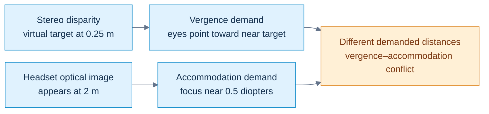
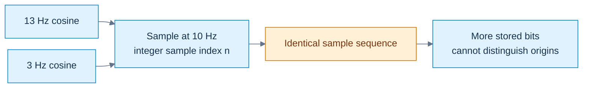
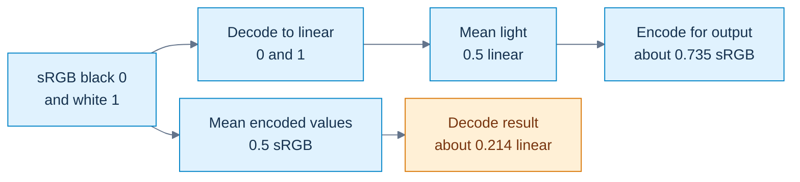
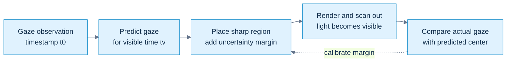

---
tags:
  - continuous-notes
  - xr
  - independent-series
series: XR Foundations
source: XR01
curriculum: outside-3000-part-plan
---

# XR: From Light to Perception - Seeing and Representing Reality

> Independent XR series, outside the 3,000-part curriculum. Chunk 1 is accepted as XR01. Future sources will extend this same file. Main-curriculum coverage remains Parts 1–147 / M001–M009. Institutional provenance is discussed in the source record.

## Prologue - A perfect scene can still make a poor experience

Imagine a bright fence in a virtual world. Its geometry is correct, and the GPU draws every triangle. When you move your head, however, the thin bars shimmer. When you look at the fence, its detail takes a moment to become sharp. A filter reduces the noise but leaves a faint trail behind moving objects.

These problems have different causes. Correct geometry is only the first step toward a convincing image.

A virtual scene must pass through several systems:

1. The renderer estimates the light coming from the scene.
2. It stores those estimates as image samples.
3. Reconstruction combines the samples into an output image.
4. The display turns encoded values into emitted light.
5. The headset's optics change where that light goes and how sharply it is focused.
6. The eye and brain turn the received light into a visual experience.

Eye tracking adds a feedback path. It tells the renderer where the user is looking, so the renderer can choose where to spend more work.

**Extended reality**, or XR, is the umbrella term we use for virtual reality, augmented reality, and related mixed-reality systems. This chapter explains the visual foundations. Later sources will explain the complete system that produces an XR experience.

### Figure X0 — A qualitative picture of the XR loop

![[Visual Recall/xr_perception_pipeline.png]]

**Read the illustration:** connect scene light, display, eye, and rendering decisions. The foveal inset suggests uneven detail sensitivity; the binocular inset reminds us that pointing and focusing are separate demands. This AI-generated teaching collage is qualitative: it is not a calibrated optical ray diagram or an anatomical measurement. Use Figures X1–X4 and their equations for the precise claims.

[[Visual Recall/XR - Light, Vision and Perception - Visual Recall#Figure-linked short notes|Return to the compact XR notes]].

## Light must become a quantity before it becomes a color

Before asking what color a pixel should be, ask a simpler question: **what physical quantity are we trying to represent?**

[[Light spectra and radiometry|Light]] is electromagnetic radiation. We use different models for different questions.

- A wave model explains interference and diffraction.
- A photon model describes individual energy exchanges.
- A ray model simplifies the path of light when we do not need the full wave behavior.

A ray is not a tiny RGB-colored particle. It is a way to describe a direction of propagation.

For an ideal wave traveling along one coordinate, we can write:

$$
E(x,t)=E_0\cos(kx-\omega t+\phi).
$$

The equation describes an oscillation. Its symbols mean:

| Symbol | Meaning | Unit |
|---|---|---|
| $E(x,t)$ | an electric-field component at position $x$ and time $t$ | volts per meter |
| $E_0$ | the field's amplitude | volts per meter |
| $k$ | angular wavenumber | radians per meter |
| $\omega$ | angular frequency | radians per second |
| $\phi$ | starting phase | radians |

**Phase** tells us where the oscillation is within its cycle. Wavelength $\lambda$ is the distance over which the wave repeats. Frequency $\nu$ is the number of cycles per second.

In a vacuum, the relationships are:

$$
c=\lambda\nu,\qquad
k=\frac{2\pi}{\lambda},\qquad
\omega=2\pi\nu.
$$

Here $c$ is the vacuum speed of light. In a material, the wave's wavelength and phase velocity can differ from their vacuum values.

For green light with a wavelength of $550\,\mathrm{nm}$:

$$
\nu=\frac{c}{\lambda}
\approx 5.45\times10^{14}\,\mathrm{Hz}.
$$

A photon at that wavelength carries energy:

$$
E_{\mathrm{photon}}=h\nu=\frac{hc}{\lambda}
\approx 3.61\times10^{-19}\,\mathrm{J}
\approx 2.25\,\mathrm{eV}.
$$

The symbol $h$ is Planck's constant. An electronvolt, written $\mathrm{eV}$, is an energy unit. It is not a measure of brightness.

This very high frequency is the light wave's oscillation frequency. It is not the much slower flicker frequency of a display whose brightness changes over time.

### Why three RGB values cannot describe a complete spectrum

Most light contains many wavelengths. A **spectral distribution**, $S(\lambda)$, describes how the relevant light quantity varies with wavelength.

A simplified receptor response is:

$$
R_i=\int S(\lambda)s_i(\lambda)\,d\lambda.
$$

Read this as: add the contribution from each wavelength, weighted by receptor $i$'s sensitivity $s_i(\lambda)$.

Different spectra can give the same color-match responses. This is called **metamerism**. It explains how a display with three primaries can match many perceived colors without reproducing every wavelength in the original scene.

The match has limits. It depends on the observer and viewing conditions. Matching color responses does not automatically match focus, adaptation, or binocular appearance.

RGB values therefore need an [[Interpretation contract]]. We must know their primaries, white point, transfer function, and scale before we know what they mean.

### Four light quantities that should not be confused

**Radiometry** measures radiation as physical energy or power. **Photometry** weights visible radiation using a standardized visual-sensitivity convention.

| Quantity | What to ask | Unit |
|---|---|---|
| Radiant energy | How much electromagnetic energy is present? | joule, $\mathrm{J}$ |
| Radiant flux | How much energy passes per second? | watt, $\mathrm{W}$ |
| Irradiance | How much radiant power arrives per unit surface area? | $\mathrm{W/m^2}$ |
| Radiance | How much directional power passes per projected area and solid angle? | $\mathrm{W/(m^2\,sr)}$ |
| Luminous flux | What is the photometrically weighted flux? | lumen, $\mathrm{lm}$ |
| Illuminance | How much luminous flux arrives per unit area? | lux, $\mathrm{lx}$ |
| Luminance | What is the photometric directional quantity? | $\mathrm{cd/m^2}$, also called nits |

A **solid angle** measures angular extent in three dimensions. Its unit is the steradian, $\mathrm{sr}$. It is not the same as an ordinary angle measured in degrees.

Radiance uses projected area:

$$
L=\frac{d^2\Phi}{dA\cos\theta\,d\Omega}.
$$

Here $\Phi$ is radiant flux, $A$ is surface area, $\theta$ is the angle to the surface normal, and $\Omega$ is solid angle. The factor $\cos\theta$ appears because a tilted surface presents less area to that direction.

Photopic weighting uses the visual-sensitivity function $V(\lambda)$. The familiar luminous-efficacy convention uses $683\,\mathrm{lm/W}$ under its specified conditions.

For an XR engineer, the practical distinction is this: **pixel values, emitted luminance, and electrical power are different quantities**. Reducing shader work does not prove an equal reduction in display power. Reducing display luminance does not prove that less geometry was processed.

## Materials turn incoming light into outgoing light

Once light reaches a material, several things can happen:

- Reflection sends some light back from the surface.
- Transmission lets some light pass through.
- Absorption converts some energy into other forms.
- Scattering redistributes light among directions.

For a passive system with all relevant reflected, transmitted, and absorbed energy included:

$$
R+T+A=1.
$$

Here $R$, $T$, and $A$ are fractions of the incoming energy. Emission, fluorescence, or gain need additional accounting.

[[Reflectance and rendering equation|A material's appearance]] depends on direction, not just on an RGB color. The **bidirectional reflectance distribution function**, or BRDF, describes how incoming illumination from one direction contributes to reflected light in another.

An ideal Lambertian diffuse surface has:

$$
f_r=\frac{\rho}{\pi}.
$$

The symbol $\rho$ is diffuse reflectance. The factor $\pi$ normalizes the cosine-weighted contribution over the hemisphere. It is not an arbitrary graphics constant.

For surface reflection, the rendering equation is:

$$
L_o(x,\omega_o)=L_e(x,\omega_o)+
\int_{\Omega^+}
f_r(x,\omega_i,\omega_o)L_i(x,\omega_i)
\max(\mathbf n\cdot\omega_i,0)\,d\omega_i.
$$

Read it in two pieces:

1. The surface may emit light: $L_e$.
2. It may reflect incoming light: the integral.

$L_o$ is outgoing radiance, $L_i$ is incoming radiance, and $f_r$ is the BRDF. The normal $\mathbf n$ determines which incoming directions lie above the surface. In this equation, $\omega_i$ and $\omega_o$ name directions; they are not the wave frequency used earlier.

Visibility belongs to the incoming-light calculation. If an object blocks a light source, that blocked contribution must not be treated as visible illumination. Transmission and subsurface transport need models beyond this surface-reflection form.

A renderer approximates these contributions through material evaluation, light sampling, visibility tests, and sometimes ray or path sampling.

A **Monte Carlo estimator** estimates an integral from sampled contributions. Fewer samples can increase noise. A systematic approximation can also introduce bias.

This gives us our first performance lesson: if we shade the full image and blur it afterward, we have not avoided the shading work.

**Teaching checkpoint:** ask what a framebuffer channel represents, which rendering operation produced it, and how the display converts it into light.

## The eye is an optical instrument with neural processing inside it

The eye does more than focus light onto a surface.

[[Optical focus and binocular conflict|The cornea]] and crystalline lens help focus incoming light. The iris changes the size of the pupil. The retina receives the focused light and begins neural processing.

A few anatomical names are useful:

| Term | Meaning |
|---|---|
| Macula | a central retinal region important for detailed vision |
| Fovea | a specialized region within the macula |
| Foveola | a smaller central region within the fovea |
| Optic disc | the region where nerve fibers leave the eye; it lacks ordinary photoreceptor sampling |

These names describe parts of the eye. They are not names for rendering-resolution tiers.

[[Retinal encoding and receptive fields|Rods and cones]] are photoreceptors. Rods support sensitive low-light vision. Cones support daylight and color vision through overlapping spectral responses conventionally called L, M, and S.

Those cone labels do not mean that the retina contains red, green, and blue framebuffer pixels.

**Phototransduction** is the conversion of absorbed light into changes in electrical signaling. Neural stages then combine and process those signals.

### Why a uniform patch and an edge produce different responses

A **receptive field** is the input region that influences a cell's response.

A useful center-surround model compares a narrow central region with a broader surrounding region:

$$
K(x,y)=A_cG_{\sigma_c}(x,y)-A_sG_{\sigma_s}(x,y),
$$

where a normalized Gaussian is:

$$
G_\sigma(x,y)=
\frac{1}{2\pi\sigma^2}
e^{-(x^2+y^2)/(2\sigma^2)}.
$$

$A_c$ and $A_s$ control the center and surround gains. The widths $\sigma_c$ and $\sigma_s$ set their spatial scales, with the center narrower than the surround.

If the gains are equal and both Gaussians integrate to one, their responses to a uniform image cancel. An edge affects the center and surround differently, so it can produce a response.

Unequal gains or finite, unnormalized kernels do not automatically cancel a constant input.

This is a teaching model of spatial filtering. It is not a complete retina simulator.

Central acuity also depends on optics, neural processing, adaptation, and the task. **Cortical magnification** describes the greater cortical representation devoted to some parts of the visual field. It helps explain why uniform rendering detail can be wasteful, but it does not uniquely determine a GPU sampling policy.

## Angles connect display samples to a viewer

A pixel count does not tell us how large the image appears. The same display looks different when viewed close up or from far away.

[[Visual angle and calibrated rays|Visual angle]] connects physical size to viewing geometry.

For a centered object of width $W$, viewed perpendicularly from distance $D$:

$$
\theta=2\tan^{-1}\left(\frac{W}{2D}\right).
$$

For a sufficiently small angle measured in radians:

$$
\theta\approx\frac{W}{D}.
$$

One degree contains 60 arcminutes. One arcminute contains 60 arcseconds. Pixels are image samples; these angular units describe how large those samples appear.

Consider a display that is $0.53\,\mathrm{m}$ wide, viewed from $0.60\,\mathrm{m}$, with 1920 horizontal pixels. Its horizontal field of view is about $47.66^\circ$.

Its average pixels per degree, or PPD, is:

$$
\mathrm{PPD}_{\mathrm{average}}
=\frac{1920}{47.66}
\approx40.29.
$$

### Why the center does not have that exact average density

Equal distances on a flat screen do not correspond to equal angular distances across the whole view.

Let pixel pitch be $p=W/N$, where $N$ is the number of pixel columns. For the planar projection:

$$
x=D\tan\theta.
$$

Differentiating gives:

$$
\frac{dx}{d\theta}=D\sec^2\theta.
$$

After converting from pixels per radian to pixels per degree:

$$
\mathrm{PPD}_{\mathrm{local}}(\theta)
=\frac{D}{p}\sec^2\theta\frac{\pi}{180}.
$$

For our example, the center's local density is about 37.94 PPD. The average is about 40.29 PPD. Both are correct, but they answer different questions.

We therefore should not call half the average PPD an exactly calibrated central Nyquist limit.

### Measuring distance from gaze

**Eccentricity** means angular distance from the gaze direction.

For unit-length gaze and pixel directions, $\mathbf d_g$ and $\mathbf d_p$:

$$
e=\cos^{-1}\left(
\operatorname{clamp}(\mathbf d_g\cdot\mathbf d_p,-1,1)
\right).
$$

The dot product gives the cosine of their angular separation. Clamping prevents a small floating-point error from sending the input outside the valid range of inverse cosine.

The result is in radians. Clamping does not fix a wrongly calibrated ray.

A displacement of 0.3 in normalized UV coordinates is not automatically $0.3^\circ$. UV coordinates describe positions within an image. Their angular meaning depends on projection and optics.

A pinhole camera maps directions using ratios such as $X/Z$ and $Y/Z$. Headset lenses can distort that mapping. Use calibrated rays, or a validated approximation, when sizing an angular quality region.

## Focus and stereo can disagree even when the images are sharp

A sharp image can still provide inconsistent depth cues. To understand why, separate refraction, accommodation, and vergence.

### Refraction changes a ray's direction

For an ideal interface, Snell's law is:

$$
n_1\sin\theta_1=n_2\sin\theta_2.
$$

$n_1$ and $n_2$ are the refractive indices of the two materials. The angles $\theta_1$ and $\theta_2$ are measured from the surface normal.

Refractive index is related to phase velocity $v$ by:

$$
n=\frac{c}{v}.
$$

A ray entering glass with refractive index 1.5 from air at $30^\circ$ bends to about $19.47^\circ$ from the normal.

When light travels from a higher-index material to a lower-index material, total internal reflection can occur beyond:

$$
\theta_c=\sin^{-1}\left(\frac{n_2}{n_1}\right),
\qquad n_1>n_2.
$$

AR waveguides may also use diffraction and coupling structures. Snell's law alone does not explain their entire design.

### Accommodation changes focus

For an ideal converging thin lens, using positive distances for the real object and real image:

$$
\frac1f=\frac1{d_o}+\frac1{d_i}.
$$

$f$ is focal length, $d_o$ object distance, and $d_i$ image distance.

Optical power is:

$$
P=\frac1f.
$$

With focal length measured in meters, the power is measured in diopters. A focal length of $0.25\,\mathrm{m}$ corresponds to 4 diopters.

**Accommodation** is the eye's adjustment of focusing power. The thin-lens model gives useful intuition; it is not a complete anatomical model of the eye.

### Vergence changes where the eyes point

**Vergence** is the coordinated rotation of the eyes to look at a binocular target.

For symmetric eyes separated by $b$, looking at a centered target at distance $z$, total convergence is:

$$
\gamma=2\tan^{-1}\left(\frac{b}{2z}\right).
$$

With $b=0.064\,\mathrm{m}$, convergence is about $3.67^\circ$ at one meter and $14.59^\circ$ at a quarter meter.

Now consider a headset whose optical image plane appears two meters away. Its approximate accommodation demand is 0.5 diopters. A virtual object rendered at a quarter meter can instead suggest a vergence distance associated with a 4-diopter focus demand.

The cues disagree. This is **vergence–accommodation conflict**.

Adding more shading detail does not directly remove that mismatch.

**Binocular fusion** combines corresponding information from the two eyes. **Stereoacuity** measures sensitivity to disparity in a defined task. **Panum's fusional area** describes a condition-dependent range of disparities that can be fused.

These are not fixed universal comfort limits. Incompatible inputs can produce rivalry, suppression, or double vision. Visual-performance and comfort claims still need an appropriate experiment.

### Figure X1 — Two simultaneous depth demands



**Caption:** the two rows are simultaneous cues, not successive steps in a light ray. With the chapter's symmetric-eye model and $b=0.064\,\mathrm m$, the near target asks for about $14.59^\circ$ total convergence. A real target at that distance would have an approximate 4-diopter accommodation demand; the headset's 2-meter optical image instead asks for about 0.5 diopters. These are demands, not measurements of an observer's actual response or universal comfort limits. Increasing resolution does not directly reconcile them.

**Recall:** vergence changes pointing; accommodation changes focusing power. [[Visual Recall/XR - Light, Vision and Perception - Visual Recall#Figure-linked short notes|Brief and figure index]].

## Visibility is about contrast, conditions and tasks

“Can the user see it?” is not one question. The answer depends on what we ask the user to do.

[[Visual acuity and eccentricity|Visual acuity]] describes fine-detail performance under specified conditions. We should distinguish:

| Task | Question |
|---|---|
| Detection | Is something present? |
| Resolution | Can the separate features be distinguished? |
| Vernier alignment | Are two features slightly misaligned? |
| Recognition | Which letter or object is this? |

Vernier alignment is a form of hyperacuity. It can reveal small positional differences that a simple receptor-spacing argument misses.

Clinical 20/20 notation is not a universal pixel-resolution specification for the eye.

### Acuity changes with eccentricity

The **minimum angle of resolution**, or MAR, describes a resolvable angular feature under a chosen task.

A full grating cycle, one bar, and a letter gap are not the same feature. State the convention before converting MAR into cycles per degree.

A useful approximation is:

$$
\mathrm{MAR}(e)=\mathrm{MAR}_0+me.
$$

Here $e$ is eccentricity, $\mathrm{MAR}_0$ is the central value, and $m$ is a fitted slope. If the feature-size convention stays fixed, the corresponding frequency scale varies roughly as:

$$
f_{\max}(e)\propto\frac1{\mathrm{MAR}_0+me}.
$$

This model captures a useful trend: coarser detail can often be used farther from gaze. It does not describe every visual task.

Use consistent angular units, and fit the model for the intended conditions. Do not treat its slope as a universal property of every observer.

### Contrast describes a difference relative to its surroundings

[[Contrast sensitivity adaptation and masking|Contrast]] tells us how strongly one intensity differs from another.

For bright and dark grating bars, Michelson contrast is:

$$
C_M=\frac{L_{\max}-L_{\min}}{L_{\max}+L_{\min}}.
$$

The denominator must be positive. Bars with luminances of 120 and 40 nits give:

$$
C_M=\frac{120-40}{120+40}=0.5.
$$

For a target against a positive background, Weber contrast is:

$$
C_W=\frac{L_{\mathrm{target}}-L_{\mathrm{background}}}
{L_{\mathrm{background}}}.
$$

A target at 110 nits against a 100-nit background gives $C_W=0.1$.

These formulas describe different stimulus arrangements. Use the one that matches the experiment.

A **contrast sensitivity function**, or CSF, describes sensitivity to patterns at different frequencies and under different conditions. It is not generally flat.

An optical MTF asks how much contrast survives the optics. A visual CSF asks how sensitive the observer is to the received contrast. These describe different stages.

### Adaptation, masking, crowding, and attention

**Adaptation** changes sensitivity with illumination and viewing history. Photopic vision is broadly cone-dominated; scotopic vision is rod-dominated; mesopic vision lies between them. These are useful regimes, not sharp switches.

A **just-noticeable difference**, or JND, is tied to a chosen discrimination criterion. Over some operating ranges, Weber's law approximates that threshold with:

$$
\frac{\Delta I}{I}=k.
$$

$I$ is the baseline stimulus, $\Delta I$ the threshold change, and $k$ a fitted fraction. The relation is not valid for all intensities and tasks.

**Masking** changes a target's visibility because other structure is present. **Crowding** makes recognition harder because nearby features interfere. A peripheral letter that is easy to identify alone may be difficult to identify among other letters.

**Attention** concerns what the observer prioritizes. **Gaze** concerns where the eyes point. **Saliency** describes features that tend to attract attention. These concepts are related, but one cannot stand in for another.

Peripheral vision still supports motion, layout, recognition, and depth judgments. A blur level that is acceptable for one grating task may be unacceptable for a navigation or training task.

The teaching lesson is simple: **define the user's task before deciding what detail can be removed.**

## A gaze sample needs a time as well as a direction

A gaze tracker gives more than a location. It gives an observation made at some time and delivered later.

[[Eye movements and display-time gaze|Eye movements]] also differ:

- A fixation is a period of relatively stable gaze, not complete stillness.
- A saccade rapidly redirects gaze.
- A microsaccade is a small fixation-related movement.
- Smooth pursuit follows a moving target.
- The vestibulo-ocular reflex helps compensate for head motion.

These movements do not share one motion pattern.

Suppose gaze moves steadily at $20^\circ/\mathrm{s}$. Predicting 30 milliseconds ahead with a constant-velocity model gives:

$$
\Delta\theta
=(20^\circ/\mathrm{s})(0.030\,\mathrm{s})
=0.6^\circ.
$$

That can be useful if the motion stays steady. It can fail during a saccade, where acceleration and braking change rapidly.

**Saccadic suppression** changes visual sensitivity around rapid eye movements. It does not make arbitrary rendering errors invisible. A degraded frame may arrive after the suppression has weakened or after the eye has landed.

### Sampling rate is not latency

A 90 Hz gaze stream has nominal sample intervals of:

$$
T_s=\frac1{90}\,\mathrm{s}\approx11.11\,\mathrm{ms}.
$$

That interval does not tell us the age of the observation when it reaches the display.

Follow the timing chain: acquisition, timestamping, delivery, scheduling, rendering, scanout, then pixel response. The quality region should cover the gaze relevant at visible display time.

Evaluate prediction separately around fixation, pursuit, saccade onset, and gaze landing. A low mean error can hide occasional large errors at the moment they matter most.

### Screen motion is not always retinal motion

[[Spatiotemporal sampling and retinal motion|Retinal image velocity]] describes movement across the retina.

In a simplified common angular coordinate frame:

$$
\omega_{\mathrm{retinal}}
\approx\omega_{\mathrm{scene}}-\omega_{\mathrm{eye}}.
$$

During pursuit, the eye may follow a target closely enough that the target moves little on the retina, even while it moves across the screen.

Motion also turns spatial variation into temporal variation. For a grating moving at velocity $v$:

$$
I(x,t)=\cos\!\left(2\pi f_x(x-vt)\right).
$$

At a fixed coordinate, its temporal frequency is:

$$
f_t=|v|f_x.
$$

A pattern at 10 cycles per degree moving at 20 degrees per second produces 200 cycles per second of variation at that coordinate.

A 90 Hz frame sampler has a nominal Nyquist frequency of 45 Hz. This describes the samples, not a universal human flicker limit.

Display persistence, emission waveform, eye motion, luminance, and contrast also affect what is seen. A screenshot cannot capture all of those effects.

## Sampling is a question of what remains distinguishable

[[Continuous signals and discrete samples|A signal]] is a function describing variation over a domain.

An image $I(x,y)$ varies across position. A gaze trace $\mathbf g(t)$ varies over time. Both can be analyzed as signals, but their units and filtering requirements differ.

**Sampling** chooses locations at which values are recorded. **Quantization** restricts the values we can store. The earlier [[Quantization and compressed weights]] notes develop that second process.

For uniform time sampling:

$$
x[n]=x(nT_s),\qquad f_s=\frac1{T_s}.
$$

$T_s$ is the sample interval, $f_s$ the sampling frequency, and $n$ an integer sample index.

More color bits cannot recover spatial observations that were never taken. More pixels do not automatically fix coarse amplitude quantization.

For nearest uniform quantization with step $\Delta$, and no clipping:

$$
|e_q|\leq\frac{\Delta}{2}.
$$

Under an additional uniform-error and weak-correlation assumption:

$$
\operatorname{Var}(e_q)=\frac{\Delta^2}{12}.
$$

That statistical model is not exact for every image. Smooth gradients can produce structured banding. Dithering can make the error less coherent, but it does not restore missing original information.

### Two different signals can give identical samples

Sample a cosine at rate $f_s$:

$$
x[n]=\cos\left(2\pi\frac{f_0}{f_s}n\right).
$$

Now replace its frequency $f_0$ with $f_0+mf_s$, where $m$ is an integer:

$$
x_m[n]
=\cos\left(2\pi\frac{f_0}{f_s}n+2\pi mn\right).
$$

For integer $m$ and $n$, the extra phase is a whole number of cycles. It changes no sample.

This is [[Sampling aliasing and reconstruction|aliasing]]: different original signals become indistinguishable after sampling.

%22%20viewBox%3D%220%200%20350%20165%22%20width%3D%22100%25%22%20xmlns%3D%22http%3A%2F%2Fwww.w3.org%2F2000%2Fsvg%22%3E%3Cline%20x1%3D%2220%22%20x2%3D%22338%22%20y1%3D%2282%22%20y2%3D%2282%22%20stroke%3D%22currentColor%22%20stroke-opacity%3D%22.3%22%2F%3E%3Cline%20x1%3D%2220%22%20y1%3D%2237%22%20x2%3D%2220.79%22%20y2%3D%2237.93497352202054%22%20stroke%3D%22%23C88445%22%20stroke-width%3D%221%22%20opacity%3D%22.72%22%2F%3E%3Cline%20x1%3D%2220%22%20y1%3D%2237%22%20x2%3D%2220.79%22%20y2%3D%2237.04995562671135%22%20stroke%3D%22%234F9F96%22%20stroke-width%3D%221.5%22%20opacity%3D%22.85%22%2F%3E%3Cline%20x1%3D%2220.79%22%20y1%3D%2237.93497352202054%22%20x2%3D%2221.58%22%20y2%3D%2240.701041844220846%22%20stroke%3D%22%23C88445%22%20stroke-width%3D%221%22%20opacity%3D%22.72%22%2F%3E%3Cline%20x1%3D%2220.79%22%20y1%3D%2237.04995562671135%22%20x2%3D%2221.58%22%20y2%3D%2237.1997115928614%22%20stroke%3D%22%234F9F96%22%20stroke-width%3D%221.5%22%20opacity%3D%22.85%22%2F%3E%3Cline%20x1%3D%2221.58%22%20y1%3D%2240.701041844220846%22%20x2%3D%2222.37%22%20y2%3D%2245.183262715873944%22%20stroke%3D%22%23C88445%22%20stroke-width%3D%221%22%20opacity%3D%22.72%22%2F%3E%3Cline%20x1%3D%2221.58%22%20y1%3D%2237.1997115928614%22%20x2%3D%2222.37%22%20y2%3D%2237.44893540275491%22%20stroke%3D%22%234F9F96%22%20stroke-width%3D%221.5%22%20opacity%3D%22.85%22%2F%3E%3Cline%20x1%3D%2222.37%22%20y1%3D%2245.183262715873944%22%20x2%3D%2223.16%22%20y2%3D%2251.19538023320901%22%20stroke%3D%22%23C88445%22%20stroke-width%3D%221%22%20opacity%3D%22.72%22%2F%3E%3Cline%20x1%3D%2222.37%22%20y1%3D%2237.44893540275491%22%20x2%3D%2223.16%22%20y2%3D%2237.79707371720901%22%20stroke%3D%22%234F9F96%22%20stroke-width%3D%221.5%22%20opacity%3D%22.85%22%2F%3E%3Cline%20x1%3D%2223.16%22%20y1%3D%2251.19538023320901%22%20x2%3D%2223.95%22%20y2%3D%2258.4875645877823%22%20stroke%3D%22%23C88445%22%20stroke-width%3D%221%22%20opacity%3D%22.72%22%2F%3E%3Cline%20x1%3D%2223.16%22%20y1%3D%2237.79707371720901%22%20x2%3D%2223.95%22%20y2%3D%2238.243353582104554%22%20stroke%3D%22%234F9F96%22%20stroke-width%3D%221.5%22%20opacity%3D%22.85%22%2F%3E%3Cline%20x1%3D%2223.95%22%20y1%3D%2258.4875645877823%22%20x2%3D%2224.740000000000002%22%20y2%3D%2266.7567935889619%22%20stroke%3D%22%23C88445%22%20stroke-width%3D%221%22%20opacity%3D%22.72%22%2F%3E%3Cline%20x1%3D%2223.95%22%20y1%3D%2238.243353582104554%22%20x2%3D%2224.740000000000002%22%20y2%3D%2238.78678414453756%22%20stroke%3D%22%234F9F96%22%20stroke-width%3D%221.5%22%20opacity%3D%22.85%22%2F%3E%3Cline%20x1%3D%2224.740000000000002%22%20y1%3D%2266.7567935889619%22%20x2%3D%2225.53%22%20y2%3D%2275.6594445628088%22%20stroke%3D%22%23C88445%22%20stroke-width%3D%221%22%20opacity%3D%22.72%22%2F%3E%3Cline%20x1%3D%2224.740000000000002%22%20y1%3D%2238.78678414453756%22%20x2%3D%2225.53%22%20y2%3D%2239.42615885276046%22%20stroke%3D%22%234F9F96%22%20stroke-width%3D%221.5%22%20opacity%3D%22.85%22%2F%3E%3Cline%20x1%3D%2225.53%22%20y1%3D%2275.6594445628088%22%20x2%3D%2226.32%22%20y2%3D%2284.8255733788191%22%20stroke%3D%22%23C88445%22%20stroke-width%3D%221%22%20opacity%3D%22.72%22%2F%3E%3Cline%20x1%3D%2225.53%22%20y1%3D%2239.42615885276046%22%20x2%3D%2226.32%22%20y2%3D%2240.160058135028684%22%20stroke%3D%22%234F9F96%22%20stroke-width%3D%221.5%22%20opacity%3D%22.85%22%2F%3E%3Cline%20x1%3D%2226.32%22%20y1%3D%2284.8255733788191%22%20x2%3D%2227.11%22%20y2%3D%2293.87428724844177%22%20stroke%3D%22%23C88445%22%20stroke-width%3D%221%22%20opacity%3D%22.72%22%2F%3E%3Cline%20x1%3D%2226.32%22%20y1%3D%2240.160058135028684%22%20x2%3D%2227.11%22%20y2%3D%2240.986852551404965%22%20stroke%3D%22%234F9F96%22%20stroke-width%3D%221.5%22%20opacity%3D%22.85%22%2F%3E%3Cline%20x1%3D%2227.11%22%20y1%3D%2293.87428724844177%22%20x2%3D%2227.9%22%20y2%3D%22102.4295724882796%22%20stroke%3D%22%23C88445%22%20stroke-width%3D%221%22%20opacity%3D%22.72%22%2F%3E%3Cline%20x1%3D%2227.11%22%20y1%3D%2240.986852551404965%22%20x2%3D%2227.9%22%20y2%3D%2241.90470641152344%22%20stroke%3D%22%234F9F96%22%20stroke-width%3D%221.5%22%20opacity%3D%22.85%22%2F%3E%3Cline%20x1%3D%2227.9%22%20y1%3D%22102.4295724882796%22%20x2%3D%2228.69%22%20y2%3D%22110.13591953510674%22%20stroke%3D%22%23C88445%22%20stroke-width%3D%221%22%20opacity%3D%22.72%22%2F%3E%3Cline%20x1%3D%2227.9%22%20y1%3D%2241.90470641152344%22%20x2%3D%2228.69%22%20y2%3D%2242.911581850281394%22%20stroke%3D%22%234F9F96%22%20stroke-width%3D%221.5%22%20opacity%3D%22.85%22%2F%3E%3Cline%20x1%3D%2228.69%22%20y1%3D%22110.13591953510674%22%20x2%3D%2229.48%22%20y2%3D%22116.67309592491051%22%20stroke%3D%22%23C88445%22%20stroke-width%3D%221%22%20opacity%3D%22.72%22%2F%3E%3Cline%20x1%3D%2228.69%22%20y1%3D%2242.911581850281394%22%20x2%3D%2229.48%22%20y2%3D%2244.00524335240932%22%20stroke%3D%22%234F9F96%22%20stroke-width%3D%221.5%22%20opacity%3D%22.85%22%2F%3E%3Cline%20x1%3D%2229.48%22%20y1%3D%22116.67309592491051%22%20x2%3D%2230.27%22%20y2%3D%22121.7694533539912%22%20stroke%3D%22%23C88445%22%20stroke-width%3D%221%22%20opacity%3D%22.72%22%2F%3E%3Cline%20x1%3D%2229.48%22%20y1%3D%2244.00524335240932%22%20x2%3D%2230.27%22%20y2%3D%2245.183262715873944%22%20stroke%3D%22%234F9F96%22%20stroke-width%3D%221.5%22%20opacity%3D%22.85%22%2F%3E%3Cline%20x1%3D%2230.27%22%20y1%3D%22121.7694533539912%22%20x2%3D%2231.060000000000002%22%20y2%3D%22125.21321585546245%22%20stroke%3D%22%23C88445%22%20stroke-width%3D%221%22%20opacity%3D%22.72%22%2F%3E%3Cline%20x1%3D%2230.27%22%20y1%3D%2245.183262715873944%22%20x2%3D%2231.060000000000002%22%20y2%3D%2246.44302444309394%22%20stroke%3D%22%234F9F96%22%20stroke-width%3D%221.5%22%20opacity%3D%22.85%22%2F%3E%3Cline%20x1%3D%2231.060000000000002%22%20y1%3D%22125.21321585546245%22%20x2%3D%2231.85%22%20y2%3D%22126.86128001799077%22%20stroke%3D%22%23C88445%22%20stroke-width%3D%221%22%20opacity%3D%22.72%22%2F%3E%3Cline%20x1%3D%2231.060000000000002%22%20y1%3D%2246.44302444309394%22%20x2%3D%2231.85%22%20y2%3D%2247.78173154799861%22%20stroke%3D%22%234F9F96%22%20stroke-width%3D%221.5%22%20opacity%3D%22.85%22%2F%3E%3Cline%20x1%3D%2231.85%22%20y1%3D%22126.86128001799077%22%20x2%3D%2232.64%22%20y2%3D%22126.6451615591515%22%20stroke%3D%22%23C88445%22%20stroke-width%3D%221%22%20opacity%3D%22.72%22%2F%3E%3Cline%20x1%3D%2231.85%22%20y1%3D%2247.78173154799861%22%20x2%3D%2232.64%22%20y2%3D%2249.19641176603648%22%20stroke%3D%22%234F9F96%22%20stroke-width%3D%221.5%22%20opacity%3D%22.85%22%2F%3E%3Cline%20x1%3D%2232.64%22%20y1%3D%22126.6451615591515%22%20x2%3D%2233.43%22%20y2%3D%22124.57384114723953%22%20stroke%3D%22%23C88445%22%20stroke-width%3D%221%22%20opacity%3D%22.72%22%2F%3E%3Cline%20x1%3D%2232.64%22%20y1%3D%2249.19641176603648%22%20x2%3D%2233.43%22%20y2%3D%2250.683924153345856%22%20stroke%3D%22%234F9F96%22%20stroke-width%3D%221.5%22%20opacity%3D%22.85%22%2F%3E%3Cline%20x1%3D%2233.43%22%20y1%3D%22124.57384114723953%22%20x2%3D%2234.22%22%20y2%3D%22120.73339121517746%22%20stroke%3D%22%23C88445%22%20stroke-width%3D%221%22%20opacity%3D%22.72%22%2F%3E%3Cline%20x1%3D%2233.43%22%20y1%3D%2250.683924153345856%22%20x2%3D%2234.22%22%20y2%3D%2252.24096606043567%22%20stroke%3D%22%234F9F96%22%20stroke-width%3D%221.5%22%20opacity%3D%22.85%22%2F%3E%3Cline%20x1%3D%2234.22%22%20y1%3D%22120.73339121517746%22%20x2%3D%2235.010000000000005%22%20y2%3D%22115.28339927403744%22%20stroke%3D%22%23C88445%22%20stroke-width%3D%221%22%20opacity%3D%22.72%22%2F%3E%3Cline%20x1%3D%2234.22%22%20y1%3D%2252.24096606043567%22%20x2%3D%2235.010000000000005%22%20y2%3D%2253.86408046489326%22%20stroke%3D%22%234F9F96%22%20stroke-width%3D%221.5%22%20opacity%3D%22.85%22%2F%3E%3Cline%20x1%3D%2235.010000000000005%22%20y1%3D%22115.28339927403744%22%20x2%3D%2235.8%22%20y2%3D%22108.4503363531613%22%20stroke%3D%22%23C88445%22%20stroke-width%3D%221%22%20opacity%3D%22.72%22%2F%3E%3Cline%20x1%3D%2235.010000000000005%22%20y1%3D%2253.86408046489326%22%20x2%3D%2235.8%22%20y2%3D%2255.5496636468387%22%20stroke%3D%22%234F9F96%22%20stroke-width%3D%221.5%22%20opacity%3D%22.85%22%2F%3E%3Cline%20x1%3D%2235.8%22%20y1%3D%22108.4503363531613%22%20x2%3D%2236.59%22%20y2%3D%22100.51814613722988%22%20stroke%3D%22%23C88445%22%20stroke-width%3D%221%22%20opacity%3D%22.72%22%2F%3E%3Cline%20x1%3D%2235.8%22%20y1%3D%2255.5496636468387%22%20x2%3D%2236.59%22%20y2%3D%2257.293973190084074%22%20stroke%3D%22%234F9F96%22%20stroke-width%3D%221.5%22%20opacity%3D%22.85%22%2F%3E%3Cline%20x1%3D%2236.59%22%20y1%3D%22100.51814613722988%22%20x2%3D%2237.38%22%20y2%3D%2291.8164458628444%22%20stroke%3D%22%23C88445%22%20stroke-width%3D%221%22%20opacity%3D%22.72%22%2F%3E%3Cline%20x1%3D%2236.59%22%20y1%3D%2257.293973190084074%22%20x2%3D%2237.38%22%20y2%3D%2259.09313629123329%22%20stroke%3D%22%234F9F96%22%20stroke-width%3D%221.5%22%20opacity%3D%22.85%22%2F%3E%3Cline%20x1%3D%2237.38%22%20y1%3D%2291.8164458628444%22%20x2%3D%2238.17%22%20y2%3D%2282.7068292790319%22%20stroke%3D%22%23C88445%22%20stroke-width%3D%221%22%20opacity%3D%22.72%22%2F%3E%3Cline%20x1%3D%2237.38%22%20y1%3D%2259.09313629123329%22%20x2%3D%2238.17%22%20y2%3D%2260.943158358274204%22%20stroke%3D%22%234F9F96%22%20stroke-width%3D%221.5%22%20opacity%3D%22.85%22%2F%3E%3Cline%20x1%3D%2238.17%22%20y1%3D%2282.7068292790319%22%20x2%3D%2238.96%22%20y2%3D%2273.56784084364237%22%20stroke%3D%22%23C88445%22%20stroke-width%3D%221%22%20opacity%3D%22.72%22%2F%3E%3Cline%20x1%3D%2238.17%22%20y1%3D%2260.943158358274204%22%20x2%3D%2238.96%22%20y2%3D%2262.83993187957173%22%20stroke%3D%22%234F9F96%22%20stroke-width%3D%221.5%22%20opacity%3D%22.85%22%2F%3E%3Cline%20x1%3D%2238.96%22%20y1%3D%2273.56784084364237%22%20x2%3D%2239.75%22%20y2%3D%2264.77924554357095%22%20stroke%3D%22%23C88445%22%20stroke-width%3D%221%22%20opacity%3D%22.72%22%2F%3E%3Cline%20x1%3D%2238.96%22%20y1%3D%2262.83993187957173%22%20x2%3D%2239.75%22%20y2%3D%2264.77924554357097%22%20stroke%3D%22%234F9F96%22%20stroke-width%3D%221.5%22%20opacity%3D%22.85%22%2F%3E%3Cline%20x1%3D%2239.75%22%20y1%3D%2264.77924554357095%22%20x2%3D%2240.54%22%20y2%3D%2256.70624799665413%22%20stroke%3D%22%23C88445%22%20stroke-width%3D%221%22%20opacity%3D%22.72%22%2F%3E%3Cline%20x1%3D%2239.75%22%20y1%3D%2264.77924554357097%22%20x2%3D%2240.54%22%20y2%3D%2266.75679358896188%22%20stroke%3D%22%234F9F96%22%20stroke-width%3D%221.5%22%20opacity%3D%22.85%22%2F%3E%3Cline%20x1%3D%2240.54%22%20y1%3D%2256.70624799665413%22%20x2%3D%2241.33%22%20y2%3D%2249.684316600656516%22%20stroke%3D%22%23C88445%22%20stroke-width%3D%221%22%20opacity%3D%22.72%22%2F%3E%3Cline%20x1%3D%2240.54%22%20y1%3D%2266.75679358896188%22%20x2%3D%2241.33%22%20y2%3D%2268.76818536454631%22%20stroke%3D%22%234F9F96%22%20stroke-width%3D%221.5%22%20opacity%3D%22.85%22%2F%3E%3Cline%20x1%3D%2241.33%22%20y1%3D%2249.684316600656516%22%20x2%3D%2242.120000000000005%22%20y2%3D%2244.005243352409295%22%20stroke%3D%22%23C88445%22%20stroke-width%3D%221%22%20opacity%3D%22.72%22%2F%3E%3Cline%20x1%3D%2241.33%22%20y1%3D%2268.76818536454631%22%20x2%3D%2242.120000000000005%22%20y2%3D%2270.80895507758154%22%20stroke%3D%22%234F9F96%22%20stroke-width%3D%221.5%22%20opacity%3D%22.85%22%2F%3E%3Cline%20x1%3D%2242.120000000000005%22%20y1%3D%2244.005243352409295%22%20x2%3D%2242.91%22%20y2%3D%2239.90501861265596%22%20stroke%3D%22%23C88445%22%20stroke-width%3D%221%22%20opacity%3D%22.72%22%2F%3E%3Cline%20x1%3D%2242.120000000000005%22%20y1%3D%2270.80895507758154%22%20x2%3D%2242.91%22%20y2%3D%2272.87457170895692%22%20stroke%3D%22%234F9F96%22%20stroke-width%3D%221.5%22%20opacity%3D%22.85%22%2F%3E%3Cline%20x1%3D%2242.91%22%20y1%3D%2239.90501861265596%22%20x2%3D%2243.7%22%20y2%3D%2237.5540246732188%22%20stroke%3D%22%23C88445%22%20stroke-width%3D%221%22%20opacity%3D%22.72%22%2F%3E%3Cline%20x1%3D%2242.91%22%20y1%3D%2272.87457170895692%22%20x2%3D%2243.7%22%20y2%3D%2274.96044907318961%22%20stroke%3D%22%234F9F96%22%20stroke-width%3D%221.5%22%20opacity%3D%22.85%22%2F%3E%3Cline%20x1%3D%2243.7%22%20y1%3D%2237.5540246732188%22%20x2%3D%2244.49%22%20y2%3D%2237.04995562671135%22%20stroke%3D%22%23C88445%22%20stroke-width%3D%221%22%20opacity%3D%22.72%22%2F%3E%3Cline%20x1%3D%2243.7%22%20y1%3D%2274.96044907318961%22%20x2%3D%2244.49%22%20y2%3D%2277.06195600090295%22%20stroke%3D%22%234F9F96%22%20stroke-width%3D%221.5%22%20opacity%3D%22.85%22%2F%3E%3Cline%20x1%3D%2244.49%22%20y1%3D%2237.04995562671135%22%20x2%3D%2245.28%22%20y2%3D%2238.4137577492116%22%20stroke%3D%22%23C88445%22%20stroke-width%3D%221%22%20opacity%3D%22.72%22%2F%3E%3Cline%20x1%3D%2244.49%22%20y1%3D%2277.06195600090295%22%20x2%3D%2245.28%22%20y2%3D%2279.17442662118088%22%20stroke%3D%22%234F9F96%22%20stroke-width%3D%221.5%22%20opacity%3D%22.85%22%2F%3E%3Cline%20x1%3D%2245.28%22%20y1%3D%2238.4137577492116%22%20x2%3D%2246.07%22%20y2%3D%2241.58875909077229%22%20stroke%3D%22%23C88445%22%20stroke-width%3D%221%22%20opacity%3D%22.72%22%2F%3E%3Cline%20x1%3D%2245.28%22%20y1%3D%2279.17442662118088%22%20x2%3D%2246.07%22%20y2%3D%2281.29317072096806%22%20stroke%3D%22%234F9F96%22%20stroke-width%3D%221.5%22%20opacity%3D%22.85%22%2F%3E%3Cline%20x1%3D%2246.07%22%20y1%3D%2241.58875909077229%22%20x2%3D%2246.86%22%20y2%3D%2246.44302444309395%22%20stroke%3D%22%23C88445%22%20stroke-width%3D%221%22%20opacity%3D%22.72%22%2F%3E%3Cline%20x1%3D%2246.07%22%20y1%3D%2281.29317072096806%22%20x2%3D%2246.86%22%20y2%3D%2283.41348415851577%22%20stroke%3D%22%234F9F96%22%20stroke-width%3D%221.5%22%20opacity%3D%22.85%22%2F%3E%3Cline%20x1%3D%2246.86%22%20y1%3D%2246.44302444309395%22%20x2%3D%2247.650000000000006%22%20y2%3D%2252.774837825141745%22%20stroke%3D%22%23C88445%22%20stroke-width%3D%221%22%20opacity%3D%22.72%22%2F%3E%3Cline%20x1%3D%2246.86%22%20y1%3D%2283.41348415851577%22%20x2%3D%2247.650000000000006%22%20y2%3D%2285.53065930775301%22%20stroke%3D%22%234F9F96%22%20stroke-width%3D%221.5%22%20opacity%3D%22.85%22%2F%3E%3Cline%20x1%3D%2247.650000000000006%22%20y1%3D%2252.774837825141745%22%20x2%3D%2248.44%22%20y2%3D%2260.32108466542281%22%20stroke%3D%22%23C88445%22%20stroke-width%3D%221%22%20opacity%3D%22.72%22%2F%3E%3Cline%20x1%3D%2247.650000000000006%22%20y1%3D%2285.53065930775301%22%20x2%3D%2248.44%22%20y2%3D%2287.63999551039369%22%20stroke%3D%22%234F9F96%22%20stroke-width%3D%221.5%22%20opacity%3D%22.85%22%2F%3E%3Cline%20x1%3D%2248.44%22%20y1%3D%2260.32108466542281%22%20x2%3D%2249.230000000000004%22%20y2%3D%2268.76818536454634%22%20stroke%3D%22%23C88445%22%20stroke-width%3D%221%22%20opacity%3D%22.72%22%2F%3E%3Cline%20x1%3D%2248.44%22%20y1%3D%2287.63999551039369%22%20x2%3D%2249.230000000000004%22%20y2%3D%2289.73680951257343%22%20stroke%3D%22%234F9F96%22%20stroke-width%3D%221.5%22%20opacity%3D%22.85%22%2F%3E%3Cline%20x1%3D%2249.230000000000004%22%20y1%3D%2268.76818536454634%22%20x2%3D%2250.02%22%20y2%3D%2277.76512590066686%22%20stroke%3D%22%23C88445%22%20stroke-width%3D%221%22%20opacity%3D%22.72%22%2F%3E%3Cline%20x1%3D%2249.230000000000004%22%20y1%3D%2289.73680951257343%22%20x2%3D%2250.02%22%20y2%3D%2291.8164458628444%22%20stroke%3D%22%234F9F96%22%20stroke-width%3D%221.5%22%20opacity%3D%22.85%22%2F%3E%3Cline%20x1%3D%2250.02%22%20y1%3D%2277.76512590066686%22%20x2%3D%2250.81%22%20y2%3D%2286.93804399909708%22%20stroke%3D%22%23C88445%22%20stroke-width%3D%221%22%20opacity%3D%22.72%22%2F%3E%3Cline%20x1%3D%2250.02%22%20y1%3D%2291.8164458628444%22%20x2%3D%2250.81%22%20y2%3D%2293.87428724844177%22%20stroke%3D%22%234F9F96%22%20stroke-width%3D%221.5%22%20opacity%3D%22.85%22%2F%3E%3Cline%20x1%3D%2250.81%22%20y1%3D%2286.93804399909708%22%20x2%3D%2251.6%22%20y2%3D%2295.90576474687262%22%20stroke%3D%22%23C88445%22%20stroke-width%3D%221%22%20opacity%3D%22.72%22%2F%3E%3Cline%20x1%3D%2250.81%22%20y1%3D%2293.87428724844177%22%20x2%3D%2251.6%22%20y2%3D%2295.90576474687262%22%20stroke%3D%22%234F9F96%22%20stroke-width%3D%221.5%22%20opacity%3D%22.85%22%2F%3E%3Cline%20x1%3D%2251.6%22%20y1%3D%2295.90576474687262%22%20x2%3D%2252.39%22%20y2%3D%22104.29564007945831%22%20stroke%3D%22%23C88445%22%20stroke-width%3D%221%22%20opacity%3D%22.72%22%2F%3E%3Cline%20x1%3D%2251.6%22%20y1%3D%2295.90576474687262%22%20x2%3D%2252.39%22%20y2%3D%2297.90636797006657%22%20stroke%3D%22%234F9F96%22%20stroke-width%3D%221.5%22%20opacity%3D%22.85%22%2F%3E%3Cline%20x1%3D%2252.39%22%20y1%3D%22104.29564007945831%22%20x2%3D%2253.18%22%20y2%3D%22111.75903393956438%22%20stroke%3D%22%23C88445%22%20stroke-width%3D%221%22%20opacity%3D%22.72%22%2F%3E%3Cline%20x1%3D%2252.39%22%20y1%3D%2297.90636797006657%22%20x2%3D%2253.18%22%20y2%3D%2299.87165507856513%22%20stroke%3D%22%234F9F96%22%20stroke-width%3D%221.5%22%20opacity%3D%22.85%22%2F%3E%3Cline%20x1%3D%2253.18%22%20y1%3D%22111.75903393956438%22%20x2%3D%2253.97%22%20y2%3D%22117.9858096319191%22%20stroke%3D%22%23C88445%22%20stroke-width%3D%221%22%20opacity%3D%22.72%22%2F%3E%3Cline%20x1%3D%2253.18%22%20y1%3D%2299.87165507856513%22%20x2%3D%2253.97%22%20y2%3D%22101.79726264351618%22%20stroke%3D%22%234F9F96%22%20stroke-width%3D%221.5%22%20opacity%3D%22.85%22%2F%3E%3Cline%20x1%3D%2253.97%22%20y1%3D%22117.9858096319191%22%20x2%3D%2254.760000000000005%22%20y2%3D%22122.71721736097089%22%20stroke%3D%22%23C88445%22%20stroke-width%3D%221%22%20opacity%3D%22.72%22%2F%3E%3Cline%20x1%3D%2253.97%22%20y1%3D%22101.79726264351618%22%20x2%3D%2254.760000000000005%22%20y2%3D%22103.6789153345772%22%20stroke%3D%22%234F9F96%22%20stroke-width%3D%221.5%22%20opacity%3D%22.85%22%2F%3E%3Cline%20x1%3D%2254.760000000000005%22%20y1%3D%22122.71721736097089%22%20x2%3D%2255.550000000000004%22%20y2%3D%22125.75664641789545%22%20stroke%3D%22%23C88445%22%20stroke-width%3D%221%22%20opacity%3D%22.72%22%2F%3E%3Cline%20x1%3D%2254.760000000000005%22%20y1%3D%22103.6789153345772%22%20x2%3D%2255.550000000000004%22%20y2%3D%22105.5124354122177%22%20stroke%3D%22%234F9F96%22%20stroke-width%3D%221.5%22%20opacity%3D%22.85%22%2F%3E%3Cline%20x1%3D%2255.550000000000004%22%20y1%3D%22125.75664641789545%22%20x2%3D%2256.34%22%20y2%3D%22126.97779521645792%22%20stroke%3D%22%23C88445%22%20stroke-width%3D%221%22%20opacity%3D%22.72%22%2F%3E%3Cline%20x1%3D%2255.550000000000004%22%20y1%3D%22105.5124354122177%22%20x2%3D%2256.34%22%20y2%3D%22107.29375200334587%22%20stroke%3D%22%234F9F96%22%20stroke-width%3D%221.5%22%20opacity%3D%22.85%22%2F%3E%3Cline%20x1%3D%2256.34%22%20y1%3D%22126.97779521645792%22%20x2%3D%2257.13%22%20y2%3D%22126.3299196769648%22%20stroke%3D%22%23C88445%22%20stroke-width%3D%221%22%20opacity%3D%22.72%22%2F%3E%3Cline%20x1%3D%2256.34%22%20y1%3D%22107.29375200334587%22%20x2%3D%2257.13%22%20y2%3D%22109.01891013966477%22%20stroke%3D%22%234F9F96%22%20stroke-width%3D%221.5%22%20opacity%3D%22.85%22%2F%3E%3Cline%20x1%3D%2257.13%22%20y1%3D%22126.3299196769648%22%20x2%3D%2257.92%22%20y2%3D%22123.8399418649713%22%20stroke%3D%22%23C88445%22%20stroke-width%3D%221%22%20opacity%3D%22.72%22%2F%3E%3Cline%20x1%3D%2257.13%22%20y1%3D%22109.01891013966477%22%20x2%3D%2257.92%22%20y2%3D%22110.68407953869104%22%20stroke%3D%22%234F9F96%22%20stroke-width%3D%221.5%22%20opacity%3D%22.85%22%2F%3E%3Cline%20x1%3D%2257.92%22%20y1%3D%22123.8399418649713%22%20x2%3D%2258.71%22%20y2%3D%22119.61133126157213%22%20stroke%3D%22%23C88445%22%20stroke-width%3D%221%22%20opacity%3D%22.72%22%2F%3E%3Cline%20x1%3D%2257.92%22%20y1%3D%22110.68407953869104%22%20x2%3D%2258.71%22%20y2%3D%22112.28556310793981%22%20stroke%3D%22%234F9F96%22%20stroke-width%3D%221.5%22%20opacity%3D%22.85%22%2F%3E%3Cline%20x1%3D%2258.71%22%20y1%3D%22119.61133126157213%22%20x2%3D%2259.5%22%20y2%3D%22113.81980515339463%22%20stroke%3D%22%23C88445%22%20stroke-width%3D%221%22%20opacity%3D%22.72%22%2F%3E%3Cline%20x1%3D%2258.71%22%20y1%3D%22112.28556310793981%22%20x2%3D%2259.5%22%20y2%3D%22113.81980515339464%22%20stroke%3D%22%234F9F96%22%20stroke-width%3D%221.5%22%20opacity%3D%22.85%22%2F%3E%3Cline%20x1%3D%2259.5%22%20y1%3D%22113.81980515339463%22%20x2%3D%2260.29%22%20y2%3D%22106.70602680991585%22%20stroke%3D%22%23C88445%22%20stroke-width%3D%221%22%20opacity%3D%22.72%22%2F%3E%3Cline%20x1%3D%2259.5%22%20y1%3D%22113.81980515339464%22%20x2%3D%2260.29%22%20y2%3D%22115.28339927403744%22%20stroke%3D%22%234F9F96%22%20stroke-width%3D%221.5%22%20opacity%3D%22.85%22%2F%3E%3Cline%20x1%3D%2260.29%22%20y1%3D%22106.70602680991585%22%20x2%3D%2261.08%22%20y2%3D%2298.56560487081052%22%20stroke%3D%22%23C88445%22%20stroke-width%3D%221%22%20opacity%3D%22.72%22%2F%3E%3Cline%20x1%3D%2260.29%22%20y1%3D%22115.28339927403744%22%20x2%3D%2261.08%22%20y2%3D%22116.67309592491051%22%20stroke%3D%22%234F9F96%22%20stroke-width%3D%221.5%22%20opacity%3D%22.85%22%2F%3E%3Cline%20x1%3D%2261.08%22%20y1%3D%2298.56560487081052%22%20x2%3D%2261.870000000000005%22%20y2%3D%2289.73680951257336%22%20stroke%3D%22%23C88445%22%20stroke-width%3D%221%22%20opacity%3D%22.72%22%2F%3E%3Cline%20x1%3D%2261.08%22%20y1%3D%22116.67309592491051%22%20x2%3D%2261.870000000000005%22%20y2%3D%22117.98580963191907%22%20stroke%3D%22%234F9F96%22%20stroke-width%3D%221.5%22%20opacity%3D%22.85%22%2F%3E%3Cline%20x1%3D%2261.870000000000005%22%20y1%3D%2289.73680951257336%22%20x2%3D%2262.660000000000004%22%20y2%3D%2280.58651584148426%22%20stroke%3D%22%23C88445%22%20stroke-width%3D%221%22%20opacity%3D%22.72%22%2F%3E%3Cline%20x1%3D%2261.870000000000005%22%20y1%3D%22117.98580963191907%22%20x2%3D%2262.660000000000004%22%20y2%3D%22119.21862584235528%22%20stroke%3D%22%234F9F96%22%20stroke-width%3D%221.5%22%20opacity%3D%22.85%22%2F%3E%3Cline%20x1%3D%2262.660000000000004%22%20y1%3D%2280.58651584148426%22%20x2%3D%2263.45%22%20y2%3D%2271.49495862648422%22%20stroke%3D%22%23C88445%22%20stroke-width%3D%221%22%20opacity%3D%22.72%22%2F%3E%3Cline%20x1%3D%2262.660000000000004%22%20y1%3D%22119.21862584235528%22%20x2%3D%2263.45%22%20y2%3D%22120.36880739593414%22%20stroke%3D%22%234F9F96%22%20stroke-width%3D%221.5%22%20opacity%3D%22.85%22%2F%3E%3Cline%20x1%3D%2263.45%22%20y1%3D%2271.49495862648422%22%20x2%3D%2264.24000000000001%22%20y2%3D%2262.83993187957164%22%20stroke%3D%22%23C88445%22%20stroke-width%3D%221%22%20opacity%3D%22.72%22%2F%3E%3Cline%20x1%3D%2263.45%22%20y1%3D%22120.36880739593414%22%20x2%3D%2264.24000000000001%22%20y2%3D%22121.43380060197387%22%20stroke%3D%22%234F9F96%22%20stroke-width%3D%221.5%22%20opacity%3D%22.85%22%2F%3E%3Cline%20x1%3D%2264.24000000000001%22%20y1%3D%2262.83993187957164%22%20x2%3D%2265.03%22%20y2%3D%2254.9810898603352%22%20stroke%3D%22%23C88445%22%20stroke-width%3D%221%22%20opacity%3D%22.72%22%2F%3E%3Cline%20x1%3D%2264.24000000000001%22%20y1%3D%22121.43380060197387%22%20x2%3D%2265.03%22%20y2%3D%22122.4112409092277%22%20stroke%3D%22%234F9F96%22%20stroke-width%3D%221.5%22%20opacity%3D%22.85%22%2F%3E%3Cline%20x1%3D%2265.03%22%20y1%3D%2254.9810898603352%22%20x2%3D%2265.82%22%20y2%3D%2248.245001866629266%22%20stroke%3D%22%23C88445%22%20stroke-width%3D%221%22%20opacity%3D%22.72%22%2F%3E%3Cline%20x1%3D%2265.03%22%20y1%3D%22122.4112409092277%22%20x2%3D%2265.82%22%20y2%3D%22123.29895815577913%22%20stroke%3D%22%234F9F96%22%20stroke-width%3D%221.5%22%20opacity%3D%22.85%22%2F%3E%3Cline%20x1%3D%2265.82%22%20y1%3D%2248.245001866629266%22%20x2%3D%2266.61%22%20y2%3D%2242.911581850281394%22%20stroke%3D%22%23C88445%22%20stroke-width%3D%221%22%20opacity%3D%22.72%22%2F%3E%3Cline%20x1%3D%2265.82%22%20y1%3D%22123.29895815577913%22%20x2%3D%2266.61%22%20y2%3D%22124.09498138734403%22%20stroke%3D%22%234F9F96%22%20stroke-width%3D%221.5%22%20opacity%3D%22.85%22%2F%3E%3Cline%20x1%3D%2266.61%22%20y1%3D%2242.911581850281394%22%20x2%3D%2267.4%22%20y2%3D%2239.20245676671807%22%20stroke%3D%22%23C88445%22%20stroke-width%3D%221%22%20opacity%3D%22.72%22%2F%3E%3Cline%20x1%3D%2266.61%22%20y1%3D%22124.09498138734403%22%20x2%3D%2267.4%22%20y2%3D%22124.79754323328191%22%20stroke%3D%22%234F9F96%22%20stroke-width%3D%221.5%22%20opacity%3D%22.85%22%2F%3E%3Cline%20x1%3D%2267.4%22%20y1%3D%2239.20245676671807%22%20x2%3D%2268.19%22%20y2%3D%2237.27175700451692%22%20stroke%3D%22%23C88445%22%20stroke-width%3D%221%22%20opacity%3D%22.72%22%2F%3E%3Cline%20x1%3D%2267.4%22%20y1%3D%22124.79754323328191%22%20x2%3D%2268.19%22%20y2%3D%22125.40508383060092%22%20stroke%3D%22%234F9F96%22%20stroke-width%3D%221.5%22%20opacity%3D%22.85%22%2F%3E%3Cline%20x1%3D%2268.19%22%20y1%3D%2237.27175700451692%22%20x2%3D%2268.98%22%20y2%3D%2237.1997115928614%22%20stroke%3D%22%23C88445%22%20stroke-width%3D%221%22%20opacity%3D%22.72%22%2F%3E%3Cline%20x1%3D%2268.19%22%20y1%3D%22125.40508383060092%22%20x2%3D%2268.98%22%20y2%3D%22125.91625428724363%22%20stroke%3D%22%234F9F96%22%20stroke-width%3D%221.5%22%20opacity%3D%22.85%22%2F%3E%3Cline%20x1%3D%2268.98%22%20y1%3D%2237.1997115928614%22%20x2%3D%2269.77000000000001%22%20y2%3D%2238.98931433407515%22%20stroke%3D%22%23C88445%22%20stroke-width%3D%221%22%20opacity%3D%22.72%22%2F%3E%3Cline%20x1%3D%2268.98%22%20y1%3D%22125.91625428724363%22%20x2%3D%2269.77000000000001%22%20y2%3D%22126.32991967696482%22%20stroke%3D%22%234F9F96%22%20stroke-width%3D%221.5%22%20opacity%3D%22.85%22%2F%3E%3Cline%20x1%3D%2269.77000000000001%22%20y1%3D%2238.98931433407515%22%20x2%3D%2270.56%22%20y2%3D%2242.56619939802614%22%20stroke%3D%22%23C88445%22%20stroke-width%3D%221%22%20opacity%3D%22.72%22%2F%3E%3Cline%20x1%3D%2269.77000000000001%22%20y1%3D%22126.32991967696482%22%20x2%3D%2270.56%22%20y2%3D%22126.64516155915149%22%20stroke%3D%22%234F9F96%22%20stroke-width%3D%221.5%22%20opacity%3D%22.85%22%2F%3E%3Cline%20x1%3D%2270.56%22%20y1%3D%2242.56619939802614%22%20x2%3D%2271.35%22%20y2%3D%2247.78173154799866%22%20stroke%3D%22%23C88445%22%20stroke-width%3D%221%22%20opacity%3D%22.72%22%2F%3E%3Cline%20x1%3D%2270.56%22%20y1%3D%22126.64516155915149%22%20x2%3D%2271.35%22%20y2%3D%22126.86128001799077%22%20stroke%3D%22%234F9F96%22%20stroke-width%3D%221.5%22%20opacity%3D%22.85%22%2F%3E%3Cline%20x1%3D%2271.35%22%20y1%3D%2247.78173154799866%22%20x2%3D%2272.14%22%20y2%3D%2254.41918258561604%22%20stroke%3D%22%23C88445%22%20stroke-width%3D%221%22%20opacity%3D%22.72%22%2F%3E%3Cline%20x1%3D%2271.35%22%20y1%3D%22126.86128001799077%22%20x2%3D%2272.14%22%20y2%3D%22126.97779521645792%22%20stroke%3D%22%234F9F96%22%20stroke-width%3D%221.5%22%20opacity%3D%22.85%22%2F%3E%3Cline%20x1%3D%2272.14%22%20y1%3D%2254.41918258561604%22%20x2%3D%2272.93%22%20y2%3D%2262.202737356483865%22%20stroke%3D%22%23C88445%22%20stroke-width%3D%221%22%20opacity%3D%22.72%22%2F%3E%3Cline%20x1%3D%2272.14%22%20y1%3D%22126.97779521645792%22%20x2%3D%2272.93%22%20y2%3D%22126.99444846167472%22%20stroke%3D%22%234F9F96%22%20stroke-width%3D%221.5%22%20opacity%3D%22.85%22%2F%3E%3Cline%20x1%3D%2272.93%22%20y1%3D%2262.202737356483865%22%20x2%3D%2273.72%22%20y2%3D%2270.80895507758157%22%20stroke%3D%22%23C88445%22%20stroke-width%3D%221%22%20opacity%3D%22.72%22%2F%3E%3Cline%20x1%3D%2272.93%22%20y1%3D%22126.99444846167472%22%20x2%3D%2273.72%22%20y2%3D%22126.91120277927223%22%20stroke%3D%22%234F9F96%22%20stroke-width%3D%221.5%22%20opacity%3D%22.85%22%2F%3E%3Cline%20x1%3D%2273.72%22%20y1%3D%2270.80895507758157%22%20x2%3D%2274.51%22%20y2%3D%2279.88020971806611%22%20stroke%3D%22%23C88445%22%20stroke-width%3D%221%22%20opacity%3D%22.72%22%2F%3E%3Cline%20x1%3D%2273.72%22%20y1%3D%22126.91120277927223%22%20x2%3D%2274.51%22%20y2%3D%22126.72824299548309%22%20stroke%3D%22%234F9F96%22%20stroke-width%3D%221.5%22%20opacity%3D%22.85%22%2F%3E%3Cline%20x1%3D%2274.51%22%20y1%3D%2279.88020971806611%22%20x2%3D%2275.30000000000001%22%20y2%3D%2289.0395509268104%22%20stroke%3D%22%23C88445%22%20stroke-width%3D%221%22%20opacity%3D%22.72%22%2F%3E%3Cline%20x1%3D%2274.51%22%20y1%3D%22126.72824299548309%22%20x2%3D%2275.30000000000001%22%20y2%3D%22126.4459753267812%22%20stroke%3D%22%234F9F96%22%20stroke-width%3D%221.5%22%20opacity%3D%22.85%22%2F%3E%3Cline%20x1%3D%2275.30000000000001%22%20y1%3D%2289.0395509268104%22%20x2%3D%2276.09%22%20y2%3D%2297.90636797006657%22%20stroke%3D%22%23C88445%22%20stroke-width%3D%221%22%20opacity%3D%22.72%22%2F%3E%3Cline%20x1%3D%2275.30000000000001%22%20y1%3D%22126.4459753267812%22%20x2%3D%2276.09%22%20y2%3D%22126.06502647797946%22%20stroke%3D%22%234F9F96%22%20stroke-width%3D%221.5%22%20opacity%3D%22.85%22%2F%3E%3Cline%20x1%3D%2276.09%22%20y1%3D%2297.90636797006657%22%20x2%3D%2276.88%22%20y2%3D%22106.11220577405484%22%20stroke%3D%22%23C88445%22%20stroke-width%3D%221%22%20opacity%3D%22.72%22%2F%3E%3Cline%20x1%3D%2276.09%22%20y1%3D%22126.06502647797946%22%20x2%3D%2276.88%22%20y2%3D%22125.5862422507884%22%20stroke%3D%22%234F9F96%22%20stroke-width%3D%221.5%22%20opacity%3D%22.85%22%2F%3E%3Cline%20x1%3D%2276.88%22%20y1%3D%22106.11220577405484%22%20x2%3D%2277.67%22%20y2%3D%22113.31607584665419%22%20stroke%3D%22%23C88445%22%20stroke-width%3D%221%22%20opacity%3D%22.72%22%2F%3E%3Cline%20x1%3D%2276.88%22%20y1%3D%22125.5862422507884%22%20x2%3D%2277.67%22%20y2%3D%22125.01068566592485%22%20stroke%3D%22%234F9F96%22%20stroke-width%3D%221.5%22%20opacity%3D%22.85%22%2F%3E%3Cline%20x1%3D%2277.67%22%20y1%3D%22113.31607584665419%22%20x2%3D%2278.46000000000001%22%20y2%3D%22119.21862584235531%22%20stroke%3D%22%23C88445%22%20stroke-width%3D%221%22%20opacity%3D%22.72%22%2F%3E%3Cline%20x1%3D%2277.67%22%20y1%3D%22125.01068566592485%22%20x2%3D%2278.46000000000001%22%20y2%3D%22124.33963460294015%22%20stroke%3D%22%234F9F96%22%20stroke-width%3D%221.5%22%20opacity%3D%22.85%22%2F%3E%3Cline%20x1%3D%2278.46000000000001%22%20y1%3D%22119.21862584235531%22%20x2%3D%2279.25%22%20y2%3D%22123.57457896300792%22%20stroke%3D%22%23C88445%22%20stroke-width%3D%221%22%20opacity%3D%22.72%22%2F%3E%3Cline%20x1%3D%2278.46000000000001%22%20y1%3D%22124.33963460294015%22%20x2%3D%2279.25%22%20y2%3D%22123.57457896300791%22%20stroke%3D%22%234F9F96%22%20stroke-width%3D%221.5%22%20opacity%3D%22.85%22%2F%3E%3Cline%20x1%3D%2279.25%22%20y1%3D%22123.57457896300792%22%20x2%3D%2280.04%22%20y2%3D%22126.202926282791%22%20stroke%3D%22%23C88445%22%20stroke-width%3D%221%22%20opacity%3D%22.72%22%2F%3E%3Cline%20x1%3D%2279.25%22%20y1%3D%22123.57457896300791%22%20x2%3D%2280.04%22%20y2%3D%22122.71721736097089%22%20stroke%3D%22%234F9F96%22%20stroke-width%3D%221.5%22%20opacity%3D%22.85%22%2F%3E%3Cline%20x1%3D%2280.04%22%20y1%3D%22126.202926282791%22%20x2%3D%2280.83000000000001%22%20y2%3D%22126.99444846167472%22%20stroke%3D%22%23C88445%22%20stroke-width%3D%221%22%20opacity%3D%22.72%22%2F%3E%3Cline%20x1%3D%2280.04%22%20y1%3D%22122.71721736097089%22%20x2%3D%2280.83000000000001%22%20y2%3D%22121.7694533539912%22%20stroke%3D%22%234F9F96%22%20stroke-width%3D%221.5%22%20opacity%3D%22.85%22%2F%3E%3Cline%20x1%3D%2280.83000000000001%22%20y1%3D%22126.99444846167472%22%20x2%3D%2281.62%22%20y2%3D%22125.91625428724362%22%20stroke%3D%22%23C88445%22%20stroke-width%3D%221%22%20opacity%3D%22.72%22%2F%3E%3Cline%20x1%3D%2280.83000000000001%22%20y1%3D%22121.7694533539912%22%20x2%3D%2281.62%22%20y2%3D%22120.73339121517746%22%20stroke%3D%22%234F9F96%22%20stroke-width%3D%221.5%22%20opacity%3D%22.85%22%2F%3E%3Cline%20x1%3D%2281.62%22%20y1%3D%22125.91625428724362%22%20x2%3D%2282.41%22%20y2%3D%22123.01314744859505%22%20stroke%3D%22%23C88445%22%20stroke-width%3D%221%22%20opacity%3D%22.72%22%2F%3E%3Cline%20x1%3D%2281.62%22%20y1%3D%22120.73339121517746%22%20x2%3D%2282.41%22%20y2%3D%22119.61133126157216%22%20stroke%3D%22%234F9F96%22%20stroke-width%3D%221.5%22%20opacity%3D%22.85%22%2F%3E%3Cline%20x1%3D%2282.41%22%20y1%3D%22123.01314744859505%22%20x2%3D%2283.2%22%20y2%3D%22118.40576474687265%22%20stroke%3D%22%23C88445%22%20stroke-width%3D%221%22%20opacity%3D%22.72%22%2F%3E%3Cline%20x1%3D%2282.41%22%20y1%3D%22119.61133126157216%22%20x2%3D%2283.2%22%20y2%3D%22118.40576474687265%22%20stroke%3D%22%234F9F96%22%20stroke-width%3D%221.5%22%20opacity%3D%22.85%22%2F%3E%3Cline%20x1%3D%2283.2%22%20y1%3D%22118.40576474687265%22%20x2%3D%2283.99000000000001%22%20y2%3D%22112.28556310793971%22%20stroke%3D%22%23C88445%22%20stroke-width%3D%221%22%20opacity%3D%22.72%22%2F%3E%3Cline%20x1%3D%2283.2%22%20y1%3D%22118.40576474687265%22%20x2%3D%2283.99000000000001%22%20y2%3D%22117.11936833022483%22%20stroke%3D%22%234F9F96%22%20stroke-width%3D%221.5%22%20opacity%3D%22.85%22%2F%3E%3Cline%20x1%3D%2283.99000000000001%22%20y1%3D%22112.28556310793971%22%20x2%3D%2284.78%22%20y2%3D%22104.90686370876675%22%20stroke%3D%22%23C88445%22%20stroke-width%3D%221%22%20opacity%3D%22.72%22%2F%3E%3Cline%20x1%3D%2283.99000000000001%22%20y1%3D%22117.11936833022483%22%20x2%3D%2284.78%22%20y2%3D%22115.75499813337069%22%20stroke%3D%22%234F9F96%22%20stroke-width%3D%221.5%22%20opacity%3D%22.85%22%2F%3E%3Cline%20x1%3D%2284.78%22%20y1%3D%22104.90686370876675%22%20x2%3D%2285.57000000000001%22%20y2%3D%2296.57628381891664%22%20stroke%3D%22%23C88445%22%20stroke-width%3D%221%22%20opacity%3D%22.72%22%2F%3E%3Cline%20x1%3D%2284.78%22%20y1%3D%22115.75499813337069%22%20x2%3D%2285.57000000000001%22%20y2%3D%22114.31568339934351%22%20stroke%3D%22%234F9F96%22%20stroke-width%3D%221.5%22%20opacity%3D%22.85%22%2F%3E%3Cline%20x1%3D%2285.57000000000001%22%20y1%3D%2296.57628381891664%22%20x2%3D%2286.36%22%20y2%3D%2287.63999551039362%22%20stroke%3D%22%23C88445%22%20stroke-width%3D%221%22%20opacity%3D%22.72%22%2F%3E%3Cline%20x1%3D%2285.57000000000001%22%20y1%3D%22114.31568339934351%22%20x2%3D%2286.36%22%20y2%3D%22112.80461976679099%22%20stroke%3D%22%234F9F96%22%20stroke-width%3D%221.5%22%20opacity%3D%22.85%22%2F%3E%3Cline%20x1%3D%2286.36%22%20y1%3D%2287.63999551039362%22%20x2%3D%2287.15%22%20y2%3D%2278.4693406922469%22%20stroke%3D%22%23C88445%22%20stroke-width%3D%221%22%20opacity%3D%22.72%22%2F%3E%3Cline%20x1%3D%2286.36%22%20y1%3D%22112.80461976679099%22%20x2%3D%2287.15%22%20y2%3D%22111.22516217485826%22%20stroke%3D%22%234F9F96%22%20stroke-width%3D%221.5%22%20opacity%3D%22.85%22%2F%3E%3Cline%20x1%3D%2287.15%22%20y1%3D%2278.4693406922469%22%20x2%3D%2287.94%22%20y2%3D%2269.44540022823463%22%20stroke%3D%22%23C88445%22%20stroke-width%3D%221%22%20opacity%3D%22.72%22%2F%3E%3Cline%20x1%3D%2287.15%22%20y1%3D%22111.22516217485826%22%20x2%3D%2287.94%22%20y2%3D%22109.58081741438394%22%20stroke%3D%22%234F9F96%22%20stroke-width%3D%221.5%22%20opacity%3D%22.85%22%2F%3E%3Cline%20x1%3D%2287.94%22%20y1%3D%2269.44540022823463%22%20x2%3D%2288.73%22%20y2%3D%2260.94315835827416%22%20stroke%3D%22%23C88445%22%20stroke-width%3D%221%22%20opacity%3D%22.72%22%2F%3E%3Cline%20x1%3D%2287.94%22%20y1%3D%22109.58081741438394%22%20x2%3D%2288.73%22%20y2%3D%22107.87523634194754%22%20stroke%3D%22%234F9F96%22%20stroke-width%3D%221.5%22%20opacity%3D%22.85%22%2F%3E%3Cline%20x1%3D%2288.73%22%20y1%3D%2260.94315835827416%22%20x2%3D%2289.52000000000001%22%20y2%3D%2253.315920461308934%22%20stroke%3D%22%23C88445%22%20stroke-width%3D%221%22%20opacity%3D%22.72%22%2F%3E%3Cline%20x1%3D%2288.73%22%20y1%3D%22107.87523634194754%22%20x2%3D%2289.52000000000001%22%20y2%3D%22106.11220577405484%22%20stroke%3D%22%234F9F96%22%20stroke-width%3D%221.5%22%20opacity%3D%22.85%22%2F%3E%3Cline%20x1%3D%2289.52000000000001%22%20y1%3D%2253.315920461308934%22%20x2%3D%2290.31%22%20y2%3D%2246.88063166977515%22%20stroke%3D%22%23C88445%22%20stroke-width%3D%221%22%20opacity%3D%22.72%22%2F%3E%3Cline%20x1%3D%2289.52000000000001%22%20y1%3D%22106.11220577405484%22%20x2%3D%2290.31%22%20y2%3D%22104.29564007945834%22%20stroke%3D%22%234F9F96%22%20stroke-width%3D%221.5%22%20opacity%3D%22.85%22%2F%3E%3Cline%20x1%3D%2290.31%22%20y1%3D%2246.88063166977515%22%20x2%3D%2291.10000000000001%22%20y2%3D%2241.90470641152344%22%20stroke%3D%22%23C88445%22%20stroke-width%3D%221%22%20opacity%3D%22.72%22%2F%3E%3Cline%20x1%3D%2290.31%22%20y1%3D%22104.29564007945834%22%20x2%3D%2291.10000000000001%22%20y2%3D%22102.4295724882796%22%20stroke%3D%22%234F9F96%22%20stroke-width%3D%221.5%22%20opacity%3D%22.85%22%2F%3E%3Cline%20x1%3D%2291.10000000000001%22%20y1%3D%2241.90470641152344%22%20x2%3D%2291.89%22%20y2%3D%2238.594916169399085%22%20stroke%3D%22%23C88445%22%20stroke-width%3D%221%22%20opacity%3D%22.72%22%2F%3E%3Cline%20x1%3D%2291.10000000000001%22%20y1%3D%22102.4295724882796%22%20x2%3D%2291.89%22%20y2%3D%22100.51814613722988%22%20stroke%3D%22%234F9F96%22%20stroke-width%3D%221.5%22%20opacity%3D%22.85%22%2F%3E%3Cline%20x1%3D%2291.89%22%20y1%3D%2238.594916169399085%22%20x2%3D%2292.68%22%20y2%3D%2237.08879722072777%22%20stroke%3D%22%23C88445%22%20stroke-width%3D%221%22%20opacity%3D%22.72%22%2F%3E%3Cline%20x1%3D%2291.89%22%20y1%3D%22100.51814613722988%22%20x2%3D%2292.68%22%20y2%3D%2298.5656048708105%22%20stroke%3D%22%234F9F96%22%20stroke-width%3D%221.5%22%20opacity%3D%22.85%22%2F%3E%3Cline%20x1%3D%2292.68%22%20y1%3D%2237.08879722072777%22%20x2%3D%2293.47%22%20y2%3D%2237.448935402754906%22%20stroke%3D%22%23C88445%22%20stroke-width%3D%221%22%20opacity%3D%22.72%22%2F%3E%3Cline%20x1%3D%2292.68%22%20y1%3D%2298.5656048708105%22%20x2%3D%2293.47%22%20y2%3D%2296.57628381891672%22%20stroke%3D%22%234F9F96%22%20stroke-width%3D%221.5%22%20opacity%3D%22.85%22%2F%3E%3Cline%20x1%3D%2293.47%22%20y1%3D%2237.448935402754906%22%20x2%3D%2294.26%22%20y2%3D%2239.66036539705989%22%20stroke%3D%22%23C88445%22%20stroke-width%3D%221%22%20opacity%3D%22.72%22%2F%3E%3Cline%20x1%3D%2293.47%22%20y1%3D%2296.57628381891672%22%20x2%3D%2294.26%22%20y2%3D%2294.55459977176534%22%20stroke%3D%22%234F9F96%22%20stroke-width%3D%221.5%22%20opacity%3D%22.85%22%2F%3E%3Cline%20x1%3D%2294.26%22%20y1%3D%2239.66036539705989%22%20x2%3D%2295.05%22%20y2%3D%2243.631192604065824%22%20stroke%3D%22%23C88445%22%20stroke-width%3D%221%22%20opacity%3D%22.72%22%2F%3E%3Cline%20x1%3D%2294.26%22%20y1%3D%2294.55459977176534%22%20x2%3D%2295.05%22%20y2%3D%2292.50504137351572%22%20stroke%3D%22%234F9F96%22%20stroke-width%3D%221.5%22%20opacity%3D%22.85%22%2F%3E%3Cline%20x1%3D%2295.05%22%20y1%3D%2243.631192604065824%22%20x2%3D%2295.84%22%20y2%3D%2249.19641176603655%22%20stroke%3D%22%23C88445%22%20stroke-width%3D%221%22%20opacity%3D%22.72%22%2F%3E%3Cline%20x1%3D%2295.05%22%20y1%3D%2292.50504137351572%22%20x2%3D%2295.84%22%20y2%3D%2290.43215915635761%22%20stroke%3D%22%234F9F96%22%20stroke-width%3D%221.5%22%20opacity%3D%22.85%22%2F%3E%3Cline%20x1%3D%2295.84%22%20y1%3D%2249.19641176603655%22%20x2%3D%2296.63000000000001%22%20y2%3D%2256.12476365805253%22%20stroke%3D%22%23C88445%22%20stroke-width%3D%221%22%20opacity%3D%22.72%22%2F%3E%3Cline%20x1%3D%2295.84%22%20y1%3D%2290.43215915635761%22%20x2%3D%2296.63000000000001%22%20y2%3D%2288.34055543719123%22%20stroke%3D%22%234F9F96%22%20stroke-width%3D%221.5%22%20opacity%3D%22.85%22%2F%3E%3Cline%20x1%3D%2296.63000000000001%22%20y1%3D%2256.12476365805253%22%20x2%3D%2297.42%22%20y2%3D%2264.12834492143493%22%20stroke%3D%22%23C88445%22%20stroke-width%3D%221%22%20opacity%3D%22.72%22%2F%3E%3Cline%20x1%3D%2296.63000000000001%22%20y1%3D%2288.34055543719123%22%20x2%3D%2297.42%22%20y2%3D%2286.23487409933313%22%20stroke%3D%22%234F9F96%22%20stroke-width%3D%221.5%22%20opacity%3D%22.85%22%2F%3E%3Cline%20x1%3D%2297.42%22%20y1%3D%2264.12834492143493%22%20x2%3D%2298.21000000000001%22%20y2%3D%2272.87457170895699%22%20stroke%3D%22%23C88445%22%20stroke-width%3D%221%22%20opacity%3D%22.72%22%2F%3E%3Cline%20x1%3D%2297.42%22%20y1%3D%2286.23487409933313%22%20x2%3D%2298.21000000000001%22%20y2%3D%2284.11979028193392%22%20stroke%3D%22%234F9F96%22%20stroke-width%3D%221.5%22%20opacity%3D%22.85%22%2F%3E%3Cline%20x1%3D%2298.21000000000001%22%20y1%3D%2272.87457170895699%22%20x2%3D%2299%22%20y2%3D%2282.00000000000004%22%20stroke%3D%22%23C88445%22%20stroke-width%3D%221%22%20opacity%3D%22.72%22%2F%3E%3Cline%20x1%3D%2298.21000000000001%22%20y1%3D%2284.11979028193392%22%20x2%3D%2299%22%20y2%3D%2282.00000000000001%22%20stroke%3D%22%234F9F96%22%20stroke-width%3D%221.5%22%20opacity%3D%22.85%22%2F%3E%3Cline%20x1%3D%2299%22%20y1%3D%2282.00000000000004%22%20x2%3D%2299.79%22%20y2%3D%2291.1254282910431%22%20stroke%3D%22%23C88445%22%20stroke-width%3D%221%22%20opacity%3D%22.72%22%2F%3E%3Cline%20x1%3D%2299%22%20y1%3D%2282.00000000000001%22%20x2%3D%2299.79%22%20y2%3D%2279.8802097180661%22%20stroke%3D%22%234F9F96%22%20stroke-width%3D%221.5%22%20opacity%3D%22.85%22%2F%3E%3Cline%20x1%3D%2299.79%22%20y1%3D%2291.1254282910431%22%20x2%3D%22100.58%22%20y2%3D%2299.8716550785653%22%20stroke%3D%22%23C88445%22%20stroke-width%3D%221%22%20opacity%3D%22.72%22%2F%3E%3Cline%20x1%3D%2299.79%22%20y1%3D%2279.8802097180661%22%20x2%3D%22100.58%22%20y2%3D%2277.76512590066685%22%20stroke%3D%22%234F9F96%22%20stroke-width%3D%221.5%22%20opacity%3D%22.85%22%2F%3E%3Cline%20x1%3D%22100.58%22%20y1%3D%2299.8716550785653%22%20x2%3D%22101.37%22%20y2%3D%22107.87523634194754%22%20stroke%3D%22%23C88445%22%20stroke-width%3D%221%22%20opacity%3D%22.72%22%2F%3E%3Cline%20x1%3D%22100.58%22%20y1%3D%2277.76512590066685%22%20x2%3D%22101.37%22%20y2%3D%2275.65944456280879%22%20stroke%3D%22%234F9F96%22%20stroke-width%3D%221.5%22%20opacity%3D%22.85%22%2F%3E%3Cline%20x1%3D%22101.37%22%20y1%3D%22107.87523634194754%22%20x2%3D%22102.16%22%20y2%3D%22114.80358823396352%22%20stroke%3D%22%23C88445%22%20stroke-width%3D%221%22%20opacity%3D%22.72%22%2F%3E%3Cline%20x1%3D%22101.37%22%20y1%3D%2275.65944456280879%22%20x2%3D%22102.16%22%20y2%3D%2273.56784084364241%22%20stroke%3D%22%234F9F96%22%20stroke-width%3D%221.5%22%20opacity%3D%22.85%22%2F%3E%3Cline%20x1%3D%22102.16%22%20y1%3D%22114.80358823396352%22%20x2%3D%22102.95%22%20y2%3D%22120.36880739593423%22%20stroke%3D%22%23C88445%22%20stroke-width%3D%221%22%20opacity%3D%22.72%22%2F%3E%3Cline%20x1%3D%22102.16%22%20y1%3D%2273.56784084364241%22%20x2%3D%22102.95%22%20y2%3D%2271.49495862648425%22%20stroke%3D%22%234F9F96%22%20stroke-width%3D%221.5%22%20opacity%3D%22.85%22%2F%3E%3Cline%20x1%3D%22102.95%22%20y1%3D%22120.36880739593423%22%20x2%3D%22103.74000000000001%22%20y2%3D%22124.3396346029402%22%20stroke%3D%22%23C88445%22%20stroke-width%3D%221%22%20opacity%3D%22.72%22%2F%3E%3Cline%20x1%3D%22102.95%22%20y1%3D%2271.49495862648425%22%20x2%3D%22103.74000000000001%22%20y2%3D%2269.44540022823469%22%20stroke%3D%22%234F9F96%22%20stroke-width%3D%221.5%22%20opacity%3D%22.85%22%2F%3E%3Cline%20x1%3D%22103.74000000000001%22%20y1%3D%22124.3396346029402%22%20x2%3D%22104.53%22%20y2%3D%22126.55106459724509%22%20stroke%3D%22%23C88445%22%20stroke-width%3D%221%22%20opacity%3D%22.72%22%2F%3E%3Cline%20x1%3D%22103.74000000000001%22%20y1%3D%2269.44540022823469%22%20x2%3D%22104.53%22%20y2%3D%2267.4237161810833%22%20stroke%3D%22%234F9F96%22%20stroke-width%3D%221.5%22%20opacity%3D%22.85%22%2F%3E%3Cline%20x1%3D%22104.53%22%20y1%3D%22126.55106459724509%22%20x2%3D%22105.32000000000001%22%20y2%3D%22126.91120277927223%22%20stroke%3D%22%23C88445%22%20stroke-width%3D%221%22%20opacity%3D%22.72%22%2F%3E%3Cline%20x1%3D%22104.53%22%20y1%3D%2267.4237161810833%22%20x2%3D%22105.32000000000001%22%20y2%3D%2265.43439512918951%22%20stroke%3D%22%234F9F96%22%20stroke-width%3D%221.5%22%20opacity%3D%22.85%22%2F%3E%3Cline%20x1%3D%22105.32000000000001%22%20y1%3D%22126.91120277927223%22%20x2%3D%22106.11%22%20y2%3D%22125.40508383060089%22%20stroke%3D%22%23C88445%22%20stroke-width%3D%221%22%20opacity%3D%22.72%22%2F%3E%3Cline%20x1%3D%22105.32000000000001%22%20y1%3D%2265.43439512918951%22%20x2%3D%22106.11%22%20y2%3D%2263.4818538627701%22%20stroke%3D%22%234F9F96%22%20stroke-width%3D%221.5%22%20opacity%3D%22.85%22%2F%3E%3Cline%20x1%3D%22106.11%22%20y1%3D%22125.40508383060089%22%20x2%3D%22106.9%22%20y2%3D%22122.09529358847652%22%20stroke%3D%22%23C88445%22%20stroke-width%3D%221%22%20opacity%3D%22.72%22%2F%3E%3Cline%20x1%3D%22106.11%22%20y1%3D%2263.4818538627701%22%20x2%3D%22106.9%22%20y2%3D%2261.57042751172044%22%20stroke%3D%22%234F9F96%22%20stroke-width%3D%221.5%22%20opacity%3D%22.85%22%2F%3E%3Cline%20x1%3D%22106.9%22%20y1%3D%22122.09529358847652%22%20x2%3D%22107.69%22%20y2%3D%22117.1193683302248%22%20stroke%3D%22%23C88445%22%20stroke-width%3D%221%22%20opacity%3D%22.72%22%2F%3E%3Cline%20x1%3D%22106.9%22%20y1%3D%2261.57042751172044%22%20x2%3D%22107.69%22%20y2%3D%2259.70435992054168%22%20stroke%3D%22%234F9F96%22%20stroke-width%3D%221.5%22%20opacity%3D%22.85%22%2F%3E%3Cline%20x1%3D%22107.69%22%20y1%3D%22117.1193683302248%22%20x2%3D%22108.48%22%20y2%3D%22110.68407953869087%22%20stroke%3D%22%23C88445%22%20stroke-width%3D%221%22%20opacity%3D%22.72%22%2F%3E%3Cline%20x1%3D%22107.69%22%20y1%3D%2259.70435992054168%22%20x2%3D%22108.48%22%20y2%3D%2257.88779422594514%22%20stroke%3D%22%234F9F96%22%20stroke-width%3D%221.5%22%20opacity%3D%22.85%22%2F%3E%3Cline%20x1%3D%22108.48%22%20y1%3D%22110.68407953869087%22%20x2%3D%22109.27000000000001%22%20y2%3D%22103.05684164172577%22%20stroke%3D%22%23C88445%22%20stroke-width%3D%221%22%20opacity%3D%22.72%22%2F%3E%3Cline%20x1%3D%22108.48%22%20y1%3D%2257.88779422594514%22%20x2%3D%22109.27000000000001%22%20y2%3D%2256.1247636580525%22%20stroke%3D%22%234F9F96%22%20stroke-width%3D%221.5%22%20opacity%3D%22.85%22%2F%3E%3Cline%20x1%3D%22109.27000000000001%22%20y1%3D%22103.05684164172577%22%20x2%3D%22110.06%22%20y2%3D%2294.55459977176528%22%20stroke%3D%22%23C88445%22%20stroke-width%3D%221%22%20opacity%3D%22.72%22%2F%3E%3Cline%20x1%3D%22109.27000000000001%22%20y1%3D%2256.1247636580525%22%20x2%3D%22110.06%22%20y2%3D%2254.41918258561607%22%20stroke%3D%22%234F9F96%22%20stroke-width%3D%221.5%22%20opacity%3D%22.85%22%2F%3E%3Cline%20x1%3D%22110.06%22%20y1%3D%2294.55459977176528%22%20x2%3D%22110.85000000000001%22%20y2%3D%2285.530659307753%22%20stroke%3D%22%23C88445%22%20stroke-width%3D%221%22%20opacity%3D%22.72%22%2F%3E%3Cline%20x1%3D%22110.06%22%20y1%3D%2254.41918258561607%22%20x2%3D%22110.85000000000001%22%20y2%3D%2252.774837825141724%22%20stroke%3D%22%234F9F96%22%20stroke-width%3D%221.5%22%20opacity%3D%22.85%22%2F%3E%3Cline%20x1%3D%22110.85000000000001%22%20y1%3D%2285.530659307753%22%20x2%3D%22111.64%22%20y2%3D%2276.36000448960614%22%20stroke%3D%22%23C88445%22%20stroke-width%3D%221%22%20opacity%3D%22.72%22%2F%3E%3Cline%20x1%3D%22110.85000000000001%22%20y1%3D%2252.774837825141724%22%20x2%3D%22111.64%22%20y2%3D%2251.19538023320904%22%20stroke%3D%22%234F9F96%22%20stroke-width%3D%221.5%22%20opacity%3D%22.85%22%2F%3E%3Cline%20x1%3D%22111.64%22%20y1%3D%2276.36000448960614%22%20x2%3D%22112.43%22%20y2%3D%2267.42371618108328%22%20stroke%3D%22%23C88445%22%20stroke-width%3D%221%22%20opacity%3D%22.72%22%2F%3E%3Cline%20x1%3D%22111.64%22%20y1%3D%2251.19538023320904%22%20x2%3D%22112.43%22%20y2%3D%2249.684316600656516%22%20stroke%3D%22%234F9F96%22%20stroke-width%3D%221.5%22%20opacity%3D%22.85%22%2F%3E%3Cline%20x1%3D%22112.43%22%20y1%3D%2267.42371618108328%22%20x2%3D%22113.22%22%20y2%3D%2259.09313629123331%22%20stroke%3D%22%23C88445%22%20stroke-width%3D%221%22%20opacity%3D%22.72%22%2F%3E%3Cline%20x1%3D%22112.43%22%20y1%3D%2249.684316600656516%22%20x2%3D%22113.22%22%20y2%3D%2248.245001866629316%22%20stroke%3D%22%234F9F96%22%20stroke-width%3D%221.5%22%20opacity%3D%22.85%22%2F%3E%3Cline%20x1%3D%22113.22%22%20y1%3D%2259.09313629123331%22%20x2%3D%22114.01%22%20y2%3D%2251.71443689206022%22%20stroke%3D%22%23C88445%22%20stroke-width%3D%221%22%20opacity%3D%22.72%22%2F%3E%3Cline%20x1%3D%22113.22%22%20y1%3D%2248.245001866629316%22%20x2%3D%22114.01%22%20y2%3D%2246.880631669775184%22%20stroke%3D%22%234F9F96%22%20stroke-width%3D%221.5%22%20opacity%3D%22.85%22%2F%3E%3Cline%20x1%3D%22114.01%22%20y1%3D%2251.71443689206022%22%20x2%3D%22114.80000000000001%22%20y2%3D%2245.594235253127295%22%20stroke%3D%22%23C88445%22%20stroke-width%3D%221%22%20opacity%3D%22.72%22%2F%3E%3Cline%20x1%3D%22114.01%22%20y1%3D%2246.880631669775184%22%20x2%3D%22114.80000000000001%22%20y2%3D%2245.59423525312737%22%20stroke%3D%22%234F9F96%22%20stroke-width%3D%221.5%22%20opacity%3D%22.85%22%2F%3E%3Cline%20x1%3D%22114.80000000000001%22%20y1%3D%2245.594235253127295%22%20x2%3D%22115.59%22%20y2%3D%2240.98685255140492%22%20stroke%3D%22%23C88445%22%20stroke-width%3D%221%22%20opacity%3D%22.72%22%2F%3E%3Cline%20x1%3D%22114.80000000000001%22%20y1%3D%2245.59423525312737%22%20x2%3D%22115.59%22%20y2%3D%2244.388668738427825%22%20stroke%3D%22%234F9F96%22%20stroke-width%3D%221.5%22%20opacity%3D%22.85%22%2F%3E%3Cline%20x1%3D%22115.59%22%20y1%3D%2240.98685255140492%22%20x2%3D%22116.38000000000001%22%20y2%3D%2238.08374571275638%22%20stroke%3D%22%23C88445%22%20stroke-width%3D%221%22%20opacity%3D%22.72%22%2F%3E%3Cline%20x1%3D%22115.59%22%20y1%3D%2244.388668738427825%22%20x2%3D%22116.38000000000001%22%20y2%3D%2243.26660878482256%22%20stroke%3D%22%234F9F96%22%20stroke-width%3D%221.5%22%20opacity%3D%22.85%22%2F%3E%3Cline%20x1%3D%22116.38000000000001%22%20y1%3D%2238.08374571275638%22%20x2%3D%22117.17%22%20y2%3D%2237.00555153832527%22%20stroke%3D%22%23C88445%22%20stroke-width%3D%221%22%20opacity%3D%22.72%22%2F%3E%3Cline%20x1%3D%22116.38000000000001%22%20y1%3D%2243.26660878482256%22%20x2%3D%22117.17%22%20y2%3D%2242.2305466460088%22%20stroke%3D%22%234F9F96%22%20stroke-width%3D%221.5%22%20opacity%3D%22.85%22%2F%3E%3Cline%20x1%3D%22117.17%22%20y1%3D%2237.00555153832527%22%20x2%3D%22117.96000000000001%22%20y2%3D%2237.797073717209024%22%20stroke%3D%22%23C88445%22%20stroke-width%3D%221%22%20opacity%3D%22.72%22%2F%3E%3Cline%20x1%3D%22117.17%22%20y1%3D%2242.2305466460088%22%20x2%3D%22117.96000000000001%22%20y2%3D%2241.28278263902913%22%20stroke%3D%22%234F9F96%22%20stroke-width%3D%221.5%22%20opacity%3D%22.85%22%2F%3E%3Cline%20x1%3D%22117.96000000000001%22%20y1%3D%2237.797073717209024%22%20x2%3D%22118.75%22%20y2%3D%2240.42542103699212%22%20stroke%3D%22%23C88445%22%20stroke-width%3D%221%22%20opacity%3D%22.72%22%2F%3E%3Cline%20x1%3D%22117.96000000000001%22%20y1%3D%2241.28278263902913%22%20x2%3D%22118.75%22%20y2%3D%2240.425421036992105%22%20stroke%3D%22%234F9F96%22%20stroke-width%3D%221.5%22%20opacity%3D%22.85%22%2F%3E%3Cline%20x1%3D%22118.75%22%20y1%3D%2240.42542103699212%22%20x2%3D%22119.54%22%20y2%3D%2244.78137415764474%22%20stroke%3D%22%23C88445%22%20stroke-width%3D%221%22%20opacity%3D%22.72%22%2F%3E%3Cline%20x1%3D%22118.75%22%20y1%3D%2240.425421036992105%22%20x2%3D%22119.54%22%20y2%3D%2239.660365397059856%22%20stroke%3D%22%234F9F96%22%20stroke-width%3D%221.5%22%20opacity%3D%22.85%22%2F%3E%3Cline%20x1%3D%22119.54%22%20y1%3D%2244.78137415764474%22%20x2%3D%22120.33%22%20y2%3D%2250.68392415334599%22%20stroke%3D%22%23C88445%22%20stroke-width%3D%221%22%20opacity%3D%22.72%22%2F%3E%3Cline%20x1%3D%22119.54%22%20y1%3D%2239.660365397059856%22%20x2%3D%22120.33%22%20y2%3D%2238.98931433407515%22%20stroke%3D%22%234F9F96%22%20stroke-width%3D%221.5%22%20opacity%3D%22.85%22%2F%3E%3Cline%20x1%3D%22120.33%22%20y1%3D%2250.68392415334599%22%20x2%3D%22121.12%22%20y2%3D%2257.887794225945164%22%20stroke%3D%22%23C88445%22%20stroke-width%3D%221%22%20opacity%3D%22.72%22%2F%3E%3Cline%20x1%3D%22120.33%22%20y1%3D%2238.98931433407515%22%20x2%3D%22121.12%22%20y2%3D%2238.413757749211605%22%20stroke%3D%22%234F9F96%22%20stroke-width%3D%221.5%22%20opacity%3D%22.85%22%2F%3E%3Cline%20x1%3D%22121.12%22%20y1%3D%2257.887794225945164%22%20x2%3D%22121.91000000000001%22%20y2%3D%2266.09363202993343%22%20stroke%3D%22%23C88445%22%20stroke-width%3D%221%22%20opacity%3D%22.72%22%2F%3E%3Cline%20x1%3D%22121.12%22%20y1%3D%2238.413757749211605%22%20x2%3D%22121.91000000000001%22%20y2%3D%2237.93497352202054%22%20stroke%3D%22%234F9F96%22%20stroke-width%3D%221.5%22%20opacity%3D%22.85%22%2F%3E%3Cline%20x1%3D%22121.91000000000001%22%20y1%3D%2266.09363202993343%22%20x2%3D%22122.7%22%20y2%3D%2274.96044907318976%22%20stroke%3D%22%23C88445%22%20stroke-width%3D%221%22%20opacity%3D%22.72%22%2F%3E%3Cline%20x1%3D%22121.91000000000001%22%20y1%3D%2237.93497352202054%22%20x2%3D%22122.7%22%20y2%3D%2237.554024673218805%22%20stroke%3D%22%234F9F96%22%20stroke-width%3D%221.5%22%20opacity%3D%22.85%22%2F%3E%3Cline%20x1%3D%22122.7%22%20y1%3D%2274.96044907318976%22%20x2%3D%22123.49000000000001%22%20y2%3D%2284.11979028193406%22%20stroke%3D%22%23C88445%22%20stroke-width%3D%221%22%20opacity%3D%22.72%22%2F%3E%3Cline%20x1%3D%22122.7%22%20y1%3D%2237.554024673218805%22%20x2%3D%22123.49000000000001%22%20y2%3D%2237.27175700451692%22%20stroke%3D%22%234F9F96%22%20stroke-width%3D%221.5%22%20opacity%3D%22.85%22%2F%3E%3Cline%20x1%3D%22123.49000000000001%22%20y1%3D%2284.11979028193406%22%20x2%3D%22124.28%22%20y2%3D%2293.19104492241843%22%20stroke%3D%22%23C88445%22%20stroke-width%3D%221%22%20opacity%3D%22.72%22%2F%3E%3Cline%20x1%3D%22123.49000000000001%22%20y1%3D%2237.27175700451692%22%20x2%3D%22124.28%22%20y2%3D%2237.08879722072778%22%20stroke%3D%22%234F9F96%22%20stroke-width%3D%221.5%22%20opacity%3D%22.85%22%2F%3E%3Cline%20x1%3D%22124.28%22%20y1%3D%2293.19104492241843%22%20x2%3D%22125.07000000000001%22%20y2%3D%22101.79726264351615%22%20stroke%3D%22%23C88445%22%20stroke-width%3D%221%22%20opacity%3D%22.72%22%2F%3E%3Cline%20x1%3D%22124.28%22%20y1%3D%2237.08879722072778%22%20x2%3D%22125.07000000000001%22%20y2%3D%2237.00555153832527%22%20stroke%3D%22%234F9F96%22%20stroke-width%3D%221.5%22%20opacity%3D%22.85%22%2F%3E%3Cline%20x1%3D%22125.07000000000001%22%20y1%3D%22101.79726264351615%22%20x2%3D%22125.86%22%20y2%3D%22109.58081741438403%22%20stroke%3D%22%23C88445%22%20stroke-width%3D%221%22%20opacity%3D%22.72%22%2F%3E%3Cline%20x1%3D%22125.07000000000001%22%20y1%3D%2237.00555153832527%22%20x2%3D%22125.86%22%20y2%3D%2237.02220478354208%22%20stroke%3D%22%234F9F96%22%20stroke-width%3D%221.5%22%20opacity%3D%22.85%22%2F%3E%3Cline%20x1%3D%22125.86%22%20y1%3D%22109.58081741438403%22%20x2%3D%22126.65%22%20y2%3D%22116.21826845200145%22%20stroke%3D%22%23C88445%22%20stroke-width%3D%221%22%20opacity%3D%22.72%22%2F%3E%3Cline%20x1%3D%22125.86%22%20y1%3D%2237.02220478354208%22%20x2%3D%22126.65%22%20y2%3D%2237.138719982009235%22%20stroke%3D%22%234F9F96%22%20stroke-width%3D%221.5%22%20opacity%3D%22.85%22%2F%3E%3Cline%20x1%3D%22126.65%22%20y1%3D%22116.21826845200145%22%20x2%3D%22127.44%22%20y2%3D%22121.4338006019739%22%20stroke%3D%22%23C88445%22%20stroke-width%3D%221%22%20opacity%3D%22.72%22%2F%3E%3Cline%20x1%3D%22126.65%22%20y1%3D%2237.138719982009235%22%20x2%3D%22127.44%22%20y2%3D%2237.354838440848496%22%20stroke%3D%22%234F9F96%22%20stroke-width%3D%221.5%22%20opacity%3D%22.85%22%2F%3E%3Cline%20x1%3D%22127.44%22%20y1%3D%22121.4338006019739%22%20x2%3D%22128.23000000000002%22%20y2%3D%22125.01068566592491%22%20stroke%3D%22%23C88445%22%20stroke-width%3D%221%22%20opacity%3D%22.72%22%2F%3E%3Cline%20x1%3D%22127.44%22%20y1%3D%2237.354838440848496%22%20x2%3D%22128.23000000000002%22%20y2%3D%2237.67008032303517%22%20stroke%3D%22%234F9F96%22%20stroke-width%3D%221.5%22%20opacity%3D%22.85%22%2F%3E%3Cline%20x1%3D%22128.23000000000002%22%20y1%3D%22125.01068566592491%22%20x2%3D%22129.02%22%20y2%3D%22126.8002884071386%22%20stroke%3D%22%23C88445%22%20stroke-width%3D%221%22%20opacity%3D%22.72%22%2F%3E%3Cline%20x1%3D%22128.23000000000002%22%20y1%3D%2237.67008032303517%22%20x2%3D%22129.02%22%20y2%3D%2238.08374571275636%22%20stroke%3D%22%234F9F96%22%20stroke-width%3D%221.5%22%20opacity%3D%22.85%22%2F%3E%3Cline%20x1%3D%22129.02%22%20y1%3D%22126.8002884071386%22%20x2%3D%22129.81%22%20y2%3D%22126.72824299548307%22%20stroke%3D%22%23C88445%22%20stroke-width%3D%221%22%20opacity%3D%22.72%22%2F%3E%3Cline%20x1%3D%22129.02%22%20y1%3D%2238.08374571275636%22%20x2%3D%22129.81%22%20y2%3D%2238.594916169399085%22%20stroke%3D%22%234F9F96%22%20stroke-width%3D%221.5%22%20opacity%3D%22.85%22%2F%3E%3Cline%20x1%3D%22129.81%22%20y1%3D%22126.72824299548307%22%20x2%3D%22130.60000000000002%22%20y2%3D%22124.79754323328191%22%20stroke%3D%22%23C88445%22%20stroke-width%3D%221%22%20opacity%3D%22.72%22%2F%3E%3Cline%20x1%3D%22129.81%22%20y1%3D%2238.594916169399085%22%20x2%3D%22130.60000000000002%22%20y2%3D%2239.202456766718086%22%20stroke%3D%22%234F9F96%22%20stroke-width%3D%221.5%22%20opacity%3D%22.85%22%2F%3E%3Cline%20x1%3D%22130.60000000000002%22%20y1%3D%22124.79754323328191%22%20x2%3D%22131.39%22%20y2%3D%22121.08841814971852%22%20stroke%3D%22%23C88445%22%20stroke-width%3D%221%22%20opacity%3D%22.72%22%2F%3E%3Cline%20x1%3D%22130.60000000000002%22%20y1%3D%2239.202456766718086%22%20x2%3D%22131.39%22%20y2%3D%2239.905018612655965%22%20stroke%3D%22%234F9F96%22%20stroke-width%3D%221.5%22%20opacity%3D%22.85%22%2F%3E%3Cline%20x1%3D%22131.39%22%20y1%3D%22121.08841814971852%22%20x2%3D%22132.18%22%20y2%3D%22115.75499813337068%22%20stroke%3D%22%23C88445%22%20stroke-width%3D%221%22%20opacity%3D%22.72%22%2F%3E%3Cline%20x1%3D%22131.39%22%20y1%3D%2239.905018612655965%22%20x2%3D%22132.18%22%20y2%3D%2240.701041844220846%22%20stroke%3D%22%234F9F96%22%20stroke-width%3D%221.5%22%20opacity%3D%22.85%22%2F%3E%3Cline%20x1%3D%22132.18%22%20y1%3D%22115.75499813337068%22%20x2%3D%22132.97%22%20y2%3D%22109.01891013966478%22%20stroke%3D%22%23C88445%22%20stroke-width%3D%221%22%20opacity%3D%22.72%22%2F%3E%3Cline%20x1%3D%22132.18%22%20y1%3D%2240.701041844220846%22%20x2%3D%22132.97%22%20y2%3D%2241.58875909077229%22%20stroke%3D%22%234F9F96%22%20stroke-width%3D%221.5%22%20opacity%3D%22.85%22%2F%3E%3Cline%20x1%3D%22132.97%22%20y1%3D%22109.01891013966478%22%20x2%3D%22133.76%22%20y2%3D%22101.16006812042829%22%20stroke%3D%22%23C88445%22%20stroke-width%3D%221%22%20opacity%3D%22.72%22%2F%3E%3Cline%20x1%3D%22132.97%22%20y1%3D%2241.58875909077229%22%20x2%3D%22133.76%22%20y2%3D%2242.56619939802613%22%20stroke%3D%22%234F9F96%22%20stroke-width%3D%221.5%22%20opacity%3D%22.85%22%2F%3E%3Cline%20x1%3D%22133.76%22%20y1%3D%22101.16006812042829%22%20x2%3D%22134.55%22%20y2%3D%2292.50504137351562%22%20stroke%3D%22%23C88445%22%20stroke-width%3D%221%22%20opacity%3D%22.72%22%2F%3E%3Cline%20x1%3D%22133.76%22%20y1%3D%2242.56619939802613%22%20x2%3D%22134.55%22%20y2%3D%2243.63119260406585%22%20stroke%3D%22%234F9F96%22%20stroke-width%3D%221.5%22%20opacity%3D%22.85%22%2F%3E%3Cline%20x1%3D%22134.55%22%20y1%3D%2292.50504137351562%22%20x2%3D%22135.34%22%20y2%3D%2283.41348415851566%22%20stroke%3D%22%23C88445%22%20stroke-width%3D%221%22%20opacity%3D%22.72%22%2F%3E%3Cline%20x1%3D%22134.55%22%20y1%3D%2243.63119260406585%22%20x2%3D%22135.34%22%20y2%3D%2244.78137415764472%22%20stroke%3D%22%234F9F96%22%20stroke-width%3D%221.5%22%20opacity%3D%22.85%22%2F%3E%3Cline%20x1%3D%22135.34%22%20y1%3D%2283.41348415851566%22%20x2%3D%22136.13%22%20y2%3D%2274.26319048742663%22%20stroke%3D%22%23C88445%22%20stroke-width%3D%221%22%20opacity%3D%22.72%22%2F%3E%3Cline%20x1%3D%22135.34%22%20y1%3D%2244.78137415764472%22%20x2%3D%22136.13%22%20y2%3D%2246.01419036808091%22%20stroke%3D%22%234F9F96%22%20stroke-width%3D%221.5%22%20opacity%3D%22.85%22%2F%3E%3Cline%20x1%3D%22136.13%22%20y1%3D%2274.26319048742663%22%20x2%3D%22136.92000000000002%22%20y2%3D%2265.43439512918941%22%20stroke%3D%22%23C88445%22%20stroke-width%3D%221%22%20opacity%3D%22.72%22%2F%3E%3Cline%20x1%3D%22136.13%22%20y1%3D%2246.01419036808091%22%20x2%3D%22136.92000000000002%22%20y2%3D%2247.326904075089494%22%20stroke%3D%22%234F9F96%22%20stroke-width%3D%221.5%22%20opacity%3D%22.85%22%2F%3E%3Cline%20x1%3D%22136.92000000000002%22%20y1%3D%2265.43439512918941%22%20x2%3D%22137.71%22%20y2%3D%2257.293973190084%22%20stroke%3D%22%23C88445%22%20stroke-width%3D%221%22%20opacity%3D%22.72%22%2F%3E%3Cline%20x1%3D%22136.92000000000002%22%20y1%3D%2247.326904075089494%22%20x2%3D%22137.71%22%20y2%3D%2248.716600725962536%22%20stroke%3D%22%234F9F96%22%20stroke-width%3D%221.5%22%20opacity%3D%22.85%22%2F%3E%3Cline%20x1%3D%22137.71%22%20y1%3D%2257.293973190084%22%20x2%3D%22138.5%22%20y2%3D%2250.18019484660532%22%20stroke%3D%22%23C88445%22%20stroke-width%3D%221%22%20opacity%3D%22.72%22%2F%3E%3Cline%20x1%3D%22137.71%22%20y1%3D%2248.716600725962536%22%20x2%3D%22138.5%22%20y2%3D%2250.18019484660535%22%20stroke%3D%22%234F9F96%22%20stroke-width%3D%221.5%22%20opacity%3D%22.85%22%2F%3E%3Cline%20x1%3D%22138.5%22%20y1%3D%2250.18019484660532%22%20x2%3D%22139.29000000000002%22%20y2%3D%2244.388668738427896%22%20stroke%3D%22%23C88445%22%20stroke-width%3D%221%22%20opacity%3D%22.72%22%2F%3E%3Cline%20x1%3D%22138.5%22%20y1%3D%2250.18019484660535%22%20x2%3D%22139.29000000000002%22%20y2%3D%2251.714436892060206%22%20stroke%3D%22%234F9F96%22%20stroke-width%3D%221.5%22%20opacity%3D%22.85%22%2F%3E%3Cline%20x1%3D%22139.29000000000002%22%20y1%3D%2244.388668738427896%22%20x2%3D%22140.08%22%20y2%3D%2240.16005813502867%22%20stroke%3D%22%23C88445%22%20stroke-width%3D%221%22%20opacity%3D%22.72%22%2F%3E%3Cline%20x1%3D%22139.29000000000002%22%20y1%3D%2251.714436892060206%22%20x2%3D%22140.08%22%20y2%3D%2253.315920461308934%22%20stroke%3D%22%234F9F96%22%20stroke-width%3D%221.5%22%20opacity%3D%22.85%22%2F%3E%3Cline%20x1%3D%22140.08%22%20y1%3D%2240.16005813502867%22%20x2%3D%22140.87%22%20y2%3D%2237.67008032303517%22%20stroke%3D%22%23C88445%22%20stroke-width%3D%221%22%20opacity%3D%22.72%22%2F%3E%3Cline%20x1%3D%22140.08%22%20y1%3D%2253.315920461308934%22%20x2%3D%22140.87%22%20y2%3D%2254.98108986033521%22%20stroke%3D%22%234F9F96%22%20stroke-width%3D%221.5%22%20opacity%3D%22.85%22%2F%3E%3Cline%20x1%3D%22140.87%22%20y1%3D%2237.67008032303517%22%20x2%3D%22141.66000000000003%22%20y2%3D%2237.02220478354208%22%20stroke%3D%22%23C88445%22%20stroke-width%3D%221%22%20opacity%3D%22.72%22%2F%3E%3Cline%20x1%3D%22140.87%22%20y1%3D%2254.98108986033521%22%20x2%3D%22141.66000000000003%22%20y2%3D%2256.70624799665414%22%20stroke%3D%22%234F9F96%22%20stroke-width%3D%221.5%22%20opacity%3D%22.85%22%2F%3E%3Cline%20x1%3D%22141.66000000000003%22%20y1%3D%2237.02220478354208%22%20x2%3D%22142.45%22%20y2%3D%2238.24335358210459%22%20stroke%3D%22%23C88445%22%20stroke-width%3D%221%22%20opacity%3D%22.72%22%2F%3E%3Cline%20x1%3D%22141.66000000000003%22%20y1%3D%2256.70624799665414%22%20x2%3D%22142.45%22%20y2%3D%2258.48756458778227%22%20stroke%3D%22%234F9F96%22%20stroke-width%3D%221.5%22%20opacity%3D%22.85%22%2F%3E%3Cline%20x1%3D%22142.45%22%20y1%3D%2238.24335358210459%22%20x2%3D%22143.24%22%20y2%3D%2241.282782639029186%22%20stroke%3D%22%23C88445%22%20stroke-width%3D%221%22%20opacity%3D%22.72%22%2F%3E%3Cline%20x1%3D%22142.45%22%20y1%3D%2258.48756458778227%22%20x2%3D%22143.24%22%20y2%3D%2260.32108466542281%22%20stroke%3D%22%234F9F96%22%20stroke-width%3D%221.5%22%20opacity%3D%22.85%22%2F%3E%3Cline%20x1%3D%22143.24%22%20y1%3D%2241.282782639029186%22%20x2%3D%22144.03%22%20y2%3D%2246.01419036808101%22%20stroke%3D%22%23C88445%22%20stroke-width%3D%221%22%20opacity%3D%22.72%22%2F%3E%3Cline%20x1%3D%22143.24%22%20y1%3D%2260.32108466542281%22%20x2%3D%22144.03%22%20y2%3D%2262.20273735648384%22%20stroke%3D%22%234F9F96%22%20stroke-width%3D%221.5%22%20opacity%3D%22.85%22%2F%3E%3Cline%20x1%3D%22144.03%22%20y1%3D%2246.01419036808101%22%20x2%3D%22144.82%22%20y2%3D%2252.24096606043564%22%20stroke%3D%22%23C88445%22%20stroke-width%3D%221%22%20opacity%3D%22.72%22%2F%3E%3Cline%20x1%3D%22144.03%22%20y1%3D%2262.20273735648384%22%20x2%3D%22144.82%22%20y2%3D%2264.12834492143485%22%20stroke%3D%22%234F9F96%22%20stroke-width%3D%221.5%22%20opacity%3D%22.85%22%2F%3E%3Cline%20x1%3D%22144.82%22%20y1%3D%2252.24096606043564%22%20x2%3D%22145.61%22%20y2%3D%2259.70435992054176%22%20stroke%3D%22%23C88445%22%20stroke-width%3D%221%22%20opacity%3D%22.72%22%2F%3E%3Cline%20x1%3D%22144.82%22%20y1%3D%2264.12834492143485%22%20x2%3D%22145.61%22%20y2%3D%2266.09363202993343%22%20stroke%3D%22%234F9F96%22%20stroke-width%3D%221.5%22%20opacity%3D%22.85%22%2F%3E%3Cline%20x1%3D%22145.61%22%20y1%3D%2259.70435992054176%22%20x2%3D%22146.4%22%20y2%3D%2268.09423525312731%22%20stroke%3D%22%23C88445%22%20stroke-width%3D%221%22%20opacity%3D%22.72%22%2F%3E%3Cline%20x1%3D%22145.61%22%20y1%3D%2266.09363202993343%22%20x2%3D%22146.4%22%20y2%3D%2268.09423525312731%22%20stroke%3D%22%234F9F96%22%20stroke-width%3D%221.5%22%20opacity%3D%22.85%22%2F%3E%3Cline%20x1%3D%22146.4%22%20y1%3D%2268.09423525312731%22%20x2%3D%22147.19%22%20y2%3D%2277.06195600090305%22%20stroke%3D%22%23C88445%22%20stroke-width%3D%221%22%20opacity%3D%22.72%22%2F%3E%3Cline%20x1%3D%22146.4%22%20y1%3D%2268.09423525312731%22%20x2%3D%22147.19%22%20y2%3D%2270.1257127515582%22%20stroke%3D%22%234F9F96%22%20stroke-width%3D%221.5%22%20opacity%3D%22.85%22%2F%3E%3Cline%20x1%3D%22147.19%22%20y1%3D%2277.06195600090305%22%20x2%3D%22147.98000000000002%22%20y2%3D%2286.23487409933338%22%20stroke%3D%22%23C88445%22%20stroke-width%3D%221%22%20opacity%3D%22.72%22%2F%3E%3Cline%20x1%3D%22147.19%22%20y1%3D%2270.1257127515582%22%20x2%3D%22147.98000000000002%22%20y2%3D%2272.18355413715558%22%20stroke%3D%22%234F9F96%22%20stroke-width%3D%221.5%22%20opacity%3D%22.85%22%2F%3E%3Cline%20x1%3D%22147.98000000000002%22%20y1%3D%2286.23487409933338%22%20x2%3D%22148.77%22%20y2%3D%2295.23181463545374%22%20stroke%3D%22%23C88445%22%20stroke-width%3D%221%22%20opacity%3D%22.72%22%2F%3E%3Cline%20x1%3D%22147.98000000000002%22%20y1%3D%2272.18355413715558%22%20x2%3D%22148.77%22%20y2%3D%2274.26319048742653%22%20stroke%3D%22%234F9F96%22%20stroke-width%3D%221.5%22%20opacity%3D%22.85%22%2F%3E%3Cline%20x1%3D%22148.77%22%20y1%3D%2295.23181463545374%22%20x2%3D%22149.56%22%20y2%3D%22103.6789153345771%22%20stroke%3D%22%23C88445%22%20stroke-width%3D%221%22%20opacity%3D%22.72%22%2F%3E%3Cline%20x1%3D%22148.77%22%20y1%3D%2274.26319048742653%22%20x2%3D%22149.56%22%20y2%3D%2276.36000448960628%22%20stroke%3D%22%234F9F96%22%20stroke-width%3D%221.5%22%20opacity%3D%22.85%22%2F%3E%3Cline%20x1%3D%22149.56%22%20y1%3D%22103.6789153345771%22%20x2%3D%22150.35%22%20y2%3D%22111.2251621748583%22%20stroke%3D%22%23C88445%22%20stroke-width%3D%221%22%20opacity%3D%22.72%22%2F%3E%3Cline%20x1%3D%22149.56%22%20y1%3D%2276.36000448960628%22%20x2%3D%22150.35%22%20y2%3D%2278.46934069224699%22%20stroke%3D%22%234F9F96%22%20stroke-width%3D%221.5%22%20opacity%3D%22.85%22%2F%3E%3Cline%20x1%3D%22150.35%22%20y1%3D%22111.2251621748583%22%20x2%3D%22151.14000000000001%22%20y2%3D%22117.55697555690618%22%20stroke%3D%22%23C88445%22%20stroke-width%3D%221%22%20opacity%3D%22.72%22%2F%3E%3Cline%20x1%3D%22150.35%22%20y1%3D%2278.46934069224699%22%20x2%3D%22151.14000000000001%22%20y2%3D%2280.58651584148419%22%20stroke%3D%22%234F9F96%22%20stroke-width%3D%221.5%22%20opacity%3D%22.85%22%2F%3E%3Cline%20x1%3D%22151.14000000000001%22%20y1%3D%22117.55697555690618%22%20x2%3D%22151.93%22%20y2%3D%22122.4112409092277%22%20stroke%3D%22%23C88445%22%20stroke-width%3D%221%22%20opacity%3D%22.72%22%2F%3E%3Cline%20x1%3D%22151.14000000000001%22%20y1%3D%2280.58651584148419%22%20x2%3D%22151.93%22%20y2%3D%2282.70682927903191%22%20stroke%3D%22%234F9F96%22%20stroke-width%3D%221.5%22%20opacity%3D%22.85%22%2F%3E%3Cline%20x1%3D%22151.93%22%20y1%3D%22122.4112409092277%22%20x2%3D%22152.72%22%20y2%3D%22125.58624225078844%22%20stroke%3D%22%23C88445%22%20stroke-width%3D%221%22%20opacity%3D%22.72%22%2F%3E%3Cline%20x1%3D%22151.93%22%20y1%3D%2282.70682927903191%22%20x2%3D%22152.72%22%20y2%3D%2284.82557337881912%22%20stroke%3D%22%234F9F96%22%20stroke-width%3D%221.5%22%20opacity%3D%22.85%22%2F%3E%3Cline%20x1%3D%22152.72%22%20y1%3D%22125.58624225078844%22%20x2%3D%22153.51000000000002%22%20y2%3D%22126.95004437328866%22%20stroke%3D%22%23C88445%22%20stroke-width%3D%221%22%20opacity%3D%22.72%22%2F%3E%3Cline%20x1%3D%22152.72%22%20y1%3D%2284.82557337881912%22%20x2%3D%22153.51000000000002%22%20y2%3D%2286.93804399909699%22%20stroke%3D%22%234F9F96%22%20stroke-width%3D%221.5%22%20opacity%3D%22.85%22%2F%3E%3Cline%20x1%3D%22153.51000000000002%22%20y1%3D%22126.95004437328866%22%20x2%3D%22154.3%22%20y2%3D%22126.44597532678117%22%20stroke%3D%22%23C88445%22%20stroke-width%3D%221%22%20opacity%3D%22.72%22%2F%3E%3Cline%20x1%3D%22153.51000000000002%22%20y1%3D%2286.93804399909699%22%20x2%3D%22154.3%22%20y2%3D%2289.03955092681042%22%20stroke%3D%22%234F9F96%22%20stroke-width%3D%221.5%22%20opacity%3D%22.85%22%2F%3E%3Cline%20x1%3D%22154.3%22%20y1%3D%22126.44597532678117%22%20x2%3D%22155.09%22%20y2%3D%22124.09498138734403%22%20stroke%3D%22%23C88445%22%20stroke-width%3D%221%22%20opacity%3D%22.72%22%2F%3E%3Cline%20x1%3D%22154.3%22%20y1%3D%2289.03955092681042%22%20x2%3D%22155.09%22%20y2%3D%2291.12542829104304%22%20stroke%3D%22%234F9F96%22%20stroke-width%3D%221.5%22%20opacity%3D%22.85%22%2F%3E%3Cline%20x1%3D%22155.09%22%20y1%3D%22124.09498138734403%22%20x2%3D%22155.88%22%20y2%3D%22119.99475664759062%22%20stroke%3D%22%23C88445%22%20stroke-width%3D%221%22%20opacity%3D%22.72%22%2F%3E%3Cline%20x1%3D%22155.09%22%20y1%3D%2291.12542829104304%22%20x2%3D%22155.88%22%20y2%3D%2293.19104492241847%22%20stroke%3D%22%234F9F96%22%20stroke-width%3D%221.5%22%20opacity%3D%22.85%22%2F%3E%3Cline%20x1%3D%22155.88%22%20y1%3D%22119.99475664759062%22%20x2%3D%22156.67000000000002%22%20y2%3D%22114.31568339934331%22%20stroke%3D%22%23C88445%22%20stroke-width%3D%221%22%20opacity%3D%22.72%22%2F%3E%3Cline%20x1%3D%22155.88%22%20y1%3D%2293.19104492241847%22%20x2%3D%22156.67000000000002%22%20y2%3D%2295.2318146354537%22%20stroke%3D%22%234F9F96%22%20stroke-width%3D%221.5%22%20opacity%3D%22.85%22%2F%3E%3Cline%20x1%3D%22156.67000000000002%22%20y1%3D%22114.31568339934331%22%20x2%3D%22157.46%22%20y2%3D%22107.2937520033458%22%20stroke%3D%22%23C88445%22%20stroke-width%3D%221%22%20opacity%3D%22.72%22%2F%3E%3Cline%20x1%3D%22156.67000000000002%22%20y1%3D%2295.2318146354537%22%20x2%3D%22157.46%22%20y2%3D%2297.24320641103809%22%20stroke%3D%22%234F9F96%22%20stroke-width%3D%221.5%22%20opacity%3D%22.85%22%2F%3E%3Cline%20x1%3D%22157.46%22%20y1%3D%22107.2937520033458%22%20x2%3D%22158.25%22%20y2%3D%2299.22075445642912%22%20stroke%3D%22%23C88445%22%20stroke-width%3D%221%22%20opacity%3D%22.72%22%2F%3E%3Cline%20x1%3D%22157.46%22%20y1%3D%2297.24320641103809%22%20x2%3D%22158.25%22%20y2%3D%2299.22075445642905%22%20stroke%3D%22%234F9F96%22%20stroke-width%3D%221.5%22%20opacity%3D%22.85%22%2F%3E%3Cline%20x1%3D%22158.25%22%20y1%3D%2299.22075445642912%22%20x2%3D%22159.04000000000002%22%20y2%3D%2290.43215915635754%22%20stroke%3D%22%23C88445%22%20stroke-width%3D%221%22%20opacity%3D%22.72%22%2F%3E%3Cline%20x1%3D%22158.25%22%20y1%3D%2299.22075445642905%22%20x2%3D%22159.04000000000002%22%20y2%3D%22101.16006812042829%22%20stroke%3D%22%234F9F96%22%20stroke-width%3D%221.5%22%20opacity%3D%22.85%22%2F%3E%3Cline%20x1%3D%22159.04000000000002%22%20y1%3D%2290.43215915635754%22%20x2%3D%22159.83%22%20y2%3D%2281.29317072096785%22%20stroke%3D%22%23C88445%22%20stroke-width%3D%221%22%20opacity%3D%22.72%22%2F%3E%3Cline%20x1%3D%22159.04000000000002%22%20y1%3D%22101.16006812042829%22%20x2%3D%22159.83%22%20y2%3D%22103.05684164172578%22%20stroke%3D%22%234F9F96%22%20stroke-width%3D%221.5%22%20opacity%3D%22.85%22%2F%3E%3Cline%20x1%3D%22159.83%22%20y1%3D%2281.29317072096785%22%20x2%3D%22160.62%22%20y2%3D%2272.18355413715554%22%20stroke%3D%22%23C88445%22%20stroke-width%3D%221%22%20opacity%3D%22.72%22%2F%3E%3Cline%20x1%3D%22159.83%22%20y1%3D%22103.05684164172578%22%20x2%3D%22160.62%22%20y2%3D%22104.9068637087667%22%20stroke%3D%22%234F9F96%22%20stroke-width%3D%221.5%22%20opacity%3D%22.85%22%2F%3E%3Cline%20x1%3D%22160.62%22%20y1%3D%2272.18355413715554%22%20x2%3D%22161.41%22%20y2%3D%2263.48185386277022%22%20stroke%3D%22%23C88445%22%20stroke-width%3D%221%22%20opacity%3D%22.72%22%2F%3E%3Cline%20x1%3D%22160.62%22%20y1%3D%22104.9068637087667%22%20x2%3D%22161.41%22%20y2%3D%22106.70602680991595%22%20stroke%3D%22%234F9F96%22%20stroke-width%3D%221.5%22%20opacity%3D%22.85%22%2F%3E%3Cline%20x1%3D%22161.41%22%20y1%3D%2263.48185386277022%22%20x2%3D%22162.20000000000002%22%20y2%3D%2255.549663646838695%22%20stroke%3D%22%23C88445%22%20stroke-width%3D%221%22%20opacity%3D%22.72%22%2F%3E%3Cline%20x1%3D%22161.41%22%20y1%3D%22106.70602680991595%22%20x2%3D%22162.20000000000002%22%20y2%3D%22108.45033635316128%22%20stroke%3D%22%234F9F96%22%20stroke-width%3D%221.5%22%20opacity%3D%22.85%22%2F%3E%3Cline%20x1%3D%22162.20000000000002%22%20y1%3D%2255.549663646838695%22%20x2%3D%22162.99%22%20y2%3D%2248.71660072596246%22%20stroke%3D%22%23C88445%22%20stroke-width%3D%221%22%20opacity%3D%22.72%22%2F%3E%3Cline%20x1%3D%22162.20000000000002%22%20y1%3D%22108.45033635316128%22%20x2%3D%22162.99%22%20y2%3D%22110.13591953510675%22%20stroke%3D%22%234F9F96%22%20stroke-width%3D%221.5%22%20opacity%3D%22.85%22%2F%3E%3Cline%20x1%3D%22162.99%22%20y1%3D%2248.71660072596246%22%20x2%3D%22163.78%22%20y2%3D%2243.266608784822544%22%20stroke%3D%22%23C88445%22%20stroke-width%3D%221%22%20opacity%3D%22.72%22%2F%3E%3Cline%20x1%3D%22162.99%22%20y1%3D%22110.13591953510675%22%20x2%3D%22163.78%22%20y2%3D%22111.75903393956438%22%20stroke%3D%22%234F9F96%22%20stroke-width%3D%221.5%22%20opacity%3D%22.85%22%2F%3E%3Cline%20x1%3D%22163.78%22%20y1%3D%2243.266608784822544%22%20x2%3D%22164.57%22%20y2%3D%2239.426158852760416%22%20stroke%3D%22%23C88445%22%20stroke-width%3D%221%22%20opacity%3D%22.72%22%2F%3E%3Cline%20x1%3D%22163.78%22%20y1%3D%22111.75903393956438%22%20x2%3D%22164.57%22%20y2%3D%22113.31607584665414%22%20stroke%3D%22%234F9F96%22%20stroke-width%3D%221.5%22%20opacity%3D%22.85%22%2F%3E%3Cline%20x1%3D%22164.57%22%20y1%3D%2239.426158852760416%22%20x2%3D%22165.36%22%20y2%3D%2237.35483844084846%22%20stroke%3D%22%23C88445%22%20stroke-width%3D%221%22%20opacity%3D%22.72%22%2F%3E%3Cline%20x1%3D%22164.57%22%20y1%3D%22113.31607584665414%22%20x2%3D%22165.36%22%20y2%3D%22114.80358823396352%22%20stroke%3D%22%234F9F96%22%20stroke-width%3D%221.5%22%20opacity%3D%22.85%22%2F%3E%3Cline%20x1%3D%22165.36%22%20y1%3D%2237.35483844084846%22%20x2%3D%22166.15%22%20y2%3D%2237.13871998200925%22%20stroke%3D%22%23C88445%22%20stroke-width%3D%221%22%20opacity%3D%22.72%22%2F%3E%3Cline%20x1%3D%22165.36%22%20y1%3D%22114.80358823396352%22%20x2%3D%22166.15%22%20y2%3D%22116.21826845200142%22%20stroke%3D%22%234F9F96%22%20stroke-width%3D%221.5%22%20opacity%3D%22.85%22%2F%3E%3Cline%20x1%3D%22166.15%22%20y1%3D%2237.13871998200925%22%20x2%3D%22166.94%22%20y2%3D%2238.78678414453755%22%20stroke%3D%22%23C88445%22%20stroke-width%3D%221%22%20opacity%3D%22.72%22%2F%3E%3Cline%20x1%3D%22166.15%22%20y1%3D%22116.21826845200142%22%20x2%3D%22166.94%22%20y2%3D%22117.55697555690605%22%20stroke%3D%22%234F9F96%22%20stroke-width%3D%221.5%22%20opacity%3D%22.85%22%2F%3E%3Cline%20x1%3D%22166.94%22%20y1%3D%2238.78678414453755%22%20x2%3D%22167.73000000000002%22%20y2%3D%2242.23054664600884%22%20stroke%3D%22%23C88445%22%20stroke-width%3D%221%22%20opacity%3D%22.72%22%2F%3E%3Cline%20x1%3D%22166.94%22%20y1%3D%22117.55697555690605%22%20x2%3D%22167.73000000000002%22%20y2%3D%22118.81673728412608%22%20stroke%3D%22%234F9F96%22%20stroke-width%3D%221.5%22%20opacity%3D%22.85%22%2F%3E%3Cline%20x1%3D%22167.73000000000002%22%20y1%3D%2242.23054664600884%22%20x2%3D%22168.52%22%20y2%3D%2247.32690407508964%22%20stroke%3D%22%23C88445%22%20stroke-width%3D%221%22%20opacity%3D%22.72%22%2F%3E%3Cline%20x1%3D%22167.73000000000002%22%20y1%3D%22118.81673728412608%22%20x2%3D%22168.52%22%20y2%3D%22119.99475664759066%22%20stroke%3D%22%234F9F96%22%20stroke-width%3D%221.5%22%20opacity%3D%22.85%22%2F%3E%3Cline%20x1%3D%22168.52%22%20y1%3D%2247.32690407508964%22%20x2%3D%22169.31%22%20y2%3D%2253.86408046489332%22%20stroke%3D%22%23C88445%22%20stroke-width%3D%221%22%20opacity%3D%22.72%22%2F%3E%3Cline%20x1%3D%22168.52%22%20y1%3D%22119.99475664759066%22%20x2%3D%22169.31%22%20y2%3D%22121.0884181497186%22%20stroke%3D%22%234F9F96%22%20stroke-width%3D%221.5%22%20opacity%3D%22.85%22%2F%3E%3Cline%20x1%3D%22169.31%22%20y1%3D%2253.86408046489332%22%20x2%3D%22170.1%22%20y2%3D%2261.5704275117203%22%20stroke%3D%22%23C88445%22%20stroke-width%3D%221%22%20opacity%3D%22.72%22%2F%3E%3Cline%20x1%3D%22169.31%22%20y1%3D%22121.0884181497186%22%20x2%3D%22170.1%22%20y2%3D%22122.09529358847657%22%20stroke%3D%22%234F9F96%22%20stroke-width%3D%221.5%22%20opacity%3D%22.85%22%2F%3E%3Cline%20x1%3D%22170.1%22%20y1%3D%2261.5704275117203%22%20x2%3D%22170.89000000000001%22%20y2%3D%2270.12571275155825%22%20stroke%3D%22%23C88445%22%20stroke-width%3D%221%22%20opacity%3D%22.72%22%2F%3E%3Cline%20x1%3D%22170.1%22%20y1%3D%22122.09529358847657%22%20x2%3D%22170.89000000000001%22%20y2%3D%22123.01314744859502%22%20stroke%3D%22%234F9F96%22%20stroke-width%3D%221.5%22%20opacity%3D%22.85%22%2F%3E%3Cline%20x1%3D%22170.89000000000001%22%20y1%3D%2270.12571275155825%22%20x2%3D%22171.68%22%20y2%3D%2279.17442662118108%22%20stroke%3D%22%23C88445%22%20stroke-width%3D%221%22%20opacity%3D%22.72%22%2F%3E%3Cline%20x1%3D%22170.89000000000001%22%20y1%3D%22123.01314744859502%22%20x2%3D%22171.68%22%20y2%3D%22123.83994186497131%22%20stroke%3D%22%234F9F96%22%20stroke-width%3D%221.5%22%20opacity%3D%22.85%22%2F%3E%3Cline%20x1%3D%22171.68%22%20y1%3D%2279.17442662118108%22%20x2%3D%22172.47%22%20y2%3D%2288.34055543719124%22%20stroke%3D%22%23C88445%22%20stroke-width%3D%221%22%20opacity%3D%22.72%22%2F%3E%3Cline%20x1%3D%22171.68%22%20y1%3D%22123.83994186497131%22%20x2%3D%22172.47%22%20y2%3D%22124.57384114723955%22%20stroke%3D%22%234F9F96%22%20stroke-width%3D%221.5%22%20opacity%3D%22.85%22%2F%3E%3Cline%20x1%3D%22172.47%22%20y1%3D%2288.34055543719124%22%20x2%3D%22173.26000000000002%22%20y2%3D%2297.24320641103826%22%20stroke%3D%22%23C88445%22%20stroke-width%3D%221%22%20opacity%3D%22.72%22%2F%3E%3Cline%20x1%3D%22172.47%22%20y1%3D%22124.57384114723955%22%20x2%3D%22173.26000000000002%22%20y2%3D%22125.21321585546244%22%20stroke%3D%22%234F9F96%22%20stroke-width%3D%221.5%22%20opacity%3D%22.85%22%2F%3E%3Cline%20x1%3D%22173.26000000000002%22%20y1%3D%2297.24320641103826%22%20x2%3D%22174.05%22%20y2%3D%22105.51243541221768%22%20stroke%3D%22%23C88445%22%20stroke-width%3D%221%22%20opacity%3D%22.72%22%2F%3E%3Cline%20x1%3D%22173.26000000000002%22%20y1%3D%22125.21321585546244%22%20x2%3D%22174.05%22%20y2%3D%22125.75664641789545%22%20stroke%3D%22%234F9F96%22%20stroke-width%3D%221.5%22%20opacity%3D%22.85%22%2F%3E%3Cline%20x1%3D%22174.05%22%20y1%3D%22105.51243541221768%22%20x2%3D%22174.84%22%20y2%3D%22112.80461976679109%22%20stroke%3D%22%23C88445%22%20stroke-width%3D%221%22%20opacity%3D%22.72%22%2F%3E%3Cline%20x1%3D%22174.05%22%20y1%3D%22125.75664641789545%22%20x2%3D%22174.84%22%20y2%3D%22126.202926282791%22%20stroke%3D%22%234F9F96%22%20stroke-width%3D%221.5%22%20opacity%3D%22.85%22%2F%3E%3Cline%20x1%3D%22174.84%22%20y1%3D%22112.80461976679109%22%20x2%3D%22175.63%22%20y2%3D%22118.81673728412603%22%20stroke%3D%22%23C88445%22%20stroke-width%3D%221%22%20opacity%3D%22.72%22%2F%3E%3Cline%20x1%3D%22174.84%22%20y1%3D%22126.202926282791%22%20x2%3D%22175.63%22%20y2%3D%22126.55106459724509%22%20stroke%3D%22%234F9F96%22%20stroke-width%3D%221.5%22%20opacity%3D%22.85%22%2F%3E%3Cline%20x1%3D%22175.63%22%20y1%3D%22118.81673728412603%22%20x2%3D%22176.42000000000002%22%20y2%3D%22123.29895815577919%22%20stroke%3D%22%23C88445%22%20stroke-width%3D%221%22%20opacity%3D%22.72%22%2F%3E%3Cline%20x1%3D%22175.63%22%20y1%3D%22126.55106459724509%22%20x2%3D%22176.42000000000002%22%20y2%3D%22126.8002884071386%22%20stroke%3D%22%234F9F96%22%20stroke-width%3D%221.5%22%20opacity%3D%22.85%22%2F%3E%3Cline%20x1%3D%22176.42000000000002%22%20y1%3D%22123.29895815577919%22%20x2%3D%22177.21%22%20y2%3D%22126.06502647797944%22%20stroke%3D%22%23C88445%22%20stroke-width%3D%221%22%20opacity%3D%22.72%22%2F%3E%3Cline%20x1%3D%22176.42000000000002%22%20y1%3D%22126.8002884071386%22%20x2%3D%22177.21%22%20y2%3D%22126.95004437328865%22%20stroke%3D%22%234F9F96%22%20stroke-width%3D%221.5%22%20opacity%3D%22.85%22%2F%3E%3Cline%20x1%3D%22177.21%22%20y1%3D%22126.06502647797944%22%20x2%3D%22178%22%20y2%3D%22127%22%20stroke%3D%22%23C88445%22%20stroke-width%3D%221%22%20opacity%3D%22.72%22%2F%3E%3Cline%20x1%3D%22177.21%22%20y1%3D%22126.95004437328865%22%20x2%3D%22178%22%20y2%3D%22127%22%20stroke%3D%22%234F9F96%22%20stroke-width%3D%221.5%22%20opacity%3D%22.85%22%2F%3E%3Cline%20x1%3D%22178%22%20y1%3D%22127%22%20x2%3D%22178.79000000000002%22%20y2%3D%22126.06502647797942%22%20stroke%3D%22%23C88445%22%20stroke-width%3D%221%22%20opacity%3D%22.72%22%2F%3E%3Cline%20x1%3D%22178%22%20y1%3D%22127%22%20x2%3D%22178.79000000000002%22%20y2%3D%22126.95004437328865%22%20stroke%3D%22%234F9F96%22%20stroke-width%3D%221.5%22%20opacity%3D%22.85%22%2F%3E%3Cline%20x1%3D%22178.79000000000002%22%20y1%3D%22126.06502647797942%22%20x2%3D%22179.58%22%20y2%3D%22123.29895815577913%22%20stroke%3D%22%23C88445%22%20stroke-width%3D%221%22%20opacity%3D%22.72%22%2F%3E%3Cline%20x1%3D%22178.79000000000002%22%20y1%3D%22126.95004437328865%22%20x2%3D%22179.58%22%20y2%3D%22126.8002884071386%22%20stroke%3D%22%234F9F96%22%20stroke-width%3D%221.5%22%20opacity%3D%22.85%22%2F%3E%3Cline%20x1%3D%22179.58%22%20y1%3D%22123.29895815577913%22%20x2%3D%22180.37%22%20y2%3D%22118.81673728412594%22%20stroke%3D%22%23C88445%22%20stroke-width%3D%221%22%20opacity%3D%22.72%22%2F%3E%3Cline%20x1%3D%22179.58%22%20y1%3D%22126.8002884071386%22%20x2%3D%22180.37%22%20y2%3D%22126.5510645972451%22%20stroke%3D%22%234F9F96%22%20stroke-width%3D%221.5%22%20opacity%3D%22.85%22%2F%3E%3Cline%20x1%3D%22180.37%22%20y1%3D%22118.81673728412594%22%20x2%3D%22181.16%22%20y2%3D%22112.80461976679072%22%20stroke%3D%22%23C88445%22%20stroke-width%3D%221%22%20opacity%3D%22.72%22%2F%3E%3Cline%20x1%3D%22180.37%22%20y1%3D%22126.5510645972451%22%20x2%3D%22181.16%22%20y2%3D%22126.202926282791%22%20stroke%3D%22%234F9F96%22%20stroke-width%3D%221.5%22%20opacity%3D%22.85%22%2F%3E%3Cline%20x1%3D%22181.16%22%20y1%3D%22112.80461976679072%22%20x2%3D%22181.95000000000002%22%20y2%3D%22105.51243541221781%22%20stroke%3D%22%23C88445%22%20stroke-width%3D%221%22%20opacity%3D%22.72%22%2F%3E%3Cline%20x1%3D%22181.16%22%20y1%3D%22126.202926282791%22%20x2%3D%22181.95000000000002%22%20y2%3D%22125.75664641789545%22%20stroke%3D%22%234F9F96%22%20stroke-width%3D%221.5%22%20opacity%3D%22.85%22%2F%3E%3Cline%20x1%3D%22181.95000000000002%22%20y1%3D%22105.51243541221781%22%20x2%3D%22182.74%22%20y2%3D%2297.2432064110381%22%20stroke%3D%22%23C88445%22%20stroke-width%3D%221%22%20opacity%3D%22.72%22%2F%3E%3Cline%20x1%3D%22181.95000000000002%22%20y1%3D%22125.75664641789545%22%20x2%3D%22182.74%22%20y2%3D%22125.21321585546244%22%20stroke%3D%22%234F9F96%22%20stroke-width%3D%221.5%22%20opacity%3D%22.85%22%2F%3E%3Cline%20x1%3D%22182.74%22%20y1%3D%2297.2432064110381%22%20x2%3D%22183.53%22%20y2%3D%2288.34055543719106%22%20stroke%3D%22%23C88445%22%20stroke-width%3D%221%22%20opacity%3D%22.72%22%2F%3E%3Cline%20x1%3D%22182.74%22%20y1%3D%22125.21321585546244%22%20x2%3D%22183.53%22%20y2%3D%22124.57384114723953%22%20stroke%3D%22%234F9F96%22%20stroke-width%3D%221.5%22%20opacity%3D%22.85%22%2F%3E%3Cline%20x1%3D%22183.53%22%20y1%3D%2288.34055543719106%22%20x2%3D%22184.32%22%20y2%3D%2279.17442662118091%22%20stroke%3D%22%23C88445%22%20stroke-width%3D%221%22%20opacity%3D%22.72%22%2F%3E%3Cline%20x1%3D%22183.53%22%20y1%3D%22124.57384114723953%22%20x2%3D%22184.32%22%20y2%3D%22123.83994186497132%22%20stroke%3D%22%234F9F96%22%20stroke-width%3D%221.5%22%20opacity%3D%22.85%22%2F%3E%3Cline%20x1%3D%22184.32%22%20y1%3D%2279.17442662118091%22%20x2%3D%22185.11%22%20y2%3D%2270.12571275155808%22%20stroke%3D%22%23C88445%22%20stroke-width%3D%221%22%20opacity%3D%22.72%22%2F%3E%3Cline%20x1%3D%22184.32%22%20y1%3D%22123.83994186497132%22%20x2%3D%22185.11%22%20y2%3D%22123.01314744859503%22%20stroke%3D%22%234F9F96%22%20stroke-width%3D%221.5%22%20opacity%3D%22.85%22%2F%3E%3Cline%20x1%3D%22185.11%22%20y1%3D%2270.12571275155808%22%20x2%3D%22185.9%22%20y2%3D%2261.57042751172014%22%20stroke%3D%22%23C88445%22%20stroke-width%3D%221%22%20opacity%3D%22.72%22%2F%3E%3Cline%20x1%3D%22185.11%22%20y1%3D%22123.01314744859503%22%20x2%3D%22185.9%22%20y2%3D%22122.09529358847655%22%20stroke%3D%22%234F9F96%22%20stroke-width%3D%221.5%22%20opacity%3D%22.85%22%2F%3E%3Cline%20x1%3D%22185.9%22%20y1%3D%2261.57042751172014%22%20x2%3D%22186.69%22%20y2%3D%2253.86408046489318%22%20stroke%3D%22%23C88445%22%20stroke-width%3D%221%22%20opacity%3D%22.72%22%2F%3E%3Cline%20x1%3D%22185.9%22%20y1%3D%22122.09529358847655%22%20x2%3D%22186.69%22%20y2%3D%22121.08841814971862%22%20stroke%3D%22%234F9F96%22%20stroke-width%3D%221.5%22%20opacity%3D%22.85%22%2F%3E%3Cline%20x1%3D%22186.69%22%20y1%3D%2253.86408046489318%22%20x2%3D%22187.48000000000002%22%20y2%3D%2247.32690407508932%22%20stroke%3D%22%23C88445%22%20stroke-width%3D%221%22%20opacity%3D%22.72%22%2F%3E%3Cline%20x1%3D%22186.69%22%20y1%3D%22121.08841814971862%22%20x2%3D%22187.48000000000002%22%20y2%3D%22119.99475664759068%22%20stroke%3D%22%234F9F96%22%20stroke-width%3D%221.5%22%20opacity%3D%22.85%22%2F%3E%3Cline%20x1%3D%22187.48000000000002%22%20y1%3D%2247.32690407508932%22%20x2%3D%22188.27%22%20y2%3D%2242.230546646008904%22%20stroke%3D%22%23C88445%22%20stroke-width%3D%221%22%20opacity%3D%22.72%22%2F%3E%3Cline%20x1%3D%22187.48000000000002%22%20y1%3D%22119.99475664759068%22%20x2%3D%22188.27%22%20y2%3D%22118.81673728412608%22%20stroke%3D%22%234F9F96%22%20stroke-width%3D%221.5%22%20opacity%3D%22.85%22%2F%3E%3Cline%20x1%3D%22188.27%22%20y1%3D%2242.230546646008904%22%20x2%3D%22189.06%22%20y2%3D%2238.786784144537584%22%20stroke%3D%22%23C88445%22%20stroke-width%3D%221%22%20opacity%3D%22.72%22%2F%3E%3Cline%20x1%3D%22188.27%22%20y1%3D%22118.81673728412608%22%20x2%3D%22189.06%22%20y2%3D%22117.55697555690608%22%20stroke%3D%22%234F9F96%22%20stroke-width%3D%221.5%22%20opacity%3D%22.85%22%2F%3E%3Cline%20x1%3D%22189.06%22%20y1%3D%2238.786784144537584%22%20x2%3D%22189.85%22%20y2%3D%2237.138719982009235%22%20stroke%3D%22%23C88445%22%20stroke-width%3D%221%22%20opacity%3D%22.72%22%2F%3E%3Cline%20x1%3D%22189.06%22%20y1%3D%22117.55697555690608%22%20x2%3D%22189.85%22%20y2%3D%22116.21826845200138%22%20stroke%3D%22%234F9F96%22%20stroke-width%3D%221.5%22%20opacity%3D%22.85%22%2F%3E%3Cline%20x1%3D%22189.85%22%20y1%3D%2237.138719982009235%22%20x2%3D%22190.64000000000001%22%20y2%3D%2237.35483844084848%22%20stroke%3D%22%23C88445%22%20stroke-width%3D%221%22%20opacity%3D%22.72%22%2F%3E%3Cline%20x1%3D%22189.85%22%20y1%3D%22116.21826845200138%22%20x2%3D%22190.64000000000001%22%20y2%3D%22114.80358823396355%22%20stroke%3D%22%234F9F96%22%20stroke-width%3D%221.5%22%20opacity%3D%22.85%22%2F%3E%3Cline%20x1%3D%22190.64000000000001%22%20y1%3D%2237.35483844084848%22%20x2%3D%22191.43%22%20y2%3D%2239.42615885276047%22%20stroke%3D%22%23C88445%22%20stroke-width%3D%221%22%20opacity%3D%22.72%22%2F%3E%3Cline%20x1%3D%22190.64000000000001%22%20y1%3D%22114.80358823396355%22%20x2%3D%22191.43%22%20y2%3D%22113.31607584665416%22%20stroke%3D%22%234F9F96%22%20stroke-width%3D%221.5%22%20opacity%3D%22.85%22%2F%3E%3Cline%20x1%3D%22191.43%22%20y1%3D%2239.42615885276047%22%20x2%3D%22192.22%22%20y2%3D%2243.26660878482263%22%20stroke%3D%22%23C88445%22%20stroke-width%3D%221%22%20opacity%3D%22.72%22%2F%3E%3Cline%20x1%3D%22191.43%22%20y1%3D%22113.31607584665416%22%20x2%3D%22192.22%22%20y2%3D%22111.75903393956433%22%20stroke%3D%22%234F9F96%22%20stroke-width%3D%221.5%22%20opacity%3D%22.85%22%2F%3E%3Cline%20x1%3D%22192.22%22%20y1%3D%2243.26660878482263%22%20x2%3D%22193.01000000000002%22%20y2%3D%2248.71660072596257%22%20stroke%3D%22%23C88445%22%20stroke-width%3D%221%22%20opacity%3D%22.72%22%2F%3E%3Cline%20x1%3D%22192.22%22%20y1%3D%22111.75903393956433%22%20x2%3D%22193.01000000000002%22%20y2%3D%22110.13591953510671%22%20stroke%3D%22%234F9F96%22%20stroke-width%3D%221.5%22%20opacity%3D%22.85%22%2F%3E%3Cline%20x1%3D%22193.01000000000002%22%20y1%3D%2248.71660072596257%22%20x2%3D%22193.8%22%20y2%3D%2255.54966364683884%22%20stroke%3D%22%23C88445%22%20stroke-width%3D%221%22%20opacity%3D%22.72%22%2F%3E%3Cline%20x1%3D%22193.01000000000002%22%20y1%3D%22110.13591953510671%22%20x2%3D%22193.8%22%20y2%3D%22108.45033635316138%22%20stroke%3D%22%234F9F96%22%20stroke-width%3D%221.5%22%20opacity%3D%22.85%22%2F%3E%3Cline%20x1%3D%22193.8%22%20y1%3D%2255.54966364683884%22%20x2%3D%22194.59%22%20y2%3D%2263.481853862770386%22%20stroke%3D%22%23C88445%22%20stroke-width%3D%221%22%20opacity%3D%22.72%22%2F%3E%3Cline%20x1%3D%22193.8%22%20y1%3D%22108.45033635316138%22%20x2%3D%22194.59%22%20y2%3D%22106.70602680991598%22%20stroke%3D%22%234F9F96%22%20stroke-width%3D%221.5%22%20opacity%3D%22.85%22%2F%3E%3Cline%20x1%3D%22194.59%22%20y1%3D%2263.481853862770386%22%20x2%3D%22195.38%22%20y2%3D%2272.18355413715572%22%20stroke%3D%22%23C88445%22%20stroke-width%3D%221%22%20opacity%3D%22.72%22%2F%3E%3Cline%20x1%3D%22194.59%22%20y1%3D%22106.70602680991598%22%20x2%3D%22195.38%22%20y2%3D%22104.90686370876674%22%20stroke%3D%22%234F9F96%22%20stroke-width%3D%221.5%22%20opacity%3D%22.85%22%2F%3E%3Cline%20x1%3D%22195.38%22%20y1%3D%2272.18355413715572%22%20x2%3D%22196.17000000000002%22%20y2%3D%2281.29317072096835%22%20stroke%3D%22%23C88445%22%20stroke-width%3D%221%22%20opacity%3D%22.72%22%2F%3E%3Cline%20x1%3D%22195.38%22%20y1%3D%22104.90686370876674%22%20x2%3D%22196.17000000000002%22%20y2%3D%22103.05684164172581%22%20stroke%3D%22%234F9F96%22%20stroke-width%3D%221.5%22%20opacity%3D%22.85%22%2F%3E%3Cline%20x1%3D%22196.17000000000002%22%20y1%3D%2281.29317072096835%22%20x2%3D%22196.96%22%20y2%3D%2290.43215915635803%22%20stroke%3D%22%23C88445%22%20stroke-width%3D%221%22%20opacity%3D%22.72%22%2F%3E%3Cline%20x1%3D%22196.17000000000002%22%20y1%3D%22103.05684164172581%22%20x2%3D%22196.96%22%20y2%3D%22101.16006812042826%22%20stroke%3D%22%234F9F96%22%20stroke-width%3D%221.5%22%20opacity%3D%22.85%22%2F%3E%3Cline%20x1%3D%22196.96%22%20y1%3D%2290.43215915635803%22%20x2%3D%22197.75%22%20y2%3D%2299.22075445642898%22%20stroke%3D%22%23C88445%22%20stroke-width%3D%221%22%20opacity%3D%22.72%22%2F%3E%3Cline%20x1%3D%22196.96%22%20y1%3D%22101.16006812042826%22%20x2%3D%22197.75%22%20y2%3D%2299.220754456429%22%20stroke%3D%22%234F9F96%22%20stroke-width%3D%221.5%22%20opacity%3D%22.85%22%2F%3E%3Cline%20x1%3D%22197.75%22%20y1%3D%2299.22075445642898%22%20x2%3D%22198.54000000000002%22%20y2%3D%22107.29375200334596%22%20stroke%3D%22%23C88445%22%20stroke-width%3D%221%22%20opacity%3D%22.72%22%2F%3E%3Cline%20x1%3D%22197.75%22%20y1%3D%2299.220754456429%22%20x2%3D%22198.54000000000002%22%20y2%3D%2297.2432064110382%22%20stroke%3D%22%234F9F96%22%20stroke-width%3D%221.5%22%20opacity%3D%22.85%22%2F%3E%3Cline%20x1%3D%22198.54000000000002%22%20y1%3D%22107.29375200334596%22%20x2%3D%22199.33%22%20y2%3D%22114.31568339934344%22%20stroke%3D%22%23C88445%22%20stroke-width%3D%221%22%20opacity%3D%22.72%22%2F%3E%3Cline%20x1%3D%22198.54000000000002%22%20y1%3D%2297.2432064110382%22%20x2%3D%22199.33%22%20y2%3D%2295.23181463545373%22%20stroke%3D%22%234F9F96%22%20stroke-width%3D%221.5%22%20opacity%3D%22.85%22%2F%3E%3Cline%20x1%3D%22199.33%22%20y1%3D%22114.31568339934344%22%20x2%3D%22200.12%22%20y2%3D%22119.99475664759072%22%20stroke%3D%22%23C88445%22%20stroke-width%3D%221%22%20opacity%3D%22.72%22%2F%3E%3Cline%20x1%3D%22199.33%22%20y1%3D%2295.23181463545373%22%20x2%3D%22200.12%22%20y2%3D%2293.1910449224185%22%20stroke%3D%22%234F9F96%22%20stroke-width%3D%221.5%22%20opacity%3D%22.85%22%2F%3E%3Cline%20x1%3D%22200.12%22%20y1%3D%22119.99475664759072%22%20x2%3D%22200.91%22%20y2%3D%22124.09498138734409%22%20stroke%3D%22%23C88445%22%20stroke-width%3D%221%22%20opacity%3D%22.72%22%2F%3E%3Cline%20x1%3D%22200.12%22%20y1%3D%2293.1910449224185%22%20x2%3D%22200.91%22%20y2%3D%2291.12542829104306%22%20stroke%3D%22%234F9F96%22%20stroke-width%3D%221.5%22%20opacity%3D%22.85%22%2F%3E%3Cline%20x1%3D%22200.91%22%20y1%3D%22124.09498138734409%22%20x2%3D%22201.70000000000002%22%20y2%3D%22126.4459753267812%22%20stroke%3D%22%23C88445%22%20stroke-width%3D%221%22%20opacity%3D%22.72%22%2F%3E%3Cline%20x1%3D%22200.91%22%20y1%3D%2291.12542829104306%22%20x2%3D%22201.70000000000002%22%20y2%3D%2289.03955092681036%22%20stroke%3D%22%234F9F96%22%20stroke-width%3D%221.5%22%20opacity%3D%22.85%22%2F%3E%3Cline%20x1%3D%22201.70000000000002%22%20y1%3D%22126.4459753267812%22%20x2%3D%22202.49%22%20y2%3D%22126.95004437328865%22%20stroke%3D%22%23C88445%22%20stroke-width%3D%221%22%20opacity%3D%22.72%22%2F%3E%3Cline%20x1%3D%22201.70000000000002%22%20y1%3D%2289.03955092681036%22%20x2%3D%22202.49%22%20y2%3D%2286.93804399909706%22%20stroke%3D%22%234F9F96%22%20stroke-width%3D%221.5%22%20opacity%3D%22.85%22%2F%3E%3Cline%20x1%3D%22202.49%22%20y1%3D%22126.95004437328865%22%20x2%3D%22203.28%22%20y2%3D%22125.58624225078832%22%20stroke%3D%22%23C88445%22%20stroke-width%3D%221%22%20opacity%3D%22.72%22%2F%3E%3Cline%20x1%3D%22202.49%22%20y1%3D%2286.93804399909706%22%20x2%3D%22203.28%22%20y2%3D%2284.82557337881919%22%20stroke%3D%22%234F9F96%22%20stroke-width%3D%221.5%22%20opacity%3D%22.85%22%2F%3E%3Cline%20x1%3D%22203.28%22%20y1%3D%22125.58624225078832%22%20x2%3D%22204.07000000000002%22%20y2%3D%22122.41124090922777%22%20stroke%3D%22%23C88445%22%20stroke-width%3D%221%22%20opacity%3D%22.72%22%2F%3E%3Cline%20x1%3D%22203.28%22%20y1%3D%2284.82557337881919%22%20x2%3D%22204.07000000000002%22%20y2%3D%2282.70682927903198%22%20stroke%3D%22%234F9F96%22%20stroke-width%3D%221.5%22%20opacity%3D%22.85%22%2F%3E%3Cline%20x1%3D%22204.07000000000002%22%20y1%3D%22122.41124090922777%22%20x2%3D%22204.86%22%20y2%3D%22117.55697555690608%22%20stroke%3D%22%23C88445%22%20stroke-width%3D%221%22%20opacity%3D%22.72%22%2F%3E%3Cline%20x1%3D%22204.07000000000002%22%20y1%3D%2282.70682927903198%22%20x2%3D%22204.86%22%20y2%3D%2280.58651584148426%22%20stroke%3D%22%234F9F96%22%20stroke-width%3D%221.5%22%20opacity%3D%22.85%22%2F%3E%3Cline%20x1%3D%22204.86%22%20y1%3D%22117.55697555690608%22%20x2%3D%22205.65%22%20y2%3D%22111.22516217485816%22%20stroke%3D%22%23C88445%22%20stroke-width%3D%221%22%20opacity%3D%22.72%22%2F%3E%3Cline%20x1%3D%22204.86%22%20y1%3D%2280.58651584148426%22%20x2%3D%22205.65%22%20y2%3D%2278.46934069224697%22%20stroke%3D%22%234F9F96%22%20stroke-width%3D%221.5%22%20opacity%3D%22.85%22%2F%3E%3Cline%20x1%3D%22205.65%22%20y1%3D%22111.22516217485816%22%20x2%3D%22206.44%22%20y2%3D%22103.67891533457723%22%20stroke%3D%22%23C88445%22%20stroke-width%3D%221%22%20opacity%3D%22.72%22%2F%3E%3Cline%20x1%3D%22205.65%22%20y1%3D%2278.46934069224697%22%20x2%3D%22206.44%22%20y2%3D%2276.36000448960628%22%20stroke%3D%22%234F9F96%22%20stroke-width%3D%221.5%22%20opacity%3D%22.85%22%2F%3E%3Cline%20x1%3D%22206.44%22%20y1%3D%22103.67891533457723%22%20x2%3D%22207.23000000000002%22%20y2%3D%2295.23181463545357%22%20stroke%3D%22%23C88445%22%20stroke-width%3D%221%22%20opacity%3D%22.72%22%2F%3E%3Cline%20x1%3D%22206.44%22%20y1%3D%2276.36000448960628%22%20x2%3D%22207.23000000000002%22%20y2%3D%2274.2631904874266%22%20stroke%3D%22%234F9F96%22%20stroke-width%3D%221.5%22%20opacity%3D%22.85%22%2F%3E%3Cline%20x1%3D%22207.23000000000002%22%20y1%3D%2295.23181463545357%22%20x2%3D%22208.02%22%20y2%3D%2286.23487409933321%22%20stroke%3D%22%23C88445%22%20stroke-width%3D%221%22%20opacity%3D%22.72%22%2F%3E%3Cline%20x1%3D%22207.23000000000002%22%20y1%3D%2274.2631904874266%22%20x2%3D%22208.02%22%20y2%3D%2272.18355413715565%22%20stroke%3D%22%234F9F96%22%20stroke-width%3D%221.5%22%20opacity%3D%22.85%22%2F%3E%3Cline%20x1%3D%22208.02%22%20y1%3D%2286.23487409933321%22%20x2%3D%22208.81%22%20y2%3D%2277.06195600090288%22%20stroke%3D%22%23C88445%22%20stroke-width%3D%221%22%20opacity%3D%22.72%22%2F%3E%3Cline%20x1%3D%22208.02%22%20y1%3D%2272.18355413715565%22%20x2%3D%22208.81%22%20y2%3D%2270.12571275155827%22%20stroke%3D%22%234F9F96%22%20stroke-width%3D%221.5%22%20opacity%3D%22.85%22%2F%3E%3Cline%20x1%3D%22208.81%22%20y1%3D%2277.06195600090288%22%20x2%3D%22209.60000000000002%22%20y2%3D%2268.09423525312714%22%20stroke%3D%22%23C88445%22%20stroke-width%3D%221%22%20opacity%3D%22.72%22%2F%3E%3Cline%20x1%3D%22208.81%22%20y1%3D%2270.12571275155827%22%20x2%3D%22209.60000000000002%22%20y2%3D%2268.09423525312738%22%20stroke%3D%22%234F9F96%22%20stroke-width%3D%221.5%22%20opacity%3D%22.85%22%2F%3E%3Cline%20x1%3D%22209.60000000000002%22%20y1%3D%2268.09423525312714%22%20x2%3D%22210.39000000000001%22%20y2%3D%2259.704359920541606%22%20stroke%3D%22%23C88445%22%20stroke-width%3D%221%22%20opacity%3D%22.72%22%2F%3E%3Cline%20x1%3D%22209.60000000000002%22%20y1%3D%2268.09423525312738%22%20x2%3D%22210.39000000000001%22%20y2%3D%2266.09363202993342%22%20stroke%3D%22%234F9F96%22%20stroke-width%3D%221.5%22%20opacity%3D%22.85%22%2F%3E%3Cline%20x1%3D%22210.39000000000001%22%20y1%3D%2259.704359920541606%22%20x2%3D%22211.18%22%20y2%3D%2252.24096606043551%22%20stroke%3D%22%23C88445%22%20stroke-width%3D%221%22%20opacity%3D%22.72%22%2F%3E%3Cline%20x1%3D%22210.39000000000001%22%20y1%3D%2266.09363202993342%22%20x2%3D%22211.18%22%20y2%3D%2264.12834492143483%22%20stroke%3D%22%234F9F96%22%20stroke-width%3D%221.5%22%20opacity%3D%22.85%22%2F%3E%3Cline%20x1%3D%22211.18%22%20y1%3D%2252.24096606043551%22%20x2%3D%22211.97%22%20y2%3D%2246.01419036808071%22%20stroke%3D%22%23C88445%22%20stroke-width%3D%221%22%20opacity%3D%22.72%22%2F%3E%3Cline%20x1%3D%22211.18%22%20y1%3D%2264.12834492143483%22%20x2%3D%22211.97%22%20y2%3D%2262.20273735648384%22%20stroke%3D%22%234F9F96%22%20stroke-width%3D%221.5%22%20opacity%3D%22.85%22%2F%3E%3Cline%20x1%3D%22211.97%22%20y1%3D%2246.01419036808071%22%20x2%3D%22212.76000000000002%22%20y2%3D%2241.28278263902918%22%20stroke%3D%22%23C88445%22%20stroke-width%3D%221%22%20opacity%3D%22.72%22%2F%3E%3Cline%20x1%3D%22211.97%22%20y1%3D%2262.20273735648384%22%20x2%3D%22212.76000000000002%22%20y2%3D%2260.32108466542287%22%20stroke%3D%22%234F9F96%22%20stroke-width%3D%221.5%22%20opacity%3D%22.85%22%2F%3E%3Cline%20x1%3D%22212.76000000000002%22%20y1%3D%2241.28278263902918%22%20x2%3D%22213.55%22%20y2%3D%2238.24335358210455%22%20stroke%3D%22%23C88445%22%20stroke-width%3D%221%22%20opacity%3D%22.72%22%2F%3E%3Cline%20x1%3D%22212.76000000000002%22%20y1%3D%2260.32108466542287%22%20x2%3D%22213.55%22%20y2%3D%2258.48756458778233%22%20stroke%3D%22%234F9F96%22%20stroke-width%3D%221.5%22%20opacity%3D%22.85%22%2F%3E%3Cline%20x1%3D%22213.55%22%20y1%3D%2238.24335358210455%22%20x2%3D%22214.34%22%20y2%3D%2237.02220478354207%22%20stroke%3D%22%23C88445%22%20stroke-width%3D%221%22%20opacity%3D%22.72%22%2F%3E%3Cline%20x1%3D%22213.55%22%20y1%3D%2258.48756458778233%22%20x2%3D%22214.34%22%20y2%3D%2256.706247996654135%22%20stroke%3D%22%234F9F96%22%20stroke-width%3D%221.5%22%20opacity%3D%22.85%22%2F%3E%3Cline%20x1%3D%22214.34%22%20y1%3D%2237.02220478354207%22%20x2%3D%22215.13%22%20y2%3D%2237.67008032303517%22%20stroke%3D%22%23C88445%22%20stroke-width%3D%221%22%20opacity%3D%22.72%22%2F%3E%3Cline%20x1%3D%22214.34%22%20y1%3D%2256.706247996654135%22%20x2%3D%22215.13%22%20y2%3D%2254.9810898603352%22%20stroke%3D%22%234F9F96%22%20stroke-width%3D%221.5%22%20opacity%3D%22.85%22%2F%3E%3Cline%20x1%3D%22215.13%22%20y1%3D%2237.67008032303517%22%20x2%3D%22215.92000000000002%22%20y2%3D%2240.160058135028734%22%20stroke%3D%22%23C88445%22%20stroke-width%3D%221%22%20opacity%3D%22.72%22%2F%3E%3Cline%20x1%3D%22215.13%22%20y1%3D%2254.9810898603352%22%20x2%3D%22215.92000000000002%22%20y2%3D%2253.31592046130899%22%20stroke%3D%22%234F9F96%22%20stroke-width%3D%221.5%22%20opacity%3D%22.85%22%2F%3E%3Cline%20x1%3D%22215.92000000000002%22%20y1%3D%2240.160058135028734%22%20x2%3D%22216.71%22%20y2%3D%2244.388668738427995%22%20stroke%3D%22%23C88445%22%20stroke-width%3D%221%22%20opacity%3D%22.72%22%2F%3E%3Cline%20x1%3D%22215.92000000000002%22%20y1%3D%2253.31592046130899%22%20x2%3D%22216.71%22%20y2%3D%2251.714436892060206%22%20stroke%3D%22%234F9F96%22%20stroke-width%3D%221.5%22%20opacity%3D%22.85%22%2F%3E%3Cline%20x1%3D%22216.71%22%20y1%3D%2244.388668738427995%22%20x2%3D%22217.5%22%20y2%3D%2250.18019484660544%22%20stroke%3D%22%23C88445%22%20stroke-width%3D%221%22%20opacity%3D%22.72%22%2F%3E%3Cline%20x1%3D%22216.71%22%20y1%3D%2251.714436892060206%22%20x2%3D%22217.5%22%20y2%3D%2250.1801948466054%22%20stroke%3D%22%234F9F96%22%20stroke-width%3D%221.5%22%20opacity%3D%22.85%22%2F%3E%3Cline%20x1%3D%22217.5%22%20y1%3D%2250.18019484660544%22%20x2%3D%22218.29000000000002%22%20y2%3D%2257.29397319008429%22%20stroke%3D%22%23C88445%22%20stroke-width%3D%221%22%20opacity%3D%22.72%22%2F%3E%3Cline%20x1%3D%22217.5%22%20y1%3D%2250.1801948466054%22%20x2%3D%22218.29000000000002%22%20y2%3D%2248.716600725962586%22%20stroke%3D%22%234F9F96%22%20stroke-width%3D%221.5%22%20opacity%3D%22.85%22%2F%3E%3Cline%20x1%3D%22218.29000000000002%22%20y1%3D%2257.29397319008429%22%20x2%3D%22219.08%22%20y2%3D%2265.43439512918957%22%20stroke%3D%22%23C88445%22%20stroke-width%3D%221%22%20opacity%3D%22.72%22%2F%3E%3Cline%20x1%3D%22218.29000000000002%22%20y1%3D%2248.716600725962586%22%20x2%3D%22219.08%22%20y2%3D%2247.32690407508949%22%20stroke%3D%22%234F9F96%22%20stroke-width%3D%221.5%22%20opacity%3D%22.85%22%2F%3E%3Cline%20x1%3D%22219.08%22%20y1%3D%2265.43439512918957%22%20x2%3D%22219.87%22%20y2%3D%2274.2631904874268%22%20stroke%3D%22%23C88445%22%20stroke-width%3D%221%22%20opacity%3D%22.72%22%2F%3E%3Cline%20x1%3D%22219.08%22%20y1%3D%2247.32690407508949%22%20x2%3D%22219.87%22%20y2%3D%2246.01419036808091%22%20stroke%3D%22%234F9F96%22%20stroke-width%3D%221.5%22%20opacity%3D%22.85%22%2F%3E%3Cline%20x1%3D%22219.87%22%20y1%3D%2274.2631904874268%22%20x2%3D%22220.66%22%20y2%3D%2283.41348415851616%22%20stroke%3D%22%23C88445%22%20stroke-width%3D%221%22%20opacity%3D%22.72%22%2F%3E%3Cline%20x1%3D%22219.87%22%20y1%3D%2246.01419036808091%22%20x2%3D%22220.66%22%20y2%3D%2244.781374157644734%22%20stroke%3D%22%234F9F96%22%20stroke-width%3D%221.5%22%20opacity%3D%22.85%22%2F%3E%3Cline%20x1%3D%22220.66%22%20y1%3D%2283.41348415851616%22%20x2%3D%22221.45000000000002%22%20y2%3D%2292.50504137351564%22%20stroke%3D%22%23C88445%22%20stroke-width%3D%221%22%20opacity%3D%22.72%22%2F%3E%3Cline%20x1%3D%22220.66%22%20y1%3D%2244.781374157644734%22%20x2%3D%22221.45000000000002%22%20y2%3D%2243.63119260406585%22%20stroke%3D%22%234F9F96%22%20stroke-width%3D%221.5%22%20opacity%3D%22.85%22%2F%3E%3Cline%20x1%3D%22221.45000000000002%22%20y1%3D%2292.50504137351564%22%20x2%3D%22222.24%22%20y2%3D%22101.1600681204283%22%20stroke%3D%22%23C88445%22%20stroke-width%3D%221%22%20opacity%3D%22.72%22%2F%3E%3Cline%20x1%3D%22221.45000000000002%22%20y1%3D%2243.63119260406585%22%20x2%3D%22222.24%22%20y2%3D%2242.566199398026164%22%20stroke%3D%22%234F9F96%22%20stroke-width%3D%221.5%22%20opacity%3D%22.85%22%2F%3E%3Cline%20x1%3D%22222.24%22%20y1%3D%22101.1600681204283%22%20x2%3D%22223.03%22%20y2%3D%22109.01891013966494%22%20stroke%3D%22%23C88445%22%20stroke-width%3D%221%22%20opacity%3D%22.72%22%2F%3E%3Cline%20x1%3D%22222.24%22%20y1%3D%2242.566199398026164%22%20x2%3D%22223.03%22%20y2%3D%2241.58875909077231%22%20stroke%3D%22%234F9F96%22%20stroke-width%3D%221.5%22%20opacity%3D%22.85%22%2F%3E%3Cline%20x1%3D%22223.03%22%20y1%3D%22109.01891013966494%22%20x2%3D%22223.82000000000002%22%20y2%3D%22115.75499813337069%22%20stroke%3D%22%23C88445%22%20stroke-width%3D%221%22%20opacity%3D%22.72%22%2F%3E%3Cline%20x1%3D%22223.03%22%20y1%3D%2241.58875909077231%22%20x2%3D%22223.82000000000002%22%20y2%3D%2240.701041844220846%22%20stroke%3D%22%234F9F96%22%20stroke-width%3D%221.5%22%20opacity%3D%22.85%22%2F%3E%3Cline%20x1%3D%22223.82000000000002%22%20y1%3D%22115.75499813337069%22%20x2%3D%22224.61%22%20y2%3D%22121.08841814971868%22%20stroke%3D%22%23C88445%22%20stroke-width%3D%221%22%20opacity%3D%22.72%22%2F%3E%3Cline%20x1%3D%22223.82000000000002%22%20y1%3D%2240.701041844220846%22%20x2%3D%22224.61%22%20y2%3D%2239.90501861265599%22%20stroke%3D%22%234F9F96%22%20stroke-width%3D%221.5%22%20opacity%3D%22.85%22%2F%3E%3Cline%20x1%3D%22224.61%22%20y1%3D%22121.08841814971868%22%20x2%3D%22225.4%22%20y2%3D%22124.797543233282%22%20stroke%3D%22%23C88445%22%20stroke-width%3D%221%22%20opacity%3D%22.72%22%2F%3E%3Cline%20x1%3D%22224.61%22%20y1%3D%2239.90501861265599%22%20x2%3D%22225.4%22%20y2%3D%2239.20245676671809%22%20stroke%3D%22%234F9F96%22%20stroke-width%3D%221.5%22%20opacity%3D%22.85%22%2F%3E%3Cline%20x1%3D%22225.4%22%20y1%3D%22124.797543233282%22%20x2%3D%22226.19%22%20y2%3D%22126.7282429954831%22%20stroke%3D%22%23C88445%22%20stroke-width%3D%221%22%20opacity%3D%22.72%22%2F%3E%3Cline%20x1%3D%22225.4%22%20y1%3D%2239.20245676671809%22%20x2%3D%22226.19%22%20y2%3D%2238.594916169399085%22%20stroke%3D%22%234F9F96%22%20stroke-width%3D%221.5%22%20opacity%3D%22.85%22%2F%3E%3Cline%20x1%3D%22226.19%22%20y1%3D%22126.7282429954831%22%20x2%3D%22226.98000000000002%22%20y2%3D%22126.80028840713857%22%20stroke%3D%22%23C88445%22%20stroke-width%3D%221%22%20opacity%3D%22.72%22%2F%3E%3Cline%20x1%3D%22226.19%22%20y1%3D%2238.594916169399085%22%20x2%3D%22226.98000000000002%22%20y2%3D%2238.083745712756375%22%20stroke%3D%22%234F9F96%22%20stroke-width%3D%221.5%22%20opacity%3D%22.85%22%2F%3E%3Cline%20x1%3D%22226.98000000000002%22%20y1%3D%22126.80028840713857%22%20x2%3D%22227.77%22%20y2%3D%22125.01068566592491%22%20stroke%3D%22%23C88445%22%20stroke-width%3D%221%22%20opacity%3D%22.72%22%2F%3E%3Cline%20x1%3D%22226.98000000000002%22%20y1%3D%2238.083745712756375%22%20x2%3D%22227.77%22%20y2%3D%2237.67008032303518%22%20stroke%3D%22%234F9F96%22%20stroke-width%3D%221.5%22%20opacity%3D%22.85%22%2F%3E%3Cline%20x1%3D%22227.77%22%20y1%3D%22125.01068566592491%22%20x2%3D%22228.56%22%20y2%3D%22121.4338006019739%22%20stroke%3D%22%23C88445%22%20stroke-width%3D%221%22%20opacity%3D%22.72%22%2F%3E%3Cline%20x1%3D%22227.77%22%20y1%3D%2237.67008032303518%22%20x2%3D%22228.56%22%20y2%3D%2237.354838440848496%22%20stroke%3D%22%234F9F96%22%20stroke-width%3D%221.5%22%20opacity%3D%22.85%22%2F%3E%3Cline%20x1%3D%22228.56%22%20y1%3D%22121.4338006019739%22%20x2%3D%22229.35000000000002%22%20y2%3D%22116.21826845200134%22%20stroke%3D%22%23C88445%22%20stroke-width%3D%221%22%20opacity%3D%22.72%22%2F%3E%3Cline%20x1%3D%22228.56%22%20y1%3D%2237.354838440848496%22%20x2%3D%22229.35000000000002%22%20y2%3D%2237.13871998200925%22%20stroke%3D%22%234F9F96%22%20stroke-width%3D%221.5%22%20opacity%3D%22.85%22%2F%3E%3Cline%20x1%3D%22229.35000000000002%22%20y1%3D%22116.21826845200134%22%20x2%3D%22230.14000000000001%22%20y2%3D%22109.58081741438401%22%20stroke%3D%22%23C88445%22%20stroke-width%3D%221%22%20opacity%3D%22.72%22%2F%3E%3Cline%20x1%3D%22229.35000000000002%22%20y1%3D%2237.13871998200925%22%20x2%3D%22230.14000000000001%22%20y2%3D%2237.02220478354208%22%20stroke%3D%22%234F9F96%22%20stroke-width%3D%221.5%22%20opacity%3D%22.85%22%2F%3E%3Cline%20x1%3D%22230.14000000000001%22%20y1%3D%22109.58081741438401%22%20x2%3D%22230.93%22%20y2%3D%22101.79726264351612%22%20stroke%3D%22%23C88445%22%20stroke-width%3D%221%22%20opacity%3D%22.72%22%2F%3E%3Cline%20x1%3D%22230.14000000000001%22%20y1%3D%2237.02220478354208%22%20x2%3D%22230.93%22%20y2%3D%2237.00555153832527%22%20stroke%3D%22%234F9F96%22%20stroke-width%3D%221.5%22%20opacity%3D%22.85%22%2F%3E%3Cline%20x1%3D%22230.93%22%20y1%3D%22101.79726264351612%22%20x2%3D%22231.72%22%20y2%3D%2293.19104492241826%22%20stroke%3D%22%23C88445%22%20stroke-width%3D%221%22%20opacity%3D%22.72%22%2F%3E%3Cline%20x1%3D%22230.93%22%20y1%3D%2237.00555153832527%22%20x2%3D%22231.72%22%20y2%3D%2237.08879722072778%22%20stroke%3D%22%234F9F96%22%20stroke-width%3D%221.5%22%20opacity%3D%22.85%22%2F%3E%3Cline%20x1%3D%22231.72%22%20y1%3D%2293.19104492241826%22%20x2%3D%22232.51000000000002%22%20y2%3D%2284.11979028193389%22%20stroke%3D%22%23C88445%22%20stroke-width%3D%221%22%20opacity%3D%22.72%22%2F%3E%3Cline%20x1%3D%22231.72%22%20y1%3D%2237.08879722072778%22%20x2%3D%22232.51000000000002%22%20y2%3D%2237.271757004516914%22%20stroke%3D%22%234F9F96%22%20stroke-width%3D%221.5%22%20opacity%3D%22.85%22%2F%3E%3Cline%20x1%3D%22232.51000000000002%22%20y1%3D%2284.11979028193389%22%20x2%3D%22233.3%22%20y2%3D%2274.96044907318944%22%20stroke%3D%22%23C88445%22%20stroke-width%3D%221%22%20opacity%3D%22.72%22%2F%3E%3Cline%20x1%3D%22232.51000000000002%22%20y1%3D%2237.271757004516914%22%20x2%3D%22233.3%22%20y2%3D%2237.55402467321879%22%20stroke%3D%22%234F9F96%22%20stroke-width%3D%221.5%22%20opacity%3D%22.85%22%2F%3E%3Cline%20x1%3D%22233.3%22%20y1%3D%2274.96044907318944%22%20x2%3D%22234.09%22%20y2%3D%2266.09363202993312%22%20stroke%3D%22%23C88445%22%20stroke-width%3D%221%22%20opacity%3D%22.72%22%2F%3E%3Cline%20x1%3D%22233.3%22%20y1%3D%2237.55402467321879%22%20x2%3D%22234.09%22%20y2%3D%2237.934973522020535%22%20stroke%3D%22%234F9F96%22%20stroke-width%3D%221.5%22%20opacity%3D%22.85%22%2F%3E%3Cline%20x1%3D%22234.09%22%20y1%3D%2266.09363202993312%22%20x2%3D%22234.88%22%20y2%3D%2257.88779422594502%22%20stroke%3D%22%23C88445%22%20stroke-width%3D%221%22%20opacity%3D%22.72%22%2F%3E%3Cline%20x1%3D%22234.09%22%20y1%3D%2237.934973522020535%22%20x2%3D%22234.88%22%20y2%3D%2238.4137577492116%22%20stroke%3D%22%234F9F96%22%20stroke-width%3D%221.5%22%20opacity%3D%22.85%22%2F%3E%3Cline%20x1%3D%22234.88%22%20y1%3D%2257.88779422594502%22%20x2%3D%22235.67000000000002%22%20y2%3D%2250.683924153345636%22%20stroke%3D%22%23C88445%22%20stroke-width%3D%221%22%20opacity%3D%22.72%22%2F%3E%3Cline%20x1%3D%22234.88%22%20y1%3D%2238.4137577492116%22%20x2%3D%22235.67000000000002%22%20y2%3D%2238.98931433407515%22%20stroke%3D%22%234F9F96%22%20stroke-width%3D%221.5%22%20opacity%3D%22.85%22%2F%3E%3Cline%20x1%3D%22235.67000000000002%22%20y1%3D%2250.683924153345636%22%20x2%3D%22236.46%22%20y2%3D%2244.781374157644464%22%20stroke%3D%22%23C88445%22%20stroke-width%3D%221%22%20opacity%3D%22.72%22%2F%3E%3Cline%20x1%3D%22235.67000000000002%22%20y1%3D%2238.98931433407515%22%20x2%3D%22236.46%22%20y2%3D%2239.66036539705984%22%20stroke%3D%22%234F9F96%22%20stroke-width%3D%221.5%22%20opacity%3D%22.85%22%2F%3E%3Cline%20x1%3D%22236.46%22%20y1%3D%2244.781374157644464%22%20x2%3D%22237.25%22%20y2%3D%2240.42542103699211%22%20stroke%3D%22%23C88445%22%20stroke-width%3D%221%22%20opacity%3D%22.72%22%2F%3E%3Cline%20x1%3D%22236.46%22%20y1%3D%2239.66036539705984%22%20x2%3D%22237.25%22%20y2%3D%2240.4254210369921%22%20stroke%3D%22%234F9F96%22%20stroke-width%3D%221.5%22%20opacity%3D%22.85%22%2F%3E%3Cline%20x1%3D%22237.25%22%20y1%3D%2240.42542103699211%22%20x2%3D%22238.04000000000002%22%20y2%3D%2237.79707371720899%22%20stroke%3D%22%23C88445%22%20stroke-width%3D%221%22%20opacity%3D%22.72%22%2F%3E%3Cline%20x1%3D%22237.25%22%20y1%3D%2240.4254210369921%22%20x2%3D%22238.04000000000002%22%20y2%3D%2241.2827826390291%22%20stroke%3D%22%234F9F96%22%20stroke-width%3D%221.5%22%20opacity%3D%22.85%22%2F%3E%3Cline%20x1%3D%22238.04000000000002%22%20y1%3D%2237.79707371720899%22%20x2%3D%22238.83%22%20y2%3D%2237.00555153832527%22%20stroke%3D%22%23C88445%22%20stroke-width%3D%221%22%20opacity%3D%22.72%22%2F%3E%3Cline%20x1%3D%22238.04000000000002%22%20y1%3D%2241.2827826390291%22%20x2%3D%22238.83%22%20y2%3D%2242.23054664600878%22%20stroke%3D%22%234F9F96%22%20stroke-width%3D%221.5%22%20opacity%3D%22.85%22%2F%3E%3Cline%20x1%3D%22238.83%22%20y1%3D%2237.00555153832527%22%20x2%3D%22239.62%22%20y2%3D%2238.08374571275638%22%20stroke%3D%22%23C88445%22%20stroke-width%3D%221%22%20opacity%3D%22.72%22%2F%3E%3Cline%20x1%3D%22238.83%22%20y1%3D%2242.23054664600878%22%20x2%3D%22239.62%22%20y2%3D%2243.26660878482254%22%20stroke%3D%22%234F9F96%22%20stroke-width%3D%221.5%22%20opacity%3D%22.85%22%2F%3E%3Cline%20x1%3D%22239.62%22%20y1%3D%2238.08374571275638%22%20x2%3D%22240.41%22%20y2%3D%2240.98685255140506%22%20stroke%3D%22%23C88445%22%20stroke-width%3D%221%22%20opacity%3D%22.72%22%2F%3E%3Cline%20x1%3D%22239.62%22%20y1%3D%2243.26660878482254%22%20x2%3D%22240.41%22%20y2%3D%2244.38866873842785%22%20stroke%3D%22%234F9F96%22%20stroke-width%3D%221.5%22%20opacity%3D%22.85%22%2F%3E%3Cline%20x1%3D%22240.41%22%20y1%3D%2240.98685255140506%22%20x2%3D%22241.20000000000002%22%20y2%3D%2245.5942352531274%22%20stroke%3D%22%23C88445%22%20stroke-width%3D%221%22%20opacity%3D%22.72%22%2F%3E%3Cline%20x1%3D%22240.41%22%20y1%3D%2244.38866873842785%22%20x2%3D%22241.20000000000002%22%20y2%3D%2245.59423525312735%22%20stroke%3D%22%234F9F96%22%20stroke-width%3D%221.5%22%20opacity%3D%22.85%22%2F%3E%3Cline%20x1%3D%22241.20000000000002%22%20y1%3D%2245.5942352531274%22%20x2%3D%22241.99%22%20y2%3D%2251.71443689206035%22%20stroke%3D%22%23C88445%22%20stroke-width%3D%221%22%20opacity%3D%22.72%22%2F%3E%3Cline%20x1%3D%22241.20000000000002%22%20y1%3D%2245.59423525312735%22%20x2%3D%22241.99%22%20y2%3D%2246.88063166977516%22%20stroke%3D%22%234F9F96%22%20stroke-width%3D%221.5%22%20opacity%3D%22.85%22%2F%3E%3Cline%20x1%3D%22241.99%22%20y1%3D%2251.71443689206035%22%20x2%3D%22242.78%22%20y2%3D%2259.09313629123359%22%20stroke%3D%22%23C88445%22%20stroke-width%3D%221%22%20opacity%3D%22.72%22%2F%3E%3Cline%20x1%3D%22241.99%22%20y1%3D%2246.88063166977516%22%20x2%3D%22242.78%22%20y2%3D%2248.24500186662929%22%20stroke%3D%22%234F9F96%22%20stroke-width%3D%221.5%22%20opacity%3D%22.85%22%2F%3E%3Cline%20x1%3D%22242.78%22%20y1%3D%2259.09313629123359%22%20x2%3D%22243.57000000000002%22%20y2%3D%2267.42371618108315%22%20stroke%3D%22%23C88445%22%20stroke-width%3D%221%22%20opacity%3D%22.72%22%2F%3E%3Cline%20x1%3D%22242.78%22%20y1%3D%2248.24500186662929%22%20x2%3D%22243.57000000000002%22%20y2%3D%2249.68431660065649%22%20stroke%3D%22%234F9F96%22%20stroke-width%3D%221.5%22%20opacity%3D%22.85%22%2F%3E%3Cline%20x1%3D%22243.57000000000002%22%20y1%3D%2267.42371618108315%22%20x2%3D%22244.36%22%20y2%3D%2276.36000448960633%22%20stroke%3D%22%23C88445%22%20stroke-width%3D%221%22%20opacity%3D%22.72%22%2F%3E%3Cline%20x1%3D%22243.57000000000002%22%20y1%3D%2249.68431660065649%22%20x2%3D%22244.36%22%20y2%3D%2251.19538023320902%22%20stroke%3D%22%234F9F96%22%20stroke-width%3D%221.5%22%20opacity%3D%22.85%22%2F%3E%3Cline%20x1%3D%22244.36%22%20y1%3D%2276.36000448960633%22%20x2%3D%22245.15%22%20y2%3D%2285.53065930775318%22%20stroke%3D%22%23C88445%22%20stroke-width%3D%221%22%20opacity%3D%22.72%22%2F%3E%3Cline%20x1%3D%22244.36%22%20y1%3D%2251.19538023320902%22%20x2%3D%22245.15%22%20y2%3D%2252.774837825141766%22%20stroke%3D%22%234F9F96%22%20stroke-width%3D%221.5%22%20opacity%3D%22.85%22%2F%3E%3Cline%20x1%3D%22245.15%22%20y1%3D%2285.53065930775318%22%20x2%3D%22245.94%22%20y2%3D%2294.5545997717653%22%20stroke%3D%22%23C88445%22%20stroke-width%3D%221%22%20opacity%3D%22.72%22%2F%3E%3Cline%20x1%3D%22245.15%22%20y1%3D%2252.774837825141766%22%20x2%3D%22245.94%22%20y2%3D%2254.41918258561604%22%20stroke%3D%22%234F9F96%22%20stroke-width%3D%221.5%22%20opacity%3D%22.85%22%2F%3E%3Cline%20x1%3D%22245.94%22%20y1%3D%2294.5545997717653%22%20x2%3D%22246.73000000000002%22%20y2%3D%22103.05684164172592%22%20stroke%3D%22%23C88445%22%20stroke-width%3D%221%22%20opacity%3D%22.72%22%2F%3E%3Cline%20x1%3D%22245.94%22%20y1%3D%2254.41918258561604%22%20x2%3D%22246.73000000000002%22%20y2%3D%2256.12476365805241%22%20stroke%3D%22%234F9F96%22%20stroke-width%3D%221.5%22%20opacity%3D%22.85%22%2F%3E%3Cline%20x1%3D%22246.73000000000002%22%20y1%3D%22103.05684164172592%22%20x2%3D%22247.52%22%20y2%3D%22110.68407953869101%22%20stroke%3D%22%23C88445%22%20stroke-width%3D%221%22%20opacity%3D%22.72%22%2F%3E%3Cline%20x1%3D%22246.73000000000002%22%20y1%3D%2256.12476365805241%22%20x2%3D%22247.52%22%20y2%3D%2257.88779422594512%22%20stroke%3D%22%234F9F96%22%20stroke-width%3D%221.5%22%20opacity%3D%22.85%22%2F%3E%3Cline%20x1%3D%22247.52%22%20y1%3D%22110.68407953869101%22%20x2%3D%22248.31%22%20y2%3D%22117.11936833022492%22%20stroke%3D%22%23C88445%22%20stroke-width%3D%221%22%20opacity%3D%22.72%22%2F%3E%3Cline%20x1%3D%22247.52%22%20y1%3D%2257.88779422594512%22%20x2%3D%22248.31%22%20y2%3D%2259.70435992054165%22%20stroke%3D%22%234F9F96%22%20stroke-width%3D%221.5%22%20opacity%3D%22.85%22%2F%3E%3Cline%20x1%3D%22248.31%22%20y1%3D%22117.11936833022492%22%20x2%3D%22249.10000000000002%22%20y2%3D%22122.09529358847666%22%20stroke%3D%22%23C88445%22%20stroke-width%3D%221%22%20opacity%3D%22.72%22%2F%3E%3Cline%20x1%3D%22248.31%22%20y1%3D%2259.70435992054165%22%20x2%3D%22249.10000000000002%22%20y2%3D%2261.57042751172041%22%20stroke%3D%22%234F9F96%22%20stroke-width%3D%221.5%22%20opacity%3D%22.85%22%2F%3E%3Cline%20x1%3D%22249.10000000000002%22%20y1%3D%22122.09529358847666%22%20x2%3D%22249.89000000000001%22%20y2%3D%22125.40508383060094%22%20stroke%3D%22%23C88445%22%20stroke-width%3D%221%22%20opacity%3D%22.72%22%2F%3E%3Cline%20x1%3D%22249.10000000000002%22%20y1%3D%2261.57042751172041%22%20x2%3D%22249.89000000000001%22%20y2%3D%2263.481853862770144%22%20stroke%3D%22%234F9F96%22%20stroke-width%3D%221.5%22%20opacity%3D%22.85%22%2F%3E%3Cline%20x1%3D%22249.89000000000001%22%20y1%3D%22125.40508383060094%22%20x2%3D%22250.68%22%20y2%3D%22126.91120277927223%22%20stroke%3D%22%23C88445%22%20stroke-width%3D%221%22%20opacity%3D%22.72%22%2F%3E%3Cline%20x1%3D%22249.89000000000001%22%20y1%3D%2263.481853862770144%22%20x2%3D%22250.68%22%20y2%3D%2265.43439512918948%22%20stroke%3D%22%234F9F96%22%20stroke-width%3D%221.5%22%20opacity%3D%22.85%22%2F%3E%3Cline%20x1%3D%22250.68%22%20y1%3D%22126.91120277927223%22%20x2%3D%22251.47%22%20y2%3D%22126.55106459724504%22%20stroke%3D%22%23C88445%22%20stroke-width%3D%221%22%20opacity%3D%22.72%22%2F%3E%3Cline%20x1%3D%22250.68%22%20y1%3D%2265.43439512918948%22%20x2%3D%22251.47%22%20y2%3D%2267.42371618108322%22%20stroke%3D%22%234F9F96%22%20stroke-width%3D%221.5%22%20opacity%3D%22.85%22%2F%3E%3Cline%20x1%3D%22251.47%22%20y1%3D%22126.55106459724504%22%20x2%3D%22252.26000000000002%22%20y2%3D%22124.33963460294018%22%20stroke%3D%22%23C88445%22%20stroke-width%3D%221%22%20opacity%3D%22.72%22%2F%3E%3Cline%20x1%3D%22251.47%22%20y1%3D%2267.42371618108322%22%20x2%3D%22252.26000000000002%22%20y2%3D%2269.44540022823465%22%20stroke%3D%22%234F9F96%22%20stroke-width%3D%221.5%22%20opacity%3D%22.85%22%2F%3E%3Cline%20x1%3D%22252.26000000000002%22%20y1%3D%22124.33963460294018%22%20x2%3D%22253.05%22%20y2%3D%22120.36880739593414%22%20stroke%3D%22%23C88445%22%20stroke-width%3D%221%22%20opacity%3D%22.72%22%2F%3E%3Cline%20x1%3D%22252.26000000000002%22%20y1%3D%2269.44540022823465%22%20x2%3D%22253.05%22%20y2%3D%2271.49495862648425%22%20stroke%3D%22%234F9F96%22%20stroke-width%3D%221.5%22%20opacity%3D%22.85%22%2F%3E%3Cline%20x1%3D%22253.05%22%20y1%3D%22120.36880739593414%22%20x2%3D%22253.84%22%20y2%3D%22114.8035882339634%22%20stroke%3D%22%23C88445%22%20stroke-width%3D%221%22%20opacity%3D%22.72%22%2F%3E%3Cline%20x1%3D%22253.05%22%20y1%3D%2271.49495862648425%22%20x2%3D%22253.84%22%20y2%3D%2273.56784084364241%22%20stroke%3D%22%234F9F96%22%20stroke-width%3D%221.5%22%20opacity%3D%22.85%22%2F%3E%3Cline%20x1%3D%22253.84%22%20y1%3D%22114.8035882339634%22%20x2%3D%22254.63000000000002%22%20y2%3D%22107.87523634194753%22%20stroke%3D%22%23C88445%22%20stroke-width%3D%221%22%20opacity%3D%22.72%22%2F%3E%3Cline%20x1%3D%22253.84%22%20y1%3D%2273.56784084364241%22%20x2%3D%22254.63000000000002%22%20y2%3D%2275.65944456280883%22%20stroke%3D%22%234F9F96%22%20stroke-width%3D%221.5%22%20opacity%3D%22.85%22%2F%3E%3Cline%20x1%3D%22254.63000000000002%22%20y1%3D%22107.87523634194753%22%20x2%3D%22255.42000000000002%22%20y2%3D%2299.87165507856498%22%20stroke%3D%22%23C88445%22%20stroke-width%3D%221%22%20opacity%3D%22.72%22%2F%3E%3Cline%20x1%3D%22254.63000000000002%22%20y1%3D%2275.65944456280883%22%20x2%3D%22255.42000000000002%22%20y2%3D%2277.76512590066677%22%20stroke%3D%22%234F9F96%22%20stroke-width%3D%221.5%22%20opacity%3D%22.85%22%2F%3E%3Cline%20x1%3D%22255.42000000000002%22%20y1%3D%2299.87165507856498%22%20x2%3D%22256.21000000000004%22%20y2%3D%2291.12542829104277%22%20stroke%3D%22%23C88445%22%20stroke-width%3D%221%22%20opacity%3D%22.72%22%2F%3E%3Cline%20x1%3D%22255.42000000000002%22%20y1%3D%2277.76512590066677%22%20x2%3D%22256.21000000000004%22%20y2%3D%2279.88020971806603%22%20stroke%3D%22%234F9F96%22%20stroke-width%3D%221.5%22%20opacity%3D%22.85%22%2F%3E%3Cline%20x1%3D%22256.21000000000004%22%20y1%3D%2291.12542829104277%22%20x2%3D%22257%22%20y2%3D%2281.99999999999987%22%20stroke%3D%22%23C88445%22%20stroke-width%3D%221%22%20opacity%3D%22.72%22%2F%3E%3Cline%20x1%3D%22256.21000000000004%22%20y1%3D%2279.88020971806603%22%20x2%3D%22257%22%20y2%3D%2281.99999999999997%22%20stroke%3D%22%234F9F96%22%20stroke-width%3D%221.5%22%20opacity%3D%22.85%22%2F%3E%3Cline%20x1%3D%22257%22%20y1%3D%2281.99999999999987%22%20x2%3D%22257.79%22%20y2%3D%2272.87457170895667%22%20stroke%3D%22%23C88445%22%20stroke-width%3D%221%22%20opacity%3D%22.72%22%2F%3E%3Cline%20x1%3D%22257%22%20y1%3D%2281.99999999999997%22%20x2%3D%22257.79%22%20y2%3D%2284.11979028193392%22%20stroke%3D%22%234F9F96%22%20stroke-width%3D%221.5%22%20opacity%3D%22.85%22%2F%3E%3Cline%20x1%3D%22257.79%22%20y1%3D%2272.87457170895667%22%20x2%3D%22258.58000000000004%22%20y2%3D%2264.12834492143506%22%20stroke%3D%22%23C88445%22%20stroke-width%3D%221%22%20opacity%3D%22.72%22%2F%3E%3Cline%20x1%3D%22257.79%22%20y1%3D%2284.11979028193392%22%20x2%3D%22258.58000000000004%22%20y2%3D%2286.23487409933317%22%20stroke%3D%22%234F9F96%22%20stroke-width%3D%221.5%22%20opacity%3D%22.85%22%2F%3E%3Cline%20x1%3D%22258.58000000000004%22%20y1%3D%2264.12834492143506%22%20x2%3D%22259.37%22%20y2%3D%2256.124763658052515%22%20stroke%3D%22%23C88445%22%20stroke-width%3D%221%22%20opacity%3D%22.72%22%2F%3E%3Cline%20x1%3D%22258.58000000000004%22%20y1%3D%2286.23487409933317%22%20x2%3D%22259.37%22%20y2%3D%2288.34055543719128%22%20stroke%3D%22%234F9F96%22%20stroke-width%3D%221.5%22%20opacity%3D%22.85%22%2F%3E%3Cline%20x1%3D%22259.37%22%20y1%3D%2256.124763658052515%22%20x2%3D%22260.16%22%20y2%3D%2249.19641176603643%22%20stroke%3D%22%23C88445%22%20stroke-width%3D%221%22%20opacity%3D%22.72%22%2F%3E%3Cline%20x1%3D%22259.37%22%20y1%3D%2288.34055543719128%22%20x2%3D%22260.16%22%20y2%3D%2290.43215915635754%22%20stroke%3D%22%234F9F96%22%20stroke-width%3D%221.5%22%20opacity%3D%22.85%22%2F%3E%3Cline%20x1%3D%22260.16%22%20y1%3D%2249.19641176603643%22%20x2%3D%22260.95000000000005%22%20y2%3D%2243.631192604065895%22%20stroke%3D%22%23C88445%22%20stroke-width%3D%221%22%20opacity%3D%22.72%22%2F%3E%3Cline%20x1%3D%22260.16%22%20y1%3D%2290.43215915635754%22%20x2%3D%22260.95000000000005%22%20y2%3D%2292.5050413735157%22%20stroke%3D%22%234F9F96%22%20stroke-width%3D%221.5%22%20opacity%3D%22.85%22%2F%3E%3Cline%20x1%3D%22260.95000000000005%22%20y1%3D%2243.631192604065895%22%20x2%3D%22261.74%22%20y2%3D%2239.660365397059834%22%20stroke%3D%22%23C88445%22%20stroke-width%3D%221%22%20opacity%3D%22.72%22%2F%3E%3Cline%20x1%3D%22260.95000000000005%22%20y1%3D%2292.5050413735157%22%20x2%3D%22261.74%22%20y2%3D%2294.5545997717653%22%20stroke%3D%22%234F9F96%22%20stroke-width%3D%221.5%22%20opacity%3D%22.85%22%2F%3E%3Cline%20x1%3D%22261.74%22%20y1%3D%2239.660365397059834%22%20x2%3D%22262.53%22%20y2%3D%2237.448935402754884%22%20stroke%3D%22%23C88445%22%20stroke-width%3D%221%22%20opacity%3D%22.72%22%2F%3E%3Cline%20x1%3D%22261.74%22%20y1%3D%2294.5545997717653%22%20x2%3D%22262.53%22%20y2%3D%2296.57628381891674%22%20stroke%3D%22%234F9F96%22%20stroke-width%3D%221.5%22%20opacity%3D%22.85%22%2F%3E%3Cline%20x1%3D%22262.53%22%20y1%3D%2237.448935402754884%22%20x2%3D%22263.32000000000005%22%20y2%3D%2237.08879722072778%22%20stroke%3D%22%23C88445%22%20stroke-width%3D%221%22%20opacity%3D%22.72%22%2F%3E%3Cline%20x1%3D%22262.53%22%20y1%3D%2296.57628381891674%22%20x2%3D%22263.32000000000005%22%20y2%3D%2298.56560487081055%22%20stroke%3D%22%234F9F96%22%20stroke-width%3D%221.5%22%20opacity%3D%22.85%22%2F%3E%3Cline%20x1%3D%22263.32000000000005%22%20y1%3D%2237.08879722072778%22%20x2%3D%22264.11%22%20y2%3D%2238.594916169399134%22%20stroke%3D%22%23C88445%22%20stroke-width%3D%221%22%20opacity%3D%22.72%22%2F%3E%3Cline%20x1%3D%22263.32000000000005%22%20y1%3D%2298.56560487081055%22%20x2%3D%22264.11%22%20y2%3D%22100.5181461372298%22%20stroke%3D%22%234F9F96%22%20stroke-width%3D%221.5%22%20opacity%3D%22.85%22%2F%3E%3Cline%20x1%3D%22264.11%22%20y1%3D%2238.594916169399134%22%20x2%3D%22264.9%22%20y2%3D%2241.90470641152359%22%20stroke%3D%22%23C88445%22%20stroke-width%3D%221%22%20opacity%3D%22.72%22%2F%3E%3Cline%20x1%3D%22264.11%22%20y1%3D%22100.5181461372298%22%20x2%3D%22264.9%22%20y2%3D%22102.42957248827955%22%20stroke%3D%22%234F9F96%22%20stroke-width%3D%221.5%22%20opacity%3D%22.85%22%2F%3E%3Cline%20x1%3D%22264.9%22%20y1%3D%2241.90470641152359%22%20x2%3D%22265.69%22%20y2%3D%2246.88063166977526%22%20stroke%3D%22%23C88445%22%20stroke-width%3D%221%22%20opacity%3D%22.72%22%2F%3E%3Cline%20x1%3D%22264.9%22%20y1%3D%22102.42957248827955%22%20x2%3D%22265.69%22%20y2%3D%22104.29564007945831%22%20stroke%3D%22%234F9F96%22%20stroke-width%3D%221.5%22%20opacity%3D%22.85%22%2F%3E%3Cline%20x1%3D%22265.69%22%20y1%3D%2246.88063166977526%22%20x2%3D%22266.48%22%20y2%3D%2253.3159204613092%22%20stroke%3D%22%23C88445%22%20stroke-width%3D%221%22%20opacity%3D%22.72%22%2F%3E%3Cline%20x1%3D%22265.69%22%20y1%3D%22104.29564007945831%22%20x2%3D%22266.48%22%20y2%3D%22106.11220577405484%22%20stroke%3D%22%234F9F96%22%20stroke-width%3D%221.5%22%20opacity%3D%22.85%22%2F%3E%3Cline%20x1%3D%22266.48%22%20y1%3D%2253.3159204613092%22%20x2%3D%22267.27%22%20y2%3D%2260.9431583582746%22%20stroke%3D%22%23C88445%22%20stroke-width%3D%221%22%20opacity%3D%22.72%22%2F%3E%3Cline%20x1%3D%22266.48%22%20y1%3D%22106.11220577405484%22%20x2%3D%22267.27%22%20y2%3D%22107.87523634194756%22%20stroke%3D%22%234F9F96%22%20stroke-width%3D%221.5%22%20opacity%3D%22.85%22%2F%3E%3Cline%20x1%3D%22267.27%22%20y1%3D%2260.9431583582746%22%20x2%3D%22268.06%22%20y2%3D%2269.44540022823494%22%20stroke%3D%22%23C88445%22%20stroke-width%3D%221%22%20opacity%3D%22.72%22%2F%3E%3Cline%20x1%3D%22267.27%22%20y1%3D%22107.87523634194756%22%20x2%3D%22268.06%22%20y2%3D%22109.58081741438397%22%20stroke%3D%22%234F9F96%22%20stroke-width%3D%221.5%22%20opacity%3D%22.85%22%2F%3E%3Cline%20x1%3D%22268.06%22%20y1%3D%2269.44540022823494%22%20x2%3D%22268.85%22%20y2%3D%2278.4693406922474%22%20stroke%3D%22%23C88445%22%20stroke-width%3D%221%22%20opacity%3D%22.72%22%2F%3E%3Cline%20x1%3D%22268.06%22%20y1%3D%22109.58081741438397%22%20x2%3D%22268.85%22%20y2%3D%22111.2251621748582%22%20stroke%3D%22%234F9F96%22%20stroke-width%3D%221.5%22%20opacity%3D%22.85%22%2F%3E%3Cline%20x1%3D%22268.85%22%20y1%3D%2278.4693406922474%22%20x2%3D%22269.64%22%20y2%3D%2287.63999551039363%22%20stroke%3D%22%23C88445%22%20stroke-width%3D%221%22%20opacity%3D%22.72%22%2F%3E%3Cline%20x1%3D%22268.85%22%20y1%3D%22111.2251621748582%22%20x2%3D%22269.64%22%20y2%3D%22112.80461976679095%22%20stroke%3D%22%234F9F96%22%20stroke-width%3D%221.5%22%20opacity%3D%22.85%22%2F%3E%3Cline%20x1%3D%22269.64%22%20y1%3D%2287.63999551039363%22%20x2%3D%22270.43%22%20y2%3D%2296.5762838189168%22%20stroke%3D%22%23C88445%22%20stroke-width%3D%221%22%20opacity%3D%22.72%22%2F%3E%3Cline%20x1%3D%22269.64%22%20y1%3D%22112.80461976679095%22%20x2%3D%22270.43%22%20y2%3D%22114.31568339934347%22%20stroke%3D%22%234F9F96%22%20stroke-width%3D%221.5%22%20opacity%3D%22.85%22%2F%3E%3Cline%20x1%3D%22270.43%22%20y1%3D%2296.5762838189168%22%20x2%3D%22271.22%22%20y2%3D%22104.9068637087669%22%20stroke%3D%22%23C88445%22%20stroke-width%3D%221%22%20opacity%3D%22.72%22%2F%3E%3Cline%20x1%3D%22270.43%22%20y1%3D%22114.31568339934347%22%20x2%3D%22271.22%22%20y2%3D%22115.75499813337068%22%20stroke%3D%22%234F9F96%22%20stroke-width%3D%221.5%22%20opacity%3D%22.85%22%2F%3E%3Cline%20x1%3D%22271.22%22%20y1%3D%22104.9068637087669%22%20x2%3D%22272.01%22%20y2%3D%22112.28556310793961%22%20stroke%3D%22%23C88445%22%20stroke-width%3D%221%22%20opacity%3D%22.72%22%2F%3E%3Cline%20x1%3D%22271.22%22%20y1%3D%22115.75499813337068%22%20x2%3D%22272.01%22%20y2%3D%22117.11936833022486%22%20stroke%3D%22%234F9F96%22%20stroke-width%3D%221.5%22%20opacity%3D%22.85%22%2F%3E%3Cline%20x1%3D%22272.01%22%20y1%3D%22112.28556310793961%22%20x2%3D%22272.8%22%20y2%3D%22118.40576474687256%22%20stroke%3D%22%23C88445%22%20stroke-width%3D%221%22%20opacity%3D%22.72%22%2F%3E%3Cline%20x1%3D%22272.01%22%20y1%3D%22117.11936833022486%22%20x2%3D%22272.8%22%20y2%3D%22118.40576474687256%22%20stroke%3D%22%234F9F96%22%20stroke-width%3D%221.5%22%20opacity%3D%22.85%22%2F%3E%3Cline%20x1%3D%22272.8%22%20y1%3D%22118.40576474687256%22%20x2%3D%22273.59000000000003%22%20y2%3D%22123.01314744859505%22%20stroke%3D%22%23C88445%22%20stroke-width%3D%221%22%20opacity%3D%22.72%22%2F%3E%3Cline%20x1%3D%22272.8%22%20y1%3D%22118.40576474687256%22%20x2%3D%22273.59000000000003%22%20y2%3D%22119.61133126157212%22%20stroke%3D%22%234F9F96%22%20stroke-width%3D%221.5%22%20opacity%3D%22.85%22%2F%3E%3Cline%20x1%3D%22273.59000000000003%22%20y1%3D%22123.01314744859505%22%20x2%3D%22274.38%22%20y2%3D%22125.91625428724367%22%20stroke%3D%22%23C88445%22%20stroke-width%3D%221%22%20opacity%3D%22.72%22%2F%3E%3Cline%20x1%3D%22273.59000000000003%22%20y1%3D%22119.61133126157212%22%20x2%3D%22274.38%22%20y2%3D%22120.73339121517745%22%20stroke%3D%22%234F9F96%22%20stroke-width%3D%221.5%22%20opacity%3D%22.85%22%2F%3E%3Cline%20x1%3D%22274.38%22%20y1%3D%22125.91625428724367%22%20x2%3D%22275.17%22%20y2%3D%22126.99444846167472%22%20stroke%3D%22%23C88445%22%20stroke-width%3D%221%22%20opacity%3D%22.72%22%2F%3E%3Cline%20x1%3D%22274.38%22%20y1%3D%22120.73339121517745%22%20x2%3D%22275.17%22%20y2%3D%22121.7694533539912%22%20stroke%3D%22%234F9F96%22%20stroke-width%3D%221.5%22%20opacity%3D%22.85%22%2F%3E%3Cline%20x1%3D%22275.17%22%20y1%3D%22126.99444846167472%22%20x2%3D%22275.96000000000004%22%20y2%3D%22126.20292628279091%22%20stroke%3D%22%23C88445%22%20stroke-width%3D%221%22%20opacity%3D%22.72%22%2F%3E%3Cline%20x1%3D%22275.17%22%20y1%3D%22121.7694533539912%22%20x2%3D%22275.96000000000004%22%20y2%3D%22122.71721736097088%22%20stroke%3D%22%234F9F96%22%20stroke-width%3D%221.5%22%20opacity%3D%22.85%22%2F%3E%3Cline%20x1%3D%22275.96000000000004%22%20y1%3D%22126.20292628279091%22%20x2%3D%22276.75%22%20y2%3D%22123.57457896300791%22%20stroke%3D%22%23C88445%22%20stroke-width%3D%221%22%20opacity%3D%22.72%22%2F%3E%3Cline%20x1%3D%22275.96000000000004%22%20y1%3D%22122.71721736097088%22%20x2%3D%22276.75%22%20y2%3D%22123.57457896300792%22%20stroke%3D%22%234F9F96%22%20stroke-width%3D%221.5%22%20opacity%3D%22.85%22%2F%3E%3Cline%20x1%3D%22276.75%22%20y1%3D%22123.57457896300791%22%20x2%3D%22277.54%22%20y2%3D%22119.21862584235521%22%20stroke%3D%22%23C88445%22%20stroke-width%3D%221%22%20opacity%3D%22.72%22%2F%3E%3Cline%20x1%3D%22276.75%22%20y1%3D%22123.57457896300792%22%20x2%3D%22277.54%22%20y2%3D%22124.33963460294011%22%20stroke%3D%22%234F9F96%22%20stroke-width%3D%221.5%22%20opacity%3D%22.85%22%2F%3E%3Cline%20x1%3D%22277.54%22%20y1%3D%22119.21862584235521%22%20x2%3D%22278.33%22%20y2%3D%22113.3160758466544%22%20stroke%3D%22%23C88445%22%20stroke-width%3D%221%22%20opacity%3D%22.72%22%2F%3E%3Cline%20x1%3D%22277.54%22%20y1%3D%22124.33963460294011%22%20x2%3D%22278.33%22%20y2%3D%22125.01068566592483%22%20stroke%3D%22%234F9F96%22%20stroke-width%3D%221.5%22%20opacity%3D%22.85%22%2F%3E%3Cline%20x1%3D%22278.33%22%20y1%3D%22113.3160758466544%22%20x2%3D%22279.12%22%20y2%3D%22106.11220577405503%22%20stroke%3D%22%23C88445%22%20stroke-width%3D%221%22%20opacity%3D%22.72%22%2F%3E%3Cline%20x1%3D%22278.33%22%20y1%3D%22125.01068566592483%22%20x2%3D%22279.12%22%20y2%3D%22125.58624225078839%22%20stroke%3D%22%234F9F96%22%20stroke-width%3D%221.5%22%20opacity%3D%22.85%22%2F%3E%3Cline%20x1%3D%22279.12%22%20y1%3D%22106.11220577405503%22%20x2%3D%22279.91%22%20y2%3D%2297.90636797006663%22%20stroke%3D%22%23C88445%22%20stroke-width%3D%221%22%20opacity%3D%22.72%22%2F%3E%3Cline%20x1%3D%22279.12%22%20y1%3D%22125.58624225078839%22%20x2%3D%22279.91%22%20y2%3D%22126.06502647797946%22%20stroke%3D%22%234F9F96%22%20stroke-width%3D%221.5%22%20opacity%3D%22.85%22%2F%3E%3Cline%20x1%3D%22279.91%22%20y1%3D%2297.90636797006663%22%20x2%3D%22280.7%22%20y2%3D%2289.0395509268103%22%20stroke%3D%22%23C88445%22%20stroke-width%3D%221%22%20opacity%3D%22.72%22%2F%3E%3Cline%20x1%3D%22279.91%22%20y1%3D%22126.06502647797946%22%20x2%3D%22280.7%22%20y2%3D%22126.4459753267812%22%20stroke%3D%22%234F9F96%22%20stroke-width%3D%221.5%22%20opacity%3D%22.85%22%2F%3E%3Cline%20x1%3D%22280.7%22%20y1%3D%2289.0395509268103%22%20x2%3D%22281.49%22%20y2%3D%2279.88020971806586%22%20stroke%3D%22%23C88445%22%20stroke-width%3D%221%22%20opacity%3D%22.72%22%2F%3E%3Cline%20x1%3D%22280.7%22%20y1%3D%22126.4459753267812%22%20x2%3D%22281.49%22%20y2%3D%22126.7282429954831%22%20stroke%3D%22%234F9F96%22%20stroke-width%3D%221.5%22%20opacity%3D%22.85%22%2F%3E%3Cline%20x1%3D%22281.49%22%20y1%3D%2279.88020971806586%22%20x2%3D%22282.28000000000003%22%20y2%3D%2270.80895507758117%22%20stroke%3D%22%23C88445%22%20stroke-width%3D%221%22%20opacity%3D%22.72%22%2F%3E%3Cline%20x1%3D%22281.49%22%20y1%3D%22126.7282429954831%22%20x2%3D%22282.28000000000003%22%20y2%3D%22126.91120277927222%22%20stroke%3D%22%234F9F96%22%20stroke-width%3D%221.5%22%20opacity%3D%22.85%22%2F%3E%3Cline%20x1%3D%22282.28000000000003%22%20y1%3D%2270.80895507758117%22%20x2%3D%22283.07%22%20y2%3D%2262.20273735648392%22%20stroke%3D%22%23C88445%22%20stroke-width%3D%221%22%20opacity%3D%22.72%22%2F%3E%3Cline%20x1%3D%22282.28000000000003%22%20y1%3D%22126.91120277927222%22%20x2%3D%22283.07%22%20y2%3D%22126.99444846167472%22%20stroke%3D%22%234F9F96%22%20stroke-width%3D%221.5%22%20opacity%3D%22.85%22%2F%3E%3Cline%20x1%3D%22283.07%22%20y1%3D%2262.20273735648392%22%20x2%3D%22283.86%22%20y2%3D%2254.419182585616035%22%20stroke%3D%22%23C88445%22%20stroke-width%3D%221%22%20opacity%3D%22.72%22%2F%3E%3Cline%20x1%3D%22283.07%22%20y1%3D%22126.99444846167472%22%20x2%3D%22283.86%22%20y2%3D%22126.97779521645792%22%20stroke%3D%22%234F9F96%22%20stroke-width%3D%221.5%22%20opacity%3D%22.85%22%2F%3E%3Cline%20x1%3D%22283.86%22%20y1%3D%2254.419182585616035%22%20x2%3D%22284.65000000000003%22%20y2%3D%2247.78173154799849%22%20stroke%3D%22%23C88445%22%20stroke-width%3D%221%22%20opacity%3D%22.72%22%2F%3E%3Cline%20x1%3D%22283.86%22%20y1%3D%22126.97779521645792%22%20x2%3D%22284.65000000000003%22%20y2%3D%22126.86128001799077%22%20stroke%3D%22%234F9F96%22%20stroke-width%3D%221.5%22%20opacity%3D%22.85%22%2F%3E%3Cline%20x1%3D%22284.65000000000003%22%20y1%3D%2247.78173154799849%22%20x2%3D%22285.44%22%20y2%3D%2242.56619939802598%22%20stroke%3D%22%23C88445%22%20stroke-width%3D%221%22%20opacity%3D%22.72%22%2F%3E%3Cline%20x1%3D%22284.65000000000003%22%20y1%3D%22126.86128001799077%22%20x2%3D%22285.44%22%20y2%3D%22126.64516155915149%22%20stroke%3D%22%234F9F96%22%20stroke-width%3D%221.5%22%20opacity%3D%22.85%22%2F%3E%3Cline%20x1%3D%22285.44%22%20y1%3D%2242.56619939802598%22%20x2%3D%22286.23%22%20y2%3D%2238.989314334075004%22%20stroke%3D%22%23C88445%22%20stroke-width%3D%221%22%20opacity%3D%22.72%22%2F%3E%3Cline%20x1%3D%22285.44%22%20y1%3D%22126.64516155915149%22%20x2%3D%22286.23%22%20y2%3D%22126.32991967696483%22%20stroke%3D%22%234F9F96%22%20stroke-width%3D%221.5%22%20opacity%3D%22.85%22%2F%3E%3Cline%20x1%3D%22286.23%22%20y1%3D%2238.989314334075004%22%20x2%3D%22287.02000000000004%22%20y2%3D%2237.19971159286134%22%20stroke%3D%22%23C88445%22%20stroke-width%3D%221%22%20opacity%3D%22.72%22%2F%3E%3Cline%20x1%3D%22286.23%22%20y1%3D%22126.32991967696483%22%20x2%3D%22287.02000000000004%22%20y2%3D%22125.91625428724365%22%20stroke%3D%22%234F9F96%22%20stroke-width%3D%221.5%22%20opacity%3D%22.85%22%2F%3E%3Cline%20x1%3D%22287.02000000000004%22%20y1%3D%2237.19971159286134%22%20x2%3D%22287.81%22%20y2%3D%2237.27175700451693%22%20stroke%3D%22%23C88445%22%20stroke-width%3D%221%22%20opacity%3D%22.72%22%2F%3E%3Cline%20x1%3D%22287.02000000000004%22%20y1%3D%22125.91625428724365%22%20x2%3D%22287.81%22%20y2%3D%22125.40508383060093%22%20stroke%3D%22%234F9F96%22%20stroke-width%3D%221.5%22%20opacity%3D%22.85%22%2F%3E%3Cline%20x1%3D%22287.81%22%20y1%3D%2237.27175700451693%22%20x2%3D%22288.6%22%20y2%3D%2239.20245676671818%22%20stroke%3D%22%23C88445%22%20stroke-width%3D%221%22%20opacity%3D%22.72%22%2F%3E%3Cline%20x1%3D%22287.81%22%20y1%3D%22125.40508383060093%22%20x2%3D%22288.6%22%20y2%3D%22124.79754323328189%22%20stroke%3D%22%234F9F96%22%20stroke-width%3D%221.5%22%20opacity%3D%22.85%22%2F%3E%3Cline%20x1%3D%22288.6%22%20y1%3D%2239.20245676671818%22%20x2%3D%22289.39%22%20y2%3D%2242.91158185028129%22%20stroke%3D%22%23C88445%22%20stroke-width%3D%221%22%20opacity%3D%22.72%22%2F%3E%3Cline%20x1%3D%22288.6%22%20y1%3D%22124.79754323328189%22%20x2%3D%22289.39%22%20y2%3D%22124.09498138734403%22%20stroke%3D%22%234F9F96%22%20stroke-width%3D%221.5%22%20opacity%3D%22.85%22%2F%3E%3Cline%20x1%3D%22289.39%22%20y1%3D%2242.91158185028129%22%20x2%3D%22290.18%22%20y2%3D%2248.24500186662928%22%20stroke%3D%22%23C88445%22%20stroke-width%3D%221%22%20opacity%3D%22.72%22%2F%3E%3Cline%20x1%3D%22289.39%22%20y1%3D%22124.09498138734403%22%20x2%3D%22290.18%22%20y2%3D%22123.29895815577916%22%20stroke%3D%22%234F9F96%22%20stroke-width%3D%221.5%22%20opacity%3D%22.85%22%2F%3E%3Cline%20x1%3D%22290.18%22%20y1%3D%2248.24500186662928%22%20x2%3D%22290.97%22%20y2%3D%2254.98108986033529%22%20stroke%3D%22%23C88445%22%20stroke-width%3D%221%22%20opacity%3D%22.72%22%2F%3E%3Cline%20x1%3D%22290.18%22%20y1%3D%22123.29895815577916%22%20x2%3D%22290.97%22%20y2%3D%22122.41124090922776%22%20stroke%3D%22%234F9F96%22%20stroke-width%3D%221.5%22%20opacity%3D%22.85%22%2F%3E%3Cline%20x1%3D%22290.97%22%20y1%3D%2254.98108986033529%22%20x2%3D%22291.76%22%20y2%3D%2262.839931879571935%22%20stroke%3D%22%23C88445%22%20stroke-width%3D%221%22%20opacity%3D%22.72%22%2F%3E%3Cline%20x1%3D%22290.97%22%20y1%3D%22122.41124090922776%22%20x2%3D%22291.76%22%20y2%3D%22121.43380060197387%22%20stroke%3D%22%234F9F96%22%20stroke-width%3D%221.5%22%20opacity%3D%22.85%22%2F%3E%3Cline%20x1%3D%22291.76%22%20y1%3D%2262.839931879571935%22%20x2%3D%22292.55%22%20y2%3D%2271.49495862648462%22%20stroke%3D%22%23C88445%22%20stroke-width%3D%221%22%20opacity%3D%22.72%22%2F%3E%3Cline%20x1%3D%22291.76%22%20y1%3D%22121.43380060197387%22%20x2%3D%22292.55%22%20y2%3D%22120.36880739593417%22%20stroke%3D%22%234F9F96%22%20stroke-width%3D%221.5%22%20opacity%3D%22.85%22%2F%3E%3Cline%20x1%3D%22292.55%22%20y1%3D%2271.49495862648462%22%20x2%3D%22293.34000000000003%22%20y2%3D%2280.58651584148475%22%20stroke%3D%22%23C88445%22%20stroke-width%3D%221%22%20opacity%3D%22.72%22%2F%3E%3Cline%20x1%3D%22292.55%22%20y1%3D%22120.36880739593417%22%20x2%3D%22293.34000000000003%22%20y2%3D%22119.21862584235524%22%20stroke%3D%22%234F9F96%22%20stroke-width%3D%221.5%22%20opacity%3D%22.85%22%2F%3E%3Cline%20x1%3D%22293.34000000000003%22%20y1%3D%2280.58651584148475%22%20x2%3D%22294.13%22%20y2%3D%2289.73680951257346%22%20stroke%3D%22%23C88445%22%20stroke-width%3D%221%22%20opacity%3D%22.72%22%2F%3E%3Cline%20x1%3D%22293.34000000000003%22%20y1%3D%22119.21862584235524%22%20x2%3D%22294.13%22%20y2%3D%22117.98580963191907%22%20stroke%3D%22%234F9F96%22%20stroke-width%3D%221.5%22%20opacity%3D%22.85%22%2F%3E%3Cline%20x1%3D%22294.13%22%20y1%3D%2289.73680951257346%22%20x2%3D%22294.92%22%20y2%3D%2298.56560487081067%22%20stroke%3D%22%23C88445%22%20stroke-width%3D%221%22%20opacity%3D%22.72%22%2F%3E%3Cline%20x1%3D%22294.13%22%20y1%3D%22117.98580963191907%22%20x2%3D%22294.92%22%20y2%3D%22116.67309592491054%22%20stroke%3D%22%234F9F96%22%20stroke-width%3D%221.5%22%20opacity%3D%22.85%22%2F%3E%3Cline%20x1%3D%22294.92%22%20y1%3D%2298.56560487081067%22%20x2%3D%22295.71000000000004%22%20y2%3D%22106.7060268099162%22%20stroke%3D%22%23C88445%22%20stroke-width%3D%221%22%20opacity%3D%22.72%22%2F%3E%3Cline%20x1%3D%22294.92%22%20y1%3D%22116.67309592491054%22%20x2%3D%22295.71000000000004%22%20y2%3D%22115.28339927403749%22%20stroke%3D%22%234F9F96%22%20stroke-width%3D%221.5%22%20opacity%3D%22.85%22%2F%3E%3Cline%20x1%3D%22295.71000000000004%22%20y1%3D%22106.7060268099162%22%20x2%3D%22296.5%22%20y2%3D%22113.81980515339453%22%20stroke%3D%22%23C88445%22%20stroke-width%3D%221%22%20opacity%3D%22.72%22%2F%3E%3Cline%20x1%3D%22295.71000000000004%22%20y1%3D%22115.28339927403749%22%20x2%3D%22296.5%22%20y2%3D%22113.81980515339463%22%20stroke%3D%22%234F9F96%22%20stroke-width%3D%221.5%22%20opacity%3D%22.85%22%2F%3E%3Cline%20x1%3D%22296.5%22%20y1%3D%22113.81980515339453%22%20x2%3D%22297.29%22%20y2%3D%22119.61133126157216%22%20stroke%3D%22%23C88445%22%20stroke-width%3D%221%22%20opacity%3D%22.72%22%2F%3E%3Cline%20x1%3D%22296.5%22%20y1%3D%22113.81980515339463%22%20x2%3D%22297.29%22%20y2%3D%22112.28556310793982%22%20stroke%3D%22%234F9F96%22%20stroke-width%3D%221.5%22%20opacity%3D%22.85%22%2F%3E%3Cline%20x1%3D%22297.29%22%20y1%3D%22119.61133126157216%22%20x2%3D%22298.08000000000004%22%20y2%3D%22123.83994186497137%22%20stroke%3D%22%23C88445%22%20stroke-width%3D%221%22%20opacity%3D%22.72%22%2F%3E%3Cline%20x1%3D%22297.29%22%20y1%3D%22112.28556310793982%22%20x2%3D%22298.08000000000004%22%20y2%3D%22110.68407953869098%22%20stroke%3D%22%234F9F96%22%20stroke-width%3D%221.5%22%20opacity%3D%22.85%22%2F%3E%3Cline%20x1%3D%22298.08000000000004%22%20y1%3D%22123.83994186497137%22%20x2%3D%22298.87%22%20y2%3D%22126.32991967696488%22%20stroke%3D%22%23C88445%22%20stroke-width%3D%221%22%20opacity%3D%22.72%22%2F%3E%3Cline%20x1%3D%22298.08000000000004%22%20y1%3D%22110.68407953869098%22%20x2%3D%22298.87%22%20y2%3D%22109.01891013966477%22%20stroke%3D%22%234F9F96%22%20stroke-width%3D%221.5%22%20opacity%3D%22.85%22%2F%3E%3Cline%20x1%3D%22298.87%22%20y1%3D%22126.32991967696488%22%20x2%3D%22299.66%22%20y2%3D%22126.9777952164579%22%20stroke%3D%22%23C88445%22%20stroke-width%3D%221%22%20opacity%3D%22.72%22%2F%3E%3Cline%20x1%3D%22298.87%22%20y1%3D%22109.01891013966477%22%20x2%3D%22299.66%22%20y2%3D%22107.2937520033459%22%20stroke%3D%22%234F9F96%22%20stroke-width%3D%221.5%22%20opacity%3D%22.85%22%2F%3E%3Cline%20x1%3D%22299.66%22%20y1%3D%22126.9777952164579%22%20x2%3D%22300.45%22%20y2%3D%22125.75664641789547%22%20stroke%3D%22%23C88445%22%20stroke-width%3D%221%22%20opacity%3D%22.72%22%2F%3E%3Cline%20x1%3D%22299.66%22%20y1%3D%22107.2937520033459%22%20x2%3D%22300.45%22%20y2%3D%22105.51243541221777%22%20stroke%3D%22%234F9F96%22%20stroke-width%3D%221.5%22%20opacity%3D%22.85%22%2F%3E%3Cline%20x1%3D%22300.45%22%20y1%3D%22125.75664641789547%22%20x2%3D%22301.24%22%20y2%3D%22122.71721736097085%22%20stroke%3D%22%23C88445%22%20stroke-width%3D%221%22%20opacity%3D%22.72%22%2F%3E%3Cline%20x1%3D%22300.45%22%20y1%3D%22105.51243541221777%22%20x2%3D%22301.24%22%20y2%3D%22103.67891533457717%22%20stroke%3D%22%234F9F96%22%20stroke-width%3D%221.5%22%20opacity%3D%22.85%22%2F%3E%3Cline%20x1%3D%22301.24%22%20y1%3D%22122.71721736097085%22%20x2%3D%22302.03000000000003%22%20y2%3D%22117.98580963191893%22%20stroke%3D%22%23C88445%22%20stroke-width%3D%221%22%20opacity%3D%22.72%22%2F%3E%3Cline%20x1%3D%22301.24%22%20y1%3D%22103.67891533457717%22%20x2%3D%22302.03000000000003%22%20y2%3D%22101.7972626435162%22%20stroke%3D%22%234F9F96%22%20stroke-width%3D%221.5%22%20opacity%3D%22.85%22%2F%3E%3Cline%20x1%3D%22302.03000000000003%22%20y1%3D%22117.98580963191893%22%20x2%3D%22302.82%22%20y2%3D%22111.75903393956453%22%20stroke%3D%22%23C88445%22%20stroke-width%3D%221%22%20opacity%3D%22.72%22%2F%3E%3Cline%20x1%3D%22302.03000000000003%22%20y1%3D%22101.7972626435162%22%20x2%3D%22302.82%22%20y2%3D%2299.87165507856506%22%20stroke%3D%22%234F9F96%22%20stroke-width%3D%221.5%22%20opacity%3D%22.85%22%2F%3E%3Cline%20x1%3D%22302.82%22%20y1%3D%22111.75903393956453%22%20x2%3D%22303.61%22%20y2%3D%22104.29564007945844%22%20stroke%3D%22%23C88445%22%20stroke-width%3D%221%22%20opacity%3D%22.72%22%2F%3E%3Cline%20x1%3D%22302.82%22%20y1%3D%2299.87165507856506%22%20x2%3D%22303.61%22%20y2%3D%2297.9063679700667%22%20stroke%3D%22%234F9F96%22%20stroke-width%3D%221.5%22%20opacity%3D%22.85%22%2F%3E%3Cline%20x1%3D%22303.61%22%20y1%3D%22104.29564007945844%22%20x2%3D%22304.40000000000003%22%20y2%3D%2295.9057647468726%22%20stroke%3D%22%23C88445%22%20stroke-width%3D%221%22%20opacity%3D%22.72%22%2F%3E%3Cline%20x1%3D%22303.61%22%20y1%3D%2297.9063679700667%22%20x2%3D%22304.40000000000003%22%20y2%3D%2295.90576474687266%22%20stroke%3D%22%234F9F96%22%20stroke-width%3D%221.5%22%20opacity%3D%22.85%22%2F%3E%3Cline%20x1%3D%22304.40000000000003%22%20y1%3D%2295.9057647468726%22%20x2%3D%22305.19%22%20y2%3D%2286.93804399909686%22%20stroke%3D%22%23C88445%22%20stroke-width%3D%221%22%20opacity%3D%22.72%22%2F%3E%3Cline%20x1%3D%22304.40000000000003%22%20y1%3D%2295.90576474687266%22%20x2%3D%22305.19%22%20y2%3D%2293.87428724844186%22%20stroke%3D%22%234F9F96%22%20stroke-width%3D%221.5%22%20opacity%3D%22.85%22%2F%3E%3Cline%20x1%3D%22305.19%22%20y1%3D%2286.93804399909686%22%20x2%3D%22305.98%22%20y2%3D%2277.76512590066653%22%20stroke%3D%22%23C88445%22%20stroke-width%3D%221%22%20opacity%3D%22.72%22%2F%3E%3Cline%20x1%3D%22305.19%22%20y1%3D%2293.87428724844186%22%20x2%3D%22305.98%22%20y2%3D%2291.81644586284439%22%20stroke%3D%22%234F9F96%22%20stroke-width%3D%221.5%22%20opacity%3D%22.85%22%2F%3E%3Cline%20x1%3D%22305.98%22%20y1%3D%2277.76512590066653%22%20x2%3D%22306.77000000000004%22%20y2%3D%2268.76818536454587%22%20stroke%3D%22%23C88445%22%20stroke-width%3D%221%22%20opacity%3D%22.72%22%2F%3E%3Cline%20x1%3D%22305.98%22%20y1%3D%2291.81644586284439%22%20x2%3D%22306.77000000000004%22%20y2%3D%2289.73680951257346%22%20stroke%3D%22%234F9F96%22%20stroke-width%3D%221.5%22%20opacity%3D%22.85%22%2F%3E%3Cline%20x1%3D%22306.77000000000004%22%20y1%3D%2268.76818536454587%22%20x2%3D%22307.56%22%20y2%3D%2260.32108466542283%22%20stroke%3D%22%23C88445%22%20stroke-width%3D%221%22%20opacity%3D%22.72%22%2F%3E%3Cline%20x1%3D%22306.77000000000004%22%20y1%3D%2289.73680951257346%22%20x2%3D%22307.56%22%20y2%3D%2287.63999551039362%22%20stroke%3D%22%234F9F96%22%20stroke-width%3D%221.5%22%20opacity%3D%22.85%22%2F%3E%3Cline%20x1%3D%22307.56%22%20y1%3D%2260.32108466542283%22%20x2%3D%22308.35%22%20y2%3D%2252.77483782514163%22%20stroke%3D%22%23C88445%22%20stroke-width%3D%221%22%20opacity%3D%22.72%22%2F%3E%3Cline%20x1%3D%22307.56%22%20y1%3D%2287.63999551039362%22%20x2%3D%22308.35%22%20y2%3D%2285.53065930775315%22%20stroke%3D%22%234F9F96%22%20stroke-width%3D%221.5%22%20opacity%3D%22.85%22%2F%3E%3Cline%20x1%3D%22308.35%22%20y1%3D%2252.77483782514163%22%20x2%3D%22309.14%22%20y2%3D%2246.44302444309377%22%20stroke%3D%22%23C88445%22%20stroke-width%3D%221%22%20opacity%3D%22.72%22%2F%3E%3Cline%20x1%3D%22308.35%22%20y1%3D%2285.53065930775315%22%20x2%3D%22309.14%22%20y2%3D%2283.4134841585158%22%20stroke%3D%22%234F9F96%22%20stroke-width%3D%221.5%22%20opacity%3D%22.85%22%2F%3E%3Cline%20x1%3D%22309.14%22%20y1%3D%2246.44302444309377%22%20x2%3D%22309.93%22%20y2%3D%2241.58875909077211%22%20stroke%3D%22%23C88445%22%20stroke-width%3D%221%22%20opacity%3D%22.72%22%2F%3E%3Cline%20x1%3D%22309.14%22%20y1%3D%2283.4134841585158%22%20x2%3D%22309.93%22%20y2%3D%2281.29317072096815%22%20stroke%3D%22%234F9F96%22%20stroke-width%3D%221.5%22%20opacity%3D%22.85%22%2F%3E%3Cline%20x1%3D%22309.93%22%20y1%3D%2241.58875909077211%22%20x2%3D%22310.72%22%20y2%3D%2238.413757749211456%22%20stroke%3D%22%23C88445%22%20stroke-width%3D%221%22%20opacity%3D%22.72%22%2F%3E%3Cline%20x1%3D%22309.93%22%20y1%3D%2281.29317072096815%22%20x2%3D%22310.72%22%20y2%3D%2279.17442662118087%22%20stroke%3D%22%234F9F96%22%20stroke-width%3D%221.5%22%20opacity%3D%22.85%22%2F%3E%3Cline%20x1%3D%22310.72%22%20y1%3D%2238.413757749211456%22%20x2%3D%22311.51%22%20y2%3D%2237.04995562671135%22%20stroke%3D%22%23C88445%22%20stroke-width%3D%221%22%20opacity%3D%22.72%22%2F%3E%3Cline%20x1%3D%22310.72%22%20y1%3D%2279.17442662118087%22%20x2%3D%22311.51%22%20y2%3D%2277.06195600090298%22%20stroke%3D%22%234F9F96%22%20stroke-width%3D%221.5%22%20opacity%3D%22.85%22%2F%3E%3Cline%20x1%3D%22311.51%22%20y1%3D%2237.04995562671135%22%20x2%3D%22312.3%22%20y2%3D%2237.55402467321884%22%20stroke%3D%22%23C88445%22%20stroke-width%3D%221%22%20opacity%3D%22.72%22%2F%3E%3Cline%20x1%3D%22311.51%22%20y1%3D%2277.06195600090298%22%20x2%3D%22312.3%22%20y2%3D%2274.96044907318952%22%20stroke%3D%22%234F9F96%22%20stroke-width%3D%221.5%22%20opacity%3D%22.85%22%2F%3E%3Cline%20x1%3D%22312.3%22%20y1%3D%2237.55402467321884%22%20x2%3D%22313.09000000000003%22%20y2%3D%2239.9050186126561%22%20stroke%3D%22%23C88445%22%20stroke-width%3D%221%22%20opacity%3D%22.72%22%2F%3E%3Cline%20x1%3D%22312.3%22%20y1%3D%2274.96044907318952%22%20x2%3D%22313.09000000000003%22%20y2%3D%2272.87457170895706%22%20stroke%3D%22%234F9F96%22%20stroke-width%3D%221.5%22%20opacity%3D%22.85%22%2F%3E%3Cline%20x1%3D%22313.09000000000003%22%20y1%3D%2239.9050186126561%22%20x2%3D%22313.88%22%20y2%3D%2244.00524335240926%22%20stroke%3D%22%23C88445%22%20stroke-width%3D%221%22%20opacity%3D%22.72%22%2F%3E%3Cline%20x1%3D%22313.09000000000003%22%20y1%3D%2272.87457170895706%22%20x2%3D%22313.88%22%20y2%3D%2270.80895507758154%22%20stroke%3D%22%234F9F96%22%20stroke-width%3D%221.5%22%20opacity%3D%22.85%22%2F%3E%3Cline%20x1%3D%22313.88%22%20y1%3D%2244.00524335240926%22%20x2%3D%22314.67%22%20y2%3D%2249.68431660065652%22%20stroke%3D%22%23C88445%22%20stroke-width%3D%221%22%20opacity%3D%22.72%22%2F%3E%3Cline%20x1%3D%22313.88%22%20y1%3D%2270.80895507758154%22%20x2%3D%22314.67%22%20y2%3D%2268.76818536454638%22%20stroke%3D%22%234F9F96%22%20stroke-width%3D%221.5%22%20opacity%3D%22.85%22%2F%3E%3Cline%20x1%3D%22314.67%22%20y1%3D%2249.68431660065652%22%20x2%3D%22315.46000000000004%22%20y2%3D%2256.70624799665427%22%20stroke%3D%22%23C88445%22%20stroke-width%3D%221%22%20opacity%3D%22.72%22%2F%3E%3Cline%20x1%3D%22314.67%22%20y1%3D%2268.76818536454638%22%20x2%3D%22315.46000000000004%22%20y2%3D%2266.75679358896184%22%20stroke%3D%22%234F9F96%22%20stroke-width%3D%221.5%22%20opacity%3D%22.85%22%2F%3E%3Cline%20x1%3D%22315.46000000000004%22%20y1%3D%2256.70624799665427%22%20x2%3D%22316.25%22%20y2%3D%2264.77924554357126%22%20stroke%3D%22%23C88445%22%20stroke-width%3D%221%22%20opacity%3D%22.72%22%2F%3E%3Cline%20x1%3D%22315.46000000000004%22%20y1%3D%2266.75679358896184%22%20x2%3D%22316.25%22%20y2%3D%2264.77924554357097%22%20stroke%3D%22%234F9F96%22%20stroke-width%3D%221.5%22%20opacity%3D%22.85%22%2F%3E%3Cline%20x1%3D%22316.25%22%20y1%3D%2264.77924554357126%22%20x2%3D%22317.04%22%20y2%3D%2273.56784084364286%22%20stroke%3D%22%23C88445%22%20stroke-width%3D%221%22%20opacity%3D%22.72%22%2F%3E%3Cline%20x1%3D%22316.25%22%20y1%3D%2264.77924554357097%22%20x2%3D%22317.04%22%20y2%3D%2262.839931879571786%22%20stroke%3D%22%234F9F96%22%20stroke-width%3D%221.5%22%20opacity%3D%22.85%22%2F%3E%3Cline%20x1%3D%22317.04%22%20y1%3D%2273.56784084364286%22%20x2%3D%22317.83000000000004%22%20y2%3D%2282.70682927903255%22%20stroke%3D%22%23C88445%22%20stroke-width%3D%221%22%20opacity%3D%22.72%22%2F%3E%3Cline%20x1%3D%22317.04%22%20y1%3D%2262.839931879571786%22%20x2%3D%22317.83000000000004%22%20y2%3D%2260.9431583582743%22%20stroke%3D%22%234F9F96%22%20stroke-width%3D%221.5%22%20opacity%3D%22.85%22%2F%3E%3Cline%20x1%3D%22317.83000000000004%22%20y1%3D%2282.70682927903255%22%20x2%3D%22318.62%22%20y2%3D%2291.81644586284455%22%20stroke%3D%22%23C88445%22%20stroke-width%3D%221%22%20opacity%3D%22.72%22%2F%3E%3Cline%20x1%3D%22317.83000000000004%22%20y1%3D%2260.9431583582743%22%20x2%3D%22318.62%22%20y2%3D%2259.09313629123329%22%20stroke%3D%22%234F9F96%22%20stroke-width%3D%221.5%22%20opacity%3D%22.85%22%2F%3E%3Cline%20x1%3D%22318.62%22%20y1%3D%2291.81644586284455%22%20x2%3D%22319.41%22%20y2%3D%22100.51814613723015%22%20stroke%3D%22%23C88445%22%20stroke-width%3D%221%22%20opacity%3D%22.72%22%2F%3E%3Cline%20x1%3D%22318.62%22%20y1%3D%2259.09313629123329%22%20x2%3D%22319.41%22%20y2%3D%2257.29397319008412%22%20stroke%3D%22%234F9F96%22%20stroke-width%3D%221.5%22%20opacity%3D%22.85%22%2F%3E%3Cline%20x1%3D%22319.41%22%20y1%3D%22100.51814613723015%22%20x2%3D%22320.2%22%20y2%3D%22108.45033635316112%22%20stroke%3D%22%23C88445%22%20stroke-width%3D%221%22%20opacity%3D%22.72%22%2F%3E%3Cline%20x1%3D%22319.41%22%20y1%3D%2257.29397319008412%22%20x2%3D%22320.2%22%20y2%3D%2255.54966364683867%22%20stroke%3D%22%234F9F96%22%20stroke-width%3D%221.5%22%20opacity%3D%22.85%22%2F%3E%3Cline%20x1%3D%22320.2%22%20y1%3D%22108.45033635316112%22%20x2%3D%22320.99%22%20y2%3D%22115.2833992740374%22%20stroke%3D%22%23C88445%22%20stroke-width%3D%221%22%20opacity%3D%22.72%22%2F%3E%3Cline%20x1%3D%22320.2%22%20y1%3D%2255.54966364683867%22%20x2%3D%22320.99%22%20y2%3D%2253.86408046489327%22%20stroke%3D%22%234F9F96%22%20stroke-width%3D%221.5%22%20opacity%3D%22.85%22%2F%3E%3Cline%20x1%3D%22320.99%22%20y1%3D%22115.2833992740374%22%20x2%3D%22321.78000000000003%22%20y2%3D%22120.7333912151775%22%20stroke%3D%22%23C88445%22%20stroke-width%3D%221%22%20opacity%3D%22.72%22%2F%3E%3Cline%20x1%3D%22320.99%22%20y1%3D%2253.86408046489327%22%20x2%3D%22321.78000000000003%22%20y2%3D%2252.24096606043571%22%20stroke%3D%22%234F9F96%22%20stroke-width%3D%221.5%22%20opacity%3D%22.85%22%2F%3E%3Cline%20x1%3D%22321.78000000000003%22%20y1%3D%22120.7333912151775%22%20x2%3D%22322.57%22%20y2%3D%22124.57384114723962%22%20stroke%3D%22%23C88445%22%20stroke-width%3D%221%22%20opacity%3D%22.72%22%2F%3E%3Cline%20x1%3D%22321.78000000000003%22%20y1%3D%2252.24096606043571%22%20x2%3D%22322.57%22%20y2%3D%2250.68392415334593%22%20stroke%3D%22%234F9F96%22%20stroke-width%3D%221.5%22%20opacity%3D%22.85%22%2F%3E%3Cline%20x1%3D%22322.57%22%20y1%3D%22124.57384114723962%22%20x2%3D%22323.36%22%20y2%3D%22126.64516155915155%22%20stroke%3D%22%23C88445%22%20stroke-width%3D%221%22%20opacity%3D%22.72%22%2F%3E%3Cline%20x1%3D%22322.57%22%20y1%3D%2250.68392415334593%22%20x2%3D%22323.36%22%20y2%3D%2249.19641176603648%22%20stroke%3D%22%234F9F96%22%20stroke-width%3D%221.5%22%20opacity%3D%22.85%22%2F%3E%3Cline%20x1%3D%22323.36%22%20y1%3D%22126.64516155915155%22%20x2%3D%22324.15000000000003%22%20y2%3D%22126.86128001799071%22%20stroke%3D%22%23C88445%22%20stroke-width%3D%221%22%20opacity%3D%22.72%22%2F%3E%3Cline%20x1%3D%22323.36%22%20y1%3D%2249.19641176603648%22%20x2%3D%22324.15000000000003%22%20y2%3D%2247.781731547998646%22%20stroke%3D%22%234F9F96%22%20stroke-width%3D%221.5%22%20opacity%3D%22.85%22%2F%3E%3Cline%20x1%3D%22324.15000000000003%22%20y1%3D%22126.86128001799071%22%20x2%3D%22324.94%22%20y2%3D%22125.21321585546244%22%20stroke%3D%22%23C88445%22%20stroke-width%3D%221%22%20opacity%3D%22.72%22%2F%3E%3Cline%20x1%3D%22324.15000000000003%22%20y1%3D%2247.781731547998646%22%20x2%3D%22324.94%22%20y2%3D%2246.443024443093904%22%20stroke%3D%22%234F9F96%22%20stroke-width%3D%221.5%22%20opacity%3D%22.85%22%2F%3E%3Cline%20x1%3D%22324.94%22%20y1%3D%22125.21321585546244%22%20x2%3D%22325.73%22%20y2%3D%22121.76945335399111%22%20stroke%3D%22%23C88445%22%20stroke-width%3D%221%22%20opacity%3D%22.72%22%2F%3E%3Cline%20x1%3D%22324.94%22%20y1%3D%2246.443024443093904%22%20x2%3D%22325.73%22%20y2%3D%2245.18326271587404%22%20stroke%3D%22%234F9F96%22%20stroke-width%3D%221.5%22%20opacity%3D%22.85%22%2F%3E%3Cline%20x1%3D%22325.73%22%20y1%3D%22121.76945335399111%22%20x2%3D%22326.52000000000004%22%20y2%3D%22116.67309592491031%22%20stroke%3D%22%23C88445%22%20stroke-width%3D%221%22%20opacity%3D%22.72%22%2F%3E%3Cline%20x1%3D%22325.73%22%20y1%3D%2245.18326271587404%22%20x2%3D%22326.52000000000004%22%20y2%3D%2244.005243352409344%22%20stroke%3D%22%234F9F96%22%20stroke-width%3D%221.5%22%20opacity%3D%22.85%22%2F%3E%3Cline%20x1%3D%22326.52000000000004%22%20y1%3D%22116.67309592491031%22%20x2%3D%22327.31%22%20y2%3D%22110.13591953510686%22%20stroke%3D%22%23C88445%22%20stroke-width%3D%221%22%20opacity%3D%22.72%22%2F%3E%3Cline%20x1%3D%22326.52000000000004%22%20y1%3D%2244.005243352409344%22%20x2%3D%22327.31%22%20y2%3D%2242.91158185028144%22%20stroke%3D%22%234F9F96%22%20stroke-width%3D%221.5%22%20opacity%3D%22.85%22%2F%3E%3Cline%20x1%3D%22327.31%22%20y1%3D%22110.13591953510686%22%20x2%3D%22328.1%22%20y2%3D%22102.42957248827963%22%20stroke%3D%22%23C88445%22%20stroke-width%3D%221%22%20opacity%3D%22.72%22%2F%3E%3Cline%20x1%3D%22327.31%22%20y1%3D%2242.91158185028144%22%20x2%3D%22328.1%22%20y2%3D%2241.90470641152344%22%20stroke%3D%22%234F9F96%22%20stroke-width%3D%221.5%22%20opacity%3D%22.85%22%2F%3E%3Cline%20x1%3D%22328.1%22%20y1%3D%22102.42957248827963%22%20x2%3D%22328.89%22%20y2%3D%2293.87428724844166%22%20stroke%3D%22%23C88445%22%20stroke-width%3D%221%22%20opacity%3D%22.72%22%2F%3E%3Cline%20x1%3D%22328.1%22%20y1%3D%2241.90470641152344%22%20x2%3D%22328.89%22%20y2%3D%2240.98685255140498%22%20stroke%3D%22%234F9F96%22%20stroke-width%3D%221.5%22%20opacity%3D%22.85%22%2F%3E%3Cline%20x1%3D%22328.89%22%20y1%3D%2293.87428724844166%22%20x2%3D%22329.68%22%20y2%3D%2284.82557337881883%22%20stroke%3D%22%23C88445%22%20stroke-width%3D%221%22%20opacity%3D%22.72%22%2F%3E%3Cline%20x1%3D%22328.89%22%20y1%3D%2240.98685255140498%22%20x2%3D%22329.68%22%20y2%3D%2240.16005813502866%22%20stroke%3D%22%234F9F96%22%20stroke-width%3D%221.5%22%20opacity%3D%22.85%22%2F%3E%3Cline%20x1%3D%22329.68%22%20y1%3D%2284.82557337881883%22%20x2%3D%22330.47%22%20y2%3D%2275.65944456280836%22%20stroke%3D%22%23C88445%22%20stroke-width%3D%221%22%20opacity%3D%22.72%22%2F%3E%3Cline%20x1%3D%22329.68%22%20y1%3D%2240.16005813502866%22%20x2%3D%22330.47%22%20y2%3D%2239.42615885276051%22%20stroke%3D%22%234F9F96%22%20stroke-width%3D%221.5%22%20opacity%3D%22.85%22%2F%3E%3Cline%20x1%3D%22330.47%22%20y1%3D%2275.65944456280836%22%20x2%3D%22331.26%22%20y2%3D%2266.75679358896195%22%20stroke%3D%22%23C88445%22%20stroke-width%3D%221%22%20opacity%3D%22.72%22%2F%3E%3Cline%20x1%3D%22330.47%22%20y1%3D%2239.42615885276051%22%20x2%3D%22331.26%22%20y2%3D%2238.78678414453757%22%20stroke%3D%22%234F9F96%22%20stroke-width%3D%221.5%22%20opacity%3D%22.85%22%2F%3E%3Cline%20x1%3D%22331.26%22%20y1%3D%2266.75679358896195%22%20x2%3D%22332.05%22%20y2%3D%2258.48756458778223%22%20stroke%3D%22%23C88445%22%20stroke-width%3D%221%22%20opacity%3D%22.72%22%2F%3E%3Cline%20x1%3D%22331.26%22%20y1%3D%2238.78678414453757%22%20x2%3D%22332.05%22%20y2%3D%2238.243353582104575%22%20stroke%3D%22%234F9F96%22%20stroke-width%3D%221.5%22%20opacity%3D%22.85%22%2F%3E%3Cline%20x1%3D%22332.05%22%20y1%3D%2258.48756458778223%22%20x2%3D%22332.84000000000003%22%20y2%3D%2251.19538023320885%22%20stroke%3D%22%23C88445%22%20stroke-width%3D%221%22%20opacity%3D%22.72%22%2F%3E%3Cline%20x1%3D%22332.05%22%20y1%3D%2238.243353582104575%22%20x2%3D%22332.84000000000003%22%20y2%3D%2237.79707371720901%22%20stroke%3D%22%234F9F96%22%20stroke-width%3D%221.5%22%20opacity%3D%22.85%22%2F%3E%3Cline%20x1%3D%22332.84000000000003%22%20y1%3D%2251.19538023320885%22%20x2%3D%22333.63%22%20y2%3D%2245.18326271587409%22%20stroke%3D%22%23C88445%22%20stroke-width%3D%221%22%20opacity%3D%22.72%22%2F%3E%3Cline%20x1%3D%22332.84000000000003%22%20y1%3D%2237.79707371720901%22%20x2%3D%22333.63%22%20y2%3D%2237.44893540275491%22%20stroke%3D%22%234F9F96%22%20stroke-width%3D%221.5%22%20opacity%3D%22.85%22%2F%3E%3Cline%20x1%3D%22333.63%22%20y1%3D%2245.18326271587409%22%20x2%3D%22334.42%22%20y2%3D%2240.701041844220896%22%20stroke%3D%22%23C88445%22%20stroke-width%3D%221%22%20opacity%3D%22.72%22%2F%3E%3Cline%20x1%3D%22333.63%22%20y1%3D%2237.44893540275491%22%20x2%3D%22334.42%22%20y2%3D%2237.19971159286141%22%20stroke%3D%22%234F9F96%22%20stroke-width%3D%221.5%22%20opacity%3D%22.85%22%2F%3E%3Cline%20x1%3D%22334.42%22%20y1%3D%2240.701041844220896%22%20x2%3D%22335.21000000000004%22%20y2%3D%2237.934973522020535%22%20stroke%3D%22%23C88445%22%20stroke-width%3D%221%22%20opacity%3D%22.72%22%2F%3E%3Cline%20x1%3D%22334.42%22%20y1%3D%2237.19971159286141%22%20x2%3D%22335.21000000000004%22%20y2%3D%2237.04995562671136%22%20stroke%3D%22%234F9F96%22%20stroke-width%3D%221.5%22%20opacity%3D%22.85%22%2F%3E%3Cline%20x1%3D%22335.21000000000004%22%20y1%3D%2237.934973522020535%22%20x2%3D%22336%22%20y2%3D%2237%22%20stroke%3D%22%23C88445%22%20stroke-width%3D%221%22%20opacity%3D%22.72%22%2F%3E%3Cline%20x1%3D%22335.21000000000004%22%20y1%3D%2237.04995562671136%22%20x2%3D%22336%22%20y2%3D%2237%22%20stroke%3D%22%234F9F96%22%20stroke-width%3D%221.5%22%20opacity%3D%22.85%22%2F%3E%3Ccircle%20cx%3D%2220%22%20cy%3D%2237%22%20r%3D%223.5%22%20fill%3D%22%2329384A%22%20stroke%3D%22%23FFFFFF%22%20stroke-width%3D%221.2%22%2F%3E%3Ccircle%20cx%3D%2251.6%22%20cy%3D%2295.90576474687262%22%20r%3D%223.5%22%20fill%3D%22%2329384A%22%20stroke%3D%22%23FFFFFF%22%20stroke-width%3D%221.2%22%2F%3E%3Ccircle%20cx%3D%2283.2%22%20cy%3D%22118.40576474687265%22%20r%3D%223.5%22%20fill%3D%22%2329384A%22%20stroke%3D%22%23FFFFFF%22%20stroke-width%3D%221.2%22%2F%3E%3Ccircle%20cx%3D%22114.80000000000001%22%20cy%3D%2245.594235253127295%22%20r%3D%223.5%22%20fill%3D%22%2329384A%22%20stroke%3D%22%23FFFFFF%22%20stroke-width%3D%221.2%22%2F%3E%3Ccircle%20cx%3D%22146.4%22%20cy%3D%2268.09423525312731%22%20r%3D%223.5%22%20fill%3D%22%2329384A%22%20stroke%3D%22%23FFFFFF%22%20stroke-width%3D%221.2%22%2F%3E%3Ccircle%20cx%3D%22178%22%20cy%3D%22127%22%20r%3D%223.5%22%20fill%3D%22%2329384A%22%20stroke%3D%22%23FFFFFF%22%20stroke-width%3D%221.2%22%2F%3E%3Ccircle%20cx%3D%22209.60000000000002%22%20cy%3D%2268.09423525312714%22%20r%3D%223.5%22%20fill%3D%22%2329384A%22%20stroke%3D%22%23FFFFFF%22%20stroke-width%3D%221.2%22%2F%3E%3Ccircle%20cx%3D%22241.20000000000002%22%20cy%3D%2245.59423525312759%22%20r%3D%223.5%22%20fill%3D%22%2329384A%22%20stroke%3D%22%23FFFFFF%22%20stroke-width%3D%221.2%22%2F%3E%3Ccircle%20cx%3D%22272.8%22%20cy%3D%22118.40576474687256%22%20r%3D%223.5%22%20fill%3D%22%2329384A%22%20stroke%3D%22%23FFFFFF%22%20stroke-width%3D%221.2%22%2F%3E%3Ccircle%20cx%3D%22304.40000000000003%22%20cy%3D%2295.9057647468726%22%20r%3D%223.5%22%20fill%3D%22%2329384A%22%20stroke%3D%22%23FFFFFF%22%20stroke-width%3D%221.2%22%2F%3E%3Ccircle%20cx%3D%22336%22%20cy%3D%2237%22%20r%3D%223.5%22%20fill%3D%22%2329384A%22%20stroke%3D%22%23FFFFFF%22%20stroke-width%3D%221.2%22%2F%3E%3Ctext%20x%3D%2220%22%20y%3D%22151%22%20font-size%3D%2210%22%20fill%3D%22currentColor%22%3ESamples%20at%2010%20Hz%3B%20observation%20duration%201%20second%3C%2Ftext%3E%3Ctext%20x%3D%2220%22%20y%3D%2214%22%20font-size%3D%2210%22%20fill%3D%22%23C88445%22%3E13%20Hz%3C%2Ftext%3E%3Ctext%20x%3D%2283%22%20y%3D%2214%22%20font-size%3D%2210%22%20fill%3D%22%234F9F96%22%3E3%20Hz%3C%2Ftext%3E%3C%2Fsvg%3E)

A 13 Hz cosine and a 3 Hz cosine give the same samples at 10 Hz. Storing those samples with more precision does not tell us which signal generated them.

### Figure X2 — The samples cannot name their original



**Caption:** the phase difference at sample $n$ is $2\pi(13-3)n/10=2\pi n$, a whole number of cycles. Equality holds at every integer sample index; the continuous curves differ between samples. This is an exact cosine example, not a statement that all 13 Hz signals look like every 3 Hz signal. To retain a 13 Hz band limit under the ideal strict theorem, use $f_s>26\,\mathrm{Hz}$; for lower-rate output, filter away unsupported content before sampling. Quantization precision cannot undo aliasing.

### What the sampling theorem guarantees

A **band-limited** signal has no frequency content outside a stated bound.

For the appropriate signal class, ideal uniform sampling can guarantee reconstruction when the highest frequency is strictly below half the sampling rate:

$$
f_s>2B.
$$

Here $B$ is the signal's highest frequency under the stated band-limit convention.

The theorem also assumes the required mathematical conditions and ideal reconstruction. At exactly $f_s/2$, phase can cause a problem: the samples of a sine can all land at zero.

Specialized methods or extra knowledge about the signal can change what is recoverable. That knowledge must be stated.

The practical rule for reducing image resolution is: **filter before taking fewer samples**.

After aliases have mixed high-frequency information into lower frequencies, an ordinary blur cannot generally separate them again. [MIT's sampling chapter](https://visionbook.mit.edu/sampling_and_aliasing.html) develops this principle. A finite Gaussian is a practical filter, not an exact ideal cutoff.

## Fourier coordinates reveal what a filter removes

Consider wide stripes and narrow stripes. Wide stripes change brightness slowly across space. Narrow stripes change it quickly.

[[Fourier analysis and spectral phase|Spatial frequency]] measures that repetition rate.

A sinusoidal pattern can be written as:

$$
I(x)=a+b\cos(2\pi fx+\phi).
$$

$a$ is its mean value, $b$ its amplitude, $f$ its frequency, and $\phi$ its phase. Phase positions the bright and dark parts.

Two images can have the same frequency magnitudes but different phase relationships. They need not have the same edges or structures.

### Why complex numbers help

Euler's identity is:

$$
e^{i\theta}=\cos\theta+i\sin\theta,\qquad i^2=-1.
$$

It combines sine and cosine into one convenient representation. The complex values are analysis coordinates; they are not imaginary light emitted by the display.

Using frequency measured in cycles per unit:

$$
X(f)=\int_{-\infty}^{\infty}x(t)e^{-i2\pi ft}\,dt,
$$

and:

$$
x(t)=\int_{-\infty}^{\infty}X(f)e^{i2\pi ft}\,df.
$$

The first equation analyzes the signal into frequencies. The second reconstructs it.

These expressions require suitable mathematical conditions. Some ideal signals need a generalized-function interpretation rather than an ordinary integral.

For a periodic signal, integer-frequency basis functions cancel against one another over a complete period. This property, called **orthogonality**, lets us isolate one coefficient by projecting onto its matching basis function.

### The finite version: DFT and FFT

For $N$ samples, the discrete Fourier transform is:

$$
X[k]=\sum_{n=0}^{N-1}x[n]e^{-i2\pi kn/N}.
$$

Its inverse is:

$$
x[n]=\frac1N\sum_{k=0}^{N-1}X[k]e^{i2\pi kn/N}.
$$

$n$ indexes samples, while $k$ indexes frequency bins. A **bin** is one discrete frequency position in the transform.

For time samples, bin spacing is:

$$
\Delta f=\frac{f_s}{N}.
$$

An **FFT**, or fast Fourier transform, is an efficient algorithm for computing the DFT. It is not a different transform.

A direct DFT needs roughly $O(N^2)$ work. Suitable FFT algorithms reduce this to $O(N\log N)$ by reusing structure. A radix-2 algorithm, for example, splits even and odd samples and combines the smaller transforms.

### Read amplitudes using the stated normalization

The zero-frequency component, called DC, represents the mean under the chosen normalization.

For real input, positive and negative frequency components occur as conjugate pairs. A one-sided amplitude report combines those pairs. Interior bins therefore need a factor of two; DC and an even-length Nyquist bin do not.

The laboratory below uses this convention to recover sine amplitudes. A normalized complex magnitude is not automatically the same number as a full one-sided sine amplitude.

### Why a finite observation spreads a frequency across bins

A DFT treats the finite block as one period of a repeating signal. If the block does not contain a whole number of cycles, joining its ends can create a discontinuity.

The frequency energy then spreads across bins. This is **spectral leakage**.

A window, such as Hann, tapers the endpoints. It reduces some leakage but changes peak width and amplitude scaling.

Smaller bin spacing alone does not guarantee more accurate frequency estimation. Zero-padding gives a more finely sampled spectrum without extending the original observation.

For an image, there are two spatial-frequency axes. Vertical stripes vary horizontally, so their main frequency direction is horizontal. This helps explain why an artifact may be strong in one orientation and weak in another.

### Why spectral replicas give the sampling limit

Ideal sampling multiplies the signal by an impulse train.

A **Dirac delta** is a mathematical distribution with an integral sampling property. It is not an ordinary finite-valued spike.

In frequency coordinates, sampling gives:

$$
X_s(f)=\frac1{T_s}
\sum_{k=-\infty}^{\infty}X(f-kf_s).
$$

The original spectrum is repeated every $f_s$. If it occupies the interval $[-B,B]$, adjacent copies avoid overlap when $f_s>2B$ in this strict form.

If the copies overlap, contributions are mixed. The samples cannot generally tell us how to separate them.

Ideal reconstruction selects the central copy with the proper normalization. Its interpolation kernel is normalized sinc:

$$
\operatorname{sinc}(u)=
\begin{cases}
\dfrac{\sin(\pi u)}{\pi u},&u\ne0,\\
1,&u=0.
\end{cases}
$$

The reconstruction formula is:

$$
x(t)=\sum_n x[n]\,
\operatorname{sinc}\left(\frac{t}{T_s}-n\right).
$$

At each sample position, one sinc contributes one and the others contribute zero. Between samples, their sum reconstructs the signal under the theorem's assumptions.

An ideal sinc extends infinitely in both directions. Practical filters truncate or window it, so they trade accuracy, sharpness, cost, and artifacts.

## A footprint is more meaningful than an isolated pixel center

A pixel represents a region, not just a point. That region is its **footprint**.

[[Convolution and filter footprints|Convolution]] combines input values using a weighting function called a kernel:

$$
y[n]=\sum_k x[k]h[n-k].
$$

$x[k]$ is the input, $h$ is the kernel, and $y[n]$ is the output.

In frequency coordinates:

$$
\mathcal F\{x*h\}=XH.
$$

This means that convolution applies the filter's frequency response to the input spectrum.

A low-pass filter favors low frequencies. A high-pass filter favors changes. A band-pass filter favors a range between them. Not every kernel is a blur.

### A three-sample filter we can understand directly

Take the neighbor weights:

$$
h[-1]=\frac14,\qquad h[0]=\frac12,\qquad h[1]=\frac14.
$$

The output is:

$$
y[n]=\frac14x[n-1]+\frac12x[n]+\frac14x[n+1].
$$

The weights sum to one, so a constant signal stays constant when the boundary rule also preserves constants.

Its angular-frequency response is:

$$
H(\omega)=\frac{1+\cos\omega}{2}.
$$

At $\omega=0$, the gain is one. At $\omega=\pi$, it is zero. The filter preserves the mean and removes the alternating-sample component.

Boundary handling still matters. Clamping, wrapping, and zero-padding can give different results near an image edge.

FFT multiplication without appropriate padding computes circular convolution. Values can wrap around the boundary. For ordinary finite linear convolution of lengths $N$ and $M$, padding to at least $N+M-1$ avoids that wraparound.

A two-dimensional Gaussian is separable: it can be applied as a horizontal pass followed by a vertical pass. A kernel of width $q$ then uses roughly $2q$ contributions per pixel instead of $q^2$, before accounting for overhead and memory costs.

### What happens to a point of light?

[[PSF OTF and MTF|A point-spread function]], or PSF, describes the image produced by an ideal point source.

Under a local linear, shift-invariant model, the observed image is the ideal image convolved with the PSF, plus noise.

**Shift-invariant** means the same response applies when the input moves. Real optics can change across the view, with wavelength, or with focus.

The **optical transfer function**, or OTF, is the Fourier transform of the PSF. After the appropriate normalization, its magnitude is the **modulation transfer function**, or MTF. The OTF also contains phase information.

For a normalized Gaussian PSF:

$$
\mathrm{MTF}(f)=e^{-2\pi^2\sigma^2f^2}.
$$

$\sigma$ is blur width in the chosen spatial units. Frequency $f$ must use the matching reciprocal units.

With $\sigma=1$ pixel:

| Frequency | Remaining contrast amplitude |
|---|---|
| $0.05$ cycles per pixel | about $0.952$ of the original |
| $0.25$ cycles per pixel | about $0.291$ of the original |

High-frequency contrast is reduced much more strongly.

Trying to invert a small transfer value amplifies noise. If the transfer value is zero, that frequency's information has been removed under the model.

### Diffraction is another source of blur

An ideal circular aperture produces an Airy pattern, not an exact Gaussian. The angular radius to its first dark ring is approximately:

$$
\theta_{\mathrm{Airy}}\approx1.22\frac{\lambda}{D_a}.
$$

$\lambda$ is wavelength and $D_a$ is aperture diameter.

For light at $550\,\mathrm{nm}$ through a $3\,\mathrm{mm}$ aperture, this is about 0.77 arcminutes.

This is a diffraction-only estimate, not total human acuity. A smaller aperture can reduce some aberrations and increase depth of field, while also increasing diffraction blur.

### A pixel value can be an average over an area

A simplified ideal image-space target is:

$$
I_{ij}=\frac1{A_{ij}}\iint_{A_{ij}}L(x,y)\,dx\,dy.
$$

$A_{ij}$ is the area represented by pixel $(i,j)$, and $L(x,y)$ is the light-related signal being averaged.

If a white triangle covers 25% of a pixel over black, its box-filtered value is 0.25 in linear light. Evaluating only the center may instead give zero or one.

Real sensors and displays have additional responses. The area-average model gives us a clear target, not the whole physical system.

## Multiresolution work must preserve the right information

[[Multiscale texture filtering|A texel]] belongs to a texture. A pixel belongs to an output image. One output pixel may cover many texels.

A **mipmap** stores filtered versions of a texture at progressively lower resolutions. Each level commonly halves the width and height.

If the relevant footprint scale is $\rho$ texels, a simple level estimate is:

$$
\ell\approx\log_2\rho.
$$

A footprint scale of four texels suggests level two, because $2^2=4$.

The actual footprint may be long and narrow, especially on a surface viewed at a grazing angle. **Anisotropic filtering** accounts for that unequal shape instead of treating it as square.

### Pyramids separate broad structure from detail

A Gaussian pyramid repeatedly filters and downsamples an image.

A Laplacian pyramid stores the difference between a level and an expanded version of the next coarser level. The coarse image contains broad structure; the difference levels contain finer details.

“Laplacian pyramid” does not simply mean applying the continuous Laplace differential operator. It is a multiscale construction used for reconstruction and analysis.

### Reconstruction filters make different tradeoffs

| Method | Basic idea | Main tradeoff |
|---|---|---|
| Nearest neighbor | choose the closest sample | cheap, but blocky |
| Bilinear | blend four nearby samples | inexpensive and smooth, but can blur detail |
| Bicubic | use a wider cubic interpolation | can look sharper, but may overshoot |
| Lanczos | use a windowed-sinc kernel | preserves detail well in some cases, but can ring |
| Learned reconstruction | infer output using a trained model | may produce plausible detail without faithful recovery |

Bilinear weights are nonnegative and sum to one. They preserve constants but cannot recover arbitrary information that was never sampled.

Sharp frequency cutoffs often give oscillating spatial kernels. Near an edge, these can produce bright or dark halos called **ringing**. The persistent overshoot near a discontinuity in Fourier approximations is associated with the **Gibbs phenomenon**.

### Antialiasing methods do not all sample the same work

[[Antialiasing and sample allocation|SSAA]] increases spatial sampling and combines the results at the target resolution. Doubling width and height gives about four times as many samples.

MSAA mainly adds coverage, depth, and stencil sampling around geometry edges. It does not necessarily evaluate every shader independently at every sample. Sample-frequency shader behavior affects the result.

MSAA therefore does not automatically remove all material or shading aliases.

### Filtering before shading can differ from filtering afterward

This matters because shading can be nonlinear.

Take $F(x)=x^2$ and inputs zero and two. Filtering first, then shading, gives:

$$
F\left(\frac{0+2}{2}\right)=F(1)=1.
$$

Shading first, then filtering, gives:

$$
\frac{F(0)+F(2)}2=\frac{0+4}2=2.
$$

The two answers differ.

Real shaders involve normals, BRDFs, lighting, and visibility. Their inputs need filtering that matches the intended footprint and statistics. Blurring the shaded image afterward does not automatically fix those earlier choices.

Contrast enhancement can strengthen detail that remains. It cannot guarantee recovery of every removed frequency.

## Temporal reconstruction is an inference about correspondence

A previous frame can contain useful information. Before reusing it, however, we need to ask: **does this old sample still describe the surface we are seeing now?**

[[Temporal reprojection and history validation|Temporal antialiasing]], or TAA, combines observations across frames.

A simple update is:

$$
H_t=\alpha C_t+(1-\alpha)\widetilde H_{t-1},
\qquad 0<\alpha\leq1.
$$

The symbols mean:

- $C_t$ is the current observation.
- $H_t$ is the updated history.
- $\widetilde H_{t-1}$ is the old history mapped into the current frame.
- $\alpha$ controls how strongly we favor the current observation.

A small $\alpha$ gives more influence to older information. That can reduce noise, but it can also slow the response to change.

For a stationary target, correct alignment, and independent equal-variance noise, the steady-state variance is:

$$
\operatorname{Var}(H)
=\frac{\alpha}{2-\alpha}\operatorname{Var}(C).
$$

The mean age of the contributing information is:

$$
\operatorname{meanAge}=\frac{1-\alpha}{\alpha}
\quad\text{frames}.
$$

These results explain the tradeoff. They do not prove that history is valid after an object moves or a new surface becomes visible.

### Reprojection tries to find the same surface again

**Reprojection** maps old information to the relevant current surface. It may use motion vectors, depth, and camera transforms.

A motion vector must have a clear direction, unit, and jitter convention. Camera motion alone cannot correctly describe independently moving objects.

**Disocclusion** occurs when a previously hidden surface becomes visible. Old history at that location may belong to the object that used to cover it.

### History validation decides whether reuse is justified

Depth, normals, material identity, object identity, motion consistency, and current color neighborhoods can help identify invalid history.

For example, old character colors should not be accumulated into newly exposed background pixels.

Rejecting too little history can create **ghosting**. Rejecting too much can increase noise and flicker. Neighborhood clipping can remove obvious mismatches, but it may also reject legitimate detail.

No single threshold solves that tradeoff for every scene.

### Jitter, TAA, and motion blur solve different problems

**Sample jitter** deliberately changes subpixel positions across frames. This can gather complementary information. The projection and reprojection steps must account for it.

Motion blur instead represents light integrated over an exposure interval. TAA usually tries to estimate an image at a defined frame time from aligned observations.

A long, unvalidated temporal average is not automatically correct motion blur.

Foveation creates another history problem: the sampling quality at a location can change when gaze moves. A low-resolution old sample does not become a high-resolution observation merely because the user now looks there.

History may need to be reset or given less weight at those transitions.

Finally, reducing noise variance does not necessarily remove bias. For an estimator $\hat x$ of a fixed scalar target:

$$
\operatorname{MSE}(\hat x)
=\operatorname{Var}(\hat x)+\operatorname{Bias}(\hat x)^2.
$$

A result can be stable and still be consistently blurred or otherwise wrong.

## Encoded RGB must not masquerade as linear light

Suppose we average black and white. Should the result be the encoded number 0.5?

Only if averaging encoded numbers is the operation we intend. Averaging physical light requires us to use the appropriate linear-light quantity.

[[Color encoding and linear-light operations|A color space]] defines how coordinates relate to colors. Its primaries and white point are part of that definition.

A **transfer function** describes how encoded values relate to a linear or display-related quantity. Linear-sRGB uses the sRGB primaries without the nonlinear sRGB encoding.

Tone mapping, gamut mapping, and transfer encoding are separate operations.

### Decode before physically meaningful averaging

For a normalized sRGB component $C_s$ in the ordinary nonnegative range, the decoded linear component $C_l$ is:

$$
C_l=
\begin{cases}
C_s/12.92,&C_s\leq0.04045,\\
\left(\dfrac{C_s+0.055}{1.055}\right)^{2.4},
&C_s>0.04045.
\end{cases}
$$

To encode it again:

$$
C_s=
\begin{cases}
12.92C_l,&C_l\leq0.0031308,\\
1.055C_l^{1/2.4}-0.055,&C_l>0.0031308.
\end{cases}
$$

These piecewise functions are not exactly a single gamma-2.2 power law.

An equal-weight linear-light average of black and white is:

$$
\frac{0+1}{2}=0.5.
$$

Encoding that result gives approximately 0.735. Averaging the encoded black and white values instead gives 0.5 encoded, which decodes to only about 0.214 linear.

The second result is darker because the arithmetic happened in a different representation.

For physical filtering, use the appropriate linear quantity. For a metric defined in a particular encoded space, follow that metric's specification. “Always linearize everything” is not a complete rule either.

### Figure X3 — Same endpoints, different averaging domain



**Caption:** both paths use equal weights and normalized nonnegative sRGB values, but only the upper path computes the linear-light average. The lower result is darker in linear light. The numbers are channel values, not measured nits; actual display luminance also needs calibration. Other encodings require their own transfer functions, and a metric defined in an encoded domain must follow its specification.

### Relative luminance is not an absolute display measurement

For linear RGB using the sRGB primaries and D65 reference-white convention:

$$
Y\approx0.2126R+0.7152G+0.0722B.
$$

$Y$ is relative luminance. D65 identifies the reference white. The result is not automatically a luminance in nits.

CIE XYZ provides standardized tristimulus color-match coordinates. When $X+Y+Z$ is nonzero, chromaticity coordinates are:

$$
x=\frac{X}{X+Y+Z},
\qquad y=\frac{Y}{X+Y+Z}.
$$

They describe color direction without retaining the overall scale.

A **gamut** is the set of colors reproducible under a stated device or model. It is not simply the number of bits in each channel.

### Tone mapping changes the relationship between errors

HDR represents or displays a wider luminance range under specified conditions. Scene-linear values need not stop at one.

A simple illustrative tone mapper is:

$$
T(L)=\frac{L}{1+L},
\qquad L\geq0.
$$

It compresses the range, but it is not a universal appearance-preserving solution.

Because tone mapping is nonlinear, equal errors before mapping need not have equal visible effects afterward. State which stage of the pipeline you evaluate.

### Different kinds of noise need different models

Ideal photon counts follow a Poisson model:

$$
N_\gamma\sim\operatorname{Poisson}(\mu),
\qquad
\mathbb E[N_\gamma]=\operatorname{Var}(N_\gamma)=\mu.
$$

Under that model, the count signal-to-noise ratio grows approximately as $\sqrt{\mu}$.

Electronic read noise, quantization error, Monte Carlo noise, and correlated temporal rendering artifacts have different causes.

Adding Gaussian angular noise can be a useful tracker stress test. It does not automatically reproduce a real eye-camera, exposure, processing, and tracking pipeline.

## Quality numbers need a question they can actually answer

[[Perceptual metrics and display calibration|A reference image]] is a declared comparison target. It is not automatically perfect physical ground truth.

A high-sample offline rendering still assumes geometry, materials, lighting, and transport models.

Keep three questions separate:

1. How closely does the output match the reference?
2. How good does it look to the observer?
3. How well can the observer perform the task?

### Numerical error measures compare values

For $N$ scalar samples:

$$
\mathrm{MSE}=\frac1N\sum_i(I_i-R_i)^2.
$$

$I_i$ is an output value, and $R_i$ the corresponding reference value.

Related measures are:

$$
\mathrm{RMSE}=\sqrt{\mathrm{MSE}},
\qquad
\mathrm{MAE}=\frac1N\sum_i|I_i-R_i|.
$$

State whether $N$ counts pixels, channels, or some other samples. Also state the encoding and domain of the comparison.

Errors $[1,1,1,1]$ and $[0,0,0,2]$ both have $\mathrm{MSE}=1$. One spreads error across all samples; the other concentrates it. Their visual consequences need not be equal.

PSNR is:

$$
\mathrm{PSNR}
=10\log_{10}\left(\frac{P^2}{\mathrm{MSE}}\right).
$$

$P$ is the declared positive peak value, not an arbitrarily chosen maximum from each frame.

With $P=1$, an MSE of 0.001 gives 30 dB. An MSE of 0.0001 gives 40 dB. Zero MSE gives formally infinite PSNR.

These are numerical fidelity measures, not direct perceptual ratings.

### Structural and gaze-aware comparisons add assumptions

SSIM compares local means, variances, and covariance. It uses stabilizing constants and then combines local results. Window choice, color treatment, range, and implementation affect its score.

MS-SSIM performs comparisons at multiple scales. Neither automatically captures all gaze, stereo, and temporal effects.

A simple gaze-weighted error is:

$$
E_w=
\frac{\sum_p w(e_p)\lVert I_p-R_p\rVert^2}
{\sum_p w(e_p)}.
$$

One possible weight is:

$$
w(e)=\beta+e^{-e^2/(2\sigma_e^2)}.
$$

$e$ is eccentricity. $\sigma_e$ controls the angular width of the central emphasis, while $\beta$ supplies residual peripheral weight.

Use matching angular units, nonnegative weights, a positive total weight, and a declared channel convention.

This is an engineering proxy. Changing the weight schedule can change which algorithm wins, because we have changed the definition of quality.

A temporal comparison should also consider correspondence. Comparing current error with warped previous error can be more meaningful than subtracting unrelated screen positions. It still needs validation before it becomes a perceptual predictor.

FovVideoVDP models spatial, temporal, and peripheral factors using display and viewing information. Its JOD-related output is not MSE, PSNR, or a universal probability of detecting an artifact.

Record its version, calibration, intensity convention, timing, and gaze configuration. Check whether it covers the binocular or task effects needed by the experiment. [FovVideoVDP project](https://www.cl.cam.ac.uk/research/rainbow/projects/fovvideovdp/)

## A threshold is evidence from a procedure, not a universal border

[[Psychophysics and threshold inference|Psychophysics]] measures how observers respond to controlled stimuli.

If we say that a distortion is “invisible,” we need to say how we tested that claim.

In a two-alternative forced-choice task, or 2AFC, chance correctness is 0.5 when the alternatives are equally likely.

A **psychometric curve** relates stimulus strength to response probability. Its lower limit, lapse behavior, and slope affect the result. Probability of a correct forced choice is not automatically the same as probability of reporting detection.

### A curve parameter is not always the threshold

For a logistic illustration with guessing level $\gamma$ and lapse rate $\ell$, the value at its midpoint parameter $x_0$ is:

$$
P(x_0)=\gamma+\frac{1-\gamma-\ell}{2}.
$$

That is not always exactly 0.75.

The source also uses this Weibull-like 2AFC form:

$$
F(x)=1-\frac12e^{-(x/\lambda)^k},
\qquad \lambda>0,\quad k>0.
$$

Here $\lambda$ is a fitted scale and $k$ a shape parameter. This $\lambda$ is not the wavelength used in the light section.

If we define threshold $T$ as 75% correct:

$$
F(T)=0.75.
$$

Then:

$$
e^{-(T/\lambda)^k}=\frac12,
$$

so:

$$
T=\lambda(\ln2)^{1/k}.
$$

The criterion determines the threshold. It is not enough to report a fitted parameter without explaining what it means.

### Experimental design determines what the result supports

A **staircase** changes stimulus difficulty in response to prior answers. It can help estimate thresholds efficiently.

**Bootstrap resampling** estimates variability under stated sampling assumptions. It does not capture every systematic bias.

For an equal-variance Gaussian signal-detection model, sensitivity is:

$$
d'=\frac{\mu_{\mathrm{signal}}-\mu_{\mathrm{noise}}}{\sigma}.
$$

This separates sensitivity from aspects of response bias under that model. The means and shared standard deviation refer to the evidence distributions.

A statistically nonsignificant difference is not proof of equivalence. If equivalence is the claim, define an acceptable difference and use an analysis suited to that claim.

Participants, trial counts, training, stimuli, randomization, viewing conditions, and uncertainty all matter.

A software program can reproduce stimuli or check threshold algebra. It cannot independently reproduce a human threshold without human observations or a separately validated model.

## Foveation is allocation under uncertain perception and timing

[[Foveated rendering and uncertainty|Foveation]] changes where computational effort is spent.

Fixed foveated rendering, or FFR, uses a fixed assumed viewing center. Dynamic foveated rendering, or DFR, follows measured or predicted gaze.

Variable-rate shading, or VRS, changes shading evaluation rate through a graphics-pipeline mechanism. It does not necessarily reduce the resolution or cost of every pass.

Other methods can change ray count, geometry detail, texture sampling, or reconstruction quality.

### Smooth transitions help, but they do not restore missing detail

Under a monotonic acuity model, the inner boundary of a peripheral layer is its most demanding location.

A smooth transition can hide a hard boundary. One common blend function is:

$$
s(t)=3t^2-2t^3,\qquad 0\leq t\leq1.
$$

It starts at zero, ends at one, and has zero slope at both endpoints.

It cannot recover frequencies missing from both layers. Gaze uncertainty and motion still matter.

### The quality region must allow for prediction error

If the predicted gaze can miss the display-time fixation by several degrees, a tiny high-quality region can land in the wrong place.

A larger region is more conservative but costs more work. A probabilistic policy needs a calibrated error distribution and a loss measure matched to the task.

A low mean angular error can conceal rare but noticeable errors just after a saccade. A predictor should therefore be evaluated at the moments when the quality allocation depends on it.

### Figure X4 — Aim detail at visible time



**Caption:** acquisition, delivery, scheduling, rendering, scanout and pixel response separate observation from visible output. In the earlier steady-motion example, a 30 ms prediction horizon at $20^\circ/\mathrm{s}$ corresponds to $0.6^\circ$ displacement; that is not itself the prediction error or a universal margin. For a circular quality region, an illustrative worst-case policy is $r_{\mathrm{quality}}\geq r_{\mathrm{needed}}+\epsilon$, where $\epsilon$ bounds angular center error at visible time and both radii use the same angular units. This containment rule assumes a valid error bound and circular regions; empirical tail errors, calibration and task requirements determine whether that model is useful. Scanout may require time estimates that vary across the image.

**Recall:** sampling interval tells when observations are taken; latency tells how old they are when used. Test gaze landing as well as average prediction error.

### Less shading does not mean the whole frame becomes equally faster

Suppose 40% of the original frame time benefits from an optimization. The other 60% does not.

If the affected work becomes 70% cheaper:

$$
T_{\mathrm{new}}=0.60+0.40(0.30)=0.72.
$$

The frame-time reduction is 28%, not 70%. The speedup is:

$$
S=\frac1{0.72}\approx1.39.
$$

This is an additive, non-overlapping cost model. A real GPU also has overlap, synchronization, bandwidth, scheduling, and other bottlenecks.

Sample-count savings, fewer shader invocations, lower frame time, and lower total energy use are different claims.

## Read research as a chain of questions, methods and bounded conclusions

For each paper, ask four questions:

1. What problem did the authors study?
2. What did they change or measure?
3. What result did the evidence support?
4. Under which conditions might that conclusion stop applying?

The following are reading anchors, not completed replications. Detailed study numbers or model coefficients that were not independently checked remain marked as source-reported in the provenance record.

### Making spatial allocation computationally useful

Guenter and colleagues' 2012 method uses three image layers, reduced peripheral sampling and update rates, smooth composition, and antialiasing.

Its full-scene table reports 27.9 ms for N2 and 4.9/5.9 ms for QA/QB. Those configurations imply about $5.69\times$ and $4.73\times$ speedup.

Figure 5's complete timing paths are about 23–40 ms. The 15 ms label marks an intermediate stage, not final gaze-to-visible completion.

These numbers describe that historical setup. They are not a universal headset budget. Ask which work was removed and which overhead remained. [Original Microsoft paper](https://www.microsoft.com/en-us/research/wp-content/uploads/2012/11/foveated_final15.pdf)

### Keeping resolvable contrast rather than merely blurring the periphery

Patney and colleagues' 2016 work treats contrast, filtering, and temporal stability as design requirements.

Its project reports up to 70% fewer shading evaluations. That is not a claim of 70% lower full-system latency or energy use.

Contrast enhancement strengthens surviving information; it does not prove perfect reconstruction. The earlier example comparing $F(\operatorname{mean}(x))$ with $\operatorname{mean}(F(x))$ explains why filtering stages must be considered separately. It is not the paper's complete shader.

[NVIDIA publication](https://research.nvidia.com/publication/2016-12_towards-foveated-rendering-gaze-tracked-virtual-reality)

### Organizing prior work without making a current novelty claim

Wang, Shi, and Liu's 2023 survey reviews work from 1990–2021.

Use it to classify what a method changes, which perceptual requirement controls the change, and which rendering architecture realizes the savings.

The historical cutoff does not prove that a research gap remains open today. A survey organizes a body of evidence; it is not one new renderer's speed benchmark. [Open survey](https://link.springer.com/article/10.1007/s41095-022-0306-4)

### Matching samples across time and predicting their visible error

The source's Yang/Liu/Salvi 2020 TAA survey emphasizes two responsibilities: gather useful samples and validate historical correspondence. Its bibliographic claim remains source-reported here because the guessed publication URL did not resolve.

FovVideoVDP addresses a different question: which remaining differences are predicted to matter under the stated display conditions?

Together they remind us to check both correspondence and visibility. Implementing a temporal blend does not reproduce either complete publication.

### Binocular depth changes the optimization question

[[Stereoacuity and binocular foveation|Kergaßner, Tariq, and Didyk's 2025 work]] asks how peripheral filtering affects a stereoacuity task.

The author project reports robustness under tested foveation conditions. It does not establish that every peripheral recognition, motion, or comfort task is unaffected.

The source's fitted threshold surface changes with blur and eccentricity. Its exact displayed coefficients still need checking against the paper before implementation.

We can check the 75%-threshold algebra without participants. We cannot reproduce the perceptual finding that way. [Author project](https://sophie-kergassner.github.io/depth-in-periphery.html)

Jiménez Navarro and colleagues' 2026 project studies how each eye's contribution changes across location and viewing context. This is richer than assigning one permanent dominant-eye label.

Eye-asymmetric rendering needs binocular evidence, not only two good monocular error scores. Inspect the model, dataset, and validation conditions before designing a policy. [Dynamic Visual Dominance project](https://dynamicvisualdominance.mpi-inf.mpg.de/)

A measured outcome and an explanation proposed for that outcome are different claims. The result may be well supported even while its mechanism remains uncertain.

## Make the mathematics operational without pretending to run a human study

The laboratory below checks equations and builds a small image-space experiment.

It creates horizontal and vertical sinusoidal patterns. It then computes pixel directions using a specified pinhole model, applies gaze-dependent blur, and compares fixed-center allocation with gaze-following allocation.

The program first computes the full reference image. It therefore does **not** save the original shading work. Its purpose is to connect geometry, filtering, and measurement.

Boundary clamping and the finite filter are explicit. The error scores measure differences from the synthetic reference, not perceptual invisibility.

[[Research validity and ablation|An ablation]] changes or removes one component to examine its effect. For this program:

1. Change the sharp-region radius while keeping blur and metric weights fixed.
2. Change blur while keeping the other settings fixed.
3. Change the metric weights without changing either output image.

The third step is especially important. If it changes the winner, the rendering did not change. Our definition of quality changed.

Later sources can add real tracking, prediction, GPU execution, and system timing. Those systems are not implemented by this toy experiment.

### Diagnose a symptom by the quantity that failed

| Symptom | Possible mechanism | What to check |
|---|---|---|
| A thin fence shimmers in motion | undersampling and changing sample phase | projected frequencies, prefiltering, and temporal behavior |
| The periphery looks washed out | lost contrast or incorrect encoding | linear-light filtering and surviving frequency bands |
| Detail pops after a gaze shift | late quality-region placement | acquisition-to-visible timing and gaze-landing errors |
| A ghost follows a character | invalid history reuse | motion, depth, identity, and disocclusion |
| Sample savings give little speedup | unchanged bottleneck or added overhead | actual shader work and whole-frame profiling |
| A metric improves but the headset looks worse | the metric misses the relevant effect | contrast, flicker, binocular cues, and calibration |
| Sharp stereo gives the wrong depth | disparity, focus, or fusion mismatch | per-eye calibration and a defined depth task |

These are hypotheses to test, not automatic diagnoses. More than one mechanism can be present.

### Complete numerical and image-space laboratory

Save the following complete program and run it with Python 3 and assertions enabled. It uses only the standard library.

Both allocation methods are evaluated using the same true gaze. Changing the metric's gaze as well as the rendering policy would mix two different changes into one comparison.

```python
"""XR01: numerical and image-space witnesses, not perceptual/GPU validation."""
import cmath
import math

def close(a, b, tolerance=1e-10):
    assert abs(a-b) <= tolerance, (a,b)

def decode_srgb(c):
    if not 0 <= c <= 1:
        raise ValueError("laboratory uses normalized nonnegative sRGB")
    return c/12.92 if c <= 0.04045 else ((c+0.055)/1.055)**2.4

def encode_srgb(c):
    if not 0 <= c <= 1:
        raise ValueError("laboratory uses normalized nonnegative linear RGB")
    return 12.92*c if c <= 0.0031308 else 1.055*c**(1/2.4)-0.055

def dft(values):
    n=len(values)
    return [sum(v*cmath.exp(-2j*math.pi*k*i/n)
                for i,v in enumerate(values)) for k in range(n)]

def ray(x,y,width,height,hfov_degrees):
    # Pixel centers; pinhole camera with square pixel pitch on its image plane.
    scale=math.tan(math.radians(hfov_degrees)/2)
    rx=(2*(x+0.5)/width-1)*scale
    ry=(1-2*(y+0.5)/height)*scale*height/width
    length=math.sqrt(rx*rx+ry*ry+1)
    return (rx/length,ry/length,1/length)

def angle(a,b):
    # Inputs are unit directions in a common frame.
    return math.degrees(math.acos(max(-1,min(1,sum(x*y for x,y in zip(a,b))))))

def blur(image):
    # Normalized 3x3 separable kernel, explicit clamped boundary policy.
    height,width=len(image),len(image[0])
    taps=(0.25,0.5,0.25)
    return [[sum(taps[dy+1]*taps[dx+1] *
                 image[min(height-1,max(0,y+dy))][min(width-1,max(0,x+dx))]
                 for dy in (-1,0,1) for dx in (-1,0,1))
             for x in range(width)] for y in range(height)]

def allocate_quality(image, gaze_ray, radius=5):
    # Full reference was computed first: this does NOT avoid original shading.
    height,width=len(image),len(image[0])
    low=blur(image)
    output=[]
    for y in range(height):
        row=[]
        for x in range(width):
            e=angle(ray(x,y,width,height,60),gaze_ray)
            t=max(0,min(1,(e-radius)/5))
            blend=t*t*(3-2*t)
            row.append((1-blend)*image[y][x]+blend*low[y][x])
        output.append(row)
    return output

def metrics(reference, output, gaze_ray, sigma=5, floor=0.05):
    # Scalar linear-light toy data; same true gaze used for all comparisons.
    if sigma <= 0 or floor < 0:
        raise ValueError("invalid metric weights")
    height,width=len(reference),len(reference[0])
    squares=[]
    weighted=total_weight=0.0
    for y in range(height):
        for x in range(width):
            error=(reference[y][x]-output[y][x])**2
            e=angle(ray(x,y,width,height,60),gaze_ray)
            weight=floor+math.exp(-e*e/(2*sigma*sigma))
            squares.append(error)
            weighted+=weight*error
            total_weight+=weight
    mse=sum(squares)/len(squares)
    return mse,weighted/total_weight

def main():
    width,distance,pixels=0.53,0.60,1920
    fov=math.degrees(2*math.atan(width/(2*distance)))
    average_ppd=pixels/fov
    center_ppd=distance/(width/pixels)*math.pi/180
    assert center_ppd < average_ppd
    print(f"planar FOV={fov:.6f} deg; average PPD={average_ppd:.6f}; "
          f"center PPD={center_ppd:.6f}")

    for n in range(30):
        close(math.cos(2*math.pi*13*n/10),math.cos(2*math.pi*3*n/10))
        close(math.sin(math.pi*n),0)
    checker=[float(i%2) for i in range(16)]
    wrong=checker[::2]
    prefiltered=[(checker[i]+checker[i+1])/2 for i in range(0,16,2)]
    assert all(v==0 for v in wrong) and all(v==0.5 for v in prefiltered)

    n=128
    values=[0.5+0.3*math.sin(2*math.pi*7*i/n)+
            0.1*math.sin(2*math.pi*29*i/n) for i in range(n)]
    spectrum=dft(values)
    close(spectrum[0].real/n,0.5)
    close(2*abs(spectrum[7])/n,0.3)
    close(2*abs(spectrum[29])/n,0.1)
    print("DFT interior one-sided amplitudes: bin7=0.3, bin29=0.1")
    for f in (0.05,0.25):
        print(f"Gaussian MTF at {f} cycles/pixel: "
              f"{math.exp(-2*math.pi**2*f*f):.6f}")
    close(decode_srgb(encode_srgb(0.5)),0.5,tolerance=1e-9)
    print(f"linear black/white mean encoded={encode_srgb(0.5):.6f}; "
          f"encoded 0.5 decodes={decode_srgb(0.5):.6f}")

    scale,shape=2.0,3.0
    threshold=scale*math.log(2)**(1/shape)
    close(1-0.5*math.exp(-(threshold/scale)**shape),0.75)
    alpha=0.2
    squared_weight_sum=sum((alpha*(1-alpha)**j)**2 for j in range(1000))
    close(squared_weight_sum,alpha/(2-alpha))
    close(0.6+0.4*0.3,0.72)

    w,h=32,24
    image=[[0.5+0.25*math.sin(2*math.pi*7*x/w)+
            0.15*math.sin(2*math.pi*5*y/h) for x in range(w)] for y in range(h)]
    gaze=ray(23,12,w,h,60)
    fixed=allocate_quality(image,ray(15.5,11.5,w,h,60))
    dynamic=allocate_quality(image,gaze)
    for label,output in (("fixed",fixed),("gaze-following",dynamic)):
        assert all(math.isfinite(v) for row in output for v in row)
        mse,weighted=metrics(image,output,gaze)
        print(f"{label}: MSE={mse:.8f}; weighted MSE={weighted:.8f}")
    flat=[[0.4]*w for _ in range(h)]
    close(metrics(flat,allocate_quality(flat,gaze),gaze)[0],0)
    print("XR01 numerical laboratory: all assertions passed")

if __name__ == "__main__":
    main()
```

The DFT uses 128 samples with frequencies aligned to its bins. This demonstrates the transform and amplitude convention, not a fast algorithm or a general frequency estimator.

The downsampling example begins with alternating zero and one. Taking only even samples gives all zeros. Averaging each pair first gives 0.5. That makes the lost-information problem visible in a very small example.

The image experiment uses a finite $3\times3$ filter and scalar linear-light data. It does not claim that one allocation wins for every image or that its error is invisible to people.

Its basic filter check is that constant input remains constant under the stated boundary and weighting rules.

## Teach the distinctions from a blank board

Use these questions to test explanations, not memorized wording:

1. How does a surface's radiance become display light and then receptor responses? Why is RGB not a wavelength?
2. What distinguishes radiance from irradiance, and luminance from illuminance?
3. How do average PPD and local center PPD differ? How would you obtain an angular direction from an image location?
4. Why can focus and vergence ask for different distances in a headset?
5. How do acuity, contrast sensitivity, masking, crowding, and attention differ?
6. Which time should a gaze prediction describe? How does pursuit change retinal motion?
7. Why do 13 Hz and 3 Hz give the same cosine samples at 10 Hz? What can fail at exactly the Nyquist boundary?
8. What do Fourier magnitude and phase describe? Why does a one-sided amplitude report need a normalization convention?
9. Why must filtering come before downsampling? What information can bilinear interpolation not recover?
10. How are PSF, OTF, and MTF related? What assumptions make that relationship useful?
11. What distinguishes coverage sampling, shading evaluations, reconstruction, and actual work saved?
12. When does temporal accumulation reduce noise? When can its history instead be wrong?
13. How should black and white be averaged in linear light and then encoded?
14. Can equal MSE mean equal appearance? What extra assumptions does a perceptual model add?
15. How is the 75%-correct threshold derived from the fitted curve?
16. How does checking a paper's code differ from reproducing its human-study result?
17. Why does 70% less work in one stage not mean a 70% faster frame?

A few research terms are worth keeping close:

| Term | Meaning |
|---|---|
| Calibration | establishing how measurements or coordinates relate to known references |
| External validity | how far a conclusion applies beyond the tested conditions |
| Uncertainty | what the evidence does and does not establish about an estimate |
| Stereo disparity | a defined difference between corresponding binocular signals, not simply a depth-buffer value |
| Ghosting | old content appearing where it no longer belongs |
| Judder | uneven perceived progression of motion |
| Bootstrap | estimating variability by resampling under stated assumptions |
| Replication | repeating a clearly identified computational or perceptual test |

The [[Keyword Index]] links to the reusable concepts. Their definitions support this chapter; they do not replace the explanations here.

## What the next sources must add

The source previews geometry, tracking, sensor fusion, display pipelines, GPU execution, Vulkan, OpenXR, and ILLIXR. It also previews prediction and replication experiments. Those inputs have not yet been received.

**Six degrees of freedom** means three position components and three rotation components. It does not mean six arbitrary sensor readings.

As the sources arrive, we will extend this same independent file. Later material will deepen earlier definitions and connect the foundations to actual systems.

The 3,000-part curriculum's numbering remains unchanged.

[[Supplementary/Foundations#XR01 - Independent seeing and representation source|Independent source coverage]] · [[Supplementary/Derivations#XR - Sampling, contrast transfer and temporal evidence|Deeper reconstructions]] · [[Supplementary/Worked Traces#XR - From geometry to sample loss and evidence|Extended traces]] · [[Supplementary/Sources and Code Anchors#XR01 - Seeing and representing reality|Evidence, corrections and verification]] · [[Dependency Map]] · [[Visual Recall/XR - Light, Vision and Perception - Visual Recall|Visual-recall board]]
