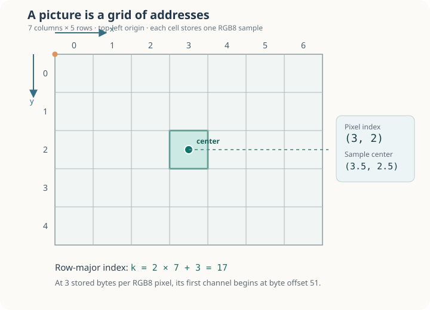
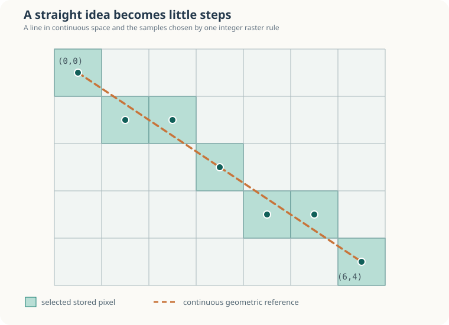

# Chapter 01 — The Picture Made of Little Windows

*From Geometry to Images*  
*Part I: From Coordinates to Shapes*

> **Imagine holding a picture so close that you can see the little squares. Now imagine being the computer that must decide what belongs in each one. That is where our story begins.**

## A letter from the other side of the screen

There is a small house at the end of a garden. Its roof is red. A ball sits on the grass. Behind the house, a tree leans slightly to the left. The sun has not set, but the windows are starting to glow.

A child can look at the scene and tell you what is there. The house is farther away than the ball. The tree is taller than the fence. If you walk two steps to the right, the house seems to slide left against the distant hill. The child probably does not call this *parallax*. They do not need to. They have already noticed the thing from which the mathematics will grow.

Now give the same scene to a computer.

A computer does not start with a house. It starts with numbers and operations. It has to be told where things are, which way it is looking, what is in front, and how all of that becomes the colored pattern on a screen. Before we can ask it to draw the house, we must answer a much smaller and rather charming question: **How do you draw even one dot?**

It sounds absurdly simple. Surely a computer that can run a 3D game can manage a dot. It can. But the dot has a secret: it lives in two worlds at once.

In one world, there is a mathematical picture. You can place a point anywhere, at positions such as (2.5, 1.25), even if no little square sits exactly there. In the other world, there is a finite grid of stored samples. The computer must choose addresses such as column 2, row 1 and put values there. Mathematical space is continuous; image storage is discrete. That distinction—small enough to miss at first—is the first great bridge between geometry and images.

We shall spend this chapter building the bridge. By the end, we will have a tiny C++23 picture-making program. It will draw simple shapes, save a real image file and answer questions such as “Which byte in memory is the blue part of that pixel?” We will also discover why diagonal lines can look like staircases. That last mystery will be our invitation to later chapters.

## Three different things hiding inside the word “image”

When someone says “image,” they may mean at least three different things. Confusing them makes camera and rendering code surprisingly painful.

**First, there is the scene.** The house, tree, ball and camera exist—or, in a game, are represented—as objects in space. The scene has geometry and perhaps light, materials and motion. It is not yet a picture. Turn your head and the scene can make a different picture without the objects changing.

**Second, there is a continuous image model.** Imagine an ideal picture plane in front of the camera. Every location on it could, in principle, be assigned a measurement or color. We might describe this as a function

\[
I(x,y),
\]

where \(x\) and \(y\) are coordinates on the plane. That is a mathematical model, not a giant array with infinitely many cells. Later, the camera will determine what \(I\) means through rays, projection, optics, visibility and light.

**Third, there is the stored image.** Your program must eventually hold a finite collection of samples. A simple picture might have 7 columns and 5 rows. The computer does not store “all values for every possible \(x\).” It stores a manageable number of values at specified addresses.

In the rest of the chapter, our stored image will be a two-dimensional grid. We will give it a width \(W\) and a height \(H\). An individual sample will have an integer address \((i,j)\), where \(i\) means column and \(j\) means row. These are not the same variables as the continuous coordinates \(x,y\). Keeping different letters for the two roles is a tiny act of kindness to our future selves.

The word *pixel* is used both for a picture element's storage address and for the small area associated with it. Both usages are common. Whenever precision matters, we will say *pixel index*, *pixel center*, *pixel footprint* or *stored sample*. A stored RGB triplet is not automatically the average light in a little square, and the little square is not a tiny physical object floating in the scene.

### The first picture: seven across, five down

Let us choose the simplest possible convention, and say it out loud.

Our image origin is at its **top-left corner**. Columns increase to the right. Rows increase downward. The valid pixel indices are

\[
0\le i<W,\qquad 0\le j<H.
\]

For a picture 7 pixels wide and 5 pixels high, the columns are 0 through 6 and the rows are 0 through 4. There is no column 7. There is no row 5. If you ask for either, you have stepped off the paper.

*Figure 1.1 — An image is an addressable grid, but the location of its sample is a continuous coordinate. The highlighted sample has row-major index 17 and its first RGB8 byte begins at offset 51. Original vector diagram; explicit top-left origin and units in pixels.*

This is a convention, not a physical law. Some graphics APIs use bottom-left origins for certain coordinates or images; some textures are stored or displayed with different orientation conventions. Our program will be honest about the one it uses, and later chapters will show how to convert between conventions rather than silently guessing.

Think of a theater with numbered seats. “Seat number 17” is one kind of address; “row 2, seat 3” is another. The seat is the same, provided the numbering convention is clear.

A two-dimensional image works much the same way. We usually store all the pixels in a single one-dimensional run of memory. Under our row-major convention, the linear pixel index is

\[
k=jW+i.
\]

Why? There are exactly \(W\) positions in a complete row. Before row \(j\), exactly \(j\) rows have gone by; they use \(jW\) positions. Then we move \(i\) places into the current row.

For our 7-by-5 picture, the sample at column 3, row 2 has index

\[
k=2\cdot 7+3=17.
\]

If we store three consecutive one-byte channel values for every pixel, its first channel starts at byte offset \(3k=51\). The second and third channels follow at offsets 52 and 53. We have now traced a place in a picture to a very specific place in memory.

**The important promise:** This arithmetic is valid only because we chose tightly packed RGB channels and row-major storage. A real API may add row padding for alignment, use a different channel order or pack color into another format. In that case the row stride in bytes and pixel format must be stated explicitly. Never smuggle \(3W\) into a renderer and assume every image uses it.

### How much memory does a picture need?

For the simple format we are building, every pixel stores three unsigned 8-bit channel values. Each channel occupies one byte. A tightly packed \(W\times H\) picture therefore needs

\[
N_{\text{bytes}}=3WH.
\]

A 1920-by-1080 RGB8 picture contains \(2{,}073{,}600\) pixels and \(6{,}220{,}800\) channel bytes, approximately 5.93 MiB. A 4000-by-3000 picture needs \(36{,}000{,}000\) bytes in this format, approximately 34.33 MiB. The dimensions tell you a great deal about memory before you have drawn a single thing.

You may notice that multiplying three integers is easy until the integers are absurdly big. If someone asks our little canvas to create a picture billions of pixels across, naive multiplication may overflow an integer before the computer even attempts the allocation. A well-behaved program should reject impossible dimensions *before* computing the allocation size. Our project does this with an explicit dimension and total-pixel limit. These are teaching limits, not universal maximum image dimensions.

**Tiny test for your intuition:** A 7-by-5 RGB8 picture needs exactly \(7\cdot5\cdot3=105\) channel bytes. If your program reports 35, it counted pixels but forgot the three channels. If it reports 140, perhaps it stored four channels per pixel instead. Neither is automatically wrong—but the representation must agree with the claim.

## Numbers that stand for color

We will begin with three channel names: red, green and blue. For our simple encoded RGB8 format, each channel is an integer between 0 and 255, inclusive. We can write a pixel as

\[
\mathbf c=(r,g,b),\qquad r,g,b\in\{0,\dots,255\}.
\]

The tuple \((255,0,0)\) is fully red in this encoding. The tuple \((0,0,0)\) is black. The tuple \((255,255,255)\) is white under the simple display interpretation used by many image tools.

Before our program starts, we must acknowledge what these numbers **do not** say. They do not tell us directly how many photons struck a sensor. They are not necessarily proportional to physical light intensity. A typical display-oriented encoding has a nonlinear transfer function; a different color space can use a different relationship altogether. We are using integer color values now because they are a wonderfully clear way to learn image storage. We will teach linear light, color spaces and camera response later rather than pretending all RGB numbers are interchangeable.

For now, imagine these values as instructions to a colored mosaic. They are useful even before we learn the physics of light.

## A pixel has an address, and a sample has a position

Return to column 3, row 2. If its integer address is \((3,2)\), where exactly does its sample sit in continuous image space?

We choose the center of the unit square associated with that address:

\[
(x_c,y_c)=\left(i+\frac12,\;j+\frac12\right).
\]

So pixel index \((3,2)\) has center \((3.5,2.5)\). The whole picture's continuous bounds run from 0 to \(W\) horizontally and from 0 to \(H\) vertically. A pixel with index \((i,j)\) corresponds to the half-open rectangular cell

\[
[i,i+1)\times[j,j+1).
\]

The word *half-open* is important: it includes the lower boundaries and excludes the upper ones. It helps us assign shared boundaries consistently and avoid counting a location twice. Not every raster algorithm uses this exact geometric convention; later, triangle edge rules will make boundary ownership explicit.

Here is a useful way to feel the difference: If a tiny ant walks from coordinate \(x=2.9\) to \(x=3.1\), it crosses a pixel boundary at \(x=3\), but its motion is smooth. Its position is a real number. The storage address you use to record the ant can change abruptly. The world did not teleport; only our discretization changed.

This matters tremendously when a camera projects a three-dimensional corner to \((143.6, 81.2)\). We cannot simply insist that cameras produce integers. They produce continuous projected positions; an image-making procedure decides which discrete samples are affected.

### A thought experiment: four colored stones

Place four colored stones at the centers of a 2-by-2 image. You can assign values without any trouble. Now draw a thin diagonal string between the top-left and bottom-right corners of that image. Which stones does it touch? That question depends on how you define touching, sampling and pixel coverage. A thin line has zero area in the mathematical plane; a visible line requires a rule for converting that ideal geometry into samples or footprints.

The string has exposed the problem of **rasterization**: converting geometry into a finite pattern of stored values. We begin with a pragmatic line algorithm; later we will return and derive proper sample coverage, triangle ownership and antialiasing.

## Our first C++23 drawing machine

The companion project is a small standard-C++ program, deliberately free of an OpenGL, Vulkan or Metal requirement. It has one purpose: let the computer create a picture while making every step inspectable.

The code lives at:

**Code Parts/tools/labs/book03_cpp23/**

The important building blocks are:

- A pixel is an RGB8 value with exactly three named channels.
- A canvas owns a flat sequence of pixels and knows its width, height and coordinate convention.
- A requested pixel address is validated; bad coordinates throw a documented out-of-range error rather than corrupt memory.
- A drawing operation modifies the canvas through named methods.
- An exporter writes a documented PPM image file so another image reader can display the result.
- A separate test executable checks valid and invalid cases, byte order, file structure and line endpoint behavior.

There is something quietly powerful about having a picture we can explain entirely. You can point to the red roof and say, “This byte was written because that coordinate passed this test.” Modern rendering pipelines are enormously sophisticated, but their correctness begins with the same kind of traceability.

### Why keep the pixel channels separate in code?

A beginner might reach for one big integer and squeeze color channels into it. There are good reasons to use packed formats in production, and later we will study them. For our first drawing machine, three named one-byte fields make the layout and serialization rules visible. The code writes the red, green and blue bytes explicitly. It does not assume that a structure has no padding or that memory order matches a file format.

Notice the difference between *being able to do something* and *knowing exactly why it is safe*. We chose explicit bytes to eliminate an unearned assumption, not because it is the fastest conceivable exporter.

### A picture of a very small house

Our first output uses a simple collection of shapes: a background, rectangular wall, window, door, and two roof edges. This is not yet a 3D house; it is a drawing in image coordinates. That is precisely the point. Before we build a camera that transforms 3D positions into pixels, we ought to master the very last step: how individual samples end up in a file.

We also draw a second picture consisting of a few diagonal lines. It looks intentionally rough. We need the roughness: it is the evidence that integer pixel selection is not the same as continuously drawing a line through space.

Our output format is **binary PPM (P6)**. It is not glamorous, but it is beautifully honest. The file begins with an ASCII header such as

~~~text
P6
7 5
255
~~~

followed by 105 bytes for that 7-by-5 RGB image. “P6” identifies binary PPM. The width and height state the sample grid. “255” states the maximum channel value. The following bytes store the red, green and blue channels of pixels in row-major order. Our writer always emits this header and this byte order, and checks the stream for failure.

Many image viewers can open PPM directly, and it is easy to convert to PNG later. The uncompressed simplicity is an advantage here: we can test the exact bytes. A compressed file format will come later when the story benefits from one.

## How to turn a mathematical line into stair steps

Suppose we want a line from integer pixel index \((0,0)\) to \((6,4)\). A mathematician can write the continuous segment as

\[
\mathbf p(t)=(0,0)+t(6,4),\qquad 0\le t\le 1.
\]

That formula gives infinitely many points along the segment. Our picture has only a finite set of sample addresses. We need to choose which pixels to color.

One naive idea is to march forward in very small floating-point steps, round each position and color its chosen pixel. But what step size is small enough? How do we avoid holes? What happens when the line is nearly vertical? This approach has choices we have not justified.

A classic alternative is a Bresenham-style integer line walker. Rather than stepping an arbitrary floating-point distance, it maintains an integer error quantity as it moves across the grid. When the accumulated mismatch indicates that the nearest grid path needs another step in the secondary direction, it takes that step. An implementation can work in all octants by keeping signs for x and y and considering both axes at every iteration.

The companion implementation uses:

\[
d_x=|x_1-x_0|,\quad d_y=|y_1-y_0|,
\]

with step directions \(s_x\) and \(s_y\) each equal to \(+1\) or \(-1\). It initializes an error as \(e=d_x-d_y\). At each visited integer coordinate, it doubles that error into a temporary \(e_2=2e\). The two comparisons against \(-d_y\) and \(d_x\) decide whether to advance x, y or both. The algorithm stops after drawing the endpoint.

It is worth tracing the example by hand. Starting from \((0,0)\), one tie convention yields the following sequence:

\[
(0,0),(1,1),(2,1),(3,2),(4,3),(5,3),(6,4).
\]

*Figure 1.2 — One mathematically straight line and the jagged selection of stored pixels that represents it under a particular integer decision rule. The orange line is a continuous reference between pixel centers; the teal cells are the actual selected addresses. This schematic is not a claim of area coverage or antialiasing.*

A child can draw these seven little marks on squared paper. A university student can inspect the integer decision variable and prove that each step reduces the remaining primary-axis distance. Both are studying the same algorithm at different depths.

Our first implementation requires line endpoints to lie **inside** the canvas. Why? Because accepting an arbitrarily distant coordinate without clipping could make the walker spend a very long time visiting positions the image does not contain. Later we will implement line clipping separately, explicitly and correctly. The early, smaller contract is easier to test and explain.

There is also a deeper honesty issue. This line drawing method chooses an attractive discrete route; it does not compute the exact geometric area covered by a continuous line of specified thickness. It cannot, by itself, promise smooth antialiasing or correct shared-edge ownership for a triangle mesh. That is not a defect we should hide. It is our next problem to solve.

### Try a mistake on purpose

Swap the width and height when computing a row-major offset. A 7-by-5 image might then place data in the wrong row, cause overlapping addresses, or attempt to access memory outside the valid range. A truly helpful geometry library should not require you to discover the problem only after a mysterious diagonal streak appears.

Our test suite checks positions near all four corners and explicitly rejects an address outside the image. In later chapters we will test geometric invariants in the same spirit: a rigid transform should preserve distances, an orientation predicate should agree with an independent exact reference, and a projected point should return to the expected ray under inverse camera mapping.

A beautiful picture is not permission to stop testing.

## Tests are a way of asking better questions

It is tempting to write a renderer, see the house appear and declare victory. We will do something stricter. We will make the little machine answer questions whose correct values are known in advance.

If we create a 3-by-2 image, fill it with black and set index \((2,1)\) to \((12,34,56)\), the final three data bytes of a correctly ordered PPM must be exactly 12, 34, 56. We do not need an image viewer to validate that claim; we can inspect the serialized file.

If we draw a zero-length line, it should color exactly its one endpoint. If we draw a horizontal line from the first column through the last, every intended pixel on that row should change and unrelated rows should remain unchanged. If we request a pixel at column \(W\), the program must reject it. If a stream fails while writing a file, the writer should report failure rather than return happily with a damaged output.

These tests are not decorative. They establish a precise bridge from the mathematical address and color tuple to actual file bytes. Later, our camera and rasterizer can rely on that bridge instead of wondering whether the display routine corrupted their result.

## From a grid of addresses to a universe of shapes

At this point you may be thinking, “But where is the 3D?” It is not hiding. We simply have not invented the camera yet.

Remember the little house. Its roof began as an idea; in our first program, we draw it as lines chosen directly in image coordinates. When we add geometry, its roof will become vertices and edges in a *model*. When we add transformations, we will be able to move and rotate that model in a *world*. When we add a camera, we will compute how the world appears from an eye-like viewpoint. When we add rasterization, those computed positions will become the very sample addresses we have learned to control.

The final stage of that long journey is already here: a finite grid with a clear origin, exact memory ownership, a declared format and independently checked output.

Everything else in this book is, in one way or another, a careful explanation of how the numbers arrive at this grid.

## Worked problems, with answers

**Problem A — A byte with an address.** Our image is 11 pixels wide and 6 pixels high. Where is the pixel at column 8, row 4 in a tightly packed RGB8 byte stream? Why?

There are four complete rows before row 4, each with 11 pixels. The pixel index is \(4\cdot 11+8=52\). Three bytes per pixel means the red channel begins at byte 156, green at 157, blue at 158. This answer depends on the row-major RGB8 contract. It would be different for padded rows or RGBA.

**Problem B — A camera's projected point is not an integer.** A mathematical camera projects a corner to \((4.2,3.8)\). What is its projected position? Which pixel contains it under our half-open unit-cell convention? Where is that pixel's center?

The continuous position remains \((4.2,3.8)\). It lies in cell \([4,5)\times[3,4)\), so the integer index is \((4,3)\) and its sample center is \((4.5,3.5)\). That does **not** prove the corner should affect only this pixel: line and triangle coverage require their own sampling rule.

**Problem C — A row has padding.** Imagine a 3-by-2 RGB8 image whose storage uses a 12-byte row stride rather than the natural 9 bytes. At what byte offset does row 1 begin?

At byte 12. The two-dimensional address-to-byte rule is now \(j\cdot12+i\cdot3\), not \(j\cdot9+i\cdot3\). A small change in representation changes the formula. That is why image format and row stride must be real API data, not buried guesses.

**Problem D — How big is the memory bill?** A 640-by-480 RGB8 image has \(640\cdot480=307{,}200\) pixels and \(921{,}600\) channel bytes. A second image of the same size, used for a different frame or intermediate result, costs another 921,600 bytes in this simple format. Now you can see why systems programming and graphics belong in the same seven-book journey.

## Build it, break it, explain it

**Reconstruct.** On graph paper, label a 7-by-5 image using our top-left convention. Identify the indices and center coordinates of each corner pixel. Derive the general byte-offset formula for a format with \(C\) channels of \(B\) bytes each and an explicit row stride \(S\). A correct answer is \(jS+iCB+cB\) for a channel index \(c\) under the given interleaved layout, assuming the channel bytes are contiguous and the format really uses that stride.

**Implement.** Compile and run P01. Modify one of the roof's endpoints. Predict which grid positions will change before generating the image. Then compare the resulting bytes and viewer image to your prediction. Explain any tie cases.

**Falsify.** Try zero width, an out-of-range pixel, a diagonal of zero length, a line whose endpoint is just outside the canvas, and an output stream that cannot accept data. The expected result is a documented rejection or safe behavior, never an invalid write.

**Transfer.** Change the canvas to use a four-channel RGBA8 struct, but make its exporter deliberately choose what to do with alpha instead of pretending PPM stores transparency. Derive its allocation size and channel offsets. Which routines can stay unchanged because they were written against the canvas contract rather than raw byte offsets?

**Explain.** Tell a curious child the difference between a world, a mathematical picture and the tiny stored dots. You may use the mosaic analogy, but finish with the truth: a camera can calculate a location between pixels, and an image-making algorithm has to decide how that continuous information is sampled.

### Laboratory evidence checklist

For this chapter, a credible lab report contains the compiler and CMake versions, the exact source revision, CTest output, byte-level PPM checks, a viewed generated image, the canvas coordinate contract and known limitations. Optional PNG conversion can help a reader open the file, but PNG conversion alone is not our geometry oracle.

**The expected outcome is not that every line looks smooth.** It is that the program makes predictable choices, and the reader can explain them.

## A final invitation

Think about a rainbow. You can see it all at once, but you cannot pick it up and put it in a box. To store a piece of it, you must choose where to look, what to measure and how many numbers to keep. Our tiny image is a box of measurements and choices. It is wonderfully useful. It is not the world.

Now we can ask a more adventurous question.

Our house has a roof drawn at fixed pixel addresses. Suppose we want to move the house two meters to the right, then turn it, then place a camera in front of it. Pixel indices cannot tell us what a meter is. They cannot tell us which way the roof faces. Before the computer can move a world, **we need a language for places and directions**.

That is where Chapter 02 begins.

---

### Chapter glossary

**Pixel index:** A discrete integer address \((i,j)\) identifying a sample slot in our image grid.  
**Pixel center:** The continuous position we use as the representative sampling location, here \((i+1/2,j+1/2)\).  
**Pixel footprint:** A spatial region associated with a sample or filter; it is not necessarily a physical solid square.  
**Row-major storage:** A layout that places successive columns of one row together, followed by the next row.  
**Row stride:** Number of bytes between the starts of adjacent rows, including any padding.  
**RGB8:** Three encoded color channels, each represented by an eight-bit unsigned integer.  
**Rasterization:** The conversion of geometric descriptions into contributions to discrete image samples.  
**Aliasing:** Artifacts caused by representing insufficiently sampled variation as lower-frequency or misleading patterns; we will derive its image-formation implications in later chapters.  
**PPM P6:** A simple binary portable pixmap format with a text header followed by RGB channel bytes.

### Reader references and scope

This is an original introductory explanation. Later source consolidation should connect it to the existing Book 03 legacy chapters on coordinate frames, projection and sampling, and provide verified primary citations for specific claims about image formats, APIs and camera models. The concrete PPM experiment follows the documented P6 subset taught here; it is not a full PNM parser or a color-management pipeline. The companion's code/test behavior must be inspected against the exact committed source and executed before being described as passing.

**Sources to reconcile during release editing:** existing AllMight camera/geometry chapters; Scratchapixel's geometric foundations; Berkeley CS184 graphics lectures; official C++ and PNM specifications; the current target graphics API definitions for any later cross-backend comparison. This list is an editorial queue, not a claim that each external source has been exhaustively reviewed in pass 01.
