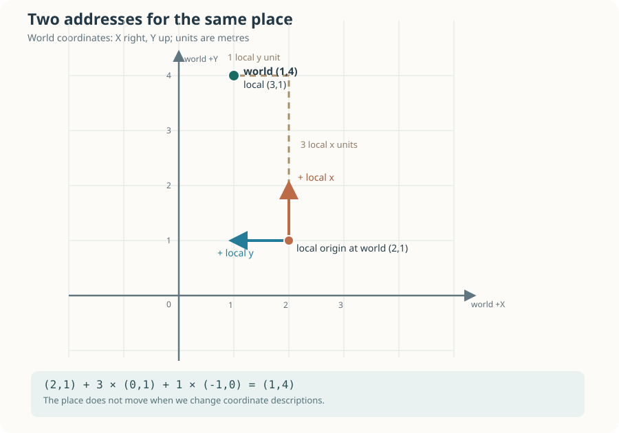
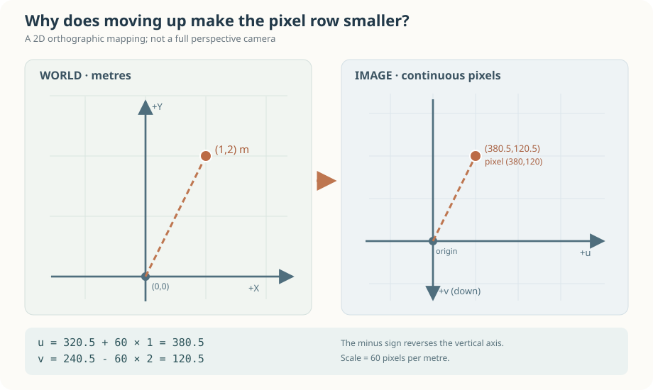

# Chapter 02 — Every Place Needs an Address

*From Geometry to Images*  
*Part I — From Coordinates to Shapes*  
*Chapter status: additive Book 03 authoring draft; existing long-form camera and geometry sources remain intact.*

> The little house is still on our screen. But try asking it to walk two metres to the left. It has no idea what a metre is. Yesterday it was only a patch of colored pixels. Today we are going to give it a place in the world.

## The day our house tried to move

In the previous chapter, we drew a tiny house by telling our canvas which addresses to color. We put one roof corner at a pixel, another roof corner at a different pixel, and joined them with a line. It worked. We could open the picture and see something recognizably house-shaped.

Then someone asked for a completely ordinary change.

“Could you move the house two metres to the right?”

Our little program stared back at us, as much as a program can stare. It knew about columns and rows. Its roof was at positions like (72,92) and (160,32). None of those numbers said *metres*. None said where the garden began. None said which way the house was facing, or which side was its front. If we blindly added two to a pixel column, we would move the roof by two **pixels**, not two metres. If the camera zoomed, the same real-world movement would cover a different number of pixels. We had given the machine a picture, but not yet a world.

That is the problem of this chapter. We need a way to describe **places**, **movements**, and **viewpoints**, and we need to know whose description we are using.

Before we write a matrix, imagine a child giving directions to a friend. “My toy is three steps forward and one step left.” That instruction is perfectly useful, provided the friend knows where the child is standing, which way the child is facing, and what counts as a step. If the friend turns around, “forward” suddenly points somewhere else. If an adult uses a much longer stride, three steps cover a different distance. The words are not bad. They are incomplete without a **frame** and a **unit**.

Mathematical coordinates work the same way. They are not magic names that objects carry around. They are descriptions of a location **relative to a chosen coordinate system**.

We will build that idea carefully enough that a child can imagine it, a programmer can represent it in C++23, and a mathematician can check every transformation.

## A place and a movement are not the same sort of thing

Suppose our ball sits on the grass at the world position

\[
P=(3,1)\ \mathrm{m}.
\]

It is three metres along our chosen horizontal world axis and one metre along our chosen vertical world axis from the world origin. We have not yet said anything about pixels.

Now imagine pushing the ball two metres to the right:

\[
\mathbf d=(2,0)\ \mathrm{m}.
\]

What is the new position?

\[
P'=P+\mathbf d=(5,1)\ \mathrm{m}.
\]

That looks trivial, but it hides an important distinction. \(P\) is a **point**, a place. \(\mathbf d\) is a **displacement vector**, a change in place. You may add a displacement to a point. If you have two points, you can subtract them to find the displacement between them:

\[
B-A=\overrightarrow{AB}.
\]

But adding two points has no generally meaningful, frame-independent interpretation. What would “the garden gate plus the tree” mean as a location? You can define their **midpoint** using a weighted affine combination, but that is an additional operation with its own meaning.

This is more than fussy terminology. A direction should not suddenly move just because you translate the world origin. If a triangle points upward, shifting the whole triangle to the right should change its **vertices**, not rotate or translate its **edge directions**.

A good library makes the distinction visible. In our project, a world-space point and a displacement are different C++ types. The interface allows “point plus vector” and “point minus point,” but it does not invent an unchecked “point plus point.” Sometimes a compiler error is the kindest geometry lesson a program can teach.

### A very small thought experiment

Write two sentences:

1. “The lamp is at three metres.”
2. “The lamp moved three metres.”

They have the same number. They describe different facts. The first needs an origin and direction. The second needs a direction and unit, but it makes sense without knowing the lamp's absolute address. A displacement is what connects two places.

Our source code will keep the two operations separate for precisely this reason.

## The mysterious origin

If you have played on a board with a square grid, you have already met a coordinate origin. You choose a starting square and call it (0,0). A location one square to the right might be (1,0). A location one square above might be (0,1).

Yet there is no universal sign over the universe saying “HERE IS ZERO.”

The origin is a *choice*. The orientation of the axes is another choice. So are the units. You can describe the same physical house using a coordinate grid centered at the garden gate, or a different grid centered at the house's front door. Either description can be correct. What matters is using the same convention consistently, and knowing how to convert between conventions.

Let us choose a world frame called \(W\) for our garden. Its origin sits beside a stone on the lawn. The positive world \(x\)-axis points right. The positive world \(y\)-axis points **up** on our page. We will use metres.

The image canvas from Chapter 01 uses a different convention. Its positive image \(u\)-axis also points right, but its positive image \(v\)-axis points **down**, because row zero is at the top. Its units are pixels rather than metres. Converting between these spaces requires both a scale and a flip of the vertical direction.

We will never disguise that transformation as “just add the pixel position.” The drawing may look okay for one carefully chosen example, then turn upside down as soon as the camera changes.

## What is a coordinate frame?

A coordinate frame is a named reference for positions and directions. For our current two-dimensional world, it consists of an origin and two basis directions.

Call a local frame \(L\). Relative to the world \(W\), let its origin be the world point \(\mathbf o_W\). Let the local x-axis, expressed in world coordinates, be the vector \(\mathbf e_x\). Let the local y-axis, expressed in world coordinates, be \(\mathbf e_y\).

The word **basis** sounds more alarming than it is. Imagine standing on a square of paper. You put down one arrow labeled “one local step right” and another labeled “one local step up.” Those two arrows tell you what the local coordinate numbers *do* in the world. If you know the arrows and the local origin, you can find any local point.

For a point with local coordinates

\[
\mathbf p_L=\begin{bmatrix}a\\b\end{bmatrix},
\]

its world location is

\[
\boxed{\mathbf p_W=\mathbf o_W +a\mathbf e_x+b\mathbf e_y.}
\tag{2.1}
\]

Read the equation as a sentence: start at the local origin, walk \(a\) times along the local x-axis, then \(b\) times along the local y-axis. The result is a world point.

This equation is a wonderful foundation for later 3D transforms. It also gives us a direct test: if \(a=b=0\), the local origin must map to \(\mathbf o_W\). If that does not happen, the code is wrong or the frame was described incorrectly.

### Rotate the paper, not the universe

Place a little house on a sheet of graph paper. We define its front door in the house's own local coordinates, perhaps at \((3,1)\) metres. Now rotate the whole sheet a quarter-turn counterclockwise without moving the house relative to the paper. Its local coordinate stays \((3,1)\). The house did not change. Only the relation between the sheet and the garden changed.

Suppose the local origin is at world position \((2,1)\) metres and the local axes, in world coordinates, are

\[
\mathbf e_x=(0,1),\qquad \mathbf e_y=(-1,0).
\]

This is a 90-degree counterclockwise rotation of the usual axes. The local point \((3,1)\) maps to

\[
\begin{aligned}
\mathbf p_W
&=(2,1)+3(0,1)+1(-1,0)\\
&=(2,1)+(0,3)+(-1,0)\\
&=\boxed{(1,4)\ \mathrm{m}.}
\end{aligned}
\tag{2.2}
\]

We can draw this result with arrows. We can also ask our C++23 program to compute it and verify that the world point converts back to local \((3,1)\).

*Figure 2.1 — Two different addresses for one physical place. The local frame starts at world (2,1) metres. Its x-axis points world-up and its y-axis points world-left. Walking three local x units and one local y unit arrives at world (1,4). The axes and points are exact geometric constructions, not decorative arrows.*

This is what a transformation really accomplishes: not a vague “make the numbers different,” but a precise translation between descriptions.

## A matrix is a convenient package for the arrows

Our formula can be written using a matrix by placing the two basis vectors side by side as columns:

\[
A=\begin{bmatrix}
e_{x,x}&e_{y,x}\\
e_{x,y}&e_{y,y}
\end{bmatrix}.
\]

Then

\[
\boxed{\mathbf p_W=\mathbf o_W+A\mathbf p_L.}
\tag{2.3}
\]

The columns of \(A\) say where the local basis axes go. This is not arbitrary notation: matrix multiplication actually takes the weighted sum \(a\mathbf e_x+b\mathbf e_y\).

For the quarter-turn example, the matrix is

\[
A=\begin{bmatrix}0&-1\\1&0\end{bmatrix}.
\]

Multiply it by \((3,1)\) and you get \((-1,3)\). Add the origin \((2,1)\) and you get \((1,4)\), exactly as before.

Notice something subtle: the matrix \(A\) describes the **linear** part of the mapping. The origin describes the **translation**. We should not apply the translation to a displacement. A displacement from one point to another transforms as

\[
\boxed{\mathbf d_W=A\mathbf d_L.}
\tag{2.4}
\]

If you move the coordinate frame's origin, a local displacement should still map to the same world displacement if the axes have not changed. That is an easy property to test and a common bug when code treats all pairs of numbers as identical “positions.”

### Why our code prefers column vectors here

The equation above uses column vectors, and its matrix columns correspond to basis directions. Some codebases use row-vector conventions. Both can be made consistent. The failure comes from reading a matrix produced for one convention as though it obeyed the other. Memory storage layout—row-major or column-major bytes—is yet another separate choice. We should never infer algebraic multiplication order from the spelling of a storage container.

Our C++ companion uses named axes rather than hiding the meaning inside an unannotated four-number array. Later, when we move to \(3\times3\) and \(4\times4\) transforms, the same distinction will be essential.

## How do you find the local address again?

It would be suspicious if we could turn local points into world points but could never turn them back.

Given a world point, subtract the local frame's origin:

\[
\mathbf q=\mathbf p_W-\mathbf o_W.
\]

Now we need local coefficients \(a,b\) such that

\[
A\begin{bmatrix}a\\b\end{bmatrix}=\mathbf q.
\]

If the two basis arrows are independent, the matrix has an inverse. For

\[
A=\begin{bmatrix}a&b\\c&d\end{bmatrix},
\]

its determinant is \(\Delta=ad-bc\). When \(\Delta\neq0\),

\[
A^{-1}=\frac1{\Delta}\begin{bmatrix}d&-b\\-c&a\end{bmatrix}.
\]

So the local point is

\[
\boxed{\mathbf p_L=A^{-1}(\mathbf p_W-\mathbf o_W).}
\tag{2.5}
\]

This is the general formula. A pure rotation makes it particularly simple because a rotation matrix is orthogonal: \(R^{-1}=R^\mathsf T\). But we must **not** use a transpose as an inverse for a sheared or nonuniformly scaled basis. Those axes are not mutually perpendicular unit arrows, so the shortcut would be wrong.

Try a frame whose origin is \((1,2)\), whose x-axis vector is \((2,0)\), and whose y-axis vector is \((1,1)\). The local point \((3,-1)\) maps to

\[
(1,2)+3(2,0)-(1,1)=(6,1).
\]

The matrix is \(A=\left[\begin{smallmatrix}2&1\\0&1\end{smallmatrix}\right]\). Its determinant is 2. Subtracting the origin from the world point gives \((5,-1)\); multiplying by the real inverse recovers \((3,-1)\). Transposing this matrix does not do that. A numerical test should catch the mistake immediately.

### The frame that becomes a line

Now for a failure that tells us something geometric.

Suppose both local axes point in the same direction, perhaps

\[
\mathbf e_x=(1,0),\qquad \mathbf e_y=(2,0).
\]

You can walk a local x step or a local y step, but both take you along the same world line. Your frame no longer spans the plane. Multiple local coordinates describe the same world point. There is no unique way back.

The determinant is zero. The inverse does not exist.

This is not a reason to “add a tiny epsilon” blindly and declare success. It is a geometric fact: you collapsed two-dimensional space onto one dimension. A nearly collapsed frame may technically be invertible but extremely sensitive to rounding. Our small lab rejects nonfinite and insufficiently independent axes using a documented numeric threshold, while the broader numerical conditioning theory belongs to Book 2.

**A useful question to ask while debugging:** Is my transform wrong because I wrote an incorrect formula, or because the input transform never had a trustworthy inverse in the first place? The repair is very different.

## Units, units, units

We are going to repeat one point in an ordinary voice because it saves extraordinary amounts of pain: **five is not a distance until we know what it means**.

In our world frame, positions and displacements are measured in metres. In our image frame, continuous coordinates are measured in pixels. The frame's basis vectors in our implementation are dimensionless coefficients: they turn one metre of local coordinate displacement into a world displacement in metres. The image mapping uses *pixels per metre*, a scale whose units matter.

Consider a world displacement \(\Delta x=2\ \mathrm m\). If we display the world at 40 pixels per metre, it spans 80 pixels horizontally. If we zoom to 100 pixels per metre, the same world displacement spans 200 pixels. The house has not grown; the mapping from the world to the image has changed.

A code variable simply named \`scale\` hides this relationship. A field named \`pixels_per_metre\` tells the reader what they are allowed to multiply.

### A doorway into dimensional reasoning

Suppose the calculation is

\[
u=u_0+s_xX.
\]

Here \(u\) and \(u_0\) are in pixels, \(X\) is in metres, and \(s_x\) is in pixels per metre. Multiplying \(s_xX\) produces pixels, which can be added to \(u_0\). The units agree.

If someone instead writes \(u=u_0+X\), they are adding pixels to metres. It may compile. It does not mean what they think.

Units are often enforced only through naming and testing in introductory projects, but production geometry systems can introduce stronger wrappers and dimensional types. Our point/vector distinction is the first step.

## The surprise: “up” depends on which world you mean

The child sees a balloon rising. In the garden world, rising means its \(Y\) coordinate increases. On the image canvas, moving toward the top means its row coordinate **decreases**.

We will make a very simple two-dimensional *view mapping* from world metres to continuous image pixel coordinates. This is not a 3D camera yet. Think of it as an orthographic drawing of a flat world.

Choose the world origin's continuous image location to be \((u_0,v_0)\). Let \(s_x,s_y\) be positive scales in pixels per metre. Then

\[
\boxed{
u=u_0+s_xX,\qquad v=v_0-s_yY.
}
\tag{2.6}
\]

The minus sign in \(v\) is not decoration. It converts the upward world axis into the downward image axis.

Let's choose

\[
(u_0,v_0)=(320.5,240.5),\qquad s_x=s_y=60\;\mathrm{pixels/metre}.
\]

A world point \((1,2)\ \mathrm m\) goes to

\[
u=320.5+60(1)=380.5,\quad v=240.5-60(2)=120.5.
\]

Its continuous image position is \((380.5,120.5)\), which is precisely the center of pixel **index** \((380,120)\) under our Chapter 01 convention.

*Figure 2.2 — This is an orthographic **2D teaching map**, not a perspective camera. A positive world Y displacement moves a point upward in the image, reducing its row coordinate. The world (1,2) metre point lands at continuous image location (380.5,120.5), the center of stored pixel (380,120), with the stated image origin and 60 pixels per metre.*

We can reverse the mapping as long as both scales are nonzero:

\[
X=\frac{u-u_0}{s_x},\qquad Y=\frac{v_0-v}{s_y}.
\tag{2.7}
\]

But there is a trap waiting at the edge of the picture. A continuous projected position does not always belong to a pixel in the finite image. If \(u<0\) or \(u\ge W\), or \(v<0\) or \(v\ge H\), it lies outside the image domain. A well-defined mapping returns “outside,” rather than casting a negative coordinate to a huge unsigned array index.

When an image coordinate lies inside, we can assign it to a half-open pixel cell by taking its floor:

\[
i=\lfloor u\rfloor,\qquad j=\lfloor v\rfloor.
\tag{2.8}
\]

This is a choice of cell ownership, not a complete rendering algorithm. When a projected triangle covers an area, many pixels may receive contributions; when a point lies exactly on an edge, coverage rules need careful treatment. The Chapter 01 distinction between mathematical location and discrete storage has not disappeared. It has become even more important.

### A tiny question with a very large answer

What if we rotate the house but keep the camera still? What if we rotate the camera and keep the house still? What if both rotate? Every case changes the relationship between coordinate frames.

That is why modern renderers do not simply store “the screen x coordinate” for every 3D vertex. They store geometry in a meaningful local space, then apply a chain of transformations that say what each description means.

## Frames inside frames: a family of little worlds

Imagine that the little house has a window. The window is made from four points in its own convenient local coordinate system. The house itself sits in the garden. The garden may belong to a moving platform in a game. The camera watches it all from yet another place.

We have a tree of relationships:

\[
\text{window local} \longrightarrow \text{house local}
\longrightarrow \text{garden world} \longrightarrow \text{camera} \longrightarrow \text{image}.
\]

We have not derived the final 3D camera transform yet. But the first two arrows are already examples of our two-dimensional frame mapping. To find a window corner in the garden, we must first map its window-local coordinates into the house, and then map its house-local coordinates into the garden.

Writing parent transformation \(F\) and child transformation \(G\), we mean

\[
\mathbf p_W=F\big(G(\mathbf p_{\text{child}})\big).
\]

It is **not** generally the same as \(G(F(\mathbf p))\).

In the most familiar example, take a point \((1,0)\). A quarter-turn counterclockwise sends it to \((0,1)\). Moving it two units right afterward gives \((2,1)\). But if you move it right first to \((3,0)\), then rotate, you get \((0,3)\). Both operations are well-defined; their *order* changes the result.

\[
T_{(2,0)}(R_{90^\circ}(1,0))=(2,1),
\]
\[
R_{90^\circ}(T_{(2,0)}(1,0))=(0,3).
\tag{2.9}
\]

If those two numbers surprise you, draw them as arrows on paper. You do not need to memorize “matrix multiplication is noncommutative” as a mysterious commandment. You can see that moving a turned paper model is different from turning a moved model around the origin.

### Composition without mysterious algebra

Let a parent frame \(F\) have origin \(\mathbf o_F\) and basis matrix \(A_F\), and a child frame \(G\) have origin \(\mathbf o_G\) and basis \(A_G\), both measured in their appropriate parent coordinates.

The combined frame has

\[
A_{FG}=A_FA_G,\qquad
\mathbf o_{FG}=\mathbf o_F+A_F\mathbf o_G.
\tag{2.10}
\]

The formula falls straight out of substitution:

\[
F(G(\mathbf p))=
\mathbf o_F+
A_F(\mathbf o_G+A_G\mathbf p)=
(\mathbf o_F+A_F\mathbf o_G)+(A_FA_G)\mathbf p.
\]

This is the foundation of a scene graph. A model's vertex can remain in local coordinates while the parent object moves, and the world-space result follows from composing transforms. Later chapters will lift this idea to three dimensions and homogeneous \(4\times4\) transforms. The meaning—“whose frame is this in?”—will not change.

## What about homogeneous coordinates?

In Book 2 you have met matrices. You may be wondering how translation and rotation can eventually fit into one multiplication. The trick is to extend a two-dimensional point with one extra coordinate:

\[
\widetilde{\mathbf p}=
\begin{bmatrix}x\\y\\1\end{bmatrix}.
\]

For an affine transform with linear part \(A\) and translation \((t_x,t_y)\), use

\[
H=\begin{bmatrix}
a_{00}&a_{01}&t_x\\
a_{10}&a_{11}&t_y\\
0&0&1
\end{bmatrix}.
\tag{2.11}
\]

Then \(H\widetilde{\mathbf p}\) combines the linear part and translation. A displacement is represented with a final zero instead:

\[
\widetilde{\mathbf d}=(d_x,d_y,0)^\mathsf T.
\]

Because its last coordinate is zero, translation makes no contribution when we transform it. The math reflects the original difference between a point and a vector.

You should not feel obliged to memorize every matrix entry now. The important thing is that the extra coordinate has a job. Later, a **3D projective** camera will use four-dimensional homogeneous clip coordinates, and its final division by \(w\) will do something that an ordinary affine transform cannot. For now, we are dealing with affine frames and an orthographic 2D image mapping. We will not pretend that this already is a complete perspective renderer.

## The actual C++23 coordinate playground

We are going to replace vague diagram talk with a real little machine.

In the existing Book 03 companion directory, **Code Parts/tools/labs/book03_cpp23/**, Chapter 01 already gave us a canvas and a binary image writer. Chapter 02 adds a frame mathematics header, an executable that can examine a moving local coordinate system, and tests that show exactly when two descriptions denote the same point.

The design is intentionally small:

* \`WorldPoint2\` describes a place measured in world metres.
* \`WorldVector2\` describes a displacement or basis direction, with units stated by the operation.
* \`Frame2\` owns an origin and two basis vectors. It can map local points to world points, transform vectors without translation and invert a nondegenerate mapping.
* \`ImageMap2\` converts world metres into continuous image pixel positions, then explicitly tests whether a position belongs to a stored sample cell.
* A CLI visualization draws the world axes, local axes, the house-like triangle, and the transformed vertices into an SVG diagram that can be inspected alongside exact numeric output.

Why SVG? Because this chapter is about coordinate transformations, and a vector figure can use the same world-space points that the C++ program computes. The application is interactive through its command-line commands: change the frame origin or angle, ask where a local point lands, and generate a new diagram. A browser viewer or future native editor can sit on top of the same mathematics, but it should not secretly introduce a second, inconsistent transform implementation.

### Read the API like a sentence

The full implementation belongs in the companion source rather than being duplicated across hundreds of book pages. Here is the conceptual use pattern:

~~~cpp
#include "book03/frame_math.hpp"

// The toy house has a frame whose origin is two metres right and one
// metre up in the garden. Its axes are rotated a quarter-turn CCW.
const auto house = book03::Frame2::rotation(
    book03::WorldPoint2{2.0, 1.0},
    book03::degrees_to_radians(90.0));

// This point is measured in house-local metres, not image pixels.
const book03::WorldPoint2 local_corner{3.0, 1.0};

// Convert it to a place in the garden. The expected answer is (1,4).
const auto world_corner = house.local_to_world(local_corner);

// We can ask the inverse question and recover (3,1), apart from
// normal bounded floating-point rounding.
const auto recovered = house.world_to_local(world_corner);
~~~

Do you see what is different from the Chapter 01 drawing program? We are not naming pixel addresses. We are naming a **place in an object's world**. Only after we decide how that world is viewed will a pixel index enter the story.

### Numbers you can check without trusting me

The project tests the quarter-turn example in equation (2.2), including inverse recovery. It tests a nonorthogonal basis for which using the transpose would be wrong. It checks that translating a frame moves points but not displacement vectors. It compares composed parent/child transformations against direct sequential application. It checks the world-up/image-down mapping, including a noninteger continuous position, image bounds and invalid scaling.

Finally it tests the difficult cases on purpose: a collapsed basis with no inverse, a frame containing infinity or NaN, bad image dimensions and a point that projects just beyond the image edge. A correct refusal is a better lesson than a plausible-looking wrong diagram.

### A friendly warning about precision

With a quarter-turn, the computer's \`cos\` and \`sin\` functions may not produce exact 0 and 1 in binary floating-point. A test should compare within a meaningful tolerance for that operation; it should not demand bit-identical answers from approximate trigonometry. By contrast, integer pixel indices and explicitly serialized file bytes should be checked exactly.

The test suite therefore uses two kinds of evidence. **Exact checks** assert discrete identities and contract behavior. **Tolerance checks** assert bounded floating-point numerical behavior, with the meaning of the tolerance documented. That is the habit we carry forward into cameras, projection and reconstruction.

## Worked examples that earn their pages

**Example 1 — A child walks in a turned room.** A toy is at local coordinates \((2,0)\) metres. The room's frame has origin \((5,3)\) metres, local x-axis \((0,1)\) and local y-axis \((-1,0)\). Where is the toy in the world?

Using (2.1),

\[
(5,3)+2(0,1)+0(-1,0)=\boxed{(5,5)\ \mathrm m}.
\]

The toy did not “become” a different toy. We supplied a world address for the same toy.

**Example 2 — A camera drawing points downwards.** The image's world origin is at continuous pixel location \((100.5,80.5)\), and the scale is 20 pixels per metre on both axes. A balloon is at world position \((1,2)\) metres. Its image point is

\[
(100.5+20,\ 80.5-40)=\boxed{(120.5,40.5)}.
\]

So it belongs to pixel index \((120,40)\). If you accidentally used a plus in the second component, it would appear below the origin rather than above it.

**Example 3 — Two roads to the same place.** A parent frame is a 90-degree counterclockwise rotation with origin \((10,0)\). A child frame, expressed relative to that parent, has a local origin \((2,0)\) and is itself rotated 90 degrees. Its world origin becomes \((10,2)\), and its axes form a 180-degree rotation. A child-local point \((1,1)\) therefore maps to \((9,1)\).

Check by the long route. Child \((1,1)\) first maps through its rotated child frame to parent-local \((1,1)\) (the child's origin \((2,0)\) plus the 90-degree-rotated \((-1,1)\)). Parent transforms \((1,1)\) into world \((9,1)\). Same answer. The composed transform did not change the meaning.

**Example 4 — An object whose transform forgets one dimension.** A frame has x-axis \((1,0)\), y-axis \((2,0)\), and origin \((0,0)\). It maps local \((0,1)\) and \((2,0)\) to the same world \((2,0)\). That is why no inverse can return one unique local point. The failure is geometric, not merely “division by zero.”

**Example 5 — Why midpoint is legal but point addition isn't.** The midpoint of points \(A=(1,1)\) and \(B=(5,3)\) is \(A+\tfrac12(B-A)=(3,2)\). It is a point plus a scaled displacement. We can also write \(\tfrac12 A+\tfrac12 B\) as an *affine combination* because its weights sum to one. An arbitrary \(A+B\) has no such invariance under shifting the coordinate origin; it changes by twice the origin shift. That is why our C++ interface makes midpoint an explicit construction rather than inventing a general point-plus-point operator.

## Build it, break it, explain it

**Reconstruct — three sketches, one actual place.** Sketch the 90-degree example in Figure 2.1. Mark the local origin and basis arrows, then walk to local \((3,1)\) graphically. Derive the matrix from those arrows. Verify the world result without trusting either sketch or code. A correct explanation identifies which values are world points, which are basis directions and which quantities have metres as units.

**Falsify — make the inverse lie.** Use a sheared basis with columns \((2,0)\) and \((1,1)\). Attempt to recover local \((3,-1)\) by transposing the basis matrix rather than computing its inverse. Show the wrong result. Then make the two basis columns linearly dependent and explain why *no* inverse is possible, no matter how clever the implementation is.

**Transfer — a room inside a train.** Give a room a local frame inside a train, then give the train a world frame. Use composition to find a chair's world position. Move the train without editing the chair's local coordinates. Where does the chair end up? If the chair's *position* changes but its local *orientation* doesn't, what must the transform hierarchy store?

**Implement — pixel and world round-trip.** Take the world point \((1,2)\) metres and send it through our 60 pixels-per-metre map. Recover world coordinates from the continuous mapped position. Check both directions numerically, then assign the resulting continuous image position to a discrete pixel cell. State separately which operation loses precision or spatial information.

**Explain — the toy and the garden.** Explain to a younger reader why the toy can be at \((3,1)\) in its own house and \((1,4)\) in the garden without being in two places at once. If your explanation makes the toy appear to teleport, try again using a rotated sheet of paper.

### Selected answers and checking criteria

The quarter-turn inverse must recover local \((3,1)\) from world \((1,4)\), subject to floating rounding. The sheared frame matrix is \(\left[\begin{smallmatrix}2&1\\0&1\end{smallmatrix}\right]\); it is not orthogonal and therefore cannot be inverted by transpose. The world-image example \((1,2)\) metres goes to \((380.5,120.5)\), which maps to integer pixel address \((380,120)\) under our declared half-open pixel-cell convention. The world-image inverse returns \((1,2)\) when run on that continuous location. The singular frame has determinant zero, and any program returning a unique local coordinate is making an unsupported claim.

A particularly useful grading criterion is to ask: “Can I label every number with its coordinate frame and unit?” A diagram or program that cannot answer that has not finished the problem, however attractive its picture appears.

## The next door

Our paper house can finally move, turn and tell the truth about where it is. We can keep its roof corners in house-local coordinates. We can place the house in the garden with a frame. We can convert world locations into image coordinates for a simple flat drawing. And we can explain what happens if someone mixes units, reverses the image axis or asks an impossible inverse question.

There is just one slight difficulty.

The roof in our original drawing was made from a handful of lines. A real roof is a shape. The ball has a curved boundary. A triangle knows which side is inside and which side is outside. If we place three corners in the world, which of the tiny image squares belong to the triangle?

That question will take us to **Chapter 03 — Shapes That Know Their Borders**. We will put our new language for places to work, derive oriented area and barycentric coordinates, and build an interactive shape inspector that can make a triangle tell us whether a point is inside it. Later, those exact same ideas will help a 3D rasterizer decide which pixels a surface covers.

The world did not become more complicated because we introduced coordinates. We simply learned to ask it clearer questions.

---

## Chapter 02 glossary

**World frame:** A declared global reference in which a scene's positions and displacements are expressed. It is chosen for a task, not physically privileged.

**Local frame:** The reference attached to an object, part or nested coordinate system.

**Point:** A position relative to a frame; translations change its numeric coordinates.

**Displacement vector:** A difference between positions; its transform uses the linear basis, not the origin translation.

**Basis vectors:** Independent vectors that define the directions and scales represented by local coordinate axes.

**Affine transform:** A mapping \(p\mapsto o+Ap\) that combines a linear map and a translation and preserves affine relationships.

**Determinant:** For a two-by-two matrix, \(ad-bc\). Zero means its columns are linearly dependent and its inverse cannot exist.

**Composition:** Applying one transform through another, preserving the specified order of frames.

**World-to-image map:** A declared mapping from world coordinates to continuous image coordinates; ours is a simple 2D orthographic teaching example.

**Pixel index:** An integer storage address. It is obtained from a continuous image position only after a cell-ownership rule and image bounds are specified.

**Homogeneous coordinate:** An extended representation that allows affine translations to be encoded in matrix multiplication; later projective transformations use an additional division step.

## Source custody and further reading

The original long-form AllMight chapter **“Geometry Becomes an Image and an Inverse Problem”** in \`Notes/Chapter Edition/01 - Computing Foundations/32 - Geometry Becomes an Image and an Inverse Problem.md\` and its continuation **“Projection, Clipping, and Raster Sampling”** are preserved as source-derived reading copies. They establish the later 3D camera convention (right-handed world, view down local \(-Z\), column vectors, explicit origin and image conventions). The pre-existing **“Camera Extrinsics and Projection Geometry”** further distinguishes camera center from world-to-camera extrinsic translation. This chapter is an *additive, narrative first-principles bridge* and deliberately stays in 2D affine space until those full 3D concepts have a proper beginning.

Suggested source families to verify and connect during the technical bibliography pass: the official C++ reference for numeric types and overflow; Scratchapixel's frames and camera explanations; conventional linear algebra texts for affine spaces and basis change; Berkeley CS184 transform lectures; the real KairoMath/KairoGeometry transformation implementations at a pinned revision. No specific borrowed result is certified solely from naming a source here.

**Read next:** Chapter 03 — Shapes That Know Their Borders (planned).  
**Lab:** \`Code Parts/tools/labs/book03_cpp23/\` (P02 frame playground).
