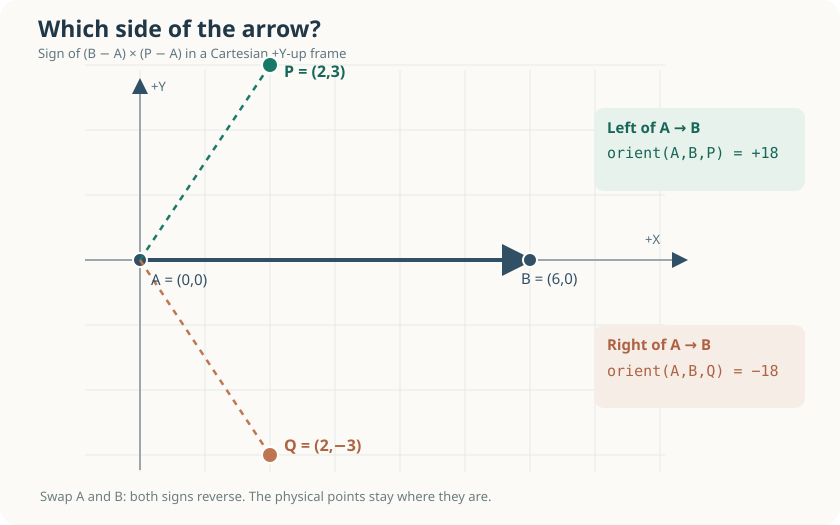
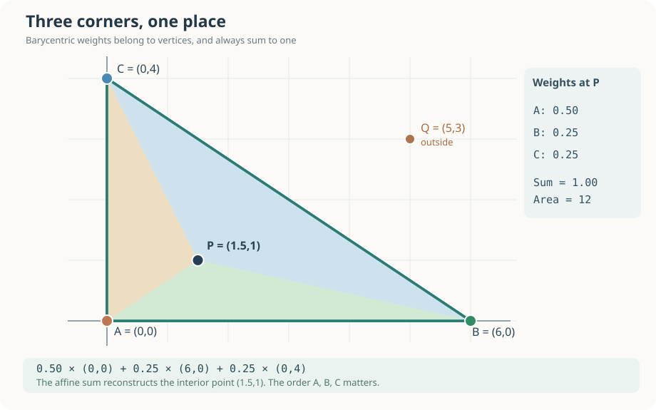

# Chapter 03 — Shapes That Know Their Borders

*From Geometry to Images*  
*Part I — From Coordinates to Shapes*  
*Chapter state: additive authoring draft. The original computational-geometry and rasterization chapters remain authoritative, preserved, and pending source-unit reconciliation.*

> Three little dots are enough to make a kingdom. The strange part is not connecting them; it is teaching the computer which side of the border belongs to whom.

## The little house acquires a roof

We have come a surprisingly long way with a paper house.

First, in Chapter 01, it was only a picture. We picked pixel addresses and colored them. We learned to distrust an image that could not explain its own bytes. Then, in Chapter 02, the house acquired a place. We gave it a local frame, moved its origin into the garden, and made its coordinates meaningful. We learned that a point is not a movement and that “up” depends on whose coordinate system is speaking.

Now imagine that the house needs a proper roof. In our first program the roof was a pair of lines. If you look carefully, you can still see the sky through the space between them. A real roof—at least a simplified roof in a computer model—occupies an *area*. It has an inside.

Take three little nails, push them into a board, and stretch a rubber band around them. You have made a triangle. If you put a bead somewhere on the board, you can ask a question so ordinary that it almost seems silly: **Is the bead inside the rubber band?**

You can answer by looking. A computer cannot “just look” in the way you do. It needs an exact procedure.

The simplest useful way to make the roof solid begins not with paint, but with a sign: positive, negative or zero.

That small sign will grow into triangle areas, polygon winding, barycentric coordinates, interpolation, hit tests, collision queries and eventually GPU rasterization. It is one of the most useful ideas hiding inside visual computing.

## A line is a border only when it has a direction

Draw two points on paper, \(A=(a_x,a_y)\) and \(B=(b_x,b_y)\). Join them. So far, this is an ordinary line segment.

Now add an arrow from \(A\) to \(B\). Suddenly the segment has a direction. Imagine a tiny person walking along it: their *left* and *right* are now meaningful.

A third point \(P\) can sit to the left of the directed edge, to its right, or precisely on the infinite line through the edge. How could a computer decide which?

The answer comes from the two displacement vectors

\[
\mathbf u = B-A,\qquad \mathbf v=P-A.
\]

In the Chapter 02 language, both are legitimate displacements obtained by subtracting points. We are working in a Cartesian frame with \(x\) right and \(y\) **up**, not in an image frame with row numbers increasing downward.

Form a small two-by-two determinant:

\[
\boxed{\operatorname{orient}(A,B,P)
  =(b_x-a_x)(p_y-a_y)-(b_y-a_y)(p_x-a_x).}
\tag{3.1}
\]

Let us name the result \(D\). For finite, exact Cartesian coordinates, if \(D>0\), the point \(P\) is left of the oriented edge \(A\to B\). If \(D<0\), it is to the right. If \(D=0\), the three points are collinear.

Why should that formula have anything to do with left and right? The expression measures an *oriented area scale*: the parallelogram spanned by \(\mathbf u\) and \(\mathbf v\) has signed area \(D\). Swapping the two vectors reverses the sign, like turning a page over. If we set \(A=(0,0)\) and \(B=(1,0)\), then the formula reduces to \(D=p_y\). A point above the arrow has a positive height; a point below has a negative height. Rotating or translating the entire picture in a way that preserves orientation does not change the fundamental left/right distinction.

A sign has become a geometric decision.

### Our first worked border

Set

\[
A=(0,0),\quad B=(6,0),\quad P=(2,3).
\]

Then \(B-A=(6,0)\), \(P-A=(2,3)\), and

\[
D=6\cdot3-0\cdot2=\boxed{18}.
\]

Positive: \(P\) is above—and therefore left of—our arrow pointing to the right.

Now place \(Q=(2,-3)\). Its determinant is \(-18\). The arrow has not moved, but the bead has crossed its border.

What happens if we reverse the arrow? The determinant reverses sign:

\[
\operatorname{orient}(B,A,P)
=-\operatorname{orient}(A,B,P).
\tag{3.2}
\]

This is **not** an implementation accident; it is a mathematical property. If our tests do not preserve it, our predicate is broken.

*Figure 3.1 — The sign of an oriented area answers a left/right question. All labels and coordinates use a world-like Cartesian plane with +Y upward; image pixel-row conventions are deliberately not substituted.*

## Three edges turn questions into a triangle

Let the roof be a triangle with corners \(A\), \(B\) and \(C\). Walking around its boundary in the order \(A\to B\to C\to A\) gives its **winding**.

In a world frame with \(y\) up, the signed twice-area is

\[
D=\operatorname{orient}(A,B,C).
\tag{3.3}
\]

The ordinary, unsigned area is

\[
\boxed{\mathcal A=\frac12 |D|.}
\tag{3.4}
\]

If \(D>0\), the three vertices have counterclockwise winding. If \(D<0\), they have clockwise winding. If \(D=0\), the triangle has zero area: its corners lie on a line, or some have collapsed to the same position.

Take a right triangle:

\[
A=(0,0),\qquad B=(6,0),\qquad C=(0,4).
\]

Its base is six metres and its height is four metres. A child may already know the area formula from folding a rectangle diagonally:

\[
\mathcal A=\frac{6\cdot4}{2}=12\ \mathrm{m^2}.
\]

Our oriented determinant gives

\[
D=6\cdot4-0\cdot0=24\ \mathrm{m^2}.
\]

Half its magnitude is twelve, exactly as expected.

But the determinant gives us **more** information than the elementary base-times-height formula: it remembers which way we walked around the corners.

If we change the order to \(A,C,B\), the determinant becomes \(-24\). The region covered by the triangle has not changed. The boundary's orientation has.

This difference matters in an engine. A mesh face has ordered vertex indices. Its orientation helps tell us which side is intended to face outward. Later, surface normals and back-face culling will depend on consistent winding. What looks like an innocent reordering of three points can reverse a surface's apparent facing direction.

### A roof that has no inside

Set \(A=(0,0)\), \(B=(2,2)\), \(C=(4,4)\). All three points are on the same diagonal line. The twice-area is

\[
D=(2)(4)-(2)(4)=0.
\]

Our “triangle” has collapsed into a line. It does not enclose a two-dimensional region. Calling a point “inside” this triangle without first defining a special degeneracy policy is a mistake. Later, a zero-area triangle may also have an undefined normal, a bad barycentric denominator or a poorly behaved mesh primitive.

The first responsible response to a degenerate triangle is to **say so**. Do not hide the problem by dividing by a tiny number or by inventing a fake area.

## Three invisible portions of one point

Imagine putting the bead inside the roof. The bead is not at a corner; it is somewhere between them.

A charming way to describe where it sits is to assign three numbers, one for each corner. We will call them barycentric weights:

\[
\lambda_A,\quad\lambda_B,\quad\lambda_C.
\]

They obey

\[
\boxed{\lambda_A+\lambda_B+\lambda_C=1.}
\tag{3.5}
\]

When the triangle is nondegenerate, the bead's point can be reconstructed as

\[
\boxed{
P=\lambda_A A+\lambda_B B+\lambda_C C.
}
\tag{3.6}
\]

This equation deserves to be read slowly. It is not saying that we should add three arbitrary points as though points were vectors. It is an **affine combination**, with weights adding to one. That makes the result independent of our chosen coordinate origin. Shift the origin by a metre, and the reconstructed point shifts consistently by one metre rather than three.

A bead right at corner \(A\) has weights \((1,0,0)\). A bead halfway along edge \(AB\) has \((1/2,1/2,0)\). The center-of-mass point, or centroid, has \((1/3,1/3,1/3)\). A bead strictly inside has all three weights positive. A point on the boundary has at least one weight zero and the others nonnegative. An outside point must have a negative weight.

Those rules are exact for a nondegenerate triangle under exact arithmetic. Later, we will discuss why an ordinary floating-point implementation must be more cautious near the edges.

### How can we calculate the weights?

We do not have to guess them. The same oriented-area expression can produce each weight.

Let

\[
D=\operatorname{orient}(A,B,C).
\]

Then

\[
\boxed{
\lambda_A=\frac{\operatorname{orient}(B,C,P)}{D},\quad
\lambda_B=\frac{\operatorname{orient}(C,A,P)}{D},\quad
\lambda_C=\frac{\operatorname{orient}(A,B,P)}{D}.
}
\tag{3.7}
\]

This is the signed-area method. Each numerator is twice the oriented area of a smaller triangle opposite the corresponding corner. Dividing by the original triangle's signed twice-area normalizes the result so that the three weights sum to one.

Why does the formula work? The oriented areas of the three smaller triangles add to the oriented area of the original. More algebraically, the determinant is linear in each of its displacement arguments, so expanding the three terms causes the cross-terms to cancel. The resulting sum is \(D\). The weighted corner equation follows from solving a two-dimensional affine coordinate system with origin at one corner.

There is no new magic here. We have reused the same area determinant that first told us whether the bead was left or right of an arrow.

### The bead that is a quarter of two corners

Return to our triangle

\[
A=(0,0),\quad B=(6,0),\quad C=(0,4).
\]

Place the bead at \(P=(1.5,1)\). We know \(D=24\). The three numerators are

\[
\begin{aligned}
\operatorname{orient}(B,C,P)&=12,\\
\operatorname{orient}(C,A,P)&=6,\\
\operatorname{orient}(A,B,P)&=6.
\end{aligned}
\]

So

\[
\boxed{
(\lambda_A,\lambda_B,\lambda_C)=(0.5,0.25,0.25).
}
\tag{3.8}
\]

Check by reconstruction:

\[
0.5(0,0)+0.25(6,0)+0.25(0,4)=(1.5,1).
\]

That is exactly our bead's location.

*Figure 3.2 — The point \(P=(1.5,1)\) has barycentric weights (1/2,1/4,1/4). The reconstruction uses an affine combination, not three arbitrary point additions. The triangle's oriented twice-area is 24 square metres.*

## A triangle is also a tiny machine for mixing things

Coordinates are not the only information stored at a mesh corner. A vertex can carry a color, texture coordinate, measured temperature, normal or another attribute. Once we know barycentric weights, we can interpolate many *linearly represented* attributes across a planar triangle.

Suppose \(A\) is red, \(B\) green and \(C\) blue. At \(P\), where the weights are \((0.5,0.25,0.25)\), the interpolated color in a simple **linear numeric channel model** is

\[
\mathbf c(P)=0.5\mathbf c_A+0.25\mathbf c_B+0.25\mathbf c_C.
\tag{3.9}
\]

The result is half red, one-quarter green and one-quarter blue in that chosen linear representation. It will look like a purple-ish mixture, depending on color space and display encoding.

Here is the catch: the numeric interpolation law alone does **not** mean we should interpolate encoded sRGB bytes as though they were physical light values. A real renderer must choose the correct attribute representation and color-space transformation. Book 3 establishes the geometry. The light and material physics will be developed fully in Book 4.

For a simpler scientific example, let the corners carry measured temperatures of 10, 20 and 30 degrees Celsius. Linear interpolation at \(P\) gives

\[
T(P)=0.5(10)+0.25(20)+0.25(30)=17.5^\circ\mathrm C.
\]

The math is easy. The interpretation needs care. It assumes the temperature field is linearly approximated over the triangle; it does not guarantee that the real roof's temperature actually behaves that way. An interpolation scheme is a model, not a measurement.

This is a recurring lesson throughout scientific computing. A program can compute a perfectly correct answer to a question that does not describe reality. We must validate the model as well as the arithmetic.

## Finding the bead that fell outside

Let the bead be at \(P=(5,3)\) in our right triangle.

We can solve its barycentric weights directly from the corner geometry:

\[
\lambda_B=\frac56,\qquad
\lambda_C=\frac34,\qquad
\lambda_A=1-\frac56-\frac34=-\frac7{12}.
\tag{3.10}
\]

The first two weights look entirely reasonable. The third is negative. That is the geometric signal that the bead is **outside** the triangle.

Notice how much more informative this is than a simple true/false test. The weights tell us how the point is positioned relative to the triangle and which affine extrapolation would reconstruct it. The same data can interpolate attributes, build mesh coordinates, and aid error diagnostics.

Now place \(P=(3,0)\) on the bottom edge \(AB\). Its weights are

\[
(\lambda_A,\lambda_B,\lambda_C)=(1/2,1/2,0).
\]

That is a boundary point, not a strictly interior point. We should be precise about whether an application includes its edges.

A click hit-test might want to count the edge as inside. A renderer drawing two adjacent triangles must avoid both triangles claiming the same sample in a way that produces overlaps. A polygon editor might need a special “you clicked the edge” response rather than treating it as an interior click.

A mathematical theorem can tell us where the boundary is. **The application must decide who owns it.**

## Why the image can flip your intuition

You remember how Chapter 02 ended: world \(Y\) points upward, but image row \(v\) points downward.

If you take a counterclockwise triangle in a Cartesian world and project it using a simple mapping that flips the y-axis, its order appears clockwise when judged using the image's raw \((u,v)\) coordinates. The sign of its 2D area changes under an orientation-reversing mapping.

That matters when a renderer decides whether a face is front-facing. If your code tests winding in screen coordinates while silently assuming a mathematical y-up world, it may cull the very triangles you wanted to see.

The right solution is not “flip the comparison until the picture appears.” Declare the coordinate convention at the precise stage where orientation is tested. A conventional camera projection may include reflection-like sign changes from viewport mapping, matrix convention and clip-coordinate rules. Later, the full pipeline will make those choices explicit.

Our triangle inspector uses two different modes, intentionally:

**The mathematical classification mode** takes planar Cartesian coordinates with \(+Y\) upward and reports orientation as a sign.

**The image demonstration mode** works on pixel-center coordinates with image \(v\) downward. The sign from the same determinant follows the actual numeric axis orientation; a triangle that looks clockwise on the page can have a negative determinant. The containment test still works because numerator and denominator reverse consistently.

We will not pretend that clockwise always means the same physical facing direction under every coordinate system.

## A tiny rendering studio for three dots

We are going to build a real C++23 triangle inspector from the same companion as Chapters 01 and 02. This is not an unrelated toy: it **uses** their point/vector and image-canvas contracts.

The project has three main jobs.

First, it reports signed twice-area, winding and barycentric weights for known numerical inputs. A good output is readable: `triangle CCW; twice-area=24; point=(1.5,1); weights=(0.5,0.25,0.25); classification=interior`. The values are a witness you can check by hand.

Second, it produces a barycentric color-map image by visiting pixel **centers**. Each pixel corresponds to a point in the image coordinate system. The triangle query determines whether it is inside. If so, we blend three chosen vertex colors with the barycentric weights and write that color through our existing Canvas. At the edges, uncertainty is indicated rather than silently hidden by a magic epsilon.

Third, it generates an SVG illustration in which exact vertex coordinates and chosen sample points come from the same C++23 geometry model. The SVG is a diagram for a reader, not a substitute for a numerical test.

By the time this lab is stable, the reader will have assembled a tiny preview of one part of a rasterizer: coverage decisions, vertex interpolation and image output. Chapter 18 will extend these foundations to triangle edge rules, clipping and perspective-correct interpolation. We should not misrepresent today's CPU demonstration as a finished 3D renderer.

### A program worth inspecting line by line

The minimal educational API for a query looks like this:

~~~cpp
#include "book03/triangle_geometry.hpp"

const book03::Triangle2 roof{
    {0.0, 0.0}, {6.0, 0.0}, {0.0, 4.0}
};

const book03::TriangleSample result =
    roof.sample({1.5, 1.0});

// Result for this deliberately simple exact input:
// signed twice-area = 24
// weights = {0.5, 0.25, 0.25}
// mathematical classification = Interior
~~~

In the actual header, we document precisely how it rejects nonfinite coordinates, classifies degenerate triangles, and handles points so near a border that floating-point arithmetic cannot justify a confident yes/no answer. The code does not invent a universal “epsilon makes geometry safe” rule.

The intuitive question “is the bead on the roof?” has therefore forced us to confront numerical representation.

## The triangle that scares floating-point arithmetic

Computers typically store a value such as 0.1 using a finite number of binary digits. The value stored is an approximation. Subtract two nearly equal computed values, and a large portion of the significant digits can disappear. This is called **cancellation**, and it matters enormously when we calculate an orientation determinant.

Recall

\[
D=(b_x-a_x)(p_y-a_y)-(b_y-a_y)(p_x-a_x).
\]

If the two products are very large and almost equal, their difference may be tiny. Even if each product has a modest relative rounding error, the final sign may no longer be reliable.

Imagine someone reports a roof edge using coordinates near \(10^{16}\) units and then tries to distinguish two positions separated by a single unit. Binary64 cannot represent every individual integer at that scale. A supposedly different coordinate may already have rounded to exactly the same stored number before our predicate even starts.

There are **two different problems** here:

1. The original measurement or decimal input may have lost information when converted into the stored floating-point coordinates. No exact calculation on those already-rounded values can reconstruct information that never reached the program.
2. Even if the stored numbers are distinct, evaluating their determinant with rounded arithmetic may lose the sign through cancellation. A robust predicate can sometimes avoid that second error by tracking numerical bounds and using exact arithmetic on the represented inputs when necessary.

It is dishonest to call an ordinary double-precision determinant an “exact orientation oracle.” It might be correct for an easy case, but that does not make it robust for adversarial near-degenerate geometry.

### A genuinely exact small-integer witness

We can teach exactness without pretending to implement a complete arbitrary-precision geometry kernel in this first lab.

For grid-like **integer** points, our C++23 companion provides a separate exact predicate over a documented input domain: each coordinate must lie between \(-1{,}000{,}000\) and \(+1{,}000{,}000\), inclusive. It converts these to 64-bit integers and forms the determinant after checking the range.

Why this particular limit? Differences are at most two million. Each product in the determinant is at most four trillion. Subtracting them yields at most eight trillion in magnitude, far below the range of signed 64-bit integers. No overflow occurs for any accepted input. That is a **mathematical proof for a bounded domain**, not a hand-wavy claim that `int64_t` is always sufficient.

For \((0,0)\), \((6,0)\), \((0,4)\), the exact predicate returns positive with twice-area 24. For \((0,0)\), \((2,2)\), \((4,4)\), it returns zero. Reversing the first two points flips the sign. When a sample lies on an integer edge, the exact predicate tells us *on edge* without a floating epsilon.

In Chapter 05, we will study adaptive predicates and their error bounds in much greater depth, with the original substantial Book 2 and computing-master mathematics kept intact. This is an honest stepping stone, not a replacement for a robust library.

## A floating-point border can be uncertain

For arbitrary `double` input positions, the triangle API uses the familiar area method and provides barycentric weights. Its practical interface distinguishes a confident **interior**, a confident **exterior**, a **boundary-uncertain** result and a **degenerate-or-uncertified** triangle.

An explicitly documented conservative numerical filter checks whether the computed signed area is large relative to the scale of the products used to obtain it. It also refuses to call a point confidently interior if one of its barycentric weights lies too close to zero for a naive floating decision.

This filter is **not** a certified error bound on all arbitrary binary64 orientation inputs, and the test code must not call it one. The correct next step for a safety-critical mesh predicate is a proven adaptive/exact implementation and an independent reference.

Why represent uncertainty at all? Because there are questions where saying “I don't know from these rounded numbers” is the most useful answer. In a topology-changing algorithm, a confidently wrong left/right answer can destroy an entire mesh. In an explanatory visualization, coloring a narrow uncertain strip distinctly teaches the reader where decisions deserve more attention.

The important distinction is between a numerical result and the strength of the evidence supporting it.

## The difference between predicates and constructions

We should give two concepts names because they will return throughout geometry.

A **predicate** answers a discrete question: does a point lie to the left of an edge? Is the triangle clockwise? Are three points collinear? Is the bead inside or outside?

A **construction** produces a new geometric object or number: where do two lines intersect? What are the barycentric coordinates? What are the coordinates of a ray-triangle intersection? What is the location of a new mesh vertex?

Predicates can sometimes be made exact or certified even when the constructed coordinates remain approximate. That asymmetry is useful. A triangulation algorithm might absolutely need the correct sign of a determinant, while a visual preview of a newly computed intersection can tolerate a bounded coordinate error.

A wonderful misconception to avoid is that “precision” is one universal knob. Different operations require different correctness contracts. We can compute an interpolated red value approximately while demanding an exact edge-ownership decision. Those requirements belong to different parts of the pipeline.

## Triangles after a transformation

We have already learned to move and rotate our house using frames. Does a triangle remain a triangle after its points are transformed?

Under a nonsingular affine transform, three noncollinear points remain noncollinear, straight lines stay straight, and barycentric coordinates are preserved. That last statement is very useful:

If

\[
P=\lambda_A A+\lambda_B B+\lambda_C C,\quad
\lambda_A+\lambda_B+\lambda_C=1,
\]

and \(F\) is affine, then

\[
\boxed{
F(P)=\lambda_A F(A)+\lambda_B F(B)+\lambda_C F(C).
}
\tag{3.11}
\]

The translation terms combine to exactly one copy of the translation because the weights sum to one. The linear part distributes across the weighted sum.

In plain language: You can find where the bead lies inside the paper triangle, then move the entire paper, and the bead keeps the same barycentric address relative to the triangle's corners.

The **signed area** is not generally preserved. The linear part of the transform multiplies the signed area by its determinant:

\[
D_{\mathrm{transformed}}=\det(A_F)\,D_{\mathrm{original}}.
\tag{3.12}
\]

A rotation has determinant \(+1\), so it preserves signed area. A reflection has a negative determinant, so it reverses winding. Scaling x by two and y by three multiplies signed area by six. A singular transform collapses the triangle and makes ordinary barycentric inversion undefined.

This is a beautiful example of concepts joining up: the determinant from Book 2, coordinate frames from Chapter 02, and the triangle's oriented area all tell the same story.

## When our roof becomes a mesh

A single triangle is not yet a model. Our future house will have walls, roof panels, windows and perhaps a hundred little roof tiles. They will be made from many triangles that share vertices and edges.

There is a subtle new question waiting: If two triangles are drawn using the same positions, do they necessarily share the same *topological* vertex? Not at all.

A mesh has geometry—locations, normals, curvature, distances—and topology—relationships between vertices, edges and faces. Two faces can overlap perfectly in space yet use different vertex identities, causing a mesh operation to treat them as disconnected. Conversely, sharing a vertex index does not make a self-intersecting or zero-area face magically valid.

The original AllMight chapter on **Mesh Topology and Connectivity** already develops this in depth. We will not squash it into a paragraph and declare the subject complete. In Chapter 07, we will preserve and expand that original work while building an actual indexed-mesh inspector.

Today our triangle can answer its own border questions. It has not yet learned how to be a citizen of a whole connected surface.

## Exercises that make the answer yours

**Reconstruct — invent a triangle and prove its area.** Choose three integer points with easy coordinates, compute the orientation determinant, reverse the vertex order, then find the unsigned triangle area in two independent ways: by the determinant and by a base-and-height construction. The correct answer must explain why the sign changes but the unsigned area does not.

**Reconstruct — recover the bead.** For \(A=(0,0), B=(6,0), C=(0,4)\), compute barycentric weights for \(P=(1.5,1)\). Check the weights sum to one. Reconstruct \(P\) by the weighted combination. State which weight corresponds to which corner—swapping the order of weights is a real implementation bug.

**Falsify — a triangle without area.** Feed three collinear points into a barycentric calculation. A correct implementation does not divide by zero and print meaningless weights. Explain the missing inverse geometrically.

**Falsify — place a point just outside the edge.** Start with a point on \(AB\) and move it a tiny amount below the line. Compare the ordinary floating predicate with the bounded-integer oracle on representable integer inputs, and discuss why a meaningful near-edge test must account for input and arithmetic precision.

**Transfer — turn the whole drawing upside down.** Apply a reflection \(y\mapsto-y\) to the three corners and to the bead. Recompute the signed area and weights. The area sign should reverse; the weights should remain the same. Then explain how the result relates to world-up and pixel-row-down conventions from Chapter 02.

**Transfer — make the roof blue at one corner.** Assign scalar values 10, 20 and 30 to the triangle vertices. Use barycentric interpolation at \(P=(1.5,1)\). Compare the answer with a deliberately wrong implementation that uses unnormalized subtriangle areas as weights.

**Implement — audit a painting.** Run the C++23 inspector on its reference triangle; generate its barycentric PPM gradient; check that all three corner colors are approached near the respective vertices and that outside samples are left as background. Explain why a deliberately orange uncertain boundary is preferable to silently classifying rounded edge samples as certified.

**Explain — to a five-year-old, but correctly.** Tell the rubber-band story. Describe what the three barycentric weights mean, why they add to one, and why a triangle whose corners are all on one straight line is no longer a roof. Use “three portions of a place” if it helps, but finish with the actual rule.

### Answer ledger

For the right triangle in this chapter, the exact signed twice-area is \(+24\) square metres and the ordinary area is \(12\) square metres. At \(P=(1.5,1)\), the weights are \((1/2,1/4,1/4)\). The interpolated scalar 10/20/30 is \(17.5\). At \(P=(3,0)\), the exact weights are \((1/2,1/2,0)\): edge, not strictly interior. At \(P=(5,3)\), the weights are \((-7/12,5/6,3/4)\): outside. Reversing triangle winding negates signed area but does not change the represented region or barycentric weights **when weights are associated with the same physical vertices**.

A correct transformation exercise shows that the weights are affine invariant for nonsingular affine transforms. A reflected triangle has its orientation sign reversed, but the bead's affine address relative to its transformed corners is unchanged. An algorithm that simply tests “all three oriented edge determinants are positive” will misclassify clockwise triangles; a correct implementation normalizes by the triangle's winding or compares signs consistently.

## The next question

Our triangle is no longer just a drawing. It can tell us its area, its orientation, whether a bead is inside, and how to mix information stored at its corners.

But our little house is still made from objects in a flat plane. We have learned to translate and rotate it. What happens when we shear it, stretch it differently along two directions, or combine several transformations in a long chain? How can we invert such a chain without mixing coordinate frames or breaking geometry?

The next chapter, **Move the World Without Losing It**, will turn these questions into an interactive transformation laboratory with affine maps, homogeneous coordinates, basis changes, determinant behavior and reproducible failure cases.

We are not collecting formulas for a shelf. We are teaching a house how to live in a world.

---

## Chapter glossary

**Directed edge:** A line segment whose endpoint order defines an arrow from its first point to its second.

**Orientation predicate:** A sign test on an ordered triple of planar points, determining left, right or collinear under a stated Cartesian convention.

**Twice signed area:** The determinant of two triangle edge vectors. Its magnitude is twice the ordinary area; its sign encodes winding.

**Winding:** The order in which vertices travel around a face boundary, usually clockwise or counterclockwise in a specified coordinate frame.

**Degenerate triangle:** Three points with zero signed area, for which a unique two-dimensional interior and standard barycentric inverse do not exist.

**Barycentric weights:** Three affine coordinates associated with triangle corners and summing to one.

**Affine combination:** A weighted combination of points whose weights sum to one, so it behaves correctly under a change of origin.

**Interpolation:** Constructing an estimated value within a region from values known at its corners or samples. The model and representation determine what the estimate means.

**Predicate versus construction:** A discrete geometric decision versus computation of geometric coordinates or attributes.

**Robust predicate:** A predicate with a justified numerical correctness mechanism for a declared input representation and domain. Ordinary double arithmetic alone does not provide such a guarantee.

**Boundary ownership:** An application's chosen rule for assigning points or samples lying exactly on or near shared edges.

**Near-boundary uncertainty:** An explicitly flagged inability to certify an inside/outside decision from the chosen approximate arithmetic. It is not a universal exact zero test.

## Source custody and further reading

The original AllMight **Robust Predicates and Camera Sensitivity** chapter in `Notes/Chapter Edition/01 - Computing Foundations/34 - Robust Predicates and Camera Sensitivity.md` already teaches signed determinants, numerical filtering and geometry decision errors with deeper analysis. Its source-derived span, figures, proofs and code remain intact; this reader introduction is additive and must not substitute for the original advanced material in Chapter 05. The existing **Mesh Topology and Connectivity** material in `Notes/Chapter Edition/02 - Graphics Vision and XR/23 - Mesh Topology and Connectivity.md` belongs to Chapter 07 and will be reconciled at the source-unit level.

The companion implementation is under `Code Parts/tools/labs/book03_cpp23/`, with P01 image storage, P02 frame algebra and P03 triangle geometry. Future source inspection and bibliography work must verify the relevant foundational papers (including Shewchuk's adaptive-precision predicates), official numeric/format specifications and any KairoGeometry implementation claims at exact repository revisions. The integer oracle in this pass is exact only for the *explicit bounded integer domain*; it is not a licensed or completed general adaptive-exact implementation.

**Read next:** Chapter 04 — Move the World Without Losing It.
