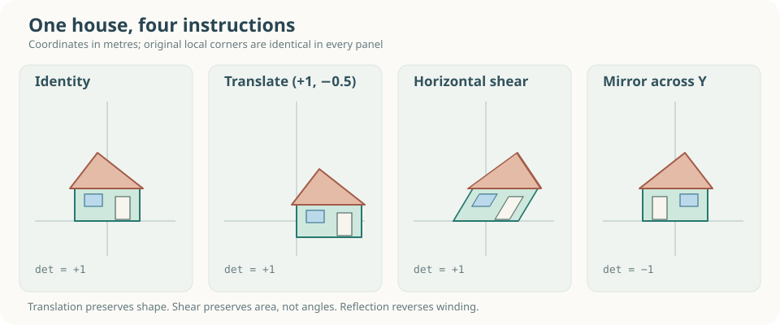
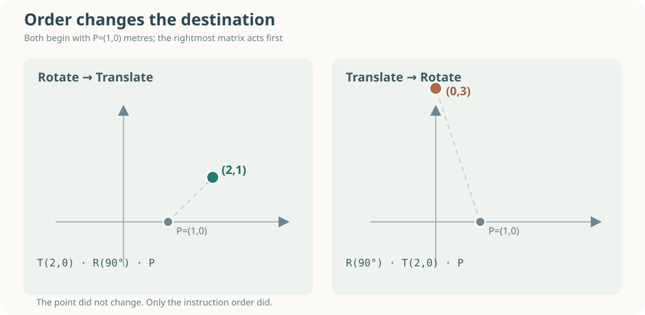

# Chapter 04 — Move the World Without Losing It

*From Geometry to Images*  
*Part I: From Coordinates to Shapes*  
*Book 03 reader chapter. Original continuous masters and generated book stages remain unchanged.*

> Put a toy house in the middle of a page. Turn the paper. Move the paper. Turn it again. The toy has followed every instruction—but unless we keep track of which paper we mean, our computer may put the front door on the roof.

## The house that travelled without going anywhere

Our little house has started to become rather demanding. In Chapter 01 it wanted a picture. Chapter 02 insisted that every place have an address. Chapter 03 gave the roof a real interior so that the computer could answer whether a point belonged to its triangle. Today the house wants to move.

Not just two pixels to the right. It wants to slide across the garden, grow taller without growing wider, lean in the wind and perhaps look at itself in a mirror. Someone even suggests attaching the house to a rotating platform, then moving the entire platform.

All these requests sound simple to a human playing with paper cutouts. You pick up the paper, spin it, stretch it, push it across the desk. You do not separately recalculate the coordinates of every nail in the roof. The points stay fixed *relative to the paper*, and the paper changes its relationship to the room.

That is exactly the sort of power a **transformation** should give our computer: one reliable description of how a space moves into another, with a promise about every point and every direction that lives inside it.

But there is a trap. We must keep the difference between the object and its description. A vertex with local coordinates \((1,2)\) does not have to be rewritten just because the house moves. We can preserve the local vertex and change the map from local space to world space. When we want its world address, we evaluate that map. When we want to draw it, we continue from world coordinates to camera and image coordinates.

That is why the mathematics of a small paper house is already the mathematics of the scene hierarchy inside a game engine.

## The transformation that does *nothing* is the place to begin

Our first map is the simplest imaginable:

\[
F(P)=P.
\]

It is called the **identity transformation**. Every point stays where it is. That may seem like a boring feature, but it is the reference against which every other transformation can be checked.

Now imagine two ways to change a point.

A **translation** moves the entire object by the same displacement. For \(P=(x,y)\) and displacement \(\mathbf t=(t_x,t_y)\),

\[
T_{\mathbf t}(P)=P+\mathbf t=(x+t_x,\;y+t_y).
\tag{4.1}
\]

A **linear map** changes how the basis directions behave. It might rotate, stretch, reflect or shear. We write its two-dimensional matrix using column vectors:

\[
A=\begin{bmatrix}
a&b\\
c&d
\end{bmatrix},
\qquad
A\begin{bmatrix}x\\y\end{bmatrix}
=
\begin{bmatrix}ax+by\\cx+dy\end{bmatrix}.
\tag{4.2}
\]

Put them together and we have an **affine transformation**:

\[
\boxed{F(P)=A\,P+\mathbf t.}
\tag{4.3}
\]

The house's original local vertices remain untouched. We only change \(A\) and \(\mathbf t\), then evaluate this formula whenever a world position is needed.

If you carry away only one sentence from this chapter, make it this: *a transform is a rule connecting two declared coordinate spaces, not an instruction to scramble a bag of numbers.*

### Why the word “affine”?

An affine transformation has a particular superpower: it preserves straight lines and affine combinations. A triangle stays a triangle unless the map collapses it. A bead with barycentric weights \((\lambda_A,\lambda_B,\lambda_C)\) stays at the same relative location after all the triangle's corners are transformed.

Remember Chapter 03:

\[
P=\lambda_A A+\lambda_B B+\lambda_C C,\qquad
\lambda_A+\lambda_B+\lambda_C=1.
\]

Apply \(F(P)=MP+\mathbf t\) and expand:

\[
\begin{aligned}
F(P)
&=M(\lambda_A A+\lambda_B B+\lambda_C C)+\mathbf t\\
&=\lambda_A F(A)+\lambda_B F(B)+\lambda_C F(C),
\end{aligned}
\tag{4.4}
\]

because the weights sum to one. The translation gets counted exactly once.

It sounds abstract until you touch the paper model. Put a sticker halfway along one roof edge. Turn and stretch the whole roof. The sticker is still halfway along the corresponding transformed edge. That is affine preservation you can see with your fingers.

It does **not** mean every measurement remains unchanged. A stretch changes distances. A shear changes angles. A reflection reverses orientation. The sticker keeps its *affine address*, not necessarily the same physical distance to every corner.

## A tour of transformations with our little house

Let's give each operation an understandable job.

### Translation: pick up the whole drawing

Move by \((3,-2)\) metres:

\[
T(1,1)=(1+3,1-2)=(4,-1).
\]

Every vertex moves by the same world displacement. The roof does not bend, its triangle area is unchanged, and its edge vectors are unchanged. A point is transformed by adding the translation; a **direction** is not.

One of the best early tests is to move the house and inspect an arrow drawn along its roof. If that arrow suddenly points somewhere else or gains the translation offset, our code has confused a point with a vector.

### Scale: make one direction longer

A scale by \(s_x\) horizontally and \(s_y\) vertically has matrix

\[
S=\begin{bmatrix}s_x&0\\0&s_y\end{bmatrix}.
\tag{4.5}
\]

With \(s_x=2\) and \(s_y=3\), the local point \((1,1)\) becomes \((2,3)\). A roof twice as wide and three times as high has six times the area. We can check that with the determinant \(2\cdot3=6\).

But beware: scaling “about the origin” means every point travels relative to the chosen origin. If we want the house to grow around its own doorstep, we must move the doorstep to the origin, apply the scale, then move back.

A zero scale along one axis flattens the house into a line. That is not just a weird appearance: the map has lost an entire dimension and cannot be inverted. We will return to that failure.

### Rotation: turn the drawing, not the desk

In a Cartesian plane with \(+Y\) upward, a counterclockwise rotation by angle \(\theta\) is

\[
R(\theta)=
\begin{bmatrix}
\cos\theta&-\sin\theta\\
\sin\theta& \cos\theta
\end{bmatrix}.
\tag{4.6}
\]

Try a quarter-turn. \(\cos 90^\circ=0\) and \(\sin 90^\circ=1\) in exact mathematics, so

\[
R(90^\circ)(2,1)=(-1,2).
\]

The point has not travelled along the arc of a literal spinning object in a simulation; the transformation reports its position *after* the rotation about the stated origin. We will use time and motion later when the story needs them.

Rotation preserves lengths and angles, and its determinant is \(+1\). A round-trip through a rotation and its inverse should recover the original point, up to floating-point rounding.

### Shear: push the roof sideways

Imagine a rectangle drawn on a stack of cards. Hold the bottom card still and push the top card sideways. The rectangle becomes a slanted parallelogram. Nothing has been cut; the edges are still straight.

A horizontal shear can be written

\[
H_x(k)=\begin{bmatrix}1&k\\0&1\end{bmatrix},
\tag{4.7}
\]

so \(H_x(k)(x,y)=(x+ky,\;y)\). With \(k=1/2\), the point \((2,3)\) becomes \((3.5,3)\).

The determinant is \(1\), so the shear preserves **signed area**, even though it changes angles and lengths. You can check that by cutting a parallelogram into a rectangle and sliding the little triangle from one end to the other.

A shear is especially useful for understanding a matrix as a pair of transformed basis arrows. The x-axis is still \((1,0)\); the y-axis has become \((k,1)\). That picture makes the matrix much less mysterious than memorizing four symbols.

### Reflection: look into the mirror

To reflect across the world \(y\)-axis, negate the horizontal coordinate:

\[
M_y=
\begin{bmatrix}-1&0\\0&1\end{bmatrix}.
\tag{4.8}
\]

The house's left side appears on the right. Its area magnitude is unchanged, but the determinant is \(-1\). Its triangle winding reverses.

This links directly to Chapter 03. A positive signed twice-area becomes negative under an orientation-reversing map. The barycentric weights attached to the matching transformed corners remain unchanged.

A mirrored triangle is not “inside out” merely because its stored vertices are suddenly invalid. Its orientation has changed under a well-defined transformation. A renderer using winding for face culling must account for that convention. Later we will keep the world/camera/viewport signs explicit rather than guessing which triangles to flip.

*Figure 4.1 — Four transformations acting on the same source outline. Translation changes its location, shear changes its angles, and reflection changes its orientation. The illustration is schematic but uses consistent local coordinates and named axes; source notes give the exact matrices.*

## One extra coordinate lets translation join the party

Until now we have written an affine map as a matrix plus a separate displacement:

\[
P'=AP+\mathbf t.
\]

It would be convenient to represent an entire chain of transformations using matrices alone. The trick is to add one extra component to the coordinates, a deliberate bookkeeping device called a **homogeneous coordinate**.

For a two-dimensional point, write

\[
\widetilde P =
\begin{bmatrix}x\\y\\1\end{bmatrix}.
\]

Then define a three-by-three homogeneous affine matrix:

\[
\boxed{
H=
\begin{bmatrix}
a&b&t_x\\
c&d&t_y\\
0&0&1
\end{bmatrix}.
}
\tag{4.9}
\]

Multiply:

\[
H\widetilde P=
\begin{bmatrix}
ax+by+t_x\\
cx+dy+t_y\\
1
\end{bmatrix}.
\]

Those first two components are exactly the affine formula we already understood. The extra \(1\) gave translation something to multiply.

For a displacement, use a different homogeneous representation:

\[
\widetilde{\mathbf d}=
\begin{bmatrix}d_x\\d_y\\0\end{bmatrix}.
\tag{4.10}
\]

Now \(H\widetilde{\mathbf d}\) has no translation contribution. That last zero expresses a meaningful promise: directions do not move when we only move the origin.

The point/displacement distinction from Chapter 02 was not a fussy abstraction. It is visible in the **last component** of the mathematical representation.

### A warning from the future

Later, a perspective camera will also use homogeneous coordinates, but a general projective transformation can produce a final component \(w\) that is **not** always one. Dividing by that \(w\) is what helps perspective projection become a nonlinear mapping in ordinary Euclidean coordinates. Our matrices in this chapter have fixed last row \((0,0,1)\) and represent **affine** maps only. They are not secretly perspective matrices.

In a good graphics book, distinctions like that are earned before the code asks you to remember them.

## The order of movement: the easiest bug to draw

Take our house's little chimney tip at local point \(P=(1,0)\).

First rotate it 90 degrees counterclockwise, then translate two metres to the right. The rotation makes \((0,1)\); translation makes \((2,1)\).

Do the operations in the opposite order. Translation makes \((3,0)\). Rotation about the world origin then makes \((0,3)\).

\[
T(2,0)\,R(90^\circ)\,P=(2,1),
\]
\[
R(90^\circ)\,T(2,0)\,P=(0,3).
\tag{4.11}
\]

Both results are valid. They answer different questions.

We use **column vectors**, so the rightmost matrix acts first. The product \(TR\) means rotate, then translate. This is unrelated to whether our C++ arrays are physically stored row-major or column-major; algebraic convention and memory layout are distinct facts.

Imagine a turntable carrying a toy. If you rotate the toy before placing it on the turntable, the result is not necessarily the same as placing it on the turntable and rotating the whole turntable around the room's origin. You can see the difference even without a computer.

*Figure 4.2 — Rotate then translate yields (2,1); translate then rotate yields (0,3). Both operate on the same original point (1,0), with column-vector composition. This is the visual reason transform order matters.*

### How two affine maps compose

Write

\[
F(P)=A_F P+\mathbf t_F
\]

and

\[
G(P)=A_G P+\mathbf t_G.
\]

Apply \(G\) first, then \(F\):

\[
\begin{aligned}
F(G(P))
&=A_F(A_G P+\mathbf t_G)+\mathbf t_F\\
&=(A_F A_G)P+(A_F\mathbf t_G+\mathbf t_F).
\end{aligned}
\tag{4.12}
\]

So the combined linear part is \(A_F A_G\), and the combined translation is \(A_F\mathbf t_G+\mathbf t_F\). In homogeneous form this is simply matrix multiplication:

\[
H_{\mathrm{combined}}=H_F H_G.
\tag{4.13}
\]

This is the same rule our Frame2 taught in Chapter 02, now written explicitly as one homogeneous matrix. It does not create a new theory; it gives the theory a representation suited for chaining objects and cameras.

### A window inside a house inside a moving cart

Suppose the window has four local corners. Its positions are written in metres relative to the window frame. The window sits on the house. The house sits on a moving cart. The cart sits in the garden.

The complete chain is

\[
P_{\mathrm{garden}} =
H_{\mathrm{garden\leftarrow cart}}\,
H_{\mathrm{cart\leftarrow house}}\,
H_{\mathrm{house\leftarrow window}}\,
P_{\mathrm{window}}.
\tag{4.14}
\]

The little arrows on the subscripts mean “from which space, into which space.” That naming is more meaningful than three unrelated variables called \`model\`, \`temp\`, and \`matrix2\`.

There is an easy mistake here. If you multiply the house transform by the window transform in the wrong order, you may rotate the house around the window instead of rotating the window within the house. This often produces an image that is *almost plausible* until the camera moves.

A good debugging tool should show the intermediate point after **each boundary**. We will make our C++23 transformation studio report these stages.

## Rotate the house around the doorstep, not the origin

A common question from a reader is: “Why does my object swing around the screen when I only wanted it to turn around itself?”

The reason is often an unstated pivot. A rotation matrix rotates about the coordinate origin. If the doorstep is at point \(C=(c_x,c_y)\), we need to move the doorstep to the origin, rotate, and move it back:

\[
\boxed{H_{\mathrm{pivot}} =
T(C)\,R(\theta)\,T(-C).}
\tag{4.15}
\]

The multiplication order is right-to-left for our column vectors.

Let's use \(C=(2,1)\), \(\theta=90^\circ\), and a roof corner \(P=(3,1)\).

Subtract the pivot: \((3,1)-(2,1)=(1,0)\). Rotate: \((0,1)\). Add the pivot: \((2,2)\). So the transformed point is \((2,2)\).

If the pivot itself moves, the transform is wrong. A property test can assert

\[
H_{\mathrm{pivot}}(C)=C.
\tag{4.16}
\]

A child can test the same claim with a pin stuck through a cardboard roof. The pin is the pivot. Turning the roof should not move the pin.

This is one of those rare cases where an illustration, an equation, an executable and a physical experiment all tell exactly the same story.

## The determinant is a tiny machine for telling geometry's fate

We have now met the determinant in three different roles, and it is time to see the connection.

For a two-by-two linear part

\[
A=\begin{bmatrix}a&b\\c&d\end{bmatrix},
\]

the determinant is

\[
\det A=ad-bc.
\tag{4.17}
\]

Its magnitude tells us how a transformation changes **area**. Its sign tells us whether it preserves or reverses **orientation**.

Imagine a one-square-metre tile drawn in the local frame. Its edges are basis vectors \((1,0)\) and \((0,1)\). Under \(A\), these become the two columns of \(A\). The unit square becomes a parallelogram. Its signed area is precisely \(\det A\).

That is why a scale of \((2,3)\) has determinant six; a shear of the form above has determinant one; a rotation has determinant one; and a reflection has determinant minus one.

If \(\det A=0\), the tile becomes a line or a point. We have squashed area out of existence.

Our Chapter 03 orientation predicate measures signed twice-area between triangle edges. Transform both edges by \(A\), and the determinant scales that signed area by \(\det A\):

\[
\boxed{
\operatorname{orient}(F(A),F(B),F(C))
=\det(A_F)\,\operatorname{orient}(A,B,C).
}
\tag{4.18}
\]

The translation cancels because an edge is a difference of two points. We already know how to reason about that cancellation from Chapter 02.

The whole journey is connecting, not accumulating disconnected formulas.

### What remains unchanged? What does not?

A translation preserves lengths, angles, area and winding. A rotation also preserves them. A reflection preserves lengths, angles and **unsigned** area, but reverses winding. A shear preserves collinearity and affine ratios, and the simple \(H_x(k)\) shear preserves area, but not necessarily lengths or angles. A nonuniform scale changes lengths, angles and area, while still preserving straightness and barycentric weights when its scales are nonzero.

Do not memorize that as a list without drawing. Take one paper triangle and measure it before and after each map. Ask which quantities have changed. A transform is easier to trust when its invariants are familiar.

## The inverse: can we bring our house home?

Suppose a house corner started at local position \(P_L\) and was moved to world position \(P_W\) by an affine map:

\[
P_W=A P_L+\mathbf t.
\]

To recover the local position, first remove translation, then undo the linear map:

\[
\boxed{P_L=A^{-1}(P_W-\mathbf t).}
\tag{4.19}
\]

In homogeneous form,

\[
H^{-1}=
\begin{bmatrix}
A^{-1}&-A^{-1}\mathbf t\\
0&1
\end{bmatrix}.
\tag{4.20}
\]

A valid inverse has to undo *all* of the map, not merely its rotation.

For a pure rotation, we can use the transpose \(R^\mathsf T\) as the inverse. For a shear or nonuniform scale, the transpose is generally **not** the inverse. We met that trap in Chapter 02. Today we can see it in matrix form.

### A numerical return journey

Let

\[
A=\begin{bmatrix}2&1\\0&1\end{bmatrix},
\quad\mathbf t=(3,-2),
\quad P_L=(1,2).
\]

Compute the linear part:

\[
A P_L=(4,2).
\]

Add translation:

\[
P_W=(7,0).
\tag{4.21}
\]

Now subtract translation: \(P_W-\mathbf t=(4,2)\). The inverse of \(A\) is

\[
A^{-1}=
\begin{bmatrix}1/2&-1/2\\0&1\end{bmatrix}.
\]

Apply it to \((4,2)\): \((2-1,2)=(1,2)\). We are home.

A useful program should not merely print “inverse computed.” It should verify a round trip for representative points, including ones not chosen to make the arithmetic pretty.

## When a map almost forgets where things came from

Set a horizontal scale to \(10^{-12}\). Mathematically the transform still has an inverse, but tiny errors in its stretched or compressed coordinate may grow enormously when we try to reverse it.

This is a question of **conditioning**, not only whether the determinant is literally zero.

Compare the maps

\[
A_1=\begin{bmatrix}2&0\\0&3\end{bmatrix},\qquad
A_2=\begin{bmatrix}1&0\\0&10^{-12}\end{bmatrix}.
\]

Both have nonzero determinant. Yet reversing \(A_2\) magnifies errors in the compressed y direction by a factor of \(10^{12}\).

Blindly checking whether \(|\det A|>10^{-6}\) would introduce an arbitrary scale-dependent policy. A better numerical contract considers the sizes of the matrix entries, the expected precision of the input, and the sensitivity of the inverse. Full condition-number analysis belongs to Book 2, and rigorous predicate error bounds return in Chapter 05. Our transformation lab deliberately rejects ill-conditioned matrices under a documented, conservative classroom policy; it does **not** certify every invertible matrix in floating-point arithmetic.

There is one other failure to remember: if an input coordinate is already too large for a tiny distinction to be represented in binary64, no inverse can reconstruct information that was lost before the computation began. Exact algebra and accurate storage are related, but they are not the same issue.

## What about normals? They are not ordinary arrows

A triangle edge is a displacement. It transforms by the linear part \(A\), with no translation. But a **surface normal** is an arrow whose job is different: it must remain perpendicular to the transformed surface.

Consider a normal \(n\) perpendicular to an edge vector \(e\), so that \(n^\mathsf T e=0\). After the map, the edge becomes \(Ae\). What should the new normal be?

We want

\[
(n')^\mathsf T(Ae)=0
\]

whenever \(n^\mathsf T e=0\). A suitable choice is

\[
\boxed{n'\propto A^{-\mathsf T}n,}
\tag{4.22}
\]

followed by normalization when a unit normal is required. The inverse transpose appears because a normal behaves as a **covector** (a linear functional on directions), not just like another point or displacement.

This is surprisingly important. For pure rotation, \(A^{-\mathsf T}=A\), so applying the usual rotation appears to work. For nonuniform scale or shear, applying \(A\) to the normal can make it no longer perpendicular to the transformed tangent. You may get plausible lighting that is nevertheless geometrically wrong.

The full 3D normal matrix and its relation to physically based shading will return in Books 3 and 4. Today a flat 2D normal provides an exact little test: transform a tangent and a perpendicular normal under shear, then check their dot product. The correctly transformed normal remains perpendicular.

For an orientation-reversing reflection, remember that the geometric **outward-facing convention** of a face may also require a winding-aware sign policy. The inverse-transpose law enforces perpendicularity; it does not automatically choose an application's intended outward side.

## Our new C++23 transformation studio

We are not going to build a second, incompatible graphics engine just to demonstrate four matrices. The first three laboratories already contain the essential pieces:

- Chapter 01 owns a bounded RGB8 canvas and PPM serializer.
- Chapter 02 owns point and vector semantics, local/world frame transformations and world-up/image-down mapping.
- Chapter 03 owns triangle orientation, barycentric queries, exact bounded integer tests and numeric uncertainty.

Chapter 04 adds **one explicit affine 3×3 transformation layer** with well-defined composition, inverse, pivot, point/vector separation and normal transformation. The program then draws several copies of the same house-like geometry with different transforms.

The command-line interface can be simple and honest:

~~~text
book03_transforms inspect
book03_transforms svg transform-family.svg
book03_transforms ppm transform-family.ppm
book03_transforms order transform-order.svg
book03_transforms repl
~~~

The user can enter a translation, rotation, scale, or shear, ask the program to print the transformed vertices, and save the current diagram. The SVG will use the same C++23 calculation as the numeric inspector, not a JavaScript copy of the algorithm.

### The code's algebra contract

The matrix in the companion uses column vectors and this representation:

~~~cpp
// Conceptual use of the Book 03 C++23 affine layer.
using book03::Affine2;
using book03::Point2;

const auto rotate = Affine2::rotation_degrees(90.0);
const auto move = Affine2::translation(2.0, 0.0);

// Composition is right-to-left: the point rotates first, then moves.
const auto combined = move * rotate;
const Point2 final_place = combined.transform_point({1.0, 0.0});
// final_place is (2,1), within floating-point tolerance.

// Transforming a displacement does NOT add the translation.
const auto direction = combined.transform_vector({1.0, 0.0});
// direction points approximately (0,1).
~~~

The multiplication operator must be documented as **matrix composition**, not element-by-element multiplication. The API must reject nonfinite inputs. The inverse must reject singular or insufficiently conditioned cases and explain its stated numerical policy.

To prove we have not broken the earlier chapters, tests must compare the new affine matrix representation with \`Frame2\` on a compatible frame, verify equivalence of sequential and composed transforms, and transform the Chapter 03 reference triangle through reflection and shear while checking the signed-area law.

A test that shows a lovely picture but never checks these invariants would be an illustration, not engineering evidence.

## A working visual investigation

For one figure, we will draw the original house outline in a neutral gray and draw a transformed copy over it in color. The world axes will be labeled, and transformed basis directions will be visible as colored arrows. That way the reader can see not only *what changed* but *why the matrix did it*.

For another, we will place two images beside each other:

1. Rotate a chimney tip around the origin, then translate.
2. Translate the same tip, then rotate.

The shapes will visibly end in different places. Underneath, the numerical coordinates \((2,1)\) and \((0,3)\) will be printed. There is no need for a decorative spinning animation to hide the arithmetic.

A third optional view will deliberately flatten the house with a zero scale, show its triangle collapse and explain why the inverse is unavailable. A later research-grade geometry viewer can make those failure modes interactive in 3D, but first we make them understandable in two dimensions.

## Exercises that turn the formulas into intuition

**Reconstruct — translation is not rotation.** Start with a point \(P=(2,1)\). Rotate it \(90^\circ\) counterclockwise and then translate it by \((3,0)\). Compute the result both as two operations and as one homogeneous matrix. The correct answer is \((2,2)\). Explain the order explicitly.

**Reconstruct — a shear keeps area.** Take the unit square corners \((0,0),(1,0),(1,1),(0,1)\). Apply \(H_x(1/2)\), sketch the resulting parallelogram, and compute its area by both geometry and determinant. Both answers must be one square unit. Identify which edge lengths and right angles have changed.

**Falsify — matrix order cannot be wished away.** For \(P=(1,0)\), compute \(TRP\) and \(RTP\) using the chapter's \(90^\circ\) rotation and translation \((2,0)\). Your answers should be \((2,1)\) and \((0,3)\). Any implementation returning the same answer has silently changed a convention or performed the wrong multiplication.

**Falsify — an impossible inverse.** Scale x by two and y by zero. Explain why every possible original y coordinate collapses to the same transformed y. Write a test that expects the inverse routine to reject the map. A “best-effort guessed inverse” does not satisfy the contract.

**Transfer — an object with a hinge.** Place a hinge at \(C=(2,1)\). A door corner starts at \(P=(3,1)\). Rotate \(90^\circ\) about the hinge; it should arrive at \((2,2)\). Derive \(T(C)RT(-C)\) and explain why the hinge remains stationary.

**Transfer — a triangle in the mirror.** Take the Chapter 03 triangle with signed twice-area \(24\). Apply reflection across the y-axis. What is the new signed twice-area? It should be \(-24\). Explain why the unsigned area remains \(12\) and why the barycentric weights of a correspondingly reflected bead do not change.

**Implement — transform normal correctly.** Use a shear \(H_x(1)\). Transform a vertical tangent \(t=(0,1)\) to \((1,1)\). A horizontal original normal \(n=(1,0)\) must become proportional to \((1,-1)\), which is perpendicular to \((1,1)\). Show that incorrectly applying the shear itself to \(n\) yields \((1,0)\), with nonzero dot product against \((1,1)\). Use the inverse transpose.

**Implement — evidence before screenshots.** Run the transformation studio's numerical mode and tests. Then export its SVG and PPM artifacts. For every colored panel, record the source matrix, input vertices, output coordinates, numeric convention, and what independent property test confirms. Explain which visual differences are intentional and which represent bugs.

**Explain — to a little cousin.** Draw a house on paper, rotate the paper, and explain why the coordinates written on the paper do not need to change. Explain why the garden coordinates do. Then explain why “spin around my front door” needs a different instruction from “spin around the garden gate.” If the story helps them predict where the house ends up, your explanation has done its job.

### Answer ledger

The twice transformed point in the first exercise is \(R(90^\circ)(2,1)=(-1,2)\), then adding \((3,0)\) gives \((2,2)\). The shear's determinant is one. The two order-experiment points are \((2,1)\) and \((0,3)\). The hinge point stays fixed under \(T(C)RT(-C)\), while the door corner moves to \((2,2)\). The reflection has determinant \(-1\), so the triangle's signed twice-area becomes \(-24\). A zero scale has no inverse. The correctly sheared normal is proportional to \((1,-1)\) and has zero dot product with the transformed tangent \((1,1)\).

A solution should include its assumptions and units. If a student says “the matrix works” without saying whether vectors are columns, where the origin is, whether the coordinates are in metres or pixels, or which order is applied, that is not a complete answer.

## The gentle danger of becoming too comfortable

We are now able to move a flat world around with precision. That is something worth celebrating. But our comfortable two-dimensional coordinate plane is about to become less comfortable.

What happens when the house's roof is nearly a straight line? What happens when a transformed triangle's signed area becomes so tiny that ordinary floating-point subtraction cannot reliably determine its sign? How do we decide a topological fact—left or right, clockwise or counterclockwise—when rounded arithmetic can contradict itself?

Our first three chapters have shown friendly examples. Chapter 05, **The Triangle That Almost Wasn't There**, will use real numerical counterexamples to teach why trustworthy geometry sometimes needs a stronger oracle than ordinary floating-point calculation.

The house is still standing. We simply want to be certain the computer knows which side of its roof is outside.

---

## Chapter glossary

**Linear map:** A map \(p\mapsto Ap\) that preserves vector addition and scalar multiplication.

**Affine map:** A map \(p\mapsto Ap+t\) combining a linear map with translation; it preserves straight lines and barycentric affine combinations.

**Homogeneous affine matrix:** A three-by-three representation of a two-dimensional affine map, with bottom row \((0,0,1)\).

**Composition order:** The rule for applying consecutive maps. For this book's column-vector convention, the rightmost factor acts first.

**Pivot:** The chosen fixed point about which an object rotates or scales, implemented by translate-to-origin, transform and translate-back.

**Shear:** A linear map that slants one axis relative to another while preserving parallelism and, for the simple unit-determinant forms here, area.

**Reflection:** An orientation-reversing linear map, with negative determinant.

**Signed area scale:** The determinant of a planar linear transform, which multiplies oriented area.

**Inverse:** A map that reverses a transformation when the linear part is nonsingular and sufficiently well-conditioned for the chosen numerical contract.

**Conditioning:** The sensitivity of computed outputs, especially inverse mapping, to changes or errors in inputs.

**Normal transform:** The inverse transpose of a linear map applied to a surface normal, followed by normalization when appropriate.

**Covector:** An object acting linearly on vectors; a normal's perpendicularity constraint explains its inverse-transpose transform law.

## Source lineage and the book boundary

The original AllMight material in \`Notes/Chapter Edition/01 - Computing Foundations/19 - Coordinate Frames and Linear Systems.md\`, \`32 - Geometry Becomes an Image and an Inverse Problem.md\`, and \`37 - Camera Contracts and Transform-Chain Debugging.md\` contains substantial vector, matrix, pose and camera proofs. Its complete long-form source must be integrated, not discarded, when the final Book 03 reader is composed. The Chapter 04 transformation laboratory remains an additive C++23 teaching implementation, not a claim that KairoRenderer or Maveb uses the same matrix storage or clipping conventions.

Book 2 owns general numerical conditioning and abstract linear algebra. This chapter uses their results but does not replace them. Book 3 will carry the full meaning into 3D objects and cameras. Book 4 handles physically based lighting, Book 5 game and physics world updates, Book 6 actual Metal/Vulkan GPU execution, and Book 7 advanced vision/neural/XR research.

**Read next:** Chapter 05 — The Triangle That Almost Wasn't There (planned).  
**Lab:** \`Code Parts/tools/labs/book03_cpp23/\` — P04 affine transformation studio and tests.
