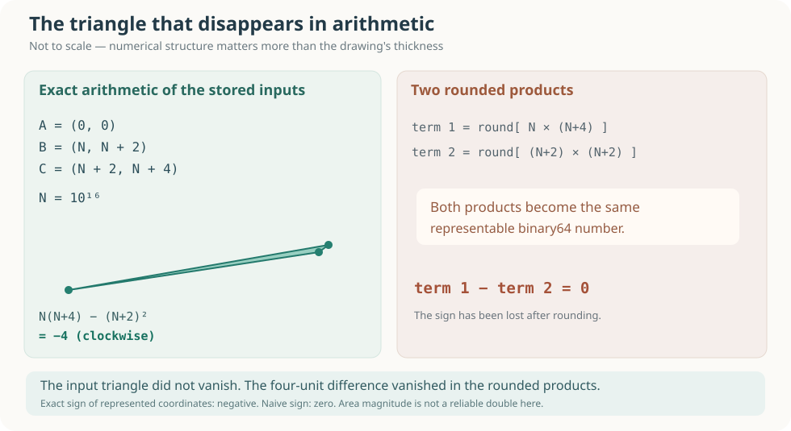
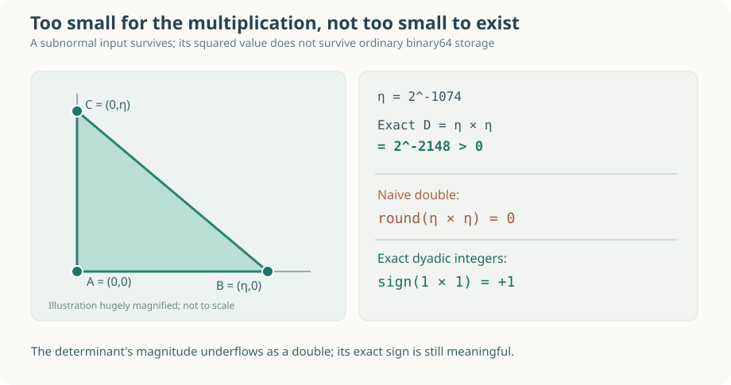
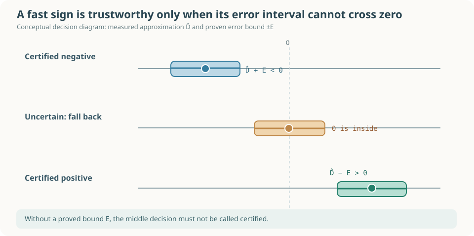

# Chapter 05 — The Triangle That Almost Wasn't There

*From Geometry to Images*  
*Part I — From Coordinates to Shapes*  
*Reader manuscript, additive to preserved original computational-geometry sources.*

> A triangle can disappear without a single corner moving. Sometimes the computer doesn't lose the triangle. It loses the tiny difference that proved the triangle existed.

## The roof that vanished on a perfectly ordinary afternoon

The little house has survived quite a journey. We painted its first pixels, gave it local and world coordinates, invented a roof with three corners, and learned to move, stretch and rotate it. Our C++23 laboratories have been careful about bounds, conventions and invalid inputs.

Today, the roof disappears.

It doesn't vanish dramatically. No cartoon smoke. No flashing error message. We ask a perfectly ordinary question: “Do these three points really form a triangle?” The program replies, “No. They are all on one straight line.”

But the three points are not on one straight line.

A child might put a ruler beside them, squint and say, “They seem almost straight, but the third one is a tiny bit off.” The computer looks at its huge, neatly formatted numbers and says, “Exactly straight.” One of them must be mistaken.

What makes this story unsettling is that the program can be doing *exactly what we taught it* in Chapter 03. It calculates an orientation determinant and checks whether the answer is positive, negative or zero.

The mathematics is correct. The **way the arithmetic is performed** can still destroy the answer.

This chapter is about a promise. When our computer uses a number to choose a geometric branch—left or right, inside or outside, keep or flip an edge—it must be able to explain why that choice is trustworthy.

We will discover a concrete triangle that disappears under ordinary binary64 arithmetic, learn why floating-point numbers are not the same as arbitrary real numbers, and build a second, exact arithmetic path for decisions that require an answer the first path cannot justify. The resulting project is not just a drawing program. It is a small scientific observatory for computational geometry.

## The surprisingly important little sign

In Chapter 03 we gave an arrow \(A\to B\) a left and a right. For a third point \(C\), the signed twice-area is

\[
D = (b_x-a_x)(c_y-a_y)-(b_y-a_y)(c_x-a_x).
\tag{5.1}
\]

Positive means counterclockwise in a Cartesian \(+Y\)-up frame; negative means clockwise; zero means collinear.

Take the easy triangle \(A=(0,0)\), \(B=(6,0)\), \(C=(0,4)\). The determinant is \(24\). We can find it by hand. Every ordinary C++23 `double` compiler should handle these exact small integer operations without difficulty.

Now consider why we use the sign. Suppose an algorithm is building a triangular mesh. It has a candidate face and must decide on which side of an edge a new vertex lies. If its predicate changes sign incorrectly, the algorithm might choose a different neighbor, connect an edge in the wrong orientation, or wrongly discard a valid skinny triangle.

A bad color is usually a visual problem. A bad sign can become a **topological decision**. Once it changes which edge or face exists, later arithmetic operates on a different structure. A tiny numeric error can travel a long way through a geometry pipeline.

This is why a robust predicate is not merely a luxury for scientists with especially expensive calculators. It is part of building reliable computational worlds.

## Our numerical crime scene: six representable numbers and a missing triangle

Consider the following points, where \(N=10^{16}\):

\[
A=(0,0), \quad
B=(N,N+2), \quad
C=(N+2,N+4).
\tag{5.2}
\]

These are unusual coordinates for a little house, but imagine our model has been transported into a world whose coordinate numbers are very large. The triangle is extraordinarily thin. That is exactly when a trustworthy test matters.

First, let's do the determinant as exact integer algebra:

\[
\begin{aligned}
D &= N(N+4)-(N+2)^2\\
  &= N^2+4N - (N^2+4N+4)\\
  &= \boxed{-4}.
\end{aligned}
\tag{5.3}
\]

The sign is negative. The points are **not** collinear. The triangle has a real signed twice-area of \(-4\) square coordinate units. Its ordinary area is \(2\) square units.

The astonishing fact is that all the input coordinates in (5.2) are exactly representable as IEEE-754 binary64 numbers. At this scale, neighboring representable integers differ by two. The numbers \(N\), \(N+2\) and \(N+4\) all survive storage.

What fails is the product-subtraction:

~~~cpp
const double n = 10'000'000'000'000'000.0;
const double bx = n;
const double by = n + 2.0;
const double cx = n + 2.0;
const double cy = n + 4.0;

// The mathematical determinant of the STORED inputs is -4.
// The rounded products lose that four-unit difference.
const double naive = bx * cy - by * cx;
~~~

Under ordinary IEEE binary64 multiplication and subtraction, the products round to the same large representable value. The final difference is zero.

There was no ambiguous decimal input. There was no camera driver. There was no forgotten unit conversion. The input points were distinct. The error occurred in the *arithmetic used to decide their orientation*.

*Figure 5.1 — The adversarial binary64 triangle has an exact signed twice-area of −4, but the two separately rounded products become indistinguishable and their naive difference is zero. Geometry is schematic, not drawn to true aspect ratio; the actual triangle is far too thin for a normal book page.*

A picture of this triangle cannot solve the problem. At any sensible print scale it would look like a line. We need a numerical proof.

That gives us a strong engineering principle:

**When a geometric decision is discrete, correctness needs to be established by an argument about the arithmetic, not by how plausible the picture looks.**

## What a computer actually means by “a number”

We often imagine a `double` as a very precise real number. It is not. It stores one value from a particular finite collection of binary fractions.

A useful analogy is a ruler with tick marks. Near zero, a typical floating-point ruler has extraordinarily fine tick marks. Far away, the spacing between representable numbers grows. At some large magnitudes, adding one to a number cannot move you to another representable tick mark.

Every finite binary64 value can be written exactly as

\[
\boxed{x=(-1)^s\,M\,2^e,}
\tag{5.4}
\]

where \(M\) is a nonnegative integer significand, \(e\) is an integer exponent, and \(s\) is the sign bit.

For normal binary64 values, the integer significand has a hidden leading bit and up to 53 significant bits. For subnormal values, there is no hidden leading bit. The smallest positive subnormal is \(2^{-1074}\).

That last fact is the doorway to an elegant exact arithmetic construction.

We can choose a universal fixed unit \(2^{-1074}\) and represent **every finite binary64 input** as

\[
\boxed{x=N_x\,2^{-1074},}
\tag{5.5}
\]

where \(N_x\) is an ordinary signed integer—though potentially far too large to fit into a 64-bit machine word.

You might be wondering: “But doesn't the computer still have only 64 bits?” A single machine integer has a fixed width. A **big integer** is stored as a sequence of machine-sized pieces, much like writing an enormous decimal integer across several lines of paper. We can add, subtract and multiply those pieces without discarding carries.

The clever part is that our geometry predicate does not need to convert the exact result back to a `double`. It needs only the **sign**. We can preserve all the required integer bits until the very last decision.

### A carefully bounded word is different from a universal promise

Chapter 03 already has a genuine exact integer predicate when coordinates lie in \([-10^6,+10^6]\). The proof is simple: the coordinate differences are at most two million; each determinant product is at most four trillion; their difference is at most eight trillion, safely within signed 64-bit range.

That is a wonderful fast route. It does not need a big integer.

But it would be wrong to apply the same 64-bit proof to coordinates around \(10^{16}\). The products would be around \(10^{32}\). We need the second, wider route.

A reliable algorithm can therefore have **different paths whose correctness guarantees are separately justified**.

## The subtraction that eats information

Let's find out exactly why the naive formula failed.

The determinant is a subtraction of two products:

\[
D=u_1v_2-u_2v_1.
\]

When the products are nearly equal, their relative difference is tiny. Each product may be rounded separately. Suppose the true results differ by four, but each is on the order of \(10^{32}\). The representable spacing at that product magnitude is enormously larger than four.

Both products can round to the same tick mark on our floating-point ruler. Then their subtraction gives zero **even though the exact difference is not zero**.

This is called **catastrophic cancellation** in a context where the large terms lost their small distinguishing difference before subtraction.

It is important to distinguish two cases.

First, the inputs themselves may already have been rounded. At \(N=10^{16}\), adding \(1\) does not produce a different binary64 value. If someone writes \(N+1\), the stored result can still be \(N\). An exact predicate operating on that stored value cannot reconstruct the missing one-unit change. The lost measurement never reached it.

Second, the inputs may be distinct and exactly stored—our \(N\), \(N+2\), \(N+4\) example—but naive multiplication can still lose the critical difference. An exact arithmetic predicate **can** resolve this case, because the information is present in the input bits.

The difference is profound:

> Exact arithmetic can protect information that exists. It cannot restore information discarded before the calculation began.

Our new lab demonstrates both cases side by side so that a learner never confuses them.

## A second crime scene: a triangle smaller than the tiniest product

Take

\[
A=(0,0),\quad
B=(\eta,0),\quad
C=(0,\eta),
\tag{5.6}
\]

where \(\eta=2^{-1074}\), the smallest positive binary64 subnormal.

The signed twice-area is exactly

\[
D=\eta^2=2^{-2148}>0.
\tag{5.7}
\]

The triangle exists in the exact geometry of the **represented coordinates**.

But \(\eta^2\) is far below the smallest positive binary64 number. If we multiply in ordinary `double`, the result underflows to zero. Naive orientation reports collinearity again.

An exact sign predicate does not need to store the determinant as a `double`. It can preserve the integer product of the dyadic significands at the appropriate scale, then return “positive.”

*Figure 5.2 — A small positive subnormal value is representable, but its squared area is not representable as a nonzero binary64 result. The exact sign is positive while the naive floating result is zero. The drawing exaggerates the dimensions to make the explanation visible.*

At the other extreme, coordinates near the maximum finite `double` can overflow during multiplication. You may see infinity or even NaN instead of a meaningful orientation determinant. The original points can still be finite and their exact orientation can still have a perfectly definite sign.

Our algorithm must not confuse the range of the **result's magnitude** with the existence of the **result's sign**.

## How do we make an exact orientation decision?

Here is the central construction of the chapter.

**Step one: inspect the input without changing its meaning.** We reject NaN and infinity. Neither is a finite geometric coordinate in our exact binary64 contract.

**Step two: use the small-integer oracle when it applies.** If every coordinate is an exactly represented integer between \(-10^6\) and \(+10^6\), we reuse the Chapter 03 signed 64-bit determinant. Its range proof already covers the case.

**Step three: decode each remaining binary64 value into a signed integer on the common \(2^{-1074}\) scale.** We use `std::bit_cast<std::uint64_t>` to see the actual sign, exponent and fraction bits. For a normal number, insert the hidden leading significand bit and shift it by the appropriate exponent. For a subnormal, use the stored fraction without that hidden bit. Both \(+0\) and \(-0\) become the exact integer zero.

**Step four: calculate the determinant using integer arithmetic alone.** For our three points, form exact differences \(B_x-A_x\), \(B_y-A_y\), \(C_x-A_x\) and \(C_y-A_y\). Multiply the appropriate pairs as big integers, subtract them, and inspect the sign of the resulting exact integer.

Because all input coordinates have the same \(2^{-1074}\) scale, the determinant has common positive scale \(2^{-2148}\). The common scale cannot change the sign.

In symbols, if each coordinate is \(X\,2^{-1074}\), then

\[
D = \big[(B_x-A_x)(C_y-A_y)
-(B_y-A_y)(C_x-A_x)\big]\,2^{-2148},
\tag{5.8}
\]

where the capital letters are now exact (possibly enormous) integers.

The answer is simply the sign of the bracket.

Notice what we did **not** do. We did not calculate one rounded product and subtract another. We did not compare the result with an arbitrary epsilon. We did not need to return the exact gigantic area as a decimal string. We preserved just enough information to make the discrete decision unambiguous.

### Big integers are not magic either

Our educational `Magnitude` class stores a nonnegative integer as a little-endian list of 32-bit limbs. The number

\[
M=m_0+m_1 2^{32}+m_2 2^{64}+\cdots
\tag{5.9}
\]

is represented by the vector \([m_0,m_1,m_2,\ldots]\).

Addition propagates carries. Subtraction, when the first magnitude is at least the second, propagates borrows. Multiplication uses schoolbook products and carries across limbs.

Why can we use a 64-bit temporary to accumulate a product of 32-bit limbs? For each inner step, the largest possible sum is

\[
(2^{32}-1)^2 + (2^{32}-1)+(2^{32}-1)=2^{64}-1,
\tag{5.10}
\]

which fits exactly inside an unsigned 64-bit integer. The code uses only checked and mathematically bounded operations for this inner loop.

A sign field then distinguishes positive, negative and zero magnitudes. Addition and subtraction choose whether to combine magnitudes or compare and subtract them. Multiplication multiplies magnitudes and multiplies signs.

The details matter because we are trying to *prove* the exactness contract. A “big integer” whose intermediate carry can overflow is not actually exact.

### The binary64 bit decoding is a little mechanical, but worth seeing

A binary64 storage word has one sign bit, eleven exponent bits and fifty-two fraction bits. For a normal number with biased exponent \(E\), the mathematical significand is

\[
M=2^{52}+F,
\]

where \(F\) is the stored fraction. Its numeric value is \(M\,2^{E-1075}\). Relative to our fixed scale \(2^{-1074}\), the integer becomes

\[
N_x=M\,2^{E-1}.
\tag{5.11}
\]

For a subnormal number (\(E=0\)), the integer is just \(F\), because its value is \(F\,2^{-1074}\). This distinction prevents a subtle off-by-one exponent bug that would otherwise spoil exact arithmetic at the normal/subnormal boundary.

The code documents and tests normal, subnormal, zero, signed zero and the largest finite values. Those tests are not decorative; each is a place where a misunderstood bit field could reverse a geometric decision.

## Does “exact” also mean “fast”?

Not automatically.

The finite binary64 input space is enormous. Converting every coordinate to a big integer and multiplying several thousand-bit values for every triangle in a giant mesh would be wasteful when most triangles are nowhere near a numerical decision boundary.

Jonathan Richard Shewchuk's foundational work on **adaptive precision floating-point arithmetic and fast robust predicates** develops a different strategy. It can evaluate a fast floating-point approximation, prove an error bound, and return immediately if the sign is safely separated from zero. If not, it proceeds to expansion arithmetic or more exact work. This can make robust predicates much more practical for large geometry algorithms.

The logical form of the fast decision is simple:

\[
|\widehat D-D|\le E.
\]

If \(\widehat D>E\), we have proved \(D>0\). If \(\widehat D<-E\), we have proved \(D<0\). Otherwise the filter has **not** proved a sign; it must continue to a stronger computation.

*Figure 5.3 — A fast computed determinant can certify its sign only when its known error interval stays on one side of zero. If the interval crosses zero, the algorithm must fall back. This is a conceptual diagram; it does not assert that our P05 code implements Shewchuk's particular floating error bound.*

Our C++23 P05 experiment uses a deliberately simpler strategy: a proven **bounded integer fast path** and an exact big-integer fallback for all other finite binary64 coordinates. That means it adapts to the **representation and range of its inputs**, but it does **not** implement Shewchuk's efficient error-bound floating filter or reproduce his expansion algorithm.

That distinction is important enough to put into the interface and test documentation. We have built a genuinely exact reference for a clearly stated input type. We have not claimed to build the fastest production predicate.

A sensible future comparison could add a separately implemented Shewchuk-style predicate and compare correctness, branch coverage and measured run time across independent workloads. But measuring performance requires actual compilation, actual input distributions and actual hardware. We will not invent a “100× faster” number just because it would look attractive in a book.

## “But I can just use epsilon, right?”

Imagine someone suggests that whenever \(|D|<10^{-9}\), we should return zero. It's tempting. It makes tiny, noisy values stop producing inconvenient signs.

But what if all world coordinates are measured in micrometres? What if they are in astronomical units? What if the triangle is huge and nearly collinear? What if it is tiny but perfectly well represented?

A **fixed epsilon** depends on the units and scale of the problem. It can turn a valid, very small triangle into an invented degenerate triangle, and it may fail to detect cancellation in enormous products.

An epsilon can still have legitimate uses. A user interface may intentionally snap nearby points together. A physics engine may deliberately treat distances below a chosen collision tolerance as contact. Those are **modeling policies**, not proofs that three represented points are exactly collinear.

We must not silently substitute a policy for a predicate.

The P03 floating triangle query exposes `BoundaryUncertain` and `DegenerateOrUncertified` to make its limitations visible. P05 adds an exact sign so a caller that truly needs a topological choice has a stronger tool.

### Two separate answers can both be useful

Consider a nearly collinear triple. A drawing editor may sensibly say, “These points are close enough that I will snap them to a line.” An exact predicate may simultaneously say, “They are not mathematically collinear as stored.”

There is no contradiction. One answer describes an application-specific tolerance rule; the other describes an exact mathematical relation among the stored inputs.

The bug appears when a program uses the same function name `is_collinear()` for both decisions and leaves its callers guessing.

The API should say what kind of question it answers.

## Inside, outside, exactly on the border

The exact orientation sign can do more than choose a triangle's winding. It can classify a fourth point \(P\) relative to its three directed edges.

Recall the edge tests:

\[
s_A=\operatorname{orient}(B,C,P),\quad
s_B=\operatorname{orient}(C,A,P),\quad
s_C=\operatorname{orient}(A,B,P).
\tag{5.12}
\]

First find the triangle's own orientation \(d=\operatorname{orient}(A,B,C)\). If \(d=0\), the triangle has no ordinary two-dimensional interior.

If \(d>0\), all three \(s\) values must be nonnegative for a point in the closed triangle. If \(d<0\), all three must be nonpositive. A zero edge sign means the point lies on a supporting line; if the other signs obey the triangle's winding, it is on the actual triangle boundary.

Our exact containment function therefore returns one of four precise statuses: **Interior, Edge, Exterior, Degenerate**.

It does not borrow the P03 floating epsilon. It asks the same exact determinant oracle four times. It validates the fourth point before returning, even when the original triangle is degenerate. A NaN should not slip past validation just because an earlier branch already knew the triangle was collapsed.

This is a small contract detail with a large engineering moral: early exits must not bypass the input assumptions that made a result meaningful.

### Boundary ownership is still a policy

An exact `Edge` answer does not decide whether a rasterizer should paint that edge. Adjacent triangles may meet on the same line. A renderer must adopt an explicit ownership rule so pixels are not claimed twice or missed.

Our future rasterization chapter will study the top-left rule and exact edge functions in detail. The predicate now tells us a geometric fact; the later rasterizer will use that fact under a declared **sample ownership** policy.

Do not conflate the two.

## Proofs we can ask a test to enforce

The first P05 test is the numerical crime scene itself: the large triangle in equation (5.2) must have exact sign \(-1\), even though the naive double determinant is zero. Reversing two vertices must return \(+1\).

The second is the subnormal triangle. Its determinant has exact positive sign, even though the ordinary double product underflows to zero.

The third is the overflow case: finite coordinates near the largest double must still yield exact orientation signs even when a naive product becomes infinity.

The fourth is a small fraction grid. Half-integer coordinates are represented exactly in binary64. Multiply them all by two and they become small integers. The old Chapter 03 exact integer predicate can serve as a **separate independent reference**. For 5,000 deterministic cases, the new big-integer sign must match that reference exactly.

The fifth checks invariants that should hold for every exact orientation predicate:

\[
\operatorname{orient}(A,C,B)
=-\operatorname{orient}(A,B,C),
\tag{5.13}
\]

and cyclic reordering preserves the sign:

\[
\operatorname{orient}(B,C,A)
=\operatorname{orient}(A,B,C).
\tag{5.14}
\]

We also deliberately test invalid data, repeated vertices, signed zero and exact edge classification.

Even a program that passes these tests is not automatically “mathematically verified.” Tests exercise cases. The exactness argument rests on the binary64 decomposition and the arbitrary-limb integer arithmetic's carry/borrow proof. The tests then make that argument harder to accidentally violate in future edits.

This division between *proof* and *experiment* is a theme of scientific software. Each is useful, but they do different jobs.

## Our P05 observatory, and what it must show

The project attaches to the same C++23 companion as the earlier chapters, under `Code Parts/tools/labs/book03_cpp23/`. It does not fork the geometry library or build a different coordinate convention.

The core header is `include/book03/exact_orient2d.hpp`. The independent test file is `tests/exact_orient2d_tests.cpp`. A new command-line inspector, `src/precision_studio.cpp`, presents hard-coded reproducible fixtures and lets the reader enter arbitrary finite coordinates.

Our diagnostic output will show three different things clearly:

**Input.** The six stored binary64 values, printed with enough precision to reconstruct them. This matters because decimals may have been rounded *before* our algorithm began.

**Naive computation.** The determinant calculated with ordinary binary64 products and subtraction, including a note if it becomes zero, infinity or NaN.

**Exact decision.** The signed result of our exact binary64 predicate, plus the path used—bounded integer or exact dyadic big integer—and the geometric interpretation under the declared y-up convention.

The output should not let a reader confuse the naive approximate number with an exact area magnitude. Our exact path returns a sign, not a decimal giant-integer area.

The visual report is a teaching diagram rather than a fake screenshot of measured performance. Its first panel shows the dramatic cancellation example. The second shows subnormal underflow. The third shows an example where input rounding happened before any exact geometry code could help.

We will also emit a small machine-readable CSV with these cases. That allows later plotting or statistical review without inventing a benchmark number. The CSV must record the exact fixture, naive result, exact sign and algorithm route. A reader can regenerate it by running the source on their own compiler.

### A small piece of the actual interface

~~~cpp
#include "book03/exact_orient2d.hpp"

const double n = 10'000'000'000'000'000.0;
const book03::Point2 A{0.0, 0.0};
const book03::Point2 B{n, n + 2.0};
const book03::Point2 C{n + 2.0, n + 4.0};

// The exact represented-input answer is negative. The API returns a
// discrete sign; it does not pretend that its determinant fits double.
const auto exact = book03::orient_binary64(A, B, C);

// exact.sign == -1
// exact.path == ExactOrientPath::ExactBinary64Dyadic
~~~

The code includes **no** mandatory graphics SDK, no Python arithmetic dependency and no implementation copied verbatim from a third-party predicate library. C++23 is enough for the exact reference.

## A deeper mathematical aside: exactly what did we prove?

Let's make the guarantee precise.

The algorithm receives six finite binary64 numbers. Each is representable as an exact signed integer times \(2^{-1074}\). The integer representation is computed from the number's actual storage bits, not by rounding a decimal approximation.

Every arithmetic operation used to construct the determinant's numerator is exact integer addition, subtraction or multiplication, implemented using nonoverflowing limbs. We inspect only its sign.

Therefore, provided the stated binary64 bit-layout assumptions and correct implementation of the integer operations, the returned sign is exactly the mathematical sign of the determinant for the **six supplied represented coordinates**.

That is a meaningful correctness theorem.

It does not say that a real instrument's measured coordinates are exact. It does not say that a triangle reconstructed from an image has no uncertainty. It does not say that a model's coordinates have enough spatial precision to distinguish a one-nanometre movement in a kilometre-scale world. It does not say the output sign is robust to *perturbing the input geometry*—only that arithmetic does not misclassify the supplied represented points.

If the physical geometry is uncertain, statistical and interval models can ask whether the sign would remain the same over an uncertainty region. That is a related but distinct research question. We will meet such questions again in camera sensitivity and the scientific validation material.

## A real-world thought experiment: the camera that almost agrees

Two cameras observe the same point, and their reconstructed rays nearly intersect. A triangulation routine solves for an estimated 3D point. Perhaps tiny measurement differences put the point just on one side of a plane or the other.

An exact orientation predicate can tell us which side the *computed binary64 coordinates* occupy, without an additional arithmetic sign error.

But it cannot make the camera observations more accurate. If pixel measurements are noisy, the physical point might lie on either side with meaningful probability. We should report that uncertainty when the application needs it.

This is why our research-volume material distinguishes numerical exactness, conditioning, sensitivity and uncertainty. You can build correct arithmetic and still have uncertain physics. A trustworthy system tells those stories separately.

## Exercises: the proof belongs to you

**Reconstruct — the disappearing triangle.** Starting with \(N=10^{16}\), derive \(-4\) in equation (5.3) using exact integer algebra. Then explain why each of \(N\), \(N+2\), and \(N+4\) is representable in binary64. Predict the naive result before running a program. Do not use the actual computer output as your only proof.

**Reconstruct — the world's smallest triangle.** Show why the subnormal triangle's exact signed twice-area is \(2^{-2148}\), and why ordinary binary64 cannot store that positive product. Explain how a sign test can still succeed without representing the magnitude as a `double`.

**Falsify — what went missing before the algorithm?** Evaluate \(N+1\) in binary64 near \(N=10^{16}\). Explain what the stored value becomes. Then show why no predicate—however exact—can distinguish an input that has already rounded to an identical representation.

**Falsify — a dangerous epsilon.** Write two test cases where a fixed \(10^{-9}\) orientation threshold changes a valid topological decision. One should be small but exactly representable; the other should involve a large cancellation. Explain why rescaling coordinates changes the interpretation of a fixed threshold.

**Transfer — an exact fractional grid.** Choose three half-integer points. Multiply their coordinates by two, use the Chapter 03 exact bounded-integer predicate, and compare its sign to the binary64 exact predicate. Explain why positive uniform scaling multiplies area by a positive factor and therefore cannot reverse orientation.

**Transfer — reverse the world.** Reflect all three points across a vertical axis, computing the transformed sign. If the reflection is exact for the chosen representable inputs, the sign should negate. Discuss why “clockwise on screen” still depends on image row direction and the viewport convention.

**Implement — big-integer carry audit.** Find the maximum value of a sum consisting of one 32-bit limb product, one existing output limb and one carry. Show exactly why unsigned 64-bit can hold it. Then add tests with limbs filled with 1 bits and with borrow chains across multiple limbs. Explain what would break if we accumulated the multiplication into a signed 64-bit temporary.

**Implement — build the diagnosis file.** Run the P05 inspector to produce its CSV. Inspect the stored inputs, the naive determinant and the exact sign for the three failure families. Then examine its SVG. Confirm that the figure is a *schema of arithmetic decisions*, not a false to-scale picture of a triangle of aspect ratio approximately \(10^{16}\).

**Explain — the disappearing roof for a child.** Tell the story of two large piles of bricks with a difference of four tiny bricks. The computer writes down rounded huge totals and loses the four-brick difference. The exact method keeps a careful tally of every brick. Finish the explanation by saying why no tally can help if the four bricks were never counted at the start.

### Selected answer ledger

The disappearing triangle's exact determinant is \(-4\), but its naive binary64 determinant is zero. The subnormal triangle has positive exact determinant \(2^{-2148}\) and zero naive binary64 determinant. At \(10^{16}\), an increment of one is not distinguished in binary64 under the usual rounding rule. Swapping two orientation vertices reverses the sign. A bounded rational half-grid oracle can independently validate signs because multiplying each coordinate by two maps it into an exact integer grid, scaling the determinant by four. The maximum unsigned 32-bit-limb multiplication accumulator fits the 64-bit unsigned range **exactly** at \(2^{64}-1\), provided each addition and carry is arranged as in the documented code.

An answer that says “just use a smaller epsilon” has not resolved the correctness problem. An answer that says “big integers recover lost input data” has misunderstood the input representation boundary. The strongest answer explains both failures clearly.

## The next door: we finally leave the page

The little house has taught us something unusual. Geometry is not merely the art of drawing shapes. It is the art of making **consistent statements about shapes**, especially when they are almost broken.

We can give points frames, move them with matrices, classify a triangle's interior and decide its exact orientation for represented binary64 coordinates. We can explain when the result is reliable and when a numerical or measurement assumption remains open.

It is time to give our house some depth.

Until now, every point lived on a plane. The roof had area, but no thickness. The window had a boundary, but no distance from the camera. A ball was only a circle in our drawing, not a sphere that could hide its back.

Chapter 06, **Step Out of the Page**, opens the third axis. We will build genuine 3D points and planes, understand normals as geometry, intersect lines and surfaces, and discover that every camera image is a carefully organized loss of dimensions.

The paper house is about to become a real model.

---

## Glossary

**Orientation predicate:** A discrete sign test on an ordered triple of planar points.

**Catastrophic cancellation:** Loss of the small distinguishing difference between nearly equal numerical quantities under finite-precision arithmetic.

**Binary64:** IEEE-754 double-precision binary floating-point format with a 53-bit significand for normal values and a wide exponent range.

**Subnormal:** A tiny floating-point value below the normal-number range, represented without an implicit leading significand bit.

**Dyadic number:** A number of the form \(N2^e\) for integers \(N,e\); every finite binary64 value is a dyadic rational.

**Exact represented-input sign:** The mathematically correct sign of a determinant computed using the *stored* binary64 values as exact rational inputs.

**Big integer:** An integer represented across multiple machine-sized limbs, allowing an arbitrary number of bits subject to memory and time.

**Bounded oracle:** An exact computation on a clearly restricted input domain whose arithmetic range is proven safe.

**Adaptive strategy:** Selecting a computation path based on what is needed for the input or required precision. Our P05 uses a bounded-integer path plus exact-dyadic fallback; it is not Shewchuk's floating error-bound filter.

**Certified floating filter:** An approximate computation accompanied by a justified error interval; it returns a sign only when the interval cannot cross zero.

**Modeling tolerance:** An application's deliberate rule for treating nearby geometry as equivalent; it is not the same as exact mathematical collinearity.

**Boundary ownership:** A downstream policy deciding which geometric primitive owns a point or sample on a shared edge.

## Source lineage and bibliography

The established long-form source `Notes/Chapter Edition/01 - Computing Foundations/34 - Robust Predicates and Camera Sensitivity.md` teaches the sign-versus-coordinate distinction, catastrophic cancellation, rigorous error-bound filtering, expansion arithmetic and the effects of camera uncertainty. It must remain intact and be reconciled at the source-unit level for final Book 03 composition. The new chapter is an accessible but technically genuine introduction and includes its own standard-C++23, structurally different exact-dyadic reference.

**Primary research:** Jonathan Richard Shewchuk, *Adaptive Precision Floating-Point Arithmetic and Fast Robust Geometric Predicates*, *Discrete & Computational Geometry* 18 (1997), 305–363. Author research and implementations: https://www.cs.cmu.edu/~quake/robust.html and https://people.eecs.berkeley.edu/~jrs/jrspapers.html. His original fast filtered-expansion strategy and implementation are **not** claimed to be implemented or copied by this book's P05 lab. For binary format interpretation, refer to IEEE-754 and NIST DLMF §3.1, https://dlmf.nist.gov/3.1. Verify hardware/compiler assumptions before claiming portability beyond the supported binary64 targets.

**Chapter bridge:** `Code Parts/tools/labs/book03_cpp23/include/book03/exact_orient2d.hpp` and the corresponding P05 test/visualization files.

**Read next:** Chapter 06 — Step Out of the Page.
