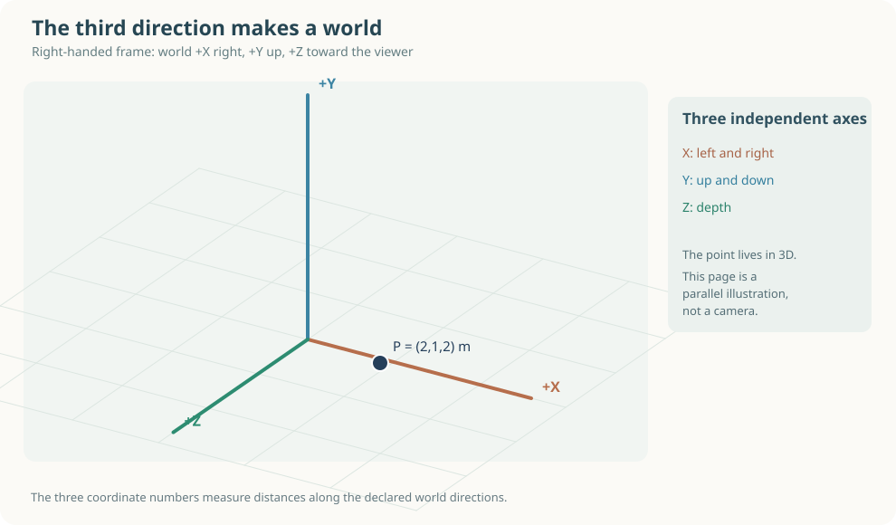
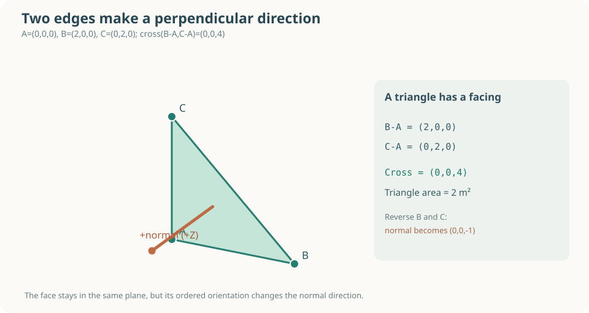
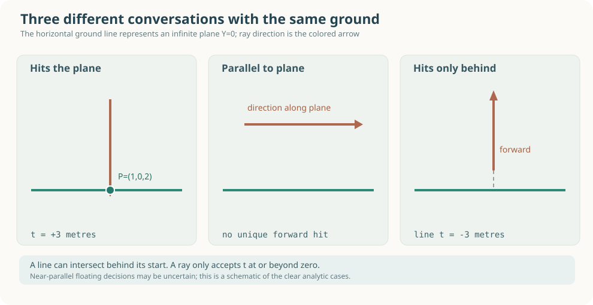
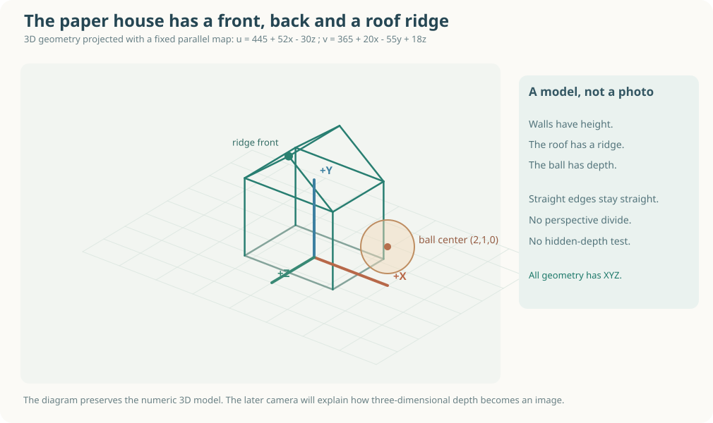

# Chapter 06 — Step Out of the Page

*From Geometry to Images*  
*Part II — Shapes Become 3D Objects*  
*Reader draft / C++23 companion P06 / original mathematical illustrations*

> Our house has always had a roof. Today it acquires a *back*—which raises the astonishing possibility that something can be there even when we cannot see it.

## The afternoon our paper house learned to hide things

We have had an unusually patient little house. For five chapters it has lived on a page. We gave every point an address, turned displacements into meaningful instructions, filled the roof with triangles, bent the house through matrix transformations and learned not to trust a geometric sign merely because a computer printed one.

But suppose a child holds the paper up and asks: “Where is the room behind the front door?”

On paper, there is no room. A line is only a line. The roof is a filled triangle, but it has no back surface. If we draw a second wall behind the first, both sets of pixels can sit on the same page even though our imagination places one far away.

Our computer needs a new idea. It needs **depth**.

The delightful part is that depth does not require throwing away everything we have learned. Our plane of \((x,y)\) points becomes a world of \((x,y,z)\) points. Two-dimensional vectors gain a third component. Lines and triangles remain useful. But some questions become wonderfully different: two lines may pass *over and under* each other without meeting; a triangle can face toward us or away from us; and a tiny circle on a photograph might really be a sphere whose rear surface is hidden from view.

This chapter is where our geometry leaves the page. Not where a GPU magically makes a photograph—we have many promises to keep before that—but where the world itself becomes a real three-dimensional mathematical object.

## First, agree on what “up” means

We will use a **right-handed** three-dimensional world, with

\[
+X\ \text{to the right},\qquad
+Y\ \text{upward},\qquad
+Z\ \text{toward the viewer in our initial sketch}.
\tag{6.1}
\]

Put your right hand on the desk. Point your index finger along \(+X\) and your middle finger along \(+Y\); your thumb indicates \(+Z\) under the right-hand convention. This is not an arbitrary superstition: the sign of cross products and the interpretation of triangle winding depend on the chosen orientation.

A different application might use Z as its vertical axis. That is perfectly reasonable when stated. The mistake is to import somebody else's “up” into our code without changing the mathematics or geometry accordingly.

Our world coordinates are measured in **metres**. Our vectors are displacements in metres when they describe movement, but unit directions such as surface normals are dimensionless. A point such as \((2,3,1)\) is not simply a magic triple: it is an address relative to this declared world origin and basis.

The camera convention later in the book is also right-handed, usually looking along its own local \(-Z\) axis with \(+Y\) up. For now we do **not** have a perspective camera. When we draw our 3D world on a two-dimensional SVG page, we will use a declared **parallel, oblique diagram map**, not pretend that it models a real photographic lens.

*Figure 6.1 — A third independent direction creates depth. Our diagram is an illustration of world-space axes, not a calibrated perspective camera.*

## A point lives somewhere; a vector tells us how to travel

Chapter 02 taught us why it is strange to add one address to another. If two children live at addresses 12 and 18, adding the addresses does not produce a meaningful third home. But the distance from one home to the other is useful.

In three dimensions the same distinction survives:

\[
A=(a_x,a_y,a_z),\qquad
B=(b_x,b_y,b_z).
\]

The displacement from \(A\) to \(B\) is

\[
\boxed{\mathbf{d}=B-A=
(b_x-a_x,\ b_y-a_y,\ b_z-a_z).}
\tag{6.2}
\]

Moving a point along a vector gives a new point: \(B=A+\mathbf{d}\). Adding a point to a point is deliberately not an operation in our companion C++23 types. We name the types \`Point3\` and \`Vector3\` and keep those contracts separate.

As a concrete route through our garden, suppose

\[
A=(1,1,2),\qquad B=(4,5,2).
\]

Then

\[
\mathbf d=(3,4,0),\qquad
\|\mathbf d\|=\sqrt{3^2+4^2+0^2}=5\ \text{metres}.
\]

The zero Z component tells us that this trip never changes depth. Replacing it with \(12\) would make the displacement length \(\sqrt{3^2+4^2+12^2}=13\) metres. The arithmetic has not become mysterious; it has simply gained one more independent contribution.

For a general vector

\[
\boxed{
\|\mathbf v\|=\sqrt{v_x^2+v_y^2+v_z^2}.
}
\tag{6.3}
\]

You should not compute that formula carelessly for arbitrary huge and tiny floating-point inputs. Squaring a very large component can overflow even when the final magnitude is representable; squaring a tiny one can underflow. Our C++23 laboratory uses the standard library's three-argument \`std::hypot\` and checks that the result is finite before treating it as a usable magnitude. This is safer, although it does not turn all geometry into exact arithmetic.

### A direction is a promise about orientation, not a distance

A *unit* vector has magnitude one:

\[
\widehat{\mathbf v}=\frac{\mathbf v}{\|\mathbf v\|}.
\tag{6.4}
\]

When we normalize, we discard the original vector's length. That is appropriate for a ray direction or a normal, but not for a displacement that says “walk five metres.” A zero vector has no direction; dividing by its length is an invalid operation.

A good API does not quietly normalize zero and call the result “up.” It refuses the request.

## The dot product: a question about facing

Our house needs to know whether the sunlight points toward a wall or almost along it. For that we use the **dot product**:

\[
\boxed{
\mathbf a\cdot\mathbf b
=a_xb_x+a_yb_y+a_zb_z.
}
\tag{6.5}
\]

The formula has a geometric meaning:

\[
\mathbf a\cdot\mathbf b
=\|\mathbf a\|\|\mathbf b\|\cos\theta,
\tag{6.6}
\]

where \(\theta\) is the angle between the vectors. It tells us how strongly one vector points along the other.

If \(\mathbf a\) is a unit direction, then \(\mathbf a\cdot\mathbf b\) is the signed scalar component of \(\mathbf b\) along that direction.

For example, let

\[
\mathbf a=(1,0,0),\qquad
\mathbf b=(2,3,0).
\]

Then \(\mathbf a\cdot\mathbf b=2\). The second vector contributes two units in the first vector's direction and three units in the perpendicular Y direction.

If \(\mathbf a\cdot\mathbf b=0\) and neither vector is zero, they are perpendicular.

This is why a wall normal and a ray direction can tell us whether the ray heads toward or almost along the wall. The dot product will soon appear as a denominator in our first 3D intersection formula.

### A projection worth checking by hand

Given a **nonzero** vector \(\mathbf u\), the projection of \(\mathbf v\) onto the direction of \(\mathbf u\) is

\[
\boxed{
\operatorname{proj}_{\mathbf u}\mathbf v
=\frac{\mathbf v\cdot\mathbf u}{\mathbf u\cdot\mathbf u}\mathbf u.
}
\tag{6.7}
\]

If \(\mathbf u\) is already unit length, the denominator becomes one. That is an algebraic convenience, not permission to forget the assumption. If the denominator is zero or numerically unusable, the projection is undefined or untrustworthy.

A simple independent test checks that the *residual* \(\mathbf v-\operatorname{proj}_{\mathbf u}\mathbf v\) has dot product zero with \(\mathbf u\) for well-conditioned inputs.

## The cross product: an arrow that stands away from a surface

Imagine two adjacent roof edges, both emerging from one corner. They define the roof's little flat patch. Could we produce a direction that stands **perpendicular** to that patch?

In a right-handed 3D world, the cross product answers precisely that:

\[
\boxed{
\mathbf a\times\mathbf b=
\begin{bmatrix}
a_yb_z-a_zb_y\\
a_zb_x-a_xb_z\\
a_xb_y-a_yb_x
\end{bmatrix}.
}
\tag{6.8}
\]

It has three important properties:

\[
(\mathbf a\times\mathbf b)\cdot\mathbf a=0,
\quad
(\mathbf a\times\mathbf b)\cdot\mathbf b=0,
\tag{6.9}
\]

and

\[
\|\mathbf a\times\mathbf b\|
=\|\mathbf a\|\|\mathbf b\||\sin\theta|.
\tag{6.10}
\]

Its length is the area of the parallelogram spanned by the two vectors. Its direction follows the right-hand rule. Reversing the operands reverses the direction:

\[
\mathbf b\times\mathbf a=-(\mathbf a\times\mathbf b).
\tag{6.11}
\]

This is not the same operation as the 2D orientation scalar from Chapter 03. But the two are relatives. If two vectors lie in the \(XY\) plane, the Z component of their cross product is exactly the 2D signed-area determinant.

### A roof triangle stands up

Let

\[
A=(0,0,0),\quad B=(2,0,0),\quad C=(0,0,3).
\]

All three points lie on the horizontal \(XZ\) floor plane. The edges are

\[
B-A=(2,0,0),\qquad C-A=(0,0,3).
\]

Their cross product is

\[
(B-A)\times(C-A)=(0,-6,0).
\tag{6.12}
\]

The vector points downward because we chose the ordered corners \(A,B,C\) that way. Swap \(B,C\), and it points upward.

The triangle's unsigned area is half the cross-product length:

\[
\boxed{\mathcal A_{3D}=
\frac12\|(B-A)\times(C-A)\|=3\ \mathrm{m^2}.}
\tag{6.13}
\]

A unit normal would be \((0,-1,0)\) for the stated winding, but \((0,+1,0)\) for the opposite winding. Which normal should the floor use? Geometry gives the orientation of the *ordered triangle*; the application decides whether that winding points toward its intended outward surface.

If we build a house with inconsistent triangle winding, half its walls may point inward. A renderer might cull the wrong sides or shade surfaces incorrectly. The mesh chapter will deal with the connectivity that makes this a whole-model contract.

*Figure 6.2 — The cross product is perpendicular to both edges. The illustration uses a labelled world frame and a deliberately visible triangle; changing vertex order reverses the normal.*

## A plane is an infinitely thin wall

A plane is what you would get if a perfectly flat sheet extended forever in every direction within its surface. A wall in a house has finite boundaries; a mathematical plane does not.

One way to describe a plane is with a known point \(P_0\) and a nonzero normal vector \(\mathbf n\). A point \(X\) belongs to the plane precisely when the vector \(X-P_0\) is perpendicular to \(\mathbf n\):

\[
\mathbf n\cdot(X-P_0)=0.
\]

Expand it:

\[
\boxed{\mathbf n\cdot X+d=0,\qquad
d=-\mathbf n\cdot P_0.}
\tag{6.14}
\]

That is the **plane equation**. It is an entire infinite surface described by one normal and one offset.

Our garden floor might be

\[
Y=0.
\]

Its upward unit normal is \((0,1,0)\), and its plane equation is \((0,1,0)\cdot(X,Y,Z)+0=Y=0\).

The wall at \(X=3\) has unit normal \((1,0,0)\) and offset \(d=-3\). A point at \((4,2,1)\) has signed value \(4-3=1\), meaning it lies one metre on the positive normal side.

### Why “unit normal” matters for distance

When the normal is unit length, the signed Euclidean distance from point \(P\) to the plane is

\[
\boxed{s(P)=\mathbf n\cdot P+d.}
\tag{6.15}
\]

If \(\mathbf n\) is not unit length, divide by \(\|\mathbf n\|\). Forgetting that normalization means your “distance in metres” is secretly scaled by an arbitrary choice of normal magnitude.

This matters for collision and geometric validation. A program that stores \((0,10,0)\) as the floor normal but forgets to normalize can report a height of ten metres when the point is actually one metre above the floor.

Our \`Plane3::through\` factory therefore takes a nonzero normal, normalizes it, and stores a unit normal and the corresponding offset. Its \`signed_distance\` function reports the correct physical units for well-conditioned finite inputs.

Signed distance is not a universal exact predicate. For enormous or nearly cancelling operands it can suffer floating-point error, which we label explicitly. It is the correct **geometric formula**, not a promise that every evaluation is perfectly rounded.

## A line, a ray and a segment are three different promises

Suppose you aim a flashlight from point \(O\). Its center-line can be described by

\[
R(t)=O+tD.
\tag{6.16}
\]

What values of \(t\) are allowed?

For an **infinite line**, \(t\) may be any real number. The line extends both ways forever.

For a **ray**, \(t\ge0\). It begins at \(O\) and continues in one direction. A negative value would describe a point behind its starting position.

For a **segment**, \(0\le t\le1\) when \(D=B-A\) is the full segment displacement. It has two finite endpoints.

It is crucial not to confuse those meanings. If we normalize \(D\) to unit length, then \(t\) becomes distance in metres. If we leave \(D\) unnormalized, \(t\)'s units depend on the magnitude of \(D\). Both conventions are valid, but the library should say which one it uses.

Our Chapter 06 \`Ray3::from\` normalizes the supplied direction. That makes every hit parameter a travelled distance in metres.

You can imagine a tiny laser pointer at the house's window. Its origin is the window and its direction is where the beam points. The line continues backwards into the room; the ray does not.

## Where a ray meets a plane

Here is our first genuinely three-dimensional intersection problem.

We have a plane

\[
\mathbf n\cdot X+d=0
\]

and a ray

\[
X=O+tD.
\]

Substitute the ray into the plane equation:

\[
\mathbf n\cdot(O+tD)+d=0.
\]

Distribute the dot product and collect \(t\):

\[
t(\mathbf n\cdot D)=-(\mathbf n\cdot O+d).
\]

If \(\mathbf n\cdot D\ne0\), the line meets the plane at

\[
\boxed{
t=-\frac{\mathbf n\cdot O+d}{\mathbf n\cdot D}.
}
\tag{6.17}
\]

For a ray, we also require \(t\ge0\). A negative \(t\) means the intersection exists on the infinite line, but **behind the ray**.

### The laser that hits the garden

Let the ground be \(Y=0\), and aim a unit downward ray from

\[
O=(1,3,2),\quad D=(0,-1,0).
\]

The plane normal is \(\mathbf n=(0,1,0)\), \(d=0\). Therefore

\[
\mathbf n\cdot D=-1,\quad
\mathbf n\cdot O+d=3,
\]

so

\[
t=-\frac3{-1}=3\ \text{metres}.
\]

The hit point is

\[
\boxed{P=(1,0,2).}
\tag{6.18}
\]

We can check this in two independent ways. The ray travels three metres downward from height three, and the resulting Y coordinate is zero, so the point satisfies the plane equation. Both are stronger evidence than a dot drawn in the right place.

*Figure 6.3 — Ray versus line distinction, a forward hit, a parallel case and a ray whose line intersection lies behind its origin. Each is labelled by the permitted parameter range.*

### When the denominator becomes a warning

Suppose the ray travels almost parallel to the floor. Then

\[
\mathbf n\cdot D\approx0.
\]

The intersection formula divides by a very small number, so a tiny change in the ray direction or plane position may cause a huge change in the predicted hit distance. This is **ill-conditioning**: the geometric problem itself is sensitive.

If the dot product is exactly zero, there are two mathematical possibilities. Either the ray lies entirely in the plane, or it is parallel and never intersects. When the inputs are floating approximations, deciding “exactly” from a small computed value without a certified error bound is dangerous.

Our introductory ray-plane function distinguishes a clear forward hit, a behind-origin intersection, a parallel case, a within-policy coplanar case, and a **numerically uncertain** case. Its conservative near-parallel rule is a declared educational policy—not an exact orientation-3D oracle or a Shewchuk-style certified sign.

If we need a mathematically exact classification for arbitrary represented binary64 3D planes and rays, we must build a stronger predicate and carry exact representations of the plane data, rather than merely adding an arbitrary epsilon.

This connects directly to Chapter 05. Robust predicates can protect discrete decisions; they do not make almost-parallel geometry less sensitive.

## A plane hit is not yet a triangle hit

Remember the roof? A mathematical plane extends forever, but a triangular roof panel occupies only a bounded part of it.

A ray may intersect the plane containing the panel and still miss the actual panel.

The honest route is in two stages. First find the plane intersection point. Then classify that point within the triangle, using barycentric coordinates or equivalent edge predicates.

The original long graphics manuscript already develops this method, and later derives the Möller–Trumbore algorithm for doing the full ray–triangle calculation more efficiently. Its mathematics deserves a complete chapter-length treatment, not an unexamined copy of a compact method.

In this chapter we establish the ray-plane building block. Chapter 07 will teach actual indexed mesh faces; the later ray/raster chapters will compose the bounded triangle intersection and its exactness/edge-ownership policy. We will not call our current infinite-plane hit a triangle hit.

## What about the ball beside the house?

The house is proud of its flat walls, but the garden also contains a small ball.

A sphere is the set of points a fixed distance \(r>0\) from a center \(C\):

\[
\boxed{\|P-C\|^2=r^2.}
\tag{6.19}
\]

A sphere is very simple to represent: one center point and one radius. It is not the same as a circle drawn on screen; the sphere has a hidden rear surface and may intersect a ray at two places.

To intersect a unit-direction ray \(R(t)=O+tD\) with the sphere, substitute it into the equation:

\[
\|O+tD-C\|^2=r^2.
\]

Let \(Q=O-C\). Expand the dot product:

\[
(Q+tD)\cdot(Q+tD)=r^2.
\]

Since \(D\cdot D=1\),

\[
\boxed{
t^2+2bt+c=0,\quad
b=Q\cdot D,\quad
c=Q\cdot Q-r^2.
}
\tag{6.20}
\]

Its discriminant in this half-\(b\) form is

\[
\boxed{\delta=b^2-c.}
\tag{6.21}
\]

If \(\delta<0\), the infinite line misses the sphere. If \(\delta=0\), it is tangent. If \(\delta>0\), there are two line intersections

\[
t_\pm=-b\pm\sqrt{\delta}.
\tag{6.22}
\]

For a ray we choose the nearest nonnegative intersection. If both are negative, the sphere is behind us.

### A reassuring numerical example

Set the sphere center to \(C=(0,1,0)\) and radius \(r=1\) metre. The ball touches the ground plane at \((0,0,0)\).

Aim a ray from \(O=(0,1,5)\) in direction \(D=(0,0,-1)\). The ray starts five metres in front of the sphere's center and points straight toward it.

Then

\[
Q=(0,0,5),\qquad b=-5,\qquad c=25-1=24,
\]

so

\[
\delta=25-24=1,\quad
t_-=5-1=4,\quad t_+=5+1=6.
\]

The front surface is four metres away, at \(P=(0,1,1)\). The back surface is six metres away. A raycast looking for the *first visible contact* should return \(t=4\).

A ray beginning **inside** the ball has a negative entry root and a positive exit root. Returning the smallest root without checking \(t\ge0\) would report a point behind the ray origin.

### Even this little sphere needs numerical honesty

A naive quadratic formula can lose precision when \(-b\) and \(\sqrt\delta\) are close and nearly cancel. A more stable formulation computes a suitably signed quantity

\[
q=-b-\operatorname{copysign}(\sqrt{\delta},b)
\]

and recovers the roots as \(q\) and \(c/q\) for the normalized-ray quadratic, provided \(q\ne0\). We sort the roots, select the nearest nonnegative one and handle the \(q=0\) case separately.

This improves common cancellation cases. It does not certify the discriminant's sign for arbitrary huge, tiny or ill-conditioned inputs. Our P06 reference rejects nonfinite intermediate values, states its supported numerical range, and labels ambiguous near-tangent cases as uncertain under an explicit classroom policy.

The good habit is the same: do not promote a convenient formula into a universal correctness guarantee.

## A triangle normal is not a mesh normal

One triangle has a clear geometric normal from its ordered edges. A smooth curved surface approximated by many triangles has a more subtle problem. If we shade each triangle using only its flat face normal, the sphere looks like a faceted disco ball. We may instead assign **vertex normals** that vary smoothly across faces.

But a topological vertex and a rendering corner are not always the same thing. At a hard crease or UV seam, two neighboring faces may need different normals or texture coordinates even if they share the same position. Conversely, two coincident positions might correspond to disconnected mesh vertices.

The old graphics chapter **“Mesh Topology and Connectivity”** already develops that distinction. In Chapter 07 we will build an indexed mesh, find its shared edges, and deliberately break it to see the difference.

A geometrically correct normal is necessary but not enough to understand shading. The physical behavior of materials, light and color is the next book's deeper territory. Today we care about which way a surface points and how it is represented.

## The 2D mathematics has not vanished

Take the 2D triangle from Chapter 03:

\[
A=(0,0),\quad B=(6,0),\quad C=(0,4).
\]

Embed it into the 3D \(XY\) plane by giving every point \(z=0\):

\[
A'=(0,0,0),\ B'=(6,0,0),\ C'=(0,4,0).
\]

The 3D cross product is

\[
(B'-A')\times(C'-A')=(0,0,24).
\tag{6.23}
\]

Its Z component equals the old signed twice-area, \(+24\). The 3D area is \(12\) square metres, exactly the 2D value.

Reverse the two edge vectors: the cross product becomes \((0,0,-24)\), preserving the relationship between winding and orientation.

This is one of our most useful **cross-chapter oracles**. A new 3D implementation should agree with a simple independent 2D calculation on an embedded planar example. Two representations of the same mathematics provide a powerful test against silent sign errors.

However, the Chapter 05 exact orientation implementation is exact only for **2D** represented binary64 points. A cross product evaluated in ordinary doubles is not magically an exact 3D orientation or an exact signed tetrahedral-volume predicate. The additional mathematical degree of freedom needs its own error analysis and proof.

## A space drawing is not a camera

How can we place our 3D axes and little house on a 2D page *before* we have learned cameras?

We can choose a simple explicit diagram convention. For example, let a world point \((x,y,z)\) map to drawing coordinates

\[
u=u_0+52x-30z,
\qquad
v=v_0+20x-55y+18z.
\tag{6.24}
\]

All coefficients here have units of pixels per metre. The map is **parallel/affine**: it uses no perspective division. Straight lines stay straight, and depth does not make distant copies of the same object smaller. This is just a convenient way to draw the model's three directions on paper.

The same mapping applied to every original house vertex generates a consistent diagram. If a panel is drawn in a different position, it is because the source geometry moved—not because a drawing application invented coordinates.

We will show a house-shaped wireframe with the floor, walls and a ridge roof, and draw a normal on one panel. We will separately show the ground-plane ray intersection and the ball's front/back ray parameters.

*Figure 6.4 — A true 3D model represented in a 2D illustration. The map is explicitly oblique, not a calibrated camera; perspective and image formation belong to later chapters.*

The real C++23 project will generate its own SVG using this same source geometry and mapping. The hand-authored teaching figures and source-generated diagrams serve different purposes: one makes an idea easy to read; the other makes the numeric source inspectable.

## Build P06 — the 3D geometry workbench

Here is the laboratory contract. It builds on the same \`book03_cpp23\` CMake project rather than creating another repository.

The new header \`include/book03/geometry3d.hpp\` introduces \`Point3\`, \`Vector3\`, \`Triangle3\`, \`Plane3\`, \`Ray3\` and \`Sphere3\`. Points and displacement vectors remain different types, and there is no point-plus-point operator. Lengths use \`std::hypot\`, directions reject zero magnitude, and geometrically impossible constructions return deliberate errors instead of quietly dividing by zero.

A ray constructor normalizes its direction so \(t\) is measured in metres. Planes store a unit normal so signed distances have metres as their units. Intersections return an explicit status together with a hit point and distance **only when a trustworthy intersection was found under the stated floating policy**.

We will use clear commands:

~~~text
book03_space inspect
book03_space svg house-3d.svg
book03_space csv intersections.csv
book03_space repl
~~~

The source's static reference scene contains a floor at \(Y=0\), a small house with a ridge roof, a sphere centered at \((0,1,0)\), and a downward ray that hits the ground. The REPL lets you set a ray origin and direction and query the ground plane or sphere. It prints actual numeric status, \(t\) in metres, and the hit point when meaningful.

### A short glimpse of the C++23 API

~~~cpp
#include "book03/geometry3d.hpp"

const auto ground = book03::Plane3::through(
    {0.0, 0.0, 0.0},     // world point on the ground, metres
    {0.0, 1.0, 0.0});    // upward normal, normalized in the factory

const auto ray = book03::Ray3::from(
    {1.0, 3.0, 2.0},     // ray origin, metres
    {0.0, -1.0, 0.0});   // world direction; becomes unit length

const auto result = book03::intersect(ray, ground);

// A clear forward hit has t = 3 metres and point (1,0,2).
// The actual result type also represents parallel, behind, coplanar-within-
// policy and numerically uncertain cases. No hit point is invented otherwise.
~~~

The code in the repository comments what each API consumes and what it returns. A five-year-old should be able to follow the flashlight story. A research student should be able to read the source, reproduce every hand calculation and explain which numerical claims remain merely conservative policies.

### Which tests would convince us?

A well-placed drawing is not enough.

Our C++23 test suite must prove, with independent numerical cases, that a nonzero vector is perpendicular to its cross product; that reversing triangle winding reverses a geometric normal; that a three-dimensional triangle embedded in the XY plane agrees with the Chapter 03 2D signed area; that a plane's signed-distance function returns the right units; that a ray's hit parameter uses metres because the direction is normalized; that a forward ray hit, behind-origin hit, parallel ray and coplanar ray are different outcomes; and that a known sphere offers two line intersections but selects the nearest nonnegative ray intersection.

The suite must also reject nonfinite input, zero directions, nonpositive sphere radius and overflowed arithmetic. A near-parallel ray must not be advertised as a certified accurate distant hit.

Finally, we should compare the analytic ray-plane solution against direct substitution: given a reported hit \(P\), check that \(P=O+tD\) and that the plane residual is near zero relative to the example's scale. That is independent evidence, not a recycled call to the same intersection method.

## Problems for the curious reader

**Reconstruct — step beyond the floor.** Begin at \((1,1,2)\). Travel by \((3,4,0)\), then by \((0,0,12)\). Write the final point and total net displacement. Explain why the total displacement length is not generally the same as the sum of the lengths of the two journeys.

**Reconstruct — make a normal.** For \(A=(0,0,0)\), \(B=(2,0,0)\), \(C=(0,0,3)\), calculate the cross product, triangle area and unit normal. Reverse \(B\) and \(C\), then explain which answers change sign and which do not.

**Falsify — a normal that is ten times too tall.** Define the plane \(Y=0\) using normal \((0,10,0)\). A naive plane-evaluation method claims point \((1,1,2)\) is ten metres away. Find the mistake, normalize the plane and obtain the correct one-metre distance.

**Falsify — the ray behind your head.** Fire a ray upward from \((0,3,0)\) while testing the ground \(Y=0\). Calculate the line parameter \(t\). Explain why a line intersection exists at \(t=-3\) but a forward ray hit does not.

**Falsify — three collinear 3D points.** Pick \(A=(0,0,0)\), \(B=(1,2,3)\), \(C=(2,4,6)\). Compute the cross product of their edge vectors. Explain why the triangle has no unique face normal and why a library should reject normalization of that zero cross product.

**Transfer — recover Chapter 03 from 3D.** Embed the old \((0,0),(6,0),(0,4)\) triangle in the \(XY\) plane with \(z=0\). Compute the 3D cross product and compare its Z component to the exact 2D twice-area determinant.

**Transfer — the sphere's back.** For a sphere of radius one centered at \((0,1,0)\), take ray origin \((0,1,5)\) and direction \((0,0,-1)\). Solve the quadratic and obtain \(t=4\) and \(t=6\). Start the ray at the center instead; explain why only the outward exit intersection lies ahead.

**Implement — a nearly parallel ray.** Take a ray with a very small downward component and a large horizontal component, normalize it, and calculate the potential ground intersection distance. Perturb its direction slightly. Measure how far the predicted hit travels and discuss conditioning separately from arithmetic precision.

**Implement — a source-to-figure contract.** Generate the house wireframe SVG from the C++23 model. Read its labelled coordinate convention and examine whether the model's vertical edges map consistently. This figure must be inspected as a mathematical diagram, not mistaken for a photograph.

**Explain — the flashlight and a marble.** Tell a young child how a flashlight beam knows whether it reaches a wall or ball. Describe the difference between hitting the infinite floor plane and hitting a tiny patch of roof. Finish with why a ball has a nearer front surface and a farther back surface even though the picture shows only one circle.

### Selected answers and falsification criteria

The two-trip displacement is \((3,4,12)\), length \(13\), with final point \((4,5,14)\). The triangle's cross product is \((0,-6,0)\), area \(3\) and unit normal \((0,-1,0)\); reversing winding changes the normal's sign but not unsigned area. The normalized floor plane reports signed distance \(1\) metre above \(Y=0\). An upward ray from height three has line intersection \(t=-3\), behind the ray. A collinear triple has zero cross product and no unique unit face normal. The embedded 2D triangle's 3D cross-product Z component is \(+24\), matching the previous chapter's signed twice-area. The sphere's roots are \(4\) and \(6\); starting at its center gives an exit at \(t=1\).

An implementation that returns a finite hit point for an input it explicitly marked \`NearParallelUncertain\` has contradicted its own result contract. An implementation that computes the wrong normal sign when vertex order is reversed is not fixed by changing the illustration.

## Why this matters for the camera we will build

A camera does not see “a 3D world” directly. It sees light arriving from directions. To form an image it must relate world geometry to a particular viewpoint, determine which surfaces can contribute, project positions into image coordinates, and decide what can be visible in front of what.

Before we can do any of that reliably, we need to understand what a point and a direction mean in three dimensions; why a surface normal has an orientation; how a line differs from a ray; and why geometric intersections can be mathematically correct yet numerically sensitive.

We now have those foundations. The house stands in a space with real depth, not just on a piece of paper.

Next comes **Chapter 07 — One Shape, Many Triangles**. We will build the house from an indexed mesh and learn a fascinating truth: two models can look identical while having completely different connectivity. We will meet shared edges, boundary loops, nonmanifold surprises and geometric validity checks—then build a mesh explorer that can explain those structures rather than simply drawing them.

---

## Glossary

**Point3 / Vector3:** A 3D position relative to a declared frame, and a directed displacement or direction, respectively.

**Right-handed world:** A coordinate system whose ordered basis and cross product obey the right-hand rule.

**Dot product:** Scalar measure of directional alignment, related to vector lengths and the cosine of their angle.

**Cross product:** Vector perpendicular to two 3D vectors, with magnitude equal to the parallelogram area they span and orientation determined by operand order.

**Face normal:** Direction perpendicular to a triangle's plane, determined by its ordered edges when nondegenerate.

**Plane:** Infinite set of 3D points satisfying \(\mathbf n\cdot X+d=0\).

**Unit normal:** A normal vector of magnitude one; makes the plane's signed algebraic evaluation a Euclidean distance in consistent units.

**Ray:** A half-line \(O+tD\) with \(t\ge0\), unlike a full line or finite segment.

**Ray parameter:** The scalar \(t\) describing travel along a ray; becomes distance in metres when the ray direction is unit length.

**Near-parallel/uncertain:** An explicitly declared numerical status when a floating ray-plane denominator cannot safely support a confident intersection under the chosen classroom policy.

**Sphere:** Points at a specified positive radius from a center; a ray may have two line intersections, one tangent contact, or none.

**Intersection construction:** Computation of a point satisfying geometric constraints; unlike a discrete predicate, its coordinates may be sensitive even when a sign decision is correct.

**Oblique diagram mapping:** A simple affine three-dimensional-to-two-dimensional drawing convention with no perspective division.

**Mesh topology:** Connectivity among vertices, edges and faces; separate from the geometry of their coordinates.

## Source custody and further study

The original long graphics manuscript, especially \`Notes/Chapter Edition/02 - Graphics Vision and XR/24 - Ray–Triangle Intersection.md\` (source-master lines 59763–62972) and \`27 - Mesh Queries, Classification and Clipping.md\` (source-master lines 68892–71960), already derives plane-then-barycentric intersections, Möller–Trumbore, candidate filtering, and meaningful ray-query policies. This chapter provides the accessible 3D entry and first primitive implementations; it does **not** replace that advanced material. The existing \`23 - Mesh Topology and Connectivity.md\` (source-master lines 57090–59762) belongs to Chapter 07.

The long Computing Foundations \`32 - Geometry Becomes an Image and an Inverse Problem.md\` declares the later right-handed camera looking along local \(-Z\), with column vectors, a separate view transform and camera/clip/raster contracts. Our current oblique SVG projection is an illustrative map, **not** that full camera pipeline.

For further learning, see Keenan Crane's *Discrete Differential Geometry* lectures and course notes; Christer Ericson, *Real-Time Collision Detection* (plane, ray and sphere queries); Schneider and Eberly, *Geometric Tools for Computer Graphics*; and the original ray–triangle work of Möller and Trumbore. Validate edition, source license and individual claims before importing external code or reproducing third-party figures. This chapter's C++23 implementation and figures are original.

**Companion:** \`Code Parts/tools/labs/book03_cpp23/\`, P06 geometry and spatial studio.  
**Read next:** Chapter 07 — One Shape, Many Triangles (planned).
