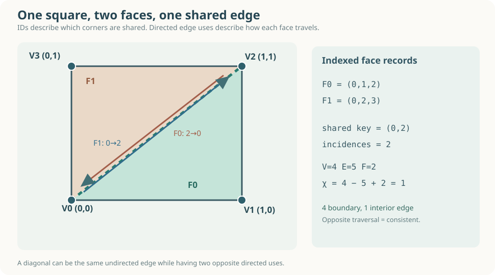
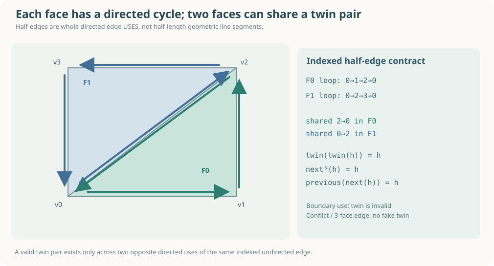
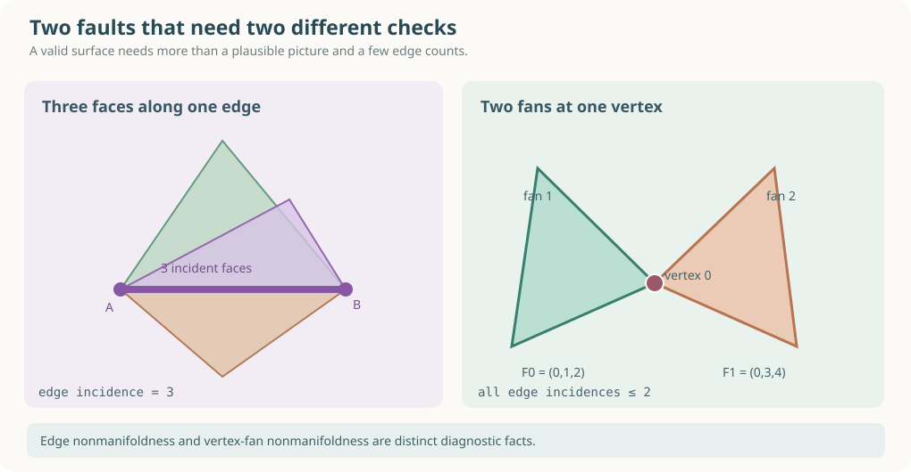
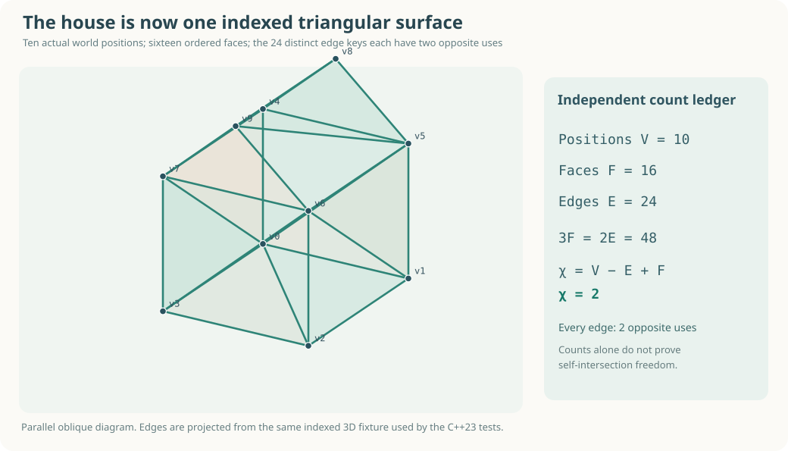
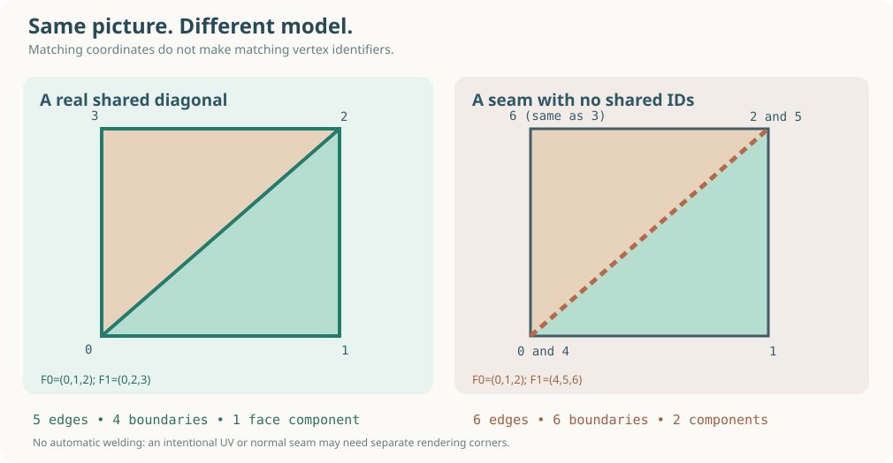

# Chapter 07 — One Shape, Many Triangles

*From Geometry to Images*  
*Part II — Shapes Become 3D Objects*  
*Reader-facing draft; additive to the complete original mesh and reconstruction manuscripts.*

> Two triangles can touch perfectly and still never meet. The trick is that computers know the difference between being **in the same place** and being **the same thing**.

## The house with a mysterious crack no one could see

Yesterday our small house became three-dimensional. We built actual points and directions in the world, erected planes, aimed rays and learned why a surface normal is a statement about facing. The little ball beside the house could be hit on its front and on its back.

Now we want the house to be more than a collection of mathematical demonstrations. We want it to be an object a graphics engine can hold, draw, deform, select, subdivide, repair and perhaps eventually reconstruct from photographs.

We take its walls, floor and roof and cover them with triangles. The result *looks* like a house. We can draw its edges, give its surfaces colors and stand a little camera beside it.

Then we ask a wonderfully small question: “Which two triangles are neighbors?”

The house has a problem. One roof triangle says, “Of course I am next to the other one. We are touching along this entire line.” The other triangle agrees. But when we inspect the stored data, they do not share a single vertex identifier. They only contain separate copies of the same three-dimensional coordinates.

To our eyes, no crack exists. To the mesh's connectivity graph, the crack is enormous: there are two disconnected pieces.

This is the difference between **geometry** and **topology**. Geometry tells us *where*. Topology tells us *which things are connected*. For a realistic mesh system, we need both.

The unexpected lesson of this chapter is that two objects can have the same picture—and even the same world-space coordinates—while having very different mathematical structures.

## First, a triangle gets three names, not just three numbers

We already know a three-dimensional triangle from Chapter 06:

\[
A=(a_x,a_y,a_z),\quad B=(b_x,b_y,b_z),\quad C=(c_x,c_y,c_z).
\]

Three positions are enough to describe where one mathematical triangle sits. But a **mesh** is made of many triangles, and different triangles often reuse the same corners.

Imagine building a model from triangular pieces of cardboard. A corner where two pieces meet has a location on your desk. If you glue them together, they share a physical connection. If you merely lay them on top of one another, the positions can match without the pieces being attached.

For a computer, an **index** is like an identity tag on a corner. We keep a list of vertex positions and let each triangle refer to them by integer index.

Our first small mesh is a square in the \(XY\) plane:

\[
\begin{aligned}
V_0&=(0,0,0),&V_1&=(1,0,0),\\
V_2&=(1,1,0),&V_3&=(0,1,0).
\end{aligned}
\tag{7.1}
\]

Represent its two triangular faces by ordered index triples:

\[
F_0=(0,1,2),\qquad F_1=(0,2,3).
\tag{7.2}
\]

The two faces share vertices \(V_0\) and \(V_2\). They also share the entire **indexed edge** joining those identifiers.

Compare that with a second representation that stores separate copies of the same positions under IDs \(4,5,6\), and uses \(F_1=(4,5,6)\). If the copied coordinates are exactly \((0,0,0),(1,1,0),(0,1,0)\), a picture of the two triangles could be pixel-for-pixel identical. But the index sets no longer overlap. The triangles do not share a graph edge.

One representation describes a single two-face disk. The other describes two disconnected triangular disks lying against one another.

A renderer that only asks which pixels are covered might hide the distinction. A subdivision tool, smoothing algorithm, connected-component query, simulation or mesh-repair system cannot afford to.

*Figure 7.1 — Four positions, five unique undirected edges and two faces. The shared diagonal has the same endpoints as an undirected edge but is traversed in opposite directions by its two consistently wound faces.*

## A useful little graph lives inside a mesh

A triangle mesh contains **vertices, edges and faces**.

A vertex has an identity and is associated with a geometric position. An edge joins two vertex identities. A face is defined by an ordered cycle of three vertex identities. This last ordering matters because it defines the triangle's direction around its boundary.

We can write a directed triangle boundary as

\[
i_0\longrightarrow i_1,\quad
i_1\longrightarrow i_2,\quad
i_2\longrightarrow i_0.
\tag{7.3}
\]

But the *undirected* edge should be the same whether a face walks from index \(2\) to index \(0\) or from \(0\) to \(2\). Our canonical key is therefore

\[
\boxed{k(i,j)=(\min(i,j),\max(i,j)).}
\tag{7.4}
\]

That is a remarkably powerful little formula. It lets us gather every face that uses a particular edge.

For the reference square, enumerate the directed edges of \(F_0=(0,1,2)\):

\[
0\to1,\quad1\to2,\quad2\to0.
\]

Now enumerate those of \(F_1=(0,2,3)\):

\[
0\to2,\quad2\to3,\quad3\to0.
\]

The shared undirected edge has key \((0,2)\). One face walks it as \(2\to0\), the other as \(0\to2\).

That reversal is intentional. If the triangles form a consistently oriented surface, walking around both face boundaries must go opposite ways along their common interior edge. Otherwise neighboring triangles claim opposite interpretations of which way the surface faces.

If you have ever stitched two pieces of cloth, imagine their shared seam. Each piece approaches the seam from its own inside, so the oriented seam is traversed in opposite directions when we walk around their separate boundaries.

## Giving every edge an address of its own: half-edges

Our canonical edge keys answer a question: “Who uses this shared undirected edge?” But suppose we want to walk around the house's roof without scanning every triangle, or move directly from one face across its shared edge into the next face.

For that, geometry-processing systems often store a more explicit connectivity structure called a **half-edge**.

The name sounds peculiar. We are not cutting a physical edge into two equal-length pieces. A half-edge is one *directed use* of an edge along a particular oriented face boundary. When two consistently oriented faces share an interior edge, their two directed uses make a natural pair.

Think of a narrow street between two houses. One address says “travel from A to B alongside the first house.” The other says “travel from B to A alongside the second house.” They refer to the same physical street but carry different directions and face owners.

A half-edge record can store the IDs of its origin, destination and incident face, plus three navigation handles:

- `next`: the next directed edge as we walk around the same face;
- `previous`: the preceding edge around that face;
- `twin`: the oppositely directed use belonging to the neighboring face.

For a triangle, following `next` three times must return us to the starting half-edge:

\[
\boxed{\operatorname{next}^3(h)=h.}
\tag{7.H1}
\]

Likewise the previous edge should undo a next step:

\[
\boxed{\operatorname{previous}(\operatorname{next}(h))=h.}
\tag{7.H2}
\]

And for a legitimate interior twin pair,

\[
\boxed{\operatorname{twin}(\operatorname{twin}(h))=h,}
\tag{7.H3}
\]

with reversed endpoints. The equations are not mystical. They are promises about a tiny navigational graph that a debugger can inspect directly.

*Figure 7.2 — A half-edge is a face-owned directed use of an indexed edge. Each triangle has a three-link face cycle. A legitimate pair of opposite uses across an interior edge may be joined by a symmetric twin relationship.*

### What if there is no neighboring face?

For a boundary edge, there is no second incident surface face to pair with. Different half-edge libraries make different choices. One may represent the missing twin by an invalid handle. Another may create an explicit boundary half-edge with no incident face and connect those boundary uses into boundary loops.

Our P07 reference chooses the simpler **invalid-handle convention**. That makes the limitation visible: a boundary edge has no usable twin. It is not a fake neighboring face.

A winding-conflict edge is also problematic. If both incident faces walk the shared edge in the same direction, they are not the two opposite half-edges our invariant expects. A lazy implementation might still pair them and hope nobody notices. We deliberately **refuse** to create that twin.

A three-face nonmanifold edge is worse. If there are three or more directed uses, which one should be the unique twin? Choosing an arbitrary pair would discard or misrepresent the others. Our little half-edge builder leaves all the affected twins invalid and relies on the incidence report to expose the nonmanifold structure.

This is a case where *refusing to represent an invalid relationship* is better engineering than silently inventing one.

### Why engines care, and why handles have a lifetime

Once a half-edge twin is valid, crossing from a face to its neighbor is essentially one indexed lookup. Walking around a face follows the `next` cycle. A vertex's incident region can be explored by combining `twin` and `next` under the declared orientation and boundary conventions.

The original longer mesh chapter develops a one-ring rotation formula: for an outgoing half-edge \(h\), a common interior traversal is \(\operatorname{next}(\operatorname{twin}(h))\). The exact expression depends on whether the data structure records the origin or destination vertex, how face cycles are oriented, and how boundary half-edges are represented. A boundary or missing twin changes the traversal rules.

The reference code in `include/book03/halfedge_mesh.hpp` constructs three face-owned records for each valid indexed triangle, creates twins only for two opposite directed uses, and validates face cycles and symmetric twins. It does **not** implement a mutable modeling engine. If you edit the topology, you must rebuild its handles; old half-edge indices are no longer guaranteed to identify the same connection. Production libraries often use generations, stable handles and ownership rules to prevent stale references from silently pointing at new objects.

The most useful learning exercise is to break one link on purpose. Change a half-edge's `next` handle so that it points to itself, then run the validator. A good invariant reports the broken cycle before a later algorithm loops forever.

This is an important addition to our numerical discipline. Chapter 05 protected decisions about **coordinates**. Chapter 07 protects decisions about **relationships**. Both prevent silent, plausible-looking errors from spreading into later systems.

## Boundary, interior, conflict and nonmanifold

Gather the list of all face uses of each undirected edge. Then ask how many uses it has.

An edge used by **one** valid face is a **boundary edge**. It lies along the edge of an open surface.

An edge used by **two** faces whose directed uses are opposite is a **consistently wound interior edge**.

An edge used by **two** faces whose uses run the **same** direction is a **winding conflict**. The faces share an edge by identity, so they are connected. But their orientation relationship is inconsistent.

An edge used by **three or more** faces is **nonmanifold by edge incidence** in a triangle surface. Imagine three cardboard sheets glued along one common seam. A neighborhood of a point along that seam is no longer the ordinary local surface neighborhood of one or two sheets.

These classifications come from exact integer index counts and comparisons. No floating epsilon is required to know whether edge \((0,2)\) has one, two or three face uses.

Our P07 inspector preserves each use record: which face used the edge, and in which direction. That makes a winding warning explainable instead of printing a vague “invalid mesh” and leaving the reader to guess.

### But the word “manifold” requires more care

In an ordinary two-dimensional surface, a sufficiently tiny neighborhood around an interior point looks like a disk; around a boundary point, it looks like half a disk.

The three-face edge violates that local shape. But checking edges alone is **not sufficient** to certify a surface manifold.

There is a more deceptive case: a **bow-tie vertex**. Picture two triangles touching at one corner and nowhere else. Every triangle edge belongs to just one face; none has three face uses. Yet the tiny neighborhood around the shared vertex looks like two separate wedges meeting at a point. It is not one connected disk-like fan.

An edge-only “manifold validator” can accept this vertex accidentally. So our inspector also analyzes the **fan of incident faces around each vertex**. If they split into disconnected groups when linked through edges containing that vertex, the vertex is nonmanifold.

The surface might look like an hourglass pinched to one point. The two halves touch, but you cannot walk continuously across a sheet-like neighborhood around that pinch.

*Figure 7.3 — These are two distinct faults. The left panel violates the two-face maximum at an edge. The right panel has a vertex whose incident faces are disconnected through their shared-edge neighborhoods. Checking only edge incidence misses the second case.*

### What we are deliberately not certifying

Even if every edge has two opposite uses and every vertex has one well-formed fan, other geometric problems can remain. A mesh may self-intersect, contain coincident but disconnected shells, have bad triangle area due to numerical rounding, contain physically impossible geometry, or represent something other than the intended physical object.

We can therefore use a careful name: `closed_orientable_edge_candidate()`. It means the object passed specified **necessary** local incidence, winding, nondegeneracy and vertex-fan checks. It is not a global proof of watertight geometry, embedded manifoldness, collision safety or intended outward normals.

Choosing names that explain the scope of a guarantee is as important as writing the algorithm.

## Counting the square: four corners, five edges, two faces

For our reference square the answer is easy:

\[
V=4,\qquad E=5,\qquad F=2.
\tag{7.5}
\]

The five unique undirected edges are \((0,1),(1,2),(0,2),(2,3),(0,3)\). Four of them are boundaries; the diagonal \((0,2)\) is interior.

Now compute

\[
\boxed{\chi=V-E+F=4-5+2=1.}
\tag{7.6}
\]

This quantity is called the **Euler characteristic**. For a simple connected topological disk, it is one.

Euler's formula is often introduced as a beautiful mysterious equation, but here it is a small accounting statement about our indexed geometry.

For a connected closed orientable surface of genus \(g\), under the usual topological assumptions,

\[
\chi=2-2g.
\tag{7.7}
\]

A sphere-like surface has \(g=0\) and \(\chi=2\). A torus-like surface has \(g=1\) and \(\chi=0\).

But this classification formula is not permission to infer “it is a sphere” merely because a file produces \(V-E+F=2\). We need its assumptions: a connected closed orientable two-manifold cell complex, with valid face attachment and appropriate geometric realization. Count first, validate assumptions, and only then apply the theorem.

### A closed house as a stronger reference

Our real three-dimensional house now has ten indexed vertices: four floor corners, four wall-top corners, and two roof-ridge endpoints. The floor, walls, two triangular gables and two sloped roof sides can be covered with **sixteen triangular faces**.

For the carefully oriented, closed reference construction,

\[
V=10,\qquad F=16.
\]

Each edge belongs to exactly two faces, so counting the three edges from every triangle counts each undirected edge twice:

\[
3F=2E\implies E=24.
\tag{7.8}
\]

Then

\[
\chi=10-24+16=\boxed{2}.
\tag{7.9}
\]

The test still must check that the directed uses are opposite, that the vertex fans behave correctly, and that no triangle is degenerate. The Euler number alone cannot do all that work.

For our classroom model, this is a terrific benchmark. A small human can reconstruct the count by hand, and a compiler can test the same indexed data. We no longer need to trust a pretty wireframe.

*Figure 7.4 — The house has ten indexed positions, twenty-four edges and sixteen triangular faces. The picture is an oblique diagram of true 3D coordinates, not a perspective camera view. Combinatorial counts and edge-incidence requirements are separate pieces of evidence.*

## How one invisible seam becomes two disconnected islands

Return to the square. Imagine we duplicate three of its vertices and use the new IDs for the second triangle.

We have seven stored positions. Several of them have **identical XYZ coordinates**. The two triangles still fill the same square on screen, but they now use six distinct edge keys. There is no shared diagonal. Both triangles are separate components under the **face-sharing-an-edge** relationship.

Our counts change:

\[
V=6\ \text{referenced topological vertices},\quad
E=6,\quad F=2,\quad\chi=2.
\tag{7.10}
\]

Why not seven referenced vertices? Because one of the original four stored position entries may be unused after replacing the second triangle's index triple. If you keep an unused vertex in the storage array, it should be reported separately—not quietly added to the Euler count of the surface complex.

To make this distinction precise, our P07 fixture begins with the original quad and appends three copied positions. The first triangle still uses indices \(0,1,2\); the second uses \(4,5,6\). Position index \(3\) remains stored but unused. Thus **seven stored positions, six referenced vertices**, six undirected edges and two disconnected triangular disks.

This is not merely a theoretical trick. Mesh imports often duplicate vertices to handle different texture coordinates, normals, material seams or separate primitive groups. Such duplication can be intentional and correct for a rendering pipeline, even if it changes connectivity for a topology algorithm.

So we must not implement “fix all duplicated positions” by automatically welding vertices whose coordinates match. That could destroy seams or join parts that an artist deliberately kept apart.

*Figure 7.5 — Geometry on the page can be identical while the indexed connectivity differs. Identical coordinate values are evidence to inspect, not automatic permission to weld.*

## A vertex and a corner are not always the same attribute container

Now we meet a subtlety important to every real graphics engine.

When a mesh has a vertex position, a normal and a texture coordinate, it is tempting to put everything in one struct:

~~~cpp
struct Vertex {
    Point3 position;
    Vector3 normal;
    UV2 texcoord;
};
~~~

This is often a practical *rendering vertex* format. But it is not a universal description of a geometric or topological vertex.

Consider two walls meeting along a sharp corner. They share a physical position. But the outward normals of the two walls are different. If we want the lighting to preserve the sharp corner, one shared position may need **two per-face-corner normal values**.

Consider a sphere with a texture image wrapped around it. At the seam where the texture coordinate jumps from \(u=1\) back to \(u=0\), one geometric position may need two different texture coordinates. The seam does not necessarily mean two different locations in space.

The more flexible conceptual model separates several layers:

A **position vertex** identifies a point in the indexed geometry. A **face corner** is the use of that vertex by a particular face. Normal, tangent, UV and material-related attributes may belong to those face corners, faces, or another explicit domain.

That is why our new `Mesh3` has indexed positions and faces, plus an optional array of three UVs **for each face**. The UVs belong to corners even when two corners refer to the same position ID.

For GPU drawing we might later expand or split these data into a renderer-friendly vertex buffer. That expansion is an implementation choice, not proof that the original topology was different.

We will treat GPU buffer layouts in the later real-time book, and detailed normal interpolation and shading in the light/materials volume. For now it is enough to learn that **a position can be shared while an attribute can differ**.

### A mathematical way to say it

Let face \(f\) have ordered index triple \((i_0,i_1,i_2)\). A per-corner UV assignment can be

\[
U(f,0),\quad U(f,1),\quad U(f,2).
\tag{7.11}
\]

There is no reason to demand

\[
U(f,c)=U(g,d)
\]

merely because \(i_{f,c}=i_{g,d}\). They may or may not agree, depending on the intended seam.

This is a good example of avoiding a type mistake. Position indices define topological identity. UV values define local texture mapping. They answer different questions.

## A flipped triangle is not the same as a hole

Take our original quad and reverse the order of its second face:

\[
F_1'=(0,3,2).
\tag{7.12}
\]

The corners and triangle region do not move. The two triangles still share the undirected diagonal \((0,2)\).

But now both faces traverse that shared diagonal from \(2\to0\). Their winding is inconsistent.

The inspector reports one **winding conflict**, not a boundary on that diagonal, and not a nonmanifold edge with three incident faces.

This distinction matters because repairing these cases may require very different actions. A missing face creates a hole. A flipped face changes orientation. A three-face edge violates the two-face local surface model. A duplicated seam may merely be an intentional split of attributes or geometry.

A useful tool should name the actual fault it observed before proposing a repair.

Even more important, not every repair can be automated safely. Flipping one face in an isolated two-triangle disk may fix winding. Flipping faces across a larger complex with inconsistent or nonorientable structure needs graph propagation and conflict detection. Automatically welding coincident positions can change topology or accidentally join surfaces that happen to occupy the same location.

We are building a **diagnostic inspector**, not claiming an infallible mesh repairer.

## The bow-tie vertex, a tiny trap for “manifold checking”

Here is an example our reference implementation must catch.

Create five vertices, with vertex \(0\) at the origin. Form one triangle \((0,1,2)\) to the left and another triangle \((0,3,4)\) to the right. The triangles touch only at \(V_0\).

Every edge is a boundary edge. Not one edge has three incident faces. If our validator checks only edge counts, it might say, “Nothing special happened.”

Yet at \(V_0\), we have **two disconnected incident face fans**. Starting from one incident triangle, there is no adjacent incident triangle reachable by walking across a shared edge that includes \(V_0\).

For a single two-manifold surface, that is a violation of the expected local vertex neighborhood. We must walk through **vertex fans**, not just count global connected components or edge uses.

Our inspector computes a local graph for each vertex. Its nodes are faces incident to that vertex. Two nodes are joined when their faces share an indexed edge that contains the vertex. If the local graph has more than one connected component, the vertex has disconnected fans.

It also checks boundary incidence: in a simple manifold triangle surface, a boundary vertex normally has **two** incident boundary edges, while an interior vertex has zero. A vertex with three or more boundary-edge directions needs scrutiny even if its face graph happens to be connected.

The test fixture with one bow-tie vertex must report a vertex-fan fault even though it has zero nonmanifold edges by the usual three-face-edge definition.

That test is one of the most valuable pieces of code in this chapter. It catches a kind of topological error that a visually polished renderer may conceal completely.

## How connected is a mesh?

We often say a mesh is “connected,” but which relationship are we using?

Two faces can be considered adjacent if they share an indexed **edge**, or if they share at least one **vertex**. Those are different definitions.

In the bow-tie example, the faces are vertex-adjacent but **not** edge-adjacent. Under an edge-connected face-component query, they belong to different components.

The mesh could also contain two disconnected groups of triangles that merely occupy the same spatial coordinates. They are geometrically coincident and topologically disconnected.

Our P07 component report deliberately uses **shared undirected indexed edges**. It constructs a face-adjacency graph and counts its connected components.

We use a small disjoint-set data structure: initially every valid face belongs to its own group. Whenever an edge has more than one incident face, we merge those faces into the same connectivity group. After visiting all edges, the number of distinct groups is the number of edge-connected face components.

The algorithm works without comparing floating-point coordinates. That is both faster to reason about and more honest: it answers a topological question using topological identities.

One subtlety remains. If a face repeats the same vertex index twice, it does not form an ordinary triangular cell. We flag it separately and exclude it from the normal edge-incidence graph. A triangle with three *distinct* vertex IDs but collinear positions is a different issue: its combinatorial face exists, yet its geometric area is zero. We report both conditions independently.

## Why your neighbors influence your shape: sparse adjacency and the graph Laplacian

Once we know which vertices are actually connected, we can do more than navigate. We can build computations whose answers depend on the neighborhood graph.

Imagine a line of children holding hands. Each child looks at the positions of the children whose hands they hold and takes a small step toward their average. If we tell the wrong children to hold hands, the smoothing movement is wrong—even if everybody began at the correct coordinates.

The same idea appears in geometry processing. For a vertex \(i\), let

\[
N(i)=\{j:\{i,j\}\text{ is an indexed mesh edge}\}
\]

be its **one-ring neighboring vertex IDs**. The neighbor relation is based on the indexed graph, not geometric proximity. In the seam example, two distinct vertices at identical XYZ positions are still not neighbors merely because they coincide.

If a scalar value \(x_i\) lives at each vertex, a simple **uniform graph Laplacian** is

\[
\boxed{(Lx)_i=\sum_{j\in N(i)}(x_i-x_j).}
\tag{7.L1}
\]

It measures how a vertex's value differs from those connected to it. For the reference quad with scalar values \((0,1,2,3)\), the neighbors are

\[
N(0)=\{1,2,3\},\quad N(1)=\{0,2\},
\]
\[
N(2)=\{0,1,3\},\quad N(3)=\{0,2\}.
\]

Therefore the Laplacian is

\[
Lx=(-6,\ 0,\ 2,\ 4).
\tag{7.L2}
\]

You can check the first value by hand: \((0-1)+(0-2)+(0-3)=-6\). The entries sum to zero because each undirected edge contributes an equal-and-opposite difference. A constant field has Laplacian zero.

This is a **graph** Laplacian. It is not yet the cotangent-weighted discrete Laplace–Beltrami operator often used to approximate surface differential geometry. Proper curvature, boundary handling and smoothing stability require further mathematical choices and belong in the deeper geometry-processing material. Our goal here is to show how an innocent mistake in the neighbor graph changes the very numerical operator we thought we were computing.

### Store neighbors without thousands of little allocations

For a small example, a `std::vector<std::vector<uint32_t>>` is clear: one vector per vertex, containing its neighboring IDs.

For a larger static mesh, we can flatten those neighbor lists into two arrays using **compressed sparse row**, or CSR. The first contains offsets:

~~~text
offsets = [0, 3, 5, 8, 10]
~~~

and the second contains every neighbor ID in sequence:

~~~text
neighbors = [1,2,3, 0,2, 0,1,3, 0,2]
~~~

The neighbors of vertex \(i\) occupy the half-open span

\[
[\operatorname{offsets}[i],\operatorname{offsets}[i+1]).
\tag{7.L3}
\]

This compact representation is the same general idea used in sparse matrices and graph algorithms. It is efficient when the graph is mostly read rather than repeatedly edited. If the mesh changes, rebuilding its CSR representation is often simpler and safer than trying to change offsets in place.

Our P07 module includes `build_vertex_csr()` and a very small `VertexCSR::laplacian()`. The tests independently check the quad's neighbor IDs, total degree \(2E=10\), constant-field behavior and the fact that the seam's unused stored vertex has no neighbors. These are not claims about GPU performance or a production smoothing algorithm: they are precise, reproducible links between topology and mathematics.

### Let the distances and angles influence the neighbours

The uniform graph operator treats a tiny triangle and a giant triangle as equivalent if their indexed neighbourhoods match. For a surface field, the actual shapes of the triangles matter. Imagine two pieces of cloth with identical connectivity, but one is stretched in one direction: diffusion along their surface should not necessarily have the same physical rate.

For a nondegenerate triangle, the cotangent of an interior angle between edge vectors a and b is

\[
\cot\theta=\frac{a\cdot b}{\|a\times b\|}.
\]

For an interior mesh edge ij, let alpha and beta be the angles opposite it in its two incident triangles. Define w_ij=(cot alpha+cot beta)/2. For a boundary edge, include only its single incident triangle's term. With positive lumped vertex areas A_i (for instance, one third of the area of each incident triangle), a commonly used discrete surface Laplacian is

\[
(\Delta f)_i=\frac{1}{A_i}\sum_j w_{ij}(f_j-f_i).
\]

This sign is opposite to the positive-semidefinite graph convention in equation 7.L1. Call the symmetric stiffness matrix K, with K_ij=-w_ij for i!=j and K_ii=sum_j w_ij. Then Delta=-M^{-1}K, where M is the diagonal matrix of vertex areas. The mass factor restores inverse-length-squared units when the positions are in metres. It also explains why simply using K as a time-evolution matrix changes the physical meaning.

On a unit square divided by diagonal (0,0) to (1,1), both angles opposite that diagonal are right angles, so its cotangent weight is zero. Along a boundary edge the opposite angle is 45 degrees, giving weight 0.5. This differs from the uniform adjacency operator even though every indexed edge remains present. The diagonal is still a topological edge; a zero operator coefficient does not delete its connectivity.

An obtuse triangle can contribute a negative cotangent; not every triangulation yields nonnegative edge weights. The assembled stiffness is nonnegative in its quadratic energy for nondegenerate piecewise-linear finite elements, but individual weights need not be positive. Do not blindly clamp negative weights while claiming the same mathematical operator. Degenerate faces, nonmanifold neighbourhoods and unspecified boundary conditions require explicit policies.

For diffusion df/dt=kappa Delta f, forward Euler gives f_next=f+dt kappa Delta f. For the symmetric mass-scaled stiffness M^{-1/2}KM^{-1/2}, a nonnegative eigenvalue lambda evolves with factor 1-dt kappa lambda. Stability of this linear step in the mass norm requires dt kappa lambda_max<=2. This is not a monotonicity guarantee for every mesh. Smaller triangles can force smaller time steps. Boundary constraints, especially fixed boundary values versus natural zero-flux conditions, define different problems. Applying this operator to each position coordinate can smooth a surface but may shrink it, erase edges or damage volume. Preserve a reference and measure the change rather than calling every smoothing pass a repair.

The native P07 lab remains the uniform CSR graph operator; this extension derives a surface-aware operator, not an implementation of a complete mesh-diffusion solver.

*Source route: Graphics Vision and XR/41, derived lines 1424–1505; /30, lines 108–179 and 214–295. Further source sections concern discretization and boundary conditions, which are routed to Book 02 and the surface-processing extensions.*

## The C++23 model: geometry and identity in their proper places

We are not going to create a second incompatible engine. Our cumulative companion already knows `Point3`, `Vector3`, `Triangle3` and basic geometry from Chapter 06.

P07 adds an **indexed topology layer**:

~~~cpp
struct TriangleIndices {
    std::array<std::uint32_t, 3> vertex{};
};

struct Mesh3 {
    std::vector<Point3> positions;
    std::vector<TriangleIndices> triangles;

    // Optional attributes for each USE of a vertex by a face.
    std::vector<std::array<UV2, 3>> corner_uv;
};

struct EdgeKey {
    std::uint32_t lo{}, hi{};
};
~~~

The implementation validates every index *before* accessing the position array. It rejects nonfinite positions and malformed optional UV layouts. It preserves directed edge uses alongside canonical undirected keys.

A small independent test must verify that a face containing index \(77\) in a four-vertex mesh is rejected as out of bounds. Not “ignored.” Not “drawn near the origin.” Rejected with a useful error.

Another test takes a triangle \((0,0,1)\), where a vertex ID repeats. It should be reported as a **repeated-index face** and excluded from ordinary edge construction. A separate collinear triangle \((0,1,2)\) with distinct IDs but positions \((0,0,0),(1,1,1),(2,2,2)\) should be reported as a **zero-area face** without pretending its indices are repeated.

This is where Book 3's earlier precision work becomes relevant. The geometric cross product is an ordinary floating evaluation and has its own numerical limits. The exactness of the **integer edge-incidence graph** does not make floating triangle area an exact decision for every represented binary64 input.

Good software keeps those guarantees separate, even when they appear next to each other on the screen.

## A mesh inspector that asks useful questions

The native companion is `book03_mesh`, with four modes:

~~~text
book03_mesh inspect [fixture]
book03_mesh svg OUTPUT.svg [fixture]
book03_mesh csv OUTPUT.csv [fixture]
book03_mesh repl
~~~

There are eight built-in fixtures: `house`, `quad`, `flipped`, `seam`, `nonmanifold`, `bowtie`, `degenerate` and `collinear`.

The default is the closed house. Its numeric report explains each combinatorial count. Its SVG colors boundary, consistent interior, winding-conflict and nonmanifold edges differently. Its CSV writes one row per indexed undirected edge, including its two endpoint IDs, classification, incidence count and incident face IDs.

The terminal playground lets you choose a different fixture and save **the current selection**, not merely a fixed picture with a different filename:

~~~text
fixture seam
inspect
svg my-seam.svg
csv my-seam.csv
fixture bowtie
inspect
quit
~~~

The SVG's layout is a declared oblique, parallel map from 3D positions into 2D paper coordinates. No hidden camera calibration, perspective divide, depth buffer or physically based shading is implied.

For the seam fixture, the numerical report is especially important. The two physical triangles can produce coincident lines in the visualization. The **indices** and component count tell the real story, while the artwork calls attention to why a picture can deceive.

### A report should distinguish an observation from a conclusion

Suppose the inspector prints:

~~~text
boundary=0, winding-conflict=0, nonmanifold=0
closed-orientable-edge-candidate=yes
~~~

That is not a proof that the mesh is a beautiful watertight house in the ordinary physical sense. The model might self-intersect or contain multiple disconnected shells. It tells us only that the stated local incidence and vertex-fan tests passed, subject to their declared geometry-degeneracy checks.

A useful next research project could add exact 3D predicates for intersection classification, connected closed-component analysis, consistent outward orientation, and global self-intersection checks. Those are serious algorithms and deserve serious evidence.

The inspector should not declare the work complete merely because its checks passed.

## Our tests must learn to spot invisible faults

A first test uses the quad. The expected answer is \(V=4,E=5,F=2,\chi=1\), four boundary edges and one correctly oriented shared diagonal.

A second uses the closed house. The expected answer is \(V=10,E=24,F=16,\chi=2\), twenty-four consistently oriented interior edges, no boundaries, one edge-connected component and no disconnected vertex fan. The count follows from \(3F=2E\), independently of the implementation.

A third flips one square face. The edge count should not change, but one shared diagonal should now carry a winding conflict.

A fourth duplicates the second triangle's vertices. There should be six boundary edges and two edge-connected face components, even though the physical positions still form one square.

A fifth puts a third face along the same indexed edge. It must classify the edge as nonmanifold and record all three incident faces.

A sixth makes the bow-tie vertex. It should have no edge with three incident faces, but exactly one vertex whose incident face fan splits.

A seventh introduces a face that repeats an index. An eighth introduces a geometrically collinear face. Their diagnostics must remain distinct.

Finally, we can generate strips of \(N\) properly oriented quads and check their counts against an independent formula. A strip of \(N\) quads split into two triangles each has

\[
V=2(N+1),\quad
F=2N,\quad
E=4N+1.
\tag{7.13}
\]

Therefore

\[
V-E+F=2N+2-(4N+1)+2N=1.
\tag{7.14}
\]

Its boundary-edge count is \(2N+2\); its consistent interior-edge count is \(2N-1\). The tests generate **300 deterministic strip lengths**, each checked against these formulas. These are source-authored tests, not a claim of a completed compiler run until execution evidence is actually observed.

One of the nicest things about independent formulas is that they cannot accidentally learn a bug from the inspector. We write the mathematical expectation first; the program has to earn agreement.

## What exactly is being repaired?

We have now seen several faults, but we must resist the urge to “repair” them all by changing the nearest vertex.

A boundary edge is not always an error. The top surface of a cloth sheet should have a boundary. An open terrain patch should have one too.

A UV seam can be an intentional attribute split. Welding it blindly could smear a texture or destroy a hard normal discontinuity.

A flipped face might be a simple local winding mistake. But if the entire mesh is nonorientable or internally inconsistent, there may be no single global assignment of winding that solves every edge without changing topology.

A three-face edge may indicate overlapping material, accidental duplication or a real model that needs to be represented by more than one manifold sheet.

A bow-tie vertex may require splitting one index into separate identities, but exactly which faces should be separated depends on the intended model.

In all these cases, a trustworthy diagnostic begins by describing **what is observed**, then asks whether the structure violates the application's stated requirements. Mesh repair is not a universal “clean” button. It is a transformation that must preserve the features the user actually wants.

The later advanced geometry research material already contains substantial work on mesh reconstruction, uncertainty, local repair, connectivity and geometry validation. We must preserve that depth rather than replacing it with a one-paragraph instruction to weld every duplicate.

## Problems to solve with paper first, code second

**Reconstruct — count a square twice.** Draw the two indexed triangles \((0,1,2)\), \((0,2,3)\). List every directed edge, reduce them to canonical unordered keys, and show why the diagonal has two opposite uses. Compute \(V,E,F,\chi\), and identify the four boundaries.

**Reconstruct — count the house.** Starting from ten indexed house vertices and sixteen consistently oriented triangular faces, explain why twenty-four undirected edges follow from two uses per closed edge. Check \(\chi=2\). Then explain why this equation alone is not a self-intersection proof.

**Falsify — one invisible seam.** Duplicate the vertex indices used by one of the square's triangles without moving any positions. Predict stored vertex count, referenced vertex count, edge count, number of edge-connected face components, and Euler characteristic. Which values would a screenshot fail to reveal?

**Falsify — a triangle that points the other way.** Change face \((0,2,3)\) to \((0,3,2)\). Find the shared diagonal's new directed uses. Explain why this produces a winding conflict rather than a hole.

**Falsify — the bow-tie trap.** Draw two triangles that touch at one common vertex and share no edge. Demonstrate that every edge can have only one incident face while the central vertex still has two disconnected face fans. Explain why an edge-count-only manifold check is insufficient.

**Transfer — a seam in texture space.** Take a pair of adjacent geometric faces that share one position vertex but require different UV coordinates there. Specify the data structure for `U(face,corner)`. Explain how a GPU-friendly expanded vertex buffer can duplicate a rendering vertex without changing the original conceptual surface identity.

**Transfer — read a different model.** An imported mesh contains a stored position that no face uses. Should it contribute to the Euler count of the *referenced triangle complex*? Our policy is no; it is reported as unused data. If your definition includes all isolated vertices as separate zero-dimensional cells, the Euler characteristic differs. State which complex you are counting before publishing the result.

**Implement — prove a strip count.** Build a chain of \(N\) square cells, each split along the same diagonal into two triangles. Derive the counts in (7.13), then compare with the inspector for 1, 2, 10 and 50 cells. Verify the boundary-edge and interior-edge counts independently.

**Implement — repair with permission.** Take the seam fixture and write a proposal for welding. Before changing indices, inspect UV, normals, materials, topological groups and intended connectivity. Explain why same-position alone is insufficient permission to merge. Produce a before/after report, not just a pleasing picture.

**Explain — cardboard, glue and names.** Tell a young child that two bits of cardboard can lie in the same place without being glued. The number on a vertex is like the identity of a shared button on the clothes, not the coordinates of where the button happens to be. Then explain why three sheets glued along one seam make something different from an ordinary thin surface.

### Selected answers

The reference square has five undirected indexed edges, four boundary edges, one consistently oriented interior diagonal and Euler characteristic one. The closed house has ten referenced vertices, twenty-four edges and sixteen triangular faces, so Euler characteristic two. The seam fixture stores seven positions, references six, has six boundary edges, two edge-connected face components and Euler characteristic two. The flipped face changes one diagonal's winding relationship but does not change its edge incidence count. A bow-tie vertex can be nonmanifold without any edge having three incident faces. A strip of \(N\) quads contains \(2N+2\) referenced positions, \(4N+1\) edges, \(2N\) triangles and Euler characteristic one.

If a solution claims to know whether two faces are connected merely by comparing their XYZ coordinates, it has answered a geometric proximity question instead of the indexed-topology question. If a solution claims the Euler number alone proves watertightness, it has skipped the theorem's hypotheses.

## The next building block: shaping a curved world

We have reached a new kind of confidence. Our house is no longer just a set of triangles that looks house-shaped. We can inspect its identities, its edges, its orientations and local neighborhood structure. We know why some cracks are invisible and why some visual seams should not be repaired at all.

But our current house is angular. Straight edges and flat triangles are excellent building blocks, yet not everything in the world wants to be a straight line or a flat roof. Think of a bowed tree branch, a curved road, a teacup handle or the smooth outline of our garden ball.

How do we describe a smooth shape using only a few carefully chosen points?

That is the question for **Chapter 08 — Drawing Smooth Things with Control Points**. We will meet Bézier and Hermite curves, continuity and derivatives, then build controlled geometric patches that can finally become trustworthy triangle meshes. Topology will remain important even when the geometry becomes graceful.

The house has learned how to stay connected. Next we teach its garden how to curve.

---

## Glossary and source boundary

**Geometry:** Positions, distances, normal directions, areas and other spatial measurements.

**Topology:** Identity and connectivity among vertices, edges, faces and their neighborhoods, independent of their exact embedding in space.

**Indexed mesh:** A position array and face index arrays that refer to vertex identities instead of copying all XYZ coordinates for each triangle.

**Face corner:** One use of a vertex by a particular face; it may own UV, normal or other attributes independently of the shared position.

**Edge key:** Canonical unordered pair \((\min(i,j),\max(i,j))\) used for indexed edge incidence lookup.

**Boundary edge:** Edge used by exactly one valid triangular face under the mesh's chosen incidence model.

**Consistent interior edge:** Edge shared by two faces that traverse it in opposite directions.

**Winding conflict:** Two incident faces traverse their shared edge in the same direction.

**Nonmanifold edge:** In this triangle surface model, an edge with at least three incident faces.

**Vertex fan:** Faces incident to a vertex, considered connected when neighboring faces share edges containing that vertex. A bow tie has disconnected fans.

**Edge-connected face component:** A connected component of the face graph where adjacency requires an indexed shared edge.

**Euler characteristic:** The combinatorial count \(V-E+F\) for the specified vertex-edge-face complex. Interpretations require clearly stated topological assumptions.

**Coincident positions:** Separate vertex IDs whose XYZ coordinate values are equal; their graph identities remain different.

**Degenerate face:** A face with repeated indices or a geometrically zero-area triangle; those are different failure modes and require distinct reporting.

**Necessary local test:** A condition a target manifold surface must satisfy, without claiming it suffices to establish globally valid geometry.

**Companion code:** `Code Parts/tools/labs/book03_cpp23/include/book03/mesh_topology.hpp`, `src/mesh_studio.cpp`, `tests/mesh_topology_tests.cpp`.

The substantial original chapter `Notes/Chapter Edition/02 - Graphics Vision and XR/23 - Mesh Topology and Connectivity.md` introduces indexed faces, incidence, adjacency, winding, half-edge and manifold concepts with a complete set of deeper examples. The present chapter is a new narrative on-ramp and independent C++23 reference. It must be reconciled with the complete original source in final composition, not substituted for the original's advanced portions. The companion also draws on the original `24 - Ray–Triangle Intersection.md` and `27 - Mesh Queries, Classification and Clipping.md` in planning future narrowphase, mesh selection and ray/raster chapters.

For deeper reference see Mario Botsch et al., *Polygon Mesh Processing* (2010); Keenan Crane's *Discrete Differential Geometry* lecture material; and the topology/attribute handling documentation of the graphics file formats we will discuss in Chapter 10. Check licenses and sources before importing examples. The diagrams and code here are newly authored teaching material.

**Read next:** Chapter 08 — Drawing Smooth Things with Control Points.
