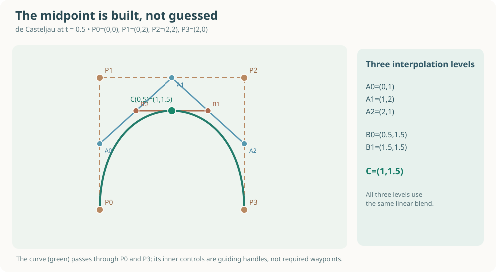
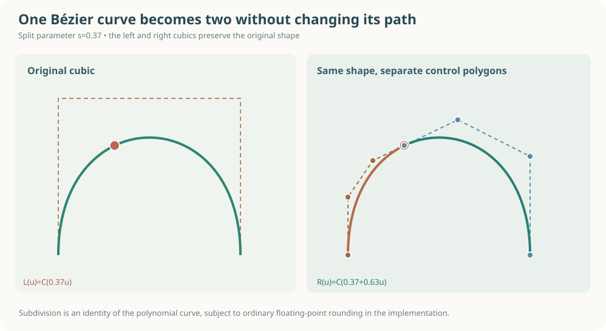
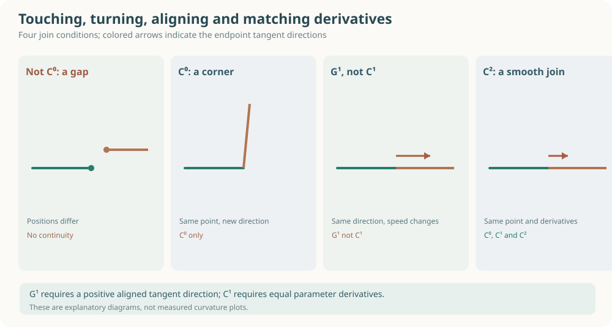
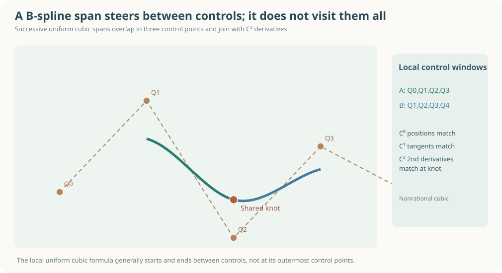
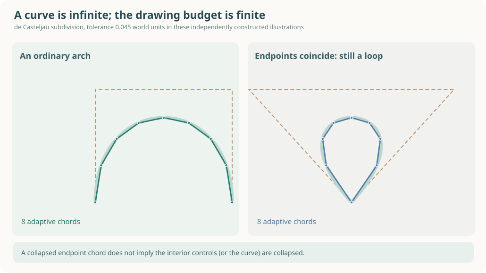
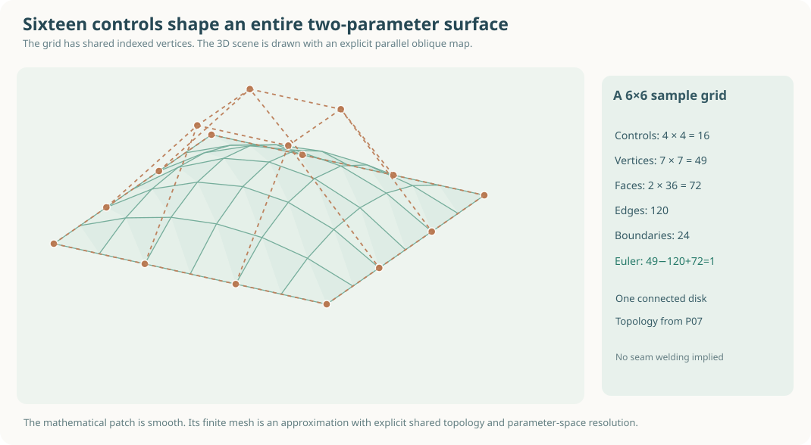

# Chapter 08 — Drawing Smooth Things with Control Points

*From Geometry to Images*  
*Part II — Shapes Become 3D Objects*  
*Reader edition draft / cumulative C++23 laboratory P08 / authoring source, not a publication build*

> A straight line is wonderfully obedient. Ask it to turn into a tree branch, and suddenly it demands a little imagination.

## The garden tree with a very stiff neck

The house is real now—mathematically real. It has three-dimensional walls, a floor, a roof ridge, indexed triangular faces, neighbors, and even little records that know how to walk from one surface to the next. Our mesh inspector can expose an invisible split or a bow-tie vertex that a drawing would cheerfully hide.

But beside our carefully constructed house lives a tree.

The first time we draw its branch, it looks like it is made of bent drinking straws. The trunk goes up, a line turns abruptly, another line turns again. No matter how carefully we choose the vertices, our little collection of straight segments tends to look like a collection of straight segments.

We could add more and more points until the branch looks smooth. But then imagine the wind changes. We would need to move dozens or hundreds of points together while preserving a graceful shape. Is there a smaller way to describe the *intention* of a curve?

Yes. Instead of storing every little turn, we can store a few **control points**. Then let mathematics work out the intervening shape.

This is a surprisingly deep idea. Four points can describe a cubic curve with infinitely many mathematical positions along it. Those positions are not all stored in memory; they are generated when we ask for them. And when the renderer eventually needs actual straight edges and triangles, we can approximate the curve to a stated tolerance.

It is a kind of controlled laziness. We describe what we want with a few handles, and calculate only the details necessary to draw or reason about it.

Today, the garden branch learns to bend. Before the chapter ends, we will also build a smooth patch like a canopy over the garden and turn it into the indexed triangle mesh we learned to trust in Chapter 07.

## First, the simplest possible curve: walking between two points

If \(A\) and \(B\) are two points, the straight segment between them is

\[
\boxed{L(t)=(1-t)A+tB,\qquad 0\le t\le1.}
\tag{8.1}
\]

Read this as an everyday instruction: start at \(A\), and travel a fraction \(t\) of the way to \(B\).

At \(t=0\), we get \(A\). At \(t=1\), we get \(B\). At \(t=\tfrac12\), we get the midpoint.

Suppose \(A=(0,0)\) and \(B=(6,4)\). At \(t=\tfrac14\),

\[
L(\tfrac14)=(1.5,1).
\tag{8.2}
\]

This is just the point-plus-displacement operation we already developed:

\[
L(t)=A+t(B-A).
\tag{8.3}
\]

That formulation matters in C++23 because \(A\) and \(B\) have type `Point3`, while \(B-A\) has type `Vector3`. We never need to invent the illegal operation “point plus point.”

Now imagine that instead of walking from \(A\) to \(B\) once, we repeatedly interpolate between points that were *themselves* interpolated. Something magical happens: the final point follows a curve.

## Bézier curves: a game of finding points between points

Let's introduce four controls in a plane:

\[
P_0=(0,0),\quad P_1=(0,2),\quad
P_2=(2,2),\quad P_3=(2,0).
\tag{8.4}
\]

The first and last controls specify where our curve begins and ends. The two middle controls influence how it leaves and approaches those endpoints. They are like handles attached to the branch.

Draw a straight control polygon by joining \(P_0\to P_1\to P_2\to P_3\). It makes three straight pieces: up, right, down. The final Bézier curve will not simply follow these pieces. It will flow *inside the envelope they establish*.

The computational recipe is named **de Casteljau's algorithm**.

First interpolate between each neighboring pair:

\[
A_0=(1-t)P_0+tP_1,\qquad
A_1=(1-t)P_1+tP_2,\qquad
A_2=(1-t)P_2+tP_3.
\tag{8.5}
\]

Now interpolate between those new points:

\[
B_0=(1-t)A_0+tA_1,\qquad
B_1=(1-t)A_1+tA_2.
\tag{8.6}
\]

Finally interpolate once more:

\[
\boxed{C(t)=(1-t)B_0+tB_1.}
\tag{8.7}
\]

There is your curve. No trig function. No mysterious smoothing filter. Just repeated linear interpolation.

### Do it by hand at the middle

Let \(t=\frac12\). Our first round of midpoints gives

\[
A_0=(0,1),\quad
A_1=(1,2),\quad
A_2=(2,1).
\]

The next round gives

\[
B_0=(0.5,1.5),\qquad B_1=(1.5,1.5).
\]

The final midpoint is

\[
\boxed{C(0.5)=(1,1.5).}
\tag{8.8}
\]

The control polygon went all the way up to \(y=2\), but the curve's midpoint sits at \(y=1.5\). It is gently arched instead of making sharp turns.

If our C++23 `CubicBezier3::at(0.5)` returns anything other than \((1,1.5,0)\) for these XY controls embedded at \(z=0\), something is wrong.

<escape> </escape>

*Figure 8.1 — The same four original controls generate three first-level points, two second-level points, and one point on the curve. Every construction is a simple linear interpolation.*

### The parameter is not a stopwatch

What is \(t\)? It is a **parameter**—a number that tells us where to evaluate the curve's mathematical construction.

It does **not** automatically mean time in seconds. It does not automatically measure how far we have traveled. It does not promise that moving from \(t=0.1\) to \(0.2\) covers the same distance as moving from \(t=0.7\) to \(0.8\).

Two different parameter values can produce different rates of spatial movement. If our tree branch carries a moving firefly and we advance \(t\) by equal increments every frame, the firefly may accelerate and slow down along the branch even when \(t\) increases at a constant rate.

For constant *speed in metres per second*, we will eventually need **arc length** or an approximation/inversion of its accumulated length. A geometric parameterization is not the same as physical speed. This matters for animations, camera rails, toolpaths and robotic motion.

Our P08 curve uses the normalized domain \(0\le t\le1\). Derivatives are therefore measured per unit change of that normalized parameter, not automatically per second.

## One curve, two mathematical ways of seeing it

The repeated interpolation formula is beautiful for computation, but it also has a closed-form polynomial expression.

Expand the three de Casteljau layers and collect the control points:

\[
\boxed{
C(t)=(1-t)^3P_0+3(1-t)^2tP_1
+3(1-t)t^2P_2+t^3P_3.
}
\tag{8.9}
\]

The four coefficients are the **cubic Bernstein basis functions**:

\[
\begin{aligned}
b_0(t)&=(1-t)^3,\\
b_1(t)&=3(1-t)^2t,\\
b_2(t)&=3(1-t)t^2,\\
b_3(t)&=t^3.
\end{aligned}
\tag{8.10}
\]

For \(0\le t\le1\), every coefficient is nonnegative and

\[
b_0+b_1+b_2+b_3=1.
\tag{8.11}
\]

That means each curve point is a **convex combination** of its control points.

Put simply: the curve cannot spontaneously wander outside the convex hull of its four controls when we evaluate it within the standard parameter interval. That is enormously useful for bounding boxes, trimming decisions, tessellation and collision candidate search.

It also gives us a good way to test the code. We implement de Casteljau interpolation *and* a separate direct Bernstein polynomial evaluation. We compare them over many parameter values. They need not have identical last floating bits, but they should agree to an explained tolerance for ordinary well-scaled controls.

This is independent arithmetic evidence. It does not prove correctness for every representable input, but it can catch a wrong coefficient or reversed control index.

### Do the middle controls lie on the curve?

Usually not.

The curve starts at \(P_0\) and ends at \(P_3\), but \(P_1\) and \(P_2\) are steering handles. Dragging one changes the shape of the entire cubic, generally without moving the endpoints.

This is why we call the construction **approximation by controls**, not interpolation through all four controls.

A child drawing a tree may feel disappointed the branch does not pass through the middle handles. That is not a bug. The handles are instructions about how the branch should bend.

For cubic Bézier curves, the endpoints are guaranteed to be on the curve. The interior controls generally are not.

## Tangents: how the branch leaves one point and approaches another

A tangent vector tells us the instantaneous direction and rate of change of the curve with respect to its parameter.

Differentiate equation (8.9) with respect to \(t\):

\[
\boxed{
C'(t)=3(1-t)^2(P_1-P_0)
+6(1-t)t(P_2-P_1)
+3t^2(P_3-P_2).
}
\tag{8.12}
\]

At the endpoints, nearly everything disappears:

\[
\boxed{
C'(0)=3(P_1-P_0),\qquad
C'(1)=3(P_3-P_2).
}
\tag{8.13}
\]

Look closely. The direction in which a curve leaves \(P_0\) is controlled by the first handle \(P_1\). Its direction when it reaches \(P_3\) is controlled by the last incoming handle \(P_2\).

For our sample arch,

\[
C'(0)=(0,6),\qquad C'(1)=(0,-6).
\tag{8.14}
\]

So the curve begins by traveling straight upward and ends traveling straight downward—smoothly, without ever turning into one of the sharp corners of its control polygon.

At \(t=\tfrac12\), the tangent is

\[
\boxed{C'(0.5)=(3,0)}
\]

for the example in (8.4).

**Wait—check the arithmetic.** The horizontal contribution arises from the middle edge \(P_2-P_1=(2,0)\). In (8.12), its coefficient at \(t=0.5\) is \(6(0.5)(0.5)=1.5\), yielding

\[
C'(0.5)=1.5(2,0)=\boxed{(3,0)}.
\tag{8.15}
\]

That is the correct value. The derivative is three coordinate units per unit \(t\) along X at the midpoint, not six. A factor-of-two error here would spoil the motion of the firefly and the tangent-continuity tests later.

### A second derivative tells us how the tangent is changing

Differentiate again:

\[
\boxed{
C''(t)=6(1-t)(P_2-2P_1+P_0)
+6t(P_3-2P_2+P_1).
}
\tag{8.16}
\]

For our arch, at the midpoint,

\[
C''(0.5)=(0,-12).
\tag{8.17}
\]

The tangent is horizontal there, while its change points downward. This matches our intuition: the curve is rounding the top of its arch.

A second derivative is **not automatically a physical acceleration**. If \(t\) is related to physical time \(\tau\), the chain rule gives

\[
\frac{dC}{d\tau}=\frac{dC}{dt}\frac{dt}{d\tau}
\tag{8.18}
\]

and

\[
\frac{d^2 C}{d\tau^2}=
C''(t)\left(\frac{dt}{d\tau}\right)^2+
C'(t)\frac{d^2 t}{d\tau^2}.
\tag{8.19}
\]

This distinction matters when we later animate objects along curves instead of merely drawing them.

### Curvature is not simply the second derivative

In a regular three-dimensional curve, curvature can be defined by

\[
\boxed{
\kappa(t)=\frac{\|C'(t)\times C''(t)\|}
{\|C'(t)\|^3},
}
\tag{8.20}
\]

provided the speed \(\|C'(t)\|\) is nonzero. Curvature has units of inverse length when coordinates use metres and \(t\) is dimensionless.

Why the denominator? Because raw derivatives change if we change how fast the parameter moves through the same geometric curve. Curvature is intended to describe how sharply the *shape itself* bends, independently of a regular reparameterization.

At a cusp or a parameter where \(C'(t)=0\), the standard formula is undefined. A routine must not quietly divide by zero and invent a normal or curvature. Our first P08 library teaches tangents and second derivatives and flags degenerate normal construction at the patch level; a certified curvature and arc-length tool belongs to a later numerical-geometry pass.

## A deeper secret: the blossom behind de Casteljau

The de Casteljau construction is not merely a clever arrangement of midpoints. The old MIT cubic-curves lecture also develops a mathematical idea called the **blossom** (or polar form), which explains why evaluation, subdivision, and changes of polynomial basis fit together.

Suppose one cubic coordinate is written as \(C(t)=at^3+bt^2+ct+d\). Its blossom is a function of **three** parameters:

\[
\boxed{\mathcal B(u,v,w)
=a\,uvw+\frac b3(uv+uw+vw)+\frac c3(u+v+w)+d.}
\tag{8.A1}
\]

This new function is **symmetric**: swapping any of its arguments does not change the answer. It is **affine separately in each argument**: fixing two inputs leaves a linear expression in the third. And on the **diagonal**, it returns the original cubic:

\[
\boxed{\mathcal B(t,t,t)=C(t).}
\tag{8.A2}
\]

Substitute \(u=v=w=t\) to check it. The three pairwise products become \(3t^2\), and the sum of the three parameters becomes \(3t\). The fractions vanish and the original cubic remains.

The Bézier controls themselves are special blossom evaluations:

\[
P_0=\mathcal B(0,0,0),\quad
P_1=\mathcal B(0,0,1),\quad
P_2=\mathcal B(0,1,1),\quad
P_3=\mathcal B(1,1,1).
\tag{8.A3}
\]

Now repeatedly use affinity to replace one argument at a time by \(t\). You recover exactly the interpolation stages of de Casteljau. Changing the starting and ending parameter values gives the new control points of a subdivided curve.

In the language of a child: de Casteljau is a game of finding points between points; the blossom is the rulebook proving the same game always produces the correct cubic. It is valuable later for degree elevation, arbitrary subintervals, and polynomial geometric identities.

Our P08 code implements the actual evaluations and splits, not a generic blossom library. The advanced original lecture's full blossom derivation is preserved in the source atlas and should not be discarded from final series composition.

## Splitting a curve without changing its shape

What if our tree needs a leaf growing at one particular point, and we want to keep the segment of the branch before that point as a separate editable curve?

We could sample the original cubic into hundreds of positions, but then we would have lost its elegant four-control representation. There is a much better answer.

The very same de Casteljau construction used for evaluation also gives us **two new cubic Bézier curves**.

At a chosen split parameter \(t=s\), compute the first- and second-level intermediate points and the final point \(C(s)\). The left subcurve uses

\[
(P_0,A_0,B_0,C(s)),
\tag{8.21}
\]

and the right subcurve uses

\[
(C(s),B_1,A_2,P_3).
\tag{8.22}
\]

The left curve traces exactly the original parameter interval \([0,s]\), reparameterized to \([0,1]\). The right curve traces \([s,1]\), also reparameterized to \([0,1]\).

So if \(L(u)\) and \(R(u)\) are the two new cubics,

\[
L(u)=C(su),\quad
R(u)=C(s+(1-s)u).
\tag{8.23}
\]

This is not merely a visual resemblance. It is a polynomial identity, subject to ordinary floating rounding in the implementation.

The C++ tests exercise the identity at hundreds of parameters using the independently evaluated original cubic. They also check split endpoints and special cases \(s=0,1\).

*Figure 8.2 — Subdivision gives new editable controls while preserving the original curve's geometry. The subcurves' parameter speeds differ from the original normalized interval unless adjusted.*

## Joining two curves: the difference between touching and moving smoothly

Suppose our tree branch is made from two cubic pieces. They meet at a common endpoint. Does that mean the whole branch is smooth?

Not necessarily.

Imagine two roads that reach the same intersection. One goes straight east, the next immediately turns north. Their endpoints meet, but a car following them would have a sharp turn.

This is **positional continuity**, also called \(C^0\) continuity:

\[
\boxed{A(1)=B(0).}
\tag{8.24}
\]

Now imagine the roads meet with their tangents in the same direction. The turn disappears, but the parameter may run at different speeds on the two sides. This is **geometric tangent continuity**, often called \(G^1\), assuming nonzero endpoint derivatives.

In a practical positive-orientation form,

\[
\boxed{A'(1)=\lambda B'(0),\qquad \lambda>0.}
\tag{8.25}
\]

The positive multiplier means the tangents point along the same direction; it excludes a reversal that would make the path travel backward at the join.

If the derivative vectors are equal under the chosen parameterization,

\[
\boxed{A'(1)=B'(0),}
\tag{8.26}
\]

we have \(C^1\) continuity.

If the second derivatives also match,

\[
\boxed{A''(1)=B''(0),}
\tag{8.27}
\]

and the lower-order requirements hold, we have \(C^2\) continuity.

### Three joins that a little drawing can fool us about

Take a first cubic that is simply a straight line along the X axis, from \((0,0)\) to \((3,0)\), with its inner controls at \((1,0)\) and \((2,0)\). Its endpoint derivative is \((3,0)\).

Now try three second cubics.

**Join A:** start at \((3,0)\), with the next handle at \((4,0)\). The beginning derivative is \((3,0)\), matching the first segment. If the remaining controls preserve the same straight-line second derivative, this join can be \(C^2\).

**Join B:** start at \((3,0)\), with the next handle at \((5,0)\). Its beginning derivative is \((6,0)\). The tangent points in the same positive direction, so this can be \(G^1\), but it is **not** \(C^1\) under equal normalized parameter intervals: the derivative magnitude doubles abruptly.

**Join C:** start at \((3,0)\), with the next handle at \((3,1)\). Its beginning derivative points upward instead of right. It is \(C^0\) because the endpoints touch, but not \(G^1\).

A smooth-looking screen image is weak evidence for these distinctions. The derivatives provide a stronger test.

The P08 `join_continuity` routine measures the endpoint gap, derivative gap and second-derivative gap, and separately tests positive tangent-direction alignment. Its tolerances are declared inputs with units and interpretation; it does not pretend an arbitrary epsilon is an exact theorem about floating coordinates.

*Figure 8.3 — Position, direction, and parameter derivatives are different contracts. Two curves can look smoothly joined at ordinary screen scale while failing \(C^1\) because their parameter speeds differ.*

### Why does reparameterization matter?

A path through space can remain exactly the same if we move along it faster or slower as the parameter changes. That changes the derivatives with respect to the parameter.

This is why **geometric** continuity and **parametric** continuity should not be casually combined into one “smoothness” boolean.

A geometry editor caring about the absence of visible corners may accept \(G^1\). A motion-planning system that attaches physical time to the parameter may care much more about derivatives and acceleration. A surface patch assembler may require specific continuity conditions across shared boundaries to avoid visible creases.

The intended application decides which contract matters.

## Hermite curves: ask for endpoint directions directly

Bézier curves give us two inner steering handles. But some designers want to specify a different set of instructions:

“I know where the branch begins. I know where it ends. And I know exactly which direction and parameter speed it should have at both endpoints.”

That leads to **cubic Hermite interpolation**.

We specify endpoints \(P_0,P_1\) and tangent vectors \(T_0,T_1\). The curve is

\[
\boxed{
H(t)=h_{00}(t)P_0+h_{10}(t)T_0+
h_{01}(t)P_1+h_{11}(t)T_1,
}
\tag{8.28}
\]

where

\[
\begin{aligned}
h_{00}(t)&=2t^3-3t^2+1,\\
h_{10}(t)&=t^3-2t^2+t,\\
h_{01}(t)&=-2t^3+3t^2,\\
h_{11}(t)&=t^3-t^2.
\end{aligned}
\tag{8.29}
\]

The basis is designed so that

\[
H(0)=P_0,\quad H(1)=P_1,\quad
H'(0)=T_0,\quad H'(1)=T_1.
\tag{8.30}
\]

Our old little arch gives us a perfect worked example. Set

\[
P_0=(0,0),\quad P_1=(2,0),\quad
T_0=(0,6),\quad T_1=(0,-6).
\]

We already know that shape: it is the arch controlled by Bézier points \((0,0),(0,2),(2,2),(2,0)\).

The link between the representations is exact algebra:

\[
\boxed{
B_0=P_0,\quad
B_1=P_0+\frac{T_0}{3},\quad
B_2=P_1-\frac{T_1}{3},\quad
B_3=P_1.
}
\tag{8.31}
\]

So Hermite and Bézier are not two unrelated ways of drawing curves. They are two **bases for the same family of cubic polynomial curves**, using different kinds of control data.

Our code implements direct Hermite-basis evaluation and converts Hermite controls into Bézier controls separately. The tests compare their positions and endpoint derivatives. That is far stronger than implementing one as a thin wrapper of the other and then “testing” a function against itself.

### A warning about tangent units

We have written \(T_0=dH/dt\). If \(t\) runs from zero to one, those derivatives are in metres per unit parameter.

If we reparameterize the curve onto a time interval of five seconds, endpoint velocities in metres per second are related to the tangents through the chain rule. Do not copy a “five metres per second” velocity directly into a normalized Hermite tangent without accounting for the interval.

That is the sort of small units mistake that produces wild or sluggish camera motion while every matrix multiplication seems correct.

### A road that really passes through its waypoints: Catmull–Rom

Not every path is supposed to avoid its middle controls. A camera may need to pass *through* the front gate, the window and the tree, rather than merely bend toward those locations. **Catmull–Rom** splines provide an interpolating alternative.

For a simple uniform segment from waypoint \(Q_i\) to \(Q_{i+1}\), choose Hermite endpoint tangents from their neighboring waypoints:

\[
T_i=\frac{Q_{i+1}-Q_{i-1}}2,\qquad
T_{i+1}=\frac{Q_{i+2}-Q_i}2.
\tag{8.C1}
\]

Then use our Hermite basis to construct the segment. It passes through \(Q_i,Q_{i+1}\), and when adjacent segments share a consistent tangent at a waypoint they can achieve \(C^1\) continuity under compatible uniform parameters.

Notice the difference from ordinary Bézier handles: these waypoints **are** intended to be visited. But the simple uniform formula does not guarantee pleasant behavior if the waypoints are unevenly spaced. It can overshoot or loop. Centripetal and chordal parameterizations, endpoint tangent policies, and explicit speed controls exist for good reasons.

The P08 library supplies the Hermite building block but does not advertise a complete Catmull–Rom editing system. The original camera-motion source chapter includes a substantially deeper treatment and remains part of the later curve-and-camera integration.

## B-splines: when a garden path has many control points

A single cubic Bézier segment gives us four controls. What happens when the garden path becomes longer, with ten, twenty, or hundreds of shaping handles?

We can join many Bézier pieces. But then we must maintain their endpoint and derivative constraints. Move one handle, and we may need to repair several nearby joins.

A **B-spline** offers another way to organize a long piecewise-polynomial curve. Its controls typically have **local influence**: changing one handle affects a limited set of nearby curve spans rather than the entire long path.

The complete B-spline family includes arbitrary degrees, knot vectors, repeated knots, nonuniform spacing and often rational weights in NURBS. Those choices affect continuity, interpolation and parameterization. A single formula for one uniform cubic span is not the whole subject.

We begin with a clear, limited case: one **nonrational uniform cubic B-spline span** with four local controls \(Q_0,Q_1,Q_2,Q_3\).

Its curve on \(0\le t\le1\) is

\[
S(t)=b_0Q_0+b_1Q_1+b_2Q_2+b_3Q_3,
\tag{8.32}
\]

with local basis weights

\[
\begin{aligned}
b_0&=\frac{(1-t)^3}{6},\\
b_1&=\frac{3t^3-6t^2+4}{6},\\
b_2&=\frac{-3t^3+3t^2+3t+1}{6},\\
b_3&=\frac{t^3}{6}.
\end{aligned}
\tag{8.33}
\]

These weights are nonnegative on the unit interval and sum to one. But unlike Bézier, the span **does not generally begin at \(Q_0\) or end at \(Q_3\)**.

### The one-line example that reveals the difference

Let the four control points be

\[
Q_0=(0,0),\ Q_1=(1,0),\
Q_2=(2,0),\ Q_3=(3,0).
\]

The uniform cubic span is

\[
\boxed{S(t)=(1+t,0).}
\tag{8.34}
\]

At \(t=0\), it starts at \((1,0)\), not at \(Q_0=(0,0)\). At \(t=1\), it ends at \((2,0)\), not \(Q_3=(3,0)\).

The controls steer the shape. They are not required to be points through which the span passes.

This is exactly the sort of detail a library should reveal in its type and documentation. Our API calls it `UniformCubicBSplineSpan3`, not a generic `NURBSCurve` claiming to handle the entire family.

### Translate a B-spline span into Bézier language

One local uniform cubic B-spline span can be rewritten as a cubic Bézier segment with controls

\[
\begin{aligned}
B_0&=\frac{Q_0+4Q_1+Q_2}{6},\\
B_1&=\frac{2Q_1+Q_2}{3},\\
B_2&=\frac{Q_1+2Q_2}{3},\\
B_3&=\frac{Q_1+4Q_2+Q_3}{6}.
\end{aligned}
\tag{8.35}
\]

The two forms trace the same polynomial segment. Our C++23 lab evaluates the span directly with its own basis coefficients *and* converts it into Bézier form for an independent de Casteljau comparison.

If we take two successive uniform cubic spans formed by overlapping controls

\[
(Q_0,Q_1,Q_2,Q_3)
\quad\text{and}\quad
(Q_1,Q_2,Q_3,Q_4),
\tag{8.36}
\]

with equal simple uniform knots, they meet with \(C^2\) parametric continuity. That comes from the way the basis functions line up at a common knot; it is not a generic promise for arbitrary knot multiplicities or nonuniform parameters.

We verify the \(C^2\) claim by converting both spans to Bézier form, then independently comparing their endpoint positions, first derivatives and second derivatives.

*Figure 8.4 — The overlapping local control windows help neighboring spans share smooth derivatives. Knots, degree and multiplicity govern the general theory; the P08 implementation handles a specifically declared uniform cubic case.*

### Knots, weights and why CAD circles are not ordinary polynomial cubics

Our uniform nonrational cubic B-spline span is an honest first case, not all of spline theory. A general B-spline uses a **knot vector** that controls where polynomial pieces meet and how the basis functions overlap. Knot multiplicity changes smoothness: an ordinary degree-\(p\) spline has \(C^{p-r}\) continuity at an interior knot of multiplicity \(r\), under the standard regularity assumptions. Thus a cubic with a single simple knot is typically \(C^2\), while a repeated knot reduces the number of matched derivatives.

Repeated **control points** and repeated **knots** are not the same operation. Nor does a nonrational polynomial cubic magically reproduce a perfect circle simply by adding more segments.

A rational Bézier curve adds weights \(w_i\) and divides one weighted polynomial by another:

\[
\boxed{
R(t)=
\frac{\sum_i w_i\,b_i(t)\,P_i}
{\sum_i w_i\,b_i(t)}.
}
\tag{8.N1}
\]

For a simple exact quarter-circle, choose *quadratic* controls \(P_0=(1,0)\), \(P_1=(1,1)\), \(P_2=(0,1)\) with weights \(w=(1,\sqrt2/2,1)\). At the midpoint \(t=1/2\), the rational expression evaluates to \((\sqrt2/2,\sqrt2/2)\), precisely on the unit circle. More generally the entire rational quadratic segment represents the circular arc exactly in real arithmetic.

**NURBS**—nonuniform rational B-splines—combine knot-vector freedom and rational weights. They are crucial in CAD, but also require careful handling of basis domains, repeated knots, zero denominators, seam continuity and trimming. Our P08 code explicitly supports only a *nonrational uniform cubic span*. It would be misleading to label it a NURBS implementation.

The existing MIT curve and surface source materials cover rational circles, splines, and knot effects. Keep those proofs in the complete series even though the introductory implementation currently concentrates on a minimal, fully traceable subset.

## Turning a perfect mathematical curve into a finite drawing

The mathematical Bézier curve contains infinitely many parameter values. But a stored mesh, SVG polyline or eventually a raster image can only use finitely many primitives.

We must approximate the curve with straight line segments.

The naive solution is to sample uniformly:

\[
t_i=\frac{i}{N},\quad i=0,\ldots,N.
\tag{8.37}
\]

Sometimes that works. A gently bending region could get far more segments than needed, while a sharp bend might receive too few. Equal steps in \(t\) do not automatically correspond to equal distances or equal geometric error.

The alternative is **adaptive tessellation**: use more detail only where the curve needs it.

### A criterion based on the control hull

Consider a cubic Bézier segment with endpoints \(P_0\) and \(P_3\). Its simplest drawing approximation is the straight **chord** from \(P_0\) to \(P_3\).

We want to know how far the curve might wander from that finite segment.

Because the curve lies in the convex hull of its four controls, and distance to a convex set is a convex function, a conservative *mathematical* bound on the distance of any curve point to the chord segment is

\[
\boxed{
d_{\max}\le
\max\left\{
\operatorname{dist}(P_1,[P_0,P_3]),
\operatorname{dist}(P_2,[P_0,P_3])
\right\}.
}
\tag{8.38}
\]

The distances must be measured to the **finite chord segment**, not merely to the infinite line through it. That difference matters when controls lie beyond the segment endpoints.

If both interior controls lie sufficiently close to the chord, we can draw the chord and stop. Otherwise, split the cubic at \(t=\tfrac12\) using de Casteljau, and inspect each half again.

This generates many segments near strong bends and few near straight regions.

But we have to name the guarantee carefully. In exact real arithmetic, the control-hull argument is sound. Our C++23 implementation evaluates the distances and subdivisions using `double`, so it does **not** supply a formally rounded-up interval bound for arbitrary representable controls. We call the result `tolerance_met_under_float_policy`, not “certified Hausdorff distance.”

There is still a difference between a mathematically motivated conservative criterion and a fully certified floating-point implementation. Chapter 05 taught us why that distinction matters.

### The curve whose endpoints are the same

One of the most dangerous shortcuts is to decide a curve is straight merely because its two endpoints are close.

Imagine

\[
P_0=P_3=(0,0),\quad
P_1=(3,2),\quad
P_2=(-3,2).
\tag{8.39}
\]

Its endpoints coincide, but the curve can make a large loop between them. A tessellator that measures only endpoint separation might replace the whole loop with one zero-length segment, deleting the shape completely.

Our criterion also checks the interior controls against the finite chord. When the chord collapses to a single point, the distance is taken to that point. The loop is therefore recognized as needing subdivision.

This is an excellent adversarial test. An implementation that handles a normal arch but erases a closed-endpoint loop has not earned our trust.

### A depth budget is part of the result

Suppose someone asks for a tolerance of \(10^{-20}\) metres. On ordinary double-precision geometry with finite computer memory, we may not be able to meet it meaningfully, or we may need an impractically large number of segments.

An honest function should never loop forever or quietly claim it met an impossible demand.

Our adaptive algorithm has a maximum subdivision depth, at most sixteen levels in the classroom implementation. If it reaches the depth limit before its control-hull test passes, it still returns the generated approximation but explicitly sets

`tolerance_met_under_float_policy = false`.

A caller can then decide whether to increase the budget, reject the output, or accept a lower-quality preview. The library does not erase its own failure.

The tests verify that a strictly linear cubic can be represented by a single segment; a curved arch requires more; a loop with coincident endpoints is not erased; parameter values remain ordered; and an exhausted depth budget is reported.

*Figure 8.5 — The segment-count choice follows a geometric criterion rather than equal parameter steps. The visual comparison is explanatory, not a benchmark claiming measured speedup or a mathematically certified floating error interval.*

## From four controls to sixteen: a surface you can walk over

A single curve is one-dimensional. You choose one parameter \(t\) and get a point in 3D space.

But our garden needs a curved roof or canopy. That is two-dimensional: it stretches both lengthwise and sideways. We need two parameters, \(u\) and \(v\).

A **bicubic Bézier patch** uses sixteen control points arranged in a four-by-four grid, \(P_{ij}\) for \(i,j\in\{0,1,2,3\}\).

Its tensor-product surface is

\[
\boxed{
S(u,v)=
\sum_{i=0}^{3}\sum_{j=0}^{3}
b_i(u)b_j(v)P_{ij},
\quad 0\le u,v\le1,
}
\tag{8.40}
\]

where the \(b_i\) are the same cubic Bernstein basis functions.

That formula has a wonderfully simple computational interpretation: evaluate four cubic curves along one parameter direction, then evaluate a fifth cubic across the four resulting points in the other direction.

We can write this without a giant symbolic expression and without a graphics API. It is de Casteljau's algorithm, repeated in two dimensions.

### A plane as an independent oracle

Before making a curved canopy, create the easiest possible patch. Let

\[
P_{ij}=(i,j,0).
\tag{8.41}
\]

Every control lies in the XY plane, spaced uniformly along the two parameter directions. The tensor-product Bézier patch reduces to

\[
\boxed{S(u,v)=(3u,3v,0).}
\tag{8.42}
\]

For example,

\[
S(0.4,0.6)=(1.2,1.8,0).
\tag{8.43}
\]

We can derive this by the Bernstein basis property of reproducing a linear function. We can also check it directly against the C++23 evaluation.

This flat patch may look boring, but it is a magnificent first test. If the code cannot reproduce a simple plane, the problem is not a complicated curved canopy. It is the implementation.

### Tangent directions become a surface normal

A curve has one parameter derivative. A surface has two:

\[
S_u=\frac{\partial S}{\partial u},\qquad
S_v=\frac{\partial S}{\partial v}.
\tag{8.44}
\]

These vectors lie in the surface's local tangent plane when they are regular and independent.

Take their cross product:

\[
\boxed{
N(u,v)=\frac{S_u\times S_v}
{\|S_u\times S_v\|}.
}
\tag{8.45}
\]

This gives a unit normal for a regular patch, with orientation determined by the ordering of \(u\) and \(v\).

For the planar example, \(S_u=(3,0,0)\) and \(S_v=(0,3,0)\), so

\[
N=(0,0,1).
\tag{8.46}
\]

Reverse the parameter order, and the normal reverses.

If \(S_u\) and \(S_v\) become parallel or zero, their cross product vanishes, so a unique regular surface normal cannot be obtained by this formula. A good library rejects that normalization rather than inventing a direction.

Our implementation computes both partial derivatives from the control grid using de Casteljau evaluation of derivative controls, then normalizes the cross product. It does not pretend that all patches are regular everywhere.

### The canopy made from sixteen heights

For an actually curved demonstration, we place sixteen controls over a small square garden footprint in the XZ plane. Most have height \(y=2\) metres. The four interior controls have their heights raised.

The resulting surface arches upward toward its middle but remains joined to the lower boundary at its perimeter. Drag one of those inner height controls in the REPL and the canopy changes continuously. We have a curved surface that can be re-evaluated at arbitrary parameter values, not a frozen triangle soup.

Of course, the mathematical patch is continuous. We still need a finite mesh to render or export it. That leads straight back to Chapter 07.

*Figure 8.6 — Sixteen controls define an entire parametric surface. A rectangular sampling grid approximates it by triangles, reusing indexed vertices at shared edges rather than duplicating every corner.*

## A patch becomes the indexed mesh we already know

Choose \(m\) subdivisions along \(u\), and \(n\) along \(v\). Evaluate

\[
S(i/m,j/n)
\tag{8.47}
\]

for each grid vertex \(i=0,\ldots,m\), \(j=0,\ldots,n\).

Store each sampled position exactly once in an array. A simple row-major vertex index is

\[
\boxed{\operatorname{index}(i,j)=i(n+1)+j.}
\tag{8.48}
\]

Then split every grid cell into two consistently oriented triangles:

\[
(a,b,c),\qquad(a,c,d),
\tag{8.49}
\]

where \(a=(i,j)\), \(b=(i+1,j)\), \(c=(i+1,j+1)\), \(d=(i,j+1)\) in index notation.

The resulting indexed grid has

\[
\boxed{V=(m+1)(n+1),\quad F=2mn.}
\tag{8.50}
\]

Count the horizontal and vertical grid edges plus one diagonal in every cell:

\[
\boxed{E=m(n+1)+(m+1)n+mn=3mn+m+n.}
\tag{8.51}
\]

Its boundary contains

\[
\boxed{B=2(m+n)}
\tag{8.52}
\]

edges. The remaining \(E-B=3mn-m-n\) are interior edges with two opposite face uses.

Now check Euler:

\[
\begin{aligned}
V-E+F
&=(mn+m+n+1)\\
&\quad -(3mn+m+n)+2mn\\
&=\boxed{1}.
\end{aligned}
\tag{8.53}
\]

The parameter rectangle is one topological disk even though the geometric patch may be curved in space.

That is the beautiful payoff for keeping the chapters connected. We can test our P08 patch generator using the independent P07 indexed-mesh inspector. If the new surface generator duplicates edges or reverses a triangle, the old topology code will complain.

### A concrete two-by-three grid

Choose \(m=2\), \(n=3\). Then

\[
V=3\cdot4=12,\quad
F=2\cdot2\cdot3=12,\quad
E=3(2)(3)+2+3=23.
\tag{8.54}
\]

There are \(2(2+3)=10\) boundary edges and \(13\) interior edges. The Euler characteristic is \(12-23+12=1\).

Our tests derive those numbers independently, then ask `inspect_mesh()` to verify the generated mesh. The patch evaluator and the topology inspector have different internal algorithms; agreement is meaningful.

For the interactive garden, we use a \(12\times12\) parameter grid by default. It produces \(13^2=169\) positions, \(2(12)^2=288\) triangular faces, and

\[
E=3(12)^2+12+12=\boxed{456}
\tag{8.55}
\]

unique indexed edges. Its boundary has \(48\) edges and its Euler characteristic remains one.

This is a testable geometry deliverable, not merely an attractive SVG.

## A patch seam is an agreement between two surfaces

Imagine making a larger canopy by placing two Bézier patches side by side. Both can be mathematically smooth on their own, yet still leave a visible crack or crease along their shared edge.

To prevent a gap, their boundary curves must meet in world space. That is the patch version of positional continuity.

To prevent a visible tangent-plane crease, their tangent planes must align along the join. Matching normals is a useful diagnostic under suitable orientation conventions, but exact \(G^1\) surface continuity is more subtle than simply comparing a pair of normals at a single sample.

A shared sampled boundary also creates a **topological** question. If the mesh generator separately creates duplicate position IDs for each patch, the triangles may look perfectly joined while forming two disconnected components in the indexed mesh graph—exactly the invisible seam problem from Chapter 07.

You need both agreements: geometry should meet where intended, and topology should explicitly represent whatever connectivity the application wants.

Our P08 lab generates a single rectangular patch with shared vertices **within** its grid. It does **not** automatically stitch separate independently tessellated patches. The general multi-patch seam problem, compatible parameterizations, watertight CAD trimming and extraordinary vertices are research-level geometry-processing topics that deserve a more complete treatment.

This boundary makes the small lab honest. We can build, validate and understand one patch before promising an entire CAD kernel.

## A first lesson in numerical curve robustness

Our curves are represented by stored binary64 control coordinates. Even de Casteljau interpolation can round, especially at very large coordinates or when tiny differences are subtracted. The algorithm is often numerically attractive compared with directly expanding high-degree polynomial coefficients, but it is not an exact arithmetic oracle for every representable input.

Two other limits deserve names.

**Ill-conditioned geometry.** A curve with an almost-zero tangent makes unit tangent and curvature computations highly sensitive to small input changes. A surface patch with nearly parallel partial derivatives has an unstable normal. More floating-point digits cannot remove the physical sensitivity of those questions.

**Incomplete approximation budget.** Adaptive tessellation can be stopped by its maximum depth before the desired spatial tolerance is achieved. Reporting a small-looking polyline is not enough; the result must expose whether the criterion was met under the declared floating policy.

We also refuse to confuse one type of error with another. A sampled polyline is an *approximation of continuous geometry*. A CAD patch may be mathematically smooth even if its displayed triangle mesh looks faceted at low resolution. Conversely, a high-resolution mesh can look beautiful while representing a broken seam or inconsistent winding.

The source code and its reports should make these distinctions visible.

## The P08 native workbench

All of this lives in the same cumulative C++23 laboratory tree:

`Code Parts/tools/labs/book03_cpp23/`.

We add `include/book03/curves3d.hpp`: cubic Bézier, direct Bernstein evaluation, de Casteljau splitting, derivatives, Hermite conversion, one uniform cubic B-spline span, continuity measurements, adaptive polyline tessellation, a bicubic tensor-product patch and indexed grid sampling.

We add `tests/curves3d_tests.cpp`: hand-solvable arch cases, two independent cubic evaluation paths, subdivision identity, continuity counterexamples, Hermite and B-spline equivalences, loop/nonzero-error cases, tensor-product plane derivatives and independent P07 mesh-count oracles.

And we add `src/curve_studio.cpp`: a tiny terminal-led modeling studio. It owns editable control locations, tolerance and patch controls. Its *actual source geometry* drives the numerical report, figure, sampled coordinate file and exported indexed mesh.

The commands are deliberately ordinary:

~~~text
book03_curves inspect
book03_curves svg garden-curves.svg
book03_curves csv garden-samples.csv
book03_curves obj garden-patch.obj
book03_curves repl
~~~

Inside the REPL, try:

~~~text
control 1 -2 3 0
control 2 2 3 0
tolerance 0.015
inspect
svg taller-branch.svg
csv taller-branch.csv
patch-control 1 1 -0.666667 4.0 -0.666667
obj taller-canopy.obj
quit
~~~

Changing a curve control alters the curve, its subdivision and the exported SVG/CSV. Changing a patch control alters the sampled 3D canopy and the indexed OBJ. If the tessellation tolerance is too strict for the allowed depth, the report says so.

The `OBJ` output is intentionally small and plain: it writes `v` positions and 1-based `f` triangle indices, with no materials, UVs, normals, camera, trim or units metadata beyond its explicit comments. A reader should not mistake an OBJ exporter for a complete asset pipeline. Chapter 10 will teach that boundary in depth.

The generated SVG uses a stated parallel oblique projection for illustration. It is not the physical camera model we will develop in later chapters, and it is not a measured performance graph. It draws the control polygon differently from the evaluated curve so nobody confuses handles with actual curve points.

## Experiments before we leave the garden

**Reconstruct — the midpoint game.** Use the four controls from equation (8.4). Write every first-level point, every second-level point, and the final point at \(t=\tfrac12\). Then evaluate the Bernstein polynomial independently and confirm \(C(0.5)=(1,1.5)\).

**Reconstruct — why a handle is not a waypoint.** Evaluate the cubic at \(t=0\) and \(t=1\). Then test whether it passes through \(P_1=(0,2)\) or \(P_2=(2,2)\). Explain why middle controls influence the curve but are not generally interpolated.

**Reconstruct — first and second derivatives.** Differentiate equation (8.9), compute the sample arch's endpoint tangents and midpoint second derivative, and check the midpoint tangent's correct horizontal magnitude. Explain why confusing a derivative with physical velocity is a units mistake.

**Falsify — the false promise of equal steps.** Sample the arch at \(t=0,0.1,\ldots,1\). Compute successive chord lengths. Are they equal? Make a short animation using equally spaced parameters and describe what happens to the apparent speed.

**Falsify — a loop whose endpoints coincide.** Use the four controls in equation (8.39). A naive tessellator sees that the endpoints coincide and draws nothing. Explain which control-hull distance exposes the missing loop, then inspect the adaptive algorithm's output.

**Transfer — split the branch in half.** Subdivide a cubic at \(s=0.37\). Derive the left and right control arrays from de Casteljau's intermediate points. Verify \(L(u)=C(0.37u)\) and \(R(u)=C(0.37+0.63u)\) for several values without relying on the same implementation for both sides.

**Transfer — \(G^1\) is not \(C^1\).** Use the straight segment ending at \((3,0)\) with tangent \((3,0)\), followed by a segment starting at \((3,0)\) with tangent \((6,0)\). Explain why the join is \(G^1\) but fails \(C^1\) under equal normalized parameter spans.

**Transfer — Hermite and Bézier speak different languages.** Given endpoints \((0,0)\), \((2,0)\) and tangents \((0,6)\), \((0,-6)\), compute the equivalent Bézier controls. Evaluate both basis forms at the midpoint and explain what the factor of one third is doing.

**Implement — a B-spline is not a control-point interpolation curve.** Use uniform cubic controls \((0,0),(1,0),(2,0),(3,0)\). Evaluate the span at both endpoints and halfway through. Explain why the returned endpoints are \((1,0)\) and \((2,0)\), not the outer controls. Convert the span to Bézier form and cross-check.

**Implement — a meaningful tolerance.** Try one adaptive tessellation with a generous tolerance, one with a small tolerance, and one with maximum depth zero. Record the segment counts and the returned “tolerance met” status. Explain why an algorithm that silently says “yes” after exhausting its budget violates its own contract.

**Implement — a patch that is only a plane.** Set \(P_{ij}=(i,j,0)\) for all sixteen controls. Derive the evaluation \(S(u,v)=(3u,3v,0)\), both partial derivatives, and the unit normal. Then tessellate at \(m=2,n=3\) and verify \(V=12,E=23,F=12\) with the previous chapter's independent inspector.

**Implement — what happens at an actual seam?** Generate two adjacent patch grids separately, with geometric boundary controls equal but different vertex indices. Explain the duplicate-position and boundary-edge diagnostics you expect. Propose a careful shared-boundary-index strategy, without automatically overwriting UV seams.

**Explain — bend a branch for a child.** Tell the story of four little handles pulling a branch into shape. Explain that the branch passes through its first and last handles but not necessarily the middle ones. Then describe how a computer checks only the parts that need extra line segments instead of placing a thousand points everywhere.

### Selected answer ledger

At the arch midpoint, the first de Casteljau level is \((0,1),(1,2),(2,1)\); the second is \((0.5,1.5),(1.5,1.5)\); and the final point is \((1,1.5)\). Its endpoint derivatives are \((0,6)\) and \((0,-6)\); its midpoint derivative is \((3,0)\), and its second derivative at the midpoint is \((0,-12)\).

For Hermite endpoints \((0,0)\) and \((2,0)\) with tangents \((0,6)\) and \((0,-6)\), the Bézier controls are \((0,0),(0,2),(2,2),(2,0)\). For the simple uniform cubic B-spline span with collinear controls at X coordinates \(0,1,2,3\), the resulting span is \(x=1+t\). A two-by-three patch grid produces twelve vertices, twenty-three indexed edges and twelve faces, with ten boundary edges and Euler one.

A depth-limited curve tessellator that reaches maximum depth while its control-hull bound remains greater than tolerance must return “not met under policy.” A mesh generator that duplicates every patch triangle's vertices is not implementing the indexed-grid identity contract, even if its displayed image seems identical.

## The tree is ready. The world is not.

Our little tree has curved branches. Its leaves can be shaped with control points, and the garden has a canopy with genuine two-parameter geometry.

Yet our world still consists mainly of shapes we have authored directly: carefully placed points, control handles, triangles and a few primitive surfaces.

What if we want a mountain, a cylindrical tower, a winding shell, a flowing riverbed, or a city made from rules rather than individually placed controls?

That is the next door: **Chapter 09 — Making a World from Rules**. We will turn mathematical functions and parameterizations into actual geometry, generate meshes with appropriate indexed connectivity, confront pole and seam singularities, and learn when a formula produces a surface that can be trusted.

The tree has learned to bend. Soon the entire landscape will learn to grow.

---

## Glossary

**Cubic Bézier curve:** A degree-three polynomial curve expressed as a convex blend of four control points on \(t\in[0,1]\).

**Control polygon:** Straight lines joining the stored controls; generally not the same as the evaluated curve.

**De Casteljau algorithm:** Repeated affine interpolation that evaluates and subdivides Bézier curves using nested linear blends.

**Bernstein basis:** Nonnegative polynomial basis functions summing to one over the standard interval, making the Bézier convex-hull property visible.

**Derivative / tangent:** Rate and direction of the position with respect to its declared parameter, not automatically physical speed.

**Second derivative:** Parameter acceleration-like change of the tangent; not automatically time acceleration or geometric curvature.

**Curvature:** Intrinsic bending rate per unit arc length for a regular curve; in 3D it can be computed from first/second derivatives when speed is nonzero.

**\(C^0,C^1,C^2\) continuity:** Matching values, first derivatives and second derivatives at a join under the chosen parameterization.

**\(G^1\) continuity:** Geometrically aligned positive tangent directions at a regular join, possibly with different parameter speeds.

**Hermite curve:** A cubic polynomial specified by endpoint positions and endpoint parameter derivatives.

**B-spline span:** A local polynomial piece of a spline, influenced by a knot-controlled subset of nearby controls; the P08 implementation handles a **nonrational uniform cubic span** only.

**Adaptive tessellation:** Recursive refinement of a curve or surface approximation where a stated geometric criterion calls for more detail.

**Chord:** Straight segment between two curve endpoints.

**Convex hull:** Smallest convex set containing the control points; the Bézier curve lies in it for standard parameter values.

**Bicubic tensor-product patch:** A surface parameterized by \(u,v\), using sixteen controls and cubic basis functions in both directions.

**Partial derivatives:** Surface tangent vectors with respect to \(u\) and \(v\); their cross product supplies a normal at regular points.

**Indexed patch mesh:** Sampling a parameter grid and assigning one vertex identity per grid location, then reusing it across adjacent triangles.

## Source custody and further study

Our canonical legacy mathematics and graphics notes must be preserved as written. This independent new reader chapter is **an additive pedagogical edition**, not permission to replace or shorten thousands of lines of earlier derivations. The original source atlas at `Notes/Chapter Edition/02 - Graphics Vision and XR/36 - Source Atlas and Reconstruction Checkpoints.md` maps **MITG-02 — Cubic curves** and **MITG-03 — Curves and surfaces** to legacy Chapters 01 and 02. The existing `02 - Surfaces, Topology and Parameterization.md` declares Graphics master lines **2204–3118** and develops bicubic tensor-product patches, partial derivatives, patch seams, subdivision and parameterization. These original sections were directly inspected and mapped in `PASS08_LEGACY_AUDIT.md`. Their full source-body reconciliation remains open; the new reader does not replace those longer sources.

Fundamental references: Gerald Farin, *Curves and Surfaces for CAGD: A Practical Guide*, fifth edition (de Casteljau, Bernstein, spline, derivative and surface chapters): https://shop.elsevier.com/books/curves-and-surfaces-for-cagd/farin/978-1-55860-737-8 ; Pomax, *A Primer on Bézier Curves* (interactive interpolation, derivatives, subdivisions and joins): https://pomax.github.io/bezierinfo/ ; Patrikalakis, Maekawa and Cho, *Shape Interrogation for Computer Aided Design and Manufacturing*, Springer: https://link.springer.com/book/10.1007/978-3-642-04074-0 . Study third-party figures and implementation licenses before reproducing either; the P08 figures and C++23 code are original implementations of established mathematics.

**Companion:** `Code Parts/tools/labs/book03_cpp23/include/book03/curves3d.hpp`, `src/curve_studio.cpp`, `tests/curves3d_tests.cpp`.

**Read next:** Chapter 09 — Making a World from Rules.
