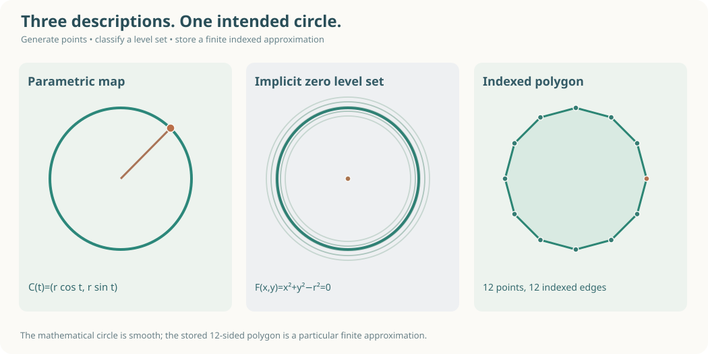
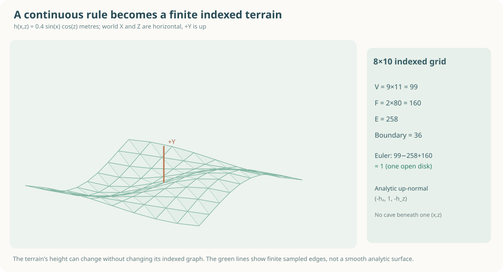
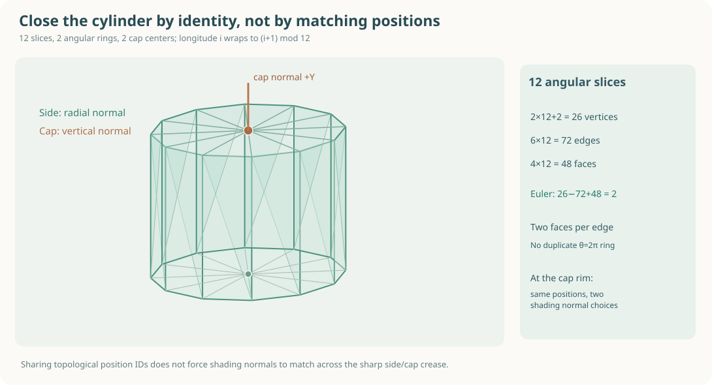
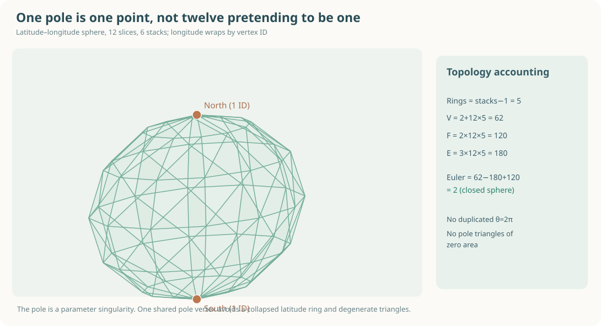
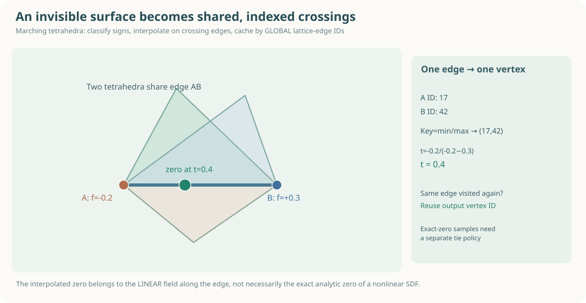
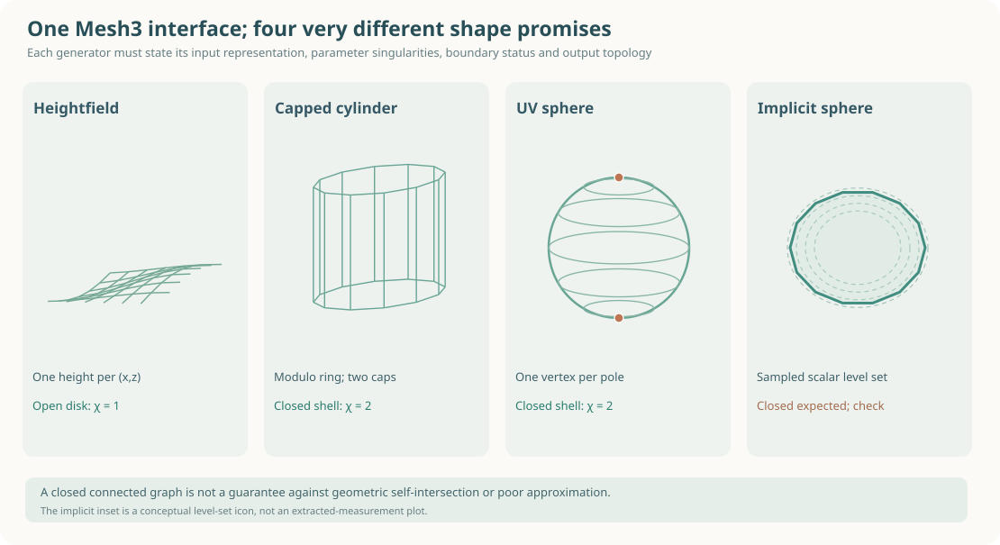

# Chapter 09 — Making a World from Rules

*From Geometry to Images*  
*Part II — Shapes Become 3D Objects*  
*Reader edition / C++23 laboratory P09 / additive authoring source, not a final PDF or EPUB*

> Imagine having to place every blade of grass, every stone, and every tiny ripple in the landscape by hand. Your mouse would retire before you finished the first hill.

## The garden outgrows the drawing table

When we began, our entire world was a tiny rectangle of stored image data. Then it learned about coordinates. Three points became a triangle. Triangles became a three-dimensional house, and the house learned which of its walls and roof pieces were neighbors. A tree grew beside it, first out of straight lines and then out of curved Bézier branches. We even stretched a little canopy over the garden with sixteen control handles.

It is turning into a lovely world. But now we want a hill behind the house.

A *whole* hill.

If we use the same method we used for our little square, we might place one vertex after another. One point near the house, a few higher up, one hundred more along the slope. That could work, but imagine wanting three different hills, a rocky valley, and a winding path. The job would become exhausting.

We need a different power: the ability to tell the computer a **rule** and ask it to build as much geometry as the rule requires.

“Raise the ground a little wherever this mathematical wave has a positive height.”

“Put points around a circle, lift another ring above them, and connect the rings.”

“On the surface of this imaginary ball, generate coordinates from two angles.”

“Tell me whether this location is inside or outside an invisible shape, and find the places where the answer changes.”

These are four ways to begin creating worlds without drawing every triangle. They are not magical replacements for geometry. They are compact **descriptions** of geometry.

That distinction is the central theme of this chapter: the rule, the surface, and the finite mesh that approximates it are different things. Our program must know which one it is holding.

## There is more than one way to describe the same shape

Suppose we want a circle of radius \(r\) centered at the origin of a two-dimensional plane.

One description tells us how to **produce** a point on the circle. Give it an angle \(\theta\):

\[
\boxed{C(\theta)=(r\cos\theta,\ r\sin\theta).}
\tag{9.1}
\]

Another description tells us whether a given point lies on the circle:

\[
\boxed{F(x,y)=x^2+y^2-r^2=0.}
\tag{9.2}
\]

The first is a **parametric** description. It maps a parameter to a point.

The second is an **implicit** description. It defines a condition that points must satisfy.

An ordinary mesh is a third representation: a finite collection of stored points and indexed faces.

They answer different questions naturally. A parametric formula makes it easy to generate a surface point at a requested parameter. An implicit function makes it easy to evaluate whether a spatial query lies on one side or the other of a chosen level set. An indexed triangle mesh makes it easy for a conventional rasterizer, collision pipeline or topological inspector to walk actual finite faces.

None of these representations is automatically “the real shape” while the others are fake. They are mathematical or computational models chosen for different purposes.

For the circle, the parameterization is exact as a real-arithmetic formula, but if we evaluate it at only twelve angles and connect neighboring results with straight segments, the stored polygon is a **twelve-sided approximation**. Its edges are not the infinitely smooth original circle.

Equally, the implicit equation is exact as a mathematical rule, but a grid-based extraction algorithm approximates its zero level set. That extraction does not somehow become exact merely because its starting function is analytic.

Our job is to state the transition and the approximation clearly.

*Figure 9.1 — Parameterization gives locations, an implicit relation gives a membership condition, and a mesh gives a finite indexed approximation. The same intended geometry can lead to different operations and different errors.*

### A field is not always a distance

The function \(x^2+y^2-r^2\) has the correct circle as its zero contour. It is negative inside and positive outside. But its numeric value is **not a Euclidean distance** to the circle.

Take \(r=1\), \(x=2\), \(y=0\). The function gives \(4-1=3\), while the point is only one unit of length outside the unit circle.

A genuine signed distance function for the circle is

\[
d(x,y)=\sqrt{x^2+y^2}-r.
\tag{9.3}
\]

This gives \(+1\) at \((2,0)\), \(0\) on the circle, and \(-1\) at the center.

We will eventually use this difference when extracting an implicit sphere. The sign of a scalar field, its zero set, and its *distance units* are separate contracts.

## Our first living landscape: a heightfield

The easiest procedural landscape is a graph of height over horizontal ground coordinates. Choose world \(X\) and \(Z\) as the ground plane, with positive \(Y\) pointing upward.

A **heightfield** is a function

\[
\boxed{y=h(x,z).}
\tag{9.4}
\]

For every horizontal location \((x,z)\), the function produces one vertical height \(y\).

We can make our first hills from a wonderfully simple rule:

\[
\boxed{
h(x,z)=A\sin(fx)\cos(fz),
}
\tag{9.5}
\]

where \(A\) is the height amplitude in metres and \(f\) has units of inverse metres.

The sine and cosine are not a secret recipe for realistic mountains. They are a smooth, completely explainable shape that helps us test the mathematics before adding noise, erosion or hand-authored detail.

Set \(A=0.4\) metres and \(f=1\ \mathrm m^{-1}\). At the origin,

\[
h(0,0)=0.4\sin0\cos0=0.
\tag{9.6}
\]

At \((x,z)=(\pi/2,0)\) metres,

\[
h(\pi/2,0)=0.4.
\tag{9.7}
\]

That location lies four tenths of a metre above the base level.

The rule does not store a thousand vertices. We can evaluate it for any finite coordinate pair that the implementation supports.

### The landscape formula has a very important limitation

A heightfield gives **one** height at each horizontal \((x,z)\).

It cannot describe a cave ceiling and a cave floor at the *same* horizontal position. It cannot wrap a vertical overhang back underneath itself. It is a perfectly good surface representation for many terrains, but it is not a universal representation of all three-dimensional objects.

This is an example of **representation capacity**. A mathematical model may be exact within its assumptions while being unable to express a shape we want.

If our garden later needs a cavern beneath the hill, we might choose an implicit field or a general triangle mesh instead.

### Make an indexed ground grid

A height formula is continuous in concept, but our renderer will eventually need a finite surface. We can sample the rule on a rectangular parameter grid.

Suppose the domain is \(W\) metres wide along \(X\) and \(D\) metres deep along \(Z\), subdivided into \(m\) cells across and \(n\) cells deep.

The sampled horizontal coordinates are

\[
x_i=-W/2+\frac{iW}{m},\qquad
z_j=-D/2+\frac{jD}{n},
\tag{9.8}
\]

where \(0\le i\le m\), \(0\le j\le n\). Every sampled three-dimensional vertex becomes

\[
\boxed{
P_{ij}=(x_i,h(x_i,z_j),z_j).
}
\tag{9.9}
\]

We store each grid position *once*. Its integer index is

\[
\boxed{\operatorname{index}(i,j)=i(n+1)+j.}
\tag{9.10}
\]

That is the same row-major idea we saw in the pixel canvas, and the same parameter-grid idea from the bicubic patch in Chapter 08.

We turn each grid cell into two triangles. Let its four corners be

\[
a=(i,j),\quad b=(i+1,j),\quad
c=(i+1,j+1),\quad d=(i,j+1).
\]

For an \(XZ\) ground plane with \(+Y\) upward, we use

\[
\boxed{(a,c,b)\quad\text{and}\quad(a,d,c).}
\tag{9.11}
\]

Why not \((a,b,c)\), the familiar order from the old XY patch?

Because **coordinate orientation matters**.

In a right-handed \(XYZ\) world,

\[
\hat X\times\hat Z=-\hat Y.
\tag{9.12}
\]

An edge going \(+X\) followed by an edge going \(+Z\) produces a downward-facing normal, not an upward-facing one. Reversing the face ordering fixes that orientation.

This is exactly the kind of subtle error that a mesh may render convincingly while every normal points underground. A consistent program must name its axes and check cross-product signs instead of copying an old triangle order blindly.

### We can derive the mesh counts before running the generator

A rectangular \(m\times n\) grid contains

\[
\boxed{V=(m+1)(n+1)}
\tag{9.13}
\]

unique indexed vertices.

Every cell contributes two triangular faces:

\[
\boxed{F=2mn.}
\tag{9.14}
\]

Count the horizontal and vertical grid edges, plus one new diagonal per cell:

\[
\boxed{E=3mn+m+n.}
\tag{9.15}
\]

Only the outside rectangle is a boundary, so

\[
\boxed{B=2(m+n).}
\tag{9.16}
\]

Euler's characteristic for this connected topological disk is

\[
\boxed{\chi=V-E+F=1.}
\tag{9.17}
\]

These are **combinatorial facts** about how our indexed grid is connected. They do not depend on whether the hill is flat or wavy. The terrain formula changes positions, not the graph of which indices are connected.

Take \(m=8,n=10\):

\[
V=9\cdot11=99,\quad
F=2\cdot8\cdot10=160,
\]

\[
E=3(8)(10)+8+10=258,\qquad B=36.
\tag{9.18}
\]

Check:

\[
99-258+160=\boxed{1}.
\]

Our procedural generator should reproduce those counts through the *independent* Chapter 07 topology inspector. If it duplicates every face's positions instead of sharing grid IDs, the observed graph will not match.

*Figure 9.2 — A continuous height rule is sampled into one connected indexed rectangular grid. The surface is open, has a boundary, and cannot represent cave ceilings or multiple vertical heights at one horizontal address.*

## How does a hill know which way is up?

A triangle face has a normal computed from the cross product of two edges. But a continuous height function has its own **analytic normal** that we can derive directly without waiting for triangles.

Write the surface as

\[
S(x,z)=(x,h(x,z),z).
\tag{9.19}
\]

Its two tangent directions are

\[
S_x=(1,h_x,0),\qquad
S_z=(0,h_z,1).
\tag{9.20}
\]

Here

\[
h_x=\frac{\partial h}{\partial x},\qquad
h_z=\frac{\partial h}{\partial z}.
\]

Their cross product in the order \(S_z\times S_x\) points upward:

\[
\boxed{S_z\times S_x=(-h_x,1,-h_z).}
\tag{9.21}
\]

Therefore the unit normal is

\[
\boxed{
n(x,z)=
\frac{(-h_x,1,-h_z)}
{\sqrt{h_x^2+1+h_z^2}}.
}
\tag{9.22}
\]

The vertical component is positive, as expected for an ordinary finite-slope heightfield.

For our rule \(h=A\sin(fx)\cos(fz)\),

\[
h_x=Af\cos(fx)\cos(fz),
\tag{9.23}
\]

\[
h_z=-Af\sin(fx)\sin(fz).
\tag{9.24}
\]

At \(x=z=0\), with \(A=0.4,f=1\),

\[
h_x=0.4,\quad h_z=0.
\]

Our unnormalized normal is \((-0.4,1,0)\), so the unit vector is

\[
\boxed{
n(0,0)=\frac{(-0.4,1,0)}{\sqrt{1.16}}.
}
\tag{9.25}
\]

Its approximate components are \((-0.3714,0.9285,0)\).

Why not just use each triangle's normal? Because the finite triangle mesh is only an approximation of the continuous hill. Its face normals are piecewise constant; they produce a faceted appearance. The analytic heightfield normal describes the continuous underlying function, and can be evaluated at arbitrary locations.

A renderer might interpolate vertex normals, compute them from a normal map, or use the analytic derivative in a shader. Those are different shading policies, and they belong to the later image-formation chapters.

For now, the native C++23 `TerrainField::normal(x,z)` returns the normalized analytic vector. Its test compares the analytic slopes against an independently constructed finite-difference estimate at an ordinary nonsingular point.

### A useful numerical trap

To approximate \(h_x\) from stored samples, one might calculate

\[
\frac{h(x+\varepsilon,z)-h(x-\varepsilon,z)}
{2\varepsilon}.
\tag{9.26}
\]

That is **central finite differencing**. If \(\varepsilon\) is large, the estimate blurs small changes. If it is extremely small, subtracting two nearly equal floating-point numbers can amplify rounding. The step should be selected in the correct units and for the desired accuracy.

The analytic derivative gives us a useful reference when testing finite differences. But later, when a field has no convenient derivative or comes from an external learned model, we may need numerical or automatic differentiation with its own error contract.

## Making a tower by walking around a circle

We have a hill. We need something vertical beside the house—perhaps a garden water tower.

A cylinder is a surface of revolution. We begin with a circle and lift it along the \(Y\) axis.

For radius \(r\) and height \(H\), a side point is

\[
\boxed{
S(\theta,y)=(r\cos\theta,\ y,\ r\sin\theta),
}
\tag{9.27}
\]

where \(0\le\theta<2\pi\) and \(0\le y\le H\).

Our first discretization is straightforward: choose \(s\) equally spaced angles, generate one bottom ring of \(s\) points at \(y=0\), and one top ring of \(s\) points at \(y=H\).

Then link neighboring points into side quads and split each quad into two triangles.

### The invisible extra slice that ruins a mesh

A surprisingly common implementation error is to generate angles

\[
\theta_i=\frac{2\pi i}{s},\quad i=0,\ldots,s
\tag{9.28}
\]

including **both** endpoints of the interval.

The points at \(\theta_0=0\) and \(\theta_s=2\pi\) describe the same geometric location in exact arithmetic. But if we store them under different vertex IDs, our index graph has an artificial seam.

It may look like a closed cylinder, because the positions nearly coincide. Yet the topology inspector may report boundary edges along a vertical cut.

Instead, store only \(i=0,\ldots,s-1\) and wrap the neighbor index:

\[
\boxed{\operatorname{next}(i)=(i+1)\bmod s.}
\tag{9.29}
\]

Now the last angular slice explicitly connects to the first *by index*. There is no extra duplicate longitude vertex.

This is the same principle that protected the mesh in Chapter 07: **equal positions are not the same as shared identity**.

We are not saying no rendering asset should ever duplicate seam vertices. A texture atlas may deliberately need different \(U\) coordinates or normals at a seam. But that is a distinct corner-attribute requirement. It should not be confused with the topology of the geometric surface itself.

### Give the tower a roof and a floor

If we only build the cylinder's side, its two circular rims are open boundaries.

For a closed tower, add one vertex at the center of the bottom circle and one at the center of the top circle. Connect each center to every neighboring pair of ring vertices. Choose the winding so the bottom faces point toward \(-Y\) and the top faces toward \(+Y\).

For \(s\) angular slices:

\[
\boxed{V=2s+2}
\tag{9.30}
\]

(two rings plus two center points),

\[
\boxed{F=4s}
\tag{9.31}
\]

(two side triangles and two cap triangles per slice),

and

\[
\boxed{E=6s}.
\tag{9.32}
\]

To derive the edge count: the two circular rings contribute \(2s\) edges; vertical sides contribute \(s\); side diagonals contribute \(s\); and cap spokes contribute \(2s\). Add them to get \(6s\).

Every edge should be incident to exactly two oppositely traversed triangles. That makes the closed cap-and-side mesh an excellent topology fixture.

Euler gives

\[
(2s+2)-6s+4s=\boxed{2}.
\tag{9.33}
\]

For \(s=12\), our tower has \(26\) vertices, \(72\) edges and \(48\) triangular faces.

The same numerical identity also holds at the smallest permitted case \(s=3\): \(8\) vertices, \(18\) edges and \(12\) faces. That extreme is not a pretty round tower, but it is a wonderful test of topology and orientation.

*Figure 9.3 — The cylinder closes by reusing angular indices. The side and caps share geometric position IDs but require distinct shading normals along their deliberately sharp rims.*

### One position can legitimately have two different normals

At the top edge of our tower, the curved side has a normal pointing radially outward. At \(\theta=0\), that is

\[
n_{\text{side}}=(1,0,0).
\tag{9.34}
\]

The flat top cap has a normal

\[
n_{\text{top}}=(0,1,0).
\tag{9.35}
\]

They meet at the **same position**, but their desired shading normals are different.

If we force a single smooth vertex normal there, the sharp rim can appear rounded or darkened unnaturally. If we duplicate the indexed geometric vertices purely to preserve the shading normal, we may create a misleading topological seam for later mesh operations.

The clean conceptual answer is to distinguish **topological vertex identity** from **per-face-corner shading attributes**—exactly as the previous chapter introduced. A GPU input stream may need duplicated rendering vertices even when a higher-level mesh model represents one shared topological point.

Our P09 OBJ exports only positions and faces. It does not pretend that its lack of normal records supplies the correct side/cap shading. The book's later attribute and asset-format sections will implement that distinction fully.

## Now the ball: where two angles meet at a pole

A sphere looks like the simplest shape imaginable. It is often the first shape used to test a 3D renderer.

But a finite indexed sphere can reveal difficult questions about seams, parameter singularities and triangle quality.

The mathematical sphere of radius \(r\) can be parameterized using latitude-like and longitude angles:

\[
\boxed{
\begin{aligned}
x&=r\sin\phi\cos\theta,\\
y&=r\cos\phi,\\
z&=r\sin\phi\sin\theta,
\end{aligned}
}
\tag{9.36}
\]

with polar angle \(0\le\phi\le\pi\) and longitude \(0\le\theta<2\pi\).

The world uses \(+Y\) up. At \(\phi=0\), the sphere's north pole is \((0,r,0)\). At \(\phi=\pi\), its south pole is \((0,-r,0)\).

If we fix a non-pole \(\phi\) and vary \(\theta\), we trace a circular ring.

### What is a pole, mathematically?

At the north pole, \(\sin\phi=0\), so both \(x\) and \(z\) are zero regardless of the chosen longitude.

Every longitude points to **the same location**.

That is not a list of many different geometrical points. It is a coordinate singularity of this particular parameterization: one surface position corresponds to many parameter values, and the longitude direction collapses.

If we store a full ring of \(s\) indexed vertices at \(\phi=0\), we get many points with the same coordinates. Connecting them can create zero-area triangles. It may make the topology appear complicated while the geometry has collapsed.

Instead, generate **one north-pole vertex** and **one south-pole vertex**, and use ordinary circular rings only for latitudes strictly between them.

Wrap every ring around the longitude using the same modulo indexing as the cylinder.

The result is a fully indexed sphere-like triangulation whose north and south tips are fans of genuine nonzero-area triangles (for valid resolutions).

### Derive its counts

Let \(s\) be the number of angular slices and \(t\) be the number of latitude **stacks** from north pole to south pole. There are \(t-1\) interior rings.

Each ring has \(s\) vertices, plus two unique pole vertices:

\[
\boxed{V=2+s(t-1).}
\tag{9.37}
\]

The top polar fan has \(s\) triangles. The bottom polar fan has \(s\) triangles. Between each pair of neighboring interior rings, there are \(2s\) triangles. There are \(t-2\) such ring gaps.

Therefore

\[
F=s+s+2s(t-2)=\boxed{2s(t-1)}.
\tag{9.38}
\]

For a closed triangulated surface with exactly two consistently oriented incident faces per edge,

\[
3F=2E.
\tag{9.39}
\]

Thus

\[
\boxed{E=3s(t-1)}.
\tag{9.40}
\]

Finally,

\[
V-E+F
=2+s(t-1)-3s(t-1)+2s(t-1)
=\boxed{2}.
\tag{9.41}
\]

For \(s=12\) and \(t=6\),

\[
V=62,\quad F=120,\quad E=180,\quad\chi=2.
\tag{9.42}
\]

No artificially duplicated meridian vertex. No ring of collapsed triangles at either pole.

The underlying triangle faces approximate the round sphere; their vertices lie on the analytic sphere at the sampled locations. The middle of a straight triangle edge, however, lies inside the true sphere. This is one reason “vertices lie on a sphere” is not equivalent to “the mesh is the exact sphere.”

*Figure 9.4 — Longitude is periodic, so indices wrap. The parameterization becomes singular at each pole, so the mesh stores only one pole vertex rather than a ring of coincident points.*

### Why are the triangles crowded near the poles?

Uniform steps in the longitude angle produce physical distances approximately

\[
r\sin\phi\,\Delta\theta
\tag{9.43}
\]

along each ring.

As \(\phi\) approaches zero or \(\pi\), the factor \(\sin\phi\) approaches zero. Longitude samples crowd together physically near the poles, even when their angular step stays constant.

This means a latitude–longitude sphere does not distribute its faces with equal area or equal edge quality. For some applications, an icosphere built by subdividing an icosahedron can give a more uniform distribution. For others, latitude–longitude indexing is convenient for texture coordinate relationships.

The “best” sphere representation depends on its intended operation: texturing, uniform sampling, finite-element conditioning, visibility, or a cheap demonstration.

Our P09 lab teaches a pole-safe latitude–longitude topology first. It does not claim to create an optimal-quality spherical triangulation.

## The invisible ball: tell space what is inside

The cylinder and sphere generators begin with parameter values and create positions. We have another route.

Suppose there is an invisible ball centered at the origin. Instead of asking, “Which angle produces this surface point?”, ask, “How far is this arbitrary world point from the ball's surface, and am I inside or outside it?”

For a sphere of radius \(r\),

\[
\boxed{
d(x,y,z)=\sqrt{x^2+y^2+z^2}-r.
}
\tag{9.44}
\]

This is a **signed distance function** for the sphere.

The sign is our explicit convention:

\[
d<0:\text{inside},\qquad
d=0:\text{on the surface},\qquad
d>0:\text{outside}.
\tag{9.45}
\]

Take \(r=1.25\) metres. At the origin,

\[
d(0,0,0)=-1.25\ \mathrm m.
\]

At \((1.25,0,0)\), the result is zero.

At \((0,0,-2.25)\),

\[
d=2.25-1.25=+1\ \mathrm m.
\]

Unlike the squared-field formula, these values have real distance units.

### The gradient tells us the surface's outward direction

For a differentiable scalar field \(F(x,y,z)\), its gradient is the vector

\[
\nabla F=
\left(
\frac{\partial F}{\partial x},
\frac{\partial F}{\partial y},
\frac{\partial F}{\partial z}
\right).
\tag{9.46}
\]

At a regular level surface \(F=0\), the gradient points perpendicular to that level surface.

For our sphere SDF,

\[
\boxed{
\nabla d(x,y,z)
=
\frac{(x,y,z)}{\sqrt{x^2+y^2+z^2}},
}
\tag{9.47}
\]

when the denominator is nonzero.

At \((0,3,0)\), the gradient is \((0,1,0)\), pointing upward.

At the exact sphere center, however, the Euclidean norm is not differentiable. There is no unique gradient direction. Any answer pretending to supply one would be a lie.

That is why `SphereDistance::gradient()` rejects the origin instead of returning an arbitrary “up” normal.

This is a broader numerical and geometric lesson: a function can be perfectly well-defined at a point while its derivative is not.

### Signed distance is a promise about more than sign

For a true signed distance near a regular surface,

\[
\|\nabla d\|=1.
\tag{9.48}
\]

That property can be useful for sphere tracing and conservative step choices under the correct conditions. But not every scalar field with a useful zero contour has unit gradient.

For example,

\[
F(x,y,z)=x^2+y^2+z^2-r^2
\tag{9.49}
\]

has the correct sphere as its zero set, but its gradient is \(2(x,y,z)\), whose magnitude changes with radius and location.

This matters for later rendering and collision algorithms. One cannot replace a true signed distance with an arbitrary implicit function and expect every step size or normal formula to remain valid.

### Combining implicit shapes is powerful and dangerous

A common constructive-solid-geometry trick is to combine two fields by \(\min\) or \(\max\). For fields whose negative side denotes inside:

\[
F_{\mathrm{union}}=\min(F_A,F_B),
\qquad
F_{\mathrm{intersection}}=\max(F_A,F_B).
\tag{9.50}
\]

Their signs classify union and intersection membership correctly under that convention.

But the combined numeric field is not automatically an **exact Euclidean signed distance** everywhere, and its gradient may be nondifferentiable where the chosen branches switch. Smooth-min functions can make blend shapes, but alter the exact set operation and introduce their own scaling or smoothness parameters.

We are learning the questions that a field representation must answer, not declaring any convenient formula a robust physical distance.

## How do we turn an invisible level set into triangles?

A sphere SDF gives us a perfect *query* in real arithmetic. It does not hand us indexed triangles.

To visualize or export the implicit surface with a conventional mesh pipeline, we need a **surface extraction** algorithm.

One classical family is marching cubes, which uses the signs at a cell's eight grid corners to decide how the zero surface passes through the cube. But some cube sign patterns are ambiguous and require consistent rules to prevent holes.

Our small reference chooses a closely related teaching algorithm: **marching tetrahedra**. It first splits each Cartesian cube into six tetrahedral cells according to a fixed pattern. A tetrahedron has only four vertices, and the sign cases are easier to reason about.

The result is an approximation to the zero set of a field reconstructed by **piecewise-linear interpolation** on the tetrahedral grid. It is not the exact analytic sphere.

### Begin with a lattice of scalar samples

Choose a cubic bounding region

\[
[-L,L]^3.
\tag{9.51}
\]

For \(N\) cells per axis, there are \(N+1\) lattice positions along each axis, for

\[
\boxed{(N+1)^3}
\tag{9.52}
\]

field evaluations.

Each sample stores its three-dimensional position and signed field value.

We require the analytic sphere to fit strictly inside the box. Otherwise the extracted surface might be cut by the outer boundary and become open.

We also require the lattice to actually contain some inside and outside samples. A sphere may be so small compared with a coarse grid that every sampled point lies outside, even though a sphere exists between those samples. An algorithm that returns no triangles is not proof that the shape does not exist. It can mean the sampling resolution was inadequate.

### Every tetrahedron has a little sign story

Each tetrahedral vertex has a field sign: negative inside, positive outside.

There are five counts of inside vertices: zero, one, two, three or four.

If all are inside or all are outside, this tetrahedron does not contain a sign-changing cut under the piecewise-linear model.

If one vertex is inside and three are outside, the zero surface cuts three connecting edges and gives one triangular patch.

If three are inside and one is outside, the complementary case also gives one triangle.

If two are inside and two are outside, the zero surface cuts **four** connecting edges. Those four intersection points form a quadrilateral, which we split into two triangles.

Our program does not stop at that description. It creates the actual triangle indices, checks their orientation, and exports the mesh.

### Locate an edge intersection by interpolation

Let an edge connect sample positions \(A\) and \(B\), with field values \(f_A<0\) and \(f_B>0\).

Assume the field varies linearly along this edge:

\[
f(t)=(1-t)f_A+tf_B.
\tag{9.53}
\]

Solve for the zero:

\[
0=f_A+t(f_B-f_A),
\]

\[
\boxed{
t=\frac{f_A}{f_A-f_B}.
}
\tag{9.54}
\]

Because the endpoint signs differ and neither endpoint equals zero, exact arithmetic gives \(0<t<1\).

Then the intersection point is

\[
\boxed{
P=A+t(B-A).
}
\tag{9.55}
\]

For example, let \(f_A=-0.2\) metres and \(f_B=+0.3\) metres. Then

\[
t=\frac{-0.2}{-0.2-0.3}=0.4.
\]

So the linearly interpolated zero point lies 40% of the way from \(A\) to \(B\).

This is an *interpolated* zero, not necessarily the exact intersection of the edge with the original nonlinear sphere SDF. For a curved field, linear interpolation produces a geometric approximation. Refining the grid generally improves it under suitable regularity and numerical conditions.

### The nasty equality case: what if a grid vertex is exactly zero?

If a lattice sample satisfies \(f=0\) exactly, it lies on the requested level set. Some surface extraction algorithms support that case through a careful global tie-breaking and vertex-ownership policy.

Our introductory algorithm takes a deliberately smaller but honest contract: it **rejects exact-zero lattice samples** and asks the reader to change the grid resolution or bounding extent.

Why so strict?

If an edge ends directly on the level set, several intersected edges can all return the same endpoint. A naive implementation may then generate triangles with repeated vertex IDs or zero area. Different tetrahedra may disagree about who owns the shared point.

It would be wrong to silently treat that case as ordinary and hope the final image hides it.

We will eventually learn robust symbolic perturbation, consistent tie ownership and more complete isosurface extraction. In this chapter, the input restriction is an explicit precondition, not a hidden hack.

A near-zero *floating* value is a separate issue. Our simple code does not certify sign decisions against every possible binary64 rounding corner case; it tests exactly zero and validates finite inputs. That is why we call it a reference extractor for a controlled sphere field rather than a general robust implicit-geometry engine.

### The mesh must know when two tetrahedra share an edge

Suppose two neighboring tetrahedra share one of the original grid edges. Both may ask for the intersection of that same grid edge with the zero surface.

If each tetrahedron independently creates its own vertex, those two triangles can meet at identical coordinates but have different vertex IDs. The surface develops an **indexed crack** even if the screen looks smooth.

Our solution reuses a familiar friend from Chapter 07: the canonical edge key

\[
\boxed{
k(a,b)=(\min(a,b),\max(a,b)),
}
\tag{9.56}
\]

where \(a,b\) are global **lattice vertex indices**.

We store a map

\[
k(a,b)\longmapsto\text{extracted mesh vertex ID}.
\tag{9.57}
\]

When the same grid edge is encountered again, we reuse the already created output vertex index.

Not a fuzzy coordinate comparison. Not “if the positions are close enough, weld them.” A deterministic identity map from one input graph edge to one output mesh vertex.

This is why our implicit-surface exporter does more than draw pretty triangles: it attempts to preserve the graph structure that a real downstream algorithm requires.

*Figure 9.5 — The field is sampled at lattice vertices. Sign-changing edges produce interpolated positions. A global canonical edge-key cache makes adjacent tetrahedra reuse the same indexed intersection vertex.*

### Orientation is an additional, independent obligation

Even with perfectly shared indices, a surface may have inconsistent triangle winding.

For our sphere-specific extractor, we can use the sphere's known outward radial direction as an orientation witness. For a generated triangle \((A,B,C)\), compute

\[
N=(B-A)\times(C-A).
\tag{9.58}
\]

Let \(M=(A+B+C)/3\) be its centroid. Because our sphere is centered at the origin, the radial vector through \(M\) is \(M\) itself.

If

\[
\boxed{N\cdot M<0,}
\tag{9.59}
\]

the triangle points inward. Swap two indices to make it outward.

If the dot product is zero, the orientation is not decided by this check, so the restricted implementation rejects that triangle rather than inventing a direction.

That is a **sphere-specific** rule. It is not a generic orientation algorithm for an arbitrary implicit field. For a general \(F(x,y,z)=0\), an outward reference might come from a well-defined gradient, a consistent inside/outside convention, adjacency propagation and robust predicates. A field with multiple components, folds or singular gradients may need much more careful treatment.

We have learned enough from Chapters 05–07 not to hide that limitation.

### How do we know the extraction did not create a cracked ball?

The answer is not, “It looks round in the SVG.”

We use the independent indexed-mesh inspector. For the controlled sphere extracted strictly inside the box, we expect one connected closed component with no boundary edges, no winding conflicts, and no nonmanifold edges.

For a connected closed triangulated genus-zero sphere,

\[
\chi=V-E+F=2,
\tag{9.60}
\]

and

\[
3F=2E.
\tag{9.61}
\]

Combining those gives

\[
\boxed{F=2V-4,\quad E=3V-6.}
\tag{9.62}
\]

Those formulas are immensely useful independent checks when a closed triangulated sphere-like component is expected.

But be precise: even a closed, oriented combinatorial sphere might self-intersect in geometric space. Euler two and consistent adjacency are strong evidence about *connectivity*, not a complete proof of an embedded physical ball.

The extractor's unit tests check topological counts, shared index reuse, outward radial winding and the approximate location of generated vertices. The tests also deliberately reject an exact-on-grid zero case, a sphere that extends past the box, and an undersampled tiny sphere.

The point is to build evidence in layers, rather than declaring success after the first attractive visualization.

## The difference between a mathematical surface and its sampled mesh

We now have two ways to create something round.

A **parametric UV sphere** evaluates explicit trigonometric positions at angles, then connects those positions with prescribed indices. Its stored vertices lie on the analytic sphere, while each straight triangle lies inside the curved ideal surface except at its vertices.

An **implicit extracted sphere** samples a signed distance on a three-dimensional grid, approximates the field linearly in tetrahedra, interpolates sign-changing grid edges, and constructs triangles from those intersection points.

Neither finite triangle mesh is the exact smooth sphere. Their approximation errors arise from different processes.

This distinction becomes critical in graphics research: if two representations produce different images, is the difference caused by geometry approximation, normals, sampling, visibility, materials, or a camera convention? Until we record those choices, a performance or fidelity comparison is not scientifically meaningful.

### A useful geometric inequality for the implicit sphere

There is a little independent observation hiding inside our sphere extractor.

Euclidean distance from the origin, \(\|p\|\), is a **convex** function of position. Along a line segment joining two samples,

\[
\|(1-t)A+tB\|
\le (1-t)\|A\|+t\|B\|.
\tag{9.63}
\]

Subtract the radius \(r\) from both sides:

\[
d((1-t)A+tB)
\le (1-t)d(A)+t\,d(B).
\tag{9.64}
\]

At the **linearly interpolated** zero crossing, the right-hand side is zero. Therefore, in exact arithmetic,

\[
\boxed{\|P_\mathrm{interpolated}\|\le r.}
\tag{9.65}
\]

So the interpolated root on a crossing edge lies on or *inside* the true sphere. This provides a directional sanity check that does not require comparing against a perfect external mesh.

The assertion is conditioned on the exact mathematical interpolation and a sphere centered at the origin. Binary64 rounding and degeneracy make a tiny numeric tolerance appropriate in the test, rather than a false bitwise proof.

This is a good example of using mathematics to create an independent test instead of merely snapshotting an expected output file.

## Normals, topology and geometry are three different test targets

Our procedural terrain teaches **analytic differential normals**: derive \(h_x\) and \(h_z\), and normalize \((-h_x,1,-h_z)\).

The cylinder teaches **attribute discontinuities**: a curved side and a flat cap share position IDs but want different shading normals.

The UV sphere teaches **parameter singularities**: many longitudes collapse to one pole; one stored pole vertex avoids redundant geometric triangles.

The extracted implicit sphere teaches **identity across computed intersections**: two tetrahedra that cut the same grid edge must share one output vertex index.

These are different problems. Running one normal check does not solve a topology problem. Running one Euler count does not solve a geometric approximation problem. Generating more triangles does not automatically solve an ill-chosen parameterization.

For each representation, we ask three questions:

*Is the geometric point where the mathematical rule says it should be?*

*Do the stored triangle indices describe the intended connectivity and winding?*

*Does the chosen normal or field derivative actually describe the intended local surface direction?*

The answer to one does not imply the other two.

## From a small classroom rule to a real procedural world

We have used sine and cosine, but the principle extends much further.

A heightfield can combine waves at different scales. A procedural terrain may use fractal Brownian motion, erosion simulation, sculpted control masks or measured elevation maps. A tree can grow from a branching grammar or a deterministic random seed. Rocks can begin from implicit functions or signed distance fields. A city can be constructed from street graphs and building footprints. A game world may use chunked meshes that are generated only near the camera.

The mathematical bridge is always the same: a compact rule produces queryable geometry, and a downstream stage turns it into the representation required by the next operation.

### Determinism matters

Suppose the game generates a forest using random numbers. A reader should be able to save the seed and obtain the same forest tomorrow.

If a different compiler, processor or schedule changes the generated world unpredictably, it becomes much harder to reproduce a bug. The generator needs an explicitly chosen pseudorandom algorithm, integer state, seed policy, sampling order and serialization format.

Our first P09 generator is **deterministic without randomness**. Given the same supported parameters and floating implementation, it evaluates the same analytic rules in a fixed order. It does not quietly add noise and pretend there is nothing to reproduce.

In a later procedural-world module, we can deliberately add a documented C++23 PRNG and deterministic chunk seeds rather than treating randomness as decorative chaos.

### Complexity has a physical cost

A heightfield with \(m\times n\) cells uses \(O(mn)\) stored vertices and faces.

A sphere with \(s\) slices and \(t\) stacks uses \(O(st)\) geometry.

But a three-dimensional field grid with \(N\) cells along each axis has \((N+1)^3\) scalar samples and \(6N^3\) tetrahedral subcells in our chosen extraction decomposition.

That cubic scaling matters. Double the grid resolution per axis and the number of cells grows by about eight times.

A large production extraction therefore needs thought about memory, chunk boundaries, field caching, sparse storage, acceleration, level-of-detail and parallel scheduling. Some of those are topics from Book 1's memory/systems foundations; others belong to later geometry and rendering chapters.

Our classroom extractor bounds \(N\) between 3 and 24 and stores a finite lattice. It is intentionally understandable, not a benchmarked replacement for a production meshing library.

### What about marching cubes, dual contouring and neural implicit surfaces?

Marching cubes is a classical method for extracting triangles from samples of a three-dimensional field using cube sign configurations and case tables. It can be efficient, but ambiguous cases and crack handling require careful design.

Dual contouring constructs vertices and features differently, often using Hermite-style edge intersections and normals and solving local least-squares problems to preserve sharp features. It requires its own topology and numerical contracts.

A neural implicit representation replaces an analytic expression with a learned function that maps coordinates to occupancy, signed distance or other field values. The learned function introduces model approximation, inference cost, training data assumptions and uncertainty on top of the extraction question.

None of these changes the core lesson: the function and the finite mesh are not the same object. A beautiful mesh extraction result does not validate the learned field or the physical interpretation by itself.

Our source ledger deliberately retains the earlier original material on implicit fields, level sets, mesh processing and learned shape representations so these advanced subjects can be reconciled later rather than reduced to a passing paragraph.

## The P09 C++23 world generator we can actually inspect

We add `include/book03/procedural_geometry.hpp` to the same native lab used by Chapters 01–08. It depends on the shared `Point3`, `Vector3` and `Mesh3` types.

Four real geometry families are implemented:

A **terrain** sampled from `TerrainField`, returning a topological disk, with an independently evaluated analytic normal.

A **capped cylinder** with modulo-wrapped angular rings, no duplicate meridian vertex, and correctly oppositely wound cap and side uses.

A **latitude–longitude sphere** with one unique vertex at each pole and all interior rings joined with modulo indices.

An **implicit sphere** extracted from a sampled signed distance field using six tetrahedra per Cartesian cube, a global intersection cache keyed by the original lattice edge indices, explicit sign tie handling, and radial outward winding.

These are genuinely different generation rules, but they all return the same indexed mesh type. That gives the next stage one consistent data contract.

The new `src/procedural_studio.cpp` offers native terminal commands:

~~~text
book03_world inspect terrain
book03_world inspect cylinder
book03_world inspect sphere
book03_world inspect implicit

book03_world svg terrain.svg terrain
book03_world obj tower.obj cylinder
book03_world csv ball-points.csv sphere
book03_world repl
~~~

In the REPL you can change the design:

~~~text
shape terrain
resolution 12
amplitude 0.65
inspect
svg larger-hills.svg

shape cylinder
radius 0.9
inspect
obj small-tower.obj

shape sphere
resolution 12
inspect
svg pole-safe-sphere.svg

shape implicit
resolution 9
inspect
obj level-set-sphere.obj
quit
~~~

The exported OBJ stores actual indexed `v` positions and `f` triangle faces with one-based OBJ vertex IDs. The CSV contains indexed sample locations, not a vague screenshot. The SVG is constructed from the same three-dimensional positions and indexed edges, using a clearly documented **parallel oblique illustration**, not the camera model we will build later.

Changing the selected shape or parameters changes the actual generated geometry. An invalid radius or resolution is rejected before the editor updates the stored state. An invalid export does not silently replace the previous valid mesh with something pretending to be complete.

The source controls are deliberately bounded, keeping experiments small enough for a reader to inspect and reason about.

### Our independent C++23 tests

The `tests/procedural_geometry_tests.cpp` suite does not simply compare a screenshot to another screenshot.

It checks the terrain's analytic height and normal, independent finite-difference slope, upward-facing triangle winding, and algebraically derived indexed-grid counts.

It checks that a capped cylinder's side faces point radially outward, its bottom cap points downward, its top cap points upward, and its edge-sharing graph has the expected \(2s+2,6s,4s\) counts.

It checks that a UV sphere has no duplicate poles or longitudinal seam indices, all stored vertex radii match the analytic radius within numeric tolerance, faces point outward, and the closed topology satisfies Euler two at several different resolutions.

It checks signed-distance signs, analytic gradient direction, independent central finite differences, and that the sphere center's undefined gradient is rejected.

It checks the implicit sphere's global edge-cache identity, the closed genus-zero topological pattern at several controlled grid resolutions, radial outward orientation and the fact that linearly interpolated sphere roots lie within the true sphere to numeric tolerance.

Finally, it deliberately feeds invalid parameters, zero or nonfinite radii, unsupported resolutions, an undersampled tiny sphere, and grid corners exactly on the zero level set. These are not arbitrary negative tests; they encode *the promises the implementation actually makes*.

No amount of test code substitutes for an actual compiler and executed tests. The CMake integration registers this as the **tenth** independent CTest across **nine** cumulative native laboratories. Our dedicated CI source describes the evidence it should collect. Actual execution status is recorded separately.

*Figure 9.6 — The same indexed mesh output interface serves four different generation rules. Their mathematical representations and expected boundary/topology properties must still be distinguished.*

## Reader experiments: building a rule, not drawing a picture

**Reconstruct — one point from a rule.** Set \(A=0.4\) metres and \(f=1\,\mathrm m^{-1}\). Evaluate \(h(0,0)\), \(h(\pi/2,0)\) and \(h(0,\pi/2)\). Then derive the analytic normal at the origin. Check the units of every term.

**Reconstruct — a patch of ground.** Take an \(8\times10\) rectangular grid and derive its \(V,E,F,B\) counts from first principles. Verify Euler one. Explain why the count is unchanged when you make the hills taller.

**Falsify — the upside-down landscape.** Start from an \(XZ\) ground grid, use the face order \((a,b,c)\), and compute its cross-product normal. Why does that familiar order point downward in this world? Write the corrected two-triangle index order.

**Falsify — the duplicate meridian.** Build a twelve-slice cylinder with thirteen stored angular samples per ring, including both \(0\) and \(2\pi\). Why can the image look closed while the indexed mesh reports open boundaries? Show how \((i+1)\bmod12\) changes identity.

**Transfer — a twelve-slice tower.** Derive \(V=26,E=72,F=48\) for a closed capped cylinder, then account for all six edge families and both end-cap winding directions. Explain why its top rim needs different side and cap shading normals even though the ring positions are shared.

**Transfer — the pinched sphere pole.** Show that the sphere parameterization produces the same north-pole position for every longitude. Then design an indexed fan with one north-pole vertex. Prove its \(V,E,F\) counts for twelve slices and six stacks, including Euler two.

**Implement — probe the signed distance.** For \(r=1.25\) metres, compute the sphere SDF at the origin, on the positive X surface point and one metre past the negative Z surface. What does the gradient at the sphere center mean? Why is it undefined?

**Implement — one grid crossing.** Given field values \(f_A=-0.2\) and \(f_B=+0.3\), derive the interpolated zero fraction \(t\) and explain why its position is an approximation for a nonlinear field.

**Implement — shared intersection identity.** Two tetrahedra meet at the original lattice edge with vertex IDs 17 and 42. One visits it as \((17,42)\), the other as \((42,17)\). Compute the canonical key and explain how a single output-vertex record prevents an indexed seam.

**Falsify — a shape between the samples.** Choose a very small implicit sphere and a very coarse Cartesian grid. How can all sampled values be positive even though the sphere exists? What result should a careful extractor report?

**Falsify — equality on the surface.** Choose a grid whose lattice contains exactly \((1,0,0)\) for a unit sphere. Why can a naive algorithm generate degenerate triangles? Describe two defensible policies: reject the case with a diagnostic, or implement a consistent global tie and vertex-ownership rule.

**Transfer — an exact field versus an approximate mesh.** Explain the difference between the analytic sphere SDF, its sampled lattice values, the tetrahedral piecewise-linear interpolant, and the final indexed triangle mesh. Name at least three independent sources of error or disagreement.

**Explain — why more triangles are not always the answer.** A cylinder has a strange dark rim, a UV sphere has a hole at its pole, and an implicit sphere has a narrow crack. Which problem involves normal attributes, which involves a parameter singularity, and which involves index identity? Explain why increasing the number of triangles alone may not fix any of them.

**Challenge — plan a procedural forest.** Suppose you want a new landscape in every run but still need reproducibility for a crash report. Sketch a rule for assigning chunk-local deterministic random seeds. What information would you store in a replay? Why does an unspecified source of randomness make debugging and scientific comparisons difficult?

### Selected solutions and numeric witnesses

For the \(8\times10\) heightfield: \(V=99\), \(F=160\), \(E=258\), \(B=36\), and Euler one. Its upward normal at the origin with \(A=0.4,f=1\) is the normalized vector \((-0.4,1,0)\).

For the capped twelve-slice cylinder: \(V=26\), \(E=72\), \(F=48\), with every edge intended to have exactly two consistent incident uses and Euler two.

For the twelve-slice, six-stack sphere: \(V=62\), \(F=120\), \(E=180\), with one north and one south pole vertex, no duplicated longitude seam and Euler two.

For the signed-distance witness with \(r=1.25\): the origin returns \(-1.25\) metres; the positive X surface point returns \(0\); \((0,0,-2.25)\) returns \(+1\) metre. The center has no unique radial gradient.

For interpolation of \(f_A=-0.2\) and \(f_B=+0.3\), \(t=0.4\). For the lattice edge \((42,17)\), the canonical key is \((17,42)\), no matter which tetrahedron visits it first.

A sphere that lies entirely between all negative-sampling regions can be missed by an inadequately resolved grid. A surface extraction algorithm that silently returns an empty mesh and claims the true implicit surface does not exist has confused *sampling evidence* with *mathematical existence*.

## Next, the question of trust becomes unavoidable

Our little world now contains a hill from a trigonometric rule, a tower from a surface of revolution, a sphere from angular parameters, and another sphere pulled out of an invisible distance field.

We can inspect their graph structure, validate important normal directions, export triangle indices, and state the approximation each algorithm actually produced.

But imagine downloading a real model from a website: a mysterious OBJ file containing positions, UVs, face indices and perhaps normals; or a glTF asset carrying a scene hierarchy, transforms, materials and buffer data. Will its numbers obey the conventions we just established? Are its indices in range? Are its units known? Is a UV seam intentional? Are the normals trustworthy? Does the file's successful parsing mean the triangles represent a valid solid?

Of course not.

That is the door to **Chapter 10 — A Mesh You Can Trust**. We will learn how to ingest actual geometry without trusting it merely because a parser returned success.

We are no longer drawing every tree, mountain or sphere by hand.

We are writing the rules of a small universe—and learning how to test whether the universe actually follows them.

---

## Glossary

**Procedural geometry:** Geometry constructed from rules and parameters rather than solely from manually stored positions.

**Parametric surface:** A map \(S(u,v)\) producing a spatial point from parameter coordinates.

**Implicit surface:** A level set such as \(F(x,y,z)=0\), specified by a scalar-field condition rather than by direct surface-point enumeration.

**Signed distance function (SDF):** A scalar field whose magnitude describes Euclidean distance to a surface with a declared positive/negative side convention, at locations where the signed-distance definition applies.

**Heightfield:** A surface of the form \(y=h(x,z)\); one vertical value per horizontal position, so ordinary caves and overhangs are not representable.

**Analytic normal:** A surface normal derived from mathematical derivatives of the continuous representation rather than only from sampled triangle edges.

**Surface of revolution:** A surface formed by rotating a profile about an axis, as in a cylinder or a turned vessel.

**Indexed seam:** A geometric join that may appear closed but uses different vertex IDs on the two sides; an attribute seam may require different corner data without breaking topological identity.

**Pole singularity:** A parameterization location where one parameter direction collapses, as at a latitude–longitude sphere's two poles.

**Level set:** All locations where a scalar field has one requested value, commonly zero.

**Gradient:** Vector of spatial partial derivatives; perpendicular to a regular level surface when nonzero.

**Marching tetrahedra:** Piecewise-linear isosurface extraction over tetrahedral grid cells, producing triangles from sign-changing edges.

**Canonical grid-edge key:** Sorted pair of global lattice vertex IDs used to ensure every traversal of the same input edge shares one output intersection vertex.

**Approximation budget:** Explicit sampling resolution or recursive refinement limit that restricts memory, computation and geometric fidelity.

**Topological disk:** A connected surface patch with one boundary loop and Euler characteristic one under the usual manifold assumptions.

**Closed genus-zero surface:** A topological sphere-like surface with Euler characteristic two under the connected, orientable, manifold conditions.

## Source custody and further study

This is an **additive** reader chapter, not a replacement for the original extensive graphics/geometry/reconstruction notes. The older `Notes/Chapter Edition/02 - Graphics Vision and XR/02 - Surfaces, Topology and Parameterization.md` contains the original discussion of parametric versus implicit surfaces, manifoldness, Euler characteristic, patch normals, level sets, geometric operators and subdivision rules. The separate `34 - Learned 3D Shapes and Scene Representations.md` discusses point clouds, meshes, occupancy/SDFs, learned implicit fields and neural reconstruction. The old source atlas maintains provenance for the CMU geometry and surface lecture material. Exact accessible reading-copy identifiers and inspected ranges are preserved in `PASS09_LEGACY_AUDIT.md`.

Important intellectual sources include Lorensen and Cline, *Marching Cubes: A High Resolution 3D Surface Construction Algorithm* (SIGGRAPH 1987), for the classical cube-case extraction family; the original marching-tetrahedra and tetrahedral-decomposition literature for ambiguity handling; and the differential and implicit-surface material in the existing source atlas. We implemented a deliberately restricted sphere extractor rather than copying third-party case tables or borrowing external meshes. The source contains explicit assumptions, testable numerical examples, and documented limitations.

**Companion code:** All paths below are relative to `Code Parts/tools/labs/book03_cpp23/`.

- `include/book03/procedural_geometry.hpp`
- `tests/procedural_geometry_tests.cpp`
- `src/procedural_studio.cpp`

**Read next:** Chapter 10 — A Mesh You Can Trust.
