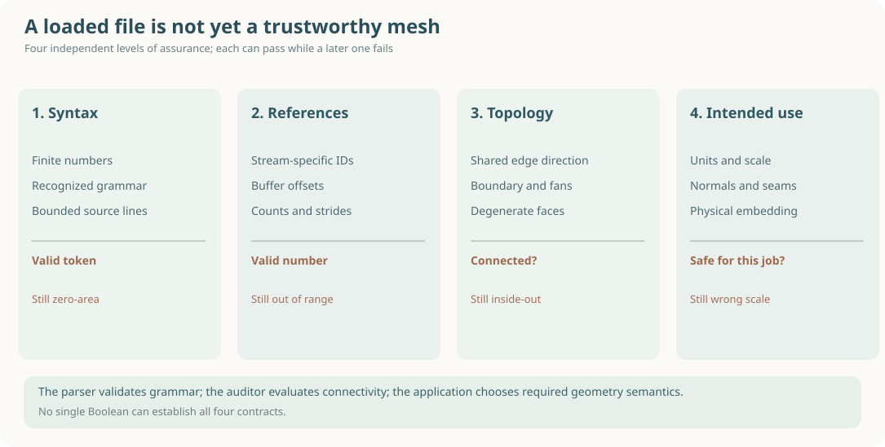
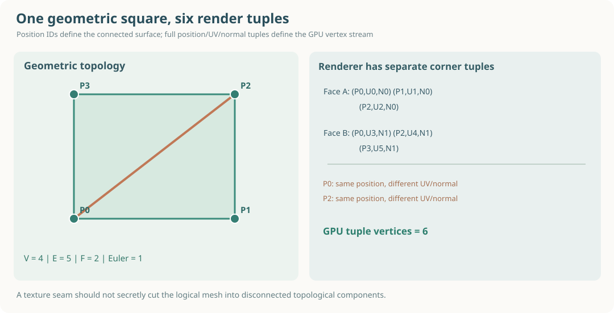
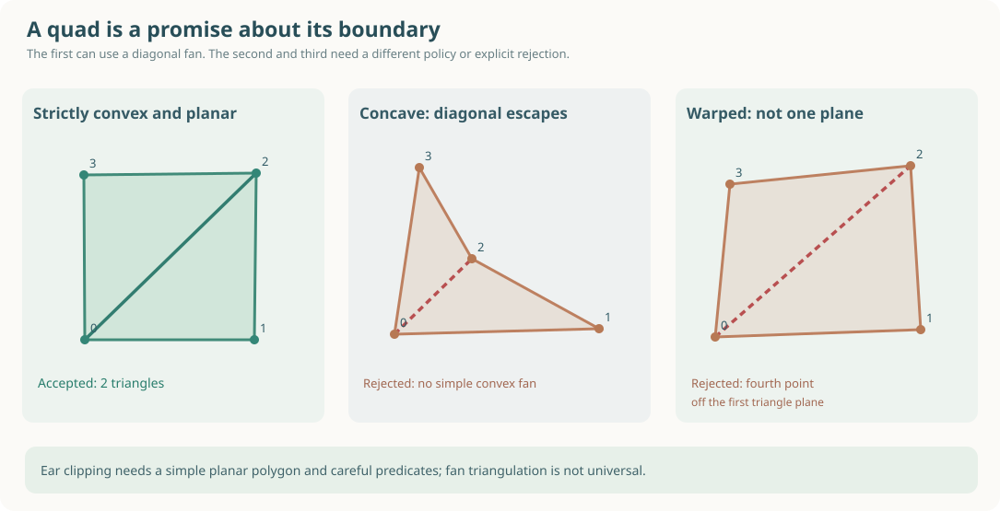
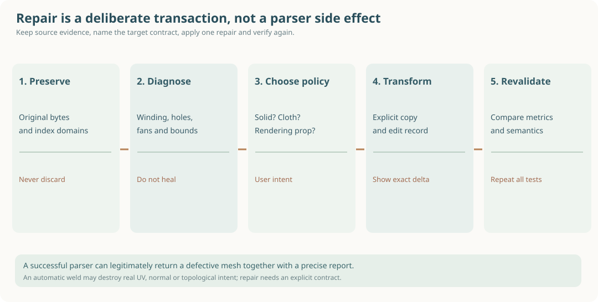
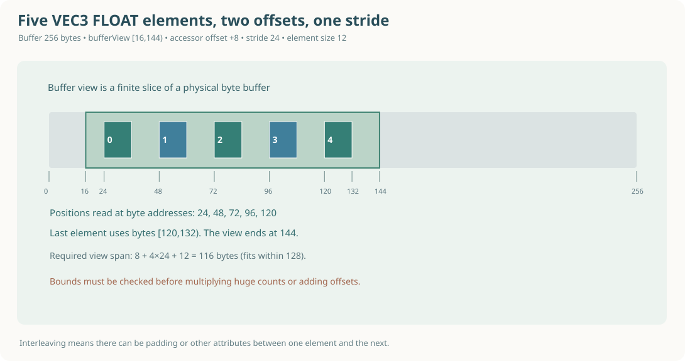
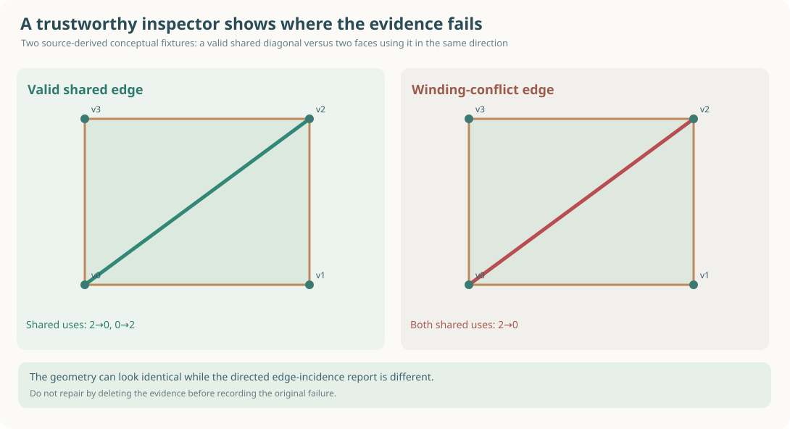

# Chapter 10 — A Mesh You Can Trust

*From Geometry to Images*  
*Part II — Shapes Become 3D Objects*  
*Reader edition / C++23 laboratory P10 / additive manuscript, not a final PDF or EPUB*

> The computer says “File loaded successfully.” Wonderful. Now ask the more interesting question: “What, exactly, did it load?”

## The mysterious wooden dragon

Our little world is starting to feel lived in. Behind the paper house, a mathematical hill rises and falls in gentle waves. Beside it stands a water tower built from indexed circular rings. Our tree bends through Bézier control points, and the garden canopy is a sixteen-control surface. We can even ask an invisible signed-distance field where a spherical surface ought to be, then extract a finite indexed approximation.

All those objects have something comforting in common: **we wrote their rules ourselves**.

We knew which direction was up. We knew the intended units. We decided where the mesh was allowed to have boundaries, how the indices wrapped around periodic angles, what to do at a pole, and what an ambiguous field sample meant.

Then someone sends us a file named *dragon.obj*.

“Put this dragon next to the house,” they say. “It's already finished.”

We open the file. It has thousands of coordinate values and face declarations. The parser accepts every number. A little preview appears. The dragon is recognizable.

Are we done?

Not even close.

What if its length is expressed in centimetres while our house is measured in metres? What if half its faces point inward? What if two triangles appear to share a seam but refer to different vertex IDs? What if the texture is beautifully aligned on the preview while the importer has silently overwritten the artist's UV coordinates? What if an index is out of bounds? What if one polygon is concave and someone triangulated it as if it were convex? What if the file advertises one million values but actually contains twelve bytes?

Before a renderer turns that file into pixels, before a collision system asks whether the dragon touches the ground, and before a geometry researcher computes its surface area, we need to decide which properties the imported data actually satisfies.

A **mesh we can trust** is not one that merely looks plausible. It is a mesh accompanied by explicit interpretation rules, validation results, and known limitations.

## Four very different meanings of “valid”

When a program reads a mesh file, it is tempting to return a Boolean:

~~~text
load succeeded = true
~~~

That single answer compresses four different questions.

**Syntactic validity** asks whether the bytes follow the grammar the importer claims to support. Is `v 1 2 3` a correctly shaped position declaration? Is `f 1 2 3` a correctly formed face? Are the numeric tokens finite?

**Referential validity** asks whether the named indices point to real data in the right index stream. Does the face's third texture coordinate exist? Does a glTF accessor describe bytes contained within its buffer view? Is a node's referenced child index in range?

**Topological validity** asks whether the discrete mesh graph has the intended connectivity. Are two face uses of a shared edge oppositely oriented? Is an edge incident to three triangles? Do several triangles meet only at a bow-tie vertex? Are there unintended boundaries?

**Geometric and semantic suitability** asks whether the model is meaningful for the intended application. Are its triangles nonzero area? Is it closed when a solid is required? Does the scale make sense? Does its shading preserve hard edges? Is the surface free of self-intersections when the downstream algorithm needs that condition? Does the coordinate system match our world?

A file can pass one category and fail another.

Our Chapter 10 C++23 importer deliberately does **not** erase that distinction. It parses a limited, strict subset of Wavefront OBJ. Then it passes the resulting indexed geometric mesh to our independent Chapter 07 topology inspector. The parser can accept a syntactically legal face with repeated position indices, while the geometry report still marks it as defective.

That is a feature, not a contradiction. It lets the user see what the file *said* and decide whether to repair, reject or preserve it.

*Figure 10.1 — Successful parsing is an entry ticket, not a certificate of physical or visual correctness.*

## The smallest useful OBJ file

Wavefront OBJ is a text-based geometry format. A tiny example may look like this:

~~~text
# A single triangle in the XY plane.
v 0 0 0
v 2 0 0
v 0 2 0
f 1 2 3
~~~

The first three lines beginning with `v` define three positions. The line beginning with `f` creates a face referring to those positions.

But the file labels its positions **1, 2 and 3**, while our C++23 `std::vector` indices begin at **0, 1 and 2**.

Therefore, for an OBJ positive index \(k\),

\[
\boxed{i_{\text{C++}}=k-1.}
\tag{10.1}
\]

In this tiny example, the face `f 1 2 3` becomes the internal triangle

\[
(0,1,2).
\tag{10.2}
\]

If our importer forgets the subtraction, it may attempt to read past the end of the positions array. If it subtracts one from a zero index, an unsigned underflow can turn the mistake into an enormous integer. A robust parser must reject `0` **before** converting or indexing.

The C++23 implementation does exactly that.

### Negative indices are not negative array subscripts

OBJ allows a second way to refer to stored positions. Consider:

~~~text
v 0 0 0
v 2 0 0
v 0 2 0
f -3 -2 -1
~~~

Here `-1` means the **most recently declared position at that moment in the file**, `-2` means the one before it, and so on.

If \(N\) positions have been declared when the face is read, negative index \(k\) becomes

\[
\boxed{i_{\text{C++}}=N+k,\qquad k<0.}
\tag{10.3}
\]

With \(N=3\), the face above resolves to \((0,1,2)\).

Two details are easy to miss.

First, negative indices must be resolved against the **current** stream length at the time the face is encountered. If the file adds ten more positions later, those additions must not change the meaning of a face that has already been read.

Second, we should not cast the negative integer into an unsigned index before doing the signed arithmetic. The formula must be evaluated in a signed type wide enough for the bounded count, checked for negativity and upper bounds, and only then converted to the final array index.

Our importer uses checked signed arithmetic followed by a checked `std::uint32_t` conversion. It rejects `0`, references outside the current stream, malformed integers and unsupported forward references.

### Text needs memory limits too

Imagine an input that contains one line with a hundred million characters. Calling a general unbounded line-reading function and checking the line's length afterward does not prevent that huge allocation. The unsafe work has already happened.

A defensive importer should enforce input limits **during** reading, not merely after building an enormous string.

Our teaching OBJ parser has explicit limits on total lines, characters in a line, stored positions, normals, UVs and emitted triangles. Its bounded line reader checks the character budget while consuming bytes. The terminal studio additionally limits the size of a file it opens.

These are not sophisticated adversarial-parser proofs; they are important ordinary engineering habits. A model loader is often the boundary between an untrusted disk or network file and the rest of an application.

### A token is a number only when the whole token is a number

Consider this deliberately malicious-looking position:

~~~text
v 1.2garbage 0 0
~~~

A careless conversion function might accept the leading `1.2` and ignore the remaining text. But the file does not contain a valid standalone numeric field.

Our C++23 implementation uses `std::from_chars` and checks that the parser consumed the **entire** token. It also rejects nonfinite numeric values, such as infinity and NaN.

This matters because NaN has awkward comparison behavior: it is not greater than, less than or equal to ordinary finite values in the expected way. A single nonfinite coordinate can corrupt a bounding box, a normal, a geometric predicate or a rasterization calculation much later.

Reject it at the file boundary.

## A triangle corner can have three different identities

Now the interesting part.

Our OBJ dragon needs a texture: little painted scales and eyes. It also needs normals so its body looks smooth while its horns have sharp shading boundaries.

OBJ does not require those attribute indices to share the same numbering as its position indices. It has separate streams:

~~~text
v  x y z
vt u v
vn nx ny nz
~~~

A face corner can reference all three:

~~~text
f position/texture/normal ...
~~~

A triangle might say:

~~~text
f 1/5/2 2/8/2 3/6/1
~~~

The three integers in a corner **are not** three coordinates of one vector. They are separate references into the position, texture-coordinate and normal arrays.

The corner `1/5/2` means position number 1, texture coordinate number 5 and normal number 2.

We must resolve each value against its **own stream's count**. A valid position index does not imply the corresponding UV or normal index exists.

OBJ also allows `1`, `1/5` and `1//2`. The double slash in `1//2` means “position 1, no texture coordinate, normal 2.” That empty middle field is meaningful. It is not an instruction to use UV zero.

Our source type makes this explicit:

~~~cpp
struct ObjCornerKey {
    std::uint32_t position;
    std::optional<std::uint32_t> texcoord;
    std::optional<std::uint32_t> normal;
};
~~~

Here the optional fields distinguish “attribute absent” from “attribute references element zero.” An absent UV is not automatically \((0,0)\), and an absent normal is not automatically \(+Z\).

### The same position can wear two different textures

Imagine two triangles forming a square. They share a diagonal and two corner positions. But one triangle belongs to the left side of a texture atlas, and the other belongs to the right side.

At the shared geometric point, one face might need UV \((0,0)\), while the other needs UV \((0.2,0)\).

The **three-dimensional position is the same**. The surface topology is still connected. The texture address is different for the two face corners.

If we store just one UV for each position ID and keep replacing it while parsing faces, one triangle will receive the other's texture coordinates. The seam will be destroyed.

If we instead duplicate the *topological* position for every different UV, the image may look right, but an adjacency algorithm may see a crack that is only an attribute discontinuity.

We need two related, but different, views of the mesh.

**Geometric topology view:** store positions and faces indexed only by geometric position IDs. This view is what Chapter 07's edge, component, winding and manifold tests inspect.

**Rendering tuple view:** define one rendering vertex for each distinct tuple

\[
\boxed{(\text{position ID},\text{UV ID},\text{normal ID}).}
\tag{10.4}
\]

A rendering vertex can carry exactly one position, one UV value if supplied, and one normal if supplied. Different tuples get different rendering indices.

This is how an importer can preserve both surface connectivity and shader-facing attribute seams without pretending they are the same thing.

*Figure 10.2 — Topological connectivity is determined by shared position indices. GPU-facing attribute identity is determined by the complete corner tuple.*

### Count the square independently

Consider a square with geometric positions

\[
P_0=(0,0,0),\quad P_1=(1,0,0),\quad
P_2=(1,1,0),\quad P_3=(0,1,0).
\tag{10.5}
\]

Give it two faces, \((0,1,2)\) and \((0,2,3)\).

As a **geometric** indexed mesh it has

\[
\boxed{V=4,\ E=5,\ F=2,\ \chi=1.}
\tag{10.6}
\]

The diagonal between positions 0 and 2 is an interior edge, with two oppositely traversed face uses. The other four edges are boundary edges.

Now suppose every face corner has an individual combination of UV and normal indices, so no rendering tuple is shared between the faces. The two triangles have six face corners and **six distinct rendering tuples**.

Does that make the mesh's Euler characteristic \(6-?\)? Not in the geometric topology view we have defined. Those six render records are not six independent surface graph vertices. Euler still uses the **four geometric position IDs**.

This is why the same source can correctly report:

~~~text
Position vertices=4
rendering-tuple vertices=6
triangular faces=2
Indexed V=4 E=5 F=2 Euler=1
~~~

Those numbers are not inconsistent. They answer different questions.

### A rendering vertex is a tuple of more than position, UV and normal

Real engines may need tangents, colors, joint weights, multiple UV sets, morph data and custom attributes. A correct unified vertex key must incorporate **all attributes that are actually part of that rendering vertex** and their intended domains.

Our first C++23 key uses position, UV and normal because it teaches the independent-index problem without making the reader implement the whole glTF attribute ecosystem in one sitting.

The type also avoids silently merging two unrelated corners because their floating coordinates happen to be close. That kind of fuzzy welding can destroy the seams an artist intentionally made.

The right deduplication rule depends on which representation we are building and which equivalence relation we mean.

## Normals: geometry, shading and the danger of averaging everything

A triangle's oriented normal begins with its three positions \(A,B,C\):

\[
\boxed{N_f=(B-A)\times(C-A).}
\tag{10.7}
\]

Its direction follows the face's winding. Its magnitude is twice the triangle area.

If \(N_f\ne0\), we can normalize it:

\[
\boxed{n_f=\frac{N_f}{\|N_f\|}.}
\tag{10.8}
\]

That is a **flat face normal**.

But many surfaces are intended to look smooth across neighboring triangles. One common method is to accumulate neighboring face normals at a vertex and normalize the sum.

There are different choices about the weights. If every incident unit face normal contributes equally,

\[
n_v\propto\sum_{f\ni v}n_f,
\tag{10.9}
\]

large and tiny faces have the same numerical vote.

If we use unnormalized cross products,

\[
\boxed{n_v\propto\sum_{f\ni v}N_f,}
\tag{10.10}
\]

then the contribution is weighted by triangle area, because \(\|N_f\|=2\,\text{area}(f)\).

We could also use the angle at the vertex within each triangle. That often behaves better when triangles have strongly differing sizes or angles.

None of these accumulation rules should blindly cross a **hard-normal boundary**. At the cylinder's top rim from Chapter 09, the radial side normal and vertical cap normal are deliberately different. Averaging them into one per-position normal rounds the sharp edge in the shading.

Nor should a smoothing algorithm assume every vertex's incident faces form one connected fan. A bow-tie vertex may touch two separate pieces of surface whose normals should not be mixed. That is why Chapter 07 examined one-ring connectivity, not merely shared coordinates.

The user of a mesh decides where smoothing is appropriate. The importer should preserve authored normals and corner identity until a separate explicit policy decides how to recalculate them.

### An imported normal can be syntactically valid but useless

What if a file contains

~~~text
vn 0 0 0
~~~

Those are three legitimate finite numeric tokens. They are still a zero vector, which cannot be normalized into a direction.

Our P10 parser accepts that *grammar*, but the separate asset report counts zero-length supplied normals as invalid for ordinary normal use.

A more advanced loader might normalize non-unit provided normals, reject them, or regenerate normals after taking material and smoothing-group policy into account. The important point is that we should not normalize a zero vector, silently replace it with \(+Y\), or make an unexplained change to authored shading.

### Tangents belong to a different domain again

Normal mapping uses a local basis tied to texture coordinates. One tangent direction is associated with increasing \(u\) in the texture map, while the other is associated with increasing \(v\).

For a triangle, let

\[
e_1=P_1-P_0,\qquad e_2=P_2-P_0
\]

and

\[
\Delta u_1=u_1-u_0,\quad \Delta v_1=v_1-v_0,
\]

with corresponding values for the second edge.

Assuming the UV mapping is locally nonsingular, solve

\[
\begin{bmatrix}e_1&e_2\end{bmatrix}
=
\begin{bmatrix}T&B\end{bmatrix}
\begin{bmatrix}
\Delta u_1&\Delta u_2\\
\Delta v_1&\Delta v_2
\end{bmatrix}.
\tag{10.11}
\]

The determinant of the UV mapping is

\[
\boxed{
D=\Delta u_1\Delta v_2-\Delta u_2\Delta v_1.
}
\tag{10.12}
\]

When \(D=0\), the UV map is locally degenerate and this inverse cannot be computed in the ordinary way. When it is extremely small, the tangent estimate may be ill-conditioned.

Even when it is not zero, tangent construction involves decisions about interpolation, orthogonalization, handedness and mirrored UV charts. glTF typically carries a tangent with a `w` sign specifying handedness for the bitangent reconstruction.

This explains why a real mesh importer needs to preserve per-corner attributes and not simply report “I calculated a normal, therefore the material is ready.”

The P10 lab **does not implement a full tangent-space generator**. It teaches the equation and validates the input corner streams. The original long mesh-attribute source contains much deeper material on tangent frames, MikkTSpace-style conventions and asset pipelines and must remain part of final source reconciliation.

## Triangulating an imported polygon is a geometric decision

Our renderer and topology code work naturally with triangles. OBJ allows polygon faces with more than three vertices.

A simple convex quadrilateral can be split along a diagonal:

\[
(0,1,2),\qquad(0,2,3).
\tag{10.13}
\]

This works for the ordinary flat square. It also works for a strictly convex planar quad with a consistent boundary order.

But consider a concave polygon—a little arrowhead with an inward notch. Splitting everything into a fan from the first vertex may create triangles that lie **outside** the intended polygon.

The problem is not that our C++ syntax is wrong. The geometry itself requires a more careful choice of ears or diagonals.

### What makes a quad safe for our small importer?

We deliberately support **triangles and strictly convex planar quads**, not every arbitrary OBJ polygon.

For a four-corner face, our importer checks that its corner position IDs are distinct. It computes the plane normal from the first three geometric points, rejecting near-zero area. It checks that the fourth point is close enough to the same plane under a declared **floating tolerance**.

Then it projects the quad onto a coordinate plane that avoids discarding the dominant normal component. After projection, it tests whether the signed turns around the boundary consistently have the same nonzero sign.

A strictly convex simple polygon has consistent turns. A concave quad changes turn sign. A self-crossing bow-tie polygon also fails the intended simple convex ordering.

Only after those checks does our implementation emit the two triangles in equation (10.13).

This is an example of saying something small but true rather than advertising “supports polygons” while silently ruining half the input models.

The quadrilateral test is a binary64 heuristic. It is not an exact robust planar-polygon predicate; near-degenerate cases are rejected by policy.

### What about a general concave polygon?

**Ear clipping** is one common triangulation method. In a simple planar polygon, an “ear” is a triangle made from three consecutive boundary vertices whose interior contains no other polygon vertex. Remove a valid ear, repeat, and eventually a polygon becomes a set of triangles.

But a production implementation must handle collinearity, self-intersections, overlapping vertices, nonplanarity, numerical precision and attribute interpolation. A polygon that self-intersects is not a conventional simple polygon in the first place.

We will not pretend one unrestricted triangle-fan loop solves all of that. Our first importer rejects an OBJ face with five or more corners rather than silently inventing a triangulation.

That rejection is a useful, explainable feature of its scope. A future general polygon triangulator should be implemented and independently tested, not smuggled into the importer under an unqualified “supported” label.

*Figure 10.3 — Four position indices and one face declaration are not a guarantee that a fan triangulation respects the intended shape.*

## What do we do with a broken mesh?

Suppose an OBJ file loads with two triangles sharing an edge. But both traverse that shared edge in the **same direction**.

In an ordinary consistently oriented two-manifold surface, the adjacent triangles must traverse their shared edge in **opposite** directions. Our Chapter 07 inspector reports a winding conflict.

Could we fix it by reversing one triangle?

Sometimes. But if the mesh also has nonmanifold junctions or disconnected fans, a local flip may introduce other inconsistencies. A truly nonorientable surface may not admit one globally consistent orientation at all.

Likewise, two visually coincident vertices may have different index identities. Should we weld them?

Not without knowing why they were separate.

They might be an accidental crack in a reconstructed surface. Or they might be two intentional topological components that happen to touch geometrically. They might represent a UV seam in a rendering-only record whose higher-level topological identity has already been lost.

The importer cannot read the artist's mind from three floating coordinates.

### Repair should be an explicit transformation with evidence

A sensible repair workflow has at least four stages.

First, **diagnose** the mesh without changing it. Count boundary edges, winding conflicts, nonmanifold edges, repeated indices, degenerate triangles, duplicated positions and disconnected vertex fans. Record the source file, parsing warnings and the desired downstream contract.

Second, **choose a policy**. Do we intend a connected watertight solid? Several separate objects? A cloth sheet that is allowed to have boundaries? A render-only visual prop that is not used for physics? The answer determines which conditions are defects and which are valid features.

Third, **apply an explicit transformation** with a copy of the original data. Examples might include reorienting a well-defined component, removing an unwanted face, splitting a nonmanifold vertex, matching boundary loops under a carefully justified tolerance, or introducing a new topological surface patch.

Fourth, **re-run the original checks**, then add new tests for the properties we hope the repair preserves: geometry drift, changed volume, normals, UVs, face components, object identity and physical behavior.

An importer that quietly welds vertices while parsing cannot provide this evidence afterward, because it has already destroyed the data that might explain why the vertices were separate.

The P10 importer is therefore **nonrepairing by design**. It keeps the original position indices and distinct corner streams. The P07 inspector generates the diagnostic report. The decision to mutate geometry belongs to a separate, explicit operation.

*Figure 10.6 — A repair needs an explicit target contract and before/after evidence. Silently welding or deleting data during parsing can hide both the problem and the user's original intent.*

### Why Euler characteristic alone is not a repair certificate

A closed connected orientable genus-zero surface has Euler characteristic two. But the number two alone is not enough to certify everything we want.

Two disconnected disks have Euler characteristics one each, giving a total of two. A self-intersecting geometric sphere can have a perfectly ordinary combinatorial sphere index graph. A mesh might have enough duplicated vertices to produce an apparently plausible count while still containing unwanted boundaries.

We need edge incidence, vertex-link neighborhood structure, connectedness, face orientation, geometric checks and application semantics—not just \(V-E+F\).

This theme has appeared several times because it is not a tiny technical detail. In geometry processing, confusing **geometry** with **topology** is one of the fastest routes to an attractive but unreliable result.

## A bounding box is simple, until a bad coordinate arrives

A basic property of imported geometry is its axis-aligned bounding box (AABB).

Given finite positions \(P_i=(x_i,y_i,z_i)\),

\[
\boxed{
b_{\min}=(\min_i x_i,\min_i y_i,\min_i z_i),
}
\tag{10.14}
\]

\[
\boxed{
b_{\max}=(\max_i x_i,\max_i y_i,\max_i z_i).
}
\tag{10.15}
\]

For our square in equation (10.5),

\[
b_{\min}=(0,0,0),\qquad b_{\max}=(1,1,0).
\]

A renderer may use the bounds for culling, a collision system for broad-phase candidates, and an editor for camera framing or selection.

But an AABB is meaningful only if all coordinate inputs were validated. A nonfinite value can make min/max logic depend on surprising comparison behavior. A unit mismatch can produce bounds of the wrong physical scale. A local-space bound cannot be treated as a world-space bound without applying the appropriate transform or conservatively transformed corners.

Our P10 audit computes the AABB of validated finite source positions and clearly describes its coordinate frame as the original OBJ position space. It does **not** claim it can infer whether a number means centimetres or metres.

### The million-unit dragon

Imagine our house is four metres wide and our imported dragon spans \([-200,200]\) along X. Maybe the dragon is supposed to be four hundred metres wide. Or perhaps the asset was authored in centimetres, making it four metres wide after conversion.

A parser cannot know from the raw positions alone.

If the source lacks an explicit unit contract, a safe importer may present the bounds and ask the application or asset metadata for a chosen conversion. Silent assumptions can create dramatic physics errors: collision thicknesses, camera clipping planes and velocities all depend on scale.

**Units and axes are semantic properties**, not merely byte-validation properties.

We will carry this question into the next chapter's scene transforms and hierarchical coordinate frames.

## Enter glTF: when the mesh is a graph of metadata pointing at bytes

Wavefront OBJ is friendly to humans because it stores many values as lines of text.

Real-time applications often use **glTF 2.0**, a structured 3D asset format that can describe mesh primitives, materials, scene nodes, transforms, textures, animations, skins, morph targets and other resources.

At its core, a glTF file is not just a bag of triangles. It is a graph of structured metadata pointing to typed binary data.

A vital chain is

\[
\boxed{
\text{buffer}\to
\text{bufferView}\to
\text{accessor}\to
\text{primitive attribute}.
}
\tag{10.16}
\]

You can think of these as four levels of interpretation.

The **buffer** is a collection of raw bytes. A buffer may refer to an external binary resource or be contained inside a GLB binary asset. The bytes alone do not tell us which of them are positions, normals, indices or animation times.

A **bufferView** selects a subrange of a buffer. It names the source buffer and gives an offset and a length. If used for interleaved vertex attributes, it may also define a byte stride.

An **accessor** gives a type and count to part of that range: for example, “there are five 3-component floating-point vectors here.” It may provide its own offset relative to the buffer view.

A **mesh primitive attribute** associates an accessor with a semantic name such as `POSITION`, `NORMAL`, or `TEXCOORD_0`.

The format makes a powerful separation: **physical byte storage** is not the same as **logical geometric meaning**.

### Two offsets, not one

Suppose a glTF binary buffer has 256 bytes. A buffer view begins at byte offset 16 and has length 128. Its byte stride is 24.

An accessor into that view has a *relative* offset of 8 and describes five `VEC3 FLOAT` values.

A `FLOAT` component occupies four bytes. Three components occupy

\[
\boxed{3\cdot4=12\text{ bytes per element}.}
\tag{10.17}
\]

The first element begins at

\[
\boxed{16+8=24.}
\tag{10.18}
\]

Because the stride is 24 bytes, subsequent element beginnings are

\[
24,\ 48,\ 72,\ 96,\ 120.
\tag{10.19}
\]

The last element occupies bytes starting at 120 and extends for 12 bytes. Its **exclusive** end offset is

\[
\boxed{120+12=132.}
\tag{10.20}
\]

The view itself ends at

\[
16+128=\boxed{144}.
\tag{10.21}
\]

Thus all five elements fit within the declared view and the physical buffer.

The general effective byte address of accessor element \(i\) is

\[
\boxed{
\mathrm{base}+
\mathrm{viewOffset}+
\mathrm{accessorOffset}+
i\,\mathrm{effectiveStride}.
}
\tag{10.22}
\]

And the required accessible byte length is controlled by

\[
\boxed{
\mathrm{accessorOffset}+
(\mathrm{count}-1)\mathrm{stride}+
\mathrm{elementSize}
\le \mathrm{viewLength}.
}
\tag{10.23}
\]

An implementation that forgets either offset or confuses stride with packed element size will read the wrong bytes even when the JSON syntax is perfectly valid.

*Figure 10.4 — A binary accessor is an address calculation with two offsets, an element size, a count and an effective stride. These all need bounds and alignment validation.*

### Overflow makes naive bounds checks unsafe

One of the nastier mistakes is to check that an accessor fits by calculating a gigantic end position first and only then comparing it to the available length.

If the arithmetic uses a finite unsigned integer type, multiplying a huge count by a stride can wrap around. The wrapped end may look small enough to fit even though the true mathematical length does not.

A safe validator checks that the operands fit **before** multiplication.

Given \(\mathrm{remaining}=\mathrm{viewLength}-\mathrm{accessorOffset}\), first require

\[
\mathrm{elementSize}\le \mathrm{remaining}.
\tag{10.24}
\]

Then, for \(\mathrm{count}\ge1\),

\[
\boxed{
\mathrm{count}-1
\le
\left\lfloor
\frac{\mathrm{remaining}-\mathrm{elementSize}}
{\mathrm{stride}}
\right\rfloor.
}
\tag{10.25}
\]

The right side is an ordinary integer division. If that inequality fails, the accessor cannot fit.

Because the arithmetic is bounded before the expensive multiplication, the implementation avoids using a potentially overflowed end address as evidence of safety.

The P10 C++23 helper `check_gltf_layout()` implements this style of check in a **restricted** subset: scalar and 2/3/4-component unsigned byte, unsigned short, unsigned int or float records. It also checks component-sized alignment, legal stride relationships and rejected sparse-accessor usage in the subset. The standalone helper does not yet know whether a specific accessor is a vertex attribute, an index stream or an animation input, so it cannot prove every semantic alignment and component-type rule from the complete glTF specification.

### Some glTF rules are contextual

The official glTF 2.0 specification requires more than mathematical bounds. For example, vertex attribute alignment imposes four-byte constraints, defined `byteStride` values are limited to 4–252 bytes and must be multiples of four, and accessors with `FLOAT` or `UNSIGNED_INT` components must not be marked normalized.

Index accessors also have their own valid unsigned scalar component types. A primitive's indices must be less than its vertex count. Accessor dimensions and counts must match their intended semantics.

Some of those rules depend on *where the accessor is used*. A helper receiving just a view, a type and a count cannot infer the entire scene's semantic correctness.

Our code explicitly implements a useful first **byte-layout validation kernel** and rejects unsupported sparse accessors. It is **not** a complete glTF loader, validator, GLB parser or exporter.

For authoritative details, refer to the [Khronos glTF 2.0 specification](https://registry.khronos.org/glTF/specs/2.0/glTF-2.0.html) and the Khronos buffer/accessor tutorial. Unlike a copied example from an old blog, these references identify which properties are normative and which are implementation choices.

### Real glTF vertex data may be interleaved

Suppose each vertex stores a three-float position and a three-float normal. We might pack them into a 24-byte record:

~~~text
[x, y, z, nx, ny, nz]
~~~

A position accessor can begin at byte offset zero within each record, while a normal accessor begins twelve bytes later. Both advance to the next vertex by a stride of 24 bytes.

If we read position values as if each record occupied only twelve bytes, the second “position” would actually be the first vertex's normal. The output might become a cloud of nonsense, or worse, a distorted shape that still seems to contain structure.

This is why the accessor's **element size** and its **effective stride** are separate values.

The glTF representation is clean, but it requires exact bookkeeping.

## Scene nodes and transforms: a perfectly valid mesh can appear in the wrong place

Consider our dragon mesh again. Perhaps the vertex positions describe a dragon centered at its local origin. But the scene graph places the dragon ten metres to the left, rotates it and scales it.

The geometry's local positions do not by themselves tell us its final world positions.

For a common column-vector convention, a node's local transformation may be composed as

\[
\boxed{M_{\mathrm{local}}=T\,R\,S,}
\tag{10.26}
\]

and a child's world transform follows

\[
\boxed{
M_{\mathrm{world,child}}=
M_{\mathrm{world,parent}}\,
M_{\mathrm{local,child}}.
}
\tag{10.27}
\]

Here \(T\), \(R\) and \(S\) mean translation, rotation and scale.

The order matters. Rotating a translated object is not the same as translating a rotated object. That is one of the lessons we learned in our frame and affine-transformation chapters.

### Matrix layout is not the same as vector convention

A library may store matrix entries in row-major memory while using column vectors mathematically. glTF's column-major serialization does **not** mean the importer should apply an arbitrary geometric transpose to every matrix.

Suppose the serialized column-major array represents a \(4\times4\) transform \(M\). If our internal `Matrix4` type stores entries in row-major memory while still multiplying column vectors, we should place

\[
\boxed{
M_{\mathrm{internal}}(r,c)=
\mathrm{serialized}[4c+r].
}
\tag{10.28}
\]

This is a storage-layout conversion that preserves the matrix's mathematical entries. It is not necessarily a mathematical transposition.

Our original Kairo-related notes emphasize exactly that distinction, and it deserves its own full worked source example when the book implements real glTF scenes and cameras.

The P10 exercise code does not perform glTF node ingestion. We are deliberately separating the **binary accessor bounds kernel** from later **scene and transform semantics**.

### A scene is more than a mesh primitive

glTF nodes can reference meshes, children, cameras and skins. A scene lists root nodes. The file can contain nodes not reachable from the selected active scene. Some accessors may belong to animation samplers or morph target deltas, rather than ordinary static vertex positions.

A correct importer therefore needs to validate a hierarchy, not just one buffer. It must check node references, detect invalid graph structure where prohibited, apply transform conventions, preserve materials and skinning semantics, and reconcile attribute counts and type expectations.

Skipping that work is acceptable for a carefully named introductory **layout validator**. It is not acceptable for a product that claims to support arbitrary glTF files.

That is why our first laboratory's named scope matters so much.

## A file that contains dangerous requests should not control your engine

Imagine an untrusted OBJ referencing a material library with a path outside the asset directory. Or an enormous glTF claiming a buffer whose advertised length would allocate gigabytes. Or a file that has apparently valid indices but causes the importer to perform millions of duplicate-finding comparisons.

Even non-executable asset formats can create security and reliability problems: excessive memory allocations, pathological algorithmic runtime, path traversal through referenced resources, malformed numeric values, decompression bombs in external images, and unsafe assumptions about buffer ownership.

Our small importer makes several defensive choices:

It uses bounded line reads rather than accepting an arbitrarily long line into memory.

It imposes caps on positions, UVs, normals, input lines and resulting triangle faces.

It checks each numeric and integer token for full consumption and valid range.

It does not follow external `mtllib` references. It records that material metadata was seen and ignored; it does not silently load or execute anything from the named path.

It rejects unsupported OBJ directives and nonconvex or excessively warped quadrilaterals rather than guessing their meaning.

It refuses glTF sparse accessor data in its layout subset, rather than treating it as if it were ordinary contiguous bytes.

These checks do not turn it into a security-audited general-purpose parser, but they make the constraints visible and testable.

An important habit in engineering is to distinguish “we did not implement this” from “we implemented this incorrectly.” Explicitly refusing unsupported input is usually safer than pretending to accept it.

## The P10 native C++23 project: bring the dragon into the garden carefully

This chapter adds three genuine source files to the same cumulative C++23 laboratory tree.

The first is `include/book03/asset_import.hpp`, which defines a bounded OBJ subset parser, independent corner keys, topological mesh conversion, tuple-based rendering conversion, asset diagnostics and an overflow-aware glTF accessor layout checker.

The second is `tests/asset_import_tests.cpp`, with adversarial and hand-countable tests. It verifies positive and negative OBJ indices, separate index streams, the exact geometric-versus-rendering vertex count on a seam, the distinct role of absent UV/normal values, convex quad triangulation, explicit rejection of concave/warped polygons, bounded input reading, malformed numeric tokens, and the byte offset/stride/count conditions for glTF.

The third is `src/asset_studio.cpp`, a small terminal asset-trust workbench. It can inspect an actual OBJ file from disk, print numeric topology diagnostics, generate a source-derived SVG and export a CSV of the unified GPU rendering vertex tuples.

Its built-in examples include a seam-preserving square, a convex quad, a deliberately reversed face and a repeated-index triangle. They allow a reader to see different failure categories without needing to download a large model.

The commands are intentionally small:

~~~text
book03_assets demo seam
book03_assets demo broken
book03_assets demo repeated

book03_assets inspect dragon.obj
book03_assets svg dragon.obj dragon-audit.svg
book03_assets gpu dragon.obj dragon-render-tuples.csv

book03_assets layout
book03_assets repl
~~~

The `layout` command prints the worked glTF byte calculation we just derived: a buffer of 256 bytes, a view beginning at 16, an accessor offset of 8, five `VEC3 FLOAT` records, a stride of 24 and an exclusive final byte address of 132.

It does **not** open or parse a real glTF file. That is a deliberate boundary, not a missing detail we have hidden.

The REPL can switch between the four sample fixtures or load a local OBJ path, then inspect or export the current asset. If a requested new file fails to parse, the editor keeps its previous valid asset instead of overwriting its state with partially interpreted data.

### The seam witness: four versus six

Our default seam example has four geometric positions and two triangles. They share the diagonal position IDs, but use different UV and normal indices along that join.

Its topological mesh should report

\[
V=4,\qquad E=5,\qquad F=2,\qquad\chi=1,
\]

with four boundary edges and one consistent interior edge.

The unified rendering tuple stream should report **six vertices**, not four, because the attribute tuples differ.

The source deliberately tests these results independently. If a change accidentally collapses the attribute streams, the rendering count drops or UV/normal values become wrong. If a change accidentally turns rendering duplicates into topology identities, the face graph reports disconnected components or extra boundaries.

A single 1-by-1 square becomes a compact test of a deep representation issue.

### The wrong-winding witness

The broken example uses the same four square positions. Its first face is oriented as \((0,1,2)\). Its second face is deliberately \((0,3,2)\).

Along the shared diagonal between positions 0 and 2, **both** faces traverse the edge from 2 to 0. A consistently oriented two-manifold requires opposite traversals. The P07 inspector should report one winding-conflict edge.

No parser grammar rule is violated.

A real mesh diagnostic must distinguish this outcome from a syntax error.

### The repeated-index witness

Our final sample uses a face such as

~~~text
f 1 2 2
~~~

The three face fields are valid integers and the references exist. But the second and third corners refer to the **same** topological vertex. The triangle has no meaningful area as an ordinary 2D face.

The parser preserves the input evidence; the topology report marks the repeated-index face.

This is a deliberate separation between “the file named three valid position IDs” and “the file described a valid nondegenerate triangle.”

### What a source-derived SVG can and cannot tell us

The studio's SVG illustrates actual imported positions and unique indexed edges, coloring open boundaries differently from consistent interior edges, winding conflicts and nonmanifold edges.

It uses a simple fixed oblique projection to draw its 3D positions. It does **not** perform camera calibration, hidden-surface removal, depth sorting or physical shading. It is a diagnostic diagram, not a proof of screen appearance.

An SVG preview can help a human find a suspicious edge. The numeric indexed-mesh report supplies stronger evidence about the discrete topology, and even that report cannot certify the absence of self-intersections or suitable physical units.

One visualization should never pretend to be all the evidence.

*Figure 10.5 — Source-visible failure cases teach why a green “loaded” banner is insufficient. Different problems require different diagnostics and repair policies.*

## A lab we can falsify, not merely admire

Our native laboratory tests are intended to catch mistakes that look small in a preview and large in a real renderer.

They assert that the one-based OBJ positive index becomes the correct zero-based position ID, and that negative indices are resolved at the moment each face is read.

They construct streams with different lengths so a normal's `-1` cannot accidentally resolve against the position count.

They build a square whose positions are shared while UVs and normals are not, then independently verify **four geometric vertices versus six rendering tuples**.

They give the importer a convex planar quad, a concave quad, a self-intersecting quad and a warped quad. The first may be safely split in our stated subset. The others must be rejected, not fan-triangulated in secret.

They feed a repeated-index face, a distinct-index collinear face and a winding conflict to the topology inspector, checking that syntactic success does not erase geometric diagnostics.

They feed the glTF bounds checker offsets and strides that should succeed, offsets that point outside the view, invalid element strides and huge counts that would overflow a naive calculation. They also verify that unsupported sparse accessors are refused.

This is more than a collection of happy-path examples. It is a set of counterexamples chosen from the places where seemingly plausible implementations fail.

The laboratory is registered as the **eleventh** independent CTest in the cumulative Book 03 project, across **ten** native C++23 labs. As always, source-written assertions are not a substitute for a verified compiler run; compilation and CI results must be recorded separately.

## Your turn: interrogate a mesh

**Reconstruct — the triangle's first three indices.** Given `v` positions declared in order and the OBJ face `f 1 2 3`, write the zero-based C++ index triplet. Why must index zero be rejected before converting to an unsigned type?

**Reconstruct — negative indices belong to a moment in time.** After five position declarations, a face says `f -5 -3 -1`. Resolve all three indices. Then imagine the file declares two more positions afterward. Does the earlier face change?

**Reconstruct — three independent namespaces.** An OBJ has four positions, six UVs and two normals. Its corner token is `3/6/2`. Write the three zero-based indices. Explain why there is no reason for the counts of the three streams to be equal.

**Falsify — the innocent-looking seam.** Draw a square from four geometric vertices and two triangles. Give each face unique UV and normal tuples along the shared diagonal. The topological mesh should have \(V=4,E=5,F=2\); the rendering tuple stream can have six vertices. Explain why neither count is a mistake.

**Falsify — a legal face with zero area.** Parse `f 1 2 2` from three valid positions. Which validation layer accepts it, and which layer must report a problem? Explain why silently discarding it would conceal useful information about the source.

**Falsify — the opposite-direction rule.** For two faces \((0,1,2)\) and \((0,3,2)\), list the directed uses of the common edge \(\{0,2\}\). Why is the shared-edge winding inconsistent?

**Transfer — a unit mistake.** An imported statue spans 180 coordinate units. Our house is four metres wide. List at least two plausible interpretations of the statue's scale. Why is guessing metres from OBJ positions alone unsafe?

**Transfer — where does a normal belong?** At the junction between the side and top cap of a cylinder, explain how two face corners can share one position ID but need different shading normals. What breaks if the importer stores only one normal per topological position?

**Transfer — calculate a flat and an area-weighted normal.** For a triangle \(A=(0,0,0),B=(2,0,0),C=(0,3,0)\), compute the unnormalized and normalized face normals. Explain why accumulating unnormalized cross products gives larger triangles more influence than smaller triangles.

**Implement — convex is not the same as arbitrary.** Give a planar convex quad and a concave quad. Explain why a fixed diagonal fan works for the first but need not work for the second. Outline the additional predicates and geometric assumptions that a robust general ear-clipping implementation would require.

**Implement — bounded text.** An attacker supplies a single input line of 100 million characters. Why is rejecting it *after* an unbounded `std::getline` insufficient as an allocation defense? What does a bounded reader need to do instead?

**Reconstruct — the glTF byte witness.** Given a buffer of 256 bytes, view offset 16, view length 128, view stride 24, accessor relative offset 8, five `VEC3 FLOAT` entries, calculate the first element address, element size, all five start addresses and the exclusive final byte address.

**Falsify — overflow before checking.** Suppose `count` is extremely large and an unsigned multiplication `count*stride` wraps. Write a bounds check using the *remaining available bytes divided by stride* that avoids depending on the wrapped result.

**Implement — refuse what you do not understand.** Design an error message for a file containing a concave five-sided OBJ face, a sparse glTF accessor and a material library reference. Which can our teaching lab handle, which can it report as ignored, and which should it refuse? Why is that preferable to silently pretending all three were interpreted?

**Explain — speak to the dragon's owner.** A child asks, “If the dragon looks perfect on screen, why do you say it might be broken?” Explain the difference between a picture, a geometric surface, a connected triangle graph and a physically meaningful solid without relying on the phrase “because the computer said so.”

### Selected answers

Positive OBJ `1 2 3` becomes zero-based \((0,1,2)\). With five current positions, negative \(-5,-3,-1\) resolves to \((0,2,4)\); declarations afterward do not alter that already parsed face.

OBJ corner `3/6/2` becomes position index 2, UV index 5, normal index 1, each resolved against its own stream. Four geometric square vertices and six distinct rendering corner tuples can legitimately represent the same two-triangle textured mesh.

The triangle \((0,1,2)\) has the shared edge \(2\to0\); the intentionally reversed second triangle \((0,3,2)\) also traverses \(2\to0\), so their directed uses conflict. A repeated-index triangle such as \((0,1,1)\) passes the limited grammatical check but fails as a meaningful triangular face.

For triangle \(A=(0,0,0)\), \(B=(2,0,0)\), \(C=(0,3,0)\), the unnormalized cross product is \((0,0,6)\); its magnitude is twice the triangle's area \(3\), and the unit normal is \((0,0,1)\).

The glTF example's element starts are **24, 48, 72, 96, 120**, each element occupies **12** bytes, and the exclusive final byte is **132**, inside the view end at **144**. The overflow-safe count check uses equation (10.25), not a potentially overflowing unsigned end-address product.

A material-library directive should not make our bounded OBJ laboratory chase a referenced file. It records a warning. A concave five-sided face is unsupported and rejected, as is a sparse glTF accessor in the layout-only helper. No real glTF JSON file is parsed by this helper at all.

## The dragon joins the scene—with evidence

We now know more than how to generate a triangle mesh. We know why imported data has to carry contracts about bytes, indices, geometry, attributes, topology and meaning.

Our reader's OBJ parser is intentionally narrower than the full format, but it is serious about the things it claims. It checks grammar, preserves separate corner index streams, supports well-defined relative references, triangulates only its accepted convex quad case, and refuses dangerous or unsupported inputs rather than silently rewriting them.

Its companion rendering conversion understands that one geometric position may participate in multiple UV and normal tuples. Its topology report catches winding problems and degeneracies that a text parser cannot. Its glTF helper demonstrates bounded binary-address calculations without claiming to ingest a complete scene.

But we are still looking at objects largely one at a time.

A real world is not a loose pile of independent meshes. A dragon might be attached to a cart. The cart might be attached to a moving platform. A tree might be placed on a terrain tile. A camera may orbit the house while an articulated character turns its head.

Each object can live in its own coordinate frame, and those frames can be related hierarchically.

That is where we go next.

**Chapter 11 — The Same Tree in Five Worlds** will take our local and world coordinate ideas, bring them into hierarchical scenes and animation-friendly transform graphs, and show how one piece of geometry can appear in different places without copying its vertex data.

The dragon is welcome in the garden.

We just make it show its papers first.

---

## Glossary

**Syntactic validity:** Whether file bytes and tokens match the explicitly supported file grammar.

**Referential validity:** Whether each index, offset and resource reference names an existing appropriate record or byte range.

**Topological validity:** Whether indexed vertices, edges and faces have the intended adjacency, orientation, boundary and manifold-neighborhood properties.

**Geometric suitability:** Whether the actual position values and shapes meet the downstream task's conditions, such as nonzero area, size and no forbidden intersections.

**OBJ:** A text-based 3D geometry format with position, texture, normal and face declarations; the full format is broader than the P10 subset.

**OBJ positive index:** One-based face reference to an element in a specified stream.

**OBJ negative index:** Reference counted backward from the end of its own currently defined stream when a face is read.

**Per-corner attribute:** A value, such as UV or normal, attached to a specific face corner and allowed to differ between adjacent faces sharing one geometric vertex.

**Rendering tuple:** One combination of all corner attributes needed for a GPU-facing vertex record, such as \((position,UV,normal)\).

**Hard-normal boundary:** A join where different incident faces intentionally retain different shading normals at the same geometric position.

**Area-weighted normal:** Vertex normal obtained by accumulating unnormalized face cross products before normalizing.

**Convex quad:** A simple planar four-corner polygon whose consecutive projected turns have consistent nonzero orientation; it admits the elementary two-triangle fan split.

**AABB:** Axis-aligned bounding box determined by per-coordinate minima and maxima of positions.

**glTF 2.0:** Structured specification for transmitting 3D assets including typed geometry buffers, materials and scene hierarchy.

**Buffer:** Raw byte storage without intrinsic vertex/normal meaning.

**Buffer view:** A bounded byte range of a referenced buffer, optionally with a specified vertex attribute stride.

**Accessor:** Typed and counted interpretation of data in a buffer view.

**Byte stride:** Distance in bytes between successive elements of a regularly spaced record stream; not necessarily the packed element size.

**Sparse accessor:** glTF mechanism for overriding selected elements of a base accessor; not supported by the P10 layout-only helper.

**Scene graph:** Hierarchical node structure connecting meshes, transforms and other scene entities.

**Repair policy:** Explicit decision about how malformed or unsuitable geometry should be changed and which properties must be preserved.

## Source custody and further study

This is an additive chapter. The original comprehensive manuscript must remain available, especially `Notes/Chapter Edition/02 - Graphics Vision and XR/23 - Mesh Topology and Connectivity.md` (combinatorial identity, half-edges, manifoldness and repair) and `41 - Per-Vertex and Per-Corner Mesh Attributes.md` (flat, smooth, area- and angle-weighted normals, UV/tangent bases, OBJ indexing and polygon triangulation, glTF buffers, accessors, nodes, materials, skins, animation, and Maveb/Kairo engine integration). Those legacy source paths, inspected Git blob IDs and their still-unreconciled specialized sections are recorded in `PASS10_LEGACY_AUDIT.md`. A chapter link is **not** proof that every original source unit was merged into a finished reader.

External authoritative references: [Khronos glTF 2.0 specification](https://registry.khronos.org/glTF/specs/2.0/glTF-2.0.html); [Khronos glTF tutorial: Buffers, Buffer Views and Accessors](https://github.com/KhronosGroup/glTF-Tutorials/blob/main/gltfTutorial/gltfTutorial_005_BuffersBufferViewsAccessors.md); [Library of Congress Wavefront OBJ format description](https://www.loc.gov/preservation/digital/formats/fdd/fdd000507.shtml); and the original source atlas's geometry-processing and Kairo/Maveb-specific reading notes. The P10 C++23 reader and original SVGs contain newly authored teaching material, not copied case tables or third-party artwork.

**Companion:** `Code Parts/tools/labs/book03_cpp23/include/book03/asset_import.hpp`, `tests/asset_import_tests.cpp`, `src/asset_studio.cpp`.

**Read next:** Chapter 11 — The Same Tree in Five Worlds.
