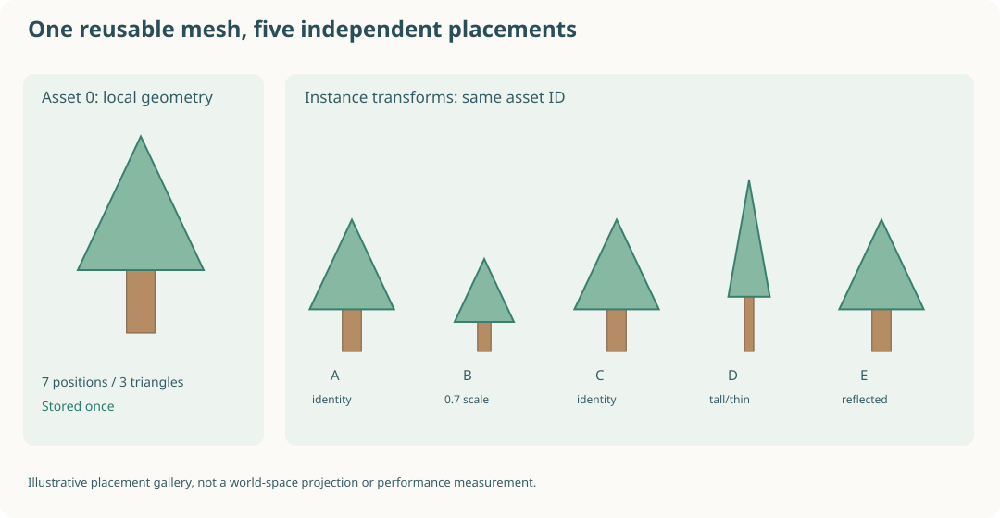
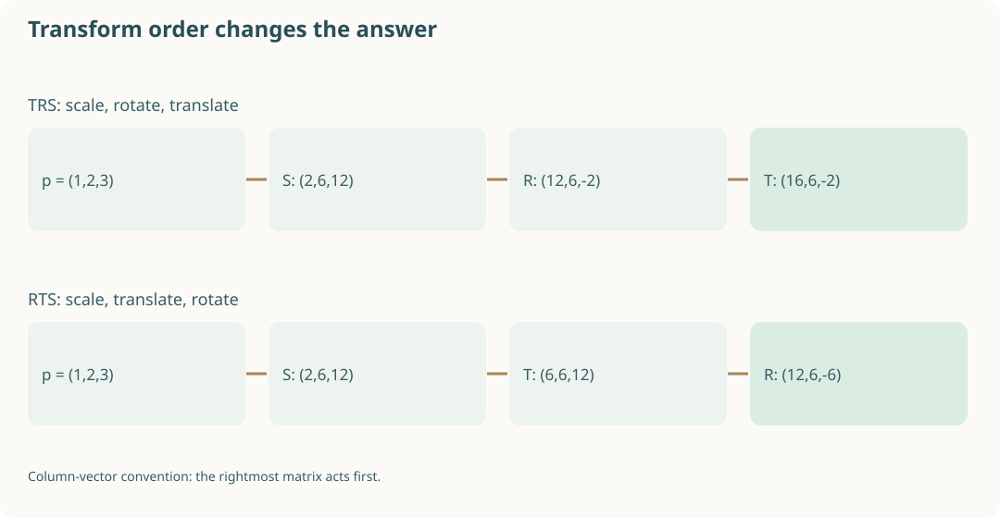
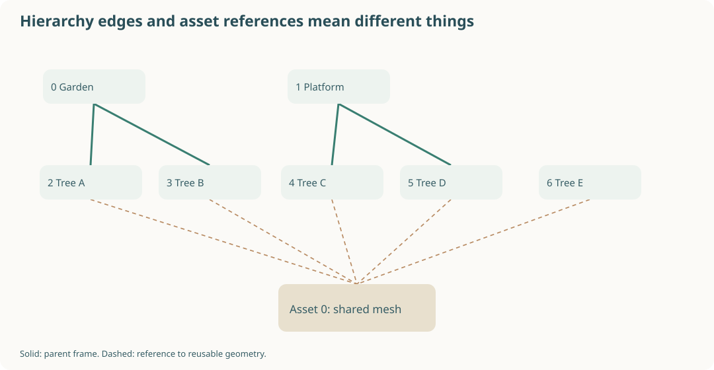
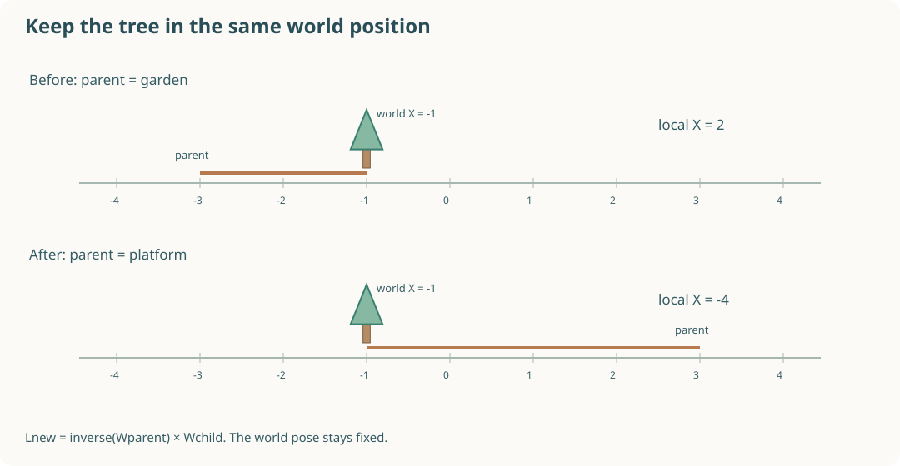
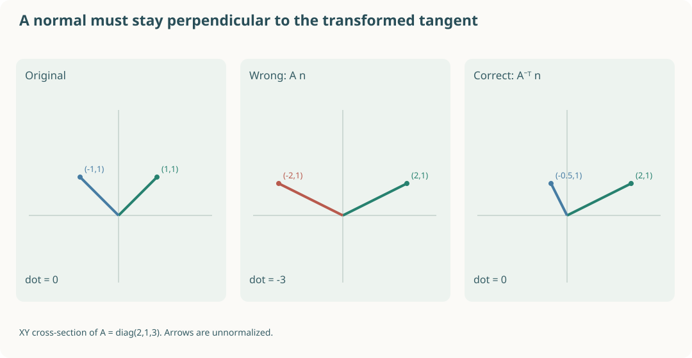

# Chapter 11 — The Same Tree in Five Worlds

*From Geometry to Images — Part III: Objects, Worlds and Cameras*  
*Reader edition / C++23 laboratory P11*

> A forest does not need a thousand different recipes for a tree. It needs a tree recipe and a thousand different places to put it.

## The garden has become a world

Our wooden dragon finally has permission to enter the garden. We inspected its position indices, preserved the differences between its texture coordinates and its normals, and refused to confuse a successful parser with a trustworthy physical surface.

Meanwhile, the tree from Chapter 08 has become rather popular. Someone wants one beside the house. Someone wants another next to the tower. A third should stand on a moving platform. A fourth should be taller and thinner. And, for reasons known only to the garden designer, a fifth should be the mirror image of the original.

We could copy the entire tree mesh five times, then modify every position in every copy.

That would work for a tiny classroom tree. It would also be a remarkably wasteful way of expressing a simple idea: these are five placements of the **same geometry**.

Imagine a rubber stamp. You own one stamp, but you can press it onto many locations on a piece of paper. The stamp does not need to be carved again every time you move it. You may rotate it, move it, or imagine stretching the image it leaves behind. There is one description of the shape, and many descriptions of its placement.

In graphics, we call this distinction **asset versus instance**.

The asset contains the reusable geometry. An instance refers to that geometry and supplies a transformation that tells us where the geometry belongs.

There is a second idea hiding in the moving platform. A tree attached to the platform should follow the platform when the platform moves. If we change the platform's position, we should not need to find all its tree vertices and manually translate them one by one.

We need a description of **relationships between coordinate frames**.

This chapter builds both ideas together. By the end, our scene can contain a reusable indexed mesh, several independently placed instances, and groups that move their descendants. It can reject impossible parent relationships, reparent an object without making it jump, and correctly transform normals under nonuniform scale.

The central question is no longer merely “Where is this point?” It is “In whose coordinates is this point expressed, and how did it get there?”

*Figure 11.1 — Asset identity and instance identity are different. Seven reusable local positions can describe five placements without storing five separate source meshes.*

## One object is not one array of world-space vertices

Suppose our miniature teaching tree contains seven positions and three triangles: four points form a rectangular trunk and three form a triangular crown. It is a deliberately flat silhouette in three-dimensional space, not a realistic botanical model.

Let its local positions be \(p_0,\ldots,p_6\). We store the positions and face indices once.

An instance can be described by

\[
\boxed{(\text{asset ID},\ \text{placement transform}).}
\tag{11.1}
\]

For instance \(i\), each local position becomes

\[
\boxed{p_{i,j}^{W}=A_i p_j+t_i.}
\tag{11.2}
\]

Here \(A_i\) is a three-dimensional linear map and \(t_i\) is a translation vector. The superscript \(W\) means world coordinates.

The original \(p_j\) does not change when we calculate \(p_{i,j}^{W}\). We can evaluate the same expression for another instance using a different \(A_i,t_i\).

If each of five copies held seven independently stored positions, we would store 35 positions, plus potentially five copies of the face indices and other attributes. A shared-asset design stores seven source positions, three source faces, and five placement records.

That is a statement about **logical representation**, not a claim of a measured GPU speedup. The renderer still has work to do. Every visible instance needs its own transformed vertices or an equivalent rendering computation. Each instance may also require its own bounds, visibility state, material overrides or animation state.

For a source mesh containing \(V\) vertices and \(F\) faces, and \(K\) instances, fully copying geometry costs storage proportional to

\[
O(K(V+F)).
\tag{11.3}
\]

Sharing a static geometry asset and storing a constant-size affine transform per instance changes the source storage to approximately

\[
O(V+F+K).
\tag{11.4}
\]

We have not eliminated the cost of drawing all the instances. We have eliminated unnecessary repetition in their description.

### Asset identity is not object identity

Suppose the gardener selects tree B, moves it to the right and removes it from the scene. Tree A should not disappear. It merely uses the same asset.

Suppose instead the artist edits a vertex in the shared tree mesh. All instances that reference that asset may now observe the updated shape. Sometimes this is exactly what we want. Sometimes the user wants to modify only tree B, in which case the editor may create a separate asset or use a deformation layer.

These are distinct operations.

An instance ID identifies a placement. An asset ID identifies reusable geometry. A face index identifies an element of that geometry. A rendering vertex ID may identify a position/UV/normal tuple, as we learned in Chapter 10.

Never pass an integer from one of those namespaces to another merely because its type happens to be the same.

Our reference implementation uses integer asset and node indices in separate arrays. They remain valid while those arrays are not reordered or erased. A production editor needs a stronger lifetime policy: generation counters, stable handles, reference ownership, or explicit remapping when assets are deleted. This small lab does not implement a general resource manager.

## Local space is a convenient promise

The tree mesh is described in its own local coordinates. Its trunk starts at \(y=0\), the crown reaches \(y=2.5\) metres, and its origin is near its base.

That origin is a useful authoring decision: placing the origin at a ground contact makes it easy to put the tree on the terrain.

A different asset might place the origin at its center, its hinge or an arbitrary modelling coordinate. No origin is automatically correct for every operation. The origin determines the pivot about which a simple local linear transformation acts.

When we say “translate the tree by two metres,” we should know which frame supplies the direction of those two metres. The local X direction of a rotated platform may not coincide with the world X direction.

Chapter 02 introduced points and displacement vectors. Chapter 04 taught the affine map and its inverse. We now extend those ideas to a world containing many objects whose frames are related.

Our convention is:

- Right-handed three-dimensional coordinates, with \(+Y\) up.
- Column vectors mathematically.
- A node's local affine map converts coordinates in the node's frame into coordinates in its parent's frame.
- A root's local map directly converts root-local coordinates into world coordinates.

These are choices, not universal laws. Other engines can choose different conventions and remain mathematically correct. The danger is combining two conventions without noticing.

## A matrix is a machine that moves three basis vectors

We can describe a linear map \(A\) by its action on the three standard basis vectors:

\[
a_x=A(1,0,0)^T,\quad a_y=A(0,1,0)^T,\quad
a_z=A(0,0,1)^T.
\tag{11.5}
\]

Place these three vectors into the columns of a matrix:

\[
A=\begin{bmatrix}a_x&a_y&a_z\end{bmatrix}.
\tag{11.6}
\]

For a vector \(v=(v_x,v_y,v_z)^T\),

\[
\boxed{Av=v_xa_x+v_ya_y+v_za_z.}
\tag{11.7}
\]

This is not a new mysterious matrix rule. It is linearity: a general vector is a weighted sum of the basis vectors, and the transformed vector is the same weighted sum of their transformed images.

In our C++23 code, `Linear3` literally stores three `Vector3` columns named `x`, `y` and `z`. Its `apply` method computes the weighted sum in equation (11.7).

This representation makes multiplication understandable too. To compute \(AB\), find where \(A\) sends each of \(B\)'s columns:

\[
AB=\begin{bmatrix}Ab_x&Ab_y&Ab_z\end{bmatrix}.
\tag{11.8}
\]

There is no need to memorize nine separate formulas if we understand what the columns mean.

### Translation is not a linear operation on vectors

Moving a tree by \(t\) changes the positions of all its points. It does not add \(t\) to the direction from the tree's trunk to its crown.

A point transforms as

\[
p'=Ap+t,
\tag{11.9}
\]

whereas the displacement between two points transforms as

\[
(p'-q')=A(p-q).
\tag{11.10}
\]

The translations cancel.

Our `SceneAffine::point` and `SceneAffine::tangent` methods therefore do not perform the same operation. This is the old point-versus-vector distinction expressed directly in an interface.

In homogeneous coordinates, the same affine map is often stored as a \(4\times4\) matrix:

\[
\boxed{
M=\begin{bmatrix}
A&t\\
0&1
\end{bmatrix}.
}
\tag{11.11}
\]

Multiplying \((p_x,p_y,p_z,1)^T\) adds translation. Multiplying \((v_x,v_y,v_z,0)^T\) does not.

Our reference stores the three-by-three linear part and a separate translation. It is mathematically equivalent to this restricted homogeneous matrix and makes the point/vector distinction easy to inspect.

## The order of a transformation tells a story

Suppose a tree is stretched, rotated and translated. These are three different actions.

For column vectors, if we want scale first, then rotate, then translate, we write

\[
\boxed{M=TRS.}
\tag{11.12}
\]

The rightmost operation acts first.

Let

\[
p=(1,2,3),\qquad S=\operatorname{diag}(2,3,4).
\]

Scaling gives \((2,6,12)\).

Use a positive ninety-degree rotation around the Y axis:

\[
R_y(\pi/2)=
\begin{bmatrix}
0&0&1\\
0&1&0\\
-1&0&0
\end{bmatrix}.
\tag{11.13}
\]

The scaled point rotates to \((12,6,-2)\). Finally translate by \((4,0,0)\). The result is

\[
\boxed{TRS(p)=(16,6,-2).}
\tag{11.14}
\]

What if we translate before rotating?

\[
\boxed{RTS(p)=(12,6,-6).}
\tag{11.15}
\]

Both answers are legitimate results of different questions. The error occurs when we intended one sequence and implemented the other.

Notice also that rotation and nonuniform scale generally do not commute. Rotate a stretched rectangle, and you get a stretched rectangle facing another direction. Rotate first and then scale along fixed world axes, and you may get a quite different quadrilateral.

That matters when a parent has a nonuniform scale and its child rotates.

*Figure 11.2 — The same point and three operations yield two different answers because the sequence changes.*

## A group has a frame even when it has no geometry

Imagine placing a tree on a moving platform. The tree has its own local position on the platform. The platform has a position and orientation in the garden.

A scene node need not contain a mesh. It can simply define a coordinate frame that its descendants use.

This is why our `SceneNode` has two independent optional references: a parent node and a mesh asset.

A node without an asset may be a group or transform. A node without a parent is a root. A node with an asset is a drawable instance candidate, but a drawable node can also have children.

Let \(L_i\) be node \(i\)'s local map, and \(W_i\) its world map. If node \(i\) has parent \(j\), then

\[
\boxed{W_i=W_jL_i.}
\tag{11.16}
\]

If the node is a root, \(W_i=L_i\).

The order follows directly from the meaning of the maps: \(L_i\) converts child-local coordinates into parent-local coordinates, and \(W_j\) converts parent-local coordinates into world coordinates.

The intermediate space agrees. This is the composition rule from Chapter 02, now expressed through a graph.

### Follow one tree all the way to the garden

Suppose the garden group is translated by \((-3,0,0)\). Tree B is attached to it with a local translation \((2,0,0)\), and its local linear transform is a uniform scale of \(0.7\).

Its local origin is the point \((0,0,0)\). Applying the tree's local map places that origin at \((2,0,0)\) in garden coordinates. The garden world map then moves it to \((-1,0,0)\).

The tree's crown tip at local coordinates \((0,2.5,0)\) becomes

\[
(2,1.75,0)
\]

in garden coordinates, and

\[
\boxed{(-1,1.75,0)}
\tag{11.17}
\]

in world coordinates.

Now move the garden group by five metres along X, changing its world translation from \(-3\) to \(2\). Tree B's local translation remains two metres. Its world origin becomes four metres along X.

The child follows its parent because the graph describes that relationship, not because a separate script remembered to modify every affected vertex.

## The forest of coordinate frames

Our C++23 teaching scene consists of seven nodes and one mesh asset.

The two roots named garden and platform are grouping frames. Garden is translated to \(x=-3\); platform is translated to \(x=3\). Two trees are children of each group. A fifth tree is an independent root located at \(z=-3\), and its X axis is reflected.

Here is the default placement ledger:

| Node | Parent | Asset | World origin | Additional local linear map |
|---|---|---|---|---|
| 0: garden | none | none | (-3,0,0) | identity |
| 1: platform | none | none | (3,0,0) | identity |
| 2: tree A | 0 | 0 | (-3,0,0) | identity |
| 3: tree B | 0 | 0 | (-1,0,0) | scale (0.7,0.7,0.7) |
| 4: tree C | 1 | 0 | (3,0,0) | identity |
| 5: tree D | 1 | 0 | (5,0,0) | scale (0.5,1.3,1) |
| 6: tree E | none | 0 | (0,0,-3) | scale (-1,1,1) |

One mesh. Five drawable instances. Seven coordinate frames.

A forest is a collection of trees in the graph-theoretic sense: every node has at most one parent, and parent relationships cannot form a cycle. This is the deliberately restricted scene model our lab supports.

A general directed acyclic graph can allow a node to have several parents. In that situation a shared node may have several paths from roots and therefore several world transforms. The simple equation “one world transform per node” would no longer be sufficient.

Sharing geometry through an asset reference is not the same as permitting arbitrary multiple-parent transform paths. We choose a forest with unique parent paths and independent asset references. That captures ordinary instancing without creating ambiguous node placement.

*Figure 11.3 — Solid hierarchy links express coordinate-frame parentage; dashed asset links express geometry reuse. They are different relationships.*

## When the file puts children before their parents

A human drawing a hierarchy might naturally list the root first, then its children. A serialized asset is not necessarily ordered that way.

Suppose the input array contains:

~~~text
node 0: child, parent = 1, local translation (2,0,0)
node 1: root,  parent = none, local translation (5,0,0)
~~~

If we simply iterate from index 0 to index 1, the child's world map will be calculated before its parent's map is ready.

Initializing the parent's world transform to identity does not solve the problem. It merely hides an invalid evaluation order under a plausible number.

Our child should appear at \((7,0,0)\), not \((2,0,0)\).

We need an order that respects dependencies.

### Kahn's algorithm, told as a classroom rule

Think of a group of students who are allowed to complete an exercise only after their prerequisite exercise has been completed.

Some students have no prerequisites. They can start immediately. Every time one finishes, the students depending on that exercise are one step closer to being ready.

In a forest, each nonroot node has one prerequisite: its parent. We construct a children list for every node and count each node's unresolved incoming parent edge.

Then we do the following:

1. Put all roots into a queue.
2. Remove one ready node.
3. Compute its world transform, using its already evaluated parent if it has one.
4. Mark the node complete and reduce the unresolved count of its children.
5. Enqueue a child when its unresolved count reaches zero.
6. Repeat until the queue is empty.

This is a specialization of Kahn's topological sorting algorithm.

Every edge is considered once, and each node is enqueued at most once. The graph ordering work is

\[
O(N+E),
\tag{11.18}
\]

where \(N\) is node count and \(E\) is parent-edge count. In a forest, \(E\le N-1\) for a nonempty connected component or \(E=N-R\) for \(R\) roots.

Our implementation uses a queue and an explicit adjacency vector, not recursive calls. A deep hierarchy therefore does not consume one C++ call-stack frame per ancestor. We still impose a teaching budget of 10,000 nodes.

### How a cycle makes the world undefined

Suppose A is parented to B and B is parented to A.

Then

\[
W_A=W_BL_A,\qquad W_B=W_AL_B.
\tag{11.19}
\]

Substituting one into the other yields a constraint involving \(L_B L_A\). Even if some special transforms happen to satisfy the constraint, the scene no longer provides a root-anchored, uniquely defined coordinate-frame chain.

There is no ordinary “parent before child” ordering for the cycle.

Kahn's algorithm reveals this: the cyclic nodes never become ready. If the number of evaluated nodes is less than the total number of nodes, the input is rejected as cyclic.

We separately reject parent indices outside the node array and asset indices outside the asset array. A cycle is not the same error as an invalid reference; both must be diagnosed.

We do not rely on nodes having unique names. Names help humans; integer IDs supply the graph references in this model.

## Changing parents without teleporting the tree

A gardener picks up tree B from the garden group and attaches it to the moving platform.

What should happen at the instant we attach it?

There are two reasonable interpretations.

If we **preserve the local transform**, the tree keeps its old local position relative to its new parent. Its world placement changes immediately.

If we **preserve the world transform**, the tree stays exactly where it appears in the world, but its local relationship to the new parent changes.

An editor should not quietly choose one while the user expects the other.

Let \(W_c\) be the child's existing world map, and \(W_p\) the new parent's world map. We want a new local map \(L'_c\) satisfying

\[
W_pL'_c=W_c.
\tag{11.20}
\]

Assuming \(W_p\) is invertible, multiply both sides on the left by \(W_p^{-1}\):

\[
\boxed{L'_c=W_p^{-1}W_c.}
\tag{11.21}
\]

That is the complete world-preserving reparenting formula.

Tree B originally sits at world X = -1. Its new platform parent is at world X = 3. With identity linear map on the platform, the tree's new local translation becomes

\[
-1-3=\boxed{-4}.
\tag{11.22}
\]

The tree has not moved in world space, even though its local translation has changed from \(+2\) to \(-4\).

If we then attach it back to the garden **while preserving that local translation**, the origin becomes \(-3-4=-7\). The behavior differs because the policy differs.

*Figure 11.4 — World-preserving reparenting changes the local transform so that the composed world map remains the same.*

### Why a full affine map is necessary

Many editors store local transforms as translation, rotation and three scale values. Those parameters are convenient to edit, but the product of a rotated coordinate frame and a nonuniformly scaled frame can produce **shear**.

Take a two-dimensional slice. Multiply

\[
S=\begin{bmatrix}2&0\\0&1\end{bmatrix},\qquad
R=\frac1{\sqrt 2}\begin{bmatrix}1&-1\\1&1\end{bmatrix}.
\]

The columns of \(SR\) have dot product \(-3/2\). They are no longer perpendicular. A rotation followed by scaling along its own orthogonal basis cannot express those columns using only independent scale factors and one orthogonal rotation.

If we force an arbitrary composed affine transform back into a simple TRS representation without accounting for this, world-preserving reparenting can unexpectedly change the shape.

Our lab stores the full linear map and translation. It does not decompose the result. This means it can preserve shear when it computes \(W_p^{-1}W_c\), subject to floating arithmetic.

A zero-scale parent cannot be inverted. A nearly singular map can be numerically dangerous. We reject a world-preserving reparent operation when the new parent fails the inverse policy. The original node remains in place when a validation failure occurs.

## The inverse of a three-dimensional affine map

For \(q=Ap+t\), rearrange:

\[
q-t=Ap,
\]

\[
\boxed{p=A^{-1}(q-t)=A^{-1}q-A^{-1}t.}
\tag{11.23}
\]

The inverse linear part is \(A^{-1}\), and the inverse translation is \(-A^{-1}t\), not simply \(-t\).

A useful formula for a three-by-three matrix comes from its columns \(a,b,c\). The determinant is the scalar triple product

\[
\boxed{d=a\cdot(b\times c).}
\tag{11.24}
\]

If \(d\ne0\), the rows of its inverse are

\[
\frac{(b\times c)^T}{d},\qquad
\frac{(c\times a)^T}{d},\qquad
\frac{(a\times b)^T}{d}.
\tag{11.25}
\]

Why? The first row dotted with \(a\) is one, and dotted with \(b,c\) is zero. The cross product is perpendicular to both of those columns. The other two rows have the same property with their corresponding columns. The inverse therefore maps the transformed basis back to the original basis.

Our implementation scales the input columns by the largest column magnitude before constructing this inverse. This reduces some ordinary scale-related numerical problems. It rejects a normalized determinant whose absolute value is at most \(10^{-12}\).

That threshold is an intentionally conservative **floating heuristic**, not a certified condition number bound. Some mathematically invertible matrices will be refused; some numerically difficult inputs can still require stronger diagnostics. The source reports an error rather than claiming all finite affine maps can be safely inverted.

## A normal is not just another arrow

The tallest tree has been stretched along Y and squeezed along X. Its face positions transform correctly. But the normals might not.

Suppose a local surface has tangent direction \(u\) and normal \(n\), with

\[
n^Tu=0.
\tag{11.26}
\]

After applying a linear map \(A\), the tangent becomes \(Au\).

We want a transformed normal \(n'\) such that

\[
{n'}^TAu=0.
\tag{11.27}
\]

Choose

\[
\boxed{n'=A^{-T}n.}
\tag{11.28}
\]

Substitution gives

\[
(A^{-T}n)^TAu=n^TA^{-1}Au=n^Tu=0.
\tag{11.29}
\]

That is why normals use the **inverse transpose**. It preserves the perpendicularity relation between the normal and transformed tangents, for invertible maps.

Finally normalize the resulting direction before using it as a unit shading normal.

### A concrete counterexample

Let the tangent be \(u=(1,1,0)\), and let an unnormalized normal be \(n=(-1,1,0)\). Their dot product is zero.

Scale X by two, Y by one, Z by three:

\[
A=\operatorname{diag}(2,1,3).
\]

The transformed tangent is \((2,1,0)\).

If we incorrectly transform the normal like a tangent, we get \((-2,1,0)\). The dot product is \(-4+1=-3\), not zero.

Using the inverse transpose gives \((-1/2,1,0)\). Now the dot product is \(-1+1=0\).

A surface normal can therefore appear to point in a plausible direction while no longer being perpendicular to its surface. The resulting shading error may look like a light or material bug, even though its origin is the model transformation.

*Figure 11.5 — Under nonuniform scale, transforming a normal as an ordinary displacement can break perpendicularity.*

### Reflections change winding parity

Our fifth tree is a mirrored instance. Its linear map is

\[
A=\operatorname{diag}(-1,1,1),
\]

with determinant \(-1\).

For two tangents \(u,v\), their transformed cross product obeys

\[
\boxed{(Au)\times(Av)=\det(A)A^{-T}(u\times v).}
\tag{11.30}
\]

The determinant factor matters. When it is negative, the winding-derived geometric normal points in the opposite direction from the transformed normal covector.

Consider the original XY triangle with edge directions \((1,0,0)\), \((0,1,0)\). Their cross product is \(+Z\). After the X reflection, their cross product becomes \(-Z\), while the inverse-transpose transformation sends the original \(+Z\) normal to \(+Z\).

This is not a contradiction. The reflection reverses orientation. A renderer must choose a consistent policy for front-face winding and culling, and for its interpretation of authored normals. It might reverse triangle winding for a reflected baked mesh or select the corresponding front-face state when drawing a reflected instance.

We report the determinant of each instance in our lab. We do not actually implement back-face culling or materials here.

A singular transform with determinant zero collapses at least one spatial direction. It cannot have the ordinary inverse-transpose normal map. A renderer or physics system must decide what to do with the resulting degenerate geometry; our normal operation refuses it.

## A bounding box must follow the instance too

Chapter 10 computed an AABB of imported local geometry. Once the asset is instanced, each placement has different world-space bounds.

A tempting shortcut is to transform only the local minimum and maximum points. That works for some positive axis-aligned transforms, but not for arbitrary rotations, negative scales or shears.

Consider a two-dimensional square \([-1,1]\times[-1,1]\), rotated by 45 degrees. Its local opposite corners \((-1,-1)\) and \((1,1)\) both transform onto the vertical axis. Transforming only those two corners would incorrectly suggest zero horizontal extent.

The other two corners determine the horizontal extremes.

There are two useful approaches.

For a conservative world AABB, transform all eight corners of the local AABB and recompute minima and maxima. Because an affine image of a box is the convex hull of its transformed corners, the resulting world AABB contains the transformed local box. It can be larger than necessary for the actual mesh.

For a tighter AABB of an affine-transformed indexed triangle mesh, transform every source vertex and compute minima and maxima. Each triangle is a convex combination of its vertices; extrema of each linear coordinate over that triangle occur at vertices.

Our lab uses the second approach, over all stored positions, including unused positions if the asset has any. The result is an AABB of the transformed position set and encloses every referenced triangle. It is exact as a coordinate-extrema construction in real arithmetic, but the implementation is not outward-rounded interval arithmetic.

It costs \(O(V)\) per instance. A production system may cache the source AABB and use a cheaper conservative transformed box instead, particularly when the mesh contains millions of positions.

The difference is a performance-versus-tightness decision, not a reason to make either approach appear universally superior.

## When the platform moves every frame

Our current scene evaluator recomputes world maps on demand. Suppose the platform moves each animation tick. The world maps of its descendants must change. Unrelated roots do not need to change.

A production transform system might maintain **dirty flags**. When a node's local transform changes, mark that node and descendants dirty; on evaluation, recompute only world transforms affected by the edit.

A naive implementation that marks only the changed node can leave its children in old world coordinates. A naive implementation that blindly marks all nodes may be correct but waste work.

There is also an ordering problem when updates occur on several threads. A child must not consume a partially written parent world matrix. A parallel implementation needs dependencies, snapshots, scheduling or another explicit synchronization policy. Book 1's discussion of memory ownership and parallel systems becomes relevant here.

For this first scene-graph lab, full deterministic reevaluation is simpler. It is easy to inspect the entire result, check a dependency order and reproduce a failed edit. The reference does not claim a real-time animation system, dirty-propagation optimizer or concurrent scene graph.

Animation introduces another challenge: interpolating rotations correctly. Interpolating all matrix entries can distort orthogonality. A smooth change of orientation needs a representation and interpolation policy suited to rotations. We will explore that in Chapter 12.

## The native C++23 scene workshop

The new laboratory consists of `include/book03/scene_forest.hpp`, `src/scene_studio.cpp`, and `tests/scene_forest_tests.cpp`.

The header reuses `Point3`, `Vector3` and `Mesh3` from the earlier labs. It provides linear column maps, affine composition, inverse maps, point/tangent/normal transformation, an explicit parent forest and shared asset indices.

The default scene contains exactly one seven-position, three-face teaching mesh and five drawable placements. It is not a botanical mesh or a photorealistic rendering.

The evaluator validates finite local data and references, then computes world transforms in dependency order. Each returned instance carries a node ID, asset ID, world map and bounds.

The scene editor exposes:

~~~text
book03_scene inspect
book03_scene svg five-trees.svg
book03_scene csv five-trees.csv
book03_scene repl
~~~

In the REPL, use:

~~~text
inspect
move 0 2 0 0
inspect
parent 3 1 world
inspect
parent 0 2 local
inspect
svg moved-trees.svg
csv moved-trees.csv
quit
~~~

The first move translates the garden group and changes its descendants. The next reparent preserves the current world map of tree B, not necessarily the original reference scene's map. Attempting to parent node 0 under its own descendant node 2 creates a cycle; the editor rejects that edit.

The SVG is generated by projecting actual transformed mesh positions with a simple oblique map. It draws every instance's triangles. It does not resolve perspective, depth, hidden surfaces or lighting. The CSV exports each instance's origin, AABB and determinant, so a reader can compare numerical evidence instead of merely admiring a picture.

The implementation deliberately keeps asset references separate from world evaluation results. It does not duplicate each asset's positions merely to store their placement. The diagnostic drawing of course evaluates transformed coordinates, because a drawing needs positions on a page.

### Independent evidence, not circular comparisons

Our tests contain known hand-derived values for \(TRS\) and \(RTS\), round trips through an invertible shear, the perpendicularity of a normal after nonuniform scaling, reflection parity, and rejection of singular inverses.

They also check the default instance count, shared asset ID, world origins and bounds. Importantly, an instance is identified by its node ID, not by assuming its index in a topological evaluation output matches its node index.

A child stored before its parent must still be evaluated after that parent. A deliberately deep 5,000-node chain exercises the iterative ordering. A failed cyclic or singular reparent must leave its original parent relationship unchanged.

These tests are source-authored contracts. Whether a particular compiler and platform pass them must be verified by executing the build and test suite.

## Your turn: learn to ask where the tree lives

**Reconstruct — local and world.** A tree's local position is \((2,0,0)\) in a garden whose world translation is \((-3,0,0)\). Compute the tree's world origin. Now change the garden to \(x=4\). What changes and what stays fixed?

**Reconstruct — matrix columns.** The columns of a linear map are \((1,0,0),(2,1,0),(0,3,1)\). Compute its action on \((1,2,3)\). Then add translation \((1,2,3)\). Explain why a tangent should not receive the translation.

**Falsify — transformation order.** Apply scale \((2,3,4)\), a positive 90-degree Y rotation and translation \((4,0,0)\) to \((1,2,3)\). Compare \(TRS\) with \(RTS\). Why is multiplication order a semantic choice?

**Falsify — child first.** Construct a two-node file in which node 0 is a child of node 1. The child's local X is 2 and the root's X is 5. Show how naive iteration can produce the wrong answer, and how a parent-first ordering produces 7.

**Implement — reject a cycle.** Construct three nodes with parent references \(0\to1\), \(1\to2\), \(2\to0\). Describe the queue in the topological ordering algorithm. Why must the number of evaluated nodes be checked?

**Transfer — reparent without moving.** Tree B is at world X=-1 and the new parent is at X=3. Derive the new local translation. Then explain how the answer changes if the parent rotates or scales.

**Falsify — singular new parent.** Why is a zero Y scale not invertible? Can world-preserving reparenting be defined uniquely under this parent for an arbitrary child map?

**Reconstruct — normals.** Use tangent \((1,1,0)\), normal \((-1,1,0)\), and scale \((2,1,3)\). Compute the dot product after ordinary normal transformation and after inverse-transpose transformation.

**Transfer — mirrored asset.** Reflect the triangle with local edges \((1,0,0)\), \((0,1,0)\) across the YZ plane. Compare its new cross product with its transformed authored normal. How should a later renderer handle the orientation parity?

**Falsify — two corners are not enough.** Rotate the square \([-1,1]^2\) by 45 degrees and transform only its minimum and maximum corners. Which world extent is missed? Find the actual extrema from all four corners.

**Implement — shared asset edits.** Write a small design in which a user can modify just one of five tree instances without changing the other four. Which identities must be preserved and which geometry must become private?

**Explain — performance.** A world has a mesh with \(10^5\) vertices and 1,000 placements. Explain why shared storage can save memory without making all the transformation and rendering work disappear. Explain why transforming every vertex for bounds may be expensive and when a transformed local box is sufficient.

### Selected solutions

Tree B's origin is initially \(-1\) on X and becomes \(6\) when the garden root moves to \(4\). Its local position stays \(2\).

The shear map produces \((5,11,3)\) before translation and \((6,13,6)\) afterward. A tangent represents a difference of points, so the translation cancels.

The transformation-order witness gives \(TRS(p)=(16,6,-2)\) and \(RTS(p)=(12,6,-6)\).

For world-preserving reparenting, the new local translation is \(-4\) in the simple translated-parent example. For arbitrary invertible affine parents, the full map is \(W_p^{-1}W_c\).

The incorrect normal dot product is \(-3\); the correct inverse-transpose result is zero before normalization. Under X reflection the cross product points toward negative Z while the transformed authored normal points toward positive Z.

The rotated square has coordinate extrema \(\pm\sqrt2\) on both axes. Its two opposite min/max corners alone miss the horizontal extent.

## A world is a relationship, not a pile of vertices

We began with the innocent desire to grow five copies of a tree. We ended up with a small scene graph, a shared asset library, a carefully directed map between coordinate frames, an iterative dependency evaluator and an editor that can change parentage without accidentally changing the child's world pose.

The same framework will eventually support many things: wheels attached to a car, a camera attached to a head, articulated robots, scene nodes imported from a glTF asset, and multiple placements of a reconstructed environment.

Our current forest does not implement skinning, animation tracks, multi-parent graph evaluation, full glTF loading or a renderer. It does something more foundational: it makes the relationship between local coordinates and world coordinates explicit and testable.

But rotating our trees remains a little awkward. We can rotate them about Y. What if they rotate about any axis, smoothly turn from one pose to another, or accumulate small angular updates over time?

We need a representation that treats rotations as rotations, rather than as arbitrary collections of nine numbers.

**Chapter 12 — Rotations Without Headaches** will develop orthonormal frames, axis-angle, rotation composition, Euler-angle singularities and quaternions. The tree will finally learn how to turn without losing its shape.

## Source custody and further study

The original reading-copy `Notes/Chapter Edition/02 - Graphics Vision and XR/41 - Per-Vertex and Per-Corner Mesh Attributes.md` contains glTF parent-child composition, matrix storage conventions, skeleton hierarchy, inverse-transpose normals and scene validation. The original `Notes/Chapter Edition/01 - Computing Foundations/37 - Camera Contracts and Transform-Chain Debugging.md` develops explicit frame contracts and transform-chain diagnostic boundaries. Both remain unmodified. The specific inspected portions and gaps are recorded in `PASS11_LEGACY_AUDIT.md`.

The mathematical treatment here is independently authored and uses the existing C++23 geometry and topology types. It extends, rather than replaces, the larger original source material. Full original-source reconciliation and final PDF/EPUB rendering remain separate publication gates.
