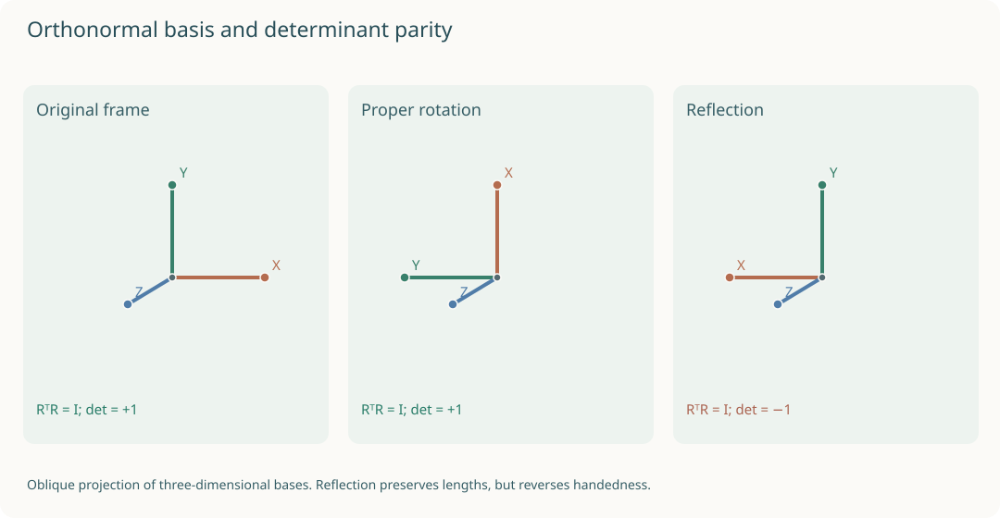
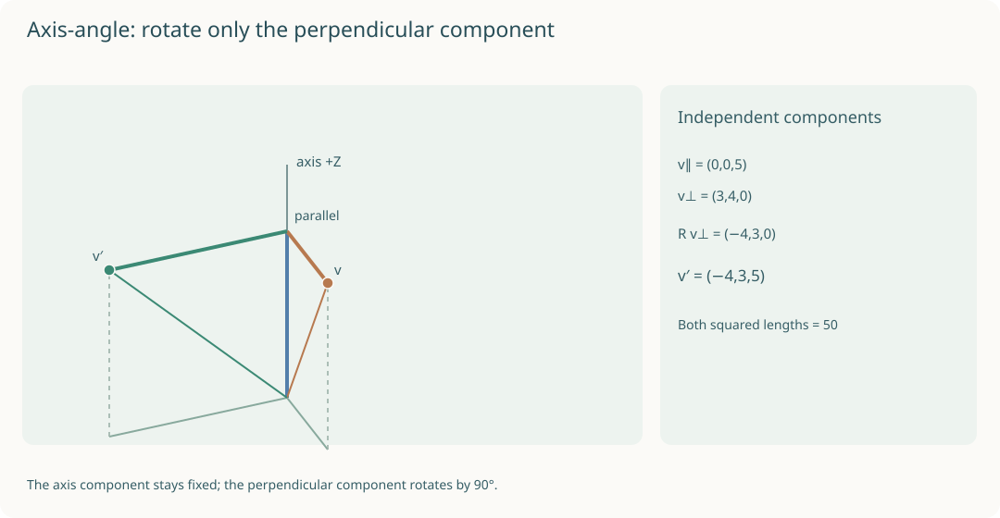
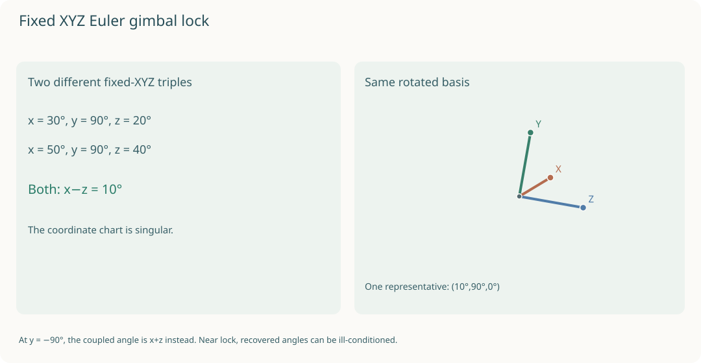
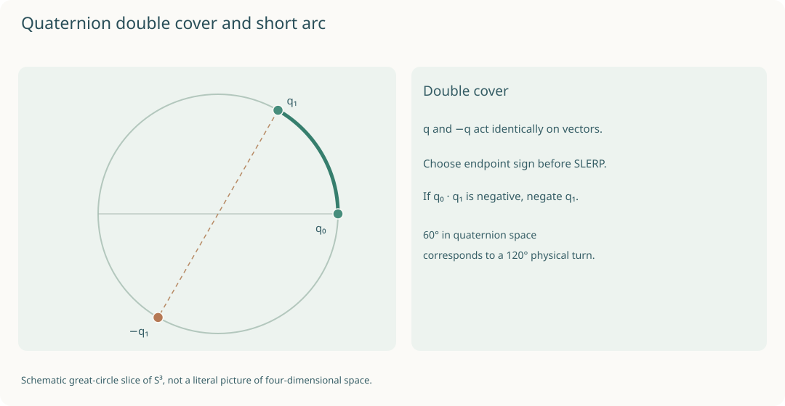
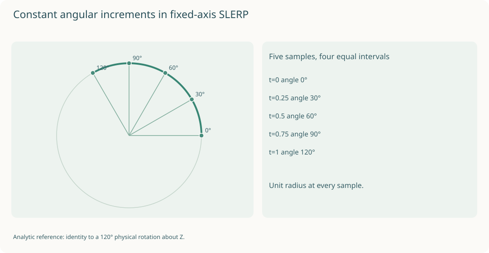

# Chapter 12 — Rotations Without Headaches

*From Geometry to Images — Part III: Worlds become camera views*  
*Reader edition / C++23 laboratory P12*

> Turning a toy is easy. Telling a computer exactly how it turned, without accidentally stretching it, is a surprisingly beautiful problem.

## The tree learns to dance

Our garden has five trees, but only one stored tree mesh. Each placement has its own local-to-world transform, and the entire group can move without us editing a single source vertex.

Now imagine a small wooden bird perched on the crown of one tree. It turns its head toward the house, tilts its wings, and follows a bright ball that rolls past the tower. The bird is made of rigid wood. Whatever direction it faces, the distance between its beak and tail should stay the same.

We could let a general three-by-three matrix change the bird's orientation. But Chapter 11's affine maps can also stretch, shear, and reflect. Those are useful operations when designing a tree, not when describing a rigid bird turning its head.

We want a smaller vocabulary: transformations that turn objects while preserving lengths, angles, and handedness.

This chapter is about learning to speak that vocabulary in several languages. Matrices describe where the basis arrows point. Axis-angle describes the single axis about which a turn occurs. Euler angles describe a sequence of three simpler turns. Quaternions give us a particularly convenient representation for composing and interpolating orientations.

These are not four unrelated kinds of motion. They are different descriptions of the same family of rigid rotations, with different strengths and failure modes.

## First, what does it mean to turn something?

Imagine drawing three arrows on a solid cube, one along each positive coordinate axis. The arrows begin perpendicular to each other, with equal unit length. As the cube turns, those arrows turn with it.

A proper three-dimensional rotation is a linear map \(R\) satisfying

\[
\boxed{R^TR=I,\qquad \det R=+1.}
\tag{12.1}
\]

The first equation says the columns of \(R\) are an orthonormal basis. The second says the orientation has not been reflected.

Why insist on both? Suppose two vectors \(u,v\) are transformed:

\[
(Ru)^T(Rv)=u^TR^TRv=u^Tv.
\tag{12.2}
\]

Their dot product stays the same. With \(u=v\), this proves that squared length is preserved. Since the dot product also determines the angle between nonzero vectors, angles are preserved too.

But reflection also preserves dot products. Consider \(\operatorname{diag}(-1,1,1)\). It has determinant \(-1\); it is an orthogonal transformation, not a proper rotation. A left glove becomes a right glove under reflection. No ordinary rigid turn of a left glove achieves that.

The set of proper three-dimensional rotations is called the **special orthogonal group**, \(SO(3)\). The word group refers to four familiar facts: composing two such maps gives another, there is an identity map, every member has an inverse, and composition is associative.

The inverse is especially simple:

\[
\boxed{R^{-1}=R^T.}
\tag{12.3}
\]

There is no need to invert a general affine matrix when we know the map is a proper rotation.

*Figure 12.1 — Orthogonality preserves the shape of a basis. Positive determinant distinguishes a proper rotation from reflection.*

### Why nine numbers represent only three degrees of freedom

A three-by-three matrix stores nine numbers. Its three columns must each have length one, giving three constraints, and the three distinct pairs of columns must be perpendicular, giving another three constraints. Locally, the six independent constraints leave three continuous degrees of freedom.

The determinant sign selects the proper component of the orthogonal matrices. It does not supply a fourth freely adjustable rotational parameter.

This distinction between storage size and degrees of freedom will recur with quaternions. Four stored scalars are not four independent rotation knobs.

A production engine may use a matrix, quaternion, or a specialized compressed representation depending on what is being stored or computed. The mathematical invariant matters more than the number of fields in the struct.

## Three simple turns

We choose right-handed active rotations, column vectors, and radians in the mathematical and C++ interfaces. Active means the object itself turns while the reference axes stay fixed. A passive basis change describes coordinates in a rotated reference frame and uses the inverse of the corresponding active rotation.

For a turn of angle \(\theta\) about the X axis,

\[
R_x(\theta)=
\begin{bmatrix}1&0&0\\0&\cos\theta&-\sin\theta\\0&\sin\theta&\cos\theta\end{bmatrix}.
\tag{12.4}
\]

About Y,

\[
R_y(\theta)=
\begin{bmatrix}\cos\theta&0&\sin\theta\\0&1&0\\-\sin\theta&0&\cos\theta\end{bmatrix}.
\tag{12.5}
\]

About Z,

\[
R_z(\theta)=
\begin{bmatrix}\cos\theta&-\sin\theta&0\\\sin\theta&\cos\theta&0\\0&0&1\end{bmatrix}.
\tag{12.6}
\]

For a positive quarter turn about Z, \((1,0,0)\) becomes \((0,1,0)\). A positive quarter turn about Y sends \((0,0,1)\) to \((1,0,0)\).

Try these with a pencil and your right hand: point your thumb along the positive axis, curl your fingers in the positive direction of rotation. This is a physical way to remember the sign convention.

The API does not know whether a number was intended as degrees. Passing 90 into a radians parameter does not represent a quarter turn. Our terminal playground accepts degrees for human convenience, then explicitly converts them to radians.

### Turning is not commutative

Start with \(v=(0,1,0)\).

Turn 90 degrees about X, then 90 degrees about Y. The first sends \(v\) to \(+Z\); the second sends \(+Z\) to \(+X\).

Reverse the order. The Y turn leaves \(+Y\) unchanged; the X turn sends it to \(+Z\).

Thus

\[
\boxed{R_y R_x v=(1,0,0),\quad R_x R_y v=(0,0,1).}
\tag{12.7}
\]

The order is part of the motion, not a storage convention. Associativity means \((AB)C=A(BC)\), not \(AB=BA\).

In the scene forest, rotating a child in its own local frame and rotating the entire parent group are different operations. If a parent world map is \(W\) and the child's local map is \(L\), inserting a new local rotation on the right of \(L\) changes how local geometry is oriented before the parent map acts. Inserting a rotation on the left of a world map instead rotates its output, including its translated origin unless the pivot is separately handled.

## Any axis, not just the coordinate axes

Imagine a pin passing diagonally through the wooden bird. The bird can turn about this pin even if it is not aligned with any of the three standard axes.

Let \(k\) be the unit direction of the pin and let \(\theta\) be a rotation angle. Decompose a vector \(v\) into the piece along the pin and the piece perpendicular to it:

\[
v_\parallel=(k^Tv)k,\qquad v_\perp=v-v_\parallel.
\tag{12.8}
\]

A rotation about \(k\) leaves \(v_\parallel\) unchanged. The perpendicular part turns in the plane normal to \(k\). Within that plane, \(k\times v_\perp\) is a perpendicular vector with the same length as \(v_\perp\).

Ordinary two-dimensional circular motion in that plane gives

\[
v'=v_\parallel+\cos\theta\,v_\perp+
\sin\theta(k\times v_\perp).
\tag{12.9}
\]

Substitute the decomposition and use \(k\times v_\parallel=0\):

\[
\boxed{v'=\cos\theta\,v+\sin\theta(k\times v)
+(1-\cos\theta)(k^Tv)k.}
\tag{12.10}
\]

This is **Rodrigues' rotation formula**. It follows from a planar turn and a fixed parallel component, not from a memorized matrix.

*Figure 12.2 — An axis-angle turn preserves the component along the axis and rotates the perpendicular component.*

As a numerical example, take \(k=(1,1,1)/\sqrt3\), \(\theta=120^\circ\), and \(v=(1,0,0)\). The three contributions are

\[
-\tfrac12(1,0,0),\quad (0,\tfrac12,-\tfrac12),\quad
(\tfrac12,\tfrac12,\tfrac12).
\]

Their sum is \((0,1,0)\). The diagonal axis cycles the three coordinate basis directions under this particular angle.

The C++ function `rodrigues` evaluates this formula independently of the quaternion implementation. That gives us a useful numerical crosscheck.

### What happens at zero and at half a turn?

A zero-angle rotation is the identity, regardless of the chosen nonzero axis. The axis cannot be recovered uniquely from the identity orientation.

At a half turn, reversing the axis describes the same orientation. More generally, periodic angles and changes in axis sign lead to multiple equivalent descriptions.

So axis-angle is an excellent way to specify a single turn but not a globally unique coordinate chart for all orientations. A zero vector cannot supply a direction; our axis-angle constructor rejects it even when the requested angle is zero. Identity has its own default constructor instead.

One more useful relationship: write the skew-symmetric cross-product matrix \(K\) so that \(Kv=k\times v\):

\[
K=\begin{bmatrix}0&-k_z&k_y\\k_z&0&-k_x\\-k_y&k_x&0\end{bmatrix}.
\tag{12.11}
\]

For unit \(k\), the vector triple-product identity gives \(K^2=kk^T-I\). Substitution in Rodrigues gives

\[
\boxed{R=I+\sin\theta K+(1-\cos\theta)K^2.}
\tag{12.12}
\]

This also equals the matrix exponential \(\exp(\theta K)\), as can be seen by grouping even and odd powers using \(K^3=-K\). This is an introductory glimpse of the relationship between rotation matrices and their skew-symmetric tangent algebra, \(\mathfrak{so}(3)\). Later camera estimation and optimization work can build local incremental updates using that relationship. It is not a license to add finite rotation matrices together and call the sum a rotation.

## Three angle knobs and a surprising loss of freedom

An editor often gives us three angle fields called pitch, yaw, and roll. Those words are not enough to define a unique rotation formula. Which axis is which? Are the turns around fixed world axes or around the object's moving axes? Which turn is performed first?

Our implementation names a precise choice: **fixed XYZ**, an extrinsic sequence about fixed X, then fixed Y, then fixed Z.

For the input triple \((x,y,z)\),

\[
\boxed{R=R_z(z)R_y(y)R_x(x).}
\tag{12.13}
\]

An intrinsic sequence about moving axes in the reverse order can describe the same product, but we do not mix the two descriptions in the API.

Multiplying the three matrices gives, with \(c_x=\cos x,s_x=\sin x\) and analogous notation,

\[
R=\begin{bmatrix}
c_zc_y&c_zs_ys_x-s_zc_x&c_zs_yc_x+s_zs_x\\
s_zc_y&s_zs_ys_x+c_zc_x&s_zs_yc_x-c_zs_x\\
-s_y&c_ys_x&c_yc_x
\end{bmatrix}.
\tag{12.14}
\]

This matrix also explains how to recover one principal Euler triple. When \(\cos y\) is positive and not close to zero,

\[
y=\operatorname{atan2}(-R_{31},\sqrt{R_{11}^2+R_{21}^2}),
\quad x=\operatorname{atan2}(R_{32},R_{33}),
\quad z=\operatorname{atan2}(R_{21},R_{11}).
\tag{12.15}
\]

Here matrix subscripts are one-based. The principal choice restricts the middle angle to \([-\pi/2,\pi/2]\).

But there is a problem at \(y=\pi/2\). The first column becomes \((0,0,-1)^T\), and the remaining entries depend on \(x-z\), rather than on both angles independently.

At \(y=-\pi/2\), they depend on \(x+z\).

Thus at a positive 90-degree middle rotation, adding the same angle to both \(x\) and \(z\) can leave the orientation unchanged. Two nominally different knobs have become coupled. This is **gimbal lock**.

*Figure 12.3 — At a positive 90-degree middle angle, the orientation depends on the difference of the first and last angles. A singular chart does not mean the object has lost a physical rotational degree of freedom.*

This is not the bird becoming physically incapable of turning. It is the chosen three-angle representation becoming singular. A mechanical gimbal with aligned axes can exhibit an analogous physical limitation; here we are primarily discussing the coordinate singularity.

Near the singularity, small numerical perturbations in the matrix can cause large changes in the recovered angles. Our extraction routine returns one principal representative. At or near the lock, it sets the Z angle to zero, solves for the remaining coupled angle, and reports a diagnostic flag. Near rather than exactly at the lock, this representative is an approximation. The authoritative orientation remains the quaternion.

Euler angles remain useful as authoring controls. The mistake is expecting a globally smooth, unique set of three angle coordinates for every possible rotation.

## Quaternions: four numbers with a rule for multiplying them

A quaternion is written

\[
q=w+xi+yj+zk.
\tag{12.16}
\]

The basis symbols satisfy

\[
i^2=j^2=k^2=ijk=-1,
\]

with \(ij=k\), \(jk=i\), \(ki=j\), and reversing these products changes the sign.

This is a number system with a particular multiplication law, not just a vector of four arbitrary values. Group the three imaginary components into a vector \(u\), so \(q=(w,u)\).

For \(p=(a,u)\) and \(q=(b,v)\), the Hamilton product is

\[
\boxed{pq=(ab-u^Tv,\;av+bu+u\times v).}
\tag{12.17}
\]

The cross product explains why the multiplication order matters. The scalar part contains a dot product; the vector part contains the two scalar-vector combinations plus an oriented cross product.

The conjugate of \(q\) is

\[
q^*=(w,-u),
\]

and

\[
qq^*=(w^2+u^Tu,0).
\tag{12.18}
\]

A unit quaternion has norm one. Its inverse is therefore its conjugate.

To rotate an ordinary three-dimensional vector, treat it as a pure quaternion \(P=(0,v)\), then compute

\[
\boxed{P'=qPq^*.}
\tag{12.19}
\]

The scalar part of this result is zero in exact arithmetic. Its vector part is the rotated vector.

### Why half the angle?

Choose

\[
\boxed{q=\left(\cos\frac\theta2,\ k\sin\frac\theta2\right)}
\tag{12.20}
\]

for a unit axis \(k\). Expanding equation (12.19) with the Hamilton product gives

\[
v'=(w^2-u^Tu)v+2u(u^Tv)+2w(u\times v).
\tag{12.21}
\]

Now substitute \(w=\cos(\theta/2)\), \(u=k\sin(\theta/2)\). Use the double-angle identities:

\[
w^2-u^Tu=\cos\theta,\qquad
2w\sin(\theta/2)=\sin\theta,
\]

and \(2\sin^2(\theta/2)=1-\cos\theta\).

The result is exactly Rodrigues' formula.

That is where the half-angle comes from. The quaternion acts through a product on both sides of the vector, and the algebra produces the full-angle rotation.

Our implementation uses the equivalent vector expression

\[
t=2(u\times v),\qquad v'=v+wt+u\times t.
\tag{12.22}
\]

It avoids building two temporary pure quaternions while expressing the same mathematical operation.

For a 90-degree rotation about Z, the quaternion is

\[
q=(\sqrt{1/2},0,0,\sqrt{1/2}).
\]

Apply it to \(+X\) and the result is \(+Y\), just as the rotation matrix predicts.

### A quaternion and its negative describe the same turn

Substitute \(-q\) into the rotation expression:

\[
(-q)P(-q)^*=qPq^*.
\tag{12.23}
\]

Both minus signs cancel. Consequently \(q\) and \(-q\) encode the same orientation.

The unit quaternions live on the unit three-sphere \(S^3\) in four-dimensional space. Each orientation in \(SO(3)\) has two antipodal unit-quaternion representatives. This is called a double cover.

*Figure 12.4 — The drawing is a two-dimensional schematic slice of the unit-quaternion sphere, not a literal depiction of four-dimensional space.*

A full 360-degree turn in physical orientation can trace a continuous quaternion path from \(q\) to \(-q\). The orientation is the same at the two endpoints, but the four component values are not. A second full turn returns to the original quaternion representative.

This matters when comparing rotations. Component equality is not the right general orientation equality test. We can compare their action on basis vectors, or use the absolute dot product of normalized quaternions.

It also matters when interpolating a sequence of orientations.

### How to compose two quaternion rotations

Let \(p\) and \(q\) be unit quaternions. Applying \(q\) to a vector first and then \(p\) gives

\[
p(qPq^*)p^*=(pq)P(pq)^*.
\tag{12.24}
\]

Therefore the product \(pq\) describes the same order as the matrix product \(R_pR_q\): the rightmost rotation acts first.

Our `Rotation3` class follows this convention. Its public component order is `w,x,y,z`. Some file formats and APIs store `x,y,z,w`. That is a serialization choice, not a reason to change the Hamilton multiplication law. An importer must perform an explicit conversion at the boundary.

The class keeps its normalized quaternion private, accepts finite nonzero raw components through a factory, and normalizes composition results. It uses scale-first normalization to avoid ordinary length overflow or underflow for very large or small components.

Floating arithmetic cannot make the unit invariant exact at every operation. Renormalization reduces drift, but does not repair a wrong convention, an incorrect axis, or accumulated error in the original input angles. Very large angles also lose precision in binary64 representation and argument reduction. Our numerical experiments use bounded ordinary angles.

## From one pose to another without a sudden jump

Suppose the wooden bird faces east at the beginning of a second and turns 120 degrees about the Z axis by the end. We want it to move smoothly in between.

One naive method is to linearly interpolate the rotation matrix entries. At the halfway point between identity and a 180-degree Z rotation, the average of the two matrices is

\[
\operatorname{diag}(0,0,1).
\tag{12.25}
\]

That collapses the entire XY plane. The bird briefly becomes a line instead of remaining rigid.

Quaternion interpolation gives us a better route.

Let \(q_0,q_1\) be unit quaternions. Their dot product is \(d\). Because opposite quaternion representatives describe the same orientation, if \(d<0\), negate \(q_1\). Then the dot product is nonnegative, and the selected quaternion endpoints are at most a quarter great circle apart.

Let \(\alpha=\arccos d\) be their angle on the unit-quaternion sphere. Write the second endpoint as

\[
q_1=\cos\alpha\,q_0+\sin\alpha\,e,
\tag{12.26}
\]

where \(e\) is a unit vector in their span perpendicular to \(q_0\). A constant-angular-speed path on the great circle is

\[
q(t)=\cos(t\alpha)q_0+\sin(t\alpha)e,\quad 0\le t\le1.
\tag{12.27}
\]

Solve equation (12.26) for \(e\) and substitute. The resulting **spherical linear interpolation**, or SLERP, is

\[
\boxed{
q(t)=\frac{\sin((1-t)\alpha)}{\sin\alpha}q_0+
\frac{\sin(t\alpha)}{\sin\alpha}q_1.
}
\tag{12.28}
\]

The physical orientation displacement along this path is twice the quaternion angle. For identity to a 120-degree rotation about Z, the quaternion angle is 60 degrees. At \(t=1/2\), the object has turned 60 physical degrees.

*Figure 12.5 — SLERP uses equal angular increments in this fixed-axis witness. A linearly interpolated matrix would not preserve the same radius.*

For our witness, the rotated \(+X\) vector at \(t=0,1/4,1/2,3/4,1\) is

| t | Physical angle | Rotated X basis |
|---:|---:|---|
| 0 | 0° | (1,0,0) |
| 0.25 | 30° | (√3/2,1/2,0) |
| 0.5 | 60° | (1/2,√3/2,0) |
| 0.75 | 90° | (0,1,0) |
| 1 | 120° | (-1/2,√3/2,0) |

### The small-angle case and the antipodal case

When the selected endpoints are nearly identical, \(\sin\alpha\) is small. The SLERP weights can become numerically awkward. A common practical solution is normalized linear interpolation, abbreviated NLERP:

\[
\boxed{q(t)=\frac{(1-t)q_0+tq_1}{\|(1-t)q_0+tq_1\|}.}
\tag{12.29}
\]

Our code uses NLERP for a dot product larger than 0.9995. This is a numerical implementation choice, not an assertion that NLERP is precisely constant-speed SLERP.

If the original endpoints are \(q\) and \(-q\), the sign correction makes them identical before interpolation. Without that correction, their midpoint under ordinary linear interpolation would be the zero quaternion, which has no normalized orientation.

A shortest-arc interpolation between endpoint orientations also cannot infer an intended extra full turn. Identity and a 360-degree turn describe the same endpoint orientation. If the artist wants the bird to spin twice, we need motion information beyond those two poses, such as intermediate keys or a specified angular trajectory.

At a physical relative angle of exactly 180 degrees, there are two equally short choices around opposite axes. The sign choice does not provide a globally continuous selection through every such boundary. This is an important limitation in animation and optimization.

## Rigid poses: turn and move without stretching

The bird not only turns but also moves from tree to tree. A rigid pose includes a proper rotation \(R\) and translation \(t\):

\[
\boxed{p^W=Rp^L+t.}
\tag{12.30}
\]

The collection of these rigid transformations forms the **special Euclidean group**, \(SE(3)\). Its elements have six continuous degrees of freedom: three for rotation and three for translation.

Two poses compose as

\[
\boxed{(R_a,t_a)(R_b,t_b)=(R_aR_b,\;R_at_b+t_a).}
\tag{12.31}
\]

The inverse is

\[
\boxed{(R,t)^{-1}=(R^T,-R^Tt).}
\tag{12.32}
\]

This is the same affine composition we already derived, with the stronger constraint that the linear part is a proper rotation.

For example, let pose B translate by \((2,0,0)\), and pose A rotate 90 degrees about Z and translate by \((3,0,0)\). A point \((1,0,0)\) becomes \((3,0,0)\) after B, then \((0,3,0)\) after A's rotation, and finally \((3,3,0)\).

The inverse returns it to \((1,0,0)\).

A rigid camera pose is especially useful. If the pose describes camera-local coordinates in world coordinates, then its inverse maps world positions into camera coordinates. This is the beginning of our view transform, which we will use in Chapter 13.

### Interpolating rigid poses is a separate choice

Our first pose interpolation linearly interpolates translations and uses shortest-arc quaternion interpolation for orientation. That keeps every individual pose rigid.

It is not the same as an exponential interpolation in \(SE(3)\), a screw motion, or a physically planned trajectory. A rigid body following a joint, a rotating camera moving around an orbit, and a free camera following a straight path can have different desired motion policies.

We will not hide this choice behind a generic word like “smooth.” Our code names its simple policy explicitly.

## The orientation debugger

The native project adds `include/book03/rotation3.hpp`, `tests/rotation3_tests.cpp`, and `src/rotation_studio.cpp`. It reuses the scene forest's `Linear3` and `SceneAffine` types without making an arbitrary affine map masquerade as a rigid orientation.

The central type is `Rotation3`, with the factories `normalized`, `axis_angle`, and `fixed_xyz`. It exposes composition, inverse, vector application, rotation matrix construction and shortest-arc SLERP.

A separate `rodrigues` function supplies an independent formula. The `principal_fixed_xyz` function extracts a principal angle representative and reports near-lock. `RigidPose` adds translations and converts explicitly to the previous affine type.

The terminal commands are:

~~~text
book03_rotation inspect
book03_rotation svg orientations.svg
book03_rotation csv orientations.csv
book03_rotation repl
~~~

The default interpolation is identity to a 120-degree rotation around Z. The CSV contains 61 actual samples of quaternion components, the rotated X basis tip, and determinant. The SVG draws five actual rotated basis frames through a documented oblique projection. Neither output pretends to be a perspective rendering or a performance benchmark.

Inside the interactive debugger:

~~~text
axis 0 0 1 120
sample 0.5
csv arc.csv
svg frames.svg
euler 30 90 20
inspect
start
axis 1 1 1 120
sample 0.5
quit
~~~

The middle-angle witness reports near-lock. The `start` command copies the current endpoint orientation into the start orientation, so subsequent edits establish a new interpolation interval. All values in this REPL are actual parameters to the reference rotation implementation.

## Tests that make the bird prove it is rigid

The independent tests begin with quarter turns about each axis, a noncommuting pair, and the 120-degree diagonal-axis cycle. They compare a quaternion with its negative and normalize large and tiny finite component tuples. Invalid zero and nonfinite quaternion data must be rejected.

The interpolation suite uses an analytic fixed-axis witness at thirteen evenly spaced parameters. It checks that interpolating between opposite representatives does not introduce a rotation, and that interpolation from identity to 270 degrees about Z chooses the shorter negative 90-degree path. A near-coincident case checks the NLERP branch.

Both signs of the Euler lock are tested, including distinct angle triples that produce the same orientation. The pose tests check composition, inverse and conversion into the affine representation.

Finally, 3,000 deterministic pseudo-random cases compare quaternion rotation against Rodrigues, test vector lengths and dot products, determinant one, transpose-as-inverse, quaternion round trips and Euler reconstruction. A separate sequence of 10,000 small rotations compares the accumulated orientation against a single equivalent turn about the same axis. The PRNG bit-to-real mapping is explicit so that we do not silently depend on a library's floating distribution algorithm.

Those are authored numerical acceptance checks, not a claim that all native platforms have already passed. Their tolerance is a bounded-domain engineering choice rather than a theorem of bitwise agreement on every compiler.

## Your turn: make a turn without a stretch

**Reconstruct — a unit basis.** Show that \(R^TR=I\) preserves both the length of a vector and the dot product of a pair. Explain why determinant -1 must be excluded from \(SO(3)\).

**Falsify — order.** Apply X then Y quarter turns to \(+Y\), reverse the order, and explain the different answers.

**Reconstruct — Rodrigues.** Decompose \((3,4,5)\) into parallel and perpendicular parts relative to \(+Z\), then rotate 90 degrees. Check the original length.

**Transfer — axis singularities.** Why can an identity orientation have any axis? Why is a zero axis still an invalid direction argument?

**Falsify — Euler lock.** Compare the fixed-XYZ triples (30°,90°,20°) and (50°,90°,40°). Use equation (12.14) to explain their equality as orientations.

**Implement — quaternion product.** Multiply the pure quaternions \(i\) and \(j\) in both orders. Explain why a raw four-component vector multiplication cannot replace the Hamilton product.

**Reconstruct — half-angle.** Construct the quaternion for 90 degrees about Z, rotate \(+X\), and compare to the matrix result.

**Falsify — bad interpolation.** Average the identity and a half-turn rotation matrix. Show which axes vanish. Explain how a quaternion interpolation avoids the collapse.

**Transfer — shortest arc.** Interpolate identity to a 270-degree Z rotation. What is the halfway orientation on the short arc? What extra information is necessary if the artist intended the long arc?

**Implement — rigid camera pose.** A camera has pose \((R,t)\). Derive its world-to-camera map. Why is negating \(t\) alone not generally correct?

**Explain — orientation equality.** A tool prints two quaternions with opposite signs. How can they describe exactly the same rotation? What is a suitable numerical comparison?

**Challenge — repeated updates.** Run the seeded test suite once compiled. Then modify the repeated-rotation experiment to alternate different axes. Why can you no longer compare the result to one axis times the sum of angles?

### Selected answers

Rodrigues about \(+Z\) leaves \((0,0,5)\) unchanged and turns \((3,4,0)\) to \((-4,3,0)\). The result \((-4,3,5)\) has squared length 50, the same as the original.

At positive Euler lock the first and last angles appear as their difference. Both triples have difference 10 degrees and describe the same orientation.

The Hamilton product \(ij=k\), but \(ji=-k\). The 90-degree Z quaternion is \((\sqrt{1/2},0,0,\sqrt{1/2})\), and sends \(+X\) to \(+Y\).

The matrix average with a half turn collapses XY. The short-arc halfway orientation toward 270 degrees about Z is negative 45 degrees, with rotated X basis \((\sqrt{1/2},-\sqrt{1/2},0)\).

The rigid world-to-camera map is \(p^C=R^T(p^W-t)\). Opposite unit quaternion representatives can be compared via their action on three basis vectors or the absolute unit-quaternion dot product, allowing for numerical tolerance.

## The bird looks toward the camera

We now have a representation that understands the difference between a general affine transformation and a rotation. We can compose orientations, handle reflections separately, interpolate a proper rigid pose and diagnose the coordinates that become singular.

But we have not yet explained how a camera takes a point in its own frame and produces a position in an image.

Our next chapter is **Chapter 13 — The Tiny Hole That Makes a Picture**. We will place a tiny imaginary opening in front of a sensor, follow rays of light through it, derive perspective from similar triangles, and build a native pinhole-camera simulator.

The bird has learned to turn. Now the world will learn to appear on a page.

## Source custody

The existing legacy chapter `41 - Per-Vertex and Per-Corner Mesh Attributes.md` contains the animation and quaternion interpolation discussion; `37 - Camera Contracts and Transform-Chain Debugging.md` develops explicit pose and view contracts. Their inspected source identities and outstanding specialized material are recorded in `PASS12_LEGACY_AUDIT.md`. The new chapter is additive, not a replacement for those extensive original notes. Native compilation and full-volume publication are separate acceptance gates.
