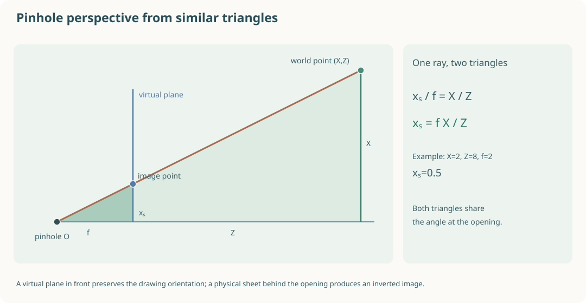
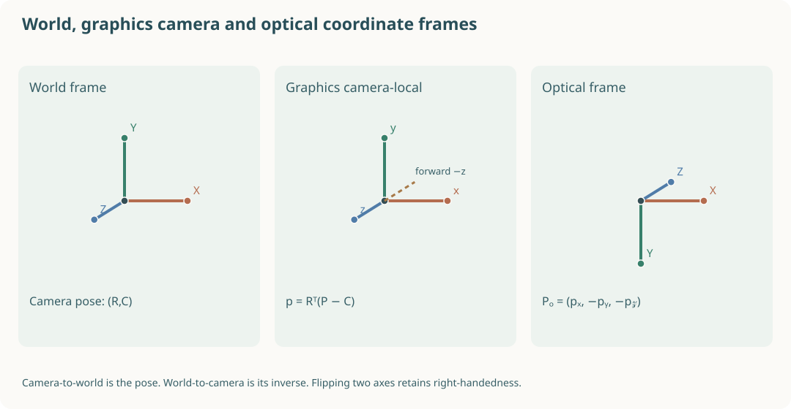
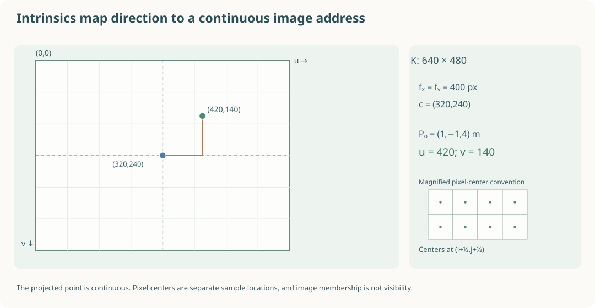
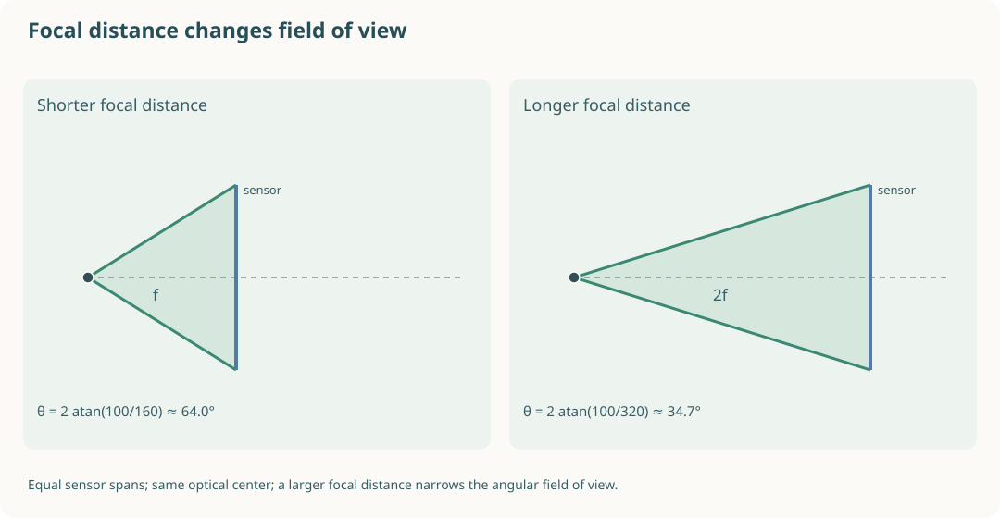
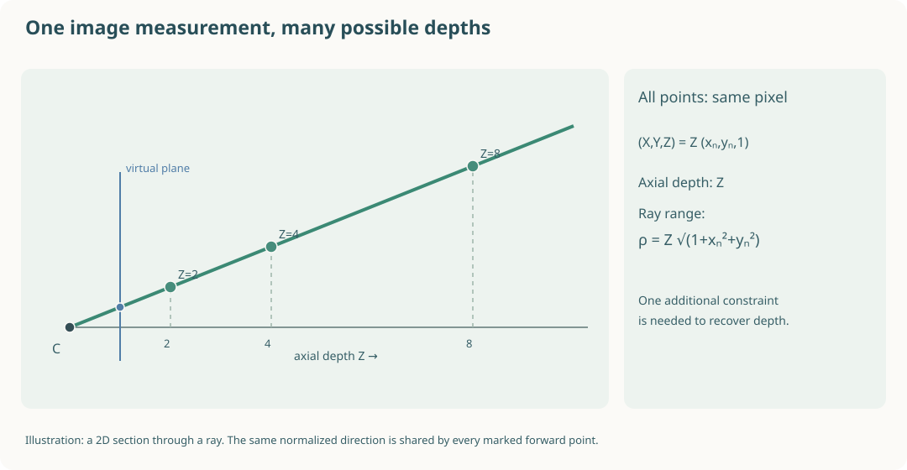

# Chapter 13 — The Tiny Hole That Makes a Picture

*From Geometry to Images — Part III: Worlds become camera views*  
*Reader edition / C++23 laboratory P13*

> A camera does not know how big a tree is. It knows which directions light arrived from.

## The garden disappears into a shoebox

The wooden bird can finally turn without stretching its wings. The trees have local frames, the dragon has a trustworthy set of indexed positions, and our little house has a place in the world.

But we still have no photograph.

Imagine a dark cardboard box. Make a tiny opening in one wall, and place a translucent sheet on the opposite wall. Outside the box stands the house. Light from the top of its roof travels through the opening and reaches the lower part of the sheet. Light from the ground travels through the same opening and reaches the upper part. An inverted picture appears.

The opening is remarkable because it does not need to know what a roof is. It does not recognize a tree or count triangles. It simply restricts which light paths reach a particular location on the sheet.

Our ideal mathematical camera uses an opening with zero spatial extent: a **pinhole**. A real pinhole cannot be infinitely small and still transmit a useful quantity of light; a real lens has an aperture, diffraction, aberrations, exposure and focus. We postpone those effects because we first want to understand the geometry of the central ray.

This chapter will build that geometry, put it in a coordinate system, turn it into pixel addresses, and use it backward to construct viewing rays.

By the end, we will know why a faraway house looks smaller, why a camera's position is not its view translation, and why a photograph alone cannot tell us the distance of every object in the scene.

## The two triangles hiding in a photograph

Look at a two-dimensional slice through the pinhole. Let the opening be the origin. A point stands at horizontal displacement \(X\) and positive forward distance \(Z\). Put an imaginary image plane at distance \(f>0\) **in front** of the opening, toward the world.

Why in front? The physical sheet in the shoebox is behind the opening, which produces an inverted image. A virtual image plane in front is a convenient mathematical construction that keeps the coordinate directions intuitive. It intersects the same straight line; we have changed the drawing convention, not the direction from which light arrives.

The ray through the opening and the world point has the parametrization

\[
r(\lambda)=\lambda(X,Z).
\tag{13.1}
\]

At the image plane, its forward coordinate equals \(f\). Therefore \(\lambda Z=f\), or \(\lambda=f/Z\). Its horizontal coordinate at that intersection is

\[
\boxed{x_s=f\frac{X}{Z}.}
\tag{13.2}
\]

The same relation follows by similar triangles: the ratio of horizontal displacement to forward distance must agree for both triangles.

*Figure 13.1 — The virtual image point is a scaled copy of the direction toward the world point. The scale factor is f/Z.*

The extension to three dimensions is immediate. For an optical-frame point \(P=(X,Y,Z)\),

\[
x_s=fX/Z,\qquad y_s=fY/Z.
\tag{13.3}
\]

This is the central operation in perspective projection: division by forward axial depth.

### A house that appears to shrink

Suppose a two-metre-wide wall is perpendicular to the viewing axis. Its endpoints lie at \(X=-1\) and \(X=+1\), both at depth \(Z=4\) metres. Their projected width is

\[
w_s=f(1-(-1))/4=f/2.
\tag{13.4}
\]

Move the same wall to eight metres, preserving its orientation. Its width becomes \(f/4\), half the previous width.

The wall has not physically shrunk. The angle it subtends has changed. Perspective records directions rather than distances independently.

This calculation only uses a common depth for the two endpoints. If a wall is tilted, its ends have different depths and we cannot simply divide its entire width by one Z value. Project the individual points and use the resulting image geometry.

An orthographic camera would instead use a constant scale independent of Z. That is useful for engineering drawings or deliberately stylized games, but does not reproduce the pinhole's depth-dependent apparent size.

### Depth zero is not an ordinary coordinate

When \(Z=0\), the expression \(X/Z\) is undefined. A point in the plane of the pinhole does not produce an ordinary finite forward projection unless one tries to assign a special limiting direction. The optical center itself does not define any unique viewing direction.

When \(Z<0\), a purely algebraic division can still return two finite numbers. But those numbers describe a point behind the forward-looking camera, not a normal forward-visible sample.

Our C++23 camera explicitly rejects points with nonpositive optical Z. We do not make them appear on the screen merely because division produces a number.

Very small positive depth is a different problem. It can produce an enormous image coordinate or overflow the finite representation. A full renderer needs a near clipping plane and triangle clipping. This chapter does not hide that work inside a magic small epsilon: it treats forward projection and later clipping as separate contracts.

## Three frames, not one pile of signs

Chapter 12 gave us a rigid pose. We now use it to describe a camera in the garden.

We distinguish three coordinate frames:

- World coordinates: the garden's shared right-handed reference frame, with +Y up.
- Graphics camera-local coordinates: +X right, +Y up, local −Z forward.
- Optical coordinates: +X right, +Y down, +Z forward.

The last convention is particularly convenient for image measurements because ordinary raster rows increase downward. Both three-dimensional frames are right-handed: flipping Y and Z together changes two axis signs, and the resulting determinant is +1.

Let \(C\) be the camera center in world coordinates, and let \(R\) be its proper rotation **from camera-local to world**. For a local point \(p\),

\[
P_W=Rp+C.
\tag{13.5}
\]

The camera pose places the camera in the world. To express a world point in the camera's local frame, invert the pose:

\[
\boxed{p=R^T(P_W-C).}
\tag{13.6}
\]

The inverse uses the transpose because R is a proper rotation.

Subtracting the center is necessary. Rotating a world coordinate without first accounting for the center does not describe the direction from the camera to the point.

The graphics-to-optical conversion is

\[
D=\operatorname{diag}(1,-1,-1),\qquad
P_O=Dp.
\tag{13.7}
\]

Thus

\[
\boxed{P_O=DR^T(P_W-C).}
\tag{13.8}
\]

For the identity camera pose, a world point \((1,1,-4)\) is in front of the camera, above and to the right. Its optical coordinates are \((1,-1,4)\).

The minus optical Y is not a contradiction. The point is above the camera's optical axis, so it should eventually have an image row coordinate smaller than the principal point's row.

*Figure 13.2 — The camera pose is camera-to-world. The view uses its inverse; the optical convention then flips local Y and Z.*

### The camera center is not the extrinsic translation vector

Write equation (13.8) in the conventional extrinsic form

\[
P_O=R_E P_W+t_E,
\quad R_E=DR^T,\quad t_E=-R_E C.
\tag{13.9}
\]

The extrinsic translation is not generally equal to the negative world position. It is the negative camera center expressed through the extrinsic rotation.

The camera center can be recovered as

\[
C=-R_E^Tt_E.
\tag{13.10}
\]

This is a useful diagnostic. If an imported calibration says it contains a world-to-camera matrix, do not insert its translation directly as the position of a camera entity.

For a concrete case, place the camera at \((3,2,1)\) and rotate its graphics frame by +90 degrees about Y. Its local forward direction, −Z, now points along world −X.

Take a world point \((-1,0,0)\). Subtract the center to get \((-4,-2,-1)\). The inverse rotation expresses that displacement as local \((1,-2,-4)\). The optical conversion gives \((1,2,4)\).

The program's independent pose test uses these exact coordinates. The camera-to-world convention is not just a comment attached to an arbitrary matrix; it produces a falsifiable result.

### Subtract the camera center before rotating

In real arithmetic, \(R^T(P-C)\) equals \(R^TP-R^TC\). In finite arithmetic these expressions may differ.

A world can contain large positions even when the displacement from camera to object is small. Computing the two large rotated positions independently and then subtracting can destroy local detail through cancellation. Our projection code evaluates the center-relative displacement first.

That does not recover details that were already rounded out of the stored coordinates, and it does not make every extreme finite input representable. Large-world engines may need local origins, higher precision, or other explicit numerical policies. The important habit is to choose a computational expression suited to the geometric quantity we actually need.

## From a metric sensor to image coordinates

So far \(f\) has been a distance in the same units as the image plane coordinates. Actual cameras often report a focal length in millimetres. Our image arrays have pixels.

Suppose the sensor has physical width \(S_x\) and contains \(W\) uniformly spaced pixel columns. Its horizontal pixel pitch is \(S_x/W\). A focal length of \(f_m\) in the same physical length units therefore corresponds to

\[
\boxed{f_x=f_m W/S_x.}
\tag{13.11}
\]

Similarly \(f_y=f_m H/S_y\) for physical sensor height \(S_y\) and H rows. The result has units of pixels.

For example, a 50-mm focal length and a 36-mm-wide sensor with 6,000 columns gives \(f_x=8333.\overline3\) pixels. This is a mathematical conversion, not a claim that a real lens has been perfectly calibrated. Actual calibration estimates effective intrinsics under an imaging model.

The principal point \((c_x,c_y)\) is where the optical axis intersects the image plane in image coordinates. It is often near the image center, but need not be exactly there.

With zero skew, the ideal calibrated projection is

\[
\boxed{u=f_x X/Z+c_x,\qquad v=f_y Y/Z+c_y.}
\tag{13.12}
\]

We also permit a skew parameter \(s\), expressed in pixel units:

\[
\boxed{
u=f_xX/Z+sY/Z+c_x,\qquad
v=f_yY/Z+c_y.
}
\tag{13.13}
\]

Skew couples normalized optical Y into the image's horizontal coordinate. For a typical modern rectilinear digital camera we commonly use zero skew, but retaining the term makes the algebra and calibration contract explicit.

Intrinsics describe the conversion from optical directions to image coordinates. Extrinsics describe the camera's placement relative to the world. They answer different questions.

A camera can rotate without changing its focal lengths. A camera can zoom without changing its world center. A calibration problem may estimate both, but that does not make them the same parameters.

## One matrix for the direction-to-image relationship

Collect the intrinsic parameters into

\[
\boxed{
K=\begin{bmatrix}
f_x&s&c_x\\
0&f_y&c_y\\
0&0&1
\end{bmatrix}.
}
\tag{13.14}
\]

Then

\[
KP_O=
\begin{bmatrix}
f_xX+sY+c_xZ\\f_yY+c_yZ\\Z
\end{bmatrix}
=Z\begin{bmatrix}u\\v\\1\end{bmatrix}.
\tag{13.15}
\]

The homogeneous vector contains a scale factor. We still need to divide by its third coordinate.

Combine this with the extrinsic transformation:

\[
\boxed{
Z\begin{bmatrix}u\\v\\1\end{bmatrix}
=
K\begin{bmatrix}R_E&t_E\end{bmatrix}
\begin{bmatrix}P_W\\1\end{bmatrix}.
}
\tag{13.16}
\]

The three-by-four product is a calibrated projective camera matrix. It maps a homogeneous world point into a homogeneous image point.

It is not yet the four-by-four GPU projection matrix. It does not encode the graphics API's clip-space depth interval, near/far mappings, or perspective division of a four-component clip position. We will derive that other matrix in Chapter 14.

Here is a hand-checkable example. Take a 640-by-480 image, \(f_x=f_y=400\), \(c_x=320,c_y=240,s=0\). For the identity graphics camera and world point \((1,1,-4)\), the optical point is \((1,-1,4)\).

Equation (13.12) gives

\[
u=400/4+320=420,\qquad v=-400/4+240=140.
\tag{13.17}
\]

The point appears 100 pixels to the right and 100 pixels above the principal point.

Now double all three optical coordinates. The ratios X/Z and Y/Z remain unchanged; the image point remains \((420,140)\). But its axial depth doubles.

*Figure 13.3 — Intrinsics convert normalized direction into a continuous pixel-space address. The example is above and right of the principal point.*

## The image has coordinates before it has pixels

What exactly does the projected address \((420,140)\) mean?

A continuous image position is not automatically a valid integer pixel index. It might lie between sample centers, outside the image, or on an edge.

Our book adopts a continuous **top-left image-edge** convention. The image rectangle is \([0,W)\times[0,H)\). The integer pixel with column i and row j has its center at

\[
\boxed{(u,v)=(i+1/2,j+1/2).}
\tag{13.18}
\]

A 640-by-480 image spans from its left edge at zero to its right edge at 640; its last column center is at 639.5.

This convention agrees with our earlier geometric discussion of pixel sample positions. It is a choice: some calibration systems use integer-centered coordinates. If a source calibration calls its first pixel center \((0,0)\), then its coordinates must be shifted by \((0.5,0.5)\) to match our edge convention, including its principal point. The focal lengths do not change under that translation.

The image membership test in our pinhole camera is a half-open rectangle test. A projected point at u=0 belongs to the rectangle; a point at u=W does not. Being inside the rectangle does **not** prove that a particular pixel sample is covered, or that the object is visible through other geometry.

Our camera simulator intentionally returns a continuous address and an inside flag rather than silently rounding to an integer.

## What happens when we change focal length?

The camera is pointed at the house, but we want to see more of the garden.

With a centered, zero-skew intrinsic model, its vertical field of view is the angular span between the top and bottom image-edge rays. The half-height of the image is \(H/2\), measured in pixels, and the effective focal length is \(f_y\).

A right triangle gives

\[
\boxed{\theta_v=2\arctan\left(\frac{H}{2f_y}\right).}
\tag{13.19}
\]

The horizontal formula is

\[
\boxed{\theta_h=2\arctan\left(\frac{W}{2f_x}\right).}
\tag{13.20}
\]

The inverse relationship is

\[
f_y=\frac{H}{2\tan(\theta_v/2)}.
\tag{13.21}
\]

With square-pixel focal scales and a centered principal point, the horizontal and vertical angles are related by image aspect ratio:

\[
\tan(\theta_h/2)=\frac WH\tan(\theta_v/2).
\tag{13.22}
\]

Aspect ratio multiplies a tangent, not the angle itself.

In a 640-by-480 image with f=400 pixels, the vertical angle is approximately 61.93 degrees and the horizontal angle approximately 77.32 degrees. The wider image dimension sees a wider angular span.

A smaller focal length shows a wider field of view for a fixed sensor. A larger focal length shows a narrower field and projects the same optical direction farther from the principal point.

Moving the camera toward the subject is not the same as increasing focal length. Camera motion changes the viewpoint and relative depths of scene points; changing focal length changes their mapping into image coordinates. Their effects can look similar for a flat object at one depth but differ for a scene containing near and far objects.

*Figure 13.4 — Field of view depends on focal length relative to sensor dimensions. Camera position does not change in this comparison.*

### Off-center intrinsics need asymmetric angles

If the principal point is displaced, the left and right image-edge rays need not make equal angles with the optical axis.

In the zero-skew horizontal section through the principal point, the normalized left and right coordinates are

\[
x_L=-c_x/f_x,\qquad x_R=(W-c_x)/f_x.
\]

Their signed angles are \(\arctan x_L\) and \(\arctan x_R\); the span is the difference.

The same reasoning applies to a vertical section. With nonzero skew, the image rectangle's inverse mapping is a slanted region of normalized directions, so a single pair of symmetric FOV formulas does not fully describe the calibrated viewing cone. Compute the actual corner rays or the section of interest.

Our FOV constructor is deliberately named `centered_fov`: it creates equal focal scales, zero skew and a centered principal point. It does not pretend to represent every possible calibrated camera.

## Crop and resize without forgetting the calibration

Suppose we crop a photograph. The new image origin is shifted to the crop's top-left corner.

A crop starting at column a and row b changes continuous image coordinates according to

\[
u'=u-a,\qquad v'=v-b.
\tag{13.23}
\]

The focal scales and skew remain unchanged, while

\[
c_x'=c_x-a,\qquad c_y'=c_y-b.
\tag{13.24}
\]

No camera movement is implied by cropping.

If we then resize the cropped image by horizontal factor \(r_x\) and vertical factor \(r_y\), using the continuous edge-coordinate map,

\[
\boxed{
f_x'=r_xf_x,\ f_y'=r_yf_y,\ 
s'=r_xs,\ c_x'=r_xc_x,\ c_y'=r_yc_y.
}
\tag{13.25}
\]

This formula describes the geometric coordinate mapping. The exact reconstruction filter used by an image resampler is a separate sampling question.

An example: crop the original 640-by-480 image beginning at \((100,80)\), then resize by one half in each direction. The point \((420,140)\) becomes \((320,60)\) in the crop and \((160,30)\) after resizing. Its ray in the world should be the same as before.

A pipeline that rescales image data but leaves old intrinsics unchanged can produce systematic reprojection errors even if every matrix multiplication is correctly implemented.

## A pixel is an invitation to follow a ray

We have used a camera to turn a world point into an image measurement. What if the input is an image position and we want to know where in the world it came from?

Start with equation (13.13) and solve for the normalized optical coordinates:

\[
\boxed{
y_n=\frac{v-c_y}{f_y},\qquad
x_n=\frac{u-c_x-sy_n}{f_x}.
}
\tag{13.26}
\]

The optical direction is proportional to

\[
d_O=(x_n,y_n,1).
\tag{13.27}
\]

It is not usually a unit vector. Its third coordinate is chosen to be one so that it represents a point on the normalized virtual plane at unit axial depth.

Convert it back to the graphics local frame:

\[
d_L=(x_n,-y_n,-1).
\tag{13.28}
\]

Rotate by the camera pose and normalize to obtain a world ray direction,

\[
\boxed{
\hat d_W=\frac{Rd_L}{\|Rd_L\|},\qquad
r(\rho)=C+\rho\hat d_W,\quad \rho\ge0.
}
\tag{13.29}
\]

Here \(\rho\) is Euclidean distance along the ray in metres, because the direction has unit length. This matches the Chapter 06 ray contract.

At the example image point \((420,140)\), the optical direction is \((0.25,-0.25,1)\). The graphics direction is \((0.25,0.25,-1)\), proportional to \((1,1,-4)\). Its normalized direction is

\[
\hat d=(1,1,-4)/\sqrt{18}.
\tag{13.30}
\]

The point \((1,1,-4)\) lies at axial depth 4 metres, but its range from the origin is \(\sqrt{18}\) metres. These are different distances.

### Two kinds of depth that must not be mixed

If we know the **axial depth** \(Z\), reconstruct the optical point as

\[
\boxed{P_O=Z(x_n,y_n,1).}
\tag{13.31}
\]

If we know the **ray range** \(\rho\), reconstruct it along the unit ray. The relation is

\[
\rho=Z\sqrt{x_n^2+y_n^2+1}.
\tag{13.32}
\]

Equivalently, the optical forward component of the unit ray is \(1/\sqrt{x_n^2+y_n^2+1}\).

A depth image or sensor may use either convention, or something else such as inverse depth. A GPU depth buffer may store a nonlinear mapped value rather than either physical distance. Read the contract instead of guessing from the field name.

Our C++ method is explicitly called `unproject_axial`, while `ray` returns a unit direction. The method names are part of the numerical safety story.

*Figure 13.5 — A single image measurement constrains a point to a ray, not to a unique three-dimensional position.*

## Why one image cannot recover a unique world

The examples above have a profound consequence. If we multiply an optical point by any positive scalar, its projected coordinates do not change:

\[
\pi(\lambda P)=\pi(P),\qquad \lambda>0.
\tag{13.33}
\]

The projection has lost one degree of freedom. We know the direction, but not the distance along that direction.

A small toy house close to the camera can produce the same ideal outline as a proportionally larger house farther away. Without another observation or a prior assumption, the image alone cannot distinguish those possibilities.

We can recover depth using additional information: a known ground plane, a known object size, a measured range, another camera with a known baseline, or a sequence of viewpoints. But those are new constraints, not clever algebra that magically inverts a many-to-one function.

Later we will use two cameras and geometric triangulation to estimate a point. For now we can make the loss of information visible by asking the simulator to project points at multiple depths on the same ray.

## The derivative: how much does the pixel move when the point moves?

Suppose a landmark moves by a tiny amount in three-dimensional space. How quickly will the image address respond?

Differentiate equation (13.13) with respect to optical coordinates:

\[
\boxed{
J_\pi(P)=
\begin{bmatrix}
f_x/Z&s/Z&-(f_xX+sY)/Z^2\\
0&f_y/Z&-f_yY/Z^2
\end{bmatrix}.
}
\tag{13.34}
\]

The two rows give the local sensitivities of u and v. The derivative's units are pixels per metre if P is expressed in metres.

For zero skew, \(f_x=400\), and \(Z=4\), a small horizontal displacement of 0.01 metres changes u by approximately one pixel. At depth eight metres, the same displacement changes u by half a pixel.

The derivative also shows that depth changes move an off-axis point toward or away from the principal point. A point on the optical axis has zero image motion for a purely axial displacement.

Now multiply the Jacobian by the optical point vector itself:

\[
\boxed{J_\pi(P)P=0.}
\tag{13.35}
\]

This is the differential version of equation (13.33): motion along the viewing ray produces no first-order change in the ideal image address. In fact, positive scaling along that ray leaves the projection exactly unchanged in real arithmetic.

For valid positive focal scales and positive depth, the two rows are independent, so the Jacobian has rank two. Its one-dimensional null space is the radial direction.

If we know a small optical-position covariance \(\Sigma_P\), a first-order image covariance approximation is

\[
\Sigma_{uv}\approx J_\pi\Sigma_PJ_\pi^T.
\tag{13.36}
\]

This is not an exact uncertainty propagation through an arbitrary nonlinear distribution. It is a local approximation, useful when the position uncertainty is sufficiently small relative to the projection geometry.

For a derivative with respect to world coordinates, apply the chain rule:

\[
J_W=J_\pi DR^T.
\tag{13.37}
\]

Do not confuse this with a derivative with respect to camera pose parameters; the latter requires differentiating the pose representation and convention.

Our native laboratory implements the two optical Jacobian rows and compares them to central finite differences. It also tests the radial null direction. Numerical derivatives are not exact either, but an independently evaluated small-perturbation experiment can catch sign errors and missing Z factors.

## The native pinhole simulator

The companion C++23 project contains `include/book03/pinhole_camera.hpp`, `tests/pinhole_camera_tests.cpp`, and `src/pinhole_studio.cpp`.

The header defines:

- `CameraIntrinsics`: positive focal scales, principal point, skew, image dimensions, centered-FOV constructor and calibrated crop/resize.
- `PinholeCamera`: rigid camera-to-world pose, explicit optical conversion, continuous projection with an image-membership flag, inverse intrinsics, world rays, integer pixel-center rays, axial unprojection and optical Jacobian.
- `CameraProjection`: image coordinates, axial depth in metres and inside-image status.

These types deliberately do not model a physical lens, distortion, aperture, exposure, near/far clip mapping, visibility or pixel coverage.

Our small simulator projects seven labelled world landmarks around the paper house: four wall corners, a roof tip, a tree tip and the bright ball. They are points rather than a solid rendered model.

The default camera is at the origin, looks down local −Z, and has a 640-by-480 image with focal scales 400 and principal point (320,240).

The roof point is \((0,2.6,-5)\), hence its projected address is \((320,32)\). The left base point \((-1,0,-5)\) projects to \((240,240)\), while the right base projects to \((400,240)\). These are independently checkable results.

The commands are:

~~~text
book03_camera inspect
book03_camera svg landmarks.svg
book03_camera csv landmarks.csv
book03_camera repl
~~~

In the REPL:

~~~text
inspect
focal 800 800
inspect
move 0 0 2
inspect
reset
yaw 15
inspect
ray 319 239
csv camera-observations.csv
svg camera-landmarks.svg
quit
~~~

The focal command doubles image offsets from the principal point while leaving the camera center fixed. The move command changes the center, and yaw changes the orientation. The ray command interprets the two integers as a pixel index, not an already continuous address.

The exported SVG draws actual in-image projected landmarks. The CSV includes their source world positions, continuous image addresses, axial depths, membership and world ray directions. Points at or behind the camera have no projected row in the CSV; the inspector reports that classification. The SVG is an image-coordinate diagnostic, not a photograph or a rasterized mesh.

## Experiments that would expose a wrong camera

The independent tests begin with the analytic projection at \((420,140)\), same-ray points at different depths, half-size offsets at doubled depth and a projection/unprojection round trip.

A rotated and translated camera with nonzero skew tests the exact frame conversion and produces the separate expected address \((420,380)\). A crop and nonuniform resize verify that the intrinsics update preserves the same underlying direction.

The test also checks image membership, pixel-center sampling, invalid focal scales, points at or behind the pinhole, out-of-range pixel indices, invalid crop and invalid axial depth.

Finally, 3,000 seeded optical-space cases compare the analytic Jacobian to central differences, reconstruct points from their image and axial depth, and verify the radial null direction. The selected point domain is bounded: optical Z is between one and ten metres, and X and Y are between negative two and positive two metres. This is not a guarantee of numerical stability on arbitrary extreme data.

The source-authored tests and CI acceptance commands are separate from a verified native compiler run. We keep the expected mathematical answers visible so the reader can distinguish implementation errors from a successful-looking plot.

## Your turn: build a camera in your head

**Reconstruct — similar triangles.** A point has optical X=2 metres and Z=5 metres. Find the virtual image-plane X for focal distance 0.02 metres. Explain why the answer is a length rather than a pixel index.

**Reconstruct — pixel focal length.** A 25-mm lens is modeled with a 25-mm-wide sensor and 2000 columns. Calculate \(f_x\).

**Transfer — picture size.** A wall perpendicular to the viewing axis has width 3 metres at depth 6 metres. Calculate its image width if \(f_x=400\) pixels. What changes when the wall moves to depth 12?

**Falsify — the wrong signs.** With our default graphics camera, project a point above and right of the camera at \((1,1,-4)\). Why would using graphics Y directly as optical Y produce the wrong image row?

**Implement — extrinsics.** Derive the world-to-optical transform from a camera-to-world rigid pose. Explain the role of the two sign flips.

**Reconstruct — FOV.** For a centered 800-by-600 image and a 90-degree vertical FOV, find the focal length in pixels. Why is the horizontal FOV not necessarily 120 degrees?

**Transfer — crop.** An image with principal point (320,240) is cropped beginning at (100,80). Find the updated principal point. If the crop is then enlarged by factor two, find the new principal point and focal scales.

**Falsify — half a pixel.** Compare the continuous address (0,0) with the center of integer pixel (0,0). When must a half-pixel conversion be applied to a calibration?

**Implement — inverse intrinsics.** Given nonzero skew, solve first for normalized Y, then for normalized X. Why does reversing those two steps make the calculation less direct?

**Transfer — range and depth.** For optical direction (0.25,-0.25,1) and axial depth four metres, compute the optical point and range. What happens if you use the number four as the unit-ray parameter?

**Falsify — impossible inversion.** Give two distinct positive-depth points that project to the same image address. Name one independent observation that could distinguish their depths.

**Challenge — derivative.** For a centered camera with \(f_x=f_y=400\) and optical point \((1,2,4)\), compute all six Jacobian entries. Multiply the matrix by the point itself and interpret the result.

### Selected answers

The metric virtual image X is 0.008 metres. A physical focal length and sensor width both equal to 25 mm with 2000 columns gives \(f_x=2000\) pixels.

The perpendicular three-metre wall has width 200 pixels at depth six, then 100 pixels at depth twelve.

The graphics point \((1,1,-4)\) becomes optical \((1,-1,4)\), hence image \((420,140)\) under the default calibration. A positive optical Y would place it below the principal point instead.

The centered 90-degree vertical FOV on a 600-row image yields focal scales 300 pixels. Its horizontal FOV is \(2\arctan(800/600)\), about 106.26 degrees.

Cropping shifts the principal point to (220,160); doubling the cropped image gives (440,320) and doubles the focal scales.

The pixel (0,0) center is (0.5,0.5) in the edge convention. A calibration that used integer-centered coordinates must be translated consistently.

At axial depth four, the example optical point is \((1,-1,4)\) and its range is \(\sqrt{18}\) metres. A ray parameter of four metres gives a closer point along the same direction.

The final Jacobian is

\[
\begin{bmatrix}100&0&-25\\0&100&-50\end{bmatrix}.
\]

Its product with \((1,2,4)^T\) is zero. Radial scaling has no effect on the projected image measurement.

## The tiny hole becomes a graphics pipeline

We have constructed a camera without relying on a mysterious projection matrix. The pinhole follows directly from similar triangles. The rigid pose maps world points into optical coordinates. Intrinsics turn optical directions into pixel addresses. Inverting the intrinsics and the pose gives world rays.

We also understand what the model cannot do: infer depth from a single unconstrained measurement, simulate a finite lens, determine which triangle is visible, clip a triangle crossing the camera plane, or produce a hardware depth value.

In **Chapter 14 — From a 3D Point to a Screen Address**, we will connect this calibrated camera to the four-component homogeneous clip coordinates used in real graphics pipelines. We will derive perspective and orthographic matrices, clipping intervals, perspective division, NDC, viewport mapping, and depth conventions including reverse-Z.

The shoebox has given us a picture. Next we will teach a renderer how to produce one.

## Source custody

The original `32 - Geometry Becomes an Image and an Inverse Problem.md` and `37 - Camera Contracts and Transform-Chain Debugging.md` contain the forward projection, inverse reconstruction, pose and calibration fault boundaries on which this chapter builds. Their inspected identities and remaining source units are recorded in `PASS13_LEGACY_AUDIT.md`. This is an additive reader and native reference, not a substitute for the preserved full original notes or a final PDF/EPUB.
