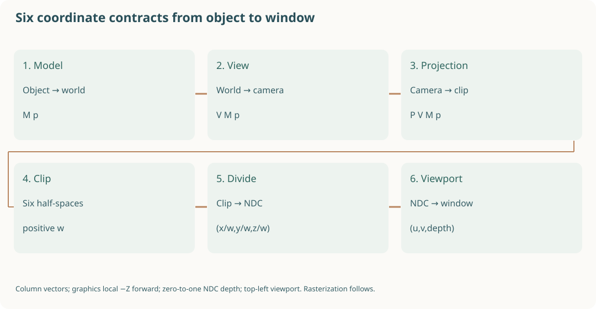
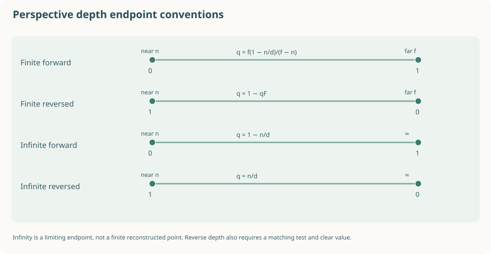
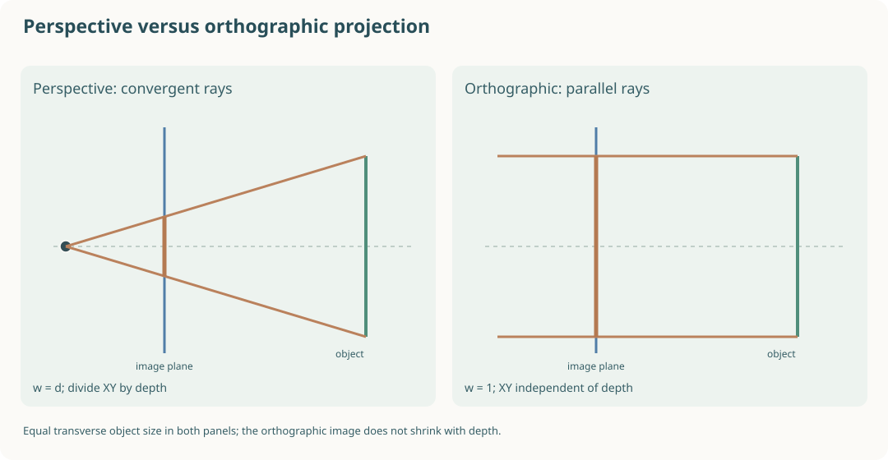
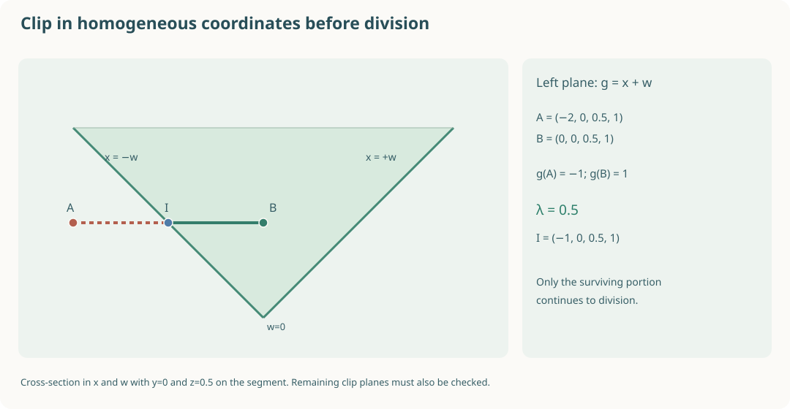
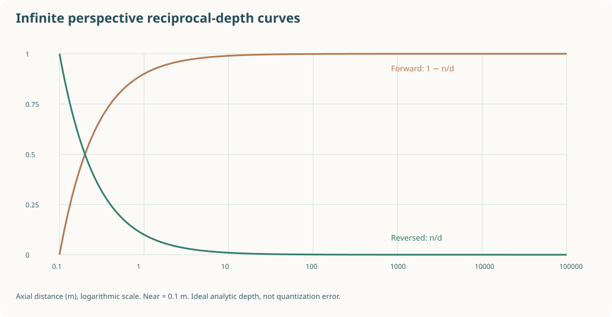
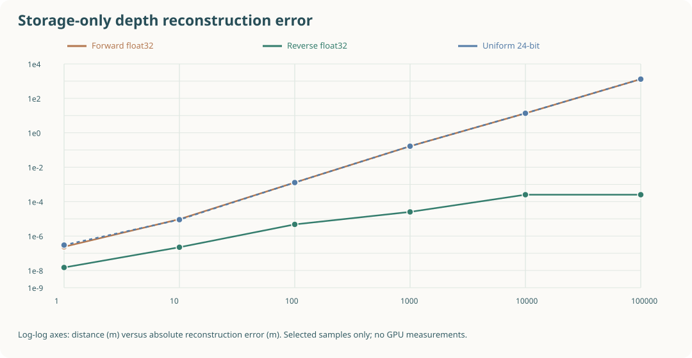

# Chapter 14 — From a 3D Point to a Screen Address

*From Geometry to Images — Part III: Worlds become camera views*  
*Reader edition / C++23 laboratory P14*

> The photograph is not yet a rendering pipeline. We must teach the computer where the picture ends, what lies in front of what, and which numbers describe each stage.

## The bird discovers the edge of the photograph

Our shoebox camera can project a point in the garden onto an image. We know where the dragon's nose appears, which direction corresponds to a pixel center, and why a nearby tree seems larger than an equally tall distant one.

But suppose the dragon is so close that one wing passes through the opening of the shoebox. One corner of a triangle might be in front of the camera, one might be beside it, and another might lie behind it. What should a program draw?

Suppose two objects produce the same image position. We need another quantity to compare their distances. And suppose the garden extends to the mountains, thousands of metres away. If a depth representation cannot distinguish two nearby surfaces there, the visible picture may flicker.

The simple pinhole equations from Chapter 13 are not wrong. They answer an important but incomplete question: where a forward optical direction intersects the virtual image plane.

A rendering pipeline must additionally specify a bounded viewing region, a representation in which geometry can be clipped, a depth mapping, and a conversion into window coordinates.

We are going to derive each of those pieces rather than copy a mysterious matrix from a graphics tutorial.

Our choice throughout this chapter is a right-handed graphics camera with local −Z forward, column-vector mathematical multiplication, a zero-to-one normalized depth interval, and top-left continuous image coordinates. This convention is a scalar teaching reference; API viewport Y and shader matrix packing are additional adapter contracts.

## Four places for one vertex

Imagine that the bird has written its name on the garden fence. The same little point of paint can be described relative to the fence, relative to the garden, relative to our camera, or relative to the image.

That is why naming a variable simply position is sometimes insufficient.

Let a local object point be \(p_L\). Our Chapter 11 scene hierarchy supplies a model transform \(M\), placing it in the world. Chapter 12 supplies the camera-to-world rigid pose \(T_C\). Its inverse is the view transform \(V=T_C^{-1}\).

For homogeneous column vectors,

\[
p_W=M p_L,\qquad p_C=V p_W.
\tag{14.1}
\]

We will now construct another linear map in homogeneous coordinates, called \(P\), the projection matrix:

\[
\boxed{h=PVMp_L.}
\tag{14.2}
\]

Here \(h=(x_c,y_c,z_c,w_c)^T\) is a **clip-space** coordinate. Its subscript c denotes clip coordinates, not a camera-local Euclidean point.

This is not yet a pixel. We first test the viewing region in homogeneous coordinates. After clipping, we divide by w:

\[
\boxed{(x_n,y_n,z_n)=(x_c/w_c,\ y_c/w_c,\ z_c/w_c).}
\tag{14.3}
\]

These are normalized device coordinates, or NDC.

Finally the viewport transforms NDC into continuous screen coordinates. Rasterization decides which pixel samples a primitive covers. It is not part of this chapter's point debugger.

*Figure 14.1 — A coordinate must carry its frame and representation. The last stage is a screen address, not a complete shaded image.*

## The fourth number is not decoration

An ordinary point in three-dimensional space has three coordinates. To express affine transformations with a single matrix, we previously appended a fourth coordinate, one.

An affine matrix preserves that fourth coordinate for ordinary points. A projective matrix need not.

The essential idea is that a homogeneous tuple with nonzero w represents an ordinary point after dividing its first three coordinates by w. Multiplying the entire tuple by a nonzero scalar preserves the divided coordinate.

For example,

\[
(2,4,6,2)\quad\hbox{and}\quad(1,2,3,1)
\]

both represent the divided point \((1,2,3)\).

The tuple with all four components zero is not a valid projective point. A nonzero tuple with w=0 represents a point at infinity in projective geometry; it does not provide ordinary finite divided coordinates.

There is a crucial extra rendering contract. We will use the **positive-w** oriented clip cone. Although negating all four homogeneous components gives the same projective point mathematically, it changes whether the representation is in our oriented clip region. We cannot classify visibility by division alone.

This distinction explains why a negative-w point may have perfectly finite NDC values if we blindly divide, yet still be unsuitable for forward rendering.

## Deriving a calibrated perspective matrix

Let a graphics camera-local point be \((x,y,z)\) with \(z<0\), and let positive axial depth be \(d=-z\).

Our optical convention from Chapter 13 maps it to \((X,Y,Z)=(x,-y,d)\). With calibrated focal scales \(f_x,f_y\), principal point \(c_x,c_y\), skew \(s\), and image dimensions W,H, the projected image is

\[
u=f_x x/d-sy/d+c_x,\qquad
v=-f_y y/d+c_y.
\tag{14.4}
\]

We want normalized horizontal and vertical coordinates whose left and bottom edges are −1 and whose right and top edges are +1. Since image rows increase downward,

\[
x_n=2u/W-1,\qquad y_n=1-2v/H.
\tag{14.5}
\]

Substitute equation (14.4):

\[
x_n=\frac{2f_x}{W}\frac{x}{d}
-\frac{2s}{W}\frac{y}{d}+\frac{2c_x}{W}-1,
\tag{14.6}
\]

\[
y_n=\frac{2f_y}{H}\frac{y}{d}+1-\frac{2c_y}{H}.
\tag{14.7}
\]

Now comes the useful trick. Choose the fourth clip coordinate to be

\[
\boxed{w_c=d=-z.}
\tag{14.8}
\]

If the numerator of each NDC expression is linear in x,y,z, then a four-by-four matrix can produce it, and the hardware's divide by w will perform the perspective division for us.

Multiplying equations (14.6) and (14.7) by d yields

\[
x_c=(2f_x/W)x-(2s/W)y+(1-2c_x/W)z,
\tag{14.9}
\]

\[
y_c=(2f_y/H)y+(2c_y/H-1)z.
\tag{14.10}
\]

We have already found the first, second and fourth rows of the matrix. The third row will encode depth.

This derivation is more general than a symmetric field-of-view matrix. A noncentered principal point produces an off-axis viewing region. A nonzero skew term produces an XY coupling. Our reference preserves both.

### Recover the symmetric classroom matrix

For a centered zero-skew camera, \(c_x=W/2,c_y=H/2,s=0\). The off-axis terms disappear.

If the vertical field of view is \(\theta_v\) and square-pixel scales are assumed, Chapter 13 gave

\[
f_y=f_x=H/(2\tan(\theta_v/2)).
\]

Let aspect ratio be \(r=W/H\). Then the X and Y scale coefficients become

\[
\frac{2f_x}{W}=\frac{1}{r\tan(\theta_v/2)},\quad
\frac{2f_y}{H}=\frac{1}{\tan(\theta_v/2)}.
\tag{14.11}
\]

The familiar tangent factors were not magic constants. They came from a calibrated pinhole, a centered image and a change of coordinate units.

## The third row: putting distance into a bounded interval

We want to represent the distance between a positive near plane n and a farther plane f, with \(0<n<f\).

In forward zero-to-one depth, we want the near plane to map to 0 and the far plane to 1. This is a **depth convention**, not a physical law.

With \(w_c=d\), a linear clip numerator along the viewing axis must have the form

\[
z_c=a d+b,\quad q(d)=z_c/w_c=a+b/d.
\tag{14.12}
\]

To find a and b, impose the endpoint constraints:

\[
a+b/n=0,\quad a+b/f=1.
\]

Solving gives

\[
\boxed{a=f/(f-n),\qquad b=-fn/(f-n).}
\tag{14.13}
\]

So conventional perspective depth is

\[
\boxed{q_F(d)=\frac{f}{f-n}\left(1-\frac nd\right).}
\tag{14.14}
\]

This is not the ordinary linear interpolation of axial distance. It is affine in reciprocal distance.

Putting all four rows together,

\[
\boxed{
P=
\begin{bmatrix}
2f_x/W&-2s/W&1-2c_x/W&0\\
0&2f_y/H&2c_y/H-1&0\\
0&0&-a&b\\
0&0&-1&0
\end{bmatrix}.}
\tag{14.15}
\]

Here f in the depth equations means the far-plane distance, while \(f_x,f_y\) are focal scales in pixels. These are distinct quantities, despite the historically overloaded letter.

In code, we calculate \(a\) and \(b\) without first multiplying f by n, avoiding one unnecessary intermediate overflow risk. The source still uses ordinary floating arithmetic, not certified exact construction.

### Reverse the depth ordering

What if we map near to one and far to zero instead?

\[
q_R(d)=1-q_F(d)
=\frac{fn}{(f-n)d}-\frac n{f-n}.
\tag{14.16}
\]

The same matrix structure works with

\[
a=-n/(f-n),\quad b=fn/(f-n).
\tag{14.17}
\]

The visible XY geometry does not change. The ordering of depth values does.

An ordinary forward depth test commonly clears the depth attachment to one and accepts a smaller value; a reversed depth test commonly clears it to zero and accepts a larger value. Equality, stencil interactions, depth writes, and early testing are separate policies. Changing just the matrix and forgetting the comparison or clear value breaks the contract.

### Send the far plane to infinity

Take the limit \(f\to\infty\) with n fixed. Equations (14.14) and (14.16) become

\[
\boxed{q_F(d)=1-n/d,\qquad q_R(d)=n/d.}
\tag{14.18}
\]

For infinite reversed depth, the coefficients are simply \(a=0,b=n\). The clip Z coordinate is constant n, and clip W is d.

This does not mean a point at infinity receives a finite world distance. The limiting value zero corresponds to infinite axial distance in the inverse map. Our inverse returns an optional finite value so that infinity is never silently interpreted as depth zero.

Removing the finite far plane is also not a promise that every distant scene can be rendered accurately. World coordinate precision, culling, available geometry and shading costs remain important.

*Figure 14.2 — Reversing depth changes its ordering, not the camera's field of view. Infinite far is a limit of the perspective family.*

## Orthographic: a camera that does not shrink the distant tree

Imagine tracing the garden onto an architect's drawing with parallel lines rather than rays meeting at one opening.

An orthographic camera maps X and Y to the image independently of depth. Objects of equal size and orientation retain equal projected sizes even when they stand at different distances.

Choose a camera-local rectangle \([l,r]\times[b,t]\). We want l to map to −1 and r to +1. A linear function gives

\[
x_n=\frac{2x-(r+l)}{r-l},\quad
y_n=\frac{2y-(t+b)}{t-b}.
\tag{14.19}
\]

For ordinary forward depth,

\[
q_O(d)=(d-n)/(f-n).
\tag{14.20}
\]

Set \(w_c=1\). Then

\[
\boxed{
P_O=\begin{bmatrix}
2/(r-l)&0&0&-(r+l)/(r-l)\\
0&2/(t-b)&0&-(t+b)/(t-b)\\
0&0&-1/(f-n)&-n/(f-n)\\
0&0&0&1
\end{bmatrix}.}
\tag{14.21}
\]

The reversed orthographic depth is \(1-q_O\), obtained by changing the third row. It is still linear in distance.

In this reference, orthographic bounds require finite near and far planes. Sending the far plane to infinity in a finite linear-depth mapping degenerates its ability to distinguish finite depths. We do not offer that degenerate limit as an ordinary orthographic camera.

If the rectangle is \([-2,6]\times[-1,3]\), its center is (2,1). A point at (2,1,−3) and one at (2,1,−7) both project to the XY center. For n=1,f=9, their forward depths are 0.25 and 0.75 respectively.

*Figure 14.3 — Both models map into a bounded image rectangle. Only the perspective model divides XY by axial depth.*

## Why clipping comes before division

Now we return to the dragon's troublesome wing.

In our zero-to-one convention, a clip coordinate belongs to the closed viewing region if

\[
\boxed{
-w_c\le x_c\le w_c,\quad
-w_c\le y_c\le w_c,\quad
0\le z_c\le w_c,\quad w_c>0.
}
\tag{14.22}
\]

These are six linear half-space inequalities, plus the positive-w condition for finite ordinary projection.

For positive w, dividing gives the familiar NDC box

\[
[-1,1]\times[-1,1]\times[0,1].
\]

But we intentionally do not use that divided box as the original clipping test.

Consider a line segment between clip points \(A=(0,0,0.5,1)\) and \(B=(0,0,0.5,-1)\). Its interpolated w passes through zero. Dividing both endpoints and then joining them in ordinary screen coordinates would conceal the projective singularity in the middle.

A primitive crossing a clip plane must be intersected with the plane in homogeneous coordinates. For example, the left-plane signed function is \(g(h)=x_c+w_c\). A segment \(h(\lambda)=(1-\lambda)A+\lambda B\) intersects it where

\[
g(h(\lambda))=0,\qquad
\boxed{\lambda=\frac{g(A)}{g(A)-g(B)}}.
\tag{14.23}
\]

This formula is useful when the endpoint signs differ and the arithmetic is representable. More care is needed for boundary coincidences, degeneracy and numerical uncertainty. The next clipping chapter will handle full primitive construction and attribute interpolation.

Our current library only **classifies individual clip points**. If a point is rejected, the trace contains no ordinary screen point. This does not mean a triangle with one rejected vertex should be thrown away: a portion of it may survive after clipping. Never confuse vertex classification with primitive clipping.

*Figure 14.4 — The homogeneous boundary is linear. Dividing first can lose the information about the zero-w singularity and the crossing.*

### Do not assume every API uses the same box

Some graphics conventions use depth in \([-1,1]\) before viewport conversion rather than \([0,1]\). Their near inequality is \(z_c\ge-w_c\), not \(z_c\ge0\).

Our reference intentionally uses zero-to-one. Metal and Vulkan-style depth conventions are commonly associated with this range; API-specific Y orientation, viewport configuration, depth-range settings and shader layout remain distinct. A renderer that imports a projection matrix from another convention must convert those boundaries consistently.

Matrix storage order is another separate issue. The source uses a row-major array to store the mathematical matrix, but multiplies by column vectors. Transposing a matrix merely because it is stored in a different memory arrangement can accidentally change its mathematical map.

## The viewport brings NDC home

For a viewport with origin \((o_x,o_y)\), width W and height H, top-left window coordinates are

\[
\boxed{u=o_x+(x_n+1)W/2,\quad
v=o_y+(1-y_n)H/2.}
\tag{14.24}
\]

The depth value stays \(z_n\) in our chosen reference viewport.

The continuous point with NDC (1,−1) maps to the bottom-right edge of the viewport, not the last pixel center. The last sample center is half a pixel inside that edge. Closed clipping and half-open image membership are therefore different contracts, as Chapter 13 already established.

Here is our complete hand-checkable trace. Use the centered calibration of Chapter 13: 640 by 480, focal scales 400, principal point (320,240). Choose n=1,f=9, forward depth and camera-local point (1,1,−4).

The projection coefficients are \(a=9/8,b=-9/8\). The resulting clip tuple is

\[
\boxed{h=(1.25,\ 5/3,\ 3.375,\ 4).}
\tag{14.25}
\]

After division,

\[
(x_n,y_n,q)=(0.3125,\ 5/12,\ 0.84375).
\tag{14.26}
\]

The viewport gives

\[
\boxed{(u,v)=(420,140).}
\tag{14.27}
\]

That is exactly the pinhole result from the previous chapter. Reversed depth leaves the image coordinates unchanged and produces \(q=0.15625\).

When an engine's picture differs from the expected result, print the camera-local point, clip tuple, per-plane classification, divided position and viewport address. Each value narrows down the location of the bug.

### The center of the photograph may lie between pixels

Imagine a photograph four pixels wide. Its continuous horizontal interval is [0,4], but the sample centers are 0.5, 1.5, 2.5 and 3.5. The center of the photograph is 2, exactly between two sample centers. Nothing has been lost. The center is a location in a continuous coordinate system, not necessarily an address in a discrete array.

For the full viewport of width W and height H with top-left origin and downward raster Y, invert the viewport transform at sample center (i+0.5,j+0.5):

\[
x_n=2(i+0.5)/W-1,\qquad y_n=1-2(j+0.5)/H.
\]

At 1920 by 1080, the first sample is approximately (-0.999479167,0.999074074), not (-1,1). A centered ideal camera's optical axis crosses the boundary shared by the four central samples of that even-sized image. For an odd-sized, centered image there is a central sample. An off-center principal point changes this conclusion; viewport center and optical center are not universally the same.

For a normalized texture with four texels along an axis, their center coordinates are 0.125, 0.375, 0.625 and 0.875. The values 0, 0.25, 0.5, 0.75 are cell edges under the stated mapping. A shader that already derives UV from the pixel-center coordinate must not add another half texel. That would sample halfway between the intended texel centers, and bilinear filtering would mix neighbouring texels instead of recovering their original values. The exact result also depends on edge addressing and filtering policy.

Historically, some old graphics pipelines used integer-centered raster coordinates. Do not transport their corrective offset into a different coordinate convention. A fullscreen pass, picking operation, depth reconstruction and temporal reprojection must agree on precisely where the sample lies. The invariant is not “add 0.5 everywhere”; it is “convert the declared input convention to the declared output convention exactly once.”

**Try it.** For a 5-by-3 viewport, map the center sample (index 2,1) to NDC. For a 4-by-4 texture, find the normalized coordinates of texel (2,1). Answers: (0,0) and (0.625,0.375). If a program instead adds a second half-texel correction in both directions, the latter becomes (0.75,0.5), a cell-boundary intersection.

*Source route: Computing Foundations/33, derived lines 3132–3410. The source also records historical API-specific conventions; those remain available for the Book 06 implementation comparison.*

## The mountain and the depth buffer

A depth buffer has finite storage precision. Two different surfaces can map to depth values that round to the same stored number. Their subsequent visibility ordering may become sensitive to numerical details, a problem often associated with Z-fighting.

The depth map matters. Differentiate equation (14.12):

\[
\boxed{\frac{dq}{dd}=-b/d^2.}
\tag{14.28}
\]

The derivative magnitude decreases quadratically with axial distance. A small depth-value error \(\Delta q\) therefore corresponds approximately to

\[
|\Delta d|\approx\frac{d^2}{|b|}|\Delta q|.
\tag{14.29}
\]

At large d, a uniformly spaced depth grid gives coarse axial resolution. Moving the near plane too close also decreases \(|b|\) in typical perspective configurations and worsens the situation.

This approximation assumes the perturbation is small enough for a local linearization. It is not a bound on all rounding effects, nor a substitute for exact inversion of the stored value.

### Why reversing a uniform grid is not enough

Suppose we store q on a uniform grid with \(2^{24}\) possible values, from zero through one inclusive. The step is \(1/(2^{24}-1)\).

The forward and reversed maps are complements: \(q_R=1-q_F\). The uniform grid is symmetric under the same complement operation. Apart from tie-breaking and floating evaluation details, reversing the map simply reverses its stored labels. It does not fundamentally improve axial precision.

A floating-point representation behaves differently. Binary32 values are much more densely spaced near zero than near one. Near a positive number q, their spacing depends on the exponent of q. For normal values, the relative rounding scale is roughly constant within a factor of two.

Infinite reversed depth \(q=n/d\) becomes small as distance increases. The floating spacing becomes correspondingly fine. If the stored value has relative error \(\epsilon\), then the inverse \(d=n/q\) has approximately the opposite relative error for small \(\epsilon\).

Forward infinite depth approaches one, where the absolute spacing does not shrink with distance. Subtracting a stored value from one can discard the small reciprocal-depth signal.

*Figure 14.5 — The maps are exact complements in real arithmetic. The benefit of reverse-Z depends on the storage representation, not on curve shape alone.*

### A reproducible storage-only experiment

Choose n=0.1 metres and an infinite perspective far plane. Evaluate the analytic maps in binary64, quantize q to binary32 or a uniform 24-bit grid, then invert the stored number using \(d=n/(1-q)\) for forward depth and \(d=n/q\) for reverse depth.

The following independent scalar calculation uses IEEE binary32 conversion and nearest uniform-grid rounding. These are **absolute reconstruction errors in metres for specific samples**, not GPU measurements and not worst-case errors.

| Axial distance (m) | Forward float32 error (m) | Reverse float32 error (m) | Uniform 24-bit error, either order (m) |
|---:|---:|---:|---:|
| 1 | 2.38e-7 | 1.49e-8 | 2.98e-7 |
| 10 | 9.54e-6 | 2.24e-7 | 8.94e-6 |
| 100 | 1.29e-3 | 4.75e-6 | 1.28e-3 |
| 1,000 | 0.1659 | 2.53e-5 | 0.1660 |
| 10,000 | 13.5619 | 2.53e-4 | 13.5625 |
| 100,000 | 1,310.4941 | 2.52e-4 | 1,310.5000 |

The small numerical error at the last reverse sample is not a guarantee of that same error throughout the range. Individual samples can fall unusually close to representable values. We need dense sampling or an analytic bound to discuss error envelopes.

For a chosen stored depth, the inverse of the general perspective law is

\[
\boxed{d=b/(q-a).}
\tag{14.30}
\]

If the infinite-far stored value reaches its limiting endpoint, no finite distance can be reconstructed. Our reference reports that condition explicitly rather than using a fabricated large number.

*Figure 14.6 — Controlled analytic quantization, with no GPU execution. The plotted points are specific numerical witnesses, not a measured performance claim.*

Real rendering adds errors from transformations, interpolation, depth bias, raster sample locations and actual hardware implementation. This experiment isolates one variable to make its effect understandable. It does not demonstrate a particular GPU's depth attachment behavior or certify that reversed depth eliminates Z-fighting.

## The native C++23 projection debugger

The companion extends our earlier camera code instead of creating a disconnected graphics experiment.

Read the source files in this order:

1. `include/book03/projection_pipeline.hpp`: `Homogeneous4`, the row-stored mathematical `ProjectionMatrix`, `DepthMap`, calibrated perspective and orthographic constructors, homogeneous clip classification, perspective division, viewport mapping and optional trace outputs.
2. `tests/projection_pipeline_tests.cpp`: hand-computed clip and NDC witnesses, forward/reverse endpoints and inverse reconstruction, infinite-far semantics, orthographic invariants, invalid inputs and 4,000 seeded crosschecks against the independently implemented Chapter 13 pinhole.
3. `src/projection_studio.cpp`: interactive point and depth policy debugger and the fixed reference quantization experiment.

After the native project is built:

~~~text
book03_projection inspect
book03_projection csv depth-errors.csv
book03_projection svg depth-curves.svg
book03_projection repl
~~~

The default inspector uses the hand-derived point (1,1,−4), near one and far nine. The CSV independently evaluates 241 logarithmically spaced distances for two depth orders and two storage policies, producing 964 data rows. The SVG plots the ideal depth maps, not the reconstruction-error curve; the original technical plate in this chapter separately illustrates the controlled error comparison.

Try these REPL commands:

~~~text
inspect
reverse
inspect
point 0 0 -0.5
inspect
point 0 0 -4
depth 0.1 0
inspect
ortho
depth 1 9
ortho
point 1 1 -4
inspect
csv reference-depth.csv
svg reference-curves.svg
quit
~~~

Far value zero in the depth command selects the infinite perspective model. Attempting to switch to orthographic while the far plane is infinite is rejected. The reference exports always use the fixed analytic experiment, independent of the current inspector settings; that keeps the comparisons reproducible.

The C++23 reference does not use Metal, Vulkan, OpenGL or an actual GPU depth attachment. It is intentionally a small scalar contract that a later graphics implementation can use as an oracle.

## Your turn: make the pipeline explain itself

**Reconstruct — matrix order.** Explain the meaning of each factor in \(PVMp_L\). Why is a camera-to-world pose not the view matrix?

**Implement — calibrated perspective.** Starting from the skewed pinhole equations, derive the first and second rows of equation (14.15). Identify the signs introduced by optical Y and viewport Y.

**Falsify — wrong w.** Replace the fourth perspective row with (0,0,0,1) while leaving other rows unchanged. Why do the projected positions no longer have the intended reciprocal-depth behavior?

**Reconstruct — endpoint equations.** For n=1 and f=9, solve for forward and reversed a,b. Evaluate both depth values at d=4.

**Transfer — infinite far.** Explain the meaning of reverse depth zero with an infinite far plane. Why must the inverse not return zero metres?

**Falsify — clipping.** Construct a positive-w point with x greater than w and a negative-w point whose divided X,Y,Z are inside the NDC box. Explain why both are rejected before division.

**Implement — a boundary intersection.** Use equation (14.23) for A=(−2,0,0.5,1) and B=(0,0,0.5,1). Compute the left-plane intersection.

**Reconstruct — viewport.** A viewport starts at (10,20) and measures 800 by 600. Where does NDC (1,−1) map? Is that location the center of an in-bounds pixel?

**Transfer — orthographic.** Use bounds left −2, right 6, bottom −1, top 3 and depth interval 1 through 9. Compute the screen-centered depths for d=3 and d=7. Why does the XY position remain fixed?

**Falsify — storage precision.** Explain why reversing a uniform fixed-point grid does not produce the same precision benefit as reversing floating-point depth. Compare their symmetry under q to 1−q.

**Challenge — depth error.** For infinite forward depth, derive the local axial sensitivity to a small depth rounding error and explain the role of n. Why can an exact sample land on a representable value even when its neighboring samples are inaccurate?

**Explain — debugging a renderer.** If a rotated model appears mirrored, list the coordinate boundaries to inspect before modifying the face-culling mode. Distinguish model determinant, view convention, NDC Y, viewport Y and the rasterizer's own front-face rule.

### Selected answers

With near one and far nine, forward coefficients are \(a=9/8,b=-9/8\); reversed coefficients are \(a=-1/8,b=9/8\). At depth four the values are 0.84375 and 0.15625.

The left clip function for A is −1 and for B is +1. The intersection parameter is 1/2, giving (−1,0,0.5,1). It lies on the closed left boundary.

The viewport's lower-right edge is (810,620). Under the edge-coordinate convention it is not the center of a valid pixel. Orthographic depths for d=3 and d=7 are 0.25 and 0.75.

For infinite forward depth, \(|dq/dd|=n/d^2\). A small storage error has approximate inverse sensitivity \(d^2/n\). This is a local derivative, not an exact error envelope. Reversed float32 benefits from its smaller absolute spacing near zero; uniform storage does not fundamentally change its spacing when reversed.

## The next step: two eyes

We now know how to carry a point through the graphics coordinate chain. We can derive matrices from calibrated rays, distinguish camera-local and clip coordinates, classify a point without prematurely dividing, and choose a depth representation with explicit endpoints.

We still have only one viewpoint.

**Chapter 15 — Two Eyes Looking at One House** will introduce stereo baselines, off-axis cameras, disparity, triangulation, rectification and uncertainty in recovering depth. Later chapters will complete primitive clipping and rasterization rather than pretending that a point classification is a renderer.

## Source custody

The original `33 - Projection, Clipping, and Raster Sampling.md` contains the extended derivations, API convention comparisons, sample-coordinate material and depth precision discussion. The original `34 - Robust Predicates and Camera Sensitivity.md` develops homogeneous frustum boundaries, inverse corner reconstruction, predicate robustness and additional camera sensitivity. Both are preserved unmodified. Their actual inspected identities and outstanding specialized material are recorded in `PASS14_LEGACY_AUDIT.md`.

This additive chapter and its laboratory establish the intended scalar contracts. The cumulative Ubuntu CI gate subsequently passed at revision a54c4a1; full legacy integration and final PDF/EPUB composition remain distinct gates.
