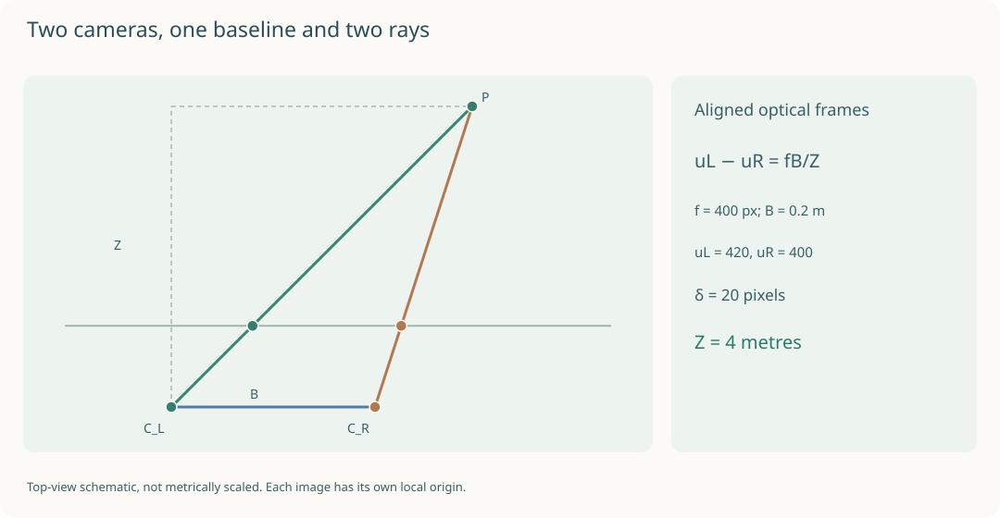
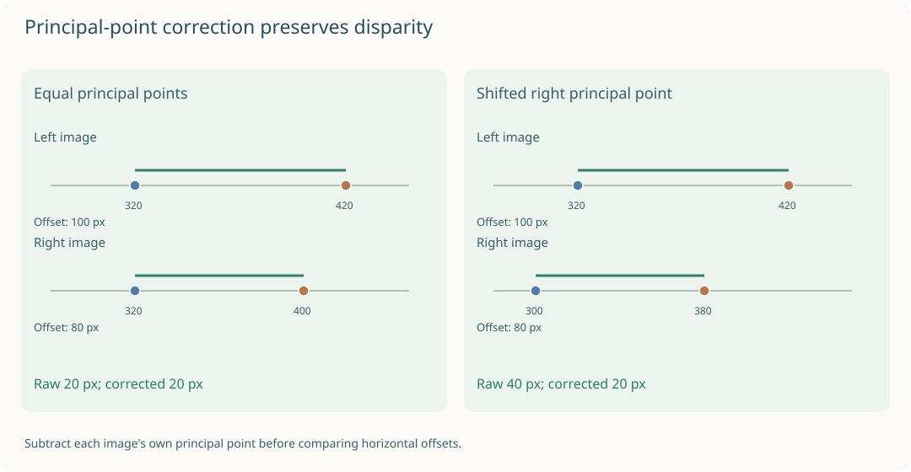
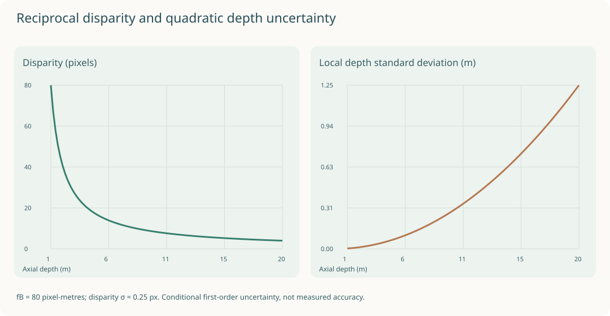
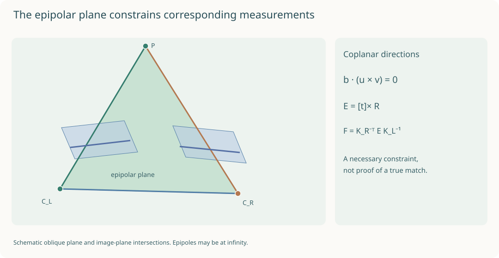
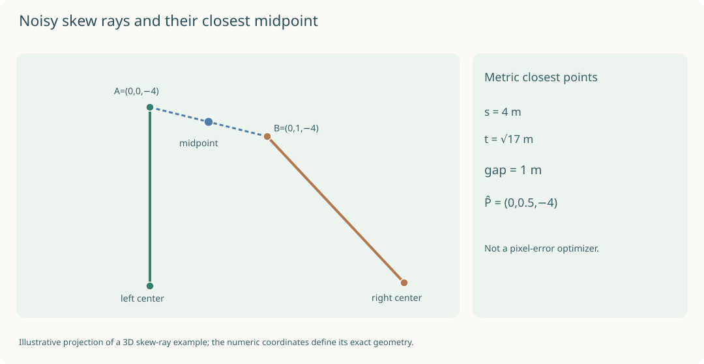
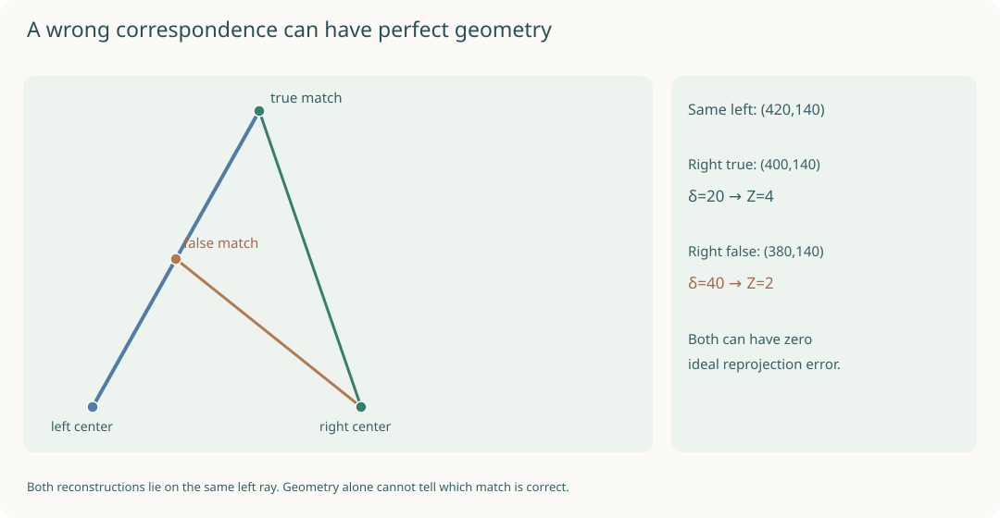

# Chapter 15 — Two Eyes Looking at One House

*From Geometry to Images — Part III: Worlds become camera views*  
*Reader edition / C++23 laboratory P15*

> One photograph tells us which way to look. A second photograph, taken from a known place, can help us discover how far away to look.

## The bird closes one eye

Hold a pencil at arm's length. Look at a distant wall behind it. Close your left eye, then your right eye, without moving your head.

The pencil appears to jump against the wall. The wall appears to move much less. Nothing in the room actually moved. You changed the place from which the world was observed.

Our paper house is about to undergo the same experiment. We already know how to build an ideal calibrated camera, move it around the garden, and transform a three-dimensional point into a continuous address on its image. We also discovered a frustrating limitation: all points along a forward viewing ray project to one image position.

Imagine two possible houses, one small and close, one larger and farther away. A single ideal image can have the same outline in both cases. But moving the camera sideways changes the two images differently.

This chapter explains the geometry of those differences. We will begin with two cameras that are carefully aligned, then remove that simplifying assumption. We will construct three-dimensional points from known corresponding image measurements, estimate how errors in those measurements affect reconstructed depth, and learn why a mathematically impeccable reconstruction may still be completely wrong.

The last warning is important. A photograph does not attach a label saying which physical point produced each pixel. Finding the same physical feature in both photographs is a different problem from reconstructing it once we have found it.

## Two openings, one world

Place two identical ideal cameras side by side. The left camera has its center at the origin. The right camera is displaced by a positive distance B along the left camera's local X direction.

We call B the **baseline**. Its units are metres in our examples. Both cameras have the same orientation, both look down their local negative Z axes, and both use the optical convention established in Chapter 13: X right, Y down, Z forward.

In this arrangement a point has optical coordinates (X,Y,Z) in the left camera and (X-B,Y,Z) in the right camera. The depth Z has not changed, because the baseline is perpendicular to the viewing axis.

Let the common horizontal focal scale be f pixels. Temporarily assume the two principal points agree and skew is zero. Then

\[
u_L=fX/Z+c_x,\qquad u_R=f(X-B)/Z+c_x.
\tag{15.1}
\]

Subtract the two measurements:

\[
\boxed{\delta=u_L-u_R=fB/Z.}
\tag{15.2}
\]

The difference is called **disparity**, measured in pixels. The unknown transverse coordinate X cancels. This cancellation is the small mathematical miracle behind elementary stereo vision.

Rearrange:

\[
\boxed{Z=fB/\delta.}
\tag{15.3}
\]

*Figure 15.1 — One point, two rays and a known baseline. Similar triangles relate the shift between corresponding image measurements to axial depth.*

Check the units. Pixels multiplied by metres, divided by pixels, gives metres. If B is measured in centimetres, the reconstructed depth is in centimetres. Knowing the baseline in physical units provides the metric scale that one image lacked.

Suppose our previous camera has f=400 pixels, and we place the right camera 0.2 metres to its right. A point at world (1,1,-4) appears at (420,140) in the left image and (400,140) in the right image. Disparity is 20 pixels, so Z=80/20=4 metres.

Recover the other coordinates from the left observation:

\[
X=Z(u_L-c_x)/f_x,\quad
Y=Z(v_L-c_y)/f_y.
\tag{15.4}
\]

The optical point is (1,-1,4); the graphics-local point is (1,1,-4). The camera-to-world pose then places it in the garden. There is no new coordinate convention hidden inside the stereo equation.

### When the raw pixel difference lies

A stereo pair does not need identical principal points. A calibrated sensor can have its optical center shifted, or the images may have been cropped differently. For common focal scales and zero skew,

\[
\boxed{\delta=(u_L-c_{xL})-(u_R-c_{xR}).}
\tag{15.5}
\]

The corresponding row residual is

\[
e_v=(v_L-c_{yL})-(v_R-c_{yR}).
\tag{15.6}
\]

Under our exact aligned model, e_v is zero. It need not mean the two raw row numbers are equal.

In the earlier example, change the right principal point from (320,240) to (300,230). The right measurement becomes (380,130). The raw horizontal difference is now 40 pixels. But corrected disparity is (420-320)-(380-300)=20, exactly as before. The corrected row residual is (140-240)-(130-230)=0.

If we used the raw difference, we would reconstruct a point at two metres instead of four. The mistake would not necessarily produce an obvious numerical error message. It would produce an entirely plausible wrong house.

*Figure 15.2 — Image offsets belong to the calibration. Remove them before applying the simple rectified stereo equation.*

For unequal focal scales, one can instead compare normalized horizontal coordinates and derive \(Z=B/(x_{nL}-x_{nR})\) when the orientations and baseline satisfy the aligned model. Nonzero skew must also be inverted using the full intrinsic matrix. Our simple RectifiedStereo class deliberately requires matching focal scales and zero skew. The general ray-based estimator will accept differing valid intrinsics.

## The little shift becomes a very large distance

The product fB in our example is 80 pixel-metres. For points at one, two, four, eight and sixteen metres, the disparities are respectively 80, 40, 20, 10 and 5 pixels.

The farthest point produces the smallest difference. That makes it the hardest to measure accurately.

Differentiate the inverse relation:

\[
\frac{\partial Z}{\partial\delta}=-\frac{fB}{\delta^2}
=-\frac{Z^2}{fB}.
\tag{15.7}
\]

If the disparity measurement has standard deviation \(\sigma_\delta\), a first-order estimate of axial-depth standard deviation is

\[
\boxed{\sigma_Z\approx\frac{Z^2}{fB}\sigma_\delta.}
\tag{15.8}
\]

This is conditional on correct correspondence, a small perturbation and exact calibration. It is a local uncertainty approximation, not an error guarantee.

For a disparity standard deviation of 0.25 pixels, the corresponding approximate depth standard deviations at four, eight and sixteen metres are 0.05, 0.2 and 0.8 metres. Double the distance and the absolute uncertainty grows by four.

*Figure 15.3 — Both curves use f=400 pixels, B=0.2 metres, and disparity standard deviation 0.25 pixels. These are analytic model predictions, not sensor measurements.*

### One uncertainty is not the other

If each image measurement has independent horizontal standard deviation 0.25 pixels, the disparity standard deviation is not 0.25 pixels. For the difference of two measurements,

\[
\operatorname{Var}(\delta)=\sigma_L^2+\sigma_R^2-2\operatorname{Cov}(u_L,u_R).
\tag{15.9}
\]

Independent equal uncertainties produce \(\sqrt2(0.25)\) pixels. Correlated measurements require the covariance term. Principal-point, focal and baseline uncertainties introduce further terms.

Differentiate the full scalar expression \(Z=fB/\delta\):

\[
dZ=(B/\delta)df+(f/\delta)dB-(fB/\delta^2)d\delta.
\tag{15.10}
\]

With a covariance matrix for these three quantities, use the gradient row to propagate first-order variance. A shared calibration error can affect many points together, so uncertainty in a reconstructed cloud is not always independent point-to-point.

The lab reports the disparity-only approximation, not a complete calibrated stochastic model.

### The reciprocal function is asymmetric

Take a measured disparity of 20 pixels and allow a bounded perturbation of plus or minus 0.25 pixels. If fB=80,

\[
Z_{\min}=80/20.25,\quad Z_{\max}=80/19.75.
\tag{15.11}
\]

These are approximately 3.9506 and 4.0506 metres. The upper excursion is slightly larger than the lower one. A symmetric disparity interval need not map to a symmetric depth interval.

If the lower disparity bound approaches zero, the upper depth bound grows without limit. If the interval includes zero, the model cannot provide a finite upper positive depth bound without additional assumptions.

This is why a Gaussian-looking disparity distribution should not automatically be called a Gaussian depth distribution. Close to the singularity the local linearization can be very misleading. In the lab CSV, low and high depth are the mapped endpoints of a chosen plus/minus 0.25-pixel interval. They are not asserted to be a particular confidence interval.

## What makes a baseline useful?

Imagine moving the right camera only a hair's breadth. The left and right images look almost identical. Their rays have nearly the same direction. The inverse problem becomes poorly conditioned.

Increasing the baseline increases disparity for a fixed point and focal scale. In the elementary model it decreases local depth uncertainty. But a large baseline also changes what each camera can see. A nearby object may obscure a point from one camera but not the other. Changes in viewpoint can make feature matching harder, and the overlap of the two image fields may become smaller.

There is no universally optimal baseline. A tiny mobile robot, an automotive rig, a microscope and an indoor mapping camera have different operating distances, fields of view, mechanical calibration budgets and correspondence challenges.

A person's eyes supply a useful everyday analogy. Their separation produces binocular disparity, but human depth perception also uses motion, occlusion, familiar size, perspective, vergence and accommodation. A stereo camera's geometry is not a complete model of visual perception.

A virtual-reality renderer may choose left and right eye positions from an interpupillary-distance parameter and use asymmetric frusta prescribed by its display and optical calibration. Simply turning two camera axes inward is not equivalent to correctly designing those projections. Toe-in can introduce vertical disparity and different projective distortions. For an ideal parallel display arrangement, off-axis frusta can align the desired reference plane without rotating the cameras inward. Real headsets additionally impose optical and runtime-specific requirements.

We will not mistake a stereo display configuration for a depth sensor calibration.

## The epipolar plane

Now let the right camera rotate and move in a direction that is not exactly horizontal. Its image rows no longer automatically align with the left image rows.

A world point P and two distinct camera centers C_L,C_R usually determine a plane: the epipolar plane. Both observation rays and the baseline lie in that plane.

Take a single measurement in the left image. It determines a left viewing ray but not a unique point. Move a hypothetical point along this ray. From the right camera, all those possible points project onto a line in the right ideal image, unless the geometry is degenerate.

That is the **epipolar line**. The camera baseline projected into an image defines its epipole, which may be a point at infinity in a parallel-camera arrangement.

*Figure 15.4 — Epipolar geometry reduces the ideal search for a corresponding measurement from a two-dimensional image region to a line. It does not tell us which position along the line is correct.*

Our world-space ray directions are unit vectors u and v, and the baseline vector is \(b=C_R-C_L\). For an exact corresponding point,

\[
\boxed{b\cdot(u\times v)=0.}
\tag{15.12}
\]

This scalar triple product vanishes when the three vectors are coplanar. With b measured in metres and the directions dimensionless, the residual has units of metres. It is not a normalized pixel distance.

Coplanarity alone also holds for parallel rays, and for rays whose supporting lines intersect behind a camera. The equation is a necessary geometric condition under the ideal model, not sufficient evidence of a valid forward correspondence.

### From a plane to the essential matrix

For this derivation, use optical coordinate frames, positive Z forward, and homogeneous normalized image directions \(x_L=K_L^{-1}m_L\), \(x_R=K_R^{-1}m_R\), where \(m=(u,v,1)^T\).

Let the relative transform map left optical coordinates into right optical coordinates:

\[
P_R=R_{RL}P_L+t_{RL}.
\tag{15.13}
\]

The translation here is the left camera origin expressed in the right optical frame. It is not the right camera's world center.

For an exact match \(P_L=Z_L x_L\), \(P_R=Z_R x_R\). Therefore \(x_R,t_{RL},R_{RL}x_L\) are coplanar.

Write the cross-product operator as the skew-symmetric matrix \([t]_\times\), satisfying \([t]_\times a=t\times a\). The resulting constraint is

\[
\boxed{x_R^T E x_L=0,\qquad E=[t_{RL}]_\times R_{RL}.}
\tag{15.14}
\]

E is the **essential matrix**. For a nonzero translation and proper rotation its rank is two; its two nonzero singular values agree. Multiplying E by a nonzero scalar does not change the zero equation. Thus estimating it from image correspondences alone does not determine the physical scale of the translation.

Undo normalization to obtain

\[
\boxed{F=K_R^{-T}EK_L^{-1},\qquad m_R^T Fm_L=0.}
\tag{15.15}
\]

F is the fundamental matrix. Given a left image point, \(Fm_L\) supplies the homogeneous coefficients of an epipolar line in the right image. For line coefficients (a,b,c), the equation is \(au+bv+c=0\).

An algebraic value such as \(m_R^TFm_L\) is scale-dependent. Dividing its absolute value by \(\sqrt{a^2+b^2}\) gives the Euclidean point-to-line distance in the right image for a nondegenerate line. That still treats the left measurement as exact. More sophisticated symmetric residuals and the Sampson approximation will be useful in later estimation work.

The current lab evaluates world-space coplanarity and general calibrated rays. It does not estimate E or F from images, decompose an essential matrix, or implement an eight-point solver. These equations explain the connection to the later correspondence and reconstruction chapters.

## Rectification is a change of image geometry

For an arbitrary calibrated pair, we can choose virtual camera frames whose X axes align with the baseline and whose image rows align with one another. This process is called stereo rectification.

For ideal pinhole images, a change of orientation at an unchanged camera center maps image directions through a projective homography. In homogeneous image coordinates,

\[
m'\sim K' R' R^T K^{-1}m,
\tag{15.16}
\]

where R and R' here are the old and new world-to-optical rotations. The symbol \(\sim\) means equality up to a nonzero homogeneous scale.

The new image must actually be sampled: some coordinates fall outside the old image, and interpolation introduces its own errors. Lens distortion must be handled consistently. Choosing the virtual axes, output intrinsics and overlap region is part of the rectification design.

Rectification is not merely subtracting the vertical difference between two points. It transforms the image geometry, and one must retain the new calibration when applying the rectified disparity formula.

Our viewer creates a pair that already satisfies the aligned geometry. It does not warp real photographs. The general estimator uses calibrated rays directly, without assuming a common image row.

## Two rays that never quite meet

In perfect arithmetic with perfect calibration and corresponding measurements, the two rays meet at P. With noisy image coordinates, their supporting lines may be skew: neither intersects the other.

Let the unit world ray directions be u and v. Write

\[
A(s)=C_L+su,\quad B(t)=C_R+tv.
\tag{15.17}
\]

For positive parameters s,t, these are forward rays, with s and t in metres. The parameters are ranges, not optical depths.

First solve the closest-point problem on the two infinite supporting lines. Minimize the squared separation

\[
\phi(s,t)=\|su-tv-b\|^2,
\tag{15.18}
\]

where \(b=C_R-C_L\).

Take derivatives. At a minimum, the joining displacement is perpendicular to both directions:

\[
s-(u\cdot v)t=u\cdot b,\qquad
(u\cdot v)s-t=v\cdot b.
\tag{15.19}
\]

The determinant magnitude of this two-variable system is

\[
1-(u\cdot v)^2=\|u\times v\|^2.
\tag{15.20}
\]

When the directions become parallel or antiparallel, the system becomes singular. Near either case, the solution is sensitive to measurement errors.

Our reference uses an equivalent cross-product expression. Let \(n=u\times v\). Then

\[
\boxed{s=\frac{(b\times v)\cdot n}{n\cdot n},
\quad t=\frac{(b\times u)\cdot n}{n\cdot n}.}
\tag{15.21}
\]

For nonparallel directions, these formulas arise by resolving b into its component in the plane spanned by u,v and its perpendicular component. The perpendicular component cannot be represented by su-tv; it is the residual between the closest points. The formulas avoid explicitly subtracting two nearly equal values in equation (15.20), but are not immune to numerical error.

After finding the two closest points A and B, use their midpoint as a simple reconstruction:

\[
\hat P=A+\tfrac12(B-A),\qquad g=\|B-A\|.
\tag{15.22}
\]

We return both the estimate and the ray gap g. The gap indicates how inconsistent the two supporting lines are in metric space. It is not an uncertainty estimate.

*Figure 15.5 — Skew lines generally do not meet. The closest-ray midpoint is a useful reference estimator, not a unique optimal answer to every statistical reconstruction problem.*

A hand-checkable example uses left center (0,0,0), left direction (0,0,-1), right center (1,1,0), and right direction proportional to (-1,0,-4). The closest points are (0,0,-4) and (0,1,-4). Their separation is one metre, their midpoint is (0,0.5,-4), and their forward ranges are four and \(\sqrt{17}\) metres.

That is a large inconsistency for a small garden. The code returns the gap so an application can choose a suitable acceptance policy.

### Weak parallax and cheirality

Our general triangulator reports WeakParallax when \(\|u\times v\|\) is below a stated threshold. The sine of the angle between unit directions is a dimensionless diagnostic. The default threshold is \(10^{-6}\). It is not a certified condition-number threshold, and a point above it may still be unreliable.

It reports BehindCamera when the closest-line solution requires a nonpositive ray range. When supplied with cameras rather than just rays, it additionally verifies that the midpoint has positive optical depth in both frames.

This last check is called a **cheirality** check in multiview geometry. The ability to intersect infinite lines does not imply that both cameras can observe the resulting point in their forward half-spaces.

Neither test establishes visibility through other geometry. A point can be in front of both cameras and still be hidden behind a wall.

### Why not optimize the pixel residual?

The midpoint method minimizes the distance between supporting lines before taking their midpoint. It does not directly minimize the error that appeared in the original image measurements.

For a candidate world point Q, project it into each calibrated camera. A common refinement objective is

\[
\min_Q\|\pi_L(Q)-m_L\|^2+\|\pi_R(Q)-m_R\|^2.
\tag{15.23}
\]

With appropriate covariances, the residuals can be weighted in measurement units. The Jacobian from Chapter 13 allows a local least-squares update; the world derivative composes the optical Jacobian with the world-to-optical rotation.

A pixel residual and a metric ray gap answer different questions. An error of one pixel represents different angular errors at different focal scales, and a metric separation depends on distance. Our native reference returns both reprojection residuals and ray gap, but does not run nonlinear refinement. Later chapters will introduce robust multi-observation estimation.

## The perfectly wrong match

Imagine our house has two identical windows on the same horizontal row. A matcher incorrectly identifies the left window in one image as the right window in the other.

The wrong observation can lie exactly on the correct epipolar line. Its reconstructed point can have positive depth in both cameras. The ray gap can be zero, and the reprojection errors can also be zero.

In the default example, left (420,140) and correct right (400,140) reconstruct (1,1,-4). Deliberately change the right measurement to (380,140). Corrected disparity doubles from 20 to 40 pixels. The reconstructed point becomes (0.5,0.5,-2).

Both supporting rays now agree on a different point. A purely geometric two-view residual cannot reveal which window supplied the true observation. We have constructed a false but self-consistent world.

*Figure 15.6 — A wrong match can satisfy the epipolar constraint and reprojection equations exactly. Correct correspondence requires evidence beyond the two-ray calculation.*

This is the reason for descriptors, photometric consistency, uniqueness criteria, left-right consistency, occlusion handling, multi-view checks and robust estimators. We will study those later. A synthetic projection experiment with known correspondences proves only the geometric reconstruction path; it cannot prove that an algorithm successfully matches real photographs.

## The native stereo workshop

The new laboratory builds directly on our calibrated PinholeCamera and rigid poses. Read the code in this order.

First, open `include/book03/stereo_geometry.hpp`. Its RectifiedStereo type creates an aligned camera pair using the left pose and a metric baseline along its local X direction. It checks compatible calibration, computes corrected disparity and row residual, reconstructs axial depth, and provides first-order disparity-only uncertainty.

Then read triangulate_rays. It uses the actual unit rays supplied by Chapter 13, calculates parallax, solves for closest-line ranges, rejects nonpositive ranges and constructs the midpoint. The triangulate_samples wrapper supplies the two cameras, checks positive optical depth and calculates actual pixel reprojection residuals.

Next, read `tests/stereo_geometry_tests.cpp`. The reference tests use independently chosen source points. They verify the four-metre witness, a shifted principal point, near-parallel and antiparallel directions, the one-metre skew-ray gap, a deliberately wrong match, and uncertainty calculations. A separate 3,000-case deterministic experiment projects points into cameras with different focal scales, skew, orientations and positions, then reconstructs the generating world positions from those noiseless correspondences. This is a bounded numerical test, not empirical vision accuracy.

Finally, open `src/stereo_studio.cpp`. The studio constructs its own synthetic house landmarks; it has no external image dependency. After compiling the cumulative laboratory:

~~~text
book03_stereo inspect
book03_stereo csv stereo-depth.csv
book03_stereo svg two-house-views.svg
book03_stereo repl
~~~

Try the following inside the REPL:

~~~text
inspect
noise -20
inspect
noise 0
baseline 0.05
inspect
point 1 1 -16
inspect
csv uncertainty.csv
svg views.svg
quit
~~~

The noise command adds a deterministic horizontal offset to the right image observation. It does not sample a noise distribution. With the default baseline, negative twenty pixels makes the false two-metre reconstruction discussed above. Reducing the baseline and increasing the point depth reduces disparity.

The CSV supplies 101 depths between one and twenty metres, their disparities, the local disparity-only depth standard deviation and the mapped endpoints of a plus/minus 0.25-pixel disparity interval. The SVG shows projected synthetic house points in two image panels; corresponding points carry matching indices. It is not a rendered photograph, a feature matching result or an occlusion simulator.

The code does not implement a complete dense stereo system. Its job is to make the geometric relationships independently inspectable and to provide honest failure diagnostics.

## Your turn: reconstruct without guessing

**Reconstruct — two cameras.** For f=800 pixels, B=0.1 metres and disparity 16 pixels, calculate the depth. What disparity would the same point produce with B=0.2 metres?

**Falsify — principal point.** The left observation is 420 and the right is 380, with principal points 320 and 300. Find corrected disparity and explain why using 40 pixels is wrong.

**Transfer — uncertainty.** At fB=80 pixel-metres and disparity uncertainty 0.25 pixels, calculate the local depth uncertainty for points at 2, 4, 8 and 16 metres.

**Reconstruct — independent noise.** Two independent horizontal measurements have standard deviations 0.3 and 0.4 pixels. What is the disparity standard deviation? What additional information is needed if they are correlated?

**Falsify — symmetric depth.** Map disparity interval [19.75,20.25] into depth with fB=80. Compare its two excursions from four metres. What happens if the lower endpoint becomes zero?

**Explain — epipolar geometry.** Why does a fixed left ray project to a line in the other ideal image? What information is still missing?

**Implement — essential matrix.** Start with the relative optical pose (R,t). Write the matrix representing the cross product with t, then derive the coplanarity constraint. Explain why multiplying the essential matrix by a scalar cannot recover the baseline length.

**Reconstruct — midpoint.** Compute the closest points in the skew-ray example. Explain why the unit ray parameters differ even though the two points have equal forward depth.

**Falsify — parallel rays.** Two rays share the same direction but have different origins. Why is their closest-point pair not uniquely determined? Why is a numerical parallax threshold necessary?

**Transfer — wrong match.** Change the right sample from (400,140) to (380,140) while keeping the default left sample. Compute the reconstructed coordinates. Can a reprojection residual alone identify the mistake?

**Implement — a weighted refinement plan.** Describe how you would use the Chapter 13 Jacobian and two measured pixel covariance matrices to refine a midpoint estimate. Identify which residuals are in pixels and which in metres.

**Challenge — baseline selection.** You need to distinguish two nearby depths at a known working distance. Rearrange equation (15.8) to estimate a baseline requirement for a target local uncertainty. Explain why overlap, calibration and correspondence quality must still be considered.

### Selected solutions

The first depth is 5 metres; doubling B doubles the disparity to 32 pixels for that same depth. The corrected disparity in the second problem is 20 pixels.

For depths 2,4,8,16 metres, the approximate local uncertainties are 0.0125,0.05,0.2,0.8 metres. Independent 0.3- and 0.4-pixel uncertainties give 0.5 pixels for their difference. Correlation requires the covariance.

The depth interval is approximately [3.950617,4.050633] metres. Its upper excursion is larger; if disparity can approach zero from above, no finite upper depth bound follows from the interval.

The skew-ray ranges are 4 and the square root of 17 metres, the closest-point gap is one metre, and the midpoint is (0,0.5,-4). The false window match instead reconstructs (0.5,0.5,-2) with perfect ideal reprojection.

For the final question, the local approximation gives \(B\approx Z^2\sigma_\delta/(f\sigma_Z)\). This is a design estimate under specified assumptions, not a guarantee that a real matcher can supply the assumed disparity uncertainty.

## The house now has measurable depth

We began by closing one eye. We discovered a reciprocal relationship between disparity and distance, a plane that constrains corresponding image measurements, and a way to reconstruct noisy rays without pretending they intersect perfectly.

The lesson is larger than stereo. Geometry can tell us what a set of observations permits. It cannot automatically tell us whether the observations refer to the right physical objects. That distinction between data association and numerical reconstruction will matter throughout computer vision.

In **Chapter 16 — The Long Journey of One Vertex**, we return to the forward graphics pipeline. We will follow an indexed local vertex through the scene hierarchy, view and projection stages, preserve its varying attributes, and build the bridge toward homogeneous primitive clipping and rasterization.

## Source custody

Original Computing Foundations reading copies 32 (Geometry Becomes an Image and an Inverse Problem) and 35 (Camera Extrinsics and Projection Geometry) remain intact. The latter contains extensive aligned stereo, off-axis display, IPD, rectification and depth sensitivity material. The targeted original passages and outstanding work are recorded in PASS15_LEGACY_AUDIT.md. The new reader is additive. Native execution, full legacy reconciliation and final publication remain distinct gates.
