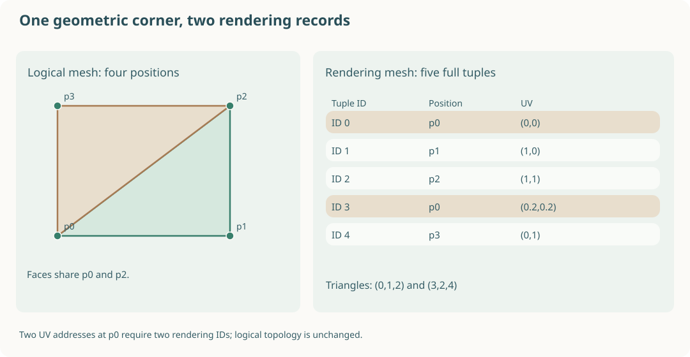
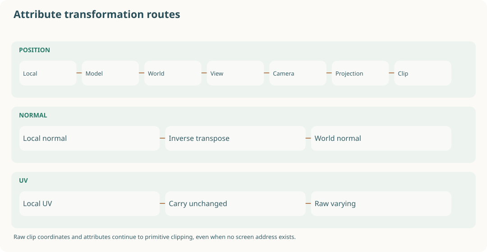
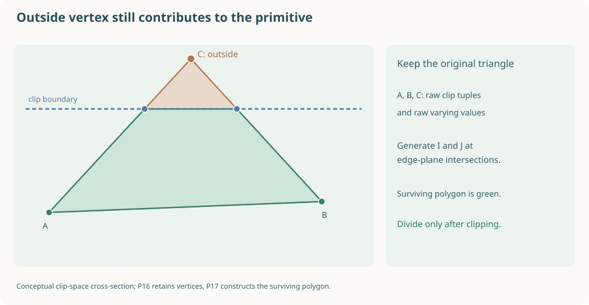
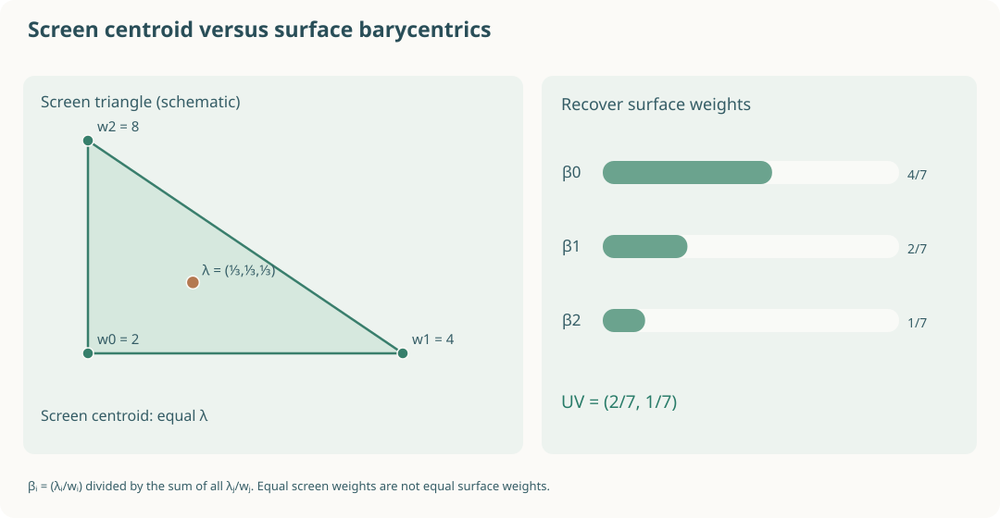
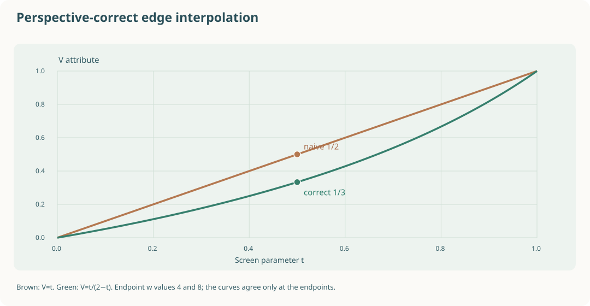
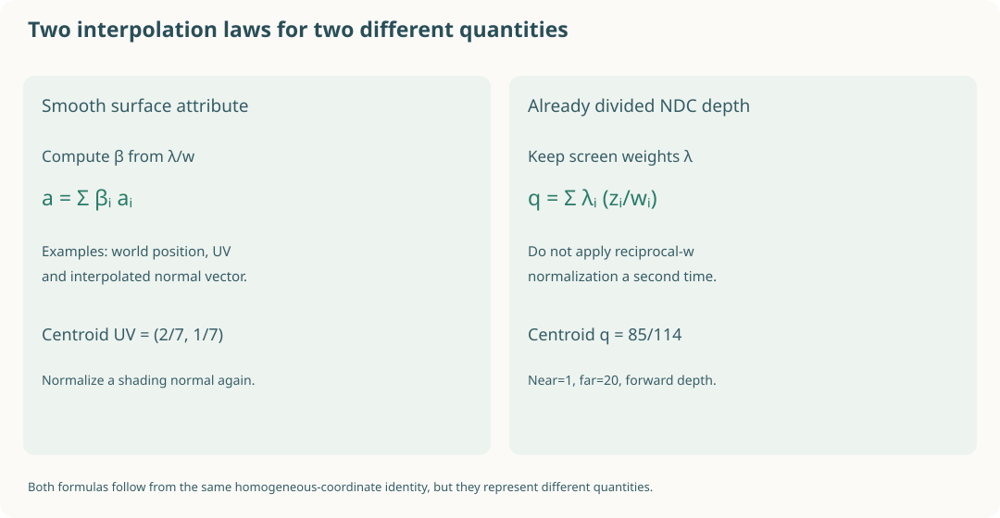

# Chapter 16 — The Long Journey of One Vertex

*From Geometry to Images — Part IV: The picture becomes an algorithm*  
*Reader edition / C++23 laboratory P16*

> A corner of a triangle carries more than its location. It carries the information that will eventually decide what an entire little piece of the picture looks like.

## A corner leaves the workshop

We have built a paper house from coordinates, triangles and indexed meshes. We have put several copies of a tree into the garden, attached them to groups, turned them without distorting their shapes, and built a camera capable of observing them. We even looked through two cameras and reconstructed the position of a point.

Now return to a single corner of the roof.

Imagine that the artist places a tiny sticker on that corner. The sticker has an address on a texture image. The surface also has an authored normal telling us something about the intended orientation of its shading. Later we may attach a colour, tangent frame, material identifier, joint weights or other data.

The renderer must carry the information that belongs to this corner through a series of transformations. Its position changes coordinate frames, its normal follows a different transformation law, and its texture address usually does not change at all.

Eventually, many points inside the projected triangle will need attributes too. They do not have their own stored vertices. We must reconstruct those attributes from the three corners.

The purpose of this chapter is to make that journey explicit. Instead of a mysterious function named Draw, we will construct an inspectable vertex stage whose inputs and outputs have distinct meanings. We will also derive the interpolation law that prevents a painted pattern from sliding unnaturally across a surface as it turns away from the camera.

This is the bridge between the geometry we have already mastered and the rasterizer we are about to construct.

## A corner is not necessarily a position

Return to the indexed square from Chapter 07. Four geometric positions describe two triangles. The shared diagonal has two incident triangles, and a single geometric corner can belong to both.

Now suppose the two triangles belong to different pieces of a texture atlas. At a shared position, one triangle needs texture coordinate (0,0), while the other needs (0.2,0.2).

There is still one geometric position at that corner. But there are two **rendering tuples**: one for each combination of position identity and texture address.

An OBJ face corner can independently reference position, texture-coordinate and normal streams. Chapter 10's importer preserves the full key

\[
(\text{position index},\text{texture index},\text{normal index}).
\tag{16.1}
\]

The optional attributes can be absent. Absence is a meaningful state, not necessarily the number zero.

To supply a simple indexed rendering stream, the importer unifies identical full keys. If two corners reference exactly the same full key, they can share a rendering vertex. If either texture or normal reference differs, they must remain distinct in that stream.

*Figure 16.1 — Rendering identity depends on all consumed vertex attributes. Geometric adjacency and rendering-stream identity must remain separate.*

The important subtlety is that attributes belong to the domains in which they are continuous. A normal may differ across a sharp crease. Texture coordinates may differ along a UV seam. Positions need not split in the logical mesh for either reason.

If we deduplicate only by numerical XYZ, we may accidentally destroy those discontinuities. Conversely, if we use the unified rendering indices as our only topological data, a texture seam may appear as a hole in the logical mesh.

Our Chapter 16 laboratory consumes the actual Chapter 10 rendering mesh, not a second invented format. It keeps each vertex's source key in the processed record.

### Fetching records from memory

A graphics implementation may store vertex attributes in an interleaved array of structures, such as position, normal and UV repeated for each vertex. Alternatively, it may store separate arrays of positions, normals and UVs.

Neither layout changes the mathematical meaning of the attributes. The important contract is how an element's address is calculated.

For an interleaved stream with byte offset o, stride S, attribute offset a and vertex index i, the first byte of an attribute is

\[
\operatorname{address}=o+iS+a.
\tag{16.2}
\]

Its entire encoded component range must fit inside the accessible buffer. Multiplication and addition must be checked for overflow before using the address. Chapter 10 developed this idea for glTF accessors.

There are also format rules: a three-component float position and a normalized unsigned integer colour require different decoding. A normal encoded in a compact integer format cannot simply be interpreted as three binary32 values.

Our CPU implementation consumes already decoded C++ objects. It is a mathematical reference for a later vertex-fetch adapter, not a raw graphics buffer decoder.

## One vertex invocation, one draw context

The same indexed rendering vertex may appear in several triangles. If the vertex-stage function is deterministic and receives the same input and draw state, evaluating it again gives the same mathematical result.

That suggests a simple classroom optimization: evaluate each referenced rendering ID once per draw batch and reuse the processed record when assembling triangles.

Suppose two triangles have indices (0,1,2) and (0,2,3). There are six corner references but only four distinct rendering IDs. Our CPU stage makes four evaluations in this case.

Introduce a UV seam at position zero, and the second triangle may instead reference a distinct rendering ID for that same position. The number of distinct full tuples becomes five. The CPU stage makes five evaluations.

This is not a claim about the number of vertex shader invocations on a particular GPU. Real hardware has implementation-dependent scheduling and reuse policies. Shader code may also depend on instance identifiers or other contextual inputs. A shader's results must not be cached across incompatible draw contexts.

Imagine our five tree instances from Chapter 11. They share one source geometry asset, but each has a different model transform. A transformed vertex from tree A is not automatically valid for tree B.

The identity of the computation includes the draw state: model, view, projection, and every other input used by the vertex function. Our VertexStage object owns one fixed draw context. Its per-draw cache is newly constructed inside draw. It does not store transformed positions back into the asset.

The C++ reference keeps a vector of optional processed records indexed by rendering ID. Unreferenced records remain empty. Invalid triangle indices are rejected before processing the draw. The original index triples remain available for primitive assembly.

This is a small but useful model of **vertex processing followed by primitive assembly**.

## Follow the corner through four coordinate frames

Take a local position \(p_L\), a model affine map \(M=(A,t)\), and a rigid camera-to-world pose \((R,C)\).

The corner's world position is

\[
p_W=Ap_L+t.
\tag{16.3}
\]

The camera-local position is

\[
p_C=R^T(p_W-C).
\tag{16.4}
\]

Notice that we subtract the camera center before applying the inverse rotation. This is the center-relative expression from Chapter 13.

Append one to the camera-local point and apply the projection matrix from Chapter 14:

\[
\boxed{h=P(p_C,1)^T=(x_c,y_c,z_c,w_c)^T.}
\tag{16.5}
\]

The result is a homogeneous clip coordinate. It is not yet a screen address.

A point strictly inside the viewing volume with positive w can be divided and passed through the viewport:

\[
u=o_x+\frac{W}{2}(1+x_c/w_c),
\quad v=o_y+\frac{H}{2}(1-y_c/w_c).
\tag{16.6}
\]

The complete processed record retains the source key, local position, world position, camera-local position, raw homogeneous clip coordinate, clip-plane classification and optional screen address.

*Figure 16.2 — Position, normal and texture coordinate have different transformation laws. The clip tuple must survive independently of the optional screen point.*

We could compose the model, view and projection matrices into one matrix before processing every vertex. That is often useful for reducing redundant arithmetic. But for our first tracer, keeping the intermediate quantities is more valuable. When an image appears wrong, the first incorrect stage identifies the relevant coordinate boundary.

A matrix product that agrees with the intended real-arithmetic expression may still evaluate differently under finite precision. The explicit trace is a diagnostic implementation, not a bitwise prediction of every GPU's shader arithmetic.

## The normal is a different kind of information

A normal cannot generally be transformed by the same matrix as a point. Translation does not affect its direction, and nonuniform scale requires the inverse transpose.

From Chapter 11,

\[
\boxed{n_W=\frac{A^{-T}n_L}{\|A^{-T}n_L\|}.}
\tag{16.7}
\]

The lab chooses to output a normalized world-space normal at each vertex when the input contains an authored normal. This is a particular shading convention. An application using a different normal representation must make its interpolation and normalization policy explicit.

Suppose \(A=\operatorname{diag}(2,1,3)\), and a local normal is proportional to (1,1,0). The transformed normal is proportional to (0.5,1,0). A local tangent (1,-1,0) becomes (2,-1,0). Their dot product remains zero.

Treating the normal as an ordinary tangent instead would give (2,1,0), whose dot product with (2,-1,0) is three. The normal is no longer perpendicular.

The normal matrix depends only on the model's linear part, so our stage computes it lazily once when an authored normal is first encountered. It is not necessary for a position-only draw. A singular model can collapse positions into a lower-dimensional shape, but it cannot supply the usual inverse-transpose normal transformation. We reject that operation when requested rather than inventing a normal.

The determinant sign still matters for winding and culling. A reflected instance's authored normal transformation and winding-derived orientation need a consistent later rasterizer policy. We do not change the triangle's indices in this stage.

The texture coordinate, on the other hand, is simply carried through unchanged. A material may choose to apply a UV transformation, but no rule says that moving an object three metres in the world should add three to its texture coordinate.

## Outside the image does not mean disposable

Suppose one roof vertex lies behind the camera, while the other two are in front.

If our vertex stage immediately discards the rejected vertex, the triangle loses an endpoint. Its edges cannot be intersected with the viewing volume correctly.

The vertex-stage output is a homogeneous position plus a set of raw varying attributes. It is legal for that output to lie outside a clip plane. The primitive clipper is responsible for deciding which part of the assembled triangle survives.

Our processed record therefore retains the clip coordinate and original payload even when the optional screen address is absent. We do not divide by zero or negative w merely to get a number for the debug report.

*Figure 16.3 — A rejected vertex is not a rejected primitive. The clipping stage needs all original endpoints.*

In the next chapter we will interpolate new vertices at clip-plane intersections. An edge intersection parameter is calculated using the linear homogeneous plane function. At that same parameter, we interpolate the raw varying values appropriate to the primitive.

We must not pre-divide these raw values in a way that loses the information needed by clipping. Only after clipping do we construct the quantities used for perspective-correct interpolation across screen samples.

This distinction between **clip-edge interpolation** and **screen-space interpolation** is one of the most important transitions in the entire rendering pipeline.

## Three corners can describe a whole surface

Consider a triangle with local positions \(p_0,p_1,p_2\). A point on its surface can be written using barycentric weights:

\[
p=\beta_0p_0+\beta_1p_1+\beta_2p_2,\qquad
\beta_0+\beta_1+\beta_2=1.
\tag{16.8}
\]

For an interior point the weights are nonnegative.

If a scalar or vector attribute a is intended to vary linearly over the original triangle, the corresponding value is

\[
a=\sum_i\beta_i a_i.
\tag{16.9}
\]

These are **surface barycentrics**. We have used barycentric geometry before. Now we must be careful about the coordinate system in which the weights are calculated.

After perspective projection, the screen triangle has vertices \(s_i\). A screen sample inside it has its own weights \(\lambda_i\):

\[
s=\sum_i\lambda_i s_i,\qquad \sum_i\lambda_i=1.
\tag{16.10}
\]

Under orthographic projection, which is affine, the two sets of weights agree for a nondegenerate projected triangle. Under perspective projection they generally differ.

That is because perspective projection is not an affine map in divided coordinates. It takes a linear clip coordinate and divides by a varying fourth component.

If we simply use screen-space barycentrics to interpolate an attribute that should be linear on the original surface, we create a different attribute field. This is the source of the familiar warped texture error in naive perspective rendering.

## Derive the reciprocal-w rule

We know the projected triangle's homogeneous vertices \(h_i=(x_i,y_i,z_i,w_i)\). Assume it has already been clipped and each w is positive.

Because the model, view and projection operations are linear or affine before the divide, a surface point with barycentrics \(\beta_i\) has clip coordinate

\[
h=\sum_i\beta_i h_i,\qquad
w=\sum_i\beta_i w_i.
\tag{16.11}
\]

Its divided horizontal coordinate is

\[
x_n=\frac{\sum_i\beta_i x_i}{\sum_i\beta_i w_i}.
\tag{16.12}
\]

Write \(x_i=w_i x_{ni}\). Then

\[
x_n=\sum_i\frac{\beta_iw_i}{\sum_j\beta_jw_j}x_{ni}.
\tag{16.13}
\]

The same weights appear for Y. The viewport is affine, so it does not change these barycentric weights. For a nondegenerate projected triangle,

\[
\boxed{\lambda_i=\frac{\beta_iw_i}{\sum_j\beta_jw_j}.}
\tag{16.14}
\]

We can now solve for the surface weights. Divide each lambda by its own w and renormalize:

\[
\boxed{
\beta_i=\frac{\lambda_i/w_i}{\sum_j\lambda_j/w_j}.
}
\tag{16.15}
\]

Substitute into the attribute equation:

\[
\boxed{
a=\frac{\sum_i\lambda_i(a_i/w_i)}
{\sum_i\lambda_i/w_i}.
}
\tag{16.16}
\]

This is perspective-correct interpolation. It is a consequence of homogeneous geometry, not an arbitrary texture filtering trick.

*Figure 16.4 — The reciprocal-w normalization recovers the barycentric weights in the original surface domain.*

In a raster implementation one can interpolate \(a_i/w_i\) and \(1/w_i\) linearly in screen space and divide their results. In our teaching implementation we explicitly compute the surface weights so every attribute follows the same derivation.

The code scales all reciprocal-w factors by the minimum positive w before normalizing. A common nonzero scaling of all unnormalized weights cancels in the quotient. This avoids directly forming an enormous reciprocal for a tiny positive w. Extremely disparate values can still underflow; our finite binary64 implementation is not a universally certified interpolation method.

## The centroid is not the center of the surface

Our native witness is deliberately simple. In graphics camera coordinates, choose

\[
p_0=(0,0,-2),\quad p_1=(2,0,-4),\quad p_2=(0,4,-8).
\]

Attach UVs (0,0), (1,0), (0,1). Use the identity model and camera, a 640 by 480 image, focal scales 400 and principal point (320,240).

The projected screen positions are

\[
s_0=(320,240),\quad s_1=(520,240),\quad s_2=(320,40).
\tag{16.17}
\]

The w values are 2,4,8. At the screen centroid,

\[
\lambda=(1/3,1/3,1/3).
\]

The unnormalized surface weights are proportional to \(1/2,1/4,1/8\), so

\[
\boxed{\beta=(4/7,2/7,1/7).}
\tag{16.18}
\]

The corresponding UV is (2/7,1/7), not (1/3,1/3).

The interpolated world position is

\[
p=(4/7,4/7,-24/7).
\tag{16.19}
\]

Project this reconstructed point with the independent pinhole model from Chapter 13. Its u coordinate is \(320+400(4/24)=386.666\ldots\); its v coordinate is \(240-400(4/24)=173.333\ldots\). These are exactly the screen centroid coordinates in real arithmetic.

Try the same calculation with the naive surface weights (1/3,1/3,1/3). The world point is \((2/3,4/3,-14/3)\), and its projection is not the screen centroid. Thus the affine interpolation error can be exposed by geometry alone, without needing a texture image.

This is a valuable pattern for testing a renderer: choose a known surface point, project it, calculate screen barycentrics, reconstruct its attributes, and compare against the known generating point. Do not compare two implementations that might share the same mistaken formula.

### Follow one edge

Along the screen edge from vertex one to vertex two, let the screen weights be (0,1-t,t). With w values 4 and 8,

\[
\beta_2=\frac{t/8}{(1-t)/4+t/8}=\frac{t}{2-t}.
\tag{16.20}
\]

The V texture attribute is \(\beta_2\). At t=0.5, the correct value is 1/3 rather than 1/2.

*Figure 16.5 — The UV interpolation error is largest away from endpoints. Equal endpoint values do not prove the interior is correct.*

The CPU viewer exports 101 samples along that edge, including both the naive and correct UV values, their continuous image positions and the normalized depth.

## Depth is the exception that is not really an exception

At this point a natural question arises: should the depth buffer's NDC Z be interpolated with the same reciprocal-w normalization?

The answer depends on which quantity is being interpolated.

An ordinary world-space scalar varying attached to the triangle follows equation (16.16). But the hardware-style depth value is already a divided homogeneous coordinate \(z_c/w_c\).

Repeat equation (16.13) for z:

\[
z_n=\frac{\sum_i\beta_i z_i}{\sum_i\beta_iw_i}
=\sum_i\lambda_i\frac{z_i}{w_i}.
\tag{16.21}
\]

Therefore normalized depth is **screen-linear**:

\[
\boxed{q=\sum_i\lambda_i q_i,\qquad q_i=z_i/w_i.}
\tag{16.22}
\]

We must not perspective-correct it a second time. That would interpolate a different mathematical quantity.

For the witness with near one and far twenty, the depth map is \(q=20/19-(20/19)/d\). At the screen centroid, the mean reciprocal axial depth is

\[
\frac13(1/2+1/4+1/8)=7/24.
\]

The correct normalized depth is therefore \(85/114\). The reconstructed surface point has axial depth \(24/7\), and substituting that depth into the same analytic formula yields exactly \(85/114\).

*Figure 16.6 — Different quantities require different interpolation laws. Hardware depth, axial distance and arbitrary vertex attributes are not interchangeable.*

For reverse-Z the same screen-linear rule holds; only the depth map and later comparison policy change. Orthographic projection has constant w and the reciprocal-w weights reduce to screen weights.

## Smooth, noperspective and flat

Real shader languages often let a developer choose interpolation qualifiers. Their exact names and supported sampling modes depend on the language, but the mathematical distinctions are straightforward.

A smooth perspective-correct varying is the original surface-linear attribute described above. A noperspective varying is deliberately defined to be linear in window coordinates. A flat varying is constant across the primitive, usually selected from a specified vertex according to the API's provoking-vertex convention.

A material ID, for example, is not naturally averaged as an integer across three corners. A primitive ID does not become 1.7 somewhere between primitives one and two. Such discrete attributes need a flat or otherwise explicit selection policy.

An authored normal is typically interpolated as a vector, then normalized again. The weighted sum of unit vectors is not generally a unit vector. Opposite normals can cancel. Our code refuses a zero or unnormalizable interpolated normal instead of silently inventing a direction.

Missing attributes are another policy decision. The reference supports optional UV and optional normal. If all three corners omit an attribute, the result omits it. If presence is mixed across a triangle, the interpolation routine rejects that input. A production importer could choose to generate normals or supply a default UV; that is an explicit preprocessing operation, not an invisible feature of the interpolator.

The lab implements smooth attributes and screen-linear NDC depth. It explains, but does not implement, generic interpolation qualifiers, derivative operations, multisample centroid selection or provoking-vertex modes.

## The native vertex pipeline tracer

Read `include/book03/vertex_pipeline.hpp` after the asset importer, scene forest, pinhole and projection headers.

The VertexStage owns a fixed model, camera pose, projection and viewport. It accepts the Chapter 10 ObjRenderingVertex, computes the world position and optional normal, transforms the position to camera space, and uses the Chapter 14 projection trace. Its output retains the raw clip position and varying payload.

The draw method evaluates only referenced rendering IDs and retains the original triangle index triples. The screen_barycentrics function derives floating barycentrics from the projected triangle using a normalized two-by-two determinant. It refuses a near-degenerate determinant. It is not the exact edge coverage rule we will build later.

The interpolate_inside_triangle function requires nonnegative screen weights summing to one within a stated tolerance. It requires already accepted positive-w vertices. It computes reciprocal-w surface weights, interpolates world position and optional UV/normal, renormalizes the normal, and separately computes screen-linear depth.

The code does not clip crossing primitives yet. A crossing triangle can leave the vertex stage intact, but cannot be passed to the interpolation routine until its surviving geometry has been constructed.

The companion program imports a synthetic OBJ triangle from text. Once the CMake project has been compiled, use:

~~~text
book03_vertex inspect
book03_vertex csv varying-edge.csv
book03_vertex svg varying-edge.svg
~~~

The report prints source stage coordinates and the centroid's corrected UV and depth. The CSV contains the 101 edge samples described above. The SVG draws the projected reference triangle and the computed interpolation curves. No picture is shaded or rasterized.

The independent test source also constructs a two-triangle seam fixture, verifies that five rendering tuples represent four geometric positions, and checks that a new model placement changes the result even for the same source mesh. A separate transformed-camera witness exercises a nonuniform model normal and a rotated camera. Invalid indices, singular normal transforms, outside clip vertices and mixed varying presence have explicit rejection tests.

For 3,000 seeded surface points, the test first generates known barycentrics in the original triangle, then uses the independent calibrated pinhole projection and screen barycentrics to recover the generating position and UV. The bounded numerical domain is deliberately controlled.

These are source-authored contracts; a compiler and actual execution must still verify them.

## Your turn: trace, falsify, reconstruct

**Reconstruct — identity.** Two triangles share a position but have different UVs at that position. Explain why geometric identity and rendering identity are different.

**Implement — index reuse.** For triangle indices (0,1,2) and (0,2,3), count distinct rendering IDs. Add a seam by replacing the second triangle's first index with 4. How many invocations does the reference make?

**Transfer — draw state.** Two tree instances share the same source index. Explain why cached transformed positions cannot be reused across their different model transforms.

**Falsify — normal transform.** Apply scale (2,1,3) to tangent (1,-1,0) and normal (1,1,0). Compare the ordinary vector transform of the normal with the inverse transpose.

**Explain — clip payload.** A vertex has negative w. Why is it unsafe to discard its attributes before clipping the assembled triangle?

**Reconstruct — centroid.** For w=(2,4,8) and equal screen weights, derive the surface weights without looking at the result above. Recover the UV.

**Falsify — equal depth.** Repeat the derivation when all w values equal 4. Why does screen-affine interpolation happen to be correct then?

**Transfer — the edge.** With endpoint w values 4 and 8, derive the correct attribute V at screen t=0.75. Compare it with the naive value.

**Reconstruct — depth.** Compute the forward NDC depth at the reference screen centroid using both the endpoint depth average and the reconstructed world point.

**Implement — flat values.** Describe a policy for primitive material identifiers. Why would interpolating numeric IDs be a mistake?

**Falsify — missing data.** A triangle contains UVs on two corners but not the third. Describe two explicit preprocessing or validation policies; do not silently treat the missing UV as a measured zero.

**Challenge — independent oracle.** Start with a surface barycentric triple, calculate the world position, project it, compute its screen barycentrics, and recover its surface barycentrics. Why is this a better test than merely plotting a visually pleasing UV gradient?

### Selected answers

Four distinct IDs become five when a seam introduces index four. Source geometry can still contain four positions.

The scaled tangent is (2,-1,0); inverse-transpose normal is proportional to (0.5,1,0). Their dot product is zero. The naive transformed normal (2,1,0) gives dot product three.

The screen centroid has surface weights (4/7,2/7,1/7), and UV (2/7,1/7). Constant w cancels out of the normalization, leaving the screen weights unchanged.

At t=0.75 the corrected edge V is 0.75/1.25=0.6, not 0.75. The normalized forward depth at the centroid is 85/114.

A material identifier can be stored per primitive, or selected from a designated provoking vertex under an explicit flat policy. It must not be treated as a continuous scalar varying.

## The vertex reaches the edge of the world

We can now fetch one corner, preserve its independent attribute identities, place it in the world, express it relative to the camera, produce its homogeneous clip coordinate and understand what information must cross the boundary into primitive processing.

We also understand why the three weights inside a picture are not generally the three weights on the original surface.

The next chapter, **Chapter 17 — Shapes That Refuse to Leave the Window**, will construct the missing geometric operation: clipping complete segments and triangles against homogeneous planes, generating new vertices with interpolated raw payloads and preserving the surviving part of each primitive.

We are no longer assembling isolated mathematical utilities. We are building the stages of a real, explainable CPU rendering pipeline.

## Source custody

The original Computing Foundations chapter 33 (Projection, Clipping, and Raster Sampling) contains homogeneous division and perspective-correct interpolation material, and Graphics Vision and XR chapter 41 (Per-Vertex and Per-Corner Mesh Attributes) preserves the wider attribute, skinning and animation context. Their inspected source identities and remaining obligations are recorded in PASS16_LEGACY_AUDIT.md. The new chapter and laboratory are additive. Original notes and published books remain unmodified.
