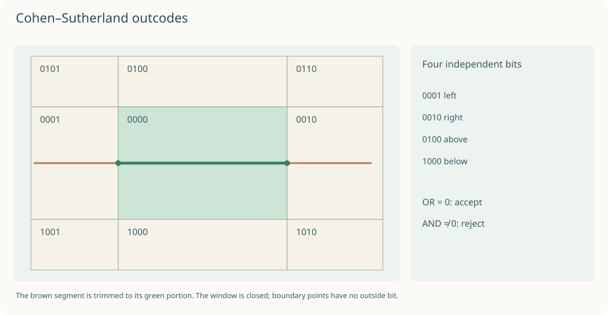
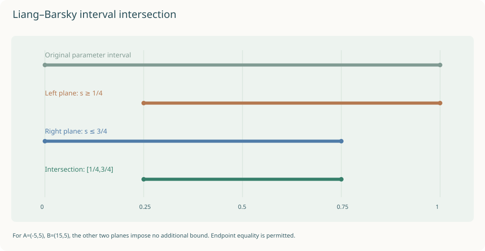
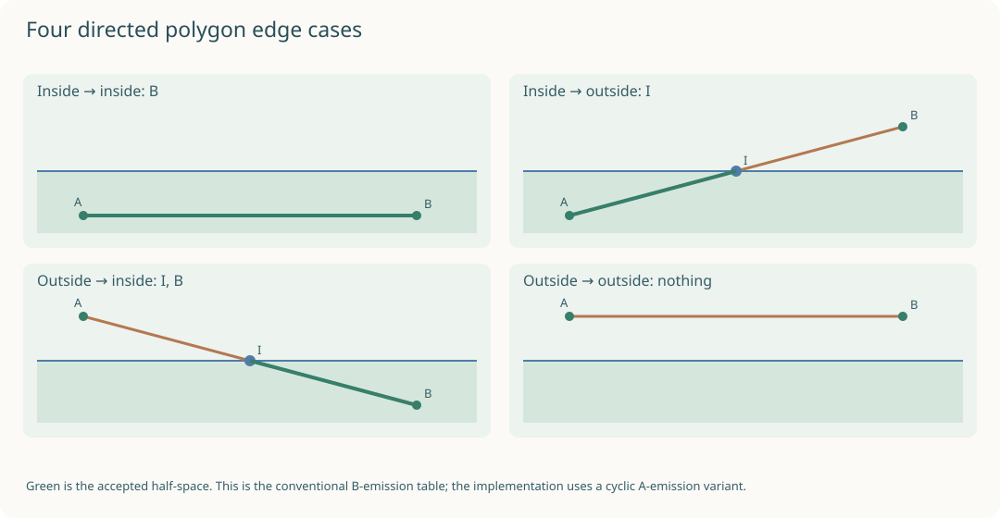
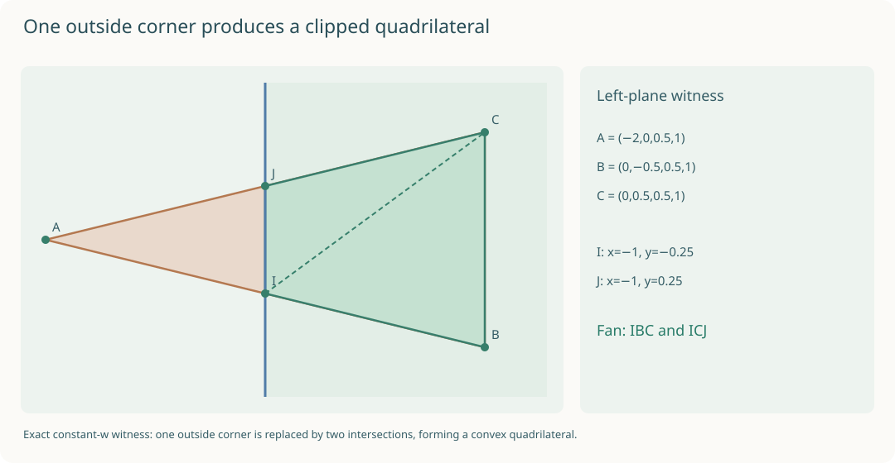
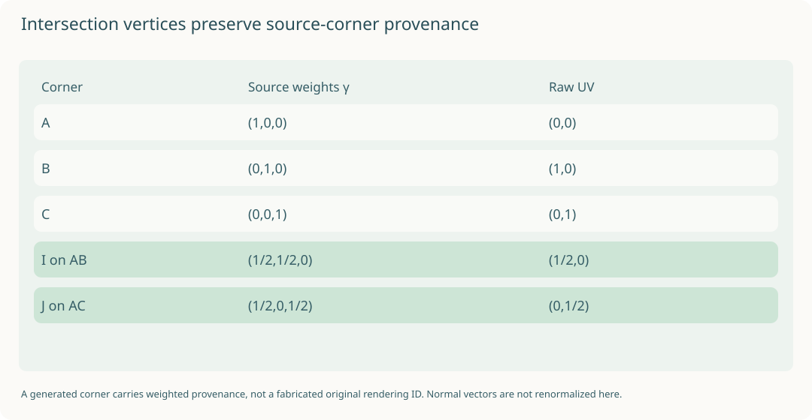

# Chapter 17 — Shapes That Refuse to Leave the Window

*From Geometry to Images — Part IV: The picture becomes an algorithm*  
*Reader edition / C++23 laboratory P17*

> The window is not a pair of scissors that throws away an entire shape whenever one corner escapes. It is a precise instruction for keeping the part that belongs inside.

## The dragon is too large for the photograph

Our dragon has finally reached the camera. Its nose fills half the photograph, its wings extend beyond the edges, and its tail is still visible between the trees. One triangle of its wing crosses the plane of the camera itself.

If we were drawing on paper, we would simply stop our pencil at the edge. But the renderer cannot rely on such an intuitive instruction. It receives vertices, some of which have no legal screen address at all.

Chapter 16 deliberately retained these vertices. Their raw homogeneous positions and the attributes attached to them are still available, even when the vertex tracer cannot divide their fourth coordinate.

Now we must make good on that decision. We will cut line segments against a rectangular window, extend that idea to polygons, and finally clip triangles in the four-component coordinate space that our projection matrix produces.

Clipping is not culling. Culling decides whether an object or primitive can be omitted. Clipping constructs the portion of a primitive that lies in a permitted geometric region. If a triangle has one corner outside and two inside, the correct answer can be a quadrilateral, not a smaller version of the original triangle.

Nor is clipping the same as rasterization. We work with continuous coordinates here. The next chapter will decide exactly which discrete pixel samples the resulting triangles own.

## Start with a pencil stroke

Consider a rectangular window with left edge l, right edge r, top edge t, and bottom edge b. Image rows grow downward, so \(l<r\) and \(t<b\).

A line segment starts at A and ends at B. Every point on it has the form

\[
p(s)=(1-s)A+sB,\quad 0\le s\le1.
\tag{17.1}
\]

This parameter describes the fraction of the original segment. It is independent of the segment's physical length.

The closed rectangular region consists of four linear inequalities:

\[
x-l\ge0,\quad r-x\ge0,\quad y-t\ge0,\quad b-y\ge0.
\tag{17.2}
\]

A point on an edge belongs to the region. That is a continuous geometric convention. It does not yet say whether a rasterizer should count a sample on a shared triangle edge twice.

Imagine the window [0,10] by [0,10] and the segment A=(-5,5), B=(15,5). Its x coordinate is -5+20s. The left boundary is reached at s=1/4, the right boundary at s=3/4. We keep the interval [1/4,3/4], giving endpoints (0,5) and (10,5).

This small calculation contains the heart of two classic algorithms.

## Cohen–Sutherland: give every point a little passport

A rectangle divides its surrounding plane into nine regions. Instead of naming all nine, attach four independent bits to a point. Bit 0 means left of the window, bit 1 means right, bit 2 means above, and bit 3 means below.

The inside region has code zero. A point in the upper-left region has bits 0 and 2 set. A point exactly on a boundary does not set the corresponding outside bit.

*Figure 17.1 — Each bit is a failed half-space test. The nine spatial regions emerge from combinations of the four bits.*

Let the endpoint codes be \(c_A,c_B\).

If their bitwise OR is zero, both endpoints satisfy all four inequalities. The whole segment satisfies them too, because a rectangle is convex. We can accept it immediately.

If their bitwise AND is nonzero, they fail at least one common half-space. Every point between them fails that same half-space. We can reject the whole segment immediately.

Otherwise, the segment may cross the rectangle. Choose an outside endpoint and one of its set bits. Intersect the segment with the corresponding boundary, replace that endpoint, and recompute its code.

For a vertical boundary \(x=k\), solve

\[
s=(k-A_x)/(B_x-A_x),
\quad y=A_y+s(B_y-A_y).
\tag{17.3}
\]

For a horizontal boundary, exchange the roles of x and y.

Why is a zero denominator not normally encountered here? If a segment is vertical and both endpoints are strictly left of the window, their left bits already give trivial rejection. A vertical line cannot cross a vertical boundary unless it lies on that boundary, in which case the outside bit is not set.

The algorithm was designed around small, inexpensive classifications and early acceptance or rejection. It is especially attractive when many segments are entirely inside or outside the window.

Our reference stores the intersected coordinate exactly on the chosen boundary and evaluates the other with a linear interpolation. In floating arithmetic, recomputed outcodes may still behave unexpectedly at extreme scales. We use a bounded input domain and an iteration limit, and reject a nonconverging case explicitly instead of looping forever.

## Liang–Barsky: negotiate one interval

We can solve the same problem without repeatedly replacing endpoints.

For each half-space, insert equation (17.1) into its inequality. We obtain

\[
g(s)=g_0+ks\ge0.
\tag{17.4}
\]

Here \(g_0\) is the boundary function at A, and k is its change from A to B.

If \(k>0\), the inequality requires \(s\ge-g_0/k\). This is a lower bound on the permitted interval.

If \(k<0\), it requires \(s\le-g_0/k\). This is an upper bound.

If \(k=0\), the boundary function is constant. When \(g_0<0\), the entire line lies outside that half-space. Otherwise that plane imposes no new bound.

Start with \(s_{\min}=0,s_{\max}=1\). Intersect each of the four constraints with that interval. Reject if \(s_{\min}>s_{\max}\). If the bounds become equal, the surviving segment is a single point on the closed region.

*Figure 17.2 — Liang–Barsky clipping maintains the largest entering parameter and smallest leaving parameter. Only their intersection survives.*

For our example with x=-5+20s, the left inequality is -5+20s≥0, requiring s≥0.25. The right inequality is 15-20s≥0, requiring s≤0.75. The top and bottom inequalities are already satisfied. The result is exactly the same as before.

The algorithm works because each half-space cuts a line into an interval. More generally, a convex region is an intersection of half-spaces; the surviving portion of a line through it is also an interval. This principle extends to three-dimensional and homogeneous segment clipping.

Both algorithms in our lab operate on continuous image coordinates. We do not round an intersection to an integer pixel. The 2D reference accepts finite coordinates of magnitude at most \(10^{12}\). Its final Liang–Barsky coordinates are clamped to the accepted rectangle to absorb ordinary endpoint rounding. This is a floating implementation policy, not a proof that an uncertain interval has been classified exactly.

Our tests compare the two different algorithms on 4,000 deterministically generated segments in a bounded domain. Agreement is useful, but it is not a proof of correctness: that is why the suite also includes independent hand-calculated crossings, a tangent corner and a parallel outside segment.

## From one stroke to an entire polygon

A triangle contains three edges. Clipping each edge separately is not sufficient to construct the surviving filled region. We may also need to create a new boundary edge along the clipping plane.

The Sutherland–Hodgman algorithm gives us a remarkably simple way to do this for convex clipping regions.

Take an ordered polygon and one half-space whose inward boundary function is g. Walk around the polygon's boundary. For a directed edge A to B, there are four ordinary cases:

| A | B | What to emit |
|---|---|---|
| Inside | Inside | B |
| Inside | Outside | Intersection I |
| Outside | Inside | Intersection I, then B |
| Outside | Outside | Nothing |

A vertex exactly on the boundary counts as inside. When using the table directly, take care not to emit an on-plane endpoint twice.

Our implementation uses an equivalent cyclic ordering: visit every edge A to B, emit A if it is inside, and emit an intersection only when the two endpoint signs are strictly opposite. This automatically emits an on-plane vertex through its own inside case without generating a duplicate at that endpoint.

*Figure 17.3 — The intersection is generated only when an edge crosses the boundary. The next edge continues the same ordered polygon.*

After one pass, the surviving polygon satisfies one half-space. Feed that polygon into the next plane's pass. Continue until every boundary has been processed, or the polygon is empty.

For a convex input polygon, intersecting with a half-space preserves convexity and cyclic boundary order in exact arithmetic. A triangle therefore remains a convex polygon, though it may gain vertices. Each nondegenerate plane cut can increase its vertex count by at most one. After six half-space passes, a triangle can have at most nine vertices in the ordinary nondegenerate exact case. Degenerate or floating duplicate records require separate handling.

This is why the temporary polygon can be small, even though the rest of a scene may contain millions of triangles.

## Why the dragon must be clipped before the divide

Chapter 14 chose clip coordinates \(h=(x,y,z,w)\), with a zero-to-one depth interval and graphics local negative Z forward.

The six closed homogeneous plane functions are

\[
g_L=w+x,\quad g_R=w-x,\quad
g_B=w+y,\quad g_T=w-y,
\quad g_{Z0}=z,\quad g_{Z1}=w-z.
\tag{17.5}
\]

The allowed region satisfies all six inequalities \(g_i\ge0\).

These are linear functions of the four-component coordinate. We are not dividing by w in order to evaluate them.

A segment between two projected vertices has a homogeneous interpolation

\[
h(s)=(1-s)h_A+sh_B.
\tag{17.6}
\]

For a plane crossing, linearity gives

\[
g(h(s))=(1-s)g(h_A)+sg(h_B)=0.
\]

Solving,

\[
\boxed{s=\frac{g(h_A)}{g(h_A)-g(h_B)}.}
\tag{17.7}
\]

The equation describes the original edge parameter because the transformations before perspective division are affine or linear in homogeneous coordinates. That parameter is precisely what we need to interpolate an attribute attached to the original edge.

Do not compute the intersection by joining already divided screen coordinates when an endpoint has zero or negative w. At w=0, the finite screen map is singular. A negative-w endpoint may divide into a seemingly reasonable location even though it does not belong to the oriented clip cone.

The six inequalities imply \(w\ge0\): for example, adding the left and right plane functions gives 2w. If w is zero and all inequalities hold, x,y,z must also be zero. The homogeneous zero tuple is not a valid finite projective point.

For an ordinary perspective camera with a positive near plane, a correctly clipped finite triangle should not retain a zero-w point. Our general reference explicitly rejects a surviving unresolved polygon rather than inventing an arbitrary w epsilon. It also avoids naming z=0 the near plane unconditionally: under reversed depth, the near/far roles of z=0 and z=w change.

## Two new vertices from one old triangle

For a fully hand-checkable witness, use clip tuples

\[
A=(-2,0,0.5,1),\quad
B=(0,-0.5,0.5,1),\quad
C=(0,0.5,0.5,1).
\tag{17.8}
\]

A fails the left plane, because w+x=-1. B and C satisfy it with value one.

The intersection on AB has parameter one half, giving

\[
I=(-1,-0.25,0.5,1).
\]

The intersection on CA also lies halfway along that edge, giving

\[
J=(-1,0.25,0.5,1).
\]

The cyclic surviving polygon is (I,B,C,J). Every vertex satisfies the other five half-spaces. Its area can be covered with triangles (I,B,C) and (I,C,J).

*Figure 17.4 — This constant-w witness is both a hand derivation and the exact intended topology of the native clipping studio's fixture.*

In a general convex polygon, fan triangulation uses the first vertex as an anchor and constructs triangles (0,i,i+1) for i from 1 to n-2.

The clipping stage can retain coincident vertices or collinear runs. A fan may then contain zero-area triangles. The later rasterizer must reject degenerate screen triangles; the simple act of counting three or more stored polygon vertices is not proof of positive area.

The fan's internal diagonal is not an original edge of the model. If the renderer later displays a wireframe or outlines geometry, that distinction can matter. For filled rasterization, a consistent shared-edge sample ownership rule must ensure that the diagonal does not cause double coverage or cracks.

## The sticker must survive the cut

Return to the texture sticker on the roof. Suppose A,B,C in the example carry UVs (0,0), (1,0), (0,1). At I on AB, the original edge parameter is one half. The UV must therefore be (0.5,0). At J on CA it is (0,0.5).

For an ordinary smooth surface attribute,

\[
a_I=(1-s)a_A+sa_B.
\tag{17.9}
\]

This is not the screen-space reciprocal-w formula from Chapter 16. We are interpolating on the original homogeneous edge before division.

After clipping, the newly generated vertices have their own clip w values and their own raw attributes. Then the usual perspective-correct interpolation recovers the intended surface field within each fan triangle.

We must not normalize a varying normal when we generate a clip intersection. The normal output from the original vertex stage is the field we intend to interpolate. If the endpoints have normals n_A and n_B, the raw value at the intersection is their weighted sum. Premature normalization changes that sum and generally changes the field on the surviving triangle. Normalize only when consuming the interpolated shading normal.

For the same reason, do not interpolate integer material identifiers as ordinary real numbers. Our reference supports only smooth world position, optional UV and optional normal. A flat primitive value must travel separately according to a chosen provoking-vertex policy. Noperspective varying clipping also needs its own screen-linear semantics; the simple raw edge rule is not a generic implementation of all shader qualifiers.

The laboratory gives each generated vertex a provenance triple \(\gamma=(\gamma_0,\gamma_1,\gamma_2)\), relative to the original triangle's three rendering corners. Start with the three unit basis triples. Every clipping intersection interpolates its provenance with the same s as its raw attributes.

In exact arithmetic,

\[
h_{\rm generated}=\sum_i\gamma_i h_i,\quad
a_{\rm generated}=\sum_i\gamma_i a_i,\quad
\sum_i\gamma_i=1.
\tag{17.10}
\]

*Figure 17.5 — At the midpoint of AB, source weights are (1/2,1/2,0); on AC they are (1/2,0,1/2). The source-corner domain preserves seams.*

These weights are exceptionally useful for debugging. If an attribute at an intersection is wrong, compare it with a direct weighted combination of the original corners. If a position appears on the wrong edge, reconstruct its original clip tuple and compare. In this reference the active-plane snap introduces a small floating discrepancy in the clip position, so comparisons use a stated tolerance rather than asserting bitwise equality of the reconstructed tuple.

Generated vertices do not acquire a fabricated source asset index. A screen-stage adapter carries only their clip position, raw varying payload and divided screen coordinates into the previous interpolation API; the original source/local/camera metadata fields of that adapter are not meaningful.

## The numerical problem hiding at an edge

A shared edge may be traversed A to B by one triangle and B to A by its neighbor. Mathematically their intersections agree. Numerically two different expressions can round to different points.

A very small disagreement can become a visible seam when the resulting screen positions are rasterized. Watertightness therefore depends on more than getting a plausible polygon count.

Our crossing routine always orders the outside endpoint first, independently of edge traversal. It computes the crossing parameter as

\[
s=\frac{|g_{\rm out}|}{|g_{\rm out}|+|g_{\rm in}|}.
\tag{17.11}
\]

The numerator and denominator are scaled by their maximum magnitude before division to avoid an unnecessary overflow risk. This makes a reversed shared-edge traversal use the same arithmetic expression when its clip endpoints agree exactly.

The generated position is snapped to the active plane: for the left plane, set x=-w; for z-min, set z=0. This removes rounding drift from that plane. It may slightly perturb the position from its exact weighted source reconstruction.

Snapping to one plane can still interact with an earlier plane. Our implementation checks the final stored tuple against every plane, and throws an explicit unresolved-boundary diagnostic when a surviving polygon violates the contract. It does not silently discard the polygon or clamp arbitrary coordinates until it looks inside.

This is deliberately conservative. It is not a certified robust clipper. The finite input bound of \(10^{12}\) avoids some overflow hazards, but cannot guarantee that every determinant or intersection is representable, or that every near-boundary classification is exact. Extremely tiny numbers can still underflow. A production approach may need shared-edge intersection caching with appropriate identity, adaptive predicates, consistent corner construction or exact arithmetic. Chapter 05's robust predicate discussion explains why a fixed epsilon is not a universal solution.

The opposite mistake is to use a broad epsilon to accept everything near a boundary. That silently changes the geometric region, and different triangles may make incompatible decisions. A tolerance can be a useful engineering policy, but it must have a clear meaning.

## Can we leave the entire dragon in the toy box?

Clipping a triangle is precise work. If the entire dragon is outside the viewing volume, we would rather reject its bounding shape before transforming every wing and scale. The two operations have different promises: culling rejects only objects that can safely be omitted, whereas clipping constructs the visible portion of a primitive.

Let the combined world-to-clip matrix C act on homogeneous column points P. Denote its four rows by r0,r1,r2,r3. The left clip inequality is x_c+w_c >= 0. Substituting the matrix rows gives the world-space inward plane (r3+r0)P >= 0. Applying the same argument to each clip inequality yields:

| Clip boundary | Inward plane row |
|---|---|
| Left, right | r3+r0, r3-r0 |
| Bottom, top | r3+r1, r3-r1 |
| Lower depth, zero-to-one | r2 |
| Upper depth | r3-r2 |
| Alternative lower depth, minus-one-to-one | r3+r2 |

These are row combinations because of the column-vector multiplication convention, not because of memory layout. Reverse-Z exchanges which depth boundary is semantically near or far, but does not change the zero-to-one extraction identities. An infinite-far projection may yield a constant inequality with zero spatial normal. If its constant is nonnegative, it is redundant; a negative constant indicates an empty permitted region. Do not normalize a zero normal. Numerical near-degeneracy requires a separate scale-aware policy, rather than blindly discarding a plane that may matter.

Write a finite inward plane as n dot X + d >= 0. The normal need not be unit length if we evaluate both the center and support radius in the same scale. A sphere centered at c with radius R has maximum plane value

\[
s_{\max}=n\cdot c+d+R\|n\|.
\]

If this is strictly negative, every point in the sphere is outside that half-space. The object may be culled. A value of zero is a touching case, not proof of exclusion. Finite precision needs a conservative uncertainty band or a certified bound; the strict comparison is an exact-arithmetic result.

An axis-aligned box has center c and half-extents e. Its offsets delta satisfy |delta_i| <= e_i. Each term n_i delta_i is maximized by choosing the corresponding endpoint according to the sign of n_i, so

\[
s_{\max}=n\cdot c+d+|n_x|e_x+|n_y|e_y+|n_z|e_z.
\]

For the plane x>=0, a box centered at (-3,0,0) with half-extents (1,2,1) has maximum plane value -2: reject it. Moving the center to (-0.5,0,0) gives +0.5: retain it. Passing every individual frustum-plane test does not prove that a box or sphere intersects the finite frustum; it only means no tested plane independently proves exclusion. A false positive costs extra work. A false negative deletes geometry that ought to be rendered.

For a transformed bounding sphere, a general linear transform A can turn it into an ellipsoid. Its enclosing world sphere needs radius at least R times the largest singular value of A. The Frobenius norm supplies a conservative, possibly looser upper bound. Taking only the largest diagonal entry is unsafe under shear. Alternatively extract the planes from the complete local-to-clip matrix and evaluate the original local bound. This avoids inventing an incorrect world-space radius.

**Try it.** Use n=(2,0,0), d=0 and the second box above. The maximum becomes +1; the retain decision is unchanged. For A=[[1,2,0],[0,1,0],[0,0,1]], explain why the largest diagonal entry (1) cannot bound the stretch of the unit vector (0,1,0). Its image has length sqrt(5).

This section derives the object-level early-rejection contract; the P17 native explorer still implements primitive clipping, not a production frustum-culling system.

*Source route: Computing Foundations/34, derived lines 684–879 and 935–1304; see the full Pass 34 source map for additional frustum corner, oblique clipping and numerical material.*

## The native clipping explorer

Open `include/book03/primitive_clipping.hpp`. The first section implements rectangular window outcodes, Cohen–Sutherland and Liang–Barsky. The next section defines homogeneous plane functions, a raw ClipVertex, source weights, symmetric edge crossing, single-plane polygon passes, final validation and fan triangulation.

The new laboratory uses the actual ProcessedVertex output from Chapter 16. It includes the complete vertex pipeline rather than inventing another camera convention.

After the native CMake project is compiled:

~~~text
book03_clip inspect
book03_clip csv clipped-polygon.csv
book03_clip svg clipped-polygon.svg
~~~

The fixed fixture is the triangle of equation (17.8). The report should contain four vertices and two fan triangles. CSV rows contain the clip position, UV, original-corner weights and derived continuous screen address. The SVG draws the original and computed surviving polygon, with its fan diagonal. This is a geometric diagnostic, not a filled rasterization.

The test suite includes 4,000 seeded segment comparisons and 2,000 single-plane triangle witnesses. The latter reconstruct clip coordinates and UVs from the original-corner provenance independently of the generated payload. It also checks exact boundary endpoints, a reversed edge, an entirely rejected triangle, a depth-plane crossing and an actual P14 projection of a triangle with a vertex behind the camera.

These are authored acceptance checks, not a claim that the compiled executable has already passed.

## Your turn: cut only what must be cut

**Reconstruct — outcodes.** Compute the codes of (-1,5), (5,-1), (-1,-1), (5,5) and (10,10) for the closed rectangle [0,10]².

**Falsify — trivial rejection.** Explain why two outside endpoints with disjoint outcodes do not prove that a line crosses the window. Construct a counterexample.

**Implement — interval clipping.** Clip the segment (-5,5) to (15,5) against the example window by deriving both parameter bounds.

**Transfer — a tangent.** The segment (-1,1) to (1,-1) touches one rectangle corner. What is the surviving interval? Why may a later rasterizer choose not to draw a segment with zero length?

**Reconstruct — homogeneous planes.** Write all six plane functions. Explain why reversing depth does not change the allowed clip inequalities.

**Falsify — divide first.** Construct a segment with one positive-w and one negative-w endpoint. Locate the zero-w parameter and explain why drawing between their divided screen positions is unsafe.

**Implement — the four polygon cases.** Derive the output polygon for a triangle with one outside vertex, and explain how your algorithm avoids duplicate on-plane endpoints.

**Reconstruct — raw varyings.** At an original edge crossing with s=1/4, interpolate UV (0,1) to (1,0). Give the source weights.

**Transfer — normalization.** Interpolate normals (1,0,0) and (0,1,0) at their midpoint. Compare the raw value and its normalized direction. Explain why the latter must not replace the former during clipping.

**Challenge — shared edges.** Design a test with two triangles sharing the same clipped edge in opposite directions. Compare their generated clip coordinates, ignoring triangle-specific provenance.

**Explain — numerical policy.** Why does snapping a coordinate to one plane not establish exact membership of the other five planes?

**Implement — fan assembly.** Triangulate a five-vertex convex surviving polygon. Count the triangles and identify the internal diagonals.

### Selected answers

The codes are 1,4,5,0,0. For the first crossing, the allowed interval is [1/4,3/4]; the tangent case has interval [1/2,1/2] and touches (0,0).

Two outside endpoints with disjoint codes can still miss the rectangle: (-2,1) to (1,-2) stays on x+y=-1, which has no point in the nonnegative quadrant.

For an AB crossing at s=1/4, the UV is (1/4,3/4), with source weights (3/4,1/4,0). The raw midpoint normal is (1/2,1/2,0), and its normalized direction has both nonzero components equal to \(1/\sqrt2\). Keeping the raw midpoint preserves the original linear field.

Five convex vertices produce three fan triangles, with internal diagonals from vertex zero to vertices two and three.

## The window is ready for its pixels

We now have a chain from imported rendering tuples to homogeneous vertices, complete surviving polygons and raw varying attributes. The resulting triangles have finite screen coordinates and can be passed into our interpolation machinery.

But a continuous triangle is not yet a set of discrete pixel samples. Two neighboring triangles can disagree about who owns a pixel whose center lies exactly on their shared edge.

**Chapter 18 — Who Owns the Edge** will resolve that problem using oriented edge functions, integer subpixel coordinates, exact bounded arithmetic and a consistent top-left ownership convention.

The dragon's wing finally fits inside the photograph. Now we must decide which tiny squares of the photograph it actually paints.

## Source custody

The original Computing Foundations chapters 33 (Projection, Clipping, and Raster Sampling) and 34 (Robust Predicates and Camera Sensitivity) remain intact. Their inspected homogeneous clipping passages and the remaining advanced obligations are recorded in PASS17_LEGACY_AUDIT.md. This additive chapter builds on the exact same zero-to-one clip convention as P14 and raw varying contract as P16. Native execution and publication acceptance remain separate.
