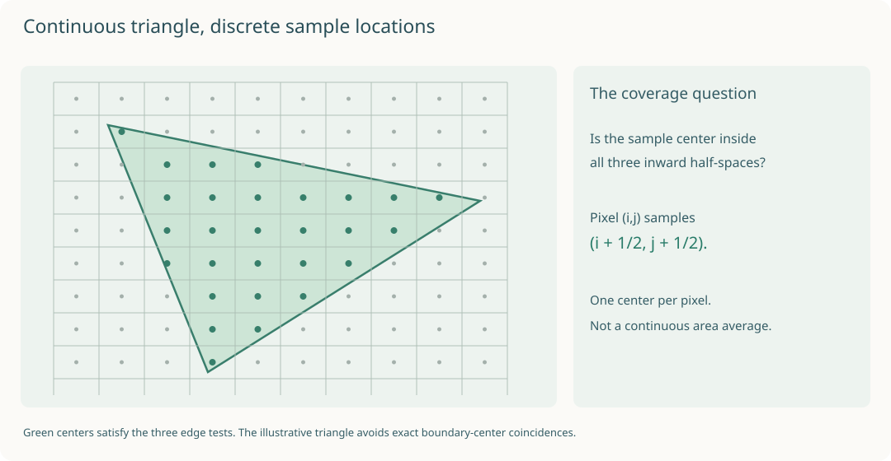
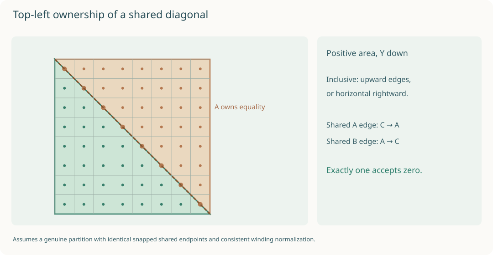
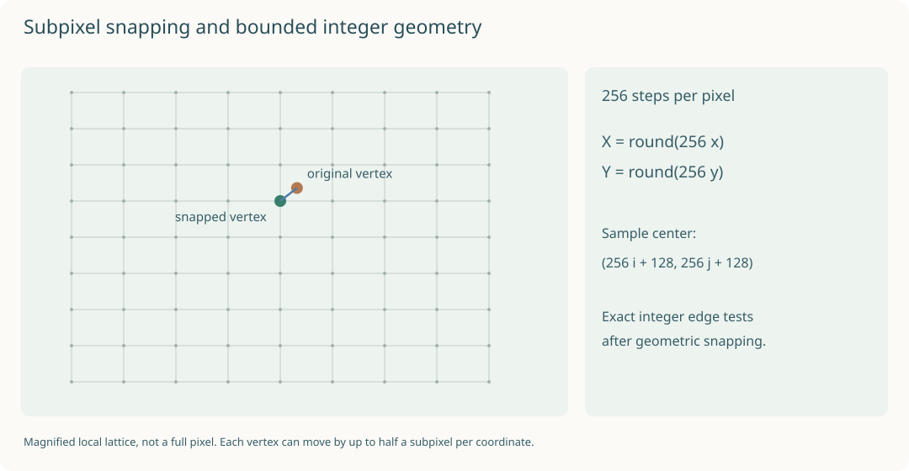
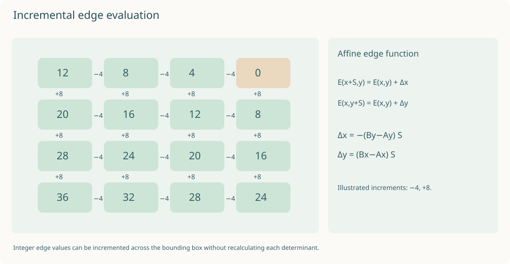
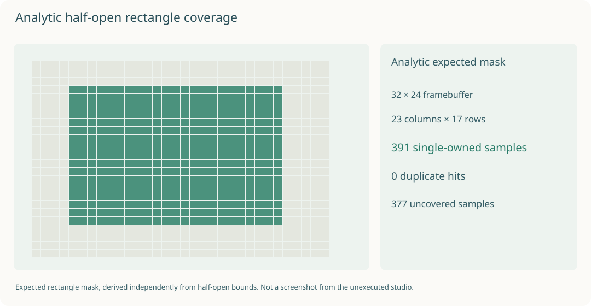
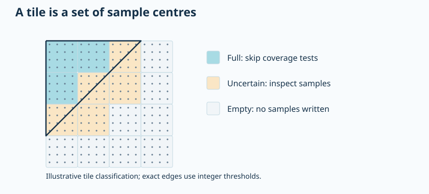
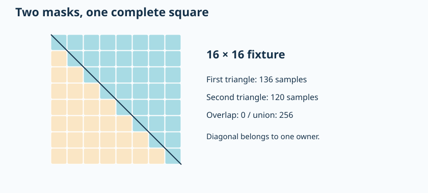

# Chapter 18 — Who Owns the Edge

*From Geometry to Images — Part IV: The picture becomes an algorithm*  
*Reader edition / C++23 laboratory P18*

> Two triangles can agree on the location of a shared edge and still disagree about who gets to paint it.

## The dragon's wing develops a crack

Our dragon has finally made it through the window. Chapter 17 kept the part of its wing inside the homogeneous viewing volume. We have assembled triangles, divided their clip coordinates and calculated their continuous screen addresses.

Imagine that the wing contains two triangles forming a square. The first triangle is painted green, the second orange. Their shared diagonal passes through the centers of several pixels.

If both triangles paint those centers, the answer depends on which triangle is drawn last. If neither paints them, a row of tiny holes appears. Move the camera a little and the holes may move too.

Neither problem is solved by making the image larger. The problem is a missing rule.

A triangle in mathematics is a continuous region. A framebuffer is a finite collection of sample locations. We need an explicit rule for converting one into the other, including the awkward moment when a sample lands exactly on an edge.

This is **rasterization**: determining which samples a primitive covers. We will not yet decide which of several surfaces wins at one sample; that is the depth-buffer problem of Chapter 19. Today, we will make neighboring triangles agree about the boundary itself.

## A square is not a sample

Remember our first chapter. A pixel has an integer address (i,j), and our continuous image-edge convention places its sample center at

\[
p_{ij}=(i+1/2,j+1/2).
\tag{18.1}
\]

Our origin is at the upper-left image edge. X increases to the right and Y increases downward.

A sample is a location at which we ask a question about a scene. It is not an assertion that the whole square around it has the same geometric content. A tiny triangle can occupy some area without covering any center. A large triangle can contain many centers.

In this chapter there is exactly one sample per pixel. Multisampling and filtering are separate contracts we will study later. Even perfectly consistent single-sample coverage can exhibit jagged diagonal edges.

*Figure 18.1 — The geometric triangle is continuous; coverage is a decision at the selected sample locations.*

## The edge function remembers which side you are on

Take a directed edge from A to B. For a sample P, define

\[
E_{AB}(P)=(B_x-A_x)(P_y-A_y)-(B_y-A_y)(P_x-A_x).
\tag{18.2}
\]

This is the signed two-dimensional determinant from Chapter 03. It is the cross product of the two displacement vectors, interpreted as a scalar.

It gives more information than distance. The sign tells us which side of the directed supporting line contains P. Zero means P lies on that line, even if it lies outside the finite edge segment.

For example, A=(2,2), B=(6,2), and P=(4,3) gives E=4. Moving P to (4,1) gives E=-4. Because our image Y grows downward, a positive value here corresponds to a point below a horizontal rightward edge.

For three vertices A,B,C, their signed doubled area is

\[
D=E_{AB}(C).
\tag{18.3}
\]

With our Y-down drawing convention, positive D appears clockwise on screen. That differs from an ordinary mathematical drawing with Y up. We explicitly normalize the computational winding so D is positive; we are not asserting that every graphics API uses the same front-face convention.

For a positive-area triangle, its closed interior satisfies

\[
E_{AB}(P)\ge0,\quad E_{BC}(P)\ge0,\quad E_{CA}(P)\ge0.
\tag{18.4}
\]

These three inequalities are sufficient because a nondegenerate triangle is the intersection of the three inward half-spaces. This connects raster coverage directly to the geometry of the previous clipping chapter.

When D is zero the snapped triangle has collapsed into a segment or point. Our triangle rasterizer emits no samples for it. Drawing lines or points would be a separate primitive policy.

## Why the obvious boundary rule fails

Two adjacent positive-area triangles traverse their common edge in opposite directions. Reversing its endpoints changes the sign:

\[
E_{BA}(P)=-E_{AB}(P).
\tag{18.5}
\]

For a sample strictly on one side, that is exactly what we want. One of the two edge tests is positive, the other negative.

But at zero, both values are zero. If we always accept equality, both triangles can claim a shared-edge sample. If we always reject it, neither does.

We need an edge predicate that accepts equality in one orientation and rejects it in the opposite orientation.

The reference chooses the **top-left rule**. For positive-area triangles in Y-down screen coordinates, an edge owns equality if

\[
\boxed{
B_y<A_y\quad\text{or}\quad
(B_y=A_y\ \text{and}\ B_x>A_x).
}
\tag{18.6}
\]

An upward edge is inclusive; so is a horizontal edge directed to the right. A downward edge or horizontal edge directed to the left is exclusive.

A positive-area triangle covers a sample if every edge has positive value, or has value zero and owns equality.

*Figure 18.2 — Reversing a nonzero edge reverses its equality ownership. The shared sample is accepted by only one of the two triangles.*

To derive why this gives the familiar rectangle rule, traverse its boundary clockwise on a screen. Its top edge goes right, its right edge down, its bottom edge left and its left edge up. Thus top and left own equality while bottom and right do not.

The rectangle's coverage is consequently half-open at its bottom and right boundaries. This is a rule for discrete samples on directed polygon edges, not a redefinition of the continuous clip volume.

For a rectangle split by either diagonal, the union of its triangle coverage matches the half-open rectangle. Samples on an internal diagonal are assigned once. At vertices, every incident edge condition must still be satisfied; choosing an inclusive edge alone does not automatically accept the entire vertex.

The proof assumes that the triangles form a nonoverlapping partition and use identical shared endpoints. A T-junction, independently rounded intersection, overlapping triangles or an inconsistent topology may violate those assumptions. The top-left rule is not a universal repair for bad geometry.

## A computer needs a precise meaning for zero

In Chapter 05, we discovered that near-degenerate floating determinants can be difficult to classify. A graphics rasterizer can choose a different strategy: quantize screen geometry to a bounded integer grid and evaluate edge signs exactly in that discrete model.

Our reference uses eight fractional subpixel bits. Let S=256. For a continuous screen vertex (x,y), define

\[
X=\operatorname{round}(Sx),\quad Y=\operatorname{round}(Sy).
\tag{18.7}
\]

The C++ implementation uses llround, whose halfway cases round away from zero. A sample center is represented exactly by

\[
P_{ij}=(Si+S/2,Sj+S/2).
\tag{18.8}
\]

This choice does not preserve every real coordinate exactly. It changes each vertex by at most half a subpixel, namely 1/512 pixel per coordinate in the ordinary represented input domain. A very thin triangle can collapse, or move across a sample center, because of quantization.

That is a deliberate model change. Our integer edge sign is exact for the **snapped triangle**, not for the original ideal continuous geometry.

*Figure 18.3 — Quantization is a documented geometric approximation followed by exact bounded integer coverage.*

### Prove that the arithmetic fits

We bound every snapped coordinate to [-1,000,000,000, +1,000,000,000]. Every coordinate difference has magnitude at most two billion. Each product in the determinant has magnitude at most four quintillion. The difference of the products has magnitude at most eight quintillion:

\[
|E|\le 8\cdot10^{18}<2^{63}-1.
\tag{18.9}
\]

That is below the maximum signed 64-bit integer. The argument also excludes the signed minimum when negating a negative area.

The implementation validates the fixed coordinate domain and restricts framebuffer dimensions to at most 16,384 on each axis. Its actual sample coordinates fit well inside the integer bound. The bound is intentionally generous but finite; larger arbitrary values are rejected.

This is a proof of integer arithmetic safety for the stated reference domain, not a claim that every hardware rasterizer uses 64-bit arithmetic or eight subpixel bits. Real APIs specify their own rasterization precision and sample conventions.

## Do not inspect the entire garden

A 1920-by-1080 image contains more than two million pixel centers. A tiny triangle might cover only five. Testing every pixel against every triangle would spend most of its time answering questions whose answer is obviously no.

We first calculate a bounding rectangle.

For the snapped X extrema \(X_{\min},X_{\max}\), a candidate column must satisfy

\[
X_{\min}\le Si+S/2\le X_{\max}.
\]

Rearrange to obtain inclusive integer candidate bounds:

\[
i_{\min}=\left\lceil\frac{X_{\min}-S/2}{S}\right\rceil,\quad
i_{\max}=\left\lfloor\frac{X_{\max}-S/2}{S}\right\rfloor.
\tag{18.10}
\]

The analogous formulas give the row bounds. Intersect them with [0,W-1] and [0,H-1]. An empty interval means no candidate samples.

The ceiling and floor operations are important for negative coordinates. C++ signed integer division truncates toward zero, not toward negative infinity. For example, -257 divided by 256 truncates to -1; its mathematical floor is -2. The lab defines separate signed floor and ceiling helpers.

Bounding boxes are conservative candidate filters. The actual edge predicates still determine coverage.

A triangle with a large bounding rectangle and very little area can still generate many candidates. A production renderer may use tiles, hierarchical rejection, SIMD or specialized hardware to improve efficiency. Our first reference deliberately keeps the work inspectable.

## Move one pixel without multiplying again

Expand the edge function:

\[
E(x,y)=-(B_y-A_y)x+(B_x-A_x)y+
(B_y-A_y)A_x-(B_x-A_x)A_y.
\tag{18.11}
\]

It is affine in the sample coordinates.

If we move one pixel horizontally on the snapped grid, x increases by S. Thus

\[
E(x+S,y)=E(x,y)-(B_y-A_y)S.
\tag{18.12}
\]

Moving down one row gives

\[
E(x,y+S)=E(x,y)+(B_x-A_x)S.
\tag{18.13}
\]

We calculate the three starting edge values at the first candidate center, precompute the three horizontal increments and three vertical increments, and then walk across the bounding box using integer addition.

*Figure 18.4 — The edge function is affine, so every neighboring sample reuses the previous calculation.*

Because every evaluated sample stays inside the proved coordinate domain, the incremental sums represent the same bounded determinant as direct evaluation. The code avoids stepping beyond the last candidate, so the proof does not depend on an unnecessary out-of-domain update.

Our test independently evaluates the direct determinant at each sample and compares it against incremental coverage. It also reverses triangle winding and checks the masks agree.

## Coverage bias must not change the attribute field

At a covered sample, the three opposite-edge determinants give barycentric weights:

\[
\lambda_A=E_{BC}(P)/D,\quad
\lambda_B=E_{CA}(P)/D,\quad
\lambda_C=E_{AB}(P)/D.
\tag{18.14}
\]

The determinants sum to D. These weights reconstruct the sample in the snapped screen triangle. We convert to double only after the exact integer classification.

A common alternative implementation of top-left ownership is to subtract one integer unit from the edge value for an exclusive edge, and then test whether the result is nonnegative. This works for integer coverage because a strictly positive edge value is at least one.

But the biased values must not be used to calculate barycentrics. They no longer satisfy the geometric area identity. Coverage ownership and interpolation geometry are separate.

The reference keeps the unbiased edge determinants and checks equality with an explicit Boolean. It also restores weights to the original input vertex order after normalizing winding. Otherwise a triangle that happens to arrive in reverse order could associate the correct barycentric numbers with the wrong texture coordinates.

In the later renderer, these screen weights will feed the reciprocal-w interpolation law of Chapter 16, and screen-linear NDC depth will feed Chapter 19. The weights describe the snapped triangle, not an independently evaluated unsnapped triangle. That small approximation must be applied consistently across the pipeline.

## The native laboratory: count the hits, not just the colors

The new header `include/book03/raster_coverage.hpp` contains a standalone integer coverage kernel. It exposes the snapped point type, checked edge determinant, equality rule, signed division helpers and a callback-based triangle traversal. The callback receives the sample's integer pixel address and unbiased screen barycentrics in the original vertex order.

The laboratory does not allocate a framebuffer itself. Its consumer chooses what to do with a covered sample. That makes it useful for coverage counts, color writes and later depth tests without embedding those policies into edge mathematics.

The companion `src/raster_studio.cpp` joins this standalone kernel to the earlier clipping and Canvas modules. It draws two small fixtures into a 32-by-24 hit-count grid:

- A rectangle from (4.5,3.5) to (27.5,20.5), split along one diagonal.
- The Chapter 17 clipped quadrilateral, mapped into the small viewport and fan-triangulated.

The first rectangle owns columns 4 through 26 and rows 3 through 19. Exactly 23 times 17 = 391 centers are covered once. A duplicate hit is shown in red instead of being hidden by the last draw's color.

*Figure 18.5 — A hit-count audit distinguishes coverage from appearance. A plausible picture alone can conceal duplicate writes.*

After the cumulative project is built, use:

~~~text
book03_raster inspect
book03_raster csv coverage.csv
book03_raster ppm coverage.ppm
book03_raster inspect clipped
book03_raster csv clipped-coverage.csv clipped
book03_raster ppm clipped-coverage.ppm clipped
~~~

The CSV contains a hit count for every pixel; the P6 image uses green for exactly one hit, red for multiple hits and a pale background for none. The studio consumes Chapter 17's fan output without making any claim that floating clipping is universally watertight.

The standalone coverage suite includes three analytic rectangle masks (both diagonals, including negative and half-pixel coordinates), snap-collapse and signed-division cases, and 2,000 seeded triangles tested against a direct integer determinant oracle with winding reversal. Each covered sample's weights are independently reconstructed into its snapped screen position.

The exact committed coverage header and test source were reproduced byte-for-byte in a local compiler environment; their Git blob hashes were checked before a C++23 run with undefined-behavior sanitization. That isolated suite passed. This does not establish a passing cumulative build or execution of the studio, which also depends on earlier libraries.

## From individual samples to blocks of the image

Imagine our dragon is now enormous. Its wing covers half the window, while its little claws cover only a few pixels. The rules we already derived tell us which samples belong to each triangle, but they do not tell us how to avoid testing the same kind of thing thousands of times. The next improvement is to notice that an edge equation is affine in screen coordinates.

For an edge with snapped endpoints A and B, write its coefficients as a=A_y-B_y, b=B_x-A_x and c=A_x B_y-B_x A_y. Then E(x,y)=ax+by+c. A tile is a rectangle of **sample centers**, rather than a rectangle of continuous pixel borders. In a tile of W by H pixels, the last sample is displaced from the first by S(W-1), S(H-1), where S is the subpixel scale.

At the first sample let the raw edge value be e. Define dx=a S(W-1) and dy=b S(H-1). The exact extrema over this rectangular sample set are

\[
E_{\min}=e+\min(0,dx)+\min(0,dy),\qquad
E_{\max}=e+\max(0,dx)+\max(0,dy).
\]

The proof is simply that x and y vary independently, so a linear function of x is minimized at one endpoint and a linear function of y at another. A constant term does not change the location of either extremum. This is the same support-function idea we used for frustum tests, applied to a discrete image region.

For an edge that excludes equality, the smallest allowed integer edge value is one; otherwise it is zero. Call this threshold t. A triangle is guaranteed to miss the entire tile if any edge has maximum below its own threshold. A tile is guaranteed fully covered if every edge has minimum at or above its own threshold. Everything else must be inspected more carefully. Notice the asymmetry: different edges could exclude different subsets of samples and together leave no covered samples, even though no single edge rejects the complete tile. The inconclusive result is a conservative classification, not a promise of partial coverage.

**Worked example.** Use one unit of subpixel scale for a small illustrative grid. Let an edge be E=3x-2y+4 on sample coordinates x=2,3,4 and y=1,2,3. The initial value is 8. The two extents are 6 and -4. The minimum is 4 and the maximum is 14. All nine samples satisfy either equality policy. Now subtract 15 from the constant: the maximum becomes -1, so every sample fails. Subtract only 8 instead: the range becomes [-4,6], which requires further classification.

This is how the first level of a hierarchical rasterizer can make a decision without shading anything. It also makes rectangular rejection amenable to SIMD and parallel scheduling. Neither speed nor accuracy is established merely by reducing the number of edge evaluations; we have to compare actual coverage masks and work.

### A conservative tile classifier you can implement

This C++23 fragment is a bounded extension exercise, separate from the existing P18 native implementation. Its inputs are integer raw edge values, increments in one-pixel steps, the dimensions of a nonempty tile and the threshold. The caller must first certify that every intermediate product and sum fits signed 64-bit arithmetic. An easy way to do that is to constrain both geometry and tile size much more tightly than the general rasterizer.

~~~cpp
#include <algorithm>
#include <array>
#include <cstdint>

enum class TileClass { empty, full, uncertain };

struct EdgeTile {
    std::int64_t first;  // Raw E at the first sample centre.
    std::int64_t step_x;
    std::int64_t step_y;
    std::int64_t threshold; // 0 for inclusive, 1 for exclusive.
};

TileClass classify(std::array<EdgeTile, 3> edges,
                   int width, int height) {
    if (width <= 0 || height <= 0) return TileClass::empty;
    bool all_inside = true;
    for (const auto& edge : edges) {
        const auto dx = edge.step_x * (width - 1);
        const auto dy = edge.step_y * (height - 1);
        const auto lo = edge.first + std::min(dx, std::int64_t{0})
                                  + std::min(dy, std::int64_t{0});
        const auto hi = edge.first + std::max(dx, std::int64_t{0})
                                  + std::max(dy, std::int64_t{0});
        if (hi < edge.threshold) return TileClass::empty;
        all_inside &= lo >= edge.threshold;
    }
    return all_inside ? TileClass::full : TileClass::uncertain;
}
~~~

The code deliberately keeps the threshold separate from the raw equation. If we subtract one from the edge for coverage and accidentally use the biased value for interpolation, the attribute field changes near an excluded boundary. The full-tile shortcut may skip some coverage tests, but interpolation must still use the genuine raw edge values.

### Test the shortcut against the original definition

Build a reference routine which enumerates every sample and returns a bit mask for each tile. Compare it with a hierarchical version at tile widths 1, 2, 4, 8 and 16. Generate triangles that are entirely outside the screen, very large, thin, snapped to a segment, and crossing a tile corner. Include triangles sharing the same diagonal and vary their submission order.

For every triangle, report false full and false empty counts separately. Both must be zero. An uncertain tile may contain any number of covered samples, including none. The mask generated by evaluating uncertain tiles must match the reference exactly. A speed comparison should report the number of edge tests, the number of full and empty tiles and total runtime, including tile setup. A small triangle may make a hierarchical implementation slower, because it pays a setup cost to save almost no work.

*Figure 18.6 — A triangle crosses a four by four tile grid. Tiles wholly inside are teal, tiles outside remain pale, and inconclusive tiles are amber; the exact sample mask still determines the result.*

## A small triangle can have a large attribute gradient

Barycentric coordinates are affine functions of screen position before perspective correction. For example, the weight of A is E_BC/D, where D is the positive snapped area determinant. Therefore the derivative in the horizontal direction is a_BC/D in subpixel coordinates, and S a_BC/D per pixel. The vertical derivative follows similarly.

For a screen-linear scalar f, the gradient is the weighted sum of the gradients of the three barycentric coordinates. Take a triangle at (0,0), (4,0), (0,2) in pixel units, with f values 0, 8 and 6. Then the affine field is f=2x+3y. At (1,0.5), f=3.5. Moving one pixel right changes f by 2 regardless of the starting point. The raw edge values and the plane coefficients encode the same information.

If we shrink the triangle's height to 0.02 while leaving the endpoint attributes unchanged, the vertical derivative becomes 300. A small image-space movement can produce a large attribute change. This is one reason narrow triangles, high-frequency textures and minification deserve care even when coverage is correct.

For a perspective-correct attribute, form two screen-linear fields N and H for the numerator and denominator, with f=N/H. The derivative is

\[
\frac{\partial f}{\partial x}=\frac{H N_x-N H_x}{H^2}.
\]

The corresponding y derivative follows by exchanging x and y. This expression will return in Chapter 20 when we calculate a texture footprint. It also explains why taking derivatives of raw UVs while using perspective-correct shading leads to inconsistent filter choices.

**Research exercise.** Construct a family of projected triangles with the same UV endpoints and decreasing screen height. Record the coverage count, maximum UV gradient and output from a simple point sampler. Then compare the image against an independently integrated reference. A triangle can have perfect coverage and still produce an aliased image. Do not present reduced raster work as improved image quality unless the sampling evidence supports that claim.

*Figure 18.7 — An eight by eight miniature of the guided rectangle fixture displays one triangle owning every diagonal sample, with the other owning only the strict opposite half.*

### Guided workshop: compare an accelerated mask with an exact mask

Start with a 16 by 16 image and use S=256 snapped units per pixel. A rectangular fixture consists of corners (0,0), (16,0), (16,16), (0,16), expressed in continuous pixel coordinates before snapping. Split it into A=(0,0), B=(16,0), C=(16,16) and a second triangle A,C,D=(0,16). Both have positive area in our Y-down convention. A sample center has coordinates (i+0.5,j+0.5), so exactly sixteen samples lie on the common diagonal.

For the first triangle, the diagonal edge is C to A, which goes upward and therefore owns equality. Its interior consists of j<=i. For the second triangle the diagonal goes downward, excluding equality, so its interior is j>i. Count the first triangle row by row: row zero has sixteen samples, row one has fifteen, and row fifteen has one. The first mask therefore has 136 samples, the second 120. Their intersection is empty and their union has exactly 256 samples. This fixture catches an equality bug even when the final color image would look like a solid rectangle.

Build two coverage paths. The reference iterates over the entire 16 by 16 grid and tests each of the three raw integer edge functions. The optimized teaching extension first classifies each 4 by 4 tile using the extrema derived above. It writes an all-zero mask for a guaranteed empty tile, an all-one mask for a full tile, and evaluates individual samples only in an uncertain tile. Compare the masks separately for each triangle before combining them. Testing only the combined rectangle could hide a wrong ownership convention.

Use a second rectangle translated by half a pixel in both directions. The diagonal samples still share equality, but the external rectangle boundary now passes directly through some sample centers. The top-left policy includes samples on the top and left edges and excludes samples on the bottom and right. If the viewport clips any candidate indices, apply that clipping to the iteration bounds, not to the edge values themselves. A viewport boundary and a triangle edge are different constraints.

For a third scene use a very thin triangle whose vertices snap onto a horizontal line. Its area determinant is zero after quantization, so the correct triangle mask is empty. The classifier derived earlier assumes valid triangle half-spaces; call it only after the winding and degeneracy checks. An accidental full-tile classification for a collapsed primitive would be a failure of the pipeline contract, not of the extrema identity.

The accompanying checkout-side verification script tests 10,000 randomly generated small affine half-space tiles against exhaustive sample enumeration. That is deliberately a mathematical classifier test; it is broader than physically valid triangular half-spaces and does not measure renderer timing. Run the existing native P18 coverage executable for the original rasterization evidence. Combine the two only after you understand their separate claims.

In your own implementation, keep an unsigned mask or a vector of byte values as the primary output. Compare all entries and print the first differing sample, including edge thresholds and raw values. Only after every mask agrees should you start recording work counters and elapsed time. A reasonable performance hypothesis is that the classifier saves work when projected triangle interiors cover many tiles; the small-triangle case is the counterexample to test rather than hide.

## Your turn: give the pixels an owner

**Reconstruct.** Evaluate the edge from (2,2) to (6,2) at (4,3), (4,1) and (4,2). Explain the signs in Y-down coordinates.

**Falsify.** Split a square into two triangles whose diagonal passes through a pixel center. What happens if both accept equality? What if neither does?

**Implement.** Reverse the endpoints of a nonzero edge. Prove that exactly one orientation is inclusive under equation (18.6).

**Transfer.** Snap coordinates 2.5 and -0.5/256 to the 256-step grid. Which integer coordinates result?

**Reconstruct.** Show that the determinant cannot overflow signed 64-bit arithmetic in the stated bounded domain. Why would doubling the coordinate limit invalidate this particular proof?

**Implement.** Derive the candidate column interval for X extrema 640 and 2688, with S=256. Include half-integer sample centers.

**Falsify.** Compare truncation and floor for -257/256. Explain how using truncation in a negative bounding box can omit or include the wrong candidate.

**Transfer.** For an edge with snapped displacement (512,256), calculate the horizontal and vertical increments for one pixel.

**Explain.** Why must a coverage bias never enter the barycentric calculation? Why must reversing winding also permute the returned weights?

**Challenge.** Compare coverage masks for the same rectangle split along both diagonals. Then intentionally move one triangle's shared endpoint by one subpixel. Does the original shared-edge proof still apply?

### Selected answers

The first edge values are 4,-4,0. A horizontal rightward edge owns equality; reversing it makes it exclusive. The snapped coordinates in the fourth exercise are 640 and -1.

The candidate columns for the sixth exercise run from 2 through 10, inclusive. This is only the bounding interval, not a guarantee that the triangle covers its endpoints. For the displacement (512,256), the horizontal increment is -65,536 and the vertical increment is 131,072.

## The next problem is a very crowded pixel

Our dragon's wing can now be clipped, triangulated and converted into deterministic coverage samples. We know which triangle owns a shared edge under a precisely stated discrete geometry.

But what if the dragon's wing and the house behind it both cover the same pixel? Both may have valid coverage. Neither is a shared-edge mistake. We need a visibility rule.

**Chapter 19 — Which Surface Gets Seen** will introduce depth-buffer comparisons, forward and reverse depth policies, order dependence, equal-depth ties and visibility diagnostics.

## Source custody

The original Computing Foundations chapter 33 (Projection, Clipping, and Raster Sampling) preserves the sample-center and coordinate-convention context. Chapter 34 (Robust Predicates and Camera Sensitivity), particularly its edge-function and top-left discussion around reading-copy lines 2103–2121, provides the related robustness material. PASS18_EVIDENCE.md records their inspected identities, implementation scope and native standalone validation. The original notes remain untouched.
