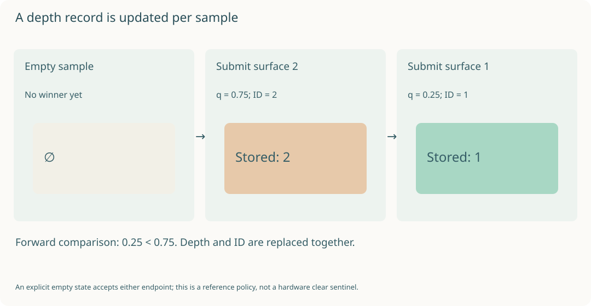
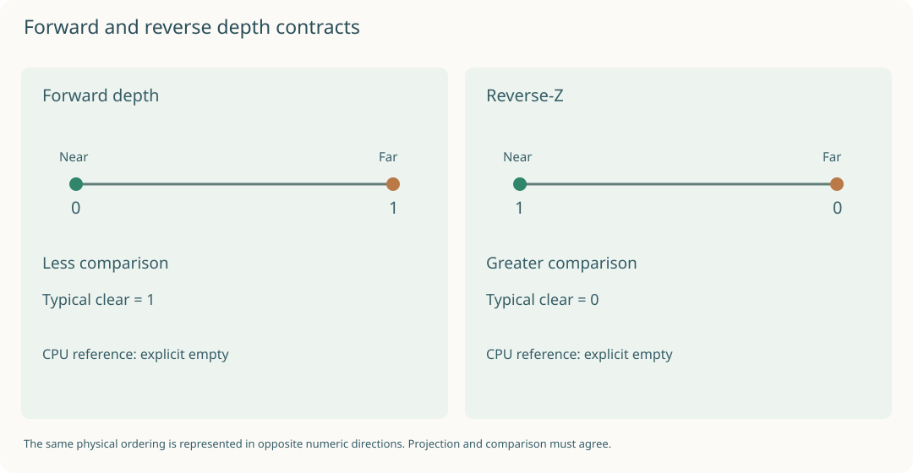
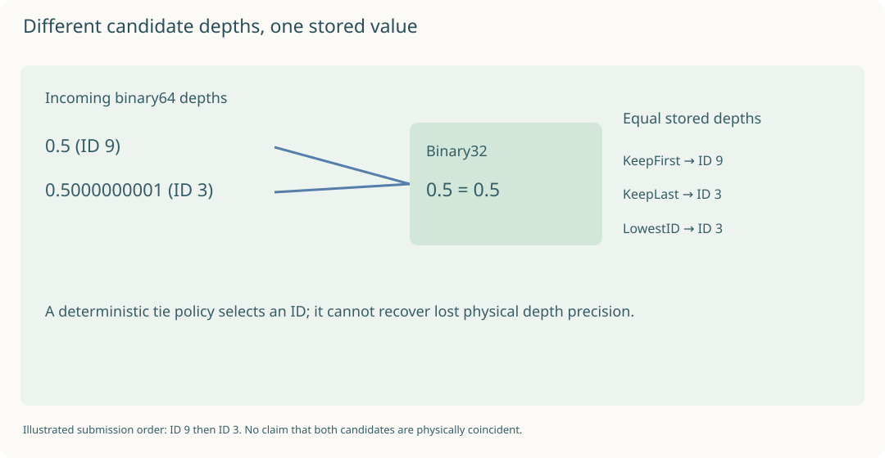
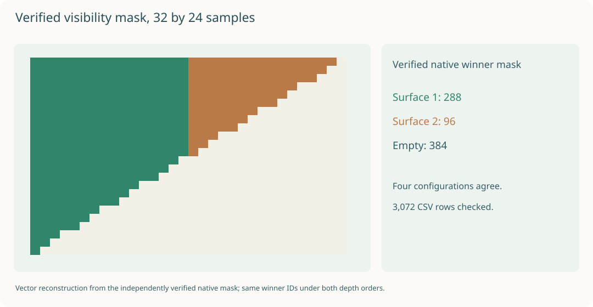

# Chapter 19 — Which Surface Gets Seen

*From Geometry to Images — Part IV: The picture becomes an algorithm*  
*Reader edition / C++23 laboratory P19*

> The question is no longer whether a triangle paints a pixel. It is whether another triangle gets there first in space, not in the command list.

## The dragon hides the house

Our paper dragon is flying across the garden. The house is behind it. Both are made of triangles, and some of those triangles cover the same pixel centers.

Chapter 18 settled the question of coverage. A properly shared edge has one owner under our top-left rule. But the dragon and the house are not adjacent pieces of the same flat partition. They are different surfaces that happen to overlap in the photograph.

If we simply write a new colour whenever a covered sample arrives, the last submitted triangle wins. Draw the house after the dragon and the house can appear in front, despite being farther away.

We need to preserve a different kind of order: the order in which an ideal viewing ray meets the opaque surfaces of the world.

That is the visibility problem. We will solve a restricted but enormously useful version: opaque surfaces, a single sample per pixel, calibrated clipped triangles and a monotonic depth representation.

## The painter who cannot finish the picture

Imagine painting distant mountains first, then trees, then the dragon closest to the observer. Each new brush stroke covers the older strokes behind it. If the objects have a simple back-to-front order, this works.

This is the idea of a painter's algorithm.

But a triangle may be close to us at one end and far away at the other. Two triangles can cross in space. One may hide the other on the left side of the photograph and be hidden by it on the right.

Which whole triangle should be painted first?

No single ordering can satisfy both regions. More complicated arrangements can even create a cycle of occlusion among three primitives without a useful global sorting order. Splitting primitives or using a finer visibility representation becomes necessary.

*Figure 19.1 — A sloped surface is nearer at the left and farther at the right. Whole-primitive sorting cannot resolve the crossing.*

The depth buffer chooses a local solution instead. Each covered sample receives a candidate depth. We keep the best candidate seen at that particular address.

This is not an algorithm for finding all intersections of three-dimensional geometry. We only compare the fragments produced by the visible image's sample coverage.

## A small notebook beside every pixel

Imagine an extra notebook with one entry beside each pixel. Initially each page says empty.

A triangle arrives at sample (i,j). It proposes a depth value q and an identifier for its surface. If the page is empty, write the proposal. If the page already contains a surface, compare the old depth with the new depth according to a declared ordering.

For ordinary forward depth, smaller is nearer. The update is

\[
(q_{\rm old},I_{\rm old})\leftarrow
(q_{\rm new},I_{\rm new})\quad\text{if }q_{\rm new}<q_{\rm old}.
\tag{19.1}
\]

For reversed depth, larger is nearer, so the inequality reverses.

At the end, the identifier tells us which surface won. A renderer may retain a colour instead, or retain material and geometric information for a subsequent shading pass.

Our teaching buffer stores the depth and an unsigned integer surface ID together. It also stores whether a sample is occupied. We can inspect the winner independently of shading. Two different surfaces with the same final colour would otherwise be difficult to distinguish.

*Figure 19.2 — Coverage proposes a candidate. Visibility compares it against the currently stored record.*

The depth comparison and the colour update must agree. If a fragment loses the depth test but writes its colour anyway, the depth attachment and the displayed image describe different surfaces.

A sequential CPU loop makes that invariant easy to maintain. Parallel implementations need appropriate synchronization or hardware-defined fragment ordering. Writing a depth value and separately writing a surface ID without a consistent winner protocol can introduce a race.

## Which distance are we comparing?

A depth buffer does not generally store metres. We established this in Chapter 14.

For positive axial distance d, perspective projection in our zero-to-one convention gives

\[
q(d)=a+b/d.
\tag{19.2}
\]

With finite near n and far f, forward depth is

\[
q_F(d)=\frac{f}{f-n}(1-n/d).
\tag{19.3}
\]

Its derivative is positive throughout the forward interval. For reversed depth, \(q_R=1-q_F\), so its derivative is negative.

The key requirement is monotonicity. Along a fixed forward viewing ray, axial depth and ray range are proportional by a positive constant. Either ordering can select the same physically nearer opaque surface in ideal arithmetic.

But a renderer cannot freely substitute one numeric representation for another. A depth attachment holding q must be compared with another q under the same mapping. A distance in metres is not directly comparable with a value in [0,1].

For orthographic projection, the forward map is linear in axial distance. It still requires the same ordering discipline.

Our standalone visibility implementation accepts already-divided NDC depths in [0,1]. It does not accept camera-local z, clip z, physical range or unprojected distances. The caller is responsible for clipping and a consistent projection. Chapter 21 will combine these contracts into a complete CPU reference pipeline.

### Interpolate the right quantity

Chapter 16 established an important result. The divided NDC depth at a covered sample is screen-linear:

\[
\boxed{q=\lambda_0 q_0+\lambda_1 q_1+\lambda_2 q_2.}
\tag{19.4}
\]

Here the q values are the divided depths at the triangle's corners. The lambda values are screen barycentrics, not perspective-correct surface barycentrics.

If the vertices have different clip w values, smooth world position and UV use reciprocal-w weighting. Applying the same normalization to already-divided depth would incorrectly interpolate depth twice.

Our coverage kernel returns unbiased screen weights after snapping vertices to the 256-step grid. The visibility stage uses those weights directly. This is exact in real arithmetic for the affine depth field assigned to the snapped triangle. It is an approximation to an independently evaluated unsnapped surface.

A small rounding error in a floating convex sum can move a result slightly outside [0,1]. The implementation validates every input depth and clamps the resulting convex sum to that interval. This is not a substitute for primitive clipping, nor a policy that accepts arbitrary invalid input depths.

## Prove why the nearer surface wins

Consider a sample covered by k opaque primitives, with forward depth values \(q_1,\ldots,q_k\). Suppose there are no ties at stored precision, every submitted depth uses the same convention, and no fragment modifies the acceptance rule or discards itself afterward.

After the first proposal, the buffer stores its depth. Assume that after j proposals it stores \(\min(q_1,\ldots,q_j)\). The next proposal either replaces that value because it is smaller, or leaves it unchanged. Therefore after j+1 proposals the stored depth is the minimum of all j+1 values.

Induction gives

\[
q_{\rm final}=\min_{i=1}^{k}q_i.
\tag{19.5}
\]

The minimum of a fixed finite set does not depend on submission order. The analogous reversed-depth argument uses the maximum.

This is why we can render opaque objects in different draw orders and obtain the same visibility, subject to the assumptions. The amount of work may differ dramatically: drawing the nearer surface first means more later fragments can fail the depth test.

Do not overextend the proof. If candidates tie, the depth alone cannot select an identifier. If blending is enabled, multiple fragments may contribute. If a shader changes its depth or discards a fragment, the set of accepted candidates may differ. If the renderer mutates geometry or its state during the draw, we no longer have a fixed set.

The minimum is simple. The complete rendering contract around it is not.

## Forward, reverse and the empty page

A common forward-depth hardware configuration clears depth to 1 and accepts strictly smaller incoming depths. A common reverse-Z configuration clears depth to 0 and accepts strictly greater values.

A point exactly at the far endpoint equals the clear depth. A strict comparison rejects it even if no surface has been drawn at that sample. A non-strict comparison accepts it but changes the equality behaviour for all occupied samples as well.

Our reference instead stores an explicit empty state. Empty accepts any valid depth, including either endpoint; an occupied sample follows the selected comparison and tie policy. Clearing removes occupancy.

*Figure 19.3 — Reversal is a coordinated change to projection, stored representation, comparison and clear policy. The CPU reference also has an explicit empty state.*

This is a useful teaching decision because it lets us isolate equal-depth conflicts between actual surfaces from equality with a sentinel. It is not a claim that a standard hardware depth attachment supplies this occupancy bit.

An API adapter may choose strict comparison with a clear sentinel, a non-strict comparison, a separate occupancy representation or another appropriate policy. Its exact endpoint and tie behaviour must be documented.

## The notebook has limited handwriting precision

So far we have compared ideal q values. A real attachment has finite representable values.

Our reference offers three explicitly modeled storage policies:

- Float64: preserve the incoming binary64 depth value.
- Float32: convert to IEEE binary32, then widen the stored value back to double for inspection.
- UNorm24: round to one of \(2^{24}\) uniformly spaced values in [0,1].

For the uniform grid,

\[
Q(q)=\frac{\operatorname{round}((2^{24}-1)q)}{2^{24}-1}.
\tag{19.6}
\]

We quantize the interpolated candidate **before** comparing it with the stored depth. This makes the equality contract clear: two candidates that become the same represented depth tie in this reference, even when their original binary64 values differ.

The implementation uses a double field to store the decoded number; it does not pack a 24-bit hardware memory representation or simulate a particular device's complete attachment arithmetic.

Consider q=0.5 and q'=0.5+10^{-10}. The second value is greater in binary64. Both convert to exactly 0.5 in binary32.

There is no longer a distinguishable nearer value after storage conversion. If we choose one of these fragments, we are applying a tie policy rather than establishing a physical visibility fact.

Chapter 14 showed why reversed floating-point depth often preserves faraway distinctions better. Reversal does not remove all equal-depth conflicts, and reversing a uniform quantization grid alone does not provide the same floating precision benefit.

## When two surfaces claim the same depth

Imagine two identical paper sheets occupying the same location. The rasterizer reports both as covering the same samples. Their mapped depths are identical.

Which sheet is in front?

The input has not answered that question. We can still make a deterministic software choice.

The reference exposes three tie policies:

| Policy | When stored depths are equal |
|---|---|
| KeepFirst | Keep the existing surface |
| KeepLast | Replace it with the incoming surface |
| LowestID | Keep the surface with the smaller stable ID |

With a unique ID per competing surface, LowestID defines a lexicographic ordering on the depth and ID pair. It is independent of submission order for the represented candidate set. It does not magically determine which surface lies in front in continuous space.

*Figure 19.4 — Quantization can collapse physically distinct candidates. Stable-ID tie breaking makes the reference reproducible without inventing missing precision.*

Real z-fighting is often more complex than an exact tie. Slightly different triangles, transformations, depth slopes, sample positions, finite arithmetic and representation can cause different winners across neighboring pixels or frames. A perfectly deterministic tie rule does not fix geometrically coincident surfaces or nearly indistinguishable depth values.

An author can remove accidental duplicate faces, improve camera near/far choices, use an appropriate depth representation, or apply a carefully chosen depth bias for intended overlays. Depth bias changes the represented ordering and can cause a surface to leak through others. It is not a general cure to apply indiscriminately.

A useful debugging procedure is to inspect both candidate depths, their stored representations, and the resulting ID mask. This distinguishes a genuine overlap problem from a coverage crack or a shading discontinuity.

## A picture with two depth fields

Let our image have width 32 and height 24. Consider two triangles with identical projected vertices

\[
A=(0,0),\quad B=(32,0),\quad C=(0,24).
\tag{19.7}
\]

Give surface 1 forward vertex depths (0.125,0.625,0.125). Surface 2 has constant depth 0.375.

For a continuous horizontal coordinate u inside the triangle, the weight of B is u/32. The two depth fields are therefore

\[
q_1(u)=0.125+0.5u/32,\quad q_2(u)=0.375.
\tag{19.8}
\]

Solve for equality: u=16. To the left of that line, surface 1 is nearer; to its right, surface 2 is nearer.

At our half-integer sample centers, none lies exactly at u=16. There are no exact crossing-line ties in this fixture.

The outer triangle has the interior condition \(3u+4v<96\), together with the nonnegative image bounds. Its diagonal is exclusive under our top-left convention. We can calculate the expected winner for every sample without running a depth buffer.

*Figure 19.5 — Native 32-by-24 winner mask: 288 surface-1 samples, 96 surface-2 samples and 384 empty samples.*

In reverse depth, use \(1-q_1\) and \(1-q_2\), then select the larger value. The ideal winner set is unchanged.

The native studio was compiled using the exact committed source files. Four runs used forward or reversed depth, and either submission order. Every run produced the same surface counts. An independent Python oracle checked all 3,072 exported sample rows, including the stored depth and winning ID. The forward and reverse/swapped P6 images were byte-identical.

The result is specific to this fixture and its exact representable depth values. It is not an assertion of universal bitwise agreement between forward and reversed floating-depth renderers.

## Coverage, testing, shading and work

The visibility reference separates coverage and depth updates. Each draw reports candidate coverage statistics, accepted depth submissions, rejected submissions and represented-depth ties.

These counts answer different questions.

A candidate is a sample inside the bounding box that the coverage kernel examines. A covered sample is inside the triangle under the top-left rule. A passed depth submission updates the current winner. A failed submission does not.

A successful depth update is not necessarily the final visible surface. A nearer fragment arriving later can replace it.

Drawing front-to-back can reduce expensive fragment work when early depth testing is legal. The hardware may perform early tests, late tests, hierarchical depth rejection or another implementation-dependent optimization. Shader side effects, explicit depth writes and discard operations may constrain the optimization.

Our CPU implementation performs no fragment shading and measures no GPU performance. It simply exposes the counts. A later renderer can use visibility results to decide what to shade.

Back-face culling is a different optimization based on orientation and a chosen material policy. Frustum culling rejects objects outside a viewing volume. Occlusion culling attempts to avoid submitting geometry hidden by other geometry. Per-sample depth testing resolves the visibility of submitted covered fragments. These are related but distinct operations.

## What about glass?

A transparent window complicates the word visible. The dragon behind it can contribute to the final colour along with the window.

For simple alpha compositing in linear colour units,

\[
C_{\rm out}=\alpha C_{\rm foreground}+(1-\alpha)C_{\rm background}.
\tag{19.9}
\]

For multiple translucent layers this operation generally depends on order. A nearest-only depth buffer cannot represent all their contributions.

A common rendering strategy draws opaque surfaces first, then handles transparent surfaces using depth testing and a carefully chosen sorting and depth-write policy. Intersecting translucent geometry may need more advanced order-independent transparency techniques. Refraction and participating media require still more information.

This chapter deliberately solves opaque visibility only. It is useful because opaque depth is a fundamental building block, not because every physical image can be reduced to a single closest surface.

## The native visibility workshop

Read `include/book03/visibility.hpp` after `raster_coverage.hpp`. Begin with VisibilityPolicy and stored_depth. Then follow VisibilityBuffer::submit, where the new represented depth is compared with the currently occupied sample, and draw, where the P18 callback supplies unbiased weights.

The buffer owns its memory, validates its dimensions and rejects nonfinite or out-of-range vertex depths. Its size is bounded to 4,194,304 samples. A sample record contains optional depth and surface ID; it is not a packed GPU attachment.

Read `tests/visibility_tests.cpp`. It contains constant-depth overlaps, both depth orders, endpoint acceptance, crossing depth fields, quantized ties, and 18,000 seeded scalar submissions across all combinations of the two depth orders and three storage policies. The scalar oracle independently computes the best represented depth and the stable ID.

The studio in `src/visibility_studio.cpp` uses already-projected screen triangles. Its colour is a visualization of IDs, not a lighting calculation.

~~~text
book03_visibility inspect
book03_visibility inspect reverse
book03_visibility csv forward.csv
book03_visibility csv swapped.csv swapped
book03_visibility csv reverse.csv reverse
book03_visibility csv reverse-swapped.csv reverse swapped
book03_visibility ppm winners.ppm
~~~

Both the standalone test executable and studio compiled and ran under GCC 14.2.0 with undefined-behavior sanitization. The exact Git blob identities of the coverage dependency and three new sources were verified. The full cumulative CMake build and integration with earlier clipping and projection stages remain separate acceptance gates.

## Your turn: choose the visible surface

**Reconstruct.** Three opaque fragments arrive at one sample with forward depths 0.7,0.2,0.4. Which wins? Reverse their submission order. What changes?

**Transfer.** Convert those three values to reversed depths. Which comparison must now be used?

**Falsify.** Draw two equal-depth surfaces with KeepFirst, then reverse their order. Does the depth change? Does the ID change?

**Explain.** Why can LowestID be order-independent without proving a physically correct answer?

**Implement.** Compute the screen-linear depth for weights (0.25,0.25,0.5) and vertex depths (0.1,0.3,0.7). Explain why a reciprocal-w normalization is not appropriate here.

**Reconstruct.** In the crossing-field fixture, calculate the winner at sample centers u=8.5 and u=23.5.

**Falsify.** A strict forward comparison uses clear depth 1. What happens to a candidate whose depth is exactly 1? Compare with the explicit empty policy.

**Transfer.** Explain why two values 0.5 and 0.5+10^{-10} become equal in binary32. What problem remains if you use stable-ID tie breaking?

**Challenge.** Design a test that distinguishes coverage counts from final visibility. Draw the same triangle twice at different depths; compare covered, passed, failed and final occupied counts in both orders.

**Explain.** Why is nearest-only visibility insufficient for transparent glass? Identify what a blending algorithm needs beyond the winning depth.

### Selected answers

The forward winner is depth 0.2. Reverse depths are 0.3,0.8,0.6, so the greater comparison selects 0.8. Both represent the same ideal winning fragment.

The screen-linear depth is 0.45. At u=8.5 the sloped depth is 0.2578125, below 0.375, so surface 1 wins. At u=23.5 it is 0.4921875, so surface 2 wins.

A strict forward comparison against 1 rejects a candidate of exactly 1. The explicit empty policy accepts it. These are different stated contracts.

Drawing the farther triangle first allows it to update empty samples before being replaced by the nearer triangle. Drawing the nearer triangle first can cause all farther submissions to fail. Final opaque visibility agrees when represented depths differ, but the number of updates does not.

## The picture is still made of samples

We can now transform vertices, clip their primitives, identify covered sample centers and choose an opaque winner. This is a considerable portion of a renderer.

But the image remains a collection of discrete measurements of a continuous world. Small details can vanish, edges can flicker and patterns can form that never existed in the original scene.

**Chapter 20 — A Pixel Is Not a Tiny Square of Reality** will explore sampling, aliasing, reconstruction filters, supersampling and the difference between geometric coverage and a filtered image measurement. Then we will assemble the stages into one complete CPU rasterizer.

## Source custody

The original Computing Foundations chapter 33 (Projection, Clipping, and Raster Sampling) preserves the depth-precision and reverse-Z discussion, including lines 1596–1857 and 1997–2031. Chapter 34 (Robust Predicates and Camera Sensitivity) distinguishes occlusion culling. The new chapter extends those ideas into a native per-sample opaque visibility reference. PASS19_EVIDENCE.md records verified native outputs and outstanding integration. Original manuscripts remain unchanged.
