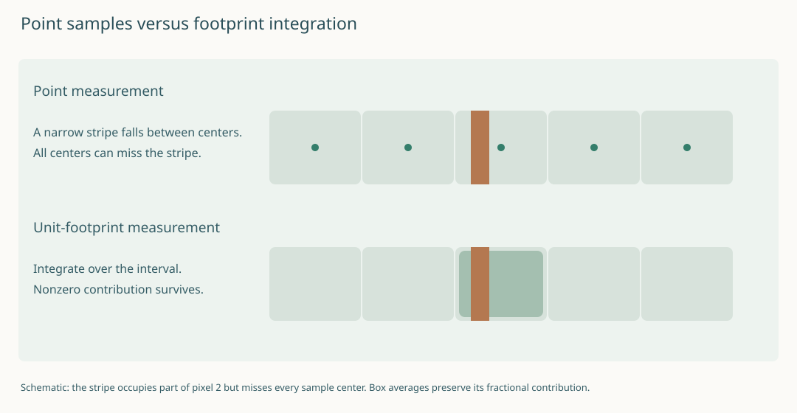
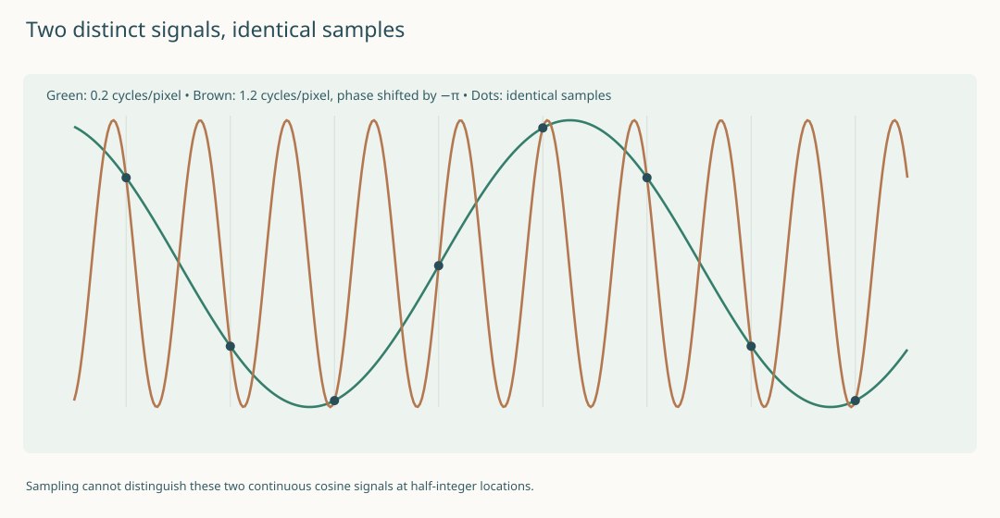
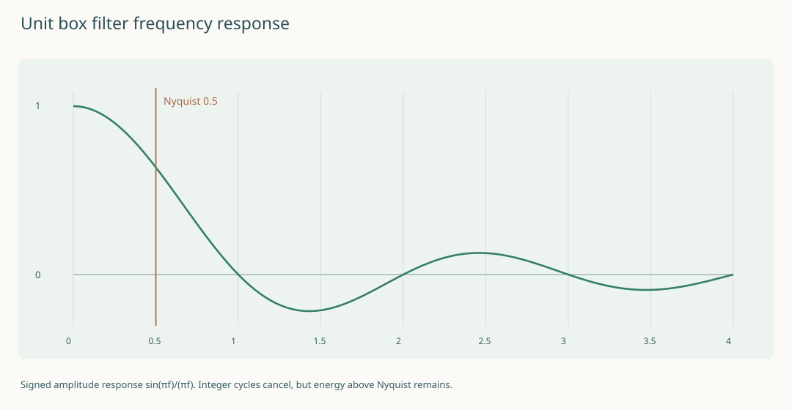
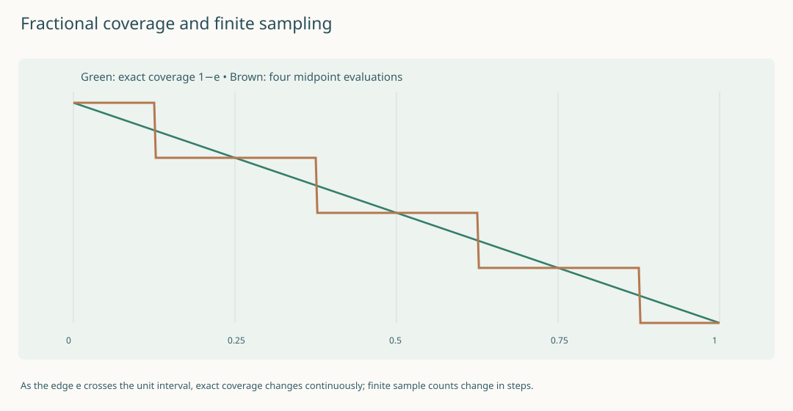
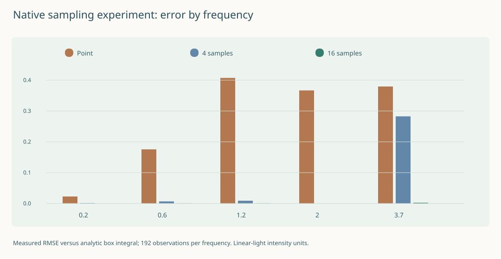
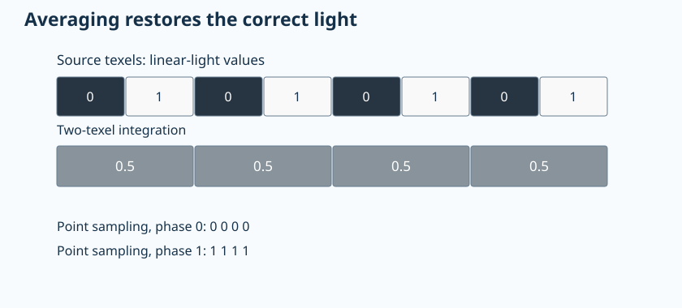
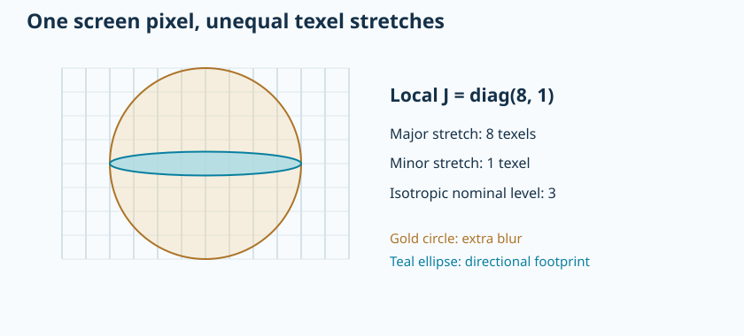

# Chapter 20 — A Pixel Is Not a Tiny Square of Reality

*From Geometry to Images — Part IV: The picture becomes an algorithm*  
*Reader edition / C++23 laboratory P20*

> A photograph is a finite collection of measurements. It is not the continuous world cut into tiny boxes.

## The fence starts dancing

The dragon is now correctly visible in front of the house. But as we move our camera, the thin fence behind it begins to shimmer. Sometimes two fence rails appear to merge. A distant tiled roof seems to develop broad stripes that were never painted on it.

Nothing in the geometry necessarily broke. Our coverage and depth tests can be perfectly consistent while the image still changes in surprising ways.

Imagine looking through a row of equally spaced narrow holes in a sheet of paper. Behind the paper is a striped wall. Shift the wall a little, and the holes may suddenly reveal only dark stripes. Shift it again and they reveal only bright ones. You have not measured the entire wall; you have measured it at particular locations.

Our rasterizer has been doing something similar. One pixel center receives one visibility decision. If the scene changes rapidly between centers, the measurements may fail to describe it. This chapter explains what that failure means and what we can do about it.

## A sample, a footprint and a reconstruction

Let a continuous one-dimensional image signal be \(s(x)\). We measure x in pixels, using the image-edge convention. The center of pixel i is \(x_i=i+1/2\).

A point sample is

\[
p_i=s(i+1/2).
\tag{20.1}
\]

Another possible measurement is the average over a unit-width footprint:

\[
b_i=\int_i^{i+1}s(x)\,dx.
\tag{20.2}
\]

The interval length is one, so the integral is already its average. This is an ideal box-filtered measurement, not a universal model of a physical sensor or display.

The distinction matters. A narrow white object between two sample centers can disappear in point sampling. Its integral over a pixel footprint may still be nonzero.

In two dimensions, a normalized filter \(h\) defines a measurement at center \(c\):

\[
b(c)=\int_{\mathbb R^2}s(x)h(c-x)\,dx,
\qquad \int h(x)\,dx=1.
\tag{20.3}
\]

A unit-area rectangular box is one possible h. A sensor's optical blur, active area and electronic processing may lead to other effective filters.

After measuring a discrete sequence, we can reconstruct a continuous approximation by combining shifted kernels:

\[
\hat s(x)=\sum_i p_i r(x-x_i).
\tag{20.4}
\]

The prefilter h and reconstruction kernel r have different jobs. A prefilter suppresses frequencies before sampling; reconstruction estimates values between existing measurements. A beautiful interpolation of inadequate measurements cannot recover information that was never distinguishable in the samples.

*Figure 20.1 — A sample location, its possible footprint and the reconstruction of a signal are separate concepts.*

## Frequencies: count the stripes, not the pixels

A convenient controlled signal is

\[
s(x)=\tfrac12+\tfrac12\cos(2\pi f x+\phi),
\tag{20.5}
\]

where f is cycles per pixel and phase \(\phi\) is in radians. The signal stays between zero and one. Its DC component is one half and its oscillating amplitude is one half.

At f=0.2, a complete oscillation occupies five pixels. At f=1.2, it occupies less than a pixel.

Sampling once per pixel creates a surprising ambiguity. At \(x_i=i+1/2\),

\[
\cos(2\pi(f+1)x_i+\phi-\pi)
=\cos(2\pi f x_i+\phi+2\pi i).
\tag{20.6}
\]

The right side is exactly the original cosine in real arithmetic. Therefore the signals with frequencies 0.2 and 1.2, with phases adjusted as above, produce identical samples even though their continuous oscillations are different.

*Figure 20.2 — The samples cannot tell us which continuous wave generated them. The apparent low-frequency pattern is an alias.*

More generally, the discrete complex exponential is periodic in frequency with period equal to the sample rate. Real cosines also have a sign symmetry when phase is handled consistently. Frequencies fold into the representable baseband.

The Nyquist–Shannon sampling theorem says that an appropriately band-limited continuous signal can be reconstructed from uniform samples when its maximum frequency is strictly below half the sample rate, under the theorem's ideal assumptions. With one sample per pixel, that is 0.5 cycles per pixel.

This is not a guarantee that every scene can be reconstructed from a single sample per pixel. Sharp edges and discontinuities are not strictly band-limited. The theorem motivates prefiltering rather than promising perfect recovery of arbitrary geometry.

At exactly the Nyquist frequency, phase can create ambiguity: a sinusoid may vanish at every sampling location. The strict band-limit condition matters.

## Derive the box-filter response

Insert equation (20.5) into the footprint integral centered at c:

\[
b(c)=\int_{c-1/2}^{c+1/2}
[\tfrac12+\tfrac12\cos(2\pi f x+\phi)]\,dx.
\]

Integrating and applying the sine difference identity yields

\[
\boxed{b(c)=\tfrac12+\tfrac12\cos(2\pi f c+\phi)
\frac{\sin(\pi f)}{\pi f}.}
\tag{20.7}
\]

At f=0 the ratio has limit one. This ratio is the normalized sinc function. The box filter preserves the constant component and multiplies each oscillating component by sinc(f).

At f=1,2,3 and other nonzero integer frequencies, the box integral averages complete cycles and the oscillation cancels. At 0.5 cycles per pixel, the amplitude factor is \(2/\pi\), not zero.

The box is therefore not an ideal low-pass filter. It attenuates high frequencies but does not eliminate every frequency above Nyquist. Its signed response also has negative lobes, corresponding to a phase reversal of an oscillating component.

*Figure 20.3 — Footprint integration suppresses many rapid oscillations, but its frequency response is not a brick-wall cutoff.*

An ideal band-limiting filter has a rectangular frequency response and a sinc-shaped spatial kernel with infinite support. That is not generally practical for a local image operation. Finite filters trade frequency rejection, ringing, blur, computational cost and support size.

Nearest-neighbor reconstruction uses a piecewise constant kernel. Linear interpolation uses a triangle kernel in one dimension; its response is proportional to sinc squared. Bilinear interpolation is the separable two-dimensional counterpart. A Gaussian can suppress rapid variation smoothly, while a windowed sinc or Lanczos-style filter approximates a sharper reconstruction with finite support and possible ringing. None is universally optimal.

## Supersampling is numerical integration

Rather than evaluate the exact integral analytically for every scene, divide each pixel footprint into n equal intervals and sample their midpoints:

\[
\boxed{\hat b_n(c)=\frac1n\sum_{k=0}^{n-1}
s(c-\tfrac12+(k+\tfrac12)/n).}
\tag{20.8}
\]

This is composite midpoint quadrature. For a twice continuously differentiable signal over the footprint,

\[
|\hat b_n-b|\le\frac{\max |s''|}{24n^2}.
\tag{20.9}
\]

To see where the bound comes from, expand each subinterval around its midpoint. Its linear term integrates to zero by symmetry. The second-derivative remainder is bounded by half the maximum second derivative times the squared offset. Integrating over the interval of width 1/n gives the bound \(M/(24n^3)\) per interval; adding n intervals gives equation (20.9).

For our cosine, \(M=\tfrac12(2\pi f)^2\). Higher frequencies require finer quadrature to attain the same bound. The inequality is an analytic real-arithmetic estimate; the native tests allow a small floating tolerance.

For a discontinuous step, the smoothness assumption fails. Let a vertical edge at coordinate e divide black on its left from white on its right. Its exact footprint coverage is

\[
b(c)=\operatorname{clamp}(c+\tfrac12-e,0,1).
\tag{20.10}
\]

Uniform midpoint samples instead give the fraction of sample locations on or to the right of e. For this particular single straight step, the coverage error is at most 1/(2n) in exact arithmetic. It is not the smooth-signal quadratic bound.

*Figure 20.4 — Finite sampling quantizes the fractional coverage. More samples can reduce this error but do not turn it into an exact continuous integral.*

In two dimensions, a regular m-by-m supersampling pattern has \(m^2\) sample locations. A 4-by-4 grid uses sixteen evaluations, not four. Our native experiment uses one-dimensional signals: its 4 and 16 denote four and sixteen evaluations along the unit interval, not complete 2D rendering costs.

A regularly spaced pattern can itself alias. A rotated grid, stratification, or randomized offsets can trade structured artifacts for noise. Those choices need separate analysis; increasing the count does not guarantee monotonic improvement for every possible signal or phase.

## SSAA, MSAA and the texture that still shimmers

Supersample antialiasing evaluates coverage, visibility and shading at multiple subpixel locations, then resolves those measurements. Multisample antialiasing commonly stores multiple coverage/depth samples but may share a fragment shading result among them. Exact invocation frequency depends on the pipeline and sample-shading policy.

This distinction explains why MSAA can improve polygon silhouettes without fully solving aliasing inside a triangle's procedural shader. If a texture alternates rapidly across the surface, one shared shading evaluation cannot represent every texture variation in the footprint.

A texture lookup estimates a signal defined on a parameterized surface. Under perspective, one screen pixel maps to a varying footprint in texture coordinates. A distant or oblique surface may cover many texels. Point lookup or even bilinear lookup at the finest resolution can miss the high-frequency content.

A mipmap stores successively prefiltered texture levels. A local estimate of the screen-to-texture Jacobian gives a footprint scale. For a normalized texture of width U and height V, one simple isotropic estimate is

\[
\rho=\max(\|(Uu_x,Vv_x)\|,\|(Uu_y,Vv_y)\|),
\quad L=\log_2(\max(1,\rho)).
\tag{20.11}
\]

This is a heuristic for level selection, not a full anisotropic integral. Trilinear filtering interpolates between adjacent mip levels; anisotropic filtering addresses elongated footprints more effectively. Texture derivatives, mip construction and border/wrap policy must all use consistent coordinates.

A similar issue appears in time. A moving thin line can pass between successive frames. Temporal antialiasing can combine jittered samples from multiple frames using motion-aware reprojection, but visibility changes, disocclusion and incorrect motion can invalidate history. A temporal resolve is not an unlimited accumulation of interchangeable measurements.

### A texture's edge is a question about missing neighbours

A texture of width W and height H has integer texel indices, but a surface supplies continuous normalized coordinates u,v. Under the center convention of Chapter 14, use x=uW-0.5 and y=vH-0.5, so integer x,y now identify texel centers. Set i=floor(x), j=floor(y), a=x-i and b=y-j. The four neighbouring samples contribute

\[
C=(1-a)(1-b)T_{i,j}+a(1-b)T_{i+1,j}
 +(1-a)bT_{i,j+1}+abT_{i+1,j+1}.
\]

The weights are nonnegative and sum to one. This is separable bilinear reconstruction, not integration over the full projected pixel footprint. When a neighbor index is outside the texture, addressing policy must be applied to the individual sampled indices. Merely clamping the normalized coordinate to [0,1] does not by itself make the resulting integer filter indices safe.

For repeat addressing, map an integer i to ((i mod W)+W) mod W, using a remainder operation that may return a negative result. For clamp-to-edge, map it to min(max(i,0),W-1). For mirrored repeat, let q be the nonnegative remainder modulo 2W, then use q if q<W and 2W-1-q otherwise. These formulas describe a simple conceptual CPU texture sampler for positive dimensions; specific GPU sampler rules and border colors need their own specification.

Try a two-texel one-dimensional texture with linear values [0,1]. At u=0, x=-0.5, so the filter straddles indices -1 and 0 with equal weights. Repeat maps -1 to 1, yielding 0.5. Clamp-to-edge maps both to 0, yielding 0. Mirrored repeat also yields 0. At u=0.5 the two neighboring texels mix equally and produce 0.5 in all three modes. The difference at the seam is not a rounding bug; it follows from how the sampled signal is extended beyond its stored domain.

The footprint of a screen pixel can be elongated. Form the 2-by-2 Jacobian J whose columns are the changes in texel coordinates for unit screen steps. Its singular values describe the principal stretches of an infinitesimal circular footprint. A 16-by-1 stretch has a 16:1 anisotropy. A single isotropic level chosen from the largest stretch filters away detail along the narrow direction too. An anisotropic filter approximates a more directional integration; its cost and accuracy depend on sampling policy. Mip construction should operate on the appropriate signal domain (linear light for color averaging), and normal or categorical textures need semantics beyond ordinary color averaging.

The P20 native quadrature lab remains one-dimensional. The added addressing examples are separately checked scalar witnesses, not a claim of a complete mipmapped texture renderer.

*Source route: Graphics Vision and XR/19, derived lines 14–330; /04, lines 76–114. The full texture sampling and implementation source remains available to Books 04 and 06.*

## Average light before encoding it

If two linear-light measurements are zero and one, their equally weighted average is 0.5. Under standard sRGB encoding,

\[
E(x)=
\begin{cases}
12.92x,&x\le0.0031308,\\
1.055x^{1/2.4}-0.055,&x>0.0031308.
\end{cases}
\tag{20.12}
\]

Encoding the resolved linear value gives approximately 0.73536, not 0.5. Averaging already-encoded values generally changes the intended light measurement.

The native lab includes this simple check. Full color management, HDR, exposure and tone mapping belong to later chapters. Our cosine and step values are defined in linear-light units throughout.

## The controlled native experiment

The sampling header evaluates a continuous cosine, its analytic box integral, midpoint quadrature, a step-edge coverage model and an sRGB transfer function. No GPU is needed to falsify the mathematical assumptions.

We compiled the exact committed header, test and studio sources under GCC 14.2.0 with undefined-behavior sanitization. The native test passed 2,000 seeded cosine/step trials, the half-integer alias witness, the constant and integer-cycle integral cases, and the linear-light resolve check.

The studio exported 960 rows: five frequencies, three phases and 64 pixel centers. An independent Python implementation verified every point, 4-sample, 16-sample and analytic box value to absolute tolerance \(10^{-12}\).

The table reports root-mean-square error against the analytic box integral over 192 measurements per frequency. All numbers are dimensionless linear-light intensity errors.

| Cycles/pixel | Point | 4 samples | 16 samples |
|---:|---:|---:|---:|
| 0.2 | 0.02272908 | 0.00135934 | 0.00008473 |
| 0.6 | 0.17560517 | 0.00679432 | 0.00041434 |
| 1.2 | 0.40726376 | 0.00906220 | 0.00051160 |
| 2.0 | 0.36672792 | $<10^{-12}$ | $<10^{-12}$ |
| 3.7 | 0.37946430 | 0.28267849 | 0.00231365 |

*Figure 20.5 — Native scalar quadrature results, verified against an independent analytic reference. The experiment isolates sampling, not GPU speed or complete image quality.*

The 2.0-cycle case illustrates an important trap: a regularly spaced quadrature pattern can happen to cancel a periodic signal exactly. That does not imply the method integrates all nearby frequencies exactly. At 3.7 cycles per pixel, the four-point pattern has substantial error.

The lab is deliberately one-dimensional. It does not implement actual multisample coverage storage, texture mipmaps, motion vectors or temporal history. It explains those techniques to prepare for a later renderer.

Read `include/book03/sampling.hpp`, then `tests/sampling_tests.cpp` and `src/sampling_studio.cpp`. After building:

~~~text
book03_sampling csv samples.csv
~~~

Try adding a frequency near 4 cycles per pixel, changing the phase, or changing the number of midpoint locations. Compare against the analytic box, not only the previous approximate output.

## Design a reconstruction filter instead of hoping for one

A box average is a convenient start, not the unique answer. We would like a filter to preserve constants, attenuate frequencies that the target grid cannot represent, and avoid unnecessary artifacts at sharp edges. These goals compete: a narrow filter preserves more detail but may pass aliases; a broad filter suppresses aliases but blurs legitimate variation.

For a one-dimensional signal f and a normalized kernel h, the reconstructed sample is the convolution

\[
g(x)=\int f(x-s)h(s)\,ds,\qquad \int h(s)\,ds=1.
\]

The second condition preserves a constant input exactly. A discrete filter replaces the integral by a weighted sum. A separable two-dimensional kernel has the form h(x,y)=h_x(x)h_y(y), so horizontal and vertical passes can replace a full rectangular two-dimensional convolution. This identity requires separability; an oriented ellipse generally cannot be represented by independent axis-aligned passes without additional transformations or approximation.

The unit-width box has transform sinc(pi f) under cycles-per-unit frequency. Convolving the box with itself yields the triangle kernel h(x)=max(0,1-|x|), supported on [-1,1]. Its transform is the square of the box transform, because convolution in space becomes multiplication in frequency. It has a stronger roll-off away from zero but still does not implement an ideal cutoff. The ideal low-pass filter would have an infinitely supported oscillatory kernel. A finite implementation must make a compromise about support and ringing.

**Worked example.** Let discrete samples be [0,0,1,0,0] and let the filter coefficients be [1/4,1/2,1/4]. With zero outside the array the resulting sequence is [0,1/4,1/2,1/4,0]. Its total remains one. Apply the same filter to a constant sequence of ones: the interior remains one, but the two ends become 0.75 under zero extension. Clamp or repeat would preserve the constant at the boundary. A boundary rule is part of the filter definition, not an incidental implementation detail.

### A small C++23 separable filter

The following example deliberately filters a one-dimensional linear signal. The two-dimensional separable case reuses it along rows and columns, with a temporary image between the two passes. Clamp-to-edge is explicit, and no encoded color conversion takes place inside this numerical function.

~~~cpp
#include <algorithm>
#include <cstddef>
#include 
#include <vector>

std::vector<double> smooth_linear(std::span<const double> src) {
    std::vector<double> dst(src.size());
    if (src.empty()) return dst;
    for (std::size_t i = 0; i < src.size(); ++i) {
        const auto left = i == 0 ? i : i - 1;
        const auto right = std::min(i + 1, src.size() - 1);
        // Normalized coefficients preserve constant linear signals.
        dst[i] = .25 * src[left] + .50 * src[i] + .25 * src[right];
    }
    return dst;
}
~~~

Test a constant, impulse, ramp and alternating zero-one sequence. The interior ramp should remain unchanged because the weights are symmetric. An alternating signal has frequency one-half cycle per sample and should become 0.5 at interior points. At the boundary, compare the actual values to the stated extension policy rather than asserting that the interior proof holds unchanged.

*Figure 20.6 — An alternating linear signal gives phase-dependent point samples of zero or one, while the exact two-texel average is one half for each output sample.*

## Choose a texture level from a projected footprint

In Chapter 18 we derived the screen derivatives of a perspective-correct scalar f=N/H. Apply that calculation twice, once for u and once for v, and multiply the rows by the texture width and height to obtain a Jacobian in texels per screen pixel:

\[
J=\begin{bmatrix}W u_x&W u_y\\H_t v_x&H_t v_y\end{bmatrix}.
\]

Here H_t denotes the texture height, not the perspective interpolation denominator. The first column says how far the texture address moves for a one-pixel horizontal displacement; the second describes a vertical displacement. The largest singular value is the maximum local stretch of a unit direction. If that value is eight, one screen pixel can span roughly eight texels in some direction, so sampling the original texture at only its center risks aliasing.

A simple isotropic mip policy uses L=log2(max(1,rho)), with rho an estimate of the largest stretch. Clamp the resulting level to the available pyramid. This policy is based on a local linear approximation and a nominal texel-footprint scale. Hardware or application-specific conventions may choose a different estimate or apply a bias.

For a 1024-by-512 image with u_x=1/128, v_y=1/512 and the other derivatives zero, J=diag(8,1). The major stretch is 8, the minor 1, and the nominal isotropic level is 3. A level-3 texture has one sample for roughly eight original texels in each dimension. That matches the long direction but unnecessarily blurs the short one. A directional filter can instead integrate along the major axis while using a narrower scale in the minor direction. A fixed number of taps caps the achievable anisotropy; it does not make the exact footprint disappear.

### Pyramid construction and odd dimensions

A mip pyramid is a sequence of lower-resolution signals. For even dimensions, a simple 2-by-2 box filter followed by decimation halves each dimension. The number of stored texels across an ideal square pyramid approaches 4/3 of the base level: the infinite sum is 1+1/4+1/16 and so on. A 1024² image has 1,398,101 texels including all eleven levels down to 1². At four bytes per texel that is about 5.33 MiB before alignment or compression.

Odd dimensions need care. If a three-sample signal [0,0,1] is reduced to a single sample by averaging only its first two samples, the final result is zero. The mean over the original domain is one third. A resampling policy that represents the full domain should account for the third sample; another policy may intentionally discard or extend a boundary, but it must say so.

For color, calculate these averages in an appropriate linear-light representation. For normal maps, a weighted average of vectors need not be unit length and may even be near zero; renormalization and variance-aware shading are separate modeling decisions. For integer IDs, a mean is not a meaningful identity. Choosing a mip representation is a question about what the stored signal means.

## The image changes over time too

The fence that looked static can flicker when the camera moves by a fraction of a pixel. This is temporal sampling. If a periodic texture has spatial frequency f cycles per pixel and moves at v pixels per frame, the apparent temporal frequency at a fixed sample is f v cycles per frame. A 0.4-cycle-per-pixel pattern moving two pixels per frame produces 0.8 cycles per frame, which sampled at one frame per interval aliases to -0.2 cycles per frame. The pattern appears to move in the opposite direction.

Increasing frame rate changes the displacement per frame for a fixed physical speed. Spatial prefiltering can reduce the troublesome frequencies before temporal sampling. A temporal accumulation scheme may use several jittered spatial samples and a motion estimate to combine frames, but moving occluders can invalidate old observations. The old color at a reprojected address may belong to a different surface. Good temporal filtering therefore needs a visibility and confidence policy, not just an average.

**Research exercise.** Generate an analytic moving stripe field, compare point samples, box-integrated samples, and a motion-compensated average using an exact displacement. Vary spatial frequency and speed independently. Record absolute error against a space-time integral, not merely the smoothness of a GIF. Introduce an occluding rectangle and measure the trail left by a history buffer that lacks rejection. This is a new controlled extension of P20; it is not an implemented temporal antialiasing system.

*Figure 20.7 — The eight by one ellipse spans eight texels horizontally and one vertically, while an isotropic footprint of equal major radius also averages across the short axis.*

### Guided workshop: predict the filter output before rendering

Construct a periodic one-dimensional texture with eight linear-light texels alternating 0 and 1. Under repeat addressing, a nearest sample at texel centers returns exactly the alternating sequence. Consider a new grid that places one sample every two original texels. Depending on its phase, nearest sampling returns an array of all zeros or all ones. Neither result represents the average light over the full texture. This is aliasing: the original high-frequency variation becomes an erroneous constant.

An exact two-texel box average returns 0.5 in every destination texel, independent of whether the two-texel group begins at a zero or a one. The separable three-tap filter from the previous section also returns 0.5 at all original sample centers under periodic addressing. Its clamp implementation differs at the first and last center: the boundary values are 0.25 and 0.75. That is expected from the declared extension policy and should not be confused with an incorrect interior filter.

Encode a linear average of 0.5 using the standard sRGB transfer. The encoded result is about 0.73536. If the endpoints were first encoded and the encoded numbers then averaged, the result would be 0.5, which decodes to approximately 0.21404 in linear light. The difference is visible but the more important fact is quantitative: the second pipeline represents less than half the intended average light.

Now extend the source into a two-dimensional 64 by 64 checkerboard. Its average linear color is (0.5,0.5,0.5) if black and white occupy equal area. Build a lower-resolution image by exact block integration, then construct a mip pyramid. For this particular periodic even-sized source, every level after the first contains a uniform 0.5. A block integration reference can be written directly from the formula, independently of the mip builder. For a less symmetric texture, use the actual number of contributing texels and record the boundary rule.

Next apply the texture to the foreshortened triangle in Chapter 21. Compute the perspective-correct UV at the center and at small positive and negative horizontal and vertical offsets. Estimate both derivative columns by central differences and compare them to the quotient-rule derivative. The finite-difference offset must be small relative to the region where the same triangle and interpolation field apply. Do not cross an ownership boundary and interpret a discontinuous neighbor's value as the derivative of the original surface.

For a known local Jacobian diag(8,1), synthesize a signal alternating along the major axis but varying slowly along the minor axis. Compare original point samples, an isotropic level-three sample and an explicitly integrated rectangular footprint. The isotropic method suppresses aliasing but also averages the slow axis over eight texels. A directional integration should preserve more of that slow variation. The conclusion is conditional on the synthetic footprint; a real perspective footprint may change orientation and scale across a pixel.

Keep the analysis in linear values. Produce an error plot against reference integration and compare the encoded preview only at the end. Record sample counts per destination pixel, errors near boundaries, and runtime including mip construction if it belongs to the workload. These are new experiments built on the native P20 sampling reference, not measured results that the book has already obtained.

## Your turn

**Reconstruct.** Explain why a point sample and a unit-box measurement differ for a narrow bright stripe.

**Falsify.** Show that frequencies 0.2 and 1.2 produce the same half-integer samples with the phase shift in equation (20.6).

**Implement.** Derive the exact unit-box integral of the cosine and evaluate its DC limit.

**Transfer.** Calculate the maximum second derivative for a signal at frequency 2. Use it to estimate a conservative midpoint error bound for 16 samples.

**Reconstruct.** For a pixel centered at 0.5 and an edge at 0.3, calculate exact white coverage and the four-point estimate.

**Explain.** Why does regular supersampling sometimes fail for a high-frequency periodic signal? Why does a box prefilter not guarantee ideal band limitation?

**Challenge.** Compare SSAA and MSAA for a silhouette and for an interior checkerboard texture.

**Implement.** Write a loop that accumulates linear-light samples and encodes only the average. Compare with averaging the encoded samples.

**Falsify.** Explain why bilinear filtering alone does not resolve a footprint that covers dozens of texels.

**Transfer.** Describe a moving edge for which previous-frame history should be rejected rather than blindly blended.

### Selected answers

At frequency two, \(M=8\pi^2\), so the 16-point midpoint bound is \(8\pi^2/(24\cdot256)\), about 0.01285. It is conservative: this particular integer-cycle pattern can cancel exactly.

For the edge at 0.3, exact coverage is 0.7. The midpoint positions are 0.125, 0.375, 0.625, 0.875, so three of four are white and the estimate is 0.75. The error is 0.05.

The encoded average of zero and one is 0.5, but the correctly encoded linear-light average is approximately 0.73536.

## The entire picture awaits

We now have a continuous image model, a way to sample it, and an explanation of the information that sampling can lose. We have also learned why valid visibility and consistent coverage are not sufficient for a stable image.

**Chapter 21 — A Whole Rasterizer We Can Explain** will connect the actual asset, model, camera, clipping, coverage, interpolation and depth stages into a deterministic CPU renderer. It must produce inspectable images and measurable acceptance evidence, not just another collection of disconnected formulas.

## Source custody

The original Computing Foundations chapter 33 (Projection, Clipping, and Raster Sampling), Git blob ef481955be60941713582f1e5600191498f4bd8d, retains the sample-center convention (located line 3130) and temporal-jitter context (located line 3389). P20 independently expands that material with analytic sampling and quadrature. Original notes remain unchanged; full source-unit reconciliation and final publication remain separate gates.
